## CHAPTER

## Compressible Flow-Some History and Introductory Thoughts

It required an unhesitating boldness to undertake a venture so few thought could succeed, an almost exuberant enthusiasm to carry across the many obstacles and unknowns, but most of all a completely unprejudiced imagination in departing so drastically from the known way.
J. van Lonkhuyzen, 1951, in discussing the problems faced in designing the Bell XS-1, the first supersonic airplane

## PREVIEW BOX

Modern life is fast-paced. We put a premium on moving fast from one place to another. For long-distance travel, flying is by far the fastest way to go. We fly in airplanes, which today are the result of an exponential growth in technology over the last 100 years. In 1930, airline passengers were lumbering along in the likes of the Fokker trimoter (Fig. 1.1), which cruised at about $100 \mathrm{mi} / \mathrm{h} . \mathrm{In}$ this airplane, it took a total elapsed time of 36 hours to fly from New York to Los Angeles, including 11 stops along the way. By 1936, the new, streamlined Douglas DC-3 (Fig. 1.2) was flying passengers at $180 \mathrm{mi} / \mathrm{h}$, taking 17 hours and 40 minutes from New York to Los Angeles, making three stops along the way. By 1955, the Douglas DC-7, the most advanced of the generation of reciprocating engine/propeller-driven transports (Fig. 1.3) made the same trip in 8 hours with no stops. However, this generation of airplane was quickly supplanted by the jet transport in 1958. Today, the modern Boeing 777 (Fig. 1.4) whisks us from New York to Los Angeles nonstop in about 5 hours, cruising at 0.83 the speed of sound. This airplane is powered by advanced, third-generation turbofan engines, such as the Pratt and Whitney 4000 turbofan shown in Fig. 1.5, each capable of producing up to 84,000 pounds of thrust.

Modern high-speed airplanes and the jet engines that power them are wonderful examples of the application of a branch of fluid dynamies called compressible flow. Indeed, look again at the Boeing 777 shown in Fig. 1.4 and the turbofan engine shown in Fig. 1.5 -they are compressible flow personified. The principles of compressible flow dictate the external aerodynamic flow over the airplane. The internal flow through the turbofan-the inlet, compressor, combustion chamber, turbine, nozzle, and the fan-is all compressible flow. Indeed, jet engines are one of the best examples in modern technology of compressible flow machines.

Today we can transport ourselves at speeds faster than sound-supersonic speeds. The Anglo-French Concorde supersonic transport (Fig. 1.6) is such a vehicle. (A few years ago I had the opportunity to cross the Atlantic Ocean in the Concorde, taking off from New York's Kennedy Airport and arriving at London's Heathrow Airport just 3 hours and 15 minutes later-what a way to travel!) Supersonic flight is accompanied
by shock waves generated in the air around the vehicle. Shock waves are an important aspect of compressible flow-they occur in almost all practical situations where supersonic flow exists. In this book, you will learn a lot about shock waves. When the Concorde flies overhead at supersonic speeds, a "sonic boom" is heard by those of us on the earth's surface. The sonic boom is a result of the shock waves emanating from the supersonic vehicle. Today, the environmental impact of the sonic boom limits the Concorde to supersonic speeds only over water. However, modern research is striving to find a way to design a "quiet" supersonic airplane. Perhaps some of the readers of this book will help to unlock such secrets in the future-maybe even pioneering the advent of practical hypersonic airplanes (more than five times the speed of sound). In my opinion, the future applications of compressible flow are boundless.

Compressible flow is the subject of this book. Within these pages you will discover the intellectual beauty and the powerful applications of compressible flow. You will learn to appreciate why modern airplanes are shaped the way they are, and to marvel at the wonderfully complex and interesting flow processes through a jet engine. You will learn about supersonic shock waves, and why in most cases we would like to do without them if we could. You will learn much more. You will learn the fundamental physical and mathematical aspects of compressible flow, which you can apply to any flow situation where the flow speeds exceed that of about 0.3 the speed of sound. In the modern world of aerospace and mechanical engineering, an understanding of the principles of compressible flow is essential. The purpose of this book is to help you learn, understand, and appreciate these fundamental principles, while at the same time giving you some insight as to how compressible flow is practiced in the modern engineering world (hence the word "modern" in the title of this book).

Compressible flow is a fun subject. This book is designed to convey this feeling. The format of the book and its conversational style are intended to provide a smooth and intelligible learning process. To help this, each chapter begins with a preview box and road map to help you see the bigger picture, and to navigate around

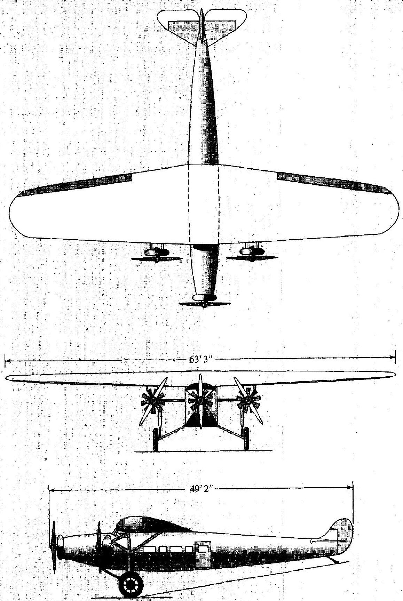
Figure 1.1 | Fokker Trimoter airliner, from the late 1920s.

## (continued from page 3)

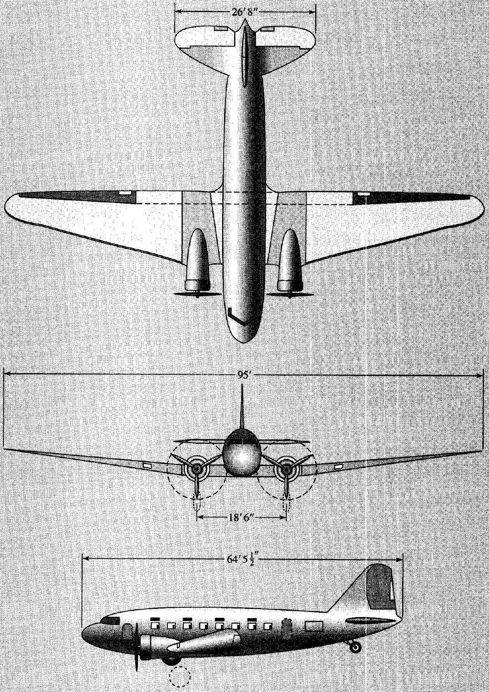
Figure 1.2 1 Douglas DC-3 Airliner, from the middle 1930s.

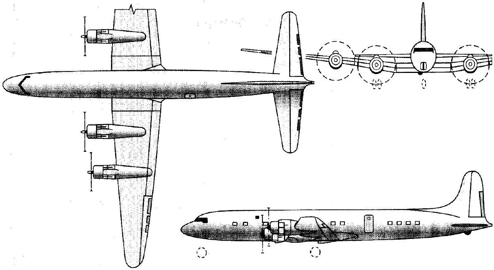
Figure 1.3 I Douglas DC-7 airliner, from the middle 1950s.

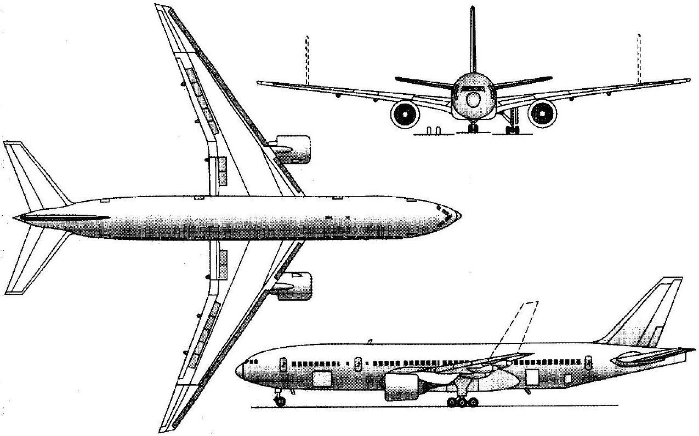
Figure 1.4 I Boeing 777 jet airliner, from the 1990s.

## (continued from page 5)

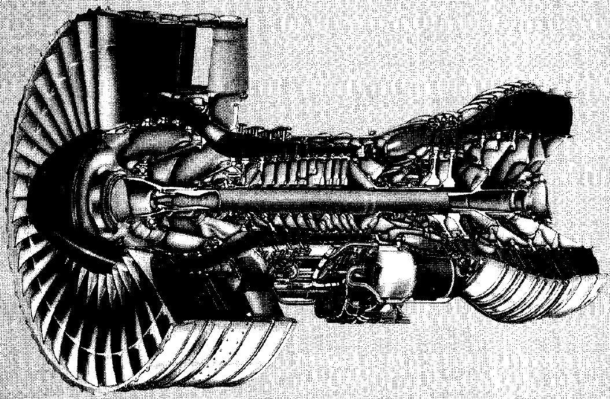

Figure 1.51 Pratt and Whitney 4000 turbofan engine. Third generation turbofan for widebody transports. Produces up to $84,000 \mathrm{lb}(329.2 \mathrm{kN})$ of thrust. Powers some versions of the Boeing 777 (see Fig. 1,4).

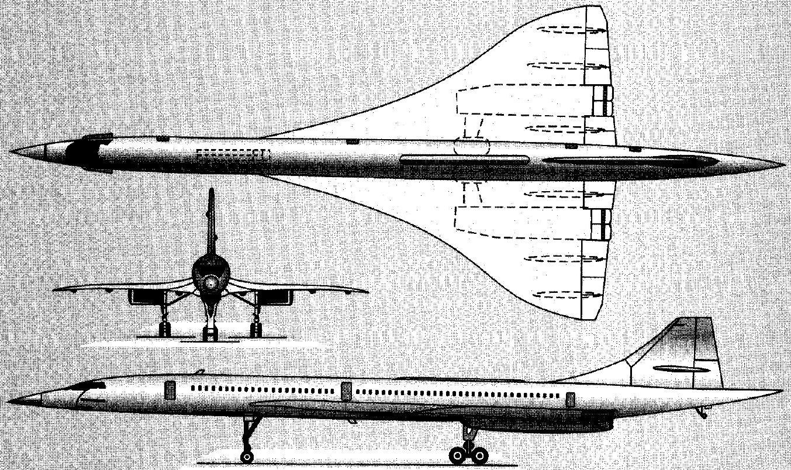
Figure 1.61 The anglo-French Acrospatiale/BAC Concorde supersonic airliner.

some of the mathematical and physical details that are buried in the chapter. The road map for the entire book is given in Fig. 1.7. To help keep our equilibrium, we will periodically refer to Fig. 1.7 as we progress through the book. For now, let us just survey Fig. 1.7 for some general guidance. After an introduction to the subject and a brief review of thermodynamics (box 1 in Fig. 1.7), we derive the governing fundamental conservation equations (box 2). We first obtain these equations in integral form (box 3), which some people will argue is philosophically a more fundamental form of the equations
than the differential form obtained later in box 7 . Using just the integral form of the conservation equations, we will study one-dimensional flow (box 4), including normal shock waves, oblique shock, and expansion waves (box 5), and the quasi-one-dimensional flow through nozzles and diffusers, with applications to wind tunnels and rocket engines (box 6). All of these subjects can be studied by application of the integral form of the conservation equations, which usually reduce to algebraic equations for the application listed in boxes 4-6. Boxes $1-6$ frequently constitute a basic "first course" in

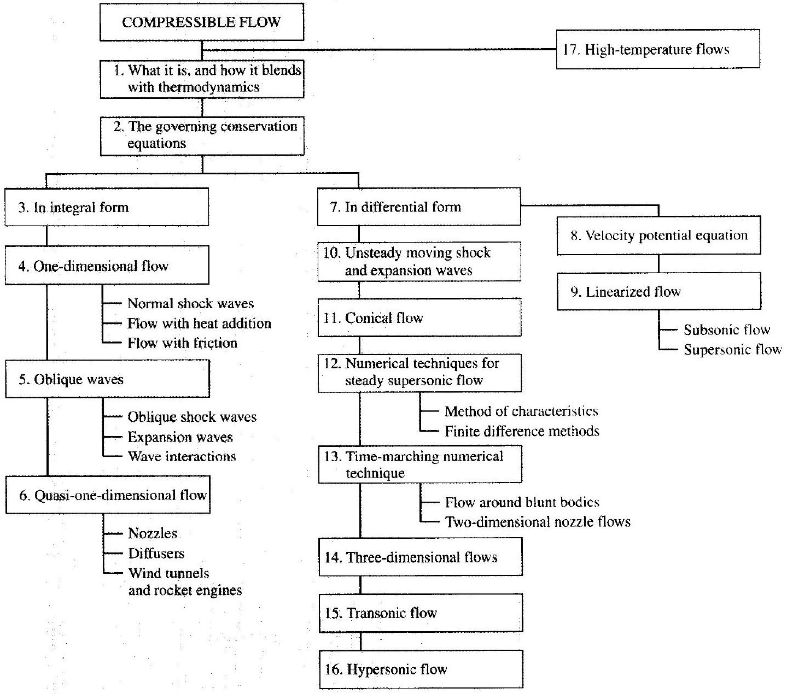
Figure 1.7 I Roadmap for the book.

## (continued from page 7)

compressible flow, and the mathematios usually does not go beyond that of algebra. However, to deal with unsteady and/or multidimensional flows, we have to step to box 7 and obtain the governing conservation equations in differential form. They take the form of a system of coupled, highly nonlinear, partial differential equations. In some special cases for subsonic and supersonic flows, they can be linearized (boxes 8 and 9), leading to so-called "linearized flow." However, in most cases, we must cope with the nonlinear equations. The way we do this, and the fascinating physical phenomena we discover along the way, is told in boxes 10-16 dealing with unsteady flow, flow over cones, flows over supersonic blunt-nosed bodies, three-dimensional flows over bodies at an angle of attack to a uniform free stream, and the very special characteristics of transonic and hypersonic flows.

Our treatment of the material covered in boxes $4-6$ and $8-16$ in Fig. 1.7 assumes the gas to be calorically perfect, i.e., to have constant values of specific heats. This is valid as long as the temperature in the flow does not exceed about 1000 K . The vast bulk of compressible flow applications satisfy this criteria, including the flow around the Concorde when it is cruising at Mach 2. However, the flow over higher speed vehicles, as well as the flow through parts of a jet engine, will encounter temperatures high enough that the assumption of a calorically perfect gas is not valid. Witness the flow over parts of the Space Shuttle as it enters the atmosphere at Mach 25, where flow temperatures can be as high as 8000 K , and the flow through rocket engines where temperatures on the order of 4000 K or higher occur in the combustion chamber. At these temperatures, the flow is chemically reacting, and the analysis of compressible flow applications at these conditions must include the appropriate physical-chemical effects. Hence, to round out our study of compressible flow, toward the end of this book we identify, discuss, and analyze these hightemperature flow effects. This subject is somewhat selfcontained and is relatively independent of the earlier chapters; for this reason in Fig. 1.7 we show hightemperature flows in box 17 in an adjunct position somewhat separate from the main structure. However, this is not to minimize its importance. In many highspeed flow applications today, high-temperature effects are very important. Any study of modern compressible flow must include box 17.

We note that all of the material in this book, boxes 1 through 17 in Fig. 1.7, assumes inviscid flow, 1.e., flow with no friction, thermal conduction, or mass diffusion, except for the special case of one-dimensional flow with friction (box 4 in Fig. 1.7). Flows where the dissipative transport processes of friction, thermal conduction, and mass diffusion are important are called viscous flows. Viscous flow is a subject all by itself and is beyond the scope of this book. The assumption of inviscid flow may at first sound ideal and restrictive-flows in the real world are not so ideal. However, the important physics that dictates compressible flow, such as the propagation of pressure waves through the flow, is essentially an inviscid phenomena. Moreover, for the vast majority of compressible flow applications, the influence of the dissipative transport phenomena is limited to small regions, such as the boundary layer along a solid surface. Hence, the inviscid flows treated in this book are indeed very practical and apply to a vast majority of everyday applications of compressible flow.

All of this constitutes a preview for the material that is covered in this book - a broad, general view to give you a better, almost philosophical feeling for what compressible flow is about. As we continue, each chapter has its own preview box in order to enhance a broader understanding of the material in the chapter and to relate it to the general view. In this fashion, the detailed material in each chapter will more readily come to life for you.

In regard to the present chapter, we start out with some historical high-water marks in the application of compressible flow, and then discuss some introductory thoughts that are essential for our understanding of compressible flow in the subsequent chapters. For example, in this chapter we give a brief review of thermodynamicsbut only those aspects of thermodynamics that relate directly to our subsequent discussions. Compressible flows are usually high-energy flows. Imagine that you are driving down the highway at 65 mph , and you stick your hand out the window, your hand will literally feel the energy of the $65-\mathrm{mph}$ airstream, and it feels impressive. But 65 mph is really a low velocity in the scheme of compressible flow applications. Rather, imagine the energy you would feel if you were traveling at 650 mph , near the speed of sound, and you stick your hand out the window (definitely not recommended). You would feel a lot of energy in the flow. High-speed flows are high-energy flows. Thermodynamics is the study of energy changes and their

#### Abstract

effects on the properties of a system. Hence, compressible flow embraces thermodynamics. I know of no compressible flow problem that can be understood and solved without involving some aspect of thermodynamics. So that is why we start out with a review of thermodynamics.

The remainder of this chapter simply deals with other introductory thoughts necessary to provide you with smooth sailing through the rest of the book. I wish you a pleasant voyage.

## 1.1 | HISTORICAL HIGH-WATER MARKS

The year is 1893. In Chicago, the World Columbian Exposition has been opened by President Grover Cleveland. During the year, more than 27 million people will visit the 666-acre expanse of gleaming white buildings, specially constructed from a composite of plaster of paris and jute fiber to simulate white marble. Located adjacent to the newly endowed University of Chicago, the Exposition commemorates the discovery of America by Christopher Columbus 400 years earlier. Exhibitions related to engineering, architecture, and domestic and liberal arts, as well as collections of all modes of transportation, are scattered over 150 buildings. In the largest. the Manufacturer's and Liberal Arts Building, engineering exhibits from all over the world herald the rapid advance of technology that will soon reach explosive proportions in the twentieth century. Almost lost in this massive 31 -acre building, under a roof of iron and glass, is a small machine of great importance. A single-stage steam turbine is being displayed by the Swedish engineer, Carl G. P. de Laval. The machine is less than 6 ft long: designed for marine use, it has two independent turbine wheels. one for forward motion and the other for the reverse direction. But what is novel about this device is that the turbine blades are driven by a stream of hot, high-pressure steam from a series of unique convergent-divergent nozzles. As sketched in Fig. 1.8, these nozzles, with their convergent-divergent shape representing a complete departure from previous engineering applications, feed a high-speed flow of steam to the blades of the turbine wheel. The deflection and consequent change in momentum of the steam as it flows past the turbine blades exerts an impulse that rotates the wheel to speeds previously unattainable-over $30,000 \mathrm{r} / \mathrm{min}$. Little does de Laval realize that his convergent-divergent steam nozzle will open the door to the supersonic wind tunnels and rocket engines of the midtwentieth century.

The year is now 1947. The morning of October 14 dawns bright and beautiful over the Muroc Dry Lake, a large expanse of flat, hard lake bed in the Mojave Desert in California. Beginning at 6:00 A.M., teams of engineers and technicians at the Muroc Army Air Field ready a small rocket-powered airplane for flight. Painted orange and resembling a 50 -caliber machine gun bullet mated to a pair of straight, stubby wings, the Bell XS-1 research vehicle is carefully installed in the bomb bay of a four-engine B-29 bomber of World War II vintage. At 10:00 A.M. the B-29 with its soon-to-be-historic cargo takes off and climbs to an altitude of $20,000 \mathrm{ft}$. In the cockpit of the XS-1 is Captain Charles (Chuck) Yeager, a veteran P-51 pilot from the European theater during the war. This morning Yeager is in pain from two broken ribs incurred during a horseback riding accident the previous weekend. However, not wishing to disrupt the events of the day. Yeager informs no one at Muroc about his

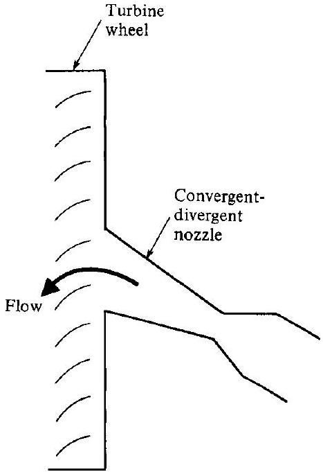
Figure 1.8 I Schematic of de Laval's turbine incorporating a convergentdivergent nozzle.

condition. At 10:26 A.M., at a speed of $250 \mathrm{mi} / \mathrm{h}(112 \mathrm{~m} / \mathrm{s})$, the brightly painted XS-1 drops free from the bomb bay of the B-29. Yeager fires his Reaction Motors XLR-11 rocket engine and, powered by 6000 lb of thrust, the sleek airplane accelerates and climbs rapidly. Trailing an exhaust jet of shock diamonds from the four convergentdivergent rocket nozzles of the engine, the XS-1 is soon flying faster than Mach 0.85, that speed beyond which there is no wind tunnel data on the problems of transonic flight in 1947. Entering this unknown regime, Yeager momentarily shuts down two of the four rocket chambers, and carefully tests the controls of the XS-1 as the Mach meter in the cockpit registers 0.95 and still increasing. Small shock waves are now dancing back and forth over the top surface of the wings. At an altitude of $40,000 \mathrm{ft}$, the XS-1 finally starts to level off, and Yeager fires one of the two shutdown rocket chambers. The Mach meter moves smoothly through $0.98,0.99$, to 1.02 . Here, the meter hesitates, then jumps to 1.06 . A stronger bow shock wave is now formed in the air ahead of the needlelike nose of the XS-1 as Yeager reaches a velocity of $700 \mathrm{mi} / \mathrm{h}$, Mach 1.06, at $43,000 \mathrm{ft}$. The flight is smooth; there is no violent buffeting of the airplane and no loss of control as was feared by some engineers. At this moment, Chuck Yeager becomes the first pilot to successfully fly faster than the speed of sound, and the small but beautiful Bell XS-1, shown in Fig. 1.9, becomes the first successful supersonic airplane in the history of flight. (For more details, see Refs. 1 and 2 listed at the back of this book.)

Today, both de Laval's $10-\mathrm{hp}$ turbine from the World Columbian Exhibition and the orange Bell XS-1 are part of the collection of the Smithsonian Institution of Washington, D.C., the former on display in the History of Technology Building and the latter hanging with distinction from the roof of the National Air and Space

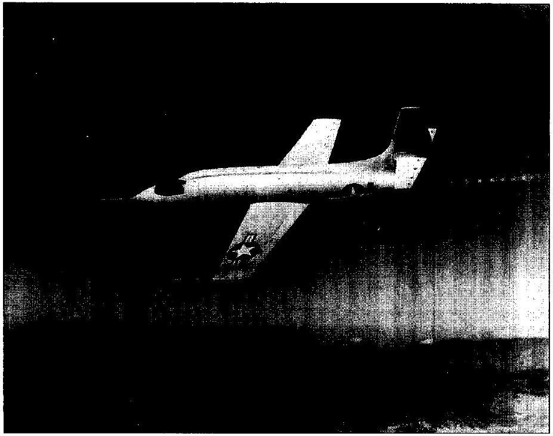
Figure 1.9 | The Bell XS-1. first manned supersonic aircraft. (Courtesy of the National Air and Space Museum.)

Museum. What these two machines have in common is that, separated by more than half a century, they represent high-water marks in the engineering application of the principles of compressible flow-where the density of the flow is not constant. In both cases they represent marked departures from previous fluid dynamic practice and experience.

The engineering fluid dynamic problems of the eighteenth, nineteenth, and early twentieth centuries almost always involved either the flow of liquids or the lowspeed flow of gases; for both cases the assumption of constant density is quite valid. Hence, the familiar Bernoulli's equation

$$
p+\frac{1}{2} \rho V^{2}=\mathrm{const}
$$

was invariably employed with success. However, with the advent of high-speed flows, exemplified by de Laval's convergent-divergent nozzle design and the supersonic flight of the Bell XS-1, the density can no longer be assumed constant throughout the flowfield. Indeed, for such flows the density can sometimes vary by orders of magnitude. Consequently, Eq. (1.1) no longer holds. In this light, such events were indeed a marked departure from previous experience in fluid dynamics.

This book deals exclusively with that "marked departure," i.e., it deals with compressible flows, in which the density is not constant. In modern engineering applications, such flows are the rule rather than the exception. A few important examples are the internal flows through rocket and gas turbine engines, high-speed subsonic, transonic, supersonic, and hypersonic wind tunnels, the external flow over modern airplanes designed to cruise faster than 0.3 of the speed of sound, and the flow inside the common internal combustion reciprocating engine. The purpose of
this book is to develop the fundamental concepts of compressible flow, and to illustrate their use.

### 1.2 I DEFINITION OF COMPRESSIBLE FLOW

Compressible flow is routinely defined as variable density flow; this is in contrast to incompressible flow, where the density is assumed to be constant throughout. Obviously, in real life every flow of every fluid is compressible to some greater or lesser extent; hence, a truly constant density (incompressible) flow is a myth. However, as previously mentioned, for almost all liquid flows as well as for the flows of some gases under certain conditions, the density changes are so small that the assumption of constant density can be made with reasonable accuracy. In such cases, Bernoulli's equation, Eq. (1.1), can be applied with confidence. However, for the subject of this book-compressible flow-Eq. (1.1) does not hold, and for our purposes here, the reader should dismiss it from his or her thinking.

The simple definition of compressible flow as one in which the density is variable requires more elaboration. Consider a small element of fluid of volume $v$. The pressure exerted on the sides of the element by the neighboring fluid is $p$. Assume the pressure is now increased by an infinitesimal amount $d p$. The volume of the element will be correspondingly compressed by the amount $d v$. Since the volume is reduced, $d v$ is a negative quantity. The compressibility of the fluid, $\tau$, is defined as

$$
\tau=-\frac{1}{v} \frac{d v}{d p}
$$

Physically, the compressibility is the fractional change in volume of the fluid element per unit change in pressure. However, Eq. (1.2) is not sufficiently precise. We know from experience that when a gas is compressed (say in a bicycle pump), its temperature tends to increase, depending on the amount of heat transferred into or out of the gas through the boundaries of the system. Therefore, if the temperature of the fluid element is held constant (due to some heat transfer mechanism), then the isothermal compressibility is defined as

$$
\tau_{T}=-\frac{1}{v}\left(\frac{\partial v}{\partial p}\right)_{T}
$$

On the other hand, if no heat is added to or taken away from the fluid element (if the compression is adiabatic), and if no other dissipative transport mechanisms such as viscosity and diffusion are important (if the compression is reversible), then the compression of the fluid element takes place isentropically, and the isentropic compressibility is defined as

$$
\tau_{s}=-\frac{1}{v}\left(\frac{\partial v}{\partial p}\right)_{s}
$$

where the subscript $s$ denotes that the partial derivative is taken at constant entropy.
Compressibility is a property of the fluid. Liquids have very low values of compressibility ( $\tau_{T}$ for water is $5 \times 10^{-10} \mathrm{~m}^{2} / \mathrm{N}$ at 1 atm ) whereas gases have high
compressibilities ( $\tau_{T}$ for air is $10^{-5} \mathrm{~m}^{2} / \mathrm{N}$ at 1 atm , more than four orders of magnitude larger than water). If the fluid element is assumed to have unit mass, $v$ is the specific volume (volume per unit mass), and the density is $\rho=1 / v$. In terms of density, Eq. (1.2) becomes

$$
\tau=\frac{1}{\rho} \frac{d \rho}{d p}
$$

Therefore, whenever the fluid experiences a change in pressure, $d p$, the corresponding change in density will be $d \rho$, where from Eq. (1.5)

$$
d \rho=\rho \tau d p
$$

To this point, we have considered just the fluid itself, with compressibility being a property of the fluid. Now assume that the fluid is in motion. Such flows are initiated and maintained by forces on the fluid, usually created by, or at least accompanied by, changes in the pressure. In particular, we shall see that high-speed flows generally involve large pressure gradients. For a given change in pressure, $d p$, due to the flow, Eq. (1.6) demonstrates that the resulting change in density will be small for liquids (which have low values of $\tau$ ), and large for gases (which have high values of $\tau$ ). Therefore, for the flow of liquids, relatively large pressure gradients can create high velocities without much change in density. Hence, such flows are usually assumed to be incompressible, where $\rho$ is constant. On the other hand, for the flow of gases with their attendant large values of $\tau$, moderate to strong pressure gradients lead to substantial changes in the density via Eq. (1.6). At the same time, such pressure gradients create large velocity changes in the gas. Such flows are defined as compressible flows, where $\rho$ is a variable.

We shall prove later that for gas velocities less than about 0.3 of the speed of sound, the associated pressure changes are small, and even though $\tau$ is large for gases, $d p$ in Eq. (1.6) may still be small enough to dictate a small $d \rho$. For this reason, the low-speed flow of gases can be assumed to be incompressible. For example, the flight velocities of most airplanes from the time of the Wright brothers in 1903 to the beginning of World War II in 1939 were generally less than $250 \mathrm{mi} / \mathrm{h}(112 \mathrm{~m} / \mathrm{s})$, which is less than 0.3 of the speed of sound. As a result, the bulk of early aerodynamic literature treats incompressible flow. On the other hand, flow velocities higher than 0.3 of the speed of sound are associated with relatively large pressure changes, accompanied by correspondingly large changes in density. Hence, compressibility effects on airplane aerodynamics have been important since the advent of highperformance aircraft in the 1940s. Indeed, for the modern high-speed subsonic and supersonic aircraft of today, the older incompressible theories are wholly inadequate, and compressible flow analyses must be used.

In summary, in this book a compressible flow will be considered as one where the change in pressure, $d p$, over a characteristic length of the flow, multiplied by the compressibility via Eq. (1.6), results in a fractional change in density, $d \rho / \rho$, which is too large to be ignored. For most practical problems, if the density changes by 5 percent or more, the flow is considered to be compressible.

## FXAMPLE 1.1

Consider the low-speed flow of air over an airplane wing at standard sea level conditions; the free-stream velocity far ahead of the wing is $100 \mathrm{mi} / \mathrm{h}$. The flow accelerates over the wing, reaching a maximum velocity of $150 \mathrm{mi} / \mathrm{h}$ at some point on the wing. What is the percentage pressure change between this point and the free stream?

## - Solution

Since the airspeeds are relatively low, let us (for the first and only time in this book) assume incompressible flow, and use Bernoulli's equation for this problem. (See Ref. 1 for an elementary discussion of Bernoulli's equation, as well as Ref. 104 for a more detailed presentation of the role of this equation in the solution of incompressible flow. Here, we assume that the reader is familiar with Bernoulli's equation-its use and its limitations. If not, examine carefully the appropriate discussions in Refs. 1 and 104.) Let points 1 and 2 denote the free stream and wing points, respectively. Then, from Bernoulli's equation,
or

$$
\begin{aligned}
p_{1}+\frac{1}{2} \rho V_{1}^{2} & =p_{2}+\frac{1}{2} \rho V_{2}^{2} \\
p_{1}-p_{2} & =\frac{1}{2} \rho\left(V_{2}^{2}-V_{1}^{2}\right)
\end{aligned}
$$

At standard sea level, $\rho=0.002377$ slug $/ \mathrm{ft}^{3}$. Also, using the handy conversion that $60 \mathrm{mi} / \mathrm{h}= 88 \mathrm{ft} / \mathrm{s}$, we have $V_{1}=100 \mathrm{mi} / \mathrm{h}=147 \mathrm{ft} / \mathrm{s}$ and $V_{2}=150 \mathrm{mi} / \mathrm{h}=220 \mathrm{ft} / \mathrm{s}$. (Note that, as always in this book, we will use consistent units; for example, we will use either the English Engineering System, as in this problem, or the International System. See the footnote in Sec. 1.4 of this book, as well as Chap. 2 of Ref. 1. By using consistent units, none of our basic equations will ever contain conversion factors, such as $q_{c}$ and $J$, as is found in some references.) With this information, we have

$$
\begin{aligned}
p_{1}-p_{2} & =\frac{1}{2} \rho\left(V_{2}^{2}-V_{1}^{2}\right) \\
& =\frac{1}{2}(0.002377)\left[(220)^{2}-(147)^{2}\right]=31.8 \mathrm{lb} / \mathrm{ft}^{2}
\end{aligned}
$$

The fractional change in pressure referenced to the free-stream pressure, which at standard sea level is $p_{1}=2116 \mathrm{lb} / \mathrm{ft}^{2}$, is obtained as

$$
\frac{p_{1}-p_{2}}{p_{1}}=\frac{31.8}{2116}=0.015
$$

Therefore, the percentage change in pressure is 1.5 percent. In expanding over the wing surface, the pressure changes by only 1.5 percent. This is a case where, in Eq. (1.6), $d p$ is small, and hence $d \rho$ is small. The purpose of this example is to demonstrate that, in low-speed flow problems, the percentage change in pressure is always small, and this, through Eq. (1.6), justifies the assumption of incompressible flow ( $d \rho=0$ ) for such flows. However, at high flow velocities, the change in pressure is not small, and the density must be treated as variable. This is the regime of compressible flow-the subject of this book. Note: Bernoulli's equation used in this example is good only for incompressible flow, therefore it will not appear again in any of our subsequent discussions. Experience has shown that, because it is one of the first equations usually encountered by students in the study of fluid dynamics, there is a tendency to use Bernoulli's equation for situations where it is not valid. Compressible flow is one such situation. Therefore, for our subsequent discussions in this book, remember never to invoke Bernoulli's equation.

### 1.3 I FLOW REGIMES

The age of successful manned flight began on December 17, 1903, when Orville and Wilbur Wright took to the air in their historic Flyer I, and soared over the windswept sand dunes of Kill Devil Hills in North Carolina. This age has continued to the present with modern, high-performance subsonic and supersonic airplanes. as well as the hypersonic atmospheric entry of space vehicles. In the twentieth century, manned flight has been a major impetus for the advancement of fluid dynamics in general, and compressible flow in particular. Hence, although the fundamentals of compressible flow are applied to a whole spectrum of modern engineering problems, their application to aerodynamics and propulsion geared to airplanes and missiles is frequently encountered.

In this vein, it is useful to illustrate different regimes of compressible flow by considering an aerodynamic body in a flowing gas, as sketched in Fig. 1.10. First, consider some definitions. Far upstream of the body, the flow is uniform with a freestream velocity of $V_{\infty}$. A streamline is a curve in the flowfield that is tangent to the local velocity vector $\mathbf{V}$ at every point along the curve. Figure 1.10 illustrates only a few of the infinite number of streamlines around a body. Consider an arbitrary point in the flowfield, where $p, T, \rho$, and $\mathbf{V}$ are the local pressure, temperature, density, and vector velocity at that point. All of these quantities are point properties and vary from one point to another in the flow. In Chap. 3, we will show the speed of sound $a$ to be a thermodynamic property of the gas; hence $a$ also varies from point to point in the flow. If $a_{\propto}$ is the speed of sound in the uniform free stream, then the ratio $V_{\triangleleft} / a_{\infty}$ defines the free-stream Mach number $M_{\infty}$. Similarly, the local Mach number $M$ is defined as $M=V / a$, and varies from point to point in the flowfield. Further physical significance of Mach number will be discussed in Chap. 3. In the present section, $M$ simply will be used to define four different flow regimes in fluid dynamics, as discussed next.

### 1.3.1 Subsonic Flow

Consider the flow over an airfoil section as sketched in Fig. 1.10a. Here, the local Mach number is everywhere less than unity. Such a flow, where $M<1$ at every point, and hence the flow velocity is everywhere less than the speed of sound, is defined as subsonic flow. This flow is characterized by smooth streamlines and continuously varying properties. Note that the initially straight and parallel streamlines in the free stream begin to deflect far upstream of the body, i.e.. the flow is forewarned of the presence of the body. This is an important property of subsonic flow and will be discussed further in Chap. 4. Also, as the flow passes over the airfoil, the local velocity and Mach number on the top surface increase above their free-stream values. However, if $M_{\infty}$ is sufficiently less than 1. the local Mach number everywhere will remain subsonic. For airfoils in common use, if $M_{\infty} \leq 0.8$, the flowfield is generally completely subsonic. Therefore, to the airplane aerodynamicist, the subsonic regime is loosely identified with a free stream where $M_{\infty} \leq 0.8$.

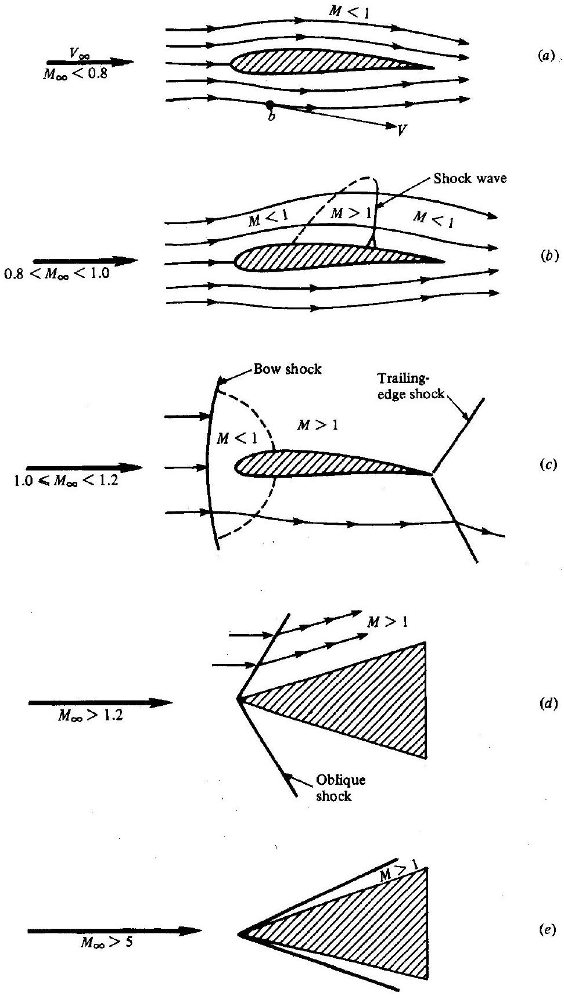
Figure 1.10 | Illustration of different regimes of flow.

### 1.3.2 Transonic Flow

If $M_{\infty}$ remains subsonic, but is sufficiently near 1 , the flow expansion over the top surface of the airfoil may result in locally supersonic regions, as sketched in Fig. 1.10b. Such a mixed region flow is defined as transonic flow. In Fig. 1.10b, $M_{\infty}$ is less than 1 but high enough to produce a pocket of locally supersonic flow. In most cases, as sketched in Fig. 1.10b, this pocket terminates with a shock wave across which there is a discontinuous and sometimes rather severe change in flow properties. Shock waves will be discussed in Chap. 4. If $M_{\infty}$ is increased to slightly above unity, this shock pattern will move to the trailing edge of the airfoil, and a second shock wave appears upstream of the leading edge. This second shock wave is called the bow shock, and is sketched in Fig. 1.10c. (Referring to Sec. 1.1, this is the type of flow pattern existing around the wing of the Bell XS-1 at the moment it was "breaking the sound barrier" at $M_{\infty}=1.06$.) In front of the bow shock, the streamlines are straight and parallel, with a uniform supersonic free-stream Mach number. In passing through that part of the bow shock that is nearly normal to the free stream, the flow becomes subsonic. However, an extensive supersonic region again forms as the flow expands over the airfoil surface, and again terminates with a trailing-edge shock. Both flow patterns sketched in Figs. $1.10 b$ and $c$ are characterized by mixed regions of locally subsonic and supersonic flow. Such mixed flows are defined as transonic flows, and $0.8 \leq M_{\infty} \leq 1.2$ is loosely defined as the transonic regime. Transonic flow is discussed at length in Chap. 14.

### 1.3.3 Supersonic Flow

A flowfield where $M>1$ everywhere is defined as supersonic. Consider the supersonic flow over the wedge-shaped body in Fig. 1.10d. A straight, oblique shock wave is attached to the sharp nose of the wedge. Across this shock wave, the streamline direction changes discontinuously. Ahead of the shock, the streamlines are straight, parallel, and horizontal; behind the shock they remain straight and parallel but in the direction of the wedge surface. Unlike the subsonic flow in Fig. 1.10a, the supersonic uniform free stream is not forewarned of the presence of the body until the shock wave is encountered. The flow is supersonic both upstream and (usually, but not always) downstream of the oblique shock wave. There are dramatic physical and mathematical differences between subsonic and supersonic flows, as will be discussed in subsequent chapters.

### 1.3.4 Hypersonic Flow

The temperature, pressure, and density of the flow increase almost explosively across the shock wave shown in Fig. 1.10d. As $M_{\infty}$ is increased to higher supersonic speeds, these increases become more severe. At the same time, the oblique shock wave moves closer to the surface, as sketched in Fig. 1.10 $e$. For values of $M_{\infty}>5$, the shock wave is very close to the surface, and the flowfield between the shock and the body (the shock layer) becomes very hot-indeed, hot enough to dissociate or even ionize the gas. Aspects of such high-temperature chemically reacting flows are
discussed in Chaps. 16 and 17. These effects-thin shock layers and hot, chemically reacting gases-add complexity to the analysis of such flows. For this reason, the flow regime for $M_{\infty}>5$ is given a special label-hypersonic flow. The choice of $M_{\infty}=5$ as a dividing point between supersonic and hypersonic flow is a rule of thumb. In reality, the special characteristics associated with hypersonic flow appear gradually as $M_{\infty}$ is increased, and the Mach number at which they become important depends greatly on the shape of the body and the free-stream density. Hypersonic flow is the subject of Chap. 15.

It is interesting to note that incompressible flow is a special case of subsonic flow; namely, it is the limiting case where $M_{\infty} \rightarrow 0$. Since $M_{\infty}=V_{\infty} / a_{\infty}$, we have two possibilities:

$$
\begin{array}{ll}
M_{\infty} \rightarrow 0 & \text { because } V_{\infty} \rightarrow 0 \\
M_{\infty} \rightarrow 0 & \text { because } a_{\infty} \rightarrow \infty
\end{array}
$$

The former corresponds to no flow and is trivial. The latter states that the speed of sound in a truly incompressible flow would have to be infinitely large. This is compatible with Eq. (1.6), which states that, for a truly incompressible flow where $d \rho=0, \tau$ must be zero, i.e., zero compressibility. We shall see in Chap. 3 that the speed of sound is inversely proportional to the square root of $\tau$; hence $\tau=0$ implies an infinite speed of sound.

There are other ways of classifying flowfields. For example, flows where the effects of viscosity, thermal conduction, and mass diffusion are important are called viscous flows. Such phenomena are dissipative effects that change the entropy of the flow, and are important in regions of large gradients of velocity, temperature, and chemical composition. Examples are boundary layer flows, flow in long pipes, and the thin shock layer on high-altitude hypersonic vehicles. Friction drag, flowfield separation, and heat transfer all involve viscous effects. Therefore, viscous flows are of major importance in the study of fluid dynamics. In contrast, flows in which viscosity, thermal conduction, and diffusion are ignored are called inviscid flows. At first glance, the assumption of inviscid flows may appear highly restrictive; however, there are a number of important applications that do not involve flows with large gradients, and that readily can be assumed to be inviscid. Examples are the large regions of flow over wings and bodies outside the thin boundary layer on the surface, flow through wind tunnels and rocket engine nozzles, and the flow over compressor and turbine blades for jet engines. Surface pressure distributions, as well as aerodynamic lift and moments on some bodies, can be accurately obtained by means of the assumption of inviscid flow. In this book, viscous effects will not be treated except in regard to their role in forming the internal structure and thickness of shock waves. That is, this book deals with compressible, inviscid flows.

Finally, we will always consider the gas to be a continuum. Clearly, a gas is composed of a large number of discrete atoms and/or molecules, all moving in a more or less random fashion, and frequently colliding with each other. This microscopic picture of a gas is essential to the understanding of the thermodynamic and chemical properties of a high-temperature gas, as described in Chaps. 16 and 17. However, in deriving the fundamental equations and concepts for fluid flows, we take advantage
of the fact that a gas usually contains a large number of molecules (over $2 \times 10^{19}$ molecules $/ \mathrm{cm}^{3}$ for air at normal room conditions), and hence on a macroscopic basis, the fluid behaves as if it were a continuous material. This continuum assumption is violated only when the mean distance an atom or molecule moves between collisions (the mean free path) is so large that it is the same order of magnitude as the characteristic dimension of the flow. This implies low density, or rarefied flow. The extreme situation, where the mean free path is much larger than the characteristic length and where virtually no molecular collisions take place in the flow, is called free-molecular flow. In this case, the flow is essentially a stream of remotely spaced particles. Lowdensity and free-molecular flows are rather special cases in the whole spectrum of fluid dynamics, occurring in flight only at very high altitudes (above $200,000 \mathrm{ft}$ ), and in special laboratory devices such as electron beams and low-pressure gas lasers. Such rarefied gas effects are beyond the scope of this book.

### 1.4 I A BRIEF REVIEW OF THERMODYNAMICS

The kinetic energy per unit mass, $V^{2} / 2$, of a high-speed flow is large. As the flow moves over solid bodies or through ducts such as nozzles and diffusers, the local velocity, hence local kinetic energy, changes. In contrast to low-speed or incompressible flow, these energy changes are substantial enough to strongly interact with other properties of the flow. Because in most cases high-speed flow and compressible flow are synonymous, energy concepts play a major role in the study and understanding of compressible flow. In turn, the science of energy (and entropy) is thermodynamics; consequently, thermodynamics is an essential ingredient in the study of compressible flow.

This section gives a brief outline of thermodynamic concepts and relations necessary to our further discussions. This is in no way an exposition on thermodynamics; rather it is a review of only those fundamental ideas and equations which will be of direct use in subsequent chapters.

### 1.4.1 Perfect Gas

A gas is a collection of particles (molecules, atoms, ions, electrons, etc.) that are in more or less random motion. Due to the electronic structure of these particles, a force field pervades the space around them. The force field due to one particle reaches out and interacts with neighboring particles, and vice versa. Hence, these fields are called intermolecular forces. The intermolecular force varies with distance between particles; for most atoms and molecules it takes the form of a weak attractive force at large distance, changing quickly to a strong repelling force at close distance. In general, these intermolecular forces influence the motion of the particles; hence they also influence the thermodynamic properties of the gas, which are nothing more than the macroscopic ramification of the particle motion.

At the temperatures and pressures characteristic of many compressible flow applications, the gas particles are, on the average, widely separated. The average distance between particles is usually more than 10 molecular diameters, which
corresponds to a very weak attractive force. As a result, for a large number of engineering applications, the effect of intermolecular forces on the gas properties is negligible. By definition, a perfect gas is one in which intermolecular forces are neglected. By ignoring intermolecular forces, the equation of state for a perfect gas can be derived from the theoretical concepts of modern statistical mechanics or kinetic theory. However, historically it was first synthesized from laboratory measurements by Robert Boyle in the seventeenth century, Jacques Charles in the eighteenth century, and Joseph Gay-Lussac and John Dalton around 1800. The empirical result which unfolded from these observations was

$$
p \mathscr{V}=M R T
$$

where $p$ is pressure ( $\mathrm{N} / \mathrm{m}^{2}$ or $\mathrm{lb} / \mathrm{ft}^{2}$ ), $\mathscr{V}$ is the volume of the system ( $\mathrm{m}^{3}$ or $\mathrm{ft}^{3}$ ), $M$ is the mass of the system ( kg or slug), $R$ is the specific gas constant $[\mathrm{J} /(\mathrm{kg} \cdot \mathrm{K})$ or $(\mathrm{ft} \cdot \mathrm{lb}) /\left(\right.$ slug $\left.\left.\cdot{ }^{\circ} \mathrm{R}\right)\right]$, which is a different value for different gases, and $T$ is the temperature ( K or ${ }^{\circ} \mathrm{R}$ ). ${ }^{\dagger}$ This equation of state can be written in many forms, most of which are summarized here for the reader's convenience. For example, if Eq. (1.7) is divided by the mass of the system,

$$
p v=R T
$$

where $v$ is the specific volume ( $\mathrm{m}^{3} / \mathrm{kg}$ or $\mathrm{ft}^{3} / \mathrm{slug}$ ). Since the density $\rho=1 / v$, Eq. (1.8) becomes

$$
p=\rho R T
$$

Along another track that is particularly useful in chemically reacting systems, the early fundamental empirical observations also led to a form for the equation of state:

$$
p \mathscr{V}=\mathscr{N} \mathscr{R} T
$$

where $\mathscr{N}$ is the number of moles of gas in the system, and $\mathscr{R}$ is the universal gas constant, which is the same for all gases. Recall that a mole of a substance is that amount which contains a mass numerically equal to the molecular weight of the gas, and which is identified with the particular system of units being used, i.e., a kilogrammole $(\mathrm{kg} \cdot \mathrm{mol})$ or a slug-mole $($ slug $\cdot \mathrm{mol})$. For example, for pure diatomic oxygen $\left(\mathrm{O}_{2}\right), 1 \mathrm{~kg} \cdot \mathrm{~mol}$ has a mass of 32 kg , whereas 1 slug $\cdot \mathrm{mol}$ has a mass of 32 slug. Because the masses of different molecules are in the same ratio as their molecular weights, 1 mol of different gases always contains the same number of molecules, i.e., $1 \mathrm{~kg} \cdot \mathrm{~mol}$ always contains $6.02 \times 10^{26}$ molecules, independent of the species of the gas. Continuing with Eq. (1.10), dividing by the number of moles of the system yields

[^0]$$
p \gamma^{\wedge}=\mathscr{R} T
$$
where $y^{-\gamma}$ is the molar volume $\left[\mathrm{m}^{3} /(\mathrm{kg} \cdot \mathrm{mol})\right.$ or $\left.\mathrm{ft}^{3} /(\mathrm{slug} \cdot \mathrm{mol})\right]$. Of more use in gasdynamic problems is a form obtained by dividing Eq. (1.10) by the mass of the system:
$$
p v=\eta, R T
$$
where $v$ is the specific volume as before, and $\eta$ is the mole-mass ratio $[(\mathrm{kg} \cdot \mathrm{mol}) / \mathrm{kg}$ and (slug ⋅ mol)/slug]. (Note that the kilograms and slugs in these units do not cancel, because the kilogram-mole and slug-mole are entities in themselves; the "kilogram" and "slug" are just identifiers on the mole.) Also, Eq. (1.10) can be divided by the system volume, yielding
$$
p=C \cdot R T
$$
where $C$ is the concentration $\left[(\mathrm{kg} \cdot \mathrm{mol}) / \mathrm{m}^{3}\right.$ or $\left.(\mathrm{slug} \cdot \mathrm{mol}) / \mathrm{ft}^{3}\right]$.
Finally, the equation of state can be expressed in terms of particles. Let $N_{A}$ be the number of particles in a mole (Avogadro's number, which for a kilogram-mole is $6.02 \times 10^{26}$ particles). Multiplying and dividing Eq. (1.13) by $N_{A}$,
$$
p=\left(N_{A} C\right)\left(\frac{\Re}{N_{A}}\right) T
$$

Examining the units, $N_{A} C$ is physically the number density (number of particles per unit volume), and $\mathscr{R} / N_{A}$ is the gas constant per particle, which is precisely the Boltzmann constant $k$. Hence, Eq. (1.14) becomes

$$
p=n k T
$$

where $n$ denotes number density.
In summary, the reader will frequently encounter the different forms of the perfect gas equation of state just listed. However, do not be confused; they are all the same thing and it is wise to become familiar with them all. In this book, particular use will be made of Eqs. (1.8), (1.9), and (1.12). Also, do not be confused by the variety of gas constants. They are easily sorted out:

1. When the equation deals with moles, use the universal gas constant, which is the "gas constant per mole." It is the same for all gases, and equal to the following in the two systems of units:

$$
\begin{aligned}
& \mathscr{K}=8314 \mathrm{~J} /(\mathrm{kg} \cdot \mathrm{~mol} \cdot \mathrm{~K}) \\
& \mathscr{R}=4.97 \times 10^{4}(\mathrm{ft} \cdot \mathrm{lb}) /\left(\mathrm{slug} \cdot \mathrm{~mol} \cdot{ }^{\circ} \mathrm{R}\right)
\end{aligned}
$$

2. When the equation deals with mass, use the specific gas constant $R$, which is the "gas constant per unit mass." It is different for different gases, and is related to the universal gas constant, $R=\mathscr{R} / \mathscr{U}$, where $\mathscr{U}$ is the molecular weight. For air at standard conditions:

$$
\begin{aligned}
& R=287 \mathrm{~J} /(\mathrm{kg} \cdot \mathrm{~K}) \\
& R=1716(\mathrm{ft} \cdot \mathrm{lb}) /\left(\text { slug } \cdot{ }^{\circ} \mathrm{R}\right)
\end{aligned}
$$

3. When the equation deals with particles, use the Boltzmann constant $k$, which is the "gas constant per particle":

$$
\begin{aligned}
k & =1.38 \times 10^{-23} \mathrm{~J} / \mathrm{K} \\
k & =0.565 \times 10^{-23}(\mathrm{ft} \cdot \mathrm{lb}) /{ }^{\circ} \mathrm{R}
\end{aligned}
$$

How accurate is the assumption of a perfect gas? It has been experimentally determined that, at low pressures (near 1 atm or less) and at high temperatures (standard temperature, 273 K , and above), the value $p v / R T$ for most pure gases deviates from unity by less than 1 percent. However, at very cold temperatures and high pressures, the molecules of the gas are more closely packed together, and consequently intermolecular forces become more important. Under these conditions, the gas is defined as a real gas. In such cases, the perfect gas equation of state must be replaced by more accurate relations such as the van der Waals equation

$$
\left(p+\frac{a}{v^{2}}\right)(v-b)=R T
$$

where $a$ and $b$ are constants that depend on the type of gas. As a general rule of thumb, deviations from the perfect gas equation of state vary approximately as $p / T^{3}$. In the vast majority of gasdynamic applications, the temperatures and pressures are such that $p=\rho R T$ can be applied with confidence. Such will be the case throughout this book.

In the early 1950s, aerodynamicists were suddenly confronted with hypersonic entry vehicles at velocities as high as $26,000 \mathrm{ft} / \mathrm{s}(8 \mathrm{~km} / \mathrm{s})$. The shock layers about such vehicles were hot enough to cause chemical reactions in the airflow (dissociation, ionization, etc.). At that time, it became fashionable in the aerodynamic literature to denote such conditions as "real gas effects." However, in classical physical chemistry, a real gas is defined as one in which intermolecular forces are important, and the definition is completely divorced from the idea of chemical reactions. In the preceding paragraphs, we have followed such a classical definition. For a chemically reacting gas, as will be discussed at length in Chap. 16, most problems can be treated by assuming a mixture of perfect gases, where the relation $p=\rho R T$ still holds. However, because $R=\mathscr{R} / \mathscr{M}$ and $\mathscr{M}$ varies due to the chemical reactions, then $R$ is a variable throughout the flow. It is preferable, therefore, not to identify such phenomena as "real gas effects," and this term will not be used in this book. Rather, we will deal with "chemically reacting mixtures of perfect gases," which are the subject of Chaps. 16 and 17.

## FXAMPLE 1.2

A pressure vessel that has a volume of $10 \mathrm{~m}^{3}$ is used to store high-pressure air for operating a supersonic wind tunnel. If the air pressure and temperature inside the vessel are 20 atm and 300 K , respectively, what is the mass of air stored in the vessel?

## - Solution

Recall that $1 \mathrm{~atm}=1.01 \times 10^{5} \mathrm{~N} / \mathrm{m}^{2}$. From Eq. (1.9)

$$
\rho=\frac{p}{R T}=\frac{(20)\left(1.01 \times 10^{5}\right)}{(287)(300)}=23.46 \mathrm{~kg} / \mathrm{m}^{3}
$$

The total mass stored is then

$$
M=\ddots_{\rho}=(10)(23.46)=234.6 \mathrm{~kg}
$$

Calculate the isothermal compressibility for air at a pressure of 0.5 atm .

## - Solution

From Eq. (1.3)

$$
\tau_{T}=-\frac{1}{v}\left(\frac{\partial v}{\partial p}\right)_{T}
$$

From Eq. (1.8)

$$
v=\frac{R T}{p}
$$

Thus

$$
\left(\frac{\partial v}{\partial p}\right)_{T}=-\frac{R T}{p^{2}}
$$

Hence

$$
\tau_{T}=-\frac{1}{v}\left(\frac{\partial v}{\partial p}\right)_{T}=-\left(\frac{p}{R T}\right)\left(-\frac{R T}{p^{2}}\right)=\frac{1}{p}
$$

We see that the isothermal compressibility for a perfect gas is simply the reciprocal of the pressure:

$$
\tau_{T}=\frac{1}{p}=\frac{1}{0.5}=2 \mathrm{~atm}^{-1}
$$

In terms of the International System of units, where $p=(0.5)\left(1.01 \times 10^{5}\right)=5.05 \times 10^{4} \mathrm{N} / \mathrm{m}^{2}$,

$$
\tau_{T}=1.98 \times 10^{-5} \mathrm{~m}^{2} / \mathrm{N}
$$

In terms of the English Engineering System of units, where $p=(0.5)(2116)=1058 \mathrm{lb} / \mathrm{ft}^{2}$,

$$
\tau_{T}=9.45 \times 10^{-4} \mathrm{ft}^{2} / \mathrm{lb}
$$

### 1.4.2 Internal Energy and Enthalpy

Returning to our microscopic view of a gas as a collection of particles in random motion, the individual kinetic energy of each particle contributes to the overall energy of the gas. Moreover, if the particle is a molecule, its rotational and vibrational motions (see Chap. 16) also contribute to the gas energy. Finally, the motion of electrons in both atoms and molecules is a source of energy. This small sketch of atomic and molecular energies will be enlarged to a massive portrait in Chap. 16; it is sufficient to note here that the energy of a particle can consist of several different forms of motion. In turn, these energies, summed over all the particles of the gas, constitute the
internal energy, $e$, of the gas. Moreover, if the particles of the gas (called the system) are rattling about in their state of "maximum disorder" (see again Chap. 16), the system of particles will be in equilibrium.

Return now to the macroscopic view of the gas as a continuum. Here, equilibrium is evidenced by no gradients in velocity, pressure, temperature, and chemical concentrations throughout the system, i.e., the system has uniform properties. For an equilibrium system of a real gas where intermolecular forces are important, and also for an equilibrium chemically reacting mixture of perfect gases, the internal energy is a function of both temperature and volume. Let $e$ denote the specific internal energy (internal energy per unit mass). Then, the enthalpy, $h$, is defined, per unit mass, as $h=e+p v$, and we have

$$
\begin{aligned}
& e=e(T, v) \\
& h=h(T, p)
\end{aligned}
$$

for both a real gas and a chemically reacting mixture of perfect gases.
If the gas is not chemically reacting, and if we ignore intermolecular forces, the resulting system is a thermally perfect gas, where internal energy and enthalpy are functions of temperature only, and where the specific heats at constant volume and pressure, $c_{v}$ and $c_{p}$, are also functions of temperature only:

$$
\begin{aligned}
e & =e(T) \\
h & =h(T) \\
d e & =c_{v} d T \\
d h & =c_{p} d T
\end{aligned}
$$

The temperature variation of $c_{v}$ and $c_{p}$ is associated with the vibrational and electronic motion of the particles, as will be explained in Chap. 16.

Finally, if the specific heats are constant, the system is a calorically perfect gas, where

$$
\begin{aligned}
& e=c_{v} T \\
& h=c_{p} T
\end{aligned}
$$

In Eq. (1.19), it has been assumed that $h=e=0$ at $T=0$.
In many compressible flow applications, the pressures and temperatures are moderate enough that the gas can be considered to be calorically perfect. Indeed, there is a large bulk of literature for flows with constant specific heats. For the first half of this book, a calorically perfect gas will be assumed. This is the case for atmospheric air at temperatures below 1000 K . However, at higher temperatures the vibrational motion of the $\mathrm{O}_{2}$ and $\mathrm{N}_{2}$ molecules in air becomes important, and the air becomes thermally perfect, with specific heats that vary with temperature. Finally, when the temperature exceeds 2500 K , the $\mathrm{O}_{2}$ molecules begin to dissociate into O atoms, and the air becomes chemically reacting. Above 4000 K , the $\mathrm{N}_{2}$ molecules begin to dissociate. For these chemically reacting cases, from Eqs. (1.17), $e$ depends on both $T$ and $v$, and $h$ depends on both $T$ and $p$. (Actually, in equilibrium thermodynamics, any state variable is uniquely determined by any two other state variables. However, it is convenient to associate $T$ and $v$ with $e$, and $T$ and $p$ with $h$.) Chapters 16
and 17 will discuss the thermodynamics and gasdynamics of both thermally perfect and chemically reacting gases.

Consistent with Eq. (1.9) and the definition of enthalpy is the relation

$$
c_{p}-c_{v}=R
$$

where the specific heats at constant pressure and constant volume are defined as
and

$$
\begin{aligned}
c_{p} & =\left(\frac{\partial h}{\partial T}\right)_{p} \\
c_{v} & =\left(\frac{\partial e}{\partial T}\right)_{v}
\end{aligned}
$$

respectively. Equation (1.20) holds for a calorically perfect or a thermally perfect gas. It is not valid for either a chemically reacting or a real gas. Two useful forms of Eq. (1.20) can be simply obtained as follows. Divide Eq. (1.20) by $c_{p}$ :

$$
1-\frac{c_{v}}{c_{p}}=\frac{R}{c_{p}}
$$

Define $\gamma \equiv c_{p} / c_{v}$. For air at standard conditions, $\gamma=1.4$. Then Eq. (1.21) becomes

$$
1-\frac{1}{\gamma}=\frac{R}{c_{p}}
$$

Solving for $c_{p}$,

$$
c_{p}=\frac{\gamma R}{\gamma-1}
$$

Similarly, by dividing Eq. (1.20) by $c_{v}$, we find that

$$
c_{v}=\frac{R}{\gamma-1}
$$

Equations (1.22) and (1.23) hold for a thermally or calorically perfect gas; they will be useful in our subsequent treatment of compressible flow.

For the pressure vessel in Example 1.2, calculate the total internal energy of the gas stored in the vessel.

## - Solution

From Eq. (1.23)

$$
c_{v}=\frac{R}{\gamma-1}=\frac{287}{1.4-1}=717.5 \mathrm{~J} / \mathrm{kg} \cdot \mathrm{~K}
$$

From Eq. (1.19)

$$
e=c_{v} T=(717.5)(300)=2.153 \times 10^{5} \mathrm{~J} / \mathrm{kg}
$$

From Example 1.2, we calculated the mass of air in the vessel to be 234.6 kg . Thus, the total internal energy is

$$
E=M e=(234.6)\left(2.153 \times 10^{5}\right)=5.05 \times 10^{7} \mathrm{~J}
$$

### 1.4.3 First Law of Thermodynamics

Consider a system, which is a fixed mass of gas separated from the surroundings by a flexible boundary. For the time being, assume the system is stationary, i.e., it has no directed kinetic energy. Let $\delta q$ be an incremental amount of heat added to the system across the boundary (say by direct radiation or thermal conduction). Also, let $\delta w$ denote the work done on the system by the surroundings (say by a displacement of the boundary, squeezing the volume of the system to a smaller value). Due to the molecular motion of the gas, the system has an internal energy $e$. (This is the specific internal energy if we assume a system of unit mass.) The heat added and work done on the system cause a change in energy, and since the system is stationary, this change in energy is simply de:

$$
\delta q+\delta w=d e
$$

This is the first law of thermodynamics; it is an empirical result confirmed by laboratory and practical experience. In Eq. (1.24), $e$ is a state variable. Hence, $d e$ is an exact differential, and its value depends only on the initial and final states of the system. In contrast, $\delta q$ and $\delta w$ depend on the process in going from the initial and final states.

For a given de, there are in general an infinite number of different ways (processes) by which heat can be added and work done on the system. We will be primarily concerned with three types of processes:

1. Adiabatic process-one in which no heat is added to or taken away from the system
2. Reversible process-one in which no dissipative phenomena occur, i.e., where the effects of viscosity, thermal conductivity, and mass diffusion are absent
3. Isentropic process-one which is both adiabatic and reversible

For a reversible process, it can be easily proved (see any good text on thermodynamics) that $\delta w=-p d v$, where $d v$ is an incremental change in specific volume due to a displacement of the boundary of the system. Hence, Eq. (1.24) becomes

$$
\delta q-p d v=d e
$$

If, in addition, this process is also adiabatic (hence isentropic), Eq. (1.25) leads to some extremely useful thermodynamic formulas. However, before obtaining these formulas, it is useful to review the concept of entropy.

### 1.4.4 Entropy and the Second Law of Thermodynamics

Consider a block of ice in contact with a red-hot plate of steel. Experience tells us that the ice will warm up (and probably melt) and the steel plate will cool down. However, Eq. (1.24) does not necessarily say this will happen. Indeed, the first law allows that the ice may get cooler and the steel plate hotter-just as long as energy is conserved during the process. Obviously, this does not happen; instead, nature imposes another condition on the process, a condition which tells us in which direction a process will take place. To ascertain the proper direction of a process, let us define a new state variable, the entropy, as

$$
d s=\frac{\delta q_{\mathrm{rev}}}{T}
$$

where $s$ is the entropy of the system, $\delta q_{\mathrm{rev}}$ is an incremental amount of heat added reversibly to the system, and $T$ is the system temperature. Do not be confused by this definition. It defines a change in entropy in terms of a reversible addition of heat, $\delta q_{\mathrm{rev}}$. However, entropy is a state variable, and it can be used in conjunction with any type of process, reversible or irreversible. The quantity $\delta q_{\mathrm{rev}}$ is just an artifice; an effective value of $\delta q_{\text {rev }}$ can always be assigned to relate the initial and end points of an irreversible process, where the actual amount of heat added is $\delta q$. Indeed, an alternative and probably more lucid relation is

$$
d s=\frac{\delta q}{T}+d s_{\mathrm{irrev}}
$$

Equation (1.26) applies in general; it states that the change in entropy during any incremental process is equal to the actual heat added divided by the temperature, $\delta q / T$, plus a contribution from the irreversible dissipative phenomena of viscosity, thermal conductivity, and mass diffusion occurring within the system, $d s_{\text {irrev }}$. These dissipative phenomena always increase the entropy:

$$
d s_{\text {irrev }} \geq 0
$$

The equal sign denotes a reversible process, where, by definition, the dissipative phenomena are absent. Hence, a combination of Eqs. (1.26) and (1.27) yields

$$
d s \geq \frac{\delta q}{T}
$$

Furthermore, if the process is adiabatic, $\delta q=0$, and Eq. (1.28) becomes

$$
d s \geq 0
$$

Equations (1.28) and (1.29) are forms of the second law of thermodynamics. The second law tells us in what direction a process will take place. A process will proceed in a direction such that the entropy of the system plus surroundings always increases, or at best stays the same. In our example at the beginning of Section 1.4.4, consider the
system to be both the ice and steel plate combined. The simultaneous heating of the ice and cooling of the plate yields a net increase in entropy for the system. On the other hand, the impossible situation of the ice getting cooler and the plate hotter would yield a net decrease in entropy, a situation forbidden by the second law. In summary, the concept of entropy in combination with the second law allows us to predict the direction that nature takes.

### 1.4.5 Calculation of Entropy

Consider again the first law in the form of Eq. (1.25). If we assume that the heat is reversible, and we use the definition of entropy in the form $\delta q_{\mathrm{rev}}=T d s$, then Eq. (1.25) becomes

$$
\begin{gathered}
T d s-p d v=d e \\
T d s=d e+p d v
\end{gathered}
$$

Another form can be obtained in terms of enthalpy. For example, by definition,

$$
h=e+p v
$$

Differentiating, we obtain

$$
d h=d e+p d v+v d p
$$

Combining Eqs. (1.30) and (1.31), we have

$$
T d s=d h-v d p
$$

Equations (1.30) and (1.32) are important, and should be kept in mind as much as the original form of the first law, Eq. (1.24).

For a thermally perfect gas, from Eq. (1.18), we have $d h=c_{p} d T$. Substitution into Eq. (1.32) gives

$$
d s=c_{p} \frac{d T}{T}-\frac{v d p}{T}
$$

Substituting the perfect gas equation of state $p v=R T$ into Eq. (1.33), we have

$$
d s=c_{p} \frac{d T}{T}-R \frac{d p}{p}
$$

Integrating Eq. (1.34) between states 1 and 2,

$$
s_{2}-s_{1}=\int_{T_{1}}^{T_{2}} c_{p} \frac{d T}{T}-R \ln \frac{p_{2}}{p_{1}}
$$

Equation (1.35) holds for a thermally perfect gas. It can be evaluated if $c_{p}$ is known as a function of $T$. If we further assume a calorically perfect gas, where $c_{p}$ is constant, Eq. (1.35) yields

$$
s_{2}-s_{1}=c_{p} \ln \frac{T_{2}}{T_{1}}-R \ln \frac{p_{2}}{p_{1}}
$$

Similarly, starting with Eq. (1.30), and using $d e=c_{v} d T$, the change in entropy can also be obtained as

$$
s_{2}-s_{1}=c_{v} \ln \frac{T_{2}}{T_{1}}+R \ln \frac{v_{2}}{v_{1}}
$$

As an exercise, show this yourself. Equations (1.36) and (1.37) allow the calculation of the change in entropy between two states of a calorically perfect gas in terms of either the pressure and temperature, or the volume and temperature. Note that entropy is a function of both $p$ and $T$, or $v$ and $T$, even for the simplest case of a calorically perfect gas.

Consider the air in the pressure vessel in Example 1.2. Let us now heat the gas in the vessel. Enough heat is added to increase the temperature to 600 K . Calculate the change in entropy of the air inside the vessel.

## - Solution

The vessel has a constant volume; hence as the air temperature is increased, the pressure also increases. Let the subscripts 1 and 2 denote the conditions before and after heating, respectively. Then, from Eq. (1.8),

$$
\frac{p_{2}}{p_{1}}=\frac{T_{2}}{T_{1}}=\frac{600}{300}=2
$$

In Example 1.4, we found that $c_{v}=717.5 \mathrm{~J} / \mathrm{kg} \cdot \mathrm{K}$. Thus, from Eq. (1.20)

$$
c_{p}=c_{v}+R=717.5+287=1004.5 \mathrm{~J} / \mathrm{kg} \cdot \mathrm{~K}
$$

From Eq. (1.36)

$$
\begin{aligned}
s_{2}-s_{1} & =c_{p} \ln \frac{T_{2}}{T_{1}}-R \ln \frac{p_{2}}{p_{1}} \\
& =1004.5 \ln 2-287 \ln 2=497.3 \mathrm{~J} / \mathrm{kg} \cdot \mathrm{~K}
\end{aligned}
$$

From Example 1.2, the mass of air inside the vessel is 234.6 kg . Thus, the total entropy change is

$$
S_{2}-S_{1}=M\left(s_{2}-s_{1}\right)=(234.6)(497.3)=1.167 \times 10^{5} \mathrm{~J} / \mathrm{K}
$$

### 1.4.6 Isentropic Relations

An isentropic process was already defined as adiabatic and reversible. For an adiabatic process, $\delta q=0$, and for a reversible process, $d s_{\text {irrev }}=0$. Hence, from Eq. (1.26), an isentropic process is one in which $d s=0$, i.e., the entropy is constant.

Important relations for an isentropic process can be obtained directly from Eqs. (1.36) and (1.37), setting $s_{2}=s_{1}$. For example, from Eq. (1.36)

$$
\begin{aligned}
0 & =c_{p} \ln \frac{T_{2}}{T_{1}}-R \ln \frac{p_{2}}{p_{1}} \\
\ln \frac{p_{2}}{p_{1}} & =\frac{c_{p}}{R} \ln \frac{T_{2}}{T_{1}} \\
\frac{p_{2}}{p_{1}} & =\left(\frac{T_{2}}{T_{1}}\right)^{c_{p} / R}
\end{aligned}
$$

Recalling Eq. (1.22),

$$
\frac{c_{p}}{R}=\frac{\gamma}{\gamma-1}
$$

and substituting into Eq. (1.38),

$$
\frac{p_{2}}{p_{1}}=\left(\frac{T_{2}}{T_{1}}\right)^{\gamma /(\gamma-1)}
$$

Similarly, from Eq. (1.37)

$$
\begin{aligned}
0 & =c_{v} \ln \frac{T_{2}}{T_{1}}+R \ln \frac{v_{2}}{v_{1}} \\
\ln \frac{v_{2}}{v_{1}} & =-\frac{c_{v}}{R} \ln \frac{T_{2}}{T_{1}} \\
\frac{v_{2}}{v_{1}} & =\left(\frac{T_{2}}{T_{1}}\right)^{-c_{v} / R}
\end{aligned}
$$

From Eq. (1.23)

$$
\frac{c_{v}}{R}=\frac{1}{\gamma-1}
$$

Substituting into Eq. (1.40), we have

$$
\frac{v_{2}}{v_{1}}=\left(\frac{T_{2}}{T_{1}}\right)^{-1 /(\gamma-1)}
$$

Recall that $\rho_{2} / \rho_{1}=v_{1} / v_{2}$. Hence, from Eq. (1.41)

$$
\frac{\rho_{2}}{\rho_{1}}=\left(\frac{T_{2}}{T_{1}}\right)^{1 /(\gamma-1)}
$$

Summarizing Eqs. (1.39) and (1.42),

$$
\frac{p_{2}}{p_{1}}=\left(\frac{\rho_{2}}{\rho_{1}}\right)^{\gamma}=\left(\frac{T_{2}}{T_{1}}\right)^{\gamma /(\gamma-1)}
$$

Equation (1.43) is important. It relates pressure, density, and temperature for an isentropic process, and is very frequently used in the analysis of compressible flows.

You might legitimately ask the questions why Eq. (1.43) is so important, and why it is frequently used. Indeed, at first thought the concept of an isentropic process itself may seem so restrictive-adiabatic as well as reversible-that one might expect it to find only limited applications. However, such is not the case. For example, consider the flows over an airfoil and through a rocket engine. In the regions adjacent to the airfoil surface and the rocket nozzle walls, a boundary layer is formed wherein the dissipative mechanisms of viscosity, thermal conduction, and diffusion are strong. Hence, the entropy increases within these boundary layers. On the other hand, consider the fluid elements outside the boundary layer, where dissipative effects are negligible. Moreover, no heat is being added or taken away from the fluid elements at these points-hence, the flow is adiabatic. As a result, the fluid elements outside the boundary layer are experiencing adiabatic and reversible processes-namely, isentropic flow. Moreover, the viscous boundary layers are usually thin, hence large regions of the flowfields are isentropic. Therefore, a study of isentropic flows is directly applicable to many types of practical flow problems. In turn, Eq. (1.43) is a powerful relation for such flows, valid for a calorically perfect gas.

This ends our brief review of thermodynamics. Its purpose has been to give a quick summary of ideas and equations that will be employed throughout our subsequent discussions of compressible flow. Aspects of the thermodynamics associated with a high-temperature chemically reacting gas will be developed as necessary in Chap. 16.

Consider the flow through a rocket engine nozzle. Assume that the gas flow through the nozzle is an isentropic expansion of a calorically perfect gas. In the combustion chamber, the gas which results from the combustion of the rocket fuel and oxidizer is at a pressure and temperature of 15 atm and 2500 K , respectively; the molecular weight and specific heat at constant pressure of the combustion gas are 12 and $4157 \mathrm{~J} / \mathrm{kg} \cdot \mathrm{K}$, respectively. The gas expands to supersonic speed through the nozzle, with a temperature of 1350 K at the nozzle exit. Calculate the pressure at the exit.

## - Solution

From our earlier discussion on the equation of state,

$$
R=\frac{\Re}{\ddot{11}}=\frac{8314}{12}=692.8 \mathrm{~J} / \mathrm{kg} \cdot \mathrm{~K}
$$

From Eq. (1.20)

$$
c_{v}=c_{p}-R=4157-692.8=3464 \mathrm{~J} / \mathrm{kg} \cdot \mathrm{~K}
$$

Thus

$$
\gamma=\frac{c_{p}}{c_{v}}=\frac{4157}{3464}=1.2
$$

From Eq. (1.43), we have

$$
\begin{aligned}
& \frac{p_{2}}{p_{1}}=\left(\frac{T_{2}}{T_{1}}\right)^{\gamma /(\gamma-1)}=\left(\frac{1350}{2500}\right)^{1.2 /(1.2-1)}=0.0248 \\
& p_{2}=0.025 p_{1}=(0.0248)(15 \mathrm{~atm})=0.372 \mathrm{~atm}
\end{aligned}
$$

## EXAMPLE 1.7

Calculate the isentropic compressibility for air at a pressure of 0.5 atm . Compare the result with that for the isothermal compressibility obtained in Example 1.3.

## - Solution

From Eq. (1.4), the isentropic compressibility is defined as

$$
\tau_{s}=-\frac{1}{v}\left(\frac{\partial v}{\partial p}\right)_{s}
$$

Since $v=1 / \rho$, we can write Eq. (1.4) as

$$
\tau_{s}=\frac{1}{\rho}\left(\frac{\partial \rho}{\partial p}\right)_{s}
$$

The variation between $p$ and $\rho$ for an isentropic process is given by Eq. (1.43)

$$
\frac{p_{2}}{p_{1}}=\left(\frac{\rho_{2}}{\rho_{1}}\right)^{\gamma}
$$

which is the same as writing

$$
p=c \rho^{\gamma}
$$

where $c$ is a constant. From Eq. (E.2)

$$
\left(\frac{\partial p}{\partial \rho}\right)_{s}=c \gamma \rho^{\gamma-1}=\frac{p}{\rho^{\gamma}}\left(\gamma \rho^{\gamma-1}\right)=\frac{\gamma p}{\rho}
$$

From Eqs. (E.1) and (E.3),

$$
\tau_{s}=\frac{1}{\rho}\left(\frac{\partial \rho}{\partial p}\right)_{s}=\frac{1}{\rho}\left(\frac{\partial p}{\partial \rho}\right)_{s}^{-1}=\frac{1}{\rho}\left(\frac{\gamma p}{\rho}\right)^{-1}
$$

Hence,

$$
\tau_{s}=\frac{1}{\gamma p}
$$

Recall from Example 1.3 that $\tau_{T}=1 / p$. Hence,

$$
\tau_{s}=\frac{\tau_{T}}{\gamma}
$$

Note that $\tau_{s}$ is smaller than $\tau_{T}$ by the factor $\gamma$. From Example 1.3, we found that for $p=0.5 \mathrm{~atm}$, $\tau_{T}=1.98 \times 10^{-5} \mathrm{~m}^{2} / \mathrm{N}$. Hence, from Eq. (E.5)

$$
\tau_{s}=\frac{1.98 \times 10^{-5}}{1.4}=1.41 \times 10^{-5} \mathrm{~m}^{2} / \mathrm{N}
$$

### 1.5 I AERODYNAMIC FORCES ON A BODY

The history of fluid dynamics is dominated by the quest to predict forces on a body moving through a fluid-ships moving through water, and in the nineteenth and twentieth centuries, aircraft moving through air, to name just a few examples. Indeed, Newton's treatment of fluid flow in his Principia (1687) was oriented in part toward the prediction of forces on an inclined surface. The calculation of aerodynamic and hydrodynamic forces still remains a central thrust of modern fluid dynamics. This is especially true for compressible flow, which governs the aerodynamic lift and drag on high-speed subsonic, transonic, supersonic, and hypersonic airplanes, and missiles. Therefore, in several sections of this book, the fundamentals of compressible flow will be applied to the practical calculation of aerodynamic forces on high-speed bodies.

The mechanism by which nature transmits an aerodynamic force to a surface is straightforward. This force stems from only two basic sources: surface pressure and surface shear stress. Consider, for example, the airfoil of unit span sketched in Fig. 1.11. Let $s$ be the distance measured along the surface of the airfoil from the nose. In general, the pressure $p$ and shear stress $\tau$ are functions of $s ; p=p(s)$ and $\tau=\tau(s)$. These pressure and shear stress distributions are the only means that nature has to communicate an aerodynamic force to the airfoil. To be more specific, consider an elemental surface area $d S$ on which is exerted a pressure $p$ acting normal to $d S$ and a shear stress $\tau$ acting tangential to $d S$, as sketched in Fig. 1.11 Let $\mathbf{n}$ and $\mathbf{m}$ be unit vectors perpendicular and parallel, respectively, to the element $d S$, as shown in Fig. 1.11. For future discussion, it is convenient to define a vector $d \mathbf{S} \equiv \mathbf{n} d S$; hence $d \mathbf{S}$ is a vector normal to the surface with a magnitude $d S$. From Fig. 1.11, the elemental force $d \mathbf{F}$ acting on $d S$ is then

$$
d \mathbf{F}=-p \mathbf{n} d S+\tau \mathbf{m} d S=-p d \mathbf{S}+\tau \mathbf{m} d S
$$

Note from Fig. 1.11 that $p$ acts toward the surface, whereas $d \mathbf{S}=\mathbf{n} d S$ is directed away from the surface. This is the reason for the minus sign in Eq. (1.44). The total

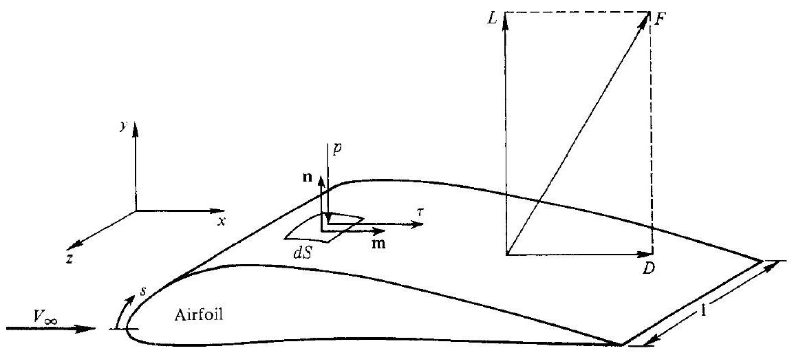
Figure 1.11 I Sources of aerodynamic force; resultant force and its resolution into lift and drag.

aerodynamic force $\mathbf{F}$ acting on the complete body is simply the sum of all the element forces acting on all the elemental areas. This can be expressed as a surface integral, using Eq. (1.44):

$$
\mathbf{F}=\oiint d \mathbf{F}=-\oiint p d \mathbf{S}+\oiint \tau \mathbf{m} d S
$$

On the right-hand side of Eq. (1.45), the first integral is the pressure force on the body, and the second is the shear, or friction force. The integrals are taken over the complete surface of the body.

Consider $x, y, z$ orthogonal coordinates as shown in Fig. 1.11. Let $x$ and $y$ be parallel and perpendicular, respectively, to $V_{\infty}$. If $\mathbf{F}$ is the net aerodynamic force from Eq. (1.45), then the lift $L$ and drag $D$ are defined as the components of $\mathbf{F}$ in the $y$ and $x$ directions, respectively. In aerodynamics, $V_{\infty}$ is called the relative wind, and lift and drag are always defined as perpendicular and parallel, respectively, to the relative wind. For most practical aerodynamic shapes, $L$ is generated mainly by the surface pressure distribution; the shear stress distribution generally makes only a small contribution. Hence from Eq. (1.45) and Fig. 1.11, the aerodynamic lift can be approximated by

$$
L \approx y \text { component of }[-\oiint p d \mathbf{S}]
$$

With regard to drag, from Eq. (1.45) and Fig. 1.11,

$$
D=x \text { component of }[-\oiint p d \mathbf{S}]+x \text { component of }[\oiint \tau \mathbf{m} d S]
$$

In this book, inviscid flows are dealt with exclusively, as discussed in Sec. 1.3. For many bodies, the inviscid flow accurately determines the surface pressure distribution. For such bodies, the results of this book in conjunction with Eq. (1.46) allow a reasonable prediction of lift. On the other hand, drag is due both to pressure and shear stress distributions via Eq. (1.47). Since we will not be considering viscous flows, we will not be able to calculate skin friction drag. Moreover, the pressure drag in Eq. (1.47) is often influenced by flow separation from the body-also a viscous effect. Hence, the fundamentals of inviscid compressible flow do not lead to an accurate prediction of drag for many situations. However, for pressure drag on slender supersonic shapes due to shock waves, so-called wave drag, inviscid techniques are usually quite adequate, as we shall see in subsequent chapters.

## F. A.MPI.E I. 8

A flat plate with a chord length of 3 ft and an infinite span (perpendicular to the page in Fig. 1.12) is immersed in a Mach 2 flow at standard sea level conditions at an angle of attack of $10^{\circ}$. The pressure distribution over the plate is as follows: upper surface, $p_{2}=$ const $= 1132 \mathrm{lb} / \mathrm{ft}^{2}$; lower surface, $p_{3}=$ const $=3568 \mathrm{lb} / \mathrm{ft}^{2}$. The local shear stress is given by

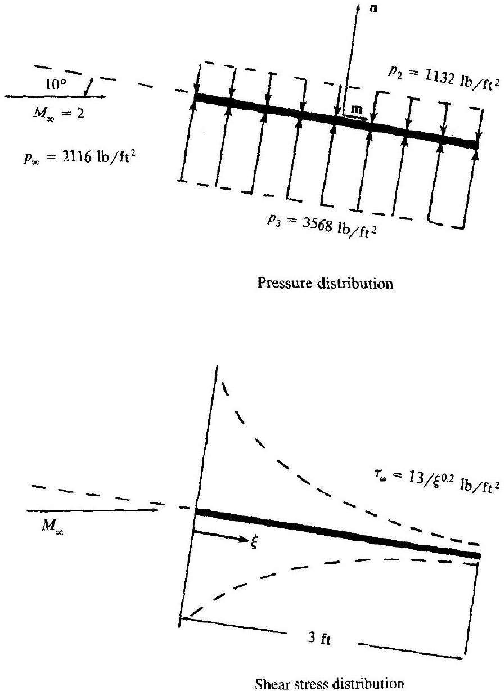
Figure 1.12 I Geometry for Example 1.8.

$\tau_{w}=13 / \xi^{0.2}$, where $\tau_{w}$ is in pounds per square feet and $\xi$ is the distance in feet along the plate from the leading edge. Assume that the distribution of $\tau_{w}$ over the top and bottom surfaces is the same. (We make this assumption for simplicity in this example. In reality, the shear stress distributions over the top and bottom surfaces will be different because the flow properties over these two surfaces are different.) Both the pressure and shear stress distributions are sketched qualitatively in Fig. 1.12. Calculate the lift and drag per unit span on the plate.

## Solution

Considering a unit span,

$$
-\oiint p d \mathbf{S}=\left[-\int_{0}^{3} p_{2} d \xi+\int_{0}^{3} p_{3} d \xi\right] \mathbf{n}=[-(1132)(3)+(3568)(3)] \mathbf{n}=7308 \mathbf{n}
$$

From Eq. (1.46)

$$
L=y \text { component of }[-\oiint p d \mathbf{S}]=7308 \cos 10^{\circ}=7197 \mathrm{lb} \text { per unit span }
$$

From Eq. (1.47)

$$
\text { Pressure drag }=\text { wave drag } \equiv D_{w}=x \text { component of }[-\oiint p d \mathbf{S}]
$$

Hence

$$
D_{w}=7308 \sin 10^{\circ}=1269 \mathrm{lb} \text { per unit span }
$$

Also from Eq. (1.46)

$$
\begin{gathered}
\text { Skin-friction drag } \equiv D_{f}=x \text { component of }[\oiint \tau \mathbf{m} d S] \\
\oiint \tau \mathbf{m} d S=\left[13 \int_{0}^{3} \xi^{-0.2} d \xi\right] \mathbf{m}=\left.16.25 \xi^{4 / 5}\right|_{0} ^{3} \mathbf{m}=39.13 \mathbf{m}
\end{gathered}
$$

Hence, recalling that shear stress acts on both sides,

$$
D_{f}=2(39.13) \cos 10^{\circ}=77.1 \mathrm{lb} \text { per unit span }
$$

The total drag is

$$
\begin{aligned}
& D=D_{w}+D_{f} \\
& D=1269 \mathrm{lb}+77.1 \mathrm{lb}=1346 \mathrm{lb}
\end{aligned}
$$

Note: For this example, the drag is mainly wave drag; skin-friction drag accounts for only 5.7 percent of the total drag. This illustrates an important point. For supersonic flow over slender bodies at a reasonable angle of attack, the wave drag is the primary drag contributor at sea level, far exceeding the skin-friction drag. For such applications, the inviscid methods discussed in this book suffice, because the wave drag (pressure drag) can be obtained from such methods. We see here also why so much attention is focused on the reduction of wave dragbecause it is frequently the primary drag component. At smaller angles of attack, the relative proportion of $D_{f}$ to $D$ increases. Also, at higher altitudes, where viscous effects become stronger (the Reynolds number is lower), the relative proportion of $D_{f}$ to $D$ increases.

### 1.6 I MODERN COMPRESSIBLE FLOW

In Sec.1.1, we saw how the convergent-divergent steam nozzles of de Laval helped to usher compressible flow into the world of practical engineering applications. However, compressible flow did not begin to receive major attention until the advent of jet propulsion and high-speed flight during World War II. Indeed, between 1945 and 1960, the fundamentals and applications of compressible flow became essentially "classic," generally characterized by

1. Treatment of a calorically perfect gas, i.e., constant specific heats.
2. Exact solutions of flows in one dimension, but usually approximate solutions (based on linearized equations) for two- and three-dimensional flows. These
solutions were closed form, yielding equations or formulas for the desired information. Exceptions were the method of characteristics, an exact numerical approach applicable to certain classes of compressible flows (see Chap. 11), and the exact Taylor-Maccoll solution to the flow over a sharp, right-circular cone at zero angle of attack (see Chap. 10). Both of these exceptions required numerical solutions, which were laborious endeavors before the advent of the modern high-speed digital computer.

Many good textbooks on classical compressible flow have been written since 1945. Some of them are listed as Refs. 3 through 17 at the end of this book. The reader is strongly encouraged to study these references, because a thorough understanding of classical compressible flow is essential to modern applications.

Since approximately 1960, compressible flow has entered a "modern" period, characterized by

1. The necessity of dealing with high-temperature, chemically reacting gases associated with hypersonic flight and rocket engines, hence requiring a major extension and modification of the classical literature based on calorically perfect gas. (See, for example, Ref. 119.)
2. The rise of computational fluid dynamics, which is a new third dimension in fluid dynamics, complementing the previous existing dimensions of pure experiment and pure theory. With the advent of modern high-speed digital computers, and the subsequent development of computational fluid dynamics as a distinct discipline, the practical solution of the exact governing equations for a myriad of complex compressible flow problems is now at hand. In brief, computational fluid dynamics is the art of replacing the governing partial differential equations of fluid flow with numbers, and advancing these numbers in space and/or time to obtain a final numerical description of the complete flowfield of interest. The end product of computational fluid dynamics is indeed a collection of numbers, in contrast to a closed-form analytical solution. However, in the long run the objective of most engineering analyses, closedform or otherwise, is a quantitative description of the problem, i.e., numbers. (See, for example, Ref. 18.)

The modern compressible flow of today is a mutually supportive mixture of classical analyses along with computational techniques, with the treatment of noncalorically perfect gases as almost routine. The purpose of this book is to provide an understanding of compressible flow from this point of view. Its intent is to blend the important aspects of classical compressible flow with the recent techniques of computational fluid dynamics. Moreover, the first part of the book will deal almost exclusively with a calorically perfect gas. In turn, the second part will contain a logical extension to realms of high-temperature gases, and the results will be contrasted with those from classical analyses. In addition, various historical aspects of the development of compressible flow, both classical and modern, will be included along with the technical material. In this fashion, it is hoped that the reader will gain an appreciation of the heritage of the discipline. The author feels strongly that a knowledge
of such historical traditions and events is important for a truly fundamental understanding of the discipline.

## 1.7 | SUMMARY

The compressibility is generically defined as

$$
\tau=-\frac{1}{v} \frac{d v}{d p}
$$

hence

$$
d \rho=\rho \tau d p
$$

From Eq. (1.6), a flow must be treated as compressible when the pressure gradients in the flowfield are large enough such that, in combination with a large enough value of the compressibility, $\tau$, the resulting density changes are too large to ignore. For gases, this occurs when the flow Mach number is greater than about 0.3 . In short, for high-speed flows, the density becomes a variable; such variable-density flows are called compressible flows.

High-speed, compressible flow is also high-energy flow. Thermodynamics is the science of energy and entropy; hence a study and application of compressible flow involves a coupling of purely fluid dynamic fundamentals with the results of thermodynamics.

Compressible flow pertains to flows at Mach numbers from 0.3 to infinity. In turn, this range of Mach number is subdivided into four regimes, each with its own distinguishing physical characteristics and different analytical methods. These regimes are subsonic, transonic, supersonic, and hypersonic flow. Each of these regimes is discussed at length in this book.

## PROBLEMS

1.1 At the nose of a missile in flight, the pressure and temperature are 5.6 atm and $850^{\circ} \mathrm{R}$, respectively. Calculate the density and specific volume. (Note: $1 \mathrm{~atm}=2116 \mathrm{lb} / \mathrm{ft}^{2}$.)
1.2 In the reservoir of a supersonic wind tunnel, the pressure and temperature of air are 10 atm and 320 K , respectively. Calculate the density, the number density, and the mole-mass ratio. (Note: $1 \mathrm{~atm}=1.01 \times 10^{5} \mathrm{~N} / \mathrm{m}^{2}$.)
1.3 For a calorically perfect gas, derive the relation $c_{p}-c_{v}=R$. Repeat the derivation for a thermally perfect gas.
1.4 The pressure and temperature ratios across a given portion of a shock wave in air are $p_{2} / p_{1}=4.5$ and $T_{2} / T_{1}=1.687$, where 1 and 2 denote conditions ahead of and behind the shock wave, respectively. Calculate the change in entropy in units of ( $a$ ) ( $\mathrm{ft} \cdot \mathrm{lb}$ )/(slug $\cdot{ }^{\circ} \mathrm{R}$ ) and ( $b$ ) $\mathrm{J} /(\mathrm{kg} \cdot \mathrm{K})$.
1.5 Assume that the flow of air through a given duct is isentropic. At one point in the duct, the pressure and temperature are $p_{1}=1800 \mathrm{lb} / \mathrm{ft}^{2}$ and $T_{1}=500^{\circ} \mathrm{R}$,
respectively. At a second point, the temperature is $400^{\circ} \mathrm{R}$. Calculate the pressure and density at this second point.
1.6 Consider a room that is 20 ft long, 15 ft wide, and 8 ft high. For standard sea level conditions, calculate the mass of air in the room in slugs. Calculate the weight in pounds. (Note: If you do not know what standard sea level conditions are, consult any aerodynamics text, such as Refs. 1 and 104, for these values. Also, they can be obtained from any standard atmosphere table.)
1.7 In the infinitesimal neighborhood surrounding a point in an inviscid flow, the small change in pressure, $d p$, that corresponds to a small change in velocity, $d V$, is given by the differential relation $d p=-\rho V d V$. (This equation is called Euler's Equation; it is derived in chapter 6.)
a. Using this relation, derive a differential relation for the fractional change in density, $d \rho / \rho$, as a function of the fractional change in velocity, $d V / V$, with the compressibility $\tau$ as a coefficient.
b. The velocity at a point in an isentropic flow of air is $10 \mathrm{~m} / \mathrm{s}$ (a low speed flow), and the density and pressure are $1.23 \mathrm{~kg} / \mathrm{m}^{3}$ and $1.01 \times 10^{5} \mathrm{~N} / \mathrm{m}^{2}$ respectively (corresponding to standard sea level conditions). The fractional change in velocity at the point is 0.01 . Calculate the fractional change in density.
c. Repeat part (b), except for a local velocity at the point of $1000 \mathrm{~m} / \mathrm{s}$ (a high-speed flow). Compare this result with that from part (b), and comment on the differences.
"

[^0]:    ${ }^{\dagger}$ Two sets of consistent units will be used throughout this book, the International System (SI) and the English Engineering System. In the SI system, the units of force, mass, length, time, and temperature are the newton (N), kilogram (kg), meter (m), second (s), and Kelvin (K), respectively; in the English Engineering System they are the pound (lb), slug, foot (ft), second (s), and Rankine ( ${ }^{\circ} \mathrm{R}$ ), respectively. The respective units of energy are joules (J) and foot-pounds (ft - lb).

