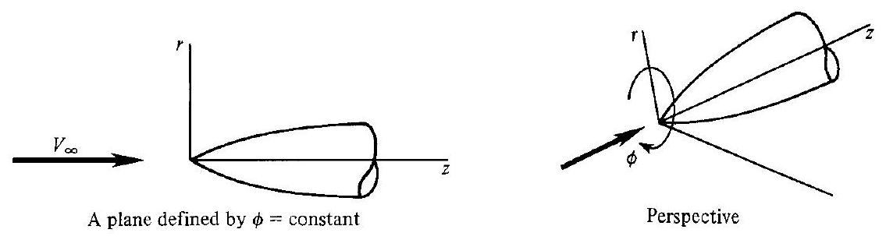
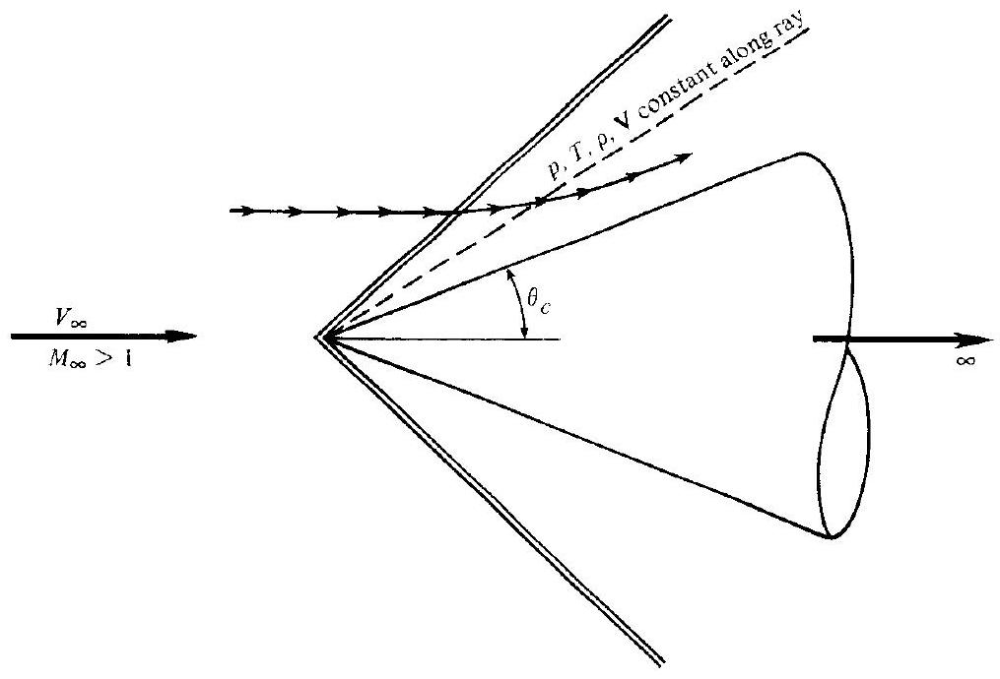
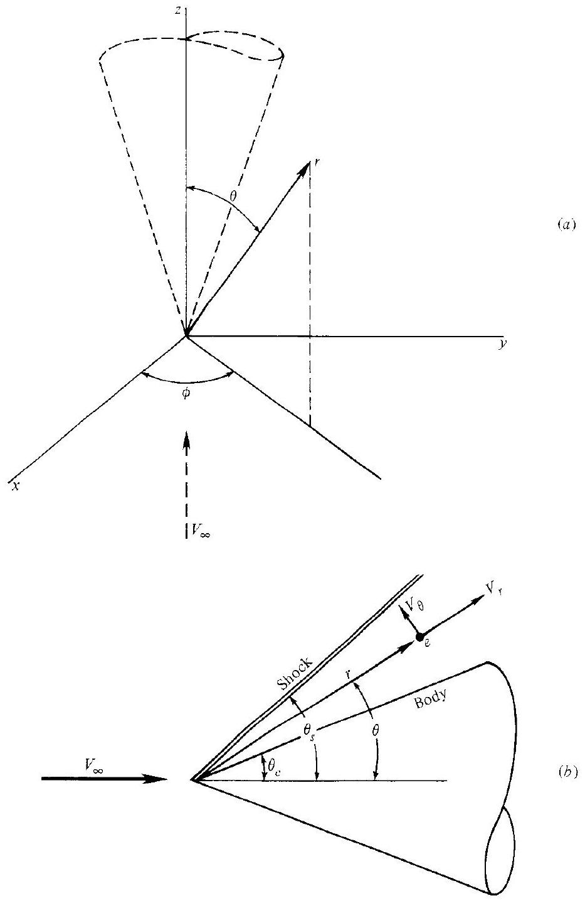
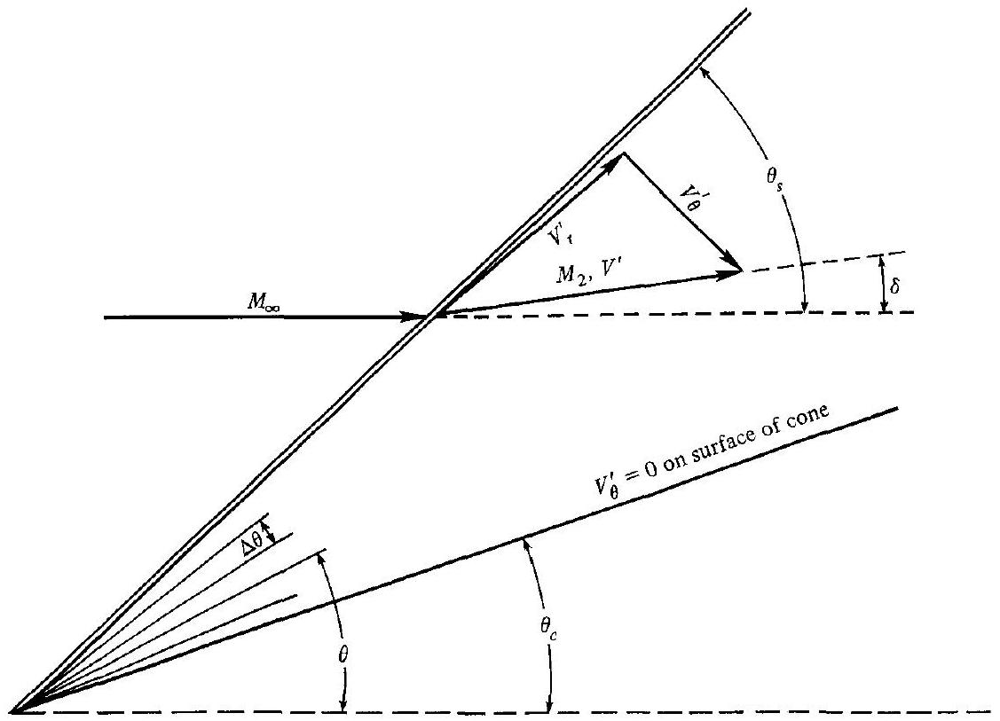
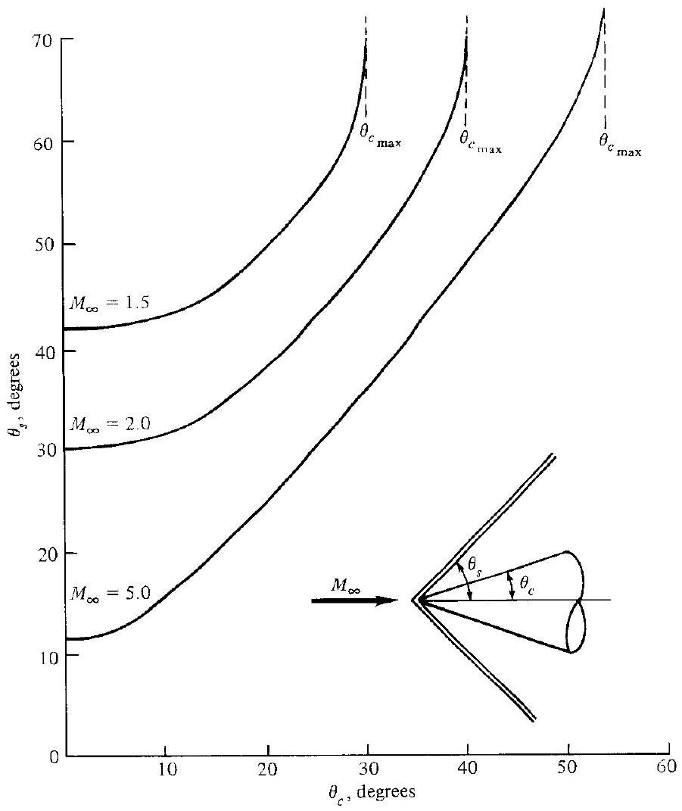
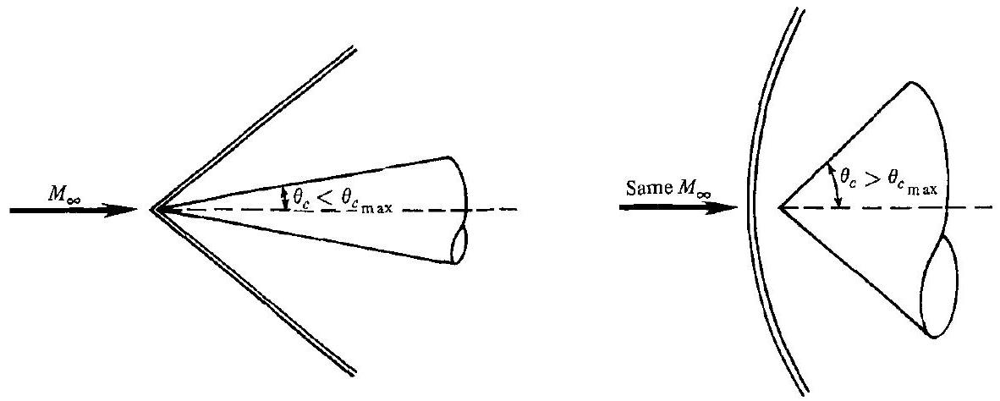
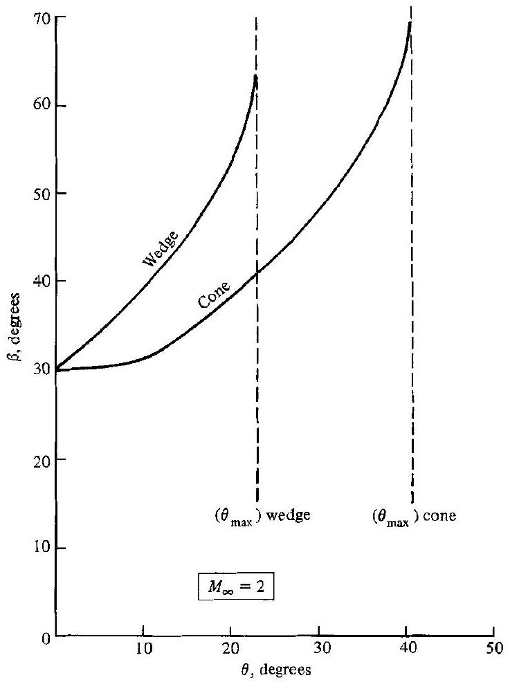
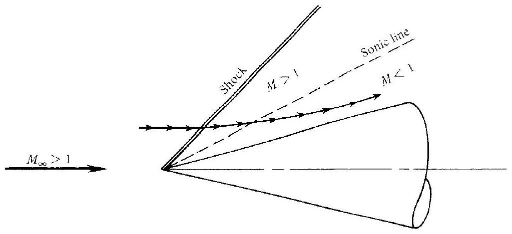

## CHAPTER 10

## Conical Flow

Gas dynamics as a branch of physics and applied mathematics has grown with the growth of high speed flight.

Howard W. Emmons, 1958

## PREVIEW BOX

This chapter is all about supersonic flow over cones. In Sec. 4.4 we contrasted the flow over wedges and cones. The flow over a wedge is two-dimensional and can be analyzed using oblique shock theory and algebraic relationships. Although side views of both a wedge and a cone look identical (see Fig. 4.11), the flow over a cone takes place in three-dimensional space, and is analyzed using the governing flow equations in partial differential form. After a discussion about the differences between wedge flows and cone flows, we stated in the last sentence of the main text in Sec 4.4 that "because of these differences, the study in this book of supersonic flow over cones will be delayed until Chap. 10." Well, here we are at Chap. 10, and we are ready to study cone flows.

A cone is a basic geometric shape, and the results of this chapter find frequent application in the aerodynamics of supersonic missiles, inlet diffusers with conical
centerbodies for supersonic airplanes, and basic research experiments on the physics of supersonic and hypersonic flows, among others. Also, the flow over a cone is frequently used as the generating flowfield for the design of hypersonic waverider vehicles, an interesting configuration that is discussed for example in Refs. 135 and 136. So in addition to being a fundamental flowfield in the study of compressible flow, the supersonic flow over cones is a useful foundation in many applications.

This chapter is short, and the intellectual path is straightforward. So we do not need a roadmap. However, return to the overall roadmap for this book, Fig. 1. We are now back to the center column, namely, box 11, where, with conical flow, we commence a series of interesting studies of more complex and important flows. We begin a long cruise straight down to the end of the center column.

### 10.1 I INTRODUCTION

In contrast to the linearized two-dimensional flows considered in Chap. 9, this chapter deals with the exact nonlinear solution for a special degenerate case of three-dimensional flow-the axisymmetric supersonic flow over a sharp cone at zero angle of attack to the free stream. Consider a body of revolution (a body generated by rotating a given planar curve about a fixed axis) at zero angle of attack as shown in Fig. 10.1. A cylindrical coordinate system ( $r, \phi, z$ ) is drawn, with the $z$ axis as the axis of symmetry aligned in the direction of $V_{\infty}$. By inspection of Fig. 10.1, the flowfield must be symmetric about the $z$ axis, i.e., all properties are

Figure 10.1 I Cylindrical coordinate system for an axisymmetric body.

Figure 10.2 I Supersonic flow over a cone.

independent of $\phi$ :

$$
\frac{\partial}{\partial \phi} \equiv 0
$$

The flowfield depends only on $r$ and $z$. Such a flow is defined as axisymmetric flow. It is a flow that takes place in three-dimensional space; however, because there are only two independent variables, $r$ and $z$, axisymmetric flow is sometimes called "quasi-two-dimensional" flow.

In this chapter, we will further specialize to the case of a sharp right-circular cone in a supersonic flow, as sketched in Fig. 10.2. This case is important for three reasons:

1. The equations of motion can be solved exactly for this case.
2. The supersonic flow over a cone is of great practical importance in applied aerodynamics; the nose cones of many high-speed missiles and projectiles are approximately conical, as are the nose regions of the fuselages of most supersonic airplanes.
3. The first solution for the supersonic flow over a cone was obtained by A. Busemann in 1929, long before supersonic flow became fashionable (see Ref. 26). This solution was essentially graphical, and illustrated some of the important physical phenomena. A few years later, in 1933, G. I. Taylor and J. W. Maccoll (see Ref. 27) represented a numerical solution that is a hallmark in the evolution of compressible flow. Therefore, the study of conical flow is of historical significance.

Again, emphasis is made that the present chapter deals with cones at zero angle of attack. The case of cones at angle of attack introduces additional geometric complexity; this case is treated in more detail in Chap. 13.

## 10.2 | PHYSICAL ASPECTS OF CONICAL FLOW

Consider a sharp cone of semivertex angle $\theta_{c}$, sketched in Fig. 10.2. Assume this cone extends to infinity in the downstream direction (a semi-infinite cone). The cone is in a supersonic flow, and hence an oblique shock wave is attached at the vertex. The shape of this shock wave is also conical. A streamline from the supersonic free stream discontinuously deflects as it traverses the shock, and then curves continuously downstream of the shock, becoming parallel to the cone surface asymptotically at infinity. Contrast this flow with that over a two-dimensional wedge (Chap. 4) where all streamlines behind the shock are immediately parallel to the wedge surface.

Because the cone extends to infinity, distance along the cone becomes meaningless: If the pressure were different at the 1 - and $10-\mathrm{m}$ stations along the surface of the cone, then what would it become at infinity? This presents a dilemma that can be reconciled only by assuming that the pressure is constant along the surface of the cone, as well as that all other flow properties are also constant. Since the cone surface is simply a ray from the vertex, consider other such rays between the cone surface and the shock wave, as illustrated by the dashed line in Fig. 10.2. It only makes sense to assume that the flow properties are constant along these rays as well. Indeed, the definition of conical flow is where all flow properties are constant along rays from a given vertex. The properties vary from one ray to the next. This aspect of conical flow has been experimentally proven. Theoretically, it results from the lack of a meaningful scale length for a semi-infinite cone.

## 10.3 | QUANTITATIVE FORMULATION (AFTER TAYLOR AND MACCOLL)

Consider the superimposed cartesian and spherical coordinate systems sketched in Fig. 10.3a. The $z$ axis is the axis of symmetry for the right-circular cone, and $V_{\infty}$ is oriented in the $z$ direction. The flow is axisymmetric; properties are independent of $\phi$. Therefore, the picture can be reoriented as shown in Fig. 10.3b, where $r$ and $\theta$ are the two independent variables and $V_{\infty}$ is now horizontal. At any point $e$ in the flowfield, the radial and normal components of velocity are $V_{r}$ and $V_{\theta}$, respectively. Our objective is to solve for the flowfield between the body and the shock wave. Recall that for axisymmetric conical flow

$$
\begin{aligned}
\frac{\partial}{\partial \phi} & \equiv 0 \quad \text { (axisymmetric flow) } \\
\frac{\partial}{\partial r} & \equiv 0 \quad \text { (flow properties are constant along a ray from the vertex) }
\end{aligned}
$$

Figure 10.3 I Spherical coordinate system for a cone.

The continuity equation for steady flow is Eq. (6.5),

$$
\nabla \cdot(\rho \mathbf{V})=0
$$

In terms of spherical coordinates, Eq. (6.5) becomes

$$
\nabla \cdot \rho(\mathbf{V})=\frac{1}{r^{2}} \frac{\partial}{\partial r}\left(r^{2} \rho V_{r}\right)+\frac{1}{r \sin \theta} \frac{\partial}{\partial \theta}\left(\rho V_{\theta} \sin \theta\right)+\frac{1}{r \sin \theta} \frac{\partial\left(\rho V_{\phi}\right)}{\partial \phi}=0
$$

Evaluating the derivatives, and applying the above conditions for axisymmetric conical flow, Eq. (10.1) becomes

$$
\begin{array}{r}
\frac{1}{r^{2}}\left[r^{2} \frac{\partial\left(\rho V_{r}\right)}{\partial r}+\rho V_{r}(2 r)\right]+\frac{1}{r \sin \theta}\left[\rho V_{\theta} \cos \theta+\sin \theta \frac{\partial\left(\rho V_{\theta}\right)}{\partial \theta}\right]+\frac{1}{r \sin \theta} \frac{\partial\left(\rho V_{\theta}\right)}{\partial \phi}=0 \\
\frac{2 \rho V_{r}}{r}+\frac{\rho V_{\theta}}{r} \cot \theta+\frac{1}{r}\left(\rho \frac{\partial V_{\theta}}{\partial \theta}+V_{\theta} \frac{\partial \rho}{\partial \theta}\right)=0 \\
2 \rho V_{r}+\rho V_{\theta} \cot \theta+\rho \frac{2 V_{\theta}}{\partial \theta}+V_{\theta} \frac{\partial \rho}{\partial \theta}=0
\end{array}
$$

Equation (10.2) is the continuity equation for axisymmetric conical flow.
Return to the conical flowfield sketched in Figs. 10.2 and 10.3. The shock wave is straight, and hence the increase in entropy across the shock is the same for all streamlines. Consequently, throughout the conical flowfield, $\nabla s=0$. Moreover, the flow is adiabatic and steady, and hence Eq. (6.45) dictates that $\Delta h_{o}=0$. Therefore, from Crocco's equation, Eq. (6.60), we find that $\nabla \times \mathbf{V}=0$, i.e., the conical flowfield is irrotational. Since Croco's theorem is a combination of the momentum and energy equations (see Sec. 6.6), then $\nabla \times \mathbf{V}=0$ can be used in place of either one. In spherical coordinates,

$$
\nabla \times \mathbf{V}=\frac{1}{r^{2} \sin \theta}\left|\begin{array}{ccc}
\mathbf{e}_{r} & r \mathbf{e}_{\theta} & (r \sin \theta) \mathbf{e}_{\phi} \\
\frac{\partial}{\partial r} & \frac{\partial}{\partial \theta} & \frac{\partial}{\partial \phi} \\
V_{r} & r V_{\theta} & (r \sin \theta) V_{\phi}
\end{array}\right|=0
$$

where $\mathbf{e}_{r}, \mathbf{e}_{\theta}$, and $\mathbf{e}_{\phi}$ are unit vectors in the $r, \theta$, and $\phi$ directions, respectively. Expanded, Eq. (10.3) becomes

$$
\begin{aligned}
\nabla \times \mathbf{V}=\frac{1}{r^{2} \sin \theta} & \left\{\mathbf{e}_{r}\left[\frac{\partial}{\partial \theta}\left(r V_{\phi} \sin \theta\right)-\frac{\partial}{\partial \phi}\left(r V_{\theta}\right)\right]\right. \\
& -r \mathbf{e}_{\theta}\left[\frac{\partial}{\partial r}\left(r V_{\phi} \sin \theta\right)-\frac{\partial}{\partial \phi}\left(V_{r}\right)\right] \\
& \left.+(r \sin \theta) \mathbf{e}_{\phi}\left[\frac{\partial}{\partial r}\left(r V_{\theta}\right)-\frac{\partial V_{r}}{\partial \theta}\right]\right\}=0
\end{aligned}
$$

Applying the axisymmetric conical flow conditions, Eq. (10.4) dramatically simplifies to

$$
V_{\theta}=\frac{\partial V_{r}}{\partial \theta}
$$

Equation (10.5) is the irrotationality condition for axisymmetric conical flow.
Since the flow is irrotational, we can apply Euler's equation in any direction in the form of Eq. (8.7):
where

$$
\begin{aligned}
d p & =-\rho V d V \\
V^{2} & =V_{r}^{2}+V_{\theta}^{2}
\end{aligned}
$$

Hence, Eq. (8.7) becomes

$$
d p=-\rho\left(V_{r} d V_{r}+V_{\theta} d V_{\theta}\right)
$$

Recall that, for isentropic flow,

$$
\frac{d p}{d \rho} \equiv\left(\frac{\partial p}{\partial \rho}\right)_{s}=a^{2}
$$

Thus, Eq. (10 .6) becomes

$$
\frac{d \rho}{\rho}=-\frac{1}{a^{2}}\left(V_{r} d V_{r}+V_{\theta} d V_{\theta}\right)
$$

From Eq. (6.45), and defining a new reference velocity $V_{\text {max }}$ as the maximum theoretical velocity obtainable from a fixed reservoir condition (when $V=V_{\text {max }}$, the flow has expanded theoretically to zero temperature, hence $h=0$ ), we have

$$
h_{0}=\text { const }=h+\frac{V^{2}}{2}=\frac{V_{\max }^{2}}{2}
$$

Note that $V_{\text {max }}$ is a constant for the flow and is equal to $\sqrt{2 h_{0}}$. For a calorically perfect gas, the above becomes

$$
\begin{gathered}
\frac{a^{2}}{\gamma-1}+\frac{V^{2}}{2}=\frac{V_{\max }^{2}}{2} \\
\text { or } \quad a^{2}=\frac{\gamma-1}{2}\left(V_{\max }^{2}-V^{2}\right)=\frac{\gamma-1}{2}\left(V_{\max }^{2}-V_{r}^{2}-V_{\theta}^{2}\right)
\end{gathered}
$$

Substitute Eq. (10.8) into (10.7):

$$
\frac{d \rho}{\rho}=-\frac{2}{\gamma-1}\left(\frac{V_{r} d V_{r}+V_{\theta} d V_{\theta}}{V_{\max }^{2}-V_{r}^{2}-V_{\theta}^{2}}\right)
$$

Equation (10.9) is essentially Euler's equation in a form useful for studying conical flow.

Equations (10.2), (10.5), and (10.9) are three equations with three dependent variables: $\rho, V_{r}$, and $V_{\theta}$. Due to the axisymmetric conical flow conditions, there is only one independent variable, namely $\theta$. Hence, the partial derivatives in Eqs. (10.2) and (10.5) are more properly written as ordinary derivatives. From Eq. (10.2),

$$
2 V_{r}+V_{\theta} \cot \theta+\frac{d V_{\theta}}{d \theta}+\frac{V_{\theta}}{\rho} \frac{d \rho}{d \theta}=0
$$

From Eq. (10.9),

$$
\frac{d \rho}{d \theta}=-\frac{2 \rho}{\gamma-1}\left(\frac{V_{r} \frac{d V_{r}}{d \theta}+V_{\theta} \frac{d V_{\theta}}{d \theta}}{V_{\max }^{2}-V_{r}^{2}-V_{\theta}^{2}}\right)
$$

Substitute Eq. (10.11) into Eq. (10.10):

$$
\begin{aligned}
2 V_{r}+V_{\theta} \cot \theta+\frac{d V_{\theta}}{d \theta}-\frac{2 V_{\theta}}{\gamma-1}\left(\frac{V_{r} \frac{d V_{r}}{d \theta}+V_{\theta} \frac{d V_{\theta}}{d \theta}}{V_{\max }^{2}-V_{r}^{2}-V_{\theta}^{2}}\right) & =0 \\
\text { or } \quad \frac{\gamma-1}{2}\left(V_{\max }^{2}-V_{r}^{2}-V_{\theta}^{2}\right)\left(2 V_{r}+V_{\theta} \cot \theta+\frac{d V_{\theta}}{d \theta}\right)-V_{\theta}\left(V_{r} \frac{d V_{r}}{d \theta}+V_{\theta} \frac{d V_{\theta}}{d \theta}\right) & =0
\end{aligned}
$$

Recall from Eq. (10.5) that

Hence,

$$
\begin{aligned}
V_{\theta} & =\frac{d V_{r}}{d \theta} \\
\frac{d V_{\theta}}{d \theta} & =\frac{d^{2} V_{r}}{d \theta^{2}}
\end{aligned}
$$

Substituting this result into Eq. (10.12), we have

$$
\begin{aligned}
& \frac{\gamma-1}{2}\left[V_{\max }^{2}-V_{r}^{2}-\left(\frac{d V_{r}}{d \theta}\right)^{2}\right]\left[2 V_{r}+\frac{d V_{r}}{d \theta} \cot \theta+\frac{d^{2} V_{r}}{d \theta^{2}}\right] \\
& \quad-\frac{d V_{r}}{d \theta}\left[V_{r} \frac{d V_{r}}{d \theta}+\frac{d V_{r}}{d \theta}\left(\frac{d^{2} V_{r}}{d \theta^{2}}\right)\right]=0
\end{aligned}
$$

Equation (10.13) is the Taylor-Maccoll equation for the solution of conical flows. Note that it is an ordinary differential equation, with only one dependent variable, $V_{r}$. Its solution gives $V_{r}=f(\theta) ; V_{\theta}$ follows from Eq. (10.5), namely,

$$
V_{\theta}=\frac{d V_{r}}{d \theta}
$$

There is no closed-form solution to Eq. (10.13); it must be solved numerically. To expedite the numerical solution, define the nondimensional velocity $V^{\prime}$ as

$$
V^{\prime} \equiv \frac{V}{V_{\max }}
$$

Then, Eq. (10.13) becomes

$$
\begin{aligned}
& \frac{\gamma-1}{2}\left[1-V_{r}^{\prime 2}-\left(\frac{d V_{r}^{\prime}}{d \theta}\right)^{2}\right]\left[2 V_{r}^{\prime}+\frac{d V_{r}^{\prime}}{d \theta} \cot \theta+\frac{d^{2} V_{r}^{\prime}}{d \theta^{2}}\right] \\
& \quad-\frac{d V_{r}^{\prime}}{d \theta}\left[V_{r}^{\prime} \frac{d V_{r}^{\prime}}{d \theta}+\frac{d V_{r}^{\prime}}{d \theta} \frac{d^{2} V_{r}^{\prime}}{d \theta^{2}}\right]=0
\end{aligned}
$$

The nondimensional velocity $V^{\prime}$ is a function of Mach number only. To see this more clearly recall that

$$
\begin{aligned}
h+\frac{V^{2}}{2} & =\frac{V_{\max }^{2}}{2} \\
\frac{a^{2}}{\gamma-1}+\frac{V^{2}}{2} & =\frac{V_{\max }^{2}}{2} \\
\frac{1}{\gamma-1}\left(\frac{a}{V}\right)^{2}+\frac{1}{2} & =\frac{1}{2}\left(\frac{V_{\max }}{V}\right)^{2} \\
\frac{2}{\gamma-1}\left(\frac{1}{M}\right)^{2}+1 & =\left(\frac{V_{\max }}{V}\right)^{2} \\
\frac{V}{V_{\max }} & \equiv V^{\prime}=\left[\frac{2}{(\gamma-1) M^{2}}+1\right]^{-1 / 2}
\end{aligned}
$$

Clearly, from Eq. (10.16), $V^{\prime}=f(M)$; given $M$, we can always fine $V^{\prime}$, or vice versa.

### 10.4 I NUMERICAL PROCEDURE

For the numerical solution of the supersonic flow over a right-circular cone, we will employ an inverse approach. By this, we mean that a given shock wave will be assumed, and the particular cone that supports the given shock will be calculated. This is in contrast to the direct approach, where the cone is given and the flowfield and shock wave are calculated. The numerical procedure is as follows:

1. Assume a shock wave angle $\theta_{s}$ and a free-stream Mach number $M_{\infty}$, as sketched in Fig. 10.4. From this, the Mach number and flow deflection angle, $M_{2}$ and $\delta$, respectively, immediately behind the shock can be found from the oblique shock relations (see the discussion of three-dimensional shocks in Sec. 4.13). Note that, contrary to our previous practice, the flow deflection angle is here denoted by $\delta$ so as not to confuse it with the polar coordinate $\theta$.
2. From $M_{2}$ and $\delta$, the radial and normal components of flow velocity, $V_{r}^{\prime}$ and $V_{\theta}^{\prime}$, respectively, directly behind the shock can be found from the geometry of Fig. 10.4. Note that $V^{\prime}$ is obtained by inserting $M_{2}$ into Eq. (10.16).
3. Using the above value of $V_{r}^{\prime}$ directly behind the shock as a boundary value, solve Eq. (10.15) for $V_{r}^{\prime}$ numerically in steps of $\theta$, marching away from the shock. Here, the flowfield is divided into incremental angles $\Delta \theta$, as sketched in Fig. 10.4. The ordinary differential equation (10.15) can be solved at each $\Delta \theta$ using any standard numerical solution technique, such as the Runge-Kutta method.
4. At each increment in $\theta$, the value of $V_{\theta}^{\prime}$ is calculated from Eq. (10.14). At some value of $\theta$, namely $\theta=\theta_{c}$, we will find $V_{\theta}^{\prime}=0$. The normal component of velocity at an impermeable surface is zero. Hence, when $V_{\theta}^{\prime}=0$ at $\theta=\theta_{c}$, then $\theta_{c}$ must represent the surface of the particular cone which supports the shock

Figure 10.4 I Geometry for the numerical solution of flow over a cone.

wave of given wave angle $\theta_{s}$ at the given Mach number $M_{\infty}$ as assumed in step 1 on the previous page. That is, the cone angle compatible with $M_{\infty}$ and $\theta_{s}$ is $\theta_{c}$. The value of $V_{r}^{\prime}$ at $\theta_{c}$ gives the Mach number along the cone surface via Eq. (10.16).
5. In the process of steps 1 through 4 here, the complete velocity flowfield between the shock and the body has been obtained. Note that, at each point (or ray), $V^{\prime}=\sqrt{\left(V_{r}^{\prime}\right)^{2}+\left(V_{\theta}^{\prime}\right)^{2}}$ and $M$ follows from Eq. (10.16). The pressure, density, and temperature along each ray can then be obtained from the isentropic relations, Eqs. (3.28), (3.30), and (3.31).

If a different value of $M_{\infty}$ and/or $\theta_{s}$ is assumed in step 1 , a different flowfield and cone angle $\theta_{c}$ will be obtained from steps 1 through 5 . By a repeated series of these calculations, tables or graphs of supersonic cone properties can be generated. Such tables exist in the literature, the most common being those by Kopal (Ref. 28) and Sims (Ref. 29).

## 10.5 | PHYSICAL ASPECTS OF SUPERSONIC FLOW OVER CONES

Some typical numerical results obtained from the solution in Sec. 10.4 are illustrated in Fig. 10.5, which gives the shock wave angle $\theta_{s}$ as a function of cone angle $\theta_{c}$, with $M_{\infty}$ as a parameter. Figure 10.5 for cones is analogous to Fig. 4.8 for two-dimensional wedges; the two figures are qualitatively similar, but the numbers are different.

Examine Fig. 10.5 closely. Note that, for a given cone angle $\theta_{c}$ and given $M_{\infty}$, there are two possible oblique shock waves-the strong- and weak-shock solutions.

Figure $10.5 \mid \theta_{c}-\theta_{s}-M$ diagram for cones in supersonic flow. (The top portion of the curves curl back for the strong shock solution, which is not shown here.)

This is directly analogous to the two-dimensional case discussed in Chap. 4. The weak solution is almost always observed in practice on real finite cones; however, it is possible to force the strong-shock solution by independently increasing the backpressure near the base of the cone.

Also note from Fig. 10.5 that, for a given $M_{\infty}$, there is a maximum cone angle $\theta_{c_{\text {mix }}}$, beyond which the shock becomes detached. This is illustrated in Fig. 10.6. When $\theta_{c}>\theta_{c_{\text {max }}}$, there exists no Taylor-Maccoll solution as given here: instead, the flowfield with a detached shock must be solved by techniques such as those discussed in Chap. 12.

In comparison to the two-dimensional flow over a wedge, the three-dimensional flow over a cone has an extra dimension in which to expand. This "three-dimensional relieving effect" was discussed in Sec. 4.4, which should now be reviewed by the reader. In particular, recall from Fig. 4.11 that the shock wave on a cone of given angle is weaker than the shock wave on a wedge of the same angle. It therefore follows that the cone experiences a lower surface pressure, temperature, density, and entropy than the wedge. It also follows that, for a given $M_{\infty}$, the maximum allowable cone angle

Figure 10.6 I Attached and detached shock waves on cones.

Figure 10.7 | Comparison of shock wave angles for wedges and cones at Mach 2.

for an attached shock solution is greater than the maximum wedge angle. This is clearly demonstrated in Fig. 10.7.

Finally, the numerical results show that any given streamline between the shock wave and cone surface is curved, as sketched in Fig. 10.8, and asymptotically becomes parallel to the cone surface at infinity. Also, for most cases, the complete

Figure 10.8 I Some conical flowfields are characterized by an isentropic compression to subsonic velocities near the cone surface.

flowfield between the shock and the cone is supersonic. However, if the cone angle is large enough, but still less than $\theta_{\text {Cinan }}$, there are some cases where the flow becomes subsonic near the surface. This case is illustrated in Fig. 10.8, where one of the rays in the flowfield becomes a sonic line. In this case, we see one of the few instances in nature where a supersonic flowfield is actually isentropically compressed from supersonic to subsonic velocities. A transition from supersonic to subsonic flow is almost invariably accompanied by shock waves, as discussed in Chap. 5. However, flow over a cone is an exception to this observation.

## PROBLEMS

(For these problems, use any of the existing tables and charts for conical flow.)
10.1 Consider a 15 half-angle cone at 0 angle of attack in a free stream at standard sea level conditions with $M_{\approx}=2.0$. Obtain:
a. The shock wave angle
b. $\quad p, T, \rho$, and $M$ immediately behind the shock wave
c. $p, T, p$. and $M$ on the cone surface
10.2 For the cone in Prob. 10.1, below what value of $M_{\infty}$ will the shock wave be detached? Compare this with the analogous value for a wedge.
10.3 The drag coefficient for a cone can be defined as $C_{D}=D / q_{\alpha} A_{b}$, where $A_{b}$, is the area of the base of the cone. For a $15^{\circ}$ half-angle cone, plot the variation of $C_{D}$ with $M_{\infty}$ over the range $1.5 \leq M_{\infty} \leq 7.0$. Assume the base pressure $p_{b}$ is equal to free-stream pressure. (Note: You will not find $C_{b}$ ) in the tables. Instead, derive a formula for $C_{D}$ in terms of the surface pressure $p_{c}$, and use the tables to find $p_{c}$.)

