## CHAPTER

## Numerical Techniques for Steady Supersonic Flow

It might be remarked that mathematics is undergoing a renaissance similar to that caused in physics by the discovery of the electron. This has been brought about by the advent of electronic computers of such fantastic speed and memory compared to their human counterparts that nonintegrable equations can be solved by numerical integration in a reasonably short space of time. This is having farreaching effects in aerodynamics, where most problems are non-linear in nature, and exact analytical solutions are the exception rather than the rule.

William F. Hilton, 1951

## PREVIEW BOX

Figure 11.1 shows the computed three-dimensional pressure coefficient contours over the surface of a generic modern fighter aircraft flying at Mach 0.85 at an angle of attack of $10^{\circ}$ and an angle of yaw of $30^{\circ}$. (Pressure contours are the locus of constant pressure in the flow, along each contour shown in Fig. 11.1, the pressure is constant, but it is a different constant value from one contour to the next.) The results shown in Fig. 11.1 are dramatic. They were obtained by means of a numerical solution of the governing inviscid flow equations,

Eqs. (6.5), (6.11)-(6.13), and (6.17), carried out on a high-speed digital computer. The equations solved were the full nonlinear equations for inviscid flow without any mathematical simplification or physical approximations, solved for a highly three-dimensional flow field over a complex geometry, namely, a complete airplane. These results are an example of a relatively new discipline in fluid dynamics-computational fluid dynamics. In this chapter, we are introduced to the basic concept of computational fluid dynamics (CFD). But it is only an

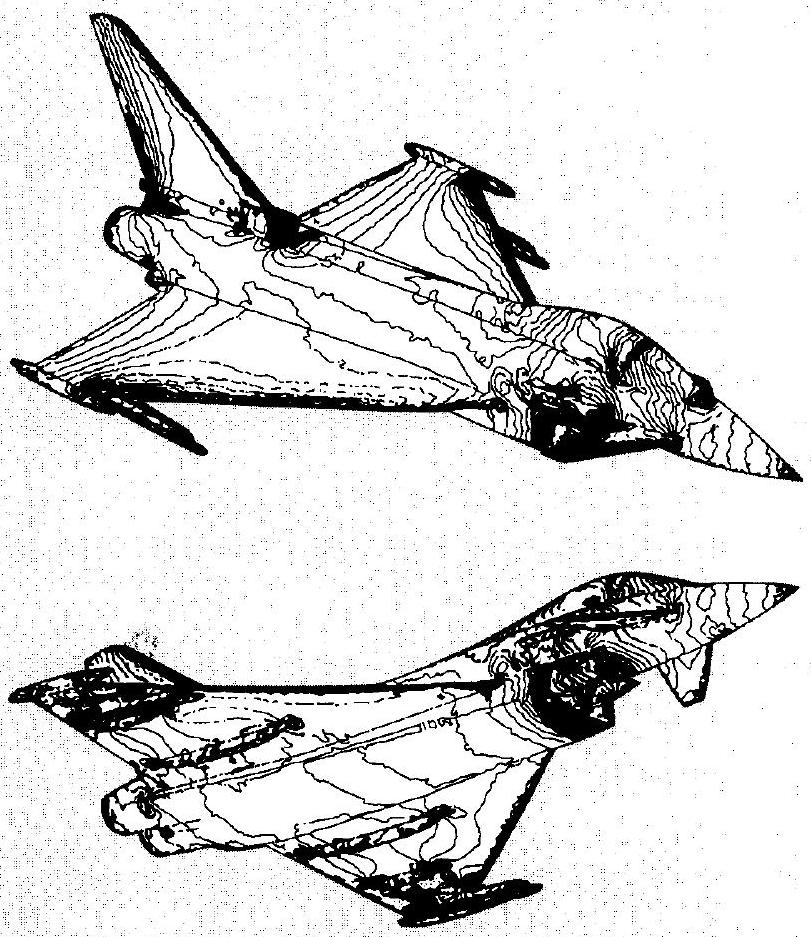
Figure 11.1 / Computed three-dimensional pressure coefficient contours over the surface of a generic fighter aircraft. Mach number $=0.85$, angle of attack $=10$ degrees, angle of yaw $=$ 30 degrees. (From Selmin, Hettena and Formaggia, "An Unstructured Node Centered Scheme for the Simulation of 3-D Inviscid Flows," in C. Hirsch, J. Periaux and W. Kordulla (eds), Computational Fluid Dynamics, 92, vol. 2, Elsevier, Amsterdam, 1992, pp. 823-828.

introduction. Computational fiuid dynamics is a sophisticated discipline, steeped in applied mathematics, and the subject of a number of recent books. It is a subject by itself, well beyond the scope of this book. Also, the main thrust of this book is to emphasize the physical aspects of compressible flow, and not to get deeply immersed in detailed mathematical or computational discourses. However, this is also a book on "modern" compressible flow, and in this modern world of fluid dynamics in general, it is virtually impossible not to be touched or affected by some aspects of CFD. Numerical solutions of the full governing continuity, momentum, and energy equations for complex geometries are now an integral part of fluid dynamics, albeit still not routine in any sense of the word. The intent of the present chapter is to give you some idea of the nature of CFD for compressible flow applications. The present chapter deals with steady, supersonic flow, but we will see examples of CFD applications in other compressible flow problems in subsequent chapters.

The roadmap for the present chapter is shown in Fig. 11.2. Here we deal with two, somewhat separate
numerical techniques for solving steady supersonic flows. Starting with the left-hand column, we discuss the method of characteristics, a rather classical and elegant numerical approach to the solution of such flows. The method of characteristics was applied to steady supersonic flow as early as the 1920s (see Sec. 11.17), but because of its intensive computational load, it did not really come into its own until the advent of the high-speed digital computer in the 1950s. As indicated in Fig. 11.2, the details of the application of the method of characteristics depend on the nature of the flow; they are somewhat different for two-dimensional irrotational flow, axisymmetric irrotational flow, rotational flow, and three-dimensional flow. We will examine each of these situations. Of great importance, and perhaps the most frequent use of the method of characteristics, is the design of the contour (the shape) of a supersonic nozzle for smooth, shock-free flow. We will discuss this nozzle design in some detail. Then we move to the righthand column in Fig. 11.2 and present some of the basic ideas of the finite-difference technique. We will introduce the concept of downstream marching for

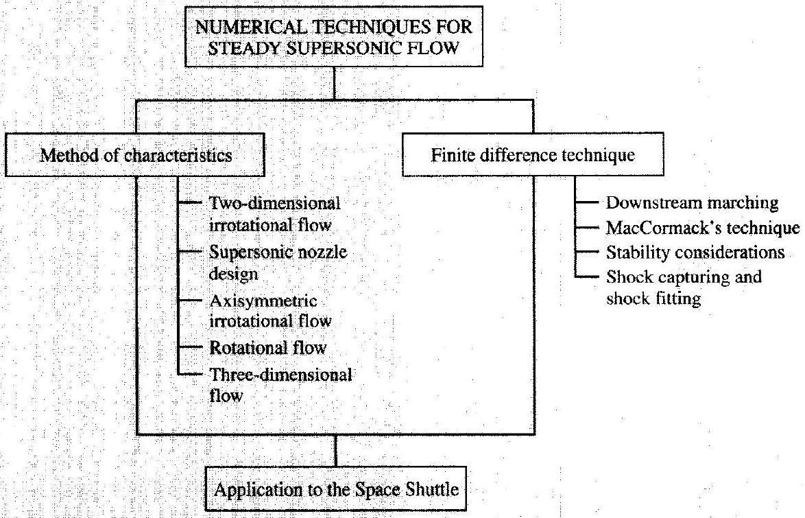
Figure 11.2 | Roadmap for Chapter 11.

(continued from page 379)
finite-difference solutions, and will describe one of the most straightforward (and student-friendly) finitedifference methods, namely MacCormack's technique. We will mention the idea of stability criteria-what is necessary to ensure stable numerical calculations. The two philosophies for dealing with shock waves in these numerical solutions shock capturing and shock fitting--will be discussed. Finally, we end the chapter with an illustration of the application of both the
method of characteristics and the finite-difference technique to the calculation of the flow over the Space Shuttle.

Note: For a very introductory presentation of computational fluid dynamics, see Anderson, Computational Fluid Dynamics: The Basics with Applications, McGraw-Hill, 1995. This book is written to be used before you study any of the other, more advanced books on CFD.

### 11.1 I AN INTRODUCTION TO COMPUTATIONAL FLUID DYNAMICS

As we have seen from the previous chapters, the cornerstone of theoretical fluid dynamics is a set of conservation equations that describe the physics of fluid motion; these equations speak words, such as: (1) mass is conserved; (2) $\mathbf{F}=m \mathbf{a}$ (Newton's second law); and (3) energy is conserved. These equations also describe the variations of fluid pressure, temperature, density, velocity, etc., throughout space and time. In their most general form, they are integral equations (see Chap. 2) or partial differential equations (see Chap. 6), and consequently are difficult to solve. Indeed, no general analytical solution to these equations has been found, nor is it likely to be found in the foreseeable future. For the two centuries since Bernoulli and Euler first formulated some of these equations in St. Petersburg, Russia, in the 1730s, fluid dynamicists have been laboring to obtain analytical solutions for certain restricted and/or simplified problems. The preceding chapters of this book have dealt primarily with such (relatively speaking) simplified problems.

In contrast, the modern engineer of today is operating in a new third dimension in fluid dynamics-computational fluid dynamics, which readily complements the previous dimensions of pure experiment and pure theory. Computational fluid dynamics, in principle, allows the practical solution of the exact governing equations for a myriad of applied engineering problems, and it is this aspect that is introduced in this chapter and carried through all the remaining chapters of this book.

What is computational fluid dynamics? It is the art of replacing the individual terms in the governing conservation equations with discretized algebraic forms, which in turn are solved to obtain numbers for the flowfield variables at discrete points in time and/or space. The end product of CFD is indeed a collection of numbers, in contrast to a closed-form analytical solution. However, in the long run, the objective of most engineering analyses, closed form or otherwise, is a quantitative description of the problem, i.e., numbers. If the governing conservation equations are given in integral form, the integral terms themselves are replaced with discrete algebraic expressions involving the flowfield variables at discrete grid points distributed throughout the flow. This is called the finite-volume technique. If the equations are
given in partial differential equation form, the partial derivative terms are replaced with discrete algebraic difference quotients involving the flowfield variables at discrete grid points. This is called the finite-difference technique. In this book, our utilization of CFD will involve the finite-difference technique.

Perhaps the first major example of computational fluid dynamics applied to a practical engineering problem was the work of Kopal (Ref. 28), who in 1947 compiled massive tables of the supersonic flow over sharp cones by numerically solving the governing Taylor-Maccoll differential equation [see Chap. 10, and specifically Eqs. (10.13) and (10.15)]. The solutions were carried out on a primitive digital computer at the Massachusetts Institute of Technology. However, the first major generation of computational fluid-dynamic solutions appeared during the 1950s and early 1960s, spurred by the simultaneous advent of efficient, high-speed computers and the need to solve the high-velocity, high-temperature reentry body problem. High temperatures necessitated the inclusion of molecular vibrational energies and chemical reactions in flow problems, sometimes in equilibrium and at other times in nonequilibrium. As we shall see in Chaps. 16 and 17, such high-temperature physical phenomena generally cannot be solved analytically, even for the simplest flow geometry. Therefore, numerical solutions of the governing equations on a high-speed computer were an absolute necessity. Even though it was not fashionable at the time to describe such high-temperature gasdynamic calculations as "computational fluid dynamics," they nevertheless represented the first generation of the discipline.

The second generation of computational fluid-dynamic solutions, those that today are generally descriptive of the discipline, involve the application of the general equations of motion to applied fluid-dynamic problems that are in themselves so complicated (without the presence of chemical reactions, etc.) that a computer must be utilized. Examples of such inherently difficult problems are mixed subsonicsupersonic flows such as the supersonic blunt body problem (to be discussed in Chap. 12), and viscous flows which are not amenable to the boundary layer approximation, such as separated and recirculating flows. In the latter case, the full Navier-Stokes equations are required for an exact solution. Such viscous flows are outside the scope of this book; here we will deal with inviscid flows only.

Two major numerical techniques for the solution of completely supersonic, steady inviscid flows are introduced in this chapter-the method of characteristics and finite-difference methods. The method of characteristics is older and more developed, and is limited to inviscid flows, whereas finite-difference techniques (along with finite-volume techniques) are still evolving as computational fluid dynamics grows and matures, and have much more general application to inviscid and viscous flows. In this chapter, only some flavor and general guidance on finite-difference solutions can be given. Computational fluid dynamics is an extensive subject on its own, and its detailed study is beyond the scope of this book. Some early surveys of CFD can be found in Refs. 30 through 33 . Some excellent modern textbooks on CFD at the graduate level are now available; see for examples Refs. 102 and 137 through 142. For a text written specifically for an elementary introduction to CFD, intended to be read before studying some of the more advanced texts, see Ref. 18. The reader is strongly encouraged to examine this literature in order to develop a more substantial
understanding of CFD . In addition to the introduction given in the present chapter, all the remaining chapters of this book deal to a greater or lesser extent with computational techniques. However, in all cases our discussions will be self-contained; you are not expected to be familiar with the details of CFD. Indeed, the main thrust of this book is to emphasize the physical fundamentals of compressible flow, not to constitute a study of detailed mathematical or computational methods. But if this material wets your appetite to look further into CFD, you now know where to look.

Finally, the numerical techniques discussed in the remainder of this chapter have three aspects in common:

1. They involve the calculation of flowfield properties at discrete points in the flow. For example, consider an $x y$ coordinate space that is divided into a rectangular grid, as sketched in Fig. 11.3. The solid circles denote grid points at which the flow properties are either known or to be calculated. The points are indexed by the letters $i$ in the $x$ direction and $j$ in the $y$ direction. For example, the point directly in the middle of the grid is denoted by $(i, j)$, the point immediately to its right is $(i+1, j)$, and so forth. It is not necessary to always deal with a rectangular grid as shown in Fig. 11.3, although such grids are preferable for finite-difference solutions. For the method of characteristics solutions, we will deal with a nonrectangular grid.
2. They are predicated on the ability to expand the flowfield properties in terms of a Taylor's series. For example, if $u_{i, j}$ denotes the $x$ component of velocity known at point $(i, j)$, then the velocity $u_{i+1, j}$ at point $(i+1, j)$ can be obtained from

$$
u_{i+1, j}=u_{i, j}+\left(\frac{\partial u}{\partial x}\right)_{i, j} \Delta x+\left(\frac{\partial^{2} u}{\partial x^{2}}\right)_{i, j} \frac{(\Delta x)^{2}}{2}+\cdots
$$

Equation (11.1) will be useful in the subsequent sections.

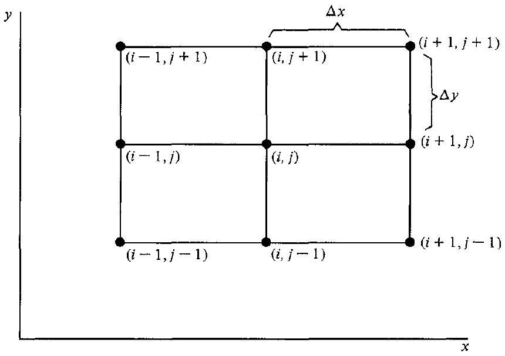
Figure 11.3 | Rectangular finite-difference grid.

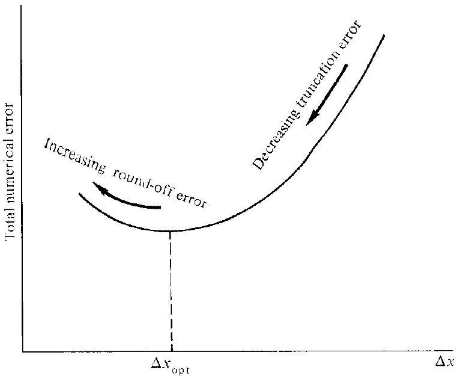
Figure 11.4 I Schematic of the effect of grid size on numerical error.

3. In the theoretical limit of an infinite number of grid points (i.e., $\Delta x$ and $\Delta y \rightarrow 0$ in Fig. 11.3), the solutions are exact. Since all practical calculations obviously utilize a finite number of grid points, such numerical solutions are subject to truncation error, due to neglect of the higher-order terms in Eq. (11.1). Moreover, because all digital computers round off each number to a certain significant figure, the flowfield calculations are also subject to roundoff error. By reducing the value of $\Delta x$ in Eq. (11.1), the truncation error is reduced; however, the number of steps required to calculate a certain distance in $x$ is correspondingly increased, therefore increasing the round-off error. This trend is illustrated in Fig. 11.4, which shows the total numerical error as a function of step size, $\Delta x$. Note that there is an optimum value ( $\Delta x)_{\text {opt }}$ at which maximum accuracy is obtained; it does not correspond to $\Delta x \rightarrow 0$. Although all computations are subject to these numerical errors, this author feels that, as long as the full nonlinear equations of motion are being solved along with the exact boundary conditions, such solutions are properly designated as exact solutions. Therefore, an important advantage of computational fluid dynamics is its inherent ability to provide exact solutions to difficult, nonlinear problems.

## 11.2 | PHILOSOPHY OF THE METHOD OF CHARACTERISTICS

Let us begin to obtain a feeling for the method of characteristics by considering again Fig. 11.3 and Eq. (11.1). Neglect the second-order term in Eq. (11.1), and write

$$
u_{i+1, j}=u_{i, j}+\left(\frac{\partial u}{\partial x}\right)_{i, j} \Delta x+\cdots
$$

The value of the derivative $\partial u / \partial x$ can be obtained from the general conservation equations. For example, consider a two-dimensional irrotational flow, so that Eq. (8.17) yields, in terms of velocities,

$$
\left(1-\frac{u^{2}}{a^{2}}\right) \frac{\partial u}{\partial x}+\left(1-\frac{v^{2}}{a^{2}}\right) \frac{\partial v}{\partial y}-\frac{2 u v}{a^{2}} \frac{\partial u}{\partial y}=0
$$

Solve Eq. (11.3) for $\partial u / \partial x$ :

$$
\frac{\partial u}{\partial x}=\frac{\frac{2 u v}{a^{2}} \frac{\partial u}{\partial y}-\left(1-\frac{v^{2}}{a^{2}}\right) \frac{\partial v}{\partial y}}{\left(1-u^{2} / a^{2}\right)}
$$

Now assume the velocity $\mathbf{V}$, and hence $u$ and $v$, is known at each point along a vertical line, $x=x_{o}$, as sketched in Fig. 11.5. Specifically, the values of $u$ and $v$ are known at point $(i, j)$, as well as above and below, at points $(i, j+1)$ and $(i, j-1)$. Hence, the $y$ derivatives, $\partial u / \partial y$ and $\partial v / \partial y$, are known at point $(i, j)$. (They can be calculated from finite-difference quotients, to be discussed later.) Consequently, the right-hand side of Eq. (11.4) yields a number for $(\partial u / \partial x)_{i, j}$, which can be substituted into Eq. (11.2) to calculate $u_{i+1, j}$. However, there is one notable exception: If the denominator of Eq. (11.4) is zero, then $\partial u / \partial x$ is at least indeterminate, and may even be discontinuous. The denominator is zero when $u=a$, i.e., when the component of flow velocity perpendicular to $x=x_{o}$ is sonic, as shown in Fig. 11.5. Moreover, from the geometry of Fig. 11.5, the angle $\mu$ is defined by $\sin \mu=u / V= a / V=1 / M$, i.e., $\mu$ is the Mach angle. The orientation of the $x$ and $y$ axes with respect to $\mathbf{V}$ in Fig. 11.5 is arbitrary; the germane aspect of this discussion is that a line that makes a Mach angle with respect to the streamline direction at a point is also a

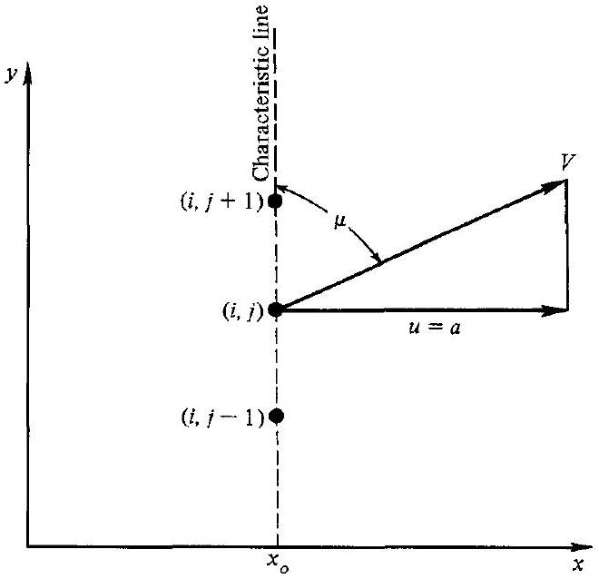
Figure 11.5 I Illustration of the characteristic direction.

line along which the derivative of $u$ is indeterminate, and across which it may be discontinuous. We have just demonstrated that such lines exist, and that they are Mach lines. The choice of $u$ was arbitrary in the above discussion. The derivatives of the other flow variables, $p, \rho, T, v$, etc., are also indeterminate along these lines. Such lines are defined as characteristic lines.

With this in mind, we can now outline the general philosophy of the method of characteristics. Consider a region of steady, supersonic flow in $x y$ space. (For simplicity, we will initially deal with two-dimensional flow; extensions to threedimensional flows will be discussed later.) This flowfield can be solved in three steps, as follows:

Step 1. Find some particular lines (directions) in the $x y$ space where flow variables $(p, \rho, T, u, v$, etc. $)$ are continuous, but along which the derivatives $(\partial p / \partial x, \partial u / \partial y$, etc.) are indeterminate, and in fact across which the derivatives may even sometimes be discontinuous. As already defined, such lines in the $x y$ space are called characteristic lines.

Step 2. Combine the partial differential conservation equations in such a fashion that ordinary differential equations are obtained that hold only along the characteristic lines. Such ordinary differential equations are called the compatibility equations.

Step 3. Solve the compatibility equations step by step along the characteristic lines, starting from the given initial conditions at some point or region in the flow. In this manner, the complete flowfield can be mapped out along the characteristics. In general, the characteristic lines (sometimes referred to as the "characteristics net") depend on the flowfield, and the compatibility equations are a function of geometric location along the characteristic lines; hence, the characteristics and the compatibility equations must be constructed and solved simultaneously, step by step. An exception to this is two-dimensional irrotational flow, for which the compatibility equations become algebraic equations explicitly independent of geometric location. This will be made clear in subsequent sections.

As an analog to this discussion, the above philosophy is clearly exemplified in the unsteady, one-dimensional flow discussed in Chap. 7. Consider a centered expansion wave traveling to the left, as sketched in Fig. 11.6. In Chap. 7, the governing partial differential equations were reduced to ordinary differential equations (compatibility equations) which held only along certain lines in the $x t$ plane that had slopes of $d x / d t=u \pm a$. The compatibility equations are Eqs. (7.65) and (7.66), and the lines were defined as characteristic lines in Sec. 7.6. These characteristics are sketched in Fig. 11.6a. However, in Chap. 7, we did not explicitly identify such characteristic lines with indeterminate or discontinuous derivatives. Nevertheless, this identification can be made by examining Eq. (7.89), which gives $u=u(x, t)$. Consider a given time $t=t_{1}$, which is illustrated by the dashed horizontal line in Fig. 11.6a. At time $t_{1}$, the head of the wave is located at $x_{b}$, and the tail at $x_{e}$. Equation (7.89) for the mass motion $u$ is evaluated at time $t_{1}$, as sketched in Fig. 11.6b. Note that at $x_{b}$ the velocity is continuous, but $\partial u / \partial x$ is discontinuous across the leading characteristic. Similarly, at $x_{e}, u$ is continuous but $\partial u / \partial x$ is discontinuous across

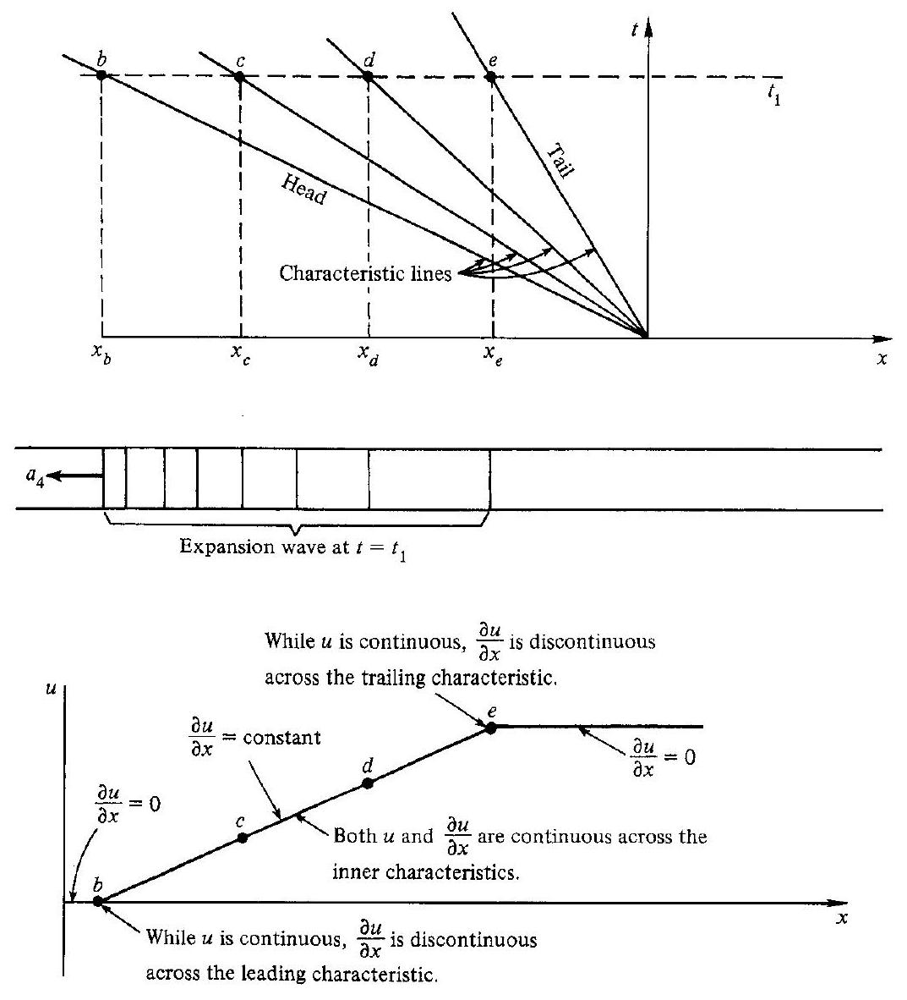
(b)

(a)

Figure 11.6 | Relationship of characteristics in unsteady one-dimensional flow.
the trailing characteristic. Hence, by examining Fig. 11.6a and $b$, we see that the characteristic lines identified in Chap. 7 are indeed consistent with the definition of characteristics given in the present chapter.

## 11.3 | DETERMINATION OF THE CHARACTERISTIC LINES: TWODIMENSIONAL IRROTATIONAL FLOW

At the beginning of Sec. 11.2, Mach lines in the flow were identified as characteristic lines in a somewhat heuristic fashion. Are there other characteristic lines in the flow? Is there a more deterministic approach to identifying characteristic lines? Those questions are addressed in this section.

To begin with, consider steady, adiabatic, two-dimensional, irrotational supersonic flow. Other types of flow will be considered in subsequent sections. The governing nonlinear equations are Eqs. (8.17) and (8.18). For two-dimensional flow, Eq. (8.17) becomes

$$
\left(1-\frac{\Phi_{x}^{2}}{a^{2}}\right) \Phi_{x x}+\left(1-\frac{\Phi_{y}^{2}}{a^{2}}\right) \Phi_{y y}-\frac{2 \Phi_{x} \Phi_{y}}{a^{2}} \Phi_{x y}=0
$$

Note that $\Phi$ is the full-velocity potential, not the perturbation potential. In fact, in all of our work in this chapter, we are not using perturbations in any way. Hence,

$$
\Phi_{x}=u \quad \Phi_{y}=v \quad \mathbf{V}=u \mathbf{i}+v \mathbf{j}
$$

Recall that $\Phi_{x}=f(x, y)$; hence,

$$
\begin{aligned}
& d \Phi_{x}=\frac{\partial \Phi_{x}}{\partial x} d x+\frac{\partial \Phi_{x}}{\partial y} d y=\Phi_{x x} d x+\Phi_{x y} d y \\
& d \Phi_{y}=\frac{\partial \Phi_{y}}{\partial x} d x+\frac{\partial \Phi_{y}}{\partial y} d y=\Phi_{x y} d x+\Phi_{y y} d y
\end{aligned}
$$

Recopying these equations,
From Eq. (11.5)

$$
\left(1-\frac{u^{2}}{a^{2}}\right) \Phi_{x x}-\frac{2 u v}{a^{2}} \Phi_{x y}+\left(1-\frac{v^{2}}{a^{2}}\right) \Phi_{y y}=0
$$

From Eq. (11.6)

$$
\begin{aligned}
& (d x) \Phi_{x x}+(d y) \Phi_{x y}=d u \\
& (d x) \Phi_{x y}+(d y) \Phi_{y y}=d v
\end{aligned}
$$

From Eq. (11.7)
These equations can be treated as a system of simultaneous, linear, algebraic equations in the variables $\Phi_{x x}, \Phi_{y y}$, and $\Phi_{x y}$. For example, using Cramer's rule, the solution for $\Phi_{x y}$ is

$$
\Phi_{x y}=\frac{\left|\begin{array}{ccc}
1-\frac{u^{2}}{a^{2}} & 0 & 1-\frac{v^{2}}{a^{2}} \\
d x & d u & 0 \\
0 & d v & d y
\end{array}\right|}{\left|\begin{array}{ccc}
1-\frac{u^{2}}{a^{2}} & -\frac{2 u v}{a^{2}} & 1-\frac{v^{2}}{a^{2}} \\
d x & d y & 0 \\
0 & d x & d y
\end{array}\right|}=\frac{N}{D}
$$

Now consider point $A$ and its surrounding neighborhood in an arbitrary flowfield, as sketched in Fig. 11.7. The derivative of the velocity potential. $\Phi_{x y}$, has a specific value at point $A$. Equation (11.8) gives the solution for $\Phi_{x y}$ at point $A$ for an arbitrary choice of $d x$ and $d y$, i.e., for an arbitrary direction away from point $A$ defined by the choice of $d x$ and $d y$. For the chosen $d x$ and $d y$, there are corresponding values of the change in velocity $d u$ and $d v$. No matter what values are chosen for $d x$ and $d y$, the corresponding values of $d u$ and $d v$ will always yield the same number for $\Phi_{x y}$ from Eq. (11.8), with one exception. If $d x$ and $d y$ are chosen such that $D=0$

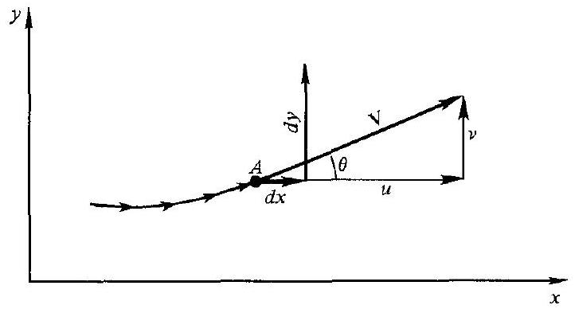
Figure 11.7 | Streamline geometry.

in Eq. (11.8), then $\Phi_{x y}$ is not defined in that particular direction dictated by $d x$ and $d y$. However, we know that $\Phi_{x y}$ has a specific finite value at point $A$, even though it is not uniquely determined when the direction through point $A$ is defined by this particular choice of $d x$ and $d y$, which yields $D=0$ in Eq. (11.8). Clearly, an infinite value of $\Phi_{x y}$ is physically inconsistent. For example, return to Fig. 11.6b. At points $b$ and $e, \partial u / \partial x$ is not uniquely determined, but we have to say that its value should be somewhere between zero and the constant value given by the slope between points $b$ and $e$. As a consequence, if the direction from $A$ ( $d x$ and $d y$ ) is chosen so that $D=0$ in Eq. (11.8), then to keep $\Phi_{x y}$ finite, $N=0$ in Eq. (11.8) also:

$$
\Phi_{x y}=\frac{N}{D}=\frac{0}{0}
$$

That is, $\Phi_{x y}=\partial u / \partial y=\partial v / \partial x$ is indeterminate. We have previously defined the directions in the flowfield along which the derivatives of the flow properties are indeterminate and across which they may be discontinuous as characteristic directions. Therefore, the lines in $x y$ space for which $D=0$ (and hence $N=0$ ) are characteristic lines.

This now provides a means to calculate the equations of the characteristic lines. In Eq. (11.8) set $D=0$. This yields
or

$$
\begin{aligned}
\left(1-\frac{u^{2}}{a^{2}}\right)(d y)^{2}+\frac{2 u v}{a^{2}} d x d y+\left(1-\frac{v^{2}}{a^{2}}\right)(d x)^{2} & =0 \\
\left(1-\frac{u^{2}}{a^{2}}\right)\left(\frac{d y}{d x}\right)_{\mathrm{char}}^{2}+\frac{2 u v}{a^{2}}\left(\frac{d y}{d x}\right)_{\mathrm{char}}+\left(1-\frac{v^{2}}{a^{2}}\right) & =0
\end{aligned}
$$

In Eq. (11.9), $(d y / d x)_{\text {char }}$ is the slope of the characteristic lines. Using the quadratic formula, Eq. (11.9) yields

$$
\left(\frac{d y}{d x}\right)_{\mathrm{char}}=\frac{-2 u v / a^{2} \pm \sqrt{\left(2 u v / a^{2}\right)^{2}-4\left[1-\left(u^{2} / a^{2}\right)\right]\left[1-\left(v^{2} / a^{2}\right)\right]}}{2\left[1-\left(u^{2} / a^{2}\right)\right]}
$$

or

$$
\left(\frac{d y}{d x}\right)_{\mathrm{char}}=\frac{-u v / a^{2} \pm \sqrt{\left[\left(u^{2}+v^{2}\right) / a^{2}\right]-1}}{\left[1-\left(u^{2} / a^{2}\right)\right]}
$$

Equation (11.10) defines the characteristic curves in the physical $x y$ space.

Examine Eq. (11.10) more closely. The term inside the square root is

$$
\frac{u^{2}+v^{2}}{a^{2}}-1=\frac{V^{2}}{a^{2}}-1=M^{2}-1
$$

Hence, we can state

1. If $M>1$, there are two real characteristics through each point of the flowfield. Moreover, for this situation, Eq. (11.5) is defined as a hyperbolic partial differential equation.
2. If $M=1$, there is one real characteristic through each point of the flow. By definition, Eq. (11.5) is a parabolic partial differential equation.
3. If $M<1$, the characteristics are imaginary, and Eq. (11.5) is an elliptic partial differential equation.

Therefore, we see that steady, inviscid supersonic flow is governed by hyperbolic equations, sonic flow by parabolic equations, and subsonic flow by elliptic equations. Moreover, because two real characteristics exist through each point in a flow where $M>1$, the method of characteristics becomes a practical technique for solving supersonic flows. In contrast, because the characteristics are imaginary for $M<1$, the method of characteristics is not used for subsonic solutions. (An exception is transonic flow, involving mixed subsonic-supersonic regions, where solutions have been obtained in the complex plane using imaginary characteristics.) Also, it is worthwhile mentioning that the unsteady one-dimensional flow in Chap. 7 is hyperbolic, and hence two real characteristics exist through each point in the $x t$ plane, as we have already seen. Indeed, unsteady inviscid flow is hyperbolic for two and three spatial dimensions, and for any speed regime-subsonic, transonic, supersonic, or hypersonic. This feature of unsteady flow underlies the strength of the timedependent numerical technique to be described in Chap. 12.

Concentrating on steady, two-dimensional supersonic flow, let us examine the real characteristic lines given by Eq. (11.10). Consider a streamline as sketched in Fig. 11.7. At point $A, u=V \cos \theta$ and $v=V \sin \theta$. Hence, Eq. (11.10) becomes

$$
\left(\frac{d y}{d x}\right)_{\text {char }}=\frac{\frac{-V^{2} \cos \theta \sin \theta}{a^{2}} \pm \sqrt{\frac{V^{2}}{a^{2}}\left(\cos ^{2} \theta+\sin ^{2} \theta\right)-1}}{1-\frac{V^{2}}{a^{2}} \cos ^{2} \theta}
$$

Recall that the Mach angle $\mu$ is given by $\mu=\sin ^{-1}(1 / M)$, or $\sin \mu=1 / M$. Thus, $V^{2} / a^{2}=M^{2}=1 / \sin ^{2} \mu$, and Eq. (11.11) becomes

$$
\left(\frac{d y}{d x}\right)_{\mathrm{char}}=\frac{\frac{-\cos \theta \sin \theta}{\sin ^{2} \mu} \pm \sqrt{\frac{\cos ^{2} \theta+\sin ^{2} \theta}{\sin ^{2} \mu}-1}}{1-\frac{\cos ^{2} \theta}{\sin ^{2} \mu}}
$$

From trigonometry,

$$
\sqrt{\frac{\cos ^{2} \theta+\sin ^{2} \theta}{\sin ^{2} \mu}-1}=\sqrt{\frac{1}{\sin ^{2} \mu}-1}=\sqrt{\csc ^{2} \mu-1}=\sqrt{\cot ^{2} \mu}=\frac{1}{\tan \mu}
$$

Thus, Eq. (11.12) becomes

$$
\left(\frac{d y}{d x}\right)_{\text {char }}=\frac{-\cos \theta \sin \theta / \sin ^{2} \mu \pm 1 / \tan \mu}{1-\left(\cos ^{2} \theta / \sin ^{2} \mu\right)}
$$

After more algebraic and trigonometric manipulation, Eq. (11.13) reduces to

$$
\left(\frac{d y}{d x}\right)_{\mathrm{char}}=\tan (\theta \mp \mu)
$$

A graphical interpretation of Eq. (11.14) is given in Fig. 11.8, which is an elaboration of Fig. 11.7. At point $A$ in Fig. 11.8, the streamline makes an angle $\theta$ with the $x$ axis. Equation (11.14) stipulates that there are two characteristics passing through point $A$, one at the angle $\mu$ above the streamline, and the other at the angle $\mu$ below the streamline. Hence, the characteristic lines are Mach lines. This fact was deduced in Sec. 11.2; however, the derivation given here is more rigorous. Also, the characteristic given by the angle $\theta+\mu$ is called a $C_{+}$characteristic; it is a left-running

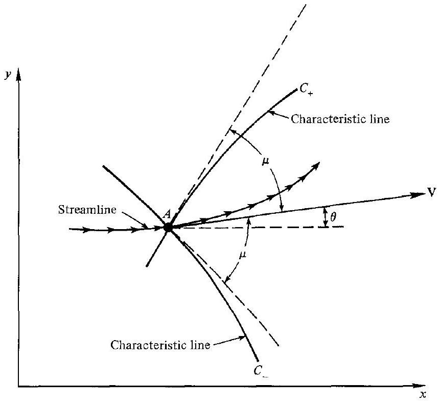
Figure 11.8 | Illustration of left- and right-running characteristic lines.

characteristic analogous to the $C_{+}$characteristics used in Chap. 7. The characteristic in Fig. 11.8 given by the angle $\theta-\mu$ is called a $C_{-}$characteristic; it is a rightrunning characteristic analogous to the $C_{-}$characteristics used in Chap. 7. Note that the characteristics are curved in general, because the flow properties (hence $\theta$ and $\mu$ ) change from point to point in the flow.

## 11.4 | DETERMINATION OF THE COMPATIBILITY EQUATIONS

In essence, Eq. (11.8) represents a combination of the continuity, momentum, and energy equations for two-dimensional, steady, adiabatic, irrotational flow. In Sec. 11.3, we derived the characteristic lines by setting $D=0$ in Eq. (11.8). In this section, we will derive the compatibility equations by setting $N=0$ in Eq. (11.8).

When $N=0$, the numerator determinant yields
or

$$
\begin{gathered}
\left(1-\frac{u^{2}}{a^{2}}\right) d u d y+\left(1-\frac{v^{2}}{a^{2}}\right) d x d v=0 \\
\frac{d v}{d u}=\frac{-\left[1-\left(u^{2} / a^{2}\right)\right]}{\left[1-\left(v^{2} / a^{2}\right)\right]} \frac{d y}{d x}
\end{gathered}
$$

Keep in mind that $N$ is set to zero only when $D=0$ in order to keep the flowfield derivatives finite, albeit of the indeterminate form $0 / 0$. When $D=0$, we are restricted to considering directions only along the characteristic lines, as explained in Sec. 11.3. Hence, when $N=0$, we are held to the same restriction. Therefore. Eq. (11.15) holds only along the characteristic lines. Therefore, in Eq. (11.15),

$$
\frac{d y}{d x} \equiv\left(\frac{d y}{d x}\right)_{\text {char }}
$$

Substituting Eq. (11.10) into (11.15), we have

$$
\frac{d v}{d u}=-\frac{\left(1-\frac{u^{2}}{a^{2}}\right)}{\left(1-\frac{v^{2}}{a^{2}}\right)}\left[\frac{-\frac{u v}{a^{2}} \pm \sqrt{\frac{u^{2}+v^{2}}{a^{2}}}-1}{\left(1-\frac{u^{2}}{a^{2}}\right)}\right]
$$

which simplifies to

$$
\frac{d v}{d u}=\frac{\frac{u v}{a^{2}} \mp \sqrt{\frac{u^{2}+v^{2}}{a^{2}}-1}}{1-\frac{v^{2}}{a^{2}}}
$$

Recall that $u=V \cos \theta$ and $v=V \sin \theta$. Then, Eq. (11.16) becomes

$$
\frac{d(V \sin \theta)}{d(V \cos \theta)}=\frac{M^{2} \cos \theta \sin \theta \mp \sqrt{M^{2}-1}}{1-M^{2} \sin ^{2} \theta}
$$

which, after some algebraic manipulations, reduces to

$$
d \theta=\mp \sqrt{M^{2}-1} \frac{d V}{V}
$$

Equation (11.17) is the compatibility equation, i.e., the equation that describes the variation of flow properties along the characteristic lines. From a comparison with Eq. (11.14), we note that

$$
\begin{aligned}
d \theta & =-\sqrt{M^{2}-1} \frac{d V}{V} \quad \text { (applies along the } C_{-} \text {characteristic) } \\
d \theta & =\sqrt{M^{2}-1} \frac{d V}{V} \quad \text { (applies along the } C_{+} \text {characteristic) }
\end{aligned}
$$

Compare Eq. (11.17) with Eq. (4.35) for Prandtl-Meyer flow. They are identical. Hence, Eq. (11.17) can be integrated to give the Prandtl-Meyer function $\nu(M)$ as displayed in Eq. (4.44). Therefore, Eqs. (11.18) and (11.19) are replaced by the algebraic compatibility equations:

$$
\begin{aligned}
& \theta+\nu(M)=\mathrm{const}=K_{-} \quad\left(\text { along the } C_{-} \text {characteristic }\right) \\
& \theta-\nu(M)=\mathrm{const}=K_{+} \quad\left(\text { along the } C_{+} \text {characteristic }\right)
\end{aligned}
$$

In Equations (11.20) and (11.21), $K_{-}$and $K_{+}$are constants along their respective characteristics, and are analogous to the Riemann invariants $J_{-}$and $J_{+}$for unsteady flow as defined in Chap. 7.

The compatibility equations (11.20) and (11.21) relate velocity magnitude and direction along the characteristic lines. For this reason, they are sometimes identified in the literature as "hodograph characteristics." Plots of the hodograph characteristics are useful for graphical solutions or hand calculations using the method of characteristics. The reader is encouraged to read the classic texts by Ferri (Ref. 5) and Shapiro (Ref. 16) for further discussions of the hodograph approach. We shall not take a graphical approach here. Rather, Eqs. (11.20) and (11.21) are in a sufficient form for direct numerical calculations; they are the most useful form for modern computer calculations.

It is important to note that the compatibility equations (11.20) and (11.21) have no terms involving the spatial coordinates $x$ and $y$. Hence, they can be solved without requiring knowledge of the geometric location of the characteristic lines. This geometrical independence of the compatibility equations is peculiar only to the present case of two-dimensional irrotational flow. For all other cases, the compatibility equations are dependent upon the spatial location, as will be discussed later.

### 11.5 I UNIT PROCESSES

In Sec. 11.2, the philosophy of the method of characteristics was given as a three-step process. Step 1-the determination of the characteristic lines-was carried out in Sec. 11.3. Step 2-the determination of the compatibility equations which hold along
the characteristics-was carried out in Sec. 11.4. Step 3-the solution of the compatibility equations point by point along the characteristics-is discussed in this section. The machinery for applying the method of characteristics is a series of specific computations called "unit processes," which vary depending on whether the points at which calculations are being made are internal to the flowfield, on a solid or free boundary, or on a shock wave.

### 11.5.1 Internal Flow

If we know the flowfield conditions at two points in the flow, then we can find the conditions at a third point, as sketched in Fig. 11.9. Here, the values of $v_{1}$ and $\theta_{1}$ are known at point 1 , and $v_{2}$ and $\theta_{2}$ are known at point 2 . Point 3 is located by the intersection of the $C_{-}$characteristic through point 1 and the $C_{+}$characteristic through point 2. Along the $C_{-}$characteristic through point 1, Eq. (11.20) holds:

$$
\theta_{1}+v_{1}=\left(K_{-}\right)_{1} \quad\left(\text { known value along } C_{-}\right)
$$

Also along the $C_{+}$characteristic through point 2 , Eq. (11.21) holds:

$$
\theta_{2}-\nu_{2}=\left(K_{+}\right)_{2} \quad\left(\text { known value along } C_{+}\right)
$$

Hence, at point 3 , from Eq. (11.20),

$$
\theta_{3}+v_{3}=\left(K_{-}\right)_{3}=\left(K_{-}\right)_{1}
$$

and from Eq. (11.21),

$$
\theta_{3}-v_{3}=\left(K_{+}\right)_{3}=\left(K_{+}\right)_{2}
$$

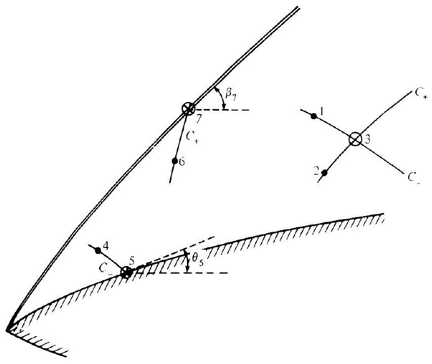
Figure 11.9 | Unit processes for the steady-flow, two-dimensional, irrotational method of characteristics.

Solving Eqs. (11.22) and (11.23), we obtain $\theta_{3}$ and $\nu_{3}$ in terms of the known values of $K_{+}$and $K_{-}$:

$$
\begin{aligned}
\theta_{3} & =\frac{1}{2}\left[\left(K_{-}\right)_{1}+\left(K_{+}\right)_{2}\right] \\
v_{3} & =\frac{1}{2}\left[\left(K_{-}\right)_{1}-\left(K_{+}\right)_{2}\right]
\end{aligned}
$$

Thus, the flow conditions at point 3 are now determined from the known values at points 1 and 2 . Recall that $v_{3}$ determines $M_{3}$ through Eq. (4.44), and that $M_{3}$ determines the pressure, temperature, and density through the isentropic flow relations, Eqs. (3.28), (3.30), and (3.31).

The location of point 3 in space is determined by the intersection of the $C_{-}$characteristic through point 1 and the $C_{+}$characteristic through point 2, as shown in Fig. 11.9. However, the $C_{-}$and $C_{+}$characteristics are generally curved lines, and all we know are their directions at points 1 and 2 . How can we then locate point 3 ? An approximate but usually sufficiently accurate procedure is to assume the characteristics are straight-line segments between the grid points, with slopes that are average values. For example, consider Fig. 11.10. Here, the $C_{-}$characteristic through point 1 is drawn as a straight line with an average slope angle given by

$$
\left[\frac{1}{2}\left(\theta_{1}+\theta_{3}\right)-\frac{1}{2}\left(\mu_{1}+\mu_{3}\right)\right]
$$

The $C_{+}$characteristic through point 2 is drawn as a straight line with an average slope angle given by $\left[\frac{1}{2}\left(\theta_{2}+\theta_{3}\right)+\frac{1}{2}\left(\mu_{2}+\mu_{3}\right)\right]$. Their intersection locates point 3 .

### 11.5.2 Wall Point

If we know conditions at a point in the flow near a solid wall, we can find the flow variables at the wall as follows. Consider point 4 in Fig. 11.9, at which the flow is known. Hence, along the $C_{-}$characteristic through point 4 , the value $K_{-}$is known:

$$
\left(K_{-}\right)_{4}=\theta_{4}+v_{4} \quad \text { (known) }
$$

The $C_{-}$characteristic intersects the wall at point 5 . Hence, at point 5,

$$
\left(K_{-}\right)_{4}=\left(K_{-}\right)_{5}=\theta_{5}+v_{5}
$$

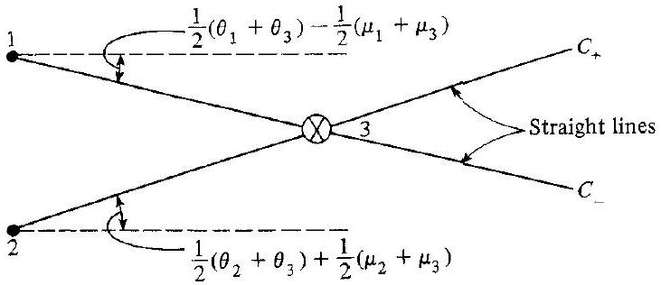
Figure 11.10 | Approximation of characteristics by straight lines.

However, the shape of the wall is known, and since the flow must be tangent at the wall, $\theta_{5}$ is known. Thus, in Eq. (11.26), $v_{5}$ is the only unknown, and can be written as

$$
\nu_{5}=v_{4}+\theta_{4}-\theta_{5}
$$

### 11.5.3 Shock Point

If we know conditions at a point in the flow near a shock wave, we can find the flow variables immediately behind the shock as well as the local shock angle as follows. Consider point 6 in Fig. 11.9, at which the flow is known. Hence, along the $C_{+}$characteristic through point 6 , the value $K_{+}$is known:

$$
\left(K_{+}\right)_{6}=\theta_{6}-v_{6} \quad(\text { known })
$$

The $C_{+}$characteristic intersects the shock at point 7 . Hence, at point 7 ,

$$
\left(K_{+}\right)_{6}=\left(K_{+}\right)_{7}=\theta_{7}-v_{7}
$$

For a given free-stream Mach number $M_{\infty}$, find the value of the local shock angle $\beta_{7}$ which yields the value of $\theta_{7}-v_{7}$ immediately behind the shock that agrees with the number obtained in Eq. (11.27). This is a trial-and-error process using the oblique shock relations developed in Chap. 4. Then, given $\beta_{7}$ and $M_{\infty}$, all other flow properties at point 7 are known from the oblique shock relations.

### 11.5.4 Initial Data Line

The unit processes discussed in this section must start somewhere. In order to implement the method of characteristics, we must have a line in the locally supersonic flow along which the flowfield properties are known. Then the method of characteristics can be carried out as described here, marching downstream from the initial data line. Such a downstream-marching method is mathematically a property of hyperbolic and parabolic partial differential equations. For the calculation of an internal flow, such as a nozzle flow, the initial data line is taken at or downstream of the limiting characteristic, which is slightly downstream of the sonic line. (The concept of limiting characteristics is described in Sec. 12.3.) The properties along this initial data line must be obtained from an independent calculation, such as the time-marching method discussed in Chap. 12. An alternative for starting a nozzle calculation is simply to assume that the sonic line in the nozzle throat is straight, and to assume a centered expansion emanating from the wall of the nozzle in the throat region (see Example 11.1 in Sec. 11.7). For the calculation of an external flow, such as the flow over a sharp-nosed airfoil shape, the initial data line can be established by assuming wedge flow at the sharp leading edge, and using wedgeflow properties along a line across the flow between the body and the shock wave just a small distance downstream of the leading edge. In any event, we repeat that the method of characteristics solution for a steady supersonic flow must start from
a given initial data line, and then the calculation can be marched downstream from the line.

### 11.6 I REGIONS OF INFLUENCE AND DOMAINS OF DEPENDENCE

Our discussion on characteristic lines leads to the conclusion that in a steady supersonic flow disturbances are felt only in limited regions. This is in contrast to a subsonic flow where disturbances are felt everywhere throughout the flowfield. (This distinction was clearly made in the contrast between subsonic and supersonic linearized flow discussed in Chap. 9.) To better understand the propagation of disturbances in a steady supersonic flow, consider point $A$ in a uniform supersonic stream, as sketched in Fig. 11.11a. Assume that two needlelike probes are introduced upstream of point $A$. The probes are so thin that their shock waves are essentially Mach waves. In the sketch shown, the tips of the probes at points $B$ and $C$ are located such that point $A$ is outside the Mach waves. Hence, even though the probes are upstream of point $A$, their presence is not felt at point $A$. The disturbances introduced by the probes are confined within the Mach waves. On the other hand, if another probe is introduced at point $D$ upstream of point $A$ such that point $A$ falls inside the Mach wave (see Fig. 11.11b), then obviously the presence of the probe is felt at point $A$.

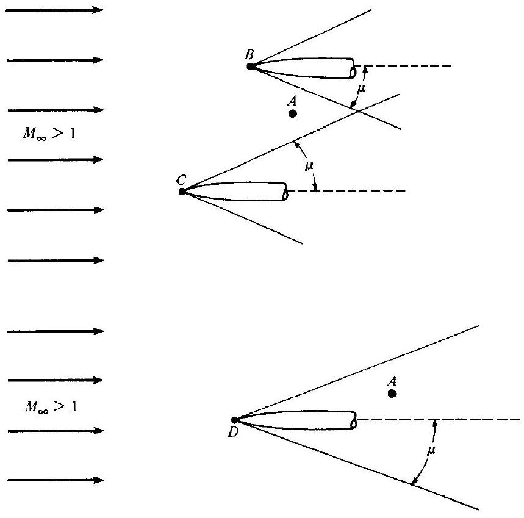
Figure 11.11 I Weak disturbances in a supersonic flow.

(a)

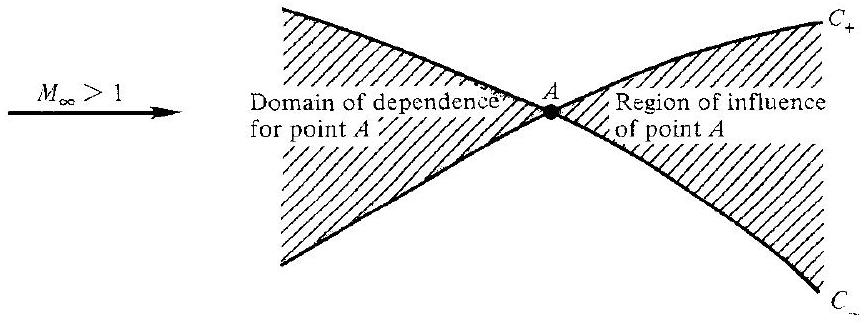
Figure 11.12 | Domain of dependence and region of influence.

The above simple picture leads to the definition of two zones associated with point $A$, as illustrated in Fig. 11.12. Consider the left- and right-running characteristics through point $A$. The area between the two upstream characteristics is defined as the domain of dependence for point $A$. Properties at point $A$ "depend" on any disturbances or information in the flow within this upstream region. The area between the two downstream characteristics is defined as the region of influence of point $A$. This region is "influenced" by any action that is going on at point $A$. Clearly, disturbances that are generated at point $A$ do not propagate upstream. This is a general and important behavior of steady supersonic flow-disturbances do not propagate upstream. (However, keep in mind from Chap. 7 that, in an unsteady supersonic flow, compression waves can propagate upstream.)

### 11.7 I SUPERSONIC NOZZLE DESIGN

In order to expand an internal steady flow through a duct from subsonic to supersonic speed, we established in Chap. 5 that the duct has to be convergent-divergent in shape, as sketched in Fig. 11.13a. Moreover, we developed relations for the local Mach number, and hence the pressure, density, and temperature, as functions of local area ratio $A / A^{*}$. However, these relations assumed quasi-one-dimensional flow, whereas, strictly speaking, the flow in Fig. 11.13a is two-dimensional. Moreover, the quasi-one-dimensional theory tells us nothing about the proper contour of the duct, i.e., what is the proper variation of area with respect to the flow direction $A=A(x)$. If the nozzle contour is not proper, shock waves may occur inside the duct.

The method of characteristics provides a technique for properly designing the contour of a supersonic nozzle for shockfree, isentropic flow, taking into account the multidimensional flow inside the duct. The purpose of this section is to illustrate such an application.

The subsonic flow in the convergent portion of the duct in Fig. 11.13a is accelerated to sonic speed in the throat region. In general, because of the multidimensionality of the converging subsonic flow, the sonic line is gently curved. However, for most applications, we can assume the sonic line to be straight, as illustrated by the straight dashed line from $a$ to $b$ in Fig. 11.13a. Downstream of the sonic line, the duct diverges. Let $\theta_{w}$ represent the angle of the duct wall with respect to the $x$ direction.

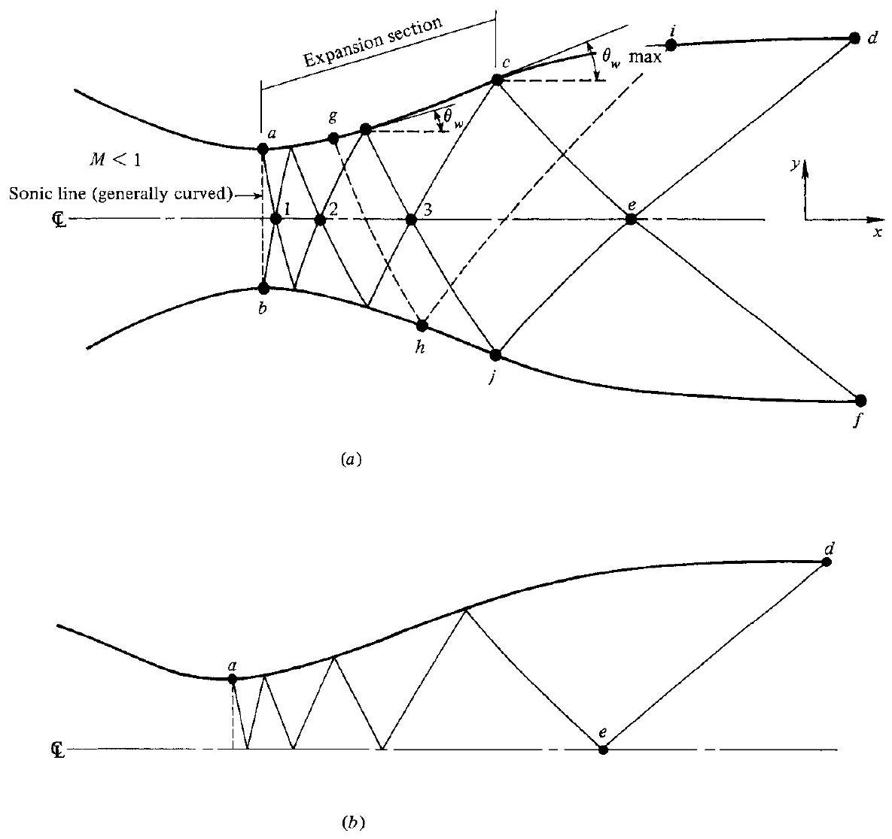
Figure 11.13 I Schematic of supersonic nozzle design by the method of characteristics.

The section of the nozzle where $\theta_{w}$ is increasing is called the expansion section; here, expansion waves are generated and propagate across the flow downstream, reflecting from the opposite wall. Point $c$ is an inflection point of the contour, where $\theta_{w}=\theta_{w_{\max }}$. Downstream of point $c, \theta_{w}$ decreases until the wall becomes parallel to the $x$ direction at points $d$ and $f$. The section from $c$ to $d$ is a "straightening" section specifically designed to cancel all the expansion waves generated by the expansion section. For example, as shown by the dashed line in Fig. 11.13a, the expansion wave generated at $g$ and reflected at $h$ is canceled at $i$. Also shown in Fig. 11.13a are the characteristic lines going through points $d$ and $f$ at the nozzle exit. These characteristics represent infinitesimal expansion waves in the nozzle, i.e., Mach waves. Tracing these two characteristics upstream, we observe multiple reflections up to the throat region. The area $a c e j b$ is the expansion region of the nozzle, covered with both left- and right-running characteristics. Such a region with waves of both families is defined as a nonsimple region (analogous to the nonsimple waves described for
unsteady one-dimensional flow in Sec. 7.7). In this region, the characteristics are curved lines. In contrast, the regions cde and jef are covered by waves of only one family because the other family is cancelled at the wall. Hence, these are simple regions, where the characteristic lines are straight. Downstream of def, the flow is uniform and parallel, at the desired Mach number. Finally, due to the symmetry of the nozzle flow, the waves (characteristics) generated from the top wall act as if they are "reflected" from the centerline. This geometric ploy due to symmetry allows us to consider in our calculations only the flow above the centerline, as sketched in Fig. 11.13b.

Supersonic nozzles with gently curved expansion sections as sketched in Fig. 11.13a and $b$ are characteristic of wind tunnel nozzles where high-quality, uniform flow is desired in the test section (downstream of def). Hence, wind tunnel nozzles are long, with a relatively slow expansion. By comparison, rocket nozzles are short in order to minimize weight. Also, in cases where rapid expansions are desirable, such as the nonequilibrium flow in modern gasdynamic lasers (see Ref. 21), the nozzle length is as short as possible. In such minimum-length nozzles, the expansion section in Fig. 11.13a is shrunk to a point, and the expansion takes place through a centered Prandtl-Meyer wave emanating from a sharp-corner throat with an angle $\theta_{u_{\text {max }}, M_{L}}$, as sketched in Fig. 11.14a. The length of the supersonic nozzle, denoted as $L$ in Fig. 11.14 $a$ is the minimum value consistent with shockfree, isentropic flow. If the contour is made shorter than $L$, shocks will develop inside the nozzle.

Assume that the nozzles sketched in Figs. 11.13a and 11.14a are designed for the same exit Mach numbers. For the nozzle in Fig. 11.13a with an arbitrary expansion contour $a c$, multiple reflections of the characteristics (expansion waves) occur from the wall along $a c$. A fluid element moving along a streamline is constantly accelerated while passing through these multiple reflected waves. In contrast, for the minimum-length nozzle shown in Fig. 11.14a, the expansion contour is replaced by a sharp corner at point $a$. There are no multiple reflections and a fluid element encounters only two systems of waves-the right-running waves emanating from point $a$ and the left-running waves emanating from point $d$. As a result, $\theta_{w_{\text {max }} . M_{l} \text {. in }}$ Fig. 11.14a must be larger than $\theta_{w_{\text {mix }}}$ in Fig. 11.13a, although the exit Mach numbers are the same.

Let $v_{M}$ be the Prandtl-Meyer function associated with the design exit Mach number. Hence, along the $C_{+}$characteristic $c b$ in Fig. 11.14a, $v=v_{M}=v_{c}=v_{b}$. Now consider the $C_{-}$characteristic through points $a$ and $c$. At point $c$, from Eq. (11.20),

$$
\theta_{c}+v_{c}=\left(K_{-}\right)_{c}
$$

However, $\theta_{c}=0$ and $v_{c}=v_{M}$. Hence, from Eq. (11.28),

$$
\left(K_{-}\right)_{c}=v_{M}
$$

At point $a$, along the same $C_{-}$characteristic $a c$, from Eq. (11.20),

$$
\theta_{w_{\mathrm{mux}} . M_{L}}+v_{a}=\left(K_{-}\right)_{a}
$$

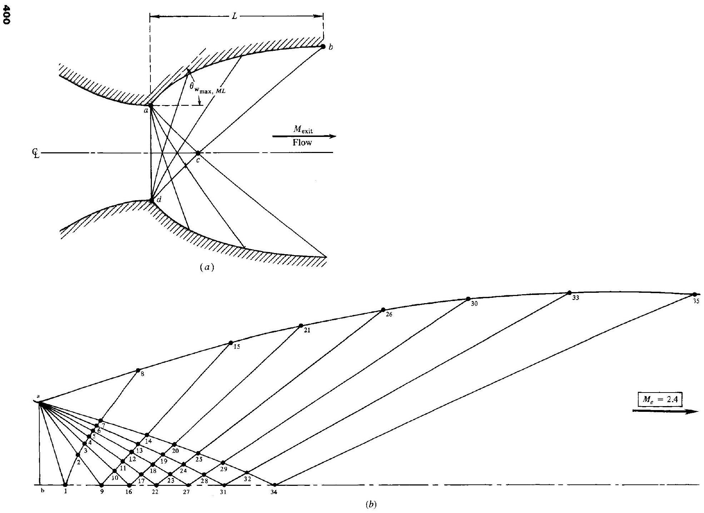
Figure 11.14 I (a) Schematic of minimum-length nozzle. (b) Graphical construction for Example 11.1.

Since the expansion at point $a$ is a Prandtl-Meyer expansion from initially sonic conditions, we know from Sec. 4.14 that $v_{a}=\theta_{w_{\text {max }}, M_{L}}$. Hence, Eq. (11.30) becomes

$$
\theta_{u_{\text {maic }},} M_{L}=\frac{1}{2}\left(K_{-}\right)_{a}
$$

However, along the same $C_{-}$characteristic, $\left(K_{-}\right)_{a}=\left(K_{-}\right)_{c}$; hence, Eq. (11.31) becomes

$$
\theta_{u^{u_{\max }}, M_{L}}=\frac{1}{2}\left(K_{-}\right)_{c}
$$

Combining Eqs. (11.29) and (11.32), we have

$$
\theta_{w_{\max }, M_{L}}=\frac{\nu_{M}}{2}
$$

Equation (11.33) demonstrates that, for a minimum-length nozzle the expansion angle of the wall downstream of the throat is equal to one-half the Prandtl-Meyer function for the design exit Mach number. For other nozzles such as that sketched in Fig. 11.11a, the maximum expansion angle is less than $v_{M} / 2$.

The shape of the finite-length expansion section in Fig. 11.13a can be somewhat arbitrary (within reason). It is frequently taken to be a circular arc with a diameter larger than the nozzle throat height. However, once the shape of the expansion section is chosen, then its length and $\theta_{w_{\max }}$ are determined by the design exit Mach number. These properties can be easily found by noting that the characteristic line from the end of the expansion section intersects the centerline at point $\varrho$, where the local Mach number is the same as the design exit Mach number. Hence, to find the expansion section length and $\theta_{w_{\text {max }}}$, simply keep track of the centerline Mach number (at points $1,2,3$, etc.) as you construct your characteristics solution starting from the throat region. When the centerline Mach number equals the design exit Mach number, this is point $e$. Then the expansion section is terminated at point $c$, which fixes both its length and the value of $\theta_{w_{\text {max }}}$.

Compute and graph the contour of a two-dimensional minimum-length nozzle for the expansion of air to a design exit Mach number of 2.4.

## - Solution

The results of this problem are given in Fig. 11.14b. To begin with, the sonic line at the throat, $a b$, is assumed to be straight. The first characteristic ( $a-1$ ) emanating from the sharp throat is chosen as inclined only slightly from the normal sonic line. ( $\Delta \theta=0.375$; hence $\theta+v=0.75$ and $d y / d x=\theta-\mu=-73.725^{\circ}$.) The remainder of the expansion fan is divided into six increments with $\Delta \theta=3^{\circ}$. The total corner angle $\theta_{w_{\text {max }}}=v / 2=36.75 / 2=$ 18.375. The values of $K_{+} \cdot K_{-}, \theta$, and $v$ are tabulated in Table 11.1 for all grid points. The

Table 11.1
| Point no. | $\boldsymbol{K}_{\boldsymbol{-}}=$ | $\boldsymbol{K}_{\boldsymbol{+}}=$ | $\theta=$ | $v=$ |  |  |  |
| :--- | :--- | :--- | :--- | :--- | :--- | :--- | :--- |
|  | $\theta+v$ | 0-0 | $\frac{1}{2}\left(\boldsymbol{K}_{\boldsymbol{-}} \boldsymbol{+} \boldsymbol{K}_{+}\right)$ | $\frac{1}{2}\left(\boldsymbol{K}_{\boldsymbol{-}} \boldsymbol{-} \boldsymbol{K}_{\boldsymbol{+}}\right)$ | $\boldsymbol{M}$ | $\mu$ | Comments |
| 1 | 0.75 | 0 | $0.375^{\dagger}$ | $0.375^{\dagger}$ | 1.04 | 74.1 |  |
| 2 | 6.75 | 0 | $3.375{ }^{\dagger}$ | $3.375{ }^{\dagger}$ | 1.19 | 57.2 |  |
| 3 | 12.75 | 0 | $6.375{ }^{\dagger}$ | $6.375^{\dagger}$ | 1.31 | 49.8 |  |
| 4 | 18.75 | 0 | $9.375{ }^{\dagger}$ | $9.375{ }^{\dagger}$ | 1.41 | 45.2 |  |
| 5 | 24.75 | 0 | $12.375^{\dagger}$ | $12.375{ }^{\dagger}$ | 1.52 | 41.1 |  |
| 6 | 30.75 | 0 | $15.375{ }^{\dagger}$ | $15.375{ }^{\dagger}$ | 1.62 | 38.1 |  |
| 7 | 36.75 | 0 | $18.375{ }^{\dagger}$ | $18.375{ }^{\dagger}$ | 1.72 | 35.6 |  |
| 8 | $36.75{ }^{\dagger}$ | $0^{\dagger}$ |  |  | $1.72{ }^{\dagger}$ | $35.6^{\dagger}$ | Same as point 7 |
| 9 | $6.75{ }^{\dagger}$ | -6.75 | $0^{\dagger}$ | 6.75 | 1.32 | 49.3 |  |
| 10 | $12.75^{\dagger}$ | $-6.75^{\dagger}$ | 3 | 9.75 | 1.43 | 44.4 |  |
| 11 | $18.75{ }^{\dagger}$ | $-6.75^{\dagger}$ | 6 | 12.75 | 1.53 | 40.8 |  |
| 12 | $24.75{ }^{\dagger}$ | $-6.75^{\dagger}$ | 9 | 15.75 | 1.63 | 37.8 |  |
| 13 | $30.75^{\dagger}$ | $-6.75^{\dagger}$ | 12 | 18.75 | 1.73 | 35.3 |  |
| 14 | $36.75{ }^{\dagger}$ | $-6.75^{\dagger}$ | 15 | 21.75 | 1.84 | 32.9 |  |
| 15 | $36.75{ }^{\dagger}$ | $-6.75^{\dagger}$ | $15^{\dagger}$ | $21.75^{\dagger}$ | 1.84 ${ }^{\dagger}$ | $32.9{ }^{\dagger}$ | Same as point 14 |
| 16 | $12.75{ }^{\dagger}$ | -12.75 | $0^{\dagger}$ | 12.75 | 1.53 | 40.8 |  |
| 17 | $18.75{ }^{\dagger}$ | $-12.75{ }^{\dagger}$ | 3 | 15.75 | 1.63 | 37.8 |  |
| 18 | $24.75{ }^{\dagger}$ | $-12.75^{\dagger}$ | 6 | 18.75 | 1.73 | 35.3 |  |
| 19 | 30.75* | $-12.75{ }^{\dagger}$ | 9 | 21.75 | 1.84 | 32.9 |  |
| 20 | $36.75{ }^{\dagger}$ | $-12.75{ }^{\dagger}$ | 12 | 24.75 | 1.94 | 31.0 |  |
| 21 | $36.75^{\dagger}$ | $-12.75{ }^{\dagger}$ | $12^{\dagger}$ | $24.75{ }^{\dagger}$ | $1.94^{\dagger}$ | $31.0{ }^{\dagger}$ | Same as point 20 |
| 22 | $18.75^{\dagger}$ | -18.75 | $0^{\dagger}$ | 18.75 | 1.73 | 35.3 |  |
| 23 | $24.75^{\dagger}$ | $-18.75^{\dagger}$ | 3 | 21.75 | 1.84 | 32.9 |  |
| 24 | $30.75^{\dagger}$ | $-18.75{ }^{\dagger}$ | 6 | 24.75 | 1.94 | 31.0 |  |
| 25 | $36.75{ }^{\dagger}$ | $-18.75{ }^{\dagger}$ | 9 | 27.75 | 2.05 | 29.2 |  |
| 26 | $36.75^{\dagger}$ | $-18.75^{\dagger}$ | $9{ }^{\dagger}$ | $27.75^{\dagger}$ | $2.05^{\dagger}$ | $29.2{ }^{\dagger}$ | Same as point 25 |
| 27 | $24.75^{\dagger}$ | -24.75 | $0^{\dagger}$ | 24.75 | 1.94 | 31.0 |  |
| 28 | $30.75^{\dagger}$ | $-24.75^{\dagger}$ | 3 | 27.75 | 2.05 | 29.2 |  |
| 29 | $36.75^{\dagger}$ | $-24.75{ }^{\dagger}$ | 6 | 30.75 | 2.16 | 27.6 |  |
| 30 | $36.75^{\dagger}$ | $-24.75{ }^{\dagger}$ | $6{ }^{\dagger}$ | $30.75^{\dagger}$ | $2.16{ }^{\dagger}$ | $27.6{ }^{\dagger}$ | Same as point 29 |
| 31 | $30.75{ }^{\dagger}$ | -30.75 | $0^{\dagger}$ | 30.75 | 2.16 | 27.6 |  |
| 32 | $36.75^{\dagger}$ | -30.75 | 3 | 33.75 | 2.28 | 26.0 |  |
| 33 | $36.75{ }^{\dagger}$ | $-30.75^{\dagger}$ | $3^{\dagger}$ | $33.75{ }^{\dagger}$ | $2.28^{\dagger}$ | $26.0^{\dagger}$ | Same as point 32 |
| 34 | $36.75{ }^{\dagger}$ | -36.75 | $0^{\dagger}$ | 36.75 | 2.4 | 24.6 |  |
| 35 | $36.75{ }^{\dagger}$ | $-36.75^{\dagger}$ | $0^{\dagger}$ | $36.75^{\dagger}$ | $2.4^{\dagger}$ | $24.6{ }^{\dagger}$ | Same as point 34 |

${ }^{\dagger}$ Known quantities at beginning of each step.
nozzle contour is drawn by starting at the throat corner (where $\theta_{a}=\theta_{w_{\max }}=18.375^{\circ}$ ), drawing a straight line with an average slope, $\frac{1}{2}\left(\theta_{a}+\theta_{8}\right)$, and defining point 8 on the contour as the intersection of this straight line with the left-running characteristic 7-8. Point 15 is located by the intersection of a straight line through point 8 having a slope of $\frac{1}{2}\left(\theta_{8}+\theta_{15}\right)$ with the leftrunning characteristic 14-15. This process is repeated to generate the remainder of the contour, points 21, 26, etc.

For this example, the computed area ratio $A_{e} / A^{*}=2.33$. This is within 3 percent of the value $A_{e} / A^{*}=2.403$ from Table A.1. This small error is induced by the graphical construction
of Fig. 11.14b. and by the fact that only seven increments are chosen for the corner expansion fan. For a more accurate calculation, finer increments should be used, resulting in a more closely spaced characteristic net throughout the nozzle.

Note that a small inconsistency is involved with the properties at point 1 in Fig. 11.14, as listed in the first line of Table 11.1. The entry in Table 11.1 for $\theta$ at point 1 is a nonzero (but small) number, namely $0.375^{\circ}$. This is inconsistent with the physical picture in Fig. 11.14, which shows point 1 on the nozzle centerline where $\theta=0$. This inconsistency is due to the necessity of starting the calculations with the straight characteristic line, $a-1$, along which the value of $\theta$ is constant and equal to 0.375 . In reality, the characteristic $a-1$ is curved because of the nonuniform flow inside the region $a-b-1$ in Fig. 11.14, but we have no way of knowing what that nonuniform flow is for this problem. In Sec. 12.7, we will show that a finite-difference calculation in the throat region can provide such information. However, within the framework of the method of characteristics in the present section, we must live with this inconsistency. As long as the first characteristic line $a-1$ is taken as close as possible to the assumed straight sonic line, this inconsistency will be minimized.

### 11.8 I METHOD OF CHARACTERISTICS FOR AXISYMMETRIC IRROTATIONAL FLOW

For axisymmetric irrotational flow, the philosophy of the method of characteristics is the same as discussed earlier; however, some of the details are different, principally the compatibility equations. The purpose of this section is to illustrate those differences.

Consider a cylindrical coordinate system, as sketched in Fig. 11.15. The cylindrical coordinates are $r, \phi$, and $x$, with corresponding velocity components $v, w$,

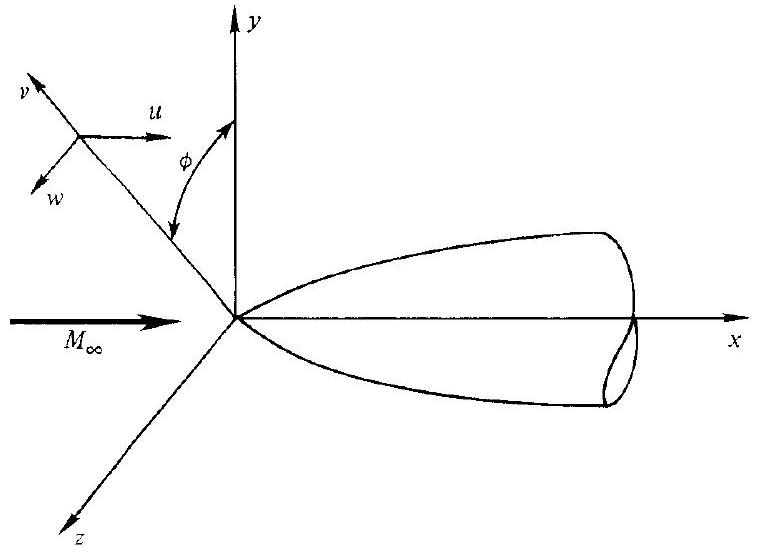
Figure 11.15 I Superposition of rectangular and cylindrical coordinate systems for axisymmetric flow.

and $u$, respectively. In these cylindrical coordinates, the continuity equation

$$
\nabla \cdot(\rho \mathbf{V})=0
$$

becomes

$$
\frac{\partial(\rho u)}{\partial x}+\frac{\partial(\rho v)}{\partial r}+\frac{1}{r} \frac{\partial(\rho w)}{\partial \phi}+\frac{\rho v}{r}=0
$$

Recalling from Sec. 10.1 that axisymmetric flow implies $\partial / \partial \phi=0$, Eq. (11.34) becomes

$$
\frac{\partial(\rho u)}{\partial x}+\frac{\partial(\rho v)}{\partial r}+\frac{\rho v}{r}=0
$$

From Euler's equation for irrotational flow, Eq. (8.7),

$$
d p=-\rho V d V=\frac{-\rho}{2} d\left(V^{2}\right)=-\frac{\rho}{2} d\left(u^{2}+v^{2}+w^{2}\right)
$$

However, the speed of sound $a^{2}=(\partial p / \partial \rho)_{s}=d p / d \rho$. Hence, along with $w=0$ for axisymmetric flow, Eq. (11.36) becomes

$$
d \rho=-\frac{\rho}{a^{2}}(u d u+v d v)
$$

from which follows

$$
\begin{aligned}
& \frac{\partial \rho}{\partial x}=-\frac{\rho}{a^{2}}\left(u \frac{\partial u}{\partial x}+v \frac{\partial v}{\partial x}\right) \\
& \frac{\partial \rho}{\partial r}=-\frac{\rho}{a^{2}}\left(u \frac{\partial u}{\partial r}+v \frac{\partial v}{\partial r}\right)
\end{aligned}
$$

Substituting Eqs. (11.38) and (11.39) into Eq. (11.35), we obtain, after factoring,

$$
\left(1-\frac{u^{2}}{a^{2}}\right) \frac{\partial u}{\partial x}-\frac{u v}{a^{2}} \frac{\partial v}{\partial x}-\frac{u v}{a^{2}} \frac{\partial u}{\partial r}+\left(1-\frac{v^{2}}{a^{2}}\right) \frac{\partial v}{\partial r}=-\frac{v}{r}
$$

The condition of irrotationality is

$$
\nabla \times \mathbf{V}=0
$$

which in cylindrical coordinates can be written as

$$
\nabla \times \mathbf{V}=\frac{1}{r}\left|\begin{array}{ccc}
\mathbf{e}_{r} & r \mathbf{e}_{\phi} & \mathbf{e}_{x} \\
\frac{\partial}{\partial r} & \frac{\partial}{\partial \phi} & \frac{\partial}{\partial x} \\
v & r w & u
\end{array}\right|=0
$$

For axisymmetric flow, Eq. (11.41) yields

$$
\frac{\partial u}{\partial r}=\frac{\partial v}{\partial x}
$$

Substituting Eq. (11.42) into (11.40), we have

$$
\left(1-\frac{u^{2}}{a^{2}}\right) \frac{\partial u}{\partial x}-2 \frac{u v}{a^{2}} \frac{\partial v}{\partial x}+\left(1-\frac{v^{2}}{a^{2}}\right) \frac{\partial v}{\partial r}=-\frac{v}{r}
$$

Keeping in mind that $u=u(x, r)$ and $v=v(x, r)$, we can also write

$$
d u=\frac{\partial u}{\partial x} d x+\frac{\partial u}{\partial r} d r=\frac{\partial u}{\partial x} d x+\frac{\partial v}{\partial x} d r
$$

and

$$
d v=\frac{\partial v}{\partial x} d x+\frac{\partial v}{\partial r} d r
$$

Equations (11.43), (11.44), and (11.45) are three equations which can be solved for the three derivatives $\partial u / \partial x, \partial v / \partial x$, and $\partial v / \partial r$.

The reader should by now suspect that we are on the same track as in our previous development of the characteristic equations. Equations (11.43) through (11.45) for axisymmetric flow are analogous to Eqs. (11.5) through (11.7) for twodimensional flow. To determine the characteristic lines and compatibility equations, solve Eqs. (11.43) through (11.45) for $\partial v / \partial x$ as follows:

$$
\frac{\partial v}{\partial x}=\frac{\left|\begin{array}{ccc}
1-\frac{u^{2}}{a^{2}} & -\frac{v}{r} & 1-\frac{v^{2}}{a^{2}} \\
d x & d u & 0 \\
0 & d v & d r
\end{array}\right|}{\left|\begin{array}{ccc}
1-\frac{u^{2}}{a^{2}} & -2 \frac{u v}{a^{2}} & 1-\frac{v^{2}}{a^{2}} \\
d x & d r & 0 \\
0 & d x & d r
\end{array}\right|}=\frac{N}{D}
$$

The characteristic directions are found by setting $D=0$. This yields

$$
\left(\frac{d r}{d x}\right)_{\text {char }}=\frac{-u v / a^{2} \pm \sqrt{\left[\left(u^{2}+v^{2}\right) / a^{2}\right]-1}}{1-\left(u^{2} / a^{2}\right)}
$$

Equation (11.47) is identical to Eq. (11.10). The discussion following Eq. (11.10), leading to Eq. (11.14), also holds here. Consequently,

$$
\left(\frac{d r}{d x}\right)_{\mathrm{char}}=\tan (\theta \mp \mu)
$$

and we see that for axisymmetric irrotational flow, the characteristic lines are Mach lines. The $C_{+}$and $C_{-}$characteristics are the same as those sketched in Fig. 11.6.

The compatibility equations that hold along these characteristic lines are found by setting $N=0$ in Eq. (11.46). The result is

$$
\begin{aligned}
& \frac{d v}{d u}=\frac{-\left(1-\frac{u^{2}}{a^{2}}\right)-\frac{v}{r} \frac{d x}{d u}}{\left(1-\frac{v^{2}}{a^{2}}\right) \frac{d x}{d r}} \\
& \frac{d v}{d u}=-\frac{\left(1-\frac{u^{2}}{a^{2}}\right)}{\left(1-\frac{v^{2}}{a^{2}}\right)} \frac{d r}{d x}-\frac{\frac{v}{r} \frac{d r}{d u}}{\left(1-\frac{v^{2}}{a^{2}}\right)}
\end{aligned}
$$

or

In Eq. (11.49), the term $d r / d x$ is the characteristic direction given by Eq. (11.47). Hence, substituting Eq. (11.47) into (11.49), we have

$$
\frac{d v}{d u}=\frac{\frac{u v}{a^{2}} \mp \sqrt{\frac{u^{2}+v^{2}}{a^{2}}-1}}{\left(1-\frac{v^{2}}{a^{2}}\right)}-\frac{\frac{v}{r} \frac{d r}{d u}}{\left(1-\frac{v^{2}}{a^{2}}\right)}
$$

Note that Eq. (11.50) for axisymmetric flow differs from Eq. (11.16) for twodimensional flow by the additional term involving $d r / r$. Referring again to Fig. 11.6, we make the substitution $u=V \cos \theta$ and $v=V \sin \theta$ into Eq. (11.50), which after algebraic manipulation becomes

$$
d \theta=\mp \sqrt{M^{2}-1} \frac{d V}{V} \pm \frac{1}{\sqrt{M^{2}-1} \mp \cot \theta} \frac{d r}{r}
$$

The first term on the right-hand side of Eq. (11.51) is the differential of the Prandtl-Meyer function, $d v$ (see Sec. 4.14). Hence, the final form of the compatibility equation is

$$
\begin{aligned}
& d(\theta+\nu)=\frac{1}{\sqrt{M^{2}-1}-\cot \theta} \frac{d r}{r} \quad \text { (along a } C_{-} \text {characteristic) } \\
& d(\theta-\nu)=-\frac{1}{\sqrt{M^{2}-1}+\cot \theta} \frac{d r}{r} \quad \text { (along a } C_{+} \text {characteristic) }
\end{aligned}
$$

Equations (11.52) and (11.53) are the compatibility equations for axisymmetric irrotational flow. Compare them with the analogous results for two-dimensional irrotational flow given by Eqs. (11.20) and (11.21). For axisymmetric flow, we note the
following:

1. The compatibility equations are differential equations, not algebraic equations as before.
2. The quantity $\theta+v$ is no longer constant along a $C$. characteristic. Instead, its value depends on the spatial location in the flowfield as dictated by the $d r / r$ term in Eq. (11.52). The same qualification is made for $\theta-v$ along a $C_{+}$ characteristic.

For the actual numerical computation of an axisymmetric flowfield by the method of characteristics, the differentials in Eqs. (11.52) and (11.53) are replaced by finite differences (which are to be discussed later). The flow properties and their location are found by a step-by-step solution of Eqs. (11.52) and (11.53) coupled with the construction of the characteristics net using Eq. (11.48).

### 11.9 I METHOD OF CHARACTERISTICS FOR ROTATIONAL (NONISENTROPIC AND NONADIABATIC) FLOW

The assumption of irrotationality in the previous sections allows a great simplification. For example, Eq. (11.5) for two-dimensional irrotational flow contains only three velocity derivatives, namely $\Phi_{x x}=\partial u / \partial x, \Phi_{y y}=\partial v / \partial y$, and $\Phi_{x y}=\partial u / \partial y= \partial v / \partial x$. The irrotationality condition allows the use of the velocity potential and, in particular, eliminates one of the possible velocity derivatives as an unknown via $\partial u / \partial y=\partial v / \partial x$. Along with Eqs. (11.6) and (11.7), we have a system of equations with three unknown velocity derivatives, which can be solved by means of three-by-three determinants, Eq. (11.8). Similarly, for axisymmetric irrotational flow, the irrotationality condition, Eq. (11.42), allows the derivation of a governing equation, Eq. (11.43), which contains only three unknown velocity derivatives. This again leads to a system of three-by-three determinants, namely, Eq. (11.46).

In contrast, rotational flow is more complex, although the philosophy of the method of characteristics remains the same. Only a brief outline of the rotational method of characteristics will be given here; the reader is referred to Shapiro (Ref. 16) for additional details.

Crocco's theorem, Eq. (6.60), repeated here,

$$
T \nabla s=\nabla h_{o}-\mathbf{V} \times(\nabla \times \mathbf{V})
$$

tells us that rotational flow occurs when nonisentropic and/or nonadiabatic conditions are present. An example of the former is the flow behind a curved shock wave (see Fig. 4.29), where the entropy increase across the shock is different for different streamlines. An example of the latter is a shock layer within which the static temperature is high enough for the gas to lose a substantial amount of energy due to thermal radiation.

Without the simplification afforded by the irrotationality condition, it is not possible to obtain a system of three independent equations with three unknown derivatives
for the flow variables. Instead, for a rotational flow, the conservation equations as well as auxiliary relations [such as Eqs. (11.44) and (11.45)] lead to a minimum of eight equations with eight unknown derivatives. The characteristic lines and corresponding compatibility equations are then found by evaluating eight-by-eight determinants. Obviously, we will not take the space to go through such an evaluation. The results for two-dimensional and axisymmetric rotational flows show that there are three sets of characteristics-the left- and right-running Mach lines, and the streamlines of the flow. The compatibility equations along the Mach lines are of the form

$$
d V=f\left(d \theta, d s, d h_{o}, \frac{d r}{r}\right)
$$

and along the streamlines, from Eqs. (6.43) and (6.49),

$$
\begin{aligned}
d h_{o} & =\dot{q} \\
T d s & =d e+p d \frac{1}{\rho}
\end{aligned}
$$

In Eq. (11.54), $d s$ and $d h_{o}$ denote changes in entropy and total enthalpy along the Mach lines; in Eqs. (11.55) and (11.56) the respective changes $d s$ and $d h_{o}$ are along the streamlines.

Equations (11.54) through (11.56), along with the characteristics net of Mach lines and streamlines, must be solved in a step-by-step coupled fashion. A typical unit process is illustrated in Fig. 11.16. Here, all properties are known at points 1 and 2. Point 3 is located by the intersection of the $C_{-}$characteristic through point 1 and the $C_{+}$characteristic through point 2 . The streamline direction $\theta_{3}$ at point 3 is first estimated by assuming an average of $\theta_{1}$ and $\theta_{2}$. This streamline is traced upstream until it intersects at point 4 the known data plane through points 1 and 2 . The values of $s_{4}$ and $h_{o 4}$ are interpolated from the known values at points 1 and 2 . Then the values of $s_{3}$ and $h_{o 3}$ are obtained from the compatibility equations along the streamline, Eqs. (11.55) and (11.56). Once $s_{3}$ and $h_{o 3}$ are found as above, the compatibility equation along the Mach lines, Eq. (11.54), yields values of $V_{3}$ and $\theta_{3}$. The whole unit process is then repeated in an iterative sense until the desired accuracy is obtained at point 3 .

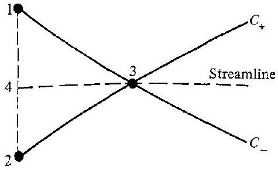
Figure 11.16 | Characteristic directions for a nonisentropic flow.

The reader is cautioned that the above discussion is purely illustrative; the details of a given problem obviously depend on the specific physical phenomena being treated (the thermodynamics of the gas, the form of energy loss, etc.). However, the major purpose of this section is to underscore that, for a general two-dimensional or axisymmetric flow, the streamlines are characteristics, and the derivation of the appropriate compatibility equations is more complex than for the irrotational case discussed in Secs. 11.3 through 11.8.

### 11.10 | THREE-DIMENSIONAL METHOD OF CHARACTERISTICS

The general conservation equations for three-dimensional inviscid flow were derived in Chap. 6. These equations can be used, for example, to solve the three-dimensional flow over a body at angle of attack, as sketched in Fig. 11.17. For supersonic threedimensional flow, these equations are hyperbolic. Hence. the method of characteristics can be employed, albeit in a much more complex form than for the two-dimensional or axisymmetric cases treated earlier. Again, only the general results will be given here; the reader is urged to consult Refs. 34 through 38 for examples of detailed solutions.

Consider point $b$ in a general supersonic three-dimensional flow, as sketched in Fig. 11.17. Through this point, the characteristic directions generate two sets of three-dimensional surfaces-a Mach cone with its vertex at point $b$ and with a halfangle equal to the local Mach angle $\mu$, and a stream surface through point $b$. The intersections of these surfaces establish a complex three-dimensional network of grid points. Moreover, as if this were not complicated enough, the compatibility equations along arbitrary rays of the Mach cone contain cross derivatives that have to be

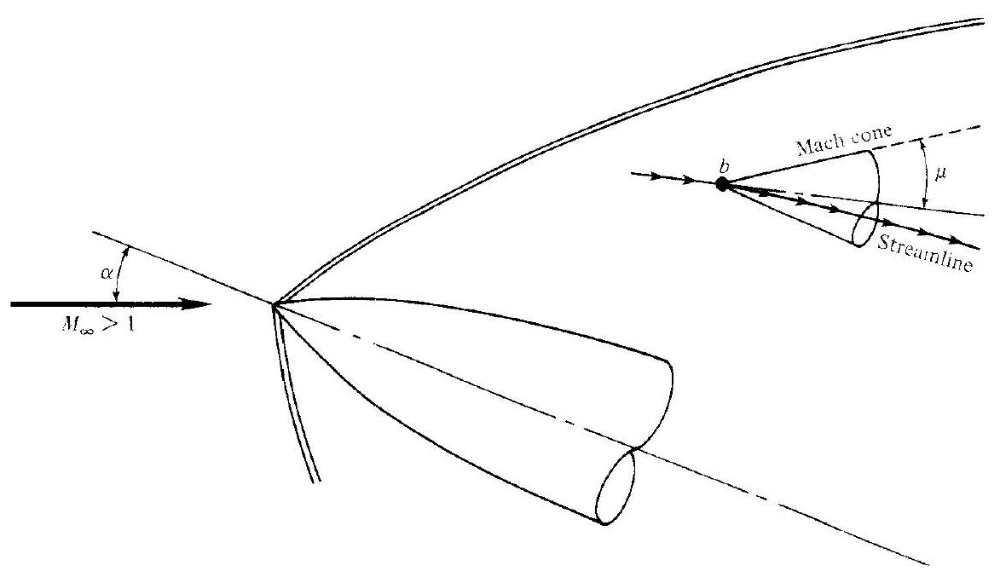
Figure 11.17 | Illustration of the Mach cone in three-dimensional flow.

evaluated in directions not along the characteristics. Nevertheless, such solutions can be obtained (see Refs. 34 through 38).

Rakich (Refs. 37 and 38) has utilized a modification of the above philosophy, which somewhat simplifies the calculations. In this approach, which is sometimes labeled "semicharacteristics" or the "reference plane method," the three-dimensional flowfield is divided into an arbitrary number of planes containing the centerline of the body. This is sketched in Fig. 11.18, which is a front view of the body and shock. One of these planes, say $\phi=\phi_{2}$, is projected on Fig. 11.19. In this particular reference plane, a series of grid points are established along arbitrarily spaced straight lines locally perpendicular to the body surface. Assume that the flowfield properties

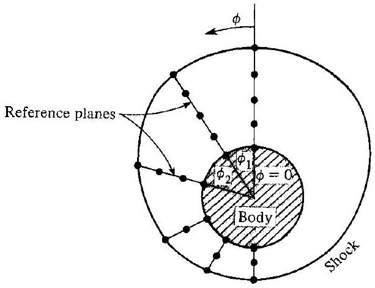
Figure 11.18 | Grid network in a cross-sectional plane for an axisymmetric body at angle of attack; three-dimensional method of characteristics.

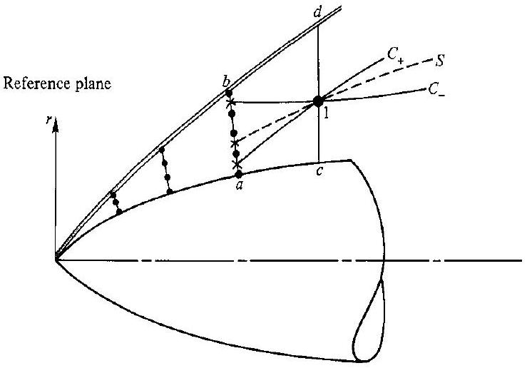
Figure 11.19 | Grid network in the meridional plane for an axisymmetric body at angle of attack; three-dimensional method of characteristics.

known at the grid points denoted by solid circles along the straight line $a b$. Furthermore, arbitrarily choose point 1 on the next downstream line, $c d$. Let $C_{+}, C_{-}$, and $S$ denote the projection in the reference plane of the Mach cone and streamline through point 1. Extend these characteristics upstream until they intersect the data line $a b$ at the cross marks. Data at these intersections are obtained by interpolating between the known data at the solid circles. Then, the flowfield properties at point 1 are obtained by solving these compatibility equations along the characteristics:

$$
\begin{aligned}
\frac{\beta}{\rho V^{2}} \frac{d p}{d C_{+}}+\cos \psi \frac{d \theta}{d C_{+}} & =\left(f_{1}+\beta f_{2}\right) \sin \mu \\
\frac{\beta}{\rho V^{2}} \frac{d p}{d C_{-}}-\cos \psi \frac{d \theta}{d C_{-}} & =\left(f_{1}-\beta f_{2}\right) \sin \mu \\
\frac{d \psi}{d S} & =f_{3}
\end{aligned}
$$

where $\psi=$ the cross-flow angle defined by $\sin \psi=w / V$

$$
\begin{aligned}
& \beta=\sqrt{M^{2}-1} \\
& f_{1}=-\frac{\cos \psi \sin \theta}{r} \\
& f_{2}=-\frac{\sin ^{2} \psi \cos \theta}{r} \\
& f_{3}=-\frac{\sin \psi \sin \theta}{r}
\end{aligned}
$$

It is beyond the scope of this book to describe the details of such an analysis. Again, the reader is referred to Refs. 37 and 38 for further elaboration. The major point made here is that the method of characteristics can be used for threedimensional supersonic flows, and several modern techniques have been devised for its implementation.

### 11.11 I INTRODUCTION TO FINITE DIFFERENCES

The method of characteristics, discussed in the previous sections, is a numerical solution of the governing conservation equations wherein the grid points and computations are made along the characteristic lines. Following the characteristic lines is sometimes a numerical inconvenience, and at high Mach numbers the characteristics net can become particularly elongated and distorted, causing inordinate numerical error in the calculations. In contrast, the finite-difference approach discussed in this and subsequent sections is inherently more straightforward than the method of characteristics, and has the advantage that essentially arbitrary computational grids can be employed. Indeed, it is quite common to use simple rectangular grids for finite-difference methods, as shown in Fig. 11.3. It is for reasons such as these that
finite-difference solutions of the governing conservation equations have become popular in modern compressible flow, supplanting characteristics solutions in many cases. Moreover, finite-difference methods have a much wider range of applicability; they are useful for subsonic and mixed subsonic-supersonic (transonic) flows where the method of characteristics is at best impractical. Finite-difference solutions for purely supersonic steady flows will be discussed in the remainder of this chapter. This will be followed in Chap. 12 with a presentation of the powerful time-marching finite-difference technique that has provided a major breakthrough in the analysis of mixed subsonic-supersonic flows.

The philosophy of finite-difference solutions is to replace the partial derivatives appearing in the conservation equations (see Chap. 6) with algebraic difference quotients, yielding algebraic equations for the flowfield variables at the specified grid points. The type of finite difference that is used to replace the partial derivatives can be selected from a number of different forms, depending on the desired accuracy of the solution, convergence behavior, stability, and convenience. However, the most common forms in current use are forward, rearward, and central differences, all of which stem from the Taylor's series given by Eq. (11.1). For example, assume that we write the conservation equations in cartesian coordinates, and we wish to replace the derivative $\partial u / \partial x$ in these equations with a finite difference at the grid point $(i, j)$. In its present form, Eq. (11.1) is of "second-order accuracy" because terms involving $(\Delta x)^{3},(\Delta x)^{4}$, etc., have been assumed small and can be neglected. If we are interested in only first-order accuracy, then Eq. (11.1) can be written as

$$
u_{i+1, j}=u_{i, j}+\left(\frac{\partial u}{\partial x}\right)_{i, j} \Delta x+\cdots
$$

From Eq. (11.57), we can form a forward difference for the derivative $\partial u / \partial x$,

$$
\left(\frac{\partial u}{\partial x}\right)_{i, j}=\frac{u_{i+1, j}-u_{i, j}}{\Delta x}
$$

which is of first-order accuracy. Similarly, if Eq. (11.1) is written for a minus value of $\Delta x$, we have

$$
u_{i-1, j}=u_{i, j}+\left(\frac{\partial u}{\partial x}\right)_{i, j}(-\Delta x)+\left(\frac{\partial^{2} u}{\partial x^{2}}\right)_{i, j} \frac{(-\Delta x)^{2}}{2}+\cdots
$$

which, for first-order accuracy, can be written as

$$
u_{i-1, j}=u_{i, j}-\left(\frac{\partial u}{\partial x}\right)_{i, j} \Delta x+\cdots
$$

From Eq. (11.60), we can form a rearward difference for the derivative $\partial u / \partial x$,

$$
\left(\frac{\partial u}{\partial x}\right)_{i, j}=\frac{u_{i, j}-u_{i-1, j}}{\Delta x}
$$

which is of first-order accuracy. Finally, we can obtain a second-order-accurate finite difference for $\partial u / \partial x$ by subtracting Eq. (11.59) from Eq. (11.1), both of which contain $(\Delta x)^{2}$ and hence are of second-order accuracy. After subtraction, we have

$$
u_{i+1, j}-u_{i-1, j}=0+2\left(\frac{\partial u}{\partial x}\right)_{i, j} \Delta x+0+\cdots
$$

Solving Eq. (11.62) for $(\partial u / \partial x)_{i, j}$, we obtain the central difference

$$
\left(\frac{\partial u}{\partial x}\right)_{i, j}=\frac{u_{i+1, j}-u_{i-1, j}}{2 \Delta x}
$$

which is of second-order accuracy.
In summary, Eqs. (11.58) and (11.63) define forward, rearward, and central differences, respectively, for the derivative $\partial u / \partial x$. Analogous expressions exist for derivatives in the $y$ direction. For example, returning to Fig. 11.3, we can write

$$
\begin{aligned}
& \left(\frac{\partial u}{\partial y}\right)_{i, j}=\frac{u_{i, j+1}-u_{i, j}}{\Delta y} \quad \text { (forward difference) } \\
& \left(\frac{\partial u}{\partial y}\right)_{i, j}=\frac{u_{i, j}-u_{i, j-1}}{\Delta y} \quad \text { (rearward difference) } \\
& \left(\frac{\partial u}{\partial y}\right)_{i, j}=\frac{u_{i, j+1}-u_{i, j-1}}{2 \Delta y} \quad \text { (central difference) }
\end{aligned}
$$

Finite-difference expressions for higher-order derivatives, such as $\partial^{2} u / \partial x^{2}$, can also be constructed from Eq. (11.1). However, note from Chap. 6 that the conservation equations for inviscid compressible flow contain only first-order derivatives of the flowfield properties. Hence, in this book we need only be concerned with finite differences for first-order derivatives. This would not be true if we were dealing with viscous flows, where second-order derivatives are present in the momentum and energy equations.

Equations (11.58), (11.61), and (11.63) are finite-difference representations of the first partial derivative. When these difference quotients are used to replace the partial differentials in an equation, then a difference equation results. For example, consider the continuity equation given by Eq. (6.5), repeated here.

$$
\frac{\partial \rho}{\partial t}+\nabla \cdot(\rho \mathbf{V})=0
$$

For steady, two-dimensional flow, Eq. (6.5) becomes

$$
\frac{\partial(\rho u)}{\partial x}+\frac{\partial(\rho v)}{\partial y}=0
$$

Defining $F=\rho u$ and $G=\rho v$, Eq. (11.64) is written as

$$
\frac{\partial F}{\partial x}+\frac{\partial G}{\partial y}=0
$$

Replacing the $x$ derivative in Eq. (11.65) with a forward difference [Eq. (11.58)], and the $y$ derivative with a central difference [the $y$ equivalent of Eq. (11.63)], we have

$$
\begin{aligned}
\frac{F_{i+1, j}-F_{i, j}}{\Delta x} & =\frac{G_{i, j+1}-G_{i, j-1}}{2 \Delta y} \\
F_{i+1, j} & =F_{i, j}+\frac{\Delta x}{2 \Delta y}\left(G_{i, j+1}-G_{i, j-1}\right)
\end{aligned}
$$

or

Equation (11.66), or Eq. (11.67), is the difference equation that replaces the original partial differential equation, namely Eq. (11.65). Equation (11.66) is an approximation for Eq. (11.65); Eq. (11.66) contains a truncation error which is a combination of the truncation errors from the difference quotients in Eq. (11.58) and the $y$ equivalent of Eq. (11.63).

A distinction between various finite-difference solutions is that of explicit versus implicit approaches. Let us make the distinction by way of an example. Assume we have a two-dimensional flowfield over which we place a rectangular grid, as sketched in Fig. 11.3. Assume the general direction of the flow is from left to right. Furthermore, assume that the flowfield properties are known at all the grid points along the vertical line through point $(i, j)$. We wish to calculate the value of $F$ at all the downstream grid points along the vertical line through point $(i+1, j)$. Equation (11.67) allows us to calculate $F$ at point $(i+1, j)$ explicitly from the known values along the vertical line through point $(i, j)$. By repeated application of Eq. (11.67) at all points on the upstream vertical line, $(i, j+1),(i, j-1)$, etc., the values of $F$ at all points along the downstream vertical line can be calculated one at a time. This type of approach, wherein the flowfield at a given downstream point is evaluated strictly in terms of the known upstream values, is defined as an explicit finite-difference solution. In contrast, let us construct an approach that assumes the $y$ derivative in Eq. (11.65) is the average between the two vertical lines through points $(i, j)$ and $(i+1, j)$ in Fig. 11.3, i.e., let us form a difference equation for Eq. (11.65) as follows.

$$
\frac{F_{i+1, j}-F_{i, j}}{\Delta x}=\frac{1}{2}\left[\left(\frac{G_{i, j+1}-G_{i, j-1}}{2 \Delta y}+\frac{G_{i+1, j+1}-G_{i+1, j-1}}{2 \Delta y}\right)\right]
$$

or $\quad F_{i+1, j}=F_{i, j}+\frac{\Delta x}{4 \Delta y}\left(G_{i, j+1}+G_{i+1, j+1}-G_{i, j-1}-G_{i+1, j-1}\right)$

In order to calculate $F_{i+1, j}$ from Eq. (11.68), knowing the flowfield at the upstream vertical line is not enough. The right-hand side of Eq. (11.68) also contains the unknown quantities $G_{i+1, j+1}$ and $G_{i+1, j-1}$ along the downstream vertical line. If Eq. (11.68) is applied at all points along the upstream vertical line, a system of simultaneous equations for $G_{i+1, j}, F_{i+1, j}, G_{i+1, j+1}$, etc., along the downstream vertical line is obtained. These unknowns must be solved simultaneously. Moreover, additional equations (momentum, etc.) are required because there are more unknowns than equations provided by Eq. (11.68). This type of approach, wherein the flowfield at a given downstream point is evaluated in terms of both known upstream
values and unknown downstream values, is defined as an implicit finite-difference solution.

The advantage of explicit methods is that they are relatively simple to set up and program. The disadvantage is that the spatial increments $\Delta x$ and $\Delta y$ are limited due to stability constraints associated with explicit methods. For a given $\Delta y, \Delta x$ is constrained to be less than a certain value dictated by numerical stability considerations. (Such stability analyses are discussed at length in Refs. 18 and 102.) In turn, if $\Delta x$ is constrained to be too small, the computer time required to calculate the flow over a prescribed downstream distance can be large.

The advantage of implicit methods is that stability can be maintained over much larger values of $\Delta x$, hence using considerably fewer steps to make calculations over a prescribed downstream distance. A disadvantage of implicit methods is that they are more complicated to set up and program in comparison to explicit methods. Moreover, massive matrix manipulations are usually required at each spatial step to solve the simultaneous algebraic equations, hence the computer time per step is larger for the implicit approach. However, on the whole, implicit methods frequently result in smaller total computer times for a given flowfield calculation. Whether this continues to be the case is a matter of current research; for example, explicit methods are readily vectorizable for use on a vector-type supercomputer, and frequently can take much better advantage of the computer architecture than implicit methods.

Today, both implicit and explicit methods are in wide use. However, for the sake of simplicity, we will deal only with explicit methods in the remainder of this chapter. For details on both methods, see Refs. 18, 102, and 137-142.

A favorite form of the governing flow equations in use by many computational fluid dynamicists today is the conservation form; both conservation and nonconservation forms were derived in Secs. 6.2 and 6.4, respectively. Writing the conservation form of the governing equations for steady, three-dimensional flow, we have from Eqs. (6.5), (6.11) through (6.13), and (6.17),

Continuity:

$$
\frac{\partial(\rho u)}{\partial x}+\frac{\partial(\rho v)}{\partial y}+\frac{\partial(\rho w)}{\partial z}=0
$$

$x$ momentum:

$$
\frac{\partial}{\partial x}\left(\rho u^{2}+p\right)+\frac{\partial(\rho u v)}{\partial y}+\frac{\partial(\rho u w)}{\partial z}=\rho f_{x}
$$

y momentum:

$$
\frac{\partial(\rho v u)}{\partial x}+\frac{\partial}{\partial y}\left(\rho v^{2}+p\right)+\frac{\partial(\rho u w)}{\partial z}=\rho f_{y}
$$

z momentum:

$$
\frac{\partial(\rho w u)}{\partial x}+\frac{\partial(\rho w v)}{\partial y}+\frac{\partial}{\partial z}\left(\rho w^{2}+p\right)=\rho f_{z}
$$

Energy:

$$
\begin{aligned}
& \frac{\partial}{\partial x}\left[\rho\left(e+\frac{V^{2}}{2}\right) u+p u\right]+\frac{\partial}{\partial y}\left[\rho\left(e+\frac{V^{2}}{2}\right) v+p v\right] \\
& \quad+\frac{\partial}{\partial z}\left[\rho\left(e+\frac{V^{2}}{2}\right) w+p w\right] \\
& \quad=\rho \dot{q}+\rho\left(u f_{x}+v f_{y}+w f_{z}\right)
\end{aligned}
$$

These equations can be expressed in a single, generic form as

$$
\frac{\partial F}{\partial x}+\frac{\partial G}{\partial y}+\frac{\partial H}{\partial z}+J=0
$$

where $F, G, H$, and $J$ are column vectors given by

$$
\begin{array}{ll}
F=\left\{\begin{array}{c}
\rho u \\
\rho u^{2}+p \\
\rho v u \\
\rho w u \\
\rho\left(e+V^{2} / 2\right) u+p u
\end{array}\right\} & G=\left\{\begin{array}{c}
\rho v \\
\rho u v \\
\rho v^{2}+p \\
\rho w u \\
\rho\left(e+V^{2} / 2\right) v+p v
\end{array}\right\} \\
H=\left\{\begin{array}{c}
\rho w \\
\rho u w \\
\rho v w \\
\rho w^{2}+p \\
\rho\left(e+V^{2} / 2\right) w+p w
\end{array}\right\} & J=\left\{\begin{array}{c}
0 \\
\rho f_{x} \\
\rho f_{y} \\
\rho f_{z} \\
\rho \dot{q}+\rho\left(u f_{x}+v f_{y}+w f_{z}\right)
\end{array}\right\}
\end{array}
$$

Here, $J$ is called the source term. The governing equations in the form of Eq. (11.69) are called the strong conservation form, in contrast to Eqs. (6.5), (6.11) through (6.13), and (6.17) which are classified as the weak conservation form. In various applications of computational fluid mechanics, the form used for the governing equations can make a difference in the numerical solution; this distinction is particularly important for problems that involve shock waves, and has to do with the choice of the shock-capturing or shock-fitting approaches-to be discussed in Sec. 11.15.

It seems clear from this discussion that the finite-difference philosophy is inherently straightforward; just replace the partial derivatives in the governing equations with algebraic difference quotients, and grind away to obtain solutions of these algebraic equations at each grid point. However, this impression is misleading. For any given application, there is no guarantee that such calculations will be accurate, or even stable. Moreover, the boundary conditions for a given problem dictate the solution, and therefore the proper treatment of boundary conditions within the framework of a particular finite-difference technique is vitally important. For these reasons, general finite-difference solutions are by no means routine. Indeed, much of computational fluid dynamics today is still more of an art than a science; each different problem usually requires special thought and originality in its solution. The reader is strongly urged to study Refs. 39 through 45 in order to gain more appreciation for this state of affairs. These references, written early in the development of CFD, only scratch the surface of the finite-difference literature, but they represent a reasonable introduction to some of the problems. These, along with Refs. 18, 102, and 137-142, and the flavor given in this and subsequent sections, should provide the reader with an understanding of the power and usefulness of finite-difference solutions to compressible flow problems. It is beyond the scope of this book to provide the minute details of any given finite-difference solution; however, the purpose of this and subsequent chapters is to provide a roadmap from which the reader can make excursions into the literature as desired.

### 11.12 I MACCORMACK'S TECHNIQUE

Although a myriad of finite-difference schemes have been utilized for numerous problems, one specific algorithm gained wide use and acceptance in the 1970s and 1980s. This is a technique developed by Robert MacCormack at the NASA Ames Research Center, first published in 1969 in the context of a time-marching solution to the unsteady equations of motion (see Ref. 39). A discussion of such time-marching techniques will be deferred until Chap. 12. However, MacCormack's technique has also been applied to steady supersonic flows (see Refs. 40 through 44 ). MacCormack's technique has been supplanted by more modern algorithms in recent years. However, it is straightforward, very "student friendly," and works well for a number of applications. Therefore, it is highlighted in this section.

Let us consider the solution of a steady, two-dimensional, supersonic, inviscid flowfield in $(x, y)$ space. The flow is assumed to be known along an initial data line. and the finite-difference calculation will march downstream from this initial data line, in the same fashion as described for the method of characteristics in Sec. 11.5. Once again, we note that this downstream-marching approach is consistent with the properties of hyperbolic or parabolic equations. For supersonic flow, Eq. (11.69) is hyperbolic. Let us rewrite Eq. (11.69) for two-dimensional flow with no source terms as

$$
\frac{\partial F}{\partial x}=-\frac{\partial G}{\partial y}
$$

Consider again the grid illustrated in Fig. 11.3. MacCormack's solution of Eq. (11.70) on the grid of Fig. 11.3 takes the form of a predictor-corrector technique. using forward differences on the predictor step and rearward differences on the corrector step. By using this two-step process, although the differences are of first-order accuracy in each step, the overall result is of second-order accuracy. Specifically. referring to Fig. 11.3, the flowfield is known at all points along the vertical lines through $(i-1)$ and $(i)$. Hence, $F_{i+1, j}$ can be calculated from a Taylor's series expansion in terms of $x$ :

$$
F_{i+1, j}=F_{i, j}+\left(\frac{\partial F}{\partial x}\right)_{\mathrm{ave}} \Delta x
$$

In Eq. (11.71), $F_{i, j}$ is known, and $(\partial F / \partial x)_{\text {ave }}$ is an average of the $x$ derivative of $F$ between points $(i, j)$ and $(i+1, j)$. A numerical value of this average derivative is obtained in two steps as we see next.

Predictor Step. First, predict the value of $F_{i+1, j}$ by using a Taylor's series where $\partial F / \partial x$ is evaluated at point ( $i, j$ ). Denote this predicted value as $\bar{F}_{i+1, j}$ :

$$
\bar{F}_{i+1, j}=F_{i, j}+\left(\frac{\partial F}{\partial x}\right)_{i, j} \Delta x
$$

In Eq. (11.72), $(\partial F / \partial x)_{i, j}$ is obtained from Eq. (11.70) using a forward difference for the $y$ derivative:

$$
\left(\frac{\partial F}{\partial x}\right)_{i, j}=-\left(\frac{\partial G}{\partial y}\right)_{i, j}=-\frac{G_{i, j+1}-G_{i, j}}{\Delta y}
$$

In Eq. (11.73), $G_{i, j+1}$ and $G_{i, j}$ are known; hence, the calculated value of $(\partial F / \partial x)_{i, j}$ from Eq. (11.73) is substituted into Eq. (11.72) to yield the predicted value, $\bar{F}_{i+1, j}$. This process is repeated to obtain $\bar{F}_{i+1, j}$ at all values of $j$, i.e., at all grid points along the vertical line through $i+1, j$ in Fig. 11.3.
Corrector Step. The value of $\bar{F}_{i+1, j}$ obtained from the predictor step really represents individual numbers for the flux variables $(\bar{\rho} \bar{u})_{i+1, j},\left(\bar{\rho} \bar{u}^{2}+\bar{p}\right)_{i+1, j}$, $(\bar{\rho} \bar{v} \bar{u})_{i+1, j}$, and $\left[\bar{\rho}\left(\bar{e}+\bar{V}^{2} / 2\right) \bar{u}+\bar{p} \bar{u}\right]_{i+1, j}$, as displayed in Eq. (11.69). In turn, these numbers can be solved for the primitive variables, $\bar{\rho}_{i+1, j}, \bar{u}_{i+1, j}, \bar{v}_{i+1, j}$, and $\bar{e}_{i+1, j}$. These predicted primitive variables are then used to calculate numbers for $\bar{G}_{i+1, j}$. These predicted values of $G$ are then used to calculate a predicted value of the derivative $(\overline{\partial F} / \partial x)_{i+1, j}$ by using a rearward difference in Eq. (11.70):

$$
\left(\frac{\overline{\partial F}}{\partial x}\right)_{i+1, j}=-\frac{\bar{G}_{i+1, j}-\bar{G}_{i+1, j-1}}{\Delta y}
$$

In turn, the results from Eqs. (11.73) and (11.74) allow the calculation of the average derivative

$$
\left(\frac{\partial F}{\partial x}\right)_{\mathrm{ave}}=\frac{1}{2}\left[\left(\frac{\partial F}{\partial x}\right)_{i, j}+\left(\frac{\overline{\partial F}}{\partial x}\right)_{i+1, j}\right]
$$

Finally, the average derivative calculated by Eq. (11.75) allows the calculation of the corrected value $F_{i+1, j}$ from Eq. (11.71). By simply marching downstream in steps of $x$, our algorithm allows the calculation of the complete flowfield downstream of a given initial data line. This is made possible because the equations for steady inviscid supersonic flow are hyperbolic. The above technique cannot be employed in subsonic regions; indeed, if an embedded subsonic region is encountered while marching downstream, the calculations will generally become unstable. However, such mixed subsonic and supersonic flows can be treated by the time-marching technique described in Chap. 12.

Finally, note that MacCormack's scheme is an explicit finite-difference technique. As mentioned earlier, it is of second-order accuracy. A generalization of MacCormack's scheme to third-order accuracy is described in Ref. 42.

### 11.13 I BOUNDARY CONDITIONS

Consider the flow in the vicinity of a solid wall, as sketched in Fig. 11.20. The algorithm described in Sec. 11.12 applies to grid points internally in the flowfield, such as point 1. Here it is possible to form both the required forward and rearward differences in the $y$ direction. However, on the wall at point 2 , it is not possible to form a rearward difference, since there are no points inside the wall. Various methods have been developed to calculate the flow at a wall boundary point, all with mixed degrees of success. Some methods work better than others, depending on the character of the specific flow problem and the slope of the boundary. An authoritative review of such

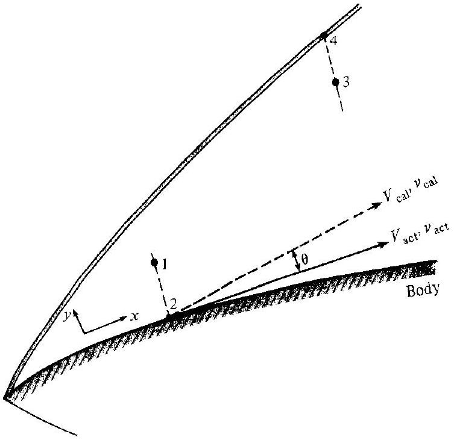
Figure 11.20 I Shock and wall boundary conditions for supersonic steady-flow finite-difference solutions.

boundary conditions is given in Ref. 46. We emphasize that the proper treatment of boundary conditions can make or break a flowfield calculation.

A generally accepted method for accurately dealing with a solid-wall boundary condition for inviscid steady supersonic flow is that due to Abbett (see Ref. 46). Abbett's method is in wide use; moreover, it is simple and accurate. Refer again to Fig. 11.20. First calculate values of the flowfield variables at point 2 using the internal flow algorithm described in Sec. 11.12, but incorporating forward derivatives in both the predictor and corrector steps. This will yield a calculated velocity $V_{\text {cal }}$ at point 2 , as well as calculated values of pressure, temperature, etc. In general the direction of $V_{\text {cal }}$ will not be tangent to the wall due to inaccuracies in the calculational procedure. Figure 11.20 shows $V_{\text {cal }}$ above the wall by the angle $\theta$. However, the necessary boundary conditions at the wall for an inviscid flow dictate that the flow velocity be tangent to the wall. Therefore, Abbett suggests that the calculated velocity direction at point 2 be rotated by means of a Prandtl-Meyer expansion through the known angle $\theta$. This yields the actual velocity at point $2, V_{\text {act }}$, which is tangent to the wall. The Mach number (hence ultimately the velocity magnitude) at point 2 is obtained from the actual Prandtl-Meyer function, $\nu_{\text {act }}$, where

$$
\nu_{\mathrm{act}}=\nu_{\mathrm{cal}}+\theta
$$

Analogously, the actual pressure and temperature at point 2 are obtained from the originally calculated values, modified by an isentropic expansion from $v_{\text {cal }}$ to $v_{\text {act }}$. Figure 11.20 shows the case when $V_{\text {cal }}$ is pointed away from the wall; when $V_{\text {cal }}$ is
toward the wall, the technique is the same except that the Prandtl-Meyer turn is a compression rather than an expansion.

Another common boundary condition in supersonic flow is that immediately behind a shock wave, such as point 4 in Fig . 11.20. Again, the flow properties at the interior point 3 can be obtained from the method discussed in Sec. 11.12. The flow properties at point 4 can be calculated by using one-sided differences (all forward or all rearward) in the same interior algorithm. The strength (hence angle) of the shock wave at point 4 then follows from the oblique shock relations described in Chap. 4. In Ref. 46, Abbett gives several alternative approaches to the shock boundary condition, including some using a local characteristics technique projected from the internal points and matched with the oblique shock relations. Such an approach will be detailed in Chap. 12.

### 11.14 I STABILITY CRITERION: THE CFL CRITERION

The rectangular grid shown in Fig. 11.3 does not always involve purely arbitrary spacing for $\Delta x$ and $\Delta y$. Indeed, the ratio $\Delta x / \Delta y$ must be less than a certain value in order for the explicit finite-difference procedure described in Sec. 11.12 to be computationally stable. On the other hand, for implicit methods $\Delta x / \Delta y$ can be much larger-some implicit methods are unconditionally stable for any value of $\Delta x / \Delta y$ no matter how large. In these cases, however, the accuracy of the solution can become poor at large $\Delta x / \Delta y$ simply because the truncation errors, which depend on $\Delta x$ and $\Delta y$, become large.

In this book, we are dealing primarily with explicit methods for simplicity. Moreover, MacCormack's method described in Sec. 11.12 is an explicit method; this method has been widely adopted, and because of its simplicity, MacCormack's method, in this author's experience, is very "student friendly." Therefore, in the present section, let us examine more closely the stability criterion associated with such an explicit method.

It is difficult to obtain from mathematical analysis a precise condition for $\Delta x / \Delta y$ that holds exactly for a governing system of nonlinear equations, such as the flow equations that we use in gasdynamics. However, we can use as guidance the stability criterion for a model equation that is linear, and that has many of the same mathematical properties as the nonlinear system. For the steady, supersonic, inviscid flows discussed in this chapter, the governing nonlinear equations are hyperbolic, as discussed in Sec. 11.3. A linear, hyperbolic equation can be used as a model for this system in terms of stability considerations. One example of a standard stability analysis of hyperbolic linear equations is the Von Neumann stability method, discussed at length in Refs. 18, 102, 128, and 137-142. The result of this analysis is the following stability criterion:

$$
\Delta x \leq \frac{\Delta y}{|\tan (\theta \pm \mu)|_{\max }}
$$

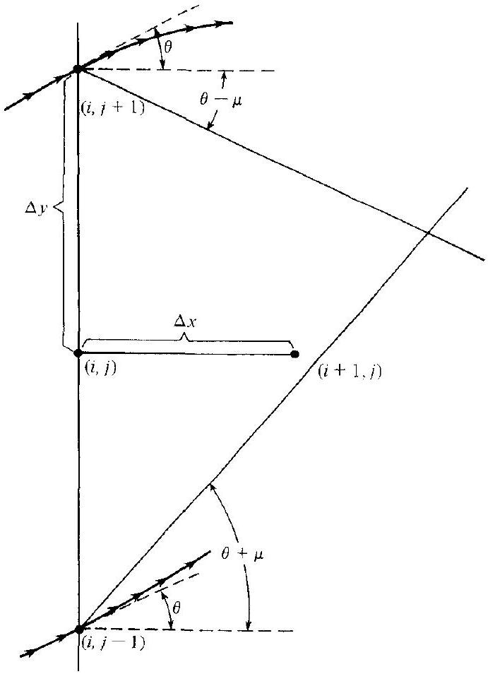
Figure 11.21 I Illustration of the stability criterion for steady two-dimensional supersonic flow.

Equation (11.76) is called the Courant-Friedrichs-Lewy criterion, the so-called CFL criterion. The interpretation of this criterion is shown in Fig. 11.21. Here, a vertical column of grid points $(i, j-1),(i, j),(i, j+1)$, etc., is considered, with $\Delta y$ the spacing between adjacent points. Characteristic lines with angles $\theta+\mu$ and $\theta-\mu$ are drawn through points $(i, j-1)$ and $(i, j+1)$, respectively. The value of $\Delta x$ allowed by Eq. (11.76) falls within the domain defined by these characteristic lines. If $\Delta x$ is larger than stipulated by Eq. (11.76), then grid point $(i+1, j)$ falls outside the domain of these characteristics, and the numerical computation will be unstable.

Note that, from Eq. (11.76), there can be a different value of $\Delta x$ associated with each vertically arrayed grid point, i.e., a different $\Delta x$ reaching downstream from each of points $(i, j-1),(i, j),(i, j+1)$, etc. However, the value actually used for $\Delta x$ should be the same for each of these points so that we have a uniformly spaced grid in the $x$ direction for the next column of grid points, i.e., the spacing between points ( $i, j-1$ ) and ( $i+1, j-1$ ) should be the same as between ( $i, j$ ) and $(i+1, j)$, and so forth. Hence, in Eq. (11.76), the particular constant value of $\Delta x$ to be used for all the vertically arrayed grid points is that associated with the maximum value of $|\tan (\theta \pm \mu)|$ in Eq. (11.76); this is the reason for the subscript max in Eq. (11.76).

### 11.15 I SHOCK CAPTURING VERSUS SHOCK FITTING; CONSERVATION VERSUS NONCONSERVATION FORMS OF THE EQUATIONS

Consider the supersonic flow over a sharp-nosed body, as sketched in Fig. 11.22. The downstream-marching, explicit finite-difference method discussed in the previous sections can readily be used to calculate the supersonic flowfield between the body and the shock wave, starting from a line of initial data near the nose. These initial data are usually obtained by assuming the nose of the body to be a sharp wedge, and using the results of Chap. 4 for starting conditions. If the body is three-dimensional, the nose can usually be assumed to be a cone, and the results of Chap. 10 can be used for the initial data. In Fig. 11.22, the body represents one set of boundary conditions, and the shock wave constitutes a second set. The methods discussed in Sec. 11.13 can be used for these boundaries. Because the shock wave in Fig. 11.22 is assumed to be a discontinuity, it is used as one of the boundaries of the flowfield and is determined by matching the oblique shock relations with the interior flowfield. This approach is defined as shock fitting, in contrast with an alternative approach, sketched in Fig. 11.23. Here, the finite-difference grid is extended far ahead of and above the body, and free-stream conditions are assumed along the outer boundaries. Again applying the algorithm in Sec. 11.12, the flowfield over the finite-difference grid can be calculated. The shock wave will automatically appear within the grid as a region of large gradients smeared over several grid points (the grid is in reality much finer than sketched in Fig. 11.23). Consequently, shock waves do not have to be explicitly assumed; they will appear at those locations in the flowfield where they belong. Such an approach is called shock capturing. An obvious advantage of shock-capturing techniques is that no a priori knowledge about the number or location of shock waves is needed. A disadvantage is that the shock is numerically smeared rather than

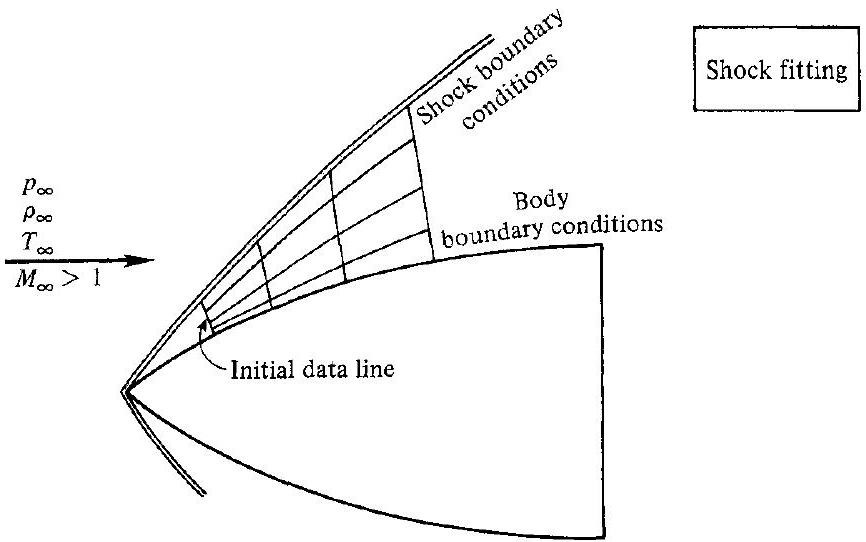
Figure 11.22 | Mesh for the shock-fitting finite-difference approach.

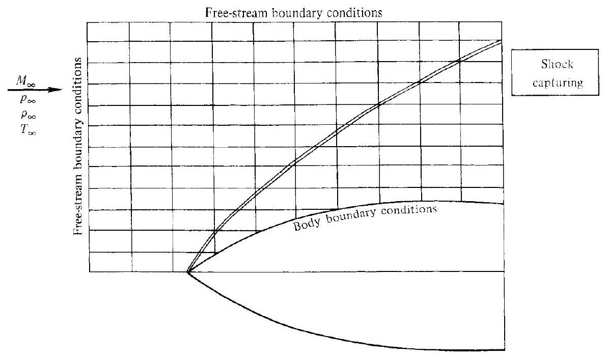
Figure 11.23 I Mesh for the shock-capturing finite-difference approach.

discontinuous; also, the grid points in the free stream are essentially wasted insofar as useful flowfield information is concerned.

Connected with the above considerations is the form of the governing equations. In Chap. 6, both conservation and nonconservation forms of the partial differential equations were obtained. It is generally acknowledged that the equations must be used in conservation form for the shock-capturing approach; this is to ensure conservation of the flux of mass, momentum, and energy across the shock waves within the grid. However, for the shock-fitting approach, either the conservation or nonconservation form of the equations can be used-MacCormack's technique discussed in Sec. 11.12 applies to both systems. The nonconservation form has a numerical advantage: The primitive variables $\rho, u, v, p, T$, etc., are calculated directly from the equations. In contrast, when the conservation form is used, the fluxes $\rho u, \rho v, \rho u^{2}$, etc., are calculated directly from the equations, and the primitive variables must be backed out; this causes extra computation and computer time. However, beyond these considerations, there is no reason to favor one form over the other: the choice is up to the user.

### 11.16 | COMPARISON OF CHARACTERISTICS AND FINITE-DIFFERENCE SOLUTIONS WITH APPLICATION TO THE SPACE SHUTTLE

It is suitable to conclude the technical portion of this chapter with a direct comparison of the method of characteristics with the finite-difference approach. The calculation of the flowfield around a three-dimensional body closely approximating NASA's

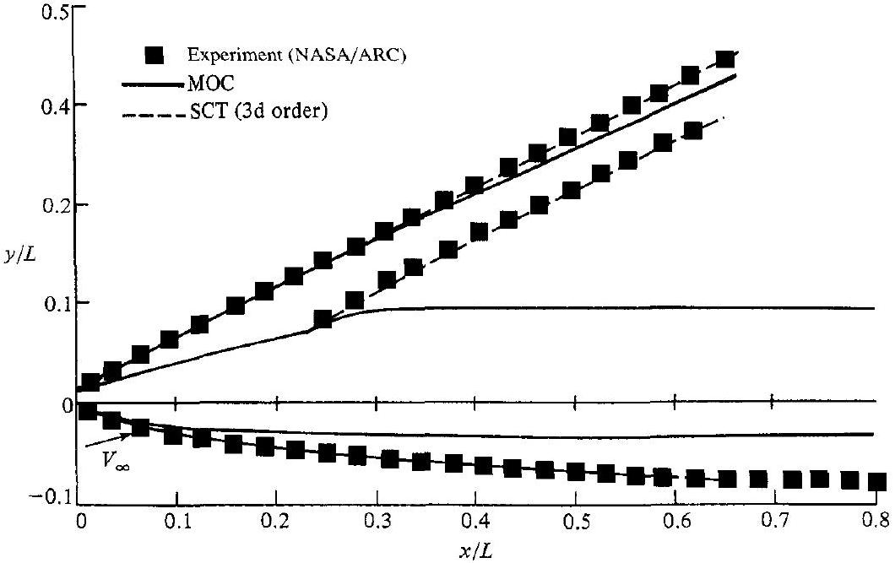
Figure 11.24 I Shock waves on a space shuttle configuration; comparison between method of characteristics and finite-different calculations (after Rakich and Kutler). $M_{\infty}=7.4, \alpha=15.3^{\circ}$.

Space Shuttle is used as an example. The results given here are obtained from the work of Rakich and Kutler, which is described in detail in Ref. 45.

The body is illustrated in Fig. 11.24. The calculations are made for an angle of attack of $15.3^{\circ}$. In the immediate vicinity of the blunt nose, the flow is a mixed subsonic-supersonic region which is calculated by a blunt body method such as will be described in Chap. 12. Downstream of this region the flow is completely supersonic. Here, two sets of calculations are made: (1) a three-dimensional semicharacteristics calculation (MOC) as described in Sec. 11.10, and (2) a third-order-accurate shock-capturing finite-difference version of MacCormack's technique (SCT) based on the philosophy presented in Secs. 11.12 through 11.15. In Fig. 11.24, the shock waves emanating from the nose and canopy regions are shown for both sets of calculations; in addition, experimental data obtained at the NASAAmes Research Center are also shown. Even though the shape of the wind tunnel model in the canopy region varied slightly from the shape fed into the computer calculations, in general the agreement is quite good. A front view of the body and the corresponding shock waves is given in Fig. 11.25. Again, reasonable agreement is obtained. The slight discrepancy that occurs further downstream is due to numerical problems with the method of characteristics on the leaward (upper) side of the body-slight inaccuracies caused by the interpolation for data on the $C_{+}$characteristic. The surface pressure distributions along the top ( $\phi=180^{\circ}$ ) and bottom ( $\phi=0^{\circ}$ ) of the vehicle are shown in Fig. 11.26. Again, good agreement is obtained between the two sets of calculations and experiment.

With regard to computer time for the two sets of calculations, Rakich and Kutler report that, on a single point basis, the time required for the elaborate three-dimensional

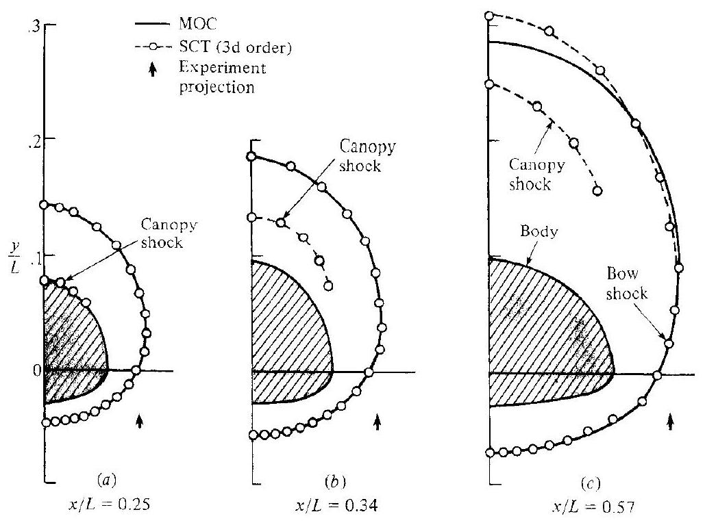
Figure 11.25 | Circumferential shock shape on a space shuttle configuration (after Rakich and Kutler), $M_{\infty}=7.4, \alpha=15.3$.

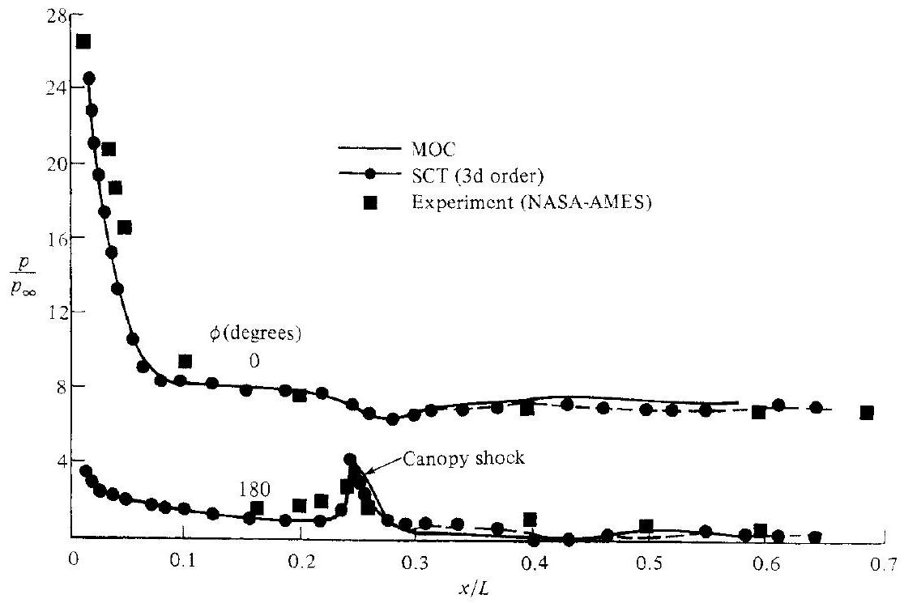
Figure 11.26 I Longitudinal surface pressure distribution on a space shuttle configuration (after Rakich and Kutler). $M_{\chi}=7.4, \alpha=15.3$.

method of characteristics is about four times longer than the more straightforward finite-difference technique. However, in order to accurately capture the shock waves, the finite-difference technique required almost six times more grid points than did the method of characteristics. Therefore, for the solution of the complete flowfield, the method of characteristics solution was slightly faster. However, in their final evaluation, Rakich and Kutler conclude that, "when considering its versatility and computational efficiency, the shock-capturing (finite-difference) technique seems to have the edge on the present method of characteristics program." This is not a general conclusion to be applied to all cases; however, it is clear that the method of characteristics and finite-difference techniques are on reasonably equal footing for the numerical solution of steady, inviscid, supersonic flows.

### 11.17 | HISTORICAL NOTE: THE FIRST PRACTICAL APPLICATION OF THE METHOD OF CHARACTERISTICS TO SUPERSONIC FLOW

Ludwig Prandtl and Adolf Busemann-two names that occur with regularity throughout the history of compressible flow (see Secs. 4.16 and 9.9)-are responsible for the first successful implementation of the method of characteristics to supersonic flow problems. The theory of characteristics was developed by mathematicians to solve general systems of partial differential equations of the first order. Primarily responsible for this mathematical development were the French mathematician Jacques Salomon Hadamard in 1903 and the Italian mathematician Tullio LeviCivita in 1932. However, in 1929, Prandtl and Busemann coauthored a classical paper in which the method of characteristics was applied for the first time to the calculation of two-dimensional supersonic flow. Entitled "Naherungsverfahren zur Zeichnerischen Ermittlung von Ebenen Stromungen mit Uberschallgeschwindigkeit" ("Procedure for the Graphical Determination of Plane Supersonic Flows") and published in Stodola Festschrigt, p. 499 (1929), this work provided graphs of the characteristics in the hodograph plane for two-dimensional flow with $\gamma=1.4$. Furthermore, they showed that the physical characteristics (Mach lines) are perpendicular to the hodograph characteristics and can be obtained from the latter with the aid of a right triangle. This graphical construction was then used by Prandtl and Busemann to construct a contoured nozzle, as illustrated in Fig. 11.27. The approach given by Prandtl and Busemann was a major contribution to the development of compressible flow, and the graphical technique laid out in their paper is still taught today in standard university classes on compressible flow. (In our discussion of the method of characteristics in this chapter, however, we have chosen a numerical rather than a graphical approach for the convenience of computer implementation.)

The experience gained from this work was utilized a few years later by Busemann to design a contoured supersonic nozzle for the first practical supersonic wind tunnel in history, shown in Fig. 11.28. Designed during the early 1930s, this tunnel represented the epitome of the compressible flow research that revolved around Prandtl and his colleagues at Göttingen during the first half of the twentieth century.

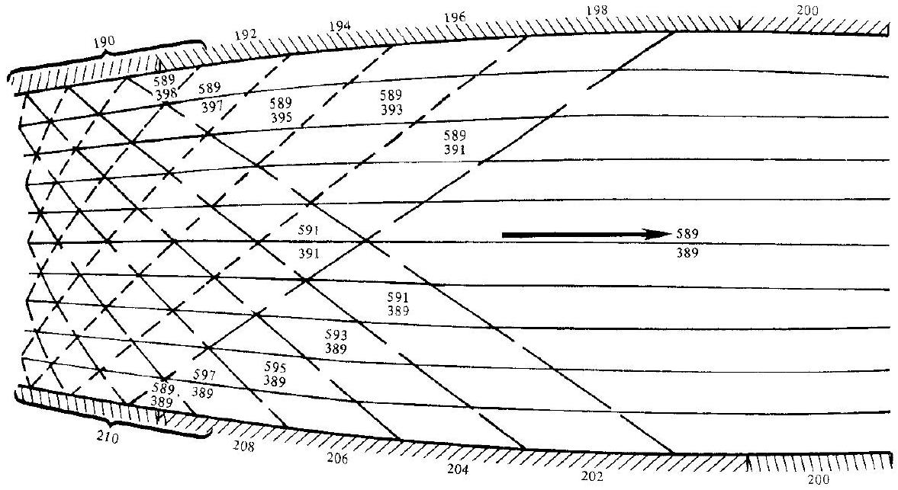
Figure 11.27 | Nozzle contour designed by means of the method of characteristics, after Prandtl and Busemann, 1929.

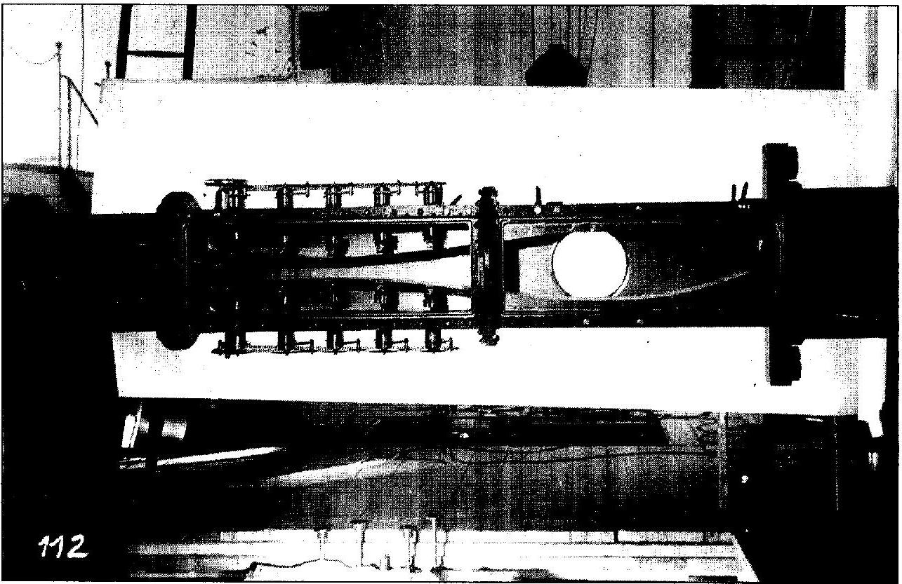
Figure 11.28 I Busemann's supersonic wind tunnel from the early 1930s. This was the first practical supersonic wind tunnel in history. The nozzle was designed by the method of characteristics as developed by Prandtl and Busemann in 1929.

### 11.18 | SUMMARY

Computational fluid dynamics is an important aspect of modern compressible flow; indeed, since about 1970, computational fluid dynamics has opened a new, third dimension in the solution and understanding of fluid dynamic phenomena. The two other dimensions are those of pure experiment and pure theory. The experimental tradition in physical science was solidly established in the early seventeenth century by the work of Galileo and his contemporaries. The methods and use of pure theory had their fundamental beginnings with Newton's Principia in 1687, with major advancements in fluid dynamics by Bernoulli and Euler in the early and mid-eighteenth century. Virtually all advancements in physical science and engineering since then were products of the two dimensions of pure theory and pure experiment working together. Today, computational fluid dynamics constitutes a new, third dimension, which directly complements the two previous dimensions of pure experiment and pure theory. The purpose of this chapter has been to introduce the basic philosophy and a small amount of the methodology of this new third dimension.

The method of characteristics, which had its origins somewhat earlier and independent from that of modern computational fluid dynamics, takes this tact:

1. Find those directions in space along which the flowfield derivatives are indeterminate and across which they may be discontinuous. These are called the characteristic curves (or surfaces, in three dimensions).
2. Find the equations, obtained from a proper treatment of the continuity, momentum, and energy equations, which hold along the characteristic lines (or surfaces). These are called the compatibility equations. These equations have the advantage of being in one less space dimension than the actual flow problem. That is, for three-dimensional flows, the compatibility equations are partial differential equations in two independent variables; for a twodimensional flow, the compatibility equations are ordinary differential equations (in one independent variable). Furthermore, if the flow is two dimensional and irrotational, the compatibility equations reduce one step further, namely, to algebraic equations.

To be more precise, we have discussed these four cases:

1. Two-dimensional, irrotational flow. Here, there are two characteristic lines through any given point, the right- and left-running Mach lines (the $C_{-}$and $C_{+}$ characteristics, respectively). The compatibility equations are the algebraic relations:

$$
\begin{array}{ll}
\theta+v=K_{-} & \text {(along the } C_{-} \text {characteristic) } \\
\theta-v=K_{+} & \text {(along the } C_{+} \text {characteristic) }
\end{array}
$$

2. Asixymmetric, irrotational flow. Here, there are two characteristic lines, again the right- and left-running Mach lines. The compatibility equations are ordinary differential equations given by Eqs. (11.52) and (11.53).
3. Two-dimensional rotational flow. Here, there are three characteristic lines through any given point, namely, the right- and left-running Mach waves and the streamline. The compatibility equations are ordinary differential equations represented by Eqs. (11.54)-(11.56).
4. Three-dimensional flow. Here, the characteristics are three-dimensional surfaces. At any given point, they are the Mach cones emanating from that point and a stream surface through the point. The compatibility equations are partial differential equations. However, using the method of "semicharacteristics" introduced by Rakich, the problem can be solved by means of the solution of ordinary differential equations (see Sec. 11.10).

In finite-difference methods, the partial derivatives in the governing continuity, momentum, and energy equations are replaced by algebraic difference quotients written in terms of the flowfield variables at distinct grid points in the flow. The problem then reduces to the solution of vast numbers of algebraic equations where the unknowns are the flowfield variables at the grid points. All finite-difference methods have as their source a Taylor series expansion. One particular method that has been widely used is MacCormack's method, described in Sec. 11.12. There are many different variations of finite-difference solutions in use; some are explicit and others are implicit; some use shock capturing and others use shock fitting. These concepts are discussed in Secs. 11.11 and 11.15.

The field of computational fluid dynamics is rapidly evolving at this time of writing. New advances are being made that improve on both the accuracy of solution and the speed of computation. Finite-volume and finite-element methods are becoming widespread, in some cases supplanting the older finite-difference methods. Improvements in smoothing the numerical results are being made with such schemes as the total variation diminishing (TVD) approach. Shock waves are being made sharper and better defined by means of upwind differencing. We have not discussed these matters here; they are the purview of more advanced books and papers. The reader is encouraged to consult the current literature for more details.

Finally, we note that the problems treated in this chapter are steady flows where the Mach number is supersonic at every point in the flow. For this type of flow, both the method of characteristics and the finite difference methods are downstream marching. That is, for the solution of a given problem whether it be an internal flow through a duct or an external flow over a supersonic body, the solution begins at an initial data line along which the flow properties are known and the unknown steady flowfield variables are calculated by moving in progressive increments in the downstream direction.

## PROBLEMS

11.1 Using the method of characteristics, compute and graph the contour of a two-dimensional minimum-length nozzle for the expansion of air to a design exit Mach number of 2.
11.2 Repeat Prob. 11.1, except consider a nozzle with a finite expansion section which is a circular arc with a diameter equal to three throat heights. Compare this nozzle contour and total length with the minimum-length nozzle of Prob. 11.1.
11.3 Consider the external supersonic flow over the pointed body sketched in Fig. 11.22. Outline in detail how you would set up a method-ofcharacteristics solution for this flow.

