## CHAPTER

## The Time-Marching Technique: With Application to Supersonic Blunt Bodies and Nozzles

Bodies in going through a fluid communicate their motion to the ambient fluid by little and little, and by that communication lose their own motion and by losing it are retarded.

Roger Coats, 1713, in the preface to the Second Edition of Newton's Principia

## PREVIEW BOX

The Lockheed F-104, shown in the three-view in Fig. 12.1, was the first fighter designed for sustained flight at Mach 2. This airplane embodies excellent supersonic aerodynamics-slender body, pointed nose, thin wings with a sharp leading edge, low-aspect-ratio wings-all designed to minimize the strength of the shock waves on the airplane and hence to reduce wave drag at supersonic speeds. Extrapolating this philosophy to the design of much faster, hypersonic aircraft designed to fly at, say, Mach 20, you might think that such aircraft would be extreme examples of very slender bodies, with very thin wings, supersharp leading edges, etc. However, examine Fig. 12.2, which shows the Space Shuttle, one of today's most common hypersonic vehicles. Notice the blunt nose, thick body, and thick wings with blunt leading edges. Clearly, the design philosophy used for the Space Shuttle is almost the antithesis of that for the F-104. The difference is caused by aerodynamic heating, which becomes severe at hypersonic speeds. The design of hypersonic vehicles is dominated by the need to reduce aerodynamic heating to
the body, drag usually becomes a less significant consideration. Aerodynamic heating is dramatically less for blunt bodies compared to that for slender bodies, and that is why all hypersonic vehicles designed to date have blunt noses, blunt leading edges, etc. A qualitative discussion as to why blunt bodies minimize aerodynamic heating, and the history of the origin of this revolutionary design concept, is given in Chap. 1 of Ref. 104. Quantitative theoretical proof that aerodynamic heating varies inversely as the square root of the nose radius is given in Ref. 119. In short, blunt-nosed bodies have become important configurations for very high speed vehicles.

The qualitative aspects of the flow over a supersonic blunt body are discussed in Sec. 4.12. When the blunt body concept was first introduced for hypersonic vehicles in the early 1950s, there existed no theoretical solutions to such a flow field. At that time, the "supersonic blunt body problem" became a subject of intense research, and for the next 15 years platoons of researchers and many millions of dollars were devoted

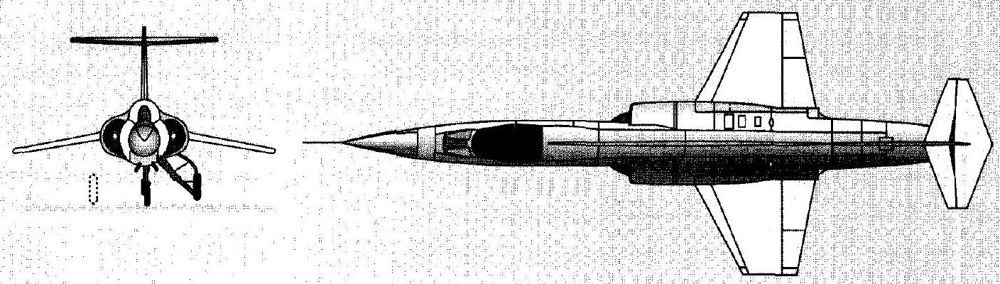
Figure 12.1 I Three-view of the Lockheed F-104 supersonic fighter.

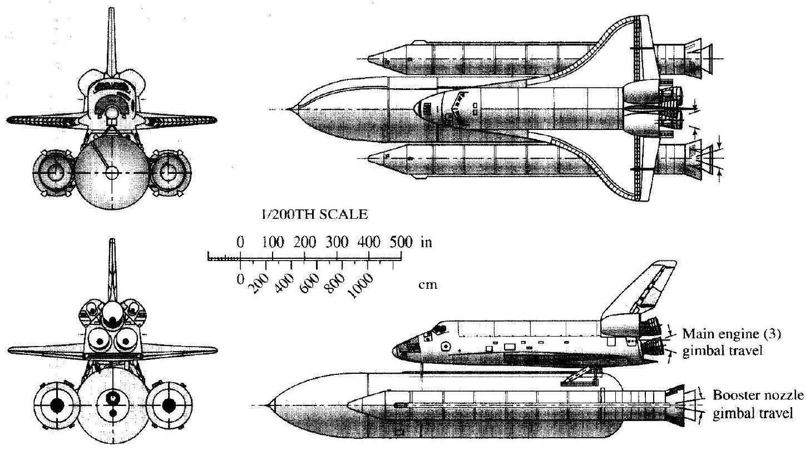
Figure 12.2 | The Space Shuttle.

to the theoretical solution of the flowfield over a blunt body moving at supersonic or hypersonic speedswithout any reasonable success. The problem was related to the mixed subsonic-supersonic nature of the flow behind the curved, detached shock wave over the body, as shown in Fig. 4.29. Whatever technique that would work in the subsonic region would fall apart in the supersonic region, and whatever method was good for the supersonic region (such as the methods of characteristics) did not apply to the subsonic region.

Then, in the mid-1960s, a breakthrough was achieved. The supersonic blunt body problem was solved by means of a time-marching numerical solution. The time-marching aspect makes all the difference. It allows for the straightforward calculation of both the subsonic and supersonic regions by a single uniform technique. This breakthrough was so dramatic that the calculation of the flow over a blunt body moving at supersonic or hypersonic speeds is routine today. The time-marching solution of the blunt body flow is now the industry standard.

The present chapter introduces the concept of timemarching solutions, and then discusses in detail the time-marching solution of the blunt body problem. This material is particularly important because modern computational fluid dynamics uses time-marching to solve many types of problems, not just the blunt body problem. Indeed, time-marching is one of the dominant features of modern CFD.

The roadmap for this chapter is given in Fig. 12.3. We first introduce the philosophy of time-marching solutions by way of application to a familiar problem, namely, the quasi-one-dimensional nozzle flow discussed in Chap. 5. This is followed by a discussion of the stability criterion for time-marching solutions. Then, in preparation for the blunt body problem, we define the limiting characteristic curves in the blunt body flow, and take a side excursion to consider Newtonian theory for the prediction of pressure coefficient on the surface of a body in a flow. Finally, we deal with the main aspect of this chapter-the application of the time-marching method to the supersonic blunt body problem.

## (continued from page 433)

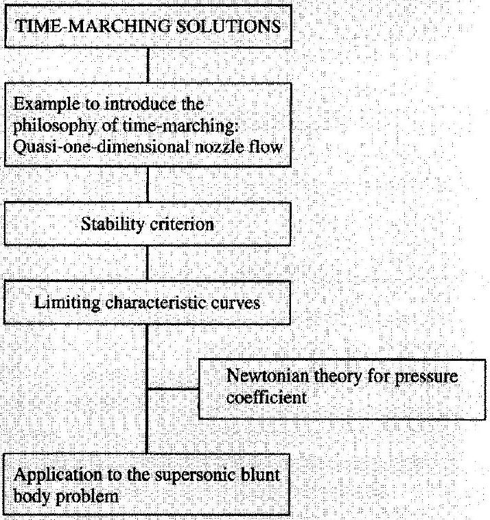
Figure 12.31 Roadmap for Chapter 12.

### 12.1 I INTRODUCTION TO THE PHILOSOPHY OF TIME-MARCHING SOLUTIONS FOR STEADY FLOWS

We have seen from Chap. 11 that steady supersonic flowfields are governed by hyperbolic differential equations, whereas steady subsonic flowfields are described by elliptic differential equations. There are many applications where flowfields contain both subsonic and supersonic regions, such as the flow over a blunt body moving at supersonic velocity as sketched in Fig. 12.4a and the expansion to supersonic speeds through a convergent-divergent nozzle, as sketched in Fig. 12.4b. Both of these examples are mixed subsonic-supersonic flows, where the sonic line divides the two regions. The fact that the nature of the governing equations changes from elliptic to hyperbolic across the sonic line causes severe mathematical and numerical difficulties-so much so that steady-flow solutions of the subsonic and supersonic regions are usually treated separately and differently, and then somehow patched in the transonic region near the sonic line. So far, no practical steady-flow technique exists that can uniformly treat both the subsonic and supersonic regions of a general flowfield of arbitrary extent. Compounding this problem was the discovery in the early 1950s that high-speed missiles should have blunt noses to reduce aerodynamic heating. Almost overnight the supersonic blunt body problem, with its mixed subsonic-supersonic flowfield, became a central focus in theoretical and experimental aerodynamics. During the period

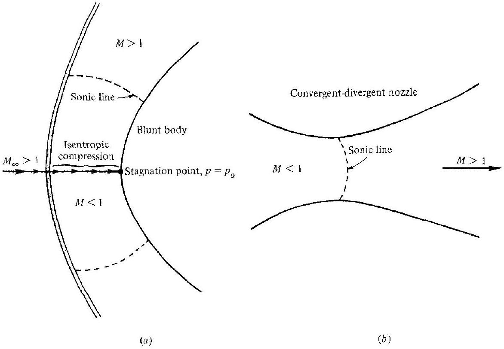
Figure 12.4 | Illustrations of mixed subsonic-supersonic flow fields, with curved sonic lines.

between 1955 and 1965, numerous blunt body solutions were advanced, all with several greater or lesser disadvantages or defects. (During this period it was common to have complete sessions during meetings of the Institute of Aeronautical Sciencesnow the AIAA-just to discuss the blunt body problem.) Then, in the mid-1960s, a breakthrough occurred. The time-marching technique for the solution of steady flows was developed, and in 1966, Moretti and Abbett published the first truly practical solution for the supersonic blunt body problem (see Ref. 47). Since then, time-marching (sometimes called "time-dependent") solutions have become an important segment of computational fluid dynamics. The purpose of this chapter is to introduce the philosophy, approach, and some results of this very powerful technique.

The philosophy and approach of the time-marching technique is best described in the context of a simple example. Consider the quasi-one-dimensional flow of a calorically perfect gas through a given convergent-divergent nozzle, as studied in Chap. 5. The reservoir conditions $p_{o}, \rho_{o}, T_{o}$ are given and held constant with time. Split the nozzle into a number of grid points in the flow direction, as sketched in Fig. 12.5. Arbitrarily assume values for all the flow variables, $p, \rho, u$, etc., at all the grid points except the first, which is associated with the fixed reservoir conditions. These are by no means the correct solutions (unless you are a magician at making the correct guess). Consider these guessed values as initial conditions throughout the flow. Then advance the flowfield variables at each grid point in steps of time by means of the Taylor's series

$$
g(t+\Delta t)=g(t)+\left(\frac{\partial g}{\partial t}\right)_{\mathrm{ave}} \Delta t+\cdots
$$

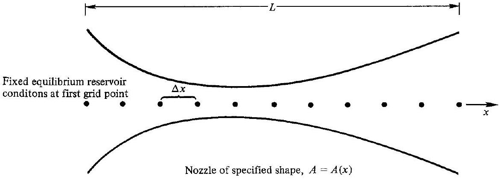
Figure 12.5 I Coordinate system and grid points for the time-marching solution of quasi-one-dimensional flow through a nozzle.

where $g$ denotes $p, \rho, T$, or $u$, and $\Delta t$ is a small increment in time chosen to satisfy certain stability criteria to be discussed in Sec. 12.2. For example, if at a given grid point we know $u$ at time $t$, then we can calculate $u$ at time $t+\Delta t$ at the same grid point from Eq. (12.1) if we can find a value for the time derivative $(\partial u / \partial t)_{\text {ave }}$. Let us pause for a moment and consider in the next paragraph where this time derivative comes from.

Obviously, Eq. (12.1) is just mathematics; the physics of the problem enters in the calculation of the time derivatives, which are obtained from the unsteady conservation equations. For the quasi-one-dimensional problem considered here, the governing unsteady equations can be obtained by applying the fundamental integral equations of continuity, momentum, and energy, Eqs. (2.2), (2.11), and (2.20), respectively, to an infinitesimally small control volume of variable area, as sketched in Fig. 5.7. For example, Eq. (2.2),

$$
\frac{\partial}{\partial t} \oiint_{\mathscr{V}} \rho d \mathscr{V}=-\oiint_{S} \rho \mathbf{V} \cdot d \mathbf{S}
$$

when applied to the control volume in Fig. 5.7 yields (noting that $d \mathscr{V}=A d x$ )

$$
\frac{\partial}{\partial t}(\rho A d x)=-[-\rho u A+(\rho+d \rho)(u+d u)(A+d A)]
$$

Ignoring products of differentials in Eq. (12.2), the result is

$$
\frac{\partial(\rho A)}{\partial t} d x=-d(\rho u A)
$$

Equation (12.3) can be more formally written as

$$
\frac{\partial(\rho A)}{\partial t}=-\frac{\partial(\rho u A)}{\partial x}
$$

Furthermore, since $A=A(x)$ does not depend on time, Eq. (12.4) becomes

$$
\frac{\partial \rho}{\partial t}=-\frac{1}{A} \frac{\partial(\rho u A)}{\partial x}
$$

Equation (12.4) or (12.5) represents the continuity equation for unsteady quasi-onedimensional flow in partial differential equation form. By similar applications of Eqs. (2.11) and (2.20) to Fig. 5.7, and with some manipulation, we find (you should demonstrate this to yourself)

$$
\begin{aligned}
& \frac{\partial u}{\partial t}=-\frac{1}{\rho}\left(\frac{\partial p}{\partial x}+\rho u \frac{\partial u}{\partial x}\right) \\
& \frac{\partial e}{\partial t}=-\frac{1}{\rho}\left[p \frac{\partial u}{\partial x}+\rho u \frac{\partial e}{\partial x}+p u \frac{\partial \ln A}{\partial x}\right]
\end{aligned}
$$

Equations (12.6) and (12.7) are the momentum and energy equations, respectively, for unsteady quasi-one-dimensional flow. Along with the perfect gas relations

$$
\begin{aligned}
& p=\rho R T \\
& e=c_{v} T
\end{aligned}
$$

these equations are sufficient for calculating the flow we are considering.
Now return to the line of thought embodied in Eq. (12.1). The time derivative in Eq. (12.1) can now be obtained from Eqs. (12.5) through (12.7). Note that, in these equations, the time derivatives on the left-hand sides are given in terms of the spatial derivatives on the right-hand sides. These spatial derivatives are known-they can be expressed as finite differences from the known flowfield values at time $t$. Hence, Eqs. (12.5) through (12.7), along with (12.8) and (12.9), allow the calculation of $(\partial g / \partial t)$, evaluated at time $t$. If we desired first-order accuracy, then this value of $(\partial g / \partial t)_{t}$ in Eq. (12.1) would be enough to calculate $g(t+\Delta t)$. However, for second-order accuracy, $(\partial g / \partial t)_{\text {ave }}$ in Eq. (12.1) must be an average between $t$ and $t+\Delta t$. This average derivative can be calculated by means of MacCormack's technique, first introduced in Sec. 11.12. For the present time-marching technique, MacCormack's predictor-corrector scheme is as follows.

Predictor Step. Calculate $(\partial g / \partial t)_{t}$ from Eqs. (12.5) through (12.9), using forward spatial differences on the right-hand sides from the known flowfield at time $t$. Use this value to obtain a predicted value of $g$ at time $t+\Delta t$ from

$$
\bar{g}(t+\Delta t)=g(t)+\left(\frac{\partial g}{\partial t}\right)_{t} \Delta t
$$

Corrector Step. Using rearward spatial differences, insert the above values of $\bar{g}$ into Eqs. (12.5) through (12.9) to calculate a predicted value of $\overline{\partial g} / \partial t$. Then form the average derivative as

$$
\left(\frac{\partial g}{\partial t}\right)_{\text {ave }}=\frac{1}{2}\left[\left(\frac{\partial g}{\partial t}\right)_{t}+\left(\frac{\overline{\partial g}}{\partial t}\right)\right]
$$

Finally, insert the average derivative from Eq. (12.10) into Eq. (12.1) to obtain the corrected value, $g(t+\Delta t)$. This is the desired second-order-accurate value of $g$ at time $t+\Delta t$.

Now we come to the crux of the time-marching technique. Using Eq. (12.1), with $(\partial g / \partial t)_{\text {ave }}$ calculated as outlined above, values of $g$ at each grid point in Fig. 12.5 can be calculated in steps of time, starting from the guessed, arbitrary initial conditions. The values of the flowfield variables (represented by $g$ ) will change for each step in time. However, after a number of time steps, these changes will become smaller and smaller, finally asymptotically approaching a steady value. It is this steady flowfield we are interested in as our solution-the time-marching technique is simply a means to achieve this end. For example, Fig. 12.6 gives the temperature distribution for a nozzle with an area variation given by $A / A^{*}=1+2.2(x-1.5)^{2}$. Here, the nozzle throat is at $x=1.5 ; x<1.5$ is the subsonic section and $x>1.5$ is the supersonic section. The dashed line in Fig. 12.6 represents the guessed initial temperature distribution at time $t=0$. It is arbitrarily taken as a linear variation. The solid curves in Fig. 12.6 give the transient distributions after $8,16,32,120$, and 744 time steps, using the time-marching procedure described above. By the 744th time step, the distribution has become sufficiently invariant with time for this to be taken as the final steady state. This final steady state agrees with the classical results obtained from Chap. 5. This behavior is further illustrated in Fig. 12.7, which shows the variation of mass flow $\rho u A$ through the

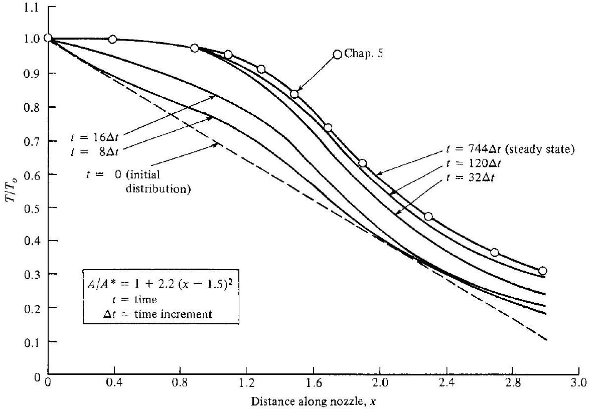
Figure 12.6 I Transient and final steady state temperature distributions for a calorically perfect gas obtained from the time-marching technique.

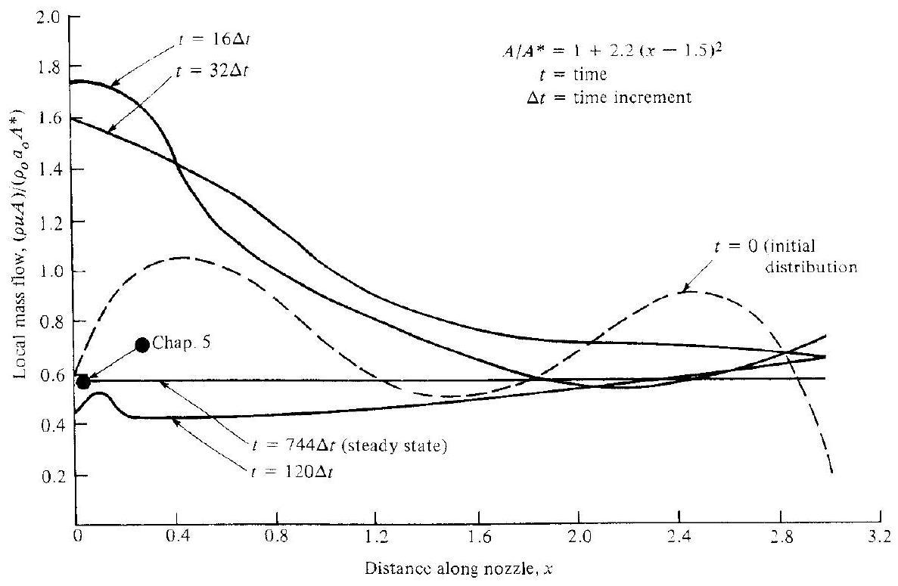
Figure 12.7 I Transient and final steady state mass-flow distributions for a calorically perfect gas obtained from the time-marching technique.

nozzle at different times. Again, the dashed line is the initial distribution due to the assumed flowfield values at time zero. The solid curves show the intermediate distributions after $16,32,120$, and 744 , time steps. Note that, at $t=744 \Delta t$, the mass flow distribution has become a straight, horizontal line- $\rho u A$ has become a constant throughout the nozzle, as it should be for steady flow as discussed in Chap. 5. Furthermore, it is the correct value as shown by comparison with the classical results from Chap. 5.

Please note that the above time-marching solution for the quasi-one-dimensional flow of a calorically perfect gas was chosen simply to illustrate the time-dependent technique. The closed-form algebraic solutions for nozzle flows given in Chap. 5 are considerably simpler than this finite-difference solution. However, for quasi-onedimensional nozzle flows of nonequilibrium gases, such as may occur in hightemperature chemically reacting flows, the time-dependent technique present here has definite advantages; the classical results of Chap. 5 are no longer valid for such high-temperature flows. This situation will be addressed in Chap. 17. For further background and details on the application of the time-marching technique to quasi-one-dimensional nozzle flows, see Refs. 48 through 50.

Let us recapitulate. The essence of the time-marching technique to solve steady flows is as follows. For a given flow problem with prescribed steady boundary conditions, set down some arbitrary initial values of the flowfield at each grid point. Then advance these flow properties in steps of time using Eq. (12.1), where the time derivatives are obtained from the unsteady equations of motion. MacCormack's
predictor-corrector technique is recommended for the finite-difference calculation of these time derivatives, as given above. After a number of time steps, the flow properties at each grid point will approach a steady state. This steady state is the desired result; the time-marching approach is just a means to this end.

At first thought, the introduction of time as an extra independent variable would appear to be an unnecessary complication for a steady-flow problem. However, on the contrary, for some problems it becomes a striking simplification. Consider again the blunt body and two-dimensional nozzle flows sketched in Fig. 12.4. As mentioned before, there is virtually no satisfactory, uniformly valid, steady state technique for the solution of these mixed flows--the mixed nature of the elliptic subsonic region and the hyperbolic supersonic region essentially rules out such a solution. On the other hand, the unsteady equations of motion [such as Eqs. (12.5) through (12.7)] are hyperbolic with respect to time, regardless of whether the flow is locally subsonic or supersonic. Hence, the complete flowfields shown in Fig. 12.4 lend themselves to a well-posed initial value problem with respect to time. Therefore, the timemarching technique becomes a very powerful tool for the solution of such mixed flows, being uniformly valid throughout the flowfield. (Note that the unsteady wave motion discussed in Chap. 7 is another example of a system which is hyperbolic in time, a fact which we took advantage of with our characteristics solutions for onedimensional finite wave motion. However, in Chap. 7 we were concerned with the time variations themselves, whereas in the present chapter we are concerned with the final steady state as an asymptotic convergence of the transient flow.)

### 12.2 I STABILITY CRITERION

The time-marching technique with the use of MacCormack's approach as outlined here is explicit. For such an explicit solution, the value of $\Delta t$ in Eq. (12.1) cannot be any arbitrary value; indeed, it must be less than or equal to some maximum value. This maximum value is usually estimated from a stability analysis performed on a set of approximate, linear equations after Courant, Friedrichs, and Lewy (Ref. 51)-the so-called CFL criterion. Without going into the mathematics, the physical significance of the CFL criterion is that $\Delta t$ must be less than or at most equal to the time required for a sound wave to propagate between two adjacent grid points. Consider a two-dimensional rectangular grid such as shown in Fig. 11.3, where at any grid point the flowfield velocity is $V$, with $x$ and $y$ components $u$ and $v$, respectively. The velocity of propagation of a sound wave in the $x$ direction is $u+a$, and the time of propagation is

$$
\Delta t_{x}=\frac{\Delta x}{u+a}
$$

Similarly, in the $y$ direction,

$$
\Delta t_{y}=\frac{\Delta y}{v+a}
$$

The CFL criterion can then be expressed as

$$
\Delta t \leq \min \left(\Delta t_{x}, \Delta t_{y}\right)
$$

where the number chosen on the right-hand side is the smaller of the values obtained from Eqs. (12.11) and (12.12). Experience has shown that the choice of the equals sign in Eq. (12.13) usually yields a $\Delta t$ too large for stability of the nonlinear system associated with the flow problems of interest. Hence, in practice, $\Delta t$ is chosen such that

$$
\Delta t=K\left[\min \left(\Delta t_{x}, \Delta t_{y}\right)\right]
$$

where $K$ is less than unity, typically on the order of 0.5 to 0.8 . A particular value of $K$ suited to a particular application is usually determined by trial and error.

Note from Eqs. (12.11) through (12.14) that $\Delta t$ is proportional to the grid spacing $\Delta x$ or $\Delta y$. For coarse grids, $\Delta t$ can be large, and the ensuing computer time correspondingly short. However, if the number of grid points is essentially quadrupled by halving both $\Delta x$ and $\Delta y$ in Fig. 11.3. the number of calculations at each time step will increase by a factor of 4 . Moreover, the value of $\Delta t$ will be halved, and twice as many time steps will be necessary to compute to a given value of time 1 . Hence because of the coupling between $\Delta t$ and the grid size as given in Eqs. (12.11) through (12.14), reducing the grid spacing by a factor of 2 results in a factor of 8 increase in computer execution time for a given time-marching solution. Therefore, this stability criterion can be very stringent.

Finally, contemporary work on implicit time-marching finite-difference techniques indicates that the stability criterion presented here can be relaxed considerably. It is beyond the scope of this book to review such current research; instead, the reader is encouraged to consult and follow the recent literature.

### 12.3 I THE BLUNT BODY PROBLEMQUALITATIVE ASPECTS AND LIMITING CHARACTERISTICS

Some of the physical aspects concerning the flowfield over a supersonic blunt body were introduced in Sec. 4.12, which should be reviewed by the reader before progressing further.

It is again emphasized that the steady flowfield over the blunt body in Fig. 12.4 is a mixed subsonic-supersonic flow described by elliptic equations in the subsonic region and hyperbolic equations in the supersonic region. The sonic line divides these two regions. Moreover, we have emphasized in Chap. 11 that disturbances cannot propagate upstream in a steady supersonic flow. Hence, by examining Fig. 12.4a, we might assume that the subsonic region and the shape of the sonic line are governed by only that portion of the body shape between the two sonic lines. However, this is not completely valid. Consider the low supersonic flow (say $M_{x}<2$ ) over a sphere as sketched in Fig. 12.8a. Point $a$ is the intersection of the sonic line and the body. On

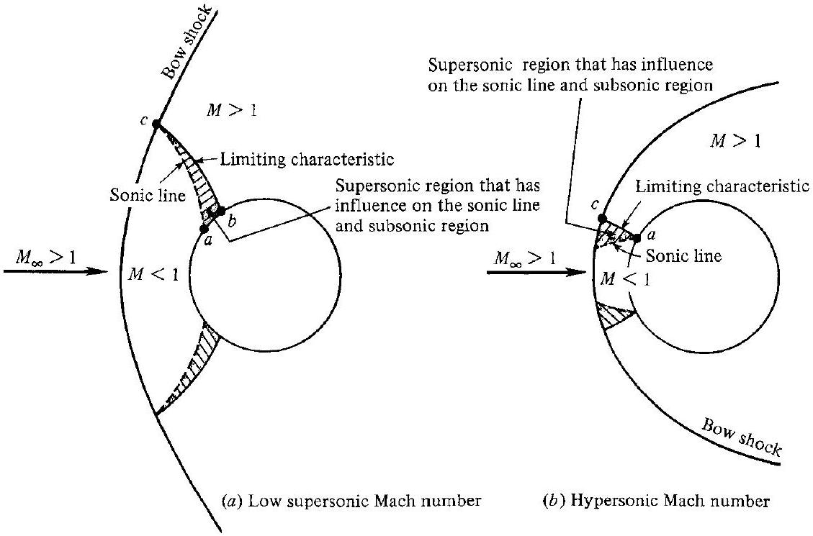
Figure 12.8 | Illustration of limiting characteristics.

the body downstream of point $a$ the flow is supersonic. Consider the left-running characteristic lines that emanate from the body downstream of point $a$. The particular characteristic that emanates from the body at point $b$, and just exactly intersects the shock wave at the point where the sonic line also intersects the shock (point $c$ ), is defined as the limiting characteristic. Any characteristic line emanating from the body between points $a$ and $b$ will intersect the sonic line; any characteristic emanating downstream of point $b$ will not. Hence, any disturbance originating within the shaded supersonic region between the sonic line and limiting characteristic in Fig. 12.8a will propagate along a left-running characteristic, will intersect the sonic line, and hence will be felt throughout the subsonic region. In particular, the shape of the body between points $a$ and $b$ will influence the shape of the sonic line and the subsonic flow even though the local flow between $a$ and $b$ is supersonic. Therefore, if the method of characteristics (see Chap. 11) is to be employed for calculating the supersonic region over a blunt body, the initial data line can be chosen no further upstream than the limiting characteristic; to use the sonic line as initial data improperly ignores the influence of the shaded regions. At higher Mach numbers, such as those sketched in Fig. 12.8b, the shock wave moves closer to the body and the sonic point behind the shock moves considerably downward, whereas the sonic point on the body moves downward only slightly. Hence, the shape of the sonic line is quite different at higher Mach numbers. Here, the right-running characteristic through point $c$ on the shock intersects the sonic line at point $a$ on the body. This characteristic is the limiting characteristic for such a case. Any disturbance in the supersonic shaded region in Fig. $12.8 b$ will propagate along a right-running characteristic, will intersect the sonic line, and will influence the subsonic regions.

Again, it is emphasized that any theoretical or numerical solution of the blunt body flowfield must be valid not only in the subsonic region, but must carry downstream to at least the limiting characteristic. Then, the methods described in Chap. 11 can be used downstream of the limiting characteristic.

For an elaborate and detailed description of the blunt body flowfield and various early approaches to its solution, see the authoritative book by Hayes and Probstein (Ref. 52). In this chapter, we will emphasize the time-marching solution of blunt body flows.

### 12.4 I NEWTONIAN THEORY

As noted on our roadmap in Fig. 12.3, this section is a slight diversion from our main emphasis in this chapter on time-marching solutions. Here, we will obtain a simple expression for the pressure distribution over the surface of a blunt body, which will be useful in subsequent discussions.

In Propositions 34 and 35 of his Principia, Isaac Newton considered that the force of impact between a uniform stream of particles and a surface is obtained from the loss of momentum of the particles normal to the surface. For example, consider a stream of particles with velocity $V_{\infty}$ incident on a flat surface inclined at the angle $\theta$ with respect to the velocity, as shown in Fig. 12.9a. Upon impact with the surface, Newton assumed that the normal momentum of the particles is transferred to the surface, whereas the tangential momentum is preserved. Hence, after collision with the surface, the particles move along the surface, as sketched in Fig. 12.9a. The change in normal velocity is simply $V_{\infty} \sin \theta$. Now consider Fig. 12.9b. The mass flux of particles incident on a surface of area $A$ is $\rho V_{\infty} A \sin \theta$. Hence, the time rate of change of momentum of this mass flux, from Newton's reasoning, is

Mass flux × velocity change
or

$$
\left(\rho V_{\infty} A \sin \theta\right)\left(V_{\infty} \sin \theta\right)=\rho V_{\infty}^{2} A \sin ^{2} \theta
$$

And in turn, from Newton's second law, this time rate of change of momentum is equal to the force $F$ on the surface:

$$
F=\rho V_{\infty}^{2} A \sin ^{2} \theta
$$

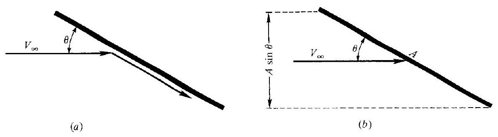
Figure 12.9 | Schematic for newtonian impact theory.

In turn, the pressure is force per unit area, which from Eq. (12.15) is

$$
\frac{F}{A}=\rho V_{\infty}^{2} \sin ^{2} \theta
$$

Newton assumed the stream of particles in Fig. 12.9b to be linear, i.e., he assumed that the individual particles do not interact with each other, and have no random motion. Since modern science recognizes that static pressure is due to the random motion of the particles, and since Eq. (12.16) considers only the linear, directed motion of the particles, the value of $F / A$ in Eq. (12.16) must be interpreted as the pressure difference above static pressure, namely, $F / A=p-p_{\infty}$. Therefore, from Eq. (12.16), and recalling from Chap. 9 the definition of the pressure coefficient, $C_{p}=\left(p-p_{\infty}\right) / \frac{1}{2} \rho V_{\infty}^{2}$, we have

$$
\begin{aligned}
p-p_{\infty} & =\rho V_{\infty}^{2} \sin ^{2} \theta \\
\frac{p-p_{\infty}}{\frac{1}{2} \rho V_{\infty}^{2}} & =2 \sin ^{2} \theta \\
C_{p} & =2 \sin ^{2} \theta
\end{aligned}
$$

Equation (12.17) is the newtonian "sine-squared" law for the pressure distribution on a surface inclined at an angle $\theta$ with respect to the free stream. Of course, the physical picture used to derive Eq. (12.17) in no way describes a realistic flowsubsonic or supersonic. Newton did not have the advantage of our knowledge in the twentieth century; he did not know about shock waves, nor did he have the proper image of fluid mechanics. However, at high supersonic and hypersonic Mach numbers, the shock wave moves closer to the body, and the flowfield begins to resemble some of the characteristics sketched in Fig. 12.9a, namely, a uniform flow ahead of the shock wave, and a flow reasonably parallel to the body in the shock layer between the body and the shock. Therefore, particularly at hypersonic Mach numbers, the newtonian theory provides reasonable results for the pressure distribution over an inclined surface, with increasing accuracy as $M_{\infty}$ and $\theta$ increase. Also, it is interesting to note that the exact shock wave relations (see Chap. 4) approached the newtonian result as $\gamma$ approaches unity. Therefore, Eq. (12.17) is more accurate for dissociating and ionizing flow (where the "effective" $\gamma$ is low) than for monatomic gases such as helium (where $\gamma=1.67$ ). A discussion of such chemically reacting flows and the consequent effect on $\gamma$ is given in Chaps. 16 and 17.

In 1955, Lester Lees, a professor at the California Institute of Technology, proposed a "modified newtonian" pressure law. Consider a blunt body at zero angle of attack, as sketched in Fig. 12.4a. The streamline that passes through the normal portion of the bow shock is also the stagnation streamline. At the stagnation point of the body, $V=0$ by definition. Between the shock and the body, the stagnation streamline experiences an isentropic compression to zero velocity. Therefore, the pressure at the stagnation point is simply equal to the total pressure behind a normal shock wave at $M_{\infty}$-a quantity easily calculated from the results of Chap. 3 . Moreover, this
is the maximum pressure on the body; away from the stagnation point, the pressure decreases as indicated by Eq. (12.17). Therefore, the surface pressure coefficient attains its maximum value at the stagnation point, namely, $C_{p_{\text {max }}}=\left(p_{o}-p_{\infty}\right) / \frac{1}{2} \rho_{\infty} V_{\infty}^{2}$. Lees suggested that Eq. (12.17) be modified by replacing the coefficient 2 with $C_{p_{\max }}$. Hence,

$$
C_{p}=C_{p_{\max }} \sin ^{2} \theta
$$

This modified newtonian pressure law is now in wide use for estimating pressure distributions over blunt surfaces at high Mach numbers. It is more accurate than Eq. (12.17).

Further elaboration on the use of newtonian theory for hypersonic flows is given in Sec. 15.4.

### 12.5 I TIME-MARCHING SOLUTION OF THE BLUNT BODY PROBLEM

Let us now consider the detailed time-marching solution of the blunt body flowfield. Assume that we are given the free-stream Mach number $M_{\infty}$, and the body shape, as sketched in Fig. 12.10. This approach, where the body shape is specified, and the shock wave shape and flowfield are to be calculated, is called the direct problem. This is in contrast with the inverse problem, where the shock shape is specified and the body shape that supports the given shock is to be calculated. Numerous steadyflow solutions in the past have taken the inverse approach. However, the direct problem is usually the one encountered in practice, and the time-marching approach described here is the only technique available at present that allows the exact solution of the direct problem. (Note that the inverse approach can be iterated until a desired body shape is converged upon; in this sense the direct problem can be solved by an iterative repetition of the inverse approach.)

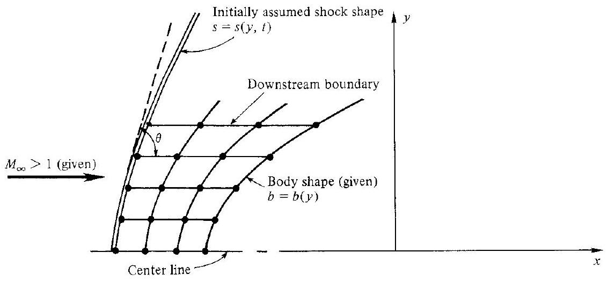
Figure 12.10 | Finite-difference grid in physical space for the blunt body problem.

In the time-marching approach, the initial shock wave shape is assumed at time $t=0$. The abscissa of the shock and body are denoted by $s$ and $b$, respectively. The flowfield between the assumed shock wave and the specified body is divided into a number of grid points, as shown in Fig. 12.10. Here, a two-dimensional coordinate system is illustrated; the case for axisymmetric flow is similar. At each grid point, values of all the flowfield variables are arbitrarily set. Then, starting from these guessed values and using time-marching machinery analogous to that developed in Sec. 12.1, new values of the flowfield variables, shock detachment distance, and shock shape are calculated in steps of time. After a number of time steps, the flowfield converges to the proper steady state value; this steady state is the desired result, and the time-marching approach is just a means to that end. Some details of this solution are discussed next.

The governing equations for two-dimensional or axisymmetric isentropic flow are, from Chap. 6:

Continuity:

$$
\begin{aligned}
\frac{\partial \rho}{\partial t}+\frac{\partial(\rho u)}{\partial x}+\frac{\partial(\rho v)}{\partial y}+K \frac{\rho v}{y} & =0 \\
\rho \frac{\partial u}{\partial t}+\rho u \frac{\partial u}{\partial x}+\rho v \frac{\partial u}{\partial y} & =-\frac{\partial p}{\partial x}
\end{aligned}
$$

$x$ momentum:
y momentum:

$$
\rho \frac{\partial v}{\partial t}+\rho u \frac{\partial v}{\partial x}+\rho v \frac{\partial v}{\partial y}=-\frac{\partial p}{\partial y}
$$

Energy:

$$
\frac{D s}{D t}=0
$$

where $K=0$ for two-dimensional flow, and $K=1$ for axisymmetric flow. Here, the energy equation is stated in the form of the isentropic assumption. Moreover, for isentropic conditions, $p / \rho^{\gamma}=$ const for a calorically perfect gas. Hence, Eq. (12.22) can be written alternatively as

$$
\frac{D\left(p / \rho^{\gamma}\right)}{D t}=0
$$

Expanding the derivative in Eq. (12.23), and defining $\psi=\ln p-\gamma \ln \rho$, we obtain the energy equation in the form

$$
\frac{\partial \psi}{\partial t}+u \frac{\partial \psi}{\partial x}+v \frac{\partial \psi}{\partial y}=0
$$

The system of equations to be solved are Eqs. (12.19) through (12.21), and (12.24), four equations for the four unknowns $p, \rho, u$, and $v$.

The grid network shown in Fig. 12.10 is not rectangular; hence, it is inconvenient for the formation of finite differences. To transform the shock layer into a rectangular

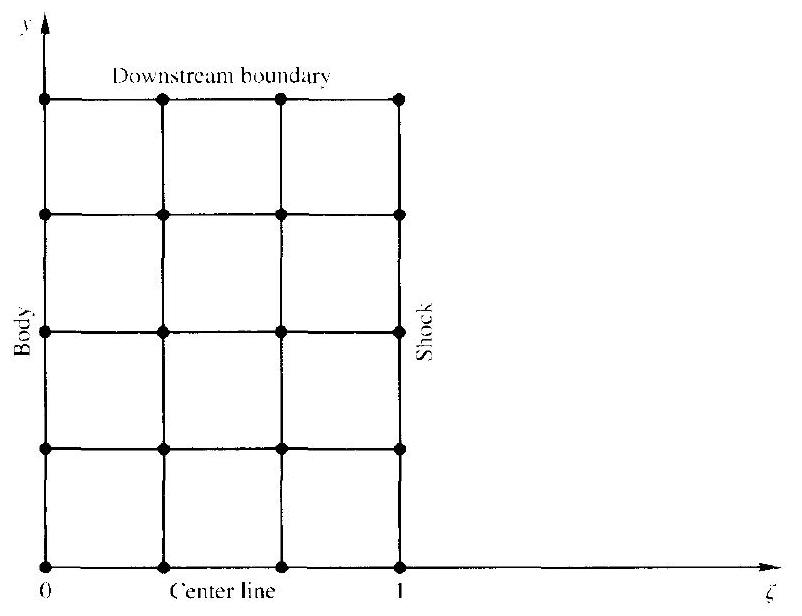
Figure 12.11 | Finite-difference grid in transformed space for the blunt body problem.

grid, define a new independent variable $\zeta$ such that

$$
\zeta \equiv \frac{x-b}{\delta}
$$

where $\delta=s-b$, i.e., $\delta$ is the local shock detachment distance. In this fashion, $\zeta$ always varies between 0 (at the body) and 1 (at the shock), and the grid now appears as sketched in Fig. 12.11. In addition, let $W=d s / d t$ be the $x$ component of the shock wave velocity (note that the shock wave will be in motion until the final steady state is reached), and let $\theta$ represent the angle between the tangent to the shock and the $x$ axis. In addition, these variables are defined:

$$
\begin{aligned}
& C \equiv(\zeta-1) \frac{d b}{d y}-\zeta \cot \theta \\
& P=\ln p \\
& R=\ln \rho \\
& B=\frac{u-W \zeta+v C}{\delta}
\end{aligned}
$$

where, in terms of the earlier material,

$$
\psi=\ln p-\gamma \ln \rho=P-\gamma R
$$

Finally, nondimensionalize all the variables as follows: Divide $p$ and $\rho$ by their free-stream values; divide the velocities by $\left(p_{\infty} / \rho_{\infty}\right)^{1 / 2}$; divide the lengths by a characteristic length $L$; and obtain a nondimensional time by dividing the dimensional time by $L /\left(p_{\rtimes} / \rho_{\infty}\right)^{1 / 2}$. The resulting equations, where now the symbols
represent the nondimensional values, are
Continuity:

$$
\frac{\partial R}{\partial t}=-\left[B \frac{\partial R}{\partial \zeta}+\frac{1}{\delta} \frac{\partial u}{\partial \zeta}+\frac{C}{\delta} \frac{\partial v}{\partial \zeta}+\frac{\partial v}{\partial y}+v \frac{\partial R}{\partial y}+K \frac{v}{y}\right]
$$

$x$ momentum:

$$
\frac{\partial u}{\partial t}=-\left[B \frac{\partial u}{\partial \zeta}+v \frac{\partial u}{\partial y}+\frac{P}{\rho \delta} \frac{\partial P}{\partial \zeta}\right]
$$

y momentum:

$$
\begin{aligned}
\frac{\partial v}{\partial t} & =-\left[B \frac{\partial v}{\partial \zeta}+v \frac{\partial v}{\partial y}+\frac{p C}{\rho \delta} \frac{\partial P}{\partial \zeta}+\frac{p}{\rho} \frac{\partial P}{\partial y}\right] \\
\text { Energy: } \quad \frac{\partial \psi}{\partial t} & =-\left[B \frac{\partial \psi}{\partial \zeta}+v \frac{\partial \psi}{\partial y}\right]
\end{aligned}
$$

The form of these equations is useful because the nondimensional variables are usually of the order of magnitude of unity-a convenient ploy used by some people in helping to examine and interpret the results from the computer.

To advance the flowfield in steps of time, the grid points in Fig. 12.11 are treated as four distinct sets: interior points (all grids points except on the shock, body, and downstream boundary); the shock points $(\zeta=1)$; the body points $(\zeta=0)$; and the downstream boundary points. The flowfield at the interior points is advanced in time by means of MacCormack's predictor-corrector method discussed in Sec. 12.1. Note that Eqs. (12.25) through (12.28) are written with the known spatial derivatives on the right-hand side; these derivatives are replaced with forward differences on the predictor step and rearward differences on the corrector step. This allows the calculation of the time derivatives that appear on the left-hand side of Eqs. (12.25) through (12.28). In turn, these time derivatives ultimately lead to the advancement of the flowfield in steps of time via Eq. (12.1).

For the shock points, the values of the flow variables behind the shock at time $t+\Delta t$ can be obtained from the Rankine-Hugoniot relations for a moving shock wave (see Chap. 7). However, this implies that a value of the shock wave velocity, $W(t+\Delta t)$, must first be assumed, since it is not known at the beginning of each time step in the computations. Therefore, an iterative process must be established wherein the values of the flowfield variables at the shock grid points must be obtained from some independent calculation, and then compared with those obtained from the shock relations for the assumed $W$. In the analysis of Moretti and Abbett (Ref. 47), this independent calculation is made via a characteristic technique utilizing information from the interior points. Specifically, the characteristic equations are obtained from the two-dimensional unsteady governing equations written for a ( $\xi, \eta, t$ ) coordinate frame, where $\xi$ and $\eta$ are cartesian coordinates locally normal and tangential, respectively, to the shock wave. This is illustrated in Fig. 12.12. The assumption is made in

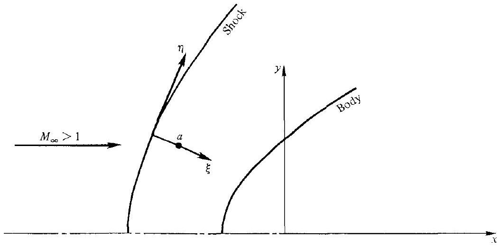
Figure 12.12 | Shock-oriented coordinates for the characteristic treatment of the shock boundary conditions.

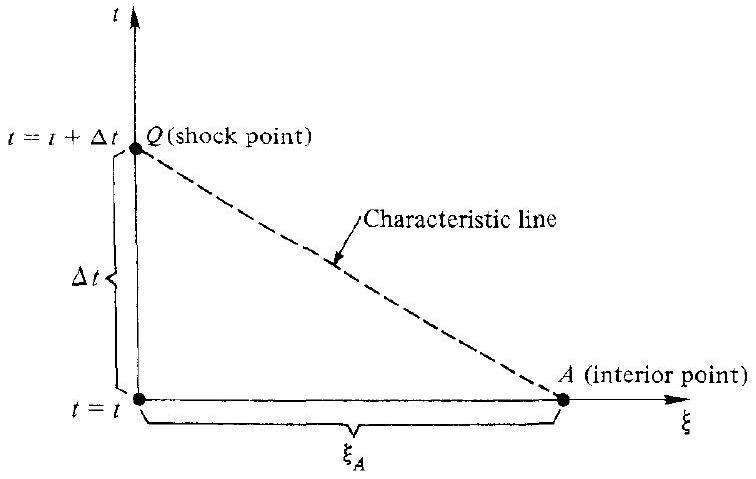
Figure 12.13 I Construction of the one-dimensional unsteady characteristic at the shock wave.

obtaining the compatibility equations that the governing equations can be written as quasi-one-dimensional in the $\xi$ direction, modified by "forcing terms" containing derivatives in the tangential direction. That is, the characteristic directions are drawn in the ( $\xi, t$ ) plane only, as shown in Fig. 12.13. This characteristic line, along with the compatibility equations, allows the flowfield to be calculated at $\xi=0$ (the shock point) at time $t+\Delta t$, i.e., point $Q$ in Fig. 12.13, from the known flowfield at point $A$ at time $t$. Since the location of point $A$ in Figs. 12.12 and 12.13 generally will not correspond to one of the interior grid points in Fig. 12.11, the information at $A$ must be obtained by spatial interpolation. Finally, the information at point $Q$ obtained from this characteristics approach is compared with the information calculated from the shock relations for the assumed $W$, and if agreement is not obtained, new values of $W$ are assumed until the iteration converges. For more details, including the form of the characteristic equations, see Ref. 47.

A similar characteristics calculation is performed for the body points. Here, the analysis is simpler because the body is stationary, and also because the entropy is known at the body. (Note that $D s / D t=0$, i.e., the entropy of a given fluid element is constant, even when the flow is unsteady. The entropy at the stagnation point must be chosen equal to its proper steady state value for a normal shock obtained from Chap. 3, because this entropy wets the entire body surface and is constant throughout the time-marching calculation.)

Finally, the flowfield values at the downstream boundary shown in Figs. 12.10 and 12.11 are obtained by simple linear extrapolation from the upstream grid points. They can also be obtained alternatively from MacCormack's technique using only one-sided differences in both the predictor and corrector steps. In either event, as long as the downstream boundary points are in a locally supersonic flow, the rest of the flowfield is not strongly influenced by slight inaccuracies at the downstream boundary. However, it is important to make certain that the downstream boundary points are in a supersonic region; experience has shown that the calculations will become unstable if the above extrapolation or one-sided differencing is performed in a subsonic region.

For more details concerning this solution, the reader is urged to consult Refs. 47 and 53 .

### 12.6 I RESULTS FOR THE BLUNT BODY FLOWFIELD

Let us now examine some typical results obtained with the time-marching blunt body solution described in the previous sections; these results are presented in more detail in Ref. 53. The purpose of this section is twofold: (1) to further illustrate the nature and behavior of time-marching solutions of steady state flowfields, and (2) to describe some fluid dynamic aspects of the supersonic blunt body flowfield.

First, consider the two-dimensional flow over a parabolic cylinder as shown in Fig. 12.14. The free-stream Mach number is $M_{\infty}=4$. The assumed shock shape is labeled $0 \Delta t$. All flow properties between this assumed shock and the prescribed body are also given arbitrary values. Starting from these assumed initial conditions, the flowfield is calculated in steps of time. Note that after 100 time steps, the shock wave has moved considerably forward of its initially assumed position, and has changed shape. However, also note that its movement has slowed, and that after 300 time steps, its location has become essentially stationary. Moreover, the flowfield properties between the shock and the body do not materially change after 300 time stepsthe steady state has been obtained. This time-varying behavior is further illustrated in Fig. 12.15, which gives the time variation of the stagnation point pressure. The assumed initial value (at $t=0$ ) is the proper steady-state value known in advance (we know the steady-state shock velocity should be zero, and the stagnation point pressure should be that behind a stationary normal shock wave with $M_{\infty}=4$ ). Note from Figs. 12.14 and 12.15 that (1) the most extreme transients occur at early times where the "driving potential" toward the steady state is the strongest, and (2) the steady state is, for all practical purposes, achieved at large values of time. The reader is

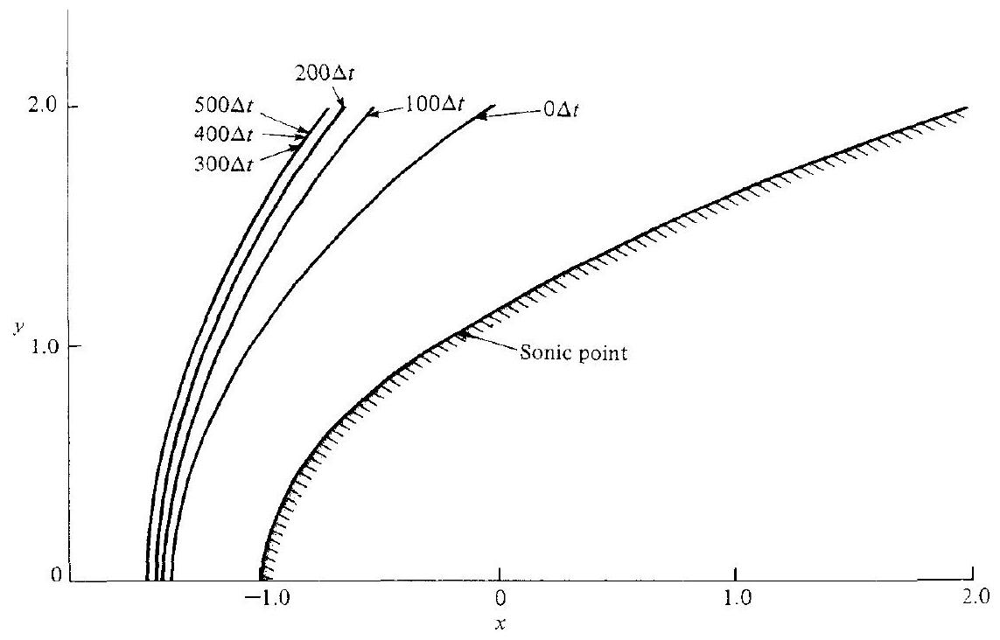
Figure 12.14 | Time-marching shock wave motion, parabolic cylinder, $M_{\infty}=4$.

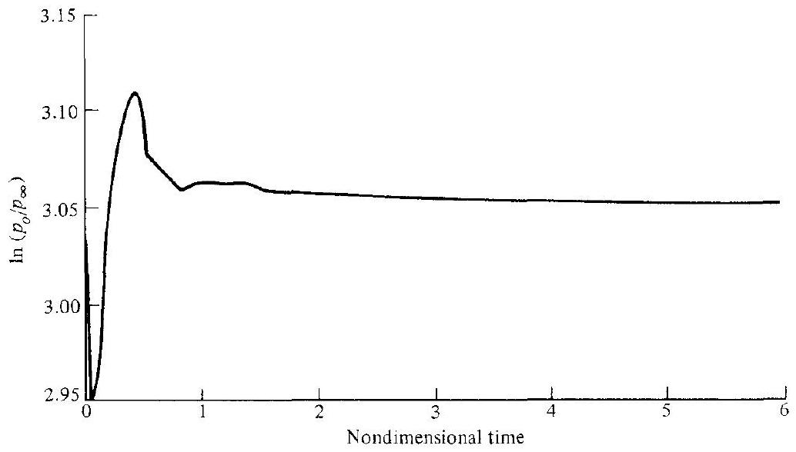
Figure 12.15 | Time-variation of stagnation point pressure, parabolic cylinder, $M_{\infty}=4$.

again reminded that this steady state is the desired result of the calculations; the transient behavior shown in Figs. 12.14 and 12.15 is simply a means to that end.

For the remainder of this section, we will concentrate on the final steady-state flowfields. For example, Fig. 12.16 gives the steady-state surface pressure distribution, normalized with respect to stagnation point pressure, around the parabolic cylinder. The pressure distributions are calculated for two Mach numbers, $M_{\infty}=4$ and 8 . The solid lines are exact results from the time-marching solution; these are compared with

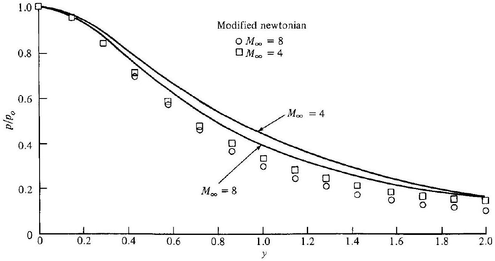
Figure 12.16 I Surface pressure distributions, parabolic cylinder.

results from the modified newtonian formula given by Eq. (12.18). Note that the modified newtonian distribution underestimates the actual pressure distribution, and that better agreement is obtained at $M_{\infty}=8$ rather than $M_{\infty}=4$. This is consistent with our discussion in Sec. 12.4, where it was argued that the assumptions underlying newtonian theory are more closely approached at hypersonic Mach numbers than at low Mach numbers. The relative lack of agreement with modified newtonian results, as given in Fig. 12.16, is typical of two-dimensional blunt bodies; in practice, pressure distributions over axisymmetric bodies agree more closely with modified newtonian results than do two-dimensional pressure distributions, as will be shown later.

The steady-state shock shapes and sonic lines are shown in Fig. 12.17 for the parabolic cylinder at $M_{\infty}=4$ and 8 . Note that, as the Mach number increases, the shock detachment distance decreases and the sonic line shifts downward. The sonic point on the shock moves farther than the sonic point on the body, as mentioned in Sec. 12.3.

Now consider an axisymmetric paraboloid with the same meridian cross section as the parabolic cylinder in Fig. 12.14. The steady-state surface pressure distribution for the paraboloid is given in Fig. 12.18 for $M_{\infty}=4$. The solid line gives the exact results from the time-marching solution. The open squares are results from Eq. (12.18); note that, in contrast to the earlier two-dimensional comparison, the agreement with newtonian theory is excellent for the axisymmetric case, even for a long distance along the body. In Fig. 12.18, a comparison is also made with an inverse steady-state method developed by Lomax and Inouye (see Ref. 54). Again, reasonable agreement is obtained. However, like all steady-state techniques for the blunt body problem, Lomax and Inouye's results are valid only up to the sonic region and limiting characteristic; steady-state techniques usually become unstable downstream of this region. In contrast, the time-marching technique is uniformly valid in both the subsonic and supersonic regions, and can given results for any desired distance downstream, as clearly shown in Fig. 12.18.

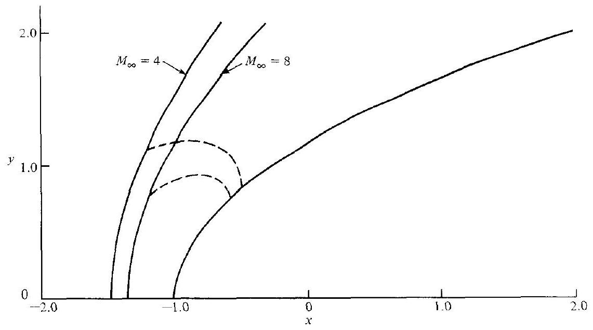
Figure 12.17 I Shock shapes and sonic lines, parabolic cylinder.

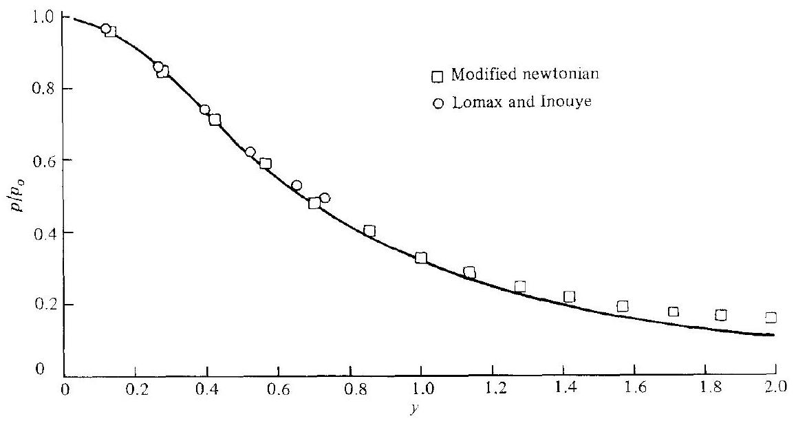
Figure 12.18 | Surface pressure distribution, paraboloid, $M_{\lambda}=4$.

## 12.7 | TIME-MARCHING SOLUTION OF TWO-DIMENSIONAL NOZZLE FLOWS

Return to Fig. 12.4, which illustrates the similarities between the flow over a supersonic blunt body and the flow through a two-dimensional (or axisymmetric) convergent-divergent supersonic nozzle. Both cases are mixed subsonic-supersonic flows, with curved sonic lines. Indeed, the flow around the blunt body in Fig. 12.4a can be visualized as a series of streamtubes with the general features of Fig. 12.4b. Therefore, the difficulties in developing a uniformly valid steady-state technique for the solution of blunt body flows also occur with the two-dimensional nozzle
case when the convergent subsonic and divergent supersonic sections are treated together. Indeed, the proper calculation of the transonic flow in the throat region of a convergent-divergent nozzle has been an active area of modern aerodynamic research. However, as in the case of the blunt body, the successful development of the time-marching technique now provides a uniformly valid calculation of the complete subsonic-supersonic flowfield in a two-dimensional nozzle. The philosophy, equations, boundary conditions, stability criteria, and numerical machinery are essentially the same as for the blunt body problem; hence no further elaboration will be made here. For an example of a time-marching solution of two-dimensional nozzle flows, the reader is encouraged to examine Ref. 55.

Note that the method of characteristics discussed in Chap. 11 is a standard approach to the calculation of the supersonic region of a convergent-divergent nozzle; however, it cannot be used for the subsonic or transonic regions. Moreover, the method of characteristics requires prior knowledge of the sonic line, or, more precisely, the limiting characteristics for the nozzle throat region. For our applications in Chap. 11, the sonic line was assumed to be a straight line-a common assumption for many practical characteristics solutions. However, in general, the sonic line in the throat region of a convergent-divergent nozzle is curved, and its curvature becomes more pronounced as the convergence of the subsonic section is made more rapid. Therefore, for short, rapid-expansion nozzles, it is preferable to start a characteristics solution from the limiting characteristics associated with the more accurate curved sonic line rather than assuming a straight sonic line. The curved sonic line can be computed from a time-marching technique as illustrated in Ref. 55.

Some steady-state results for Mach number contours in the throat region of a convergent-divergent nozzle are given in Fig. 12.19. The solid lines are results from

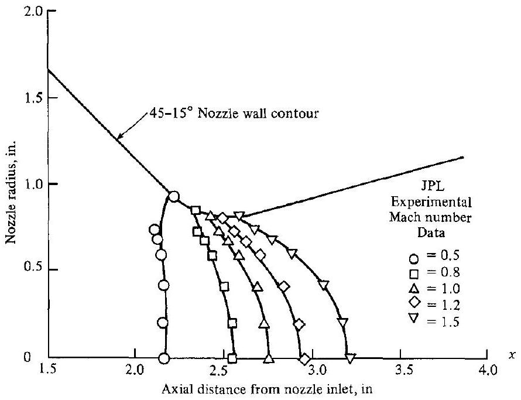
Figure 12.19 I Constant Mach number lines in a $45^{\circ}$ to $15^{\circ}$ conical nozzle; results from the time-marching calculations of Serra (Ref. 55).

the time-marching technique described in Ref. 55. The open symbols are experimental measurements from the Jet Propulsion Laboratory. Agreement between theory and experiment is quite satisfactory. Note especially that the sonic line ( $M=1$ contour) is highly curved due to the rapid convergence of the $45^{\circ}$ subsonic section.

## 12.8 | OTHER ASPECTS OF THE TIME-MARCHING TECHNIQUE; ARTIFICIAL VISCOSITY

A virtue of the time-marching technique is its relative simplicity, in spite of the complexity of the steady-state flow that is being solved. Moreover, the time-marching technique is straightforward to program on a digital computer, thus minimizing the labor invested to set up the solution. However, the reader is cautioned that the technique is not yet (and may never be) routine. Like all computational fluid dynamic applications, solutions are frequently more of an art than a science. For example, throughout this chapter we have stated that time-marching calculations begin with "arbitrary" initial conditions for the flowfield. For a physical problem that has a unique solution, this is conceptually true. However, in practice, the initial conditions usually cannot be completely arbitrary, rather, they must be prescribed within a certain latitude. A case in point is the blunt body solution described in Secs. 12.5 and 12.6. Here, the initial shock wave must not be assumed too close or too far away from the body. If the shock detachment distance is initially too large or too small, the shock wave tends to accelerate too rapidly, thus producing strong gradients of the flowfield variables behind the wave. Consequently, the finite-difference scheme using a fixed grid becomes inaccurate, ultimately causing some aspect of the calculations to collapse. Other applications are frequently plagued by analogous situations. Therefore, it is wise to choose initial conditions intelligently, using any existing a priori knowledge about the flow to guide your choice. Also keep in mind that the closer the initial conditions are to the final steady state, the faster the program will converge to this steady state, hence conserving computer time.

Another problem of time-marching solutions is that small inaccuracies introduced at the boundaries can propagate as short-wavelength disturbances throughout the flowfield, sometimes focusing on a certain region of the flow and causing the calculation to become unstable. This is why the proper treatment of boundary conditions is so important. If the flow is physically viscous, these unwanted disturbances tend to dissipate, and frequently do not cause problems. On the other hand, for inviscid flows, there are applications and techniques where the calculations must be artificially damped by the addition of a mathematical quantity called artificial viscosity. The concept of artificial viscosity can be introduced as follows.

First, consider a quantity $G$ which is a function of both $x$ and $t$. A finite-difference expression for the second partial derivative with respect to $x$ can be obtained from the Taylor's series expansion:

$$
G_{i+1}=G_{i}+\left(\frac{\partial G}{\partial x}\right)_{i} \Delta x+\left(\frac{\partial^{2} G}{\partial x^{2}}\right)_{i} \frac{(\Delta x)^{2}}{2}+\cdots
$$

where $i+1$ and $i$ are two neighboring grid points in the $x$ direction. In Eq. (12.29), replace the term $(\partial G / \partial x)_{i}$ with a central difference,

$$
\left(\frac{\partial G}{\partial x}\right)_{i}=\frac{G_{i+1}-G_{i-1}}{2 \Delta x}
$$

thus yielding for Eq. (12.29)

$$
G_{i+1}=G_{i}+\frac{1}{2}\left(G_{i+1}-G_{i-1}\right)+\left(\frac{\partial^{2} G}{\partial x^{2}}\right)_{i} \frac{(\Delta x)^{2}}{2}+\cdots
$$

Solving Eq. (12.30) for the second partial derivative, we obtain

$$
\left(\frac{\partial^{2} G}{\partial x^{2}}\right)_{i}=\frac{G_{i+1}-2 G_{i}+G_{i-1}}{(\Delta x)^{2}}
$$

Equation (12.31) is a central second difference of second-order accuracy.
Now consider another quantity $F$, which is also a function of $x$ and $t$ and which is related to $G$ through the simple partial differential equation

$$
\frac{\partial G}{\partial t}=\frac{\partial F}{\partial x}
$$

Let us finite-difference this equation by using a central difference for $F$,

$$
\left(\frac{\partial F}{\partial x}\right)_{i}^{k}=\frac{F_{i+1}^{k}-F_{i-1}^{k}}{2 \Delta x}
$$

In Eq. (12.33), the superscript $k$ has been added to denote evaluation at the $k$ th time step. Also, let us represent $\partial G / \partial t$ in Eq. (12.32) by a finite-difference expression introduced by Lax (see Ref. 56). Lax's technique has been used in several computational fluid dynamic applications, particularly during the mid-1960s. According to Lax, the time derivative is based on an average value of $G$ between points ( $i+1$ ) and ( $i-1$ ), i.e.,

$$
\left(\frac{\partial G}{\partial t}\right)_{i}^{k}=\frac{G_{i}^{k+1}-\frac{1}{2}\left[G_{i+1}^{k}+G_{i-1}^{k}\right]}{\Delta t}
$$

Substitute Eqs. (12.33) and (12.34) into Eq. (12.32):

$$
G_{i}^{k+1}=\frac{1}{2}\left[G_{i+1}^{k}+G_{i-1}^{k}\right]+\left(F_{i+1}^{k}-F_{i-1}^{k}\right) \frac{\Delta t}{2 \Delta x}
$$

Subtract $G_{i}^{k}$ from both sides of Eq. (12.35), and divide by $\Delta t$ :

$$
\frac{G_{i}^{k+1}-G_{i}^{k}}{\Delta t}=\frac{G_{i+1}^{k}-2 G_{i}^{k}+G_{i-1}^{k}}{2 \Delta t}+\frac{F_{i+1}^{k}-F_{i-1}^{k}}{2 \Delta x}
$$

Multiply the numerator and denominator of the first term on the right-hand side of Eq. (12.36) by $(\Delta x)^{2}$ :

$$
\frac{G_{i}^{k+1}-G_{i}^{k}}{\Delta t}=\left[\frac{G_{i+1}^{k}-2 G_{i}^{k}+G_{i-1}^{k}}{(\Delta x)^{2}}\right] \frac{(\Delta x)^{2}}{2 \Delta t}+\frac{F_{i+1}^{k}-F_{i-1}^{k}}{2 \Delta x}
$$

Look closely at Eq. (12.37). Recalling the central second difference from Eq. (12.31), taking the limit of Eq. (12.37) as $\Delta x$ and $\Delta t$ go to zero, and utilizing the mathematical definition of a derivative, Eq. (12.37) becomes

$$
\frac{\partial G}{\partial t}=\frac{\partial F}{\partial x}+\frac{(\Delta x)^{2}}{2 \Delta t} \frac{\partial^{2} G}{\partial x^{2}}
$$

Note that Eq. (12.38) is different than Eq. (12.32), with which we first started. We applied Lax's finite-difference procedure to Eq. (12.32), obtained a difference equation (12.35), and then found that, by applying the definition of the derivative to the difference equation, we recovered a partial differential equation (12.38) that is different than the one we started with. In particular, Eq. (12.38) now contains a term involving a second derivative $\partial^{2} G / \partial x^{2}$ multiplied by a coefficient $\nu=(\Delta x)^{2} / 2 \Delta t$. This is analogous to the viscous terms in the Navier-Stokes equations for flow with friction. where second-order derivatives are multiplied by the physical viscosity. However, in Eq. (12.38), the second-order derivative is simply a mathematical consequence of the differencing procedure, and its coefficient $\nu \equiv(\Delta x)^{2} / 2 \Delta t$ is called the artificial viscosity.

In Lax's technique, the artificial viscosity is implicit in the finite-difference algorithm. However, in other numerical techniques, terms such as $\nu\left(\partial^{2} G / \partial x^{2}\right)$ are explicitly added to the inviscid equations of motion before the finite-differencing procedure is implemented. This idea for damping the calculations by explicitly adding dissipative terms to the equations of motion is due to Von Neumann and Richtmyer (see Ref. 57), who were the first to employ a time-dependent technique on a practical problem. They were concerned with the calculation of properties across a shock wave; the main motivation of artificial viscosity was to provide some mathematical dissipation analogous to the real viscous effects inside a shock wave. In this fashion, the inviscid equations could be used to calculate the jump conditions across a shock wave. The shock structure was spread over several grid points, analogous to the shock-capturing approach described in Sec. 11.15. However, the shock thickness produced by the artificial viscosity bears no relation to the actual shock thickness produced by the physical viscosity, although Von Neumann and Richtmyer did obtain the correct jump conditions for properties across the shock wave.

Virtually all computational fluid dynamic techniques contain artificial viscosity to some degree, either implicitly or explicitly. MacCormack's predictor-corrector technique highlighted here and in Chap. 11 has some slight implicit artificial viscosity. As long as the amount is small, the accuracy of the numerical results is not compromised. However, if a large amount of damping is necessary for ensuring numerical stability, the artificial viscosity will materially increase the entropy of the flowfield and will cause inaccuracies. Moreover, heavy numerical damping may obscure other inconsistencies in the technique, producing results that may be stable but not valid. It is wise to avoid explicitly using artificial viscosity as much as possible.

Finally, note that the time-marching technique described in this chapter is a valid solution of the unsteady equations of motion. The transient approach to the steady state flow is physically meaningful-it follows nature, if nature were starting from the assumed initial conditions. Therefore, even though the main thrust of this chapter
has been the solution of steady state flows by means of the time-marching technique, the technique itself can be readily applied to study transient flows in their own right. One such example is the time-varying flowfield inside a reciprocating internal combustion engine (see Ref. 58).

## 12.9 | HISTORICAL NOTE: NEWTON'S SINE-SQUARED LAW-SOME FURTHER COMMENTS

Sections 6.7 and 12.4 relate Isaac Newton's interest in fluid mechanics. This interest was focused on the calculation of the force on a body moving through a fluid, culminating in the famous sine-squared law we derived in Sec. 12.4. In Newton's day, there was a high interest in such force calculations, spurred by the development of naval architecture and its attendant practical need to calculate the flow resistance of ship hulls. However, it is interesting to note that Newton's fluid mechanics work was also driven by a more philosophical reason. Many scholars of that day still held the belief of Aristotle that the planets and stars moved through space which was occupied by a continuous medium, i.e., they assumed that space was not a vacuum. However, contemporary astronomical data of that day, including his own, convinced Newton that such was not the case. If space were occupied by a continuous medium, the heavenly bodies would encounter a resistance that would affect their motion. Observations of celestial motion did not show any such effects. Therefore, Newton was motivated to establish the laws of resistance of a body in a fluid medium in order to show that, indeed, such a resistance existed, and that it invalidated the Aristotelian philosophy. His conclusions were that the force of resistance was finite, that it depended on the fluid density, velocity, and shape of the body, and that it varied as $\sin ^{2} \theta$, where $\theta$ is the angle of incidence between the surface and the velocity direction.

It is also interesting to note that, like the complete scientist he was, Newton carried out experiments to check his theory. Using pendulums, and falling bodies in both air and water, Newton was able to establish that "all agree with the theory."

However, it was later recognized by others that all did not agree with the theory. For example, a series of experiments were carried out by d'Alembert in 1777 under the support of the French government in order to measure the resistance of ships in canals. The results showed that "the rule that for oblique planes resistance varies with the sine square of the angle of incidence holds good only for angles between $50^{\circ}$ and $90^{\circ}$ and must be abandoned for lesser angles." Also, in 1781, Euler pointed out the physical inconsistency of Newton's model consisting of a linear, rectilinear stream impacting without warning on a surface. In contrast to this model, Euler noted that the fluid moving toward a body "before reaching the latter, bends its direction and its velocity so that when it reaches the body it flows past it along the surface, and exercises no other force on the body except the pressure corresponding to the single points of contact." Euler went on to present a formula for resistance that attempted to take into account the shear stress distribution along the surface as well as the pressure distribution. This expression for large incidence angles became proportional to $\sin ^{2} \theta$, whereas at small incidence angles it was proportional to $\sin \theta$. Euler noted that such a variation was in reasonable agreement with the experiments by d'Alembert and others.

None of this early work produced expressions for aerodynamic forces with the accuracy and fundamental integrity that we are accustomed to today. In particular, Newton's sine-squared law produced such inconsistencies and inaccuracies that some aspects of fluid mechanics were actually set back by its use. For example, the lift on a surface at very small incidence angles-a few degrees-was grossly underpredicted by Newton's law. In 1799, Sir George Cayley in England first proposed the fundamental concept of the modern airplane, with a fixed wing at small incidence angle to provide lift. However, some responsible scientists of the nineteenth century used the sine-squared law to show that the wing area would have to be so large to support the airplane's weight as to be totally impractical. For this reason, some historians feel that Newton actually hindered the advancement toward powered flight in the nineteenth century.

However, Newton's sine-squared law came into its own in the last half of the twentieth century. Shortly after World War II and the development of the atomic bomb, the major world powers scrambled to develop an unmanned vehicle that could deliver the bomb over large distances. This led to the advent of the intercontinental ballistic missile in the 1950s. These missiles were to be launched over thousands of miles, with the trajectory of the warhead carrying it far beyond the outer limits of the atmosphere, and then entering the atmosphere at Mach numbers above 20. At such hypersonic speeds, the bow shock wave on these entry vehicles closely approaches the surface of the body, leaving only a very thin shock layer between the body and the shock. Consequently, as sketched in Fig. 12.20, the physical picture of hypersonic

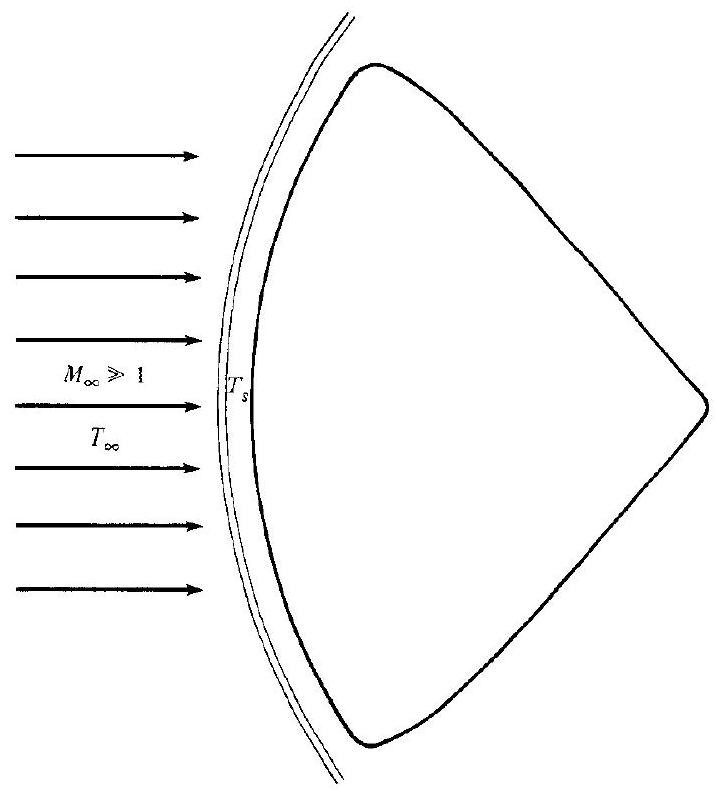
Figure 12.20 I Schematic of the thin shock layer on a hypersonic body. This picture approximates fairly reasonably the model considered by Isaac Newton.

flow over blunt bodies actually closely approximates the model used by Newton-a uniform stream impacting the surface, and then flowing along the surface. Indeed, such newtonian impact theory yields good results for pressure distributions and forces at these speeds, as discussed in previous sections of this chapter. Therefore, 250 years after its inception, Newton's sine-squared law finally found an application for which it was reasonably suited.

### 12.10 | SUMMARY

Flowfields encompassing mixed regions of subsonic and supersonic flow are best solved by the time-marching philosophy as described in this chapter. A particularly important example is the solution of the supersonic blunt body problem. In this case, an initial guess is made for the flowfield, which is treated as the initial condition at time zero. Then, the unsteady flow equations are solved numerically in steps of time. One method for this solution (but by no means the only method) is the predictor-corrector explicit method of MacCormack. The flowfield properties change from one time step to another; however, after a large enough number of time steps, the flowfield changes become negligibly small, i.e., a steady state is approached. This steady state is the desired flowfield and the time marching is just the means to that end.

Certain physical characteristics of the steady flow over a blunt body moving at supersonic speeds are:

1. As the free-stream Mach number increases, the bow shock wave becomes more curved and the shock detachment distance becomes smaller.
2. As the free-stream Mach number increases, the sonic line becomes more curved and moves closer to the centerline. The sonic point on the shock moves down faster than the sonic point on the body, i.e., the sonic line rotates toward the body as $M_{\infty}$ is increased.
3. Modified newtonian theory provides a simple means of predicting the surface pressure distribution over the blunt nose, obtained from

$$
C_{p}=C_{p_{\max }} \sin ^{2} \theta
$$

Modified newtonian results are reasonably accurate for blunt bodies at hypersonic free-stream Mach numbers; the accuracy seems better for axisymmetric and three-dimensional bodies than for two-dimensional shapes.

The time-marching philosophy is a powerful technique in computational fluid dynamics, allowing the numerical solution of flowfields that previously were not solvable by any other means. Although beyond the scope of the present book, we note that modern solutions of the complete Navier-Stokes equations for viscious flows, including complicated separated flows, are made tractable by the timemarching approach. The reader is encouraged to consult the current literature for such matters.

## PROBLEMS

12.1 Consider a convergent-divergent nozzle of length $L$ with an area-ratio variation given by $A / A^{*}=1+10|x / L|$, where $-0.5 \leq x / L \leq 0.5$. Assume quasi-one-dimensional flow and a calorically perfect gas with $\gamma=1.4$.
a. Write a computer program to calculate the variation of $p / p_{o}, T / T_{o}, \rho / \rho_{o}$, $u / a_{0}$, and $M$ as a function of $x / L$ by means of the time-dependent finitedifference technique. Plot some results at intermediate times, as well as the final steady state results. Use Fig. 12.6 as a model for your plots.
b. On the same plots, compare your steady state numerical results with the answers obtained from Table A.1.
12.2 Consider the two-dimensional, subsonic-supersonic flow in a convergentdivergent nozzle.
a. If the sonic line is straight, sketch the limiting characteristics.
b. If the sonic line is curved, sketch the limiting characteristics.
12.3 Consider a $15^{\circ}$ half-angle right-circular cone. Using newtonian theory, calculate the drag coefficient for $1.5 \leq M_{\infty} \leq 7$, assuming the base pressure is equal to $p_{\infty}$. Plot these results on the same graph as you prepared for Prob. 10.3. From the comparison, what can you conclude about the use of newtonian theory for small- and moderate-angle cones?
12.4 Consider a blunt axisymmetric body at an angle of attack $\alpha$ in a supersonic stream. Assume a calorically perfect gas. Outline in detail how you would carry out a time-dependent, finite-difference solution of this flowfield. Point out the differences between this problem and the solution for $\alpha=0$ discussed in Sec. 12.5.
12.5 Consider a hemisphere with a flat base in a hypersonic flow at $0^{-}$angle of attack (the hemispherical portion faces into the flow). Assuming that the base pressure is equal to free-stream static pressure, use modified newtonian theory to derive an expression for the drag coefficient $C_{D}=D / q_{\infty} \pi R^{2}$ as a function of $C_{p_{\text {max }}}$.
12.6 This problem, as well as Probs. 12.7 and 12.8, are related to the discussion on computational fluid dynamics contained in Appendix B. In that discussion, the time-dependent (time-marching) solution of isentropic subsonic-supersonic quasi-one-dimensional flow is given, albeit under rather controlled conditions, such as the use of qualitatively proper initial conditions. Using the computer program you wrote for Prob. 12.1, and the same nozzle shape, explore the effect of different initial conditions on the behavior of the time-marching process. Specifically for one exploration, feed in constant property initial conditions, i.e., assume density, velocity, and temperature are constant through the nozzle at time zero, equal to their reservoir values. Compare the time-marching behavior with that from Prob. 12.1. Do not be surprised if you cannot get a solution (i.e., if the attempted solution "blows up" on the computer). What can you say about the importance of the selection of initial conditions?
12.7 Using the computer program and nozzle shape from Prob. 12.1, calculate the purely subsonic isentropic flow through the nozzle for the case when the ratio of exit static pressure to reservoir pressure is held fixed at 0.996 . (Do not be surprised if you have difficulty. For help, consult the discussion on this type of CFD solution in the author's book Computational Fluid Dynamics: The Basics with Applications, McGraw-Hill, 1995. Read why the use of the governing equations completely in conservation form might be helpful.)
12.8 Using your computer program from Prob. 12.1, solve the flow described in Prob. 5.11 involving a normal shock wave inside the nozzle. (Again, do not be surprised if you have difficulty, because the conservation form of the equations with artificial viscosity is usually employed for this type of flow. See Computational Fluid Dynamics: The Basics with Applications, for a detailed discussion of the CFD solution of this type of flow.)

