## 13   CHAPTER

## Three-Dimensional Flow

There is no royal road to geometry.
Proclus ( $410-485$ A.D.) an Athenian philospher, commenting on the works of Euclid

## PREVIEW BOX

For decades after the advent of high-speed flight, the accurate calculation of three-dimensional flows was the Holy Grail of compressible flow-constantly sought after but not achievable. Until recently, our understanding of the physical aspects of complex threedimensional flows, what there was of it, was based on experimental data. Note that in the previous chapters of this book we dealt with one- or two-dimensional flows. Even the supersonic flow over a right-circular cone at zero angle of attack (as studied in Chap. 11) is described by two independent variables, although the flow takes place in three-dimensional space. Such flows are called "quasi-two-dimensional." A general three-dimensional flow, for example, in cartesian space a flow where the properties are a function of $x$, $y$, and $z$, has resisted analytical solution.

However, with the advent of computational fluid dynamics, calculations of such three-dimensional flows can be, and are being made. In the present chapter, we emphasize the physical aspects of three-dimensional
compressible inviscid flows. In many three-dimensional flows, nature has some surprises for us-new physical phenomena that we would not ordinarily expect based on our previous experience with two-dimensional flows. In the course of our discussions, we will highlight several computational techniques used to calculate three-dimensional flows. Even with the power of modern CFD, such calculations are today still not routine. They are labor intensive, usually requiring long run times on the computer. However, complex threedimensional flows are being successfully calculated, and they are now an inherent part of computational fluid dynamies.

The material in this chapter is exciting. It is part of the modern compressible flow that we enjoy today. So, read and enjoy.

The intellectual organization of this chapter is straightforward; we first study cones at angle of attack, and then blunt bodies at angle of attack. Therefore, there is no need for a roadmap to help keep us on course.

## 13.1।INTRODUCTION

For a moment, return to Fig. 1.9. Here you see the Bell XS-1, the first aircraft to fly faster than the speed of sound in level flight. What you see is a geometrically threedimensional object at an angle of attack; hence, the flowfield over the XS-1 is threedimensional. Indeed, the flowfields associated with all practical flight vehicles are three-dimensional. In contrast, the vast majority of flow problems treated in this book are either one- or two-dimensional. Why? The answer is straightforward-for simplicity. We have used these simpler problems to great advantage in the study of the fundamentals of compressible flow, which can be readily demonstrated by a myriad of different one- and two-dimensional applications. Moreover, these simpler flows have practical applications on their own. The one-dimensional and quasi-onedimensional flows discussed in Chaps. 3, 5, and 7 have direct application to flows in ducts and streamtubes, and such one-dimensional analyses are used extensively in fluids engineering, propulsion, and aerodynamics. The two-dimensional flows discussed in Chaps. 4 and 9 are applied locally to those parts of a body where the flow is essentially two-dimensional, such as straight wings, control surfaces (such as ailerons on a wing), and for any object that has a long span in one direction perpendicular to the flow. Also, in Sec. 4.13, we demonstrated that the flow properties
behind any point on a three-dimensional shock wave surface are determined by the conventional two-dimensional oblique shock relations applied locally at that point. Even the flow over a sharp, right-circular cone at zero angle of attack is "onedimensional" in the sense that the conical flowfield depends only on one independent variable, namely the polar angle $\theta$ as described in Chap. 10. In short, the one- and two-dimensional flows treated thus far have served us well in our study of compressible flow.

On the other hand, the vast majority of practical problems in compressible flow, especially those involving external flows over aerodynamic bodies, are threedimensional. We may be concerned with the calculation of the flow over a complete airplane configuration, such as the Bell XS-1 shown in Fig. 1.9. Or, we may be interested in the flowfield around a simple missile-like body, but with the body at angle of attack-another example of a three-dimensional flowfield. We have already briefly touched on the analysis of three-dimensional flows, such as in Sec. 11.10 on the three-dimensional method of characteristics, and in Sec. 11.16 where an example of the three-dimensional flow over a space-shuttle configuration was calculated by both the method of characteristics and the finite-difference method. However, for the most part, we have not dealt squarely with the calculation of three-dimensional flows. Because of the importance of such flows, it is now appropriate for us to devote a chapter to such matters.

In general, the addition of a "third dimension" in aerodynamic analyses causes at least an order-of-magnitude increase in the amount of work and thought necessary to obtain a solution. In fact, in terms of pure analysis, there are very few analytical, three-dimensional flowfield solutions in existence. Indeed, before the late 1960s, the calculation of three-dimensional flows was a major state-of-the-art research areavery few solutions existed. Since the early 1970s, the solution of three-dimensional flows over very complex shapes has become more attainable through the methods of computational fluid dynamics (CFD). However, even today, modern numerical calculations of three-dimensional flows require a great deal more time to program and execute than their two-dimensional counterparts. And of course, the large amount of numerical data produced in the course of a three-dimensional CFD solution is sometimes overwhelming, and can be made tractable only by the intelligent use of sophisticated computer graphics.

In light of this, the present chapter will be long on philosophy and methodology, but short on details. The subject of three-dimensional flows deserves a book all its own. To paraphrase Proclus' quotation at the beginning of the chapter, there is no royal road to three-dimensional flow methods. Our purpose in the present chapter is to introduce some of the physical aspects that distinguish three-dimensional flows from their one- and two-dimensional counterparts, and to discuss some of the methods, both old and new, for the calculation of such flows. Finally, we hope to provide the reader with some intuitive understanding of three-dimensional compressible flows in general. Because of the dominant role played by three-dimensional flow problems in modern aerodynamics, along with the advanced numerical methods presently used for calculating such flows, the material in this chapter is essential to the study of modern compressible flow.

## 13.2 | CONES AT ANGLE OF ATTACK: QUALITATIVE ASPECTS

Chapter 10 was devoted to the study of supersonic flow over a right-circular cone at zero angle of attack. Referring to Fig. 10.3, we saw that the flow was conical (independent of distance along a conical ray $r$ from the vertex of the cone) and axisymmetric (independent of the azimuthal angle $\phi$ ). Hence, the flow properties are functions only of the polar angle $\theta$. In this sense, the problem, which involves a three-dimensional geometric body (the cone), is, from the point of view of the governing flow equations, a special type of "one-dimensional" flow in that the dependent variables are functions of only one independent variable. Mathematically, this means that the flow is described by an ordinary differential equation, namely, the Taylor-Maccoll equation, Eq. (10.13). In our later discussions, it will be useful to describe the conical flowfield as projected on a spherical surface generated by rays from the cone vertex of constant length $r$. For the case of the cone at zero angle of attack, this is sketched in Fig. 13.1. The flow in any azimuthal plane ( $\phi=$ const) is shown in Fig. 13.1a. Consider streamline $a b$ between the shock and the body, and the two conical rays that go through points $a$ and $b$, respectively, on the streamline.

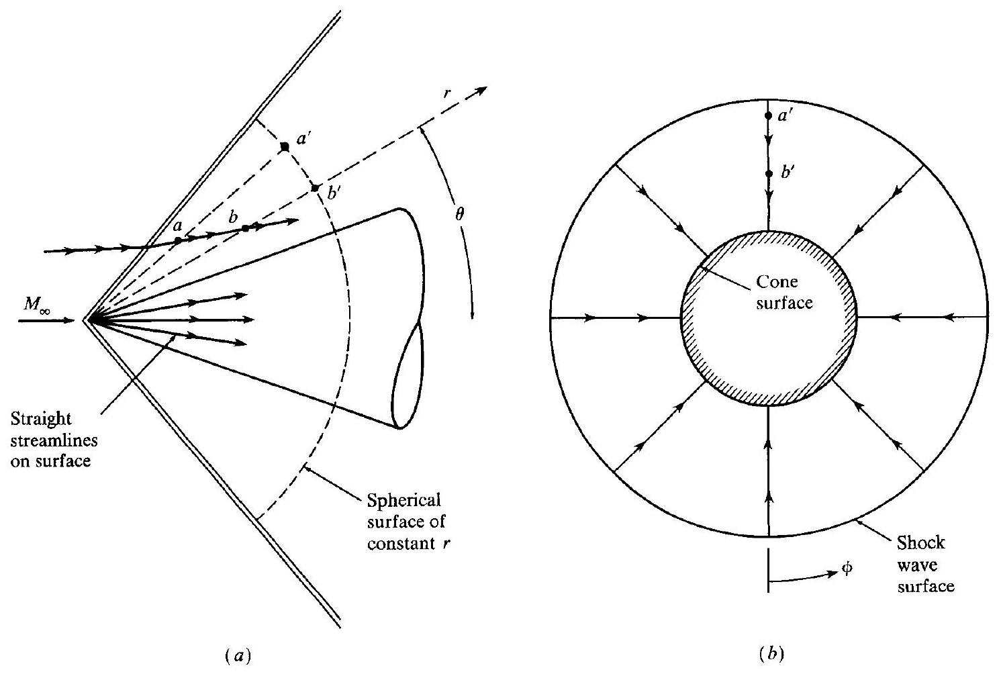
Figure 13.1 I (a) Right-circular cone at zero angle of attack; (b) Projection of the body, shock wave, and streamlines on a spherical surface.

Points $a$ and $b$ are projected along their respective rays, and appear as points $a^{\prime}$ and $b^{\prime}$, respectively, on the spherical surface generated by a constant length along all the conical rays. A front view of this spherical surface is shown in Fig. 13.1b. Here, both the cone surface and shock surface project as concentric circles. Moreover, the streamline $a b$ projects as a straight line, as shown by the line $a^{\prime} b^{\prime}$ in Fig. 13.1 $b$. Indeed, for each meridian plane defined by $\phi=$ const, the streamlines project as straight lines on the spherical surface, and therefore the conical flow in Fig. 13.1a is seen on the spherical surface in the manner shown in Fig. 13.1b. Also, the streamlines on the surface of the cone are straight lines emanating from the cone vertex, as shown in Fig. 13.1a.

Now, consider a right-circular cone at angle of attack $\alpha$, as sketched in Fig. 13.2. The same spherical coordinate system is used here as was shown earlier in Fig. 10.3a, with the $z$ axis along the centerline of the cone. The free-stream velocity vector $\mathbf{V}_{\infty}$ lies in the $y z$ plane at an angle $\alpha$ to the $z$ axis. Relative to the $x y z$ cartesian axes, we draw spherical coordinates, $r, \theta$, and $\phi$, where $\theta$ is measured from the $z$ axis and $\phi$ is the azimuthal angle in the $x y$ plane. The flow velocity components in the spherical coordinates are shown as $V_{r}, V_{\theta}$, and $V_{\phi}$, corresponding to the directions of increasing $r, \theta$, and $\phi$, respectively. The flowfield as it would appear in the $y z$ plane is sketched in Fig. 13.3. Here, $\theta_{s}$ is the shock angle measured from the cone centerline. Just as in the zero angle-of-attack case, this flowfield is conical, i.e., flow properties are constant along rays from the cone vertex-the presence of an angle of attack does not destroy the conical nature of the flow. However, this is the only similarity with the zero angle-of-attack case. In all other respects, the flowfield in Fig. 13.3 is markedly different from the zero- $\alpha$ case. For example:

1. The flowfield shown in Fig. 13.3 is a function of $t w o$ independent variables, $\theta$ and $\phi$, in contrast to the zero- $\alpha$ case where $\theta$ is the only independent variable.

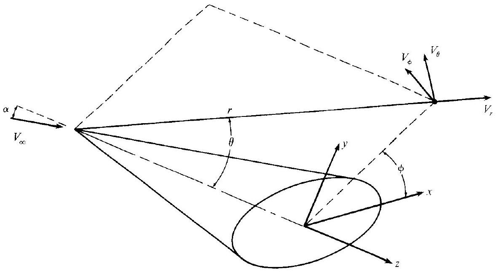
Figure 13.2 I Coordinate system for a cone at angle of attack.

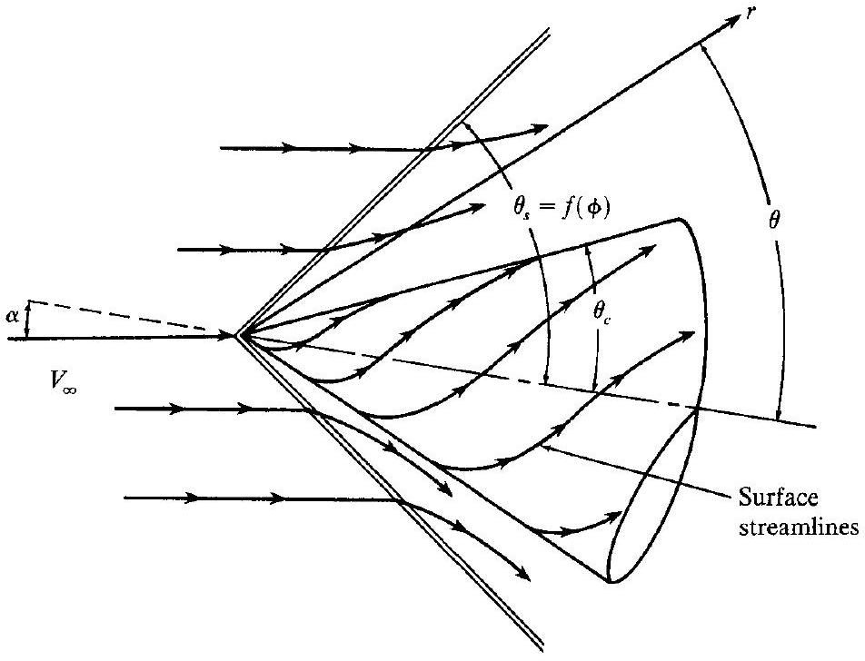
Figure 13.3 I Surface streamlines on a cone at angle of attack.

2. The shock wave angle $\theta_{s}$ is different for each meridional plane, i.e., $\theta_{s}$ is a function of $\phi$.
3. The streamlines along the cone surface are now curved streamlines which curl around the body from the bottom of the cone (called the windward surface) to the top of the cone (called the leeward surface). However, each of the curved streamlines along the surface emanates from the vertex of the cone. Only two surface streamlines are straight-those along the very top and bottom rays.
4. The streamlines in the flow between the shock wave and the body are no longer planar; they are curved in the three-dimensional space between the shock and the body.
5. Because the flow is adiabatic and inviscid, the entropy is constant along a given streamline between the shock and the body. However, streamlines that pass through different points on the shock wave experience different increases in entropy across the shock, because the shock wave angle $\theta_{s}$ is different. Hence, the flow between the shock and body has finite gradients in entropy perpendicular to the streamlines. An important consequence of these entropy gradients is that the flow is rotational, as seen from Crocco's theorem, given by Eq. (6.60). In this sense, the supersonic flow over a cone at angle of attack is analogous to the flow over a supersonic blunt body discussed in Secs. 12.3 through 12.6.

With the above aspects in mind, we can consider the zero angle-of-attack case as almost a "singularity" in the whole spectrum of conical flows. It has singular behavior because, as $\alpha$ decreases toward zero, the flow does not uniformly approach the zero angle-of-attack case in all respects. For example, as the limit of $\alpha \rightarrow 0$ is reached, the flow changes discontinuously from rotational to irrotational. Also, the

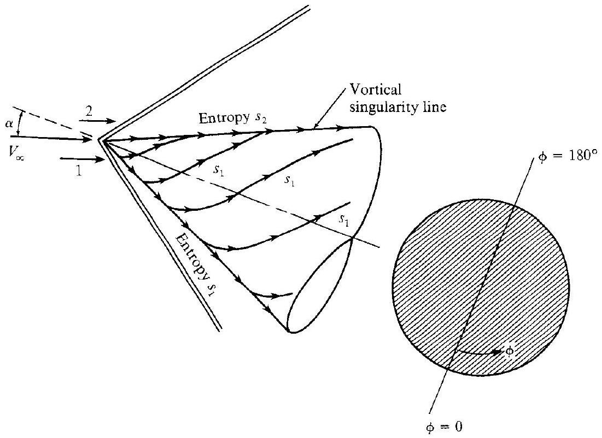
Figure 13.4 I Illustration of the generation of the vortical singularity on a cone at angle of attack.

number of independent variables drops from two to one. This means the system of equations necessary for the flow analysis changes when $\alpha \rightarrow 0$. Also, the qualitative flow picture changes. For example, the curved streamlines along the surface shown in Fig. 13.3 become straight at zero angle of attack.

There is another important aspect of the angle of attack case which does not exist at $\alpha=0$, namely, the existence of a vortical singularity on the leeward surface of the cone at angle of attack. The nature of this vortical singularity can be seen in Fig. 13.4, which shows a cone at angle of attack $\alpha$, along with a cross section of the cone body that identifies the most windward streamline with $\phi=0$ and the most leeward streamline with $\phi=180^{\circ}$. At the cone vertex, the streamline at $\phi=0$, identified as streamline 1 , crosses the shock wave, and acquires entropy $s_{1}$. In turn, the flow through this point wets the entire body surface, and hence all the curved streamlines shown along the body also have entropy $s_{1}$. In contrast, the streamline at the vertex at $\phi=180^{\circ}$, identified as streamline 2 , crosses a weaker portion of the shock wave, and acquires a smaller entropy $s_{2}$. In the sketch shown in Fig. 13.4, where $\alpha$ is less than $\theta_{c}$, streamline 2 flows downstream along the top of the cone, where $\phi=180^{\circ}$. However, all of the streamlines along the surface that are curving upward from the windward side of the cone are also converging along the ray $\phi=180^{\circ}$. Therefore, the ray along the cone surface at $\phi=180^{\circ}$ has a multivalued entropy- $s_{2}$ and $s_{1}$, as well as other values as we will soon see. This line is a vortical singularity, and was first defined by Ferri in 1950 (see Refs. 81 and 82).

It is useful to examine the angle-of-attack flows projected on a spherical surface, such as shown for the zero angle-of-attack case in Fig. 13.1b. When $\alpha<\theta_{c}$, the flow

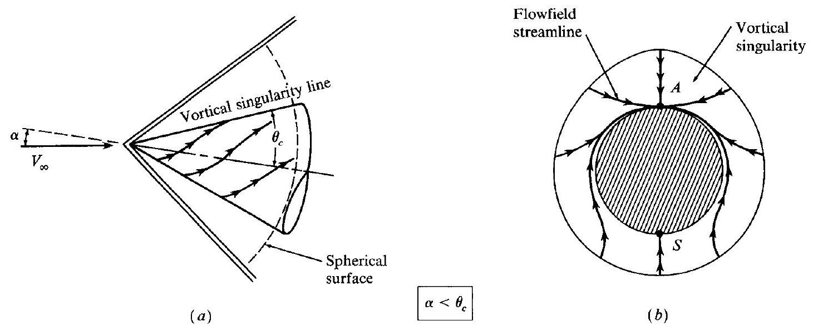
Figure 13.5 I Location of the vortical singularity when the angle of attack is less than the cone half-angle.

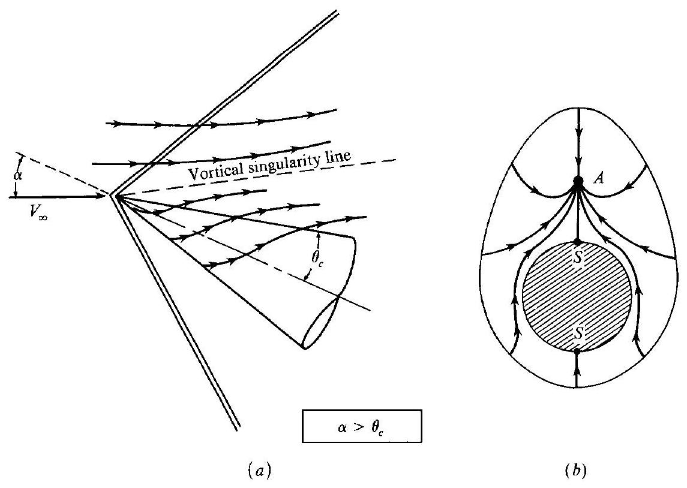
Figure 13.6 I Location of the vortical singularity when the angle of attack is greater than the cone half-angle.

is such as illustrated in Fig. 13.5. The vortical singularity lies along the top of the cone as shown in Fig. 13.5a, and projects into the spherical surface as point $A$ in Fig. 13.5b. The curved streamlines in the flowfield project onto the spherical surface also as curves, and they all converge at the vortical singularity $A$. Hence, the vortical singularity is truly multivalued, with values of entropy ranging from the lowest to the highest within the flowfield. When $\alpha>\theta_{c}$, the flow is different, as sketched in Fig. 13.6. Here, the vortical singularity lifts off the surface, and is located at point $A$
away from the surface as shown in Fig. 13.6b. It is also observed in both Figs. 13.5b and $13.6 b$ that the streamlines with different values of entropy are closely squeezed together near the cone surface. Hence, an entropy layer exists adjacent to the surface of a cone at angle of attack, which is characterized by large gradients in entropy normal to the streamlines.

In describing three-dimensional flows, the type of pictures shown in Figs. 13.5b and $13.6 b$ are called cross flows. To be more specific, the $x y$ plane shown in Fig. 13.2 is called the cross-flow plane, and the velocity given by the vector addition of $\mathbf{V}_{0}$ and $\mathbf{V}_{\phi}$ is called the cross-flow velocity at a given point in the cross-flow plane. Any point where $V_{\theta}^{2}+V_{\phi}^{2}=0$ is called a stagnation point in the cross-flow plane; such stagnation points are labeled by $S$ in Figs. 13.5 $b$ and 13.6b. The vortical singularity $A$ is also a cross-flow stagnation point. Note that $S$ and $A$ are not true stagnation points, because the radial velocity $V_{r}$ is finite at these points. Indeed, there are no points in the inviscid conical flowfield where $V=0$, i.e., there are no true stagnation points in this flowfield. For more details on cross-flow stagnation points and vortical singularities, see the work by Melnik (Ref. 83).

As the angle of attack increases, the cross-flow velocity also increases. When it becomes supersonic, i.e., when $V_{\theta}^{2}+V_{\phi}^{2}>a^{2}$, then embedded shock waves can occur in the leeward portion of the flow, as sketched in Fig. 13.7. These shocks are usually relatively weak and appear in most cases when the angle of attack is larger than the cone half-angle, i.e., when $\alpha>\theta_{c}$. Modern computational fluid dynamic solutions of the inviscid flow over cones at angle of attack have shown weak embedded shocks in the results, as will be discussed in the next section.

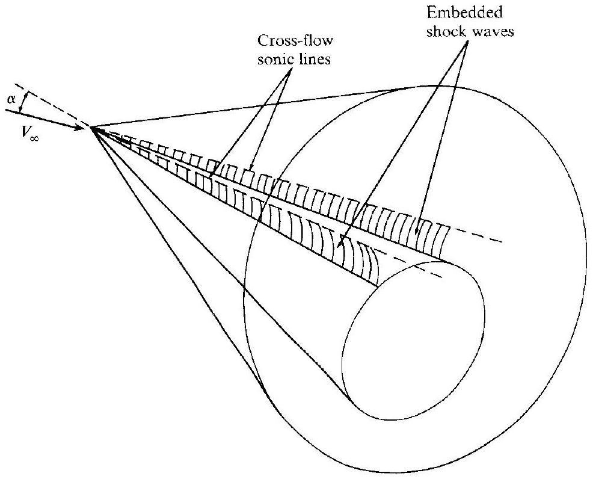
Figure 13.7 I Schematic of embedded shocks on the leeward surface of a cone at angle of attack.

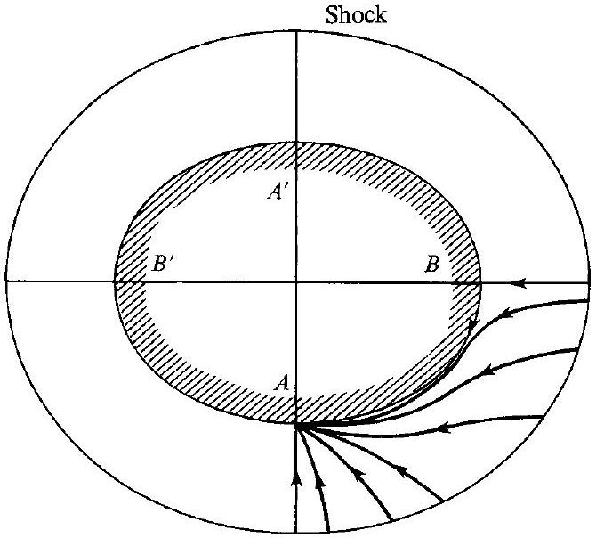
Figure 13.8 I Flowfield around an elliptic cone at $\alpha=0$, as projected onto a spherical surface defined by $r=$ const.

It should be noted that flows over cones that do not have circular cross sections are also conical flows (constant properties along $r$ ). For many high-speed applications, cones with elliptical cross sections are attractive. The flow over such elliptic cones at angle of attack exhibits many of the same features as for the right-circular cone, with the flow variables depending on both $\theta$ and $\phi$. However, unlike the rightcircular cone, the flow over an eliptic cone at zero angle of attack still depends on both $\theta$ and $\phi$, and has cross-flow stagnation points and vortical singularities even at $\alpha=0$. The flow over an elliptic cone at zero angle of attack is shown in Fig. 13.8, where points $A$ and $A^{\prime}$ are vortical singularities and $B$ and $B^{\prime}$ are cross-flow stagnation points.

Finally, we emphasize that all of the qualitative features of the flows over cones at angle of attack discussed herein are for inviscid flows. Experimental measurements of real flows over cones at angle of attack show that the windward region is accurately described by inviscid analysis, but that the leeward region is characterized by flow separation. The surface pressure gradient in the circumferential direction (the direction of increasing $\phi$ ) is favorable on the windward side. However, for angles of attack greater than $\theta_{c}$, the pressure gradient on the leeward side becomes unfavorable; the circumferential pressure distribution attains a local minimum somewhere on the leeward side, and the boundary layer separates from the cone surface along a constant ray just downstream of this pressure minimum. Associated with this separated flow are primary and secondary separation vortices, and if the cross-flow velocity is supersonic, embedded shocks will occur due to the abrupt change in flow direction in the separated regions. A thorough experimental study of such flows has been made by Feldhuhn et al. (Ref. 84). For the sake of completeness, the major features of the viscous flow over a cone at angle of attack are shown in Fig. 13.9, taken from Feldhuhn et al. In Fig. 13.9, where the flow is again projected on a spherical

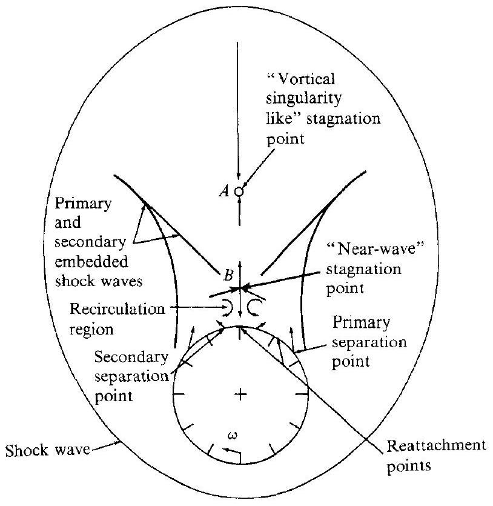
Figure 13.9 | A model of the flowfield around a cone at large angle of attack based on the experimental data of Feldhuhn et al. (Ref. 84).

surface, we see the flow separation points, separation vortices, and the embedded shocks. In spite of the viscous effects, some of the flowfield on the leeward side exhibits familiar inviscid properties, such as the vortical singularity at point $A$. Since this book deals with inviscid flows, we will not pursue these viscous properties any further. The interested reader is referred to Ref. 84 for more details. However, we note in passing an aspect of separated flows that is a current state-of-the-art research topic in aerodynamics. Modern computational fluid dynamic calculations of inviscid rotational flowfields are yielding results that simulate flow separation without any direct accounting of the local viscous effects. As a result, there is a growing number of researchers who feel that separated flows are dominated by inviscid phenomena, and that the actual viscosity plays only a secondary role. Because of the present controversial nature of this theory, we will not elaborate here; instead, we will wait for a resolution at some future date. In the spirit of the present section, we note the recent work by Marconi (Ref. 85) on the calculation of separated flows over cones and cone-cylinders at angle of attack, where the calculation involved the solution of the Euler equations, i.e., dealing with an inviscid flow only. Results were obtained which included a separated flow such as sketched in Fig. 13.10, which shows a vortex sheet leaving the body surface along the separation line. A typical surface streamline pattern from Marconi's calculations is shown in Fig. 13.11 for a cone-cylinder at $36^{\circ}$ angle of attack in a Mach 2.3 free stream. The distinction between the attached flow on the windward side and the separated region on the leeward side is striking.

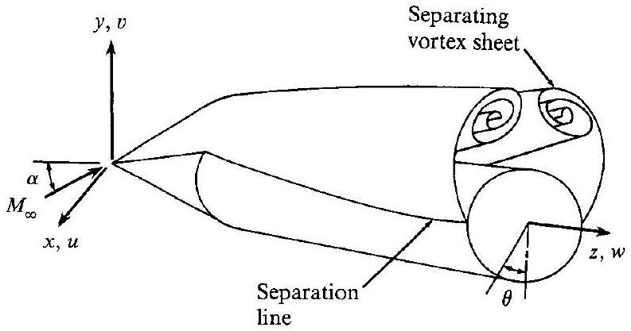
Figure 13.10 | A model of the separated flowfield over an axisymmetric body at angle of attack based on the assumption of inviscid flow. (After Marconi, Ref. 85.)

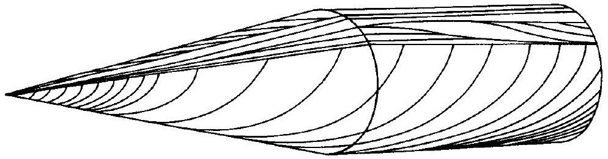
Figure 13.11 I Surface streamlines on a cone-cylinder at angle of attack, from the inviscid flow solutions of Marconi (Ref. 85). $M_{\infty}=2.3$ and $\alpha=36^{\circ}$. Flow separation on the leeward side is modeled as part of the inviscid solution.

### 13.3 I CONES AT ANGLE OF ATTACK: QUANTITATIVE ASPECTS

Early work on the calculation of flows over cones at angle of attack expressed the flow variables in terms of series expansions in $\alpha$ around the zero angle-of-attack case. (See, for example, the work of Kopal in Ref. 86, and that of Sims in Ref. 87, which complement the zero angle-of-attack tables in Refs. 28 and 29 by those same authors, respectively.) These analyses are approximate, and are limited to small angle of attack. They will not be discussed here because they have essentially been superseded by the techniques of modern computational fluid dynamics that allow the exact inviscid solution to be obtained.

Before discussing the exact numerical solution, let us examine an aspect of the governing equations for conical flow that mathematically allows the existence of a vortical singularity, as described qualitatively in Sec. 13.2. Because the flow is isentropic along a given streamline, Eq. (6.51) holds:

$$
\frac{D s}{D t}=0
$$

For a steady flow, this is

$$
\mathbf{V} \cdot \nabla s=0
$$

In terms of the spherical coordinates shown in Fig. 13.2, we have

$$
\nabla s=\frac{\partial s}{\partial r} \mathbf{e}_{r}+\frac{1}{r} \frac{\partial s}{\partial \theta} \mathbf{e}_{\theta}+\frac{1}{r \sin \theta} \frac{\partial s}{\partial \phi} \mathbf{e}_{\phi}
$$

and

$$
\mathbf{V}=V_{r} \mathbf{e}_{r}+V_{\theta} \mathbf{e}_{\theta}+V_{\phi} \mathbf{e}_{\phi}
$$

where $\mathbf{e}_{r}, \mathbf{e}_{\theta}$, and $\mathbf{e}_{\phi}$ are the unit vectors in the $r, \theta$, and $\phi$ directions, respectively. Combining Eqs. (13.1) through (13.3), we have

$$
\mathbf{V} \cdot \nabla s=V_{r} \frac{\partial s}{\partial r}+\frac{V_{\theta}}{r} \frac{\partial s}{\partial \theta}+\frac{V_{\phi}}{r \sin \theta} \frac{\partial s}{\partial \phi}=0
$$

For conical flow, $\partial s / \partial r=0$, and Eq. (13.4) becomes
or

$$
\begin{gathered}
\frac{V_{\theta}}{r} \frac{\partial s}{\partial \theta}+\frac{V_{\phi}}{r \sin \theta} \frac{\partial s}{\partial \phi}=0 \\
\frac{\partial s}{\partial \phi}=-\frac{V_{\theta}}{V_{\phi}} \sin \theta \frac{\partial s}{\partial \theta}
\end{gathered}
$$

Keep in mind that Eq. (13.6) holds along a streamline in the flow; more appropriately, it holds along the projection of a streamline in the spherical surface defined by $r=$ const, as discussed in Sec. 13.2. The shape of this streamline in the spherical surface can be found by noting that the entropy is a function of $\theta$ and $\phi$ in the spherical surface. Thus,

$$
d s=\frac{\partial s}{\partial \theta} d \theta+\frac{\partial s}{\partial \phi} d \phi
$$

Along a streamline, $d s=0$, and Eq. (13.7) gives

$$
\frac{d \phi}{d \theta}=-\frac{\partial s / \partial \theta}{\partial s / \partial \phi}
$$

Substituting Eq. (13.6) into (13.8), we have

$$
\frac{d \phi}{d \theta}=\frac{V_{\phi}}{V_{\theta} \sin \theta}
$$

Equation (13.9) gives the shape of the streamlines as projected on the spherical surface in terms of the velocity field. This equation, in conjunction with Eq. (13.6), conceptually allows the solution of the entropy distribution over the spherical surface defined by $r=$ const. There is one exception, however, namely, at any point where both $V_{\theta}$ and $V_{\phi}$ are zero, i.e., at a cross-flow stagnation point. At such a point, Eqs. (13.6) and (13.9) are indeterminant forms, which allow the possibility of a multivalued entropy at that point-namely, a vortical singularity. Hence, the governing
flow equations predict that such vortical singularities may exist. In Sec. 13.2 we have already shown on the basis of physical reasoning that not all cross-flow stagnation points are vortical singularities, but that all vortical singularities are cross-flow stagnation points. Equations (13.6) and (13.9) simply show that the existence of vortical singularities are compatible with the mathematics.

Modern solutions to the flowfield over cones at angle of attack usually involve a finite-difference solution to the governing partial differential equations of threedimensional, inviscid, adiabatic compressible flow. These equations have been derived and discussed at length in Chap. 6. For example, repeating Eqs. (6.5), (6.29), and (6.44), we have

Continuity:

$$
\frac{\partial \rho}{\partial t}+\nabla \cdot(\rho \mathbf{V})=0
$$

Momentum:

$$
\rho \frac{D \mathbf{V}}{D t}=-\nabla p+\rho \mathbf{f}
$$

Energy:

$$
\rho \frac{D h_{o}}{D t}=\frac{\partial p}{\partial t}+\rho(\mathbf{f} \cdot \mathbf{V})
$$

Written in terms of spherical coordinates, and specialized to a steady flow with no body forces, these equations become:

Continuity:

$$
\frac{\partial \rho}{\partial r}=-\frac{1}{V_{r}}\left[\rho \frac{\partial V_{r}}{\partial r}+\frac{2 \rho V_{r}}{r}+\frac{1}{r \sin \theta} \frac{\partial}{\partial \phi}\left(\rho V_{\theta} \sin \theta\right)+\frac{1}{r \sin \theta} \frac{\partial\left(\rho V_{\phi}\right)}{\partial \phi}\right]
$$

Momentum in $r$ direction:

$$
\frac{\partial V_{r}}{\partial r}=-\frac{1}{V_{r}}\left[\frac{V_{\theta}}{r} \frac{\partial V_{r}}{\partial \theta}+\frac{V_{\phi}}{r \sin \theta} \frac{\partial V_{r}}{\partial \phi}-\frac{V_{\theta}^{2}+V_{\phi}^{2}}{r}+\frac{1}{\rho} \frac{\partial p}{\partial r}\right]
$$

Momentum in $\theta$ direction:

$$
\frac{\partial V_{\theta}}{\partial r}=-\frac{1}{V_{r}}\left[\frac{V_{\theta}}{r} \frac{\partial V_{\theta}}{\partial \theta}+\frac{V_{\phi}}{r \sin \theta} \frac{\partial V_{\theta}}{\partial \phi}+\frac{V_{r} V_{\theta}}{r}-\frac{V_{\phi}^{2} \cot \theta}{r}+\frac{1}{r \rho} \frac{\partial p}{\partial \theta}\right]
$$

Momentum in $\phi$ direction:

$$
\frac{\partial V_{\theta}}{\partial r}=-\frac{1}{V_{r}}\left[\frac{V_{\theta}}{r} \frac{\partial V_{\phi}}{\partial \theta}+\frac{V_{\phi}}{r \sin \theta} \frac{\partial V_{\phi}}{\partial \theta}+\frac{V_{r} V_{\phi}}{r}+\frac{V_{\theta} V_{\phi} \cot \theta}{r}+\frac{1}{\rho r \sin \theta} \frac{\partial p}{\partial \theta}\right]
$$

Energy: $\quad h_{o}=h_{\infty}+\frac{V_{\infty}^{2}}{2}=h+\frac{1}{2}\left(V_{r}^{2}+V_{\theta}^{2}+V_{\phi}^{2}\right)$

In addition to these flow equations, we also have the perfect gas equation of state:

$$
p=\rho R T
$$

and the state relation for a calorically perfect gas:

$$
h=c_{p} T
$$

Equations (13.10) through (13.16) are seven equations for the seven unknowns, $\rho, V_{r}, V_{\theta}, V_{\phi}, p, T$, and $h$. They are the equations, written in spherical coordinates, for a steady, adiabatic, inviscid, compressible flow, and therefore are applicable for the solution of the flow over a cone at angle of attack in a supersonic stream.

Note that Eqs. (13.10) through (13.13) have been written such that the $r$ derivatives are on the left-hand side, and the $\theta$ and $\phi$ derivatives are on the right-hand side. This hints strongly of a finite-difference solution that marches in the $r$ direction, directly analogous to the time-marching solutions discussed in Chap. 12. Indeed, a novel approach to the solution of the cone problem using the principle of marching in the $r$ direction was first set forth by Moretti in Ref. 88. The general philosophy of Moretti's approach is illustrated in Fig. 13.12. We are interested in calculating the flowfield over a cone with half-angle $\theta_{c}$ at an angle of attack $\alpha$ in a free stream at $M_{\infty}$. Start with an assumed flowfield on the spherical surface given by $r=r_{0}$, where

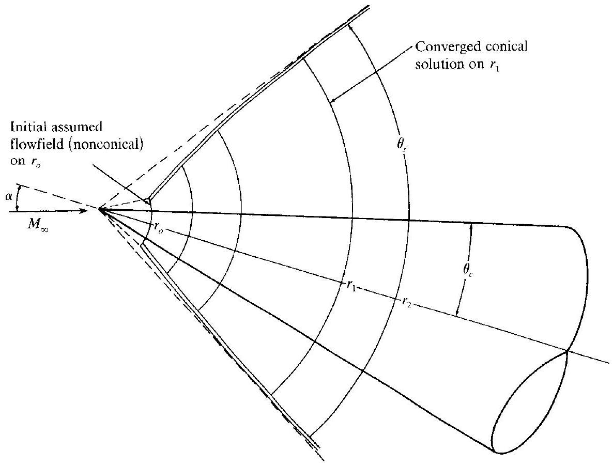
Figure 13.12 I Schematic of the solution of the flowfield over a cone at angle of attack, starting with an initially assumed nonconical flowfield, and marching downstream until convergence is obtained.

the spherical surface is bounded between the body and the shock. This will be a nonconical flow, and of course is not the correct flow solution for the cone. The assumed flow on $r=r_{o}$ can be somewhat arbitrary, but must have at each point the local total enthalpy equal to the free-stream value, and the integrated mass flow through $r=r_{o}$ must equal the free-stream mass flow intercepted by the spherical surface. Since the flowfield properties are now specified on $r=r_{o}$, the $\theta$ and $\phi$ derivatives that appear on the right-hand side of Eqs. (13.10) through (13.13) can be expressed in terms of known finite differences. This immediately allows the calculation of $\partial \rho / \partial r, \partial V_{r} / \partial r, \partial V_{\theta} / \partial r$, and $\partial V_{\phi} / \partial r$ from Eqs. (13.10) through (13.13). In turn, the $r$ derivatives are used to calculate the flow over the next downstream spherical surface located at $r_{o}+\Delta r$. For this purpose, MacCormack's technique, as discussed in Sec. 11.12, can be used. For example, if the flow is known over the spherical surface located at $r$, then the density at $r+\Delta r$ can be obtained from

$$
\rho(r+\Delta r)=\rho(r)+\left(\frac{\partial \rho}{\partial r}\right)_{\mathrm{ave}} \Delta r
$$

In Eq. (13.17), the average value of $\partial \rho / \partial r$ is obtained from the predictor-corrector approach directly analogous to that described in Sec. 11.12. That is, a predicted value $\partial \rho / \partial r$ is obtained from Eq. (13.10) using forward differences in $\theta$ and $\phi$. Then a corrected value ( $\overline{\partial \rho} / \partial r$ ) is obtained from Eq. (13.10) using rearward differences in $\theta$ and $\phi$ with predicted values $\bar{\rho}, \bar{V}_{r}, \bar{V}_{\theta}$, and $\bar{V}_{\phi}$. Then the average $r$ derivative is formed as

$$
\left(\frac{\partial \rho}{\partial r}\right)_{\mathrm{ave}}=\frac{1}{2}\left[\left(\frac{\partial \rho}{\partial r}\right)+\left(\frac{\overline{\partial \rho}}{\partial r}\right)\right]
$$

Finally, the value of $\rho$ at $r+\Delta r$ is obtained from Eq. (13.17). Of course, to allow the proper formulation of the finite differences, the flowfield shown in Fig. 13.12 should be transformed such that it is a rectangular shape in the transformed plane. Along with this, the governing equations (13.10) through (13.13) should also be transformed to the computational space. Since our purpose here is to present the general philosophy of the method, we will not clutter our discussion with details.

As the finite-difference solution marches downstream to subsequent spherical surfaces, the flowfield changes from one value of $r$ to another. In the process, the shock wave shape and location change as we march downstream. For details on the calculation of the shock shape, as well as the numerical formulation of the boundary conditions behind the shock and along the body, see Ref. 88. However, as we progress far enough downstream, the flowfield properties begin to approach a converged value, i.e., $\partial \rho / \partial r$ becomes smaller and smaller, until we reach some spherical surface, denoted by $r=r_{1}$ in Fig. 13.12, where there is virtually no change in the flowfield in the $r$ direction. That is, at $r=r_{1},(\partial / \partial r) \approx 0$ for all the flow variables, and therefore the flow variables over the next downstream surface $r_{2}$ are virtually unchanged from $r_{1}$. Clearly, when this convergence is achieved, then, by definition, the flowfield has become conical, and the flowfield solution over the spherical surface $r=r_{1}$ is indeed the solution of the flow over the given cone at the given angle of
attack. The nonconical flow computed between $r_{0}$ and $r_{1}$ was just a means to obtain the final conical flow solution. In this vein, the present technique is directly analogous to the time-marching method for the solution of the flow over a blunt body discussed in Chap. 12, where the calculated transient flowfield is just a means to an end, namely, obtaining the final steady flow over the body at large times. Here, we have replaced the time marching of Chap. 12 with spatial marching in the $r$ direction. leading to a converged conical flow at large values of $r$.

Some typical results obtained by Moretti are shown in Figs. 13.13 and 13.14, for a free-stream Mach number of 7.95, and a $10^{\circ}$ half-angle cone at 8 angle of attack. These figures illustrate the mechanics of the downstream-marching philosophy. Figure 13.13 illustrates the rate of change of the average calculated shock coordinate with distance $r$. If $\bar{\theta}_{s}$ represents the average polar coordinate of the shock at a given $r$ [note that $\theta_{s}=f(\phi)$ for a given $r$ ], then $\partial \bar{\theta}_{s} / \partial r$ is an indicator of convergence. When $\partial \bar{\theta}_{s} / \partial r$ becomes small, the correct conical flow is approached. This variation is given in Fig. 13.13, which is a plot of $\partial \bar{\theta}_{s} / \partial r$ as a function of radial location referenced to the initial value $r=r_{0}$. This shows that a downstream-marching distance of more than $100 r_{0}$, was necessary before the converged conical flow was obtained.

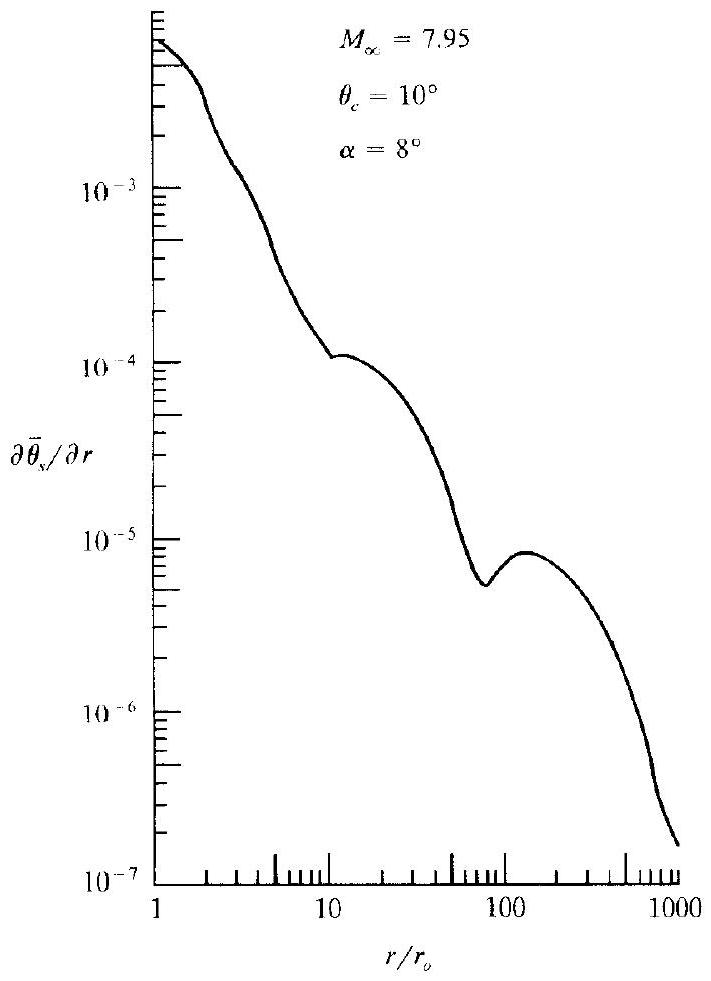
Figure 13.131 Rate of convergence, as indicated by the spatial rate of change of the mean shock angle with downstream distance $r$. (From Moretti, Ref. 88.)

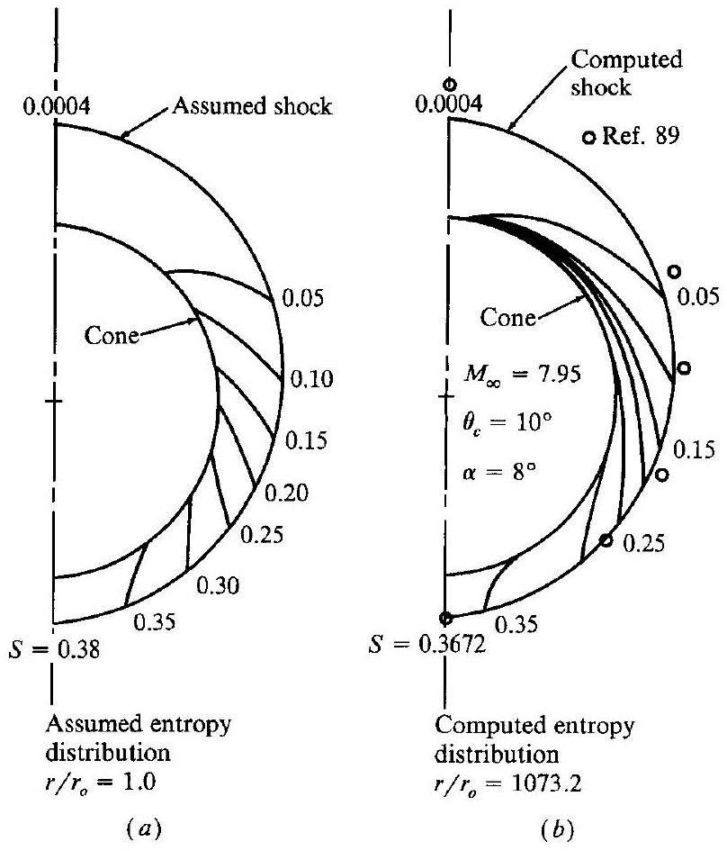
Figure 13.14 | Comparison between the assumed entropy distribution at $r=r_{o}(a)$ and the converged entropy distribution at $r=1073.2 r_{o}$ (b). (From Moretti, Ref. 88.)

In Fig. 13.14, the initially assumed entropy distribution at $r=r_{o}$ (Fig. 13.14a) is compared with the final converged result at $r=1073.2 r_{o}$ (Fig. 13.14b). Starting with the assumed nonconical flow in Fig. 13.14a, the converged conical flow shown in Fig. 13.14b is obtained. The answer to the problem is Fig. 13.14b. Concentrating on Fig. 13.14b, we see a projection of the computed lines of constant nondimensional entropy on the spherical surface. Note that these lines all converge at the top of the cylinder, showing that the numerical solution is predicting the expected vortical singularity. Also, since the entropy is constant along a given streamline, then the curves shown in Fig. 13.14b are also traces of the streamline shapes. The computed shock wave shape is also shown, and is compared with experimental data for the shock shape obtained from Tracy (Ref. 89) denoted by the open circles. The expected good agreement between calculation and experiment is seen on the windward side, but the measured shock is slightly higher than the calculated shock on the leeward side-an effect due to the real viscous flow, as described earlier.

In terms of the language of computational fluid dynamics (as described in Chaps. 11 and 12), Moretti's cone solution is a shock-fitting method. Moreover, the governing equations given by Eqs. (13.10) through (13.13) are in the nonconservation form, which is appropriate in conjunction with a shock-fitting method. However,
this leads to a restriction on the range of problems that can be solved by the specific method described above. The nonconservation form of the equations is not appropriate for capturing shock waves; hence, any embedded shocks that might be present in the leeward flowfield will not be properly calculated. This limited the cone solutions carried out by Moretti in Ref. 88 to cases where $\alpha<\theta_{c}$. However, this in no way compromises the overall philosophy presented by Moretti, namely, that the proper conical flow solution can be obtained by marching downstream from an assumed initial nonconical flow.

Using Moretti's downstream-marching philosophy, Kutler and Lomax (Refs. 40 and 90 ) removed the restrictions mentioned above by computing the flow with a shock-capturing method using the conservation form of the governing equations. In this approach, the finite-difference grid reaches beyond the conical shock wave, which in turn is captured internally within the grid in the same vein as discussed in Sec. 11.15 and pictured in Fig. 11.23. Embedded shock waves on the leeward side, if present, are also captured within the grid. Kutler and Lomax, with an eye toward applications to nonconical bodies, did not use a spherical coordinate system; rather, they employed a body-oriented system, with $x$ measured along the surface, $y$ perpendicular to the surface, and $\phi$ as the meridional angle. This coordinate system and grid is shown in Fig. 13.15, obtained from Ref. 40. The governing steady-flow equations in conservation form are written in the body-oriented coordinates, and the solution is marched downstream in the $x$ direction using MacCormack's technique

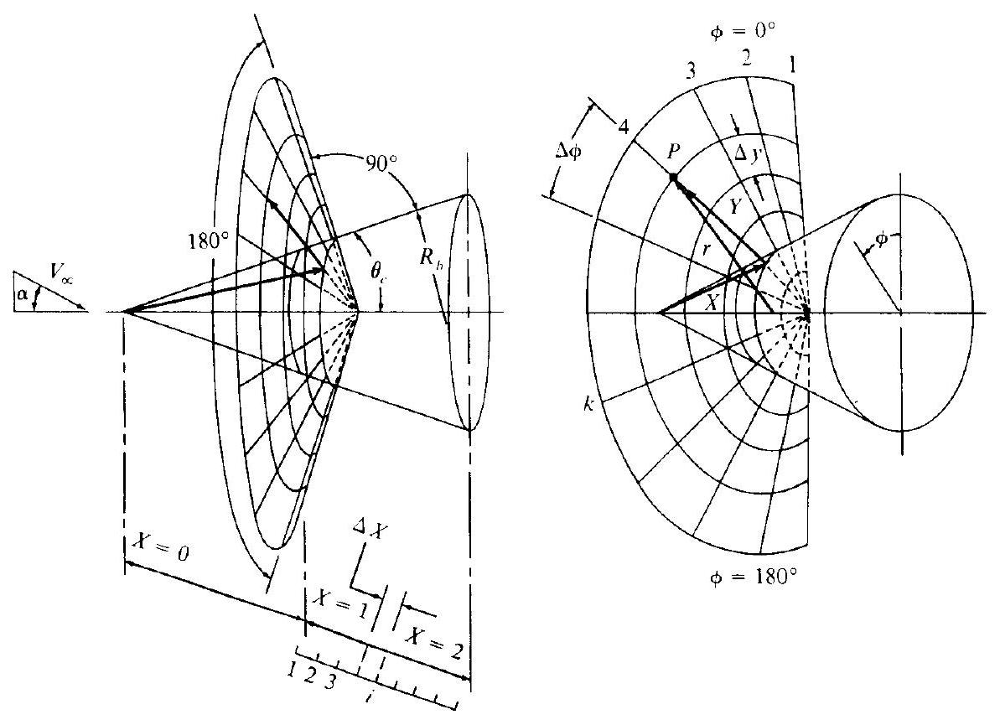
Figure 13.15 I Coordinate system and finite-difference mesh for the calculations of Ref. 90.

until a converged, conical flow is obtained. For more details on the computational method, see Ref. 40.

The circumferential pressure distributions around a $10^{\circ}$ half-angle cone at Mach 5 are shown in Fig. 13.16 for angles of attack ranging from $0^{\circ}$ to $15^{\circ}$, as calculated by Kutler and Lomax. Note that for $\alpha<10^{\circ}$, the pressure distributions monotonically decrease from the windward to the leeward side. However, for $\alpha>10^{\circ}$,

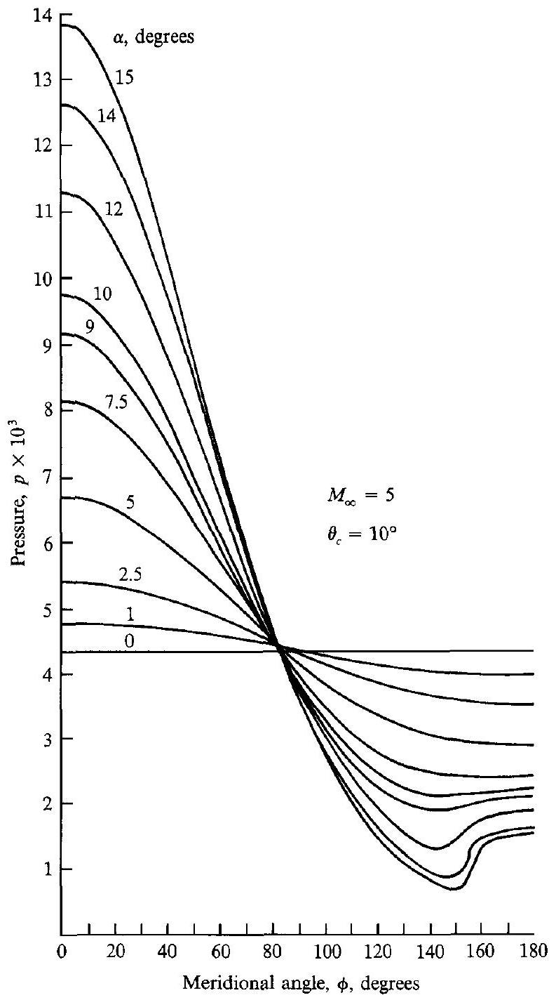
Figure 13.16 I Circumferential pressure distributions around a $10^{\circ}$ cone at various angles of attack. (From Kutler and Lomax, Ref. 90.)

the pressure first decreases, reaches a local minimum value partway around the leeward side, and then increases to the top of the cone. Kutler and Lomax found weak embedded shock waves on the leeward side corresponding to the region of adverse pressure gradients. In a separate analysis of flows over cones at angle of attack, Fletcher (Ref. 91) also observed embedded shocks. Fletcher's approach utilized the same downstream-marching philosophy as described earlier, along with shock fitting of the primary shock wave. The flowfield calculations were carried out using a hybrid numerical and analytical method; see Ref. 91 for details. His results for a Mach 7.95 flow over a $10^{\circ}$ cone at $\alpha=16^{\circ}$ are shown in Fig. 13.17. Here, we see, projected on a spherical surface, the calculated shock wave shape, the vortical singularity (denoted by VS), the calculated embedded shocks (labeled $N N$ ), and the sonic lines in the windward and leeward regions. Also shown are some experimental data from Tracy (Ref. 89). Note that the outer primary shock shape agrees well with experiment, but that the experimentally measured embedded shocks $E E$ lie outside of the numerically computed shocks.

With this, we end our discussion of the flow over a cone at angle of attack in a supersonic flow. This problem, which prior to 1965 was very different to solve for large angles of attack, has been made almost routine by the modern methods of computational fluid dynamics. Our purpose has been twofold: (1) to achieve some

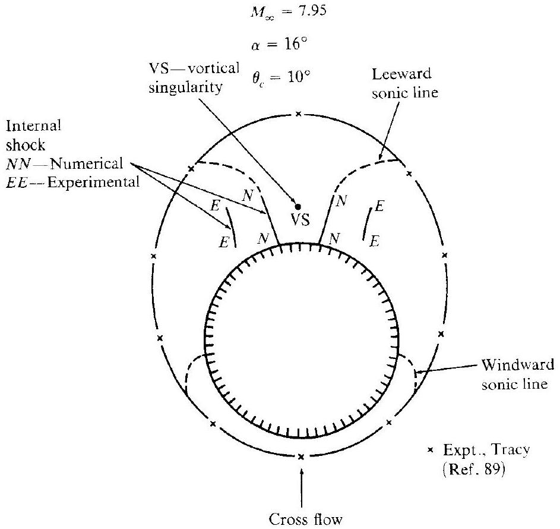
Figure 13.17 I Comparison between experiment and numerical calculations for flow over a cone at angle of attack. (From Fletcher. Ref. 91.)

overall understanding of the various computational techniques for the solution of this problem, and (2) to study the physical aspects of such flows as an example of a classic three-dimensional flowfield.

### 13.4 I BLUNT-NOSED BODIES AT ANGLE OF ATTACK

Recall that the flow over a cone at zero angle of attack-a three-dimensional geometric object-is "one-dimensional" in the sense that the conical flowfield depends only on one independent variable, namely the polar angle $\theta$ as described in Chap. 10 . Similarly, the flow over a cone at angle of attack is "two-dimensional" in the sense that the flowfield, which is still conical, depends only on two independent variables, namely, $\theta$ and $\phi$, as discussed in Secs. 13.2 and 13.3.

In this section, and for the remainder of this chapter, we discuss flowfields that are truly three-dimensional in the sense that they depend on three spatial independent variables. An important example of such a flow is the supersonic blunt body at angle of attack. The supersonic blunt body at zero angle of attack was studied in Sec. 12.5, where a time-marching method was used to obtain the steady flow in the limit of large time. The first practical zero angle-of-attack blunt body solution-indeed, made practical by the time-marching philosophy-was carried out by Moretti and Abbett in Ref. 47. This work was quickly extended to the angle-of-attack case by Moretti in Ref. 92. Since we followed Moretti's approach in Sec. 12.5, let us do the same here for the angle-of-attack case.

Consider a blunt body at angle of attack as shown in Fig. 13.18. A cylindrical coordinate system, $r, \phi, z$, is drawn with the $z$ axis along the centerline of the body.

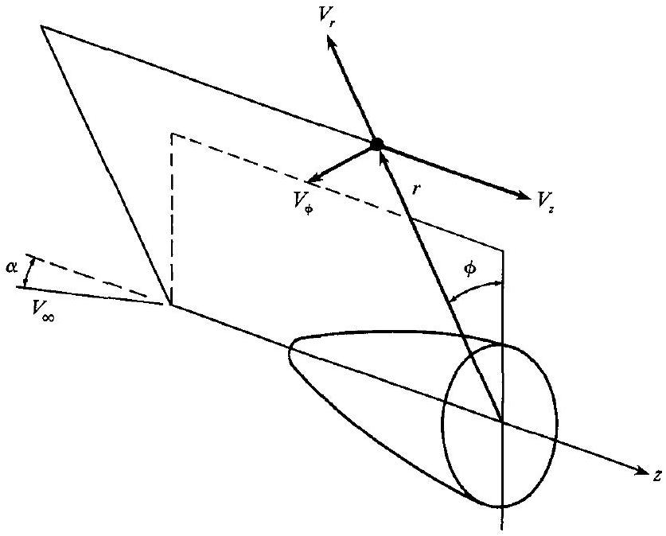
Figure 13.18 | Cylindrical coordinate system in physical space for the angle-of-attack blunt body problem.

The governing three-dimensional flowfield equations, analogous to the twodimensional equations given by Eqs. (12.19) through (12.22), are, in cylindrical coordinates,

Continuity: $\quad \frac{\partial \rho}{\partial t}+\frac{1}{r} \frac{\partial}{\partial r}\left(\rho r V_{r}\right)+\frac{1}{r} \frac{\partial\left(\rho V_{\phi}\right)}{\partial \phi}+\frac{\partial\left(\rho V_{-}\right)}{\partial z}=0$

Momentum in $r$ direction:

$$
\rho \frac{\partial V_{r}}{\partial t}+\rho V_{r} \frac{\partial V_{r}}{\partial r}+\frac{\rho V_{\phi}}{r} \frac{\partial V_{r}}{\partial \phi}-\frac{\rho V_{\phi}^{2}}{r}+\rho V_{z} \frac{\partial V_{r}}{\partial z}=-\frac{\partial p}{\partial r}
$$

Momentum in $\phi$ direction:

$$
\rho \frac{\partial V_{\phi}}{\partial t}+\rho V_{r} \frac{\partial V_{\phi}}{\partial r}+\frac{\rho V_{\phi}}{r} \frac{\partial V_{\phi}}{\partial \theta}-\frac{\rho V_{r} V_{\phi}}{r}+\rho V_{-} \frac{\partial V_{\phi}}{\partial z}=-\frac{1}{r} \frac{\partial p}{\partial \phi}
$$

Momentum in z direction:

Energy:

$$
\begin{gathered}
\rho \frac{\partial V_{z}}{\partial t}+\rho V_{r} \frac{\partial V_{z}}{\partial r}+\frac{\rho V_{\phi}}{r} \frac{\partial V_{z}}{\partial \phi}+\rho V_{r} \frac{\partial V_{z}}{\partial z}=-\frac{\partial p}{\partial z} \\
\frac{\partial s}{\partial t}+V_{r} \frac{\partial s}{\partial r}+\frac{V_{\phi}}{r} \frac{\partial s}{\partial \phi}+V_{z} \frac{\partial s}{\partial z}=0
\end{gathered}
$$

Recall that Eq. (13.23) is really the entropy equation, and it states that the entropy of a given fluid element is constant during its motion in the shock layer between the shock wave and the body-a ramification of the flow being inviscid and adiabatic. Following Moretti and Bleich, Eqs. (13.19) through (13.23) are nondimensionalized and transformed as follows. For simplicity, assume the body is axisymmetric (this is not a necessary aspect of the method). Hence, the body shape is given by

$$
z=b(r)
$$

The shock wave shape is given by

$$
==S(r, \phi, t)
$$

Let $\delta=S-h$. Then a new set of independent variables is defined as

$$
\zeta=\frac{z-b}{\delta} \quad Y=r \quad X=\phi \quad t=t
$$

With the relations given in Eq. (13.24), the three-dimensional flowfield between the shock and body transforms to the right parallelepiped in the $\zeta-X-Y$ space as shown in Fig. 13.19. In turn, this is used as the computational space in which finite-difference quotients are formed. The dependent variables were transformed in Ref. 92 as

$$
P=\ln p \quad R=\ln \rho \quad \psi=P-\gamma R
$$

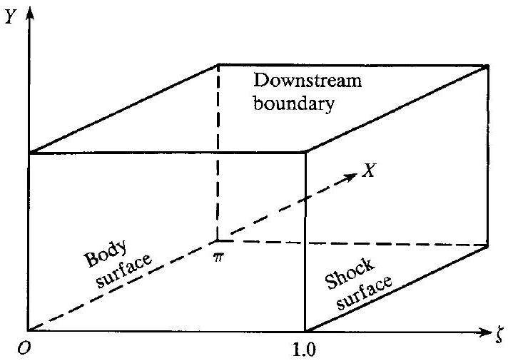
Figure 13.19 | Transformed coordinate system in computational space for the angle-of-attack blunt body problem.

With the relations defined in Eqs. (13.24) and (13.25), the governing flow equations given by Eqs. (13.19) through (13.23) become

Continuity:

$$
\begin{aligned}
\frac{\partial R}{\partial t}=- & {\left[V_{r} \frac{\partial R}{\partial Y}+A \frac{\partial R}{\partial X}+B \frac{\partial R}{\partial \zeta}+\frac{\partial V_{r}}{\partial Y}+E \frac{\partial V_{r}}{\partial \zeta}+\left(\frac{\partial V_{\infty}}{\partial X}+V_{r}\right) / Y\right.} \\
& \left.-F \frac{\partial V_{\phi}}{\partial \zeta}+\frac{1}{\delta} \frac{\partial V_{z}}{\partial \zeta}\right]
\end{aligned}
$$

Momentum in $r$ direction:

$$
\frac{\partial V_{r}}{\partial t}=-\left[V_{r} \frac{\partial V_{r}}{\partial Y}+A \frac{\partial V_{r}}{\partial X}+B \frac{\partial V_{r}}{\partial \zeta}-A V_{r}+G\left(\frac{\partial P}{\partial Y}+E \frac{\partial P}{\partial \zeta}\right)\right]
$$

Momentum in $\phi$ direction:

$$
\frac{\partial V_{\phi}}{\partial t}=-\left[V_{r} \frac{\partial V_{\phi}}{\partial Y}+A \frac{\partial V_{\phi}}{\partial X}+B \frac{\partial V_{\phi}}{\partial \zeta}+A V_{r}+G\left(\frac{1}{Y} \frac{\partial P}{\partial x}-F \frac{\partial P}{\partial \zeta}\right)\right]
$$

Momentum in z direction:

$$
\frac{\partial V_{z}}{\partial t}=-\left[V_{r} \frac{\partial V_{z}}{\partial Y}+A \frac{\partial V_{z}}{\partial X}+B \frac{\partial V_{z}}{\partial \zeta}+\frac{G}{\delta} \frac{\partial P}{\partial \zeta}\right]
$$

Energy (entropy):

$$
\frac{\partial \psi}{\partial t}=-\left[V_{r} \frac{\partial \psi}{\partial Y}+A \frac{\partial \psi}{\partial X}+B \frac{\partial \psi}{\partial \zeta}\right]
$$

where

$$
\begin{aligned}
& A=\frac{V_{\phi}}{Y} \quad C=\frac{d b}{d r}(\zeta-1)-\zeta \frac{\partial S}{\partial r} \\
& B=\frac{1}{\delta}\left[V_{-}+C V_{r}-\zeta\left(\frac{\partial S}{\partial t}+A \frac{\partial S}{\partial \phi}\right)\right] \\
& E=\frac{C}{\delta} \quad F=\frac{\zeta}{Y \delta} \frac{\partial S}{\partial \phi} \quad G=\frac{p}{\rho}
\end{aligned}
$$

Note that Eqs. (13.26) through (13.30) are written with the time derivatives on the left-hand side and the spatial derivatives on the right-hand side. Assuming that the flowfield is known at time $t$, these spatial derivatives can be replaced with finitedifference expressions evaluated in the $\zeta-X-Y$ computational space shown in Fig. 13.19. This allows the calculation of the time derivatives of $R, V_{r}, V_{\phi}, V_{s}$ and $\psi$ from Eqs. (13.26) through (13.30), from which new values of the flowfield variables are obtained at time ( $t+\Delta t$ ). The actual time-marching method can be carried out using MacCormack's technique as given in Sec. 12.5 for the two-dimensional blunt body problem, i.e., by using a predictor-corrector approach where the $\zeta, X$, and $Y$ derivatives are replaced by forward differences on the predictor step, and by rearward differences on the corrector step. The boundary conditions along the shock and body can be treated numerically by using a locally one-dimensional method of characteristics analysis matched to the calculation of the interior flowfield, exactly as described in Sec. 12.5 for the two-dimensional blunt body problem. See Ref. 92 for more details.

Typical results obtained by Moretti and Bleich are shown in Figs. 13.20 through 13.23. In Fig. 13.20, the time-dependent motion of the bow shock wave is shown for the flow over a blunt body consisting of an ellipsoidal nose with a major-to-minor axis ratio of 1.5 , blending into a $14^{\circ}$ half-angle cone downstream; the body is at a $30^{\circ}$ angle of attack, and $M_{\infty}=8$. The assumed initial shock shape at $t=0$ is shown; for simplicity, it is initially chosen as an axisymmetric shape. During the course of the time-marching solution, the shock wave changes shape and location, and of course all the flow variables between the shock and the body are changing with time. Results for the transient shock wave are shown after 100, 200, 300, and 400 time steps. The 400th step is essentially the converged steady state result-the desired answer-yielding a nonaxisymmetric shock. Figure 13.21 gives the calculated steady-state Mach number distribution around the surface of the body for the symmetry plane $\phi=0$, plotted as a function of $r$. (The $r$-body coordinates on the windward and leeward side of the body are illustrated in Fig. 13.20.) At the left side of Fig. 13.21, the Mach number plot is started at a value of $r$ at a downstream location on the windward side. As we move from left to right along the horizontal axis in Fig. 13.21, we are moving along the windward body surface toward the nose. The value $r=0$ corresponds to the nose tip. Then, we continue to move over the top of

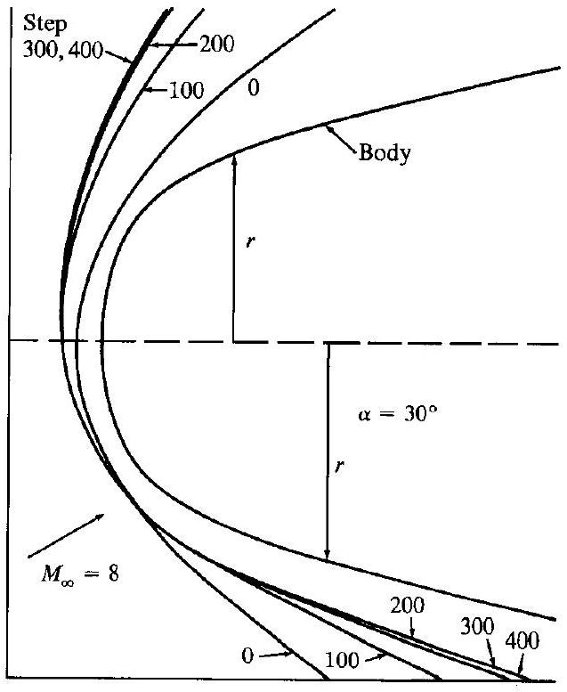
Figure 13.20 | Shock wave shapes at various times during time marching toward the steady state. (From Moretti and Bleich, Ref. 92.)

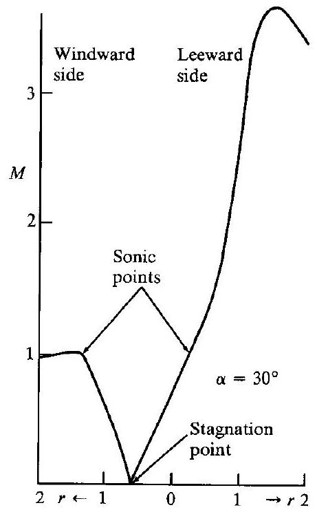
Figure 13.21 | Steady-state Mach number distribution along the surface of the body shown in Fig. 13.20 (Ref. 92).

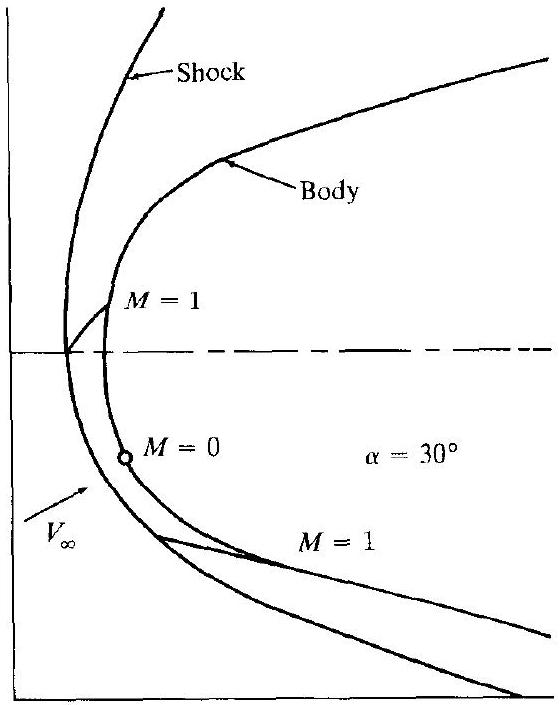
Figure 13.22 | Steady-state shock wave, sonic lines, and stagnation point in the symmetry plane for the flow problem in Fig. 13.20 (Ref. 92).

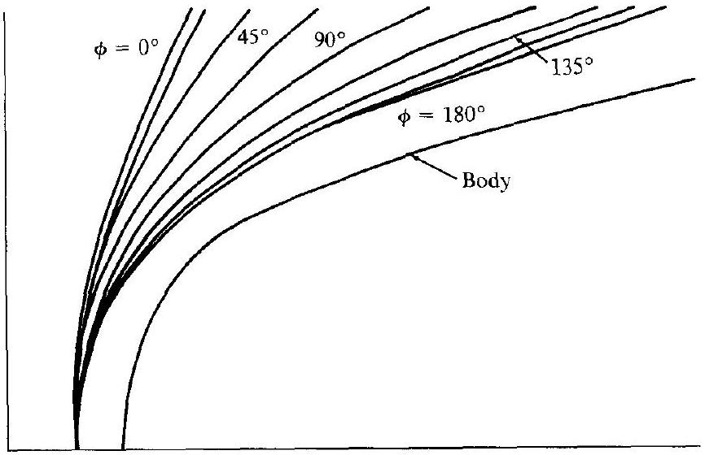
Figure 13.23 | Steady-state shock wave shapes in different meridional planes, $M_{\infty}=8.0$ and $\alpha=30^{\circ}$ (Ref. 92).

the body away from the nose over the leeward side. Note that the Mach number $M$ at the left of Fig. 13.21 is essentially sonic, determining the sonic point on the lower section of the body. As we move closer to the nose, $M$ decreases to zero, thus locating the stagnation point, which occurs on the leeward side. Then, moving away from the stagnation point, $M$ increases toward the nose tip, continues to increase
over the leeward side to a local maximum of about 2.6 , and then slightly decreases downstream of this point. This local peak in $M$ is due to a local "overexpansion" of the flow in the region just downstream of where the ellipsoid nose mates with the cone. This overexpansion is characteristic of the hypersonic inviscid flow (note that $M_{\infty}=8$ ) over axisymmetric and other three-dimensional bodies that have a discontinuous change in the derivative of the body shape, i.e., a discontinuity in $d^{2} b / d r^{2}$, such as the case shown here, even though the slopes themselves ( $d b / d r$ for the ellipsoid and $d b / d r$ for the cone) are matched at the juncture of the two geometric shapes. In Fig. 13.22, the steady-state shock wave shape is shown along with the upper and lower sonic lines, and the stagnation point location. These are all typical of a blunt body at angle of attack. Finally, the steady-state shock shape in different meridional planes defined by different values of $\phi$ is given in Fig. 13.23, starting with $\phi=0$ at the top of the body, and ending with $\phi=180^{\circ}$ at the bottom of the body. The fact that the shock is highly three-dimensional (highly nonaxisymmetric) is clearly evident here.

The work of Moretti and Bleich in Ref. 92 has been greatly extended in recent years. An example of a more recent application is described by Weilmuenser (Ref. 93), who calculated the inviscid flow over a space-shuttle-like vehicle at high angle of attack. The body shape and finite-difference grid is shown in Fig. 13.24. A spherical coordinate system is used in the nose region, patched to a cylindrical coordinate system downstream of the nose. The governing unsteady flow equations in spherical coordinates are given by Eqs. (13.10) through (13.13) for continuity and momentum; the unsteady energy equation (entropy equation) in spherical coordinates is given by

$$
\frac{\partial s}{\partial t}=-\left[V_{r} \frac{\partial s}{\partial r}+\frac{V_{\theta}}{r} \frac{\partial s}{\partial \theta}+\frac{V_{\phi}}{r \sin \theta} \frac{\partial s}{\partial \phi}\right]
$$

The unsteady flow equations in cylindrical coordinates are given by Eqs. (13.19) through (13.23). These are the governing equations for the time-marching solution of the inviscid flowfield over the body shown in Fig. 13.24. The approach used by Weilmuenser follows the shock-fitting philosophy pioneered by Moretti and the explicit time-marching predictor-corrector technique of MacCormack. Both of these concepts have already been discussed elsewhere in this book, and hence no further elaboration is given here. Typical results from Ref. 93 are shown in Fig. 13.25. Here the steady-state three-dimensional shock wave shape over the shuttle-like body is given for the case of $M_{\infty}=16.25$ and $\alpha=39.8^{\circ}$. Of course, the entire steady flowfield between the shock and the body is also calculated. Figure 13.25 illustrates an advanced capability for the calculation of three-dimensional flowfields. Such calculations do not come cheap, however. For the solution shown in Fig. 13.25, nearly 100,000 grid points are used, and a supercomputer is necessary for the calculations.

The shuttle vehicle at high angle of attack, such as shown in Fig. 13.25, has a large region of subsonic flow over the lower compression surface. This is why a

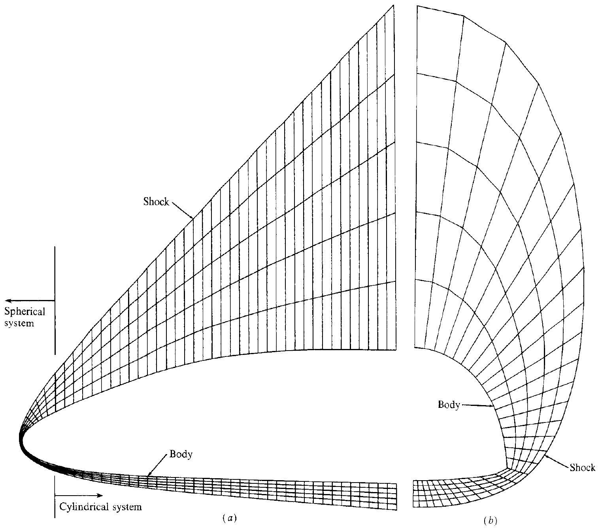
Figure 13.24 I (a) Physical grid in the symmetry plane for the calculation of the flow over a shuttle-like vehicle (Ref. 93). (b) Physical grid in the cross-flow plane.

time-marching method is used to calculate the entire flowfield. However, there are numerous applications involving blunt-nosed bodies at small enough angles of attack where a large region of locally supersonic flow exists downstream of the blunt nose. One such example has already been discussed in Sec. 11.16, where the inviscid flowfield over the space shuttle is calculated by Rakich and Kutler (Ref. 45), comparing results obtained from a downstream-marching finite-difference solution and a three-dimensional method of characteristics solution. Both of these solutions

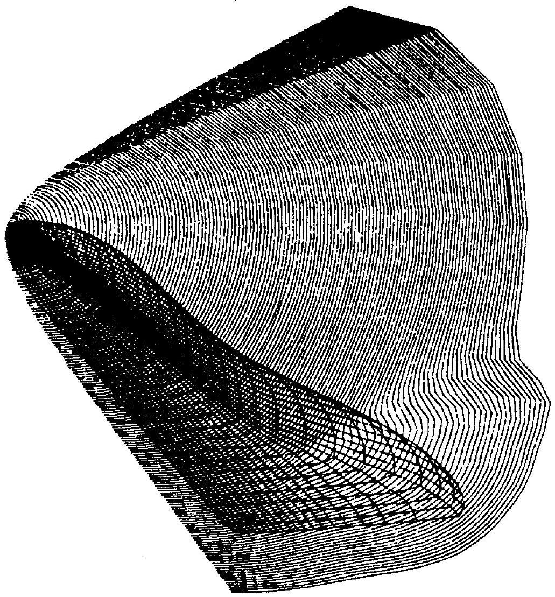
Figure 13.25 I Steady state, three-dimensional shock wave shape over a shuttle-like vehicle. $M_{\infty}=16.25$ and $\alpha=39.8^{\circ}$. (From Weilmuenser, Ref. 93.)

are started from an initial data plane generated from a time-marching blunt body solution in the nose region. (It is instructional to reread Sec. 11.16 before progressing further.) A modern example of a three-dimensional flowfield calculation using the downstream-marching method is given by the work of Newberry et al. in Ref. 94, where the inviscid flow over the hypersonic entry research vehicle configuration shown in Fig. 13.26 is calculated. Here, a highly efficient downstream-marching method by Chakravarthy et al. (Refs. 95 through 97) is used, again starting from an initial data surface obtained from a time-marching blunt body calculation. Typical results for the Mach number distribution throughout the flowfield are shown by the computer graphics representations in Fig. 13.27. Here, the Mach number contours (lines of constant Mach number) are shown in six different cross-sectional planes corresponding to six streamwise locations along the body. The free-stream Mach number is 16 , and the angle of attack is $8^{\circ}$.

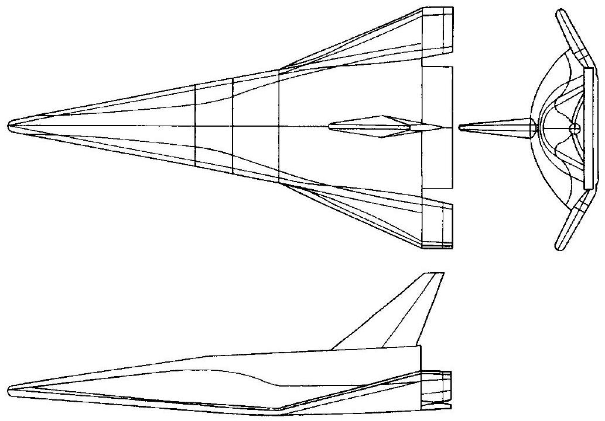
Figure 13.26 I The generic hypersonic research vehicle used for the calculations of Newberry et al. (From Ref. 94).

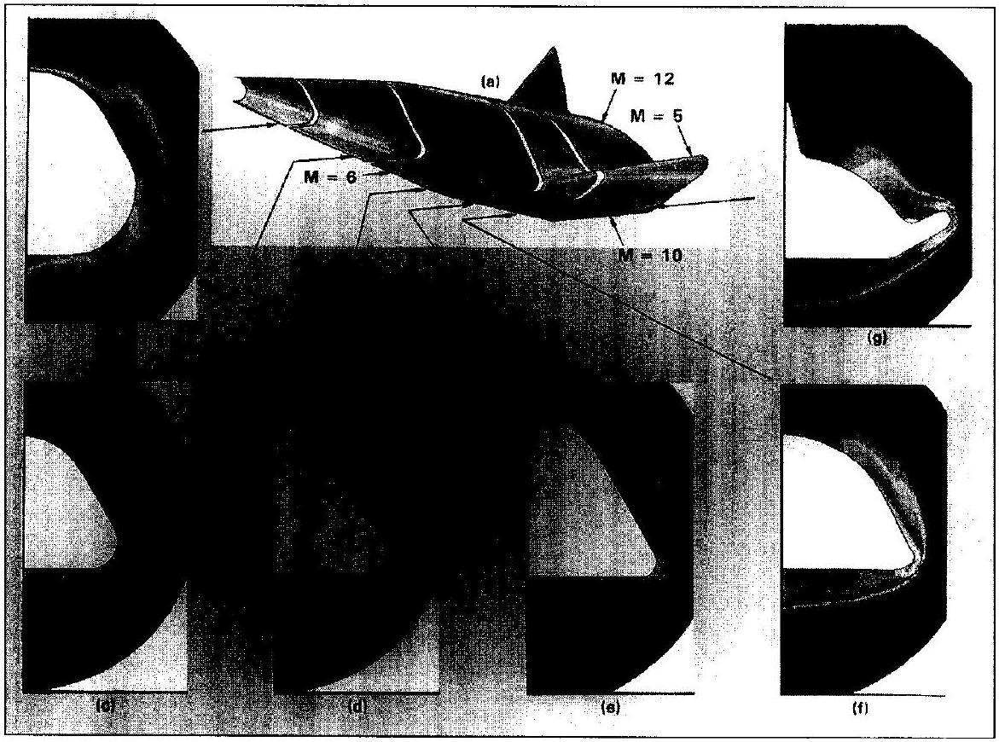
Figure 13.27 I Mach numbers contours at different streamwise stations for the flowfield over the generic hypersonic research vehicle shown in Fig. 13.26. The location of each station is identified by the arrows in the diagram (from Newberry et al., Ref. 94).

### 13.5 I STAGNATION AND MAXIMUM ENTROPY STREAMLINES

An interesting physical aspect of the three-dimensional flow over a blunt body at an angle of attack to a supersonic free stream is that the streamline going through the stagnation point is not the maximum entropy streamline. For a symmetric body at zero angle of attack, the stagnation streamline and the stagnation point are along the centerline, as sketched in Fig. 13.28a. This streamline crosses the bow shock wave at precisely the point where the wave angle is $90^{\circ}$, that is, it crosses a normal shock, and hence the entropy of the stagnation streamline between the shock and the body is the maximum value. In contrast, consider the asymmetric cases shown in Figs. 13.28b and $c$; an asymmetric flow can be produced by a nonsymmetric body, an angle of attack, or both. In these cases, the shape and location of the stagnation streamline,

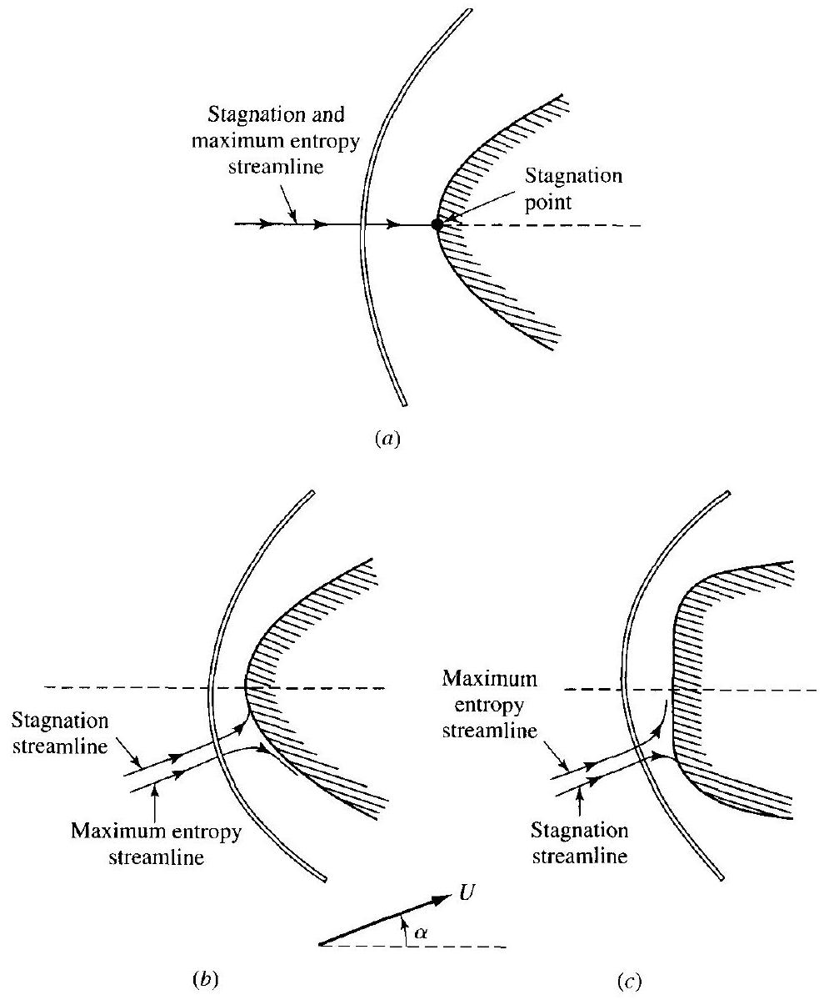
Figure 13.28 I Stagnation and maximum entropy streamlines.

and hence of the stagnation point, are not known in advance; they must be obtained as part of the numerical solution. Moreover, the stagnation streamline does not pass through the normal portion of the bow shock wave, and hence it is not the maximum entropy streamline. The relative locations of the stagnation streamline and the maximum entropy streamline for two nose shapes is shown in Figs. $13.28 b$ and $c$. Note that the stagnation streamline is always attracted to that portion of the body with maximum curvature, whereas the maximum entropy streamline will turn in the direction of decreasing body curvature. More details on this matter can be found in Ref. 52.

## 13.6 | COMMENTS AND SUMMARY

The calculations shown in Figs. 13.24 through 13.27, in their time, represented the state of the art for inviscid three-dimensional flowfields over supersonic and hypersonic bodies. They were among the first of their kind, and therefore are classic in the field of CFD. This is why we discuss them here. Today such calculations are made with more modern numerical techniques utilizing much more sophisticated grids and algorithms. Because this chapter has emphasized the physical aspects of threedimensional flow, and these aspects are nicely illustrated by the classical CFD calculations, we have chosen not to highlight more recent calculations from the current generation of CFD .

The purpose of this chapter has been to give the reader a basic familiarity with some of the features of three-dimensional flows over supersonic bodies. Emphasis has been placed on the physical aspects of such flows, along with a general understanding of several computational methods for calculating these flows. In particular, we have studied these cases.

1. Flows over elliptic cones and cones at angle of attack. These are threedimensional geometries that, by virtue of the conical nature of the flow, generate flowfields that are "two-dimensional," i.e., that depend on only two independent variables, such as $\theta$ and $\phi$, in a spherical coordinate system centered at the vertex of the cone. These flows exhibit vortical singularities, i.e., points where the entropy is multivalued. Also, embedded shocks may appear in the leeward region when the cross-flow velocity becomes supersonic, which usually occurs approximately when the angle of attack is greater than the cone half-angle. The calculational method for obtaining the "twodimensional" conical flows uses a downstream-marching philosophy, starting with an initial nonconical flow and approaching the correct conical flow in the limit of large distances downstream.
2. Flows over blunt bodies at angle of attack. These are truly three-dimensional flows, involving three independent spatial variables, such as $r, \theta$, and $z$, in a cylindrical coordinate system. Moreover, the numerical solution of such flows involves a time-marching philosophy; hence, $t$ becomes a fourth independent variable, which is made necessary by virtue of the calculational method itself.

The desired steady three-dimensional flowfield solution is approached in the limit of large times.
3. Flows over slender blunt-nosed bodies at angle of attack, such as the vehicle shown in Fig. 13.26. Here, the flow in the blunt-nosed region is calculated by means of a time-marching method. When the steady state is achieved in this region, a plane of data located in the supersonic region just downstream of the limiting characteristic surface is chosen as the initial data plane, from which a three-dimensional steady downstream-marching procedure is used to calculate the remainder of the supersonic flowfield. This downstream marching can be carried out using the three-dimensional method of characteristics, or which is more usually the case today, a finite-difference or finite-volume solution of the steady-flow equations. However, if and when a pocket of locally subsonic flow is encountered during this downstream marching, we must revert back to a time-marching solution for this locally subsonic region. (See, for example, Ref. 95.)

In summary, the types of flowfields encountered in the vast majority of practical aerodynamic applications are three-dimensional. Unfortunately, the analysis of such three-dimensional flows has been extremely difficult in the past; indeed, exact solutions of such flows were only dreams in the minds of aerodynamicists during most of this century. It has been a state-of-the-art research problem since the beginning of rational fluid dynamics with Leonhard Euler in the eighteenth century. However, since the late 1960s, the advent of computational fluid dynamics has changed this situation; as we have seen in this chapter, numerical techniques now exist for the computation of general three-dimensional flowfields, and many such computations have successfully been completed. The solution of three-dimensional flows is still a state-of-the-art problem today, but only from the point of view as to improvements in the numerical accuracy, the efficiency of solution (the quest to reduce the computer time necessary to obtain solutions), and the proper methods for presenting, studying and interpreting the large amount of numerical data, generated by such solutions (a problem in computer graphics).

