## CHAPTER 4

## Transonic Flow

We call the speed range just below and just above the sonic speed-Mach number nearly equal to I-the transonic range. Dryden (Hugh Dryden, well-known fluid dynamicist and past administrator of the National Advisory Committee for Aeronautics, now NASA) and I invented the word "transonic." We had found that a word was needed to denote the critical speed range of which we were talking. We could not agree whether it should be written with one s or two. Dryden was logical and wanted two s's. I thought it wasn't necessary always to be logical in aeronautics, so I wrote it with one s. I introduced the term in this form in a report to the Air Force. I am not sure whether the general who read it knew what it meant, but his answer contained the word, so it seemed to be officially accepted . . . I well remember this period (about 1941) when designers were rather frantic because of the unexpected difficulties of transonic flight. They thought the troubles indicated a failure in aerodynamic theory.

Theodore von Karman, in a lecture given at Cornell University, 1953

## PREVIEW BOX

The transonic flight regime is one that supersonic and hypersonic vehicles spend as little time as possible flying in during acceleration or deceleration through Mach I. This is because of the drag-divergence phenomena, the rapid shift of center of pressure, and the unsteady and somewhat unpredictable effect of shock waves on control surfaces, all of which are undesirable aspects of transonic flight. Current jet transports nudge this regime by cruising near or slightly above the critical Mach number, but never beyond the drag-divergence Mach number. Typical cruise Mach numbers of jet transports
range from 0.75 to about 0.83 . However, the quest to push this envelope, to increase the drag-divergence Mach number closer to 1, has been active for decades. Doing this requires a fundamental understanding of transonic flow.

At the time of this writing, a graphic example of pushing the envelope is the Boeing Aircraft Company's new concept for a transonic jet transport, to cruise at Mach 0.95. An artist's sketch of a possible configuration is shown in Fig. 14.1. Compare this configuration with that for the Boeing 777 shown in Fig. 1.4. You see in

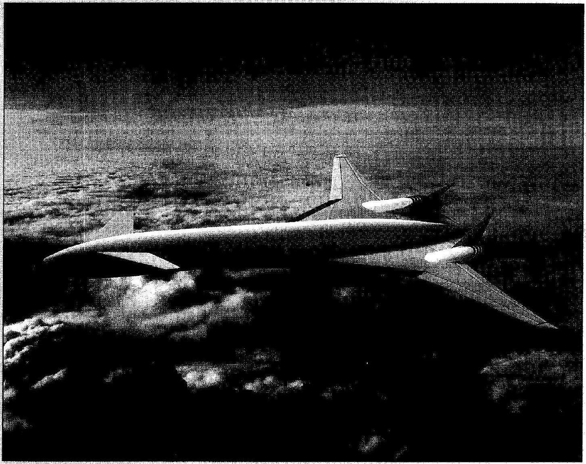
Figure 14.1 I A transonic airplane concept from Boeing.

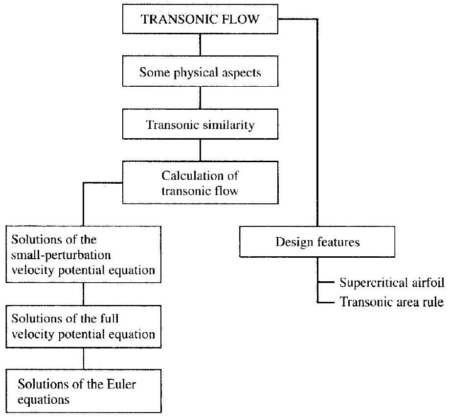
Figure 14.2 I Roadmap for Chapter 14.

Fig. 1.4 the standard configuration used by designers of most current jet transports since Boeing introduced the pioneering 707 in the late 1950s-characterized by a relatively high aspect ratio swept wing with engines mounted in pods located underneath the wing, or in some cases on the rear portion of the fuselage. The configuration for Boeing's "sonic cruiser" in Fig. 14.1 is a radical departure from this standard configuration. Whether this or some other configuration is finally developed by Boeing is not germane here. What is important is that some serious effort is being made to design an airplane to cruise in the transonic flight regime. More than ever this requires a fundamental understanding of the physical properties of the gasdynamics in the transonic regime, and the ability to accurately calculate such flows. This is the subject of the present chapter.

Transonic flow has always been important. It is now more so than ever. The material in this chapter will give you a fundamental understanding of some of the problems to be faced in the design of a transonic transport such that sketched in Fig. 14.1. This is important material, and the future applications are exciting.

The roadmap for this chapter is given in Fig. 14.2. We begin with a discussion of the physical aspects of transonic flow. We follow with the theoretical aspects of transonic similarity, identifying the transonic similarity principle and the transonic similarity parameters. This is classic transonic theory. The remainder of the chapter is devoted mostly to the numerical calculation of inviscid transonic flow. Such calculations have historically evolved in three steps, involving chronologically the numerical solution of (1) the smallperturbation velocity potential equation, (2) the full velocity potential equation, and finally (3) the Euler equations. As you might expect, the complexity of the solutions increase with each of these three steps. We end the chapter with a discussion of two important design features for transonic aircraft, the supercritical airfoil and the transonic area rule. This discussion is integrated within an extensive historical note on transonic flight.

A quick glance at the overall roadmap for the book in Fig. 1.7 shows that we are now at box 15, almost at the end of the center column.

## 14.1 | INTRODUCTION

The "failure in aerodynamic theory" mentioned in the chapter-opening quote from von Karman reflected a frustration on the part of aircraft designers in the early 1940s caused by the virtually total lack of aerodynamic data-experimental or theoretical-in the flow regime near Mach 1. The reason for this lack of data is strongly hinted by some results already derived and discussed in this book. Witness the quasi-one-dimensional flows described in Chap. 5; note for example Fig. 5.13, which shows a very rapid change in Mach number at the sonic throat, i.e., for a very slight deviation of $A / A^{*}$ away from its sonic value of unity, the corresponding change in $M$ is dramatically large. The accompanying changes in all the other flow variables, such as pressure and density, are also large. Witness also the subsonic and supersonic linearized results for the flow over slender bodies discussed in Chap. 9. Examining such results in Eq. (9.36) for subsonic flow

$$
C_{p}=\frac{C_{p_{o}}}{\sqrt{1-M_{\infty}^{2}}}
$$

and Eq. (9.51) for supersonic flow

$$
C_{p}=\frac{2 \theta}{\sqrt{M_{\infty}^{2}-1}}
$$

we observe that the denominators go to zero at Mach 1 , yielding infinitely large pressure coefficients-an obvious physical impossibility. These examples from our previous discussion wave a red flag about flow near or at Mach 1. Certainly such transonic flow is extremely sensitive to slight changes, hence presenting experimental difficulties in obtaining good transonic data in wind tunnels. Also, in Chap. 9 we saw that subsonic and supersonic flows involving small perturbations can be described by linear theory, providing such useful results as Eqs. (9.36) and (9.51) listed here. We also saw that flow in the transonic regime is described by nonlinear theory-a much more difficult situation, and hence presenting theoretical difficulties in obtaining good transonic information. In short, transonic flow historically has been an exceptionally challenging problem in aerodynamics, yielding its secrets only slowly and grudgingly over the years. Today, the use of slotted-throat wind tunnels (test sections with holes or longitudinal slots in the walls to relieve the sensitivity of transonic flows to slight changes, and to attenuate waves from the test model which propagate outward at nearly right angles to the flow and impinge on the tunnel walls) has created a revolution in the accurate experimental measurement of transonic flows. Also, the power of computational fluid dynamics has created a similar revolution in the ability to calculate and predict the nature of transonic flows. However, in spite of these "revolutions," transonic flow today still stands as a challenging state-of-the-art problem in modern compressible flow, and this is one of the two reasons why we are devoting a chapter to it here. The other reason is because of the importance of transonic flow for engineering applications. For example, almost all the existing commercial jet transports today cruise at free-stream Mach numbers around 0.8 -penetrating the lower side of the transonic regime. Also, almost all air combat among modern
supersonic fighter planes takes place at or near Mach 1-no matter what the top speed of the aircraft. Of course, all supersonic and hypersonic aircraft-including the space shuttle-must pass through the transonic regime on their way up and down. Hence, in the world of modern compressible flow, it is important to have some feeling for the nature of transonic flow, and some understanding of the analysis of such flows.

The purpose of this chapter is to provide such a "feeling," and nothing more. Transonic flow is a subject that dictates a book almost by itself, such as given by Ref. 98. In this chapter we will only examine the major aspects of the subject; in this fashion, as in Chap. 13, the present chapter will be intentionally long on philosophy and methodology, but short on details.

### 14.2 I SOME PHYSICAL ASPECTS OF TRANSONIC FLOWS

A general physical picture of transonic flows is discussed in Sec. 1.3, and sketched in Figs. $1.10 b$ and $c$; this material should be reviewed at this stage before progressing further. Also, the concept of the critical Mach number $M_{\mathrm{cr}}$ is discussed in Sec. 9.7. The critical Mach number is that free-stream Mach number at which sonic flow is first obtained on a body; in this sense, the transonic regime begins when the critical Mach number is reached. The material in Sec. 9.7 should also be reviewed before progressing further.

As discussed in Sec. 1.3, transonic flow is characterized by mixed regions of locally subsonic and supersonic flow that occur over a body moving at Mach numbers near unity. Also, the general three-dimensional flow in the throat region of supersonic nozzles is transonic. The physical characteristics of transonic flow are nicely illustrated by the series of schlieren photographs shown in Fig. 14.3, obtained from Ref. 99. Here, we see the flow over three different airfoils for different values of the free-stream Mach number. Moving from bottom to top, you can see the influence of increasing free-stream Mach number from $M_{\infty}=0.79$ to $M_{\infty}=1.0$. Going from left to right, you can observe the effect of increasing airfoil thickness, ranging from the NACA 64A006 airfoil of 6 percent thickness to the NACA 64A012 airfoil of 12 percent thickness. The schlieren photographs show the various shock wave patterns as well as regions of the flow separation. Superimposed on each photograph are the measured pressure coefficient distributions over the top (solid curve) and bottom (dashed curve) surfaces of the airfoil. The scale for the magnitude of the pressure coefficient is shown at the left of each row; as is usual in aeronautical practice, negative values of $C_{p}$ are given above the horizontal axis, and positive values below. Also, the short horizontal dashed line at the left of each row gives the value of the critical pressure coefficient $C_{p_{\mathrm{er}}}$ corresponding to the specific value of $M_{\infty}$ listed at the right of each row. (See Sec. 9.7 for the definition and significance of $C_{p_{\mathrm{cr}}}$.) Starting with the lower left-hand photograph for the NACA 64A006 airfoil at $M_{\infty}=0.79$, we observe a pocket of supersonic flow extending from just downstream of the leading edge to about 35 percent of the chord length, where it is terminated by a nearly normal shock

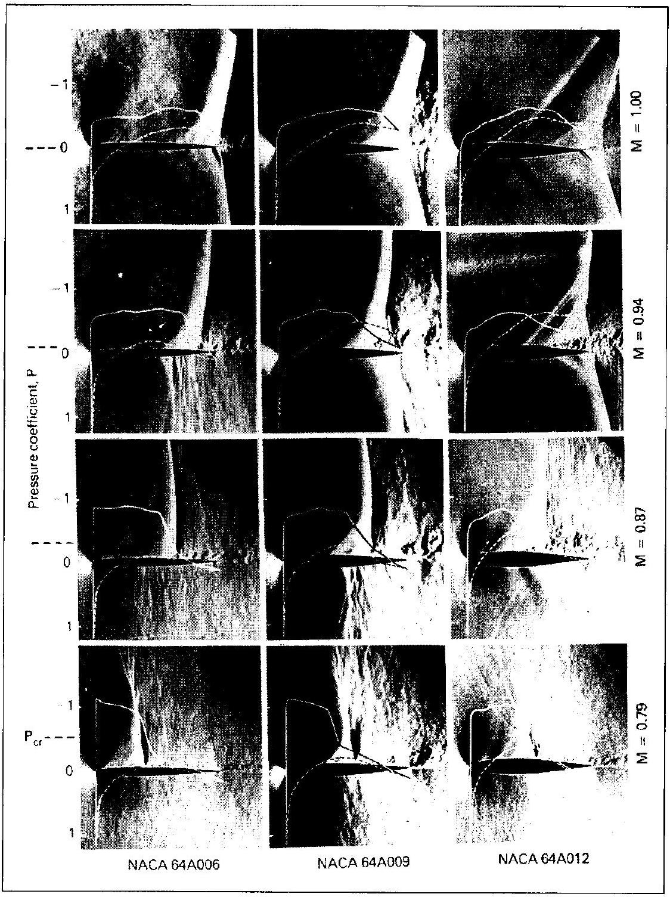
Figure 14.3 I A series of schlieren photographs illustrating the effects of increasing free-stream Mach number (from bottom to top in the figure) and increasing airfoil thickness (from left to right in the figure) on the transonic flow over airfoils. (From Ref. 99.)

wave. This supersonic pocket is identified by the nearly white region in the photograph; the supersonic flow has weak expansion waves propagating from the airfoil surface, and terminating at the sonic line above the airfoil or at the shock wave itself. (The optical nature of the schlieren method applied here causes regions of decreasing density such as expansion waves to appear light and regions of increasing density
such as shock waves to appear dark.) This picture illustrates the type of flow characteristics sketched earlier in Fig. 1.10b. Note that the magnitude of the measured pressure coefficient along the top surface substantially exceeds $C_{p_{\mathrm{cr}}}$ for a distance of about 35 percent of the chord length downstream of the leading edge, further confirming the existence of locally supersonic flow in that region. Note that the measured $C_{p}$ almost discontinuously drops to a value below $C_{p_{\mathrm{cr}}}$ behind the shock, heralding the region of locally subsonic flow downstream of the shock. Note also that $C_{p}$ along the bottom surface does not exceed $C_{p_{\mathrm{CT}}}$; hence, the flow over the bottom surface is completely subsonic. Now move to the next photograph directly above. Here, for the same NACA 64A006 airfoil, the free-stream Mach number has been increased to $M_{\infty}=0.87$. For this case we observe a greatly enlarged region of supersonic flow over the top surface, and the shock wave has moved downstream, closer to the trailing edge of the airfoil. The shock is now stronger, and this causes the viscous boundary layer to separate from the surface in the region where the shock impinges on the surface. The separated boundary layer can be seen as a region of intense vorticity trailing downstream of the shock impingement point. The flow is still subsonic along the lower surface. Moving to the next photograph directly above (for $M_{\infty}=0.94$ ), we see virtually the entire upper surface immersed in a locally supersonic flow, and the shock wave has almost reached the trailing edge. There is now a small pocket of supersonic flow under the bottom surface as well, as indicated by the weak waves shown in the schlieren photograph; this is also indicated by the values of $C_{p}$ on the lower surface that slightly exceed $C_{p_{\mathrm{c}}}$ over a small portion of the bottom surface. When $M_{\infty}$ is increased to 1.0, as shown in the top photograph, the flow is supersonic over the entire top surface, and is supersonic over a substantial portion of the bottom surface. The shock waves have moved to the trailing edge itself, and the mechanism for forming the leading-edge bow shock wave is beginning to appear. In this sense, this photograph shows the beginning of the type of flowfield sketched in Fig. 1.10c. Now, as we move from left to right in Fig. 14.3, we see the effect of increasing the airfoil thickness. Note that the increased thickness causes a larger perturbation of the flow; the flow will expand to a greater degree over a thicker airfoil, and hence the transonic effects are stronger for thicker airfoils. The local Mach numbers inside the supersonic regions become larger, which in turn causes the terminating shock waves to be stronger. Note that the regions of separated flow induced by the impingement of these shock waves on the viscous boundary layer also become more extensive. Scanning along the top photographs in Fig. 14.3, namely those of $M_{\infty}=1.0$, we note that both the upper and lower shocks are now at the trailing edge, and for this case the region of separated flow is greatly diminished.

The separated flow associated with the shock wave/boundary layer interaction shown in Fig. 14.3 is caused by the following mechanism. The pressure increases almost discontinuously across the shock wave. This represents an extremely large adverse pressure gradient. (An adverse pressure gradient is one where the pressure increases in the flow direction.) It is well-known that boundary layers readily separate from the surface in regions of adverse pressure gradients. When the shock wave impinges on the surface, the boundary layer encounters an extremely large adverse pressure gradient, and it will almost always separate. This shock wave/boundary layer interaction is one of the most important aspects of transonic flow. Along with
the total pressure losses (entropy increases) caused by the shock waves themselves, the shock-induced separated flows create a large rise in drag on the airfoil-the dragdivergence phenomenon that is always associated with flight in the transonic regime. (See Ref. 1 for a basic description of the drag-divergence behavior of airfoils.) This drag-divergence phenomenon is illustrated in Fig. 14.4, taken from Ref. 100. This is a plot of drag coefficient versus $M_{\infty}$ for an NACA 2315 airfoil; the different curves correspond to different angles of attack. Note the extremely rapid rise in drag coefficient as the Mach number approaches 1 . This is perhaps the most significant consequence of the transonic regime.

In the present chapter, we deal with inviscid flows only; hence, the shock wave/ boundary layer interaction will not be discussed further. As we will see, modern

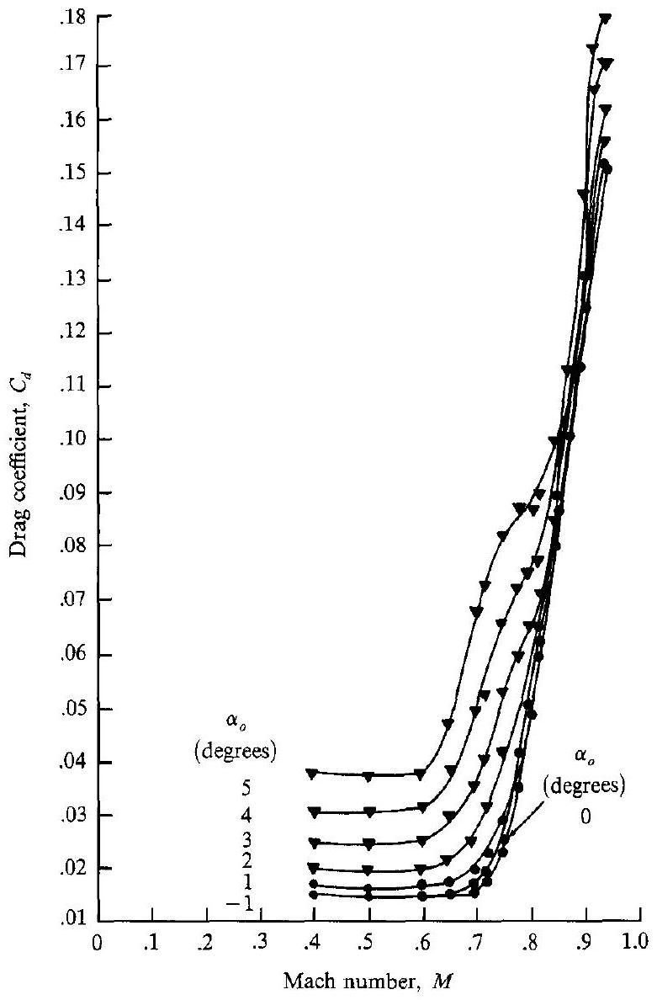
Figure 14.4 | Variation of the drag coefficient with Mach number for an NACA 2315 airfoil, illustrating the dragdivergence phenomenon as Mach 1 is approached. Experimental results are given for angles of attack ranging from $-1^{\circ}$ to $5^{\circ}$. (From Loftin, Ref. 100.)

computational solutions of inviscid transonic flows can predict many aspects of transonic flows, including the strength and location of the shock waves. From these solutions, the drag-rise phenomenon shown in Fig. 14.4 can be modeled to some extent. However, for the most accurate analysis, a viscous flow solution is necessary. Such solutions for viscous transonic flows are now focusing on numerical solutions of the complete Navier-Stokes equations-a state-of-the-art problem that is far beyond the scope of this book.

### 14.3 I SOME THEORETICAL ASPECTS OF TRANSONIC FLOWS; TRANSONIC SIMILARITY

Inviscid transonic flows are governed by the partial differential equations derived in Chap. 6, namely the Euler equations, repeated here:

Continuity:

$$
\begin{aligned}
\frac{\partial \rho}{\partial t}+\nabla \cdot(\rho \mathbf{V}) & =0 \\
\rho \frac{D \mathbf{V}}{D t} & =-\nabla p
\end{aligned}
$$

Momentum:

Energy:

$$
\rho \frac{D h_{o}}{D t}=\frac{\partial p}{\partial t}
$$

In these equations, we are assuming an inviscid, adiabatic flow with no body forces. For numerical solutions of inviscid transonic flows, the Euler equations are conceptually the most accurate equations. Entropy gradients are present in transonic flows due to the presence of the shock waves seen in Fig. 14.3; in turn, these flows are rotational as demonstrated by Crocco's theorem (see Sec. 6.6). The Euler equations given by Eqs. (14.1) through (14.3) are applicable whether or not the flow is rotational.

We have stated that the transonic flows shown in Fig. 14.3 are rotational-but to what degree? Are the shock waves that appear in such flows weak enough to allow us to neglect the rotationality of the flow in some cases? Let us address this question further. Return to Eq. (3.60) for the entropy change across a normal shock wave, repeated below:

$$
\begin{aligned}
s_{2}-s_{1}= & c_{p} \ln \left\{\left[1+\frac{2 \gamma}{\gamma+1}\left(M_{1}^{2}-1\right)\right]\left[\frac{2+(\gamma-1) M_{1}^{2}}{(\gamma+1) M_{1}^{2}}\right]\right\} \\
& -R \ln \left[1+\frac{2 \gamma}{\gamma+1}\left(M_{1}^{2}-1\right)\right]
\end{aligned}
$$

Recall that $c_{p}=\gamma R /(\gamma-1)$. Then Eq. (3.60) becomes

$$
\frac{s_{2}-s_{1}}{R}=\frac{1}{\gamma-1} \ln \left[1+\frac{2 \gamma}{\gamma+1}\left(M_{1}^{2}-1\right)\right]+\frac{\gamma}{\gamma-1} \ln \left[\frac{2+(\gamma-1) M_{1}^{2}}{(\gamma+1) M_{1}^{2}}\right]
$$

For convenience, let $m=M_{1}^{2}-1$. Then the first term in square brackets in Eq. (14.4) becomes

$$
1+\frac{2 \gamma}{\gamma+1}\left(M_{1}^{2}-1\right)=1+\frac{2 \gamma}{\gamma+1} m
$$

and the second term in square brackets becomes

$$
\begin{aligned}
\frac{2+(\gamma-1) M_{1}^{2}}{(\gamma+1) M_{1}^{2}} & =\frac{1}{M_{1}^{2}}\left[\frac{2+(\gamma-1) M_{1}^{2}}{\gamma+1}\right] \\
& =\frac{1}{M_{1}^{2}}\left[\frac{2+(\gamma-1) M_{1}^{2}+(\gamma+1)-(\gamma+1)}{\gamma+1}\right] \\
& =\frac{1}{M_{1}^{2}}\left[\frac{(\gamma-1) M_{1}^{2}-(\gamma-1)}{\gamma+1}+1\right] \\
& =\frac{1}{M_{1}^{2}}\left[\frac{(\gamma-1)\left(M_{1}^{2}-1\right)}{\gamma+1}+1\right] \\
& =\frac{1}{m+1}\left[\frac{\gamma-1}{\gamma+1} m+1\right]
\end{aligned}
$$

Substituting Eqs. (14.5) and (14.6) into Eq. (14.4), we have

$$
\begin{aligned}
\frac{s_{2}-s_{1}}{R}= & \frac{1}{\gamma-1} \ln \left(1+\frac{2 \gamma}{\gamma+1} m\right)-\frac{\gamma}{\gamma-1} \ln (m+1) \\
& +\frac{\gamma}{\gamma-1} \ln \left(\frac{\gamma-1}{\gamma+1} m+1\right)
\end{aligned}
$$

For transonic flows, $M_{1} \approx 1$, hence $m \ll 1$. Thus, each logarithmic term in Eq. (14.7) is of the form $(1+\varepsilon)$, where $\varepsilon \ll 1$. Recall the series expansion:

$$
\ln (1+\varepsilon)=\varepsilon-\varepsilon^{2} / 2+\varepsilon^{3} / 3+\cdots
$$

With this, Eq. (14.7) is given by

$$
\begin{aligned}
\frac{s_{2}-s_{1}}{R}= & \frac{1}{\gamma-1}\left[\frac{2 \gamma}{\gamma+1} m-\left(\frac{2 \gamma}{\gamma+1}\right)^{2} \frac{m^{2}}{2}+\left(\frac{2 \gamma}{\gamma+1}\right)^{3} \frac{m^{3}}{3}+\cdots\right] \\
& -\frac{\gamma}{\gamma-1}\left[m-\frac{m^{2}}{2}+\frac{m^{3}}{3}+\cdots\right] \\
& +\frac{\gamma}{\gamma-1}\left[\frac{\gamma-1}{\gamma+1} m-\left(\frac{\gamma-1}{\gamma+1}\right)^{2} \frac{m^{2}}{2}+\left(\frac{\gamma-1}{\gamma+1}\right)^{3} \frac{m^{3}}{3}+\cdots\right]
\end{aligned}
$$

Note that the terms involving $m$ and $m^{2}$ in Eq. (14.8) cancel, yielding
or

$$
\begin{aligned}
& \frac{s_{2}-s_{1}}{R}=\frac{2 \gamma}{3(\gamma+1)^{2}} m^{3}+\cdots \\
& \frac{s_{2}-s_{1}}{R} \approx \frac{2 \gamma^{\prime}}{3(\gamma+1)^{2}}\left(M_{1}^{2}-1\right)^{3}
\end{aligned}
$$

The result in Eq. (14.9) states that the entropy increase across a weak shock is of third order in terms of ( $M_{-}^{2}-1$ ); when ( $M_{-1}^{2}-1$ ) $\ll 1$ as for transonic flows, then the entropy increase across the shock is very small. [Note from Eq. (3.57) that the strength of a shock as indicated by the ratio $\left(p_{2}-p_{1}\right) / p_{1}$ is proportional to $M_{1}^{2}-1$; hence, Eq. (14.9) states that the entropy increase across the shock is of third order in the shock strength.| Therefore, for the transonic flows shown in Fig. 14.1, we can assume that the flow is essentially isentropic, the actual increase in entropy being of third order in shock strength and hence negligible for the case of transonic flow. In turn, we can assume that the flow is essentially irrotational. This answers the question asked at the beginning of the paragraph. (Keep in mind that this is an approximation only: for the high end of the transonic range, say for $M_{1}=1.2$. the entropy changes may be too large to ignore. We have already explored this matter in Example 3.9 , which you should review before proceeding further.)

If we make the assumption that the transonic flow is irrotational on the basis of very small entropy changes as discussed above, then a velocity potential $\Phi$ can be defined such that $\mathbf{V}=\nabla \Phi$, and the governing Euler equations. Eqs. (1+.1) through (14.3), cascade to a single equation in terms of $\Phi$, as described in Chap. 8. This equation was derived as Eq. (8.17), repeated here:

$$
\begin{gathered}
\left(1-\frac{\Phi_{\frac{1}{2}}^{2}}{a^{2}}\right) \Phi_{x+}+\left(1-\frac{\Phi_{y}^{2}}{a^{2}}\right) \Phi_{y}+\left(1-\frac{\Phi_{z}^{2}}{a^{2}}\right) \Phi_{\cdots} \\
-\frac{2 \Phi_{1} \Phi_{y}}{a^{2}} \Phi_{1}-\frac{2 \Phi_{1} \Phi_{1}}{a^{2}} \Phi_{1}, \frac{2 \Phi_{1} \Phi}{a^{2}} \Phi_{1}=0
\end{gathered}
$$

The advantages of Eq. 18.17) for a flowfield analysis, as long as the flow is irrotational, were described in Chap. 8: it is strongly recommended that you review the material in Chap. 8 before proceeding further, especially concerning the derivation of Eq. (8.17) and the theoretical advantages obtained by using Eq. (8.17). For an irrotational, isentropic flow. Eq. (8.17) is an exact relation. Its use for the analysis of the transonic flows shown in Fig. 14.3 is only approximate, but as argued here, the approximation appears to be reasonable.

Equation (8.17) holds for any body shape, thick or thin, at any angle of attack. If we are concerned with the transonic flow over a slender body at small angle of attack, then we can make the assumption of small perturbations, as described in Chap. 9. This leads to the definition of a perturbation velocity potential $\phi$, defined as $\Phi=V, x+\phi$, and Eq. (8.17) is written in terms of $\phi$. yielding the perturbation-velocity potential equation given by Eq. (9.1). This equation is still exact for an irrotational, isentropic flow. It can be reduced to a simpler form if the assumption of small perturbations is made, as explained in Sec. 9.2. The result of this reduction leads to Eq. (9.6), which

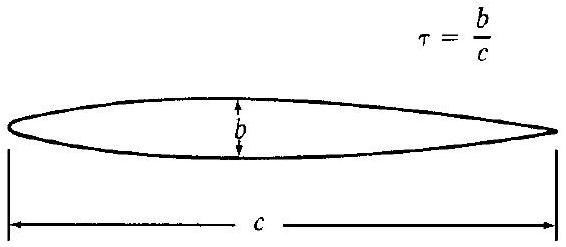
Figure 14.5 I Definition of slenderness ratio $\tau$.

holds for subsonic and supersonic flow. However, as noted in Sec. 9.2, for transonic flow an extra term appears in the reduced, small-perturbation equation, yielding

$$
\left(1-M_{\infty}^{2}\right) \phi_{x x}+\phi_{y y}+\phi_{z z}=M_{\infty}^{2}\left[(\gamma+1) \frac{\phi_{x}}{V_{\infty}}\right] \phi_{x x}
$$

Equation (14.10) is the transonic small-perturbation equation. Make certain to review Sec. 9.2 to understand how this equation is obtained.

Equation (14.10) is a dimensional equation; a particularly interesting result can be obtained by nondimensionalizing this equation, as follows. Let $\tau$ be the slenderness ratio of the body; $\tau=b / c$, where $b$ and $c$ are the maximum thickness and length of the body, respectively, as sketched in Fig. 14.5. Note that, for flow with small perturbations, $\tau$ must be small. Also observe from Fig. 14.3 that the disturbances in a transonic flow reach far above and below the airfoil, i.e., the lateral extent of the disturbances is large compared to the streamwise extent. Hence, in Eq. (14.10) the physical domain where nonzero values of the perturbation potential $\phi$ are concentrated extends to large values of $y$ and $z$, but are limited to the streamwise region of $x \approx c$. This motivates a transformation of ( $x, y, z$ ) into ( $\bar{x}, \bar{y}, \bar{z}$ ), where $\bar{x}, \bar{y}$, and $\bar{z}$ are all of the same order of magnitude. This can be achieved by defining the following nondimensional independent variables:

$$
\bar{x}=\frac{x}{c} \quad \bar{y}=\frac{y \tau^{1 / 3}}{c} \quad \bar{z}=\frac{z \tau^{1 / 3}}{c}
$$

At the same time, consider a nondimensional perturbation velocity potential defined by

$$
\bar{\phi}=\frac{\phi}{c V_{\infty} \tau^{2 / 3}}
$$

To nondimensionalize Eq. (14.10) according to the definitions just presented, we first write it as

$$
\begin{aligned}
(1 & \left.-M_{\infty}^{2}\right) \frac{\partial^{2}\left(\phi / c V_{\infty} \tau^{2 / 3}\right)}{\partial(x / c)^{2}}\left(\frac{c V_{\infty} \tau^{2 / 3}}{c^{2}}\right)+\frac{\partial^{2}\left(\phi / c V_{\infty} \tau^{2 / 3}\right)}{\partial\left(y \tau^{1 / 3} / c\right)^{2}}\left(\frac{c V_{\infty} \tau^{2 / 3}}{c^{2} / \tau^{2 / 3}}\right) \\
& +\frac{\partial^{2}\left(\phi / c V_{\infty} \tau^{2 / 3}\right)}{\partial\left(z \tau^{1 / 3} / c\right)^{2}}\left(\frac{c V_{\infty} \tau^{2 / 3}}{c^{2} / \tau^{2 / 3}}\right) \\
& =M_{\infty}^{2}\left[\frac{(\gamma+1)}{V_{\infty}} \frac{\partial\left(\phi / c V_{\infty} \tau^{2 / 3}\right)}{\partial(x / c)}\left(\frac{c V_{\infty} \tau^{2 / 3}}{c}\right)\right] \frac{\partial^{2}\left(\phi / c V_{\infty} \tau^{2 / 3}\right)}{\partial(x / c)^{2}}\left(\frac{c V_{\infty} \tau^{2 / 3}}{c^{2}}\right) \\
\text { or } & \left(1-M_{\infty}^{2}\right) \frac{\partial^{2} \bar{\phi}}{\partial \bar{x}^{2}}+\tau^{2 / 3} \frac{\partial^{2} \bar{\phi}}{\partial \bar{y}^{2}}+\tau^{2 / 3} \frac{\partial^{2} \bar{\phi}}{\partial \bar{z}^{2}}=\tau^{2 / 3} M_{\infty}^{2}(\gamma+1)\left(\frac{\partial \bar{\phi}}{\partial \bar{x}}\right) \frac{\partial^{2} \bar{\phi}}{\partial \bar{x}^{2}}
\end{aligned}
$$

Combining terms, we obtain

$$
\left[\frac{\left(1-M_{\infty}^{2}\right)}{\tau^{2 / 3}}-M_{\infty}^{2}(\gamma+1) \bar{\phi}_{\bar{x}}\right] \bar{\phi}_{\bar{x} \bar{x}}+\bar{\phi}_{\bar{y} \bar{y}}+\bar{\phi}_{\bar{z} \bar{z}}=0
$$

Let us define the transonic similarity parameter $K$ as

$$
K=\frac{1-M_{\infty}^{2}}{\tau^{2 / 3}}
$$

Then Eq. (14.11) is written as

$$
\left[K-M_{\infty}^{2}(\gamma+1) \bar{\phi}_{\bar{x}}\right] \bar{\phi}_{\bar{x} \bar{x}}+\bar{\phi}_{\bar{y} \bar{y}}+\bar{\phi}_{\bar{z} \bar{z}}=0
$$

Finally, assuming that the Mach numbers are near unity for transonic flow, replace $M_{\infty}$ in Eq. (14.13) by unity, obtaining

$$
\left[K-(\gamma+1) \bar{\phi}_{\bar{x}}\right] \bar{\phi}_{\bar{x} \bar{x}}+\bar{\phi}_{\bar{y} \bar{y}}+\bar{\phi}_{\bar{z} \bar{z}}=0
$$

Equation (14.14) is the transonic similarity equation; it is essentially another form of the transonic small-perturbation equation given by Eq. (14.10). However, Eq. (14.14) contains a special message. Consider two flows at different values of $M_{\infty}$ (but both transonic) over two bodies with different values of $\tau$, but with $M_{\infty}$ and $\tau$ for both flows such that the transonic similarity parameter $K$ is the same for both flows. Then Eq. (14.14) states that the solution for both flows in terms of the nondimensional quantities $\bar{\phi}(\bar{x}, \bar{y}, \bar{z})$ will be the same. This is the essence of the transonic similarity principle. In turn, the pressure coefficients for the two flows are related such that $C_{p} / \tau^{2 / 3}$ is the same between the two flows, i.e.,

$$
\frac{C_{p}}{\tau^{2 / 3}}=-2 \bar{\phi}_{\bar{x}}=f(K, \bar{x}, \bar{y}, \bar{z})
$$

The proof of Eq. (14.15) is left as a homework problem. Keep in mind that transonic similarity is an approximate theory, good only for flows over slender bodies at small angles of attack, and where the transonic shock waves are weak enough to assume an isentropic, irrotational flow.

In summary, there are three echelons of transonic inviscid flow theory.

1. Solutions of the Euler equations, given by Eqs. (14.1) through (14.3). These are the exact solutions, since the Euler equations contain no special assumptions in regard to the inviscid flow.
2. Solutions of the potential equation, given by Eq. (8.17). These solutions are approximate, because they assume the shock wave present in the transonic flowfield is weak enough to justify treating the flow as isentropic and irrotational. This is frequently a good assumption, because the entropy change across a shock wave at transonic speeds is only of third order in the shock strength.
3. Solutions of the small-perturbation potential equation, in the form of Eq. (14.10) or Eq. (14.14). These solutions are a further approximation, good only for the flows over slender bodies at small angles of attack. It is within this framework that the transonic similarity principle holds, as derived here.

It is important to note that all three levels of equations for the analysis of transonic flow-the Euler equations, the full potential equation, and the perturbation potential equation-are nonlinear equations. Any type of transonic theory is nonlinear theory. This important aspect of transonic flow was first noted in Sec. 9.2, and is plainly evident in the equations discussed in the present section. The nonlinearity of transonic flows has made such flows very difficult to solve in the past; this is essentially responsible for the "failure in aerodynamic theory" expressed in von Karman's quote at the beginning of this chapter. However, the advent of computational fluid dynamics has changed this situation in recent years. Successful numerical solutions to all three echelons of equations itemized above have been obtained for a variety of applications. These numerical solutions are the subject of the rest of this chapter.

### 14.4 I SOLUTIONS OF THE SMALL-PERTURBATION VELOCITY POTENTIAL EQUATION: THE MURMAN AND COLE METHOD

In the present section, we will address the solution of Eq. (14.10), or equivalently, Eq. (14.14). This class of transonic flowfield solutions is best exemplified by the work of Murman and Cole (Ref. 101), which has become a classic in the field. We will outline their approach in this section.

To illustrate the method, we will consider the airfoil in physical space shown at the left of Fig. 14.6. For simplicity, the angle of attack is zero and the airfoil is

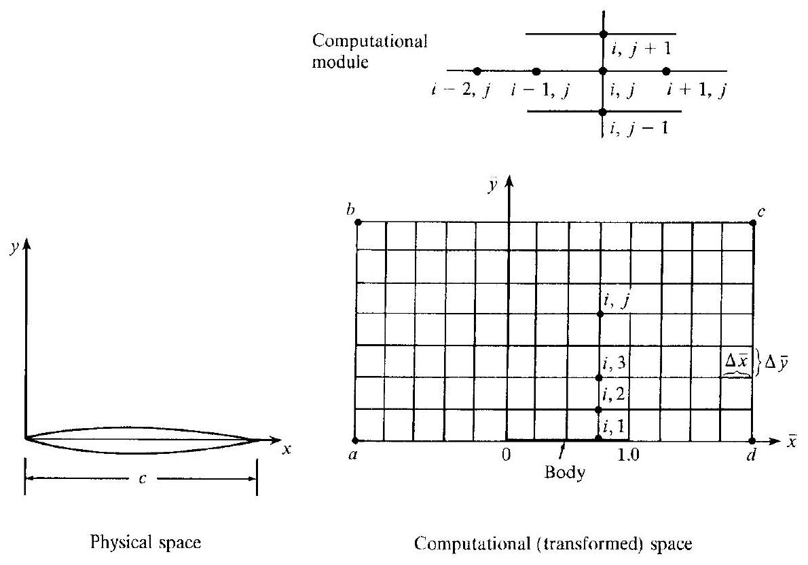
Figure 14.6 I Physical and computational spaces.

symmetric, hence a zero-lift case is considered. (However, this is not necessary; small-perturbation solutions can be obtained for thin nonsymmetric airfoils at small angle of attack.) We wish to obtain the two-dimensional, inviscid, transonic flowfield over this airfoil as governed by Eq. (14.10) written in $(x, y)$ space. The numerical solution itself is carried out in the transformed $(\bar{x}, \bar{y})$ space shown at the right of Fig. 14.6, using the transformed equivalent of Eq. (14.10), namely Eq. (14.14). In particular, Eq. (14.14) is replaced by a finite-difference equation evaluated over the rectangular grid in $(\bar{x}, \bar{y})$ space. A computational module la segment of the grid, showing the grid points used for the finite-difference representations at the grid point $(i, j)]$ is drawn above the grid. The airfoil is represented by the line from 0 to 1.0 along the $\bar{y}=0$; axis; the surface tangency boundary condition along the body is evaluated at $\bar{y}=0$, consistent with the small-perturbation assumption. This boundary condition is given by Eq. (9.19), where the shape of the body is expressed as $y=f(x)$. That is,

$$
\frac{d f}{d x}=\frac{v^{\prime}}{V_{\infty}}
$$

However, from the transformation defined in Sec. 14.3, we have

$$
v^{\prime}=\frac{\partial \phi}{\partial y}=\tau V_{\infty} \frac{\partial \bar{\phi}}{\partial \bar{y}}
$$

Combining Eqs. (14.16) and (14.17), the surface boundary condition becomes

$$
\bar{\phi}_{y}(\bar{x}, 0)=\frac{1}{\tau} \frac{d f}{d x}
$$

where $d f / d x$ is a known function of $x$, hence $\bar{x}$. Equation (14.18) represents the boundary condition for $0 \leq \bar{x} \leq 1$ along the $\bar{y}=0$ axis, as shown by the heavy line in the grid drawn in Fig. 14.6. For all other values of $\bar{x}$ along the line $\bar{y}=0$, the flow symmetry condition, $\bar{\phi}_{i}=0$, is used. An appropriate, second-order one-sided difference for $\bar{\phi}_{\bar{y}}$ at the surface is (see Ref. 18)

$$
\bar{\phi}_{y}=\frac{\partial \bar{\phi}}{\partial \bar{y}}=\frac{1}{2 \Delta \bar{y}}\left(-3 \bar{\phi}_{i, 1}+4 \bar{\phi}_{i, 2}-\bar{\phi}_{i, 3}\right)
$$

where grid point ( $i, 1$ ) is along the $\bar{y}=0$ axis, and points ( $i, 2$ ) and ( $i, 3$ ) are directly above it, as shown in Fig. 14.6. Hence, a finite-difference expression for the surface boundary condition is, from Eqs. (14.18) and (14.19),

$$
\frac{1}{\tau}\left(\frac{d f}{d x}\right)_{i}=\frac{1}{2 \Delta \bar{y}}\left(-3 \bar{\phi}_{i, 1}+4 \bar{\phi}_{i, 2}-\bar{\phi}_{i, 3}\right)
$$

For the boundary conditions along $a b, b c$, and $c d$ which form the left, upper, and right boundaries of the grid in Fig. 14.6, it is tempting to apply free-stream conditions. However, keep in mind that, in a subsonic flow (albeit near Mach 1), disturbances reach out to infinity in all directions away from the body. Therefore, we
should apply the free-stream conditions only if the outer boundaries of the grid were an infinite distance away, which is certainly not the practical case shown in Fig. 14.6. Instead, a more appropriate "far-field" boundary condition-not the free-stream con-ditions-should be applied along $a b, b c$, and $c d$. This "far-field" boundary condition is expressed in terms of the far field associated with a doublet singularity. It takes the form of

$$
\bar{\phi}(\bar{x}, \bar{y})=\frac{1}{2 \pi K^{1 / 2}} \frac{\mathscr{D} \bar{x}}{\bar{x}^{2}+K \bar{y}^{2}}
$$

where $\mathscr{D}$ is the effective doublet strength, obtained as part of the solution, and $\bar{x}$ and $\bar{y}$ are the coordinates along $a b, b c$, and $c d$. The arguments surrounding the development of Eq. (14.21) as well as the calculation of $\mathscr{D}$ are too lengthy to relate here; the reader is encouraged to study Ref. 101 for the details. Equation (14.21) is given here only for the sake of illustration in our discussion of the boundary conditions.

For the remainder of the flowfield over the grid in Fig. 14.6, Eq. (14.14) is used. The proper finite-difference form of the $\bar{x}$ derivatives in Eq. (14.14) depends on whether the flow is locally subsonic or supersonic, and it is this aspect where Murman and Cole in Ref. 101 make a fundamental contribution to the state of the art of transonic flowfield calculations. If the flow is locally subsonic, then information at point $(i, j)$ can come from both upstream and downstream, and an appropriate finitedifference representation is the standard second-order central difference formula:

$$
\left(\bar{\phi}_{\bar{x}}\right)_{i, j}=\left(\frac{\partial \bar{\phi}}{\partial \bar{x}}\right)_{i, j}=\frac{\bar{\phi}_{i+1, j}-\bar{\phi}_{i-1, j}}{2 \Delta \bar{x}}
$$

and

$$
\left(\bar{\phi}_{\bar{x} \bar{x}}\right)_{i, j}=\left(\frac{\partial^{2} \bar{\phi}}{\partial \bar{x}^{2}}\right)_{i, j}=\frac{\bar{\phi}_{i+1, j}-2 \bar{\phi}_{i, j}+\bar{\phi}_{i-1, j}}{(\Delta \bar{x})^{2}}
$$

However, if the flowfield is locally supersonic, then information at point ( $i, j$ ) can only come from upstream. This motivates the use of upwind differences, namely,

$$
\left(\bar{\phi}_{\bar{x}}\right)_{i, j}=\left(\frac{\partial \bar{\phi}}{\partial \bar{x}}\right)_{i, j}=\frac{\bar{\phi}_{i, j}-\bar{\phi}_{i-2, j}}{2 \Delta \bar{x}}
$$

and

$$
\left(\bar{\phi}_{\bar{x} \bar{x}}\right)_{i, j}=\left(\frac{\partial^{2} \bar{\phi}}{\partial \bar{x}^{2}}\right)_{i, j}=\frac{\bar{\phi}_{i, j}-2 \bar{\phi}_{i-1, j}+\bar{\phi}_{i-2, j}}{(\Delta \bar{x})^{2}}
$$

In both the locally subsonic and supersonic cases, the $\bar{y}$ derivative is replaced by central differences, as follows:

$$
\left(\bar{\phi}_{\bar{y} \bar{y}}\right)_{i, j}=\left(\frac{\partial^{2} \bar{\phi}}{\partial \bar{y}^{2}}\right)_{i, j}=\frac{\bar{\phi}_{i, j+1}-2 \bar{\phi}_{i, j}+\bar{\phi}_{i, j-1}}{(\Delta \bar{y})^{2}}
$$

The grid points which are used in Eqs. (14.22) through (14.26) are shown in the computational module in Fig. 14.6. Using the above finite-difference quotients, let us
obtain the difference equation which results from Eq. (14.14). First, consider locally subsonic flow, where the derivatives are expressed by Eqs. (14.22), (14.23), and (14.26). By direct substitution into Eq. (14.14), we have

$$
\begin{aligned}
& {\left[K-(\gamma+1)\left(\frac{\bar{\phi}_{i+1, j}-\bar{\phi}_{i-1, j}}{2 \Delta \bar{x}}\right)\right] \frac{\bar{\phi}_{i+1, j}-2 \bar{\phi}_{i, j}+\bar{\phi}_{i-1, j}}{(\Delta \bar{x})^{2}}} \\
& \quad+\frac{\bar{\phi}_{i, j+1}-2 \bar{\phi}_{i, j}+\bar{\phi}_{i, j-1}}{(\Delta \bar{y})^{2}}=0
\end{aligned}
$$

In the case of locally supersonic flow, where the derivatives are expressed by Eqs. (14.24) through (14.26), the difference form of Eq. (14.14) is

$$
\begin{aligned}
& {\left[K-(\gamma+1)\left(\frac{\bar{\phi}_{i . j}-\bar{\phi}_{i-2 . j}}{2 \Delta \bar{x}}\right)\right] \frac{\bar{\phi}_{i . j}-2 \bar{\phi}_{i-1 . j}+\bar{\phi}_{i-2 . j}}{(\Delta \bar{x})^{2}}} \\
& \quad+\frac{\bar{\phi}_{i . j+1}-2 \bar{\phi}_{i . j}+\bar{\phi}_{i . j+1}}{(\Delta \bar{y})^{2}}=0
\end{aligned}
$$

Equations (14.27) and (14.28) can be solved by the rather standard relaxation technique, also called the iterative technique, which is described at length in most numerical analysis texts; in particular, see Ref. 102 for details. The relaxation technique is carried out as follows. Examining the computational grid shown in Fig. 14.6, first assume values for $\bar{\phi}$ at all grid points. Now concentrate on the grid point $(i, j)$. Test to see if the flow is locally subsonic or supersonic at ( $i, j$ ); if it is subsonic, use Eq. (14.27), and if it is supersonic, use Eq. (14.28). In either Eq. (14.27) or (14.28), as the case may be, treat $\bar{\phi}_{i, j}$ as the unknown variable, and use the assumed (specified) values for the $\bar{\phi}$ 's at other grid points. In this manner, Eq. (14.27) is expressed as

$$
A \bar{\phi}_{i . j}=B
$$

where $A$ and $B$ are known numbers, and Eq. (14.28) is expressed as

$$
C\left(\bar{\phi}_{i, j}\right)^{2}+D \bar{\phi}_{i, j}=E
$$

where $C, D$, and $E$ are known numbers. Solve either Eq. (14.29) or (14.30), as the case may be, at each internal grid point throughout the computational grid in Fig. 14.6. Now, use the new set of $\bar{\phi}$ 's just obtained above to calculate new values for $A, B, C, D$, and $E$, and again solve Eq. (14.29) or (14.30) at each grid point. Continue this process until the values of $\bar{\phi}_{i . j}$ relax to the same values from one computational step to another, i.e., until the solution converges.

The simple relaxation procedure discussed above can be somewhat lengthy in terms of the computer time required for obtaining convergence. The convergence can be accelerated by using successive line relaxation (see Ref. 102). In this modification of the simple relaxation method, the values of $\bar{\phi}$ along a vertical line of grid points in Fig. 14.6 are singled out to be treated as the unknowns in Eq. (14.27) or (14.28). That
is, in these equations, $\bar{\phi}_{i, j+1}, \bar{\phi}_{i, j}$, and $\bar{\phi}_{i, j-1}$ are treated as unknowns; all the other $\bar{\phi}$ 's that appear in these equations are given the known value obtained from the previous relaxation step (or the previous line relaxation). When Eq. (14.27) or (14.28) is applied at each grid point in the vertical line $(i, 1),(i, 2), \ldots,(i, j), \ldots$, a system of simultaneous algebraic equations is obtained; these equations must be solved together. In each of these equations there are three unknowns. For example, at grid point ( $i, 3$ ), the unknowns are $\bar{\phi}_{i, 2}, \bar{\phi}_{i, 3}$, and $\bar{\phi}_{i, 4}$. At grid point ( $i, j$ ), the unknowns are $\bar{\phi}_{i, j-1}, \bar{\phi}_{i, j}$, and $\bar{\phi}_{i, j+1}$. And so forth. When expressed in terms of matrix representation, these equations for the single vertical line of grid points result in a tridiagonal matrix, which can be easily treated by standard techniques. After all the unknowns are solved along the vertical row of grid points as described above, we move to the right in Fig. 14.6, and now treat the next vertical row of points $(i+1,1),(i+1,2),(i+1,3), \ldots,(i+1, j), \ldots$, in the same manner. In this fashion, all the $\bar{\phi}$ 's for one relaxation step are calculated by solving the unknowns along each vertical line, sweeping from left to right in the grid shown in Fig. 14.6. When this sweep is finished, return to the vertical line of grid points at the extreme left, and start the next relaxation step.

This description is intended to provide only a "feeling" for the numerical technique used to solve Eq. (14.14). For more details on the numerical approach, consult Ref. 102, and for details on the complete solution of the transonic small-disturbance solutions, see Murman and Cole (Ref. 101).

Typical results obtained by Murman and Cole are shown in Fig. 14.7. Here, the surface pressure coefficient distributions are given for a symmetric circular arc airfoil at zero angle of attack for two different values of the transonic similarity parameter $K$. The solid line represents the calculations from Murman and Cole, and the open circles are experimental data obtained from Knechtel (Ref. 103). In Fig. 14.7a, $K_{s}$ is a modified transonic similarity parameter, defined as

$$
K_{s}=\left(1-M_{\infty}^{2}\right) /\left(M_{\infty}^{2} \tau\right)^{2 / 3}
$$

The value of $K_{s}=3$ pertains to a free-stream Mach number below $M_{\mathrm{cr}}$; hence, the flow is completely subsonic. Note the smooth, symmetric pressure distribution for this case. In Fig. 14.7b, the value $K_{s}=1.3$ pertains to a free-stream Mach number above $M_{\mathrm{cr}}$; hence, the flow is mixed subsonic-supersonic. That portion of the flow where $\left|C_{p}\right|>\left|C_{p_{\text {cr }}}\right|$ is locally supersonic. Note the unsymmetrical pressure distribution as well as the rapid increase in pressure at about $\bar{x} \approx 0.8$. This rapid pressure change is indicative of a shock wave at that location; the drop from supersonic to subsonic flow at about $\bar{x} \approx 0.8$ is another indication of the presence of the shock wave. Note that the pressure jump across the shock wave is relatively sharp in the calculations, but that it is somewhat diffused in the experimental data. This is most likely due to the effect of shock wave/boundary layer interaction in the experimental results, creating a locally separated flow at the surface. Such viscous effects are, of course, not included in the inviscid calculations.

The value of small-perturbation solutions of transonic flows is demonstrated by the results in Fig. 14.7. For the subcritical case (Fig. 14.7a), excellent agreement

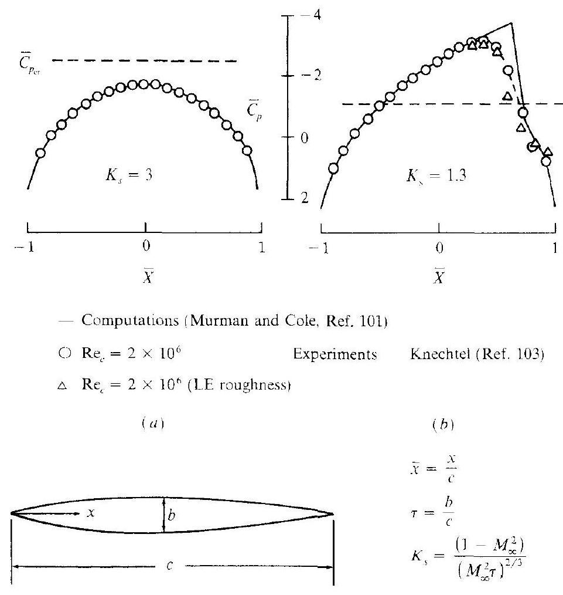
Figure 14.7 I Pressure coefficient distributions for a circular arc airfoil; comparison between experiment and calculation. (From Murman and Cole, Ref. 101.) (a) Free-stream Mach number below $M_{\mathrm{cr}}$ (subcritical case). (b) Free-stream Mach number above $M_{\text {cr }}$ (supercritical case).

between computation and experiment is obtained. For the supercritical case (Fig. 14.7b), excellent agreement is also obtained, except in the vicinity of the shock wave. Hence, small-perturbation solutions of transonic flows-the simplest of the hierarchy of techniques described in Sec. 14.3-can give useful results.

Returning again to Fig. 14.7b, we repeat that the numerical calculations give results that are indicative of a shock wave in the flow (as we would expect, on the basis of our physical considerations discussed in Sec. 14.2). However, this leads to the following question: Since the transonic small-perturbation equation assumes an isentropic flow, how can a shock wave be predicted by such an equation? The answer rests in the artificial viscosity which is present in the numerical solution. As discussed in Sec. 12.8, the truncation error in a numerical solution can give rise to an inherent artificial viscosity in the numerics, and this "numerical dissipation" acts mathematically to create a shock wave in the same sense as friction and thermal conduction act to create the internal structure of a real shock front. Hence, even though a governing equation is being used that assumes isentropic flow [Eq. (14.14)],
the presence of artificial viscosity allows the numerical solution to capture a shock wave in exactly the same sense as described in Sec. 11.15. This is a fortunate circumstance for all inviscid transonic flow calculations, where for many practical applications the presence of a shock wave is an important physical characteristic of such flows.

### 14.5 I SOLUTIONS OF THE FULL VELOCITY POTENTIAL EQUATION

The small-perturbation solutions described in Sec. 14.4 have certain limitations. As always, they are limited to thin bodies at small angle of attack. This is done to ensure that the perturbation velocities in the flow are indeed small. However, even for these cases there are regions where the perturbations are not small. For example, no matter how thin the airfoil, the flow velocity at the stagnation point near the leading edge will go to zero-hardly a "small" perturbation. The same can be said about the sharp, acute-angle trailing edge, where in subsonic flow the Kutta condition stipulates $V=0$. (See Ref. 104 for a discussion of the Kutta condition in aerodynamics.) In spite of this, the small-perturbation solutions give good results in both the leading- and trailing-edge regions, as already seen in Fig. 14.7. This agreement is most likely fortuitous; as theorized by Caughey (Ref. 105), and supported by the work of Keyfitz et al. (Ref. 106), in the leading- and trailing-edge regions the error associated with the small-perturbation assumption is compensated by the truncation error in the numerical solution due to the finite grid size. Finally, examining Fig. 14.7, the changes in flow properties across the shock wave are not small, and there might be some inaccuracy in the shock location and shock properties when the small-perturbation equation is used.

The concerns raised in the previous paragraph are obviated by solving the full potential equation for transonic flows, namely Eq. (8.17). As stated in Chap. 8, and repeated in Sec. 14.3, Eq. (8.17) deals with the full velocity potential $\Phi$, and hence allows for large changes in the flowfield variables. In particular, Eq. (8.17) can be applied to any size body at any angle of attack. However, the use of Eq. (8.17) still assumes the flow to be irrotational and isentropic. Solutions of Eq. (8.17) represent the next step in our discussion of the hierarchy of transonic flow analysis, the first step being the small-perturbation solutions discussed in Sec. 14.4.

The numerical solution of Eq. (8.17) can be carried out by means of the relaxation technique discussed in Sec. 14.4. However, exemplifying the adage that "you cannot get something for nothing," the increased accuracy associated with the use of the full potential equation is accompanied by increased complexity of the numerical solution. This increased complexity is associated with the body surface boundary condition. In the small-perturbation solution, the body boundary condition, namely Eq. (14.18), was applied along the $\bar{x}$ axis, i.e., at $\bar{y}=0$. In contrast, for the full potential solution, the body boundary condition should be applied on the body surface
itself, i.e.,

$$
\frac{\partial \Phi}{\partial n}=0 \quad \text { on } y=f(x)
$$

where $f(x)$ is the shape of the body in the $(x, y)$ plane, and $n$ is the direction locally normal to the surface. If a rectangular finite-difference grid is used in the physical plane, it becomes difficult to numerically apply the boundary condition at the surface of the body, Eq. (14.31). First, very few (if any) of the regularly spaced rectangular grid points would fall on the body surface, and therefore a complex system of interpolation has to be used to place oddly spaced grid points on the body surface. Such a rectangular grid, along with its complexity for the surface boundary condition, was used and described by Magnus and Yoshihara in Ref. 107. This grid involves a fine grid embedded in a coarse grid, which finally switches to a polar coordinate grid in the far field, as shown in Fig. 14.8a. A detail of the grid at the body surface is shown in Fig. 14.8b, along with the points required to apply the boundary

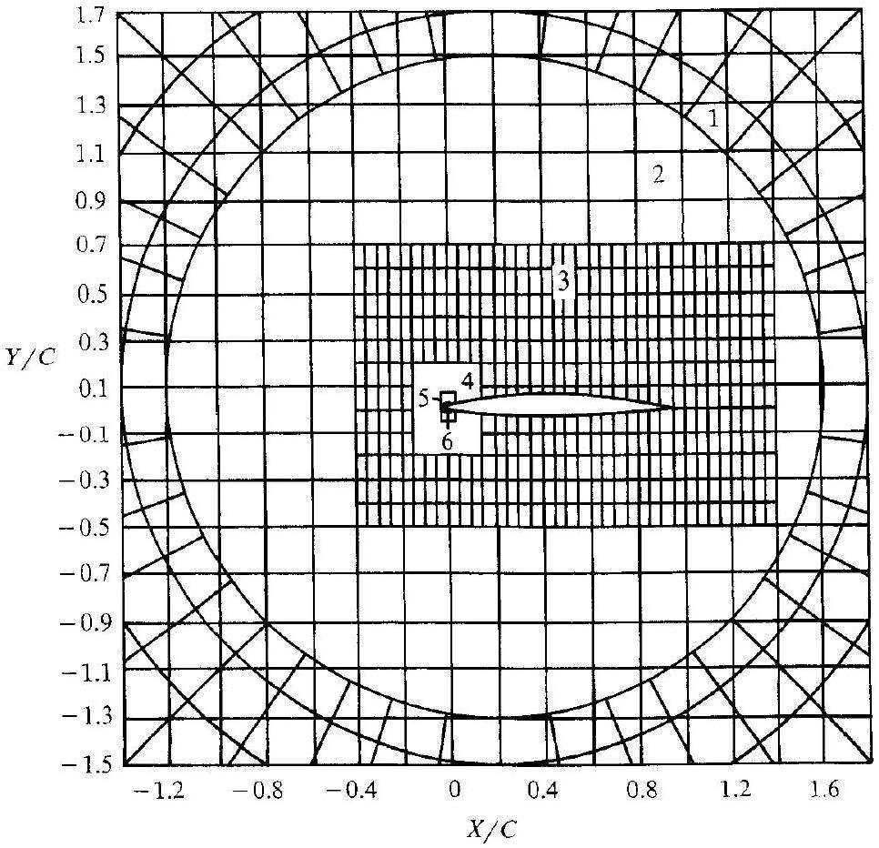
Figure 14.8 $a$ I The patching of six different grids for the numerical calculation of the transonic flow over an airfoil; an approach circa 1970 before the advent of curvilinear grid generation. (From Magnus and Yoshihara, Ref. 107.)

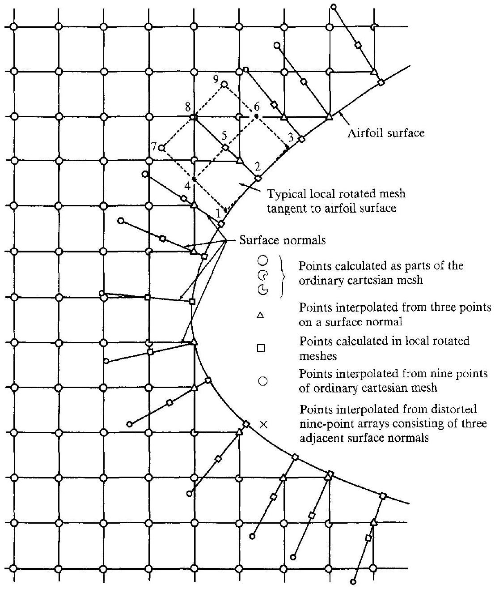
Figure 14.8 $b$ I Detail of the grid shown in (a) in the vicinity of the leading edge (Ref. 107).

condition, namely the derivative of $\Phi$ normal to the surface. One glance at Fig. 14.8 quickly impresses upon us the complexity associated with a rectangular grid. In spite of this, Magnus and Yoshihara successfully used such a grid for the solution of the Euler equations for a transonic flow; these solutions will be discussed in the next section.

The grid problem was made much more tractable in 1974 when Thompson et al. (Ref. 108) developed an ingenious method for constructing a boundary-fitted coordinate system around a body of arbitrary shape. In this method, the body surface
becomes a coordinate line in physical space, and other coordinate lines away from the body are generated by means of the solution of two elliptic partial differential equations. To be more specific, a transformation is constructed to map the curvilinear, boundary-fitted grid in physical space to a rectangular grid in the computational space. That is, the physical $(x, y)$ space is transformed into $(\xi, \eta)$ space via a set of elliptic partial differential equations such as

$$
A \frac{\partial^{2} x}{\partial \xi^{2}}-2 B \frac{\partial^{2} x}{\partial \xi \partial \eta}+C \frac{\partial^{2} x}{\partial \eta^{2}}=f(\xi, \eta)
$$

and

$$
A \frac{\partial^{2} y}{\partial \xi^{2}}-2 B \frac{\partial^{2} y}{\partial \xi \partial \eta}+C \frac{\partial^{2} y}{\partial \eta^{2}}=g(\xi, \eta)
$$

Figure 14.9 illustrates this transformation. The physical $(x, y)$ space is shown in Fig. 14.9a, along with the boundary-fitted coordinate system for an airfoil. Note in the physical plane that the airfoil surface is a coordinate line, namely $\eta=$ const $=c_{1}$. All the grid points along $\eta=c_{1}$ fall on the airfoil surface. In Fig. 14.9a, $c_{1}$ is set to zero; hence $\eta=0$ is the coordinate of the airfoil surface. The next coordinate curve away from the airfoil surface is $\eta=\mathrm{const}=c_{2}$. The furthest curve away from the body is $\eta=$ const $=c_{n}$. Fanning out from the body are a second series of coordinate lines, $\xi=$ const. The $(\xi, \eta)$ grid in the transformed space, Fig. 14.9b, is a rectangular grid. The relationship of this rectangular grid to the analogous curvilinear grid in the physical space, Fig. 14.9a, is set by the transformation in Eqs. (14.32) and (14.33). That is, Eqs. (14.32) and (14.33) are solved to give the $(x, y)$ coordinates in physical space which correspond to the $(\xi, \eta)$ coordinates in the transformed space. Note in Eqs. (14.32) and (14.33) that $x$ and $y$ are the dependent variables, and that a solution of Eqs. (14.32) and (14.33) gives
and

$$
\begin{aligned}
& x=x(\xi, \eta) \\
& y=y(\xi, \eta)
\end{aligned}
$$

From this solution, any grid point in the rectangular grid in ( $\xi, \eta$ ) space in Fig. 14.9 can be located in the curvilinear grid in ( $x, y$ ) space in Fig. 14.9a. Equations (14.32) and (14.33) are elliptic partial differential equations which can be solved numerically by a relaxation method. These equations, and their solution, are associated with the generation of the curvilinear, boundary-fitted coordinate system in Fig. 14.9a; they have absolutely nothing to do with the physics of the flowfield itself. Equations (14.32) and (14.33) are simply the definition of a grid transformation, and nothing else. Because the transformation is defined by a set of elliptic partial differential equations, it is called an elliptic grid transformation. See Ref. 108 for a detailed discussion of elliptic grid generation. Also, an extensive but elementary treatment is contained in Ref. 18. An actual example of a boundary-fitted curvilinear grid for an airfoil is shown in Fig. 14.10; this is an elliptically generated grid from Ref. 110, obtained using the technique of Ref. 108. In this grid, the points near the body surface are so close together that the graphics show them essentially as a continuous black

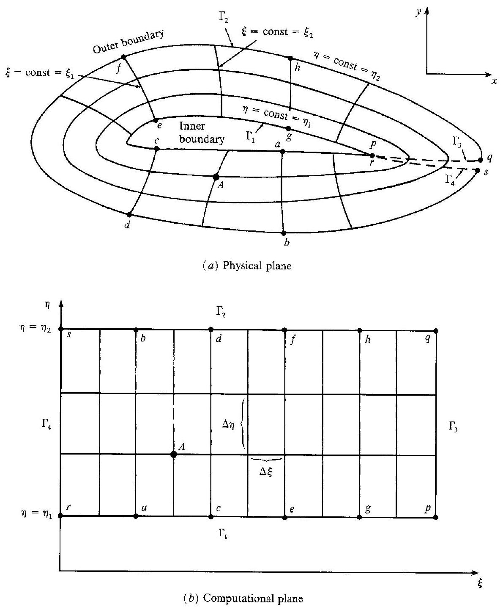
Figure 14.9 I (a) Schematic of a boundary-fitted curvilinear grid in the physical ( $x, y$ ) space. (b) Schematic of a rectangular grid in the computational $(\xi, \eta)$ space, obtained from the grid in (a) by means of a suitable transformation. (From Ref. 18.)

area. Fig. 14.10b shows that portion of the grid near the airfoil; in reality, the full grid reaches much further away from the body such as shown in Fig. 14.10a. This grid was constructed for a viscous flow solution; hence, it requires a number of finely spaced points near the body. For the inviscid flow discussed here, the actual grid may not have to be so finely spaced.

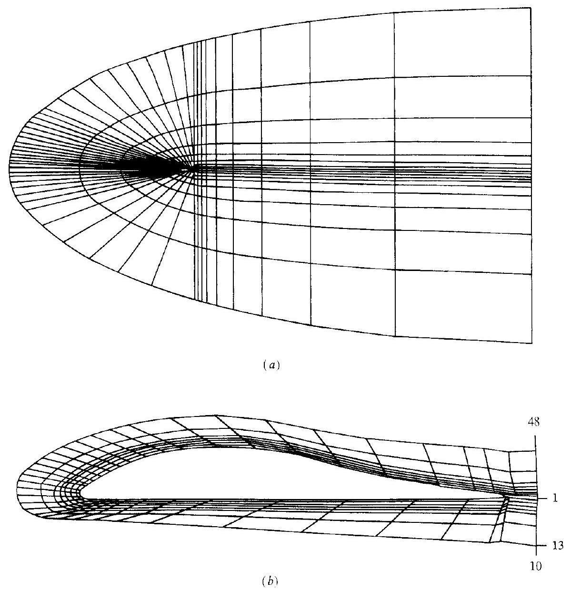
Figure 14.10 I (a) Actual boundary-fitted curvilinear grid around an airfoil, obtained by an elliptical grid generation technique patterned after Thompson et al. (Ref. 108), and carried out by Kothari and Anderson in Ref. 110. The airfoil is the small speck in the center of the grid. (b) Detail of the boundary-fitted grid in the vicinity of the airfoil. (From Ref. 110.)

For a given problem, the curvilinear grid is constructed first, independent of the flowfield solution itself. After this grid is formed, then the flowfield is solved using the full potential equation, namely Eq. (8.17). This equation is solved in the rectangular grid in ( $\xi, \eta$ ) space shown in Fig. 14.9b. To this end, Eq. (8.17) must be transformed into $(\xi, \eta)$ space. The details of this transformation are straight-forward, but lengthy; see Refs. 102 and 109 for a complete description of the general transformation. Finally, the transformed version of Eq. (8.17) in terms of $\partial^{2} \Phi / \partial \eta^{2}, \partial \Phi / \partial \eta$, $\partial^{2} \Phi / \partial \xi, \partial \Phi / \partial \xi$, etc., is solved. [The derivation of the transformed version of Eq. (8.17) is left as a homework problem.] These derivatives are replaced by the finite-difference expressions shown in Eqs. (14.22) through (14.25), except now in
terms of $\xi$ and $\eta$. The solution for $\Phi$ is then carried out by a relaxation method using the transformed version of Eq. (8.17). After the $\Phi$ and the corresponding flow variables are calculated in the transformed grid (Fig. 14.9b), these same variables are carried directly to the corresponding grid points in the physical plane; in this manner, the complete flowfield is obtained as a function of $x$ and $y$ in the physical plane.

The differences between results obtained with the full potential equation and those obtained with the small-perturbation potential equation are graphically illustrated in Fig. 14.11, which shows data calculated by Keyfitz et al. (Ref. 106). Here, the pressure coefficient distributions over the top and bottom surfaces of a Joukowski airfoil are shown; only the leading-edge region is shown, where $0 \leq x / c \leq 0.1$. (Note that, in contrast to the usual aerodynamic convention in Fig. 14.11 positive values of

Thin Joukowski airfoil

$$
M_{\infty}=0.8, \alpha=1^{\circ}, b / c=0.1
$$

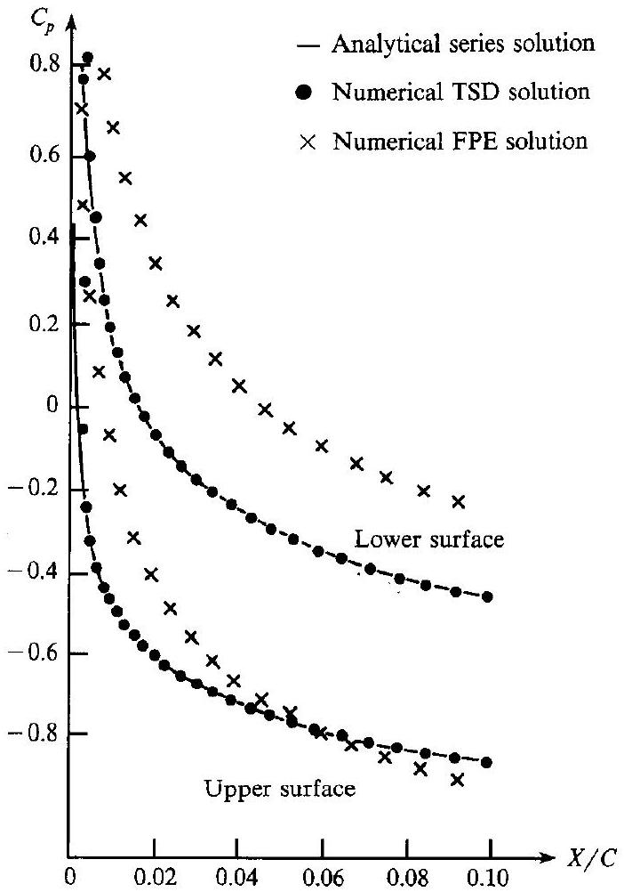
Figure 14.11 I Analytical and numerical solutions for the pressure coefficient distributions near the leading edge of a thin Joukowski airfoil. (By Keyfitz et al., Ref. 106.)

$C_{p}$, are plotted in the upper quadrant.) As described earlier, it is this leading-edge region of the airfoil where the assumption of small perturbations is least accurate. In Fig. 14.11, TSD stands for transonic small disturbance (solution of the smallperturbation potential equation as discussed in Sec. 14.4), and FPE stands for full potential equation (solution of the full velocity potential equation as discussed in the present section). Also, the solid line in Fig. 14.11 represents an analytical solution to the small-perturbation potential equation in the leading-edge region, as reported in Ref. 106; this analytical solution agrees well with the TSD numerical solution. However, the primary message conveyed by Fig. 14.11 is that the more accurate FPE solution is quite different from the TSD solution in the leading-edge region; note that, for the most part, the TSD solution underpredicts the pressure, and shows a more rapid rise in pressure as the leading edge is approached. It should be noted that Keyfitz et al. examined the effect of mesh size on the results, and found that the TSD results in the nose region were very sensitive to the fineness of the grid in that region. The results shown in Fig. 14.11 were obtained with a mesh fine enough such that the results are relatively grid-independent.

Numerical solutions to both the small-perturbation and full potential equations in transonic flows have been extensively developed since the early 1970s, including the calculation of three-dimensional flows. Such a three-dimensional calculation is illustrated in Fig. 14.12. Here, the inviscid, transonic flow over a three-dimensional finite wing is illustrated. The free-stream Mach number is 0.9 , and the wing is at an angle of attack such that the lift coefficient is 0.5 . The airfoil section of the wing is a modern supercritical airfoil shape. Cordwise pressure coefficient distributions at three different spanwise stations are shown in Fig. 14.12. Two sets of calculations are displayed: (1) The dashed lines are numerical solutions of the small-perturbation potential equation using the computer code developed by Bailey and Ballhaus (Ref. 111), and (2) The solid curves are numerical solutions of the full potential equation using what has now become a relatively standard computer code called FLO-22 developed by Jameson and Caughey as reported in Ref. 112. The circles are experimental data points obtained by Hinson and Burdges (Ref. 113). Indeed, the comparisons shown in Fig. 14.12 were first made in Ref. 113, and then commented upon by Caughey in Ref. 105. Examining Fig. 14.12, we make these observations.

1. There is a substantial difference between the small-perturbation and full potential results, including a difference in the shock location.
2. On the whole, the full potential results agree better with the experimental data than the small-perturbation results.
3. The full potential results more accurately predict the shock wave location (the shock wave is evidenced by the rapid change in $C_{p}$, which occurs toward the back of the airfoil section). However, the effect of the artificial viscosity seems to spread the calculated shock jump over a wider region than shown by experiment. It is interesting that, although the small-perturbation results do not accurately predict the shock location, they do provide a qualitatively sharper shock jump than the full potential results.

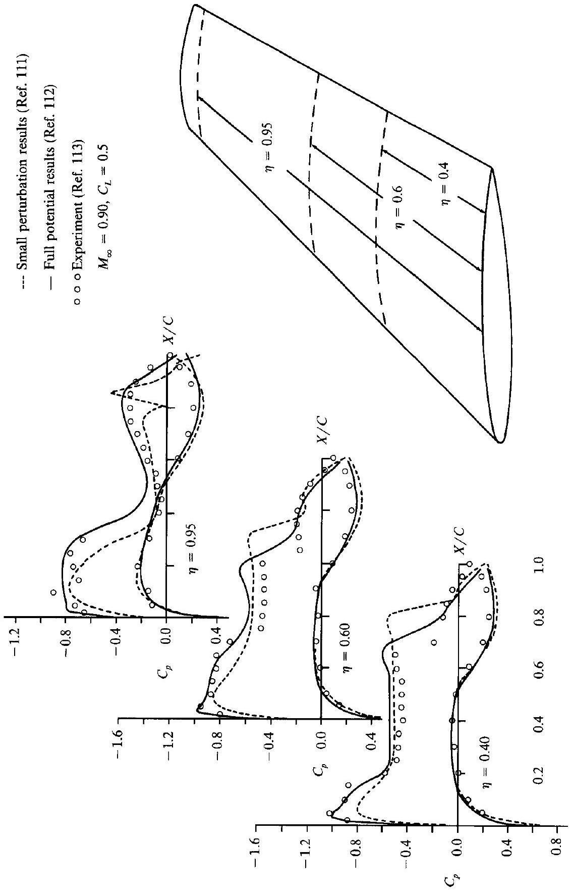
Figure 14.12 I Transonic flow over a finite wing. Chordwise pressure coefficient distributions at three different spanwise locations. Comparison between small-perturbation and full potential results with experiment. (From Caughey, Ref. 105.)

In summary, the full potential solutions are more accurate than the smallperturbation results-no surprise, because the full potential equation itself [Eq. (8.17)] is more accurate than the small-perturbation potential equation [Eq. (14.14)]. On the other hand, the full potential solutions require more work and effort, principally due to the treatment of the boundary condition. In modern transonic flow calculations, the proper application of the surface boundary condition is carried out in concert with the generation of a curvilinear, boundary-fitted coordinate system, thus requiring the solution of the velocity potential equation in the transformed ( $\xi, \eta$ ) space, which is rectangular. The advantage obtained with the full potential solutions is frequently worth this extra effort.

### 14.6 I SOLUTIONS OF THE EULER EQUATIONS

The use of the small-perturbation velocity potential equation (Sec. 14.4) and the full velocity potential equation (Sec. 14.5) both assume irrotational flow. The results obtained seem to justify this assumption; however, note that all the results given in Secs. 14.4 and 14.5 apply to the low end of the transonic regime, i.e., for subsonic free-stream Mach numbers, for which the shock wave at the end of the pocket of supersonic flow is relatively weak. For transonic applications that involve stronger shock waves, especially those situations where the free-stream Mach number is above unity, the assumption of irrotational flow becomes much less accurate. Consequently, attention to transonic flow analyses in recent times has shifted to the solution of the Euler equations, given by Eqs. (14.1) through (14.3). These equations hold for both rotational and irrotational flows; as discussed in Chap. 6, the only assumptions contained in Eqs. (14.1) through (14.3) are inviscid, adiabatic flow with no body forces. This also implies isentropic flow along a streamline. However, as discussed in Sec. 11.15, numerical solutions of the Euler equations also allow the capturing of shock waves in the flow, with the proper jump conditions across the shock wave including a discontinuous increase in entropy across the shock. This is the role of artificial viscosity in the numerical solution since some degree of numerical dissipation is necessary to generate the shock. Of course, the flow along a streamline is isentropic in front of the shock with one constant value of entropy, and it is isentropic behind the shock with another, but higher, constant value of entropy. The entropy change at the shock wave can be different from one streamline to another; thus, numerical solutions of the Euler equations allow for entropy gradients normal to the streamlines. Indeed, this is precisely the same physical mechanism actually occurring in transonic flows with shocks; hence, within the assumption of an inviscid flow, a solution of the Euler equations represents essentially an "exact" approach to the analysis of transonic flow. Hence, Euler solutions are the third and final echelon of the solution of transonic flows as discussed in Sec. 14.3. Such Euler solutions are the subject of this section.

Transonic flows are mixed regions of locally subsonic and supersonic flows; hence, the mathematical nature of such flows in the steady state is a mixed
elliptic-hyperbolic problem. This is exactly the same problem associated with the steady flow over a supersonic blunt body as described in Chap. 12. As discussed in Chap. 12, this mixed-flow problem is circumvented by carrying out a timemarching solution, approaching the proper steady state in the limit of large times. In the same vein, solutions of the Euler equations for transonic flow problems are also time-marching solutions, beginning at some initially assumed starting point, and advancing the flowfield in steps of time using a numerical solution of the Euler equations for unsteady flow [i.e., using Eqs. (14.1) through (14.3) with the time derivatives included] until a steady-state result is obtained in the limit of large time. The time-marching philosophy and approach is discussed at length in Chap. 12, hence no further elaboration is given here.

The first time-marching solution of the Euler equations for transonic flow was carried out by Magnus and Yoshihara (Ref. 107). Using the rectangular grid shown previously in Fig. 14.8, they set up an algorithm vaguely similar, but different in detail, to the MacCormack method discussed in Chap. 12. See Ref. 107 for such details. The application treated in Ref. 107 was the flow over an NACA 64A410 airfoil at a $4^{\circ}$ angle of attack in a Mach 0.72 free stream. The calculated pressure coefficient distributions over the top and bottom surfaces of the airfoil are compared with experimental measurements by Stivers (Ref. 114) in Fig. 14.13. Good agreement

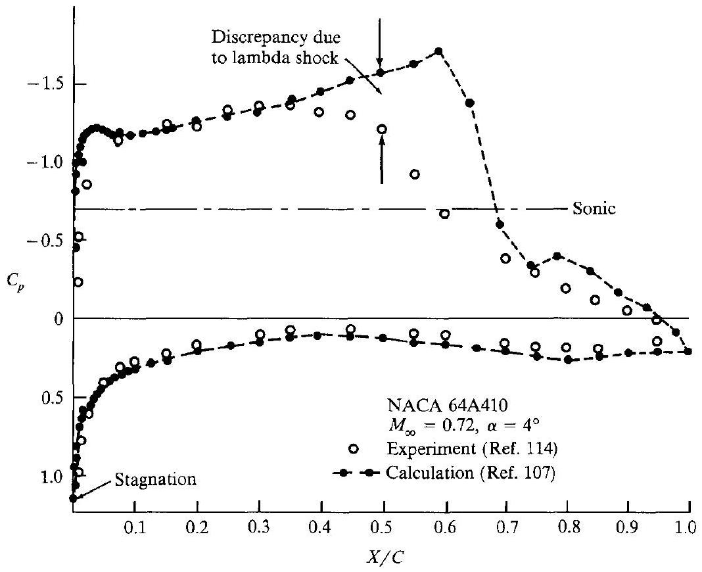
Figure 14.13 I An early finite-difference solution of the complete Euler equations for transonic flow, circa 1970 by Magnus and Yoshihara (Ref. 107). Pressure coefficient distribution for an NACA 64A410 airfoil.

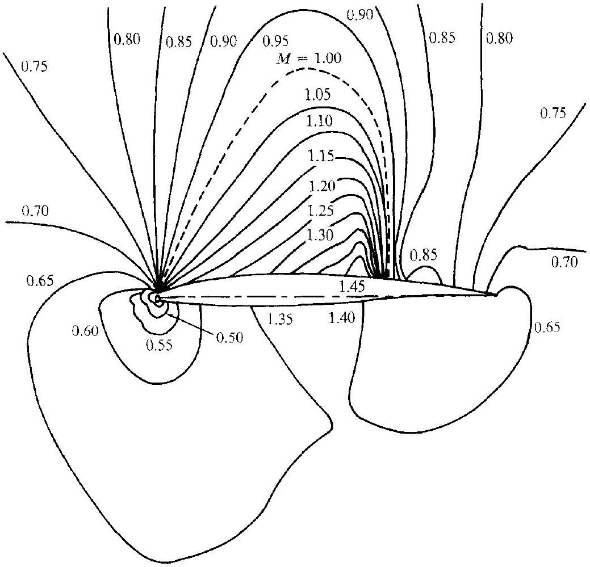
Figure 14.14 | Calculated Mach number contours for an NACA 64A410 airfoil $M_{\curvearrowright}=0.72, \alpha=4$ (Ref. 107).

between the time-marching solution and the experimental data is obtained over the bottom surface of the airfoil and for a substantial portion of the upper surface. However, the region in the vicinity of the shock wave is not predicted well; Magnus and Yoshihara explain this difference as due to the shock wave/boundary layer interaction which is obviously not included in the Euler solution. Mach number contours are shown in Fig. 14.14. The sonic line is highlighted by the dashed curve. Note the large region of supersonic flow over the top surface, reaching far above the airfoil. Also note the value of the maximum Mach number in this region, about $M=1.45$, even though the free-stream Mach number is only 0.72 . This relatively large maximum Mach number is due to the angle of attack, causing the flow to expand rapidly over the top surface.

By today's standards, the technique developed in Ref. 107 is somewhat outdated, both in regard to the grid employed as well as the details of the algorithm. However, this work was pioneering because it was the first solution of the complete Euler equations for a transonic flow, and it introduced the time-marching approach for such flows.

Since the work of Magnus and Yoshihara in 1970, great strides have been made in Euler solutions to transonic flows. First, the elliptically generated, boundary-fitted coordinate system was developed in 1974 by Thompson et al. (Ref. 108), as discussed in Sec. 14.5; this type of grid generation greatly increased the ease and accuracy of implementing the boundary condition on the body surface simply by placing a number of grid points on the body surface as an integral and consistent part of the entire grid. Second, major improvements in the time-marching approach have been made which greatly shorten the computer time required to obtain the final steady state. In particular, finite-volume techniques rather than finite-difference approaches have certain advantages, along with a fine grid/coarse grid coupling technique called "multigrid." Such aspects are far beyond the scope of this chapter. A major developer of improved Euler solutions to transonic flow has been Tony Jameson of Princeton University; for further details of such modern solutions, see the extensive surveys by Jameson in Refs. 115 and 116.

To complete this section, we will present a few results which are examples of modern Euler solutions to transonic flow. To begin with, let us consider the flow over a circular cylinder; this is a classic configuration in aerodynamic theory. The solution for the inviscid incompressible flow over a circular cylinder can be obtained from exact potential theory for incompressible flow, and is constructed by superimposing the flows associated with a doublet and a uniform free stream; see Ref. 104 for details on this solution. Such an incompressible flow solution theoretically corresponds to $M_{\infty}=0$, and leads to the exact formula for the pressure coefficient:

$$
C_{p}=1-4 \sin ^{2} \theta
$$

where $\theta$ is the polar angle measured along the surface from the front stagnation point. This incompressible flow result, labeled as $M_{\infty}=0$, is given in Fig. 14.15. For the compressible flow over a cylinder, because the circular shape is a "blunt" body, the flow very rapidly expands over the top and bottom surfaces. For this reason, the critical Mach number for a circular cylinder is quite low. Indeed, it is interesting to note the critical Mach number for both a circular cylinder and a sphere, obtained from Ref. 16, as

Circular cylinder:

$$
M_{\mathrm{cr}}=0.404
$$

Sphere: $M_{\text {cr }}=0.57$

The higher critical Mach number for the sphere is yet another example of the threedimensional relieving effect discussed in previous chapters. Note that the transonic flow occurs over cylinders and spheres even though the free-stream Mach number is quite low. Euler solutions for the transonic flow over a circular cylinder were obtained by Jameson in Ref. 115. These results are labeled as $M_{\infty}=0.35$ and $M_{\infty}=0.45$ in Fig. 14.15-free-stream Mach numbers just below and just above $M_{\mathrm{cr}}$, respectively. For $M_{\infty}=0.35$, the flow is completely subsonic, and a smooth, symmetrical $C_{p}$ distribution is obtained. Note that the peak (negative) $C_{p}$ at the top of the cylinder is about -3.4 , larger in magnitude than the incompressible result

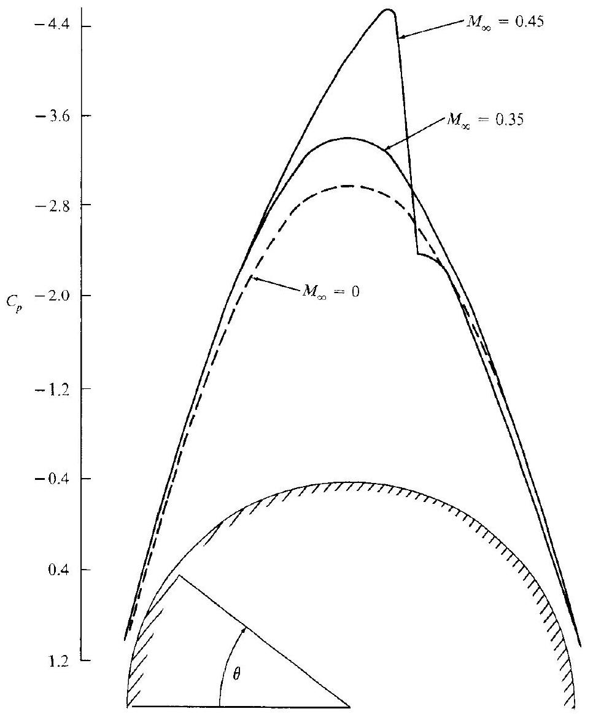
- Euler solutions by Jameson (Ref. 115)

--- Incompressible flow; $C_{p}=1-4 \sin ^{2} \theta$

Figure 14.15 I Transonic flow over a circular cylinder; finite-volume solutions of the Euler equations by Jameson (Ref.115). $M_{\rtimes}=0.35$ is a subcritical case, and $M_{\infty}=0.45$ is a supercritical case. Comparison with classical incompressible results ( $M_{\infty}=0$ ).
of -3.0 . This is consistent with the effect of compressibility on $C_{p}$ as discussed in Secs. 9.4 and 9.5 [Applying the simple Prandtl-Glauert correction from Eq. (9.36), we obtain $C_{p}=-3.2$, it is no surprise that Eq. (9.36) underpredicts $C_{p}$ because the Prandtl-Glauert theory is based on small-perturbation theory, and hence is applicable to slender bodies only.] For $M_{\infty}=0.45$, the flow over the cylinder is partly supersonic. Note the dramatic qualitative and quantitative changes in $C_{p}$; the pressure distribution is no longer symmetrical, and a shock wave occurs slightly downstream of the $\theta=90$ location.

Another classic body shape in aerodynamics is the symmetric NACA 0012 airfoil. Recent Euler solutions for the transonic flow over this airfoil were obtained by Reddy and Jacobs (Ref. 117). An elliptically generated, boundary-fitted grid such as discussed in the previous section was used for these calculations, and is shown in Fig. 14.16. Figure 14.17a contains results for the variation of $C_{p}$ over the top and bottom surfaces of this airfoil at $\alpha=1.25^{\circ}$ and $M_{\infty}=0.8$. Figure $14.17 b$ and $c$ illustrates contours of Mach number and total pressure, respectively. The nearly normal shock wave at about 65 percent of the chord is clearly evident in all these figures. In contrast to this case for a subsonic $M_{\infty}$, Fig. 14.18a, $b$, and $c$ gives the

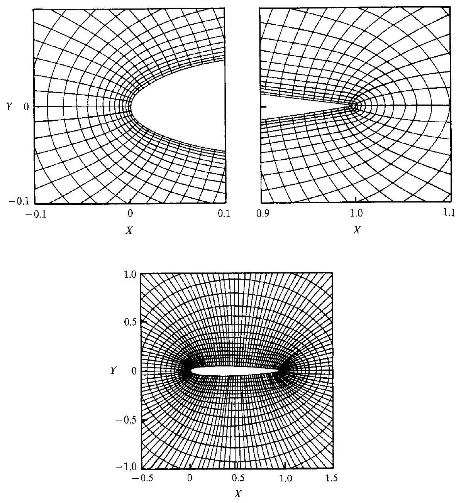
Figure 14.16 | Boundary-fitted curvilinear grid for the Euler solutions by Reddy and Jacobs (Ref. 117).

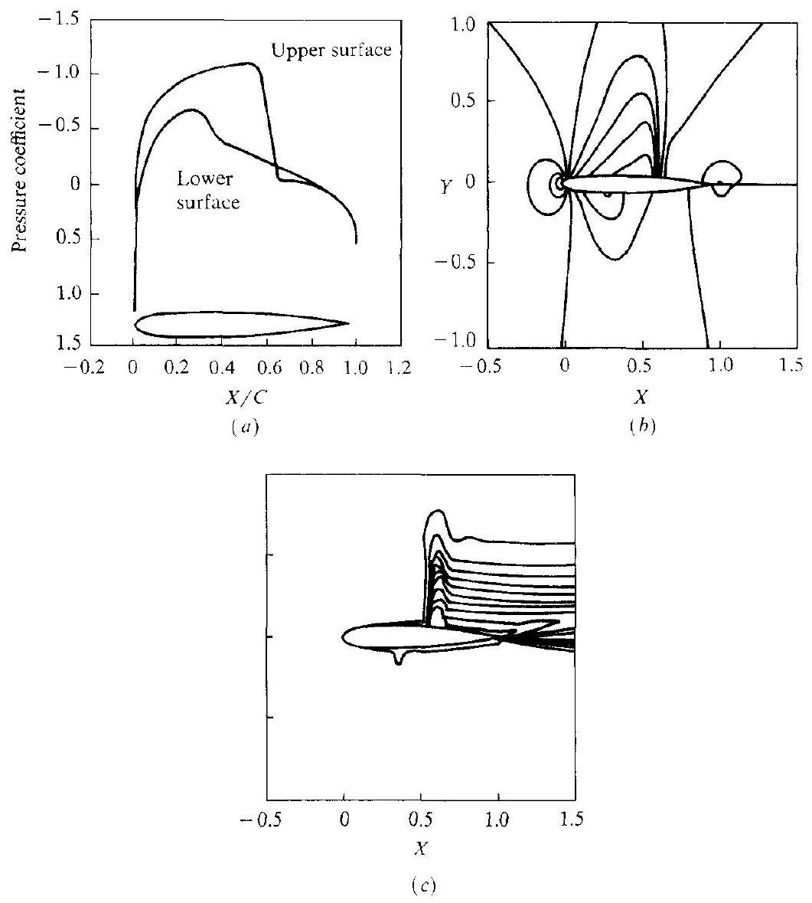
Figure 14.17 I Transonic flow over an NACA 0012 airfoil with a subsonic free-stream Mach number of 0.8 and an angle of attack of $1.25^{\circ}$, from the calculations of Reddy and Jacobs (Ref. 117). (a) Pressure coefficient distributions. (b) Mach number contours. (c) Stagnation pressure contours.

same information for the case of a supersonic $M_{\infty}$; in particular, for Fig. 14.18, $M_{\infty}=1.2$ and $\alpha=7.0^{\circ}$. Comparing Figs. 14.17 and 14.18, note the dramatic differences between subsonic and supersonic values of $M_{\infty}$. For the supersonic case, Fig. 14.18a shows a constantly decreasing pressure along both the top and bottom surfaces from the leading to the trailing edge. The Mach number contours in Fig. $14.18 b$ fan out in an almost "Mach wave" pattern away from the body, in comparison to the closed loops seen in Fig. 14.17b. The total pressure contours in Fig. 14.18c clearly show an oblique shock wave at the trailing edge; the nearly normal bow shock upstream of the nose occurs far ahead of the nose, and is off to the left side of the graph.

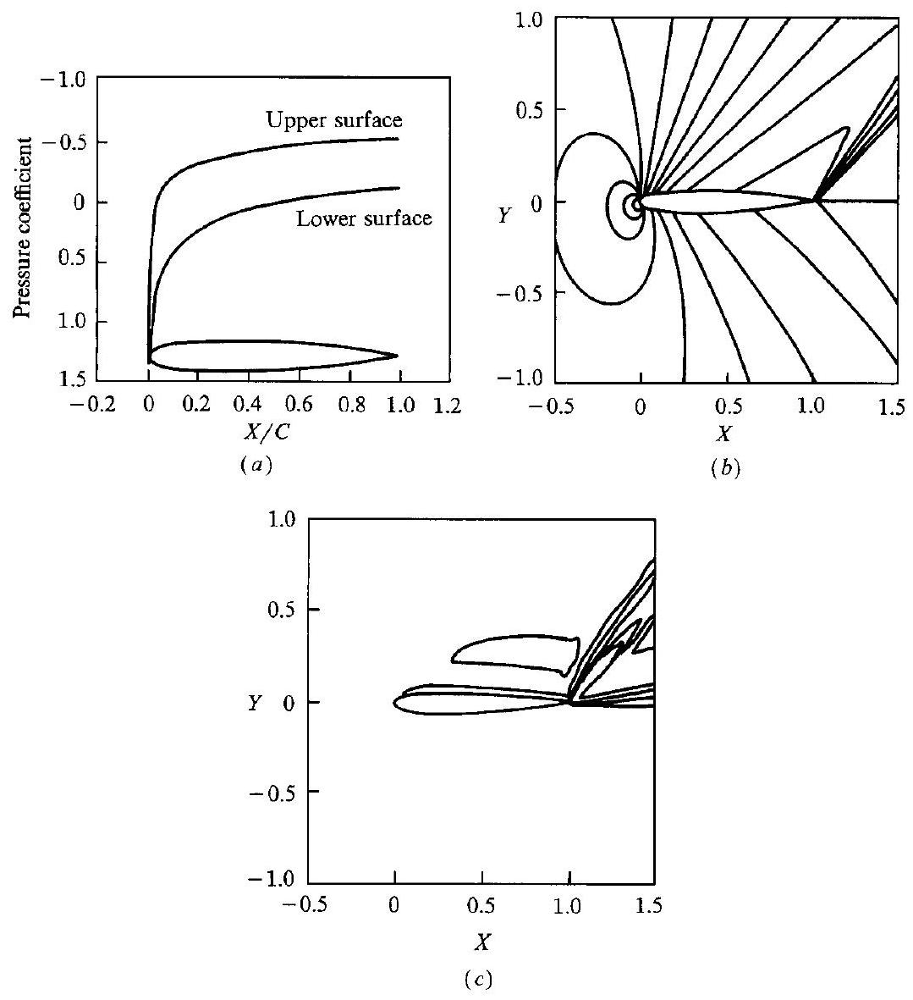
Figure 14.18 | Transonic flow over an NACA 0012 airfoil with a supersonic free-stream Mach number of 1.2 and an angle of attack of $7.0^{\circ}$, from the calculations of Reddy and Jacobs (Ref. 117). (a) Pressure coefficient distributions. (b) Mach number contours. (c) Stagnation pressure contours.

## 14.7 | HISTORICAL NOTE: TRANSONIC FLIGHTITS EVOLUTION, CHALLENGES, FAILURES, AND SUCCESSES

Return to Fig. 1.9 for a moment and examine the picture of the Bell XS-1 in flight, circa late 1947. This is a photograph of aeronautical engineering poetry in motionan aircraft that stretched the contemporary aerodynamic state of the art to the limit and whose design represented a voyage into previously uncharted regions of transonic flow. When Chuck Yeager nudged the XS-1 to a Mach number of 1.06 on October 14, 1947, the Bell XS-1 became the first manned aircraft to fly faster than sound in level flight. As noted in Sec. 1.1, this flight was one of the high-water marks
in the engineering application of compressible flow. The success of the XS-1 was the culmination of a number of aerodynamic projects over the preceding 30 yearsprojects undertaken to lay bare the secrets of flows at or very near Mach 1, i.e., transonic flows. Let us reach back over these years (and in some cases, much earlier) and examine the pioneering work that was ultimately highlighted by the XS-1 in Fig. 1.9.

The major obstacle to transonic and supersonic flight is the large drag rise that occurs when the free-stream Mach number exceeds the drag-divergence Mach number (recall the trend shown so dramatically in Fig. 14.4). The variation of drag with flow velocity has always been of great interest as far back as the fifteenth century, when Leonardo da Vinci guessed incorrectly that flow resistance was proportional to the first power of velocity. This same tenant was held by Galileo a century later. However, two experimentalists, Edme Mariotte and Christiaan Huygens, both members of the Paris Academy of Sciences, within the space of 20 years of each other determined the velocity-squared law, which today we take almost for granted. Specifically, in 1673, Mariotte gave a paper at the Academy, where he described a series of tests involving water impinging on one end of a beam supported at the middle. By adjusting weights on the other end of the beam, Mariotte found that the force was proportional to $V^{2}$. In 1690, Huygens published a paper that made the same claim, but based on an entirely different set of experiments involving falling bodies through air and other media. Of course, today we know that the drag coefficient $C_{D}$ is relatively constant with velocity (Mach number) for a body moving at subsonic speeds and hence the drag $D$ varies as $V^{2}$ through the familiar relation $D=\frac{1}{2} \rho_{\infty} V_{\infty}^{2} S C_{D}$. However, in the late seventeenth century, the independent results of Mariotte. and then of Huygens, represented a tremendous advancement in aerodynamics. On the other hand, neither of these gentlemen had the remotest idea of what happens when the speed of sound is approached. Indeed, we might be inclined to think that knowledge of the transonic drag rise is a twentieth century event-but not so! The transonic drag rise was first noted in the early eighteenth century by the well-known English mathematician and ballistician, Benjamin Robins. Robins invented the ballistic pendulum, and by firing high-speed projectiles into the pendulum, he noted that the drag of a projectile was a function of $V^{2}$ for most cases. However, at high speeds the drag exhibited a stronger velocity variation, more nearly proportional to $V^{3}$. Moreover, in his paper entitled "Resistance of the Air and Experiments Relating to Air Resistance" in the Philosophical Transactions, London, dated 1746, he states
that the velocity at which the moving body shifts resistance is nearly the same with which sound is propagated through the air

Clearly, Benjamin Robins was the first person to appreciate the existence of the transonic drag rise near Mach 1, and this was 30 years before the Declaration of Independence by the colonies in America. Gun-fired projectiles were routinely reaching the speed of sound and faster, by that time. Hence, as early as 1746, investigators in the field of ballistics knew that an unusually large increase in drag occurred near the speed of sound; they simply did not understand why. The first quantitative graph showing the actual variation of drag coefficient versus velocity for a projectile, with velocities ranging from 300 to $1000 \mathrm{~m} / \mathrm{s}$ at sea level, appeared in Germany in 1910.

In the journal Artillerische Monatshefte, Hauptman Bensberg and C. Cranz published a graph that clearly showed a constant $C_{D}$ below $300 \mathrm{~m} / \mathrm{s}$, a large increase in $C_{D}$ in the region between 300 and $400 \mathrm{~m} / \mathrm{s}$, and then a gradual decrease in $C_{D}$ as the velocity increases above $400 \mathrm{~m} / \mathrm{s}$. Since the speed of sound at standard sea level is $341 \mathrm{~m} / \mathrm{s}$, we know the large peak in $C_{D}$ observed by Bensberg and Cranz in the velocity range 300 to $400 \mathrm{~m} / \mathrm{s}$ is the now familiar transonic drag rise. This graph by Bensberg and Cranz is the first of its kind in history, the first to quantify the drag rise near Mach 1, and the first to show that $C_{D}$ actually decreases with increasing speed above Mach 1. In short, long before aerodynamicists were probing the transonic region, ballisticians knew what was happening. This provides some poetic justice to the fact that the fuselage of the Bell XS-1 (see again Fig. 1.9) is exactly the shape of a 50 -caliber machine gun bullet.

Transonic aerodynamics in the twentieth century evolved through three distinct phases: (1) the knowledge that something different was happening at or near Mach 1, (2) a physical understanding of why these differences occurred, and (3) the ability to measure and compute these differences. Let us examine these phases in more detail.

### 14.7.1 Something Different

We have already seen that, for 150 years before the twentieth century, ballisticians knew that the drag on a projectile rapidly increased when its velocity approaches the speed of sound. However, in the world of airplane aerodynamics, this was of little concern in the early days of flight. When the Wright brothers successfully flew for the first time in 1903, their flight speed was only 35 mph ; the compressibility problems associated with flight near Mach 1 never entered their minds. However, by the end of World War I, in 1918, compressibility problems forced themselves onto the aerodynamic community in a somewhat unexpected manner. By then, the forward speed of high performance fighters, such as the Spad and Nieuport, had increased sufficiently (to about 120 mph ) that, in combination with the relative velocity due to the rotation of the propeller, the propeller tip speeds were approaching, and even slightly exceeding, Mach 1. By 1919, British researchers had already observed the loss in thrust and large increase in blade drag for a propeller with tip speeds up to $1180 \mathrm{ft} / \mathrm{s}$-slightly above the speed of sound. To examine this effect further, F. W. Caldwell and E. N. Fales, both engineers at the U.S. Army Engineering Division at McCook Field near Dayton, Ohio (the forerunner of the massive Air Force research and development facilities at Wright-Patterson Air Force Base today), conducted a series of high-speed airfoil tests. They designed and built the first high-speed wind tunnel in the United States-a facility with a 14 -in.-diameter test section capable of velocities up to $675 \mathrm{ft} / \mathrm{s}$. In 1918, they conducted the first windtunnel test involving the high-speed flow over a stationary airfoil. Their results showed large decreases in lift coefficient and major increases in drag coefficient for the thicker airfoils at angle of attack. These were the first measured "compressibility effects" on an airfoil in history. Caldwell and Fales noted that such changes occurred at a certain air velocity, which they denoted as the critical speed-a term that was to
evolve into the critical Mach number at a later date. Because of the importance of these adverse effects on the overall propeller performance, additional investigations were carried out at the National Bureau of Standards (NBS) in the early and mid1920s by Lyman J. Briggs and Hugh Dryden. After designing and building a highspeed wind tunnel with a $12-\mathrm{in}$. diameter test section, capable of producing Mach 0.95 at the nozzle exit, these researchers observed the same phenomena as Caldwell and Fales. In fact, in their report on these experiments, entitled "Aerodynamic Characteristics of Airfoils at High Speeds" (NACA Report No. 207; published in 1925), Briggs and Dryden observed:

> We may suppose that the speed of sound represents an upper limit beyond which an additional loss of energy takes place. If at any point along the wing the velocity of sound is reached the drag will increase. From our knowledge of the flow around airfoils al ordinary speeds we know that the velocity near the surface is much higher than the general stream velocity... the increase being greater for the larger angles and thicker sections. This corresponds very well with the earlier flow breakdown for the thicker wings and all of the wings at high angles of attack.

Hence, by 1925 there was plenty of evidence that an airfoil section encounters some marked deleterious phenomena near Mach 1. Moreover, from the preceding quote by Briggs and Dryden, it was well recognized that thicker airfoils encountered such phenomena at lower free-stream Mach numbers. Even as early as 1922, Sylvanus A. Reed of the NACA published results showing that a propeller with a thin airfoil section at the tip did not encounter the same loss in performance as an equivalent propeller with a thick section at the top. Clearly, by 1925 , the superiority of thin airfoil sections at near sonic speeds was appreciated; the only aspect that was lacking was the total understanding as to why. Indeed, as reflected in Briggs and Dryden's report, there was no physical understanding of the true mechanism prevailing in the high speed flow over an airfoil. To state as they did that "an additional loss of energy takes place" when the local flow velocity becomes sonic is simply begging the point.

### 14.7.2 A Physical Understanding

The work of Briggs and Dryden, although carried out by the National Bureau of Standards, was actually sponsored by a grant from the National Advisory Committee for Aeronautics (NACA). In the 1920s, the NACA mounted a program to explain the "why" of transonic flow over airfoils. An initial part of this program was the continued contractual support of Briggs and Dryden, who proceeded to build a new. small high-speed wind tunnel with a 2 -in. diameter jet. Located at Edgewood Arsenal in Maryland, just north of Baltimore, this tunnel had a mildly converging-diverging nozzle, which produced Mach 1.08 at the exit. Using the same airfoils as in their earlier work, Briggs and Dryden examined the detailed pressure distributions over the airfoil surface. These tests were the first experiments in a supersonic flow carried out in the United States. Moreover, in NACA Report No. 255, published in 1927, Briggs and Dryden give the first inklings of the physical understanding of transonic airfoil
flows. For example, they:

1. Deduced that the flow separated from the upper surface. However, they did not realize (as we do today) that the flow separation is induced by the presence of a shock wave interacting with the boundary layer on the upper surface.
2. Noted that the drag coefficient for the airfoil followed the same type of dragdivergence phenomena encountered by projectiles between about Mach 0.95 and 1.08.
3. Observed for the first time in history that the flow at Mach 1.08 involved a bow shock wave standing in front of the leading edge.
As the speeds of airplanes continued to increase through the 1920s, the loss of propeller performance when the tip speeds exceeded the speed of sound became a more serious problem. Spurred by this situation, the NACA initiated an in-house program to explore the "why" of transonic flow-a program that was to continue uninterrupted for 25 years, and which was to become one of the NACA's crowning accomplishments. A series of high-speed wind tunnels was constructed at the NACA Langley Memorial Laboratory, beginning with a rudimentary facility with a $12-\mathrm{in}$. diameter nozzle exit. With Eastman Jacobs as the tunnel director and John Stack (newly arrived after just graduating from MIT) as the chief researcher, a series of tests were run on various standard airfoil shapes. Frustrated by their continual lack of understanding about the flowfield, they turned to optical techniques, i.e., they assembled a crude schlieren system. Their first tests using the schlieren system dealt with flow over a cylinder. Recall from our earlier discussion that the critical Mach number for a cylinder is about 0.4 . Hence, their results were spectacular. Shock waves were seen, along with the resulting flow separation. Visitors flocked to the wind tunnel to observe the results, including Theodore Theodorsen, one of the ranking NACA theoretical aerodynamicists of that period. An indicator of the psychology at that time is given by Theodorsen's comment that since the freestream flow was subsonic, what appeared as shock waves in the schlieren pictures must be an "optical illusion." However, Eastman Jacobs and John Stack knew differently. They proceeded with a major series of airfoil testing, using standard NACA sections. Their schlieren pictures, along with detailed pressure measurements, revealed the secrets of flow over the airfoils at Mach numbers above the critical Mach number. Quickly, a second high-speed tunnel was built at Langley, this one with a $24-\mathrm{in}$. diameter nozzle exit. The transonic airfoil work continued at a rapid pace. In 1935, Jacobs traveled to Italy, where he presented results of the NACA high-speed airfoil research at the fifth Volta Conference (see Sec. 9.9). This is the first time in history that photographs of the transonic flow field over standard-shaped airfoils were presented in a large public forum. One of these original photographs is shown and discussed in Ref. 134, which should be consulted for more details. These photographs were much like those shown in Fig. 14.3 (which are more recent in origin, dating from 1949).

During the course of such work in the 1930s, the incentive for high-speed aerodynamic research shifted from propeller applications to concern about the airframe of the airplane itself. By the mid-1930s, the possibility of the $550 \mathrm{mi} / \mathrm{h}$ airplane was more than a dream-reciprocating engines were becoming powerful enough to
consider such a speed regime for propeller-driven aircraft. In turn, the entire airplane itself (wings, cowling, tail, etc.) would encounter compressibility effects. This led to the construction of a large 8 -ft high-speed tunnel at Langley, capable of test section velocities above $500 \mathrm{mi} / \mathrm{h}$. This tunnel, along with the two earlier tunnels, established the NACA's dominance in high-speed subsonic research in the late 1930s. In the process, by 1940, the high-speed flow over airfoils was relatively well understood, certainly on a firm qualitative basis, and for free-stream Mach numbers on the subsonic side of transonics, say for $M_{\infty}$ less than about 0.95 , on a firm quantitative basis as obtained experimentally in the Langley wind tunnels. Although experimental transonic airfoil research continues today, not only with NASA (the successor of the NACA) but also at many locations throughout the world, the basic physical understanding of such flows was essentially in hand by the early 1940s due to the pioneering work of Eastman Jacobs, John Stack, and their colleagues at the NACA Langley Memorial Laboratory. For more historical details, see Ref. 134.

### 14.7.3 Measuring and Computing

The measurement of transonic flows below $M_{\infty}=0.95$ and above $M_{\infty}=1.1$ was carried out with reasonable accuracy in the early NACA high-speed wind tunnels. However, the data obtained between Mach 0.95 and 1.1 were of questionable accuracy; for these Mach numbers very near unity, the flow was quite sensitive and if a model of any reasonable cross-sectional area were placed in the tunnel, the flow became choked. This choking phenomenon was one of the most difficult aspects of high-speed tunnel research. Small models had to be used; for example, Fig. 14.19

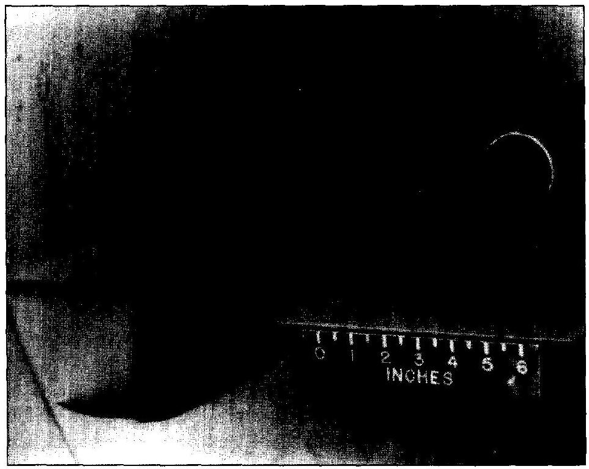
Figure 14.19 | Wind tunnel model of the Bell XS-1 in the Langley 8-ft tunnel, circa 1947. (From Ref. 99.)

shows a small model of the Bell XS-1 mounted in the Langley 8-ft high-speed tunnel in 1947-one year before Yeager's history-making flight. The wing span was slightly over 1 ft whereas the test-section diameter was much larger, namely, 8 ft . In spite of this small model size, valid data could not be obtained at free-stream Mach numbers above 0.92 due to choking of the tunnel at higher Mach numbers.

The Mach number gap between 0.95 and 1.1, in which valid data could not be obtained in the existing high-speed wind tunnels in the late 1940s, contributed much to the aerodynamic uncertainties that dominated the Bell XS-1 program, up to its first supersonic flight on October 14, 1947. Moreover, the advancement of basic aerodynamics in the transonic range was greatly hindered by this situation. Throughout the late 1930s and 1940s, NACA engineers attempted to rectify this choking problem in their high-speed tunnels. Various test section designs were tried-closed test sections, totally open test sections, a bump on the test section wall to tailor the flow constrictions, as well as various methods of supporting models in the test section to minimize blockage. None of these ideas solved the problem. Thus, the stage was set for a technical breakthrough, which came in the late 1940s-the slotted-throat transonic tunnel, as described below.

In 1946, Ray H. Wright, a theoretician at NACA Langley, carried out an analysis that indicated that if the test section contained a series of long, thin rectangular slots parallel to the flow direction that resulted in about 12 percent of the test section periphery being open, then the blockage problem might be greatly alleviated. This idea met with some skepticism, but it was almost immediately accepted by John Stack, who by that time was a highly placed administrator at Langley. A decision was made to slot the test section of the small 12 -in. high-speed tunnel, which resulted in greatly improved performance in early 1947. However, this was simply an experiment, and much skepticism still prevailed. On the surface the NACA made no plans to implement this development. On the other hand, Stack confided privately to his colleagues that he favored slotting the large 16 - ft high-speed tunnel. Without fanfare, this work began in the spring of 1948, buried in a larger project to increase the horsepower of the tunnel. Almost simultaneously, Stack made the decision to slot the $8-\mathrm{ft}$ tunnel as well. The work on the 8 -ft tunnel proceeded faster than on its larger counterpart, and on October 6, 1950, it became operational for research. By December of that same year, the modified $16-\mathrm{ft}$ tunnel also became operational. Subsequent operation of these facilities proved that the slotted-throat concept allowed the smooth transition of the tunnel flow through Mach 1 simply by the increase of the tunnel power-the problem of blockage was basically solved. In this respect, these tunnels became the first truly transonic wind tunnels, and for this accomplishment, John Stack and his colleagues at NACA Langley were awarded the prestigious Collier Trophy in 1951. The measurement of transonic flows in the laboratory was now well in hand.

The same could not be said at that time for the computation of transonic flows. As emphasized earlier in this chapter, transonic flow is nonlinear flow, and the analysis of such flows was, therefore, exceptionally difficult in the period before the development of the high-speed digital computer. In 1951, as Stack and the Langley engineers were being awarded the Collier Trophy, there was virtually no useful
aerodynamic method for the calculation of transonic flows. Transonic similarity was known and understood (see Sec. 14.3) at that time, but similarity concepts are useful only for relating one solution or set of measurements to another situation; it is not a solution of the flow per se. Also known at that time was the approximate means of estimating the critical Mach number of an airfoil using the Prandtl-Glauert rule, or any other compressibility correction, as was described in Sec. 9.7. Indeed, the method described in Sec. 9.7 was first developed by Eastman Jacobs and John Stack in the late 1930s. Clearly, in 1950 the practical analysis of transonic flow fields themselves was lagging greatly behind the experimental progress. This situation prevailed until the advent of modern computational fluid dynamics and, in particular, the pioneering method advanced by Murman and Cole (see Sec. 14.4). In this sense, the work described in Sec. 14.4 and the subsequent sections speaks for itself as an historical chronology of modern transonic flow analysis. Today, with a few exceptions, we can finally make a statement analogous to that given above about the experimental status in 1950, namely, that by the 1980s, the calculation of transonic flow is now well in hand.

### 14.7.4 The Transonic Area Rule and the Supercritical Airfoil

We would be remiss in this discussion of the historical aspects of transonic flight if we did not mention two major configuration breakthroughs that have made transonic flight practical-the area rule and the supercritical airfoil. Both of these advancements were a product of the transonic wind tunnels at Langley and both were driven by the same person--Richard Whitcomb. Let us examine these two matters more closely.

First, on a technical basis, the area rule and the supercritical airfoil both have the same objective, namely, to reduce drag in the transonic regime. However, this drag reduction is accomplished in different ways. Consider the qualitative sketch of drag coefficient versus Mach number given in Fig. 14.20 for a transonic body. The variation for a standard body shape without area rule and without a supercritical airfoil is given by the solid curve. Now, let us consider the area rule by itself. First, the area rule is a simple statement that the cross-sectional area of the body should have a smooth variation with longitudinal distance along the body; there should be no rapid or discontinuous changes in the cross-sectional area distribution. For example, a conventional wing-body combination will have a sudden cross-sectional area increase in the region where the wing cross section is added to the body cross section. The area rule says that to compensate, the body cross section should be decreased in the vicinity of the wing, producing a wasp-like or coke-bottle shape for the body. The aerodynamic advantage of the area rule is shown in Fig. 14.20, where the drag variation of the area-ruled body is given by the dashed curve. Simply stated, the area rule reduces the peak transonic drag by a considerable amount. The supercritical airfoil, on the other hand, acts in a different fashion. A supercritical airfoil is shaped somewhat flat on the top surface in order to reduce the local Mach number inside the supersonic region below what it would be for a conventional airfoil under the same flight conditions. As a result, the shock wave strength is lower, the boundary

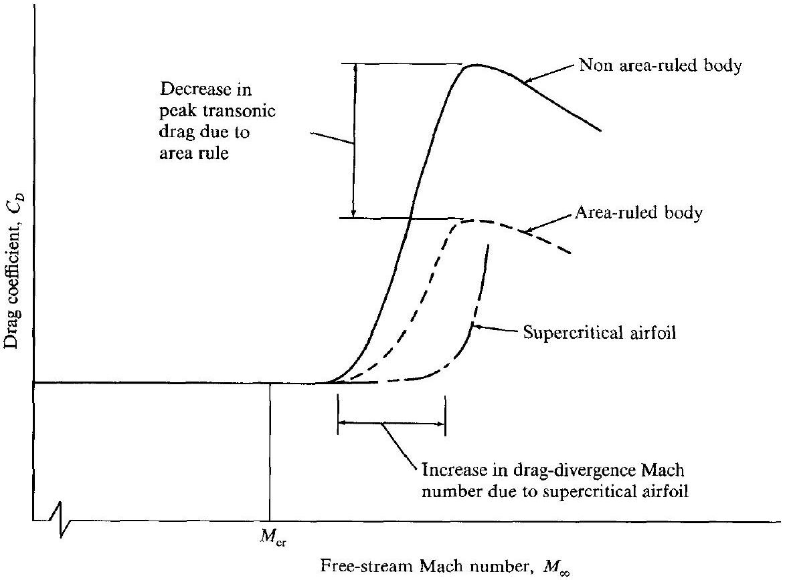
Figure 14.20 I Illustration of the separate effects of the area rule and the supercritical airfoil.

layer separation is less severe, and hence the free-stream Mach number can be higher before the drag-divergence phenomenon sets in. The drag variation for a supercritical airfoil is sketched in Fig. 14.20, shown by the broken curve. Here, the role of a supercritical airfoil is clearly shown; although the supercritical airfoil and an equivalent standard airfoil may have the same critical Mach number, the drag-divergence Mach number for the supercritical airfoil is much larger. That is, the supercritical airfoil can tolerate a much larger increase in the free-stream Mach number above the critical value before drag divergence is encountered. In this fashion, such airfoils are designed to operate far above the critical Mach number-hence the label "supercritical" airfoils.

The area rule was introduced in a most spectacular fashion in the early 1950s. Although there had been some analysis that obliquely hinted about the area rule, and although workers in the field of ballistics had known for years that projectiles with sudden changes in cross-sectional area exhibited high drag at high speeds, the importance of the area rule was not fully appreciated until a series of wind tunnel tests on various transonic bodies were conducted in the slotted-throat $8-\mathrm{ft}$ wind tunnel at Langley by Richard Whitcomb. These data, and an appreciation of the area rule, came just in time to save a new airplane program at Convair. In 1951, Convair was designing one of the new "century series" fighters intended to fly at supersonic speeds. Designated the YF-102, this aircraft had a delta-wing and was powered by

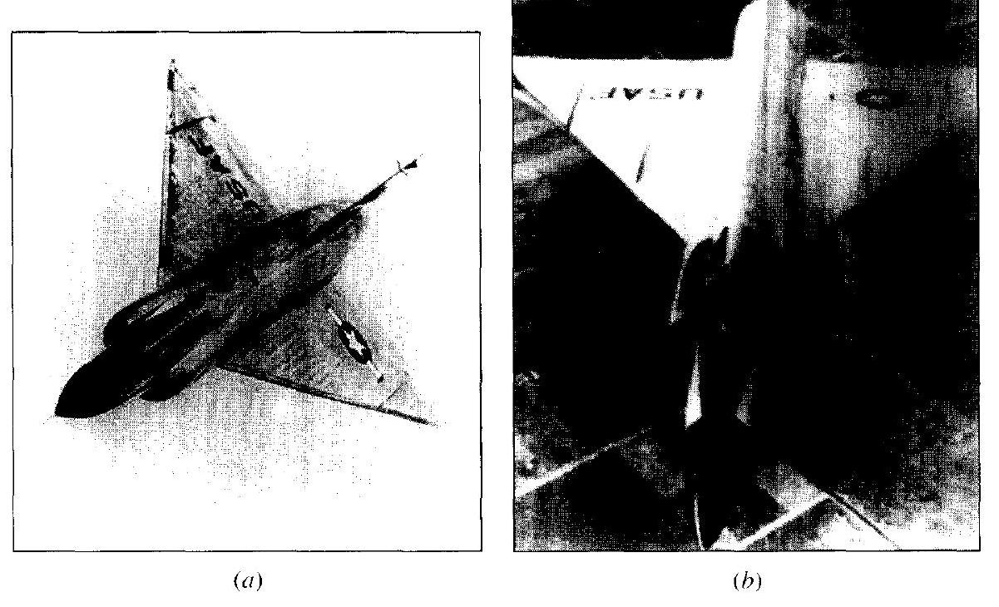
Figure 14.21 I (a) The Convair YF-102, no area ruling. (b) The Convair YF-102A, with area ruling. Note the wasp-like shape of the fuselage in comparison with the YF-102 shown in (a).

the Pratt and Whitney J-57 turbojet-the most powerful engine in the United States at that time. A photograph of the YF-102 is given in Fig. 14.21a. Aeronautical engineers at Convair expected the YF-102 to easily fly supersonically. On October 24, 1953, flight tests of the YF-102 began at Muroc Air Force Base (now Edwards), while a production line was forming at the San Diego plant of Convair. However, as the flight tests progressed, it became painfully clear that the YF-102 could not fly faster than sound-the transonic drag rise was simply too large, even for the powerful J-57 engine to overcome. After consultation with the NACA aerodynamicists and inspection of the area rule results that had been obtained in the Langley $8-\mathrm{ft}$ tunnel, the Convair engineers designed a modified airplane-the YF-102A-with an arearuled fuselage. A photograph of the YF-102A, with its coke bottle-shaped fuselage is given in Fig. 14.21b. Wind tunnel data for the YF-102A looked promising. Figure 14.22 was obtained from that data; it shows the variation of drag coefficient with free-stream Mach number for both the YF-102 and YF-102A. In the upper left of Fig. 14.22, the cross-sectional area distribution of the YF-102 is shown, including how it is built up from the different body components. Note the irregular and bumpy nature of the total cross-sectional area distribution. At the bottom right, given by the dashed line, is the cross-sectional area distribution for the YF-102A-a much smoother variation than that for the YF-102. The data shown in Fig. 14.22 are obtained from Reference 100. The comparison between the drag coefficients for the conventional YF-102 (solid curve) and the area-ruled YF-102A (dashed curve) dramatically illustrates the tremendous transonic drag reduction to be obtained with

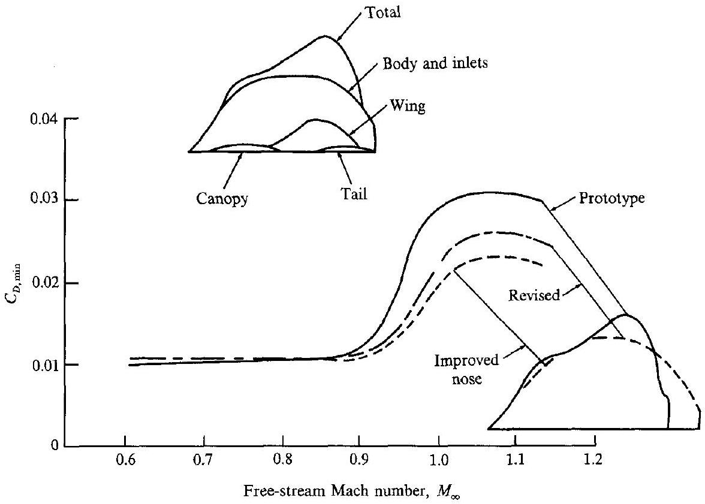
Figure 14.22 I The effect of the area rule modifications made on the original non-area-ruled Convair YF-102 (labeled prototype) and the resulting area-ruled YF-102A (labeled revised and improved nose). (From Ref. 100.)

the use of the area rule. (Recall from Fig. 14.20 that the function of the area rule is to decrease the peak transonic drag; Fig. 14.22 quantifies this function.) Encouraged by these wind tunnel results, the Convair engineers began a flight test program for the YF-102A. On December 20, 1954, the prototype YF-102A left the ground at Lindbergh field, San Diego-it broke the speed of sound while still climbing. The use of the area rule had increased the top speed of the airplane by 25 percent. The production line rolled, and 870 F-102As were built for the Air Force. The area rule had been ushered in with dramatic style.

The supercritical airfoil, also pioneered by Richard Whitcomb, based on data obtained in the $8-\mathrm{ft}$ wind tunnel, was a development of the 1960s. Recall from Fig. 14.20 that the function of the supercritical airfoil is to increase the increment between the critical Mach number and the drag-divergence Mach number. The data in the Langley tunnel indicated a possible 10 percent increase in cruise Mach number due to a supercritical wing. NASA introduced the technical community to the supercritical airfoil data in a special conference in 1972. Since that time, the supercritical airfoil concept has been employed on virtually all new commercial aircraft and some military airplanes. Physical data for a supercritical airfoil and for the standard NACA 64-A215 airfoil are compared in Figs. 14.23 and 14.24, along with a comparison

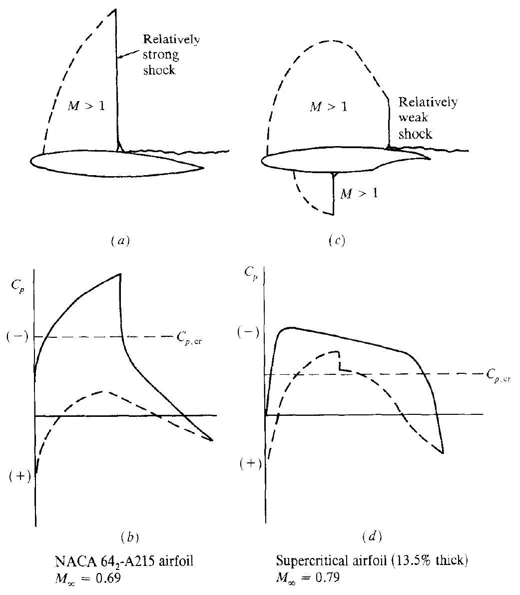
Figure 14.23 I Standard NACA 64-series airfoil compared with a supercritical airfoil at cruise lift conditions. (From R. T. Whitcomb and L. R. Clark.
"An Airfoil Shape for Efficient Flight At Supercritical Mach Numbers," NASA TMX-1109, July 1965.)

of their shapes. The performances advantage of the supercritical airfoil is clearly evident.

With this, we end this rather lengthy historical note on transonic flight. Our purpose has been to provide just the flavor of what constitutes one of the most exciting chapters from the annals of aerodynamics and aeronautical engineering. We have seen how the secrets of transonic flow were slow to be revealed, how a concerted, intelligent attack on this problem eventually led to useful wind tunnel data as well as modern methods of computation for transonic flows, and finally how this transonic data ultimately resulted in two of the major aerodynamic breakthroughs in the latter half of the twentieth century--the area rule and the supercritical airfoil.

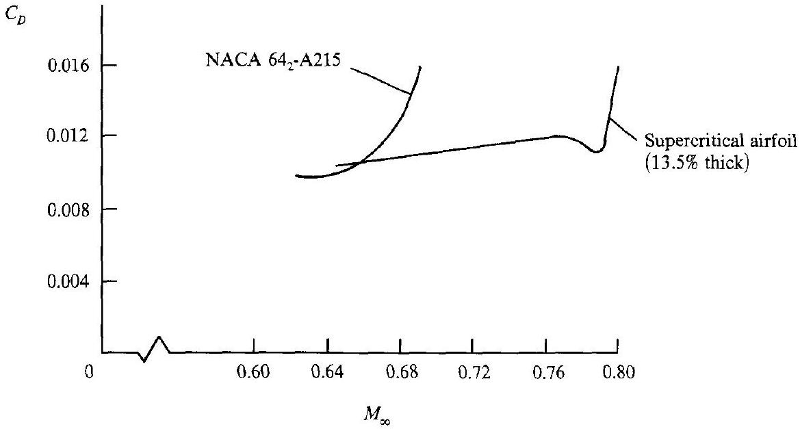
Figure 14.24 I The drag-divergence properties of a standard NACA 64-series airfoil and a supercritical airfoil. (From NASA TMX-1109, as in Fig. 14.23.)

### 14.8 I SUMMARY AND COMMENTS

In this chapter, we have covered some of the essential physical and theoretical aspects of transonic flow. If this chapter had been written 30 years ago, it would have been completely different. First, it would have been much shorter, and it would have emphasized only a few specialized theories. One such theory is called the hodograph method, and uses the transonic small-perturbation equation in the hodograph plane, for which some shock-free exact solutions can be obtained. Such solutions are discussed, for example, in Shapiro (see Ref. 16). In the more modern treatment of transonic flows given here, we have intentionally not covered such hodograph techniques. Instead, we have concentrated on the main echelons of transonic flow numerical solutions, namely,

1. Small-perturbation solutions
2. Full potential solutions
3. Euler solutions

These solutions are listed in order of increasing accuracy, and as life would have it, also of increasing difficulty and effort. The small-perturbation solutions assume irrotational flow, and slender bodies at small angles of attack. The full potential solutions also assume irrotational flow, but pertain to any body of arbitrary thickness and angle of attack. In both cases, the assumption of irrotational flow is motivated by the change in entropy across a weak shock, which is of third order in shock strength and hence is small. The Euler solutions make no such assumptions, and hence represent "exact" solutions of inviscid transonic flow.

Modern, state-of-the-art research in transonic flow is now concentrating on numerical solutions of the complete Navier-Stokes equations in order to properly
include the viscous effects, particularly those effects associated with the shock wave/boundary layer interaction region. Since the present book deals with inviscid flow only, such matters are beyond our scope. However, these viscous effects can play a strong role in transonic flows, and the interested reader is encouraged to read the modern literature on such transonic viscous flows. The AIAA Journal, the Journal of Aircraft, Computers and Fluids, and the Journal of Computational Physics are good sources of such literature.

