## CHAPTER Lo

## Hypersonic Flow

Almost everyone has their own definition of the term hypersonic. If we were to conduct something like a public opinion poll among those present, and asked everyone to name a Mach number above which the flow of a gas should property be described as hypersonic there would be a majority of answers round about five or six, but it would be quite possible for someone to advocate, and defend, numbers as small as three, or as high as 12.
P. L. Roe, comment made in a lecture at the von Karman Institute, Belgium, January 1970

## PREVIEW BOX

The Space Shuttle is shown in Fig. 12.2. Take another look at this figure-it shows one of the most important hypersonic flight vehicles to date. After the end of each mission in space, the shuttle enters the earth's atmosphere at Mach 26, and flies most of its flight path at hypersonic speeds until it returns to the earth's surface. The design of the Space Shuttle benefited from a massive hypersonic research program in the 1950s and 1960s, driven by the necessities of the intercontinental ballistic missile and the manned space program. Now take a look at Fig. 15.1, which shows the X-43 unmanned hypersonic research vehicle developed by NASA, and expected to make its first flight in late 2002 or early 2003. The X-43 is representative of a new class of hypersonic vehicles designed to cruise within the atmosphere using airbreathing propulsion as the prime mover. The engine itself is pioneering-a supersonic combustion ramjet engine (scramjet). Such engines are at the very frontier of propulsion development. One of the research goals of the X-43 is to demonstrate for the first time in actual flight the performance of a scramjet.

The blunt-nosed space shuttle in Fig. 12.2, and the rather slender X-43 hypersonic cruise vehicle in Fig. 15.1, along with its novel hypersonic propulsion, scream hypersonic aerodynamics. Hypersonic flow is the subject of this chapter. The material presented here is a short introduction to a flow regime that will take on increased importance in the twenty-first century. I predict that many of the readers of this book will have the opportunity to help push forward the frontier of hypersonic flight, in regard to both the aerodynamic design of new vehicles and the pioneering application of compressible flow to the development of exotic and novel engines to power these vehicles. So pay special attention to this chapter-it describes some basic aspects of hypersonic flow that for some of you will be the wave of the future.

The roadmap for this chapter is given in Fig. 15.2 We start out with a basic physical description of hypersonic flow, addressing the question: hypersonic flowwhat is it? Then we treat four specific theoretical aspects of hypersonic flow, starting at the left in Fig. 15.2 with

## X-43A Vehicle

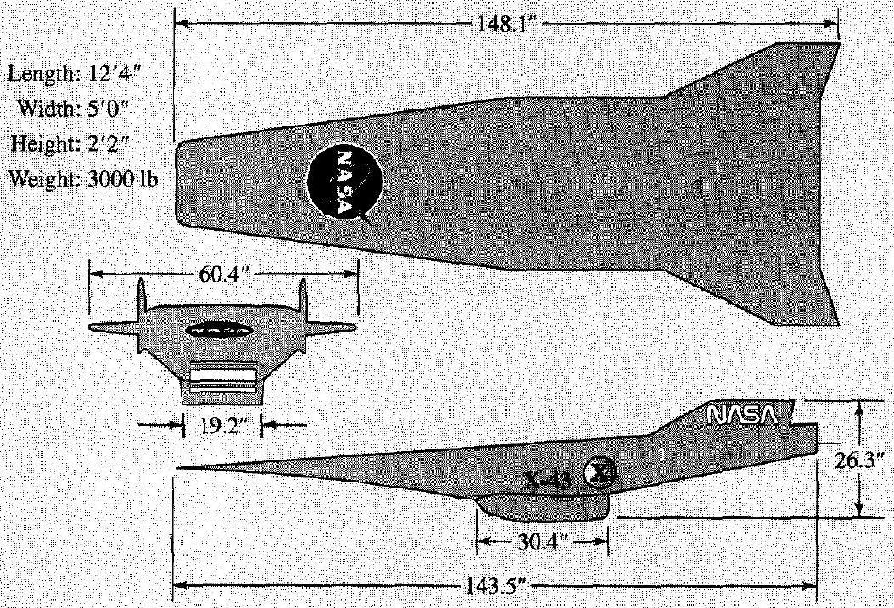
Figure 15.1 The X-43A Hyper-X hypersonic research vehicle (NASA).

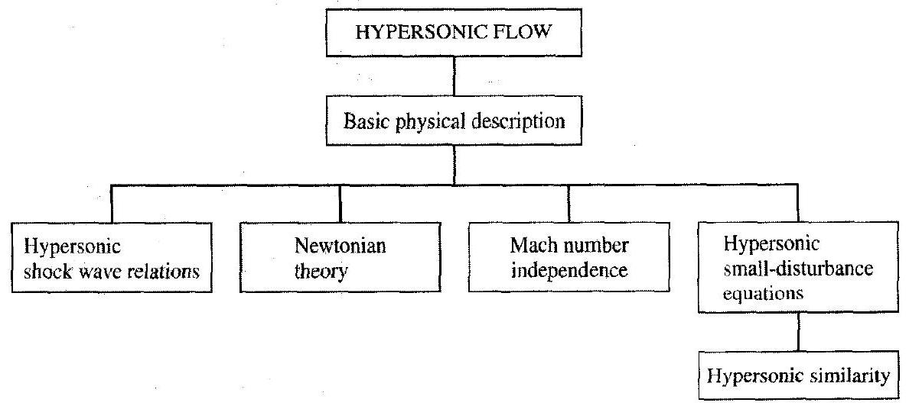
Figure 15.2 | Roadmap for Chapter 15.

a discussion of the simplification of the shock wave relations afforded by the assumption of high Mach numbers. We then discuss Newtonian theory, a special approach to quickly estimate pressure distributions on hypersonic shapes. This is followed by a demonstration that pressure coefficients, lift and drag coefficients, and shock wave shapes in hypersonic flow do not change very much with increasing Mach number-a phenomenon called Mach number independence. Finally we develop the hypersonic small-disturbance equations, which in turn lead to the principle of hypersonic similarity. Although not
explicitly shown in Fig. 15.2, we briefly address the matter of CFD solutions to hypersonic flows at the end of the chapter. All aspects treated in this chapter assume a calorically perfect gas (constant specific heats). Hightemperature effects that are so important to hypersonic flow, and that dramatically change the thermodynamics, are discussed as an integral part of Chaps. 16 and 17, dealing with high-temperature gas dynamics.

Finally, refer to the roadmap for the book given in Fig. 1.7. With the present chapter we reach the end of the center column of the roadmap.

### 15.1 I INTRODUCTION

When the space shuttle enters the earth's atmosphere from near-earth orbit, it is flying at Mach 25. When the Apollo spacecraft returned from the moon, it entered the atmosphere at Mach 36. These very high Mach numbers are associated with the extreme, high-Mach-number portion of the flight spectrum which is labeled as hypersonic flight. The hypersonic flow regime was briefly described in Sec. 1.3; this short discussion should be reviewed before progressing further.

There are two reasons for singling out hypersonic flow for a separate chapter in this book, as follows.

1. Hypersonic flight is of extreme interest today because of new vehicle concepts designed to fly at very high Mach numbers. Hypersonic aerodynamics is an important part of the entire flight spectrum, and therefore it is an integral part of any study of modern compressible flow.
2. At very high Mach numbers, a flowfield is dominated by certain physical phenomena that are not so important at lower, supersonic speeds. These special aspects of hypersonic flow are distinct enough from our previous discussions of compressible flow that a separate chapter on hypersonic flow is necessary.

As in the case of the subjects covered by the two previous chapters, the topic of hypersonic flow considered in this chapter justifies an entire book by itself. Such books exist; an introductory book in hypersonic flow is given by Ref. 119, and the reader interested in this subject is encouraged to study Ref. 119 closely. Our scope in this chapter will be much like that of Chaps. 13 and 14-long on philosophy and concepts, and short on details.

Finally, we note that hypersonic flow is nonlinear. This was first brought out in Sec. 9.2, where it was shown that small-perturbation considerations lead to linear theories for both subsonic and supersonic flows, but not for transonic or hypersonic flow. Make certain to review Sec. 9.2 before progressing further, paying special attention to the effect of hypersonic Mach numbers.

## 15.2 | HYPERSONIC FLOW-WHAT IS IT?

There is a conventional rule of thumb that defines hypersonic aerodynamics as those flows where the Mach number is greater than 5 . However, this is no more than just a rule of thumb; when a flow is accelerated from $M=4.99$ to $M=5.01$, there is no "clash of thunder" and the flow does not "instantly turn from green to red." Rather, hypersonic flow is best defined as that regime where certain physical flow phenomena become progressively more important as the Mach number is increased to higher values. In some cases, one or more of these phenomena may become important above Mach 3, whereas in other cases they may not be compelling until Mach 7 or higher. The purpose of this section is to describe briefly these physical phenomena; in some sense this entire section will constitute a "definition" of hypersonic flow.

### 15.2.1 Thin Shock Layers

Recall from oblique shock theory (see Chap. 4) that, for a given flow deflection angle, the density increase across the shock wave becomes progressively larger as the Mach number is increased. At higher density, the mass flow behind the shock can more easily "squeeze through" smaller areas. For flow over a hypersonic body, this means that the distance between the body and the shock wave can be small. The flowfield between the shock wave and the body is defined as the shock layer, and for hypersonic speeds this shock layer can be quite thin. For example, consider the Mach 36 flow of a calorically perfect gas with a ratio of specific heats, $\gamma=c_{p} / c_{v}=1.4$, over a wedge of $15^{\circ}$ half-angle. From standard oblique shock theory the shock wave angle will be only $18^{\circ}$ as shown in Fig. 15.3. If high-temperature, chemically reacting effects are included, the shock wave angle will be even smaller. Clearly, this shock layer is thin. It is a basic characteristic of hypersonic flows that

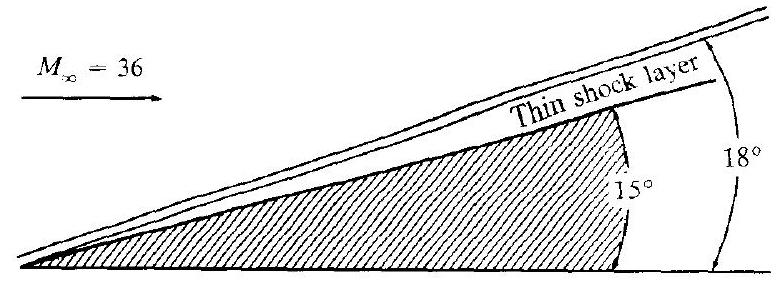
Figure 15.3 |lllustration of a thin shock layer at hypersonic Mach numbers.

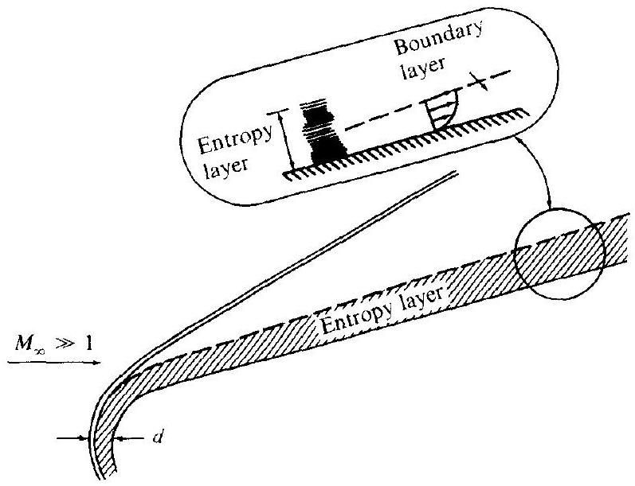
Figure 15.4 I Illustration of the entropy layer of a blunt-nosed slender body at hypersonic speeds.

shock waves lie close to the body, and that the shock layer is thin. In turn, this can create some physical complications, such as the merging of the shock wave itself with a thick, viscous boundary layer growing from the body surface-a problem which becomes important at low Reynolds numbers. However, at high Reynolds numbers, where the shock layer is essentially inviscid, its thinness can be used to theoretical advantage, leading to a general analytical approach called "thin shock layer theory" (see Ref. 119). In the extreme, a thin shock layer approaches the fluid dynamic model postulated by Isaac Newton in 1687; such "newtonian theory" is simple and straightforward, and is frequently used in hypersonic aerodynamics for approximate calculations (to be discussed in Sec. 15.4).

### 15.2.2 Entropy Layer

Consider the wedge shown in Fig. 15.3, except now with a blunt nose, as sketched in Fig. 15.4. At hypersonic Mach numbers, the shock layer over the blunt nose is also very thin, with a small shock detachment distance $d$. In the nose region, the shock
wave is highly curved. Recall that the entropy of the flow increases across a shock wave, and the stronger the shock, the larger the entropy increase. A streamline passing through the strong, nearly normal portion of the curved shock near the centerline of the flow will experience a larger entropy increase than a neighboring streamline which passes through a weaker portion of the shock further away from the centerline. Hence, there are strong entropy gradients generated in the nose region; this "entropy layer" flows downstream, and essentially wets the body for large distances from the nose, as shown in Fig. 15.4. The boundary layer along the surface grows inside this entropy layer, and is affected by it. Since the entropy layer is also a region of strong vorticity, as related through Crocco's theorem (see Sec. 6.6), this interaction is sometimes called a "vorticity interaction." The entropy layer causes analytical problems when we wish to perform a standard boundary layer calculation on the surface, because there is a question as to what the proper conditions should be at the outer edge of the boundary layer.

### 15.2.3 Viscous Interaction

Consider a boundary layer on a flat plate in a hypersonic flow, as sketched in Fig. 15.5. A high-velocity, hypersonic flow contains a large amount of kinetic energy; when this flow is slowed by viscous effects within the boundary layer, the lost kinetic energy is transformed (in part) into internal energy of the gas-this is called viscous dissipation. In turn, the temperature increases within the boundary layer; a typical temperature profile within the boundary layer is also sketched in Fig. 15.5. The characteristics of hypersonic boundary layers are dominated by such temperature increases. For example, the viscosity coefficient increases with temperature, and this by itself will make the boundary layer thicker. In addition, because the pressure $p$ is constant in the normal direction through a boundary layer, the increase in temperature $T$ results in a decrease in density $\rho$ through the equation of state $\rho=p / R T$. In order to pass the required mass flow through the boundary layer at reduced density, the boundary layer thickness must be larger. Both of these phenomena combine to

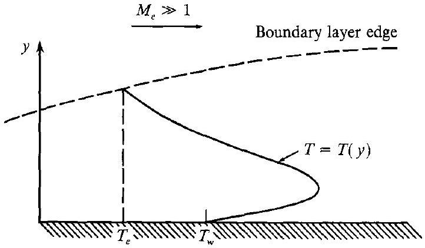
Figure 15.5 I Schematic of a temperature profile in a hypersonic boundary layer.

make hypersonic boundary layers grow more rapidly than at slower speeds. Indeed, the flat plate compressible laminar boundary layer thickness $\delta$ grows essentially as

$$
\delta \propto \frac{M_{\infty}^{2}}{\sqrt{\mathrm{Re}_{x}}}
$$

where $M_{\infty}$ is the free-stream Mach number, and $\mathrm{Re}_{x}$ is the local Reynolds number. (See Ref. 119 for a derivation of this relation.) Clearly, since $\delta$ varies as the square of $M_{\infty}$, it can become inordinately large at hypersonic speeds.

The thick boundary layer in hypersonic flow can exert a major displacement effect on the inviscid flow outside the boundary layer, causing a given body shape to appear much thicker than it really is. Due to the extreme thickness of the boundary layer flow, the outer inviscid flow is greatly changed; the changes in the inviscid flow in turn feed back to affect the growth of the boundary layer. This major interaction between the boundary layer and the outer inviscid flow is called viscous interaction. Viscous interactions can have important effects on the surface pressure distribution, hence lift, drag, and stability on hypersonic vehicles. Moreover, skin friction and heat transfer are increased by viscous interaction. For example, Fig. 15.6 illustrates the viscous interaction on a sharp, right-circular cone at zero angle of attack. Here. the pressure distribution on the cone surface $p$ is given as a function of distance from the tip. These are experimental results obtained from Ref. 120. If there were no viscous interaction, as discussed in Chap. 10, the inviscid surface pressure would be constant, equal to $p_{c}$ (indicated by the horizontal dashed line in Fig. 15.6). However, due to the viscous interaction, the pressure near the nose is considerably greater: the surface pressure distribution decays further downstream, ultimately approaching the inviscid value far downstream.

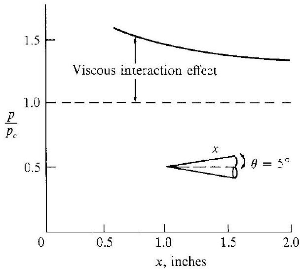
Figure 15.6 | Viscous interaction effect.
Induced pressure on a sharp cone at $M_{\Upsilon}=11$ and $\operatorname{Re}=1.88 \times 10^{5}$ per foot.
(From Ref. 120.)

### 15.2.4 High-Temperature Flows

As discussed previously, the kinetic energy of a high-speed, hypersonic flow is dissipated by the influence of friction within a boundary layer. The extreme viscous dissipation that occurs within hypersonic boundary layers can create very high temperatures-high enough to excite vibrational energy internally within molecules, and to cause dissociation and even ionization within the gas. If the surface of a hypersonic vehicle is protected by an ablative heat shield, the products of ablation are also present in the boundary layer, giving rise to complex hydrocarbon chemical reactions. On both accounts, we see that the surface of a hypersonic vehicle can be wetted by a chemically reacting boundary layer.

The boundary layer is not the only region of high-temperature flow over a hypersonic vehicle. Consider the nose region of a blunt body, as sketched in Fig. 15.7. The bow shock wave is normal, or nearly normal, in the nose region, and the gas temperature behind this strong shock wave can be enormous at hypersonic speeds. The magnitudes of these temperatures, as well as the physical consequences of such temperatures, are discussed at length in Sec. 16.1.

High-temperature chemically reacting flows can have an influence on lift, drag, and moments on a hypersonic vehicle. For example, such effects have been found to be important for estimating the amount of body-flap deflection necessary to trim the space shuttle during high-speed reentry. However, by far the most dominant aspect of high temperatures in hypersonics is the resultant high heat-transfer rates to the surface. Aerodynamic heating dominates the design of all hypersonic machinery, whether it be a flight vehicle, a ramjet engine to power such a vehicle, or a wind tunnel to test the vehicle. This aerodynamic heating takes the form of heat transfer from the hot boundary layer to the cooler surface-called convective heating, and denoted

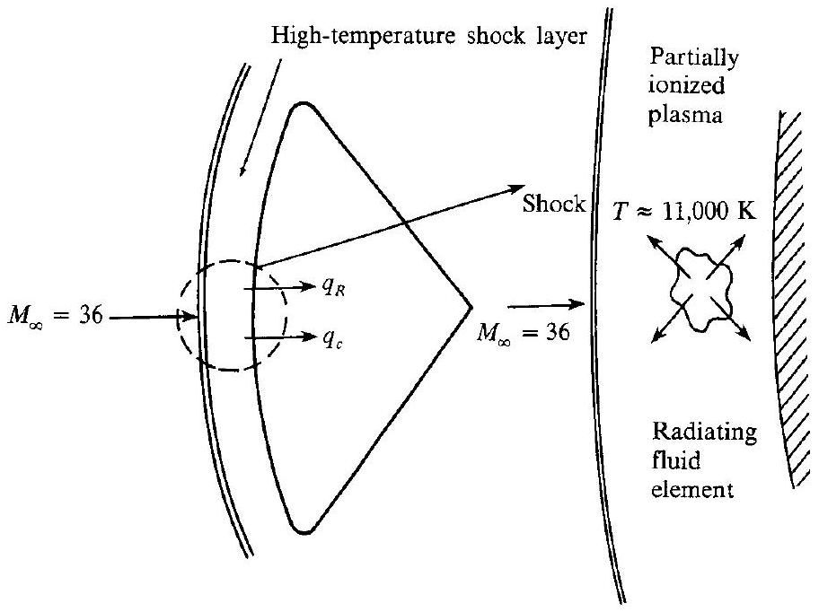
Figure 15.7 I Illustration of a high-temperature shock layer on a blunt body moving at hypersonic speeds.

by $q_{c}$ in Fig. 15.7. Moreover, if the shock layer temperature is high enough, the thermal radiation emitted by the gas itself can become important, giving rise to a radiative flux to the surface-called radiative heating, and denoted by $q_{r}$ in Fig. 15.7. (In the winter, when you warm yourself beside a roaring fire in the fireplace, the warmth you feel is not hot air blowing out of the fireplace, but rather radiation from the flame itself. Imagine how "warm" you would feel standing next to the gas behind a strong shock wave at Mach 36, where the temperature is $11,000 \mathrm{~K}$-about twice the surface temperature of the sun.) For example, for Apollo reentry, radiative heat transfer was more than 30 percent of the total heating. For a space probe entering the atmosphere of Jupiter, the radiative heating will be more than 95 percent of the total heating.

Another consequence of high-temperature flow over hypersonic vehicles is the "communications blackout" experienced at certain altitudes and velocities during atmospheric entry. where it is impossible to transmit radio waves either to or from the vehicle. This is caused by ionization in the chemically reacting flow, producing free electrons that absorb radio-frequency radiation. Therefore, the accurate prediction of electron density within the flowfield is important.

Clearly, high-temperature effects can be a dominant aspect of hypersonic aerodynamics. Because of this importance to hypersonic applications, as well as to many other problems dealing with compressible flow, the chemistry and physics of high-temperature gases, and their application to gasdynamic flows, are discussed in Chaps. 16 and 17.

In summary, hypersonic flow is best defined as that regime where all or some of the above physical phenomena become important as the Mach number is increased to high values. Note that viscous effects, such as viscous interactions and aerodynamic heating, are particularly important aspects of hypersonic flow; since we focus on inviscid flows in this book, such matters will not be addressed here. The hightemperature aspects of hypersonic flow are also very important. Chapters 16 and 17 cover the gasdynamics of high-temperature flows-a vital part of modern compressible flow in general, and of hypersonic flow in particular. Therefore, in the present chapter we will deal with inviscid hypersonic flow of a calorically perfect gas. The question we address here is simply: What happens to our conventional compressible flow already discussed in this book when the Mach number becomes very large? For a discussion of the full range of hypersonic flow problems-inviscid, viscous. and high temperature - see the book by Anderson (Ref. 119).

## 15.3 | HYPERSONIC SHOCK WAVE RELATIONS

The basic oblique shock relations are derived and discussed in Chap. 4. These are exact shock relations, and hold for all Mach numbers greater than unity, supersonic or hypersonic (assuming a calorically perfect gas). However, some interesting approximate and simplified forms of these shock relations are obtained in the limit of high Mach number. These limiting forms are called the hypersonic shock relations; they are obtained below.

Consider the flow through a straight oblique shock wave, as sketched in Fig. 15.8. Upstream and downstream conditions are denoted by subscripts 1 and 2, respectively. For a calorically perfect gas, the classical results for changes across the

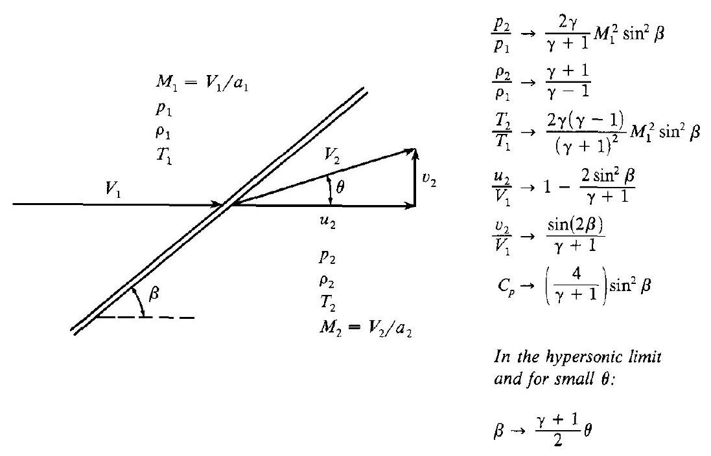
Figure 15.8 I Oblique shock wave geometry.

shock are given in Chap. 4. To begin with, the exact oblique shock relation for pressure ratio across the wave is given by Eq. (4.9), repeated here:

Exact: $\quad \frac{p_{2}}{p_{1}}=1+\frac{2 \gamma}{\gamma+1}\left(M_{1}^{2} \sin ^{2} \beta-1\right)$
where $\beta$ is the wave angle shown in Fig. 15.8. In the limit as $M_{1}$ goes to infinity, the term $M_{1}^{2} \sin ^{2} \beta \gg 1$, and hence Eq. (4.9) becomes
as $M_{1} \rightarrow \infty: \quad \frac{p_{2}}{p_{1}}=\frac{2 \gamma}{\gamma+1} M_{1}^{2} \sin ^{2} \beta$

In a similar vein, the density and temperature ratios are given by Eqs. (4.8) and (4.11), respectively:

Exact: $\quad \frac{\rho_{2}}{\rho_{1}}=\frac{(\gamma+1) M_{1}^{2} \sin ^{2} \beta}{(\gamma-1) M_{1}^{2} \sin ^{2} \beta+2}$
as $M_{1} \rightarrow \infty$ :

$$
\frac{\rho_{2}}{\rho_{1}}=\frac{\gamma+1}{\gamma-1}
$$

$$
\frac{T_{2}}{T_{1}}=\frac{\left(p_{2} / p_{1}\right)}{\left(\rho_{2} / \rho_{1}\right)} \quad \text { (from the equation of state: } p=\rho R T \text { ) }
$$

$\begin{array}{ll}\text { as } M_{1} \rightarrow \infty: & \frac{T_{2}}{T_{1}}=\frac{2 \gamma(\gamma-1)}{(\gamma+1)^{2}} M_{1}^{2} \sin ^{2} \beta\end{array}$

Returning to Fig. 15.8, note that $u_{2}$ and $v_{2}$ are the components of the flow velocity behind the shock wave parallel and perpendicular to the upstream flow (not parallel and perpendicular to the shock wave itself, as is frequently done, and as was done in Chap. 4). With this in mind, it can be shown that

Exact:

$$
\begin{gathered}
\frac{u_{2}}{V_{1}}=1-\frac{2\left(M_{1}^{2} \sin ^{2} \beta-1\right)}{(\gamma+1) M_{1}^{2}} \\
\frac{u_{2}}{V_{1}}=1-\frac{2 \sin ^{2} \beta}{\gamma+1}
\end{gathered}
$$

as $M_{1} \rightarrow \infty$ :

Exact:

$$
\frac{v_{2}}{V_{1}}=\frac{2\left(M_{1}^{2} \sin ^{2} \beta-1\right) \cot \beta}{(\gamma+1) M_{1}^{2}}
$$

For large $M_{1}$, Eq. (15.6) can be approximated by

$$
\frac{v_{2}}{V_{1}}=\frac{2\left(M_{1}^{2} \sin ^{2} \beta\right) \cot \beta}{(\gamma+1) M_{1}^{2}}=\frac{2 \sin \beta \cos \beta}{\gamma+1}
$$

Since $2 \sin \beta \cos \beta=\sin 2 \beta$, then, from Eq. (15.7),
as $M_{1} \rightarrow \infty$ :

$$
\frac{v_{2}}{V_{1}}=\frac{\sin 2 \beta}{\gamma+1}
$$

In this equation, the choice of velocity components parallel and perpendicular to the upstream flow direction rather than to the shock wave is intentional. Equations (15.5) and (15.8) are useful in studying various aspects of the velocity field over a slender hypersonic body, as will be discussed later.

Note from Eqs. (15.1) and (15.3) that both $p_{2} / p_{1}$ and $T_{2} / T_{1}$ become infinitely large as $M_{1} \rightarrow \infty$. In contrast, from Eqs. (15.2), (15.5), and (15.8), $\rho_{2} / \rho_{1}, \omega_{2} / V_{1}$, and $v_{2} / V_{1}$ approach limiting finite values as $M_{1} \rightarrow \infty$.

In aerodynamics, pressure distributions are usually quoted in terms of the nondimensional pressure coefficient $C_{p}$, rather than the pressure itself. The pressure coefficient is defined as

$$
C_{p}=\frac{p_{2}-p_{1}}{q_{1}}
$$

where $p_{1}$ and $q_{1}$ are the upstream (free-stream) static pressure and dynamic pressure, respectively. Recall from Sec. 9.3 that Eq. (15.9) can also be written as Eq. (9.10), repeated below:

$$
C_{p}=\frac{2}{\gamma M_{1}^{2}}\left(\frac{p_{2}}{p_{1}}-1\right)
$$

Combining Eqs. (9.10) and (15.1), we obtain an exact relation for $C_{p}$ behind an oblique shock wave as follows:

Exact:

$$
C_{p}=\frac{4}{\gamma+1}\left(\sin ^{2} \beta-\frac{1}{M_{1}^{2}}\right)
$$

In the hypersonic limit,
as $M_{1} \rightarrow \infty$ :

$$
C_{p}=\left(\frac{4}{\gamma+1}\right) \sin ^{2} \beta
$$

The relationship between Mach number $M_{1}$, shock angle $\beta$, and deflection angle $\theta$ is expressed by the so-called $\theta-\beta-M$ relation given by Eq. (4.17), repeated below:

Exact: $\quad \tan \theta=2 \cot \beta\left[\frac{M_{1}^{2} \sin ^{2} \beta-1}{M_{1}^{2}(\gamma+\cos 2 \beta)+2}\right]$

This relation is plotted in Fig. 4.8, which is a standard plot of wave angle versus deflection angle, with Mach number as a parameter. Returning to Fig. 4.8, we note that, in the hypersonic limit, where $\theta$ is small, $\beta$ is also small. Hence, in this limit, we can insert the usual small-angle approximations into Eq. (15.12):

$$
\begin{aligned}
\sin \beta & \approx \beta \\
\cos 2 \beta & \approx 1 \\
\tan \theta & \approx \sin \theta \approx \theta
\end{aligned}
$$

resulting in

$$
\theta=\frac{2}{\beta}\left[\frac{M_{1}^{2} \beta^{2}-1}{M_{1}^{2}(\gamma+1)+2}\right]
$$

Applying the high Mach number limit to Eq. (15.13), we have

$$
\theta=\frac{2}{\beta}\left[\frac{M_{1}^{2} \beta^{2}}{M_{1}^{2}(\gamma+1)}\right]
$$

In Eq. (15.14) $M_{1}$ cancels, and we finally obtain in both the small-angle and hypersonic limits:
as $M_{1} \rightarrow \infty$ and $\theta$ hence $\beta$ is small:

$$
\frac{\beta}{\theta}=\frac{\gamma+1}{2}
$$

Note that for $\gamma=1.4$,

$$
\beta=1.2 \theta
$$

It is interesting to observe that, in the hypersonic limit for a slender wedge, the wave angle is only 20 percent larger than the wedge angle-a graphic demonstration of a thin shock layer in hypersonic flow. (Check Fig. 15.3, drawn from exact oblique shock results, and note that the $18^{\circ}$ shock angle is 20 percent larger than the $15^{\circ}$ wedge angle at Mach 36-truly an example of the hypersonic limit.)

For your convenience, the limiting hypersonic shock relations obtained in this section are summarized in Fig. 15.8. These limiting relations, which are clearly simpler than the corresponding exact oblique shock relations, will be important for the development of some of our hypersonic aerodynamic techniques in subsequent sections.

### 15.4 I A LOCAL SURFACE INCLINATION METHOD: NEWTONIAN THEORY

Linearized supersonic theory leads to a simple relation for the surface pressure coefficient, namely Eq. (9.51), repeated here:

$$
C_{p}=\frac{2 \theta}{\sqrt{M_{\infty}^{2}-1}}
$$

Note from Eq. (9.51) that $C_{p}$ depends only on $\theta$, the local surface inclination angle defined by the angle between a line tangent to the surface and the free-stream direction. In this sense, Eq. (9.51) is an example of a "local surface inclination method" for linearized supersonic flow. Question: Do any local surface inclination methods exist for hypersonic flow? The answer is yes, and this constitutes the subject of the present section.

The oldest and most widely used of the hypersonic local surface inclination methods is newtonian theory. This theory has already been developed and discussed in Sec. 12.4, leading to the famous newtonian "sine-squared" law in Eq. (12.17):

$$
C_{p}=2 \sin ^{2} \theta
$$

Additional insight into the physical meaning of Eq. (12.17) can be obtained from an examination of the hypersonic oblique shock relations, as described below.

Temporarily discard any thoughts of newtonian theory, and simply recall the exact oblique shock relation for $C_{p}$ as given by Eq. (15.10), repeated here (with freestream conditions now denoted by a subscript $\infty$ rather than a subscript 1 , as used in Chap. 2):

$$
C_{p}=\frac{4}{\gamma+1}\left[\sin ^{2} \beta-\frac{1}{M_{\infty}^{2}}\right]
$$

Equation (15.11) gave the limiting value of $C_{p}$ as $M_{\infty} \rightarrow \infty$, repeated here:
as $M_{\infty} \rightarrow \infty: \quad C_{p} \rightarrow \frac{4}{\gamma+1} \sin ^{2} \beta$

Now take the additional limit of $\gamma \rightarrow 1.0$. From Eq. (15.11), in both limits as $M_{\infty} \rightarrow \infty$ and $\gamma \rightarrow 1.0$, we have

$$
C_{p} \rightarrow 2 \sin ^{2} \beta
$$

Equation (15.17) is a result from exact oblique shock theory; it has nothing to do with newtonian theory (as yet). Keep in mind that $\beta$ in Eq. (15.17) is the wave angle, not the deflection angle.

Let us go further. Consider the exact oblique shock relation for $\rho / \rho_{\infty}$, given by Eq. (4.8), repeated here (again with a subscript $\infty$ replacing the subscript 1):

$$
\frac{\rho_{2}}{\rho_{\infty}}=\frac{(\gamma+1) M_{\infty}^{2} \sin ^{2} \beta}{(\gamma-1) M_{\infty}^{2} \sin ^{2} \beta+2}
$$

Equation (15.2) was obtained as the limit where $M_{\infty} \rightarrow \infty$, namely,
as $M_{\infty} \rightarrow \infty: \quad \frac{\rho_{2}}{\rho_{\infty}} \rightarrow \frac{\gamma+1}{\gamma-1}$

In the additional limit as $\gamma \rightarrow 1$, we find
as $\gamma \rightarrow 1$ and $M_{\infty} \rightarrow \infty: \quad \frac{\rho_{2}}{\rho_{\infty}} \rightarrow \infty$
i.e, the density behind the shock is infinitely large. In turn, mass flow considerations then dictate that the shock wave is coincident with the body surface. This is further substantiated by Eq. (15.15), which is good for $M_{\infty} \rightarrow \infty$ and small deflection angles

$$
\frac{\beta}{\theta} \rightarrow \frac{\gamma+1}{2}
$$

In the additional limit as $\gamma \rightarrow 1$, we have:
as $\gamma \rightarrow 1$ and $M_{\infty} \rightarrow \infty$ and $\theta$ and $\beta$ small:

$$
\beta=\theta
$$

i.e, the shock wave lies on the body. In light of this result, Eq. (15.17) is written as

$$
C_{p}=2 \sin ^{2} \theta
$$

Examine Eq. (15.19). It is a result from exact oblique shock theory, taken in the combined limit of $M_{\infty} \rightarrow \infty$ and $\gamma \rightarrow 1$. However, it is also precisely the newtonian results given by Eq. (12.17). Therefore, we make the following conclusion. The closer the actual hypersonic flow problem is to the limits $M_{\infty} \rightarrow \infty$ and $\gamma \rightarrow 1$, the closer it should be physically described by newtonian flow. In this regard, we gain a better appreciation of the true significance of newtonian theory. We can also state that the application of newtonian theory to practical hypersonic flow problems, where $\gamma$ is always greater than unity (for air flows where the local static temperature is less than $800 \mathrm{~K}, \gamma=1.4)$ is theoretically not proper, and the agreement that is frequently obtained with experimental data has to be viewed as somewhat fortuitous. Nevertheless, the simplicity of newtonian theory along with its (sometimes) reasonable results (no matter how fortuitous) has made it a widely used and popular engineering method for the estimation of surface pressure distributions, hence lift and wave drag coefficients, for hypersonic bodies.

In the newtonian model of fluid flow, the particles in the free stream impact only on the frontal area of the body; they cannot curl around the body and impact on the back surface. Hence, for that portion of a body which is in the "shadow" of the incident flow, such as the shaded region sketched in Fig. 15.9, no impact pressure is felt. Hence, over this shadow region it is consistent to assume that $p=p_{\infty}$, and therefore $C_{p}=0$, as indicated in Fig. 15.9.

It is instructive to examine newtonian theory applied to a flat plate, as sketched in Fig. 15.10. Here, a two-dimensional flat plate with chord length $c$ is at an angle of

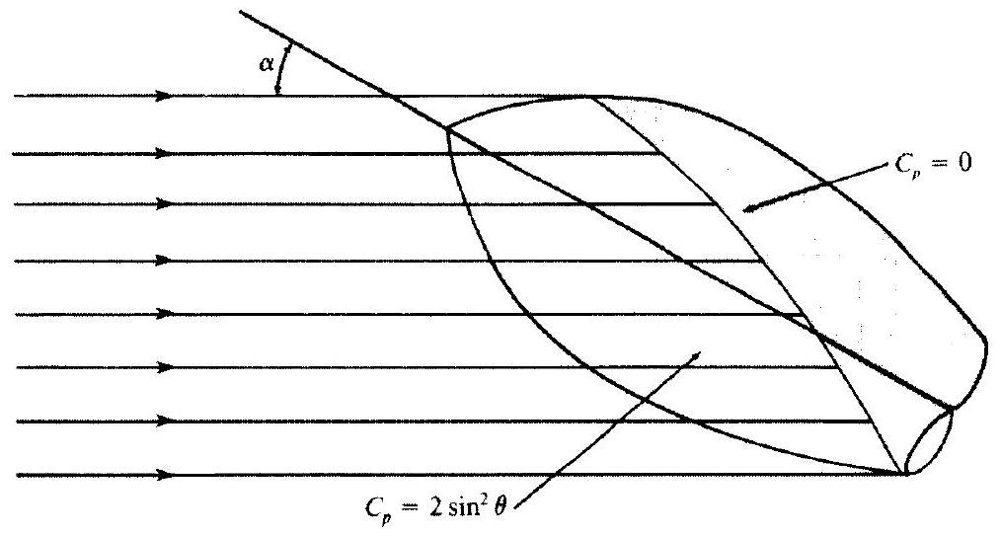
Figure 15.9 I Shadow region on the leeward side of a body, from newtonian theory.

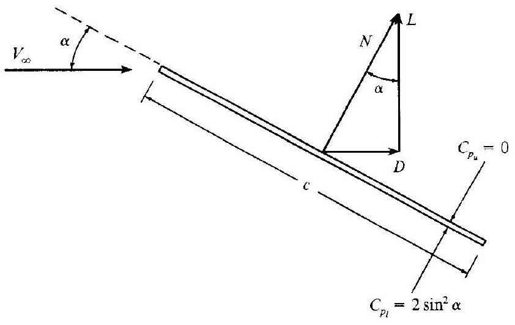
Figure 15.10 | Flat plate at angle of attack. Illustration of aerodynamic forces.

attack $\alpha$ to the free stream. Since we are not including friction, and because surface pressure always acts normal to the surface, the resultant aerodynamic force is perpendicular to the plate, i.e., in this case the normal force $N$ is the resultant aerodynamic force. (For an infinitely thin flat plate, this is a general result which is not limited to newtonian theory, or even to hypersonic flow.) In turn, $N$ is resolved into lift and drag, denoted by $L$ and $D$, respectively, as shown in Fig. 15.10. According to newtonian theory, the pressure coefficient on the lower surface is

$$
C_{p_{i}}=2 \sin ^{2} \alpha
$$

and that on the upper surface, which is in the shadow region, is

$$
C_{p_{u}}=0
$$

Defining the normal force coefficient as $c_{n}=N / q_{\infty} S$, where $S=(c)(l)$, we can readily calculate $c_{n}$ by integrating the pressure coefficients over the lower and upper surfaces (see, for example, the derivation given in Ref. 104):

$$
c_{n}=\frac{1}{c} \int_{o}^{c}\left(C_{p_{t}}-C_{p_{u}}\right) d x
$$

where $x$ is the distance along the chord from the leading edge. Substituting Eqs. (15.20) and (15.21) into (15.22), we obtain
or

$$
\begin{aligned}
& c_{n}=\frac{1}{c}\left(2 \sin ^{2} \alpha\right) c \\
& c_{n}=2 \sin ^{2} \alpha
\end{aligned}
$$

From the geometry of Fig. 15.10, we see that the lift and drag coefficients, defined as $c_{l}=L / q_{\infty} S$ and $c_{d}=D / q_{\infty} S$, respectively, where $S=(c)(l)$, are given by

$$
\begin{aligned}
c_{l} & =c_{n} \cos \alpha \\
c_{d} & =c_{n} \sin \alpha
\end{aligned}
$$

and

Substituting Eq. (15.23) into Eqs. (15.24) and (15.25), we obtain
and

$$
\begin{aligned}
c_{l} & =2 \sin ^{2} \alpha \cos \alpha \\
c_{d} & =2 \sin ^{3} \alpha
\end{aligned}
$$

Finally, from the geometry of Fig. 15.10, the lift-to-drag ratio is given by

$$
\frac{L}{D}=\cot \alpha
$$

[Note that Eq. (15.28) is a general result for inviscid supersonic or hypersonic flow over a flat plate. For such flows, the resultant aerodynamic force is the normal force $N$. From the geometry shown in Fig. 15.10, the resultant aerodynamic force makes the angle $\alpha$ with respect to lift, and clearly, from the right triangle between $L, D$, and $N$, we have $L / D=\cot \alpha$. Hence, Eq. (15.28) is not limited to newtonian theory.]

The results obtained here for the application of newtonian theory to an infinitely thin flat plate are plotted in Fig. 15.11. Here $L / D, c_{l}$, and $c_{d}$ are plotted versus angle of attack $\alpha$. From this figure, note these aspects:

1. The value of $L / D$ increases monotonically as $\alpha$ is decreased. Indeed, $L / D \rightarrow \infty$ as $\alpha \rightarrow 0$. However, this is misleading; when skin friction is added to this picture, $D$ becomes finite at $\alpha=0$, and then $L / D \rightarrow 0$ as $\alpha \rightarrow 0$.
2. The lift curve peaks at about $\alpha \approx 55^{\circ}$. (To be exact, it can be shown from newtonian theory that maximum $c_{l}$ occurs at $\alpha=54.7^{\circ}$; the proof of this is left as a homework problem.) It is interesting to note that $\alpha \approx 55^{\circ}$ for maximum lift is fairly realistic; the maximum lift coefficient for many practical hypersonic vehicles occurs at angles of attack in this neighborhood.
3. Examine the lift curve at low angle of attack, say in the range of $\alpha$ from 0 to $15^{\circ}$. Note that the variation of $c_{l}$ with $\alpha$ is very nonlinear. This is in direct

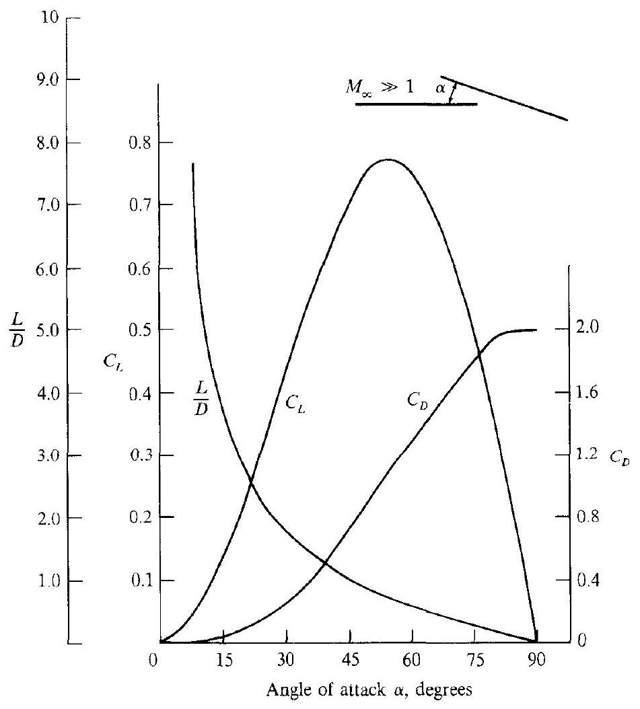
Figure 15.11 | Newtonian results for a flat plate.

contrast to the familiar results for subsonic and supersonic flow, where for thin bodies at small $\alpha$, the lift curve is a linear function of $\alpha$. (Recall, for example, that the theoretical lift slope from incompressible thin airfoil theory is $2 \pi$ per radian.) Hence, the nonlinear lift curve shown in Fig. 15.11 is a graphic demonstration of the nonlinear nature of hypersonic flow.

Consider two other basic aerodynamic bodies; the circular cylinder of infinite span, and the sphere. Newtonian theory can be applied to estimate the hypersonic drag coefficients for these shapes; the results are

1. Circular cylinder of infinite span:

$$
\begin{array}{rlr}
c_{d} & =\frac{D}{q_{\infty} S} & \\
S & =2 R & (\text { where } R=\text { radius of cylinder }) \\
c_{d} & =\frac{4}{3} & \\
\text { (from newtonian theory) }
\end{array}
$$

2. Sphere

$$
\begin{array}{rlr}
C_{D} & =\frac{D}{q_{\infty} S} & \\
S & =\pi R^{2} & \\
C_{D} & =1 \quad \text { (where } R=\text { radius of sphere) }
\end{array}
$$

The derivations of these drag coefficient values are left for homework problems.
It is interesting to note that these results from newtonian theory do not explicitly depend on Mach number. Of course, they implicitly assume that $M_{\infty}$ is high enough for hypersonic flow to prevail; outside of that, the precise value of $M_{\infty}$ does not enter the calculations. This is compatible with the Mach number independence principle, to be discussed in the next section. In short, this principle states that certain aerodynamic quantities become relatively independent of Mach number if $M_{\infty}$ is made sufficiently large. Newtonian results are the epitome of this principle.

As a final note on our discussion of newtonian theory, consider Fig. 15.12. Here, the pressure coefficients for a $15^{\circ}$ half-angle wedge and a $15^{\circ}$ half-angle cone are plotted versus free-stream Mach number for $\gamma=1.4$. The exact wedge results are obtained from Eq. (15.10), and the exact cone results are obtained from the solution of the classical Taylor-Maccoll equation (see Chap. 10). Both sets of results are

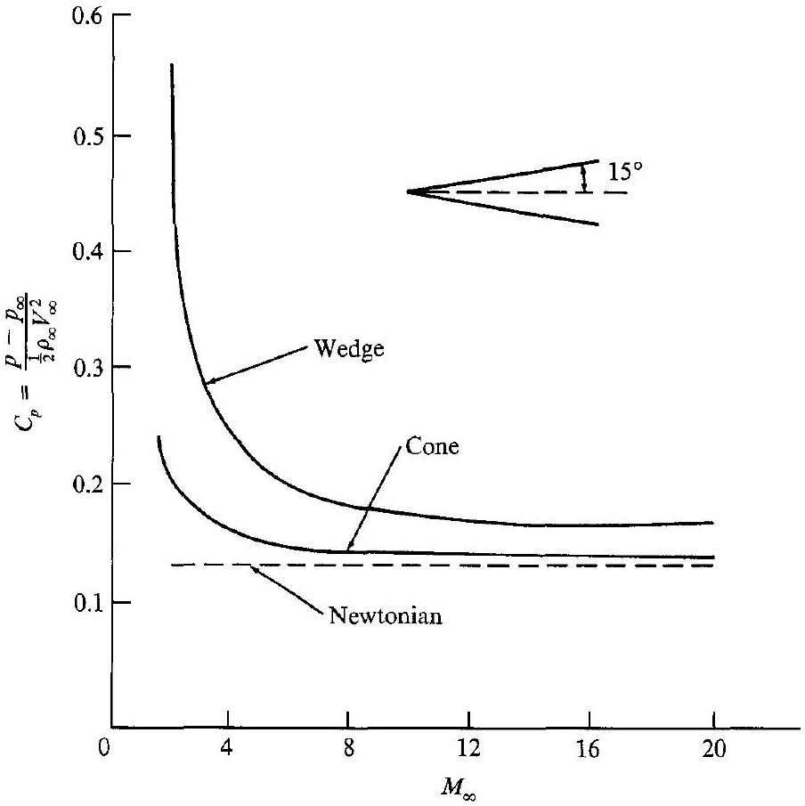
Figure 15.12 | Comparison between newtonian and exact results for the pressure coefficient on a sharp wedge and a sharp cone.

compared with newtonian theory, $C_{p}=2 \sin ^{2} \theta$, shown as the dashed line in Fig. 15.12. This comparison demonstrates two general aspects of newtonian results:

1. The accuracy of newtonian results improves as $M_{\infty}$ increases. This is to be expected from our previous discussion. Note from Fig. 15.12 that below $M_{\infty}=5$, the newtonian results are not even close, but the comparison becomes much closer as $M_{\infty}$ increases above 5 .
2. Newtonian theory is usually more accurate for three-dimensional bodies (e.g., the cone) than for two-dimensional bodies (e.g., the wedge). This is clearly evident in Fig. 15.12 where the newtonian result is much closer to the cone results than to the wedge results.

This ends our discussion of the application of newtonian theory to hypersonic bodies. For more details, including the treatment of centrifugal force corrections to newtonian theory, see Ref. 119.

In addition to newtonian theory, there are three other local surface inclination methods that are frequently used for the estimation of pressure distributions over hypersonic bodies. These are the tangent wedge, tangent cone, and shock-expansion methods. There is not space in the present chapter to describe these methods; they are covered in detail in Ref. 119.

### 15.5 I MACH NUMBER INDEPENDENCE

Return again to Fig. 15.12, where values of $C_{p}$ for both a $15^{\circ}$ half-angle wedge and cone are plotted versus Mach number. Note that at low supersonic Mach numbers, $C_{p}$ decreased rapidly as $M_{\infty}$ was increased. However, at hypersonic speeds, the rate of decrease diminishes considerably, and $C_{p}$ appears to reach a plateau as $M_{\infty}$ becomes large, i.e., $C_{p}$ becomes relatively independent of $M_{\infty}$ at high Mach numbers. This is the essence of the Mach number independence principle; at high Mach numbers, certain aerodynamic quantities such as pressure coefficient, lift and wave-drag coefficients, and flowfield structure (such as shock wave shapes and Mach wave patterns) become essentially independent of Mach number. Indeed, newtonian theory (discussed in Sec. 15.4), gives results that are totally independent of Mach number, as clearly demonstrated by Eq. (15.19). The hypersonic Mach number independence principle is more than just an observed phenomenon; it has a mathematical foundation, which is the subject of this section. We will examine the roots of this Mach number independence more closely.

The governing partial differential equations for inviscid compressible flow are derived in Chap. 6; as before, we will refer to these equations as the Euler equations. Ignoring body forces, they can be expressed as Eqs. (6.5), (6.26) through (6.28), and (6.51), repeated here and renumbered for convenience:

Continuity:

$$
\frac{\partial \rho}{\partial t}+\frac{\partial(\rho u)}{\partial x}+\frac{\partial(\rho v)}{\partial y}+\frac{\partial(\rho w)}{\partial z}=0
$$

$x$ momentum:

$$
\rho \frac{\partial u}{\partial t}+\rho u \frac{\partial u}{\partial x}+\rho v \frac{\partial u}{\partial y}+\rho w \frac{\partial u}{\partial z}=-\frac{\partial p}{\partial x}
$$

y momentum:

$$
\rho \frac{\partial v}{\partial t}+\rho u \frac{\partial v}{\partial x}+\rho v \frac{\partial v}{\partial y}+\rho w \frac{\partial v}{\partial z}=-\frac{\partial p}{\partial y}
$$

$z$ momentum:

$$
\rho \frac{\partial w}{\partial t}+\rho u \frac{\partial w}{\partial x}+\rho v \frac{\partial w}{\partial y}+\rho w \frac{\partial w}{\partial z}=-\frac{\partial p}{\partial z}
$$

Energy:

$$
\frac{\partial s}{\partial t}+u \frac{\partial s}{\partial x}+v \frac{\partial s}{\partial y}+w \frac{\partial s}{\partial z}=0
$$

In reality, Eq. (15.33) is the "entropy equation"; for an inviscid, adiabatic flow, Eq. (15.33) can serve as the energy equation-indeed, it is fundamentally an energy equation as described in Sec. 6.5. Equation (15.33) simply states that the entropy of a fluid element is constant. For an isentropic process in a calorically perfect gas, $p / \rho^{\gamma}=$ const. Hence, if the entropy of a moving fluid element is constant as stated by Eq.(15.33), then the quantity $p / \rho^{\gamma}$ is also constant for the moving fluid element, and for a calorically perfect gas Eq. (15.33) can be replaced by

$$
\frac{\partial}{\partial t}\left(\frac{p}{\rho^{\gamma}}\right)+u \frac{\partial}{\partial x}\left(\frac{p}{\rho^{\gamma}}\right)+v \frac{\partial}{\partial y}\left(\frac{p}{\rho^{\gamma}}\right)+w \frac{\partial}{\partial z}\left(\frac{p}{\rho^{\gamma}}\right)=0
$$

Let us nondimensionalize Eqs. (15.29) through (15.32) and (15.34) as follows. Define the nondimensional variables (the barred quantities) as

$$
\begin{array}{lll}
\bar{x}=\frac{x}{l} & \bar{y}=\frac{y}{l} & \bar{z}=\frac{z}{l} \\
\bar{u}=\frac{u}{V_{\infty}} & \bar{v}=\frac{v}{V_{\infty}} & \bar{w}=\frac{w}{V_{\infty}} \\
\bar{p}=\frac{p}{\rho_{\infty} V_{\infty}^{2}} & \bar{\rho}=\frac{\rho}{\rho_{\infty}} &
\end{array}
$$

where $l$ denotes a characteristic length of the flow, and $\rho_{\infty}$ and $V_{\infty}$ are the freestream density and velocity, respectively. Assuming steady flow ( $\partial / \partial t=0$ ), we obtain from Eqs. (15.29) through (15.32) and (15.34)

$$
\begin{aligned}
\partial \frac{(\bar{\rho} \bar{u})}{\partial \bar{x}}+\partial \frac{(\bar{\rho} \bar{v})}{\partial \bar{y}}+\partial \frac{(\bar{\rho} \bar{w})}{\partial \bar{z}} & =0 \\
\bar{\rho} \bar{u} \frac{\partial \bar{u}}{\partial \bar{x}}+\bar{\rho} \bar{v} \frac{\partial \bar{u}}{\partial \bar{y}}+\bar{\rho} \bar{w} \frac{\partial \bar{u}}{\partial \bar{z}} & =-\frac{\partial \bar{p}}{\partial \bar{x}} \\
\bar{\rho} \bar{u} \frac{\partial \bar{v}}{\partial \bar{x}}+\bar{\rho} \bar{v} \frac{\partial \bar{v}}{\partial \bar{y}}+\bar{\rho} \bar{w} \frac{\partial \bar{v}}{\partial \bar{z}} & =-\frac{\partial \bar{p}}{\partial \bar{y}} \\
\bar{\rho} \bar{u} \frac{\partial \bar{w}}{\partial \bar{x}}+\bar{\rho} \bar{v} \frac{\partial \bar{w}}{\partial \bar{y}}+\bar{\rho} \bar{w} \frac{\partial \bar{w}}{\partial \bar{z}} & =-\frac{\partial \bar{p}}{\partial \bar{z}} \\
\bar{u} \frac{\partial}{\partial \bar{x}}\left(\frac{\bar{p}}{\bar{\rho}^{\gamma}}\right)+\bar{v} \frac{\partial}{\partial \bar{y}}\left(\frac{\bar{p}}{\bar{\rho}^{\gamma}}\right)+\bar{w} \frac{\partial}{\partial \bar{z}}\left(\frac{\bar{p}}{\bar{\rho}^{\gamma}}\right) & =0
\end{aligned}
$$

Any particular solution of these equations is governed by the boundary conditions, which are discussed next.

The boundary condition for steady inviscid flow at a surface is simply the statement that the flow must be tangent to the surface. Let $\mathbf{n}$ be a unit normal vector at some point on the surface, and let $\mathbf{V}$ be the velocity vector at the same point. Then, for the flow to be tangent to the body.

$$
\mathbf{V} \cdot \mathbf{n}=0
$$

Let $n_{x}, n_{y}$, and $n_{z}$ be the components of $\mathbf{n}$ in the $x, y$, and $z$ directions, respectively. Then, Eq. (15.40)) can be written as

$$
u n_{x}+v n_{y}+w n_{z}=0
$$

Recalling the definition of direction cosines from analytic geometry, note. in Eq. (15.41) that $n_{x}, n_{y}$, and $n_{z}$ are also the direction cosines of $n$ with respect to the $x, y$, and $z$ axes, respectively. With this interpretation, $n_{x}, n_{y}$, and $n_{z}$ may be considered dimensionless quantities, and the nondimensional boundary condition at the surface is readily obtained from Eq. (15.41) as

$$
\bar{u} n_{x}+\bar{v} n_{x}+\bar{w} n_{z}=0
$$

Assume that we are considering the external flow over a hypersonic body, where the flowfield of interest is bounded on one side by the body surface, and on the other side by the bow shock wave. Equation (15.42) gives the boundary condition on the body surface. The boundary conditions right behind the shock wave are given by the oblique shock properties expressed by Eqs. (4.9), (4.8), (15.4), and (15.6), repeated here for convenience (replacing the subscript 1 with the subscript $\infty$ for free-stream properties):

$$
\begin{aligned}
& \frac{p_{2}}{p_{\infty}}=1+\frac{2 \gamma}{\gamma+1}\left(M_{\infty}^{2} \sin ^{2} \beta-1\right) \\
& \frac{\rho_{2}}{\rho_{\infty}}=\frac{(\gamma+1) M_{\infty}^{2} \sin ^{2} \beta}{(\gamma-1) M_{\infty}^{2} \sin ^{2} \beta+2} \\
& \frac{u_{2}}{V_{\infty}}=1-\frac{2\left(M_{\infty}^{2} \sin ^{2} \beta-1\right)}{(\gamma+1) M_{\infty}^{2}} \\
& \frac{v_{2}}{V_{\infty}}=\frac{2\left(M_{\infty}^{2} \sin \beta-1\right) \cot \beta}{(\gamma+1) M_{\infty}^{2}}
\end{aligned}
$$

In terms of the nondimensional variables, and noting that for a calorically perfect gas

$$
p_{2} / p_{\infty}=\bar{p}_{2}\left(\rho_{\infty} V_{\infty}^{2}\right) / p_{\infty}=\bar{p}_{2} V_{\infty}^{2} / R T_{\infty}=\bar{p}_{2} \gamma V_{\infty}^{2} / a_{\infty}^{2}=\bar{p}_{2} \gamma M_{\infty}^{2}
$$

Eqs. (4.9), (4.8), (15.4), and (15.6) become

$$
\begin{aligned}
& \bar{p}_{2}=\frac{1}{\gamma M_{\infty}^{2}}+\frac{2}{\gamma+1}\left(\sin ^{2} \beta-\frac{1}{M_{\infty}^{2}}\right) \\
& \bar{\rho}_{2}=\frac{(\gamma+1) M_{\infty}^{2} \sin ^{2} \beta}{(\gamma-1) M_{\infty}^{2} \sin ^{2} \beta+2} \\
& \bar{u}_{2}=1-\frac{2\left(M_{\infty}^{2} \sin ^{2} \beta-1\right)}{(\gamma+1) M_{\infty}^{2}} \\
& \bar{v}_{2}=\frac{2\left(M_{\infty}^{2} \sin \beta-1\right) \cot \beta}{(\gamma+1) M_{\infty}^{2}}
\end{aligned}
$$

In the limit of high $M_{\infty}$, as $M_{\infty} \rightarrow \infty$, Eqs. (15.43) through (15.46) go to

$$
\begin{aligned}
& \bar{p}_{2} \rightarrow \frac{2 \sin ^{2} \beta}{\gamma+1} \\
& \bar{\rho}_{2} \rightarrow \frac{\gamma+1}{\gamma-1} \\
& \bar{u}_{2} \rightarrow 1-\frac{2 \sin ^{2} \beta}{\gamma+1} \\
& \bar{v}_{2} \rightarrow \frac{\sin ^{2} \beta}{\gamma+1}
\end{aligned}
$$

Now consider a hypersonic flow over a given body. This flow is governed by Eqs. (15.35) through (15.39), with boundary conditions given by Eqs. (15.42) through (15.46).

Question: Where does $M_{\infty}$ explicitly appear in these equations?
Answer: Only in the shock boundary conditions, Eqs. (15.43) through (15.46).
Now consider the hypersonic flow over a given body in the limit of large $M_{\infty}$. The flow is again governed by Eqs. (15.35) through (15.39), but with boundary conditions given by Eqs. (15.42) and (15.47) through (15.50).

Question: Where does $M_{\infty}$ explicitly appear in these equations?
Answer: No place!
Conclusion: At high $M_{\infty}$, the solution is independent of Mach number.
Clearly, from this last consideration, we can see that the Mach number independence principle follows directly from the governing equations of motion with the appropriate boundary conditions written in the limit of high Mach number. Therefore, when the free-stream Mach number is sufficiently high, the nondimensional dependent variables in Eqs. (15.35) through (15.39) become essentially independent of Mach number; this trend applies also to any quantities derived from these nondimensional variables. For example, $C_{p}$ can be easily obtained as a function of $\bar{p}$ only; in turn, the lift and wave-drag coefficients for the body, $C_{L}$ and $C_{D_{w}}$, respectively, can be

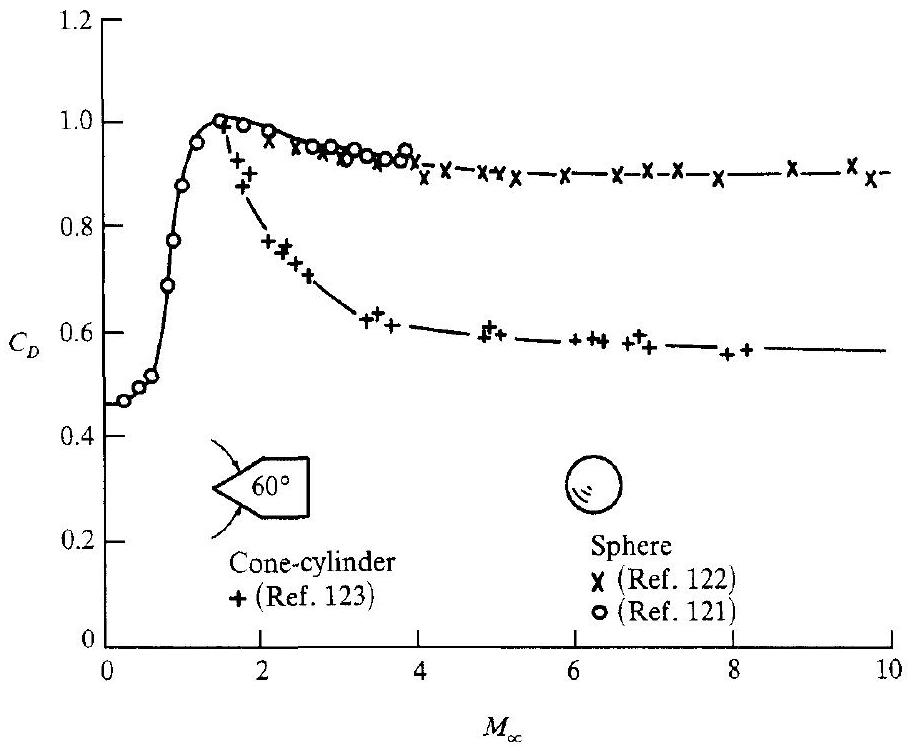
Figure 15.13 I Drag coefficient for a sphere and a cone-cylinder from ballistic range measurements; an illustration of Mach number independence. (From Ref. 124.)

expressed in terms of $C_{p}$ integrated over the body surface (see, for example, Ref. 104). Therefore, $C_{p}, C_{L}$, and $C_{D_{w}}$ also become independent of Mach number at high $M_{\infty}$. This is demonstrated by the data shown in Fig. 15.13 obtained from Refs. 121 through 123 as gathered in Ref. 124. In Fig. 15.13, the measured drag coefficients for spheres and for a large-angle cone-cylinder are plotted versus Mach number, cutting across the subsonic, supersonic, and hypersonic regimes. Note the large drag rise in the subsonic regime associated with the drag-divergence phenomenon near Mach 1, and the decrease in $C_{D}$ in the supersonic regime beyond Mach 1. Both of these variations are expected and well understood. (See, for example, Secs. 14.2 and 9.6, respectively.) For our purposes in the present section, note in particular the variation of $C_{D}$ in the hypersonic regime; for both the sphere and conecylinder, $C_{D}$ approaches a plateau, and becomes relatively independent of Mach number as $M_{\infty}$ becomes large. Note also that the sphere data appear to achieve "Mach number independence" at lower Mach numbers than the cone-cylinder. This is to be expected, as follows. In Eqs. (15.43) through (15.46), the Mach number frequently appears in the combined form $M_{\infty}^{2} \sin ^{2} \beta$; for a given Mach number, this quantity is larger for blunt bodies ( $\beta$ large) than for slender bodies ( $\beta$ small). Hence blunt body flows will tend to approach Mach number independence at lower $M_{\infty}$ than will slender bodies.

Finally, keep in mind from the above analysis that it is the nondimensional variables that become Mach number independent. Some of the dimensional variables, such as $p$, are not Mach number independent; indeed, $p \rightarrow \infty$ as $M_{\infty} \rightarrow \infty$.

## 15.6 | THE HYPERSONIC SMALL-DISTURBANCE EQUATIONS

In Chap. 9, the concept of perturbation velocities was introduced. For irrotational flow, the Euler equations cascade to a single equation in terms of the perturbation velocities, $u^{\prime}, v^{\prime}$, and $w^{\prime}$, namely Eq. (9.4). In turn, then Eq. (9.4) reduces to the linear Eq. (9.5) which holds for subsonic and supersonic flows. On the other hand, we saw in Sec. 9.2 that Eq. (9.5) does not hold for transonic flow; this was reinforced in Chap. 14 where transonic flow was described as a basically nonlinear flow regime, even for small perturbations. The same is true for hypersonic flow, as noted in Sec. 9.2. At hypersonic Mach numbers, Eq. (9.5) does not hold. This raises the question: What equations do hold for hypersonic flow when the assumption of small perturbations is made? The answer to this question is the subject of this section. In particular, making the assumption that $u^{\prime}, v^{\prime}$, and $w^{\prime}$ are small, we will derive the hypersonic small-disturbance equations. In the following section, we will put these equations to work in order to obtain the principle of hypersonic similarity.

From the definition of the perturbation velocities as given in Chap. 9, we have

$$
\begin{aligned}
u & =V_{\infty}+u^{\prime} \\
v & =v^{\prime} \\
w & =w^{\prime}
\end{aligned}
$$

In terms of these perturbation velocities, Eqs. (15.29) through (15.32) and (15.34) are written as

$$
\begin{aligned}
\frac{\partial\left[\rho\left(V_{\infty}+u^{\prime}\right)\right]}{\partial x}+\frac{\partial\left(\rho v^{\prime}\right)}{\partial y}+\frac{\partial\left(\rho w^{\prime}\right)}{\partial z} & =0 \\
\rho\left(V_{\infty}+u^{\prime}\right) \frac{\partial\left(V_{\infty}+u^{\prime}\right)}{\partial x}+\rho v^{\prime} \frac{\partial\left(V_{\infty}+u^{\prime}\right)}{\partial y}+\rho w^{\prime} \frac{\partial\left(V_{\infty}+u^{\prime}\right)}{\partial z} & =-\frac{\partial p}{\partial x} \\
\rho\left(V_{\infty}+u^{\prime}\right) \frac{\partial v^{\prime}}{\partial x}+\rho v^{\prime} \frac{\partial v^{\prime}}{\partial y}+\rho w^{\prime} \frac{\partial v^{\prime}}{\partial z} & =-\frac{\partial p}{\partial y} \\
\rho\left(V_{\infty}+u^{\prime}\right) \frac{\partial w^{\prime}}{\partial x}+\rho v^{\prime} \frac{\partial w^{\prime}}{\partial y}+\rho w^{\prime} \frac{\partial w^{\prime}}{\partial z} & =-\frac{\partial p}{\partial z} \\
\left(V_{\infty}+u^{\prime}\right) \frac{\partial}{\partial x}\left(\frac{p}{\rho^{\gamma}}\right)+v^{\prime} \frac{\partial}{\partial y}\left(\frac{p}{\rho^{\gamma}}\right)+w^{\prime} \frac{\partial}{\partial z}\left(\frac{p}{\rho^{\gamma}}\right) & =0
\end{aligned}
$$

We wish to nondimensionalize Eqs. (15.51) through (15.55). Moreover, we wish to have nondimensional variables with an order of magnitude of unity, for reasons to be made clear later. To obtain a hint about reasonable nondimensionalizing quantities, consider the oblique shock relations in the limit as $M_{\infty} \rightarrow \infty$, obtained in Sec. 15.3. Also note that for a slender body at hypersonic speeds, both the shock wave angle $\beta$ and the deflection angle $\theta$ are small; hence,

$$
\sin \beta \approx \sin \theta \approx \theta \approx \frac{d y}{d x} \approx \tau
$$

where $y=f(x)$ is the body shape, and $\tau$ is the slenderness ratio defined in Sec. 14.3. Thus, from Eq. (15.1), repeated below for convenience:

$$
\frac{p_{2}}{p_{\infty}} \rightarrow \frac{2 \gamma}{\gamma+1} M_{\infty}^{2} \sin ^{2} \beta
$$

we have the order-of-magnitude relationship:

$$
\frac{p_{2}}{p_{\infty}} \rightarrow O\left[M_{\infty}^{2} \tau^{2}\right]
$$

This in turn implies that the pressure throughout the shock layer over the body will be on the order of $M_{\infty}^{2} \tau^{2} p_{\infty}$, and hence a reasonable definition for a nondimensional pressure which would be on the order of magnitude of unity is $\bar{p}=p / \gamma M_{\infty}^{2} \tau^{2} p_{\infty}$. (The reason for the $\gamma$ will become clear later.) In regard to density, consider Eq. (15.2), repeated here:

$$
\frac{\rho_{2}}{\rho_{\infty}} \rightarrow \frac{\gamma+1}{\gamma-1}
$$

For $\gamma=1.4, \rho_{2} / \rho_{\infty} \rightarrow 6$, which for our purposes is on the order of magnitude near unity. Hence, a reasonable nondimensional density is simply $\bar{\rho}=\rho / \rho_{\infty}$. In regard to velocities, first consider Eq. (15.5), repeated here:

$$
\frac{u_{2}}{V_{\infty}} \rightarrow 1-\frac{2 \sin ^{2} \beta}{\gamma+1}
$$

Define the change in the $x$ component of velocity across the oblique shock as $\Delta u=V_{\infty}-u_{2}$. From Eq. (15.5), we have

$$
\frac{\Delta u}{V_{\infty}}=\frac{V_{\infty}-u_{2}}{V_{\infty}} \rightarrow \frac{2 \sin ^{2} \beta}{\gamma+1} \rightarrow O\left(\tau^{2}\right)
$$

This implies that the nondimensional perturbation velocity $\bar{u}^{\prime}$ (which is also a change in velocity in the $x$ direction) should be defined as $\bar{u}^{\prime}=u^{\prime} / V_{\infty} \tau^{2}$ in order to be of an order of magnitude of unity. Finally, consider Eq. (15.8), repeated here:

$$
\frac{v_{2}}{V_{\infty}} \rightarrow \frac{\sin ^{2} \beta}{\gamma+1}
$$

From Eq. (15.8), we have

$$
\frac{\Delta v}{V_{\infty}}=\frac{v_{2}}{V_{\infty}} \rightarrow \frac{\sin 2 \beta}{\gamma+1} \rightarrow O(\tau)
$$

This implies that the nondimensional perturbation velocity $\bar{v}^{\prime}$ should be $\bar{v}^{\prime}=v^{\prime} / V_{\infty} \tau$, which is on the order of magnitude of 1 .
[We pause to observe an interesting physical fact evidenced by Eqs. (15.57) and (15.58). Since we are dealing with slender bodies, $\tau$ is a small number, much less than unity. Hence, by comparing Eqs. (15.57) and (15.58), we see that $\Delta u$, which varies as $\tau^{2}$, is much smaller than $\Delta v$, which varies as $\tau$. Therefore, we conclude in the case of hypersonic flow over a slender body that the change in $v$ dominates the
flow, i.e., the changes in $u$ and $v$ are both small compared to $V_{\infty}$, but that the change in $v$ is large compared to the change in $u$.]

Based on these arguments, we define the following nondimensional quantities, all of which are on the order of magnitude of unity. Note that we add a third dimension in the $z$ direction, and that $y$ and $z$ in the thin shock layer are much smaller than $x$ :

$$
\begin{array}{rlrl}
\bar{x} & =\frac{x}{l} & \bar{y} & =\frac{y}{l \tau} \\
\bar{u}^{\prime} & =\frac{u^{\prime}}{V_{\infty} \tau^{2}} & \bar{z} & =\frac{z}{l \tau} \\
\bar{p} & =\frac{\bar{v}^{\prime}}{\gamma M_{\infty}^{2} \tau^{2} p_{\infty}} & \frac{v^{\prime}}{V_{\infty} \tau} & \bar{w}^{\prime}=\frac{w^{\prime}}{V_{\infty} \tau} \\
\bar{\rho} & =\frac{\rho}{\rho_{\infty}} &
\end{array}
$$

(Note: The barred quantities here are different than the barred quantities used in Sec. 15.5, but since the present section is self-contained, there should be no confusion.) In terms of the nondimensional quantities defined here, Eqs. (15.51) through (15.55) can be written as shown next. From Eq. (15.51)

$$
\begin{aligned}
& \frac{\partial}{\partial \bar{x}}\left[\bar{\rho}\left(\frac{1}{\tau^{2}}+\bar{u}^{\prime}\right)\right]\left[\rho_{\infty} V_{\infty} \tau^{2}\right]+\frac{\partial\left(\bar{\rho} \bar{v}^{\prime}\right)}{\partial \bar{y}}\left[\frac{\rho_{\infty} V_{\infty} \tau}{\tau}\right] \\
& \quad+\frac{\partial\left(\bar{\rho} \bar{w}^{\prime}\right)}{\partial \bar{z}}\left[\frac{\rho_{\infty} V_{\infty}^{2} \tau}{\tau}\right]=0
\end{aligned}
$$

From Eq. (15.52)

$$
\begin{aligned}
& \bar{\rho}\left(\frac{1}{\tau^{2}}+\bar{u}^{\prime}\right) \frac{\partial}{\partial \bar{x}}\left(\frac{1}{\tau^{2}}+u^{\prime}\right)\left[\rho_{\infty} V_{\infty}^{2} \tau^{4}\right]+\bar{\rho} \bar{v}^{\prime} \frac{\partial}{\partial \bar{y}}\left(\frac{1}{\tau^{2}}+\bar{u}^{\prime}\right)\left[\rho_{\infty} V_{\infty}^{2} \tau^{3}\right] \\
& \quad+\bar{\rho} \bar{w}^{\prime} \frac{\partial}{\partial \bar{z}}\left(\frac{1}{\tau^{2}}+\bar{u}^{\prime}\right)\left[\frac{\rho_{\infty} V_{\infty}^{2} \tau^{3}}{\tau}\right]=-\frac{\partial \bar{p}}{\partial \bar{x}}\left[\gamma M_{\infty}^{2} \tau^{2} p_{\infty}\right]
\end{aligned}
$$

or, noting that

$$
\rho_{\infty} V_{\infty}^{2}=\frac{\gamma p_{\infty}}{\gamma p_{\infty}} \rho_{\infty} V_{\infty}^{2}=\gamma p_{\infty} \frac{V_{\infty}^{2}}{a_{\infty}^{2}}=\gamma p_{\infty} M_{\infty}^{2}
$$

we have

$$
\bar{\rho}\left(1+\bar{u}^{\prime} \tau^{2}\right) \frac{\partial \bar{u}^{\prime}}{\partial \bar{x}^{\prime}}+\bar{\rho} \bar{v}^{\prime} \frac{\partial \bar{u}^{\prime}}{\partial \bar{y}}+\bar{\rho} \bar{w}^{\prime} \frac{\partial \bar{u}^{\prime}}{\partial \bar{z}}=-\frac{\partial \bar{p}}{\partial \bar{x}}
$$

From Eq. (15.53)
or

$$
\begin{gathered}
\bar{\rho}\left(\frac{1}{\tau^{2}}+\bar{u}^{\prime}\right) \frac{\partial \bar{v}^{\prime}}{\partial \bar{x}}\left[\rho_{\infty} V_{\infty}^{2} \tau^{3}\right]+\bar{\rho} \bar{v}^{\prime} \frac{\partial \bar{v}^{\prime}}{\partial \bar{y}}\left[\frac{\rho_{\infty} V_{\infty}^{2} \tau^{2}}{\tau}\right] \\
+\bar{\rho} \bar{w}^{\prime} \frac{\partial \bar{v}^{\prime}}{\partial \bar{z}^{\prime}}\left[\frac{\rho_{\infty} V_{\infty}^{2} \tau^{2}}{\tau}\right]=-\frac{\partial \tilde{p}}{\partial \bar{y}}\left[\frac{\gamma M_{\infty}^{2} \tau^{2} p_{\infty}}{\tau}\right] \\
\bar{\rho}\left(1+\bar{u}^{\prime} \tau^{2}\right) \frac{\partial \bar{v}^{\prime}}{\partial \bar{x}}+\bar{\rho} \bar{v}^{\prime} \frac{\partial \bar{v}^{\prime}}{\partial \bar{y}}+\bar{\rho} \bar{w}^{\prime} \frac{\partial \bar{v}^{\prime}}{\partial \bar{z}}=-\frac{\partial \bar{p}}{\partial \bar{y}}
\end{gathered}
$$

From Eq. (15.54), we similarly have

$$
\bar{\rho}\left(1+\bar{u}^{\prime} \tau^{2}\right) \frac{\partial \bar{w}^{\prime}}{\partial \bar{x}}+\bar{\rho} \bar{v}^{\prime} \frac{\partial \bar{w}^{\prime}}{\partial \bar{y}}+\bar{\rho} \bar{w}^{\prime} \frac{\partial \bar{w}^{\prime}}{\partial \bar{z}}=-\frac{\partial \bar{p}}{\partial \bar{z}}
$$

From Eq. (15.55)

$$
\begin{aligned}
& \left(\frac{1}{\tau^{2}}+\bar{u}^{\prime}\right) \frac{\partial}{\partial \bar{x}} \frac{\bar{p}}{\bar{\rho}^{\gamma}}\left[V_{\infty} \tau^{4} \gamma p_{\infty} M_{\infty}^{2} \rho_{\infty}^{\gamma}\right]+\bar{v}^{\prime} \frac{\partial}{\partial \bar{y}} \frac{\bar{p}}{\bar{\rho}^{\gamma}}\left[\frac{\gamma V_{\infty} \tau^{3} p_{\infty} M_{\infty}^{2} \rho_{\infty}^{\gamma}}{\tau}\right] \\
& \quad+\bar{w}^{\prime} \frac{\partial}{\partial \bar{z}} \frac{\bar{p}}{\bar{\rho}^{\gamma}}\left[\frac{\gamma V_{\infty} \tau^{3} p_{\infty} M_{\infty}^{2} \rho_{\infty}^{\gamma}}{\tau}\right]=0
\end{aligned}
$$

or

$$
\left(1+\tau^{2} \bar{u}^{\prime}\right) \frac{\partial}{\partial \bar{x}}\left(\frac{\bar{p}}{\bar{\rho}^{\gamma}}\right)+\bar{v}^{\prime} \frac{\partial}{\partial \bar{y}}\left(\frac{\bar{p}}{\bar{\rho}^{\gamma}}\right)+\bar{w}^{\prime} \frac{\partial}{\partial \bar{z}}\left(\frac{\bar{p}}{\bar{\rho}^{\gamma}}\right)=0
$$

Examine Eqs. (15.59) through (15.63) closely. Because of our choice of nondimensionalized variables, each term in these equations is of order of magnitude unity except for those multiplied by $\tau^{2}$, which is very small. Therefore, the terms involving $\tau^{2}$ can be ignored in comparison to the remaining terms, and Eqs. (15.59) through (15.63) can be written as

$$
\begin{aligned}
\frac{\partial \bar{\rho}}{\partial \bar{x}}+\frac{\partial\left(\bar{\rho} \bar{v}^{\prime}\right)}{\partial \bar{y}}+\frac{\partial\left(\bar{\rho} \bar{w}^{\prime}\right)}{\partial \bar{z}} & =0 \\
\bar{\rho} \frac{\partial \bar{u}^{\prime}}{\partial \bar{x}}+\bar{\rho} \bar{v}^{\prime} \frac{\partial \bar{u}^{\prime}}{\partial \bar{y}}+\bar{\rho} \bar{w}^{\prime} \frac{\partial \bar{u}^{\prime}}{\partial \bar{z}} & =-\frac{\partial \bar{p}}{\partial \bar{x}} \\
\bar{\rho} \frac{\partial \bar{v}^{\prime}}{\partial \bar{x}}+\bar{\rho} \bar{v}^{\prime} \frac{\partial \bar{v}^{\prime}}{\partial \bar{y}}+\bar{\rho} \bar{w}^{\prime} \frac{\partial \bar{v}^{\prime}}{\partial \bar{z}} & =-\frac{\partial \bar{p}}{\partial \bar{y}} \\
\bar{\rho} \frac{\partial \bar{w}^{\prime}}{\partial \bar{x}}+\bar{\rho} \bar{v}^{\prime} \frac{\partial \bar{w}^{\prime}}{\partial \bar{y}}+\bar{\rho} \bar{w}^{\prime} \frac{\partial \bar{w}^{\prime}}{\partial \bar{z}} & =-\frac{\partial \bar{p}}{\partial \bar{z}} \\
\frac{\partial}{\partial \bar{x}}\left(\frac{\bar{p}}{\bar{\rho}^{\gamma}}\right)+\bar{v}^{\prime} \frac{\partial}{\partial \bar{y}}\left(\frac{\bar{p}}{\bar{\rho}^{\gamma}}\right)+\bar{w}^{\prime} \frac{\partial}{\partial \bar{z}}\left(\frac{\bar{p}}{\bar{\rho}^{\gamma}}\right) & =0
\end{aligned}
$$

Equations (15.64) through (15.68) are the hypersonic small-disturbance equations. They closely approximate the hypersonic flow over slender bodies. They are limited to flow over slender bodies because we have neglected terms of order $\tau^{2}$. They are also limited to hypersonic flow because some of the nondimensionalized terms are of order of magnitude unity only for high Mach numbers; we made certain of this in the argument that preceded the definition of the nondimensional quantities. Hence, the fact that each term in Eqs. (15.64) through (15.68) is of the order of magnitude unity [which is essential for dropping the $\tau^{2}$ terms in Eqs. (15.59) through (15.63)] holds only for hypersonic flow.

Equations (15.64) through (15.68) exhibit an interesting property. Look for $\bar{u}^{\prime}$ in these equations; you can find it only in Eq. (15.65). Therefore, in the hypersonic small-disturbance equations, $\bar{u}^{\prime}$ is decoupled from the system. In principle, Eqs. (15.64)
and (15.66) through (15.68) constitute four equations for the four unknowns, $\bar{\rho}, \bar{p}, \bar{v}^{\prime}$, and $\bar{w}^{\prime}$. After this system is solved, then $\bar{u}^{\prime}$ follows directly from Eq. (15.65). This decoupling of $\bar{u}^{\prime}$ from the rest of the system is another ramification of the fact already mentioned earlier, namely that the change in velocity in the flow direction over a hypersonic slender body is much smaller than the change in velocity perpendicular to the flow direction.

The hypersonic small-disturbance equations are used to obtain practical information about hypersonic flows over slender bodies. An example is given in the next section, dealing with hypersonic similarity.
(Note the importance of obtaining the limiting hypersonic shock relations in Sec. 15.3. We have already used these relations several times for important developments. For example, they were used to demonstrate Mach number independence in Sec. 15.5, and they were instrumental in helping to define the proper nondimensional variables in the hypersonic small-disturbance equations obtained in this section. So the work done in Sec. 15.3 was more than just an academic exercise; the specialized forms of the oblique shock relations in the hypersonic limit are indeed quite useful.)

The hypersonic small-disturbance equations, Eqs. (15.64) through (15.68), are the analog to Eq. (9.5) for subsonic and supersonic flow. However, unlike Eq. (9.5) which is linear, Eqs. (15.65) through (15.68) are nonlinear. Therefore, we have clearly demonstrated that, for hypersonic flow, the assumption of small perturbations does not lead to a linear theory; this is indeed just another ramification of the inherent nonlinearity of hypersonic flow.

## 15.7 | HYPERSONIC SIMILARITY

The concept of flow similarity is well entrenched in fluid mechanics. In general, two or more different flows are defined to be dynamically similar when: (1) the streamline shapes of the flows are geometrically similar, and (2) the variation of the flowfield properties is the same for the different flows when plotted in a nondimensional geometric space. Such dynamic similarity is ensured when: (1) the body shapes are geometrically similar, and (2) certain nondimensional parameters involving freestream properties and lengths, called similarity parameters, are the same between the different flows. See Ref. 104 for a more detailed discussion of flow similarity.

In the present section, we discuss a special aspect of flow similarity which applies to hypersonic flow over slender bodies. In the process, we will identify what is meant by hypersonic similarity, and will define a useful quantity called the hypersonic similarity parameter.

Consider a slender body at hypersonic speeds. The governing equations are Eqs. (15.64) through (15.68). To these equations must be added the boundary conditions at the body surface and behind the shock wave. At the body surface, the flow tangency condition is given by Eq. (15.41), repeated below:

$$
u n_{x}+v n_{y}+w n_{z}=0
$$

In terms of the perturbation velocities defined in Sec. 15.6, Eq. (15.41) becomes

$$
\left(V_{\infty}+u^{\prime}\right) n_{x}+v^{\prime} n_{y}+w^{\prime} n_{z}=0
$$

In terms of the nondimensional perturbation velocities defined in Sec. 15.6, Eq. (15.69) becomes

$$
\begin{aligned}
\left(\frac{1}{\tau^{2}}+\bar{u}^{\prime}\right)\left(V_{\infty} \tau^{2}\right) n_{x}+\bar{v}^{\prime}\left(V_{\infty} \tau\right) n_{y}+\bar{w}^{\prime}\left(V_{\infty} \tau\right) n_{z} & =0 \\
\left(1+\tau^{2} \bar{u}^{\prime}\right) n_{x}+\bar{v}^{\prime} \tau n_{y}+\bar{w}^{\prime} \tau n_{z} & =0
\end{aligned}
$$

or

In Eq. (15.70), the direction cosines $n_{x}, n_{y}$, and $n_{z}$ are in the ( $x, y, z$ ) space; these values are somewhat changed in the transformed space ( $\bar{x}, \bar{y}, \bar{z}$ ) defined in Sec. 15.6. Letting $\bar{n}_{x}, \bar{n}_{y}$, and $\bar{n}_{z}$ denote the direction cosines in the transformed space, we have (within the slender body assumption)

$$
n_{x}=\tau \bar{n}_{x} \quad n_{y}=\bar{n}_{y} \quad n_{z}=\bar{n}_{z}
$$

(See Ref. 119 for a more detailed discussion of the transformed direction cosines.) With the relations given in Eqs. (15.71), the boundary condition given by Eqs. (15.70) becomes
or

$$
\begin{array}{r}
\left(1+\tau^{2} \bar{u}^{\prime}\right) \tau \bar{n}_{x}+\bar{v}^{\prime} \tau \bar{n}_{y}+\bar{w}^{\prime} \tau \bar{n}_{z}=0 \\
\left(1+\tau^{2} \bar{u}^{\prime}\right) \bar{n}_{x}+\bar{v}^{\prime} \bar{n}_{y}+\bar{w}^{\prime} n_{z}=0
\end{array}
$$

Consistent with the derivation of the hypersonic small-disturbance equations in Sec. 15.6, we neglect the term of order $\tau^{2}$ in Eq. (15.72), yielding the final result for the surface boundary condition:

$$
\bar{n}_{x}+\bar{v}^{\prime} \bar{n}_{y}+\bar{w}^{\prime} \bar{n}_{z}=0
$$

The shock boundary conditions, consistent with the transformed coordinate system, can be obtained as follows. Consider Eq. (4.8), repeated here:

$$
\frac{\rho_{2}}{\rho_{\infty}}=\bar{\rho}_{2}=\frac{(\gamma+1) M_{\infty}^{2} \sin ^{2} \beta}{(\gamma-1) M_{\infty}^{2} \sin ^{2} \beta+2}
$$

or

$$
\bar{\rho}_{2}=\left(\frac{\gamma+1}{\gamma-1}\right)\left[\frac{M_{\infty}^{2} \sin ^{2} \beta}{M_{\infty}^{2} \sin ^{2} \beta+2 /(\gamma-1)}\right]
$$

For hypersonic flow over a slender body, $\beta$ is small. Hence,

$$
\sin \beta \approx \beta \approx\left(\frac{d y}{d x}\right)_{s}=\left(\frac{d \bar{y}}{d \bar{x}}\right)_{s} \tau
$$

where ( $d \bar{y} / d \bar{x}$ ) is the slope of the shock wave in the transformed space. Thus, Eq. (15.74) becomes

$$
\bar{\rho}_{2}=\left(\frac{\gamma+1}{\gamma-1}\right)\left\{\frac{(d \bar{y} / d \bar{x})_{s}}{(d \bar{y} / d \bar{x})_{s}^{2}+2 /(\gamma-1) M_{\infty}^{2} \tau^{2}}\right\}
$$

Repeating Eq. (4.9),

$$
\frac{p_{2}}{p_{\infty}}=1+\frac{2 \gamma}{\gamma+1}\left(M_{\infty}^{2} \sin ^{2} \beta-1\right)
$$

and recalling that $\bar{p}=p / \gamma M_{\infty}^{2} \tau^{2} \rho_{\infty}$, Eq. (4.9) becomes

$$
\begin{aligned}
\frac{p_{2}}{\gamma M_{\infty}^{2} \tau^{2} p_{\infty}} & =\frac{1}{\gamma M_{\infty}^{2} \tau^{2}}+\frac{2 \gamma}{\gamma+1}\left(M_{\infty}^{2} \sin ^{2} \beta-1\right) \frac{1}{\gamma M_{\infty}^{2} \tau^{2}} \\
\bar{p}_{2} & =\frac{1}{\gamma M_{\infty}^{2} \tau^{2}}+\frac{2 \gamma}{\gamma+1}\left[M_{\infty}^{2} \tau^{2}\left(\frac{d \bar{y}}{d \bar{x}}\right)_{s}^{2}-1\right] \frac{1}{\gamma M_{\infty}^{2} \tau^{2}} \\
\bar{p}_{2} & =\frac{1}{\gamma M_{\infty}^{2} \tau^{2}}+\frac{2(d \bar{y} / d \bar{x})_{s}^{2}}{\gamma+1}-\frac{2}{(\gamma+1) M_{\infty}^{2} \tau^{2}} \\
\bar{p}_{2} & =\frac{2(d \bar{y} / d \bar{x})_{s}^{2}}{\gamma+1}+\frac{(\gamma-1)-2 \gamma}{\gamma(\gamma+1) M_{\infty}^{2} \tau^{2}} \\
\bar{p}_{2} & =\frac{2}{\gamma+1}\left[\left(\frac{d \bar{y}}{d \bar{x}}\right)_{s}^{2}+\frac{1-\gamma}{2 \gamma M_{\infty}^{2} \tau^{2}}\right]
\end{aligned}
$$

Repeating Eq. (15.4),

$$
\frac{u_{2}}{V_{\infty}}=1-\frac{2\left(M_{\infty}^{2} \sin ^{2} \beta-1\right)}{(\gamma+1) M_{\infty}^{2}}
$$

and recalling that $u_{2}=V_{\infty}+u_{2}^{\prime}=\bar{u}_{2}^{\prime} / V_{\infty} \tau^{2}$, Eq. (15.4) becomes

$$
\begin{aligned}
1+\frac{u_{2}^{\prime}}{V_{\infty}} & =1-\frac{2\left[M_{\infty}^{2} \tau^{2}(d \bar{y} / d \bar{x})_{s}^{2}-1\right]}{(\gamma+1) M_{\infty}^{2}} \\
\frac{u_{2}^{\prime}}{V_{\infty} \tau^{2}} & =\frac{2\left[M_{\infty}^{2} \tau^{2}(d \bar{y} / d \bar{x})_{s}^{2}-1\right]}{(\gamma+1) M_{\infty}^{2} \tau^{2}} \\
\bar{u}_{2}^{\prime} & =-\frac{2}{\gamma+1}\left[\left(\frac{d \bar{y}}{d \bar{x}}\right)_{s}^{2}-\frac{1}{M_{\infty}^{2} \tau^{2}}\right]
\end{aligned}
$$

Repeating Eq. (15.6),

$$
\frac{v_{2}}{V_{\infty}}=\frac{2\left(M_{\infty}^{2} \sin ^{2} \beta-1\right) \cot \beta}{(\gamma+1) M_{\infty}^{2}}
$$

and recalling that $v_{2}=v_{2}^{\prime}$ and $\bar{v}_{2}^{\prime}=\bar{v}_{2}^{\prime} / V_{\infty} \tau$, Eq. (15.6) becomes

$$
\begin{aligned}
\frac{v_{2}^{\prime}}{V_{\infty} \tau} & =\frac{2}{\gamma+1}\left[\beta^{2}-\frac{1}{M_{\infty}^{2}}\right] \frac{1}{\beta \tau} \\
\bar{v}_{2}^{\prime} & =\frac{2}{\gamma+1}\left[\left(\frac{d \bar{y}}{d \bar{x}}\right)_{s}^{2} \tau^{2}-\frac{1}{M_{\infty}^{2}}\right] \frac{1}{(d \bar{y} / d \bar{x})_{s} \tau^{2}} \\
\bar{v}_{2}^{\prime} & =\frac{2}{\gamma+1}\left[\left(\frac{d \bar{y}}{d \bar{x}}\right)_{s}^{2}-\frac{1}{M_{\infty}^{2} \tau^{2}}\right] \frac{1}{(d \bar{y} / d \bar{x})_{s}}
\end{aligned}
$$

Equations (15.75) through (15.78) represent boundary conditions immediately behind the shock wave in terms of the transformed variables. Note that these equations were obtained from the exact oblique shock relations, making only the one assumption of small wave angle; nothing was said about very high Mach numbers; hence, Eqs. (15.75) through (15.78) should apply to moderate as well as large hypersonic Mach numbers.

Examine carefully the complete system of equations for hypersonic flow over a slender body-the governing flow equations [Eq. (15.64) through (15.68)], the surface boundary condition [Eq. (15.73)], and the shock boundary conditions [Eqs. (15.75) through (15.78)]. For this complete system, the free-stream Mach number $M_{\infty}$ and the body slenderness ratio $\tau$ appear only as the product $M_{\propto} \tau$, and this appears only in the shock boundary conditions. The product $M_{\infty} \tau$ is identified as the hypersonic similarity parameter, which we will denote by $K$.

Hypersonic similarity parameter: $K \equiv M_{\infty} \tau$
Important: The meaning of the hypersonic similarity parameter becomes clear from an examination of the complete system of equations. Since $M_{\infty} \tau$ and $\gamma$ are the only parameters that appear in these nondimensional equations, then solutions for two different flows over two different but affinely related bodies (bodies which have essentially the same mathematical shape, but which differ by a scale factor on one direction, such as different values of thickness) will be the same (in terms of the nondimensional variables, $\bar{u}^{\prime}, \bar{v}^{\prime}$, etc.) if $\gamma$ and $M_{\infty} \tau$ are the same between the two flows. This is the principle of hypersonic similarity.

For affinitely related bodies at a small angle of attack $\alpha$. the principle of hypersonic similarity holds as long as, in addition to $\gamma$ and $M_{\curvearrowright} \tau, \alpha / \tau$ is also the same. For this case, the only modification to the above derivation occurs in the surface boundary condition, which is slightly changed; for small $\alpha$, Eq. (15.73) is replaced by

$$
\left(\bar{n}_{x}+\frac{\alpha}{\tau}\right)+\bar{v}^{\prime} \bar{n}_{y}+\bar{w}^{\prime} \bar{n}_{z}=0
$$

The derivation of Eq. (15.79) as well as an analysis of the complete system of equations for the case of small $\alpha$, is left to the reader as a homework problem. In summary, including the effect of angle of attack, the solution of the governing equations
along with the boundary conditions takes the functional form

$$
\begin{aligned}
\bar{p}= & \bar{p}\left(\bar{x}, \bar{y}, \bar{z}, \gamma, M_{\infty} \tau, \frac{\alpha}{\tau}\right) \\
\bar{\rho}= & \bar{\rho}\left(\bar{x}, \bar{y}, \bar{z}, \gamma, M_{\infty} \tau, \frac{\alpha}{\tau}\right) \\
& \text { etc. }
\end{aligned}
$$

Therefore, hypersonic similarity means that, if $\gamma, M_{\infty} \tau$, and $\alpha / \tau$ are the same for two or more different flows over affinely related bodies, then the variation of the nondimensional dependent variables over the nondimensional space $\bar{p}=\bar{p}(\bar{x}, \bar{y}, \bar{z})$, etc., is clearly the same between the different flows.

Consider the pressure coefficient, defined as

$$
C_{p}=\frac{p-p_{\infty}}{\frac{1}{2} \rho_{\infty} V_{\infty}^{2}}=\frac{p-p_{\infty}}{(\gamma / 2) p_{\infty} M_{\infty}^{2}}
$$

This can be written in terms of $\bar{p}$ as

$$
C_{p}=\frac{2\left(p-p_{\infty}\right) \tau^{2}}{\gamma p_{\infty} M_{\infty}^{2} \tau^{2}}=2 \tau^{2}\left(\bar{p}-\frac{1}{\gamma M_{\infty}^{2} \tau^{2}}\right)
$$

Since $\bar{p}=\bar{p}\left(\bar{x}, \bar{y}, \bar{z}, \gamma, M_{\infty} \tau, \alpha / \tau\right)$, then Eq. (15.80) becomes the following functional relation:

$$
\frac{C_{p}}{\tau^{2}}=f_{1}\left(\bar{x}, \bar{y}, \bar{z}, \gamma, M_{\infty} \tau, \frac{\alpha}{\tau}\right)
$$

From Eq. (15.81), we see another aspect of hypersonic similarity, namely, that flows over related bodies with the same values of $\gamma, M_{\infty} \tau$, and $\alpha / \tau$ will have the same value of $C_{p} / \tau^{2}$.

Since the lift and wave drag coefficients are obtained by integrating $C_{p}$ over the body surface (see Ref. 104), then it is relatively straightforward to show that (see Ref. 119):

1. For a two-dimensional shape, referenced to planform area per unit span

$$
\begin{array}{l|}
\frac{c_{l}}{\tau^{2}}=f_{2}\left(\gamma, M_{\infty} \tau, \frac{\alpha}{\tau}\right) \\
\frac{c_{d}}{\tau^{3}}=f_{3}\left(\gamma, M_{\infty} \tau, \frac{\alpha}{\tau}\right)
\end{array} \quad \begin{array}{r}
\text { Referenced to planform area } \\
\hline
\end{array}
$$

2. For a three-dimensional shape, referenced to base area,

$$
\begin{aligned}
\frac{C_{L}}{\tau} & =F_{1}\left(\gamma, M_{\infty} \tau, \frac{\alpha}{\tau}\right) \\
\frac{C_{D}}{\tau^{2}} & =F_{2}\left(\gamma, M_{\infty} \tau, \frac{\alpha}{\tau}\right)
\end{aligned}
$$

Referenced to base area

Examine the results summarized in the two boxes above, namely the results for $c_{1}$ and $c_{d}$ for a two-dimensional low, and $C_{L}$ and $C_{D}$ for a three-dimensional flow. From these results, the principle of hypersonic similarity states that affinely related bodies with the same values of $\gamma, M_{\infty} \tau$, and $\alpha / \tau$ will have: (1) the same values of $c_{l} / \tau^{2}$ and $c_{d} / \tau^{3}$ for two-dimensional flows, when referenced to planform area: and (2) the same values of $C_{L} / \tau$ and $C_{D} / \tau^{2}$ for three-dimensional flows when referenced to base area.

The validity of the hypersonic similarity principle is verified by the results shown in Fig. 15.14, obtained from the work of Neice and Ehret (Ref. 125). Consider first Fig. 15.14a, which shows the variation of $C_{p} / \tau^{2}$ as a function of distance downstream of the nose of a slender ogive-cylinder (as a function of $x=x / l$, expressed in percent of nose length). Two sets of data are presented, each for a different $M_{\chi}$ and $\tau$, but such that the product $K \equiv M_{\infty} \tau$ is the same value, namely 0.5 . The data are exact calculations made by the method of characteristics. Hypersonic similarity states that the two sets of data should be identical, which is clearly the case shown in Fig. 15.14a.

A similar comparison is made in Fig. 15.14b, except for a higher value of the hypersonic similarity parameter, namely $K=2.0$. The conclusion is the same; the data for two different values of $M_{\infty}$ and $\tau$, but with the same $K$, are identical. An interesting sideline is also shown in Fig. 15.14b. Two different methods of characteristics calculations are made-one assuming irrotational flow (the solid line), and the other treating rotational flow (the dashed line). There are substantial differences in implementing the method of characteristics for these two cases, as explained in Chap. 11. In reality, the flow over the ogive-cylinder is rotational because of the slightly curved shock wave over the nose. The effect of rotationality is to increase the value of $C_{p}$, as shown in Fig. 15.14b. However, Neice and Ehret state that no significant differences between the rotational-irrotational calculations resulted for the low value of $K=0.5$ in Fig. 15.14a, which is why only one curve is shown. One can conclude from this comparison the almost intuitive fact that the effects of rotationality become more important as $M_{\infty}, \tau$, or both are progressively increased. However, the main reason for bringing up the matter of rotationality is to ask the question: Would we expect hypersonic similarity to hold for rotational flows? The question is rhetorical, because the answer is obvious. Examining the governing flow equations upon which hypersonic similarity is based, namely Eqs. (15.64) through (15.68), we note that they contain no assumption of irrotational flow--they apply to both cases. Hence, the principle of hypersonic similarity hoids for both irrotational and rotational flows. This is clearly demonstrated in Fig. 15.14b, where the data calculated for irrotational flow for two different values of $M_{\infty}$ and $\tau$ (but the same $K$ ) fall on the same curve, and the data calculated for rotational flow for the two different values of $M_{x}$ and $\tau$ (but the same $K$ ) also fall on the same curve (but a different curve than the irrotational results).

Question: Over what range of values of $K \equiv M_{\infty} \tau$ does hypersonic similarity hold? The answer cannot be made precise. However, many results show that for very slender bodies (such as a 5 half-angle cone), hypersonic similarity holds for values of $K$ ranging from less than 0.5 to infinitely large. On the other hand, for less slender

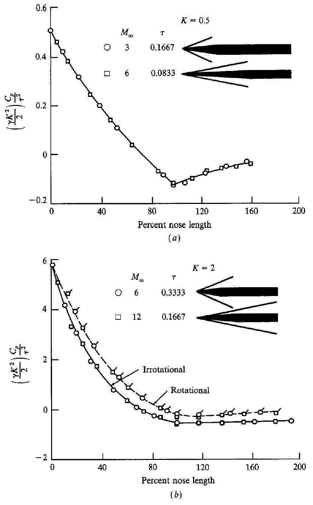
Figure 15.14 | Pressure distributions over ogive-cylinders; illustration of hypersonic similarity. (a) $K=0.5$; (b) $K=2.0$. (From Ref. 125.)

bodies (say, a $20^{\circ}$ half-angle cone), the data do not correlate well until $K>1.5$. However, always keep in mind that hypersonic similarity is based on the hypersonic small-disturbance equations, and we would expect the results to become more tenuous as the thickness of the body is increased.

An important historical note is in order here. The concept of hypersonic similarity was first developed by Tsien in 1946, and published in Ref. 126. In this paper, Tsien treated a two-dimensional potential (hence irrotational) flow. This work was further extended by Hayes (Ref. 127) who showed that Tsien's results applied to rotational flows as well. (As noted earlier, the development of hypersonic similarity in the present chapter started right from the beginning with the governing equations for rotational flow. There is no need to limit ourselves to the special case treated by Tsien.) However, of equal (or more) historical significance, Tsien's 1946 paper seems to be the source which coined the word hypersonic. After an extensive search of the literature, the present author could find no reference to the word "hypersonic" before 1946. Then, in his 1946 paper-indeed in the title of the paper-Tsien makes liberal use of the word "hypersonic," without specifically stating that he is coining a new word. In this sense, the word "hypersonic" seems to have entered our vocabulary with little or no fanfare.

## 15.8 | COMPUTATIONAL FLUID DYNAMICS APPLIED TO HYPERSONIC FLOW; SOME COMMENTS

The modern hypersonic aerodynamics of today is paced by computational fluid dynamics (CFD). Indeed, the impact of CFD on hypersonics has been the greatest of all the flight regimes discussed earlier in this book. This is due mainly to the lack of hypersonic ground test facilities for experimental studies, especially at the extreme ends of the spectrum where $M>20$ and the stagnation temperatures are high enough to cause substantial chemical dissociation of the gas. In lieu of such high-performance facilities, the design of hypersonic vehicles must rely heavily on the results of computational fluid dynamics.

In this sense, the present section is essentially a summary section, because examples of computational fluid dynamics applied to flows with hypersonic Mach numbers can be found throughout this book. For example, in Sec. 11.16, there are examples of both the method of characteristics and an explicit finite-difference technique (essentially MacCormack's explicit technique) applied to a space-shuttle configuration at Mach 7.4. Blunt body solutions at Mach 8 are discussed in Sec. 12.6. Chapter 13 contains many results for three-dimensional flowfields at hypersonic speeds. These results, taken together, serve as our examples of the application of computational fluid dynamics to hypersonic flows. Only one additional example will be discussed here.

In Ref. 129, hypersonic flow over blunt-nosed cones at angle of attack is calculated. A blunt body solution (see Sec. 13.4) is used to obtain the initial data surface from which the three-dimensional method of characteristics (see Sec. 11.10)

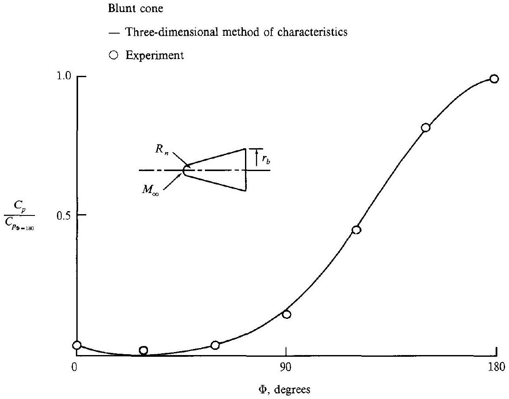
Figure 15.15 I Circumferential surface-pressure distribution at $x / R_{n}=8$; comparison between theory and experiment in helium. $\theta_{c}=15^{\circ}, \alpha=20^{\circ}, M_{\infty}=14.9, \gamma=1.667$, $\operatorname{Re}=0.86 \times 10^{6}$. (From Ref. 129.)

is used to calculate the rest of the flowfield. Typical results are shown in Figs. 15.15 and 15.16. In Fig. 15.15, the circumferential pressure distribution around the conical surface at an axial location equal to eight nose radii downstream of the nose is shown. The most leeward location is $\Phi=0$, and the most windward location is $\Phi=180^{\circ}$. The free-stream Mach number is 14.9 . The circles are experimental data obtained in a hypersonic wind tunnel using helium as the test gas (for helium, $\gamma=1.667$ ). The solid curve represents the calculation, also for $\gamma=1.667$. Excellent agreement is obtained-a beautiful testimonial to the power of computational techniques applied to a rather complex hypersonic flow. In Fig. 15.16, the axial distributions of pressure coefficient are given for three different values of $\Phi$ (three different azimuthal locations). Again, $\Phi=180^{\circ}$ is the extreme windward location. Here, the circles represent experimental data obtained in air at Mach 10 (hence $\gamma=1.4$ ). The solid curves are the computed results. Again, excellent agreement is obtained. Note that the results for $\Phi=180^{\circ}$ show a local overexpansion downstream of the nose, with a local recompression further downstream. This type of pressure variation is typical of the flow over blunt-nosed cones at hypersonic speeds. It appears that, in flowing over the blunt-nosed shape, the flow expands too far; after it reaches the conical part of the body, this overexpansion is then compensated by a local recompression.

- Three-dimensional method of characteristics
◯ Experiment

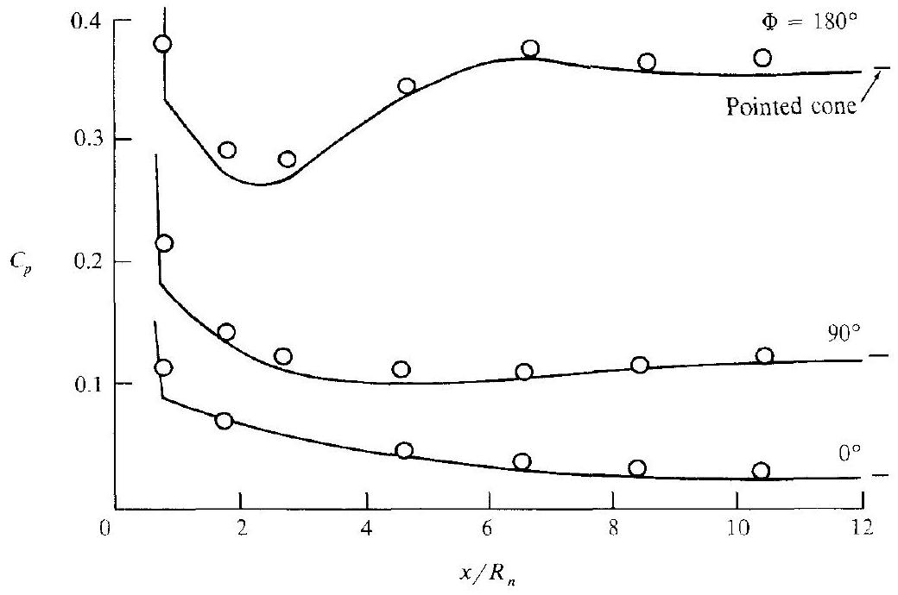
Figure 15.16 I Pressure distributions over a blunt-nosed cone; comparison between theory and experiment in air. $\alpha=10, \operatorname{Re}=0.6 \times 10^{6}, M_{\curvearrowright}=10$. $\gamma=1.4$. (From Ref. 129.)

Also note in Fig. 15.16 that the pressures far downstream approach the sharp-nosed cone results, given by the single dash at the end of each curve. However, the sharp cone results cannot be exactly achieved because of the presence of the entropy layer emanating from the blunt nose. This is in addition to the entropy layer that is always present on a cone-even a sharp-nosed cone-at angle of attack, as was discussed in Chap. 13.

Modern CFD applications to hypersonic flow abound in the literature. Such journals as the AIAA Journal and the Journal of Propulsion and Power are good sources of such literature.

### 15.9 I SUMMARY AND FINAL COMMENTS

In this chapter we have discussed some of the basic aspects of "classical" hypersonic aerodynamics, i.e., the hypersonic shock wave relations, newtonian flow, tangentwedge and tangent-cone methods, Mach number independence, and hypersonic small-perturbation theory leading to the demonstration of hypersonic similarity. We have seen that hypersonic theory is nonlinear, even for small perturbations. The "modern" hypersonic aerodynamics is characterized by applications of computational fluid dynamics, as discussed in various sections throughout this book.

One of the most important aspects of hypersonic flow is the large temperature increases associated with such flows, and the resulting chemically reacting flowfields that are so prevalent in many hypersonic applications. Such matters are not discussed in this chapter. However, the remaining two chapters of this book are devoted to developing the basic thermodynamics and gasdynamics of high-temperature, chemically reacting flow. Such high-temperature flows are an essential part of modern compressible flow. The material in Chaps. 16 and 17 is applicable to many problems in addition to hypersonics. However, it is particularly applicable to hypersonic flow, and in that sense the following two chapters, although self-contained, can be visualized as a natural extension of the present chapter.

