## Properties of High-Temperature Gases

Science is eternal. It was started thousands of years ago and its progress is continuous. Principles that are deeply rooted are not likely to pass suddenly from the scene.

Theodore von Karman, 1963

## PREVIEW BOX

Explosions, combustion, the searing temperatures associated with the very high speed flow of a gas-these are some examples of compressible flow where hightemperature effects must be taken into account. For these and other situations the assumption of a calorically perfect gas with constant specific heats, which has permeated all of the previous chapters, is simply not good enough. We have to take into account chemical reactions occurring in the flow, and other physical phenomena that cause the specific heats to be variable. This changes the complexion of our analyses and calculations completely. We have to deal with a combination of physical chemistry with gas dynamics-a combination that is exciting, important, and particularly interesting to study. In the present chapter we introduce some basic aspects of physical chemistry, which will then be combined with gas dynamics in the next chapter to study some fundamental high-temperature flows.

Return to the overall roadmap for the book given in Fig. 1.7. We now move to the extreme right, box 17 , to study high-temperature flow. This will round out our overall study of modern compressible flow as represented by the entire map in Fig. 1.7.

The roadmap for the present chapter is given in Fig. 16.1. Here we will deal with two different states of gases, equilibrium as represented on the left of Fig. 16.1,
and nonequilibrium as represented on the right. These are two distinctly different situations; some hightemperature flows can be analyzed by assuming local equilibrium, but many others are dominated by nonequilibrium processes. So both sides of the roadmap in Fig. 16.1 are equally important. We will start on the left, and introduce some fundamental aspects of statistical thermodynamics (box 1), which in turn leads to the equilibrium thermodynamic properties of a single-species gas (box 2). Then we show how the equilibrium chemical composition of a chemically reacting gas can be calculated (box 3). This tells us how much of each chemical species is present in the gas. Boxes 2 and 3 are then combined to obtain the equilibrium thermodynamic properties of a chemically reacting gas. Finally, we move to the right hand side of the roadmap, and deal with nonequilibrium processes. We emphasize two such processes: molecular vibrational nonequilibrium (box 5), and chemical nonequilibrium (box 6).

In short, view this chapter as a crash course in physical chemistry. We discuss only those aspects that are necessary for applications to compressible flows. We assume no prior knowledge of this material on your part; the concepts and equations are developed from first principles. View this chapter as an interesting and awarding adventure.

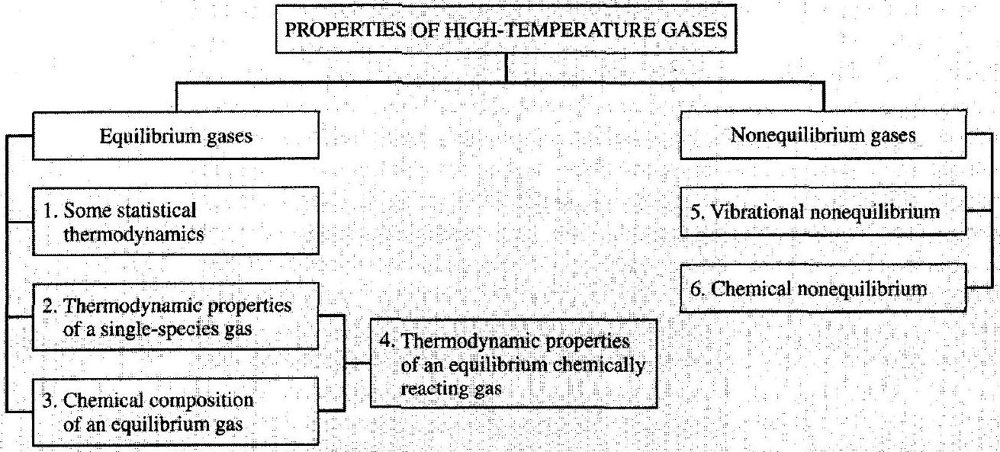
Figure 16.1 / Roadmap for Chapter 16.

## 16.1 \| INTRODUCTION

Consider the atmospheric entry of the Apollo command vehicle upon return from the moon. At an altitude of approximately 53 km , the velocity of the vehicle is $11 \mathrm{~km} / \mathrm{s}$. As sketched in Fig. 12.20, a strong bow shock wave is wrapped around the blunt nose, and the shock layer between the shock and the body is relatively thin. This is a blunt body flowfield, as discussed in Chap. 12. Moreover, at a standard altitude of 53 km , the air temperature is 283 K and the resulting speed of sound is $338 \mathrm{~m} / \mathrm{s}$; hence the Mach number of the Apollo vehicle is 32.5 -an extremely large hypersonic value. Using the theory developed in Chap. 3 for a calorically perfect gas, let us estimate the temperature in this shock layer. From Table A.2, for $M=32.5$, $T_{s} / T_{\infty}=206$, where $T_{s}$ is the static temperature behind the normal portion of the bow shock wave. Hence, $T_{s}=(206)(283)=58,300 \mathrm{~K}$. This is an extremely high temperature; it is also completely incorrect. Long before this temperature is reached, the air molecules will dissociate and ionize. Indeed, the shock layer becomes a partially ionized plasma, where the specific heat of the gas is a strong function of both pressure and temperature. The assumption of a calorically perfect gas made above is completely inaccurate; when this chemically reacting gas is properly calculated, the shock layer temperature is on the order of $11,600 \mathrm{~K}$-still a high value, but a factor of 5 less than the temperature predicted on the basis of a calorically perfect gas. Figure 16.2 compares the variation of shock layer temperature as a function of flight velocity for both the cases of a calorically perfect gas and an equilibrium chemically reacting gas. Also noted are typical reentry velocities for various space vehicles such as an intermediate range ballistic missile (IRBM), intercontinental ballistic missile (ICBM), earth orbital vehicles (e.g., Mercury and Gemini), lunar return vehicles (e.g., Apollo) and Mars return vehicles. Clearly, for all such cases, the assumption of a calorically perfect gas is not appropriate; the effects of chemical reactions must be taken into account.

The remainder of this book will deal with the compressible flow of hightemperature gases. The importance of such a flow was illustrated above. In modern engineering applications, there are many other such examples: the flow through rocket engines, arc-driven hypersonic wind tunnels, high-performance shock tubes, high-energy gasdynamic and chemical lasers, and internal combustion engines. to name just a few. Therefore, as stated in Sec. 1.6, a study of modern compressible flow must include some discussion of high-temperature effects. To this end, the present chapter deals with the thermodynamics of high-temperature chemically reacting gases, providing the necessary foundation for the analyses of high-temperature flows to be given in Chap. 17. The objective of these remaining chapters is to give the reader some appreciation for the limitations of the calorically perfect gas results developed in previous chapters, as well as an ability to make modern compressible flow computations which properly include high-temperature effects.

There are two major physical characteristics which cause a high-temperature gas to deviate from calorically perfect gas behavior:

1. As the temperature of a diatomic or polyatomic gas is increased above standard conditions, the vibrational motion of the molecules will become important,

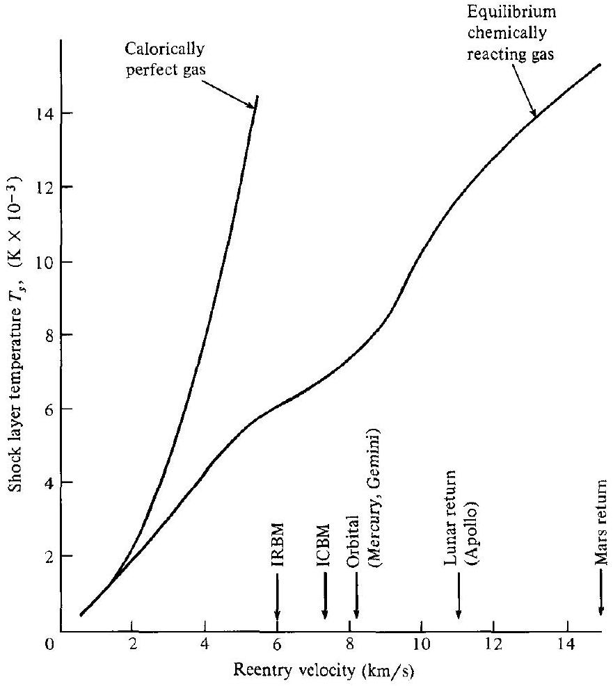
Figure 16.2 I Temperature behind a normal shock versus velocity for air at a standard altitude of 52 km . Comparison between calorically perfect and equilibrium gas results.

absorbing some of the energy which otherwise would go into the translational and rotational molecular motion. As we shall soon see, the excitation of vibrational energy causes the specific heat to become a function of temperature, i.e., the gas gradually shifts from calorically perfect to thermally perfect (see Sec. 1.4).
2. As the gas temperature is further increased, the molecules will begin to dissociate (the atoms constituting the various molecules will break away from the molecular structure) and even ionize (electrons will break away from the atoms). Under these conditions, the gas becomes chemically reacting, and the specific heat becomes a function of both temperature and pressure. If we consider air at 1 atm , the approximate temperatures at which various reactions will become important are illustrated in Fig. 16.3. If the gas is at lower pressure, these temperatures shift downward; later in this chapter we will learn why.

These physical effects-vibrational excitation and chemical reactions-will be highlighted in the remainder of this book. The purpose of the present chapter is to

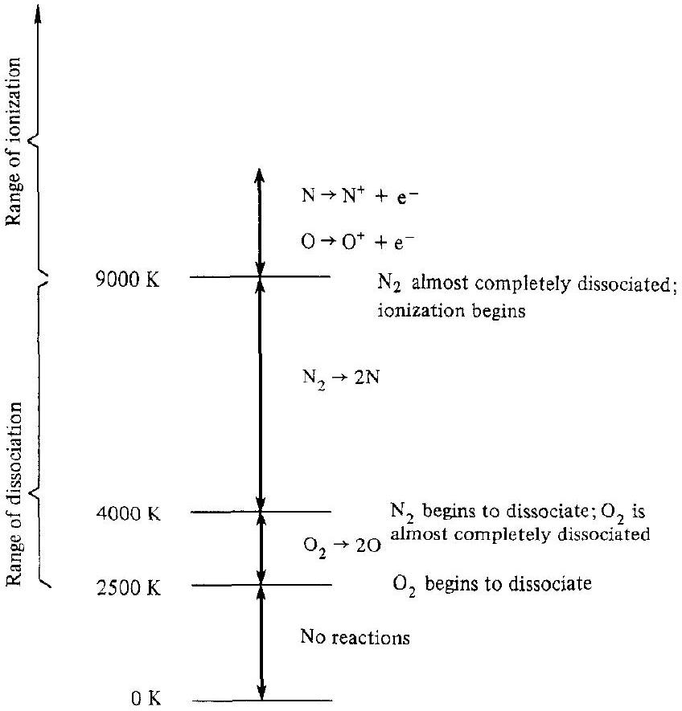
Figure 16.3 I Ranges of dissociation and ionization for air at approximately $1-\mathrm{atm}$ pressure.

establish the thermodynamic behavior of such gases, much as Sec. 1.4 laid the basis for our previous flowfield analyses dealing principally with a calorically perfect gas. However, unlike Sec. 1.4, which was a review, the assumption is made here that the reader has not had a previous background in high-temperature thermodynamics. Therefore, some effort will be made to provide a background sufficiently thorough that the reader will feel comfortable with the results, to be used in Chap. 17.

To elaborate, an essential ingredient of any high-temperature flowfield analysis is the knowledge of the thermodynamic properties of the gas. For example, consider again the flowfield shown in Fig. 12.20. Assume that the gas is in local thermodynamic and chemical equilibrium (concepts to be defined later). The unknown flowfield variables, and how they can be obtained, are itemized as follows:

| $\left.\begin{array}{l}\rho \text {-density } \\ \text { V-velocity } \\ h \text {-enthalpy }\end{array}\right\}$ | Obtained from a simultaneous solution   of the continuity, momentum, and   energy equations |
| :--- | :--- |
| $\left.\begin{array}{l}T=T(\rho, h) \\ p=p(\rho, h)\end{array}\right\}$ | Obtained from the equilibrium thermodynamic   properties of high-temperature air |

Here, we conceptually see that two thermodynamic variables $\rho$ and $h$ are obtained from the flowfield conservation equations, and that the remaining thermodynamic
variables $T, p, e, s$, etc., can be obtained from a knowledge of $\rho$ and $h$. In general, for a gas in equilibrium, any two thermodynamic state variables uniquely define the complete thermodynamic state of the gas. The question posed here is that, given two thermodynamic state variables in an equilibrium high-temperature gas, how do we obtain values of the remaining state variables? There are two answers. One is to measure these properties from experiment. However, it is very difficult to carry out accurate experiments on gases at temperatures above a few thousand degrees; such temperatures are usually achieved in the laboratory for only short periods of time in devices such as shock tubes, or by pulsed laser radiation absorption. The other answer is to calculate these properties. Fortunately, the powerful discipline of statistical mechanics developed over the last century, along with the advent of quantum mechanics in the early twentieth century, gives us a relatively quick and extremely accurate method of calculating equilibrium thermodynamic properties of high-temperature gases. These concepts form the basis of statistical thermodynamics, the elements of which will be developed and used in the following sections.

### 16.2 I MICROSCOPIC DESCRIPTION OF GASES

A molecule is a collection of atoms bound together by a rather complex intramolecular force. A simple concept of a diatomic molecule (two atoms) is the "dumbbell" model sketched in Fig. 16.4a. This molecule has several modes (forms) of energy:

1. It is moving through space, and hence it has translational energy $\varepsilon_{\text {trans }}^{\prime}$, as sketched in Fig. 16.4b. The source of this energy is the translational kinetic energy of the center of mass of the molecule. Since the molecular translational velocity can be resolved into three components (such as $V_{x}, V_{y}$, and $V_{z}$ in the $x y z$ cartesian space shown in Fig. 16.4b), the molecule is said to have three "geometric degrees of freedom" in translation. Since motion along each coordinate direction contributes to the total kinetic energy, the molecule is also said to have three "thermal degrees of freedom."
2. It is rotating about the three orthogonal axes in space, and hence it has rotational energy $\varepsilon_{\text {rot }}^{\prime}$, as sketched in Fig. 16.4c. The source of this energy is the rotational kinetic energy associated with the molecule's rotational velocity and its moment of inertia. However, for the diatomic molecule shown in Fig. 16.4c, the moment of inertia about the internuclear axis (the $z$ axis) is very small, and therefore the rotational kinetic energy about the $z$ axis is negligible in comparison to rotation about the $x$ and $y$ axis. Therefore, the diatomic molecule is said to have only two "geometric" as well as two "thermal" degrees of freedom. The same is true for a linear polyatomic molecule such as $\mathrm{CO}_{2}$ shown in Fig. 16.4d. However, for nonlinear molecules, such as $\mathrm{H}_{2} \mathrm{O}$ also shown in Fig. 16.4d, the number of geometric (and thermal) degrees of freedom in rotation are three.
3. The atoms of the molecule are vibrating with respect to an equilibrium location within the molecule. For a diatomic molecule, this vibration is modeled by a spring connecting the two atoms, as illustrated in Fig. 16.4e. Hence the

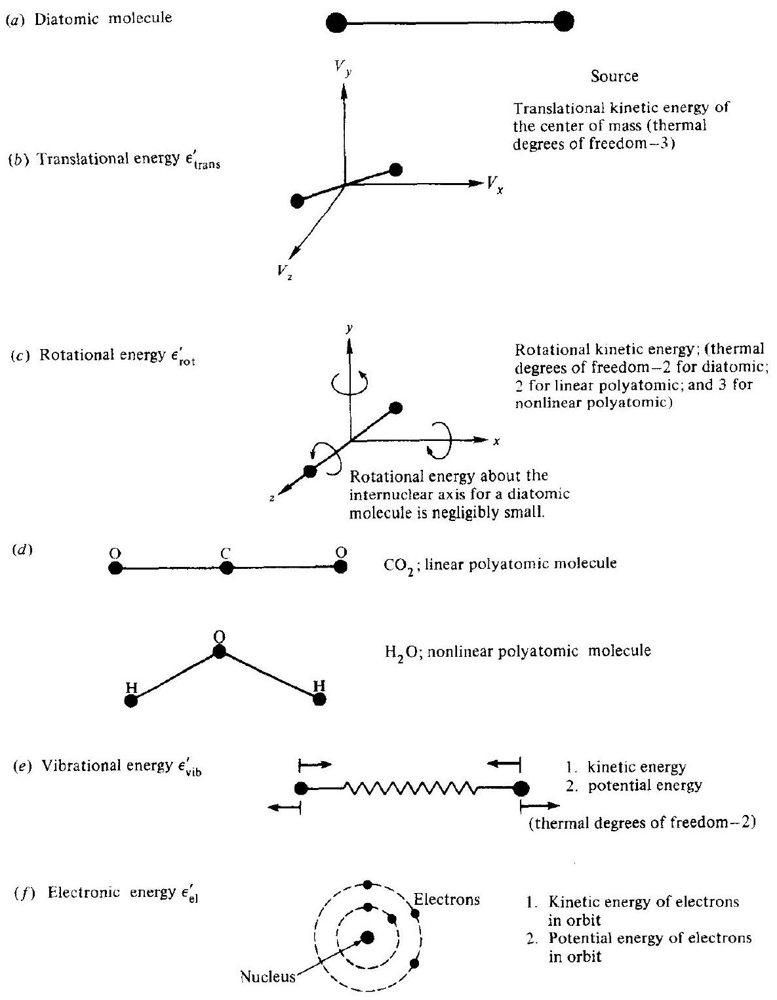
Figure 16.4 I Modes of molecular energy.

molecule has vibrational energy $\varepsilon_{\text {vib }}^{\prime}$. There are two sources of this vibrational energy: the kinetic energy of the linear motion of the atoms as they vibrate back and forth, and the potential energy associated with the intramolecular force (symbolized by the spring). Hence, although the diatomic molecule has only one geometric degree of freedom (it vibrates only along one direction, namely, that of the internuclear axis), it has two thermal degrees of freedom
due to the contribution of both kinetic and potential energy. For polyatomic molecules, the vibrational motion is more complex, and numerous fundamental vibrational modes can occur, with a consequent large number of degrees of freedom.
4. The electrons are in motion about the nucleus of each atom constituting the molecule, as sketched in Fig. 16.4f. Hence, the molecule has electronic energy $\varepsilon_{\mathrm{el}}^{\prime}$. There are two sources of electronic energy associated with each electron: kinetic energy due to its translational motion throughout its orbit about the nucleus, and potential energy due to its location in the electromagnetic force field established principally by the nucleus. Since the overall electron motion is rather complex, the concepts of geometric and thermal degrees of freedom are usually not useful for describing electronic energy.

Therefore, we see that the total energy of a molecule, $\varepsilon^{\prime}$, is the sum of its translational, rotational, vibrational, and electronic energies:

$$
\left.\varepsilon^{\prime}=\varepsilon_{\text {trans }}^{\prime}+\varepsilon_{\text {rot }}^{\prime}+\varepsilon_{\text {vib }}^{\prime}+\varepsilon_{\text {el }}^{\prime} \quad \text { (for molecules }\right)
$$

For a single atom, only the translational and electronic energies exist:

$$
\varepsilon^{\prime}=\varepsilon_{\text {trans }}^{\prime}+\varepsilon_{\mathrm{el}}^{\prime} \quad \text { (for atoms) }
$$

The results of quantum mechanics have shown that each of these energies is quantized, i.e., they can exist only at certain discrete values, as schematically shown in Fig. 16.5. This is a dramatic result. Intuition, based on our personal observations of nature, would tell us that at least the translational and rotational energies could be any value chosen from a continuous range of values (i.e., the complete real number system). However, our daily experience deals with the macroscopic, not the microscopic world, and we should not always trust our intuition when extrapolated to the microscopic scale of molecules. A major benefit of quantum mechanics is that it correctly describes microscopic properties, some of which are contrary to intuition. In the case of molecular energy, all modes are quantized, even the translational mode. These quantized energy levels are symbolized by the ladder-type diagram shown in Fig. 16.5, with the vertical height of each level as a measure of its energy. Taking the vibrational mode for example, the lowest possible vibrational energy is symbolized by $\varepsilon_{o_{\mathrm{vi}}}^{\prime}$. The next allowed quantized value is $\varepsilon_{1_{\mathrm{vib}}}^{\prime}$, then $\varepsilon_{2_{\mathrm{vib}}}^{\prime}, \ldots, \varepsilon_{i_{\mathrm{vi}}}^{\prime}, \ldots$. The energy of the $i$ th vibrational energy level is $\varepsilon_{i_{\text {vib }}}^{\prime}$, and so forth. Note that, as illustrated in Fig. 16.5, the spacing between the translational energy levels is very small, and if we were to look at this translational energy level diagram from across the room, it would look almost continuous. The spacings between rotational energy levels are much larger than between the translational energies; moreover, the spacing between two adjacent rotational levels increases as the energy increases (as we go up the ladder in Fig. 16.5). The spacings between vibrational levels are much larger than between rotational levels; also, contrary to rotation, adjacent vibrational energy levels become more closely spaced as the energy increases. Finally, the spacings between electronic

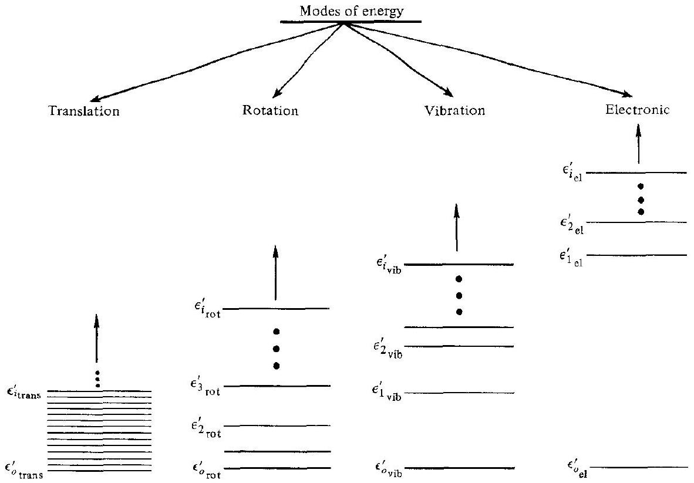
Figure 16.5 I Schematic of energy levels for the different molecular energy modes.

levels are considerably larger than between vibrational levels, and the difference between adjacent electronic levels decreases at higher electronic energies. The quantitative calculation of all these energies will be given in Sec. 16.7.

Again examining Fig. 16.5, note that the lowest allowable energies are denoted by $\varepsilon_{o_{\text {tram }},}^{\prime}, \varepsilon_{o_{\text {Tot }}}^{\prime}, \varepsilon_{o_{\text {vil }}}^{\prime}$, and $\varepsilon_{o_{\text {el }}}^{\prime}$. These levels are defined as the ground state for the molecule. They correspond to the energy that the molecule would have if the gas were theoretically at a temperature of absolute zero; hence the values are also called the zero-point energies for the translational, rotational, vibrational, and electronic modes, respectively. It will be shown in Sec. 16.7 that the rotational zero-point energy is precisely zero, whereas the zero-point energies for translation, vibration, and electronic motion are not. This says that, if the gas were theoretically at absolute zero, the molecules would still have some finite translational motion (albeit very small) as well as some finite vibrational motion. Moreover, it only makes common sense that some electronic motion should theoretically exist at absolute zero, or otherwise the electrons would fall into the nucleus and the atom would collapse. Therefore, the total zero-point energy for a molecule is denoted by $\varepsilon_{o}^{\prime}$, where

$$
\varepsilon_{o}^{\prime}=\varepsilon_{o_{\text {tratus }}}^{\prime}+\varepsilon_{o_{\text {vit }}}^{\prime}+\varepsilon_{o_{\text {el }}}^{\prime}
$$

recalling that $\varepsilon_{o_{\text {rot }}}^{\prime}=0$.
It is common to consider the energy of a molecule as measured above its zeropoint energy. That is, we can define the translational, rotational, vibrational, and electronic energies all measured above the zero-point energy as $\varepsilon_{j_{\text {tran }}}, \varepsilon_{k_{\text {rot }}}, \varepsilon_{l_{\text {vit }}}$, and $\varepsilon_{m_{\text {el }}}$,
respectively, where

$$
\begin{aligned}
\varepsilon_{j_{\mathrm{trans}}} & =\varepsilon_{j_{\mathrm{trans}}}^{\prime}-\varepsilon_{o_{\mathrm{trans}}}^{\prime} \\
\varepsilon_{k_{\mathrm{rot}}} & =\varepsilon_{k_{\mathrm{rot}}}^{\prime} \\
\varepsilon_{l_{\mathrm{vib}}} & =\varepsilon_{l_{\mathrm{vib}}}^{\prime}-\varepsilon_{o_{\mathrm{vib}}}^{\prime} \\
\varepsilon_{m_{\mathrm{el}}} & =\varepsilon_{m_{\mathrm{el}}}^{\prime}-\varepsilon_{o_{\mathrm{el}}}^{\prime}
\end{aligned}
$$

(Note that the unprimed values denote energy measured above the zero-point value.) In light of this, we can write the total energy of a molecule as $\varepsilon_{i}^{\prime}$, where

$$
\varepsilon_{i}^{\prime}=\underbrace{\varepsilon_{j_{\text {trans }}}+\varepsilon_{k_{\text {rot }}}+\varepsilon_{l_{\text {vib }}}+\varepsilon_{m_{e l}}}_{\begin{array}{l}
\text { All are measured above the zero-point } \\
\text { energy, thus all are equal to zero at } \\
T=0 \mathrm{~K} .
\end{array}}+\underbrace{\varepsilon_{o}^{\prime}}_{\begin{array}{l}
\text { This represents zero-point energy, } \\
\text { a fixed quantity for a given molecular } \\
\text { species that is equal to the energy } \\
\text { of the molecule at absolute zero. }
\end{array}}
$$

For an atom, the total energy can be written as

$$
\varepsilon_{i}^{\prime}=\varepsilon_{j_{\text {trans }}}+\varepsilon_{m_{\mathrm{el}}}+\varepsilon_{o}^{\prime}
$$

If we examine a single molecule at some given instant in time, we would see that it simultaneously has a zero-point energy $\varepsilon_{o}^{\prime}$ (a fixed value for a given molecular species), a quantized electronic energy measured above the zero-point, $\varepsilon_{m_{\mathrm{el}}}$, a quantized vibrational energy measured above the zero point, $\varepsilon_{l_{\text {vib }}}$, and so forth for rotation and translation. The total energy of the molecule at this given instant is $\varepsilon_{i}^{\prime}$. Since $\varepsilon_{i}^{\prime}$ is the sum of individually quantized energy levels, then $\varepsilon_{i}^{\prime}$ itself is quantized. Hence, the allowable total energies can be given on a single energy level diagram, where $\varepsilon_{o}^{\prime}, \varepsilon_{1}^{\prime}, \varepsilon_{2}^{\prime}, \ldots, \varepsilon_{i}^{\prime}, \ldots$ are the quantized values of the total energy of the molecule.

In the above paragraphs, we have gone to some length to define and explain the significance of molecular energy levels. In addition to the concept of an energy level, we now introduce the idea of an energy state. For example, quantum mechanics identifies molecules not only with regard to their energies, but also with regard to angular momentum. Angular momentum is a vector quantity, and therefore has an associated direction. For example, consider the rotating molecule shown in Fig. 16.6. Three different orientations of the angular momentum vector are shown; in each orientation, assume the energy of the molecule is the same. Quantum mechanics shows

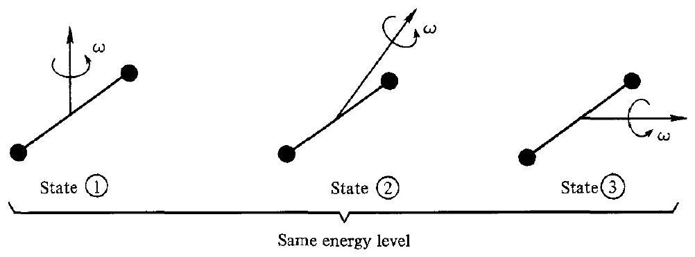
Figure 16.6 I Illustration of different energy states for the same energy level.

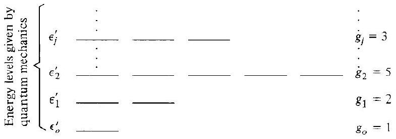
Figure 16.7 I Illustration of statistical weights.

that molecular orientation is also quantized, i.e., it can point only in certain directions. In all three cases shown in Fig. 16.6, the rotational energy is the same, but the rotational momentum has different directions. Quantum mechanics sees these cases as different and distinguishable states. Different states associated with the same energy level can also be defined for electron angular momentum, electron and nuclear spin, and the rather arbitrary lumping together of a number of closely spaced translational levels into one approximate "level" with many "states."

In summary, we see that, for any given energy level $\varepsilon_{i}^{\prime}$, there can be a number of different states that all have the same energy. This number of states is called the degeneracy or statistical weight of the given level $\varepsilon_{i}^{\prime}$, and is denoted by $g_{i}$. This concept is exemplified in Fig. 16.7, which shows energy levels in the vertical direction, with the corresponding states as individual horizontal lines arrayed to the right at the proper energy value. For example, the second energy level is shown with five states, all with an energy value equal to $\varepsilon_{2}^{\prime}$; hence, $g_{2}=5$. The values of $g_{i}$ for a given molecule are obtained from quantum theory and/or spectroscopic measurements.

Now consider a system consisting of a fixed number of molecules, $N$. Let $N_{j}$ be the number of molecules in a given energy level $\varepsilon_{j}^{\prime}$. This value $N_{j}$ is defined as the population of the energy level. Obviously,

$$
N=\sum_{j} N_{j}
$$

where the summation is taken over all energy levels. The different values of $N_{j}$ associated with the different energy levels $\varepsilon_{j}^{\prime}$ form a set of numbers which is defined as the population distribution. If we look at our system of molecules at one instant in time, we will see a given set of $N_{j}$ 's, i.e., a certain population distribution over the energy levels. Another term for this set of numbers, synonomous with population distribution, is macrostate. Due to molecular collisions, some molecules will change from one energy level to another. Hence, when we look at our system at some later instant in time, there may be a different set of $N_{j}$ 's, and hence a different population distribution, or macrostate. Finally, let us denote the total energy of the system as $E$, where

$$
E=\sum_{j} \varepsilon_{j}^{\prime} N_{j}
$$

| Energy levels: | $\epsilon_{o}^{\prime}$ | $\epsilon_{1}^{\prime}$ | $\varepsilon_{2}^{\prime}$ | $\cdots \epsilon_{j}^{\prime}$ |  | ⋯ |
| :--- | :--- | :--- | :--- | :--- | :--- | :--- |
| Statistical weights: | $g_{o}$ | $g_{1}$ | $g_{2}$ | ⋯ | $g_{j}$ | ⋯ |
| Populations at one instant: | $N_{o}=2$ | $N_{1}=3$ |  | $N_{2}=5 \cdots N_{j}=3$ |  | ... |
| Populations at the next instant: | One macrostate |  |  |  |  |  |
|  | $N_{o}=3 \quad N_{1}=1 \quad N_{2}=3 \cdots N_{j}=6 \cdots$ |  |  |  |  |  |
|  | Another macrostate |  |  |  |  |  |

Figure 16.8 I Illustration of macrostates.

The schematic in Fig. 16.8 reinforces the above definitions. For a system of $N$ molecules and energy $E$, we have a series of quantized energy levels $\varepsilon_{o}^{\prime}$, $\varepsilon_{1}^{\prime}, \ldots, \varepsilon_{j}^{\prime}, \ldots$, with corresponding statistical weights $g_{o}, g_{1}, \ldots, g_{j}, \ldots$ At some given instant, the molecules are distributed over the energy levels in a distinct way, $N_{o}, N_{1}, \ldots, N_{j}, \ldots$, constituting a distinct macrostate. In the next instant, due to molecular collisions, the populations of some levels may change, creating a different set of $N_{j}$ 's, and hence a different macrostate.

Over a period of time, one particular macrostate, i.e., one specific set of $N_{j}$ 's, will occur much more frequently than any other. This particular macrostate is called the most probable macrostate (or most probable distribution). It is the macrostate which occurs when the system is in thermodynamic equilibrium. In fact, this is the definition of thermodynamic equilibrium within the framework of statistical mechanics. The central problem of statistical thermodynamics, and the one to which we will now address ourselves, is as follows:

> Given a system with a fixed number of identical particles, $N=\sum_{j} N_{j}$, and a fixed energy $E=\sum_{j} \varepsilon_{j}^{\prime} N_{j}$, find the most probable macrostate.

In order to solve the above problem, we need one additional definition, namely, that of a microstate. Consider the schematic shown in Fig. 16.9, which illustrates a given macrostate (for purposes of illustration, we choose $N_{o}=2, N_{1}=5$, $N_{2}=3$, etc.). Here, we display each statistical weight for each energy level as a vertical array of boxes. For example, under $\varepsilon_{1}^{\prime}$ we have $g_{1}=6$, and hence six boxes, one for each different energy state with the same energy $\varepsilon_{1}^{\prime}$. In the energy level $\varepsilon_{1}^{\prime}$, we have five molecules $\left(N_{1}=5\right)$. At some instant in time, these five molecules individually occupy the top three and lower two boxes under $g_{1}$, with the fourth box left vacant (i.e., no molecules at that instant have the energy state represented by the fourth box). The way that the molecules are distributed over the available boxes defines a microstate of the system, say microstate I as shown in Fig. 16.9. At some later instant, the $N_{1}=5$ molecules may be distributed differently over the $g_{1}=6$ states, say leaving the second box vacant. This represents another, different microstate, labeled microstate II in Fig. 16.9. Shifts over the other vertical arrays of boxes between microstates I and II are also shown in Fig. 16.9. However, in both cases, $N_{o}$

| $\epsilon_{o}^{\prime}$ | $\epsilon_{1}^{\prime}$ | $\epsilon_{2}^{\prime}$ | $\cdots$ |
| :--- | :--- | :--- | :--- |
| $N_{o}=2$ | $N_{1}=5$ | $N_{2}=3 \cdots$ | $\epsilon_{j}^{\prime}$ |
| $g_{o}=5$ | $g_{1}=6$ |  | $g_{2}=5 \cdots$ |
|  |  |  | $g_{j}=3 \cdots$ |

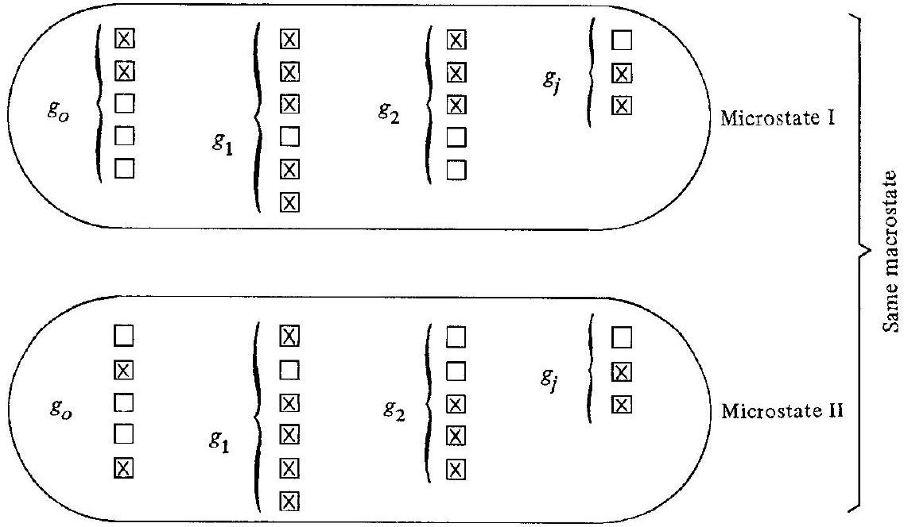
Figure 16.9 | Illustration of microstates.

still equals $2, N_{1}$ still equals 5 , etc.-i.e., the macrostate is still the same. Thus, any one macrostate can have a number of different microstates, depending on which of the degenerate states (the boxes in Fig. 16.9) are occupied by the molecules. In any given system of molecules, the microstates are constantly changing due to molecular collisions. Indeed, it is a central assumption of statistical thermodynamics that each microstate of a system occurs with equal probability. Therefore, it is easy to reason that the most probable macrostate is that macrostate which has the maximum number of microstates. If each microstate appears in the system with equal probability, and there is one particular macrostate that has considerably more microstates than any other, then that is the macrostate we will see in the system most of the time. This is indeed the situation in most real thermodynamic systems. Figure 16.10 is a schematic which plots the number of microstates in different macrostates. Note there is one particular macrostate, namely, macrostate $D$, that stands out as having by far the largest number of microstates. This is the most probable macrostate; this is the macrostate that is usually seen, and constitutes the situation of thermodynamic equilibrium in the system. Therefore, if we can count the number of microstates in any given macrostate, we can easily identify the most probable macrostate. This counting of microstates is the subject of Sec. 16.3. In turn, after the most probable macrostate is identified, the equilibrium thermodynamic properties of the system can be computed. Such thermodynamic computations will be discussed in subsequent sections.

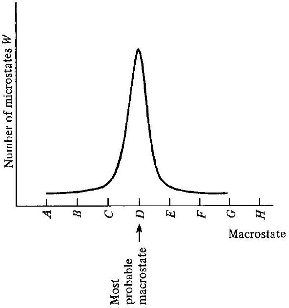
Figure 16.10 I Illustration of most probable macrostate as that macrostate that has the maximum number of microstates.

## 16.3 | COUNTING THE NUMBER OF MICROSTATES FOR A GIVEN MACROSTATE

Molecules and atoms are constituted from elementary particles-electrons, protons, and neutrons. Quantum mechanics makes a distinction between two different classes of molecules and atoms, depending on their number of elementary particles, as follows:

1. Molecules and atoms with an even number of elementary particles obey a certain statistical distribution called Bose-Einstein statistics. Let us call such molecules or atoms Bosons.
2. Molecules and atoms with an odd number of elementary particles obey a different statistical distribution called Fermi-Dirac statistics. Let us call such molecules or atoms Fermions.

There is an important distinction between the above two classes, as follows:

1. For Bosons, the number of molecules that can be in any one degenerate state (in any one of the boxes in Fig. 16.9) is unlimited (except, of course, that it must be less than or equal to $N_{j}$ ).
2. For Fermions, only one molecule may be in any given degenerate state at any instant.

This distinction has a major impact on the counting of microstates in a gas.
First, let us consider Bose-Einstein statistics. For the time being, consider one energy level by itself, say $\varepsilon_{j}^{\prime}$. This energy level has $g_{j}$ degenerate states and $N_{j}$
molecules. Consider the $g_{j}$ states as the $g_{j}$ containers diagrammed below.
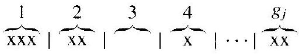

Distribute the $N_{j}$ molecules among the containers, such as three molecules in the first container, two molecules in the second, etc., where the molecules are denoted by x in the above diagram. The vertical bars are partitions which separate one container from another. The distribution of molecules over these containers represents a distinct microstate. If a molecule is moved from container 1 to container 2, a different microstate is formed. To count the total number of different microstates possible, first note that the number of permutations between the symbols $x$ and I is

$$
\left[N_{j}+\left(g_{j}-1\right)\right]!
$$

This is the number of distinct ways that the $N_{j}$ molecules and the $g_{j}-1$ partitions can be arranged. However, the partitions are indistinguishable; we have counted them too many times. The $g_{j}-1$ partitions can be permuted ( $g_{j}-1$ )! different ways. The molecules are also indistinguishable. They can be permuted $N_{j}!$ different ways without changing the picture drawn above. Therefore, there are $\left(g_{j}-1\right)!N_{j}!$ different permutations which yield the identical picture drawn above, that is, the same microstate. Thus, the number of different ways $N_{j}$ indistinguishable molecules can be distributed over $g_{j}$ states is

$$
\frac{\left(N_{j}+g_{j}-1\right)!}{\left(g_{j}-1\right)!N_{j}!}
$$

This expression applies to one energy level $\varepsilon_{j}^{\prime}$ with population $N_{j}$, and gives the number of different microstates just due to the different arrangements within $\varepsilon_{j}^{\prime}$. Consider now the whole set of $N_{j}$ 's distributed over the complete set of energy levels. (Keep in mind that the given set of $N_{j}$ 's defines a particular macrostate.) Letting $W$ denote the total number of microstates for a given macrostate, the last expression, multiplied over all the energy levels, yields

$$
W=\prod_{j} \frac{\left(N_{j}+g_{j}-1\right)!}{\left(g_{j}-1\right)!N_{j}!}
$$

Note that $W$ is a function of all the $N_{j}$ values, $W=W\left(N_{1}, N_{2}, \ldots, N_{j}, \ldots\right)$. The quantity $W$ is called the thermodynamic probability, and is a measure of the "disorder" of the system (as will be discussed later). In summary, Eq. (16.3) is the way to count the number of microstates in a given macrostate as long as the molecules are Bosons.

Next, let us consider Fermi-Dirac statistics. Recall that, for Fermions, only one molecule may be in any given degenerate state at any instant, i.e., there can be no more than one molecule per container. This implicitly requires that $g_{j} \geq N_{j}$. Consider the $g_{j}$ containers. Take one of the molecules and put it in one of the containers. There will be $g_{j}$ choices, or ways of doing this. Take the next particle, and put it in one of the remaining containers. However, there are now only $g_{j}-1$ choices, because one of the containers is already occupied. Finally, placing the remaining molecules over the remaining containers, we find that the number of ways $N_{j}$ particles
can be distributed over $g_{j}$ containers, with only one particle (or less) per container, is

$$
g_{j}\left(g_{j}-1\right)\left(g_{j}-2\right) \cdots\left[g_{j}-\left(N_{j}-1\right)\right] \equiv \frac{g_{j}!}{\left(g_{j}-N_{j}\right)!}
$$

However, the $N_{j}$ molecules are indistinguishable; they can be permutted $N_{j}$ ! different ways without changing the above picture. Therefore, the number of different microstates just due to the different arrangements with $\varepsilon_{j}^{\prime}$ is

$$
\frac{g_{j}!}{\left(g_{j}-N_{j}\right)!N_{j}!}
$$

Considering all energy levels, the total number of microstates for a given macrostate for Fermions is

$$
W=\prod_{j} \frac{g_{j}!}{\left(g_{j}-N_{j}\right)!N_{j}!}
$$

In summary, if we are given a specific population distribution over the energy levels of a gas, i.e., a specific set of $N_{j}$ 's, i.e., a specific macrostate, Eqs. (16.3) or (16.4) allow us to calculate the number of microstates for that given macrostate for Bosons or Fermions, respectively. It is again emphasized that $W$ is a function of the $N_{j}$ 's, and hence is a different number for different macrostates. Moreover, as sketched in Fig.16.10, there will in general be a certain macrostate, i.e., a certain distribution of $N_{j}$ 's, for which $W$ will be considerably larger than for any other macrostate. This, by definition, will be the most probable macrostate. The precise solution for these $N_{j}$ 's associated with the most probable macrostate is the subject of Sec. 16.4.

### 16.4 I THE MOST PROBABLE MACROSTATE

The most probable macrostate is defined as that macrostate which contains the maximum number of microstates, i.e., which has $W_{\text {max }}$. Let us solve for the most probable macrostate, i.e., let us find the specific set of $N_{j}$ 's, which allows the maximum $W$.

First consider the case for Bosons. From Eq. (16.3) we can write

$$
\ln W=\sum_{j}\left[\ln \left(N_{j}+g_{j}-1\right)!-\ln \left(g_{j}-1\right)!-\ln N_{j}!\right]
$$

Recall that we are dealing with the combined translational, rotational, vibrational and electronic energies of a molecule, and that the closely spaced translational levels can be grouped into a number of degenerate states with essentially the same energy. Therefore, in Eq. (16.5), we can assume that $N_{j} \gg 1$ and $g_{j} \gg 1$, and hence that $N_{j}+g_{j}-1 \approx N_{j}+g_{j}$ and $g_{j}-1 \approx g_{j}$. Moreover, we can employ Sterling's formula

$$
\ln a!=a \ln a-a
$$

for the factorial terms in Eq. (16.5). Consequently, Eq. (16.5) becomes

$$
\ln W=\sum_{j}\left[\left(N_{j}+g_{j}\right) \ln \left(N_{j}+g_{j}\right)-\left(N_{j}+g_{j}\right)-g_{j} \ln g_{j}+g_{j}-N_{j} \ln N_{j}+N_{j}\right]
$$

Combining terms, this becomes

$$
\ln W=\sum_{j}\left[N_{j} \ln \left(1+\frac{g_{j}}{N_{j}}\right)+g_{j} \ln \left(\frac{N_{j}}{g_{j}}+1\right)\right]
$$

Recall that $\ln W=f\left(N_{j}\right.$ 's $)=f\left(N_{o}, N_{1}, N_{2}, \ldots, N_{j}, \ldots\right)$. Also, to find the maximum value of $W$,

$$
d(\ln W)=0
$$

From the chain rule of differentiation,

$$
d(\ln W)=\frac{\partial(\ln W)}{\partial N_{o}} d N_{o}+\frac{\partial(\ln W)}{\partial N_{1}} d N_{1}+\cdots+\frac{\partial(\ln W)}{\partial N_{j}} d N_{j}+\cdots
$$

Combining Eqs. (16.8) and (16.9),

$$
d(\ln W)=\sum_{j} \frac{\partial(\ln W)}{\partial N_{j}} d N_{j}=0
$$

From Eq. (16.7),

$$
\frac{\partial(\ln W)}{\partial N_{j}}=\ln \left(1+\frac{g_{j}}{N_{j}}\right)
$$

Substituting Eq. (16.11) into Eq. (16.10),

$$
d(\ln W)=\sum_{j}\left[\ln \left(1+\frac{g_{j}}{N_{j}}\right)\right] d N_{j}=0
$$

In Eq. (16.12), the variation of $N_{j}$ is not totally independent; $d N_{j}$ is subject to two physical constraints, namely,

1. $N=\sum_{j} N_{j}=$ const, and hence.

$$
\sum_{j} d N_{j}=0
$$

2. $E=\sum_{j} \varepsilon_{j}^{\prime} N_{j}=$ const, and hence,

$$
\sum_{j} \varepsilon_{j}^{\prime} d N_{j}=0
$$

Letting $\alpha$ and $\beta$ be two Lagrange multipliers (two constants to be determined later), Eqs. (16.13) and (16.14) can be written as

$$
\begin{gathered}
-\sum_{j} \alpha d N_{j}=0 \\
-\sum_{j} \beta \varepsilon_{j}^{\prime} d N_{j}=0
\end{gathered}
$$

Adding Eqs. (16.12), (16.15), and (16.16), we have

$$
\sum_{j}\left[\ln \left(1+\frac{g_{j}}{N_{j}}\right)-\alpha-\beta \varepsilon_{j}^{\prime}\right] d N_{j}=0
$$

From the standard method of Lagrange multipliers, $\alpha$ and $\beta$ are defined such that each term in brackets in Eq. (16.17) is zero, i.e.,
or

$$
\begin{gathered}
\ln \left(1+\frac{g_{j}}{N_{j}}\right)-\alpha-\beta \varepsilon_{j}^{\prime}=0 \\
1+\frac{g_{j}}{N_{j}}=e^{\alpha} e^{\beta \varepsilon_{j}^{\prime}}
\end{gathered}
$$

or

$$
N_{j}^{*}=\frac{g_{j}}{e^{\alpha} e^{\beta \varepsilon_{j}^{\prime}}-1}
$$

The asterisk has been added to emphasize that $N_{j}^{*}$ corresponds to the maximum value of $W$ via Eq. (16.8), i.e., $N_{j}^{*}$ corresponds to the most probable distribution of particles over the energy levels $\varepsilon_{j}^{\prime}$. Equation (16.18) gives the most probable macrostate for Bosons. That is, the set of values obtained from Eq. (16.18) for all energy levels

$$
N_{o}^{*}, N_{1}^{*}, N_{2}^{*}, \ldots, N_{j}^{*}, \ldots
$$

is the most probable macrostate.
An analogous derivation for Fermions, starting from Eq. (16.4), yields for the most probable distribution

$$
N_{j}^{*}=\frac{g_{j}}{e^{\alpha} e^{\beta \varepsilon_{j}^{\prime}}+1}
$$

which differs from the result for Bosons [Eq. (16.18)] only by the sign in the denominator. The details of that derivation are left to the reader.

### 16.5 I THE LIMITING CASE: BOLTZMANN DISTRIBUTION

At very low temperature, say less than 5 K , the molecules of the system are jammed together at or near the ground energy levels, and therefore the degenerate states of these low-lying levels are highly populated. As a result, the differences between Bose-Einstein statistics [Eq. (16.18)] and Fermi-Dirac statistics [Eq. (16.19)] are important. In contrast, at higher temperatures, the molecules are distributed over many energy levels, and therefore the states are generally sparsely populated, i.e.,
$N_{j} \ll g_{j}$. For this case, the denominators of Eqs. (16.18) and (16.19) must be very large,
and

$$
\begin{aligned}
& e^{\alpha} e^{\beta \epsilon_{j}^{\prime}}-1 \gg 1 \\
& e^{\alpha} e^{\beta \epsilon_{j}^{\prime}}+1 \gg 1
\end{aligned}
$$

Hence, in the high-temperature limit, the unity term in these denominators can be neglected, and both Eqs. (16.18) and (16.19) reduce to

$$
N_{j}^{*}=g_{j} e^{-\alpha} e^{-\beta \varepsilon_{j}^{\prime}}
$$

This limiting case is called the Boltzmann limit, and Eq. (16.20) is termed the Boltzmann distribution. Since all gasdynamic problems generally deal with temperatures far above 5 K , the Boltzmann distribution is appropriate for all our future considerations. That is, in our future discussions, we will deal with Eq. (16.20) rather than Eqs. (16.18) or (16.19).

We still have two items of unfinished business with regard to the Boltzmann distribution, namely, $\alpha$ and $\beta$ in Eq. (16.20). The link between classical and statistical thermodynamics is $\beta$. It can readily be shown (for example, see p. 434 of Ref. 119) that

$$
\beta=\frac{1}{k T}
$$

where $k$ is the Boltzmann constant [see Eq. (1.15)] and $T$ is the temperature of the system. Hence, Eq. (16.20) can be written as

$$
N_{j}^{*}=g_{j} e^{-\alpha} e^{-\varepsilon_{j}^{\prime} / k T}
$$

To obtain an expression for $\alpha$, recall that $N=\sum_{j} N_{j}^{*}$. Hence, from Eq. (16.21),

$$
N=\sum_{j} g_{j} e^{-\alpha} e^{-\varepsilon_{j}^{\prime} / k T}=e^{-\alpha} \sum_{j} g_{j} e^{-\varepsilon_{j}^{\prime} / k T}
$$

Hence

$$
e^{-\alpha}=\frac{N}{\sum_{j} g_{j} e^{-\varepsilon_{j}^{\prime} / k T}}
$$

Substituting Eq. (16.22) into (16.21), we obtain

$$
N_{j}^{*}=N \frac{g_{j} e^{-\varepsilon_{j}^{\prime} / k T}}{\sum_{j} g_{j} e^{-\varepsilon_{j}^{\prime} / k T}}
$$

The Boltzmann distribution, given by Eq. (16.23), is important. It is the most probable distribution of the molecules over all the energy levels $\varepsilon_{j}^{\prime}$ of the system. Also, recall from Sec. 16.2 that $\varepsilon_{j}^{\prime}$ is the total energy, including the zero-point energy. However, Eq. (16.23) can also be written in terms of $\varepsilon_{j}$, the energy measured above
the zero point, as follows. Since $\varepsilon_{j}^{\prime}=\varepsilon_{j}+\varepsilon_{o}$, then

$$
\begin{aligned}
\frac{e^{-\varepsilon_{j}^{\prime} / k T}}{\sum_{j} g_{j} e^{-\varepsilon_{j}^{\prime} / k T}} & =\frac{e^{-\left(\varepsilon_{j}+\varepsilon_{o}\right) / k T}}{\sum_{j} g_{j} e^{-\left(\varepsilon_{j}+\varepsilon_{o}\right) / k T}}=\frac{e^{-\varepsilon_{o} / k T} e^{-\varepsilon_{j} / k T}}{e^{-\varepsilon_{o} / k T} \sum_{j} g_{j} e^{-\varepsilon_{j} / k T}} \\
& =\frac{e^{-\varepsilon_{j} / k T}}{\sum_{j} g_{j} e^{-\varepsilon_{j} / k T}}
\end{aligned}
$$

Hence, Eq. (16.23) becomes

$$
N_{j}^{*}=N \frac{g_{j} e^{-\varepsilon_{j} / k T}}{\sum_{j} g_{j} e^{-\varepsilon_{j} / k T}}
$$

where the energies are measured above the zero point. Finally, the partition function $Q$ (or sometimes called the "state sum") is defined as

$$
Q \equiv \sum_{j} g_{j} e^{-\varepsilon_{j} / k T}
$$

and the Boltzmann distribution, from Eq. (16.24), can be written as

$$
N_{j}^{*}=N \frac{g_{j} e^{-\varepsilon_{j} / k T}}{Q}
$$

The partition function is a very useful quantity in statistical thermodynamics, as we will soon appreciate. Moreover, it is a function of the volume as well as the temperature of the system, as will be demonstrated later:

$$
Q=f(T, V)
$$

In summary, the Boltzmann distribution, given, for example, by Eq. (16.25), is extremely important. Equation (16.25) should be interpreted as follows. For molecules or atoms of a given species, quantum mechanics says that a set of well-defined energy levels $\varepsilon_{j}$ exists, over which the molecules or atoms can be distributed at any given instant, and that each energy level has a certain number of degenerate states, $g_{j}$. For a system of $N$ molecules or atoms at a given $T$ and V, Eq. (16.25) tells us how many such molecules or atoms, $N_{j}^{*}$, are in each energy level $\varepsilon_{j}$ when the system is in thermodynamic equilibrium.

### 16.6 I EVALUATION OF THERMODYNAMIC PROPERTIES IN TERMS OF THE PARTITION FUNCTION

The preceding formalism will now be cast in a form to yield practical thermodynamic properties for a high-temperature gas. In this section, properties such as internal energy will be expressed in terms of the partition function. In turn, in Sec. 16.7,
the partition function will be developed in terms of $T$ and $V$. Finally, in Sec. 16.8, the results will be combined to give practical expressions for the thermodynamic properties.

First consider the internal energy $E$, which is one of the most fundamental and important thermodynamic variables. From the microscopic viewpoint, for a system in equilibrium,

$$
E=\sum_{j} \varepsilon_{j} N_{j}^{*}
$$

Note that in Eq. (16.26) $E$ is measured above the zero-point energy. Combining Eq. (16.26) with the Boltzmann distribution given by Eq. (16.25), we have

$$
E=\sum_{j} \varepsilon_{j} N \frac{g_{j} e^{-\varepsilon_{j} / k T}}{Q}=\frac{N}{Q} \sum_{j} g_{j} \varepsilon_{j} e^{-\varepsilon_{i} / k T}
$$

Recall from the previous section that

Hence

$$
\begin{aligned}
& Q \equiv \sum_{j} g_{j} e^{-\varepsilon_{j} / k T}=f(V, T) \\
& \left(\frac{\partial Q}{\partial T}\right)_{V}=\frac{1}{k T^{2}} \sum_{j} g_{j} \varepsilon_{j} e^{-\varepsilon_{j} / k T} \\
& \sum_{j} g_{j} \varepsilon_{j} e^{-\varepsilon_{i} / k T}=k T^{2}\left(\frac{\partial Q}{\partial T}\right)_{V}
\end{aligned}
$$

Substituting Eq. (16.28) into (16.27),

$$
E=\frac{N}{Q} k T^{2}\left(\frac{\partial Q}{\partial T}\right)_{V}
$$

or

$$
E=N k T^{2}\left(\frac{\partial \ln Q}{\partial T}\right)_{V}
$$

This is the internal energy for a system of $N$ molecules or atoms.
If we have 1 mol of atoms or molecules, then $N=N_{A}$, Avogadro's number. Also, $N_{A} k=\mathscr{A}$, the universal gas constant (see Sec. 1.4). Consequently, for the internal energy per mole, Eq. (16.29) becomes

$$
E=\Re T^{2}\left(\frac{\partial \ln Q}{\partial T}\right)_{V}
$$

In gasdynamics, a unit mass is a more fundamental quantity than a unit mole. Let $M$ be the mass of the system of $N$ molecules, and $m$ be the mass of an individual molecule. Then $M=N m$. From Eq. (16.29), the internal energy per unit mass, $e$, is

$$
e=\frac{E}{M}=\frac{N k T^{2}}{N m}\left(\frac{\partial \ln Q}{\partial T}\right)_{V}
$$

However, $k / m=R$, the specific gas constant (again, see Sec. 1.4), and therefore Eq. (16.31) becomes

$$
e=R T^{2}\left(\frac{\partial \ln Q}{\partial T}\right)_{V}
$$

The specific enthalpy is defined as

$$
h=e+p v=e+R T
$$

Hence, from Eq. (16.32),

$$
h=R T+R T^{2}\left(\frac{\partial \ln Q}{\partial T}\right)_{V}
$$

Note that Eqs. (16.32) and (16.33) are "hybrid" equations, i.e., they contain a mixture of thermodynamic variables such as $e, h$, and $T$, and a statistical variable $Q$. Similar expressions for other thermodynamic properties can be obtained, as itemized next. For a system of $N$ molecules or atoms, the entropy $S$ is

$$
S=N k\left(\ln \frac{Q}{N}+1\right)+N k T\left(\frac{\partial \ln Q}{\partial T}\right)_{V}
$$

and the pressure $p$ is

$$
p=N k T\left(\frac{\partial \ln Q}{\partial V}\right)_{T}
$$

In all of these equations, $Q$ is the key factor. If $Q$ can be evaluated as a function of $V$ and $T$, the thermodynamic state variables can then be calculated. This is the subject of Sec. 16.7.

### 16.7 I EVALUATION OF THE PARTITION FUNCTION IN TERMS OF $T$ AND $V$

Since the partition function is defined as

$$
Q \equiv \sum_{j} g_{j} e^{-\varepsilon_{j} / k T}
$$

we need expressions for the energy levels $\varepsilon_{j}$ in order to further evaluate $Q$. The quantized levels for translational, rotational, vibrational, and electronic energies are given by quantum mechanics. We state these results without proof here; see the classic books by Herzberg (Refs. 60 and 61) for details.

Recall that the total energy of a molecule is

$$
\varepsilon^{\prime}=\varepsilon_{\mathrm{trans}}^{\prime}+\varepsilon_{\mathrm{rot}}^{\prime}+\varepsilon_{\mathrm{vib}}^{\prime}+\varepsilon_{\mathrm{el}}^{\prime}
$$

In this equation, from quantum mechanics,

$$
\varepsilon_{\mathrm{trans}}^{\prime}=\frac{h^{2}}{8 m}\left(\frac{n_{1}^{2}}{a_{1}^{2}}+\frac{n_{2}^{2}}{a_{2}^{2}}+\frac{n_{3}^{2}}{a_{3}^{2}}\right)
$$

where $n_{1}, n_{2}, n_{3}$ are quantum numbers that can take the integral values $1,2,3$, etc., and $a_{1}, a_{2}$, and $a_{3}$ are linear dimensions which describe the size of the system. The values of $a_{1}, a_{2}$, and $a_{3}$ can be thought of as the lengths of three sides of a rectangular box. (Also note here that $h$ denotes Planck's constant, not enthalpy as before. In order to preserve standard nomenclature in both gasdynamics and quantum mechanics, we will live with this duplication. It will be clear which quantity is being used in our future expressions.) Also,

$$
\varepsilon_{\mathrm{rot}}^{\prime}=\frac{h^{2}}{8 \pi^{2} l} J(J+1)
$$

where $J$ is the rotational quantum number, $J=0,1,2$, etc., and $I$ is the moment of inertia of the molecule. For vibration,

$$
\varepsilon_{\mathrm{vib}}^{\prime}=h v\left(n+\frac{1}{2}\right)
$$

where $n$ is the vibrational quantum number, $n=0,1,2$, etc., and $v$ is the fundamental vibrational frequency of the molecule. For the electronic energy, no simple expression can be written, and hence it will continue to be expressed simply as $\varepsilon_{\mathrm{el}}^{\prime}$.

In these expressions, $I$ and $v$ for a given molecule are usually obtained from spectroscopic measurements; values for numerous different molecules are tabulated in Ref. 61, among other sources. Also note that $\varepsilon_{\text {trans }}^{\prime}$ depends on the size of the system through $a_{1}, a_{2}$, and $a_{3}$, whereas $\varepsilon_{\text {rot }}^{\prime}, \varepsilon_{\text {vib }}^{\prime}$, and $\varepsilon_{\text {el }}^{\prime}$ do not. Because of this spatial dependence of $\varepsilon_{\text {trans }}^{\prime}, Q$ depends on $V$ as well as $T$. Finally, note that the lowest quantum number defines the zero-point energy for each mode, and from the above expressions, the zero-point energy for rotation is precisely zero, whereas it is a finite value for the other modes. For example,

$$
\begin{aligned}
\varepsilon_{\text {trans }_{o}}^{\prime} & =\frac{h^{2}}{8 m}\left(\frac{1}{a_{1}^{2}}+\frac{1}{a_{2}^{2}}+\frac{1}{a_{3}^{2}}\right) \\
\varepsilon_{\text {rot }_{o}}^{\prime} & =0 \\
\varepsilon_{\text {vib }_{o}}^{\prime} & =\frac{1}{2} h \nu
\end{aligned}
$$

In these equations, $\varepsilon_{\text {trans }, ~}^{\prime}$ is very small, but it is finite. In contrast, $\varepsilon_{\text {vib }, ~}^{\prime}$ is a larger finite value and $\varepsilon_{\mathrm{el}_{n}}^{\prime}$, although we do not have an expression for it, is larger yet.

Let us now consider the energy measured above the zero point:

$$
\varepsilon_{\text {trans }}=\varepsilon_{\text {trans }}^{\prime}-\varepsilon_{\text {trans }_{0}} \approx \frac{h^{2}}{8 m}\left(\frac{n_{1}^{2}}{a_{1}^{2}}+\frac{n_{2}^{2}}{a_{2}^{2}}+\frac{n_{3}^{2}}{a_{3}^{2}}\right)
$$

(Here, we are neglecting the small but finite value of $\varepsilon_{\text {trans }_{o}}$.)

$$
\begin{aligned}
\varepsilon_{\mathrm{rot}} & =\varepsilon_{\mathrm{rot}}^{\prime}-\varepsilon_{\mathrm{rot}_{o}}=\frac{h^{2}}{8 \pi^{2} I} J(J+1) \\
\varepsilon_{\mathrm{vib}} & =\varepsilon_{\mathrm{vib}^{\prime}}^{\prime}-\varepsilon_{\mathrm{vib}_{o}}=n h v \\
\varepsilon_{\mathrm{el}} & =\varepsilon_{\mathrm{el}}^{\prime}-\varepsilon_{\mathrm{el}_{o}}
\end{aligned}
$$

Therefore, the total energy is

$$
\varepsilon^{\prime}=\varepsilon_{\text {trans }}+\varepsilon_{\text {rot }}+\varepsilon_{\mathrm{vib}}+\varepsilon_{\mathrm{el}}+\varepsilon_{o}
$$

Now, let us consider the total energy measured above the zero point, $\varepsilon$, where

$$
\varepsilon=\underbrace{\varepsilon^{\prime}-\varepsilon_{o}}_{\begin{array}{l}
\text { Sensible energy, } \\
\text { i.e., energy } \\
\text { measured above } \\
\text { zero-point energy. }
\end{array}}=\underbrace{\varepsilon_{\text {trans }}+\varepsilon_{\text {rot }}+\varepsilon_{\text {vib }}+\varepsilon_{\mathrm{el}}}_{\begin{array}{l}
\text { All measured above } \text { the zero-point } \\
\text { energy. Thus, all are equal to zero at } \\
T=0 \mathrm{~K} .
\end{array}}
$$

Recall from Eqs. (16.24) and (16.25) that $Q$ is defined in terms of the sensible energy, i.e., the energy measured above the zero point:
where

$$
\begin{gathered}
Q \equiv \sum_{j} g_{j} e^{-\varepsilon_{j} / k T} \\
\varepsilon_{j}=\varepsilon_{i_{\text {trans }}}+\varepsilon_{J_{\text {rot }}}+\varepsilon_{n_{\text {vib }}}+\varepsilon_{l_{\text {el }}}
\end{gathered}
$$

Hence,

$$
\begin{aligned}
Q= & \sum_{i} \sum_{J} \sum_{n} \sum_{l} g_{i} g_{J} g_{n} g_{l} \exp \left[-\frac{1}{k T}\left(\varepsilon_{i_{\text {trans }}}+\varepsilon_{J_{\text {rot }}}+\varepsilon_{n_{\text {vib }}}+\varepsilon_{l_{\text {el }}}\right)\right] \\
\text { or } \quad Q= & {\left[\sum_{i} g_{i} \exp \left(-\frac{\varepsilon_{i_{\text {trans }}}}{k T}\right)\right]\left[\sum_{J} g_{J} \exp \left(-\frac{\varepsilon_{J_{\text {rot }}}}{k T}\right)\right] } \\
& \times\left[\sum_{n} g_{n} \exp \left(-\frac{\varepsilon_{n_{\text {vib }}}}{k T}\right)\right]\left[\sum_{l} g_{l} \exp \left(-\frac{\varepsilon_{l_{\text {el }}}}{k T}\right)\right]
\end{aligned}
$$

Note that the sums in each of the parentheses in Eq. (16.36) are partition functions for each mode of energy. Thus, Eq. (16.36) can be written as

$$
Q=Q_{\mathrm{trans}} Q_{\mathrm{rot}} Q_{\mathrm{vib}} Q_{\mathrm{el}}
$$

The evaluation of $Q$ now becomes a matter of evaluating individually $Q_{\text {trans }}, Q_{\text {rot }}$, $Q_{\text {vib }}$, and $Q_{\text {el }}$.

First, consider $Q_{\text {trans }}$ :

$$
Q_{\mathrm{trans}}=\sum_{i} g_{i_{\mathrm{trans}}} \exp \left(-\frac{\varepsilon_{i_{\mathrm{trans}}}}{k T}\right)
$$

In the above, the summation is over all energy levels, each with $g_{i}$ states. Therefore, the sum can just as well be taken over all energy states, and written as

$$
\begin{aligned}
Q_{\text {trans }}= & \sum_{j} \exp \left(-\frac{\varepsilon_{j_{\text {trans }}}}{k T}\right) \\
= & \sum_{n_{1}=1}^{\infty} \sum_{n_{2}=1}^{\infty} \sum_{n_{3}=1}^{\infty} \exp \left[-\frac{h^{2}}{8 m k T}\left(\frac{n_{1}^{2}}{a_{1}^{2}}+\frac{n_{2}^{2}}{a_{2}^{2}}+\frac{n_{3}^{2}}{a_{3}^{2}}\right)\right] \\
= & {\left[\sum_{n_{1}=1}^{\infty} \exp \left(-\frac{h^{2}}{8 m k T} \frac{n_{1}^{2}}{a_{1}^{2}}\right)\right]\left[\sum_{n_{2}=1}^{\infty} \exp \left(-\frac{h^{2}}{8 m k T} \frac{n_{2}^{2}}{a_{2}^{2}}\right)\right] } \\
& \times\left[\sum_{n_{3}=1}^{\infty} \exp \left(-\frac{h^{2}}{8 m k T} \frac{n_{3}^{2}}{a_{3}^{2}}\right)\right]
\end{aligned}
$$

If each of the terms in each summation above were plotted versus $n$, an almost continuous curve would be obtained because of the close spacings between the translational energies. As a result, each summation can be replaced by an integral, resulting in

$$
Q_{\text {trans }}=a_{1} \frac{\sqrt{2 \pi m k T}}{h} a_{2} \frac{\sqrt{2 \pi m k T}}{h} a_{3} \frac{\sqrt{2 \pi m k T}}{h}
$$

or $\quad Q_{\text {trans }}=\left(\frac{2 \pi m k T}{h^{2}}\right)^{3 / 2} V$
where $V=a_{1} a_{2} a_{3}=$ volume of the system.
To evaluate the rotational partition function, we use the quantum mechanical result that $g_{J}=2 J+1$. Therefore,

$$
Q_{\mathrm{rot}}=\sum_{J} g_{J} \exp \left(-\frac{\varepsilon_{J}}{k T}\right)=\sum_{J=0}^{\infty}(2 J+1) \exp \left[-\frac{h^{2}}{8 \pi^{2} I k T} J(J+1)\right]
$$

Again, if the summation is replaced by an integral,

$$
Q_{\mathrm{rot}}=\frac{8 \pi^{2} I k T}{h^{2}}
$$

To evaluate the vibrational partition function, results from quantum mechanics give $g_{n}=1$ for all energy levels of a diatomic molecule. Hence,

$$
Q_{\mathrm{vib}}=\sum_{n} g_{n} e^{-\varepsilon_{n} / k T}=\sum_{n=0}^{\infty} e^{-n h_{1} v / k T}
$$

This is a simple geometric series, with a closed-form expression for the sum:

$$
Q_{\mathrm{vib}}=\frac{1}{1-e^{-h v / k T}}
$$

To evaluate the electronic partition function, no closed-form expression analogous to the above results is possible. Rather, the definition is used, namely,

$$
Q_{\mathrm{el}} \equiv \sum_{l=0}^{\infty} g_{l} e^{-\varepsilon_{l} / k T}=g_{o}+g_{1} e^{-\varepsilon_{1} / k T}+g_{2} e^{-\varepsilon_{2} / k T}+\cdots
$$

where spectroscopic data for the electronic energy levels $\varepsilon_{1}, \varepsilon_{2}$, etc., are inserted directly in the above terms. Usually, $\varepsilon_{l}$ for the higher electronic energy levels is so large that terms beyond the first three shown in Eq. (16.41) can be neglected for $T \leq 15,000 \mathrm{~K}$.

Many results have been packed into this section, and the reader without previous exposure to quantum mechanics may feel somewhat uncomfortable. However, the purpose of this section has been to establish results for the partition function in terms of $T$ and $V$; Eqs. (16.38) through (16.41) are those results. The discussion surrounding these equations removes, we hope, some of the mystery about their origin.

## 16.8 | PRACTICAL EVALUATION OF THERMODYNAMIC PROPERTIES FOR A SINGLE SPECIES

We now arrive at the focus of all the preceding discussion in this chapter, namely, the evaluation of the high-temperature thermodynamic properties of a single-species gas. We will emphasize the specific internal energy $e$; other properties are obtained in an analogous manner.

First, consider the translational energy. From Eq. (16.38),

$$
\ln Q_{\text {trans }}=\frac{3}{2} \ln T+\frac{3}{2} \ln \frac{2 \pi m k}{h^{2}}+\ln V
$$

Therefore,

$$
\left(\frac{\ln Q_{\text {trans }}}{\partial T}\right)_{V}=\frac{3}{2} \frac{1}{T}
$$

Substituting Eq. (16.42) into (16.32), we have

$$
\begin{aligned}
& e_{\text {trans }}=R T^{2} \frac{3}{2} \frac{1}{T} \\
& e_{\text {trans }}=\frac{3}{2} R T
\end{aligned}
$$

Considering the rotational energy, we have from Eq. (16.39)

$$
\ln Q_{\mathrm{rot}}=\ln T+\ln \frac{8 \pi^{2} I k}{h^{2}}
$$

Thus,

$$
\frac{\partial \ln Q_{\mathrm{rot}}}{\partial T}=\frac{1}{T}
$$

Substituting Eq. (16.44) into (16.32), we obtain

$$
e_{\mathrm{rot}}=R T
$$

Considering the vibrational energy, we have from Eq. (16.40)

$$
\ln Q_{\mathrm{vib}}=-\ln \left(1-e^{-h v / k T}\right)
$$

Thus,

$$
\frac{\partial \ln Q_{\mathrm{vib}}}{\partial T}=\frac{h v / k T^{2}}{e^{h v / k T}-1}
$$

Substituting Eq. (16.46) into (16.32), we obtain

$$
e_{\mathrm{vib}}=\frac{h v / k T}{e^{h v / k T}-1} R T
$$

Let us examine these results in light of a classical theorem from kinetic theory, the "theorem of equipartition of energy." Established before the turn of the century, this theorem states that each thermal degree of freedom of the molecule contributes $\frac{1}{2} k T$ to the energy of each molecule, or $\frac{1}{2} R T$ to the energy per unit mass of gas. For example, in Sec. 16.2, we demonstrated that the translational motion of a molecule or atom contributes three thermal degrees of freedom; hence, due to equipartition of energy, the translational energy per unit mass should be $3\left(\frac{1}{2} R T\right)=\frac{3}{2} R T$. This is precisely the result obtained in Eq. (16.43) from the modern principles of statistical thermodynamics. Similarly, for a diatomic molecule, the rotational motion contributes two thermal degrees of freedom; therefore, classically, $e_{\mathrm{rot}}=2\left(\frac{1}{2} R T\right)=R T$, which is in precise agreement with Eq. (16.45).

At this stage, you might be wondering why we have gone to all the trouble of the preceding sections if the principal of equipartition of energy will give us the results so simply. Indeed, extending this idea to the vibrational motion of a diatomic molecule, we recognize that the two vibrational thermal degrees of freedom should result in $e_{\mathrm{vib}}=2\left(\frac{1}{2} R T\right)=R T$. However, this is not confirmed by Eq. (16.47). Indeed, the factor $(h v / k T) /\left(e^{h v / k T}-1\right)$ is less than unity except when $T \rightarrow \infty$, when it approaches unity; thus, in general, $e_{\mathrm{vid}}<R T$, in conflict with classical theory. This conflict was recognized by scientists at the turn of the century, but it required the development of quantum mechanics in the 1920s to resolve the problem. Classical results are based on our macroscopic observations of the physical world, and they do not necessarily describe phenomena in the microscopic world of molecules. This is a major distinction between classical and quantum mechanics. As a result, the equipartition of energy principal is misleading. Instead, Eq. (16.47), obtained from quantum considerations, is the proper expression for vibrational energy.

In summary, we have for atoms:

$$
\underbrace{e}_{\begin{array}{l}
\text { Internal energy per } \\
\text { unit mass measured } \\
\text { above zero-point } \\
\text { energy (sensible energy) }
\end{array}}=\underbrace{\frac{3}{2} R T}_{\begin{array}{l}
\text { Translational } \\
\text { energy }
\end{array}}+\underbrace{e_{\text {el }}}_{\begin{array}{l}
\text { Electronic energy. } \\
\text { obtained directly } \\
\text { from spectroscopic } \\
\text { measurements }
\end{array}}
$$

and for molecules:

$$
\underbrace{e}_{\begin{array}{c}
\text { Sensible } \\
\text { energy }
\end{array}}=\underbrace{\frac{3}{2} R T}_{\begin{array}{c}
\text { Translational } \\
\text { energy }
\end{array}}+\underbrace{R T}_{\begin{array}{c}
\text { Rotational } \\
\text { energy }
\end{array}}+\underbrace{\frac{h v / k T}{e^{h v / k T}-1} R T}_{\begin{array}{c}
\text { Vibrational } \\
\text { energy }
\end{array}}+\underbrace{e_{\text {el }}}_{\begin{array}{c}
\text { Electronic } \\
\text { energy }
\end{array}}
$$

In addition, recalling the specific heat at constant volume, $c_{v} \equiv(\partial e / \partial T)_{v}$, Eq. (16.48) yields for atoms

$$
c_{v}=\frac{3}{2} R+\frac{\partial e_{\mathrm{el}}}{\partial T}
$$

and Eq. (16.49) yields for molecules

$$
c_{v}=\frac{3}{2} R+R+\frac{(h v / k T)^{2} e^{h v / k T}}{\left(e^{h v / k T}-1\right)^{2}} R+\frac{\partial e_{\mathrm{el}}}{\partial T}
$$

In light of the above results, we are led to the following important conclusions:

1. From Eqs. (16.48) through (16.51), we note that both $e$ and $c_{v}$ are functions of $T$ only. This is the case for a thermally perfect, nonreacting gas, as defined in Sec. 1.4, i.e.,

$$
e=f_{1}(T) \quad \text { and } \quad c_{v}=f_{2}(T) .
$$

This result, obtained from statistical thermodynamics, is a consequence of our assumption that the molecules are independent (no intermolecular forces) during the counting of microstates, and that each microstate occurs with equal probability. If we included intermolecular forces, such would not be the case.
2. For a gas with only translational and rotational energy, we have

$$
\begin{array}{ll}
c_{v}=\frac{3}{2} R & \text { (for atoms) } \\
c_{v}=\frac{5}{2} R & \text { (for diatomic molecules) }
\end{array}
$$

That is, $c_{v}$ is constant. This is the case of a calorically perfect gas, as also defined in Sec. 1.4. For air at or around room temperature, $c_{v}=\frac{5}{2} R, c_{p}= c_{v}+R=\frac{7}{2} R$, and hence $\gamma=c_{p} / c_{v}=\frac{7}{5}=1.4=$ const. So we see that air under normal conditions has translational and rotational energy, but no significant vibrational energy, and that the results of statistical thermodynamics predict $\gamma=1.4=$ const-which we have assumed in all the preceding chapters. However, when the air temperature reaches 600 K or higher, vibrational energy is no longer negligible. Under these conditions, we say that "vibration is excited"; consequently $c_{v}=f(T)$ from Eq. (16.51), and $\gamma$ is no longer constant. For air at such temperatures, the "constant $\gamma$ " results from the previous chapters are no longer strictly valid. Instead, we have to redevelop our gas dynamics using results for a thermally perfect gas such as Eq. (16.51). This will be the subject of Chap. 17.
3. In the theoretical limit of $T \rightarrow \infty$, Eq. (16.51) predicts $c_{v} \rightarrow \frac{7}{2} R$, and again we would expect $c_{v}$ to be a constant. However, long before this would occur, the gas would dissociate and ionize due to the high temperature, and $c_{v}$ would vary due to chemical reactions. This case will be addressed in subsequent sections.
4. Note that Eqs. (16.48) and (16.49) give the internal energy measured above the zero point. Indeed, statistical thermodynamics can only calculate the sensible energy or enthalpy; an absolute calculation of the total energy is not possible because we cannot in general calculate values for the zero-point energy. The zero-point energy remains a useful theoretical concept especially for chemically reacting gases, but not one for which we can obtain an absolute numerical value. This will also be elaborated upon in subsequent sections.
5. The theoretical variation of $c_{v}$ for air as a function of temperature is sketched in Fig. 16.11. This sketch is qualitative only, and is intended to show that, at very low temperatures (below 1 K ), only translation is fully excited, and hence $c_{v}=\frac{3}{2} R$. (We are assuming here that the gas does not liquefy at low temperatures.) Between 1 K and 3 K , rotation comes into play, and above 3 K rotation and translation are fully excited, where $c_{v}=\frac{5}{2} R$. Then, above 600 K , vibration comes into play, and $c_{v}$ is a variable until approximately 2000 K . Above that temperature, chemical reactions begin to occur, and $c_{v}$ experiences large variations, as will be discussed later. The shaded region in Fig. 16.11 illustrates the regime where all our previous gasdynamic results assuming a calorically perfect gas are valid. The purpose of this chapter, as well as Chap. 17, is to explore the high-temperature regime where $\gamma$ is no longer constant, and where vibrational and chemical reaction effects become important.

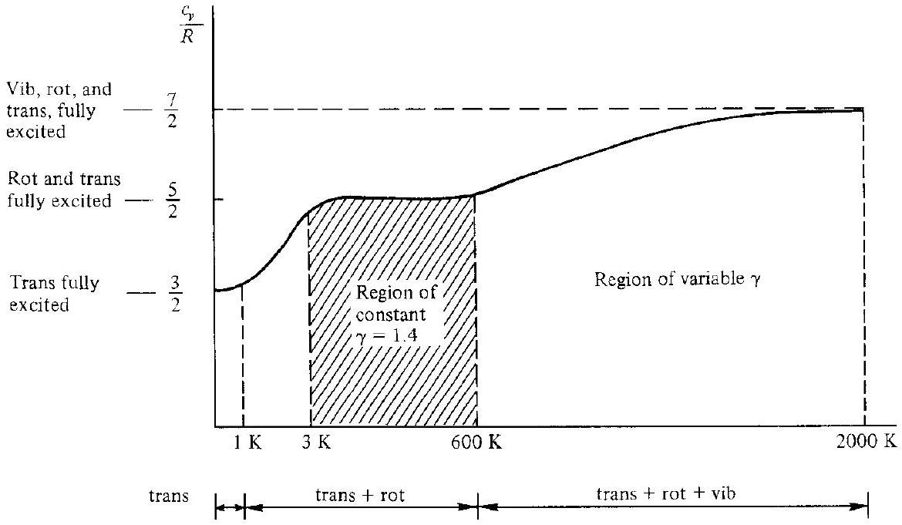
Figure 16.11 I Schematic of the temperature variation of the specific heat for a diatomic gas.

## 16.9 | THE EQUILIBRIUM CONSTANT

The theory and results obtained in the previous sections apply to a single chemical species. However, most high-temperature gases of interest are mixtures of several species. Let us now consider the statistical thermodynamics of a mixture of gases; the results obtained in this section represent an important ingredient for our subsequent discussions on equilibrium chemically reacting gases.

First, consider a gas mixture composed of three arbitrary chemical species $\mathrm{A}, \mathrm{B}$, and AB . The chemical equation governing a reaction between these species is

$$
\mathrm{AB} \rightleftarrows \mathrm{~A}+\mathrm{B}
$$

Assume that the mixture is confined in a given volume at a given constant pressure and temperature. (We will soon appreciate that $p$ and $T$ are important variables in dealing with chemically reacting mixtures.) We assume that the system has existed long enough for the composition to become fixed, i.e., the above reaction is taking place an equal number of times to both the right and left (the forward and reverse reactions are balanced). This is the case of chemical equilibrium. Therefore, let $N^{\mathrm{AB}}, N^{\mathrm{A}}$, and $N^{\mathrm{B}}$ be the number of $\mathrm{AB}, \mathrm{A}$, and B particles, respectively, in the mixture at chemical equilibrium. Moreover, the $\mathrm{A}, \mathrm{B}$, and AB particles each have their own set of energy levels, populations, and degeneracies:

$$
\begin{array}{cc}
\varepsilon_{o}^{\prime}, \varepsilon_{1}^{\prime \mathrm{A}}, \varepsilon_{2}^{\prime \mathrm{A}}, \ldots, \varepsilon_{j}^{\prime \mathrm{A}}, \ldots & \varepsilon_{o}^{\prime \mathrm{B}}, \varepsilon_{1}^{\prime \mathrm{B}}, \varepsilon_{2}^{\prime \mathrm{B}}, \ldots, \varepsilon_{j}^{\prime \mathrm{B}}, \ldots \\
N_{o}^{\mathrm{A}}, N_{1}^{\mathrm{A}}, N_{2}^{\mathrm{A}}, \ldots, N_{j}^{\mathrm{A}}, \ldots & N_{o}^{\mathrm{B}}, N_{1}^{\mathrm{B}}, N_{2}^{\mathrm{B}}, \ldots, N_{j}^{\mathrm{B}}, \ldots \\
g_{o}^{\mathrm{A}}, g_{1}^{\mathrm{A}}, g_{2}^{\mathrm{A}}, \ldots, g_{j}^{\mathrm{A}}, \ldots & g_{o}^{\mathrm{B}}, g_{1}^{\mathrm{B}}, g_{2}^{\mathrm{B}}, \ldots, g_{j}^{\mathrm{B}}, \ldots \\
\varepsilon_{o}^{\prime \mathrm{AB}}, \varepsilon_{1}^{\prime \mathrm{AB}}, \varepsilon_{2}^{\prime \mathrm{AB}}, \ldots, \varepsilon_{j}^{\prime \mathrm{AB}}, \ldots \\
N_{o}^{\mathrm{AB}}, N_{1}^{\mathrm{AB}}, N_{2}^{\mathrm{AB}}, \ldots, N_{j}^{\mathrm{AB}}, \ldots \\
g_{o}^{\mathrm{AB}}, g_{1}^{\mathrm{AB}}, g_{2}^{\mathrm{AB}}, \ldots, g_{j}^{\mathrm{AB}}, \ldots
\end{array}
$$

A schematic of the energy levels is given in Fig. 16.12. Recall that, in most cases, we do not know the absolute values of the zero-point energies, but in general we know that $\varepsilon_{o}^{\prime \mathrm{A}} \neq \varepsilon_{o}^{\prime \mathrm{B}} \neq \varepsilon_{o}^{\prime \mathrm{AB}}$. Therefore, the three energy-level ladders shown in Fig. 16.12 are at different heights. However, it is possible to find the change in zero-point energy for the reaction

$$
\begin{aligned}
& \underbrace{\mathrm{AB}}_{\text {Reactant }} \rightarrow \underbrace{\mathrm{A}+\mathrm{B}}_{\text {Products }} \\
& {\left[\begin{array}{l}
\text { Change in zero- } \\
\text { point energy }
\end{array}\right] } \equiv\left[\begin{array}{l}
\text { Zero-point energy } \\
\text { of products }
\end{array}\right]-\left[\begin{array}{l}
\text { Zero-point energy } \\
\text { of reactants }
\end{array}\right] \\
& \Delta \varepsilon_{o}=\left(\varepsilon_{o}^{\prime \mathrm{A}}+\varepsilon_{o}^{\prime \mathrm{B}}\right)- \\
& \varepsilon_{o}^{\prime \mathrm{AB}}
\end{aligned}
$$

This relationship is illustrated in Fig. 16.13.

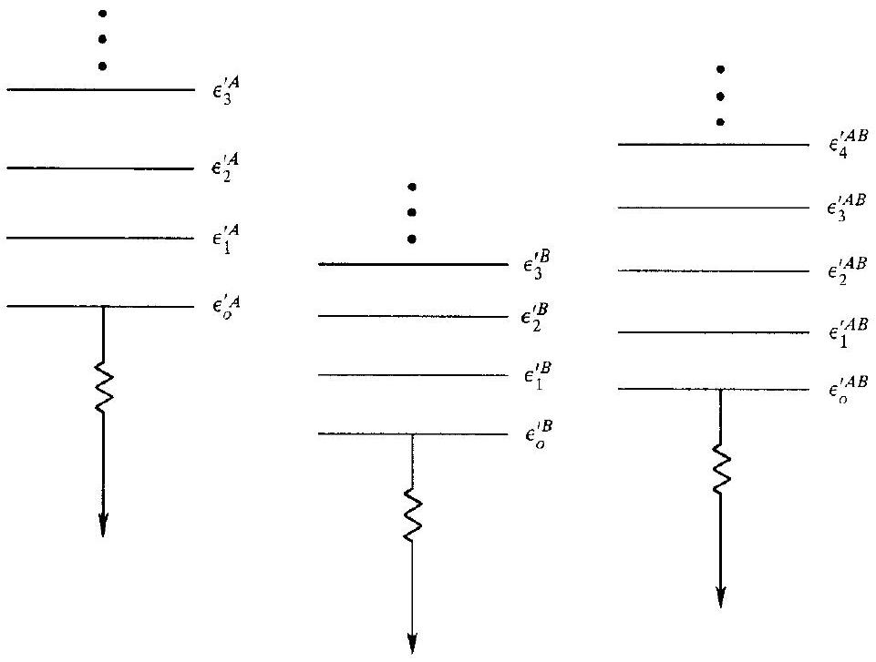
Figure 16.12 | Schematic of energy levels for three different chemical species.

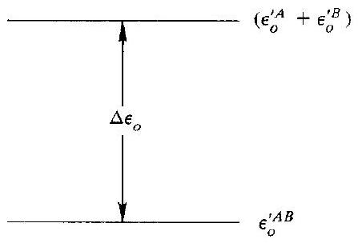
Figure 16.13 I Illustration of the meaning of change in zero-point energy.

The equilibrium mixture of $\mathrm{A}, \mathrm{B}$, and AB particles has two constraints:

1. The total energy $E$ is constant:

$$
\begin{aligned}
E^{\mathrm{A}} & =\sum_{j} N_{j}^{\mathrm{A}} \varepsilon_{j}^{\prime \mathrm{A}}=\sum_{j} N_{j}^{\mathrm{A}}\left(\varepsilon_{j}^{\mathrm{A}}+\varepsilon_{o}^{\mathrm{A}}\right) \\
E^{\mathrm{B}} & =\sum_{j} N_{j}^{\mathrm{B}} \varepsilon_{j}^{\prime \mathrm{B}}=\sum_{j} N_{j}^{\mathrm{B}}\left(\varepsilon_{j}^{\mathrm{B}}+\varepsilon_{o}^{\mathrm{B}}\right) \\
E^{\mathrm{AB}} & =\sum_{j} N_{j}^{\mathrm{AB}} \varepsilon_{j}^{\prime \mathrm{AB}}=\sum_{j} N_{j}^{\mathrm{AB}}\left(\varepsilon_{j}^{\mathrm{AB}}+\varepsilon_{o}^{\mathrm{AB}}\right) \\
E & =E^{\mathrm{A}}+E^{\mathrm{B}}+E^{\mathrm{AB}}=\text { const }
\end{aligned}
$$

2. Total number of A particles, $N_{\mathrm{A}}$, both free and combined (such as in AB ), must be constant. This is essentially the same as saying that the total number of A nuclei stays the same, whether it is in the form of pure A or combined in AB . We are not considering nuclear reactions here-only chemical reactions which rearrange the electron structure. Similarly, the total number of B particles, $N_{\mathrm{B}}$, both free and combined must also be constant:

$$
\begin{aligned}
& \sum_{j} N_{j}^{\mathrm{A}}+\sum_{j} N_{j}^{\mathrm{AB}}=N_{\mathrm{A}}=\text { const } \\
& \sum_{j} N_{j}^{\mathrm{B}}+\sum_{j} N_{j}^{\mathrm{AB}}=N_{\mathrm{B}}=\text { const }
\end{aligned}
$$

To obtain the properties of the system in chemical equilibrium, we must find the most probable macrostate of the system, much the same way as we proceeded in Secs. 16.3 and 16.4 for a single species. The theme is the same; only the details are different. Consult Refs. 59 and 62 for those details. From this statistical thermodynamic treatment of the mixture, we find

$$
\begin{aligned}
& N_{j}^{\mathrm{A}}=N^{\mathrm{A}} \frac{g_{j}^{\mathrm{A}} e^{-\varepsilon_{j}^{A} / k T}}{Q^{\mathrm{A}}} \\
& N_{j}^{\mathrm{B}}=N^{\mathrm{B}} \frac{g_{j}^{\mathrm{B}} e^{-\varepsilon_{j}^{\mathrm{B}} / k T}}{Q^{\mathrm{B}}}
\end{aligned}
$$

$$
N_{j}^{\mathrm{AB}}=N^{\mathrm{AB}} \frac{g_{j}^{\mathrm{AB}} e^{-\varepsilon_{j}^{\mathrm{AB}} / k T}}{Q^{\mathrm{AB}}}
$$

and

$$
\frac{N^{\mathrm{A}} N^{\mathrm{B}}}{N^{\mathrm{AB}}}=e^{-\Delta \varepsilon_{o} / k T} \frac{Q^{\mathrm{A}} Q^{\mathrm{B}}}{Q^{\mathrm{AB}}}
$$

Recall that $N^{\mathrm{A}}, N^{\mathrm{B}}$, and $N^{\mathrm{AB}}$ are the actual number of $\mathrm{A}, \mathrm{B}$, and AB particles present in the mixture; do not confuse these with $N_{\mathrm{A}}$ and $N_{\mathrm{B}}$, which were defined as the number of A and B nuclei.

Equations (16.54a) through ( $16.54 c$ ) demonstrate that a Boltzmann distribution exists independently for each one of the three chemical species. More important, however, Eq. (16.55) gives some information on the relative amounts of A, B, and AB in the mixture. Equation (16.55) is called the law of mass action, and it relates the amounts of different species to the change in zero-point energy, $\Delta \varepsilon_{o}$, and to the ratio of partition functions for each species.

For gasdynamic calculations, there is a more useful form of Eq. (16.55), as follows. From Sec. 1.4, we can write the perfect gas equation of state for the
mixture as

$$
p V=N k T
$$

For each species $i$, the partial pressure $p_{i}$, can be written as

$$
p_{i} V=N_{i} k T
$$

The partial pressure is defined by Eq. (16.57); it is the pressure that would exist if $N_{i}$ particles of species $i$ were the only matter filling the volume $V$. Letting $N_{i}$ equal $N^{\mathrm{A}}, N^{\mathrm{B}}$, and $N^{\mathrm{AB}}$, respectively, and defining the corresponding partial pressures $p_{\mathrm{A}}, p_{\mathrm{B}}$, and $p_{\mathrm{AB}}$, Eq. (16.57) yields

$$
\frac{N^{\mathrm{A}} N^{\mathrm{B}}}{N^{\mathrm{AB}}}=\frac{p_{\mathrm{A}} p_{\mathrm{B}}}{p_{\mathrm{AB}}} \frac{V}{k T}
$$

Combining Eqs. (16.58) and (16.55), we have

$$
\frac{p_{\mathrm{A}} p_{\mathrm{B}}}{p_{\mathrm{AB}}}=\frac{k T}{V} e^{-\Delta \varepsilon_{o} / k T} \frac{Q^{\mathrm{A}} Q^{\mathrm{B}}}{Q^{\mathrm{AB}}}
$$

Recall from Eqs. (16.37) and (16.38) that $Q$ is proportional to the volume $V$. Therefore, in Eq. (16.59) the $V$ 's cancel, and we obtain

$$
\frac{p_{\mathrm{A}} p_{\mathrm{B}}}{p_{\mathrm{AB}}}=f(T)
$$

This function of temperature is defined as the equilibrium constant for the reaction $\mathrm{AB} \rightleftarrows \mathrm{A}+\mathrm{B}, K_{p}(T):$

$$
\frac{p_{\mathrm{A}} p_{\mathrm{B}}}{p_{\mathrm{AB}}}=K_{p}(T)
$$

From Eq. (16.60), the equilibrium constant for the reaction $\mathrm{AB} \rightleftarrows \mathrm{A}+\mathrm{B}$ can be defined as the ratio of the partial pressures of the products of reaction to the partial pressures of the reactants.

Generalizing this idea, consider the general chemical equation

$$
v_{1} A_{1}+v_{2} A_{2}+v_{3} A_{3} \rightleftarrows v_{4} A_{4}+v_{5} A_{5}
$$

or

$$
0=\sum_{i} v_{i} A_{i}
$$

where $v_{i}$ is the stoichiometric mole number for species $i$ and $A_{i}$ is the chemical symbol for species $i$. In Eq. (16.61) $v_{i}$ is positive for products and negative for reactants. Then the equilibrium constant is defined as

$$
K_{p}(T) \equiv \frac{\left(p_{\mathrm{A}_{4}}\right)^{v_{4}}\left(p_{\mathrm{A}_{5}}\right)^{v_{5}}}{\left(p_{\mathrm{A}_{1}}\right)^{v_{1}}\left(p_{\mathrm{A}_{2}}\right)^{v_{2}}\left(p_{\mathrm{A}_{3}}\right)^{v_{3}}}
$$

or

$$
K_{p}(T) \equiv \prod_{i} p_{i}^{\nu_{i}}
$$

Equation (16.62) is another form of the law of mass action, and it is extremely useful in the calculation of the composition of an equilibrium chemically reacting mixture. Some typical reactions, with their associated equilibrium constants are
$\mathrm{N}_{2} \rightleftarrows 2 \mathrm{~N}$ :

$$
K_{p, \mathrm{~N}_{2}}=\frac{\left(p_{\mathrm{N}}\right)^{2}}{p_{\mathrm{N}_{2}}}
$$

$\mathrm{H}_{2} \mathrm{O}_{2} \rightleftarrows 2 \mathrm{H}+2 \mathrm{O}:$

$$
K_{p, \mathrm{H}_{2} \mathrm{O}_{2}}=\frac{\left(p_{\mathrm{H}}\right)^{2}\left(p_{\mathrm{O}}\right)^{2}}{p_{\mathrm{H}_{2} \mathrm{O}_{2}}}
$$

In summary, we have made three important accomplishments in this section:

1. We have defined the equilibrium constant, Eqs. (16.60) or (16.62).
2. We have shown it to be a function of temperature only, Eq. (16.60).
3. We have demonstrated a formula from which it may be calculated based on a knowledge of the partition functions, Eq. (16.59). Indeed, tables of equilibrium constants for many basic chemical reactions have been calculated, and are given in Refs. 63 and 64.

In perspective, the first part of this chapter has developed the high-temperature properties of a single species. Now, in order to focus on the properties of a chemically reacting mixture (such as high-temperature air), we must know what chemical species are present in the mixture, and in what quantity. After these questions are answered, we can sum over all the species and find the thermodynamic properties of the mixture. These matters are the subjects of the next few sections.

### 16.10 | CHEMICAL EQUILIBRIUMQUALITATIVE DISCUSSION

Consider air at normal room temperature and pressure. The chemical composition under these conditions is approximately $79 \% \mathrm{~N}_{2}, 20 \% \mathrm{O}_{2}$, and 1 percent trace species such as $\mathrm{Ar}, \mathrm{He}, \mathrm{CO}_{2}, \mathrm{H}_{2} \mathrm{O}$, etc., by volume. Ignoring these trace species, we can consider that normal air consists of two species, $\mathrm{N}_{2}$ and $\mathrm{O}_{2}$. However, if we heat this air to a high temperature, where $2500 \mathrm{~K}<T<9000 \mathrm{~K}$, chemical reactions will occur among the nitrogen and oxygen. Some of the important reactions in this temperature range are

$$
\begin{aligned}
\mathrm{O}_{2} & \rightleftarrows 2 \mathrm{O} \\
\mathrm{~N}_{2} & \rightleftarrows 2 \mathrm{~N} \\
\mathrm{~N}+\mathrm{O} & \rightleftarrows \mathrm{NO} \\
\mathrm{~N}+\mathrm{O} & \rightleftarrows \mathrm{NO}^{+}+e^{-}
\end{aligned}
$$

That is, at high temperatures, we have present in the air mixture not only $\mathrm{O}_{2}$ and $\mathrm{N}_{2}$, but $\mathrm{O}, \mathrm{N}, \mathrm{NO}, \mathrm{NO}^{+}$and $e^{-}$as well. Moreover, if the air is brought to a given $T$ and
$p$, and then left for a period of time until the above reactions are occurring an equal amount in both the forward and reverse directions, we approach the condition of chemical equilibrium. For air in chemical equilibrium at a given $p$ and $T$, the species $\mathrm{O}_{2}, \mathrm{O}, \mathrm{N}_{2}, \mathrm{~N}, \mathrm{NO}, \mathrm{NO}^{+}$, and $e^{-}$are present in specific, fixed amounts, which are unique functions of $p$ and $T$. Indeed, for any equilibrium chemically reacting gas, the chemical composition (the types and amounts of each species) is determined uniquely by $p$ and $T$, as we will learn in Sec. 16.11.

### 16.11 I PRACTICAL CALCULATION OF THE EQUILIBRIUM COMPOSITION

The method discussed in this section is applicable to any equilibrium chemically reacting mixture. However, because a large number of high-speed, compressible flow problems deal with air, we will illustrate the method by treating the case of hightemperature air.

To begin with, there are several different ways of specifying the composition of a gas mixture. For example, the quantity of different gases in a mixture can be specified by means of

1. The partial pressures $p_{i}$. For air, we have $p_{\mathrm{O}_{2}}, p_{\mathrm{O}}, p_{\mathrm{N}_{2}}, p_{\mathrm{N}}, p_{\mathrm{NO}}, p_{\mathrm{NO}}$, and $p_{e}$.
2. The concentrations, i.e., the number of moles of species $i$ per unit volume of the mixture, denoted by $\left[X_{i}\right]$. For air, we have $\left[\mathrm{O}_{2}\right],[\mathrm{O}],\left[\mathrm{N}_{2}\right]$, etc.
3. The mole-mass ratios (see Sec. 1.4), i.e., the number of moles of $i$ per unit mass of mixture, denoted by $\eta_{1}$. For air, we have $\eta_{\mathrm{O}_{2}}, \eta_{\mathrm{O}} . \eta_{\mathrm{N}_{2}}$. etc.
4. The mole fractions, i.e., the number of moles of species $i$ per unit mole of mixture, denoted by $X_{i}$. For air, we have $X_{\mathrm{O}_{2}}, X_{\mathrm{O}} . X_{\mathrm{N}_{2}}$, etc.
5. The mass fraction, i.e., the mass of species $i$ per unit mass of mixture, denoted by $c_{i}$. For air, we have $c_{\mathrm{O}_{2}}, c_{\mathrm{O}}, c_{\mathrm{N}_{2}}$, etc.

Each of these is equally definitive for specifying the composition of a chemically reacting mixture-if we know the composition in terms of $p_{i}$, for example, then we can immediately convert to $X_{i}, c_{i}$, etc. (Try deriving the conversion formulas yourself.) However, for gasdynamic problems, the use of partial pressures is particularly convenient; therefore, the following development will deal with $p_{i}$.

Consider again a system of high-temperature air at a given $T$ and $p$, and assume that the above seven species are present. We want to solve for $p_{\mathrm{O}_{2}}, p_{\mathrm{O}_{1}}, p_{\mathrm{N}_{2}}$, $p_{\mathrm{N}}, p_{\mathrm{NO}}, p_{\mathrm{NO}}$, and $p_{e}$ at the given mixture temperature and pressure. We have seven unknowns, hence we need seven independent equations. The first equation is Dalton's law of partial pressures, which states that the total pressure of the mixture is the sum of the partial pressures (Dalton's law holds only for perfect gases, i.e.. gases wherein intermolecular forces are negligible):
I.

$$
p=p_{\mathrm{O}_{2}}+p_{\mathrm{O}}+p_{\mathrm{N}_{2}}+p_{\mathrm{N}}+p_{\mathrm{NO}}+p_{\mathrm{NO}^{+}}+p_{e}
$$

In addition, using Eq. (16.62) we can define the equilibrium constants for the chemical reactions (16.63a) through (16.63d) as
II.

$$
\frac{\left(p_{\mathrm{O}}\right)^{2}}{p_{\mathrm{O}_{2}}}=K_{p, \mathrm{O}_{2}}(T)
$$

III.

$$
\frac{\left(p_{\mathrm{N}}\right)^{2}}{p_{\mathrm{N}_{2}}}=K_{p, \mathrm{~N}_{2}}(T)
$$

IV.

$$
\frac{p_{\mathrm{NO}}}{p_{\mathrm{N}} p_{\mathrm{O}}}=K_{p, \mathrm{NO}}(T)
$$

V.

$$
\frac{p_{\mathrm{NO}^{+}} p_{e}}{p_{\mathrm{N}} p_{\mathrm{O}}}=K_{p, \mathrm{NO}^{+}}(T)
$$

In Eqs. (16.65) through (16.68), the equilibrium constants $K_{p}$ are known values, calculated from statistical mechanics as previously described, or obtained from thermodynamic measurements. They can be found in established tables, such as the JANAF Tables (Ref. 63). However, Eqs. (16.64) through (16.68) constitute only five equations-we still need two more. The other equations come from the indestructibility of matter, as follows.
Fact. The number of O nuclei, both in the free and combined state, must remain constant. Let $N_{\mathrm{O}}$ denote the number of oxygen nuclei per unit mass of mixture.

Fact. The number of N nuclei, both in the free and combined state, must remain constant. Let $N_{\mathrm{N}}$ denote the number of nitrogen nuclei per unit mass of mixture.

Then, from the definition of Avogadro's number $N_{A}$, and the mole-mass ratios $\eta_{i}$,

$$
\begin{aligned}
& N_{A}\left(2 \eta_{\mathrm{O}_{2}}+\eta_{\mathrm{O}}+\eta_{\mathrm{NO}}+\eta_{\mathrm{NO}^{+}}\right)=N_{\mathrm{O}} \\
& N_{A}\left(2 \eta_{\mathrm{N}_{2}}+\eta_{\mathrm{N}}+\eta_{\mathrm{NO}}+\eta_{\mathrm{NO}^{+}}\right)=N_{\mathrm{N}}
\end{aligned}
$$

However, from Eq. (1.12),

Hence

$$
\begin{aligned}
p_{i} v & =\eta_{i} \mathscr{R} T \\
\eta_{i} & =p_{i} \frac{v}{\mathscr{R} T}
\end{aligned}
$$

Dividing Eqs. (16.69) and (16.70), and substituting Eq. (16.71) into the result, we have
VI.

$$
\frac{2 p_{\mathrm{O}_{2}}+p_{\mathrm{O}}+p_{\mathrm{NO}}+p_{\mathrm{NO}^{+}}}{2 p_{\mathrm{N}_{2}}+p_{\mathrm{N}}+p_{\mathrm{NO}}+p_{\mathrm{NO}^{+}}}=\frac{N_{\mathrm{O}}}{N_{\mathrm{N}}}
$$

Equation (16.72) is called the mass-balance equation. Here, the ratio $N_{\mathrm{O}} / N_{\mathrm{N}}$ is known from the original mixture at low temperature. For example, assuming at normal conditions that air consists of $80 \% \mathrm{~N}_{2}$ and $20 \% \mathrm{O}_{2}$,

$$
\frac{N_{\mathrm{O}}}{N_{\mathrm{N}}}=\frac{0.2}{0.8}=0.25
$$

Finally, to obtain our last remaining equation, we state the fact that electric charge must be conserved, and hence

$$
\eta_{\mathrm{NO} \mathrm{I}}=\eta_{e^{\cdots}}
$$

Substituting Eq. (16.71) into (16.73), we have
VII.

$$
p_{\mathrm{NO}}=p_{e^{-}}
$$

In summary, Eqs. (16.64) through (16.68), (16.72), and (16.74) are seven nonlinear, simultaneous, algebraic equations that can be solved for the seven unknown partial pressures. Furthermore, Eq. (16.64) requires the pressure $p$ as input, and Eqs. (16.65) through (16.68) require the temperature $T$ in order to evaluate the equilibrium constants. Hence, these equations clearly demonstrate that, for a given chemically reacting mixture, the equilibrium composition is a function of $T$ and $p$.

This procedure, carried out for high-temperature air, is an example of a general procedure that applies to any chemically reacting mixture in chemical equilibrium. In general, if the mixture has $\sum$ species and $\phi$ elements, then we need $\sum-\phi$ independent chemical equations [such as Eqs. (16.63a) through (16.63d)] with the appropriate equilibrium constants. The remaining equations are obtained from the mass-balance equations and Dalton's law of partial pressures. In our earlier example for air, $\sum=7$ and $\phi=3$ (the elements are $\mathrm{O}, \mathrm{N}$, and $e^{-}$). Therefore, we needed $\sum-\phi=4$ independent chemical equations with four different equilibrium constants. These four equations were Eqs. (16.63a) through (16.63d).

The calculation of a chemical equilibrium composition is conceptually straightforward, as indicated in this section. However, the solution of a system of many nonlinear, simultaneous algebraic equations is not a trivial undertaking by hand, and today such calculations are almost always performed on a high-speed digital computer using custom-designed algorithms.

Also, the reader should note that the specific chemical species to be solved are chosen at the beginning of the problem. This choice is important; if a major species is not considered (for example, if N had been left out of our above calculations), the final results for chemical equilibrium will not be accurate. The proper choice of the type of species in the mixture is a matter of experience and common sense. If there is any doubt, it is always safe to assume all possible combinations of the atoms and molecules as potential species; then, if many of the choices turn out to be trace species, the results of the calculation will state so. At least in this manner, the possibility of overlooking a major species is minimized.

### 16.12 I EQUILIBRIUM GAS MIXTURE THERMODYNAMIC PROPERTIES

In perspective, to this point in our discussion of the properties of high-temperature gases we have accomplished two major goals:

1. From Secs. 16.1 through 16.8, we have obtained formulas for calculating the thermodynamic properties of a given single species.
2. From Secs. 16.9 through 16.11, we have seen how to calculate the amount of each species in an equilibrium chemically reacting mixture.

In this section, we now combine the above knowledge to obtain the thermodynamic properties of an equilibrium chemically reacting mixture. Because of its importance to gas dynamics, we will concentrate on the enthalpy of the mixture.

From Eq. (1.10),
and

$$
\begin{aligned}
p_{i} \mathscr{V} & =\mathscr{N}_{i} \mathscr{R} T \\
p \mathscr{V} & =\mathscr{N} \mathscr{R} T
\end{aligned}
$$

where $\mathscr{V}$ is the volume of the system, $\mathscr{N}_{i}$ is the number of moles of species $i$, and $\mathscr{F}$ is the total number of moles of the mixture. Dividing Eq. (16.75) by (16.76):

$$
\frac{p_{i}}{p}=\frac{\mathscr{N}_{i}}{\mathscr{N}} \equiv X_{i}
$$

where $X_{i}$ is the mole fraction defined in Sec. 16.11. Let $H_{i}$ be the enthalpy of species $i$ per mole of species $i$, and $H$ be the enthalpy of the mixture per mole of mixture. Then

$$
H=\sum_{i} X_{i} H_{i}=\sum_{i} \frac{p_{i}}{p} H_{i}
$$

where the summation is taken over all species in the mixture.
In gasdynamics, we are more concerned with unit masses than with moles. Let
$h=$ enthalpy per unit mass of mixture
$\mathscr{U}=$ molecular weight (more properly called the molecular mass) of the mixture; it is the mass of mixture per mole of mixture
$\mathscr{M}_{i}=$ molecular weight of species $i$; it is the mass of $i$ per mole of $i$.
Hence, from the definitions, we have

$$
\mathscr{M}=\sum_{i} X_{i} \mathscr{M}_{i}=\sum_{i} \frac{p_{i}}{p} \mathscr{M}_{i}
$$

and therefore,

$$
h=\frac{H}{\mathscr{M}}=\frac{\sum_{i} \frac{p_{i}}{p} H_{i}}{\sum_{i} \frac{p_{i}}{p} \mathscr{M}_{i}}
$$

Equation (16.80) provides an equation for obtaining the enthalpy per unit mass of mixture from molar quantities. There are two alternative expressions for $h$. Recalling the definition of the mole-mass ratio $\eta_{i}$, from Secs. 1.4 and 16.11, we have

$$
h=\sum_{i} \eta_{i} H_{i}
$$

Also, denoting the enthalpy of species $i$ per unit mass of $i$ by $h_{i}$, where $h_{i}=H_{i} / \|_{i}$, and recalling the definition of mass fraction $c_{i}$ from Sec. 16.11, we have

$$
h=\sum_{i} c_{i} h_{i}
$$

Note from the definitions that

$$
c_{i}=X_{i} \frac{\|_{i}}{\|}=\frac{p_{i}}{p} \frac{\|_{i}}{\sum_{i}\left(p_{i} / p\right) \cdot \|_{i}}
$$

Let us now examine the meaning of $H_{i}$ more closely:

$$
\underbrace{H_{i}}_{\begin{array}{c}
\text { Absolute enthalpy } \\
\text { of species } i \text { per } \\
\text { mole of } i
\end{array}}=\underbrace{\left(H-E_{o}\right)_{i}}_{\begin{array}{c}
\text { Sensible enthalpy of } \\
\text { species } i \text { per mole of } i
\end{array}}+\underbrace{E_{\omega_{i}}}_{\begin{array}{c}
\text { Zero-point energy } \\
\text { of species } i \text { per } \\
\text { mole of } i
\end{array}}
$$

The sensible enthalpy is obtained from statistical mechanics, as we have already seen:

$$
\begin{aligned}
\left(H-E_{o}\right)_{i} & =\left(E-E_{o}\right)_{i}+\mathscr{R} T \\
\left(H-E_{o}\right)_{i} & =\underbrace{\frac{3}{2} \cdot \mathscr{R} T}_{\text {Translation }}+\underbrace{. R T}_{\text {Rotation }}+\underbrace{\frac{h v / k T}{e^{h v / k T}-1}}_{\text {Vibration }} \cdot R T
\end{aligned} . \mathscr{R} T+\text { electronic energy }
$$

Note that $\left(H-E_{o}\right)_{i}$ is a function of $T$ only. Also, $E_{o_{i}}$ is the zero-point energy of species $i$, that is, the energy of the species at $T=0 \mathrm{~K}$; it is a constant for a given chemical species. The relationship is schematically shown in Fig. 16.14. As discussed in Secs. 16.2 and 16.7, the absolute value of $E_{o_{i}}$ usually cannot be calculated or measured; nevertheless it is an important theoretical quantity. For example, in a complex chemically reacting mixture, we should establish some reference level from

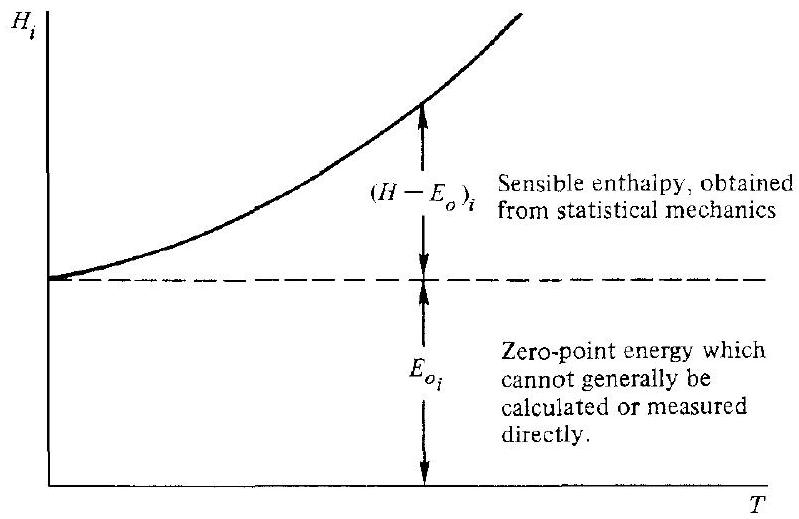
Figure 16.14 I Schematic showing the contrast between sensible enthalpy and zero-point energy.

which all the energies of the given species can be measured. Many times there is some difficulty and confusion in establishing what this level should be. However, by carrying through our concept of the absolute zero-point energy $E_{o_{i}}$, the choice of a proper reference level will soon become apparent.

Since the absolute value of $E_{o_{i}}$ generally cannot be obtained, how can we calculate a number for $h$ from Eq. (16.80), (16.81), or (16.82)? The answer lies in the fact that we never need an absolute number for $h$. In all thermodynamic and gasdynamic problems, we deal with changes in enthalpy and internal energy. For example, in Chap. 3 dealing with shock waves, we were always interested in the change $h_{2}-h_{1}$ across the shock. In the general conservation equations from Chap. 6, we dealt with the derivatives $\partial h / \partial x, \partial h / \partial y, \partial h / \partial z, \partial h / \partial t$, which are changes in enthalpy. Letting points 1 and 2 denote two different locations in a flowfield, we have from Eq. (16.81)

$$
h_{1}=\sum_{i}\left(\eta_{i} H_{i}\right)_{1}=\sum\left[\eta_{i}\left(H-E_{o}\right)_{i}\right]_{1}+\sum\left(\eta_{i} E_{o_{i}}\right)_{1}
$$

or

$$
h_{1}=h_{\mathrm{sens}_{1}}+e_{o_{1}}
$$

where $h_{\text {sens }{ }_{1}}$ and $e_{o_{1}}$ are the sensible enthalpy and zero-point energy, respectively, per unit mass of mixture at point 1 . Similarly, at point 2 ,

$$
h_{2}=\sum_{i}\left(\eta_{i} H_{i}\right)_{2}=\sum_{i}\left[\eta_{i}\left(H-E_{o}\right)_{i}\right]_{2}+\sum_{i}\left(\eta_{i} E_{o_{i}}\right)_{2}
$$

or

$$
h_{2}=h_{\text {sens }_{2}}+e_{o_{2}}
$$

Subtracting Eq. (16.86) from (16.87), we have

$$
\underbrace{h_{2}-h_{1}}_{\substack{\text { Change in } \\ \text { enthalpy }}}=\underbrace{\left(h_{\text {sens }_{2}}-h_{\text {sens }_{1}}\right)}_{\text {Change in sensible enthalpy }}+\underbrace{\left(e_{o_{2}}-e_{o_{1}}\right)}_{\substack{\text { Change in zero- } \\ \text { point energy }}}
$$

or

$$
\Delta h=\Delta h_{\text {sens }}+\Delta e_{o}
$$

It is important to note that in Eq. (16.88) we have circumvented the need to know the absolute value of the zero-point energy; rather, what we need now is a value for the change in zero-point energy, $\Delta e_{o}$. The value can be obtained from measurement, as discussed below.

The change in zero-point energy is related to the concept of the heat of formation for a given species. When a chemical reaction represents the formation of a single chemical species from its "elements" at standard conditions, the heat of reaction is called the standard heat of formation. The standard conditions are those of the stable "elements" at the standard temperature, $T_{s}=298.16 \mathrm{~K}$. (The quotation marks around the word "elements" above reflects that some "elements" at the standard conditions are really diatomic molecules, not atoms. For example, nitrogen and oxygen are always found at standard conditions in the form $\mathrm{N}_{2}$ and $\mathrm{O}_{2}$, not N and O .) To illustrate, consider the formation of $\mathrm{H}_{2} \mathrm{O}$ from its "elements" at standard
conditions:

$$
\underbrace{\mathrm{H}_{2}+\frac{1}{2} \mathrm{O}_{2}}_{\text {At } T_{s}} \rightarrow \underbrace{\mathrm{H}_{2} \mathrm{O}}_{\text {At } T_{s}}
$$

Then, by definition,

$$
\underbrace{\left(\Delta H_{f}\right)_{\mathrm{H}_{2} \mathrm{O}}^{T_{s}}}_{\begin{array}{l}
\text { Standard heat } \\
\text { of formation } \\
\text { of } \mathrm{H}_{2} \mathrm{O}
\end{array}} \equiv \underbrace{H_{\mathrm{H}_{2} \mathrm{O}}^{T_{s}}-H_{\mathrm{H}_{2}}^{T_{s}}-\frac{1}{2} H_{\mathrm{O}_{2}}^{T_{s}}}_{\begin{array}{l}
\text { Enthalpy of the product minus } \\
\text { the enthalpy of the reactants. } \\
\text { all at } T_{s}
\end{array}}
$$

In an analogous fashion, let us define the heat of formation at absolute zero. Here, both the product and reactants are assumed to be at absolute zero. For example.

$$
\underbrace{\mathrm{H}_{2}+\frac{1}{2} \mathrm{O}_{2}}_{\mathrm{At} T=0 \mathrm{~K}} \rightarrow \underbrace{\mathrm{H}_{2} \mathrm{O}}_{\mathrm{At} T=0 \mathrm{~K}}
$$

Letting $\left(\Delta H_{f}\right)_{\mathrm{H}_{2} \mathrm{O}}^{o}$ denote the heat of formation of $\mathrm{H}_{2} \mathrm{O}$ at absolute zero, we have

$$
\left(\Delta H_{f}\right)_{\mathrm{H}_{2} \mathrm{O}}^{o} \equiv H_{\mathrm{H}_{2} \mathrm{O}}^{o}-H_{\mathrm{H}_{2}}^{o}-\frac{1}{2} H_{\mathrm{O}_{2}}^{o}
$$

However, the enthalpy of any species at absolute zero is, by definition, its zero-point energy. Hence, Eq. (16.89) becomes

$$
\left(\Delta H_{f}\right)_{\mathrm{H}_{2} \mathrm{O}}^{o} \equiv\left(E_{o}\right)_{\mathrm{H}_{2} \mathrm{O}}-\left(E_{o}\right)_{\mathrm{H}_{2}}-\frac{1}{2}\left(E_{o}\right)_{\mathrm{O}_{2}}
$$

Note that these expressions are couched in terms of energy per mole. However, the heat of formation of species $i$ per unit mass, $\left(\Delta h_{f}\right)_{i}$, is easily obtained as

$$
\left(\Delta h_{f}\right)_{i}=\frac{\left(\Delta H_{f}\right)_{i}}{\|_{i}}
$$

Also, the heats of formation for many species have been measured, and are tabulated in such references as NBS Circular 500, the JANAF Tables, and NASA SP-3001 (see Refs. 65, 63, and 64, respectively).

We now state this theorem:

## Theorem

In a chemical reaction, the change in zero-point energy (zero-point energy of the products minus the zero-point energy of the reactants) is equal to the difference between the heats of formation of the products at $T=0 \mathrm{~K}$ and the heats of formation of the reactants at $T=0 \mathrm{~K}$.

Proof of this theorem is obtained by induction from examples. For example, consider the water-gas reaction:

$$
\mathrm{CO}_{2}+\mathrm{H}_{2} \rightarrow \mathrm{H}_{2} \mathrm{O}+\mathrm{CO}
$$

By definition of the change in zero-point energy,

$$
\Delta E_{o} \equiv\left(E_{o}\right)_{\mathrm{H}_{2} \mathrm{O}}+\left(E_{o}\right)_{\mathrm{CO}}-\left(E_{o}\right)_{\mathrm{CO}_{2}}-\left(E_{o}\right)_{\mathrm{H}_{2}}
$$

By definition of the heat of formation at absolute zero, we have
$\mathrm{H}_{2}+\frac{1}{2} \mathrm{O}_{2} \rightarrow \mathrm{H}_{2} \mathrm{O}: \quad\left(\Delta H_{f}\right)_{\mathrm{H}_{2} \mathrm{O}}^{o}=\left(E_{o}\right)_{\mathrm{H}_{2} \mathrm{O}}-\left(E_{o}\right)_{\mathrm{H}_{2}}-\frac{1}{2}\left(E_{o}\right)_{\mathrm{O}_{2}}$
$\mathrm{C}+\frac{1}{2} \mathrm{O}_{2} \rightarrow \mathrm{CO}: \quad\left(\Delta H_{f}\right)_{\mathrm{CO}}^{o}=\left(E_{o}\right)_{\mathrm{CO}}-\left(E_{o}\right)_{\mathrm{C}}-\frac{1}{2}\left(E_{o}\right)_{\mathrm{O}_{2}}$
$\mathrm{C}+\mathrm{O}_{2} \rightarrow \mathrm{CO}_{2}: \quad\left(\Delta H_{f}\right)_{\mathrm{CO}_{2}}^{o}=\left(E_{o}\right)_{\mathrm{CO}_{2}}-\left(E_{o}\right)_{\mathrm{C}}-\left(E_{o}\right)_{\mathrm{O}_{2}}$
$\mathrm{H}_{2} \rightarrow \mathrm{H}_{2}: \quad\left(\Delta H_{f}\right)_{\mathrm{H}_{2}}^{o}=0$

Adding Eqs. (16.92) and (16.93), and subtracting (16.94) and (16.95), we have

$$
\begin{aligned}
& \left(\Delta H_{f}\right)_{\mathrm{H}_{2} \mathrm{O}}^{o}+\left(\Delta H_{f}\right)_{\mathrm{CO}}^{o}-\left(\Delta H_{f}\right)_{\mathrm{CO}_{2}}^{o}-\left(\Delta H_{f}\right)_{\mathrm{H}_{2}}^{o} \\
& \quad=\left(E_{o}\right)_{\mathrm{H}_{2} \mathrm{O}}+\left(E_{o}\right)_{\mathrm{CO}}-\left(E_{o}\right)_{\mathrm{CO}_{2}}-\left(E_{o}\right)_{\mathrm{H}_{2}} \equiv \Delta E_{o}
\end{aligned}
$$

Thus, for the water-gas reaction, we have just shown that

$$
\Delta E_{o}=\left(\Delta H_{f}\right)_{\mathrm{H}_{2} \mathrm{O}}^{o}+\left(\Delta H_{f}\right)_{\mathrm{CO}}^{o}-\left(\Delta H_{f}\right)_{\mathrm{CO}_{2}}^{o}-\left(\Delta H_{f}\right)_{\mathrm{H}_{2}}^{o}
$$

This is precisely the statement of the theorem!
Compare Eqs. (16.91) and (16.96). It appears that the terms $\left(E_{o}\right)_{\mathrm{H}_{2} \mathrm{O}},\left(E_{o}\right)_{\mathrm{CO}}$, $\left(E_{o}\right)_{\mathrm{CO}_{2}}$, and $\left(E_{o}\right)_{\mathrm{H}_{2}}$ can be replaced in a one-to-one correspondence by $\left(\Delta H_{f}\right)_{\mathrm{H}_{2} \mathrm{O}}^{o}$, $\left(\Delta H_{f}\right)_{\mathrm{CO}}^{o},\left(\Delta H_{f}\right)_{\mathrm{CO}_{2}}^{o}$, and $\left(\Delta H_{f}\right)_{\mathrm{H}_{2}}^{o}$. Therefore, let us reorient our thinking about the enthalpy of a gas mixture. We have been writing

$$
h=\sum_{i} \eta_{i} H_{i}=\underbrace{\sum_{i} \eta_{i}\left(H-E_{o}\right)_{i}}_{\begin{array}{l}
\text { Sensible enthalpy } \\
\text { of the mixture }
\end{array}}+\underbrace{\sum_{i} \eta_{i} E_{o_{i}}}_{\begin{array}{l}
\text { Zero-point } \\
\text { energy of the } \\
\text { mixture }
\end{array}}
$$

Let us replace this with

$$
h=\underbrace{\sum_{i} \eta_{i}\left(H-E_{o}\right)_{i}}_{\begin{array}{l}
\text { Sensible enthalpy, } \\
\text { obtained for example } \\
\text { from statistical } \\
\text { mechanics }
\end{array}}+\underbrace{\sum_{i} \eta_{i}\left(\Delta H_{f}\right)_{i}^{o}}_{\begin{array}{c}
\text { "Effective" zero-point } \\
\text { energy, obtained from tables }
\end{array}}
$$

Equations (16.97) and (16.98) yield different absolute numbers for $h$; however, from the above theorem the values for changes in enthalpy, $\Delta h$, will be the same whether Eq. (16.97) or (16.98) is used. Therefore, we are led to an important change in our interpretation of enthalpy; namely, from now on we will think of enthalpy as given by Eq. (16.98) with the term involving the heat of formation at absolute zero as an "effective" zero-point energy. In terms of enthalpy per unit mass, we write
where

$$
h=\sum_{i} c_{i} h_{i}
$$

Thus

$$
h_{i}=\left(h-e_{o}\right)_{i}+\left(\Delta h_{f}\right)_{i}^{o}
$$

Thus

$$
h=\sum_{i} c_{i}\left(h-e_{o}\right)_{i}+\sum_{i} c_{i}\left(\Delta h_{f}\right)_{i}^{o}
$$

[Note that in Eqs. (16.98) and (16.99), the effective zero-point energy $\sum_{i} \eta_{i}\left(\Delta H_{f}\right)_{i}^{c}= \sum_{i} c_{i}\left(\Delta h_{f}\right)_{i}^{0}$ is sometimes called the "chemical enthalpy" in the literature.]

With the above, we end our discussions on the thermodynamic properties of an equilibrium chemically reacting mixture. In summary, we have shown that

1. The sensible enthalpy of a mixture can be obtained from this:
a. The sensible enthalpy for each species as given by the formulas for statistical mechanics, for example, Eqs. (16.48), (16.49), and (16.85).
b. Knowledge of the equilibrium composition described in terms of $p_{i}, X_{i}, \eta_{i}$, or $c_{i}$.
2. The zero-point energy can be treated as an "effective" value by using the heats of formation at absolute zero in its place. Therefore, Eq. (16.98) or (16.99) can be construed as the enthalpy of a gas mixture.

Also, as a final note, a chemically reacting mixture that is commonly encountered in many high-speed compressible flow problems is high-temperature air. The equilibrium thermodynamic properties of high-temperature air have been calculated in detail, and are available from many sources, such as the reports by Hansen (Ref. 66) and Hilsenrath and Klein (Ref. 67). These calculations use essentially the same techniques as described in the previous sections. Also, high-temperature air properties are available on large Mollier diagrams (a plot of enthalpy versus entropy) available from the government and some commercial firms. An example of an abbreviated Mollier diagram for high-temperature air is given in Fig. 16.15a. Also, the variation of the equilibrium composition of air at 1 atm as a function of $T$ is given in Fig. 16.15b.

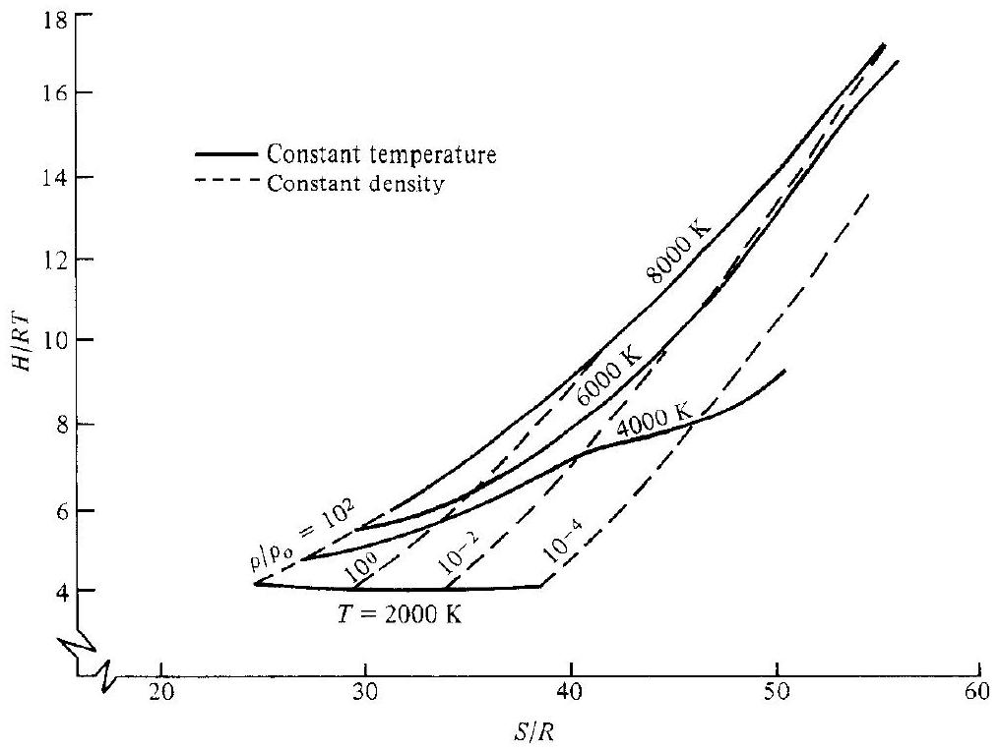
Figure 16.15a | Mollier diagram for high-temperature equilibrium air.

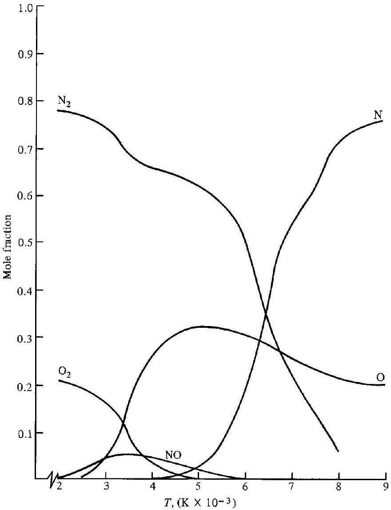
Figure 16.15b | Composition of equilibrium air versus temperature at 1 atm .

### 16.13 I INTRODUCTION TO NONEQUILIBRIUM SYSTEMS

All vibrational and chemical processes take place by molecular collisions and/or radiative interactions. Considering just molecular collisions, visualize for example an $\mathrm{O}_{2}$ molecule colliding with other molecules in the system. If the $\mathrm{O}_{2}$ vibrational energy is in the ground level before collision, it may or may not be vibrationally excited after the collision. Indeed, in general the $\mathrm{O}_{2}$ molecule must experience a large number of collisions, typically on the order of 20,000 , before it will become vibrationally excited. The actual number of collisions required depends on the type of molecule and the relative kinetic energy between the two colliding particles-the higher the kinetic energy (hence the higher the gas temperature), the fewer collisions are required for vibrational energy exchange. Moreover, as the temperature of the gas is increased, and hence the molecular collisions become more violent, it is probable that the $\mathrm{O}_{2}$ molecule will be torn apart (dissociated) by collisions with other particles.

However, this requires a large number of collisions, on the order of 200,000 . The important point to note here is that vibrational and chemical changes take place due to collisions. In turn, collisions take time to occur. Hence, vibrational and chemical changes in a gas take time to occur. The precise amount of time depends on the molecular collision frequency $Z$, which is the number of collisions a single particle makes with its neighboring particles per second. The results of kinetic theory show that $Z \propto p / \sqrt{T}$; hence the collision frequency is low for low pressures and very high temperatures.

The equilibrium systems considered in the previous sections assumed that the gas has had enough time for the necessary collisions to occur, and that the properties of the system at a fixed $p$ and $T$ are constant, independent of time. However, there are many problems in high-speed gasdynamics where the gas is not given the luxury of the necessary time to come to equilibrium. A typical example is the flow across a shock wave, where the pressure and temperature are rapidly increased within the shock front. Consider a fluid element passing through this shock front. When its $p$ and $T$ are suddenly increased, its equilibrium vibrational and chemical properties will change. The fluid element will start to seek these new equilibrium properties, but this requires molecular collisions, and hence time. By the time enough collisions have occurred and equilibrium properties have been approached, the fluid element has moved a certain distance downstream of the shock front. Hence, there will be a certain region immediately behind the shock wave where equilibrium conditions do not prevail-there will be a nonequilibrium region. To study the nonequilibrium region, additional techniques must be developed that take into account the time required for molecular collisions. Such techniques are the subject of the remaining sections of this chapter. The detailed study of both equilibrium and nonequilibrium flows through shock waves, as well as many other types of flows, will be made in Chap. 17.

### 16.14 I VIBRATIONAL RATE EQUATION

In this section we will derive an equation for the time rate of change of vibrational energy of a gas due to molecular collisions-the vibrational rate equation. In turn, this equation will be coupled with the continuity, momentum, and energy equations in Chap. 17 for the study of certain types of nonequilibrium flows.

Consider a diatomic molecule with a vibrational energy level diagram as illustrated in Fig. 16.16. Focus on the $i$ th level. The population of this level, $N_{i}$, is increased by particles jumping up from the $i-1$ level [transition ( $a$ ) shown in Fig. 16.16] and by particles dropping down from the $i+1$ level [transition (b)]. The population $N_{i}$ is decreased by particles jumping up to the $i+1$ level [transition (c)] and dropping down to the $i-1$ level [transition (d)]. For the time being, consider just transition ( $c$ ). Let $P_{i, i+1}$ be the probability that a molecule in the $i$ th level, upon collision with another molecule, will jump up to the $i+1$ level, $P_{i, i+1}$ is called the transition probability, and can be interpreted on a dimensional basis as the "number of transitions per collision per particle" (of course keeping in mind that a single transition requires many collisions). The value of $P_{i, i+1}$ is always less than unity. Also, let $Z$ be the collision frequency as discussed above, where $Z$ is the number of collisions per particle per second. Hence, the product $P_{i, i+1} Z$ is physically the

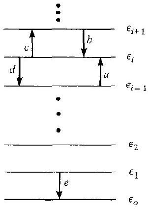
Figure 16.16 I Single quantum transitions for vibrational energy exchange.

number of transitions per particle per second. If there are $N_{i}$ particles in level $i$, then $P_{i, i+1} Z N_{i}$ is the total number of transitions per second for the gas from the $i$ th to the $i+1$ energy level. Similar definitions can be made for transitions ( $a$ ), ( $b$ ), and ( $d$ ) in Fig. 16.16. Therefore, on purely physical grounds, using the above definitions, we can write the net rate of change of the population of the $i$ th level as

$$
\frac{d N_{i}}{d t}=\underbrace{P_{i+1, i} Z N_{i+1}+P_{i-1, i} Z N_{i-1}}_{\text {Rate of increase of } N_{i}}-\underbrace{P_{i, i+1} Z N_{i}-P_{i, i-1} Z N_{i}}_{\text {Rate of decrease of } N_{i}}
$$

To simplify the above equation, define a vibrational rate constant $k_{i+1, i}$ such that $P_{i+1, i} Z \equiv k_{i+1, i} ;$ similarly for the other transitions. Then the above equation becomes

$$
\frac{d N_{i}}{d t}=k_{i+1, i} N_{i+1}+k_{i-1, i} N_{i-1}-k_{i, i+1} N_{i}-k_{i, i-1} N_{i}
$$

Equation (16.100) is called the master equation for vibrational relaxation.
For a moment, consider that the gas is in equilibrium. Hence, from the Boltzmann distribution, Eq. (16.25), and the quantum mechanical expression for vibrational energy, $h v\left(n+\frac{1}{2}\right)$, given in Sec. 16.7,

$$
\frac{N_{i}^{*}}{N_{i-1}^{*}}=\frac{e^{-\varepsilon_{i} / k T}}{e^{-\varepsilon_{i-1} / k T}}=e^{-h v / k T}
$$

Moreover, in equilibrium, each transition in a given direction is exactly balanced by its counterpart in the opposite direction-this is called the principle of detailed balancing. That is, the number of transitions (a) per second must exactly equal the number of transitions (d) per second:
or

$$
\begin{aligned}
k_{i-1, i} N_{i-1}^{*} & =k_{i, i-1} N_{i}^{*} \\
k_{i-1, i} & =k_{i, i-1} \frac{N_{i}^{*}}{N_{i-1}^{*}}
\end{aligned}
$$

Combining Eqs. (16.101) and (16.102), we have

$$
k_{i-1, i}=k_{i, i-1} e^{-h \nu / k T}
$$

Equation (16.103) is simply a relation between reciprocal rate constants; hence it holds for nonequilibrium as well as equilibrium conditions. Taking a result from quantum mechanics, it can also be shown that all the rate constants for higher-lying energy levels can be expressed in terms of the rate constant for transition ( $e$ ) in Fig. 16.16, i.e., the transition from $i=1$ to $i=0$ :

$$
k_{i, i-1}=i k_{1,0}
$$

From Eq. (16.104), we can also write

$$
k_{i+1, i}=(i+1) k_{1,0}
$$

Combining Eqs. (16.103) and (16.104), we have

$$
k_{i-1 . i}=i k_{1,0} e^{-h v / k T}
$$

and from Eqs. (16.103), (16.104), and (16.105), we have

$$
k_{i, i+1}=k_{i+1, i} e^{-h v / k T}=(i+1) k_{1,0} e^{-h v / k T}
$$

Substituting Eqs. (16.104) through (16.107) into (16.100), we have

$$
\frac{d N_{i}}{d t}=(i+1) k_{1,0} N_{i+1}+i k_{1,0} e^{-h \nu / k T} N_{i-1}-(i+1) k_{1,0} e^{-h \nu / k T} N_{i}-i k_{1,0} N_{i}
$$

or

$$
\frac{d N_{i}}{d t}=k_{1,0}\left\{-i N_{i}+(i+1) N_{i+1}+e^{-h v / k T}\left[-(i+1) N_{i}+i N_{i-1}\right]\right\}
$$

In many gasdynamic problems, we are more interested in energies than populations. Let us convert Eq. (16.108) into a rate equation for $e_{\text {vib }}$. Assume that we are dealing with a unit mass of gas. From Secs. 16.2 and 16.7,

Hence

$$
\begin{gathered}
e_{\mathrm{vib}}=\sum_{i=0}^{\infty} \varepsilon_{i} N_{i}=\sum_{i=0}^{\infty}(i h v) N_{i}=h v \sum_{i=1}^{\infty} i N_{i} \\
\frac{d e_{\mathrm{vib}}}{d t}=h v \sum_{i=1}^{\infty} i \frac{d N_{i}}{d t}
\end{gathered}
$$

Substitute Eq. (16.108) into (16.109):

$$
\begin{aligned}
\frac{d e_{\mathrm{vib}}}{d t} & =h v k_{1,0} \sum_{i=1}^{\infty} \\
& \times\left\{-i^{2} N_{i}+i(i+1) N_{i+1}+e^{-h v / k T}\left[-i(i+1) N_{i}+i^{2} N_{i-1}\right]\right\}
\end{aligned}
$$

Considering the first two terms in Eq. (16.110), and letting $s=i+1$,

$$
\begin{aligned}
\sum_{i=1}^{\infty}\left[-i^{2} N_{i}+i(i+1) N_{i+1}\right] & =-\sum_{i=1}^{\infty} i^{2} N_{i}+\sum_{s=2}^{\infty}(s-1) s N_{s} \\
& =\sum_{i=1}^{\infty} i^{2} N_{i}+\sum_{s=2}^{\infty} s^{2} N_{s}-\sum_{s=2}^{\infty} s N_{s} \\
& =-N_{1}-\sum_{i=2}^{\infty} i^{2} N_{i}+\sum_{s=2}^{\infty} s^{2} N_{s}-\sum_{s=2}^{\infty} s N_{s} \\
& =-N_{i}-\sum_{s=2}^{\infty} s N_{s}=-\sum_{i=1}^{\infty} i N_{i}=-\sum_{i=0}^{\infty} i N_{i}
\end{aligned}
$$

Also, a similar reduction for the last two terms in Eq. (16.110) leads to

$$
\sum_{i=1}^{\infty}\left[-i(i+1) N_{i}+i^{2} N_{i-1}\right]=\sum_{i=0}^{\infty}(i+1) N_{i}
$$

Thus, Eq. (16.110) becomes

$$
\begin{aligned}
\frac{d e_{\mathrm{vib}}}{d t} & =h v k_{1,0} \sum_{i=0}^{\infty}\left[-i N_{i}+e^{-h v / k T}(i+1) N_{i}\right] \\
& =h v k_{1,0}\left[e^{-h v / k T} \sum_{i=0}^{\infty} N_{i}-\left(1-e^{-h v / k T}\right) \sum_{i=0}^{\infty} i N_{i}\right]
\end{aligned}
$$

However,

$$
\sum_{i=0}^{\infty} N_{i}=N
$$

and

$$
e_{\mathrm{vib}}=\sum_{i=0}^{\infty} \varepsilon_{i} N_{i}=h \nu \sum_{i=0}^{\infty} i N_{i}
$$

Therefore,

$$
\sum_{i=0}^{\infty} i N_{i}=\frac{e_{\mathrm{vib}}}{h v}
$$

Thus, Eq. (16.111) can be written as
or

$$
\begin{aligned}
& \frac{d e_{\mathrm{vib}}}{d t}=h v k_{1,0}\left[e^{-h v / k T} N-\left(1-e^{-h v / k T}\right) \frac{e_{\mathrm{vib}}}{h v}\right] \\
& \frac{d e_{\mathrm{vib}}}{d t}=k_{1,0}\left(1-e^{-h v / k T}\right)\left[\frac{h v N}{e^{h v / k T}-1}-e_{\mathrm{vib}}\right]
\end{aligned}
$$

However, recalling that we are dealing with a unit mass, and hence $N$ is the number of particles per unit mass, we have from Sec. 1.4 that $N k=R$, the specific gas constant. Then, considering one of the expressions in Eq. (16.112),

$$
\frac{h \nu N}{e^{h \nu / k T}-1}=\frac{h \nu / k T}{e^{h \nu / k T}-1}(N k T)=\frac{h \nu / k T}{e^{h \nu / k T}-1} R T
$$

The right-hand side of Eq. (16.113) is simply the equilibrium vibrational energy from Eq. (16.47); we denote it by $e_{\text {vib }}^{\text {eq }}$. Hence, from Eq. (16.113)

$$
\frac{h v N}{e^{h v / k T}-1}=e_{\mathrm{vib}}^{\mathrm{eq}}
$$

Substituting Eq. (16.114) into Eq. (16.112),

$$
\frac{d e_{\mathrm{vib}}}{d t}=k_{1,0}\left(1-e^{-h \nu / k T}\right)\left(e_{\mathrm{vib}}^{\mathrm{eq}}-e_{\mathrm{vib}}\right)
$$

In Eq. (16.115), the factor $k_{1,0}\left(1-e^{-h v / k T}\right)$ has units of $\mathrm{s}^{-1}$. Therefore, we define a vibrational relaxation time $\tau$ as

$$
\tau \equiv \frac{1}{k_{1,0}\left(1-e^{-h \nu / k T}\right)}
$$

Thus, Eq. (16.115) becomes

$$
\frac{d e_{\mathrm{vib}}}{d t}=\frac{1}{\tau}\left(e_{\mathrm{vib}}^{\mathrm{eq}}-e_{\mathrm{vib}}\right)
$$

Equation (16.116) is called the vibrational rate equation, and it is the main result of this section. Equation (16.116) is a simple differential equation which relates the time rate of change of $e_{\text {vib }}$ to the difference between the equilibrium value it is seeking and its local instantaneous nonequilibrium value.

The physical implications of Eq. (16.116) can be seen as follows. Consider a unit mass of gas in equilibrium at a given temperature $T$. Hence,

$$
e_{\mathrm{vib}}=e_{\mathrm{vib}}^{\mathrm{eq}}=\frac{h v / k T}{e^{h v / k T}-1} R T
$$

Now let us instantaneously excite the vibrational mode above its equilibrium value (say, by the absorption of radiation of the proper wavelength, e.g., we "zap" the gas with a laser). Let $e_{\text {vib }_{o}}$ denote the instantaneous value of $e_{\text {vib }}$ immediately after excitation, at time $t=0$. This is illustrated in Fig. 16.17. Note that $e_{\mathrm{vib},}>e_{\mathrm{vib}}^{\mathrm{eq}}$. Due to molecular collisions, the excited particles will exchange this "excess" vibrational energy with the translational and rotational energy of the gas, and after a period of time $e_{\text {vib }}$ will decrease and approach its equilibrium value. This is illustrated by the solid curve in Fig. 16.17. However, note that, as the vibrational energy drains away, it reappears in part as an increase in translational energy. Since the temperature of the gas is proportional to the translational energy [see Eq. (16.43)], $T$ increases. In turn, the equilibrium value of vibrational energy, from Eq. (16.117), will also increase. This is shown by the dashed line in Fig. 16.17. At large times, $e_{\text {vib }}$ and $e_{\text {vib }}^{\text {eq }}$ will asymptotically approach the same value.

The relaxation time $\tau$ in Eq. (16.116) is a function of both local pressure and temperature. This is easily recognized because $\tau$ is a combination of the transition

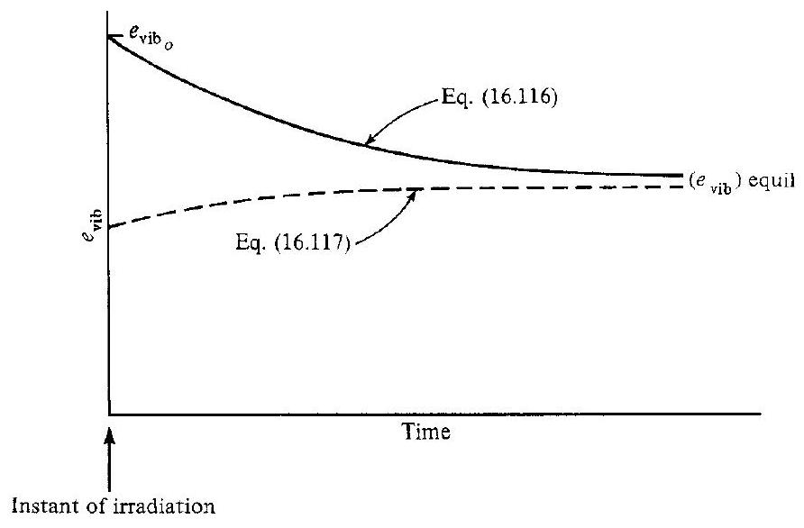
Figure 16.17 | Vibrational relaxation toward equilibrium.

probability $P$ and the collision frequency $Z$, both defined earlier. In turn, $P$ depends on $T$ (on the relative kinetic energy between colliding particles), and $Z \propto p / \sqrt{T}$. For most diatomic gases, the variation of $\tau$ is given by the form

$$
\begin{aligned}
\tau p & =c_{1} e^{\left(C_{2} / T\right)^{1 / 3}} \\
\ln \tau p & =\ln c_{1}+\left(\frac{C_{2}}{T}\right)^{1 / 3}
\end{aligned}
$$

or

In summary, the nonequilibrium variation of vibrational energy is given by the vibrational rate equation expressed as Eq. (16.116). Note that in Eq. (16.116) both $\tau$ and $e_{\mathrm{vib}}^{\mathrm{eq}}$ are variables, with $\tau=(p, T)$ from Eq. (16.118) and $e_{\mathrm{vib}}^{\mathrm{eq}}=e(T)$ from Eq. (16.117). However, a word of caution is given. Equation (16.116) has certain limitations that have not been stressed during this derivation, namely, it holds only for diatomic molecules that are harmonic oscillators. The use of $\varepsilon_{\mathrm{vib}}=h v n$, obtained from Sec. 16.7, is valid only if the molecule is a harmonic oscillator. Moreover, from Fig. 16.16, we have considered only single quantum jumps between energy levels, i.e., we did not consider transitions say from the $i$ th directly to the $i+2$ level. Such multiple quantum jumps can occur for anharmonic molecules, but their transition probabilities are very small. In spite of these restrictions, experience has proven that Eq. (16.116) is reasonably valid for real problems dealing with diatomic gases, and it is employed in almost all nonequilibrium analyses of such gases.

Recent developments in the study of vibrational nonequilibrium flows have highlighted a further limitation of Eq. (16.116), as follows. The energy level transitions included in the master equation, Eq. (16.100), are so-called "translation-vibration" (TV) transfers. Here, a molecule upon collision with another will gain or lose vibrational energy, which then reappears as a decrease or increase in translational kinetic energy of the molecules. For example, a T-V transfer in CO can be given as

$$
\mathrm{CO}(n)+\mathrm{CO}(n) \rightleftarrows \mathrm{CO}(n-1)+\mathrm{CO}(n)+\mathrm{KE}
$$

where a CO molecule in the $n$th vibrational level drops to the $(n-1)$ level after collision, with the consequent release of kinetic energy, KE. However, "vibrationvibration" (V-V) transfers also occur, where the vibrational quantum lost by one molecule is gained by its collision partner. For example, a V-V transfer in CO can be given as

$$
\mathrm{CO}(n)+\mathrm{CO}(n) \rightleftarrows \mathrm{CO}(n+1)+\mathrm{CO}(n-1)
$$

The above equation assumes a harmonic oscillator, where the spacings between all energy levels are the same. However, all molecules are in reality anharmonic oscillators, which results in unequal spacings between vibrational energy levels. Thus, in a V-V transfer involving anharmonic molecules, there is a small amount of translational energy exchanged in the process, as follows.

$$
\mathrm{CO}(n)+\mathrm{CO}(n) \rightleftarrows \mathrm{CO}(n+1)+\mathrm{CO}(n-1)+\mathrm{KE}
$$

During an expansion process (decreasing temperature), the V-V transfers among anharmonic molecules result in an overpopulation of some of the higher energy levels than would be the case of a harmonic oscillator. This is called anharmonic pumping,
and is particularly important in several types of gasdynamic and chemical lasers. The reverse effect occurs in a compression process (increasing temperature). In cases where anharmonic pumping is important, Eq. (16.116) is not valid, and the analysis must start from a master rate equation [such as Eq. (16.100)] expanded to include V-V transfers. For a fundamental discussion of the anharmonic pumping effect at an introductory level, see pages 112-120 of Ref. 21.

### 16.15 | CHEMICAL RATE EQUATIONS

Consider a system of oxygen in chemical equilibrium at $p=1 \mathrm{~atm}$ and $T=3000 \mathrm{~K}$. Although Fig. 16.15b is for air, it clearly demonstrates that the oxygen under these conditions should be partially dissociated. Thus, in our system, both $\mathrm{O}_{2}$ and O will be present in their proper equilibrium amounts. Now, assume that somehow $T$ is instantaneously increased to, say, 4000 K . Equilibrium conditions at this higher temperature demand that the amount of $\mathrm{O}_{2}$ decrease and the amount of O increase. However, as explained in Sec. 16.13, this change in composition takes place via molecular collisions, and hence it takes time to adjust to the new equilibrium conditions. During this nonequilibrium adjustment period, chemical reactions are taking place at a definite net rate. The purpose of this section is to establish relations for the finite time rate of change of each chemical species present in the mixture-the chemical rate equations.

Continuing with our example of a system of oxygen, the only chemical reaction taking place is

$$
\mathrm{O}_{2}+M \rightarrow 2 \mathrm{O}+M
$$

where $M$ is a collision partner; it can be either $\mathrm{O}_{2}$ or O . Using the bracket notation for concentration given in Sec. 16.11, we denote the number of moles of $\mathrm{O}_{2}$ and O per unit volume of the mixture by $\left[\mathrm{O}_{2}\right]$ and $[\mathrm{O}]$, respectively. Empirical results have shown that the time rate of formation of O atoms via Eq. (16.119) is given by

$$
\frac{d[\mathrm{O}]}{d t}=2 k\left[\mathrm{O}_{2}\right][M]
$$

where $d[\mathrm{O}] / d t$ is the reaction rate, $k$ is the reaction rate constant, and Eq. (16.120) is called a reaction rate equation. The reaction rate constant $k$ is a function of $T$ only. Equation (16.120) gives the rate at which the reaction given in Eq. (16.119) goes from left to right; this is called the forward rate, and $k$ is really the forward rate constant $k_{f}$ :

$$
\mathrm{O}_{2}+M \xrightarrow{k_{f}} 2 \mathrm{O}+M
$$

Hence, Eq. (16.120) is more precisely written as
Forward rate: $\quad \frac{d[\mathrm{O}]}{d t}=2 k_{f}\left[\mathrm{O}_{2}\right][M]$

The reaction in Eq. (16.119) that would proceed from right to left is called the reverse reaction, or backward reaction,

$$
\mathrm{O}_{2}+M \underset{k_{k}}{\leftarrow} 2 \mathrm{O}+M
$$

with an associated reverse or backward rate constant $k_{b}$, and a reverse or backward rate given by
Reverse rate: $\quad \frac{d[\mathrm{O}]}{d t}=-2 k_{b}[\mathrm{O}]^{2}[M]$

Note that in both Eqs. (16.121) and (16.122), the right-hand side is the product of the concentrations of those particular colliding molecules that produce the chemical change, raised to the power equal to their stoichiometric mole number in the chemical equation. Equation (16.121) gives the time rate of increase of O atoms due to the forward rate, and Eq. (16.122) gives the time rate of decrease of O atoms due to the reverse rate. However, what we would actually observe in the laboratory is the net time rate of change of O atoms due to the combined forward and reverse reactions,

$$
\mathrm{O}_{2}+M \underset{k_{b}}{\stackrel{k_{f}}{\rightleftarrows}} 2 \mathrm{O}+M
$$

and this net reaction rate is given by

Net rate:

$$
\frac{d[\mathrm{O}]}{d t}=2 k_{f}\left[\mathrm{O}_{2}\right][M]-2 k_{b}[\mathrm{O}]^{2}[M]
$$

Now consider our system to again be in chemical equilibrium; hence the composition is fixed with time. Then $d[\mathrm{O}] / d t \equiv 0,\left[\mathrm{O}_{2}\right] \equiv\left[\mathrm{O}_{2}\right]^{*}$, and $[\mathrm{O}] \equiv\left[\mathrm{O}^{*}\right]$ where the asterisk denotes equilibrium conditions. In this case, Eq. (16.123) becomes
or

$$
\begin{aligned}
0 & =2 k_{f}\left[\mathrm{O}_{2}\right]^{*}\left[M^{*}\right]-2 k_{b}[\mathrm{O}]^{* 2}[M]^{*} \\
k_{f} & =k_{b} \frac{[\mathrm{O}]^{* 2}}{\left[\mathrm{O}_{2}\right]^{*}}
\end{aligned}
$$

Examining the chemical equation given above, and recalling the substance of Sec. 16.9, we can define the ratio $[\mathrm{O}]^{* 2} /\left[\mathrm{O}_{2}\right]^{*}$ in Eq. (16.124) as an equilibrium constant based on concentrations, $K_{c}$. This is related to the equilibrium constant based on partial pressures, $K_{p}$, defined in Sec. 16.9. From Eq. (1.13), it directly follows for this oxygen reaction that

$$
K_{c}=\frac{1}{\mathscr{R} T} K_{p}
$$

Hence, Eq. (16.124) can be written as

$$
\frac{k_{f}}{k_{b}}=K_{c}
$$

Equation (16.125), although derived by assuming equilibrium, is simply a relation between the forward and reverse rate constants, and therefore it holds in general for nonequilibrium conditions. Therefore, the net rate, Eq. (16.123), can be expressed as

$$
\frac{d[\mathrm{O}]}{d t}=2 k_{f}[M]\left\{\left[\mathrm{O}_{2}\right]-\frac{1}{K_{c}}[\mathrm{O}]^{2}\right\}
$$

In practice, values for $k_{f}$ are found from experiment, and then $k_{b}$ can be directly obtained from Eq. (16.125). Keep in mind that $k_{f}, k_{b}, K_{c}$, and $K_{p}$ for a given reaction are all functions of temperature only. Also, $k_{f}$ in Eq. (16.126) is generally different depending on whether the collision partner $M$ is chosen to be $\mathrm{O}_{2}$ or O .

This example has been a special application of the more general case of a reacting mixture of $n$ different species. Consider the general chemical reaction (but it must be an elementary reaction, as defined later)

$$
\sum_{i=1}^{n} v_{i}^{\prime} X_{i} \underset{k_{b}}{\stackrel{k_{r}}{\rightleftarrows}} \sum_{i=1}^{n} v_{i}^{\prime \prime} X_{i}
$$

where $v_{i}^{\prime}$ and $v_{i}^{\prime \prime}$ represent the stoichiometric mole numbers of the reactants and products, respectively. (Note that in our above example for oxygen where the chemical reaction was $\mathrm{O}_{2}+M \rightleftarrows 2 \mathrm{O}+M, v_{\mathrm{O}_{2}}^{\prime}=1, v_{\mathrm{O}_{1}}^{\prime}=0, v_{\mathrm{O}_{2}}^{\prime \prime}=0, v_{M}^{\prime}=1, v_{M}^{\prime \prime}=1$. and $v_{\mathrm{O}}^{\prime \prime}=2$.) For the above general reaction, Eq. (16.127), we can write

Forward rate: $\quad \frac{d\left[X_{i}\right]}{d t}=\left(v_{i}^{\prime \prime}-v_{i}^{\prime}\right) k_{f} \prod_{i}\left[X_{i}\right]^{v_{i}^{\prime}}$

Reverse rate: $\quad \frac{d\left[X_{i}\right]}{d t}=-\left(v_{i}^{\prime \prime}-v_{i}^{\prime}\right) k_{b} \prod_{i}\left[X_{i}\right]^{v_{i}^{\prime \prime}}$

Net rate:

$$
\frac{d\left[X_{i}\right]}{d t}=\left(v_{i}^{\prime \prime}-v_{i}^{\prime}\right)\left\{k_{f} \prod_{i}\left[X_{i}\right]^{v_{i}^{\prime}}-k_{b} \prod_{i}\left[X_{i}\right]^{\prime^{\prime \prime}}\right\}
$$

Equation (16.130) is a generalized net rate equation; it is a general form of the law of mass action first introduced in Sec. 16.9. In addition, the relation between $k_{f}$ and $k_{b}$ given by Eq. (16.125) holds for the general reaction given in Eq. (16.127).

The chemical rate constants are generally measured experimentally. Although methods from kinetic theory exist for their theoretical estimation, such results are sometimes uncertain by orders of magnitude. The empirical results for many reactions can be correlated in the form

$$
k=C e^{-\varepsilon_{a} / k T}
$$

where $\varepsilon_{a}$ is defined as the activation energy and $C$ is a constant. Equation (16.131) is called the Arrhenius equation. An improved formula includes a "preexponential" temperature factor

$$
k=c_{1} T^{\alpha} e^{-\varepsilon_{o} / k T}
$$

where $c_{1}, \alpha$, and $\varepsilon_{0}$ are all found from experimental data.
Returning to the special case of a dissociation reaction such as for diatomic nitrogen,

$$
\mathrm{N}_{2}+M \xrightarrow{k_{f}} 2 \mathrm{~N}+M
$$

the dissociation energy $\varepsilon_{d}$ is defined as the difference between the zero-point energies,

$$
\varepsilon_{d} \equiv \Delta \varepsilon_{o}=2\left(\varepsilon_{o}\right)_{\mathrm{N}}-\left(\varepsilon_{o}\right)_{\mathrm{N}_{2}}
$$

For this reaction, the rate constant is expressed as

$$
k_{f}=c_{f} T^{\alpha} e^{-\varepsilon_{d} / k T}
$$

where the activation energy $\varepsilon_{a}=\varepsilon_{d}$. Physically, the dissociation energy is the energy required to dissociate the molecule at $T=0 \mathrm{~K}$. It is obviously a finite number: It takes energy-sometimes a considerable amount of energy-to tear a molecule apart. In contrast, consider the recombination reaction,

$$
\mathrm{N}_{2}+M \underset{k_{b}}{\leftarrow} 2 \mathrm{~N}+M
$$

Here, no relative kinetic energy between the two colliding N atoms is necessary to bring about a change; indeed, the role of the third body $M$ is to carry away some of the energy that must be given up by the two colliding N atoms before they can recombine. Hence, for recombination, there is no activation energy; $\varepsilon_{a}=0$. Thus, the recombination rate constant is written as

$$
k_{b}=c_{b} T^{\eta_{b}}
$$

with no exponential factor.
Finally, it is important to note that all of the above formalism applies only to elementary reactions. An elementary chemical reaction is one that takes place in a single step. For example, a dissociation reaction such as

$$
\mathrm{O}_{2}+M \rightarrow 2 \mathrm{O}+M
$$

is an elementary reaction because it literally takes place by a collision of an $\mathrm{O}_{2}$ molecule with another collision partner, yielding directly two oxygen atoms. On the other hand, the reaction

$$
2 \mathrm{H}_{2}+\mathrm{O}_{2} \rightarrow 2 \mathrm{H}_{2} \mathrm{O}
$$

is not an elementary reaction. Two hydrogen molecules do not come together with one oxygen molecule to directly yield two water molecules, even though if we mixed the hydrogen and oxygen together in the laboratory, our naked eye would observe what would appear to be the direct formation of water. Reaction (16.135) does not take place in a single step. Instead, Eq. (16.135) is a statement of an overall reaction that actually takes place through a series of elementary steps:

$$
\begin{aligned}
\mathrm{H}_{2} & \rightarrow 2 \mathrm{H} \\
\mathrm{O}_{2} & \rightarrow 2 \mathrm{O} \\
\mathrm{H}+\mathrm{O}_{2} & \rightarrow \mathrm{OH}+\mathrm{O} \\
\mathrm{O}+\mathrm{H}_{2} & \rightarrow \mathrm{OH}+\mathrm{H} \\
\mathrm{OH}+\mathrm{H}_{2} & \rightarrow \mathrm{H}_{2} \mathrm{O}+\mathrm{H}
\end{aligned}
$$

Equations (16.136a) through (16.136e) constitute the reaction mechanism for the overall reaction (16.135). Each of Eqs. (16.136a) through (16.136e) is an elementary reaction.

We again emphasize that Eqs. (16.120) through (16.134) apply only for elementary reactions. In particular, the law of mass action given by Eq. (16.130) is valid for elementary reactions only. We cannot write Eq. (16.130) for reaction (16.135), but we can apply Eq. (16.130) to each one of the elementary reactions that constitute the reaction mechanism (16.136a) through (16.136e).

### 16.16 | CHEMICAL NONEQUILIBRIUM IN HIGH-TEMPERATURE AIR

We again highlight the importance of air in high-speed compressible flow problems. For the analysis of chemical nonequilibrium effects in high-temperature air, the following reaction mechanism occurs, valid below 9000 K :

$$
\begin{aligned}
& \mathrm{O}_{2}+M \underset{k_{b_{1}}}{\stackrel{k_{f_{1}}}{\rightleftarrows}} 2 \mathrm{O}+M \\
& \mathrm{~N}_{2}+M \underset{k_{b_{2}}}{\stackrel{k_{f_{2}}}{\rightleftarrows}} 2 \mathrm{~N}+M \\
& \mathrm{NO}+M \underset{k_{b_{3}}}{\stackrel{k_{f_{3}}}{\rightleftarrows}} \mathrm{~N}+\mathrm{O}+M \\
& \mathrm{O}_{2}+\mathrm{N} \underset{k_{b_{4}}}{\stackrel{k_{f_{f_{4}}}}{\rightleftarrows}} \mathrm{NO}+\mathrm{O} \\
& \mathrm{~N}_{2}+\mathrm{O} \underset{k_{b_{5}}}{\stackrel{k_{f_{s}}}{\rightleftarrows}} \mathrm{NO}+\mathrm{N} \\
& \mathrm{~N}_{2}+\mathrm{O}_{2} \underset{k_{b_{6}}}{\stackrel{k_{f_{b_{6}}}}{\rightleftarrows}} 2 \mathrm{NO} \\
& \mathrm{~N}+\mathrm{O} \underset{k_{b_{7}}}{\stackrel{k_{f_{7}}}{\rightleftarrows}} \mathrm{NO}^{+}+e^{-}
\end{aligned}
$$

Equations (16.137) through (16.139) are dissociation reactions. Equations (16.140) and (16.141) are bimolecular exchange reactions (sometimes called the "shuffle" reactions); they are the two most important reactions for the formation of nitric oxide, NO, in air. Equation (16.143) is called a dissociative-recombination reaction because the recombination of the $\mathrm{NO}^{+}$ion with an electron produces not NO but rather a dissociated product $\mathrm{N}+\mathrm{O}$. Note that the above reactions are not all independent; for example, Eq. (16.142) can be obtained by adding Eqs. (16.140) and (16.141). However, in contrast to the calculation of an equilibrium composition as discussed in Sec. 16.11, for a nonequilibrium reaction mechanism the chemical equations do not have to be independent.

From this reaction mechanism, let us construct the rate equation for NO. Reactions (16.139) through (16.142) involve the production and extinction of NO. Moreover, in reaction (16.139), the collision partner $M$ can be any of the different species, each requiring a different rate constant. That is, Eq. (16.139) is really these equations:

$$
\begin{gathered}
\mathrm{NO}+\mathrm{O}_{2} \underset{k_{b_{3 a}}}{\stackrel{k_{f_{3 a}}}{\rightleftarrows}} \mathrm{~N}+\mathrm{O}+\mathrm{O}_{2} \\
\mathrm{NO}+\mathrm{N}_{2} \underset{k_{b_{3 b}}}{\stackrel{k_{f_{3 b}}}{\rightleftarrows}} \mathrm{~N}+\mathrm{O}+\mathrm{N}_{2} \\
\mathrm{NO}+\mathrm{NO} \underset{k_{b_{3 c}}}{\stackrel{k_{f_{3 c}}}{\rightleftarrows}} \mathrm{~N}+\mathrm{O}+\mathrm{NO} \\
\mathrm{NO}+\mathrm{O} \underset{k_{b_{3 d}}}{\stackrel{k_{f_{3 d}}}{\rightleftarrows}} \mathrm{~N}+\mathrm{O}+\mathrm{O} \\
\mathrm{NO}+\mathrm{N} \underset{k_{b_{3 c}}}{\stackrel{k_{f_{32}}}{\rightleftarrows}} \mathrm{~N}+\mathrm{O}+\mathrm{N} \\
\mathrm{NO}+\mathrm{NO}^{+} \underset{k_{b_{3 f}}}{\stackrel{k_{f_{31}}}{\rightleftarrows}} \mathrm{~N}+\mathrm{O}+\mathrm{NO}^{+} \\
\mathrm{NO}+e^{-} \underset{k_{b_{3 g}}}{\stackrel{k_{f_{32}}}{\rightleftarrows}} \mathrm{~N}+\mathrm{O}+e^{-}
\end{gathered}
$$

Thus, the chemical rate equation for NO is

$$
\begin{aligned}
\frac{d[\mathrm{NO}]}{d t}= & -k_{f_{3 a}}[\mathrm{NO}]\left[\mathrm{O}_{2}\right]+k_{b_{3 a}}[\mathrm{~N}][\mathrm{O}]\left[\mathrm{O}_{2}\right] \\
& -k_{f_{3 b}}[\mathrm{NO}]\left[\mathrm{N}_{2}\right]+k_{b_{3 b}}[\mathrm{~N}][\mathrm{O}]\left[\mathrm{N}_{2}\right] \\
& -k_{f_{3 c}}[\mathrm{NO}]^{2}+k_{b_{3 c}}[\mathrm{~N}][\mathrm{O}][\mathrm{NO}] \\
& -k_{f_{3 d}}[\mathrm{NO}][\mathrm{O}]+k_{b_{3 d}}[\mathrm{~N}][\mathrm{O}]^{2} \\
& -k_{f_{3 e}}[\mathrm{NO}][\mathrm{N}]+k_{b_{3 e}}[\mathrm{~N}]^{2}[\mathrm{O}] \\
& -k_{f_{3 j}}[\mathrm{NO}]\left[\mathrm{NO}^{+}\right]+k_{b_{3 f}}[\mathrm{~N}][\mathrm{O}]\left[\mathrm{NO}^{+}\right] \\
& -k_{f_{3 q}}[\mathrm{NO}]\left[e^{-}\right]+k_{b_{3 q}}[\mathrm{~N}][\mathrm{O}]\left[e^{-}\right] \\
& +k_{f_{4}}\left[\mathrm{O}_{2}\right][\mathrm{N}]-k_{b_{4}}[\mathrm{NO}][\mathrm{O}] \\
& +k_{f_{5}}\left[\mathrm{~N}_{2}\right][\mathrm{O}]-k_{b_{5}}[\mathrm{NO}][\mathrm{N}] \\
& +2 k_{f_{6}}\left[\mathrm{~N}_{2}\right]\left[\mathrm{O}_{2}\right]-2 k_{b_{6}}[\mathrm{NO}]^{2}
\end{aligned}
$$

There are rate equations similar to Eq. (16.144) for $\mathrm{O}_{2}, \mathrm{~N}_{2}, \mathrm{O}, \mathrm{N}, \mathrm{NO}^{+}$, and $e^{-}$. Clearly, you can see that a major aspect of such a nonequilibrium analysis is simply bookkeeping, making certain to keep track of all the terms in the equations.

Values of the rate constants for high-temperature air are readily available in the literature. See, for example, Ref. 68. Again, keep in mind that there is always some uncertainty in the published rate constants; they are difficult to measure experimentally, and very difficult to calculate accurately. Hence, any nonequilibrium analysis is a slave to the existing rate data.

### 16.17 I SUMMARY OF CHEMICAL NONEQUILIBRIUM

To analyze and compute the finite-rate chemical kinetic processes in any gas mixture, it is necessary to

1. Define the reaction mechanism [such as reactions (16.137) through (16.143) above].
2. Obtain the rate constants from the literature, usually in the form of Eq. (16.132).
3. Write all the appropriate rate equations, such as Eq. (16.144).
4. Solve the rate equations simultaneously to obtain the time variation of the species concentrations, i.e., $\left[\mathrm{O}_{2}\right]=f_{1}(t),[\mathrm{O}]=f_{2}(t)$, etc. This is a job for a high-speed digital computer. Indeed, most modern analyses of chemical nonequilibrium systems would not be practicably possible without computers.

Finally, we will see how these considerations are used in the analysis of hightemperature flowfields in Chap. 17.

### 16.18 | CHAPTER SUMMARY

High-temperature effects are an important aspect of modern compressible flow. This chapter presents the basic fundamentals of chemical thermodynamics and statistical thermodynamics necessary for the understanding of such effects.

For high-temperature gases, the internal energy is given by the sum of the translational, rotational, vibrational, and electronic energy modes. If these energies are measured above the zero-point energy, then the internal energy of a given chemical species $i$ is given by

$$
e_{i}=\left(e_{\mathrm{trans}}+e_{\mathrm{rot}}+e_{\mathrm{vib}}+e_{\mathrm{el}}+e_{o}\right)_{i}
$$

The zero-point energy $e_{o_{i}}$ is a property of the given chemical species and for purposes of analysis can be replaced by the heat of formation of species $i$ at absolute zero $\left(\Delta h_{f}\right)_{i}^{\text {o }}$ :

$$
e_{i}=\left(e_{\mathrm{trans}}+e_{\mathrm{rot}}+e_{\mathrm{vib}}+e_{\mathrm{el}}\right)_{i}+\left(\Delta h_{f}\right)_{i}^{0}
$$

Because only a few molecular collisions are needed to transfer translational and rotational energy among molecules, $e_{\text {trans }}$ and $e_{\text {rot }}$ are almost always in equilibrium, and hence are given by

$$
\begin{aligned}
e_{\mathrm{trans}} & =\frac{3}{2} R T \\
e_{\mathrm{rot}} & =R T \quad\binom{\text { for a diatomic molecule, or a linear }}{\text { polyatomic molecule }}
\end{aligned}
$$

or

$$
e_{\mathrm{rot}}=\frac{3}{2} R T \quad \text { (for a nonlinear polyatomic molecule) }
$$

If the vibrational energy is in equilibrium, it is given by

$$
e_{\mathrm{vib}}=\frac{h v / k T}{e^{h v / k T}-1} R T
$$

for a diatomic molecule. For a polyatomic molecule, there can be a number of different fundamental vibrational frequencies and the vibrational energy is given by a sum of terms, one each of the form of Eq. (16.47) for each of the fundamental frequencies, with each term multiplied by the degeneracy of each fundamental vibrational mode. If the vibrational energy is not in equilibrium, it is given by the master equation for vibrational relaxation, Eq. (16.100), which can be approximated by

$$
\frac{d e_{\mathrm{vib}}}{d t}=\frac{1}{\tau}\left(e_{\mathrm{vib}}^{\mathrm{eq}}-e_{\mathrm{vib}}\right)
$$

The electronic energy, when in equilibrium, can be obtained from the sum $e_{\mathrm{el}}= \sum_{j}\left(\varepsilon_{j} N_{j}^{*}\right)_{\mathrm{el}}$ with $N_{j}$ given by the Boltzmann distribution

$$
N_{j}^{*}=N \frac{g_{j} e^{-\epsilon_{j} / k T}}{\sum_{j} g_{j} e^{-\epsilon_{j} / k T}}
$$

and where $\epsilon_{j}$ denotes the energy of the $j$ th electronic energy level measured above the zero point. The Boltzmann distribution describes how particles are distributed over their energy levels in equilibrium at the temperature $T$. For electronic nonequilibrium, rate equations beyond the scope of this chapter must be employed to obtain $e_{\mathrm{el}}$. For many applications in high temperature gas dynamics, $e_{\mathrm{el}}$ is small and can be neglected.

The internal energy for the chemically reacting mixture can then be obtained from

$$
e=\sum_{i} c_{i} e_{i}
$$

where $c_{i}$ is the mass fraction of species $i$. If the gas is in chemical equilibrium, then $c_{i}$ is obtained from an equilibrium analysis using the equilibrium constants as described in Sec. 16.11. If the gas is not in chemical equilibrium, the $c_{i}$, must be obtained as a function of time from the chemical rate equations described in Sec. 16.15.

## PROBLEMS

16.1 Starting with Eq. (16.4), derive the most probable population distribution for Fermions, namely, Eq. (16.19).
16.2 Derive Eqs. (16.34) and (16.35). (Note: You will have to search some references on statistical thermodynamics to set up these derivations.)
16.3 Starting with Eq. (16.35), derive the perfect gas equation of state, $p=\rho R T$. (This demonstrates that the perfect gas equation of state, which historically was first obtained empirically, falls out directly from the fundamentals of statistical thermodynamics.)
16.4 Starting with the quantum mechanical expression for the quantized translational energy levels as a function of the quantum numbers $n_{1}, n_{2}$, and $n_{3}$, derive in detail the translational partition function given by Eq. (16.38).
16.5 In a similar vein as Prob. 16.4, derive in detail the rotational partition function given by Eq. (16.39).
16.6 Consider 1 kg of pure diatomic $\mathrm{N}_{2}$ in thermodynamic equilibrium. The fundamental vibrational frequency of $\mathrm{N}_{2}$ is $v=7.06 \times 10^{13} / \mathrm{s}$, the molecular weight. $/ / \mathrm{N}_{2}=28$, Planck's constant $h=6.625 \times 10^{-34} \mathrm{~J} \cdot \mathrm{~s}$. and the Boltzmann constant is $k=1.38 \times 10^{-23} \mathrm{~J} / \mathrm{K}$.
a. Calculate and plot on graph paper the number of $\mathrm{N}_{2}$ molecules in each of the first three vibrational energy levels, $\varepsilon_{0}, \varepsilon_{1}$, and $\varepsilon_{2}$ as a function of temperature from $T=300$ to 3500 K , using 400 K increments.
b. Calculate and plot on graph paper the sensible enthalpy (including translation, rotation, and vibration) in joules per kilogram as a function of temperature from $T=300$ to 3500 K .
c. Calculate and plot on graph paper the specific heat at constant pressure as a function of temperature from $T=300$ to 3500 K .
16.7 Frequently in the literature, a characteristic temperature for vibration is defined as $\theta_{\text {vib }}=h v / k$. Express $e$ and $c_{v}$ for a diatomic molecule [Eqs. (16.49) and (16.51)] in terms of $\theta_{\text {vib }}$.
16.8 Consider an equilibrium chemically reacting mixture of three general species denoted by $\mathrm{A}, \mathrm{B}$, and AB . In detail, derive Eqs. (16.54) and (16.55) for such a mixture.
16.9 Consider an equilibrium chemically reacting mixture of oxygen at $p=$ 1 atm and $T=3200 \mathrm{~K}$. The only species present are $\mathrm{O}_{2}$ and $\mathrm{O} . K_{p, \mathrm{O}_{2}}=$ 0.04575 atm . Calculate the partial pressures, mole fractions, mole-mass ratios, and mass fractions for this mixture.
16.10 For the conditions of the Prob. 16.9, calculate the internal energy of the mixture in joules per kilogram, including the translational, rotational, vibrational, and electronic energies. Note the following physical data: For $\mathrm{O}_{2}, \Delta H_{f}^{0}=0, v=4.73 \times 10^{13} / \mathrm{s}, \varepsilon_{\mathrm{el}_{1}} / k=11,390 \mathrm{~K}, g_{\mathrm{el}_{0}}=3, g_{\mathrm{el}_{1}}=2$ (ignore higher electronic levels); for $\mathrm{O}, \Delta H_{f}^{0}=2.47 \times 10^{8} \mathrm{~J} /(\mathrm{kg} \cdot \mathrm{mol}$ ).
$\varepsilon_{\mathrm{el}_{1}} / k=228 \mathrm{~K}, \varepsilon_{\mathrm{el}_{2}} / k=326 \mathrm{~K}, g_{\mathrm{el}_{o}}=5, g_{\mathrm{el}_{1}}=3, g_{\mathrm{el}_{2}}=1$ (ignore higher electronic levels).
16.11 Consider air at $p=0.5 \mathrm{~atm}$ and $T=4500 \mathrm{~K}$. Assume the chemical species present are $\mathrm{O}_{2}, \mathrm{O}, \mathrm{N}_{2}$, and N . (Ignore NO .) Calculate the enthalpy in joules per kilogram. In addition to that already given in Prob. 16.10, note these physical data: $K_{p, \mathrm{O}_{2}}=12.19 \mathrm{~atm}, K_{p, \mathrm{~N}_{2}}=0.7899 \times 10^{-4} \mathrm{~atm}$; for $\mathrm{N}_{2}, \Delta H_{f}^{0}=0, v=7.06 \times 10^{13} / \mathrm{s}$ (ignore electronic levels of $\mathrm{N}_{2}$ because the first excited level is very high, $\varepsilon_{\mathrm{el}_{1}} / k=100,000 \mathrm{~K}$, and hence its population is very low); for $\mathrm{N}, \Delta H_{f}^{0}=4.714 \times 10^{8} \mathrm{~J} /(\mathrm{kg} \cdot \mathrm{mol})$ (again, ignore electronic levels of N because the first excited level is high, $\varepsilon_{\mathrm{el}_{1}} / k=23,000 \mathrm{~K}$ ).
16.12 Consider a unit mass of $\mathrm{N}_{2}$ in equilibrium at $p=1 \mathrm{~atm}$ and $T=300 \mathrm{~K}$. For these conditions, the vibrational relaxation time is 190 s . Assume that, by some mechanism, the vibrational energy is instantaneously increased by a factor of 100, with all other properties remaining unchanged. At the end of 1 min after excitation, what is the value of the vibrational energy relative to the equilibrium value? Assume that $p$ and $T$ remain constant at 1 atm and 300 K , respectively.

