## CHAPTER

## High-Temperature Flows: Basic Examples

With the advent of jet propulsion it became necessary to broaden the field of aerodynamics to include problems which before were treated mostly by physical chemists.

Theodore von Karman, 1958

## PREVIEW BOX

High-temperature effects can be dramatic. Witness the two separate results for the inviscid flow of air over a blunt body at Mach 20 at an altitude of 20 km shown in Fig. 17.1; we see here the bow shock wave shape as well as the temperature contours in the flow between the shock and the body. The results shown in Fig. 17.1a are for a perfect gas with constant $\gamma=1.4$; those in

Fig. 17.1 $b$ take into account equilibrium chemically reacting flow. What a dramatic difference! For the chemically reacting case in Fig. 17.1b, the shock is much closer to the body, and the temperature levels in the shock layer are much lower than those predicted by the calorically perfect gas case. The amount of nitrogen dissociation in the shock layer is shown in Fig. 17.2a, and the

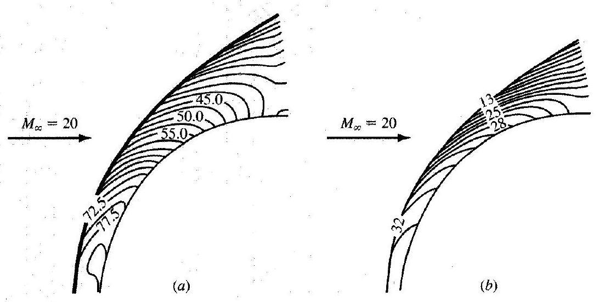
Figure 17.1 I Normalized temperature contours for blunt-body flow. (a) Calorically perfect gas; (b) equilibrium chemically reacting air. $M_{\infty}=20$, altitude $=20 \mathrm{~km}$. (From Palmer, Ref. 143.)

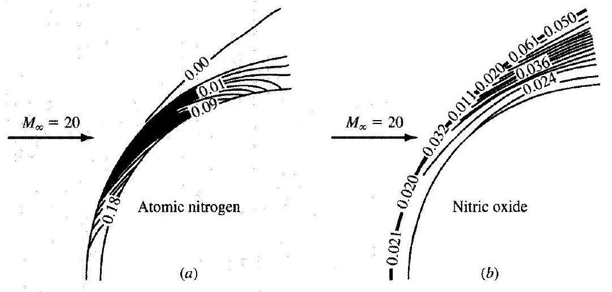
Figure 17.2 I Species mole fraction contours for blunt-body flow; equilibrium chemically reacting air. $M_{\infty}=20$, altitude $=20 \mathrm{~km} .(a) \mathrm{X}_{\mathrm{N}}$; (b) $\mathrm{X}_{\mathrm{NO}}$. (From Palmer, Ref. 143.)

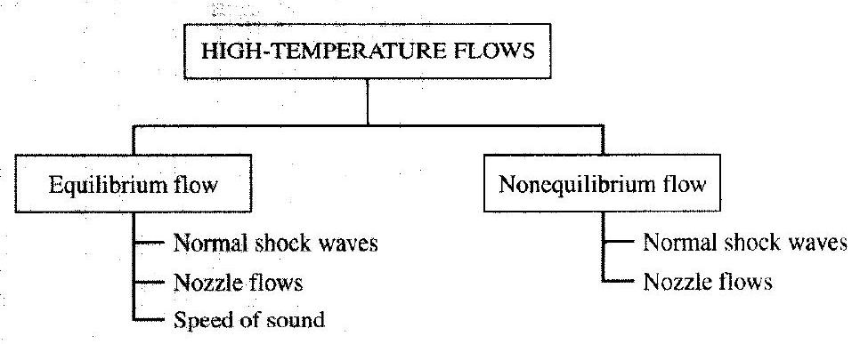
Figure 17.3 I Roadmap for Chapter 17.

amount of nitric oxide is shown in Fig. 17.2b. Clearly, the effect of chemical reactions is not trivial here; indeed, all aspects of the flow are dominated by high-temperature effects.

The purpose of this (and final) chapter is to illustrate some of the fundamental differences brought about by high-temperature effects in a flow. Rather than deal with more complex flows such as the blunt body shown in Figs. 17.1 and 17.2, we choose to examine hightemperature effects on relatively simple flows-normal shock waves and quasi-one-dimensional nozzle flows.

These flows are relatively uncomplicated, and the effects of high temperatures are easily demonstrated.

The roadmap for this chapter is given in Fig. 17.3. Our discussion of high-temperature flows is divided into equilibrium flow and nonequilibrium flow, listed on the left and right sides respectively in Fig. 17.3. We will discuss normal shock waves and nozzle flows for both cases. In addition, under equilibrium flow we will examine the speed of sound in a chemically reacting gas, a fundamental property that is changed considerably by high-temperature effects.

### 17.1 I INTRODUCTION TO LOCAL THERMODYNAMIC AND CHEMICAL EQUILIBRIUM

It is common in classical thermodynamics to define a system in complete thermodynamic equilibrium as one with these characteristics:

1. No gradients of pressure, temperature, velocity, or concentration exist anywhere in the system.
2. If the system is a mixture of gases, there is no tendency to undergo a spontaneous change in chemical composition, no matter how slowly. This characteristic is called chemical equilibrium, and is necessary for the overall concept of complete thermodynamic equilibrium.

In terms of our discussion in Chap. 16, these characteristics can be stated as:

1. If there are no pressure, temperature, velocity, or concentration gradients present in the system, the particles of the system are distributed over their allowed energy levels according to the Boltzmann distribution at the temperature $T$ of the system.
2. If there is no tendency to undergo a spontaneous change in chemical composition, the composition itself is, of course, fixed, and the values for the equilibrium partial pressures $p_{i}$ (or $X_{i}, \eta_{i}$, or $c_{i}$ ) are determined by the equilibrium constants.

Therefore, thermodynamic equilibrium implies a Boltzmann distribution at the temperature $T$ of the system, chemical equilibrium implies that the composition is fixed for a given $T$ and $p$ and is calculated from the equilibrium constants, and complete thermodynamic equilibrium implies both of the above.

This discussion considers a stationary system, such as gas in a box left for a long period of time so that no gradients exist inside the box. However, what happens for the case of a flowing gas, say for flow through a nozzle or over a missile or reentry vehicle? Clearly, gradients in $p$ and $T$ exist in such flows. Therefore, any flowing gas in which properties are changing with location and/or time is not in complete thermodynamic equilibrium as defined above. In turn, can the equilibrium relations obtained in Chap. 16 be applied to such a flowing gas? The answer is, strictly speaking, no; however, in many practical cases, the answer is a qualified yes. The qualification is that if the gradients in the flow are small enough, we can shrink our "system" (our box) to an infinitesimal size around a given point in the flow and see a relatively constant property region in the immediate neighborhood of the point. Let us assume that the equilibrium thermodynamic relations apply locally at the local values of $T$ and $p$ at a point in the flow, and hence a local Boltzmann distribution applies at the local temperature. This is defined as the case of local thermodynamic equilibrium. Similarly, let us assume that the local chemical composition at a point in the flow is the same as that determined by equilibrium calculations (using the equilibrium constant) at the local $T$ and $p$. This is defined as the case of local chemical equilibrium.

There are many practical situations where the flow gradients are moderate enough and the molecular collision frequencies (hence, the vibrational and chemical rates, for example) are large enough that both local thermodynamic and chemical equilibrium conditions hold at each point in the flow. In other situations, local thermodynamic equilibrium will hold, but the chemical composition may not be in equilibrium (chemical changes require more molecular collisions than vibrational or electronic energy changes). There are yet other cases where flows are neither in local thermodynamic nor chemical equilibrium. In this chapter, we will examine some basic high-temperature flow problems, such as normal shock waves and nozzle flows. In the first part, we will develop solutions assuming local thermodynamic and chemical equilibrium. This follows the left-hand column of our roadmap in Fig. 17.3. In the second half, we will emphasize techniques for solving nonequilibrium flows, which follows the right-hand column in Fig. 17.3.

## 17.2 | EQUILIBRIUM NORMAL SHOCK WAVE FLOWS

Consider a stationary normal shock wave as sketched in Fig. 3.4. Assume that the shock is strong enough, hence $T_{2}$ is high enough, such that vibrational excitation and chemical reactions occur behind the shock front. Moreover, assume that local
thermodynamic and chemical equilibrium hold behind the shock. All conditions ahead of the shock wave (region 1) are known. Our objective is to calculate properties behind the shock.

The governing flow equations for steady one-dimensional flow were derived in Sec. 3.2, and were specialized to the case of a normal shock wave in Sec. 3.6. This resulted in Eqs. (3.38) through (3.40), which were general and hence apply to our present high-temperature case. They are repeated and renumbered here for convenience:

Continuity:

$$
\rho_{1} u_{1}=\rho_{2} u_{2}
$$

Momentum:

$$
p_{1}+\rho_{1} u_{1}^{2}=p_{2}+\rho_{2} u_{2}^{2}
$$

Energy:

$$
h_{1}+\frac{u_{1}^{2}}{2}=h_{2}+\frac{u_{2}^{2}}{2}
$$

In addition, the equilibrium thermodynamic properties for the high-temperature gas are assumed known from the techniques discussed in Chap. 16. These may take the form of tables or graphs, or may be calculated directly from the equations developed in Chap. 16. In any event, we can consider these properties in terms of these functional relations ("equations of state," if you will):

$$
\begin{aligned}
& \rho_{2}=\rho\left(p_{2}, h_{2}\right) \\
& T_{2}=T\left(p_{2}, h_{2}\right)
\end{aligned}
$$

Recall from Chap. 3 that for a calorically perfect gas, these equations yield a series of closed-form algebraic relations for $p_{2} / p_{1}, T_{2} / T_{1}, M_{2}$, etc., as functions of $M_{1}$ [see, for example, Eqs. (3.51), (3.53), (3.57), and (3.59)]. Unfortunately, no simple formulas can be obtained when the gas is vibrationally excited and/or chemically reacting. For such high-temperature cases, Eqs. (17.1) through (17.5) must be solved numerically. To set up a numerical solution, let us first rearrange Eqs. (17.1) through (17.3). From Eq. (17.1),

$$
u_{2}=\frac{\rho_{1} u_{1}}{\rho_{2}}
$$

Substitute Eq. (17.6) into (17.2):

$$
p_{1}+\rho_{1} u_{1}^{2}=p_{2}+\rho_{2}\left(\frac{\rho_{1} u_{1}}{\rho_{2}}\right)^{2}
$$

Solving Eq. (17.7) for $p_{2}$, we have

$$
p_{2}=p_{1}+\rho_{1} u_{1}^{2}\left(1-\frac{\rho_{1}}{\rho_{2}}\right)
$$

In addition, substituting Eq. (17.6) into (17.3), we have

$$
h_{1}+\frac{u_{1}^{2}}{2}=h_{2}+\left(\frac{\rho_{1} u_{1}}{\rho_{2}}\right)^{2} / 2
$$

Solving Eq. (17.9) for $h_{2}$,

$$
h_{2}=h_{1}+\frac{u_{1}^{2}}{2}\left[1-\left(\frac{\rho_{1}}{\rho_{2}}\right)^{2}\right]
$$

Since all the upstream conditions $\rho_{1}, u_{1}, p_{1}, h_{1}$, etc., are known, Eqs. (17.8) and (17.10) express $p_{2}$ and $h_{2}$, respectively, in terms of only one unknown, namely, $\rho_{1} / \rho_{2}$. This establishes the basis for an iterative numerical solution:

1. Assume a value for $\rho_{1} / \rho_{2}$. (A value of 0.1 is usually good for a starter.)
2. Calculate $p_{2}$ from Eq. (17.8) and $h_{2}$ from Eq. (17.10).
3. With the values of $p_{2}$ and $h_{2}$ just obtained, calculate $\rho_{2}$ from Eq. (17.4).
4. Form a new value of $\rho_{1} / \rho_{2}$ using the value of $\rho_{2}$ obtained from Step 3.
5. Use this new value of $\rho_{1} / \rho_{2}$ in Eqs. (17.8) and (17.10) to obtain new values of $p_{2}$ and $h_{2}$, respectively. Then repeat steps 3 through 5 until convergence is obtained, i.e., until there is only a negligible change in $\rho_{1} / \rho_{2}$ from one iteration to the next. (This convergence is usually very fast, typically requiring less than five iterations.)
6. At this stage, we now have the correct values of $p_{2}, h_{2}$, and $\rho_{2}$. Obtain the correct value of $T_{2}$ from Eq. (17.5).
7. Obtain the correct value of $u_{2}$ from Eq. (17.6).

By means of steps 1 through 7 above, we can obtain all properties behind the shock wave for given properties in front of the wave.

There is a basic practical difference between the shock results for a calorically perfect gas and those for a chemically reacting gas. For a calorically perfect gas, we demonstrated in Sec. 3.6 that

$$
\begin{aligned}
& \frac{p_{2}}{p_{1}}=f_{1}\left(M_{1}\right) \\
& \frac{\rho_{2}}{\rho_{1}}=f_{2}\left(M_{1}\right) \\
& \frac{h_{2}}{h_{1}}=f_{3}\left(M_{1}\right)
\end{aligned}
$$

Note that in this case only $M_{1}$ is required to obtain the ratios of properties across a normal shock wave; such properties are tabulated in Table A. 2 at the back of this book. In contrast, for an equilibrium chemically reacting gas, we have already seen that

$$
\begin{aligned}
& \frac{p_{2}}{p_{1}}=g_{1}\left(u_{1}, p_{1}, T_{1}\right) \\
& \frac{\rho_{2}}{\rho_{1}}=g_{2}\left(u_{1}, p_{1}, T_{1}\right) \\
& \frac{h_{2}}{h_{1}}=g_{3}\left(u_{1}, p_{1}, T_{1}\right)
\end{aligned}
$$

Note that in this case three free-stream parameters are necessary to obtain the ratios of properties across a normal shock wave. This makes plenty of sense-the equilibrium composition behind the shock depends on $p_{2}$ and $T_{2}$. which in turn are governed in part by $p_{1}$ and $T_{1}$. Hence, in addition to the upstream velocity $\mu_{1}$, the normal shock properties must depend also on $p_{1}$ and $T_{1}$. By this same reasoning, if no chemical reactions take place, but the vibrational and electronic energies are excited (a thermally perfect gas). then the downstream normal shock properties depend on 1wo upstream conditions, namely, $w_{1}$ and $T_{1}$.

Also note that, in contrast to a calorically perfect gas, the Mach number no longer plays a pivotal role in the results for normal shock waves in a high-temperature gas. In fact, for most high-temperature flows in general, the Mach number is not a particularly useful quantity. The flow of a chemically reacting gas is mainly governed by the primitive variables of velocity, temperature, and pressure. For an equilibrium gas, the Mach number is still uniquely defined as $V / a$, and it can be used along with other determining variables-it just does not hold a dominant position as in the case of a calorically perfect gas considered in Chaps. I through 12. For a nonequilibrium gas. however. there is some ambiguity even in the definition of Mach number (to be discussed in Sec. 17.11), and hence the Mach number further loses significance for such cases.

For high-temperature air, a comparison between calorically perfect gas and equilibrium chemically reacting gas results was shown in Fig. 16.2. Here, the 1emperature behind a normal shock wave is plotted versus upstream velocity for conditions at a standard altitude of 52 km . The equilibrium results are plotted directly from normal shock tables prepared by the Cornell Acronautical Laboratory now CALSPAN Corporation). and published in Refs. 69 and 70. These reports should be consulted for equilibrium normal shock properties associated with air in the standard atmosphere. From Fig. 16.2, the calorically perfect results considerably overpredict the temperature, and for obvious reasons. For a calorically perfect gas, the directed kinetic energy of the flow ahead of the shock is mostly converted to translational and rotational molecular energy behind the shock. On the other hand, for a thermally perfect and/or chemically reacting gas, the directed kinetic energy of the flow, when converted across the shock wave, is shared across all molecular modes of energy. and/or goes into zero-point energy of the products of chemical reaction. Hence, the temperature (which is a measure of translational energy only) is less for such a case.

For further comparison, consider a reentry vehicle at 170.000 -ft standard altitude with a velocity of $36,000 \mathrm{ft} / \mathrm{s}$. The properties across a normal shock wave for this case are tabulated in Table 17.1. Note from that tabulation that chemical

Table 17.1
|  | For calorically perfect air, $\gamma=1.4$ (see Table A.2) | For equilibrium chemically reacting air (CAL Report AG-1729-A-2) |
| :--- | :--- | :--- |
| $p_{2} / p_{1}$ | 1233 | 1.387 |
| $\rho_{2} / \rho_{1}$ | 5.972 | 15.19 |
| $h_{2} / h_{1}$ | 206.35 | 212.8 |
| $T_{2} / T_{1}$ | 206.35 | 41.64 |

reactions have the strongest effect on temperature, for the reasons given earlier. This is generally true for all types of chemically reacting flows-the temperature is by far the most sensitive variable. In contrast, the pressure ratio is affected only by a small amount. Pressure is a "mechanically" oriented variable; it is governed mainly by the fluid mechanics of the flow, and not so much by the thermodynamics. This is substantiated by examining the momentum equation, namely, Eq. (17.2). For high-speed flow, $u_{2} \ll u_{1}$, and $p_{2} \gg p_{1}$. Hence, from Eq. (17.2),

$$
p_{2} \approx \rho_{1} u_{1}^{2}
$$

This is a common hypersonic approximation; note that $p_{2}$ is mainly governed by the free-stream velocity, and that thermodynamic effects are secondary.

In an equilibrium dissociating and ionizing gas, increasing the pressure at constant temperature tends to decrease the atom and ion mass fractions, i.e., increasing the pressure tends to inhibit dissociation and ionization. The consequences of this effect on equilibrium normal shock properties are shown in Fig. 17.4, where the

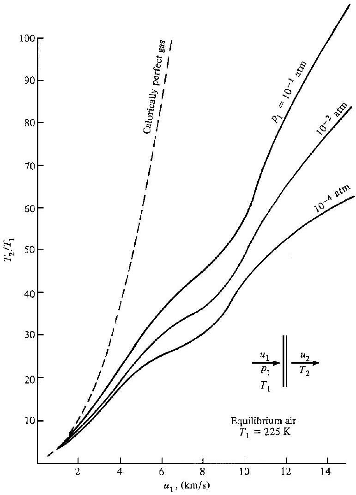
Figure 17.4 I Influence of pressure on the normal shock temperature in equilibrium air.

temperature ratio across the shock is plotted versus upstream velocity for three different values of upstream pressure. Note that $T_{2} / T_{1}$ is higher at higher pressures; the gas is less dissociated and ionized at higher pressure, and hence more energy goes into translational molecular motion behind the shock rather than into the zero-point energy of the products of dissociation.

### 17.3 I EQUILIBRIUM QUASI-ONE-DIMENSIONAL NOZZLE FLOWS

Consider the inviscid, adiabatic high-temperature flow through a convergentdivergent Laval nozzle, as sketched at the top of Fig. 17.5. As usual, the reservoir pressure and temperature are denoted by $p_{o}$ and $T_{o}$, respectively. The throat conditions are denoted by an asterisk, and exit conditions by a subscript $e$. This nozzle could be a high-temperature wind tunnel, where air is heated in the reservoir, for example, by an electric arc (an "arc tunnel"), or by shock waves (a "shock tunnel"). In a shock tunnel, the nozzle is placed at the end of a shock tube, and the reservoir is

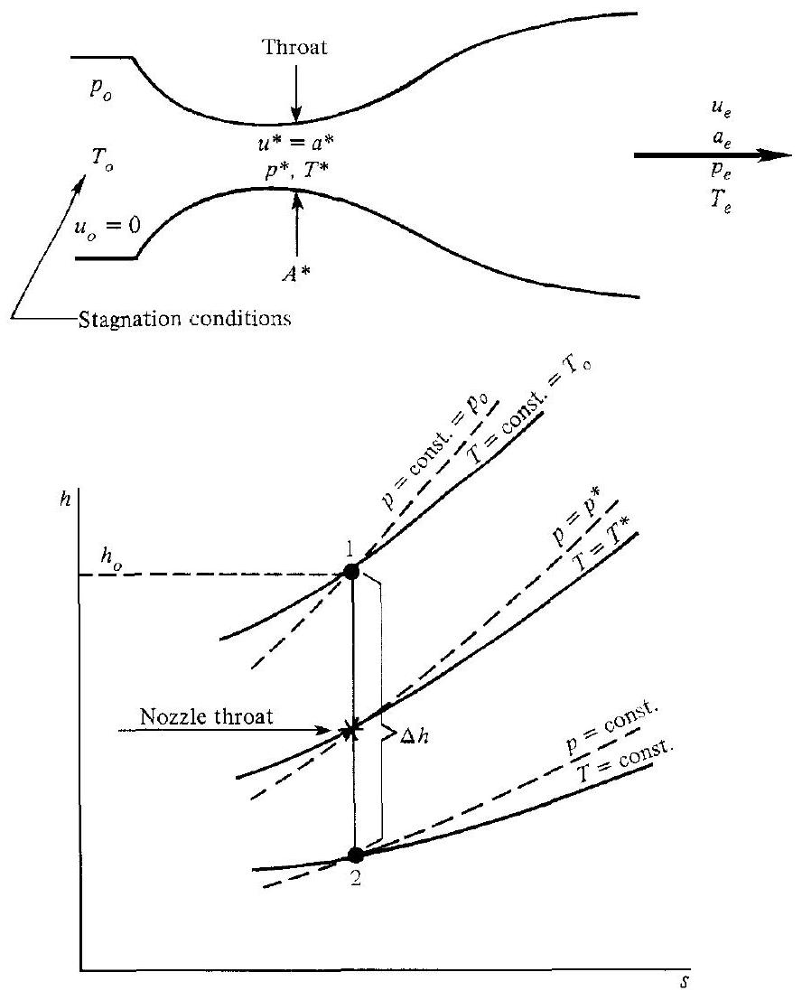
Figure 17.5 I Illustration of the solution of an equilibrium nozzle flow on a Mollier diagram.

essentially the hot, high-pressure gas behind a reflected shock wave (see Sec. 7.3). The nozzle in Fig. 17.5 could also be a rocket engine, where the reservoir conditions are determined by the burning of fuel and oxidizer in the combustion chamber. In either case-the high-temperature wind tunnel or the rocket engine-the flow through the nozzle is chemically reacting. Assuming local chemical equilibrium throughout the flow, let us examine the properties of the nozzle expansion.

First, let us pose the question: Is the chemically reacting flow isentropic? On a physical basis, the flow is both inviscid and adiabatic. However, this does not guarantee, in general, that the chemically reacting flow is irreversible. If we deal with an equilibrium chemically reacting flow, we can write the combined first and second laws of thermodynamics in the form of Eq. (1.32), repeated here:

$$
T d s=d h-v d p
$$

In Sec. 5.2, the governing equations for quasi-one-dimensional flow were derived in both algebraic and differential form. Moreover, in Sec. 5.2 no assumption was made about the type of gas; hence all the equations in that section hold in general. In particular, a form of the energy equation was obtained as Eq. (5.10):

$$
d h+u d u=0
$$

In addition, Eq. (5.9) gave the momentum equation in the form

$$
d p=-\rho u d u
$$

This can be rearranged as

$$
u d u=-\frac{d p}{\rho}=-v d p
$$

Combining Eqs. (17.11) and Eq. (5.10), we have

$$
d h-v d p=0
$$

Substituting Eq. (17.12) into Eq. (1.32), we have

$$
T d s=0
$$

Hence, the equilibrium chemically reacting nozzle flow is isentropic. Moreover, since Eq. (17.13) was obtained by combining the energy and momentum equations, the assumption of isentropic flow can be used in place of either the momentum or energy equations in the analysis of the flow.

It is a general result that equilibrium chemical reactions do not introduce irreversibilities into the system; if an equilibrium reacting system starts at some conditions $p_{1}$ and $T_{1}$, deviates from these conditions for some reason, but then returns to the original $p_{1}$ and $T_{1}$, the chemical composition at the end returns to what it was at the beginning. Equilibrium chemical reactions are reversible. Hence, any shockless, inviscid, adiabatic, equilibrium chemically reacting flow is isentropic. This is not true if the flow is nonequilibrium, as will be discussed in Sec. 17.11.

Let us pose another question: For an equilibrium chemically reacting nozzle flow, does sonic flow exist at the throat? We have already established that the flow is
isentropic. This was the only necessary condition for the derivation of the areavelocity relation, Eq. (5.15). Hence, the equation

$$
\frac{d A}{A}=\left(M^{2}-1\right) \frac{d u}{u}
$$

holds for a general gas. In turn, when $M=1, d A / A=0$, and therefore sonic flow does exist at the throat of an equilibrium chemically reacting nozzle flow. The same is not true for a nonequilibrium flow, as will be discussed in Sec. 17.11.

We are now in a position to solve the equilibrium chemically reacting nozzle flow. A graphical solution is the easiest to visualize. Consider that we have the equilibrium gas properties on a Mollier diagram, as sketched in Fig. 17.5. Recall from Fig. 16.15a that a Mollier diagram is a plot of $h$ versus $s$, and lines of constant $p$ and constant $T$ can be traced on the diagram. Hence, referring to Fig. 17.5, a given point on the Mollier diagram gives not only $h$ and $s$, but $p$ and $T$ at that point as well (and any other equilibrium thermodynamic property, since the state of an equilibrium system is completely specified by any two-state variables). Let point 1 in Fig. 17.5 denote the known reservoir conditions in the nozzle. Since the flow is isentropic, conditions at all other locations throughout the nozzle must fall somewhere on the vertical line through point 1 in Fig. 17.5. In particular, choose a value of $u=u_{2} \neq 0$. The point in Fig. 17.5 which corresponds to this velocity (point 2) can be found from Eqs. (5.5) and (5.6) as

Hence,

$$
\begin{gathered}
h_{1}+\frac{u_{1}^{2}}{2}=h_{2}+\frac{u_{2}^{2}}{2}=h_{o} \\
\Delta h=h_{o}-h_{2}=\frac{u_{2}^{2}}{2}
\end{gathered}
$$

Thus, for a given velocity $u_{2}$, Eq. (17.15) locates the appropriate point on the Mollier diagram. In turn, the constant-pressure and -temperature lines that run through point 2 define the pressure $p_{2}$ and temperature $T_{2}$ associated with the chosen velocity $u_{2}$. In this fashion, the variation of the thermodynamic properties through the nozzle expansion can be calculated as a function of velocity $u$ for given reservoir conditions.

For an equilibrium gas, the speed of sound, $a \equiv(\partial p / \partial \rho)_{s}$, is also a unique function of the thermodynamic state. This will be discussed in more detail in Sec. 17.5. For example,

$$
a=a(h, s)
$$

Thus, at each point on the Mollier diagram in Fig. 17.5, there exists a definite value of $a$. Moreover, at some point along the vertical line through point 1 , the speed of sound $a$ will equal the velocity $u$ at that point. Such a point is marked by an asterisk in Fig. 17.5. At this point, $u=a=u^{*}=a^{*}$. Since we demonstrated earlier that sonic flow corresponds to the throat in an equilibrium nozzle flow, then this point in

Fig. 17.5 must correspond to the throat. The pressure, temperature, and density at this point are $p^{*}, T^{*}$, and $\rho^{*}$, respectively. Thus, from the continuity equation (5.1), we have
or

$$
\begin{aligned}
\rho u A & =\rho^{*} u^{*} A^{*} \\
\frac{A}{A^{*}} & =\frac{\rho^{*} u^{*}}{\rho u}
\end{aligned}
$$

Therefore, Eq. (17.18) allows the calculation of the nozzle area ratio as a function of velocity through the nozzle.

In summary, using the Mollier diagram in Fig. 17.5, we can compute the appropriate values of $u, p, T$, and $A / A^{*}$ through an equilibrium nozzle flow for given reservoir conditions. An alternative to this graphical approach is a straight-forward numerical integration of Eqs. (5.7), (5.9), and (5.10) along with tabulated values of the equilibrium thermodynamic properties. The integration starts from known conditions in the reservoir and marches downstream. Such a numerical integration solution is left for the reader to construct.

In either case, numerical or graphical, it is clear that closed-form algebraic relations such as those obtained in Sec. 5.4 for a calorically perfect gas are not obtainable for chemically reacting nozzle flows. This is analogous to the case of chemically reacting flow through a shock wave discussed in Sec. 17.2. In fact, by now the reader should suspect, and correctly so, that closed-form algebraic relations cannot be obtained for any high-temperature chemically reacting flow of interest. Numerical or graphical solutions are necessary for such cases.

Recall from Chap. 5 that, for a calorically perfect gas, the nozzle flow characteristics were governed by the local Mach number only. For example, from Eqs. (5.20), (3.28), and (3.30), for a calorically perfect gas,

$$
\begin{aligned}
& \frac{A}{A^{*}}=f_{1}(M) \\
& \frac{T}{T_{o}}=f_{2}(M) \\
& \frac{p}{p_{o}}=f_{3}(M)
\end{aligned}
$$

In contrast, for an equilibrium chemically reacting gas,

$$
\begin{aligned}
\frac{A}{A^{*}} & =g_{1}\left(p_{o}, T_{o}, u\right) \\
\frac{T}{T_{o}} & =g_{2}\left(p_{o}, T_{o}, u\right) \\
\frac{p}{p_{o}} & =g_{3}\left(p_{o}, T_{o}, u\right)
\end{aligned}
$$

Note, as in the case of a normal shock, that the nozzle flow properties depend on three parameters. Also, once again we see that Mach number is not the pivotal parameter for a chemically reacting flow.

Some results for the equilibrium supersonic expansion of high-temperature air are shown in Fig. 17.6. Here the mole-mass ratios for $\mathrm{N}_{2}, \mathrm{O}_{2}, \mathrm{~N}, \mathrm{O}$, and NO are given as a function of area ratio for $T_{0}=8000 \mathrm{~K}$ and $p_{0}=100 \mathrm{~atm}$. At these conditions, the air is highly dissociated in the reservoir. However, as the gas expands through the nozzle, the temperature decreases, and as a result the oxygen

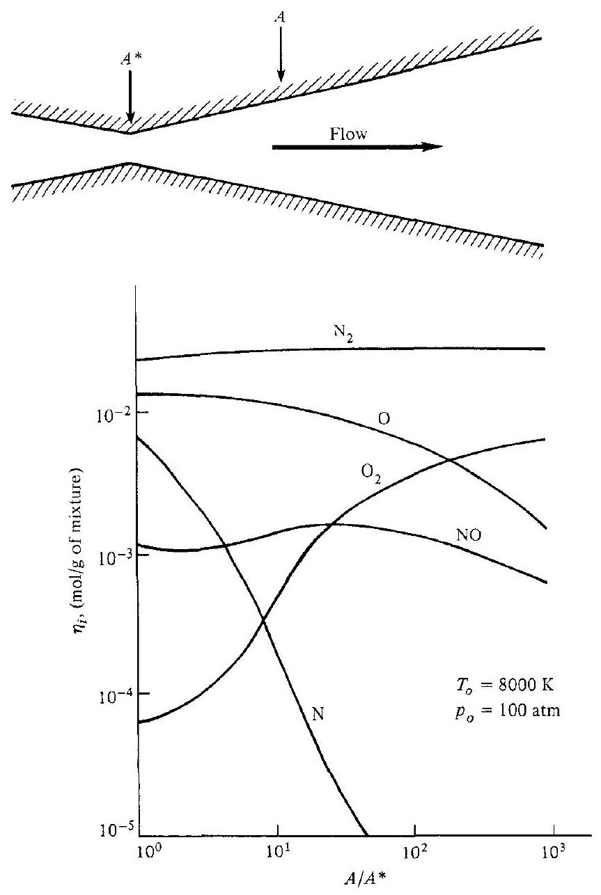
Figure 17.6 I Chemical composition for the equilibrium supersonic nozzle expansion of high-temperature air. (After Eschenroeder et al., "Shock Tunnel Studies of High Enthalpy Ionized Airflows," Cornell Aeronautical Lab. Report No. AF-1500 A1, 1962.)

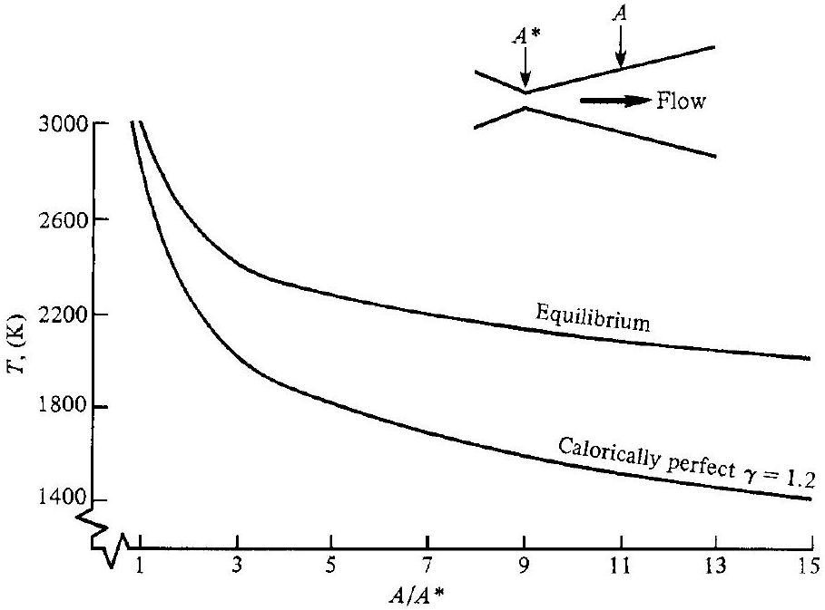
Figure 17.7 I Comparison between equilibrium and calorically perfect results for the flow through a rocket engine.

and nitrogen recombine. This is reflected in Fig. 17.6, which shows $\eta_{\mathrm{O}}$ and $\eta_{\mathrm{N}}$ decreasing and $\eta_{\mathrm{O}_{2}}$ and $\eta_{\mathrm{N}_{2}}$ increasing as the gas expands supersonically from $A / A^{*}=1$ to 1000 .

A typical result from equilibrium chemically reacting flow through a rocket nozzle is shown in Fig. 17.7. Here, the equilibrium temperature distribution is compared with that for a calorically perfect gas as a function of area ratio. The reservoir conditions are produced by the equilibrium combustion of an oxidizer $\left(\mathrm{N}_{2} \mathrm{O}_{2}\right)$ with a fuel (half $\mathrm{N}_{2} \mathrm{H}_{4}$ and half unsymmetrical dimethyl hydrazine) at an oxidizer-to-fuel ratio of 2.25 and a chamber pressure of 4 atm . The calorically perfect gas is assumed to have a constant $\gamma=1.20$. It is important to note from Fig. 17.7 that the equilibrium temperature is higher than that for the calorically perfect gas. This is because, as the gas expands and becomes cooler, the chemical composition changes from a high percentage of atomic species ( O and H ) in the reservoir with an attendant high zeropoint energy to a high percentage of molecular products ( $\mathrm{H}_{2} \mathrm{O}, \mathrm{CO}$, etc.) in the nozzle expansion with an attendant lower zero-point energy. That is, the gas recombines, giving up chemical energy which serves to increase the translational energy of the molecules, hence resulting in a higher static temperature than would exist in the nonreacting case. Note that the trend shown in Fig. 17.7 for nozzle flow is exactly the opposite of that shown in Fig. 16.2 for shock waves. For nozzle flow, the equilibrium temperature is always higher than that for a calorically perfect gas; for flow behind a shock wave, the equilibrium temperature is always lower than that for a calorically perfect gas. In the former case, the reactions are exothermic, and energy is dumped into the translational molecular motion; in the latter, the reactions are endothermic and energy is taken from the translational mode.

### 17.4 I FROZEN AND EQUILIBRIUM FLOWS: SPECIFIC HEATS

In Secs. 17.1 through 17.3 we have discussed flows that are in local chemical equilibrium, i.e., flows where the local chemical composition at each point is dictated by the local temperature and pressure via equilibrium relations employing the equilibrium constants (see Sec. 16.11). However, we discussed in Secs. 16.13 through 16.16 that in reality all chemical reactions and vibrational energy exchanges take a finite time to occur. Therefore, in the case of a flow in local chemical and/or thermodynamic equilibrium, where the equilibrium properties of a moving fluid element demand instantaneous adjustments to the local $T$ and $p$ as the element moves through the field, the reaction rates have to be infinitely large. Therefore, equilibrium flow implies infinite chemical and vibrational rates.

The opposite of this situation is a flow where the reaction rates are precisely zero-so-called frozen flow. As a result, the chemical composition of a frozen flow remains constant throughout space and time. (This is true for an inviscid flow; for a viscous flow the composition of a given fluid element may change via diffusion, even though the flow is chemically frozen.)

The qualitative difference between chemical equilibrium and frozen nozzle flows is sketched in Fig. 17.8 for a case of fully dissociated oxygen in the reservoir. Examining Fig. 17.8c, the flow starts out with oxygen atoms in the reservoir $\left(c_{\mathrm{O}}=1\right.$, $c_{\mathrm{O}_{2}}=0$ ). If we have equilibrium flow, as the temperature decreases throughout the expansion, the oxygen atoms will recombine; hence $c_{\mathrm{O}}$ decreases and $c_{\mathrm{O}_{2}}$ increases as a function of distance through the nozzle. If the expansion (area ratio) is large enough such that the exit temperature is near room temperature, equilibrium conditions demand that virtually all the oxygen atoms recombine, and for all practical purposes $c_{\mathrm{O}_{2}}=1$ and $c_{\mathrm{O}}=0$ at the exit. These equilibrium distributions are shown by the solid curves in Fig. 17.8. In contrast, if the flow is chemically frozen, then by definition the mass fractions are constant as a function of distance through the nozzle (the dashed lines in Fig. 17.8c). Recombination is an exothermic reaction; hence the equilibrium expansion results in the chemical zero-point energy of the atomic species being transferred into the translational, rotational, and vibrational modes of molecular energy. (The zero-point energy of two O atoms is much higher than the zero-point energy of one $\mathrm{O}_{2}$ molecule. When two O atoms recombine into one $\mathrm{O}_{2}$ molecule, the decrease in zero-point energy results in an increase in the internal molecular energy modes.) As a result, temperature distribution for equilibrium flow is higher than that for frozen flow, as sketched in Fig. 17.8b.

For vibrationally frozen flow, the vibrational energy remains constant throughout the flow. Consider a nonreacting vibrationally excited nozzle expansion as sketched in Fig. 17.9. Assume that we have diatomic oxygen in the reservoir at a temperature high enough to excite the vibrational energy, but low enough such that dissociation does not occur. If the flow is in local thermodynamic equilibrium, the translational, rotational, and vibrational energies are given by Eqs. (16.43), (16.45), and (16.47), respectively. The energies decrease through the nozzle, as shown by the solid curves in Fig. 17.9c. However, if the flow is vibrationally frozen, then $e_{\mathrm{vib}}$ is

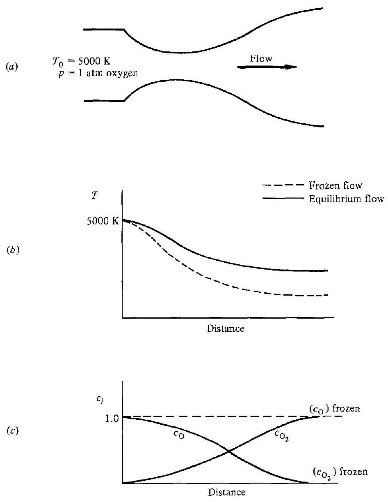
Figure 17.8 I A schematic comparing equilibrium and frozen chemically reacting flows through a nozzle.

constant throughout the nozzle, and is equal to its reservoir value. This is shown by the horizontal dashed line in Fig. 17.9c. In turn, because energy is permanently sealed in the frozen vibrational mode, less energy is available for the translational and rotational modes. Thus, because $T$ is proportional to the translational energy, the frozen flow temperature distribution is less than that for equilibrium flow, as shown in Fig. 17.9b. In turn, the distributions of $e_{\text {trans }}$ and $e_{\text {rot }}$ will be lower for vibrationally frozen flow, as shown in Fig. 17.9c.

It is left as an exercise for the reader to compare the equilibrium and frozen flows across a normal shock wave.

Note that a flow which is both chemically and vibrationally frozen has constant specific heats. This is nothing more than the flow of a calorically perfect gas as we have treated the topic in Chaps. 1 through 12. Let us examine the specific heat in more detail.

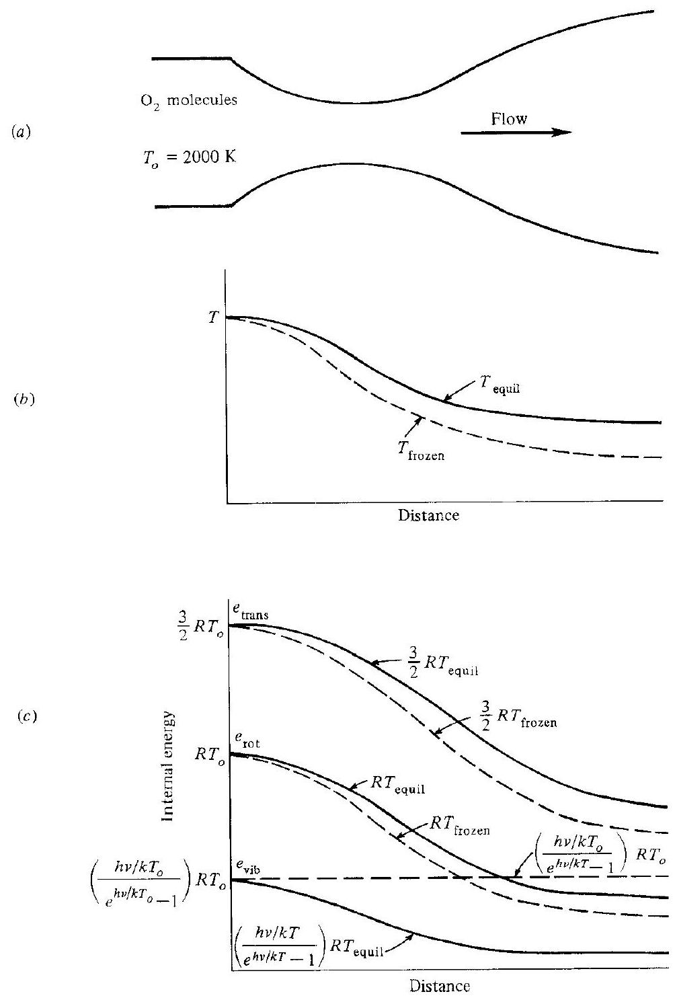
Figure 17.9 I A schematic comparing equilibrium and frozen vibrationally relaxing flows through a nozzle.

The enthalpy of a chemically reacting mixture can be obtained from Eq. (16.82), repeated here:

$$
h=\sum_{i} c_{i} h_{i}
$$

By definition, the specific heat at constant pressure, $c_{p}$, is

$$
c_{p}=\left(\frac{\partial h}{\partial T}\right)_{p}
$$

Thus, for a chemically reacting mixture, Eqs. (16.82) and (17.19) give

$$
\begin{aligned}
c_{p} & =\left[\frac{\partial}{\partial T}\left(\sum_{i} c_{i} h_{i}\right)\right]_{p} \\
c_{p} & =\sum_{i} c_{i}\left(\frac{\partial h_{i}}{\partial T}\right)_{p}+\sum_{i} h_{i}\left(\frac{\partial c_{i}}{\partial T}\right)_{p}
\end{aligned}
$$

In Eq. (17.20) $\left(\partial h_{i} / \partial T\right)_{p}$ is the specific heat per unit mass for the pure species $i, c_{p_{i}}$. Hence, Eq. (17.20) becomes

$$
c_{p}=\sum_{i} c_{i} c_{p_{i}}+\sum_{i} h_{i}\left(\frac{\partial c_{i}}{\partial T}\right)_{p}
$$

Equation (17.21) is an expression for the specific heat of a chemically reacting mixture. If the flow is frozen, by definition there are no chemical reactions, and therefore in Eq. (17.21) the term $\left(\partial c_{i} / \partial T\right)_{p}=0$. Thus, for a frozen flow, the specific heat becomes, from Eq. (17.21),

$$
c_{p}=c_{p_{f}}=\sum_{i} c_{i} c_{p_{i}}
$$

In turn, the frozen flow specific heat, denoted in Eq. (17.22) by $c_{p_{f}}$, can be inserted into Eq. (17.21), yielding for a chemically reacting gas

$$
\underbrace{c_{p}}_{\begin{array}{c}
\text { Specific heat at } \\
\text { constant pressure for } \\
\text { the reacting mixture }
\end{array}}=\underbrace{c_{p_{f}}}_{\begin{array}{c}
\text { Frozen specific } \\
\text { heat }
\end{array}}+\underbrace{\sum_{i} h_{i}\left(\frac{\partial c_{i}}{\partial T}\right)_{p}}_{\begin{array}{c}
\text { Contribution due to } \\
\text { chemical reaction }
\end{array}}
$$

Considering the internal energy of the chemically reacting gas given by

$$
e=\sum_{i} c_{i} e_{i}
$$

and using the definition of specific heat at constant volume,

$$
c_{v}=\left(\frac{\partial e}{\partial T}\right)_{v}
$$

we obtain in a similar fashion

$$
c_{v}=c_{v_{j}}+\sum_{i} e_{i}\left(\frac{\partial c_{i}}{\partial T}\right)_{v}
$$

where

$$
c_{v_{f}}=\sum_{i} c_{i} c_{v_{i}}
$$

Equations (17.23) and (17.24) are conceptually important. Throughout our calorically perfect gas discussions in Chaps. 1 through 12, we were employing $c_{p}$ and $c_{v}$ as expressed by Eqs. (17.22) and (17.25). Now, for the case of a chemically reacting gas, we see from Eqs. (17.23) and (17.24) that an extra contribution,
namely,

$$
\sum_{i} h_{i}\left(\frac{\partial c_{i}}{\partial T}\right)_{p} \quad \text { or } \quad \sum_{i} e_{i}\left(\frac{\partial c_{i}}{\partial T}\right)_{v}
$$

is made to the specific heats purely because of the reactions themselves. The magnitude of this extra contribution can be very large, and usually dominates the value of $c_{p}$ and $c_{v}$.

For practical cases, it is not possible to find analytic expressions for $\left(\partial c_{i} / \partial T\right)_{p}$ or $\left(\partial c_{i} / \partial T\right)_{n}$. For an equilibrium mixture, they can be evaluated numerically by differentiating the data from an equilibrium calculation, such as was described in Sec. 16.11. Such evaluations have been made, for example, by Frederick Hansen in NASA TR-50 (see Ref. 66). Figure 17.10 is taken directly from Hansen's work, and shows the variation of $c_{v}$ for air with temperature at several different pressures. The humps in each curve reflect the reaction term in Eq. (17.24),

$$
\sum_{i} e_{i}\left(\frac{\partial c_{i}}{\partial T}\right)_{i}
$$

and are due consecutively to dissociation of oxygen, dissociation of nitrogen, and then at very high temperatures the ionization of both O and N . (Note that the ordinate of Fig. 17.10 is a nondimensionalized specific heat, where $\mathscr{A}$ is the universal gas

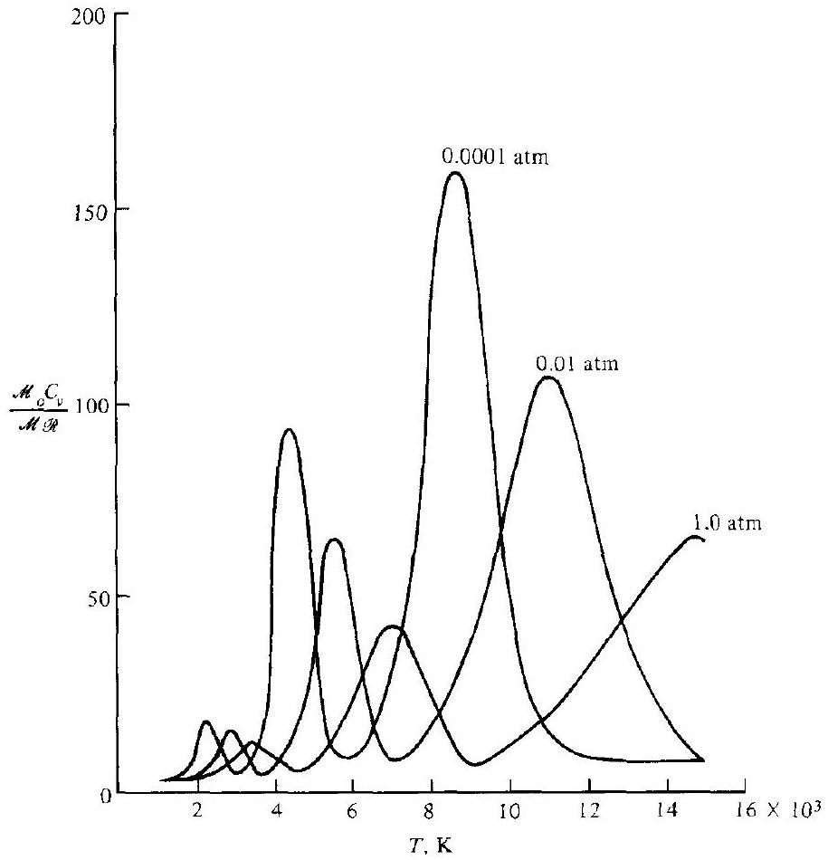
Figure 17.10 | Specific heat of equilibrium air at constant density as a function of temperature. (After Hansen, Ref. 66.)

constant, $\mathscr{M}_{o}$ is the initial molecular weight of undissociated air, $\mathscr{M}$ is molecular weight at the given $T$ and $p$ and $C_{v}$ is the molar specific heat.)

Because $c_{p}$ and $c_{v}$ for a chemically reacting mixture are functions of both $T$ and $p$ (or $T$ and $v$ ), and because they exhibit such wild variations as seen in Fig. 17.10, they are not usually employed directly in calculations of high-temperature flows. Note that, in our previous discussions on shock waves (Sec. 17.2) and nozzle flows (Sec. 17.3), $h$ or $e$ were used for a solution rather than $c_{p}$ or $c_{v}$. However, it is important for an overall understanding of high-temperature flows to know how and why the specific heats vary. This has been the purpose of this discussion.

### 17.5 I EQUILIBRIUM SPEED OF SOUND

In both Secs. 3.3 and 7.5 we showed conclusively that the speed of sound in a gas is

$$
a=\sqrt{\left(\frac{\partial p}{\partial \rho}\right)_{s}}
$$

This is a physical fact, and is not changed by the presence of chemical reactions. Furthermore, in Sec. 3.3 we found for a calorically perfect gas that $a=\sqrt{\gamma \bar{R} T}$. But what is the value of speed of sound in an equilibrium reacting mixture? How do we calculate it? Is it equal to $\sqrt{\gamma} R \bar{T}$ ? The purpose of this section is to address these questions.

Consider an equilibrium chemically reacting mixture at a fixed $p$ and $T$. Therefore, the chemical composition is uniquely fixed by $p$ and $T$. Imagine a sound wave passing through this equilibrium mixture. Inside the wave, $p$ and $T$ will change slightly. If the gas remains in local chemical equilibrium through the internal structure of the sound wave, the gas composition is changed locally within the wave according to the local variations of $p$ and $T$. For this situation, the speed of the sound wave is called the equilibrium speed of sound, denoted by $a_{e}$. In turn, if the gas is in motion at the velocity $V$, then $V / a_{e}$ is defined as the equilibrium Mach number $M_{e}$.

To obtain a quantitative relation for the equilibrium speed of sound, consider the combined first and second laws of thermodynamics from Eqs. (1.30) and (1.32), repeated here:

$$
\begin{aligned}
& T d s=d e+p d v \\
& T d s=d h-v d p
\end{aligned}
$$

The process through a sound wave is isentropic; hence Eqs. (1.30) and (1.32) become

$$
d e+p d v=0
$$

and

$$
d h-v d p=0
$$

For an equilibrium chemically reacting gas,

$$
e=e(v, T)
$$

Thus, the total differential is

$$
\begin{aligned}
& d e=\left(\frac{\partial e}{\partial v}\right)_{T} d v+\left(\frac{\partial e}{\partial T}\right)_{v} d T \\
& d e=\left(\frac{\partial e}{\partial v}\right)_{T} d v+c_{v} d T
\end{aligned}
$$

Similarly,

$$
\begin{aligned}
h & =h(p, T) \\
d h & =\left(\frac{\partial h}{\partial p}\right)_{T} d p+\left(\frac{\partial h}{\partial T}\right)_{p} d T \\
d h & =\left(\frac{\partial h}{\partial p}\right)_{T} d p+c_{p} d T
\end{aligned}
$$

Note that, in Eqs. (17.28) and (17.29), $c_{v}$ and $c_{p}$ are given by Eqs. (17.24) and (17.21), respectively. Substituting Eq. (17.28) into (17.26),

$$
\begin{aligned}
& \left(\frac{\partial e}{\partial v}\right)_{T} d v+c_{v} d T+p d v=0 \\
& c_{v} d T+\left[p+\left(\frac{\partial e}{\partial v}\right)_{T}\right] d v=0
\end{aligned}
$$

Substituting Eq. (17.29) into (17.27),

$$
\begin{aligned}
& \left(\frac{\partial h}{\partial p}\right)_{T} d p+c_{p} d T-v d p=0 \\
& c_{p} d T+\left[\left(\frac{\partial h}{\partial p}\right)_{T}-v\right] d p=0
\end{aligned}
$$

Dividing Eq. (17.31) by (17.30),

$$
\frac{c_{p}}{c_{v}}=\frac{\left[(\partial h / \partial p)_{T}-v\right]}{\left[(\partial e / \partial v)_{T}+p\right]} \frac{d p}{d v}
$$

However, $v=1 / \rho$; hence $d v=-d \rho / \rho^{2}$. Thus, Eq. (17.32) becomes

$$
\frac{c_{p}}{c_{v}}=\frac{\left[(\partial h / \partial p)_{T}-v\right]}{\left[(\partial e / \partial v)_{T}+p\right]}\left(-\rho^{2}\right) \frac{d p}{d \rho}
$$

Since we are dealing with isentropic conditions within the sound wave, any changes $d p$ and $d \rho$ within the wave must take place isentropically. Thus, $d p / d \rho \equiv(\partial p / \partial \rho)_{s} \equiv a_{e}^{2}$.

Hence, Eq. (17.33) becomes
or

$$
\begin{aligned}
\left(\frac{\partial p}{\partial \rho}\right)_{s} & =\frac{c_{p}}{c_{v}} \frac{1}{\rho^{2}} \frac{\left[(\partial e / \partial v)_{T}+p\right]}{\left[1 / \rho-(\partial h / \partial p)_{T}\right]} \\
a_{e}^{2} & =\frac{c_{p}}{c_{v}} \frac{p}{\rho} \frac{\left[1+(1 / p)(\partial e / \partial v)_{T}\right]}{\left[1-\rho(\partial h / \partial p)_{T}\right]}
\end{aligned}
$$

As usual, let $\gamma \equiv c_{p} / c_{0}$. Also, note from the equation of state that $p / \rho=R T$. Thus, Eq. (17.34) becomes

$$
a_{e}^{2}=\gamma R T \frac{\left[1+(1 / p)(\partial e / \partial v)_{T}\right]}{\left[1-\rho(\partial h / \partial p)_{T}\right]}
$$

Equation (17.35) gives the equilibrium speed of sound in a chemically reacting mixture.

Equation (17.35) gives an immediate answer to one of the questions asked at the beginning of this section. The speed of sound in an equilibrium reacting mixture is not equal to the simple result $\sqrt{\gamma R T}$ obtained in Sec. 3.3 for a calorically perfect gas. However, if the gas is calorically perfect, then $h=c_{p} T$ and $e=c_{v} T$ (see Sec. 1.4). In turn, $(\partial h / \partial p)_{T}=0$ and $(\partial e / \partial v)_{T}=0$, and Eq. (17.35) reduces to the familiar result

$$
a_{f}=\sqrt{\gamma R T}
$$

The symbol $a_{f}$ is used here to denote the frozen speed of sound, because a calorically perfect gas assumes no reactions. Equation (17.36) is the speed at which a sound wave will propagate when no chemical reactions take place internally within the wave, i.e., when the flow inside the wave is frozen.

For a thermally perfect gas, $h=h(T)$ and $e(T)$. Hence, again Eq. (17.35) reduces to Eq. (17.36).

Clearly, the full Eq. (17.35) must be used whenever $(\partial e / \partial v)_{T}$ and $(\partial h / \partial p)_{T}$ are finite. This occurs for two cases:

1. When the gas is chemically reacting
2. When intermolecular forces are important, i.e., when we are dealing with a real gas (see Sec. 1.4)

In both of these cases, $h=h(T, p)$ and $e=e(T, v)$ and hence Eq. (17.35) must be used.

Note from Eq. (17.35) that the equilibrium speed of sound is a function of both $T$ and $p$, unlike the case for a calorically or thermally perfect gas where it depends on $T$ only. This is emphasized in Fig. 17.11, which gives the equilibrium speed of sound for high-temperature air as a function of both $T$ and $p$. In addition, note in Fig. 17.11 that the frozen speed of sound is given by a constant horizontal line at $a^{2} \rho / p=1.4$, and that the difference between the frozen equilibrium speed of sound in air can be as large as 20 percent under practical conditions. In turn, this once again underscores the ambiguity in the definition of Mach number for high-temperature

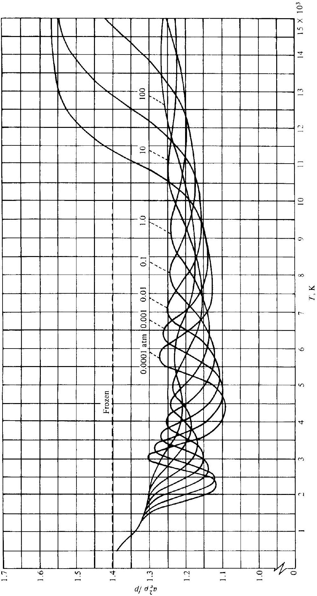
Figure 17.11 I Equilibrium speed of sound parameter (isentropic exponent) for air as a function of temperature. (After Hansen, Ref. 66.)

flows. The frozen Mach number $M_{f}=V / a_{f}$ and the equilibrium Mach number $M_{e}=V / a_{e}$ can differ by a substantial amount. Hence, Mach number is not particularly useful in this context.

Finally, note that the derivatives of $e$ and $h$ in Eq. (17.35) must be obtained numerically from the high-temperature equilibrium properties of the mixture. Although Eq. (17.35) is in a useful form to illustrate the physical aspects of the equilibrium speed of sound, it does not constitute a closed-form formula from which, given the local $p$ and $T$, a value of $a_{e}$ can be immediately obtained. Rather, the derivatives must be evaluated numerically, as has been carried out by Hansen (Ref. 66) and others and as is reported in Fig. 17.11.

## 17.6 | ON THE USE OF $\boldsymbol{\gamma}=\boldsymbol{c}_{\boldsymbol{p}} \boldsymbol{/} \boldsymbol{c}_{\boldsymbol{v}}$

As a corollary to Sec. 17.5, we emphasize that $\gamma \equiv c_{p} / c_{v}$ is a function of $T$ and $p$ for a chemically reacting gas. Hence, $\gamma$, which is so useful for the analysis of a calorically perfect gas as described in Chaps. 1 through 12, is virtually useless for the analysis of a high-temperature flow.

In spite of this, the temptation to use simple closed-form results such as Eqs. (3.28) through (3.31) has resulted in many approximate analyses of chemically reacting flows employing a constant "effective $\gamma$." This is particularly prevalent in the preliminary analysis and design of rocket engines. For example, consider the chemically reacting flow through a rocket nozzle, where $T_{o}$ and $T_{e}$ are the combustion chamber and exit temperatures, respectively. These temperatures can be used in Eq. (3.28) to define an effective value of $\gamma, \gamma_{\text {eff }}$, such that

$$
\frac{T_{o}}{T_{e}}=1+\frac{\gamma_{\mathrm{eff}}-1}{2} M_{e}^{2}
$$

In Eq. (17.37), $T_{o}, T_{e}$, and $M_{e}$ are all known quantities for the reacting flow, and $\gamma_{\text {eff }}$ is solved from this equation. Of course, in turn $\gamma_{\text {eff }}$ depends on $p_{o}, T_{o}$, and the gas composition. Moreover, this value of $\gamma_{\text {eff }}$ holds only for Eq. (17.37), which is its definition. If the same value of $\gamma_{\text {eff }}$ were used in Eqs. (3.30) and (3.31) for the pressure and density, respectively, the results would not be exact. Nevertheless, experience has shown that effective values of $\gamma$ inserted into the closed-form results for a calorically perfect gas can be used in approximate analyses of chemically reacting flows. Choosing the appropriate value of $\gamma_{\text {eff }}$ for a given problem is a matter of experience; in general, an answer to the problem, either from exact numerical calculations or experimental measurement, is usually necessary in order to estimate a reasonable value of $\gamma_{\text {eff }}$, say from Eq. (17.37). Note that, in terms of our discussion in Sec. 17.4, the effective $\gamma$ approach is nothing more than assuming frozen flow with a proper value of $\gamma_{\text {eff }}$ to give reasonably close results.

The reader is cautioned to approach such effective $\gamma$ analyses with strong reservations. It is simply a "back-of-the-envelope" technique for estimating hightemperature flow results. The proper techniques, using numerical solutions of the proper governing equations, as described for example in Secs. 17.2 through 17.5,
should be invoked whenever exact analyses of equilibrium high-temperature flows are desired.

### 17.7 I NONEQUILIBRIUM FLOWS: SPECIES CONTINUITY EQUATION

In the remainder of this chapter, we consider the flow of a high-temperature gas where the chemical and/or vibrational rates are finite, i.e., we consider nonequilibrium flows. This is in contrast to equilibrium (infinite-rate) or frozen (zero-rate) flows (see Sec. 17.4). In this capacity, we will need to incorporate into our flow analyses the finite-rate processes discussed in Secs. 16.13 through 16.16. In regard to our roadmap in Fig. 17.3, we now move to the right-hand column.

The analysis of nonequilibrium flows is inherently different from equilibrium or frozen flows in these fundamental ways:

1. The finite rates force the use of differential relationships for the governing equations. In contrast, note from our preceding discussions that equilibrium or frozen flows through nozzles or across shock waves can be treated with strictly algebraic relations. For nonequilibrium flow, the differential form of the governing equations (see Chap. 6) must be used.
2. For a nonequilibrium chemically reacting flow, the composition is no longer a unique function of the local $p$ and $T$, but rather depends on the speed at which the finite-rate reactions are taking place, the speed of the fluid elements themselves, and the actual geometric scale of the flow problem. This will become clearer as our discussions progress. Similarly, the vibrational energy for a nonequilibrium vibrationally excited flow is no longer a function of the local $T$. Hence, for the analysis of such nonequilibrium flows, the unknown chemical composition and/or vibrational energies introduce the requirement for additional governing equations. The derivation of such equations for chemically reacting flows is given in the present section; analogous equations for vibrationally excited flows will be treated in Sec. 17.8.

In Sec. 2.3, we derived the integral form of the continuity equation, which states that mass can be neither created nor destroyed. This is a universal principle in classical physics, and therefore holds for a nonequilibrium chemically reacting gas. In the analysis of such flows, Eq. (2.2), as well as its differential counterparts, Eqs. (6.5) and (6.22), is called the global continuity equation. It deals with the overall conservation of mass for the reacting mixture. However, for a nonequilibrium chemically reacting flow, we must also utilize a continuity equation for each species separately. Such an equation is called the species continuity equation, and is derived as follows.

Consider a fixed, finite control volume in the nonequilibrium, inviscid flow of a chemically reacting gas; such a control volume is sketched in Fig. 2.4. Let $\rho_{i}$ be the mass of species $i$ per unit volume of mixture. Hence

$$
\rho=\sum_{i} \rho_{i}
$$

Examining Fig. 2.4, the mass flow of species $i$ through the elemental surface area $d S$ is $\rho_{i} \mathbf{V} \cdot d \mathbf{S}$, where $\mathbf{V}$ is the local flow velocity. Hence, the net mass flow of species $i$ out of the control volume is

$$
\oiint_{S} \rho_{i} \mathbf{V} \cdot d \mathbf{S}
$$

The mass of species $i$ inside the control volume is

$$
\oiiint \rho_{i} d V
$$

Let $\dot{w}_{i}$ be the local rate of change of $\rho_{i}$ due to chemical reactions inside the control volume. Therefore, the net time rate of change of the mass of species $i$ inside the control volume is due to

1. The net flux of species $i$ through the surface
2. The creation or extinction of species $i$ inside the control volume due to chemical reactions

Writing this physical principle in terms of integrals over the control volume, we have

$$
\frac{\partial}{\partial t} \oiint_{\gamma} \rho_{i} d V=-\oiint_{S} \rho_{i} \mathbf{V} \cdot d \mathbf{S}+\oiiint \oiint_{\gamma} \dot{w}_{i} d V
$$

Equation (17.38) is the integral form of the species continuity equation; you will note that its derivation is quite similar to the global continuity equation given in Sec. 2.3. In turn, similar to the development given in Sec. 6.2, the differential form of the species continuity equation is obtained directly from Eq. (17.38) as

$$
\frac{\partial \rho_{i}}{\partial t}+\nabla \cdot\left(\rho_{i} \mathbf{V}\right)=\dot{w}_{i}
$$

[Recall that we are dealing with an inviscid flow. If the flow were viscous, Eqs. (17.38) and (17.39) would each have an additional term for the transport of species $i$ by mass diffusion, and the velocity would be the mass motion of species $i$, which is not necessarily the same as the mass motion of the mixture, V.]

In Eqs. (17.38) and (17.39) an expression for $\dot{w}_{i}$ comes from the chemical rate equation (16.130), couched in suitable dimensions. For example, assume that we are dealing with chemically reacting air, and we write Eqs. (17.38) and (17.39) for NO, i.e., $\rho_{i}=\rho_{\mathrm{NO}}$. The rate equation for NO is given by Eq. (16.144) in terms of

$$
\frac{d[\mathrm{NO}]}{d t}=-k_{f_{3 a}}[\mathrm{NO}]\left[\mathrm{O}_{2}\right]+\cdots
$$

The dimensions of this equation are moles per unit volume per unit time. However, the dimensions of $\dot{w}_{\mathrm{NO}}$ in Eqs. (17.38) and (17.39) are the mass of NO per unit
volume per unit time. Recalling that molecular weight is defined as the mass of species $i$ per mole of $i$, we can write

$$
\dot{w}_{\mathrm{NO}}=. / /{ }_{\mathrm{NO}} \frac{d[\mathrm{NO}]}{d t}
$$

where. $\mathscr{U}_{\mathrm{NO}}$ is the molecular weight of NO. Therefore, Eq. (17.39) written for NO is

$$
\frac{\partial \rho_{\mathrm{NO}}}{\partial t}+\nabla \cdot\left(\rho_{\mathrm{NO}} \mathbf{V}\right)=/_{\mathrm{NO}} \frac{d[\mathrm{NO}]}{d t}
$$

where $d[\mathrm{NO}] / d t$ is obtained from Eq. (16.144).
For a nonequilibrium chemically reacting mixture with $n$ different species, we need $n-1$ species continuity equations of the form of Eq. (17.39). These, along with the additional result that

$$
\sum_{i} \rho_{i}=\rho
$$

provide $n$ equations for the solution of the instantaneous composition of a nonequilibrium mixture of $n$ chemical species.

An alternative form of the species continuity equation can be obtained as follows. The mass fraction of species $i, c_{i}$, is defined as $c_{i}=\rho_{i} / \rho$. Substituting this relation into Eq. (17.39),

$$
\frac{\partial\left(\rho c_{i}\right)}{\partial t}+\nabla \cdot\left(\rho c_{i} \mathbf{V}\right)=\dot{w}_{i}
$$

Expanding Eq. (17.40), we have

$$
\rho\left(\frac{\partial c_{i}}{\partial t}+\mathbf{V} \cdot \nabla c_{i}\right)+c_{i}\left[\frac{\partial \rho}{\partial t}+\nabla \cdot(\rho \mathbf{V})\right]=\dot{w}_{i}
$$

The first two terms of Eq. (17.41) constitute the substantial derivative of $c_{i}$ (see Sec. 6.3). The second two terms (in brackets) result in zero from the global continuity equation (6.5). Hence, Eq. (17.41) can be written as

$$
\frac{D c_{i}}{D t}=\frac{\dot{w}_{i}}{\rho}
$$

In terms of the mole-mass ratio, $\eta_{i}=c_{i} / \|_{i}$, Eq. (17.42) becomes

$$
\frac{D \eta_{i}}{D t}=\frac{\dot{w}_{i}}{\|_{i} \rho}
$$

Equations (17.42) and (17.43) are alternative forms of the species continuity equation, couched in terms of the substantial derivative.

Recall from Sec. 6.3 that the substantial derivative of a quantity is physically the time rate of change of that quantity as we follow a fluid element moving with the flow. Therefore, from Eqs. (17.42) and (17.43) as we follow a fluid element of fixed mass moving through the flowfield, we see that changes of $c_{i}$ or $\eta_{i}$ of the fluid
element are due only to the finite-rate chemical kinetic changes taking place within the element. This makes common sense, and in hindsight, therefore, Eqs. (17.42) and (17.43) could have been written directly by inspection. We emphasize that in Eqs. (17.42) and (17.43) the flow variable inside the substantial derivative, $c_{i}$ or $\eta_{i}$, is written per unit mass. As long as the nonequilibrium variable inside the substantial derivative is per unit mass of mixture, then the right-hand side of the conservation equation is simply due to finite-rate kinetics, such as shown in Eqs. (17.42) and (17.43). In contrast, Eq. (17.39) can also be written as

$$
\frac{D \rho_{i}}{D t}=\dot{w}_{i}-\rho_{i}(\nabla \cdot \mathbf{V})
$$

The derivation of Eq. (17.44) is left to the reader. In it, the nonequilibrium variable inside the substantial derivative, $\rho_{i}$, is per unit volume. Because it is not per unit mass, an extra term in addition to the finite-rate kinetics appears on the right-hand side to take into account the dilation effect of the changing specific volume of the flow. (Recall from basic fluid mechanics that $\nabla \cdot \mathbf{V}$ is physically the volume efflux of fluid from a point.) The distinction made here will be important in Sec. 17.8.

## 17.8 | RATE EQUATION FOR VIBRATIONALLY NONEQUILIBRIUM FLOW

Consider the nonequilibrium inviscid flow of a vibrationally excited diatomic gas. The finite-rate kinetics for vibrational energy exchange were discussed in Sec. 16.14, leading to Eq. (16.116) as the vibrational rate equation. Based on the discussion at the end of Sec. 17.7, if we follow a moving fluid element of fixed mass, the rate of change of $e_{\mathrm{vib}}$ for this element is equal to the rate of molecular energy exchange inside the element. Therefore, we can write the vibrational rate equation for a moving fluid element as

$$
\frac{D e_{\mathrm{vib}}}{D t}=\frac{1}{\tau}\left(e_{\mathrm{vib}}^{\mathrm{eq}}-e_{\mathrm{vib}}\right)
$$

Note in Eq. (17.45) that $e_{\text {vib }}$ is the local nonequilibrium value of vibrational energy per unit mass of gas.

Flow with vibrational nonequilibrium is of particular practical interest in the analysis of modern gasdynamic and chemical lasers, and has been an important aspect of hypersonic wind tunnels since the mid-1950s.

### 17.9 I SUMMARY OF GOVERNING EQUATIONS FOR NONEQUILIBRIUM FLOWS

In a nonequilibrium flowfield, we wish to solve for $p, \rho, T, \mathbf{V}, h, e_{\mathrm{vib}}$, and $c_{i}$ as functions of space and time. For an inviscid, adiabatic nonequilibrium flow, the governing equations are summarized below. With the addition of the equations derived in Secs. 17.7 and 17.8, the governing equations are the same as developed in Chap. 6
(recall that in Chap. 6 we made no special assumptions regarding the type of gas):
Global continuity: $\quad \frac{\partial \rho}{\partial t}+\nabla \cdot(\rho \mathbf{V})=0$
Species continuity: $\quad \frac{\partial \rho_{i}}{\partial t}+\nabla \cdot\left(\rho_{i} \mathbf{V}\right)=\dot{w}_{i}$
or

$$
\frac{D c_{i}}{D t}=\frac{\dot{w}_{i}}{\rho}
$$

or

$$
\frac{D \eta_{i}}{D t}=\frac{\dot{w}_{i}}{\|_{i} \rho}
$$

(Note that for a mixture of $n$ species, we need $n-1$ species continuity equations; the $n$th equation is given by $\sum_{i} \rho_{i}=\rho$, or $\sum_{i} c_{i}=1$, or $\sum_{i} \eta_{i}=\eta$.)

Momentum:

$$
\rho \frac{D \mathbf{V}}{D t}=-\nabla p
$$

Energy:

$$
\frac{D h}{D t}-v \frac{D p}{D t}=0
$$

or for steady flow

$$
h_{o}=h+\frac{V^{2}}{2}=\text { const along a streamline }
$$

or any of Eqs. (6.17), (6.31), (6.36), (6.40), (6.43), (6.44), or (6.48). [Note that in the forms of the energy equation obtained in Chap. 6, a heat-addition term $\dot{q}$ was carried along. However, in the present chapter we are dealing with adiabatic flows; hence, $\dot{q}=0$. The term $\dot{q}$ does not have anything to do with chemical reactions; it is simply an effect due to energy addition across the boundaries of the flow, such as absorption of radiant energy. The energy release or absorption due to chemical reactions is not included in $\dot{q}$; rather, these chemical energy changes are already naturally accounted for by the heats of formation appearing in the enthalpy terms, e.g., Eq. (16.99).|

Equation of state:

$$
p=\rho R T
$$

where

$$
R=\frac{\pi}{\|}
$$

$$
\|=\left(\sum_{i} \frac{c_{i}}{\|_{i}}\right)^{-1}
$$

Enthalpy:

$$
h=\sum_{i} c_{i} h_{i}
$$

where

$$
h_{i}=\left(e_{\text {trans }}+e_{\mathrm{rot}}+e_{\mathrm{vib}}+e_{\mathrm{el}}\right)_{i}+R_{i} T+\left(\Delta h_{f}^{0}\right)_{i}
$$

or

$$
h_{i}=\frac{7}{2} R_{i} T+e_{\mathrm{vib}_{i}}+e_{\mathrm{el}_{i}}+\left(\Delta h_{f}^{0}\right)_{i}
$$

Vibrational energy: $\quad \frac{D\left(c_{i} e_{\mathrm{vib}_{i}}\right)}{D t}=\frac{c_{i}}{\tau_{i}}\left(e_{\mathrm{vib}_{i}}^{\mathrm{eq}}-e_{\mathrm{vib}_{i}}\right)$

### 17.10 I NONEQUILIBRIUM NORMAL SHOCK WAVE FLOWS

Consider a strong normal shock wave in a gas. Moreover, assume the temperature within the shock wave is high enough to cause chemical reactions within the gas. In this situation, we need to reexamine the qualitative aspects of a shock wave, as sketched in Fig. 17.12. The thin region where large gradients in temperature, pressure, and velocity occur, and where the transport phenomena of viscosity and thermal conduction are important, is called the shock front. For all of our previous considerations of a calorically perfect gas, or equilibrium flow of a chemically reacting or vibrationally excited gas, this thin region is the shock wave. For these previous situations, the flow in front of and behind the shock front was uniform, and the only gradients in flow properties took place almost discontinuously within a thin region of no more than a few mean-free-paths thickness. However, in a nonequilibrium flow, all chemical reactions and/or vibrational excitations take place at a finite rate. Since the shock front is only a few mean-free-paths thick, the molecules in a fluid element can experience only a few collisions as the fluid element traverses the front. Consequently, the flow through the shock front itself is essentially frozen. In turn, the flow

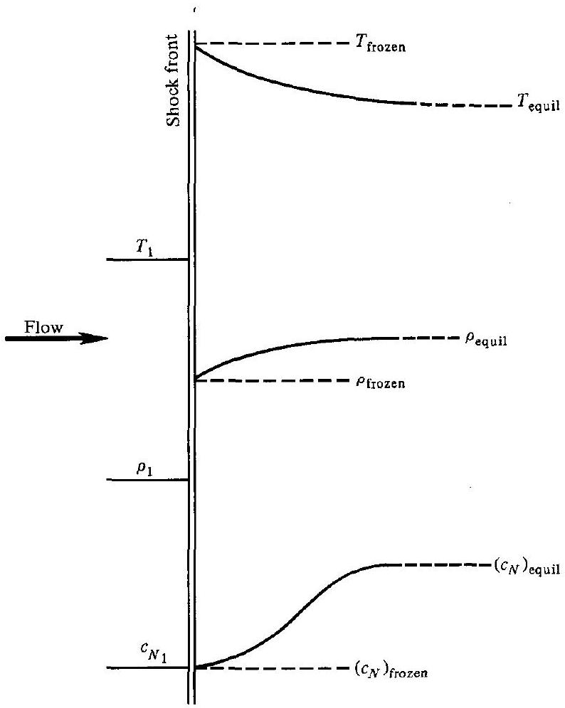
Figure 17.12 | Schematic of chemically reacting nonequilibrium flow behind a normal shock wave.

properties immediately behind the shock front are frozen flow properties, as discussed in Sec. 17.4 and as sketched in Fig. 17.12. Then, as the fluid element moves downstream, the finite-rate reactions take place, and the flow properties relax toward their equilibrium values, as also sketched in Fig. 17.12. With this picture in mind. the shock wave now encompasses both the shock front and the nonequilibrium region behind the front where the flow properties are changing due to the finite-rate reactions. For purposes of illustration, assume that the gas is pure diatomic nitrogen in front of the shock wave, i.e., $\left(C_{\mathrm{N}}\right)_{1}=0$ in Fig. 17.12. The properties immediately behind the shock front are obtained from frozen flow results, i.e., the constant $\gamma=1.4$ results from Sec. 3.6. Hence, the values of $T_{\text {frozen }}$ and $\rho_{\text {frozen }}$ shown in Fig. 17.12 can be obtained directly from Table A. 2 at the back of this book. In addition, $c_{\mathrm{N}}$ immediately behind the shock front is still zero, since the flow is frozen. Downstream of the shock front, the nonequilibrium flow must be analyzed using the equations summarized in Sec. 17.9. In this region, the nitrogen becomes either partially or totally dissociated (depending on the strength of the shock wave), and $c_{\mathrm{N}}$ increases as sketched in Fig. 17.12. In turn, because this reaction is endothermic, the static temperature behind the shock front decreases, and the density increases. Finally, the downstream flow properties will approach their equilibrium values, as calculated from the technique described in Sec. 17.2.

A numerical calculation of the nonequilibrium region behind the shock front can be established as follows. Since the flow is one-dimensional and steady, the equations of Sec. 17.9 become

Global continuity:
Momentum:

Energy:

Species continuity:

$$
\rho d u+u d \rho=0
$$

In Eq. (17.49) the $x$ distance is measured from the shock front, extending downstream as shown in Fig. 17.13. Note that Eq. (17.49) explicitly involves the finite-rate chemical reaction term $\dot{w}_{i}$, and that a distance $d x$ multiplies this term. Hence, Eq. (17.49) introduces a scale effect into the solution of the flowfield—a scale effect that is present solely because of the nonequilibrium phenomena. In turn, all flowfield properties become a function of distance behind the shock front, as sketched in Fig. 17.12. Continuing with the above equations, if Eq. (17.46) is multiplied by $u$,

$$
\rho u d u+u^{2} d \rho=0
$$

and Eq. (17.47) substituted into (17.50), we have

$$
d p=u^{2} d \rho
$$

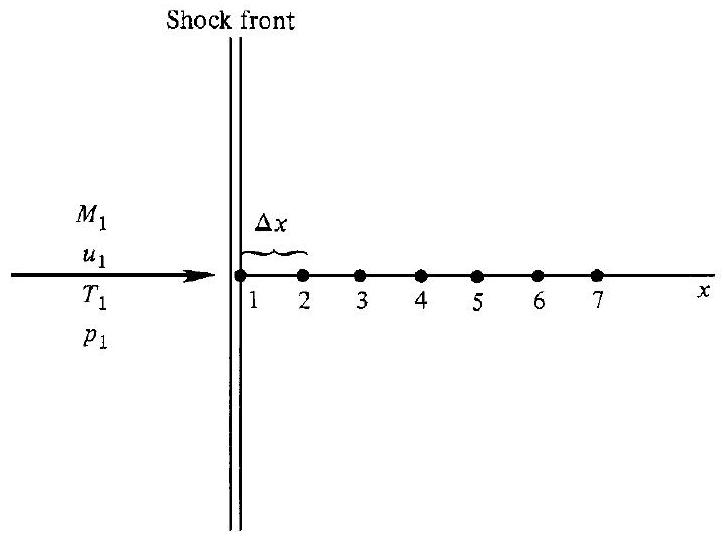
Figure 17.13 I Schematic of grid points for the numerical solution of nonequilibrium normal shock flows.

From the equation of state, $p=\rho R T$ where $R$ is a variable, since $R=\mathscr{R} / \mathscr{M}$ and $\mathscr{M}$ varies due to chemical reactions. Hence,
or
or

$$
\begin{aligned}
\frac{d p}{p} & =\frac{d \rho}{\rho}+\frac{d R}{R}+\frac{d T}{T} \\
d p & =\frac{p}{\rho} d \rho+\frac{p}{R} d R+\frac{p}{T} d T \\
d p & =R T d \rho+\rho T d R+\rho R d T
\end{aligned}
$$

Substituting Eq. (17.51) into (17.52), we have

$$
u^{2} d \rho=R T d \rho+\rho T d R+\rho R d T
$$

Solving Eq. (17.53) for $d \rho$, we obtain

$$
d \rho=\frac{\rho T d R+\rho R d T}{u^{2}-R T}
$$

The mixture enthalpy is given by
where

$$
h_{i}=\int_{0}^{T} c_{p_{i}} d T+\left(\Delta h_{f}^{0}\right)_{i}
$$

Hence,

$$
\begin{aligned}
d h & =\sum_{i} c_{i} d h_{i}+\sum_{i} h_{i} d c_{i} \\
& =\sum_{i} c_{i} c_{p_{i}} d T+\sum_{i} h_{i} d c_{i} \\
& =c_{p_{f}} d T+\sum_{i} h_{i} d c_{i}
\end{aligned}
$$

where $c_{p_{f}}$ is the frozen specific heat introduced in Sec. 17.4. Substituting Eq. (17.55) into Eq. (17.48), we have

$$
c_{p_{i}} d T+\sum_{i} h_{i} d c_{i}-\frac{d p}{\rho}=0
$$

Substituting Eq. (17.51) into Eq. (17.56), we have

$$
c_{p_{i}} d T+\sum_{i} h_{i} d c_{i}-\frac{u^{2}}{\rho} d \rho=0
$$

Substituting Eq. (17.54) into Eq. (17.57), we obtain

$$
c_{p_{i}} d T+\sum_{i} h_{i} d c_{i}-u^{2}\left[\frac{T d R+R d T}{u^{2}-R T}\right]=0
$$

or

$$
\left(c_{p_{f}}-\frac{u^{2}}{u^{2}-R T} R\right) d T=\frac{u^{2}}{u^{2}-R T} T d R-\sum_{i} h_{i} d c_{i}
$$

Since $R=, 1 / 1 / 1$ and
then

$$
. \ddot{ }=\left(\sum_{i} \frac{c_{i}}{\|_{i}}\right)^{-1}
$$

and

$$
R=\mathscr{R} \sum_{i} \frac{c_{i}}{\|_{i}}
$$

$$
d R=\mathscr{R} \sum_{i} \frac{d c_{i}}{\mathbb{U}_{i}}
$$

Also, from Eq. (17.49),

$$
d c_{i}=\frac{\dot{w}_{i}}{\rho u} d x
$$

Substituting Eqs. (17.59) and (17.60) into Eq. (17.58), and solving for $d T$, we have

$$
d T=\frac{\left(\frac{u^{2}}{u^{2}-R T}\right) \cdot R T\left(\frac{d x}{\rho u}\right) \sum_{i} \frac{\dot{w}_{i}}{\mathbb{A}_{i}}-\left(\frac{d x}{\rho u}\right) \sum_{i} h_{i} \dot{w}_{i}}{c_{p_{f}}-\frac{u^{2}}{u^{2}-R T} R}
$$

Equations (17.51), (17.54), (17.60), and (17.61) give the infinitesimal changes in $p, \rho, c_{i}$, and $T$, respectively, corresponding to the infinitesimal distance $d x$ behind the shock front. These equations are in a convenient form for numerical solution. Consider the one-dimensional flowfield behind the shock front to be divided into a large number of grid points separated by an equal distance $\Delta x$, as sketched in Fig. 17.13. Because the flow is frozen across the shock front, all conditions at point 1 immediately behind the shock front are known. For purposes of
illustration, let us use one-sided forward differences (see Sec. 11.11) in Eqs. (17.51), (17.54), (17.60), and (17.61). Hence, Eq. (17.60) is replaced by

$$
\begin{gathered}
\underbrace{c_{i_{2}}}_{\text {Tobe calculated }}-\underbrace{c_{i_{1}}}_{\text {Known }}=\underbrace{\left(\frac{\dot{w}_{i}}{\rho u}\right)_{1} \Delta x}_{\text {Known }} \\
c_{i_{2}}=c_{i_{1}}+\left(\frac{\dot{w}_{i}}{\rho u}\right)_{1} \Delta x
\end{gathered}
$$

From Eq. (17.62), all the species mass fractions can be calculated at point 2 . From Eq. (17.61) we have

$$
T_{2}=T_{1}+\Delta x\left[\frac{\left(\frac{u^{2}}{u^{2}-R T}\right) \frac{\mathscr{R} T}{\rho u} \sum_{i} \frac{\dot{w}_{i}}{\mathscr{U}_{i}}-\frac{1}{\rho u} \sum_{i} h_{i} \dot{w}_{i}}{c_{p_{f}}-\frac{u^{2}}{u^{2}-R T} R}\right]_{1}
$$

In Eq. (17.63) all terms on the right-hand side are known; hence, $T_{2}$ can be calculated directly. In turn, from Eq. (17.54)

$$
\rho_{2}=\rho_{1}+\frac{\rho_{1} T_{1}\left(R_{2}-R_{1}\right)+\rho_{1} R_{1}\left(T_{2}-T_{1}\right)}{u^{2}-R_{1} T_{1}}
$$

In Eq. (17.64), all terms on the right-hand side are known; hence $\rho_{2}$ can be calculated directly. [Note that $R_{2}=\mathscr{R} \sum_{i}\left(c_{i_{2}} / \mathscr{M}_{i}\right)$.] In turn, from Eq. (17.51),

$$
p_{2}=p_{1}+u_{1}^{2}\left(\rho_{2}-\rho_{1}\right)
$$

Everything is known on the right-hand side of Eq. (17.65), thus directly yielding $p_{2}$. Finally, from Eq. (17.47),

$$
u_{2}=u_{1}-\frac{1}{\rho_{1} u_{1}}\left(p_{2}-p_{1}\right)
$$

and we can calculate $u_{2}$. Consequently, from Eqs. (17.62) through (17.66), all the flowfield variables at point 2 behind the shock front can be computed. Repeating these equations, we can march on to points $3,4,5$, etc. In this fashion, the complete nonequilibrium flowfield can be obtained.

For simplicity in this illustration, we have used a simple first-order-accurate finite-difference for the derivatives. For such a method, however, the distance $\Delta x$ must be made so small to maintain reasonable accuracy as to be totally impractical. In practice, Eqs. (17.51), (17.54), (17.60), and (17.61) would be solved by a higherorder method, such as the standard Runge-Kutta technique for ordinary differential equations. To complicate matters, if one or more of the finite-rate chemical reactions
are very fast [if $\dot{w}_{i}$ in Eq. (17.60) is very large], then $\Delta x$ must still be chosen very small even when a higher-order numerical method is used. The species continuity equations for such very fast reactions are called "stiff" equations, and readily lead to instabilities in the solution. Special methods for treating the solution of stiff ordinary differential equations have been reviewed by Hall and Treanor (see Ref. 71).

Typical results for the nonequilibrium flowfield behind a normal shock wave in air are given in Figs. 17.14 and 17.15, taken from the work of Marrone (Ref. 72). The Mach number ahead of the shock wave is 12.28 , strong enough to produce major dissociation of $\mathrm{O}_{2}$, but only slight dissociation of $\mathrm{N}_{2}$. The variation of chemical composition with distance behind the shock front is given in Fig. 17.14. Note the expected increase in the concentration of O and N , rising from their frozen values (essentially zero) immediately behind the shock front, and monotonically approaching their equilibrium values about 10 cm downstream of the shock front. For the most part, the nonequilibrium flow variables will range between the two extremes of frozen and equilibrium values. However, in some cases, due to the complexities of the chemical kinetic mechanism, a species may exceed these two extremes. A case in point is the variation of NO concentration shown in Fig. 17.14. Note that it first increases from essentially zero behind the shock front, and overshoots its equilibrium value at about 0.1 cm . Further downstream, the NO concentration approaches its equilibrium value from above. This is a common behavior of NO when it is formed behind a shock front in air; it is not just a peculiarity of the given upstream conditions in Fig. 17.14. The

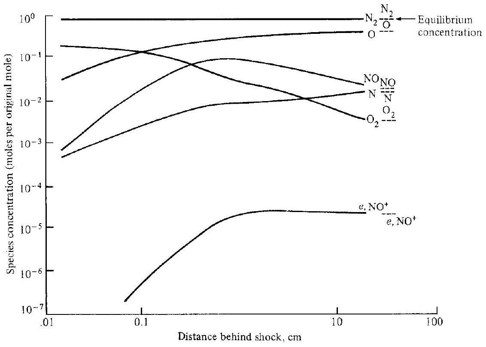
Figure 17.14 I Distributions of the chemical species for the nonequilibrium flow through a normal shock wave in air. $M_{1}=12.28, T_{1}=300 \mathrm{~K}, p_{1}=1.0 \mathrm{mmHg}$. (After Marrone, Ref. 72.)

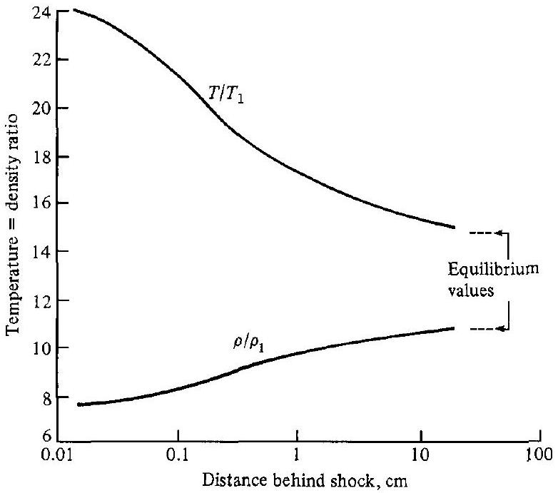
Figure 17.15 I Distributions of the temperature and density for the nonequilibrium flow through a normal shock wave in air. $M_{1}=12.28, T_{1}=300 \mathrm{~K}, p_{1}=1.0 \mathrm{mmHg}$. (After Marrone, Ref. 72.)

variations in temperature and density behind the shock front are shown in Fig. 17.15. As noted earlier, the chemical reactions in air behind a shock front are predominantly dissociation reactions, which are endothermic. Hence, $T$ decreases and $\rho$ increases with distance behind the front-both by almost a factor of 2 .

### 17.11 I NONEQUILIBRIUM QUASI-ONEDIMENSIONAL NOZZLE FLOWS

Because of the practical importance of high-temperature flows through rocket nozzles and high-enthalpy aerodynamic testing facilities, intensive efforts were made after 1950 to obtain relatively exact numerical solutions for the expansion of a hightemperature gas through a nozzle when vibrational and/or chemical nonequilibrium conditions prevail within the gas. In a rocket nozzle, nonequilibrium effects decrease the thrust and specific impulse. In a high-temperature wind tunnel, the nonequilibrium effects make the flow conditions in the test section somewhat uncertain. Both of these are adverse effects, and hence rocket nozzles and wind tunnels are usually designed to minimize the nonequilibrium effects; indeed, engineers strive to obtain equilibrium conditions in such situations. In contrast, the gasdynamic laser (see Ref. 21) creates a laser medium by intentionally fostering vibrational nonequilibrium in a supersonic expansion; here, engineers strive to obtain the highest degree of nonequilibrium possible. In any event, the study of nonequilibrium nozzle flows is clearly important.

Until 1969, all solutions of nonequilibrium nozzle flows involved steady state analyses. Such techniques were developed to a high degree, and are nicely reviewed
by Hall and Treanor (see Ref. 71). However, such steady state analyses were not straightforward. Complicated by the presence of stiff chemical rate equations (see Sec. 17.10), such solutions encountered a saddle-point singularity in the vicinity of the nozzle throat, and this made it very difficult to integrate from the subsonic to the supersonic sections of the nozzle. Moreover, for nonequilibrium nozzle flows the throat conditions and hence the mass flow are not known a priori; the nozzle mass flow must be obtained as part of the solution of the problem. Therefore, in 1969 a new technique for solving nonequilibrium nozzle flows was advanced by Anderson (see Refs. 73 and 74) using the time-marching finite-difference method discussed in Chap. 12. This time-marching approach circumvents the above problems encountered with steady-state analyses, and also has the virtue of being relatively easy and straightforward to program on the computer. Since its first introduction in 1969, the time-marching solution of nonequilibrium nozzle flows has gained wide acceptance.

Such a solution for a calorically perfect gas has already been introduced in Sec. 12.1. For this reason, the present section will highlight the time-marching solution of nonequilibrium nozzle flows. In this sense, our discussion here will be an extension of the ideas first presented in Sec. 12.1. Therefore, the reader is encouraged to review that section before proceeding further. Also, the reader is urged to study AGARD-ograph 124 by Hall and Treanor (see Ref. 71) for a broad outline of steadystate solutions for nonequilibrium nozzle flows.

Consider again the nozzle and grid-point distribution sketched in Fig. 12.5. The time-marching solution of nonequilibrium nozzle flows closely follows the technique described in Sec. 12.1, with the consideration of vibrational energy and chemical species concentrations as additional dependent variables. In this context. at the first grid point in Fig. 12.5, which represents the reservoir conditions, equilibrium conditions for $e_{\text {vib }}$ and $c_{i}$ at the given $p_{o}$ and $T_{o}$ are calculated, and held fixed, invariant with time. Guessed values of $e_{\text {vib }}$ and $c_{i}$ are then arbitrarily specified at all other grid points (along with guessed values of all other flow variables); these guessed values represent initial conditions for the time-marching solution. For the initial values of $e_{\mathrm{vi} b}$ and $c_{i}$, it is recommended that equilibrium values be assumed from the reservoir to the throat, and then frozen values be prescribed downstream of the throat. Such an initial distribution of nonequilibrium variables is qualitatively similar to typical results obtained for nonequilibrium nozzle flows, as we will soon see.

The governing continuity, momentum, and energy equations for unsteady quasi-one-dimensional flow have been given as Eqs. (12.5), (12.6), and (12.7) respectively. In addition to these equations, for a nonequilibrium flow the appropriate vibrational rate and species continuity equations are

$$
\frac{\partial e_{\mathrm{vib}}}{\partial t}=\frac{1}{\tau}\left(e_{\mathrm{vib}}^{\mathrm{eq}}-e_{\mathrm{vib}}\right)-u \frac{\partial e_{\mathrm{vib}}}{\partial x}
$$

and

$$
\frac{\partial c_{i}}{\partial t}=-u \frac{\partial c_{i}}{\partial x}+\frac{\dot{w}_{i}}{\rho}
$$

These equations are solved step by step in time using the finite-difference predictorcorrector approach described in Sec. 12.1, and of course are fully coupled with the other governing equations [Eqs. (12.5) through (12.7)] at each time step. Along with
the other flow variables, $e_{\text {vib }}$ and $c_{i}$ at each grid point will vary with time; but after many time steps all flow variables will approach a steady state. As emphasized in Sec. 12.1, it is this steady flowfield we are interested in as our solution-the timemarching technique is simply a means to achieve this end.

The nonequilibrium phenomena introduce an important new stability criterion for $\Delta t$ in addition to the CFL criterion discussed in Sec. 12.2. The value chosen for $\Delta t$ must be geared to the speed of the nonequilibrium relaxation process, and must not exceed the characteristic time for the fastest finite rate taking place in the system. That is,

$$
\Delta t<B \Gamma
$$

where $\Gamma=\tau$ for vibrational nonequilibrium, $\Gamma=\rho\left(\partial \dot{w}_{i} / \partial c_{i}\right)^{-1}$ for chemical nonequilibrium, and $B$ is a dimensionless proportionality constant found by experience to be less than unity, and sometimes as low as 0.1 . The value chosen for $\Delta t$ in a nonequilibrium flow must satisfy both Eqs. (17.69) and (12.14). Which of the two stability criteria is the smaller, and hence governs the time step, depends on the nature of the case being calculated. If the local pressure and temperature are low enough everywhere in the flow, the rates will be slow, and Eq. (12.14) generally dictates the value of $\Delta t$. On the other hand, if some of the rates have particularly high transition probabilities and/or the local $p$ and $T$ are very high, then Eq. (17.69) generally dictates $\Delta t$. This is almost always encountered in rocket nozzle flows of hydrocarbon gases, where some of the chemical reactions involving hydrogen are very fast and combustion chamber pressures and temperatures are reasonably high.

The nature of the time-marching solution of a vibrational nonequilibrium expansion of pure $\mathrm{N}_{2}$ is shown in Fig. 17.16. Here, the transient $e_{\mathrm{vib}}$ profiles at

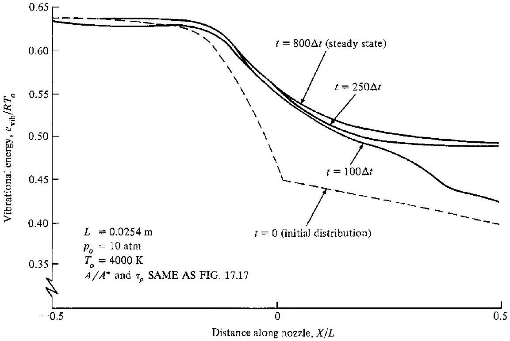
Figure 17.16 I Transient and final steady state $e_{\text {vib }}$ distributions for the nonequilibrium expansion of $\mathrm{N}_{2}$ obtained from the time-marching analysis. (After Anderson, Ref. 73.)

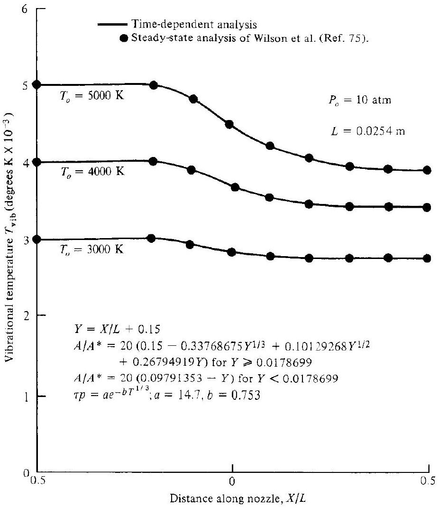
Figure 17.17 | Steady state $T_{\text {vib }}$ distributions for the nonequilibrium expansion of $\mathrm{N}_{2}$; comparison of the time-marching analysis with the steady-flow analysis of Wilson et al. (After Anderson, Ref. 73.)

various time steps are shown; the dashed curve represents the guessed initial distribution. Note that during the first 250 time steps, the proper steady state distribution is rapidly approached, and is reasonably attained after 800 time steps. Beyond this time, the time-marching solution produces virtually no change in the results from one time step to the next. This steady-state distribution agrees with the results of a steady-flow analysis after Wilson (see Ref. 75), as shown in Fig. 17.17. Here, a local "vibrational temperature" is defined from the local nonequilibrium value of $e_{\text {vib }}$ using the relation

$$
e_{\mathrm{vib}}=\left[\frac{h v / k T_{\mathrm{vib}}}{e^{h v / k T_{\mathrm{vib}}}-1}\right] R T_{\mathrm{vib}}
$$

patterned after the equilibrium expression given by Eq. (16.47). Note that Eq. (17.70) is not a valid physical relationship for nonequilibrium flow; it is simply an equation that defines the vibrational temperature $T_{\text {vib }}$ and that allows the calculation of a value of $T_{\text {vib }}$ from the known value of $e_{\text {vib }}$. Hence, $T_{\text {vib }}$ is simply an index for the local
nonequilibrium value of $e_{\text {vib }}$. In Fig. 17.17, both the time-marching calculations as well as the steady-flow analysis of Wilson assume nonequilibrium flow at all points downstream of the reservoir, including the subsonic section. Very good agreement between the two techniques is obtained.

Many analyses of nonequilibrium nozzle flows in the literature assume local equilibrium to the throat and then start their nonequilibrium calculations downstream of the throat. In this fashion, the problems with the saddlepoint singularity and the unknown mass flow, described earlier, are sidestepped. Examples of such analyses are given by Harris and Albacete (Ref. 76), and by Erickson (see Ref. 77). However, for many practical nozzle flows, nonequilibrium effects become important in the subsonic section of the nozzle, and hence a fully nonequilibrium solution throughout the complete nozzle is required.

Figures 17.16 and 17.17 illustrate an important qualitative aspect of nonequilibrium nozzle flows. Note that, as the expansion proceeds and the static temperature ( $T_{\text {trans }}$ ) decreases through the nozzle, the vibrational temperature and energy also decrease to begin with. However, in the throat region, $e_{\text {vib }}$ and $T_{\text {vib }}$ tend to "freeze," and are reasonably constant downstream of the throat. This is a qualitative comment only; the actual distributions depend on pressure, temperature, and nozzle length. It is generally true that equilibrium flow is reasonably obtained throughout large nozzles at high pressures. Reducing both the size of the nozzle and the reservoir pressure tends to encourage nonequilibrium flow.

Results for a chemical nonequilibrium nozzle flow are given in Fig. 17.18, where the transient mechanism of the time-marching technique is illustrated. Here,

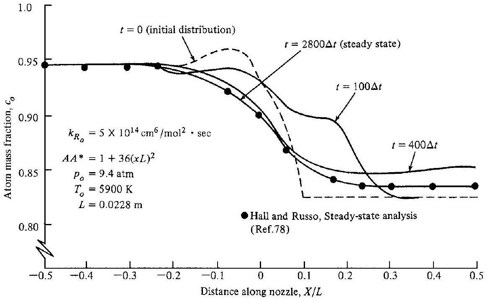
Figure 17.18 | Transient and final steady-state atom mass-fraction distributions for the nonequilibrium expansion of dissociated oxygen; comparison of the time-marching method with the steady-state approach of Hall and Russo. (After Anderson, Ref. 73.)

the nonequilibrium expansion of partially dissociated oxygen is calculated where the only chemical reaction is

$$
\mathrm{O}_{2}+M \leftrightharpoons 2 \mathrm{O}+M
$$

In Fig. 17.18, the dashed line gives the initially assumed distribution for the atomic oxygen mass fraction, $c_{O}$. Note the rapid approach toward the steady state distribution during the first 400 time steps. The final steady-state distribution is obtained after 2800 time steps. This steady-state distribution compares favorably with the results of Hall and Russo (solid circles), who performed a steady-flow analysis of the complete nonequilibrium nozzle flow (see Ref. 78). Again, note the tendency of the oxygen mass fraction to freeze downstream of the throat.

A more complex chemically reacting nonequilibrium nozzle flow is illustrated by the expansion of a hydrocarbon mixture through a rocket engine. The configuration of a rocket nozzle is given in Fig. 17.19. Here, for the time-marching numerical solution two grids are used along the nozzle axis: a fine grid of closely spaced points through the subsonic section and slightly downstream of the throat, and a coarse grid of widely spaced points further downstream. Since most of the nonequilibrium behavior and the fastest reactions are occurring in the throat region, a fine grid is chosen here to maintain accuracy. In contrast, far downstream in the cooler supersonic region, the reactions are slower, the chemical composition is tending to freeze, and the grid spacing can be larger. (Parenthetically, we note that, for any of the finitedifference solutions discussed in this book, the grid spacings do not have to be constant. Indeed, the concept of adaptive grids, i.e., putting grid points only where you want them as dictated by the gradients in the flow, is a current state-of-the-art research problem of computational fluid dynamics.)

In Fig. 17.19, the reservoir conditions are formed by the equilibrium combustion of $\mathrm{N}_{2} \mathrm{O}_{4}, \mathrm{~N}_{2} \mathrm{H}_{4}$, and unsymmetrical dimethyl hydrazine, with an oxydizer-to-fuel ratio of 2.25 and a chamber pressure of 4 atm . Results for the subsequent nonequilibrium expansion are shown in Figs. 17.20 through 17.23. In Fig. 17.20, the transient variation of the hydrogen atom mass fraction through the nozzle is shown. For

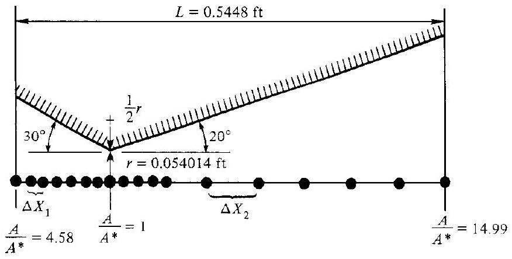
Figure 17.19 I Schematic representation of the rocket engine nozzle and grid-point system used by Vamos and Anderson, Ref. 80.

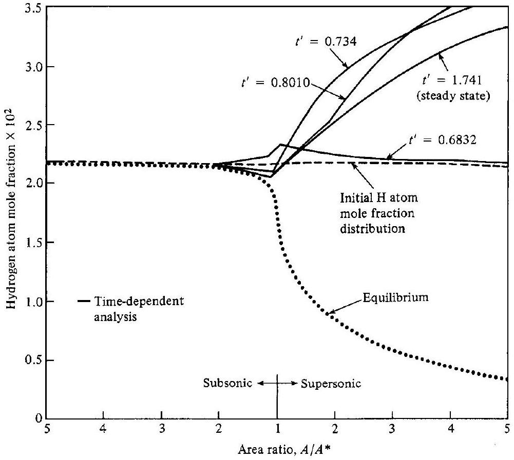
Figure $\mathbf{1 7 . 2 0} \mid$ Transient and final steady-state distributions of the hydrogen atom mole fraction through a rocket nozzle; nonequilibrium flow. (After Vamos and Anderson, Ref. 80.)

convenience, the initial distribution is assumed to be completely frozen from the reservoir (the dashed horizontal line). Several intermediate distributions obtained during the time-marching calculations are shown, with the final steady state being achieved at a dimensionless time of 1.741 . Note that, if the flow were in local chemical equilibrium, $X_{\mathrm{H}}$ would decrease continuously as $T$ decreases, as shown in Fig. 17.20. In contrast, however, due to the complexities of the H-C-O-N chemical kinetic mechanism, $X_{\mathrm{H}}$ actually increases with distance along the nozzle. Here is another example (the first was given in Sec. 17.10) where a nonequilibrium variable falls outside the bounds of equilibrium and frozen flows. The variation of static temperature is given in Fig. 17.21; note that for nonequilibrium flow the temperature distribution is lower than the equilibrium value. This is because the nonequilibrium flow tends to freeze some of the dissociated products, hence locking up some of the chemical zero-point energy which would otherwise be converted to random molecular translational energy. The steady-state temperature distribution in Fig. 17.21 (at $t^{\prime}=$ 1.741) compares favorably with the steady-flow analysis of Sarli et al. (see Ref. 79). In Fig. 17.22, the steady-state nonequilibrium distributions of various chemical species are given, and are compared with their equilibrium values. (Note that inconsistent units are used for the concentrations.) Clearly, a substantial degree of nonequilibrium exists in the nozzle expansion. A practical consequence of this nonequilibrium

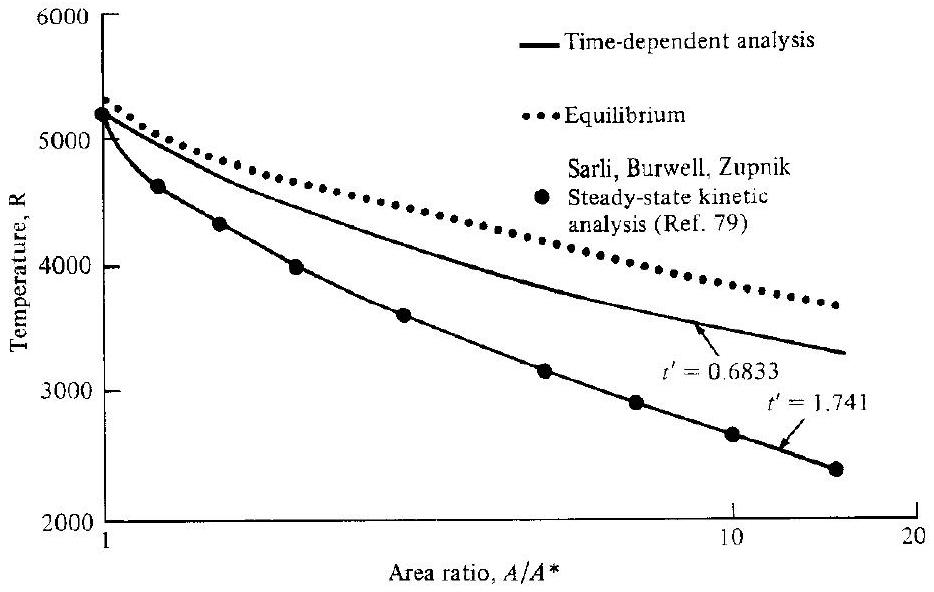
Figure 17.21 I Temperature distributions for the nonequilibrium flow through a rocket nozzle. (After Vamos and Anderson, Ref. 80.)

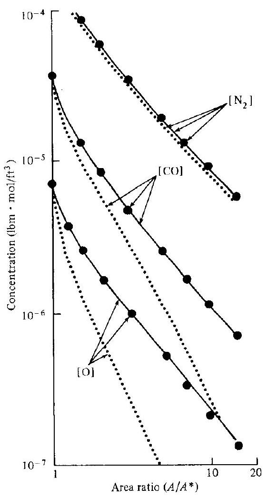

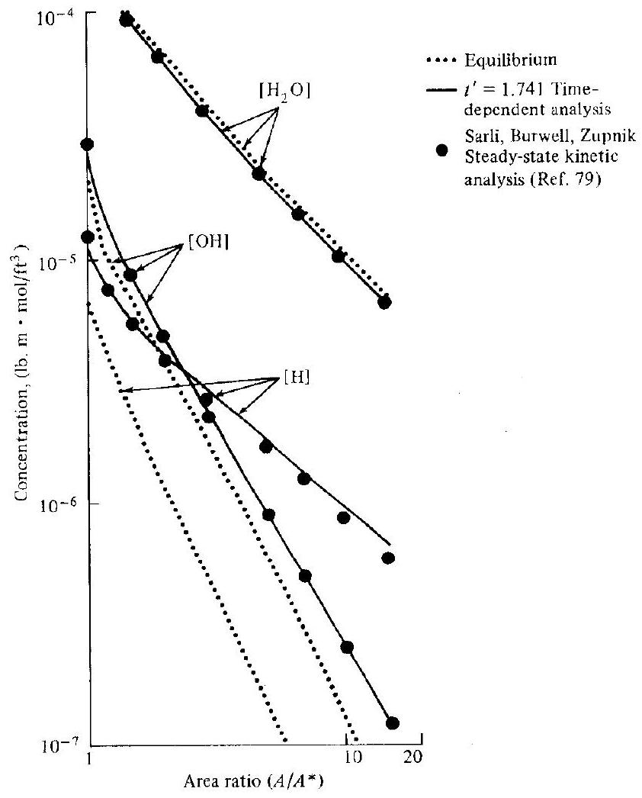
Figure 17.22 I Molecular and atomic species concentration profiles for the nonequilibrium flow through a rocket nozzle. (After Vamos and Anderson, Ref. 80.)

- Sarli, Burwell, Zupnik steady-state kinetic analysis (Ref. 79)

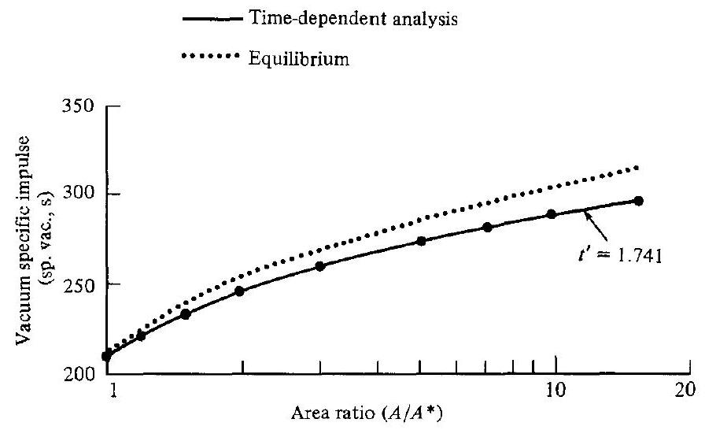
Figure 17.23 I Spatial variation of the vacuum specific impulse; comparison of equilibrium and nonequilibrium results. (After Vamos and Anderson, Ref. 80.)

flow is reflected in Fig. 17.23, which gives the variation of local specific impulse through the nozzle. The specific impulse (pounds of thrust per pound per second of mass flow) of the actual engine is given by the local value at the nozzle exit. Clearly, nonequilibrium flow throughout the nozzle expansion reduces the thrust and efficiency in comparison to equilibrium flow. See Ref. 80 for more details.

As a final point concerning nonequilibrium nozzle flows, note that any finite-rate phenomena are irreversible. Hence, an adiabatic, inviscid nonequilibrium nozzle flow is nonisentropic. Because the entropy of a fluid element increases as it moves through the nozzle, a simple analysis shows that the local velocity at the nozzle throat is not sonic. Indeed, in a nonequilibrium flow, the speed of sound itself is not unique, and depends on the frequency of the sound wave. However, if either the frozen or equilibrium speeds of sound (see Sec. 17.5) are used to define the frozen or equilibrium Mach numbers at the nozzle throat, both Mach numbers will be less than unity. Sonic flow in a nonequilibrium nozzle expansion occurs slightly downstream of the throat.

### 17.12 I SUMMARY

The analysis of high-temperature flows is an important part of the modern application of compressible flow. This is why the principles behind the high-temperature thermodynamic properties of a gas were discussed at length in Chap. 16, and were applied for the analysis of some basic flows in the present chapter. Shock waves and nozzle flows are classic problems in the study of compressible flow; moreover, they occur so frequently in practice that such studies are of immense practical use.

Consequently, these basic flows were chosen in this chapter to illustrate the hightemperature effects of vibrational excitation and chemical reactions. However, the trends and physical results discussed here are characteristic of most high-temperature flows of interest. Therefore, a careful study of this chapter will prepare the reader for virtually any foray into more complex flows where high-temperature phenomena are of importance.

## PROBLEMS

Note: Universal gas constant $\mathscr{R}=8314 \mathrm{~J} /(\mathrm{kg} \cdot \mathrm{mol} \cdot \mathrm{K}), v_{\mathrm{N}_{2}}=7.06 \times 10^{13} / \mathrm{s}, k= 1.38 \times 10^{-23} \mathrm{~J} / \mathrm{K}, h=6.625 \times 10^{-34} \mathrm{~J} \cdot \mathrm{~s}, \|_{\mathrm{N}_{2}}=28,1 \mathrm{~atm}=1.01 \times 10^{5} \mathrm{~N} / \mathrm{m}^{2}$.
17.1 Consider a normal shock wave in pure $\mathrm{N}_{2}$. The upstream pressure. temperature, and velocity are $0.1 \mathrm{~atm}, 300 \mathrm{~K}$, and $3500 \mathrm{~m} / \mathrm{s}$, respectively. Calculate $T_{2}, p_{2}$, and $u_{2}$ behind the shock assuming local thermodynamic equilibrium but no chemical reactions. Ignore the electronic energy.
17.2 The total temperature $T_{o}$ is defined in Chap. 3 as that temperature that would exist at a point in the flow if the fluid elements were brought to rest adiabatically at that point. For each of these chemically reacting flows, is $T_{o}$ constant or variable throughout the flow? Explain your answer.
a. Equilibrium flow across a shock wave
b. Nonequilibrium flow across a shock wave
c. Inviscid, adiabatic, equilibrium flow through nozzles
d. Inviscid, adiabatic nonequilibrium flow through nozzles

