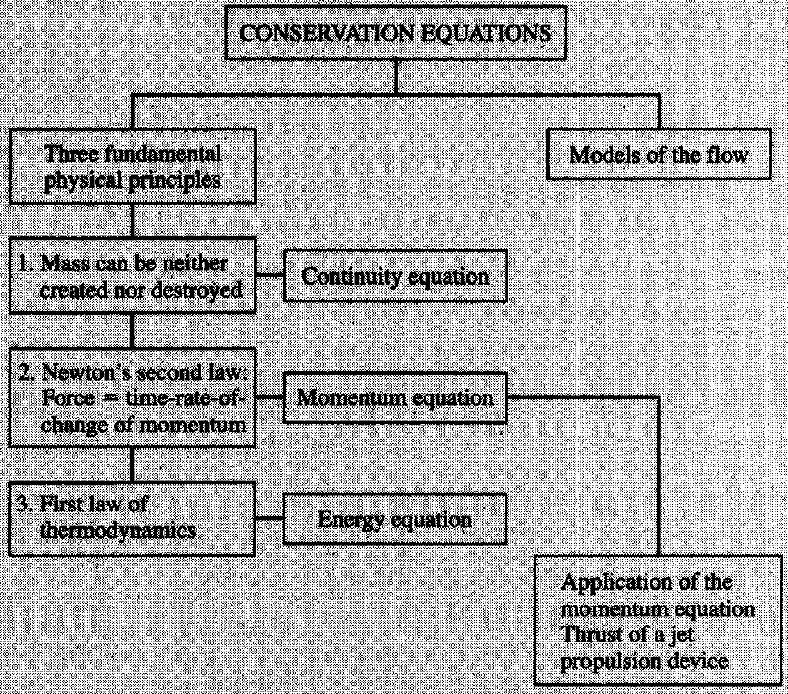
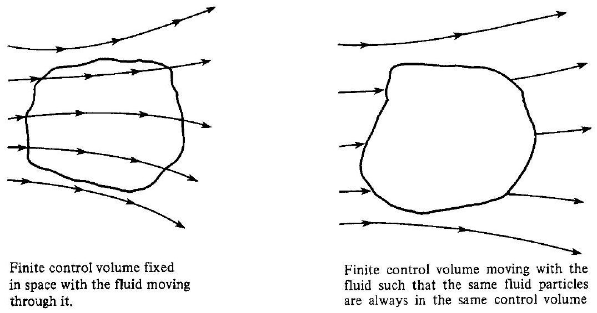
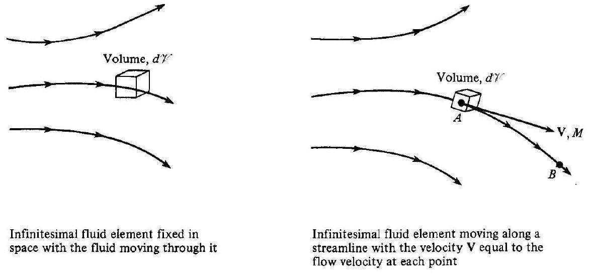
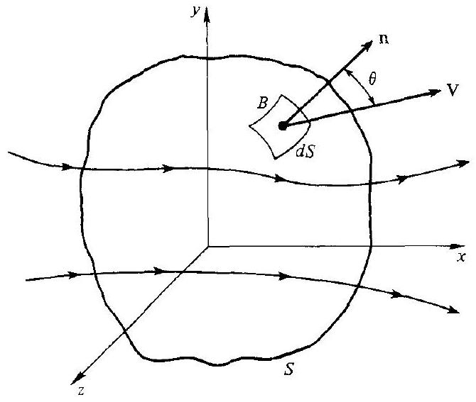
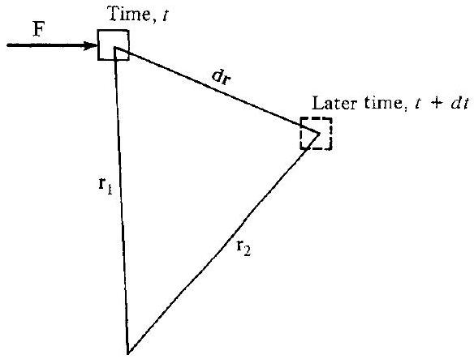
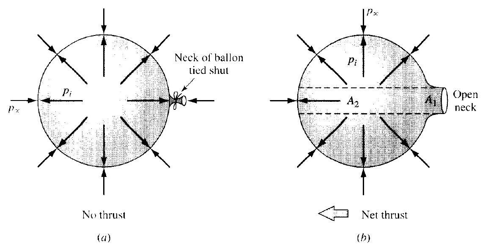
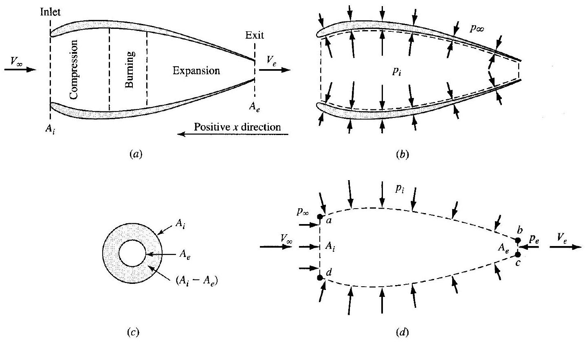

# Integral Forms of the Conservation Equations for Inviscid Flows 

For a consolidated equation-only list of the main results from this chapter, see `Main Results.md`. For explanations and symbol meanings, see `Equation Index.md` and `Symbol Index.md`.

Mathematics up to the present day have been quite useless to us in regard to flying.
From the 14th Annual Report of the Aeronautical Society of Great
Britain, 1879
Mathematical theories from the happy hunting grounds of pure mathematicians are found suitable to describe the airflow produced by aircraft with such excellent accuracy that they can be applied directly to airplane design.

Theodore von Karman, 1954

## PREVIEW BOX

The common phrase "you can not get something for nothing." besides holding in everyday lifo, and besides representing a colloquial statement of the second law of thermodynamics, also is relevant to the present chapter. Most students of enginecring are anxious to get to the exciting practical applications that form the core of their profession, this is usually the reason for their interest in engineering in the first place. A study of compressible flow is no different-we would love to jump right in and design a supersonic airplane, or learn about rocket engines. But at this early stage in our studies we have no theoretical tools to design anything or to gain an understanding of any exciting application. We first have to acquire the necessary theoretical tools-the fundamental equations that govern the flow of a compressible fluid. Such tool gathering is the main puppose of this chapter. Here we will convert three fundamental physical principles into equations that will be the first tools to go into our toolbox for the stuidy of compressible flow. As we proceed through this book, other theoretical tools progressively will be added to our toolbox. In the process, these tools will enable us to understand and quantify
progressively more exciting and challenging applications. This chapter is all about fundamental equations. The deviation of these equations is an intellectual exercise that is interesting in and of itself. So sit back and let yourself enjoy the intellectual gems to be found here.

To further orient ourselves, return to Fig. 1.7, which is the general roadmap for this book. The present chapter deals with boxes 2 and 3 in Fig. 1.7. The roadmap for the present chapter is given in Fig. 2.1. This chapter deals exclusively with three familiar fundamental physical principles, and how they are applied to a compressible flow: (1) mass can be neither created nor destroyed; (2) Newton's second law; and (3) the first law of thermodynamics. This chapter is all about converting these word statements into corresponding equations labeled, respectively, the integral forms of the continuity, momentum, and energy equations. However, this chapter is not devoid of applications. We end the chapter with a detailed derivation of the thrust equation for a jet propulsion device. This is a beautiful application of the integral form of the momentum equation in order to obtain a very practical result.

Figure 2.1 I Roadmap for Chapter 2.

## 2.1 | PHILOSOPHY

> [!exercise] Exercise 2.1 - Flow Modeling Approaches and Their Role in Aerodynamic Analysis
> Consider the general problem of determining the aerodynamic forces, moments, and heat transfer on a body immersed in a fluid flow - for example, a supersonic missile, a submarine, or a tall building in a storm.
> (a) Explain why computing the complete flowfield (i.e., the distributions of $p, p, T, \mathrm{~V}$, etc., at all points in the flow) is a necessary step toward obtaining practical engineering quantities such as lift, drag, and surface heat transfer. In your answer, describe the logical chain from flowfield solution to aerodynamic forces.
> (b) The derivation of the governing equations of fluid motion follows a three-step procedure. State each step clearly, identifying the role of physical laws, flow models, and mathematical extraction.
> (c) Three distinct modeling approaches can be used to derive the equations of fluid motion:
> (i) the finite control volume approach,
> (ii) the infinitesimal fluid element approach, and
> (iii) the molecular (kinetic theory) approach.
> 
> For each approach, briefly describe the model and state whether it leads directly to integral equations, differential equations, or a statistical/kinetic formulation. Also note whether the model can be applied in either a fixed or moving reference frame, and what difference this choice makes.
> (d) Within the finite control volume approach, distinguish between a control volume that is fixed in space and one that moves with the fluid. For the fixed control volume, explain physically why both a surface integral (flux) term and a volume integral (time-rate-ofchange) term appear in the resulting conservation equations. Which of these two formulations is adopted in this chapter, and why might consistency in model choice be important?

Consider the flowfield over an arbitrary aerodynamic body. We are interested in calculating the properties ( $p, \rho, T, \mathbf{V}$, etc.) of the flowfield at all points within the flow. Why? Because, if we can calculate the flow properties throughout the flow, then we can certainly compute them on the surface of the body. In turn, from the surface distributions of $p, T, \rho, \mathbf{V}$, etc., we can compute the aerodynamic forces (lift and drag), moments, and heat transfer on the body. Indeed, the calculation of such practical information is one of the main functions of theoretical fluid mechanics, whether the body be a supersonic missile in flight, a submarine under water, or a high-rise apartment building in a hurricane. The essential point here is that in order to obtain practical information on engineering devices involving fluid flows, it is frequently necessary to approach the theoretical solution of the complete flowfield.

How do we calculate the flowfield properties? The answer is from equations, algebraic, differential, or integral, which relate $p, \rho, T, \mathbf{V}$, etc., to each other, along with suitable boundary conditions for the problem. The equations are obtained from the fundamental laws of nature applied to fluid flows. These laws and equations are a necessary prerequisite for an understanding of compressible flow. Therefore, let us proceed to establish these fundamental results.

## 2.2 | APPROACH

In obtaining the basic equations of fluid motion, the following approach is always taken:

1. Choose the appropriate fundamental physical principles from the laws of nature, such as
a. Mass is conserved.
b. Force = mass × acceleration.
c. Energy is conserved.
2. Apply these physical principles to a suitable model of the flow.
3. From this application, extract the mathematical equations which embody such physical principles.

We first consider step 2, namely, what constitutes a suitable model of the flow? This is a somewhat subtle question. In contrast to the dynamics of well-defined solid bodies, on which it is usually apparent where to apply forces and moments, the dynamics of a fluid are complicated by the "squishy" nature of a rather elusive continuous medium that generally extends over large regions in space. Consequently, fluid dynamicists have to focus on specific regions of the flow, and apply the fundamental laws to a subscale model of the fluid motion. Three such models can be employed.

### 2.2.1 Finite Control Volume Approach

Consider a general flowfield, as represented by the streamlines in Fig. 2.2. Let us imagine a closed volume drawn within a finite region of the flow. This is defined as a control volume with volume $y$ and surface area $S$. The control volume may be

> [!figure] Figure 2.2
> 
> 
> Figure 2.2 | Finite control volume approach.

> [!figure] Figure 2.1
> 
> 
> Figure 2.3 | Infinitesimal fluid element approach.

either fixed in space with the fluid moving through it, or moving with the fluid such that the same fluid particles are always inside it.

With the application of the already mentioned fundamental physical principles to these finite control volumes, fixed or moving, integral equations for the fluid properties can be directly obtained. With some further manipulation, differential equations for the fluid properties can be indirectly extracted.

### 2.2.2 Infinitesimal Fluid Element Approach

Consider a general flowfield as represented by the streamlines in Fig. 2.3. Let us imagine an infinitesimally small fluid element in the flow, with volume $d \mathscr{Y}$. The fluid element is infinitesimal in the same sense as differential calculus; however, it is large enough to contain a huge number of molecules so that it can be viewed as a continuous medium (see the discussion of a continuum in Sec. 1.3). The fluid element may
be fixed in space with the fluid moving through it, or it may be moving along a streamline with velocity $\mathbf{V}$ equal to the flow velocity at each point. With the application of the fundamental physical principles to these fluid elements, fixed or moving, differential equations for the fluid properties can be directly obtained.

### 2.2.3 Molecular Approach

In actuality, of course, the motion of a fluid is a ramification of the mean molecular motion of its particles. Therefore, a third model of the flow can be a microscopic approach wherein the fundamental laws of nature are applied directly to the molecules, with suitable statistical averaging. This leads to the Boltzmann equation from kinetic theory, from which the governing differential equations for the fluid properties can be extracted. This is an elegant approach, with many advantages in the long run. However, it is beyond the scope of the present book. The reader should consult the authoritative book by Hirchfelder, Curtis, and Bird (Ref. 19) for more details.

In summary, although many variations on the theme can be found in different texts for the derivation of the general equations of fluid flow, the flow model can usually be categorized as one of the approaches described above. For the sake of consistency, the model of a fixed finite control volume will be employed for the remainder of this chapter.

## 2.3 | CONTINUITY EQUATION

### 2.3.1 Physical Principle

> [!question] Question 2.1
> (1) define inviscid flow
> (2) define viscous flow
> (3) compressible flow

> [!definition] Inviscid Flow
> A simplified model of fluid motion in which the effects of viscosity (internal fluid friction) and thermal conduction are assumed to be zero. In an inviscid flow, there are no shear stresses ($\tau = 0$) between fluid layers or at solid boundaries; consequently, the only surface force acting on a fluid element is pressure ($p$), which acts purely normal to the surface.

> [!definition] Viscous Flow
> A flow regime in which the physical property of viscosity (internal resistance to flow) is considered, accounting for the transport of momentum through shear stresses ($\tau$) between fluid layers. In a viscous flow, fluid particles "stick" to solid surfaces, leading to the no-slip boundary condition, where the fluid velocity exactly matches the velocity of the boundary ($V=0$ relative to a stationary wall).

> [!definition] Compressible Flow
> A flow regime in which the density ($\rho$) of the fluid changes significantly in response to changes in pressure and temperature. Unlike incompressible flow (where density is assumed constant), in a compressible flow, the fluid behaves like a "spring"—when it is compressed by a pressure gradient or a high-speed obstacle, its volume decreases and its density increases.

> [!definition] Incompressible flow
> A flow regime in which the density ($\rho$) of a fluid element remains constant as it moves through the flow field. Mathematically, this implies that the material derivative of density is zero ($D\rho/Dt = 0$). In most engineering applications, this is treated simply as $\rho = \text{constant}$ throughout the entire control volume.

> [!exercise] Exercise 2.2 Derivation of the Integral Conservation Equations for a Fixed Control Volume
> Consider a fixed control volume $\mathscr{V}$ bounded by a closed control surface $S$ immersed in a general fluid flow, as shown in Fig. 2.4. At any point on the surface, let $\mathbf{n}$ be the outwardpointing unit normal, $d \mathbf{S}=\mathbf{n} d S$, and let $\rho$ and $\mathbf{V}$ denote the local density and velocity, respectively.
> (a) Starting from the physical principle that mass can be neither created nor destroyed, show that the mass flow through an elemental surface $d S$ is $\dot{m}=\rho \mathbf{V} \cdot d \mathbf{S}$. Then, by considering the net mass flux through the entire control surface and the time rate of change of mass stored within $\mathcal{V}$, derive the integral form of the continuity equation:
> 
> $$
> \frac{\partial}{\partial t} \iiint_{\mathcal{Y}} \rho d \mathcal{Y}+\iint_S \rho \mathbf{V} \cdot d \mathbf{S}=0
> $$
> 
> 
> Explain why the surface integral alone, without the time-derivative term, is sufficient for steady flows.
> (b) Now consider Newton's second law in the form $d(m \mathbf{V}) / d t=\mathbf{F}$. For the same fixed control volume, identify the two contributions to the total time rate of change of momentum of the fluid flowing through $\mathcal{V}$ : (i) the net flux of momentum across $S$, and (ii) the time rate of change of momentum stored within $\mathscr{V}$. Write expressions for each.
> (c) For an inviscid flow, the forces acting on the fluid in the control volume consist of body forces (with f denoting body force per unit mass) and surface forces due to pressure $p$. Combine your results from part (b) with these force expressions to derive the integral momentum equation:
> 
> $$
> \frac{\partial}{\partial t} \iiint_{\mathcal{Y}} \rho \mathbf{V} d \mathcal{Y}+\iint_S(\rho \mathbf{V} \cdot d \mathbf{S}) \mathbf{V}=\iiint_{\mathcal{Y}} \rho \mathbf{f} d \mathcal{Y}-\iint_S p d \mathbf{S}
> $$
> 
> (d) Explain physically why the pressure term carries a negative sign. How would the momentum equation be modified if viscous effects were included? Write the modified equation and identify the additional term.
> (e) Discuss why the continuity and momentum equations together are sufficient for analyzing incompressible flows, but an additional equation (the energy equation) is needed for compressible flows.
> 
> 
> 
> 
> 
> 
> 
> 
> 
> 
> Mass Can Be Neither Created Nor Destroyed. Let us apply this principle to the model of a fixed control volume in a flow, as illustrated in Fig. 2.4. The volume is $\mathscr{Z}$, and the area of the closed surface is $S$. First, consider point $B$ on the control surface and an elemental area around $B, d S$. Let $\mathbf{n}$ be a unit vector normal to the surface at $B$. Define $d \mathbf{S}=\mathbf{n} d S$. Also, let $\mathbf{V}$ and $\rho$ be the local velocity and density at $B$.

> [!figure] Figure 2.4
> 
> 
> Figure 2.4 I Fixed control volume for derivation of the governing equations.

The mass flow (slug/s or kg/s) through any elemental surface arbitrarily oriented in a flowing fluid is equal to the product of density, the component of velocity normal to the surface, and the area. (Prove this to yourself.) Letting $\dot{m}$ denote the mass flow through $d S$, and referring to Fig. 2.4,

> [!equation] Mass flow through an elemental surface (Eq. 2.1)
> $$
> \dot{m}=\rho(V \cos \theta)\, dS=\rho V_{n}\, dS=\rho\, \mathbf{V} \cdot d \mathbf{S}
> $$

(Note: The product $\rho V_{n}$ is called the mass flux, i.e., the flow of mass per unit area per unit time. Whenever you see a product of (density $\times$ velocity) in fluid mechanics, it can always be interpreted as mass flow per second per unit area perpendicular to the velocity vector.) The net mass flow into the control volume through the entire control surface $S$ is the sum of the elemental mass flows from Eq. (2.1), namely,

$$
-\iint_{S} \rho \mathbf{V} \cdot d \mathbf{S}
$$

where the minus sign denotes inflow (in the opposite direction of $\mathbf{V}$ and $d \mathbf{S}$ in Fig. 2.4). Consider now an infinitesimal volume $d \mathscr{V}^{\prime}$ inside the control volume. The mass of this infinitesimal volume is $\rho d \mathscr{V}$. Hence, the total mass inside the control volume is the sum of these elemental masses, namely,

$$
\iiint_{\mathscr{V}} \rho d \mathscr{V}
$$

The time rate of change of this mass inside the control volume is therefore

$$
\frac{\partial}{\partial t} \iiint_{\mathscr{V}} \rho d \mathscr{V}
$$

Finally, the physical principle that mass is conserved (given at the beginning of this section) states that the net mass flow into the control volume must equal the rate of increase of mass inside the control volume. In terms of the integrals just given, a mathematical representation of this statement is simply

> [!equation] Integral continuity equation (Eq. 2.2)
> $$
> \frac{\partial}{\partial t}\iiint_{\mathscr{V}} \rho \, d\mathscr{V}+\iint_{S} \rho \mathbf{V} \cdot d \mathbf{S}=0
> $$

This equation is called the continuity equation; it is the integral formulation of the conservation of mass principle as applied to a fluid flow. Equation (2.2) is quite general; it applies to all flows, compressible or incompressible, viscous or inviscid.

## 2.4 I MOMENTUM EQUATION

### 2.4.1 Physical Principle

The Time Rate of Change of Momentum of a Body Equals the Net Force Exerted on It. Written in vector form, this statement becomes

$$
\frac{d}{d t}(m \mathbf{V})=\mathbf{F}
$$

For constant mass, Eq. (2.3) yields

$$
\mathbf{F}=m \frac{d \mathbf{V}}{d t}=m \mathbf{a}
$$

which is the more familiar form of Newton's second law, namely, that force $=$ mass × acceleration. However, the physical principle with Eq. (2.3) is a more general statement of Newton's second law than Eq. (2.4). In this section, we wish to put Newton's second law {Eq. (2.3)) in fluid mechanic terms by employing the same control volume utilized in Sec. 2.3 and sketched in Fig. 2.4.

First, consider the forces on the control volume. Using some intuitive physical sense, we can visualize these forces as two types:

1. Body forces acting on the fluid inside $\mathscr{V}$. These forces stem from "action at a distance," such as gravitational and electromagnetic forces that may be exerted on the fluid inside $Y^{\prime}$ due to force fields acting through space. Let $\mathbf{f}$ represent the body force per unit mass of fluid. Considering an elemental volume, $d^{\top}$, inside $\mathscr{V}$, the elemental body force on $d \mathscr{Y}^{*}$ is equal to the product of its mass and the force per unit mass, namely, ( $\rho d \mathscr{V}$ )f. Hence, summing over the complete control volume,

$$
\text { Total body force }=\iiint_{\mathscr{V}} \rho \mathbf{f} d \mathscr{V}
$$

2. Surface forces acting on the boundary of the control volume. As discussed in Sec. 1.5, surface forces in a fluid stem from two sources: pressure and shear stress distributions over the surface. Since we are dealing with inviscid flows here, the only surface force is therefore due to pressure. Consider the elemental area $d \mathbf{S}$ sketched in Fig. 2.4. The elemental surface force acting on this area is $-p d \mathbf{S}$, where the minus sign signifies that pressure acts inward, opposite to the outward direction of the vector $d \mathbf{S}$. Hence, summing over the complete control surface,

$$
\text { Total surface force due to pressure }=-\iint_{S} p d \mathbf{S}
$$

Note that the sum of Eqs. (2.5) and (2.6) represent $\mathbf{F}$ in Eq. (2.3). That is, at any given instant in time, the total force $\mathbf{F}$ acting on the control volume is

$$
\mathbf{F}=\iiint_{\gamma} \rho \mathbf{f} d \mathscr{V}-\iint_{S} p d \mathbf{S}
$$

(Please note that, if an aerodynamic body were inserted inside the control volume, there would be an additional force on the fluid-the equal and opposite reaction to the force on the body. However, in dealing with control volumes, it is always possible to wrap the control surface around the body in such a fashion that the body is always outside the control volume, and the body force then shows up as part of the pressure distribution on the control surface. This is already taken into account by the last term in Eq. (2.7).)

Now consider the left-hand side of Eq. (2.3). In terms of our fluid dynamic model, how is the time rate of change of momentum, $m(d \mathbf{V} / d t)$, expressed? To answer this question, again use some physical intuition. Look at the control volume in Fig. 2.4. Because it is fixed in space, mass flows into the control volume from the left at the same time that other mass is streaming out toward the right. The mass flowing in brings with it a certain momentum. At the same time, the mass flowing out also has momentum. With this picture in mind, let $\mathbf{A}_{1}$ represent the net rate of flow of momentum across the surface $S$. The elemental mass flow across $d S$ is given by Eq. (2.1) as $\rho \mathbf{V}-d \mathbf{S}$. With this elemental mass flow is associated a momentum flow (or flux) ( $\rho \mathbf{V}-d \mathbf{S}$ )V. Note from Fig. 2.4 that, when the direction of $\mathbf{V}$ is away from the control volume, this physically represents an outflow of momentum and mathematically represents a positive value of $\mathbf{V}-d \mathbf{S}$. Conversely, when the direction of $\mathbf{V}$ is toward the control volume, this physically represents an inflow of momentum and mathematically represents a negative value of $\mathbf{V}-d \mathbf{S}$. The net rate of flow of momentum, summed over the complete surface $S$, is

$$
\mathbf{A}_{1}=\iint_{S}(\rho \mathbf{V} \cdot d \mathbf{S}) \mathbf{V}
$$

At this stage, it would be tempting to claim that $\mathbf{A}_{1}$ represents the left-hand side of Eq. (2.3). However, consider an unsteady flow, where, by definition, the flow properties at any given point in the flowfield are functions of time. Examples would be the flow over a body that is oscillating back and forth with time, and the flow through a nozzle where the supply valves are being twisted off and on. If our control volume in Fig. 2.4 were drawn in such an unsteady flow, then the momentum of the fluid inside the control volume would be fluctuating with time simply due to the time variations in $\rho$ and $\mathbf{V}$. Therefore, $\mathbf{A}_{1}$ does not represent the whole contribution to the left-hand side of Eq. (2.3). There is, in addition, a time rate of change of momentum due to unsteady, transient effects in the flowfield inside $\mathscr{V}$. Let $\mathbf{A}_{2}$ represent this fluctuation in momentum. Also consider an elemental mass of fluid, $\rho d \mathscr{V}$. This mass has momentum ( $\rho d \mathscr{V}) \mathbf{V}$. Summing over the complete control volume $\mathscr{V}$, we have

$$
\text { Total momentum inside } \mathscr{V}=\iiint_{\mathscr{V}} \rho \mathbf{V} d \mathscr{V}
$$

Hence, the change in momentum in $\mathscr{V}$ due to unsteady fluctuations in the local flow properties is

$$
\mathbf{A}_{2}=\frac{\partial}{\partial t} \iiint \rho \mathbf{V} d \mathscr{V}=\iiint \frac{\partial(\rho \mathbf{V})}{\partial t} d \mathscr{V}
$$

(Note that in Eq. (2.9) the partial derivative can be taken inside the integral because we are considering a volume of integration that is fixed in space. If the limits of integration were not fixed, then Leibnitz's rule from calculus would yield a different form for the right-hand term of Eq. (2.9).)

Finally, the sum $\mathbf{A}_{1}+\mathbf{A}_{2}$ represents the total instantaneous time rate of change of momentum of the fluid as it flows through the control volume. This is the fluid
mechanical counterpart of the left-hand side of Eq. (2.3), i.e.,

$$
\frac{d}{d t}(m \mathbf{V})=\mathbf{A}_{1}+\mathbf{A}_{2}=\iint_{S}(\rho \mathbf{V} \cdot d \mathbf{S}) \mathbf{V}+\iiint \frac{\partial(\rho \mathbf{V})}{\partial t} d Y
$$

Therefore, to repeat the physical principle stated at the beginning of this section, the time rate of change of momentum of the fluid that is flowing through the control volume at any instant is equal to the net force exerted on the fluid inside the volume. In turn, these words can be directly translated into an equation by combining Eqs. (2.3), (2.7), and (2.10):

> [!equation] Integral momentum equation (inviscid) (Eq. 2.11)
> $$
> \frac{\partial}{\partial t}\iiint_{\mathscr{V}} \rho \mathbf{V}\, d\mathscr{V}
> +\iint_{S}(\rho \mathbf{V} \cdot d \mathbf{S}) \mathbf{V}
> =\iiint_{\mathscr{V}} \rho \mathbf{f}\, d\mathscr{V}-\iint_{S} p\, d \mathbf{S}
> $$

Equation (2.11) is called the momentum equation; it is the integral formulation of Newton's second law applied to inviscid fluid flows. Note that Eq. (2.11) does not include the effects of friction. If friction were to be included, it would appear as an additional surface force, namely, shear and normal viscous stresses integrated over the control surface. If $\mathbf{F}_{\text {viscous }}$ represents this surface integral, then Eq. (2.11), modified for the inclusion of friction, becomes:

> [!equation] Integral momentum equation (with viscous surface force) (Eq. 2.11a)
> $$
> \frac{\partial}{\partial t}\iiint_{\mathscr{V}} \rho \mathbf{V}\, d\mathscr{V}
> +\iint_{S}(\rho \mathbf{V} \cdot d \mathbf{S}) \mathbf{V}
> =\iiint_{\mathscr{V}} \rho \mathbf{f}\, d\mathscr{V}-\iint_{S} p\, d \mathbf{S}+\mathbf{F}_{\text {viscous }}
> $$

Since this book mainly treats inviscid flows, Eq. (2.11) is of primary interest here, rather than Eq. (2.11a).

## 2.5 A COMMENT

The continuity equation, Eq. (2.2), and the momentum equation, Eq. (2.11), despite their complicated-looking integral forms, are powerful tools in the analysis and understanding of fluid flows. Although it may not be apparent at this stage in our discussion, these conservation equations will find definite practical applications in subsequent chapters. It is important to become familiar with these equations and with the energy equation to be discussed next, and to understand fully the physical fundamentals they embody.

For a study of incompressible flow, the continuity and momentum equations are sufficient tools to do the job. These equations govern the mechanical aspects of such flows. However, for a compressible flow, the principle of the conservation of energy must be considered in addition to the continuity and momentum equations, for the reasons discussed in Sec. 1.4. The energy equation is where thermodynamics enters the game of compressible flow, and this is our next item of business.

## 2.6 ENERGY EQUATION

### 2.6.1 Physical Principle

> [!exercise] Exercise 2.3 Derivation of the Integral Energy Equation for a Fixed Control Volume
> Consider the same fixed control volume $\mathscr{V}$ with closed surface $S$ used in the derivations of the continuity and momentum equations (Fig. 2.4). The flow is inviscid, and $\mathbf{V}, \rho, p$ and $e$ denote the local velocity, density, pressure, and internal energy per unit mass, respectively. The body force per unit mass is f , and $\dot{q}$ is the rate of volumetric heat addition per unit mass.
> (a) The first law of thermodynamics states that energy can be neither created nor destroyed. For the fluid flowing through the control volume, this principle can be written as $B_1+ B_2=B_3$, where $B_1$ is the rate of heat added, $B_2$ is the rate of work done on the fluid, and $B_3$ is the rate of change of energy of the fluid. Explain physically what each of these three terms represents.
> (b) Show that the rate of work done on a moving body by a force $\mathbf{F}$ is $\dot{W}=\mathbf{F} \cdot \mathbf{V}$. Using this result, derive expressions for:
> (i) the rate of work done on the fluid by pressure forces acting on the control surface $S$, and
> (ii) the rate of work done on the fluid by body forces acting throughout $\mathscr{V}$.
> 
> Combine these to obtain the total rate of work $B_2$.
> (c) Explain why the total energy per unit mass of the moving fluid is $e+V^2 / 2$ rather than simply $e$. Then, by considering both the net energy flux across the control surface and the time rate of change of energy stored within $\boldsymbol{V}$ (accounting for unsteady effects), derive the expression for $B_3$.
> (d) Combine your results from parts (a)-(c) to derive the integral energy equation for inviscid flow.
> (e) Identify three physical phenomena that are not included in the equation derived in part (d). Write the generalized form of the energy equation that accounts for these additional effects, and explain under what conditions the simpler inviscid form is sufficient.
> (f) Discuss why the energy equation is needed in addition to the continuity and momentum equations for compressible flows, but is not required for incompressible flow analysis.

---

Energy Can Be Neither Created Nor Destroyed; It Can Only Change in Form. This fundamental principle is contained in the first law of thermodynamics, Eq. (1.24). Let us apply the first law to the fluid flowing through the fixed control volume in Fig. 2.4. Let
$B_{1}=$ rate of heat added to the fluid inside the control volume from the surroundings
$B_{2}=$ rate of work done on the fluid inside the control volume
$B_{3}=$ rate of change of the energy of the fluid as it flows through the control volume

From the first law,

$$
B_{1}+B_{2}=B_{3}
$$

First, consider the rate of heat transferred to or from the fluid. This can be visualized as volumetric heating of the fluid inside the control volume due to the absorption of radiation orginating outside the system, or the local emission of radiation by the fluid itself, if the temperature inside the control volume is high enough. Also, if the flow were viscous, there could be heat transferred across the boundary by thermal conduction and diffusion; however, these effects are not considered here. Finally, if the flow were chemically reacting, it might be tempting to consider energy released or absorbed by such reactions as a volumetric heating term. This is done in many treatments of reacting flows. However, the energy exchange due to chemical reactions is more fundamentally treated as part of the overall internal energy of the gas mixture and not as a separate heating term in the energy equation. This matter will be discussed at length in Chaps. 16 and 17. In any event, we can simply handle the rate of heat added to the control volume by first defining $\dot{q}$ to be the rate of heat added per unit mass, and then writing the rate of heat added to an elemental volume as $\dot{q}(\rho d \mathscr{V})$. Summing over the complete control volume,

$$
B_{1}=\iiint_{\mathscr{V}} \dot{q} \rho d \mathscr{V}
$$

Before considering the rate of work done on the fluid inside the control volume, consider a simpler case of a solid object in motion, with a force $\mathbf{F}$ being exerted on the object, as sketched in Fig. 2.5. The position of the object is measured from a fixed origin by the radius vector $\mathbf{r}$. In moving from position $\mathbf{r}_{1}$ to $\mathbf{r}_{2}$ over an interval of time $d t$, the object is displaced through $d \mathbf{r}$. By definition, the work done on the object in time $d t$ is $\mathbf{F} \cdot d \mathbf{r}$. Hence, the time rate of doing work is simply $\mathbf{F} \cdot d \mathbf{r} / d t$. But $d \mathbf{r} / d t=\mathbf{V}$, the velocity of the moving object. Hence, we can state that

> [!equation] Rate of doing work on a moving body (mechanical power)
> $$
> \dot{W}=\mathbf{F}\cdot \mathbf{V}
> $$

Figure 2.5 / Rate of doing work.

In words, the rate of work done on a moving body is equal to the product of its velocity and the component of force in the direction of the velocity.

This result leads to an expression for $B_{2}$, as follows. Consider the elemental area $d \mathbf{S}$ of the control surface in Fig. 2.4. The pressure force on this elemental area is $-p d \mathbf{S}$, as explained in Sec. 2.4. From the result just reached, the rate of work done on the fluid passing through $d \mathbf{S}$ with velocity $\mathbf{V}$ is $(-p d \mathbf{S}) \cdot \mathbf{V}$. Hence, summing over the complete control surface,

$$
\left[\begin{array}{l}
\text { Rate of work done on } \\
\text { the fluid inside } \% \cdot \text { due } \\
\text { to pressure forces on } S
\end{array}\right]=-\iint_{S}(p d \mathbf{S}) \cdot \mathbf{V}
$$

In addition, consider an elemental volume inside the control volume. Recalling that $\mathbf{f}$ is the body force per unit mass, the rate of work done on the elemental volume due to body force is $\left(\rho \mathbf{f} d y^{\wedge}\right) \cdot \mathbf{V}$. Summing over the complete control volume,

$$
\left[\begin{array}{l}
\text { Rate of work done on } \\
\text { the fluid inside } y^{\prime} \text { due } \\
\text { to body forces }
\end{array}\right]=\iiint(\rho \mathbf{f} d \%) \cdot \mathbf{V}
$$

Thus, the total work done on the fluid inside the control volume is the sum of Eqs. (2.14) and (2.15),

$$
B_{2}=-\iint_{S} p \mathbf{V} \cdot d \mathbf{S}+\iiint_{y} \rho(\mathbf{f} \cdot \mathbf{V}) d y \cdot
$$

To visualize the energy inside the control volume, recall that in Sec. 1.4 the system was stationary and the energy inside the system was the internal energy $e$ (per unit mass). However, the fluid inside the control volume in Fig. 2.4 is not stationary; it is moving at the local velocity $\mathbf{V}$ with a consequent kinetic energy per unit mass of $V^{2} / 2$. Hence, the energy per unit mass of the moving fluid is the sum of both internal and kinetic energies, $e+V^{2} / 2$.

Keep in mind that mass flows into the control volume of Fig. 2.4 from the left at the same time that other mass is streaming out towards the right. The mass flowing
in brings with it a certain energy, while at the same time the mass flowing out also has energy. The elemental mass flow across $d S$ is given by Eq. (2.1) as $\rho \mathbf{V} \cdot d \mathbf{S}$ and therefore the elemental flux of energy across $d S$ is $(\rho \mathbf{V} \cdot d \mathbf{S})\left(e+V^{2} / 2\right)$. Summing over the complete control surface,

$$
\left[\begin{array}{l}
\text { Net rate of flow } \\
\text { of energy across } \\
\text { the control surface }
\end{array}\right]=\iint_{S}(\rho \mathbf{V} \cdot d \mathbf{S})\left(e+\frac{V^{2}}{2}\right)
$$

However, this is not necessarily the total energy change inside the control volume. Analogous to the discussion surrounding Eq. (2.9), if the flow is unsteady there is also a rate of change of energy due the local transient fluctuations of the flowfield variables inside the control volume. The energy of an elemental volume is $\rho\left(e+V^{2} / 2\right) d \mathscr{Y}$, and hence the energy inside the complete control volume at any instant in time is

$$
\iiint \rho\left(e+\frac{V^{2}}{2}\right) d \mathscr{V}
$$

Therefore,

$$
\left[\begin{array}{l}
\text { Time rate of change } \\
\text { of energy inside } \mathscr{V} \text { due } \\
\text { to transient variations } \\
\text { of the flowfield variables }
\end{array}\right]=\frac{\partial}{\partial t} \iiint \rho\left(e+\frac{V^{2}}{2}\right) d \mathscr{V}
$$

In turn, $B_{3}$ is the sum of Eqs. (2.17) and (2.18):

$$
B_{3}=\frac{\partial}{\partial t} \iiint_{y} \rho\left(e+\frac{V^{2}}{2}\right) d \mathscr{V}+\iint_{S}(\rho \mathbf{V} \cdot d \mathbf{S})\left(e+\frac{V^{2}}{2}\right)
$$

Repeating the physical principle stated at the beginning of this section, the rate of heat added to the fluid plus the rate of work done on the fluid is equal to the rate of change of energy of the fluid as it flows through the control volume, i.e., energy is conserved. In turn, these words can be directly translated into an equation by combining Eqs. (2.12), (2.13), (2.16), and (2.19):

> [!equation] Integral energy equation (inviscid) (Eq. 2.20)
> $$
> \iiint_{\mathscr{V}} \dot{q}\, \rho\, d \mathscr{V}
> -\iint_{S} p\, \mathbf{V} \cdot d \mathbf{S}
> +\iiint_{\mathscr{V}} \rho(\mathbf{f} \cdot \mathbf{V})\, d \mathscr{V}
> =\frac{\partial}{\partial t}\iiint_{\mathscr{V}} \rho\left(e+\frac{V^{2}}{2}\right)\, d \mathscr{V}
> +\iint_{S} \rho\left(e+\frac{V^{2}}{2}\right) \mathbf{V} \cdot d \mathbf{S}
> $$

Equation (2.20) is called the energy equation; it is the integral formulation of the first law of thermodynamics applied to an inviscid fluid flow.

Note that Eq. (2.20) does not include these phenomena:

1. The rate of work done on the fluid inside the control volume by a rotating shaft that crosses the control surface, $\dot{W}_{\text {shatt }}$.
2. The rate of work done by viscous stresses on the control surface, $\dot{W}_{\text {viscous }}$.
3. The heat added across the control surface due to thermal conduction and diffusion. In combination with radiation, denote the total rate of heat addition from all these effects as $\dot{Q}$.

If all of these phenomena were included, then Eq. (2.20) would be modified as

> [!equation] Integral energy equation (generalized with $\dot{Q}$ and work terms) (Eq. 2.20a)
> $$
> \dot{Q}+\dot{W}_{\text {shaft}}+\dot{W}_{\text {viscous}}
> -\iint_{S} p\, \mathbf{V} \cdot d \mathbf{S}
> +\iiint_{\mathscr{V}} \rho(\mathbf{f} \cdot \mathbf{V})\, d \mathscr{V}
> =\frac{\partial}{\partial t}\iiint_{\mathscr{V}} \rho\left(e+\frac{V^{2}}{2}\right)\, d \mathscr{V}
> +\iint_{S} \rho\left(e+\frac{V^{2}}{2}\right) \mathbf{V} \cdot d \mathbf{S}
> $$

For the inviscid flows treated in this book, there is no thermal conduction or diffusion and there is no work done by viscous stresses. Moreover, for the basic flow problems discussed in later chapters, there is no shaft work. Therefore, Eq. (2.20) is of primary interest here, rather than Eq. (2.20a).

## 2.7 FINAL COMMENT

The three conservation equations derived, Eqs. (2.2), (2.11), and (2.20), in conjunction with the equation of state

$$
p=\rho R T
$$

and the thermodynamic relation

$$
e=e(T, v)
$$

(which simplifies to $e=c_{v} T$ for a calorically perfect gas) are sufficient tools to analyze inviscid compressible flows of an equilibrium gas-including equilibrium chemically reacting gases. The more complex case of a nonequilibrium gas will be treated in Chaps. 16 and 17. The conservation equations have been derived in integral form in this chapter; however, in Chap. 6 we will extract partial differential equations of continuity, momentum, and energy from these integral forms. In the meantime, we will do something even simpler: In the applications treated in Chaps. 3 through 5, the integral forms presented here will be applied to important, practical problems where algebraic equations fortunately can be extracted for the conservation principles.

Finally, note that Eqs. (2.2), (2.11), and (2.20) are written in vector notation, and therefore have the advantage of not being limited to any one particular coordinate system: cartesian, cylindrical, spherical, etc. These equations describe the motion of an inviscid fluid in three dimensions. They speak words-mass is conserved, force $=$ mass × acceleration, and energy is conserved. Never let the mathematical
formulation cause you to lose sight of the physical meaning of these equations. In their integral formulation they are particularly powerful equations from which all of our subsequent analyses will follow.

## 2.8 AN APPLICATION OF THE MOMENTUM EQUATION: JET PROPULSION ENGINE THRUST

> [!exercise] Exercise 2.4 Determining Thrust of a Jet Propulsion Device Using the Integral Momentum Equation
> A generic jet propulsion engine can be modeled as a duct through which air enters at the inlet (area $A_i$ ) with free-stream conditions $V_{\infty}, p_{\infty}$, and $\rho_{\infty}$, and exits at the exhaust (area $\left.A_e\right)$ with conditions $V_e, p_e$, and $\rho_e$. The external surface of the engine is assumed to be exposed to a uniform ambient pressure $p_{\infty}$. Shear stress effects are neglected.
> (a) Explain, using the example of an inflated rubber balloon (both with the neck tied shut and with the neck open), why the thrust of any jet propulsion device is fundamentally due to an imbalance in the pressure distribution acting on the engine surfaces. Why does a sealed balloon experience no net thrust, while an open balloon does?
> (b) The net force on the engine is given by the integral of the pressure distribution over all exposed surfaces:
> 
> $$
> T=-\int\left(p_i d S\right)_x-\int\left(p_{\infty} d S\right)_x
> $$
> 
> where the first term accounts for the internal pressure and the second for the external pressure. Show that the contribution from the constant external pressure $p_{\infty}$ simplifies to $p_{\infty}\left(A_i-A_e\right)$, and explain the physical reasoning behind its sign.
> (c) Now consider a control volume drawn just inside the engine duct, with boundaries adjacent to the internal walls and perpendicular cross-sections at the inlet ( $A_i$ ) and exit ( $A_e$ ). Using the steady, inviscid, integral momentum equation (with no body forces):
> 
> $$
> \iint_S(\rho \mathbf{V} \cdot d \mathbf{S}) \mathbf{V}=-\iint_S p d \mathbf{S}
> $$
> 
> evaluate both sides of the $x$-component of this equation by considering each segment of the control surface (inlet, exit, and upper/lower walls) separately. Show that the force exerted on the gas by the internal engine surfaces can be expressed in terms of the inlet and exit mass flows, velocities, and pressures.
> (d) Using Newton's third law to relate the force on the gas to the force on the solid engine surface, and combining with your result from part (b), derive the uninstalled engine thrust equation:
> 
> $$
> T=\dot{m}_e V_e-\dot{m}_i V_{\infty}+\left(p_e-p_{\infty}\right) A_e
> $$
> 
> where $\dot{m}_i=\rho_{\infty} V_{\infty} A_i$ and $\dot{m}_e=\rho_e V_e A_e$.
> (e) Interpret each term in the thrust equation physically. Under what condition does the pressure term $\left(p_e-p_{\infty}\right) A_e$ vanish? What does the remaining expression represent in terms of momentum change?
> (f) Discuss the practical advantage of this result. Why is it that the detailed (and potentially very complex) pressure distribution inside the engine does not need to be known in order to calculate the thrust? What property of the integral form of the momentum equation makes this possible?

The integral form of the conservation equations is immediately useful for many practical applications. We discuss one such important application here-the calculation of the thrust of a jet propulsion device, such as a gas turbine jet engine, or a rocket engine. Our purpose here simply is to illustrate the power of the equations derived in this chapter. However, our choice of application to jet propulsion is not entirely arbitrary, because a study of flight propulsion is a fertile field for the principles of compressible flow, as discussed in the preview box for Chap. 1.

This section highlights two important principles that we have already discussed:

1. The force exerted on a body by the fluid flow over or through the body is due only to the pressure distribution and the shear stress distribution exerted over the entire exposed surface of the body (see Sec. 1.5 and Eq. (1.45)).
2. The integral form of the momentum equation (see Sec. 2.4 and Eq. (2.11)).

All jet propulsion engines-turbojet engines, turbofans, ramjets, rockets, etc.depend on the flow of a gas through and around the engines. In turn, this gas flow creates a pressure and shear stress distribution that are exerted over all the exposed surface areas of the engine, and it is the net integrated result of these two local distributions that is the source of the thrust from the engine. The pressure and shear stress distributions can be very complex, such as those exerted over the compressor blades, combustor cans, turbine blades, and the nozzle of a turbojet engine, or more simple such as those exerted over the walls of the combustion chamber and exhaust nozzle of a rocket engine. In each case, however, it is these two hands of nature-the pressure and shear stress distributions-that reach out, grab hold of the engine, and create the thrust.

It would seem, therefore, that the calculation of the thrust of a jet propulsion device would require detailed theoretical or experimental measurements of pressure and shear stress distributions exerted over every component of the engine. Obtaining such complex data is most formidable to say the least. Fortunately, it is not necessary, because the integral form of the momentum equation leads to a much simpler means to calculate the thrust of a jet propulsion device. The purpose of this section is to show how this is done, and to obtain a straightforward equation for the thrust of a jet propulsion device. In the process, we will highlight the tremendous advantage that sometimes comes from the use of the integral forms of the conservation equations derived in this chapter.

The pressure distribution is by far the dominant contributor to the thrust; the shear stress distribution has only a very small effect. Therefore, in what follows we

Figure 2.6 | Illustration of thrust on a balloon.

will neglect shear stress and consider the pressure distribution only. Also, the simplest example of how pressure creates thrust is to consider a toy rubber balloon, sketched in Fig. 2.6. Imagine that you inflate the balloon with air, tie the neck of the balloon shut, and let go. The balloon will gradually sink to the ground under its own weight. but it will not surge forward because there is no net thrust exerted on the balloon. This is because the pressure distribution over the inside and outside surfaces of the balloon integrates to a zero net force. This is sketched in Fig. 2.6a, where the external atmospheric pressure is $p_{\infty}$ and the slightly higher internal pressure is $p_{i}$. The external pressure $p_{\infty}$ is equal on all parts of the closed external surface, and hence integrates to a zero net force. Similarly, the internal pressure $p_{i}$ is equal on all parts of the closed internal surface, and hence also integrates to a zero net force. As a result, there is no net pressure force on the balloon, i.e., no thrust. However, after you inflate the balloon, imagine that you do not tie the neck shut, but rather pinch it shut with your fingers for a moment, and then let go. The balloon will scoot forward and propel itself through the air for a few moments. This case is illustrated in Fig. 2.6b. Here, the neck of the balloon is open with area $A_{1}$. The equal projected area on the opposite side of the balloon is $A_{2}$. The internal pressure $p_{i}$ acts on the rubber surface $A_{2}$, tending to push the balloon to the left. However, there is no corresponding rubber surface area at $A_{1}$ for $p_{i}$ to push the balloon to the right, as is the case in Fig. 2.6a. As a result, there is an imbalance of forces on the balloon in Fig. 2.6b, resulting in a net thrust propelling the balloon to the left. The thrust is essentially equal to $\left(p_{i}-p_{\infty}\right) A_{2}$. This is the simplest example of how pressure distribution is the source of thrust for a jet propulsion device, the device in this case being an inflated balloon scooting through the air, with a jet of air exhausting in the opposite direction through its open neck. The fundamental idea is the same for all jet propulsion devices.

Let us now consider the generic jet propulsion device sketched in Fig. 2.7a. The device is represented by a duct through which air flows into the inlet at the left, is pressurized, is burned with fuel inside the duct, and is exhausted out the exit with an exit

Figure 2.7 I Sketches for the development of the thrust equation.

jet velocity, $V_{e}$. The internal pressure acting on the inside surface of the engine is $p_{i}$, which varies with location inside the engine, as sketched in Fig. 2.7b. The external pressure acting on the outside surface of the engine is assumed to be the free-stream ambient pressure $p_{\infty}$, constant over the outside surface. (This, of course, is not correct because the pressure will vary as the air flows over the curved outside surface. However, for an actual engine, the duct shown in Figs. 2.7a and $b$ will be installed in some type of housing, or nacelle, on a flight vehicle, which will certainly affect the external air pressure. The assumption of constant $p_{\infty}$ on the outer surface as sketched in Fig. $2.7 b$ yields a thrust value that is defined as the uninstalled engine thrust. Hence, in this section we are deriving an equation for the uninstalled engine thrust.)

The net force on the engine due to the pressure distribution is given by Eq. (1.45). With the shear stress neglected, this yields

$$
\mathbf{F}=-\iint p d \mathbf{S}
$$

Recall that the minus sign in Eq. (2.21) is due to $d \mathbf{S}$ being directed away from the surface, whereas the pressure exerts a force into the surface. The net force $\mathbf{F}$ is the thrust of the engine. Because of the symmetry of the flow and the engine shown in Fig. 2.7, $\mathbf{F}$ acts in the horizontal direction, which we will denote as the $x$ direction. Hence, Eq. (2.21) can be written in scalar form as

$$
T=-\int\left(p_{i} d S\right)_{x}-\int\left(p_{\infty} d S\right)_{x}
$$

where the vector force $\mathbf{F}$ has been replaced by the scalar thrust $T$ acting in the $x$ direction. The subscript $x$ denotes the $x$ component of the vector $p d \mathbf{S}$, and the first and second terms on the right-hand side represent the integrated force due to the internal and external pressure distributions respectively. Let us take the positive $x$ direction as that acting toward the left, as shown in Fig. 2.7b.

Consider the last term in Eq. (2.22). Since $p_{\infty}$ is a constant value, the integral can be written as

$$
\int\left(p_{\infty} d S\right)_{x}=p_{\infty} \int(d S)_{x}
$$

Recall from Fig. 2.7b that the integral is taken over the outer surface, and that the vector $d \mathbf{S}$ is directed away from the surface. For those vectors $d \mathbf{S}$ that are inclined towards the positive $x$ direction (toward the left in Fig. 2.7b), $(d S)_{x}$ is positive, and for those that are inclined towards the negative $x$ direction (toward the right in Fig. 2.7b), $(d S)_{x}$ is negative. Since $(d S)_{x}$ is the $x$ component of the vector $d \mathbf{S}$, its absolute value is simply the projection of the elemental area as seen by looking along the $x$ axis. Hence $\left|\int(d S)_{x}\right|$ is simply the net projected area of the solid surface as seen by looking along the $x$ axis, which is the inlet area minus the exit area, $A_{i}-A_{e}$. This projected area is sketched in Fig. 2.7c. However, the sign of the integral $\int(d S)_{x}$ is determined by the net sum of the positive and negative components $(d S)_{x}$. When $A_{e}$ is less than $A_{i}$, as is the case here, the sum of the negative components is greater than the sum of the positive components (more of the surface area has rearward sloping vectors $d \mathbf{S}$ than it has forward sloping). Hence, the sign of $\int(d S)_{x}$ is negative, and we must rewrite

$$
\int(d S)_{x}=-\left|(d S)_{x}\right|=-\left(A_{i}-A_{e}\right)
$$

Hence, Eq. (2.23) becomes

$$
\int\left(p_{\infty} d S\right)_{x}=p_{\infty} \int(d S)_{x}=p_{\infty}\left(A_{e}-A_{i}\right)
$$

Substituting Eq. (2.24) into Eq. (2.22), we have

$$
T=-\int\left(p_{i} d S\right)_{x}-p_{\infty}\left(A_{e}-A_{i}\right)
$$

or,

$$
T=-\int\left(p_{i} d S\right)_{x}+p_{\infty}\left(A_{i}-A_{e}\right)
$$

Recall that physically the last term in Eq. (2.25) is the force on the engine due to the constant $p_{\infty}$ acting on the external surface. Since $A_{e}$ is smaller than $A_{i}$, the force due to $p_{\infty}$ acting on the rearward part of the surface pushing the engine toward the left in Fig. 2.7b is larger than the force due to $p_{\infty}$ acting on the forward part of the surface, pushing the engine toward the right. Hence, physically the effect of $p_{\infty}$ distributed over the external surface must be a force toward the left in Fig. 2.7b, i.e., adding to
the thrust. The last term in Eq. (2.25), $p_{\infty}\left(A_{i}-A_{e}\right)$, is indeed a positive value, consistent with the physics discussed here.

Now consider the first term on the right-hand side of Eq. (2.25). Recall that it physically represents the force exerted by the gas on the internal solid surface. To make this explicit in the upcoming steps, we write Eq. (2.25) as

$$
T=\left[-\int\left(p_{i} d S\right)_{x}\right]_{\text {force on solid surface due to the gas }}+p_{\infty}\left(A_{i}-A_{e}\right)
$$

To evaluate the integral in Eq. (2.26), we turn to the integral form of the momentum equation, Eq. (2.11). We apply this equation to the control volume defined by the dashed lines in Fig. 2.7b, where the upper and lower boundaries of the control volume are adjacent to the internal solid surface, and the left and right sides of the control volume are drawn perpendicular across the inlet and exit, respectively. The control volume is drawn in Fig. 2.7d. The dashed lines in Fig. 2.7d are not solid surfaces, but are simply the boundaries of the control volume that contains the gas that flows through the jet engine. We make the assumption that the gas flowing into the control volume through the inlet area $A_{i}$ at the left enters at the free-stream velocity and pressure $V_{\infty}$ and $p_{\infty}$, respectively. The gas flowing out of the control volume through the exit area $A_{e}$ at the right leaves at the exit velocity and pressure $V_{e}$ and $p_{e}$, respectively. Along the upper and lower surfaces of the control volume, the surroundings (in this case the surroundings are the solid internal surfaces of the engine) exert a distributed pressure $p_{i}$ directed into the control volume. This distributed pressure acting on the gas is equal and opposite to the distributed pressure acting on the solid surface as sketched in Fig. 2.7b. This is Newton's third law-for every action there is an equal and opposite reaction. For example, if you press your hand down on a desk with a force of 20 newtons, the desk presses back on your hand with an equal and opposite force of 20 newtons. By analogy, your hand is the gas exerting a pressure distribution on the internal surface of the engine (Fig. 2.7b), and the desk pressing back on your hand is the internal engine surface exerting an equal and opposite pressure distribution on the gas (Fig. 2.7d).

The flow through the control volume in Fig. $2.7 d$ is steady with no body forces acting on it. Hence, for this case the momentum equation, Eq. (2.11), can be written as

$$
\iint(\rho \mathbf{V} \cdot d \mathbf{S}) \mathbf{V}=-\iint p d \mathbf{S}
$$

Taking the $x$ component of Eq. (2.27), we have

$$
\int(\rho \mathbf{V} \cdot d \mathbf{S}) V_{x}=-\int(p d \mathbf{S})_{x}
$$

where $V_{x}$ is the $x$ component of the flow velocity, and the integrals are taken along the entire boundary of the control volume denoted by abcda in Fig. 2.7d. To evaluate the left side of Eq. (2.28), note that there is no flow across the upper and lower boundaries of the control volume, denoted by surfaces $a b$ and $c d$, respectively, in

Fig. 2.7d, i.e., $\mathbf{V}$ and $d \mathbf{S}$ are everywhere mutually perpendicular along $a b$ and $c d$, and hence the dot product $\rho \mathbf{V} \cdot d \mathbf{S}=0$ along these boundaries. Thus,

$$
\int_{a b}(\rho \mathbf{V} \cdot d \mathbf{S}) V_{x}=\int_{c d}(\rho \mathbf{V} \cdot d \mathbf{S}) V_{x}=0
$$

Along the inlet boundary $a d, \mathbf{V}$ and $d \mathbf{S}$ are in opposite directions ( $d \mathbf{S}$ always acts away from the control surface, in this case toward the left, whereas $\mathbf{V}$ is toward the right). Hence, the dot product $\rho \mathbf{V} \cdot d \mathbf{S}$ is negative. Also, along $a d, V_{x}$ and $\rho$ are uniform and equal to $-V_{\infty}$ and $\rho_{\infty}$, respectively. (Note that the positive $x$ direction is toward the left, as shown in Fig. 2.7b, and $V_{\infty}$ is toward the right, hence along ad $V_{x}=-V_{\infty}$.) Thus,

$$
\int_{a d}(\rho \mathbf{V} \cdot d \mathbf{S}) V_{x}=\left(-\rho_{\infty} V_{\infty} A_{i}\right)\left(-V_{\infty}\right)
$$

Since $\rho_{\infty} V_{\infty} A_{i}$ is the mass flow across the inlet, denoted by $\dot{m}_{i}$, the last equation can be written as

$$
\int_{a d}(\rho \mathbf{V} \cdot d \mathbf{S}) V_{x}=\dot{m}_{i} V_{\infty}
$$

Along the exit boundary $b c, \mathbf{V}$ and $d \mathbf{S}$ are in the same direction, and $V_{x}$ and $\rho$ are uniform, equal to $-V_{e}$ and $\rho_{e}$, respectively. Hence,

$$
\int_{b c}(\rho \mathbf{V} \cdot d \mathbf{S}) V_{x}=\left(\rho_{e} V_{e} A_{e}\right)\left(-V_{e}\right)=-\dot{m}_{e} V_{e}
$$

where $\dot{m}_{e}$ is the mass flow across the exit boundary. Returning to Eq. (2.28), the left hand side can be written as

$$
\begin{aligned}
\int(\rho \mathbf{V} \cdot d \mathbf{S}) V_{x}= & \int_{a b}(\rho \mathbf{V} \cdot d \mathbf{S}) V_{x}+\int_{c d}(\rho \mathbf{V} \cdot d \mathbf{S}) V_{x} \\
& +\int_{a d}(\rho \mathbf{V} \cdot d \mathbf{S}) V_{x}+\int_{b c}(\rho \mathbf{V} \cdot d \mathbf{S}) V_{x}
\end{aligned}
$$

Substituting Eqs. (2.29), (2.30), and (2.31) into this, we have

$$
\int(\rho \mathbf{V} \cdot d \mathbf{S}) V_{x}=0+0+\dot{m}_{i} V_{\infty}-\dot{m}_{e} V_{e}
$$

Hence, Eq. (2.28) becomes

$$
\dot{m}_{i} V_{\infty}-\dot{m}_{e} V_{e}=-\int(p d S)_{x}
$$

Finally, the integral on the right side of Eq. (2.33) is also taken over the entire boundary of the control surface in Fig. 2.7d. Hence, in Eq. (2.33),

$$
-\int(p d S)_{x}=-\int_{a d}(p d S)_{x}-\int_{b c}(p d S)_{x}-\int_{a b}(p d S)_{x}-\int_{c d}(p d S)_{x}
$$

From Fig. $2.7 d$, note that along $a d, d \mathbf{S}$ acts to the left (the positive direction), and along $b c, d \mathbf{S}$ acts to the right (the negative direction),

$$
\begin{aligned}
\int_{a d}(p d S)_{x} & =p_{\infty} A_{i} \\
\int_{b c}(p d S)_{x} & =-p_{e} A_{e}
\end{aligned}
$$

Along the boundaries $a b$ and $c d, p_{i}$ is the distributed pressure acting on the gas due to the equal and opposite reaction on the solid interior surface of the engine. Hence, we can write

$$
\int_{a b}(p d S)_{x}+\int_{c d}(p d S)_{x}=\int_{a b c d}\left(p_{i} d S\right)_{x}
$$

Substituting Eqs. (2.35)-(2.37) into (2.34), we have

$$
-\int(p d S)_{x}=-p_{\infty} A_{i}+p_{e} A_{e}-\int_{a b c d}\left(p_{i} d S\right)_{x}
$$

Substituting Eq. (2.38) into Eq. (2.33), we have

$$
\dot{m}_{i} V_{\infty}-\dot{m}_{e} V_{e}=-p_{\infty} A_{i}+p_{e} A_{e}-\int_{a b c d}\left(p_{i} d S\right)_{x}
$$

The last term in Eq. (2.39) is physically the force on the gas due to the reaction from the solid interior surface of the engine, i.e.,

$$
-\int_{a b c d}\left(p_{i} d S\right)_{x} \equiv\left[-\int\left(p_{i} d S\right)_{x}\right]_{\text {force on the gas due to the solid surface }}
$$

Hence, Eq. (2.39) can be written as

$$
\begin{aligned}
\dot{m}_{i} V_{\infty}-\dot{m}_{e} V_{e}= & -p_{\infty} A_{i}+p_{e} A_{e} \\
& +\left[-\int\left(p_{i} d S\right)_{x}\right]_{\text {force on the gas due to the solid surface }}
\end{aligned}
$$

or,

$$
\begin{aligned}
& {\left[-\int\left(p_{i} d S\right)_{x}\right]_{\text {force on the gas due to the solid surface }}} \\
& \quad=\dot{m}_{i} V_{\infty}-\dot{m}_{e} V_{e}+p_{\infty} A_{i}-p_{e} A_{e}
\end{aligned}
$$

Return to Eq. (2.26) for the engine thrust; here the bracketed term is the force on the solid surface due to the gas, which from Newton's third law is equal and opposite to
the force on the gas due to the solid surface. That is,

$$
\begin{aligned}
& {\left[-\int\left(p_{i} d S\right)_{x}\right]_{\text {force on the solid surface due to the gas }}} \\
& \quad=-\left[-\int\left(p_{i} d S\right)_{x}\right]_{\text {force on the gas due to the solid surface }}
\end{aligned}
$$

Replacing the bracketed term on the right side of Eq. (2.43) with Eq. (2.42), we have

$$
\begin{aligned}
& {\left[-\int\left(p_{i} d S\right)_{x}\right]_{\text {force on the solid surface due to the gas }}} \\
& \quad=\dot{m}_{e} V_{e}-\dot{m}_{i} V_{\infty}+p_{e} A_{e}-p_{\infty} A_{i}
\end{aligned}
$$

Substituting Eq. (2.44) into Eq. (2.26), yields

$$
T=\dot{m}_{e} V_{e}-\dot{m}_{i} V_{\infty}+p_{c} A_{e}-p_{\infty} A_{i}+p_{\infty}\left(A_{i}-A_{e}\right)
$$

or,

> [!equation] Uninstalled engine thrust equation (Eq. 2.45)
> $$
> T=\dot{m}_{e} V_{e}-\dot{m}_{i} V_{\infty}+\left(p_{e}-p_{\infty}\right) A_{e}
> $$

Equation (2.45) is the desired equation for the uninstalled engine thrust of a jet propulsion device.

The derivation of the thrust equation in this section has been quite lengthy, but our purpose was to illustrate an application of the integral form of the momentum equation with all its details. Notice what happened. We started with the concept that the thrust of the engine is due to the net integrated pressure distribution over all the exposed solid surfaces of the engine, which is the fundamental source of the thrust. However, for practical cases, the calculation or measurement of this detailed pressure distribution is usually so complex and costly in terms of personpower and money that is not done. On the other hand, we do not need the detailed pressure distribution to calculate the thrust. Through the beauty of the integral form of the momentum equation, where the details of the pressure distribution inside the engine are buried inside the control volume and hence do not explicitly appear in the integral form of the equation, the thrust of the engine can be calculated just by knowing the net time rate of change of the momentum of the gas exhausting out the exit compared to that entering through the inlet, which is the physical meaning of the term ( $\dot{m}_{e} V_{e}-\dot{m}_{i} V_{\infty}$ ) in Eq. (2.45), and by knowing the exit pressure $p_{e}$, which appears in the term $\left(p_{e}-p_{\infty}\right) A_{e}$ in Eq. (2.45). All of this simplification occurs with no loss of generality or accuracy. The derivation of the straightforward thrust equation is one of the triumphs of the integral form of the momentum equation.

Students of propulsion will recognize that the physical model sketched in Fig. 2.7 making the assumption that the streamtube of air entering the inlet is at freestream conditions of $V_{\infty}, p_{\infty}$, and $\rho_{\infty}$, is only a special "on-design" case. In actual flight, the conditions at the inlet can be slightly different than free-stream conditions.

For the derivation of the thrust equation in this case, the streamtube is extended far enough into the airflow ahead of the engine so that free-stream conditions do exist at the inlet to the streamtube. For such an extended streamtube, its inlet area will be different from the inlet area of the engine. However, in this case the resulting equation for the uninstalled engine thrust turns out to be the same as Eq. (2.45). See, for example, the definitive book by Mattingly, Elements of Gas Turbine Propulsion, McGraw-Hill, 1996, page 215, for more details.

## EXAMPLE 2.1

> [!exercise] Exercise 2.5
> Consider a turbojet-powered airplane flying at a velocity of $300 \mathrm{~m} / \mathrm{s}$ at an altitude of 10 km , where the free-stream pressure and density are $2.65 \times 10^{4} \mathrm{~N} / \mathrm{m}^{2}$ and $0.414 \mathrm{~kg} / \mathrm{m}^{3}$, respectively. The turbojet engine has inlet and exit areas of $2 \mathrm{~m}^{2}$ and $1 \mathrm{~m}^{2}$, respectively. The velocity and pressure of the exhaust gas are $500 \mathrm{~m} / \mathrm{s}$ and $2.3 \times 10^{4} \mathrm{~N} / \mathrm{m}^{2}$ respectively. The fuel-toair mass ratio is 0.05 . Calculate the thrust of the engine.

## - Solution

The mass flow of air through the inlet is

$$
\dot{m}_{i}=\rho_{\infty} V_{\infty} A_{i}=(0.414)(300)(2)=248.4 \mathrm{~kg} / \mathrm{s}
$$

Fuel is added and burned inside the engine at the ratio of 0.05 kg of fuel for every kg of air. Hence, the mass flow at the exit, $\dot{m}_{e}$, is

$$
\dot{m}_{e}=1.05 \dot{m}_{i}=1.05(248.4)=260.8 \mathrm{~kg} / \mathrm{s}
$$

From Eq. (2.45)

$$
\begin{aligned}
T & =\dot{m}_{e} V_{e}-\dot{m}_{i} V_{\infty}+\left(p_{e}-p_{\infty}\right) A_{e} \\
& =(260.8)(500)-(248.4)(300)+\left[(2.3-2.65) \times 10^{4}\right](1) \\
& =1.304 \times 10^{5}-0.7452 \times 10^{5}-0.35 \times 10^{4} \\
& =5.238 \times 10^{4} \mathrm{~N}
\end{aligned}
$$

Since $4.45 \mathrm{~N}=1 \mathrm{lb}$, the thrust in pounds is

$$
T=11,771 \mathrm{lb}
$$

## FXAMPIE: 2.2

Consider a liquid-fueled rocket engine burning liquid hydrogen as the fuel and liquid oxygen as the oxidizer. The hydrogen and oxygen are pumped into the combustion chamber at rates of $11 \mathrm{~kg} / \mathrm{s}$ and $89 \mathrm{~kg} / \mathrm{s}$, respectively. The flow velocity and pressure at the exit of the engine are $4000 \mathrm{~m} / \mathrm{s}$ and $1.2 \times 10^{3} \mathrm{~N} / \mathrm{m}^{2}$, respectively. The exit area is $12 \mathrm{~m}^{2}$. The engine is part of a rocket booster that is sending a payload into space. Calculate the thrust of the rocket engine as it passes through an altitude of 35 km , where the ambient pressure is $0.584 \times 10^{3} \mathrm{~N} / \mathrm{m}^{2}$.

## - Solution

For the case of a rocket engine, there is no mass flow of air through an inlet; the propellants are injected directly into the combustion chamber. Hence, for a rocket engine, Eq. (2.45) becomes, with $\dot{m}_{i}=0$,

$$
T=\dot{m}_{e} V_{e}+\left(p_{e}-p_{\infty}\right) A_{e}
$$

Since the total mass flow of propellants pumped into the combustion chamber is $11+89= 100 \mathrm{~kg} / \mathrm{s}$, this is also the mass flow of the burned gases that exhausts through the rocket engine nozzle. That is, $\dot{m}_{e^{\prime}}=100 \mathrm{~kg} / \mathrm{s}$. Thus,

$$
\begin{aligned}
T & =\dot{m}_{e} V_{e}+\left(p_{e}-p_{\infty}\right) A_{e} \\
& =(100)(4000)+\left[(1.2-0.584) \times 10^{3}\right](12) \\
& =4 \times 10^{5}+7.392 \times 10^{3}=4.074 \times 10^{5} \mathrm{~N}
\end{aligned}
$$

In pounds,

$$
T=\frac{4.074 \times 10^{5}}{4.45}=91,549 \mathrm{lb}
$$

### 2.9 I SUMMARY

The analysis of compressible flow is based on three fundamental physical principles; in turn, these principles are expressed in terms of the basic flow equations. They are:

1. Principle: Mass can be neither created nor destroyed.

Continuity equation:

> [!equation] Integral continuity equation (Eq. 2.2)
> $$
> \frac{\partial}{\partial t}\iiint_{\mathscr{V}} \rho \, d\mathscr{V}+\iint_{S} \rho \mathbf{V} \cdot d \mathbf{S}=0
> $$

2. Principle: Time rate of change of momentum of a body equals the net force exerted on it. (Newton's second law.)
Momentum equation:

> [!equation] Integral momentum equation (inviscid) (Eq. 2.11)
> $$
> \begin{aligned}
> \frac{\partial}{\partial t}\iiint_{\mathscr{V}} \rho \mathbf{V}\, d\mathscr{V}
> +\iint_{S}(\rho \mathbf{V} \cdot d \mathbf{S}) \mathbf{V}
> & =\iiint_{\mathscr{V}} \rho \mathbf{f}\, d\mathscr{V}-\iint_{S} p\, d \mathbf{S}
> \end{aligned}
> $$

3. Principle: Energy can be neither created nor destroyed, it can only change in form.

Energy equation:

> [!equation] Integral energy equation (inviscid) (Eq. 2.20)
> $$
> \begin{aligned}
> \frac{\partial}{\partial t}\iiint_{\mathscr{V}} \rho\left(e+\frac{V^{2}}{2}\right)\, d \mathscr{V}
> +\iint_{S} \rho\left(e+\frac{V^{2}}{2}\right) \mathbf{V} \cdot d \mathbf{S}
> & =\iiint_{\mathscr{V}} \dot{q}\, \rho\, d \mathscr{V}-\iint_{S} p\, \mathbf{V} \cdot d \mathbf{S}+\iiint_{\mathscr{V}} \rho(\mathbf{f} \cdot \mathbf{V})\, d \mathscr{V}
> \end{aligned}
> $$

4. Application: Uninstalled thrust of a jet propulsion device.

> [!equation] Uninstalled engine thrust equation (Eq. 2.45)
> $$
> T=\dot{m}_{e} V_{e}-\dot{m}_{i} V_{\infty}+\left(p_{e}-p_{\infty}\right) A_{e}
> $$

> [!equation] Rocket thrust equation (special case of Eq. 2.45 with $\dot{m}_i=0$)
> $$
> T=\dot{m}_{e} V_{e}+\left(p_{e}-p_{\infty}\right) A_{e}
> $$

These equations are expressed in integral form; such a form is particularly useful for the topics to be discussed in Chapters 3-5. In Chapter 6, the preceding integral forms will be reexpressed as partial differential equations.

## PROBLEMS

2.1 When the National Advisory Committee for Aeronautics (NACA) measured the lift and drag on airfoil models in the 1930s and 40s in their specially designed airfoil wind tunnel at the Langley Aeronautical Laboratory, they made wings that spanned the entire test section, with the wing tips butted against the two side-walls of the tunnel. This was done to ensure that the flow over each airfoil section of the wing was essentially two-dimensional (no wing-tip effects). Such an arrangement prevented measuring the lift and drag with a force balance. Instead, using a Pitot tube, the NACA obtained the drag by measuring the velocity distribution behind the wing in a plane perpendicular to the plane of the wing, i.e., the Pitot tube, located a fixed distance downstream of the wing, traversed the height from the top to the bottom of the test section. Using a control volume approach, derive a formula for the drag per unit span on the model as a function of the integral of the measured velocity distribution. For simplicity, assume incompressible flow.
2.2 In the same tests described in problem 2.1, the NACA measured the lift per unit span by measuring the pressure distribution in the flow direction on the top and bottom walls of the wind tunnel. Using a control volume approach, derive a formula for the lift per unit span as a function of the integral of these pressure distributions.
