## One-Dimensional Flow

The Aeronautical engineer is pounding hard on the closed door leading into the field of supersonic motion.

Theodore von Karman, 1941

## PREVIEW BOX

With this chapter we begin to deal with supersonic shock waves-but a special class of shock waves, namely. shocks that are oriented perpendicular to the flow. Such shock waves are called normal shock waves. Normal shock waves are not as specialized as they may sound. A large number of supersonic flow problems involve normal shocks. For example, the gas properties at the nose of a blunt-nosed body moving at supersonic speeds are dictated by the flow through a normal shock wave. Also, the inlets of some jet aircraft are designed to have a normal shock across their entrance-so-called normal shock inlets. By the end of this chapter, you will have the tools to analyze such applications. The material in this chapter puts us immediately into the mainstream of basic shock behavior. It does more; it treats onedimensional flow in general, i.e, flow in which the properties vary in only one direction. Imagine a flow
constrained to vary in only one direction where the stream tube of such a flow has constant area, such as flow through a constant-area duct. What can cause the flow variables to change if the cross-sectional area of the flow remains constant? A normal shock wave is one such case, where the flow properties can change dramatically across a region thinner than the paper on which this page is printed. Also, if heat is added or taken away from the flow-one-dimensional flow with heat addi-tion-the flow properties will change. In addition, if there is a frictional shear stress tugging on the outside boundary of the flow, such as friction at the wall of the duct-one-dimensional flow with friction-the flow properties will change. In this chapter, we will deal separately with one-dimensional flow with heat addition and one-dimensional flow with friction. Although such flows are just approximate models of real flows with

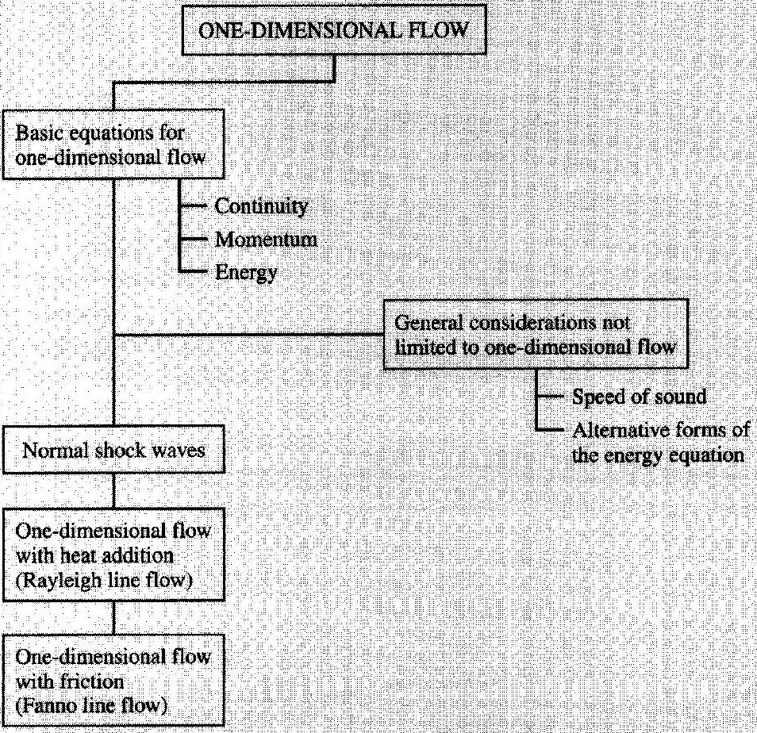
Figure 3.1 I Roadmap for Chapter 3.

heat addition and friction, one-dimensional flow with heat addition is very useful for estimating the effect of burning in a jet engine combustor can, and onedimensional flow with friction provides an excellent method for the analysis of the gas flow through long pipes, to name just two important applications.

The roadmap for this chapter is given in Fig. 3.1. To begin our trip through this material, we first specialize the governing equations derived in Chap. 2 to the case of one-dimensional flow, obtaining the one-dimensional continuity, momentum and energy equation. These equations are algebraic equations, hence the mathematics in this chapter is simply algebra. Before moving on to the three types of one-dimensional flow that are high-
lighted in this chapter, we take a side excursion to discuss some necessary general considerations that are not limited to just one-dimensional flow. This side excursion is shown at the right of the roadmap in Fig. 3.1, dealing with the speed of sound and some vital alternative forms of the energy equation. Then we return to the left side of the roadmap, and deal sequentially with normal shock waves, one-dimensional flow with heat addition, and one-dimensional flow with friction. As we cover the material highlighted in Fig. 3.1, we will be plunging into some of the most important physical and mathematical behavior that constitutes basic compressible flow. This is important stuff, so take a deep plunge, and make yourself very comfortable with this material.

### 3.1 I INTRODUCTION

On October 14, 1947, when Chuck Yeager nudged the Bell XS-1 to a speed slightly over Mach 1 (see Sec.1.1), he entered a new flight regime where shock waves dominate the flowfield. At Mach 1.06, the bullet-shaped rocket-powered research airplane created a bow shock wave that was detached from the body, slightly upstream of the nose, as sketched in Fig. 3.2a. During a later flight, on March 26, 1948, Yeager pushed the XS-1 to Mach 1.45 in a dive. For this flight, the Mach number was high

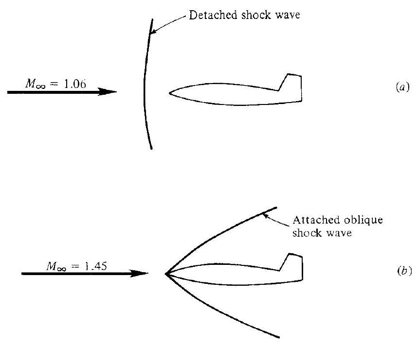
Figure 3.2 I Attached and detached shock waves on a supersonic vehicle.

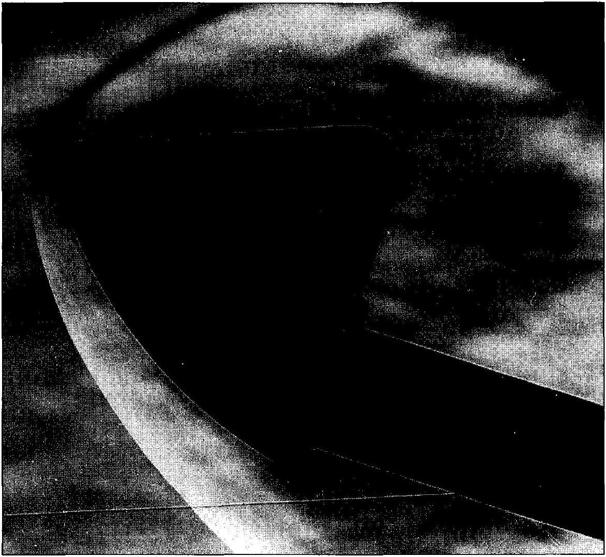
Figure 3.3 $a$ I Shock wave on the Apollo command module. Wind tunnel model at $\alpha=33^{\circ}$ in the NASA Langley Mach 8 variable-density wind tunnel ion air. (Courtesy of the NASA Langley Research Center.)

enough that the shock wave attached itself to the pointed nose of the aircraft, as sketched in Fig. 3.2b. The difference between the two flows sketched in Fig. 3.2 is that the bow shock is nearly normal to the free-stream direction as in Fig. 3.2a, whereas the attached shock wave is oblique to the free-stream direction in Fig. 3.2b. For a blunt-nosed body in a supersonic flow, as shown in Fig. 3.3a, the bow shock wave is always detached from the body. Moreover, near the nose, the shock is nearly normal to the free stream; away from the nose, the shock gradually becomes oblique. For further illustration, photographs taken in supersonic wind tunnels of shock waves on various aerodynamic shapes are shown in Fig. 3.3.

The portions of the shock waves in Figs. 3.2 and 3.3 that are perpendicular to the free stream are called normal shocks. A normal shock wave is illustrated in Fig. 3.4, and it is an excellent example of a class of flowfields that is called onedimensional flow. By definition, a one-dimensional flow is one in which the flowfield properties vary only with one coordinate direction-i.e., in Fig. 3.4, $p, \rho, T$, and the velocity $u$ are functions of $x$ only. In this chapter, we will examine the

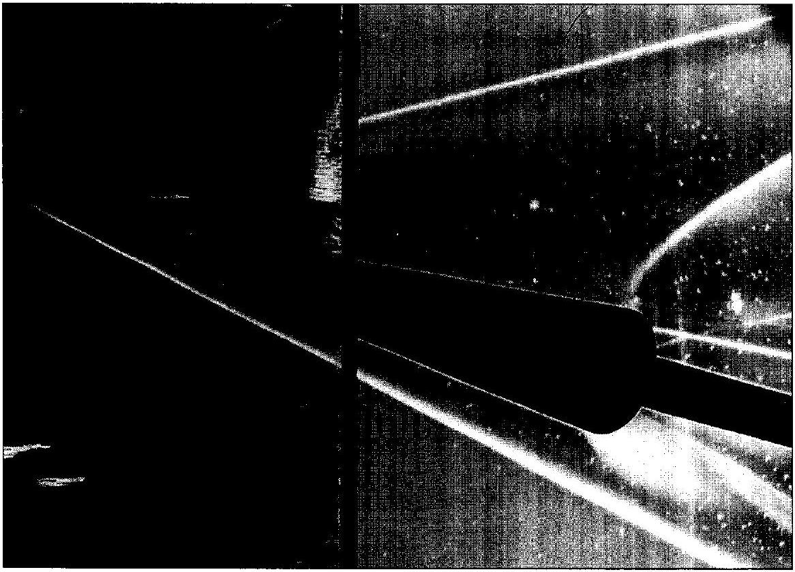
Figure 3.3b | Shock waves on a sharp-nosed slender cone at angle of attack. (Courtesy of the Naval Surface Weapons Center, White Oak, MD.)

properties of such one-dimensional flows, with normal shock waves as one important example. As indicated in Figs. 3.2 and 3.3, normal shock waves play an important role in many supersonic flows.

Oblique shock waves are two-dimensional phenomena, and will be discussed in Chap. 4. Also. consider the two streamtubes in Fig. 3.5. In Fig. 3.5a, a truly onedimensional flow is illustrated, where the flowfield variables are a function of $x$ only, and as a consequence the streamtube area must be constant (as we shall prove later). On the other hand, there are many flow problems wherein the streamtube area varies with $x$. as sketched in Fig. 3.5b. For such a variable area streamtube, nature dictates that the flowfield is three-dimensional flow, where the flow properties in general are functions of $x, y$, and $z$. However, if the variation of area $A=A(x)$ is gradual, it is often convenient and sufficiently accurate to neglect the $y$ and $z$ flow variations, and to assume that the flow properties are functions of $x$ only, as noted in Fig. 3.5b. This is tantamount to assuming uniform properties across the flow at every $x$ station. Such a flow, where the area varies as $A=A(x)$ but where it is assumed that $p, p, T$, and $u$ are still functions of $x$ only, is defined as quasi-one-dimensional flow. This will be the subject of Chap. 5.

In summary, the present chapter will treat one-dimensional, hence constant-area, flows. The general integral conservation equations derived in Chap. 2 will be applied to one-dimensional flow, yielding straightforward algebraic relations which allow us to study the properties and characteristics of such flows.

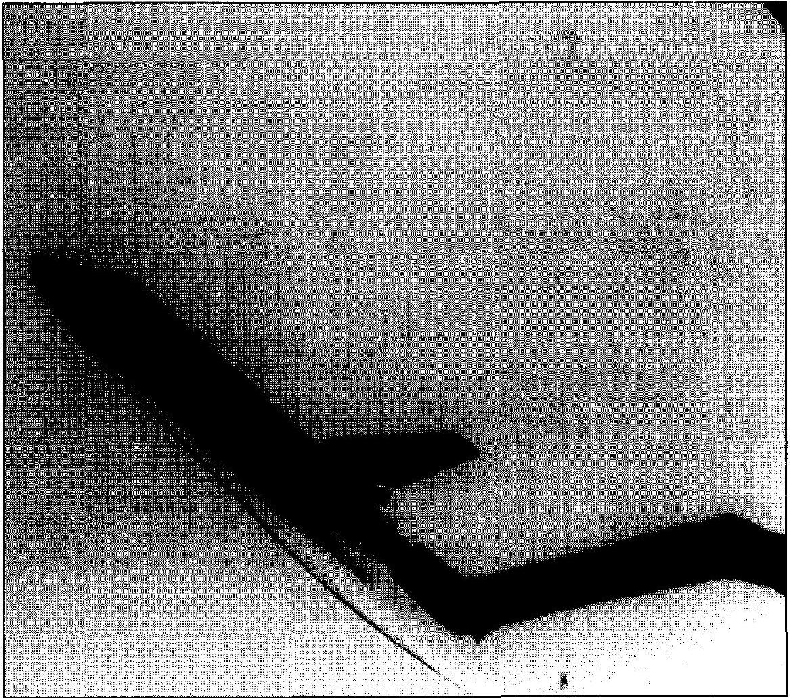
Figure 3.3c | Shock wave on a wind tunnel model of the space shuttle. (Courtesy of the NASA Langley Research Center.)

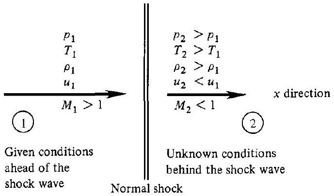
Figure 3.4 I Diagram of a normal shock.

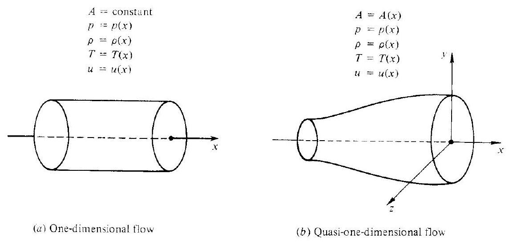
Figure 3.5 I Comparison between one-dimensional and quasi-one-dimensional flows.

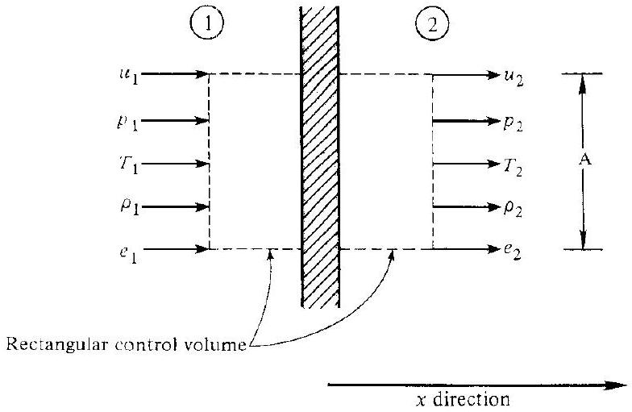
Figure 3.6 | Rectangular control volume for one-dimensional flow.

## 3.2 | ONE-DIMENSIONAL FLOW EQUATIONS

> [!exercise] Specializing the Integral Conservation Equations to One-Dimensional Flow
> Consider a one-dimensional flow through a constant-area region as shown in Fig. 3.6, where all flow properties vary only in the $x$-direction. A rectangular control volume of cross-sectional area $A$ is drawn around this region, with uniform properties $u_1, p_1, T_1, \rho_1, e_1$ on the left face and $u_2, p_2, T_2, \rho_2, e_2$ on the right face. The flow is steady, inviscid, and free of body forces.
> (a) Starting from the integral continuity equation (Eq. 2.2), show that for this control volume the mass conservation principle reduces to:
> $$
> \rho_1 u_1 = \rho_2 u_2
> $$
> In evaluating the surface integral, explain why the upper and lower faces of the control volume make no contribution, and why the signs differ between the left and right faces.
> (b) Starting from the integral momentum equation (Eq. 2.11), show that the balance between momentum flux and pressure forces yields:
> $$
> p_1 + \rho_1 u_1^2 = p_2 + \rho_2 u_2^2
> $$
> Explain the physical meaning of the quantity $p + \rho u^2$: why is it this particular combination that is conserved between stations 1 and 2?
> (c) Starting from the integral energy equation (Eq. 2.20), and letting $q$ denote the heat added per unit mass of gas flowing through the control volume, show that the energy equation becomes:
> $$
> h_1 + \frac{u_1^2}{2} + q = h_2 + \frac{u_2^2}{2}
> $$
> Identify each term physically. Why does enthalpy $h = e + p/\rho$, rather than internal energy $e$ alone, appear naturally in this equation? What is the physical significance of the quantity $h + u^2/2$?
> (d) Discuss why these three algebraic equations — despite their simplicity — carry the full authority of the integral conservation laws from Chapter 2 within the assumption of steady one-dimensional flow. What physical effects have been neglected in deriving Eqs. (3.5) and (3.9)?

Consider the flow through a one-dimensional region, as represented by the shaded area in Fig. 3.6. This region may be a normal shock wave, or it may be a region with heat addition; in either case, the flow properties change as a function of $x$ as the gas flows through the region. To the left of this region, the flowfield velocity, pressure, temperature, density, and internal energy are $u_{1}, p_{1}, T_{1}, \rho_{1}$, and $e_{1}$, respectively. To the right of this region, the properties have changed, and are given by $u_{2}, p_{2}, T_{2}, p_{2}$, and $e_{2}$. (Since we are now dealing with one-dimensional flow, we are using $u$ to denote velocity. Later on, in dealing with multidimensional flows, $u$ is the $x$ component of velocity.) To calculate the changes, apply the integral conservation equations from Chap. 2 to the rectangular control volume shown by the dashed lines in Fig. 3.6. Since the flow is one-dimensional, $u_{1}, p_{1}, T_{1}, \rho_{1}$, and $e_{1}$ are uniform over the lefthand side of the control volume, and similarly $u_{2}, p_{2}, T_{2}, p_{2}$, and $e_{2}$ are uniform
over the right-hand side of the control volume. Assume that the left- and right-hand sides each have an area equal to $A$ perpendicular to the flow. Also, assume that the flow is steady, such that all derivatives with respect to time are zero, and assume that body forces are not present.

With this information in mind, write the continuity equation (2.2):

$$
-\iint_{S} \rho \mathbf{V} \cdot d \mathbf{S}=\frac{\partial}{\partial t} \iint_{\mathscr{V}} \rho d \mathscr{V}
$$

For steady flow, Eq. (2.2) becomes

$$
\iint_{S} \rho \mathbf{V} \cdot d \mathbf{S}=0
$$

Evaluating the surface integral over the left-hand side, where $\mathbf{V}$ and $d \mathbf{S}$ are parallel but in opposite directions, we obtain $-\rho_{1} u_{1} A$; over the right-hand side, where $\mathbf{V}$ and $d \mathbf{S}$ are parallel and in the same direction, we obtain $\rho_{2} u_{2} A$. The upper and lower horizontal faces of the control volume both contribute nothing to the surface integral because $\mathbf{V}$ and $d \mathbf{S}$ are perpendicular to each other on these faces. Hence, from Eq. (3.1),
or

$$
\begin{array}{r}
-\rho_{1} u_{1} A+\rho_{2} u_{2} A=0 \\
\rho_{1} u_{1}=\rho_{2} u_{2}
\end{array}
$$

> [!equation] Continuity equation for steady one-dimensional flow (Eq. 3.2)
> $$
> \rho_{1} u_{1}=\rho_{2} u_{2}
> $$

Equation (3.2) is the continuity equation for steady one-dimensional flow.
The momentum equation (2.11) is repeated here for convenience:

$$
\iint_{S}(\rho \mathbf{V} \cdot d \mathbf{S}) \mathbf{V}+\iint_{\mathscr{V}} \frac{\partial(\rho \mathbf{V})}{\partial t} d \mathscr{V}=\iiint_{\mathscr{V}} \rho \mathbf{f} d \mathscr{V}-\iint_{S} p d \mathbf{S}
$$

The second term is zero because we are considering steady flow. Also, because there are no body forces, the third term is zero. Hence, Eq. (2.11) becomes

$$
\iint_{S}(\rho \mathbf{V} \cdot d \mathbf{S}) \mathbf{V}=-\iint_{S} p d \mathbf{S}
$$

Equation (3.3) is a vector equation. However, since we are dealing with onedimensional flow, we need to consider only the scalar $x$ component of Eq. (3.3), which is

$$
\iint_{S}(\rho \mathbf{V} \cdot d \mathbf{S}) u=-\iint_{S}(p d S)_{x}
$$

In Eq. (3.4), the expression $(p d S)_{x}$ is the $x$ component of the vector $p d \mathbf{S}$. Evaluating the surface integrals in Eq. (3.4) over the left- and right-hand sides of the dashed control volume in Fig. 3.6, we obtain
or

$$
\begin{gathered}
\rho_{1}\left(-u_{1} A\right) u_{1}+\rho_{2}\left(u_{2} A\right) u_{2}=-\left(-p_{1} A+p_{2} A\right) \\
p_{1}+\rho_{1} u_{1}^{2}=p_{2}+\rho_{2} u_{2}^{2}
\end{gathered}
$$

> [!equation] Momentum equation for steady one-dimensional flow (Eq. 3.5)
> $$
> p_{1}+\rho_{1} u_{1}^{2}=p_{2}+\rho_{2} u_{2}^{2}
> $$

Equation (3.5) is the momentum equation for steady one-dimensional flow.
The energy equation (2.20) is written here for convenience:

$$
\begin{aligned}
& \iiint \underset{\gamma}{q} \dot{q} \rho d \gamma-\iint_{S} p \mathbf{V} \cdot d \mathbf{S}+\iiint \rho(\mathbf{f} \cdot \mathbf{V}) d \gamma \\
& =\iiint_{\gamma} \frac{\partial}{\partial t}\left[\rho\left(e+\frac{V^{2}}{2}\right)\right] d \gamma+\iint_{S} \rho\left(e+\frac{V^{2}}{2}\right) \mathbf{V} \cdot d \mathbf{S}
\end{aligned}
$$

The first term on the left physically represents the total rate of heat added to the gas inside the control volume. For simplicity, let us denote this volume integral by $\dot{Q}$. The third and fourth terms are zero because of zero body forces and steady flow, respectively. Hence, Eq. (2.20) becomes

$$
\dot{Q}-\iint_{S} p \mathbf{V} \cdot d \mathbf{S}=\iint_{S} \rho\left(e+\frac{V^{2}}{2}\right) \mathbf{V} \cdot d \mathbf{S}
$$

Evaluating the surface integrals over the left- and right-hand faces of the control volume in Fig. 3.6, we obtain

$$
\dot{Q}-\left(-p_{1} u_{1} A+p_{2} u_{2} A\right)=-\rho_{1}\left(e_{1}+\frac{u_{1}^{2}}{2}\right) u_{1} A+\rho_{2}\left(e_{2}+\frac{u_{2}^{2}}{2}\right) u_{2} A
$$

Rearranging,

$$
\frac{\dot{Q}}{A}+p_{1} u_{1}+\rho_{1}\left(e_{1}+\frac{u_{1}^{2}}{2}\right) u_{1}=p_{2} u_{2}+\rho_{2}\left(e_{2}+\frac{u_{2}^{2}}{2}\right) u_{2}
$$

Dividing by Eq. (3.2), i.e., dividing the left-hand side of Eq. (3.7) by $\rho_{1} u_{1}$ and the right-hand side by $\rho_{2} u_{2}$,

$$
\frac{\dot{Q}}{\rho_{1} u_{1} A}+\frac{p_{1}}{\rho_{1}}+e_{1}+\frac{u_{1}^{2}}{2}=\frac{p_{2}}{\rho_{2}}+e_{2}+\frac{u_{2}^{2}}{2}
$$

Considering the first term in Eq. (3.8), $\dot{Q}$ is the net rate of heat (energy/s) added to the control volume, and $\rho_{1} u_{1} A$ is the mass flow (mass/s) through the control volume. Hence, the ratio $\dot{Q} / \rho_{1} u_{1} A$ is simply the heat added per unit mass, $q$. Also, in Eq. (3.8) recall the definition of enthalpy, $h=e+p v$. Hence, Eq. (3.8) becomes

$$
h_{1}+\frac{u_{1}^{2}}{2}+q=h_{2}+\frac{u_{2}^{2}}{2}
$$

> [!equation] Energy equation for steady one-dimensional flow (Eq. 3.9)
> $$
> h_{1}+\frac{u_{1}^{2}}{2}+q=h_{2}+\frac{u_{2}^{2}}{2}
> $$

Equation (3.9) is the energy equation for steady one-dimensional flow.
In summary, Eqs. (3.2), (3.5), and (3.9) are the governing fundamental equations for steady one-dimensional flow. Look closely at these equations. They are algebraic equations that relate properties at two different locations, 1 and 2, along a one-dimensional, constant-area flow. The assumption of one-dimensionality has afforded us the luxury of a great simplification over the integral equations from Chap. 2. However, within the assumption of steady one-dimensional flow, the
algebraic equations (3.2), (3.5), and (3.9) still represent the full authority and power of the integral equations from whence they came-i.e., they still say that mass is conserved [Eq. (3.2)], force equals time rate of change of momentum [Eq. (3.5)], and energy is conserved [Eq. (3.9)]. Also, keep in mind that Eq. (3.5) neglects body forces and viscous stresses, and that Eq. (3.9) does not include shaft work, work done by viscous stresses, heat transfer due to thermal conduction or diffusion, and changes in potential energy.

Returning to our roadmap in Fig. 3.1, we have finished the first box on the lefthand side. Before proceeding down the left-hand column, in Secs. 3.3-3.5 we will take the side excursion shown on the right-hand side of Fig. 3.1. Here we will deal with some important general aspects of compressible flow that are not limited to onedimensional flow. It is necessary for us to define and discuss the speed of sound and to obtain some alternative forms of the energy equation before we can move on to address the remaining boxes in Fig. 3.1.

> [!exercise] Exercise 3.3 Derivation of the Speed of Sound
> A sound wave is a weak disturbance that propagates through a gas due to molecular collisions, carrying energy from a source (such as a firecracker) through the surrounding fluid. Consider a sound wave moving with speed $a$ through a gas at rest. In a reference frame moving with the wave (riding along with it), the wave appears stationary, with undisturbed gas ahead moving toward the wave at speed $a$, pressure $p$, density $\rho$, and temperature $T$. Behind the wave, the gas moves away with slightly different conditions: speed $a + da$, pressure $p + dp$, density $\rho + d\rho$, and temperature $T + dT$. These changes are infinitesimal because a sound wave is defined as a weak disturbance.
>
> (a) Apply the continuity equation, Eq. (3.2), to the control volume surrounding the sound wave in the moving frame. Show that to first order in differentials, $a d\rho = -\rho da$.
>
> (b) Apply the momentum equation, Eq. (3.5), to the same control volume. Show that $dp = \rho a da + a^2 d\rho$. Combine this with the result from part (a) to derive $a^2 = dp/d\rho$.
>
> (c) Now consider the physical nature of the process occurring through the sound wave. The disturbance is weak (small gradients) and there is no heat addition to the gas inside the wave. Why does this imply that the process through a sound wave is isentropic? What does "isentropic" mean for the relation between $p$ and $\rho$ in the energy equation sense? Show that the general result is $a^2 = (\partial p / \partial \rho)_s$, which is Eq. (3.17).
>
> (d) For a calorically perfect gas, the isentropic relation is $pv^\gamma = \text{const}$. Using this relation and the equation of state, specialize Eq. (3.17) to show that $a = \sqrt{\gamma RT}$ (Eq. 3.20). Why does the speed of sound depend only on temperature for a perfect gas and not on pressure? What does Eq. (3.20) imply about the speed of sound in the limit where the fluid becomes incompressible? (Hint: Incompressibility implies $d\rho/dp \rightarrow 0$.)

### 3.3 I SPEED OF SOUND AND MACH NUMBER

As you read this page, look up for a moment and consider the air around you. The air is composed of molecules that are moving about in a random motion with different instantaneous velocities and energies at different times. However, over a period of time, the average (mean) molecular velocity and energy can be defined, and for a perfect gas are functions of the temperature only. Now assume that a small firecracker detonates nearby. The energy released by the firecracker is absorbed by the surrounding air molecules, which results in an increase in their mean velocity. These faster molecules collide with their neighbors, transferring some of their newly acquired energy. In turn, these neighbors eventually collide with others, resulting in a net transfer or propagation of the firecracker energy through space. This wave of energy travels through the air at a velocity that must be somewhat related to the mean molecular velocity, because molecular collisions are propagating the wave. Through the wave, the energy increase also causes the pressure (as well as density, temperature, etc.) to change slightly. As the wave passes by you, this small pressure variation is picked up by your eardrum, and is transmitted to your brain as the sense of sound. Therefore, such a weak wave is defined as a sound wave, and the purpose of this section is to calculate how fast it is propagating through the air. As we will soon appreciate, the speed of sound through a gas is one of the most important quantities in a study of compressible flow.

Consider that the sound wave is moving with velocity $a$ through the gas. Let us hop on the wave and move with it. As we ride along with the wave, we see that the air ahead of the wave moves toward the wave at the velocity $a$, as shown in Fig. 3.7. Because there are changes in the flow properties through the wave, the flow behind the wave moves away at a different velocity. However, these changes are slight. A sound wave, by definition, is a weak wave. (If the changes through the wave are strong, it is identified as a shock wave, which propagates at a higher velocity than $a$, as we will soon see.) Therefore, consider the change in velocity through the sound wave to be an infinitesimal quantity, $d a$. Consequently, from our vantage point riding

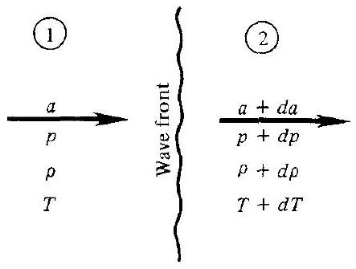
Figure 3.7 | Schematic of a sound wave.

along with the wave, we see the picture shown in Fig. 3.7 where the wave appears to be stationary, the flow ahead of it moves toward the wave at velocity $a$ with pressure, density, and temperature $p, \rho$, and $T$, respectively, and the flow behind it moves away from the wave at velocity $a+d a$ with pressure $p+d p$, density $\rho+d \rho$, and temperature $T+d T$.

The flow through the sound wave is one-dimensional and hence we can apply the equations from Sec. 3.2 to the picture in Fig. 3.7. If regions 1 and 2 are in front of and behind the wave, respectively, Eq. (3.2) yields

$$
\begin{aligned}
& \rho a=(\rho+d \rho)(a+d a) \\
& \rho a=\rho a+a d \rho+\rho d a+d \rho d a
\end{aligned}
$$

The product of two infinitesimal quantities $d \rho d a$ is very small (of second order) in comparison to the other terms in Eq. (3.10), and hence can be ignored. Thus, from Eq. (3.10),

$$
a=-\rho \frac{d a}{d \rho}
$$

Next, Eq. (3.5) yields

$$
p+\rho a^{2}=(p+d p)+(\rho+d \rho)(a+d a)^{2}
$$

Ignoring products of differentials as before, Eq. (3.12) becomes

$$
d p=-2 a \rho d a-a^{2} d \rho
$$

Solve Eq. (3.13) for da:

$$
d a=\frac{d p+a^{2} d \rho}{-2 a \rho}
$$

Substitute Eq. (3.14) into Eq. (3.11):

$$
a=-\rho\left[\frac{d p / d \rho+a^{2}}{-2 a \rho}\right]
$$

Solving Eq. (3.15) for $a^{2}$,

$$
a^{2}=\frac{d p}{d \rho}
$$

Pause for a moment and consider the physical process occurring through a sound wave. First, the changes within the wave are slight, i.e., the flow gradients are small. This implies that the irreversible, dissipative effects of friction and thermal conduction are negligible. Moreover, there is no heat addition to the flow inside the wave (the gas is not being irradiated by a laser, for example). Hence, from Sec. 1.4, the process inside the sound wave must be isentropic. In turn, the rate of change of pressure with respect to density, $d p / d \rho$, which appears in Eq. (3.16) is an isentropic change, and Eq. (3.16) can be written as

$$
a^{2}=\left(\frac{\partial p}{\partial \rho}\right)_{s}
$$

> [!equation] Speed of sound — general expression (Eq. 3.17)
> $$
> a^{2}=\left(\frac{\partial p}{\partial \rho}\right)_{s}
> $$

Equation (3.17) is a fundamental expression for the speed of sound. It shows that the speed of sound is a direct measure of the compressibility of a gas, as defined in Sec. 1.2. To see this more clearly, recall that $\rho=1 / v$, hence $d \rho=-d v / v^{2}$. Thus, Eq. (3.17) can be written as

$$
a^{2}=\left(\frac{\partial p}{\partial \rho}\right)_{s}=-\left(\frac{\partial p}{\partial v}\right)_{s} v^{2}=-\frac{v}{(1 / v)(\partial v / \partial p)_{s}}
$$

Recalling the definition of isentropic compressibility, $\tau_{s}$, given by Eq. (1.4), we find

$$
a=\sqrt{\left(\frac{\partial p}{\partial \rho}\right)_{s}}=\sqrt{\frac{v}{\tau_{s}}}
$$

This confirms the statement in Sec. 1.3 that incompressible flow ( $\tau_{s}=0$ ) implies an infinite speed of sound.

For a calorically perfect gas, Eq. (3.18) becomes more tractable. In this case, the isentropic relation [see Eq. (1.43)] becomes

$$
p v^{\gamma}=c
$$

where $c$ is a constant. Differentiating, and recalling that $v=1 / \rho$, we find

$$
\left(\frac{\partial p}{\partial \rho}\right)_{s}=\frac{\gamma p}{\rho}
$$

Hence, Eq. (3.18) becomes

$$
a=\sqrt{\frac{\gamma p}{\rho}}
$$

Going one step further, from the equation of state, $p / p=R T$. Hence, Eq. (3.19) becomes

$$
a=\sqrt{\gamma R T}
$$

> [!equation] Speed of sound for a perfect gas (Eq. 3.20)
> $$
> a=\sqrt{\gamma R T}
> $$

In summary, Eq. (3.18) gives a general relation for the speed of sound in a gas; this reduces to Eqs. (3.19) and (3.20) for a perfect gas. Indeed, we will demonstrate in Chap. 17 that Eqs. (3.19) and (3.20) hold for thermally perfect as well as calorically perfect gases, but are invalid for chemically reacting gases or real gases. However, the general relation, Eq. (3.18). is valid for all gases.

Note that, for a perfect gas, Eq. (3.20) gives the speed of sound as a function of temperature only; indeed, it is proportional to the square root of the temperature. This is consistent with our previous discussion linking the speed of sound to the average molecular velocity, which from kinetic theory is given by $\sqrt{8 R T / \pi}$. Note that the speed of sound is about three-quarters of the average molecular velocity.

The speed of sound in air at standard sea level conditions is a useful value to remember. It is

$$
a_{s}=340.9 \mathrm{~m} / \mathrm{s}=1117 \mathrm{ft} / \mathrm{s}
$$

Finally, recall that the Mach number was defined in Sec. 1.3 as $M=V / a$, which leads to the following classifications of different flow regimes:

$$
\begin{array}{ll}
M<1 & \text { (subsonic flow) } \\
M & =1 \\
M>1 & \text { (sonic flow) } \\
M>1 & \text { (supersonic flow) }
\end{array}
$$

Also, it is interesting to attach some additional physical meaning to the Mach number at this stage of our discussion. Consider a fluid element moving along a streamline. The kinetic and internal energies per unit mass of this fluid element are $V^{2} / 2$ and $e$, respectively. Forming their ratio, and recalling Eqs. (1.23) and (3.20), we have

$$
\frac{V^{2} / 2}{e}=\frac{V^{2} / 2}{c_{1} T}=\frac{V^{2} / 2}{R T /(\gamma-1)}=\frac{(\gamma / 2) V^{2}}{a^{2} /(\gamma-1)}=\frac{\gamma(\gamma-1)}{2} M^{2}
$$

Thus, we see that, for a calorically perfect gas (where $e=c_{v} T$ ), the square of the Mach number is proportional to the ratio of kinetic to internal energy. It is a measure of the directed motion of the gas compared to the random thermal motion of the molecules.

### 3.4 I SOME CONVENIENTLY DEFINED FLOW PARAMETERS

In this chapter the fundamentals of one-dimensional compressible flow will be applied to the practical problems of normal shock waves, flow with heat addition, and flow with wall friction. However, before making these applications an inventory of useful definitions and supporting equations must be established. This is the purpose of Secs. 3.4 and 3.5.

To begin with, consider point $A$ in an arbitrary flowfield, as sketched in Fig. 2.3. At this point a fluid element is traveling at some Mach number $M$, velocity $V$, with a static pressure and temperature $p$ and $T$, respectively. Let us now imagine that we take this fluid element and adiabatically slow it down (if $M>1$ ) or speed it up (if $M<1$ ) until its Mach number at point $A$ is 1 . As we do this, common sense tells us that the temperature will change. When the fluid element arrives at $M=1$ (in our imagination) from its initial state at $M$ and $T$ (its real properties at point $A$ ), the new temperature (that it has in our imagination at Mach 1 ) is defined as $T^{*}$. Furthermore, we now define the speed of sound at this hypothetical Mach 1 condition as $a^{*}$, where

$$
a^{*}=\sqrt{\gamma R T^{*}}
$$

Therefore, for any given flow with a given $M$ and $T$ at some point $A$, we can associate with it values of $T^{*}$ and $a^{*}$ at the same point, as already defined. Means of calculating $T^{*}$ (and hence $a^{*}$ ) will be discussed in Sec. 3.5.

In the same spirit, consider again our fluid element at point $A$ with velocity, temperature, and pressure equal to $V, T$, and $p$, respectively. Let us now imagine that we isentropically slow this fluid element to zero velocity, i.e., let us stagnate the fluid element. The pressure and temperature which the fluid element achieves when $V=0$ are defined as total pressure $p_{o}$ and total temperature $T_{o}$, respectively. (They are frequently called stagnation pressure and temperature; the adjectives "stagnation" and "total" are synonymous.) Both $p_{o}$ and $T_{o}$ are properties associated with the fluid element while it is in actuality moving at velocity $V$ with an actual pressure and temperature equal to $p$ and $T$, respectively. The actual $p$ and $T$ are called static pressure and static temperature, respectively, and are ramifications of the random molecular motion at point $A$.

Using these definitions, we can introduce other parameters:
Characteristic Mach number $M^{*}=V / a^{*}$. (Note that the real Mach number is $M=V / a$.)

Stagnation speed of sound $a_{o}=\sqrt{\gamma R T_{o}}$.
Total (or stagnation) density $\rho_{o}=p_{o} / R T_{o}$.

> [!exercise] Exercise 3.5 Derivation of Total Conditions and Alternative Energy Equation Forms
> In compressible flow analysis, we often need to relate the actual (static) conditions $p, T, \rho$ of a flowing fluid at some point to reference states that have special physical meaning. Two such reference states are: (1) the condition at Mach 1 (the critical or characteristic state), defined by isentropically adjusting the flow to sonic speed, and (2) the stagnation state, defined by isentropically bringing the flow to rest. Start with the adiabatic energy equation for a calorically perfect gas: $c_p T_1 + u_1^2/2 = c_p T_2 + u_2^2/2$ (Eq. 3.22).
>
> (a) Consider a fluid element at a point where the speed of sound is $a$, the velocity is $u$, and the local speed of sound is $a = \sqrt{\gamma RT}$. Imagine adjusting this element adiabatically until it reaches Mach 1 (so $u_2 = a^*$). Apply Eq. (3.22) to show that $\frac{a^2}{\gamma - 1} + \frac{u^2}{2} = \frac{\gamma + 1}{2(\gamma - 1)} a^{*2}$ (Eq. 3.26). Why does this equation allow us to calculate $a^*$ from the actual local conditions, even if the real flow between different points is not adiabatic?
>
> (b) Now imagine isentropically bringing the same fluid element to rest ($u_2 = 0$). Show that $c_p T + \frac{u^2}{2} = c_p T_o$ (Eq. 3.27). Explain why the definition of total temperature $T_o$ requires only an adiabatic process (not isentropic) to be well-defined. In contrast, why do total pressure $p_o$ and total density $\rho_o$ require the full isentropic process?
>
> (c) From Eq. (3.27) and the relation $c_p = \gamma R / (\gamma - 1)$, show that $\frac{T_o}{T} = 1 + \frac{\gamma-1}{2}M^2$ (Eq. 3.28), where $M = u/a$ is the Mach number. What does this equation tell you about the relationship between velocity and temperature change in compressible flow?
>
> (d) For an isentropic process, the relation $p v^\gamma = \text{const}$ implies $\frac{p_o}{p} = \left(\frac{T_o}{T}\right)^{\gamma/(\gamma-1)}$ and $\frac{\rho_o}{\rho} = \left(\frac{T_o}{T}\right)^{1/(\gamma-1)}$ (Eqs. 3.30, 3.31). Combine these with the result from part (c) to derive the total pressure and density ratios as functions of Mach number.
>
> (e) Consider a general flowfield where the flow is not adiabatic (e.g., with heat addition or viscous dissipation between two points). At point $A$, a fluid element has conditions $M_A, T_A, p_A, \rho_A$. At point $B$ downstream, the conditions are $M_B, T_B, p_B, \rho_B$. Explain why $T_{o_A}$ remains well-defined at point $A$ even though the flow to point $B$ is nonadiabatic. Are the total conditions constant throughout such a flowfield? Under what flow conditions would $T_o$, $p_o$, and $\rho_o$ all remain constant throughout the domain?
>
> (f) From Eq. (3.26) written at the Mach 1 condition and the relation for the stagnation speed of sound, derive that $\frac{T^*}{T_o} = \frac{2}{\gamma + 1}$. Then use the isentropic relations to show that $M^2 = \frac{2}{[(\gamma+1)/M^{*2}] - (\gamma-1)}$ (Eq. 3.37). This relation connects the actual Mach number $M$ to the characteristic Mach number $M^* = u/a^*$. What is significant about the fact that $M^* \to \sqrt{(\gamma+1)/(\gamma-1)}$ as $M \to \infty$?

### 3.5 I ALTERNATIVE FORMS OF THE ENERGY EQUATION

Consider again Eq. (3.9). Assuming no heat addition, this becomes

$$
h_{1}+\frac{u_{1}^{2}}{2}=h_{2}+\frac{u_{2}^{2}}{2}
$$

> [!equation] Adiabatic energy equation for steady one-dimensional flow (Eq. 3.21)
> $$
> h_{1}+\frac{u_{1}^{2}}{2}=h_{2}+\frac{u_{2}^{2}}{2}
> $$

where points 1 and 2 correspond to the regions 1 and 2 identified in Fig. 3.6. Specializing further to a calorically perfect gas, where $h=c_{p} T$, Eq. (3.21) becomes

$$
c_{p} T_{1}+\frac{u_{1}^{2}}{2}=c_{p} T_{2}+\frac{u_{2}^{2}}{2}
$$

Using Eq. (1.22), this becomes

$$
\frac{\gamma R T_{1}}{\gamma-1}+\frac{u_{1}^{2}}{2}=\frac{\gamma R T_{2}}{\gamma-1}+\frac{u_{2}^{2}}{2}
$$

Since $a=\sqrt{\gamma \overline{R T}}$, Eq. (3.23) becomes

$$
\frac{a_{1}^{2}}{\gamma-1}+\frac{u_{1}^{2}}{2}=\frac{a_{2}^{2}}{\gamma-1}+\frac{u_{2}^{2}}{2}
$$

From Eq. (3.19), this can also be written as

$$
\frac{\gamma}{\gamma-1}\left(\frac{p_{1}}{\rho_{1}}\right)+\frac{u_{1}^{2}}{2}=\frac{\gamma}{\gamma-1}\left(\frac{p_{2}}{\rho_{2}}\right)+\frac{u_{2}^{2}}{2}
$$

Since Eq. (3.21) was written for no heat addition, it, as well as the corollary Eqs. (3.22) through (3.25), holds for an adiabatic flow. With this in mind, let us return to the definitions presented in Sec. 3.4. Let point 1 in these equations correspond to point $A$ in Fig. 2.3, and let point 2 in these equations correspond to our imagined conditions where the fluid element is brought adiabatically to Mach 1 at point $A$. The actual speed of sound and velocity at point $A$ are $a$ and $u$, respectively. At the imagined condition of Mach 1 (point 2 in the above equations), the speed of sound is $a^{*}$ and the flow velocity is sonic, hence $u_{2}=a^{*}$. Thus, Eq. (3.24) yields
or

$$
\begin{aligned}
& \frac{a^{2}}{\gamma-1}+\frac{u^{2}}{2}=\frac{a^{* 2}}{\gamma-1}+\frac{a^{* 2}}{2} \\
& \frac{a^{2}}{\gamma-1}+\frac{u^{2}}{2}=\frac{\gamma+1}{2(\gamma-1)} a^{* 2}
\end{aligned}
$$

> [!equation] Energy equation in terms of $a^{*}$ (Eq. 3.26)
> $$
> \frac{a^{2}}{\gamma-1}+\frac{u^{2}}{2}=\frac{\gamma+1}{2(\gamma-1)} a^{* 2}
> $$

Equation (3.26) provides a formula from which the defined quantity $a^{*}$ can be calculated for the given actual conditions of $a$ and $u$ at any given point in a general flowfield. Remember, the actual flowfield itself does not have to be adiabatic from one point to the next, say from point $A$ to point $B$ in Fig. 2.3. In Eq. (3.26), the adiabatic process is just in our minds as part of the definition of $a^{*}$ (see again Sec. 3.4). Applied at point $A$ in Fig. 2.3, Eq. (3.26) gives us the value of $a^{*}$ that is associated with point $A$. Denote this value as $a_{A}^{*}$. Similarly, applied at point $B$, Eq. (3.26) gives us the value of $a^{*}$ that is associated with point $B$, namely, $a_{B}^{*}$. If the actual flowfield is nonadiabatic from $A$ to $B$, then $a_{A}^{*} \neq a_{B}^{*}$. On the other hand, if the general flowfield in Fig. 2.3 is adiabatic throughout, then $a^{*}$ is a constant value at every point in the flow. Since many practical aerodynamic flows are reasonably adiabatic, this is an important point to remember.

Now return to our definition of total conditions in Sec. 3.4. Let point 1 in Eq. (3.22) correspond to point $A$ in Fig. 2.3, and let point 2 in Eq. (3.22) correspond to our imagined conditions where the fluid element is brought to rest isentropically at
point $A$. If $T$ and $u$ are the actual values of static temperature and velocity, respectively, at point $A$, then $T_{1}=T$ and $u_{1}=u$. Also, by definition of total conditions, $u_{2}=0$ and $T_{2}=T_{o}$. Hence, Eq. (3.22) becomes

$$
c_{p} T+\frac{u^{2}}{2}=c_{p} T_{o}
$$

> [!equation] Definition of total temperature (Eq. 3.27)
> $$
> c_{p} T+\frac{u^{2}}{2}=c_{p} T_{o}
> $$

Equation (3.27) provides a formula from which the defined total temperature, $T_{o}$, can be calculated for the given actual conditions of $T$ and $u$ at any point in a general flowfield. Remember that total conditions are defined in Sec. 3.4 as those where the fluid element is isentropically brought to rest. However, in the derivation of Eq. (3.27), only the energy equation for an adiabatic flow [Eq. (3.21)] is used. Isentropic conditions have not been imposed so far. Hence, the definition of $T_{o}$ such as expressed in Eq. (3.27) is less restrictive than the definition of total conditions given in Sec. 3.4. From Sec. 1.4, isentropic flow implies reversible and adiabatic conditions; Eq. (3.27) tells us that, for the definition of $T_{o}$, only the "adiabatic" portion of the isentropic definition is required. That is, we can now redefine $T_{o}$ as that temperature that would exist if the fluid element were brought to rest adiabatically. However, for the definition of total pressure, $p_{o}$, and total density, $\rho_{o}$, the imagined isentropic process is still necessary, as defined in Sec. 3.4.

Several very useful equations for total conditions are obtained as shown next. From Eqs. (3.27) and (1.22),

$$
\frac{T_{o}}{T}=1+\frac{u^{2}}{2 c_{p} T}=1+\frac{u^{2}}{2 \gamma R T /(\gamma-1)}=1+\frac{u^{2}}{2 a^{2} /(\gamma-1)}=1+\frac{\gamma-1}{2}\left(\frac{u}{a}\right)^{2}
$$

Hence,

$$
\frac{T_{o}}{T}=1+\frac{\gamma-1}{2} M^{2}
$$

> [!equation] Total-to-static temperature ratio (Eq. 3.28)
> $$
> \frac{T_{o}}{T}=1+\frac{\gamma-1}{2} M^{2}
> $$

Equation (3.28) gives the ratio of total to static temperature at a point in a flow as a function of the Mach number $M$ at that point. Furthermore, for an isentropic process, Eq. (1.43) holds, such that

$$
\frac{p_{o}}{p}=\left(\frac{\rho_{o}}{\rho}\right)^{\gamma}=\left(\frac{T_{o}}{T}\right)^{\gamma /(\gamma-1)}
$$

Combining Eqs. (3.28) and (3.29), we find

$$
\frac{\frac{p_{o}}{p}=\left(1+\frac{\gamma-1}{2} M^{2}\right)^{\gamma /(\gamma-1)}}{\frac{\rho_{o}}{\rho}=\left(1+\frac{\gamma-1}{2} M^{2}\right)^{1 /(\gamma-1)}}
$$

> [!equation] Total-to-static pressure ratio (Eq. 3.30)
> $$
> \frac{p_{o}}{p}=\left(1+\frac{\gamma-1}{2} M^{2}\right)^{\gamma /(\gamma-1)}
> $$

> [!equation] Total-to-static density ratio (Eq. 3.31)
> $$
> \frac{\rho_{o}}{\rho}=\left(1+\frac{\gamma-1}{2} M^{2}\right)^{1 /(\gamma-1)}
> $$

Equations (3.30) and (3.31) give the ratios of total to static pressure and density, respectively, at a point in the flow as a function of Mach number $M$ at that point. Along with Eq. (3.28), they represent important relations for total properties-so important that their values are tabulated in Table A. 1 (see Appendix A) as a function of $M$ for $\gamma=1.4$ (which corresponds to air at standard conditions).

It should be emphasized again that Eqs. (3.27), (3.28), (3.30), and (3.31) provide formulas from which the defined quantities $T_{0}, p_{0}$, and $\rho_{0}$ can be calculated from the actual conditions of $M, u, T, p$, and $\rho$ at a given point in a general flowfield, as sketched in Fig. 2.3. Again, the actual flowfield itself does not have to be adiabatic or isentropic from one point to the next. In these equations, the isentropic process is just in our minds as part of the definition of total conditions at a point. Applied at point $A$ in Fig. 2.3, the above equations give us the values of $T_{o}, p_{o}$, and $\rho_{o}$ associated with point $A$. Similarly, applied at point $B$, the earlier equations give us the values of $T_{o}, p_{o}$, and $\rho_{o}$ associated with point $B$. If the actual flow between $A$ and $B$ is nonadiabatic and irreversible, then $T_{o_{A}} \neq T_{o_{B}}, p_{o_{A}} \neq p_{o_{B}}$, and $\rho_{o_{A}} \neq \rho_{o_{B}}$. On the other hand, if the general flowfield is isentropic throughout, then $T_{o}, p_{o}$, and $\rho_{b}$ are constant values at every point in the flow. The idea of constant total (stagnation) conditions in an isentropic flow will be very useful in our later discussions of various practical applications in compressible flow-keep it in mind!

A few additional equations will be useful in subsequent sections. For example, from Eq. (3.24),

$$
\frac{a^{2}}{\gamma-1}+\frac{u^{2}}{2}=\frac{a_{o}^{2}}{\gamma-1}
$$

where $a_{0}$ is the stagnation speed of sound defined in Sec. 3.4. From Eqs. (3.26) and (3.32),

$$
\frac{\gamma+1}{2(\gamma-1)} a^{* 2}=\frac{a_{o}^{2}}{\gamma-1}
$$

Solving Eq. (3.33) for $a^{*} / a_{o}$, and invoking Eq. (3.20),

$$
\left(\frac{a^{*}}{a_{o}}\right)^{2}=\frac{T^{*}}{T_{o}}=\frac{2}{\gamma+1}
$$

Recall that $p^{*}$ and $\rho^{*}$ are defined for conditions at Mach 1; hence, Eqs. (3.30) and (3.31) with $M=1$ lead to

$$
\begin{aligned}
& \frac{p^{*}}{p_{o}}=\left(\frac{2}{\gamma+1}\right)^{\gamma /(\gamma-1)} \\
& \frac{\rho^{*}}{\rho_{o}}=\left(\frac{2}{\gamma+1}\right)^{1 /(\gamma-1)}
\end{aligned}
$$

For air at standard conditions, where $\gamma=1.4$, these ratios are

$$
\begin{aligned}
& \frac{T^{*}}{T_{o}}=0.833 \\
& \frac{p^{*}}{p_{o}}=0.528 \\
& \frac{\rho^{*}}{\rho_{o}}=0.634
\end{aligned}
$$

which will be useful numbers to keep in mind for subsequent discussions. Finally, dividing Eq. (3.26) by $u^{2}$, we have

$$
\begin{aligned}
\frac{(a / u)^{2}}{\gamma-1}+\frac{1}{2} & =\frac{\gamma+1}{2(\gamma-1)}\left(\frac{a^{*}}{u}\right)^{2} \\
\frac{(1 / M)^{2}}{\gamma-1} & =\frac{\gamma+1}{2(\gamma-1)}\left(\frac{1}{M^{*}}\right)^{2}-\frac{1}{2} \\
M^{2} & =\frac{2}{\left[(\gamma+1) / M^{* 2}\right]-(\gamma-1)}
\end{aligned}
$$

> [!equation] Relation between $M$ and $M^{*}$ (Eq. 3.37)
> $$
> M^{2}=\frac{2}{\left[(\gamma+1) / M^{* 2}\right]-(\gamma-1)}
> $$

Equation (3.37) provides a direct relation between the actual Mach number $M$ and the characteristic Mach number $M^{*}$, defined in Sec. 3.4. Note from Eq. (3.37) that

$$
\begin{array}{ll}
M^{*}=1 & \text { if } M=1 \\
M^{*}<1 & \text { if } M<1 \\
M^{*}>1 & \text { if } M>1 \\
M^{*} \rightarrow \sqrt{\frac{\gamma+1}{\gamma-1}} & \text { if } M \rightarrow \infty
\end{array}
$$

Hence, qualitatively, $M^{*}$ acts in the same fashion as $M$, except when $M$ goes to infinity. In future discussions involving shock and expansion waves, $M^{*}$ will be a useful parameter because it approaches a finite number as $M$ approaches infinity.

All the equations in this section, either directly or indirectly, are alternative forms of the original, fundamental energy equation for one-dimensional, adiabatic flow, Eq. (3.21). Make certain that you examine these equations and their derivations closely. It is important at this stage that you feel comfortable with these equations, especially those with a box around them for emphasis.

### 3.5.1 A Comment on Generality

This section began with Eq. (3.21), which was obtained from the one-dimensional energy equation, Eq. (3.9), specialized to adiabatic flow. The use of the $x$ component of the flow velocity, $u$, in Eq. (3.21) clearly identifies it with one-dimensional flow. For one-dimensional flow, the velocity $u$ is the velocity of the flow, and the use of the symbol $u$ is simply consistent with the geometry of the flow. However, Eq. (3.21) is
a general statement of the energy equation for any steady, adiabatic flow, whether in one, two, or three dimensions. For a general three-dimensional flow, the velocity at any point in the flow is denoted by $V$. For a three-dimensional, steady, adiabatic flow, Eq. (3.21) becomes

$$
h_{1}+\frac{V_{1}^{2}}{2}=h_{2}+\frac{V_{2}^{2}}{2}
$$

Similarly, for every form of the energy equation obtained in this section, $u_{1}$ and $u_{2}$ can be replaced by $V_{1}$ and $V_{2}$. So Eqs. (3.21)-(3.37) hold with $u$ replaced by $V$ everywhere. This general application of Eq. (3.21) to a three-dimensional case will be rigorously derived in Chap. 6.

> [!exercise] Stagnation and Sonic Conditions in Supersonic Flight
> At a point in the flow over an F-15 high-performance fighter airplane, the pressure is $1890\,\text{lb/ft}^2$, temperature is $450\,\text{R}$, and Mach number is 1.5.
>
> (a) Calculate the stagnation (total) conditions $T_o$ and $p_o$. What is the physical meaning of these values—what do they represent if the flow were brought to rest isentropically?
>
> (b) Calculate the sonic (critical) conditions $T^*$ and $p^*$. How do these differ physically from $T_o$ and $p_o$? (Hint: they represent the conditions if the flow were brought to Mach 1 adiabatically, along an isentropic path.)
>
> (c) Calculate the actual flow velocity at this point in the flow. How does the flow speed relate to the speed of sound in this region?

## - Solution

From Table A.1, for $M=1.5: p_{0} / p=3.671$ and $T_{0} / T=1.45$. Thus

$$
\begin{gathered}
p_{o}=3.671 p=3.671(1890)=6938 \mathrm{lb} / \mathrm{ft}^{2} \\
T_{o}=1.45 T=1.45(450)=652.5 \mathrm{R}
\end{gathered}
$$

From Table A.1, for $M=1.0: p_{o} / p^{*}=1.893$ and $T_{o} / T^{*}=1.2$. Keeping in mind that, for our imaginary process where the flow is slowed down isentropically to Mach 1 , hence defining $p^{*}$, the total pressure is constant during this process; also, where the flow is slowed down adiabatically to Mach 1 , hence defining $T^{*}$, the total temperature is constant. Thus

$$
\begin{aligned}
p^{*} & =\frac{p^{*}}{p_{o}} \frac{p_{o}}{p} p=\frac{1}{1.893}(3.671)(1890)=3665 \mathrm{lb} / \mathrm{ft}^{2} \\
T^{*} & =\frac{T^{*}}{T_{o}} \frac{T_{o}}{T} T=\frac{1}{1.2}(1.45)(450)=543.8 \mathrm{R}
\end{aligned}
$$

Note: These answers exemplify the definitions of $p_{\theta}, T_{\theta}, p^{*}$, and $T^{*}$. In the actual flow at Mach 1.5, the actual static pressure and static temperature are $1890 \mathrm{lb} / \mathrm{ft}^{2}$ and 450 R , respectively. However, the defined values that are associated with the flow at this point (but not actually in existence at this point) are $p^{*}=3665 \mathrm{lb} / \mathrm{ft}^{2}, p_{0}=6938 \mathrm{lb} / \mathrm{ft}^{2}, T^{*}=543.8 \mathrm{R}$, and $T_{0}=652.5^{\circ} \mathrm{R}$. Finally, the actual flow velocity is obtained from

$$
V=M a
$$

where

$$
\begin{aligned}
& a=\sqrt{\gamma R T}=\sqrt{(1.4)(1716)(450)}=1040 \mathrm{ft} / \mathrm{s} \\
& V=(1.5)(1040)=1560 \mathrm{ft} / \mathrm{s}
\end{aligned}
$$

> [!exercise] Exit Conditions in Isentropic Nozzle Expansion
> A rocket engine expands gases isentropically through a nozzle from combustion chamber stagnation conditions of $T_o = 2500\,\text{K}$ and $p_o = 15\,\text{atm}$ to an exit pressure of $p_2 = 0.372\,\text{atm}$. The working gas has $\gamma = 1.2$ and $R = 692.8\,\text{J/kg·K}$.
>
> (a) Find the exit Mach number $M_2$ using the isentropic total-to-static pressure relationship (Eq. 3.30). How does the pressure ratio tell you about the flow speed at the exit?
>
> (b) Calculate the exit temperature $T_2$ and exit velocity $V_2$. What determines the speed of sound at the exit?
>
> (c) Verify your result using the steady flow energy equation (Eq. 3.22): $c_p T_o = c_p T_2 + \frac{V_2^2}{2}$. Does the energy approach give the same exit velocity?

## - Solution

In the combustion chamber the flow velocity is very low; hence we can assume that the pressure and temperature in the combustion chamber are essentially $p_{o}$ and $T_{o}$, respectively. Moreover, since the flow expansion through the nozzle is isentropic, then $p_{o}$ and $T_{o}$ are constant values throughout the nozzle flow. From Eq. (3.30), we have at the nozzle exit (denoted by the subscript 2)

$$
\left(\frac{p_{o}}{p}\right)_{2}=\left(1+\frac{\gamma-1}{2} M_{2}^{2}\right)^{\gamma /(\gamma-1)}
$$

Solving for $M_{2}$, we have

$$
\begin{aligned}
M_{2} & =\left\{\frac{2}{\gamma-1}\left[\left(\frac{p_{o}}{p_{2}}\right)^{(\gamma-1) / \gamma}-1\right]\right\}^{1 / 2} \\
& =\left\{\frac{2}{0.2}\left[\left(\frac{15}{0.372}\right)^{0.167}-1\right]\right\}^{1 / 2}=2.919 \\
a_{2} & =\sqrt{\gamma R T_{2}}=\sqrt{(1.2)(692.8)(1350)}=1059.4 \mathrm{~m} / \mathrm{s} \\
V_{2} & =M_{2} a_{2}=(2.919)(1059.4)=3092 \mathrm{~m} / \mathrm{s}
\end{aligned}
$$

Note: An alternative solution to this problem, which constitutes a check on these results, is as shown next. From Eq. (3.22)

$$
c_{p} T_{2}+\frac{V_{2}^{2}}{2}=c_{p} T_{o}
$$

[Recall from Sec. 3.5.1 that the various forms of the energy equation obtained in this section hold for flow of any dimensions-two or three dimensions as well as one dimension; this is because Eq. (3.21) is simply a statement that the total enthalpy, $h_{o}=h+V^{2} / 2$, is constant for any adiabatic flow, no matter what the dimension. This will become clear repeatedly as we progress through the following chapters. Hence, Eqs. (3.21) through (3.37) are general, and are not in any way restricted to one-dimensional flow. Therefore, we can use Eq. (3.22) in the form given here to solve our rocket nozzle flow, even though such flow is not constant-area flow, i.e., it is not truly one-dimensional flow. Rather, this nozzle flow must be analyzed as either a quasi-one-dimensional flow as discussed in Chap. 5, or more precisely as a twodimensional or axisymmetric flow as discussed in Chap. 11, because the flow through a nozzle encounters a changing, variable cross-sectional area as it expands through the nozzle.]

From Eq. (3.22) written above, solving for $V_{2}$,

$$
V_{2}=\sqrt{2 c_{p}\left(T_{o}-T_{2}\right)}=\sqrt{2(4157)(2500-1350)}=3092 \mathrm{~m} / \mathrm{s}
$$

This agrees with the value already obtained. Of course, since $a_{2}=1059.4 \mathrm{~m} / \mathrm{s}$ as obtained. then

$$
M_{2}=\frac{V_{2}}{a_{2}}=\frac{3092}{1059.4}=2.919
$$

which also agrees with the earlier results.

> [!exercise] Compressibility Effects on Wing Flow at Subsonic Speed
> Reconsider the flow over an airplane wing from Example 1.1, now accounting for compressibility effects. At standard sea level, the free stream conditions are $T_1 = 519\,\text{R}$, $\rho_1 = 0.002377\,\text{slug/ft}^3$, and $V_1 = 147\,\text{ft/s}$. At a point on the wing surface, the velocity increases to $V_2 = 220\,\text{ft/s}$. The flow is isentropic.
>
> (a) Using the steady flow energy equation (Eq. 3.22), calculate the temperature $T_2$ at the wing surface point. How much does temperature change due to the velocity increase?
>
> (b) Apply the isentropic relation (Eq. 1.43) to find the density $\rho_2$ at the wing surface. Calculate the percentage density change: $\frac{\rho_1 - \rho_2}{\rho_1} \times 100\%$.
>
> (c) Is this density change small enough to justify treating the flow as incompressible in the original Example 1.1? What does your answer reveal about when compressibility effects become important in aerodynamic analysis?

## - Solution

The standard sea level values of density and temperature are $0.002377 \mathrm{slug} / \mathrm{ft}^{3}$ and 519 R , respectively. Also, for air,

$$
c_{p}=\frac{\gamma R}{\gamma-1}=\frac{(1.4)(1716)}{0.4}=6006 \mathrm{ft} \cdot \mathrm{lb} / \mathrm{slug} \cdot \mathrm{R}
$$

Let points 1 and 2 in Eq. (3.22) denote the free stream and the wing points, respectively. Note: The flow over the wing is adiabatic and frictionless; hence it is isentropic. From Eq. (3.22)

$$
\begin{aligned}
c_{p} T_{1}+\frac{V_{1}^{2}}{2} & =c_{p} T_{2}+\frac{V_{2}^{2}}{2} \\
T_{2} & =T_{1}+\frac{V_{1}^{2}-V_{2}^{2}}{2 c_{p}}=519+\frac{(147)^{2}-(220)^{2}}{2(6006)} \\
& =519-2.23=516.77^{\circ} \mathrm{R}
\end{aligned}
$$

From Eq. (1.43)

$$
\begin{aligned}
\frac{\rho_{2}}{\rho_{1}} & =\left(\frac{T_{2}}{T_{1}}\right)^{1 /(\gamma-1)}=\left(\frac{516.77}{519}\right)^{2.5}=0.9893 \\
\rho_{2} & =0.9893(0.002377)=0.002352 \text { slug } / \mathrm{ft}^{3}
\end{aligned}
$$

Thus

$$
\frac{\rho_{1}-\rho_{2}}{\rho_{1}}=\frac{0.000025}{0.002377}=0.011
$$

That is, the density changes by 1.1 percent. This is a very small change and clearly justifies the assumption of incompressible flow in the solution of Example 1.1. Moreover, note from this material that the temperature change is only $2.23^{\circ} \mathrm{R}$, which represents a 0.43 percent change in temperature. This illustrates that low-speed flows are virtually constant temperature flows, and this is why, in the analysis of inviscid incompressible flow, the energy equation is never needed.

> [!exercise] Thrust and Mass Flow in a Rocket Engine
> The rocket engine from Examples 1.6 and 3.2 produces a thrust of $T = 4.5 \times 10^5\,\text{N}$ at an altitude where the ambient pressure is $p_\infty = 0.372\,\text{atm}$. From the earlier examples, the exit conditions are known: exit velocity $V_2 = 3092\,\text{m/s}$, exit temperature $T_2 = 1350\,\text{K}$, exit pressure $p_2 = 0.372\,\text{atm}$, and for the working gas $R = 692.8\,\text{J/kg·K}$.
>
> (a) Apply the thrust equation (Eq. 2.45) to find the mass flow rate $\dot{m}$ through the engine. Note that since $p_2 = p_\infty$, the pressure term in the thrust equation vanishes. What physical significance does this have for the engine design?
>
> (b) Calculate the exit density $\rho_2$ from the equation of state using the exit conditions.
>
> (c) Use the continuity equation to find the exit area $A_e$ from the mass flow rate, density, and velocity. How does the exit area relate to the overall thrust-producing capability of the engine?

## - Solution

From Example 1.6, the pressure at the exit is $p_{2}=0.372 \mathrm{~atm}$. From Example 3.2, the velocity at the exit is $V_{2}=3092 \mathrm{~m} / \mathrm{s}$. From the thrust equation, Eq. (2.45), applied to a rocket engine, using the subscript 2 to denote exit conditions, we have

$$
T=\dot{m} V_{2}+\left(p_{2}-p_{\infty}\right) A_{e}
$$

Since $p_{2}=p_{\infty}=0.372 \mathrm{~atm}$, the pressure term on the right-hand side of this equation is zero, and we have

$$
\dot{m}=\frac{T}{V_{2}}=\frac{4.5 \times 10^{5}}{3092}=145.5 \mathrm{~kg} / \mathrm{s}
$$

From Example 1.6, we have for the specific gas constant of the gas expanding through the engine, $R=692.8 \mathrm{~J} / \mathrm{kg} \cdot \mathrm{K}$, and the temperature at the exit $T_{2}=1350 \mathrm{~K}$. Hence, from the equation of state the density at the exit is (recalling that $1 \mathrm{~atm}=1.01 \times 10^{5} \mathrm{~N} / \mathrm{m}^{2}$ )

$$
\rho_{2}=\frac{p_{2}}{R T_{2}}=\frac{(0.372)\left(1.01 \times 10^{5}\right)}{(692.8)(1350)}=0.04 \mathrm{~kg} / \mathrm{m}^{3}
$$

The mass flow is given by

$$
\dot{m}=\rho_{2} A_{2} V_{2}
$$

or,

$$
A_{2}=\frac{\dot{m}}{\rho_{2} V_{2}}=\frac{145.5}{(0.04)(3092)}=1.18 \mathrm{~m}^{2}
$$

### 3.6 I NORMAL SHOCK RELATIONS

> [!exercise] Derivation of Normal Shock Property Ratios
> A normal shock wave stands perpendicular to a supersonic flow. The flow upstream (region 1) is supersonic and downstream (region 2) is subsonic. The shock is thin (~ $10^{-5}$ cm) and adiabatic, yet irreversible due to large internal gradients. In this exercise, you will derive the elegant relations that govern all property changes across the shock, showing that they depend only on $M_1$ and $\gamma$ for a calorically perfect gas.
>
> (a) For flow across a normal shock, write down the three governing equations: continuity $\dot{m} = \rho_1 u_1 A = \rho_2 u_2 A$ (Eq. 3.38), momentum $p_1 + \rho_1 u_1^2 = p_2 + \rho_2 u_2^2$ (Eq. 3.39), and energy $h_1 + u_1^2/2 = h_2 + u_2^2/2$ (Eq. 3.40). Explain physically why the flow through the shock is adiabatic (no external heat is added to the control volume) yet irreversible (the thin shock structure contains large velocity and temperature gradients that produce viscous dissipation and thermal conduction, increasing entropy).
>
> (b) The Prandtl relation: Combine the continuity equation $u_1/u_2 = \rho_2/\rho_1$ with the momentum equation and the energy equation (in the form of Eq. 3.26: $T_o = T + u^2/(2c_p)$) to show that the product of velocities across the shock is $a^{*2} = u_1 u_2$ (Eq. 3.47), where $a^*$ is the critical (sonic) speed of sound. What does this elegant result tell us about how the upstream and downstream velocities are related through the shock thermodynamics?
>
> (c) From the Prandtl relation, show that the characteristic Mach numbers satisfy $M_2^* = 1/M_1^*$. Now use the $M$-$M^*$ relation (Eq. 3.37: $M^2 = \frac{2}{[(\gamma+1)/M^{*2}] - (\gamma-1)}$) to derive the downstream Mach number: $$M_2^2 = \frac{1 + [(\gamma-1)/2]M_1^2}{\gamma M_1^2 - (\gamma-1)/2}$$ (Eq. 3.51). Verify that $M_1 = 1$ (infinitely weak shock/Mach wave) gives $M_2 = 1$. Also show that $M_2$ is always strictly subsonic ($M_2 < 1$) when $M_1 > 1$.
>
> (d) Using continuity $\rho_1 u_1 = \rho_2 u_2$ and the Prandtl relation, derive the density and velocity ratio: $$\frac{\rho_2}{\rho_1} = \frac{u_1}{u_2} = \frac{(\gamma+1)M_1^2}{2 + (\gamma-1)M_1^2}$$ (Eq. 3.53). From the momentum equation and energy equation, derive the pressure ratio: $$\frac{p_2}{p_1} = 1 + \frac{2\gamma}{\gamma+1}(M_1^2 - 1)$$ (Eq. 3.57). Then derive the temperature ratio (Eq. 3.59). Discuss why all property changes across a normal shock depend only on $M_1$ and $\gamma$ for a calorically perfect gas.
>
> (e) The entropy change across the shock is given by $s_2 - s_1 = c_p \ln(T_2/T_1) - R \ln(p_2/p_1)$ (Eq. 3.60). Show that this entropy change depends only on $M_1$ and $\gamma$. Now use the second law of thermodynamics ($s_2 \geq s_1$) to prove that only compression shocks ($M_1 > 1$) are physically realizable. Explain why rarefaction shocks (where $M_1 < 1$) are forbidden — what would they violate?
>
> (f) Show that the total temperature is constant across a normal shock: $T_{o_1} = T_{o_2}$ (Eq. 3.61). However, because $s_2 > s_1$, the total pressure must decrease according to: $$\frac{p_{o_2}}{p_{o_1}} = e^{-(s_2 - s_1)/R}$$ (Eq. 3.64). Explain physically what causes the entropy increase and irreversibility within the shock structure — what dissipative mechanisms (viscosity, thermal conduction, or both) dominate the energy balance in this thin region?

Let us now apply the previous information to the practical problem of a normal shock wave. With this, we travel back to the left-hand side of our roadmap in Fig. 3.1, and start discussing the physical phenomena that can cause a change in properties of a one-dimensional (constant area) flow. Our first consideration is the case of a normal shock wave. As discussed in Sec. 3.1, normal shocks occur frequently as part of many supersonic flowfields. By definition, a normal shock wave is perpendicular to the flow, as sketched in Fig. 3.4. The shock is a very thin region (the shock thickness is usually on the order of a few molecular mean free paths, typically $10^{-5} \mathrm{~cm}$ for air at standard conditions). The flow is supersonic ahead of the wave, and subsonic behind it, as noted in Fig. 3.4. Furthermore, the static pressure, temperature, and density increase across the shock, whereas the velocity decreases, all of which we will demonstrate shortly.

Nature establishes shock waves in a supersonic flow as a solution to a perplexing problem having to do with the propagation of disturbances in the flow. To obtain some preliminary physical feel for the creation of such shock waves, consider a flatfaced cylinder mounted in a flow, as sketched in Fig. 3.8. Recall that the flow consists of individual molecules, some of which impact on the face of the cylinder. There is in general a change in molecular energy and momentum due to impact with the

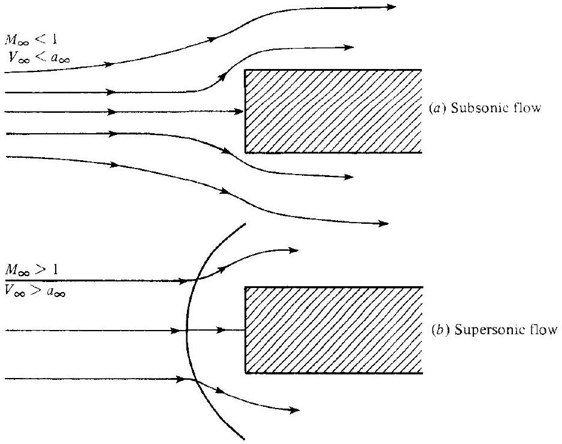
Figure 3.8 | Comparison between subsonic and supersonic streamlines for flow over a flat-faced cylinder or slab.

cylinder, which is seen as an obstruction by the molecules. Therefore, just as in our example of the creation of a sound wave in Sec. 3.3, the random motion of the molecules communicates this change in energy and momentum to other regions of the flow. The presence of the body tries to be propagated everywhere, including directly upstream, by sound waves. In Fig. 3.8a, the incoming stream is subsonic. $V_{\infty}<a_{\infty}$, and the sound waves can work their way upstream and forewarn the flow about the presence of the body. In this fashion, as shown in Fig. 3.8a, the flow streamlines begin to change and the flow properties begin to compensate for the body far upstream (theoretically, an infinite distance upstream). In contrast, if the flow is supersonic, then $V_{\infty}>a_{\infty}$, and the sound waves can no longer propagate upstream. Instead, they tend to coalesce a short distance ahead of the body. In so doing, their coalescence forms a thin shock wave, as shown in Fig. 3.8b. Ahead of the shock wave, the flow has no idea of the presence of the body. Immediately behind the normal shock, however, the flow is subsonic, and hence the streamlines quickly compensate for the obstruction. Although the picture shown in Fig. $3.8 b$ is only one of many situations in which nature creates shock waves, the physical mechanism just discussed is quite general.

To begin a quantitative analysis of changes across a normal shock wave, consider again Fig. 3.4. Here, the normal shock is assumed to be a discontinuity across which the flow properties suddenly change. For purposes of discussion. assume that all conditions are known ahead of the shock (region 1), and that we want to solve for all conditions behind the shock (region 2). There is no heat added or taken away from the flow as it traverses the shock wave (for example, we are not putting the shock in a refrigerator, nor are we irradiating it with a laser); hence the flow across the shock
wave is adiabatic. Therefore, the basic normal shock equations are obtained directly from Eqs. (3.2), (3.5), and (3.9) (with $q=0$ ) as

$$
\begin{aligned}
\rho_{1} u_{1} & =\rho_{2} u_{2} & & \text { (continuity) } \\
p_{1}+\rho_{1} u_{1}^{2} & =p_{2}+\rho_{2} u_{2}^{2} & & \text { (momentum) } \\
h_{1}+\frac{u_{1}^{2}}{2} & =h_{2}+\frac{u_{2}^{2}}{2} & & \text { (energy) }
\end{aligned}
$$

Equations (3.38) through (3.40) are general-they apply no matter what type of gas is being considered. Also, in general they must be solved numerically for the properties behind the shock wave, as will be discussed in Chap. 17 for the cases of thermally perfect and chemically reacting gases. However, for a calorically perfect gas, we can immediately add the thermodynamic relations
and

$$
\begin{gathered}
p=\rho R T \\
h=c_{p} T
\end{gathered}
$$

Equations (3.38) through (3.42) constitute five equations with five unknowns: $\rho_{2}, u_{2}, p_{2}, h_{2}$, and $T_{2}$. Hence, they can be solved algebraically, as follows.

First, divide Eq. (3.39) by (3.38):

$$
\frac{p_{1}}{\rho_{1} u_{1}}-\frac{p_{2}}{\rho_{2} u_{2}}=u_{2}-u_{1}
$$

Recalling that $a=\sqrt{\gamma p / \rho}$, Eq. (3.43) becomes

$$
\frac{a_{1}^{2}}{\gamma u_{1}}-\frac{a_{2}^{2}}{\gamma u_{2}}=u_{2}-u_{1}
$$

Equation (3.44) is a combination of the continuity and momentum equations. The energy equation (3.40) can be utilized in one of its alternative forms, namely, Eq. (3.26), which yields
and

$$
\begin{aligned}
& a_{1}^{2}=\frac{\gamma+1}{2} a^{* 2}-\frac{\gamma-1}{2} u_{1}^{2} \\
& a_{2}^{2}=\frac{\gamma+1}{2} a^{* 2}-\frac{\gamma-1}{2} u_{2}^{2}
\end{aligned}
$$

Since the flow is adiabatic across the shock wave, $a^{*}$ in Eqs. (3.45) and (3.46) is the same constant value (see Sec. 3.5). Substituting Eqs. (3.45) and (3.46) into (3.44), we obtain

$$
\frac{\gamma+1}{2} \frac{a^{* 2}}{\gamma u_{1}}-\frac{\gamma-1}{2 \gamma} u_{1}-\frac{\gamma+1}{2} \frac{a^{* 2}}{\gamma u_{2}}+\frac{\gamma-1}{2 \gamma} u_{2}=u_{2}-u_{1}
$$

or

$$
\frac{\gamma+1}{2 \gamma u_{1} u_{2}}\left(u_{2}-u_{1}\right) a^{* 2}+\frac{\gamma-1}{2 \gamma}\left(u_{2}-u_{1}\right)=u_{2}-u_{1}
$$

Dividing by ( $u_{2}-u_{1}$ ),

$$
\frac{\gamma+1}{2 \gamma u_{1} u_{2}} a^{* 2}+\frac{\gamma-1}{2 \gamma}=1
$$

Solving for $a^{*}$, this gives

$$
a^{* 2}=u_{1} u_{2}
$$

> [!equation] Prandtl relation for normal shocks (Eq. 3.47)
> $$
> a^{* 2}=u_{1} u_{2}
> $$

Equation (3.47) is called the Prandtl relation, and is a useful intermediate relation for normal shocks. For example, from this simple equation we obtain directly
or

$$
\begin{aligned}
1 & =\frac{u_{1}}{a^{*}} \frac{u_{2}}{a^{*}}=M_{1}^{*} M_{2}^{*} \\
M_{2}^{*} & =\frac{1}{M_{1}^{*}}
\end{aligned}
$$

Based on our previous physical discussion, the flow ahead of a shock wave must be supersonic, i.e., $M_{1}>1$. From Sec. 3.5, this implies $M_{1}^{*}>1$. Thus, from Eq. (3.48), $M_{2}^{*}<1$ and thus $M_{2}<1$. Hence, the Mach number behind the normal shock is always subsonic. This is a general result, not just limited to a calorically perfect gas.

Recall Eq. (3.37), which, solved for $M^{*}$, gives

$$
M^{* 2}=\frac{(\gamma+1) M^{2}}{2+(\gamma-1) M^{2}}
$$

Substitute Eq. (3.49) into (3.48):

$$
\frac{(\gamma+1) M_{2}^{2}}{2+(\gamma-1) M_{2}^{2}}=\left[\frac{(\gamma+1) M_{1}^{2}}{2+(\gamma-1) M_{1}^{2}}\right]^{-1}
$$

Solving Eq. (3.50) for $M_{2}^{2}$ :

$$
M_{2}^{2}=\frac{1+[(\gamma-1) / 2] M_{1}^{2}}{\gamma M_{1}^{2}-(\gamma-1) / 2}
$$

> [!equation] Mach number behind a normal shock (Eq. 3.51)
> $$
> M_{2}^{2}=\frac{1+[(\gamma-1) / 2] M_{1}^{2}}{\gamma M_{1}^{2}-(\gamma-1) / 2}
> $$

Equation (3.51) demonstrates that, for a calorically perfect gas with a constant value of $\gamma$, the Mach number behind the shock is a function of only the Mach number ahead of the shock. It also shows that when $M_{1}=1$, then $M_{2}=1$. This is the case of an infinitely weak normal shock, which is defined as a Mach wave. In contrast, as $M_{1}$ increases above 1 , the normal shock becomes stronger and $M_{2}$ becomes progressively less than 1 . However, in the limit, as $M_{1} \rightarrow \infty, M_{2}$ approaches a finite minimum value, $M_{2} \rightarrow \sqrt{(\gamma-1) / 2 \gamma}$, which for air is 0.378 .

The upstream Mach number $M_{1}$ is a powerful parameter which dictates shock wave properties. This is already seen in Eq. (3.51). Ratios of other properties across the shock can also be found in terms of $M_{1}$. For example, from Eq. (3.38) combined
with (3.47),

$$
\frac{\rho_{2}}{\rho_{1}}=\frac{u_{1}}{u_{2}}=\frac{u_{1}^{2}}{u_{2} u_{1}}=\frac{u_{1}^{2}}{a^{* 2}}=M_{1}^{* 2}
$$

Substituting Eq. (3.49) into (3.52),

$$
\frac{\rho_{2}}{\rho_{1}}=\frac{u_{1}}{u_{2}}=\frac{(\gamma+1) M_{1}^{2}}{2+(\gamma-1) M_{1}^{2}}
$$

> [!equation] Density (and velocity) ratio across a normal shock (Eq. 3.53)
> $$
> \frac{\rho_{2}}{\rho_{1}}=\frac{u_{1}}{u_{2}}=\frac{(\gamma+1) M_{1}^{2}}{2+(\gamma-1) M_{1}^{2}}
> $$

To obtain the pressure ratio, return to the momentum equation (3.39),

$$
p_{2}-p_{1}=\rho_{1} u_{1}^{2}-\rho_{2} u_{2}^{2}
$$

which, combined with Eq. (3.38), yields

$$
p_{2}-p_{1}=\rho_{1} u_{1}\left(u_{1}-u_{2}\right)=\rho_{1} u_{1}^{2}\left(1-\frac{u_{2}}{u_{1}}\right)
$$

Dividing Eq. (3.54) by $p_{1}$, and recalling that $a_{1}^{2}=\gamma p_{1} / \rho_{1}$, we obtain

$$
\frac{p_{2}-p_{1}}{p_{1}}=\gamma M_{1}^{2}\left(1-\frac{u_{2}}{u_{1}}\right)
$$

Substitute Eq. (3.53) for $u_{1} / u_{2}$ into Eq. (3.55):

$$
\frac{p_{2}-p_{1}}{p_{1}}=\gamma M_{1}^{2}\left[1-\frac{2+(\gamma-1) M_{1}^{2}}{(\gamma+1) M_{1}^{2}}\right]
$$

Equation (3.56) simplifies to

$$
\frac{p_{2}}{p_{1}}=1+\frac{2 \gamma}{\gamma+1}\left(M_{1}^{2}-1\right)
$$

> [!equation] Static pressure ratio across a normal shock (Eq. 3.57)
> $$
> \frac{p_{2}}{p_{1}}=1+\frac{2 \gamma}{\gamma+1}\left(M_{1}^{2}-1\right)
> $$

To obtain the temperature ratio, recall the equation of state, $p=\rho R T$. Hence

$$
\frac{T_{2}}{T_{1}}=\left(\frac{p_{2}}{p_{1}}\right)\left(\frac{\rho_{1}}{\rho_{2}}\right)
$$

Substituting Eqs. (3.57) and (3.53) into Eq. (3.58),

$$
\frac{T_{2}}{T_{1}}=\frac{h_{2}}{h_{1}}=\left[1+\frac{2 \gamma}{\gamma+1}\left(M_{1}^{2}-1\right)\right]\left[\frac{2+(\gamma-1) M_{1}^{2}}{(\gamma+1) M_{1}^{2}}\right]
$$

> [!equation] Temperature ratio across a normal shock (Eq. 3.59)
> $$
> \frac{T_{2}}{T_{1}}=\left[1+\frac{2 \gamma}{\gamma+1}\left(M_{1}^{2}-1\right)\right]\left[\frac{2+(\gamma-1) M_{1}^{2}}{(\gamma+1) M_{1}^{2}}\right]
> $$

Examine Eqs. (3.51), (3.53), (3.57), and (3.59). For a calorically perfect gas with a given $\gamma$, they give $M_{2}, \rho_{2} / \rho_{1}, p_{2} / p_{1}$, and $T_{2} / T_{1}$ as functions of $M_{1}$ only. This is our first major demonstration of the importance of Mach number in the quantitative governance of compressible flowfields. In contrast, as will be shown in Chap. 17 for an equilibrium thermally perfect gas, the changes across a normal shock depend on both $M_{1}$ and $T_{1}$, whereas for an equilibrium chemically reacting gas they depend on
$M_{1}, T_{1}$, and $p_{1}$. Moreover, for such high-temperature cases, closed-form expressions such as Eqs. (3.51) through (3.59) are generally not possible, and the normal shock properties must be calculated numerically. Hence, the simplicity brought about by the calorically perfect gas assumption in this section is clearly evident. Fortunately, the results of this section hold reasonably accurately up to approximately $M_{1}=5$ in air at standard conditions. Beyond Mach 5, the temperature behind the normal shock becomes high enough that $\gamma$ is no longer constant. However, the flow regime $M_{1}<5$ contains a large number of everyday practical problems, and therefore the results of this section are extremely useful.

The limiting case of $M_{1} \rightarrow \infty$ can be visualized as $u_{1} \rightarrow \infty$, where the calorically perfect gas assumption is invalidated by high temperatures, or as $a_{1} \rightarrow 0$, where the perfect gas equation of state is invalidated by extremely low temperatures. Nevertheless, it is interesting to examine the variation of properties across the normal shock as $M_{1} \rightarrow \infty$ in Eqs. (3.51), (3.53), (3.57), and (3.59). We find, for $\gamma=1.4$,

$$
\begin{aligned}
\lim _{M_{1} \rightarrow \infty} M_{2} & =\sqrt{\frac{\gamma-1}{2 \gamma}}=0.378 \quad \text { (as discussed previously) } \\
\lim _{M_{1} \rightarrow \infty} \frac{\rho_{2}}{\rho_{1}} & =\frac{\gamma+1}{\gamma-1}=6 \\
\lim _{M_{1} \rightarrow \infty} \frac{p_{2}}{p_{1}} & =\infty \\
\lim _{M_{1} \rightarrow \infty} \frac{T_{2}}{T_{1}} & =\infty
\end{aligned}
$$

At the other extreme, for $M_{1}=1$, Eqs. (3.51), (3.53), (3.57), and (3.59) yield $M_{1}=\rho_{2} / \rho_{1}=p_{2} / p_{1}=T_{2} / T_{1}=1$. This is the case of an infinitely weak normal shock degenerating into a Mach wave, where no finite changes occur across the wave. This is the same as the sound wave discussed in Sec. 3.3.

Earlier in this section, it was stated that the flow ahead of the normal shock wave must be supersonic. This is clear from our previous physical discussion on the formation of shocks. However, it is interesting to note that Eqs. (3.51), (3.53), (3.57), and (3.59) mathematically hold for $M_{1}<1$ as well as $M_{1}>1$. Therefore, to prove that these equations have physical meaning only when $M_{1}>1$, we must appeal to the second law of thermodynamics (see Sec. 1.4). From Eq. (1.36), repeated here,

$$
s_{2}-s_{1}=c_{p} \ln \frac{T_{2}}{T_{1}}-R \ln \frac{p_{2}}{p_{1}}
$$

with Eqs. (3.57) and (3.59), we have

$$
\begin{aligned}
s_{2}-s_{1}= & c_{p} \ln \left\{\left[1+\frac{2 \gamma}{\gamma+1}\left(M_{1}^{2}-1\right)\right]\left[\frac{2+(\gamma-1) M_{1}^{2}}{(\gamma+1) M_{1}^{2}}\right]\right\} \\
& -R \ln \left[1+\frac{2 \gamma}{\gamma+1}\left(M_{1}^{2}-1\right)\right]
\end{aligned}
$$

> [!equation] Entropy change across a normal shock (Eq. 3.60)
> $$
> \begin{aligned}
> s_{2}-s_{1}= & c_{p} \ln \left\{\left[1+\frac{2 \gamma}{\gamma+1}\left(M_{1}^{2}-1\right)\right]\left[\frac{2+(\gamma-1) M_{1}^{2}}{(\gamma+1) M_{1}^{2}}\right]\right\} \\
> & -R \ln \left[1+\frac{2 \gamma}{\gamma+1}\left(M_{1}^{2}-1\right)\right]
> \end{aligned}
> $$

Equation (3.60) demonstrates that the entropy change across the normal shock is also a function of $M_{1}$ only. Moreover, it shows that, if $M_{1}=1$ then $s_{2}-s_{1}=0$, if $M_{1}<1$ then $s_{2}-s_{1}<0$, and if $M_{1}>1$ then $s_{2}-s_{1}>0$. Therefore, since it is necessary that $s_{2}-s_{1} \geq 0$ from the second law, the upstream Mach number $M_{1}$ must be greater than or equal to 1 . Here is another example of how the second law tells us the direction in which a physical process will proceed. If $M_{1}$ is subsonic, then Eq. (3.60) says that the entropy decreases across the normal shock-an impossible situation. The only physically possible case is $M_{1} \geq 1$, which in turn dictates from Eqs. (3.51), (3.53), (3.57), and (3.59) that $M_{2} \leq 1, \rho_{2} / \rho_{1} \geq 1, p_{2} / p_{1} \geq 1$, and $T_{2} / T_{1} \geq 1$. Thus, we have now established the phenomena sketched in Fig. 3.4, namely, that across a normal shock wave the pressure, density, and temperature increase, whereas the velocity decreases and the Mach number decreases to a subsonic value.

What really causes the entropy increase across a shock wave? To answer this, recall that the changes across the shock occur over a very short distance, on the order of $10^{-5} \mathrm{~cm}$. Hence, the velocity and temperature gradients inside the shock structure itself are very large. In regions of large gradients, the viscous effects of viscosity and thermal conduction become important. In turn, these are dissipative, irreversible phenomena that generate entropy. Therefore, the net entropy increase predicted by the normal shock relations in conjunction with the second law of thermodynamics is appropriately provided by nature in the form of friction and thermal conduction inside the shock wave structure itself.

Finally, in this section we need to resolve one more question, namely, how do the total (stagnation) conditions vary across a normal shock wave? Consider Fig. 3.9, which illustrates the definition of total conditions before and after the shock. In region 1 ahead of the shock, a fluid element is moving with actual conditions of

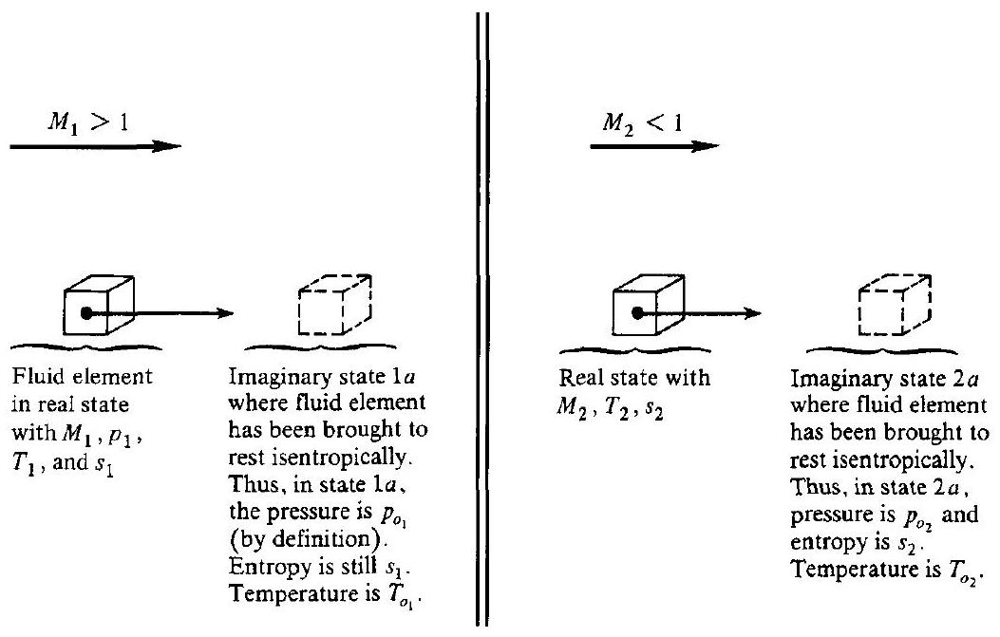
Figure 3.9 | Illustration of total (stagnation) conditions ahead of and behind a normal shock wave.

$M_{1}, p_{1}, T_{1}$, and $s_{1}$. Consider in this region the imaginary state $1 a$ where the fluid element has been brought to rest isentropically. Thus, by definition, the pressure and temperature in state $1 a$ are the total values $p_{o_{1}}$, and $T_{o_{1}}$, respectively. The entropy at state $l a$ is still $s_{1}$ because the stagnating of the fluid element has been done isentropically. In region 2 behind the shock, a fluid element is moving with actual conditions of $M_{2}, p_{2}, T_{2}$, and $s_{2}$. Consider in this region the imaginary state $2 a$ where the fluid element has been brought to rest isentropically. Here, by definition, the pressure and temperature in state $2 a$ are the total values of $p_{o_{2}}$ and $T_{o_{2}}$, respectively. The entropy at state $2 a$ is still $s_{2}$, by definition. The question is now raised how $p_{o_{2}}$ and $T_{o_{2}}$ behind the shock compare with $p_{o_{1}}$ and $T_{o_{1}}$, respectively, ahead of the shock. To answer this question, consider Eq. (3.22), repeated here:

$$
c_{p} T_{1}+\frac{u_{1}^{2}}{2}=c_{p} T_{2}+\frac{u_{2}^{2}}{2}
$$

From Eq. (3.27), the total temperature is given by

$$
c_{p} T_{o}=c_{p} T+\frac{u^{2}}{2}
$$

Hence,

$$
c_{p} T_{o_{1}}=c_{p} T_{o_{2}}
$$

and thus

$$
T_{o_{1}}=T_{o_{2}}
$$

> [!equation] Total temperature is constant across a normal shock (Eq. 3.61)
> $$
> T_{o_{1}}=T_{o_{2}}
> $$

From Eq. (3.61), we see that the total temperature is constant across a stationary normal shock wave. [Note that Eq. (3.61), which holds for a calorically perfect gas, is a special case of the more general result that the total enthalpy is constant across the shock, as demonstrated by Eq. (3.40). For a stationary normal shock, the total enthalpy is always constant across the shock wave, which for calorically or thermally perfect gases translates into a constant total temperature across the shock. However, for a chemically reacting gas, the total temperature is not constant across the shock, as described in Chap. 17. Also, if the shock wave is not stationary-if it is moving through space-neither the total enthalpy nor total temperature are constant across the wave. This becomes a matter of reference systems, as discussed in Chap. 7.]

Considering Fig. 3.9 again, write Eq. (1.36) between the imaginary states $1 a$ and $2 a$ :

$$
s_{2 a}-s_{1 a}=c_{p} \ln \frac{T_{2 a}}{T_{1 a}}-R \ln \frac{p_{2 a}}{p_{1 a}}
$$

However, $s_{2 a}=s_{2}, s_{1 a}=s_{1}, T_{2 a}=T_{o}=T_{1 a}, p_{2 a}=p_{o_{2}}$, and $p_{1 a}=p_{o_{1}}$. Hence, Eq. (3.62) becomes

$$
s_{2}-s_{1}=-R \ln \frac{p_{o_{2}}}{p_{o_{1}}}
$$

> [!equation] Entropy change in terms of total pressure ratio (Eq. 3.63)
> $$
> s_{2}-s_{1}=-R \ln \frac{p_{o_{2}}}{p_{o_{1}}}
> $$

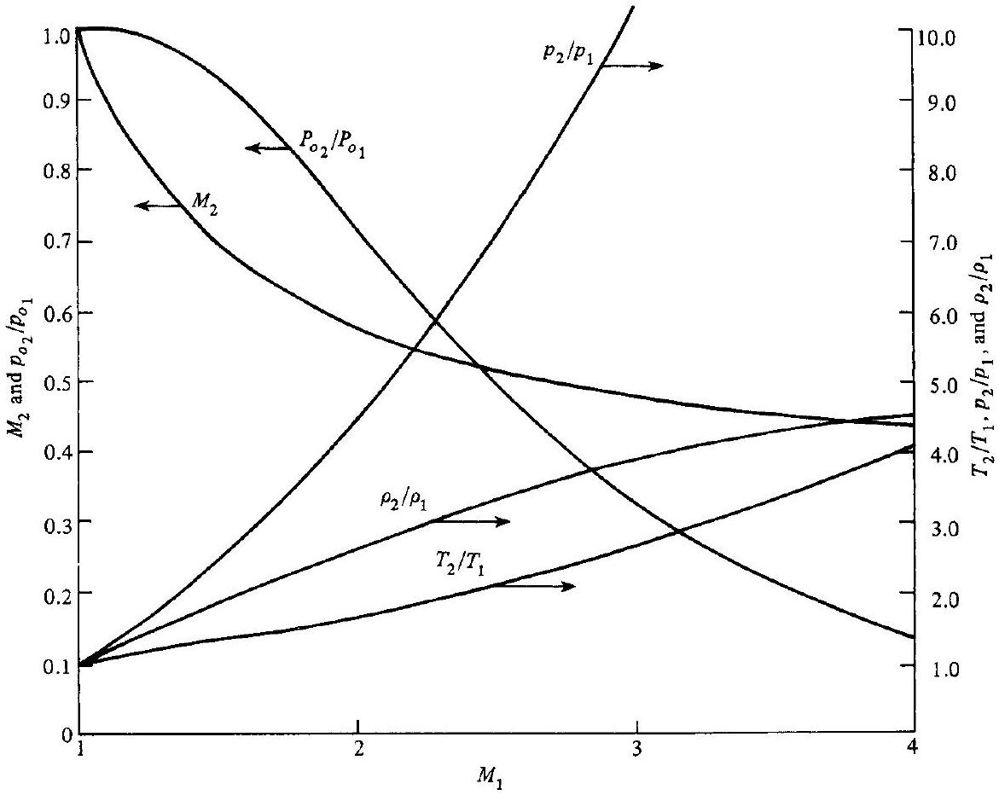
Figure 3.10 I Properties behind a normal shock wave as a function of upstream Mach number.

or

$$
\frac{p_{o_{2}}}{p_{o_{1}}}=e^{-\left(s_{2}-s_{1}\right) / R}
$$

> [!equation] Total pressure ratio across a normal shock (Eq. 3.64)
> $$
> \frac{p_{o_{2}}}{p_{o_{1}}}=e^{-\left(s_{2}-s_{1}\right) / R}
> $$

From Eqs. (3.64) and (3.60) we see that the ratio of total pressures across the normal shock depends on $M_{1}$ only. Also, because $s_{2}>s_{1}$, Eqs. (3.63) and (3.64) show that $p_{o_{2}}<p_{o_{1}}$. The total pressure decreases across a shock wave.

The variations of $p_{2} / p_{1}, \rho_{2} / \rho_{1}, T_{2} / T_{1}, p_{o_{2}} / p_{o_{1}}$, and $M_{2}$ with $M_{1}$ as obtained from the above equations are tabulated in Table A. 2 (in the Appendix A at the back of this book) for $\gamma=1.4$. In addition, to provide more physical feel, these variations are also plotted in Fig. 3.10. Note that (as stated earlier) these curves show how, as $M_{1}$ becomes very large, $T_{2} / T_{1}$ and $p_{2} / p_{1}$ also become very large, whereas $\rho_{2} / \rho_{1}$ and $M_{2}$ approach finite limits.

> [!exercise] Normal Shock Properties in a Supersonic Wind Tunnel
> A normal shock wave stands in the test section of a supersonic wind tunnel, where the upstream Mach number is $M_1 = 3$, static pressure is $p_1 = 0.5~\text{atm}$, and static temperature is $T_1 = 200~\text{K}$.
>
> (a) Using the normal shock relations in Table A.2, find the downstream Mach number $M_2$, static pressure $p_2$, and static temperature $T_2$.
>
> (b) Calculate the speed of sound downstream using $a_2 = \sqrt{\gamma R T_2}$ and the downstream velocity $u_2 = M_2 a_2$. Confirm that the flow is subsonic behind the shock.

## - Solution

From Table A.2, for $M_{1}=3: p_{2} / p_{1}=10.33, T_{2} / T_{1}=2.679$, and $M_{2}=0.4752$. Hence

$$
\begin{aligned}
& p_{2}=\frac{p_{2}}{p_{1}} p_{1}=10.33(0.5)=5.165 \mathrm{~atm} \\
& T_{2}=\frac{T_{2}}{T_{1}} T_{1}=2.679(200)=535.8 \mathrm{~K} \\
& a_{2}=\sqrt{\gamma R T_{2}}=\sqrt{(1.4)(287)(535.8)}=464 \mathrm{~m} / \mathrm{s} \\
& u_{2}=M_{2} a_{2}=(0.4752)(464)=220 \mathrm{~m} / \mathrm{s}
\end{aligned}
$$

> [!exercise] Stagnation Conditions at the Nose of a Supersonic Missile
> A blunt-nosed missile is flying at Mach 2 at standard sea level ($T_1 = 519~\text{°R}$, $p_1 = 2116~\text{lb}/\text{ft}^2$). A normal bow shock stands ahead of the blunt nose.
>
> (a) Recognize that the nose tip is a stagnation point on the streamline that has passed through the normal portion of the bow shock. Using Table A.1 and Table A.2, explain why the conditions at the nose are $T_{o_2}$ and $p_{o_2}$ (the total conditions behind the shock).
>
> (b) Using the fact that total temperature is conserved across the shock ($T_{o_2} = T_{o_1}$), calculate the stagnation temperature at the nose.
>
> (c) Calculate the stagnation pressure at the nose. Why does $p_{o_2}$ differ from $p_{o_1}$?

## - Solution

The nose of the missile is a stagnation point, and the streamline through the stagnation point has also passed through the normal portion of the bow shock wave. Hence, the temperature and pressure at the nose are equal to the total temperature and pressure behind a normal shock. Also, at standard sea level, $T_{1}=519^{\circ} \mathrm{R}$ and $p_{1}=2116 \mathrm{lb} / \mathrm{ft}^{2}$.

From Table A.1, for $M_{1}=2: T_{o_{1}} / T_{1}=1.8$ and $p_{o_{1}} / p_{1}=7.824$. Also, for adiabatic flow through a normal shock, $T_{o_{2}}=T_{o_{1}}$. Hence

$$
T_{o_{2}}=T_{o_{1}}=\frac{T_{o_{1}}}{T_{1}} T_{1}=1.8(519)=934.2 \mathrm{R}
$$

From Table A.2, for $M_{1}=2: p_{o_{2}} / p_{o_{1}}=0.7209$. Hence

$$
p_{o_{2}}=\frac{p_{o_{2}}}{p_{o_{1}}} \frac{p_{o_{1}}}{p_{1}} p_{1}=(0.7209)(7.824)(2116)=11,935 \mathrm{lb} / \mathrm{ft}^{2}
$$

> [!exercise] Mach Number Measurement with a Pitot Tube in Supersonic Flow
> In a supersonic flow, a Pitot tube measures static pressure $p_1 = 0.4~\text{atm}$ in the free stream. When inserted into the flow, the Pitot tube reads a pressure of $3~\text{atm}$.
>
> (a) Explain why the Pitot tube reading is not the stagnation pressure $p_{o_1}$ of the free stream. What physical phenomenon occurs ahead of the Pitot tube mouth?
>
> (b) In supersonic flow, a normal shock forms ahead of the Pitot tube, and the tube measures the total pressure $p_{o_2}$ behind the shock. Using the ratio $p_{o_2}/p_1 = 3/0.4 = 7.5$ and Table A.2, determine the upstream Mach number $M_1$.

## - Solution

(We assume that the reader is familiar with the concept of a Pitot tube; see Sec. 8.7 of Ref. 104 for a discussion of the Pitot tube.) The pressure measured by a Pitot tube is the total pressure. However, when the tube is inserted into a supersonic flow, a normal shock is formed a short distance ahead of the mouth of the tube. In this case, the Pitot tube is sensing the total pressure behind the normal shock. Hence

$$
\frac{p_{o_{2}}}{p_{1}}=\frac{3}{0.4}=7.5
$$

From Table A.2, for $p_{o_{2}} / p_{1}=7.5$ : $M_{1}=2.35$.

Note: As usual, in using the tables in Appendix A, we use the nearest entry for simplicity and efficiency; for improved accuracy, interpolation between the nearest entries should be used.

> [!exercise] Entropy Increase Across a Normal Shock
> Consider the normal shock that forms ahead of the Pitot tube in Example 3.7, where the upstream Mach number is $M_1 = 2.35$.
>
> (a) Using Eq. (3.63), $s_2 - s_1 = -R \ln(p_{o_2}/p_{o_1})$, and Table A.2 to find $p_{o_2}/p_{o_1}$ for $M_1 = 2.35$, calculate the entropy change per unit mass across the shock.
>
> (b) Comment on the physical mechanisms within the thin shock structure that generate this entropy increase. Is the flow through the shock reversible?

## - Solution

From Table A.2, for $M_{1}=2.35: p_{o_{2}} / p_{o_{1}}=0.5615$. From Eq. (3.63)

$$
\begin{aligned}
& \frac{s_{2}-s_{1}}{R}=-\ln \frac{p_{o_{2}}}{p_{o_{1}}}=-\ln (0.5615)=0.577 \\
& s_{2}-s_{1}=0.577 R=0.577(1716)=990.4 \mathrm{ft} \cdot \mathrm{lb} / \mathrm{slug} \cdot{ }^{\circ} \mathrm{R}
\end{aligned}
$$

> [!exercise] Validity of the Isentropic Approximation for Weak Transonic Shocks
> Transonic flow occurs over the wing of a high-speed aircraft (e.g., Boeing 777) flying at a free-stream Mach number $M_\infty \approx 0.85$. Due to the wing shape, there is a pocket of locally supersonic flow on the upper surface, terminated by a weak shock wave (Fig. 1.10b). Early numerical methods for transonic airfoil flows assumed isentropic flow throughout, ignoring entropy increases across the shock.
>
> (a) Using Table A.2, calculate the total pressure ratio $p_{o_2}/p_{o_1}$ and entropy change $s_2 - s_1$ (using Eq. 3.63, $s_2 - s_1 = -R \ln(p_{o_2}/p_{o_1})$) for normal shocks with upstream Mach numbers $M_1 = 1.04, 1.08, 1.12, 1.16$, and $1.20$. Organize your results in a table.
>
> (b) At what upstream Mach number does the entropy increase become significant relative to the $M_1 = 1.04$ case? Quantify how the entropy increase scales as $M_1$ increases.
>
> (c) Comment on the validity of the isentropic assumption for transonic flows. At what shock strength (in terms of upstream Mach) would the isentropic approximation be acceptable, and when would it fail?

## - Solution

From Table A.2, for $M_{1}=1.04$

$$
\frac{p_{o_{2}}}{p_{o_{1}}}=0.9999
$$

From Eq. (3.63),

$$
s_{2}-s_{1}=-R \ln \frac{p_{o_{2}}}{p_{o_{1}}}=-(287) \ln (0.9999)=0.0287 \frac{\mathrm{joule}}{\mathrm{~kg} \cdot \mathrm{~K}}
$$

Forming a table for the remaining calculations, we have

| $\boldsymbol{M}_{\mathbf{1}}$ | 1.04 | 1.08 | 1.12 | 1.16 | 1.2 |
| :--- | :--- | :--- | :--- | :--- | :--- |
| $\boldsymbol{p}_{\boldsymbol{o}_{2}} p_{o_{1}}$ | 0.9999 | 0.9994 | 0.9982 | 0.9961 | 0.9928 |
| $s_{2}-s_{1}\left(\frac{\text { joule }}{\mathbf{k g} \cdot \mathbf{K}}\right)$ | 0.0287 | 0.172 | 0.517 | 1.12 | 2.07 |

From this table, the entropy increase across a normal shock with $M_{1}=1.04$ is very small; the shock is extremely weak. By comparison, the entropy increase for $M_{1}=1.12$ is 72 times larger than the case for $M_{1}=1.04$. The shock strength increases rapidly as $M_{1}$ increases above one. From these numbers, we might feel comfortable with the approximation of isentropic flow for transonic flows where the local Mach number in front of the shock is on the order of 1.08 or less. On the other hand, if the local Mach number is on the order of 1.2, the isentropic assumption is clearly suspect.

> [!exercise] Effect of the Ratio of Specific Heats on Normal Shock Strength
> Two flows — one of helium ($\gamma = 1.67$) and one of air ($\gamma = 1.4$) — both undergo a normal shock at upstream Mach number $M_1 = 5$.
> (a) Which gas produces the stronger shock? Calculate the pressure ratio $p_2/p_1$ for both helium and air.
> (b) Explain physically why $\gamma$ influences shock strength. What role does $\gamma$ play in the compressibility and energy partitioning of the gas?

## - Solution

For air, from Table A.2, for $M_{1}=5$

$$
\frac{p_{2}}{p_{1}}=29 \text { (air) }
$$

For helium, we cannot use Table A.2, which is for $\gamma=1.4$ only. Returning to Eq. (3.57) for the pressure ratio across a normal shock,

$$
\frac{p_{2}}{p_{1}}=1+\frac{2 \gamma}{\gamma+1}\left(M_{1}^{2}-1\right)=1+\frac{2(1.67)}{167+1}\left[(5)^{2}-1\right]
$$

Hence,

$$
\frac{p_{2}}{p_{1}}=31 \text { (helium) }
$$

From this, we conclude that for equal upstream Mach numbers, the shock strength is greater in helium as compared to air.

> [!exercise] Normal Shock Strength at Equal Velocity vs. Equal Mach Number
> The same two gases (helium with $\gamma = 1.67$, $R = 2078.5\,\text{J/kg·K}$ and air with $\gamma = 1.4$, $R = 287\,\text{J/kg·K}$) now undergo normal shocks at the same velocity $V = 1700\,\text{m/s}$ and same temperature $T = 288\,\text{K}$, rather than the same Mach number as in Example 3.10.
> (a) Calculate the upstream Mach number for each gas, then determine the pressure ratio $p_2/p_1$ for both helium and air.
> (b) Explain why the conclusion reverses from Example 3.10. At equal velocity and temperature, helium has a much weaker shock because its much higher speed of sound gives a much lower Mach number. What does this tell us about whether velocity or Mach number is the true governing parameter for shock strength?

## - Solution

For air, with $\gamma=1.4$ and $R=287 \mathrm{joule} / \mathrm{kg} \cdot \mathrm{K}$, the speed of sound at $T_{1}=288 \mathrm{~K}$ is, from Eq. (3.20),

$$
a_{1}=\sqrt{\gamma R T_{1}}=\sqrt{(1.4)(287)(288)}=340 \mathrm{~m} / \mathrm{s}
$$

Hence,

$$
M_{1}=\frac{V_{1}}{a_{1}}=\frac{1700}{340}=5
$$

From Table A.2, we have

$$
\frac{p_{2}}{p_{1}}=29 \text { (air) }
$$

For helium, the molecular weight is 4 . As given in Sec. 1.4,

$$
R=\frac{R}{M}=\frac{8314}{4}=2078.5 \frac{\mathrm{joule}}{\mathrm{~kg} \cdot \mathrm{~K}}
$$

Hence,

$$
\begin{aligned}
a_{1} & =\sqrt{\gamma R T_{1}}=\sqrt{(1.67)(2078.5)(288)}=999.8 \mathrm{~m} / \mathrm{s} \\
M_{1} & =\frac{V_{1}}{a_{1}}=\frac{1700}{3999.8}=1.7
\end{aligned}
$$

From Eq. (3.57)

$$
\frac{p_{2}}{p_{1}}=1+\frac{2 \gamma}{\gamma+1}\left(M_{1}^{2}-1\right)=1+\frac{2(1.67)}{1.67+1}\left[(1.7)^{2}-1\right]
$$

Hence

$$
\frac{p_{2}}{p_{1}}=3.36 \text { (helium) }
$$

From this, we conclude that, for equal upstream velocities and temperatures, the shock strength in helium is much weaker than in air. This is because the speed of sound in helium is much larger than air at the same temperature, due to the smaller molecular weight for helium. Since shock strength is dictated by Mach number, not velocity, the shock is much weaker in helium because of the much lower upstream Mach number.

> [!exercise] The Hugoniot Equation — A Purely Thermodynamic View of Shock Compression
> The normal shock relations derived in Section 3.6 were expressed in terms of velocities and Mach numbers. However, since a shock compresses the gas, the changes can also be expressed in purely thermodynamic variables — without any explicit reference to velocity or Mach number.
> (a) Starting from the continuity and momentum equations (Eqs. 3.38 and 3.39), eliminate $u_2$ to show that $u_1^2 = \frac{p_2 - p_1}{\rho_2 - \rho_1}\frac{\rho_2}{\rho_1}$ (Eq. 3.67). Derive the analogous expression for $u_2^2$ (Eq. 3.68).
> (b) Substitute these velocity expressions into the energy equation to eliminate all velocities, and show the result simplifies to the Hugoniot equation: $e_2 - e_1 = \frac{p_1 + p_2}{2}(v_1 - v_2)$ (Eq. 3.72). Note the resemblance to the first law with $\delta q = 0$, where the change in internal energy equals the mean pressure times the change in specific volume. Why is this form valid for any type of gas — not just calorically perfect?
> (c) Explain what a Hugoniot curve is on a $p$-$v$ diagram and how it differs from an isentrope through the same initial point. For a given upstream velocity $u_1$, show that the downstream state (point 2) on the Hugoniot curve is found by drawing a line through point 1 with slope $-(u_1/v_1)^2$ (Eq. 3.75). Why does the Hugoniot curve lie above the isentrope for a given decrease in specific volume, and what does this imply about the relative efficiency of shock versus isentropic compression?

### 3.7 I HUGONIOT EQUATION

The results obtained in Sec. 3.6 for the normal shock wave were couched in terms of velocities and Mach numbers-quantities which quite properly emphasize the fluid dynamic nature of shock waves. However, because the static pressure always increases across a shock wave, the wave itself can also be visualized as a thermodynamic device which compresses the gas. Indeed, the changes across a normal shock wave can be expressed in terms of purely thermodynamic variables without explicit reference to a velocity or Mach number, as follows.

From the continuity equation (3.38),

$$
u_{2}=u_{1}\left(\frac{\rho_{1}}{\rho_{2}}\right)
$$

Substitute Eq. (3.65) into the momentum equation (3.39):

$$
p_{1}+\rho_{1} u_{1}^{2}=p_{2}+\rho_{2}\left(\frac{\rho_{1}}{\rho_{2}} u_{1}\right)^{2}
$$

Solve Eq. (3.66) for $u_{1}^{2}$ :

$$
u_{1}^{2}=\frac{p_{2}-p_{1}}{\rho_{2}-\rho_{1}}\left(\frac{\rho_{2}}{\rho_{1}}\right)
$$

Alternatively, writing Eq. (3.38) as

$$
u_{1}=u_{2}\left(\frac{\rho_{2}}{\rho_{1}}\right)
$$

and again substituting into Eq. (3.39), this time solving for $u_{2}$, we obtain

$$
u_{2}^{2}=\frac{p_{2}-p_{1}}{\rho_{2}-\rho_{1}}\left(\frac{\rho_{1}}{\rho_{2}}\right)
$$

From the energy equation (3.40),

$$
h_{1}+\frac{u_{1}^{2}}{2}=h_{2}+\frac{u_{2}^{2}}{2}
$$

and recalling that by definition $h=e+p / \rho$, we have

$$
e_{1}+\frac{p_{1}}{\rho_{1}}+\frac{u_{1}^{2}}{2}=e_{2}+\frac{p_{2}}{\rho_{2}}+\frac{u_{2}^{2}}{2}
$$

Substituting Eqs. (3.67) and (3.68) into (3.69), the velocities are eliminated, yielding

$$
e_{1}+\frac{p_{1}}{\rho_{1}}+\frac{1}{2}\left[\frac{p_{2}-p_{1}}{\rho_{2}-\rho_{1}}\left(\frac{\rho_{2}}{\rho_{1}}\right)\right]=e_{2}+\frac{p_{2}}{\rho_{2}}+\frac{1}{2}\left[\frac{p_{2}-p_{1}}{\rho_{2}-\rho_{1}}\left(\frac{\rho_{1}}{\rho_{2}}\right)\right]
$$

This simplifies to

$$
e_{2}-e_{1}=\frac{\left(p_{1}+p_{2}\right)}{2}\left(\frac{1}{\rho_{1}}-\frac{1}{\rho_{2}}\right)
$$

or

$$
e_{2}-e_{1}=\frac{p_{1}+p_{2}}{2}\left(v_{1}-v_{2}\right)
$$

> [!equation] Hugoniot equation (Eq. 3.72)
> $$
> e_{2}-e_{1}=\frac{p_{1}+p_{2}}{2}\left(v_{1}-v_{2}\right)
> $$

Equation (3.72) is called the Hugoniot equation. It has certain advantages because it relates only thermodynamic quantities across the shock. Also, we have made no assumption about the type of gas-Eq. (3.72) is a general relation that holds for a perfect gas, chemically reacting gas, real gas, etc. In addition, note that Eq. (3.72) has the form of $\Delta e=-p_{\text {ave }} \Delta v$, i.e., the change in internal energy equals the mean pressure across the shock times the change in specific volume. This strongly reminds us of the first law of thermodynamics in the form of Eq. (1.25), with $\delta q=0$ for the adiabatic process across the shock.

In general, in equilibrium thermodynamics any state variable can be expressed as a function of any other two state variables, for example $e=e(p, v)$. This relation

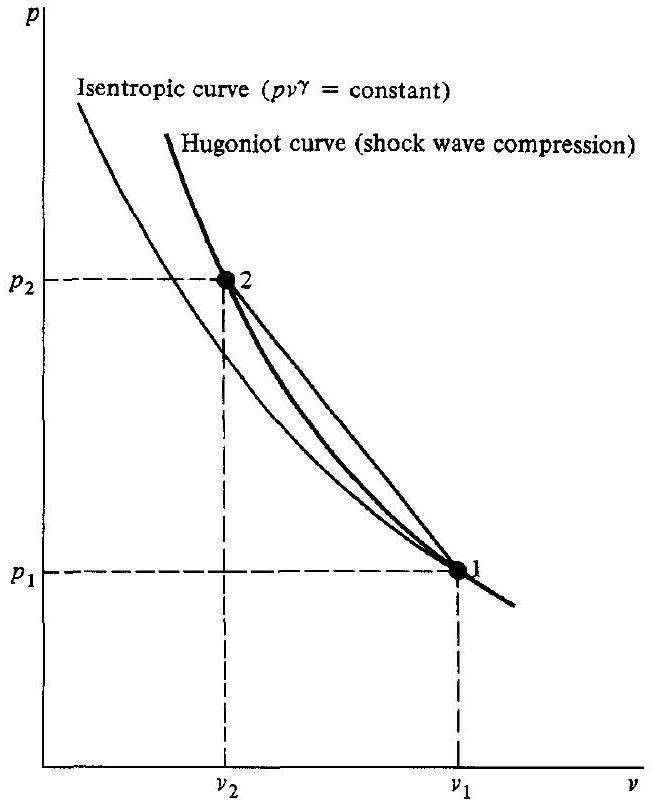
Figure 3.11 I Hugoniot curve; comparison with isentropic compression.

could be substituted into Eq. (3.72), resulting in a functional relation

$$
p_{2}=f\left(p_{1}, v_{1}, v_{2}\right)
$$

For given conditions of $p_{1}$ and $v_{1}$ upstream of the normal shock, Eq. (3.73) represents $p_{2}$ as a function of $v_{2}$. A plot of this relation on a $p v$ graph is called the Hugoniot curve, which is sketched in Fig. 3.11. This curve is the locus of all possible pressure-volume conditions behind normal shocks of various strengths for one specific set of upstream values for $p_{1}$ and $v_{1}$ (point 1 in Fig. 3.11). Each point on the Hugoniot curve in Fig. 3.11 therefore represents a different shock with a different upstream velocity $u_{1}$.

Now consider a specific shock with a specific value of upstream velocity $u_{1}$. How can we locate the specific point on the Hugoniot curve, point 2, which corresponds to this particular shock? To answer this question, return to Eq. (3.67), substituting $v=1 / \rho$ :

$$
u_{1}^{2}=\frac{p_{2}-p_{1}}{1 / v_{2}-1 / v_{1}}\left(\frac{v_{1}}{v_{2}}\right)
$$

Rearranging Eq. (3.74), we obtain

$$
\frac{p_{2}-p_{1}}{v_{2}-v_{1}}=-\left(\frac{u_{1}}{v_{1}}\right)^{2}
$$

Examining Eq. (3.75), the left-hand side is geometrically the slope of the straight line through points 1 and 2 in Fig. 3.11. The right-hand side is a known value, fixed by the
upstream velocity and specific volume. Hence, by calculating $-\left(u_{1} / v_{1}\right)^{2}$ from the known upstream conditions, and by drawing a straight line through point 1 with this slope, the line will intersect the Hugoniot curve at point 2, as sketched in Fig. 3.11. Consequently, point 2 represents conditions behind the particular normal shock which has velocity $u_{1}$ with upstream pressure and specific volume $p_{1}$ and $v_{1}$, respectively.

Shock wave compression is a very effective (not necessarily efficient, but effective) process. For example, compare the isentropic and Hugoniot curves drawn through the same initial point ( $p_{1}, v_{1}$ ) as sketched in Fig. 3.11. At this point, both curves have the same slope (prove this yourself, recalling that point 1 on the Hugoniot curve corresponds to an infinitely weak shock, i.e., a Mach wave). However, as $v$ decreases, the Hugoniot curve climbs above the isentropic curve. Therefore, for a given decrease in specific volume, a shock wave creates a higher pressure increase than an isentropic compression. However, the shock wave costs more because of the entropy increase and consequent total pressure loss, i.e., the shock compression is less efficient than the isentropic compression.

Finally, noting that for a calorically perfect gas $e=c_{1} T$ and $T=p v / R$, Eq. (3.72) takes the form

$$
\frac{p_{2}}{p_{1}}=\frac{\left(\frac{\gamma+1}{\gamma-1}\right) \frac{v_{1}}{v_{2}}-1}{\left(\frac{\gamma+1}{\gamma-1}\right)-\frac{v_{1}}{v_{2}}}
$$

Prove this to yourself.

> [!exercise] Verification of the Hugoniot Equation for a Normal Shock
> From Example 3.5, a normal shock with $M_1 = 3$, $p_1 = 0.5\,\text{atm}$, $T_1 = 200\,\text{K}$ yielded downstream conditions $p_2 = 5.165\,\text{atm}$, $T_2 = 535.8\,\text{K}$.
> (a) Calculate $v_1/v_2$ from the equation of state. Substitute this ratio into the Hugoniot equation for a calorically perfect gas and verify that the resulting $p_2/p_1$ matches the value from the normal shock relations.
> (b) Explain why this calculation serves as an independent check. The Hugoniot equation was derived from a different combination of the same governing equations, so agreement confirms consistency of the theory.

## - Solution

The Hugoniot equation for a calorically perfect gas is given by the last equation in this section, namely,

$$
\frac{p_{2}}{p_{1}}=\frac{\left(\frac{\gamma+1}{\gamma-1}\right) \frac{v_{1}}{v_{2}}-1}{\left(\frac{\gamma+1}{\gamma-1}\right)-\frac{v_{1}}{v_{2}}}
$$

Let us calculate $v_{1} / v_{2}$ from the information given in Example 3.5 , substitute the value of $v_{1} / v_{2}$ into the last equation, and see if the resulting value of $p_{2} / p_{1}$ agrees with that obtained in Example 3.5.

From Example 3.5, $p_{1}=0.5 \mathrm{~atm}, T_{1}=200 \mathrm{~K}, p_{2}=5.165 \mathrm{~atm}$, and $T_{2}=535.8 \mathrm{~K}$. From the equation of state

$$
\begin{aligned}
& \rho_{1}=\frac{p_{1}}{R T_{1}}=\frac{0.5\left(1.01 \times 10^{5}\right)}{(287)(200)}=0.8798 \mathrm{~kg} / \mathrm{m}^{3} \\
& \rho_{2}=\frac{p_{2}}{R T_{2}}=\frac{5.165\left(1.01 \times 10^{5}\right)}{(287)(535.8)}=3.392 \mathrm{~kg} / \mathrm{m}^{3}
\end{aligned}
$$

Hence,

$$
\frac{\rho_{2}}{\rho_{1}}=\frac{v_{1}}{v_{2}}=\frac{3.392}{0.8798}=3.855
$$

From the Hugoniot equation,

$$
\frac{p_{2}}{p_{1}}=\frac{\left(\frac{\gamma+1}{\gamma-1}\right) \frac{v_{1}}{v_{2}}-1}{\left(\frac{\gamma+1}{\gamma-1}\right)-\frac{v_{1}}{v_{2}}}=\frac{\left(\frac{2.4}{0.4}\right)(3.855)-1}{\left(\frac{2.4}{0.4}\right)-3.855}=10.32
$$

From Example 3.5, the calculated pressure ratio was $p_{2} / p_{1}=10.33$, which agrees within round-off error with the result computed above from the Hugoniot equation. (Please note: All of the worked examples in this book were computed by the author using a hand calculator, hence the answers are subject to round-off errors that accumulate during the calculation.)

> [!exercise] One-Dimensional Flow with Heat Addition — Rayleigh-Line Flow
> Consider a steady, frictionless, one-dimensional flow through a constant-area duct where heat is added to (or extracted from) the gas between stations 1 and 2. This models processes such as combustion in jet engine burners, chemical reactions in gasdynamic lasers, or radiation absorption. The governing equations are continuity ($\rho_1 u_1 = \rho_2 u_2$), momentum ($p_1 + \rho_1 u_1^2 = p_2 + \rho_2 u_2^2$), and energy ($h_1 + u_1^2/2 + q = h_2 + u_2^2/2$).
> (a) Using the definition of total temperature (Eq. 3.27), show that for a calorically perfect gas the effect of heat addition on the total temperature is simply: $q = c_p(T_{o_2} - T_{o_1})$ (Eq. 3.77). Explain physically why heat addition directly raises the total temperature of the flow.
> (b) By combining the continuity and momentum equations with the equation of state for a calorically perfect gas, derive the static pressure ratio $p_2/p_1 = (1+\gamma M_1^2)/(1+\gamma M_2^2)$ (Eq. 3.78) and the static temperature ratio (Eq. 3.81) in terms of $M_1$ and $M_2$. Then derive the total pressure ratio (Eq. 3.83) and total temperature ratio (Eq. 3.84).
> (c) Using sonic conditions ($M=1$) as a reference state (denoted by starred quantities $p^*, T^*, \rho^*, p_o^*, T_o^*$), derive the Rayleigh-line flow property ratios $p/p^*$, $T/T^*$, $p_o/p_o^*$, and $T_o/T_o^*$ as functions of $M$ (Eqs. 3.85–3.89). Explain why these starred reference quantities are constant for a given one-dimensional flow with heat addition, regardless of the local station at which they are evaluated.
> (d) Explain why heat addition always drives the Mach number toward unity — decelerating a supersonic flow and accelerating a subsonic flow. What happens physically when enough heat is added to choke the flow at $M=1$? How does the flow adjust if additional heat is added beyond the choking limit for initially supersonic versus initially subsonic inlet conditions?
> (e) Show that heat addition always decreases the total pressure, whether the inlet is subsonic or supersonic. Why is this result important for the design of jet engine combustors?

## 3.8 | ONE-DIMENSIONAL FLOW WITH HEAT ADDITION

Consider again Fig. 3.6, which illustrates a control volume for one-dimensional flow. Inside this control volume some action is occurring which causes the flow properties in region 2 to be different than in region 1. In the previous sections, this action has been due to a normal shock wave, where the large gradients inside the shock structure ultimately result in an increase in entropy via the effects of viscosity and thermal conduction. However, these effects are taking place inside the control volume in Fig. 3.6 and therefore the governing normal shock equations relating conditions in regions 1 and 2 did not require explicit terms accounting for friction and thermal conduction.

The action occurring inside the control volume in Fig. 3.6 can be caused by effects other than a shock wave. For example, if the flow is through a duct, friction between the moving fluid and the stationary walls of the duct causes changes between regions 1 and 2 . This can be particularly important in long pipelines transferring gases over miles of land, for example. Another source of change in a onedimensional flow is heat addition. If heat is added to or taken away from the gas inside the control volume in Fig. 3.6, the properties in region 2 will be different than those in region 1. This is a governing phenomenon in turbojet and ramjet engine burners, where heat is added in the form of fuel-air combustion. It also has an important effect on the supersonic flow in the cavities of modern gasdynamic and chemical lasers, where heat is effectively added by chemical reactions and molecular vibrational energy deactivation. Another example would be the heat added to an absorbing gas by an intense beam of radiation; such an idea has been suggested for laser-heated wind tunnels. In general, therefore, changes in a one-dimensional flow can be created by both friction and heat addition without the presence of a shock
wave. One-dimensional flow with heat addition will be discussed in this section. Flow with friction, a somewhat analogous phenomenon, is the subject of Sec. 3.9.

Consider the one-dimensional flow in Fig. 3.6, with heat addition (or extraction) taking place between regions 1 and 2. The governing equations are Eqs. (3.2), (3.5), and (3.9), repeated here for convenience:

$$
\begin{aligned}
\rho_{1} u_{1} & =\rho_{2} u_{2} \\
p_{1}+\rho_{1} u_{1}^{2} & =p_{2}+\rho_{2} u_{2}^{2} \\
h_{1}+\frac{u_{1}^{2}}{2}+q & =h_{2}+\frac{u_{2}^{2}}{2}
\end{aligned}
$$

If conditions in region I are known, then for a specified amount of heat added per unit mass, $q$, these equations along with the appropriate equations of state can be solved for conditions in region 2. In general, a numerical solution is required. However. for the specific case of a calorically perfect gas, closed-form analytical expressions can be obtained-just as in the normal shock problem. Therefore, the remainder of this section will deal with a calorically perfect gas.

Solving Eq. (3.9) for $q$, with $h=c_{p} T$,

$$
q=\left(c_{p} T_{2}+\frac{u_{2}^{2}}{2}\right)-\left(c_{p} T_{1}+\frac{u_{1}^{2}}{2}\right)
$$

From the definition of total temperature, Eq. (3.27), the terms on the right-hand side of Eq. (3.76) simply result in

$$
q=c_{p} T_{o_{2}}-c_{p} T_{o_{1}}=c_{p}\left(T_{o_{2}}-T_{o_{1}}\right)
$$

> [!equation] Heat addition and total temperature change (Eq. 3.77)
> $$
> q=c_{p}\left(T_{o_{2}}-T_{o_{1}}\right)
> $$

Equation (3.77) clearly indicates that the effect of heat addition is to directly change the total temperature of the flow. If heat is added, $T_{o}$ increases; if heat is extracted, $T_{o}$ decreases.

Let us proceed to find the ratios of properties between regions 1 and 2 in terms of the Mach numbers $M_{1}$ and $M_{2}$. From Eq. (3.5), and noting that

$$
\rho u^{2}=\rho a^{2} M^{2}=\rho \frac{\gamma p}{\rho} M^{2}=\gamma p M^{2}
$$

we obtain

$$
p_{2}-p_{1}=\rho_{1} u_{1}^{2}-\rho_{2} u_{2}^{2}=\gamma p_{1} M_{1}^{2}-\gamma p_{2} M_{2}^{2}
$$

Hence,

$$
\frac{p_{2}}{p_{1}}=\frac{1+\gamma M_{1}^{2}}{1+\gamma M_{2}^{2}}
$$

Also, from the perfect gas equation of state and Eq. (3.2),

$$
\frac{T_{2}}{T_{1}}=\frac{p_{2}}{p_{1}} \frac{\rho_{1}}{\rho_{2}}=\frac{p_{2}}{p_{1}} \frac{u_{2}}{u_{1}}
$$

From Eq. (3.20) and the definition of Mach number,

$$
\frac{u_{2}}{u_{1}}=\frac{M_{2}}{M_{1}} \frac{a_{2}}{a_{1}}=\frac{M_{2}}{M_{1}}\left(\frac{T_{2}}{T_{1}}\right)^{1 / 2}
$$

Substituting Eqs. (3.78) and (3.80) into (3.79),

$$
\frac{T_{2}}{T_{1}}=\left(\frac{1+\gamma M_{1}^{2}}{1+\gamma M_{2}^{2}}\right)^{2}\left(\frac{M_{2}}{M_{1}}\right)^{2}
$$

Since $\rho_{2} / \rho_{1}=\left(p_{2} / p_{1}\right)\left(T_{1} / T_{2}\right)$, Eqs. (3.78) and (3.81) yield

$$
\frac{\rho_{2}}{\rho_{1}}=\left(\frac{1+\gamma M_{2}^{2}}{1+\gamma M_{1}^{2}}\right)\left(\frac{M_{1}}{M_{2}}\right)^{2}
$$

The ratio of total pressures is obtained directly from Eqs. (3.30) and (3.78),

$$
\frac{p_{o_{2}}}{p_{o_{1}}}=\frac{1+\gamma M_{1}^{2}}{1+\gamma M_{2}^{2}}\left(\frac{1+\frac{\gamma-1}{2} M_{2}^{2}}{1+\frac{\gamma-1}{2} M_{1}^{2}}\right)^{\gamma /(\gamma-1)}
$$

The ratio of total temperatures is obtained directly from Eqs. (3.28) and (3.81),

$$
\frac{T_{o_{2}}}{T_{o_{1}}}=\left(\frac{1+\gamma M_{1}^{2}}{1+\gamma M_{2}^{2}}\right)^{2}\left(\frac{M_{2}}{M_{1}}\right)^{2}\left(\frac{1+\frac{\gamma-1}{2} M_{2}^{2}}{1+\frac{\gamma-1}{2} M_{1}^{2}}\right)
$$

Finally, the entropy change can be found from Eq. (1.36) with $T_{2} / T_{1}$ and $p_{2} / p_{1}$ given by Eqs. (3.81) and (3.78), respectively.

A scheme for the solution of one-dimensional flow with heat addition can now be outlined as follows. All conditions in region 1 are given. Therefore, for a given $q$, $T_{o_{2}}$ can be obtained from Eq. (3.77). With this value of $T_{o_{2}}$, Eq. (3.84) can be solved for $M_{2}$. Once $M_{2}$ is known, then $p_{2} / p_{1}, T_{2} / T_{1}$, and $\rho_{2} / \rho_{1}$ are directly obtained from Eqs. (3.78), (3.81), and (3.82), respectively. This is a straightforward procedure; however, the solution of Eq. (3.84) for $M_{2}$ must be found by trial and error. Therefore, a more direct method of solving the problem of one-dimensional flow with heat addition is given below.

For convenience of calculation, we use sonic flow as a reference condition. Let $M_{1}=1$; the corresponding flow properties are denoted by $p_{1}=p^{*}, T_{1}=T^{*}$, $\rho_{1}=\rho^{*}, p_{o_{1}}=p_{o}^{*}$, and $T_{o_{1}}=T_{o}^{*}$. The flow properties at any other value of $M$ are then obtained by inserting $M_{1}=1$ and $M_{2}=M$ into Eq. (3.78) and Eqs. (3.81) to
(3.84), yielding

$$
\begin{aligned}
\frac{p}{p^{*}} & =\frac{1+\gamma}{1+\gamma M^{2}} \\
\frac{T}{T^{*}} & =M^{2}\left(\frac{1+\gamma}{1+\gamma M^{2}}\right)^{2} \\
\frac{\rho}{\rho^{*}} & =\frac{1}{M^{2}}\left(\frac{1+\gamma M^{2}}{1+\gamma}\right) \\
\frac{p_{o}}{p_{o}^{*}} & =\frac{1+\gamma}{1+\gamma M^{2}}\left[\frac{2+(\gamma-1) M^{2}}{\gamma+1}\right]^{\gamma /(\gamma-1)} \\
\frac{T_{o}}{T_{o}^{*}} & =\frac{(\gamma+1) M^{2}}{\left(1+\gamma M^{2}\right)^{2}}\left[2+(\gamma-1) M^{2}\right]
\end{aligned}
$$

> [!equation] Rayleigh-line flow relations (Eqs. 3.85–3.89)
> $$
> \begin{aligned}
> \frac{p}{p^{*}} & =\frac{1+\gamma}{1+\gamma M^{2}} \\
> \frac{T}{T^{*}} & =M^{2}\left(\frac{1+\gamma}{1+\gamma M^{2}}\right)^{2} \\
> \frac{p_{o}}{p_{o}^{*}} & =\frac{1+\gamma}{1+\gamma M^{2}}\left[\frac{2+(\gamma-1) M^{2}}{\gamma+1}\right]^{\gamma /(\gamma-1)} \\
> \frac{T_{o}}{T_{o}^{*}} & =\frac{(\gamma+1) M^{2}}{\left(1+\gamma M^{2}\right)^{2}}\left[2+(\gamma-1) M^{2}\right]
> \end{aligned}
> $$

Equations (3.85) through (3.89) are tabulated as a function of $M$ for $\gamma=1.4$ in Table A.3. Note that, for a given flow, no matter what the local flow properties are. the reference sonic conditions (the starred quantities) are constant values. These starred values, although defined as conditions that exist at Mach 1, are fundamentally different than $T^{*}, p^{*}$, and $\rho^{*}$ defined in Sec. 3.4. There, $T^{*}$ was defined as the temperature that would exist at a point in the flow if the flow at that point were imagined to be locally slowed down (for a supersonic case) or speeded up (for a subsonic case) to Mach 1 adiabatically. In the present section we are dealing with a one-dimensional flow with heat addition-definitely a nonadiabatic process. Here, $T^{*}, p^{*}$, and $\rho^{*}$ are those conditions in a one-dimensional flow that would exist if enough heat is added to achieve Mach 1. To see this more clearly, consider two different locations in a onedimensional flow with heat addition, denoted by stations 1 and 2 as sketched in Fig. 3.12a. The flow at station 1 is given by $M_{1}, p_{1}$, and $T_{1}$. For the sake of discussion, let $M_{1}=3$. Now, let an amount of heat $q_{1}$ be added to this flow between stations 1 and 2 . As a result, the flow properties at location 2 are $M_{2}, p_{2}$, and $T_{2}$ as shown in Fig. 3.12a. Assume that $q_{1}$ was a sufficient amount to result in $M_{2}=1.5$. (We will soon demonstrate that adding heat to a supersonic flow reduces the Mach number of the flow.) Now, return to station 1, where the local Mach number is $M_{1}=3$. Imagine that we add enough heat downstream of this station to cause the flow to slow down to Mach 1 as shown in Fig. 3.12b; denote this amount of heat by $q_{1}^{*}$. Clearly, $q_{1}^{*}>q_{1}$. The conditions in the duct where $M=1$ after $q_{1}^{*}$ is added are denoted by $T^{*}, p^{*}, \rho^{*}, p_{o}^{*}$, and $T_{o}^{*}$. Now, return to station 2, where $M_{2}=1.5$. Imagine that we add enough heat downstream of this station to cause the flow to slow down to Mach 1 as sketched in Fig. 3.12c; denote this amount of heat by $q_{2}^{*}$. The conditions in the duct where $M=1$ after $q_{2}^{*}$ is added are denoted by $T^{*}, p^{*}, \rho^{*}, p_{o}^{*}$, and $T_{o}^{*}$. These are precisely the same values that were obtained by adding $q_{1}^{*}$ downstream of station 1. In other words, for a given one-dimensional flow, the values of $T^{*}, p^{*}, \rho^{*}$, etc., achieved when enough heat is added to bring the flow to Mach 1 are the same values, no matter whether the heat is added as $q_{1}^{*}$ downstream of station 1

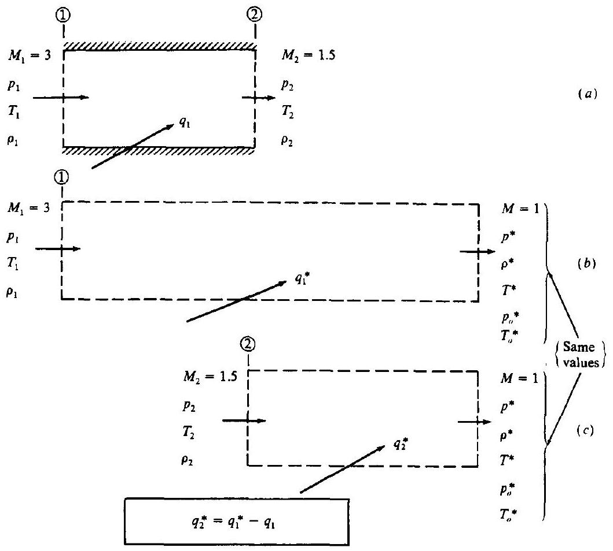
Figure 3.12 I Illustration of the meaning of the starred quantities at Mach 1 for one-dimensional flow with heat addition.

or as $q_{2}^{*}$ downstream of station 2. This is why, in Eqs. (3.85) through (3.89), the starred quantities are simply reference quantities that are fixed values for a given flow entering a one-dimensional duct with heat addition. With this concept, Eqs. (3.85) through (3.89), or rather the tabulated values in Table A. 3 obtained from these equations, simplify the calculation of problems involving one-dimensional flow with heat addition.

> [!exercise] Subsonic Flow Through a Heated Constant-Area Duct
> Air enters a constant-area duct at $M_1 = 0.2$, $p_1 = 1\,\text{atm}$, $T_1 = 273\,\text{K}$, and $q = 1.0 \times 10^6\,\text{J/kg}$ is added.
> (a) Calculate the total temperature $T_{o_2}$ at the exit using Eq. (3.77).
> (b) Use Table A.3 to find $M_2$, $p_2$, $T_2$, and $\rho_2$ at the exit.
> (c) Determine the stagnation properties $p_{o_2}$ at the exit.
> (d) Has the heat addition increased or decreased the Mach number? Is this consistent with the general rule that heat addition drives the Mach number toward unity?

## - Solution

From Table A.1, for $M_{1}=0.2: T_{o_{1}} / T_{1}=1.008$ and $p_{o_{1}} / p_{1}=1.028$. Hence

$$
\begin{aligned}
T_{o_{1}} & =1.008 T_{1}=1.008(273)=275.2 \mathrm{~K} \\
p_{o_{1}} & =1.028 p_{1}=1.028(1 \mathrm{~atm})=1.028 \mathrm{~atm} \\
c_{p} & =\frac{\gamma R}{\gamma-1}=\frac{(1.4)(287)}{0.4}=1005 \mathrm{~J} / \mathrm{kg} \cdot \mathrm{~K}
\end{aligned}
$$

From Eq. (3.77)

$$
T_{o_{2}}=\frac{q}{c_{p}}+T_{o_{1}}=\frac{1.0 \times 10^{6}}{1005}+275.2=1270 \mathrm{~K}
$$

From Table A.3, for $M_{1}=0.2: T_{1} / T^{*}=0.2066, p_{1} / p^{*}=2.273, p_{o_{1}} / p_{o}^{*}=1.235$, and $T_{o_{1}} / T_{e}^{*}=0.1736$. Hence

$$
\frac{T_{o_{2}}}{T_{o}^{*}}=\frac{T_{o_{2}}}{T_{o 1}} \frac{T_{o 1}}{T_{o}^{*}}=\frac{1270}{275.2}(0.1736)=0.8013
$$

From Table A.3. this corresponds to $M_{2}=0.58$.
Also from Table A3, for $M_{2}=0.58: T_{2} / T^{*}=0.8955, p_{2} / p^{*}=1.632, p_{o_{2}} / p_{o}^{*}=1.083$. Hence

$$
\begin{aligned}
T_{2} & =\frac{T_{2}}{T^{*}} \frac{T^{*}}{T_{1}} T_{1}=(0.8955)\left(\frac{1}{0.2066}\right)(273)=1183 \mathrm{~K} \\
p_{2} & =\frac{p_{2}}{p^{*}} \frac{p^{*}}{p_{1}} p_{1}=1.632 \frac{1}{2.273} 1 \mathrm{~atm}=0.718 \mathrm{~atm} \\
p_{o_{2}} & =\frac{p_{o_{2}}}{p_{o}^{*}} \frac{p_{o}^{*}}{p_{o_{1}}} p_{o_{1}}=1.083 \frac{1}{1.235} 1.028=0.902 \mathrm{~atm}
\end{aligned}
$$

Since $1 \mathrm{~atm}=1.01 \times 10^{5} \mathrm{~N} / \mathrm{m}^{2}$,

$$
\rho_{2}=\frac{p_{2}}{R T_{2}}=\frac{(0.718)\left(1.01 \times 10^{5}\right)}{(278)(1183)}=0.214 \mathrm{~kg} / \mathrm{m}^{3}
$$

> [!exercise] Supersonic Flow Through a Heated Constant-Area Duct
> Air enters a constant-area duct at $M_1 = 3$, $p_1 = 1\,\text{atm}$, $T_1 = 300\,\text{K}$, and $q = 3 \times 10^5\,\text{J/kg}$ is added.
> (a) Calculate $T_{o_2}$ from Eq. (3.77).
> (b) Use Table A.3 to find all exit conditions: $M_2$, $p_2$, $T_2$, $\rho_2$, and $p_{o_2}$.
> (c) Compute the total pressure ratio $p_{o_2}/p_{o_1}$. Has heat addition increased or decreased the total pressure?
> (d) Note that heat addition has caused a significant total pressure loss — why is this critical for the design of supersonic combustion systems?

## - Solution

From Table A.1, for $M_{1}=3: T_{01} / T_{1}=2.8$. Hence

$$
\begin{aligned}
T_{o_{1}} & =2.8(300)=840 \mathrm{~K} \\
c_{p} & =\frac{\gamma R}{\gamma-1}=\frac{(1.4)(287)}{0.4}=1004.5 \mathrm{~J} / \mathrm{kg} \cdot \mathrm{~K}
\end{aligned}
$$

From Eq. (3.77)

$$
q=c_{p}\left(T_{o_{2}}-T_{o_{1}}\right)
$$

Thus

$$
T_{o_{2}}=\frac{q}{c_{p}}+T_{o_{1}}=\frac{3 \times 10^{5}}{1004.5}+840=1139 \mathrm{~K}
$$

From Table A.3, for $M_{1}=3: p_{1} / p^{*}=0.1765, T_{1} / T^{*}=0.2803$, and $T_{o_{1}} / T_{o}^{*}=0.6540$. Hence

$$
\frac{T_{o_{2}}}{T_{o}^{*}}=\frac{T_{o_{2}}}{T_{o_{1}}} \frac{T_{o_{1}}}{T_{o}^{*}}=\frac{1139}{840}(0.6540)=0.8868
$$

From Table A.3, for $T_{o_{2}} / T_{o}^{*}=0.8868: M_{2}=1.58$. Also from Table A.3, $p_{2} / p^{*}=0.5339$ and $T_{2} / T^{*}=0.7117$. Thus

$$
\begin{aligned}
& p_{2}=\frac{p_{2}}{p^{*}} \frac{p^{*}}{p_{1}} p_{1}=0.5339\left(\frac{1}{0.1765}\right)(1 \mathrm{~atm})=3.025 \mathrm{~atm} \\
& T_{2}=\frac{T_{2}}{T^{*}} \frac{T^{*}}{T_{1}} T_{1}=0.7117\left(\frac{1}{0.2803}\right)(300)=761.7 \mathrm{~K} \\
& \rho_{2}=\frac{p_{2}}{R T_{2}}=\frac{(3.025)\left(1.01 \times 10^{5}\right)}{(287)(761.7)}=1.398 \mathrm{~kg} / \mathrm{m}^{3}
\end{aligned}
$$

From Table A.3, for $M_{1}=3: p_{o_{1}} / p_{o}^{*}=3.424$. For $M_{2}=1.58: p_{o_{2}} / p_{o}^{*}=1.164$. Thus

$$
\frac{p_{o_{2}}}{p_{o_{1}}}=\frac{p_{o_{2}} / p_{o}^{*}}{p_{o_{1}} / p_{o}^{*}}=\frac{1.164}{3.424}=0.340
$$

From Table A.1, For $M_{1}=3: p_{o_{1}} / p_{1}=36.73$. Hence

$$
p_{o_{2}}=\frac{p_{o_{2}}}{p_{o_{1}}} \frac{p_{o_{1}}}{p_{1}} p_{1}=(0.340)(36.73)(1 \mathrm{~atm})=12.49 \mathrm{~atm}
$$

Certain physical trends reflected by the numbers obtained from such solutions are important, and are summarized here:

1. For supersonic flow in region 1, i.e., $M_{1}>1$, when heat is added
a. Mach number decreases, $M_{2}<M_{1}$
b. Pressure increases, $p_{2}>p_{1}$
c. Temperature increases, $T_{2}>T_{1}$
d. Total temperature increases, $T_{o_{2}}>T_{o_{1}}$
e. Total pressure decreases, $p_{o_{2}}<p_{o_{1}}$
f. Velocity decreases, $u_{2}<u_{1}$
2. For subsonic flow in region 1, i.e., $M_{1}<1$, when heat is added
a. Mach number increases, $M_{2}>M_{1}$
b. Pressure decreases, $p_{2}<p_{1}$
c. Temperature increases for $M_{1}<\gamma^{-1 / 2}$ and decreases for $M_{1}>\gamma^{-1 / 2}$
d. Total temperature increases, $T_{o_{2}}>T_{o_{1}}$
e. Total pressure decreases, $p_{o_{2}}<p_{o_{1}}$
f. Velocity increases, $u_{2}>u_{1}$

For heat extraction (cooling of the flow), all of the above trends are opposite.
From the development here, it is important to note that heat addition always drives the Mach numbers toward 1, decelerating a supersonic flow and accelerating

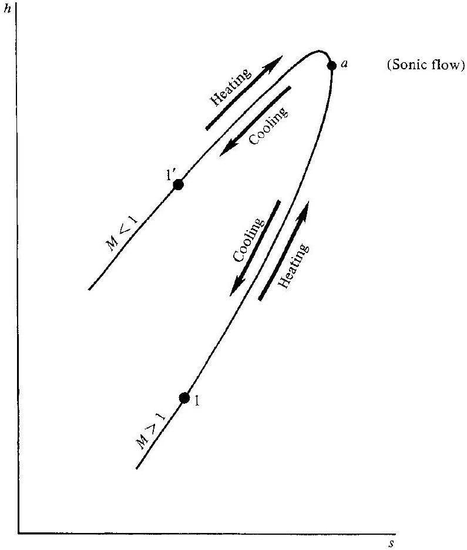
Figure 3.13 I The Rayleigh curve.

a subsonic flow. This is emphasized in Fig. 3.13, which is a Mollier diagram (enthalpy versus entropy) of the one-dimensional heat-addition process. The curve in Fig. 3.13 is called the Rayleigh curve, and is drawn for a set of given initial conditions. If the conditions in region 1 are given by point 1 in Fig. 3.13, then the particular Rayleigh curve through point 1 is the locus of all possible states in region 2. Each point on the curve corresponds to a different value of $q$ added or taken away. Point $a$ corresponds to maximum entropy; also at point $a$ the flow is sonic. The lower branch of the Rayleigh curve below point $a$ corresponds to supersonic flow; the upper branch above point $a$ corresponds to subsonic flow. If the flow in region 1 of Fig. 3.6 is supersonic and corresponds to point 1 in Fig. 3.13, then heat addition will cause conditions in region 2 to move closer to point $a$, with a consequent decrease of Mach number towards unity. As $q$ is made larger, conditions in region 2 get closer and closer to point $a$. Finally, for a certain value of $q$, the flow will become sonic in region 2. For this condition, the flow is said to be choked, because any further increase in $q$ is not possible without a drastic revision of the upstream conditions in region 1. For example, if the initial supersonic conditions in region 1 were obtained by expansion through a supersonic nozzle, and if a value of $q$ is added to the flow above that allowed for attaining Mach 1 in region 2, then a normal shock will form inside the nozzle and conditions in region 1 will suddenly become subsonic.

Now consider an alternative case where the initial flow in region 1 in Fig. 3.6 is subsonic, say given by point $1^{\prime}$ in Fig. 3.13. If heat is added to the flow, conditions in the downstream region 2 will move closer to point $a$. If $q$ is increased to a sufficiently high value, then point $a$ will be reached and the flow in region 2 will be sonic. The flow is again choked, and any further increase in $q$ is impossible without an adjustment of the initial conditions in region 1 . If $q$ is increased above this value, then a series of pressure waves will propagate upstream, and nature will adjust the conditions in region 1 to a lower subsonic Mach number, to the left of point $1^{\prime}$ in Fig. 3.13.

Note from the Rayleigh curve in Fig. 3.13 that it is theoretically possible to decelerate a supersonic flow to a subsonic value by first heating it until sonic flow (point $a$ ) is reached, and then cooling it thereafter. Similarly, an initially subsonic flow can be made supersonic by first heating it until sonic flow (point $a$ ) is reached, and then cooling it thereafter.

Finally, just as in the case of a normal shock wave, heat addition to a flowsubsonic or supersonic-always decreases the total pressure. This effect is of prime importance in the design of jet engines and in the pressure recovery attainable in gasdynamic and chemical lasers.

> [!exercise] Thermal Choking in Supersonic Duct Flow
> Using the same supersonic inlet from Example 3.14 ($M_1 = 3$, $T_{o_1} = 840\,\text{K}$), determine the maximum heat addition before the flow chokes.
> (a) Find $T_o^*$ and calculate the choking heat $q^*$ that drives the exit Mach number to exactly 1 using Eq. (3.77).
> (b) What happens physically if heat addition exceeds $q^*$? How must nature readjust the upstream conditions to accommodate the excess heat while maintaining a choked exit?
> (c) Describe the mechanism of this adjustment in the context of pressure wave propagation.

## - Solution

From Example 3.14, $T_{o_{1}}=840 \mathrm{~K}$. Also from Table A.3, for $M_{1}=3: T_{o_{1}} / T_{o}^{*}=0.6540$. Thus

$$
T_{o}^{*}=\frac{T_{o 1}}{0.6540}=\frac{840}{0.6540}=1284 \mathrm{~K}
$$

When the flow is choked, the Mach number at the end of the duct is $M_{2}=1$. Thus

$$
\begin{gathered}
T_{o_{2}}=T_{o}^{*}=1284 \mathrm{~K} \\
q=c_{p}\left(T_{o_{2}}-T_{o_{1}}\right)=(1004.5)(1284-840)=4.46 \times 10^{5} \mathrm{~J} / \mathrm{kg}
\end{gathered}
$$

> [!exercise] Flow Adjustment When Heat Addition Exceeds the Choking Limit
> Using the same inlet as Example 3.14, consider $q = 6 \times 10^5\,\text{J/kg}$, which exceeds the choking limit found in Example 3.15. The originally supersonic inflow can no longer remain supersonic.
> (a) What will happen qualitatively? Nature must adjust the inflow to a subsonic Mach number such that the flow is just choked at the exit.
> (b) Assuming the total temperature remains at $T_{o_1} = 840\,\text{K}$, calculate the new subsonic inlet Mach number using the fact that $T_{o_2} = T_o^*$ at the choked exit.
> (c) Explain the physical mechanism by which the originally supersonic inflow transitions to subsonic — how do pressure waves propagate upstream to effect this adjustment?

## - Solution

From a. It given in Example 3.15, we see that $q=6 \times 10^{5} \mathrm{~J} / \mathrm{kg}$ is more than that required to choke pw. In this case, the flow mechanism that is producing the incoming flow at $M_{1}=3 \dot{\boldsymbol{w}_{\mathrm{v}}} \quad$ completely changed by strong pressure waves propagating upstream so that new inflow a ons will prevail that will accommodate this increased amount of heat addition, still choi s. eflow at the exit of the duct. Nature will change the originally supersonic inflow to a sub. - nflow with just the right value of $M_{1}<1$ such that the heat added will just choke the su. flow.

To calculate the new inflow Mach number, we assume that whatever mechanism that nature uses to change the supersonic inflow to a subsonic inflow will not change the total temperature of the inflow. For example, if the mechanism is that of a normal shock wave, the total temperature is not changed across the shock. Hence, $T_{o_{1}}$ remains the same; $T_{o_{1}}=840 \mathrm{~K}$. To calculate $T_{o_{2}}=T_{o}^{*}$, we have

$$
q=c_{p}\left(T_{o_{2}}-T_{o_{1}}\right)
$$

or

$$
\begin{aligned}
T_{o}^{*} & =T_{o_{2}}=\frac{q}{c_{p}}+T_{o_{1}}=\frac{6 \times 10^{5}}{1004.5}+840=1437 \mathrm{~K} \\
\frac{T_{o_{1}}}{T_{o}^{*}} & =\frac{840}{1437}=0.5846
\end{aligned}
$$

From Table A.3, we find for $T_{o_{2}} / T_{o}^{*}=0.5846, M_{1}=0.43$.
Hence, when $q=6 \times 10^{5} \mathrm{~J} / \mathrm{kg}$ is added to the flow, the initial supersonic inflow at $M_{1}=3$ will be modified through a complex transient process to become a subsonic inflow with $M_{1}=0.43$.

> [!exercise] One-Dimensional Flow with Friction — Fanno-Line Flow
> Consider the steady, adiabatic flow of a compressible fluid through a constant-area duct of diameter $D$ and length $L$. Although the bulk flow is inviscid, friction between the moving fluid and the stationary duct walls introduces a wall shear stress $\tau_w$ that causes the flow properties to change along the duct. This situation models flow in long gas pipelines and other practical duct flows.
> (a) Starting from the integral momentum equation with a wall shear stress included, show that the differential momentum equation for one-dimensional flow with friction is: $dp + \rho u\,du = -\frac{4\tau_w}{D}dx$ (Eq. 3.94). Using the friction coefficient definition $\tau_w = \frac{1}{2}\rho u^2 f$, rewrite this equation in terms of $f$ (Eq. 3.95). Why does friction appear as a source term in the momentum equation rather than in the energy equation for this formulation?
> (b) Recast Eq. (3.95) entirely in terms of the Mach number $M$ to obtain Eq. (3.96). Integrate this result to obtain the relation between the friction parameter $4\bar{f}L^*/D$ and Mach number: $\frac{4\bar{f}L^*}{D} = \frac{1-M^2}{\gamma M^2} + \frac{\gamma+1}{2\gamma}\ln\left[\frac{(\gamma+1)M^2}{2+(\gamma-1)M^2}\right]$ (Eq. 3.107), where $L^*$ is the duct length required to reach Mach 1.
> (c) Using sonic flow ($M=1$) as a reference condition, derive the Fanno-line property ratios $T/T^*$, $p/p^*$, and $p_o/p_o^*$ as functions of $M$ (Eqs. 3.103–3.106). Note that since the flow is adiabatic, $T_o$ is constant — how does this differ from the Rayleigh-line case?
> (d) Explain why friction, like heat addition, always drives the Mach number toward unity. For supersonic inlet flow, friction decelerates the flow — which is intuitive. But for subsonic inlet flow, friction accelerates the flow — which seems counterintuitive. Explain physically how this is possible by considering the role of the favorable pressure gradient that must exist to sustain the flow.
> (e) Show that friction always decreases the total pressure. Explain why, unlike the Rayleigh curve, it is not possible to traverse from the supersonic branch to the subsonic branch of the Fanno curve by friction alone — what would this violate?

### 3.9 I ONE-DIMENSIONAL FLOW WITH FRICTION

With this section we arrive at the last box at the bottom of our roadmap in Fig. 3.1. Consider the one-dimensional flow of a compressible inviscid fluid in a constant-area duct. If the flow is steady, adiabatic, and shockless, Eqs. (3.2), (3.5), and (3.9) yield the trivial solution of constant property flow everywhere along the duct. However, in reality, all fluids are viscous, and the friction between the moving fluid and the stationary walls of the duct causes the flow properties to change along the duct. Although viscous flows are not the subject of this book, if the frictional effect is modeled as a shear stress at the wall acting on a fluid with uniform properties over any cross section, as illustrated in Fig. 3.14, then the equations developed in Sec. 3.2, with one modification, describe the mean properties of frictional flow in constant-area

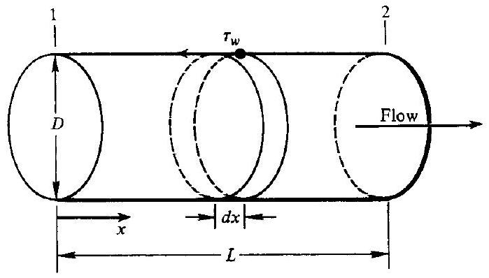
Figure 3.14 | Model of one-dimensional flow with friction.

ducts. The analysis and results are analogous to one-dimensional flow with heat addition, treated in Sec. 3.8.

The aforementioned modification applies to the momentum equation. As seen in Fig. 3.14, the frictional shear stress $\tau_{w}$ acts on the surface of the cylindrical control volume, thus contributing an additional surface force in the integral formulation of the momentum equation. Equation (3.4) is the $x$ component of the momentum equation for an inviscid gas; with the shear stress included, this equation becomes

$$
\iint_{S}(\rho \mathbf{V} \cdot d \mathbf{S}) u=-\iint_{S}(p d S)_{x}-\iint_{S} \tau_{w} d S
$$

Applied to the cylindrical control volume of diameter $D$ and length $L$ sketched in Fig. 3.14, Eq. (3.90) becomes

$$
-\rho_{1} u_{1}^{2} A+\rho_{2} u_{2}^{2} A=p_{1} A-p_{2} A-\int_{0}^{L} \pi D \tau_{w} d x
$$

Since $A=\pi D^{2} / 4$, Eq. (3.91) becomes

$$
\left(p_{2}-p_{1}\right)+\left(\rho_{2} u_{2}^{2}-\rho_{1} u_{1}^{2}\right)=-\frac{4}{D} \int_{0}^{L} \tau_{w} d x
$$

The shear stress $\tau_{w}$ varies with distance $x$ along the duct, thus complicating the integration on the right-hand side of Eq. (3.92). This can be circumvented by taking the limit of Eq. (3.92) as $L$ shrinks to $d x$, as shown in Fig. 3.14, resulting in the differential relation

$$
d p+d\left(\rho u^{2}\right)=-\frac{4}{D} \tau_{w} d x
$$

From Eq. (3.2), $\rho u=$ const. Hence, $d\left(\rho u^{2}\right)=\rho u d u+u d(\rho u)=\rho u d u+u(0)= \rho u d u$. Thus Eq. (3.93) becomes

$$
d p+\rho u d u=-\frac{4}{D} \tau_{w} d x
$$

The shear stress can be expressed in terms of a friction coefficient $f$, defined as $\tau_{w}=\frac{1}{2} \rho u^{2} f$. Hence, Eq. (3.94) becomes

$$
d p+\rho u d u=-\frac{1}{2} \rho u^{2} \frac{4 f d x}{D}
$$

Returning to Fig. 3.14, the driving force causing the mean cross-sectional flow properties to vary as a function of $x$ is friction at the wall of the duct, and this variation is governed by Eq. (3.95). For practical calculations dealing with a calorically perfect gas, Eq. (3.95) is recast completely in terms of the Mach number $M$. This can be accomplished by recalling that, $a^{2}=\gamma p / \rho, M^{2}=u^{2} / a^{2}, p=\rho R T, \rho u=\mathrm{const}$, and $c_{p} T+u^{2} / 2=$ const. The derivation is left as an exercise for the reader; the result is

$$
\frac{4 f d x}{D}=\frac{2}{\gamma M^{2}}\left(1-M^{2}\right)\left[1+\frac{1}{2}(\gamma-1) M^{2}\right]^{-1} \frac{d M}{M}
$$

Integrating Eq. (3.96) between $x=x_{1}$ (where $M=M_{1}$ ) and $x=x_{2}$ (where $M=M_{2}$ ) ,

$$
\int_{1}^{\cdots} \frac{4 f d x}{D}=\left[-\frac{1}{\gamma M^{2}}-\frac{\gamma+1}{2 \gamma} \ln \left(\frac{M^{2}}{1+\frac{\gamma-1}{2} M^{2}}\right)\right]_{M_{1}}^{M}
$$

Equation (3.97) relates the Mach numbers at two different sections to the integrated effect of friction between the sections.

The ratios of static temperature, pressure, density, and total pressure between the two sections are readily obtained. The flow is adiabatic, hence $T_{0}=$ const. Thus. from Eq. (3.28), we have

$$
\frac{T_{2}}{T_{1}}=\frac{T_{o} / T_{1}}{T_{o} / T_{2}}=\frac{2+(\gamma-1) M_{1}^{2}}{2+(\gamma-1) M_{2}^{2}}
$$

Also, since $\rho_{1} u_{1}=\rho_{2} u_{2}$, and $a^{2}=\gamma p / \rho$. then
or

$$
\begin{gathered}
\frac{\gamma p_{1} u_{1}}{a_{1}^{2}}=\frac{\gamma p_{2} u_{2}}{a_{2}^{2}} \\
\frac{p_{2}}{p_{1}}=\frac{M_{1}}{M_{2}} \frac{a_{2}}{a_{1}}=\frac{M_{1}}{M_{2}} \sqrt{\frac{T_{2}}{T_{1}}}
\end{gathered}
$$

Substituting Eq. (3.98) into (3.99), we have

$$
\frac{p_{2}}{p_{1}}=\frac{M_{1}}{M_{2}}\left[\frac{2+(\gamma-1) M_{1}^{2}}{2+(\gamma-1) M_{2}^{2}}\right]^{1: 2}
$$

From the equation of state, $\rho_{2} / \rho_{1}=\left(p_{2} / p_{1}\right)\left(T_{1} / T_{2}\right)$. Substituting Eqs. (3.98) and (3.100) into this result, we obtain

$$
\frac{\rho_{2}}{\rho_{1}}=\frac{M_{1}}{M_{2}}\left[\frac{2+(\gamma-1) M_{1}^{2}}{2+(\gamma-1) M_{2}^{2}}\right]^{-1 / 2}
$$

Finally, from Eqs. (3.30) and (3.100), the ratio of total pressures is

$$
\begin{gathered}
\frac{p_{o_{2}}}{p_{o_{1}}}=\frac{p_{o_{2}} / p_{2}}{p_{o_{1}} / p_{1}} \frac{p_{2}}{p_{2}}=\left[\frac{2+(\gamma-1) M_{2}^{2}}{2+(\gamma-1) M_{1}^{2}}\right]^{\gamma / \gamma-1)} \frac{M_{1}}{M_{2}}\left[\frac{2+(\gamma-1) M_{1}^{2}}{2+(\gamma-1) M_{2}^{2}}\right]^{1} \\
\frac{p_{o_{2}}}{p_{o_{1}}}=\frac{M_{1}}{M_{2}}\left[\frac{2+(\gamma-1) M_{2}^{2}}{2+(\gamma-1) M_{1}^{2}}\right]^{(\gamma+1) / 2 \gamma_{\gamma-1)}}
\end{gathered}
$$

Analogous to our previous discussion of one-dimensional flow with heat addition. calculations of flow with friction are expedited by using sonic flow reference
conditions, where the flow properties are denoted by $p^{*}, \rho^{*}, T^{*}$, and $p_{o}^{*}$. From Eqs. (3.98) and (3.100) through (3.102),

$$
\begin{aligned}
\frac{T}{T^{*}} & =\frac{\gamma+1}{2+(\gamma-1) M^{2}} \\
\frac{p}{p^{*}} & =\frac{1}{M}\left[\frac{\gamma+1}{2+(\gamma-1) M^{2}}\right]^{1 / 2} \\
\frac{\rho}{\rho^{*}} & =\frac{1}{M}\left[\frac{2+(\gamma-1) M^{2}}{\gamma+1}\right]^{1 / 2} \\
\frac{p_{o}}{p_{o}^{*}} & =\frac{1}{M}\left[\frac{2+(\gamma-1) M^{2}}{\gamma+1}\right]^{(\gamma+1) /[2(\gamma-1)]}
\end{aligned}
$$

> [!equation] Fanno-line flow relations (Eqs. 3.103–3.106)
> $$
> \begin{aligned}
> \frac{T}{T^{*}} & =\frac{\gamma+1}{2+(\gamma-1) M^{2}} \\
> \frac{p}{p^{*}} & =\frac{1}{M}\left[\frac{\gamma+1}{2+(\gamma-1) M^{2}}\right]^{1 / 2} \\
> \frac{p_{o}}{p_{o}^{*}} & =\frac{1}{M}\left[\frac{2+(\gamma-1) M^{2}}{\gamma+1}\right]^{(\gamma+1) /[2(\gamma-1)]}
> \end{aligned}
> $$

Also, if we define $x=L^{*}$ as the station where $M=1$, then Eq. (3.97) becomes
or

$$
\begin{aligned}
\int_{0}^{L^{*}} \frac{4 f d x}{D} & =\left[-\frac{1}{\gamma M^{2}}-\frac{\gamma+1}{2 \gamma} \ln \left(\frac{M^{2}}{1+\frac{\gamma-1}{2} M^{2}}\right)\right]_{M}^{1} \\
\frac{4 \bar{f} L^{*}}{D} & =\frac{1-M^{2}}{\gamma M^{2}}+\frac{\gamma+1}{2 \gamma} \ln \left[\frac{(\gamma+1) M^{2}}{2+(\gamma-1) M^{2}}\right]
\end{aligned}
$$

> [!equation] Fanno-line friction length relation (Eq. 3.107)
> $$
> \frac{4 \bar{f} L^{*}}{D}=\frac{1-M^{2}}{\gamma M^{2}}+\frac{\gamma+1}{2 \gamma} \ln \left[\frac{(\gamma+1) M^{2}}{2+(\gamma-1) M^{2}}\right]
> $$

where $\bar{f}$ is an average friction coefficient defined as

$$
\bar{f}=\frac{1}{L^{*}} \int_{0}^{L^{*}} f d x
$$

Equations (3.103) through (3.107) are tabulated versus Mach number in Table A. 4 for $\gamma=1.4$.

The local friction coefficient $f$ depends on whether the flow is laminar or turbulent, and is a function of Mach number, Reynolds number, and surface roughness, among other variables. In almost all practical cases, the flow is turbulent, and the variation of $f$ must be obtained empirically. Extensive friction coefficient data can be obtained from Schlicting's classical book (Ref. 20) among others; hence, no further elaboration will be given here. For our purposes, it is reasonable to assume an approximate constant value of $f=0.005$, which holds for $R_{e}>10^{5}$ and a surface roughness of $0.001 D$.

> [!exercise] Subsonic Pipe Flow with Friction
> Air flows through a pipe of diameter $D = 0.15\,\text{m}$ and length $L = 30\,\text{m}$. Inlet conditions: $M_1 = 0.3$, $p_1 = 1\,\text{atm}$, $T_1 = 273\,\text{K}$. Friction coefficient $f = 0.005$.
>
> (a) Find the exit conditions $M_2$, $p_2$, $T_2$, and $p_{o_2}$ using the Fanno-line relations (Table A.4).
>
> (b) Friction in subsonic flow accelerates the flow toward Mach 1. Is the exit Mach number consistent with this expectation?
>
> (c) Has the total pressure decreased? Why is this an inevitable consequence of friction?

## - Solution

From Table A.1, for $M_{1}=0.3: p_{o_{1}} / p_{1}=1.064$. Thus

$$
p_{o_{1}}=1.064(1 \mathrm{~atm})=1.064 \mathrm{~atm}
$$

From Table A.4, for $M_{1}=0.3: 4 \bar{f} L_{1}^{*} / D=5.299, p_{1} / p^{*}=3.619, T_{1} / T^{*}=1.179$, and $p_{0_{1}} / p^{*}=2.035$. Since $L=30 \mathrm{~m}=L_{1}^{*}-L_{2}^{*}$, then $L_{2}^{*}=L_{1}^{*}-L$ and

$$
\frac{4 \bar{f} L_{2}^{*}}{D}=\frac{4 \bar{f} L_{1}^{*}}{D}-\frac{4 \bar{f} L}{D}=5.2993-\frac{(4)(0.005)(30)}{0.15}=1.2993
$$

From Table A.4, for $4 \bar{f} L^{*} / D=1.2993$ : $M_{2}=0.475, T_{2} / T^{*}=1.148, p_{2} / p^{*}=2.258$, and $p_{o_{2}} / p_{o}^{*}=1.392$. Hence

$$
\begin{aligned}
& p_{2}=\frac{p_{2}}{p^{*}} \frac{p^{*}}{p_{1}} p_{1}=2.258 \frac{1}{3.169}(1 \mathrm{~atm})=0.713 \mathrm{~atm} \\
& T_{2}=\frac{T_{2}}{T^{*}} \frac{T^{*}}{T_{1}} T_{1}=1.148 \frac{1}{1.179} 273=265.8 \mathrm{~K} \\
& p_{o_{2}}=\frac{p_{o_{2}}}{p_{o}^{*}} \frac{p_{o}^{*}}{p_{o_{1}}} p_{o_{1}}=1.392 \frac{1}{2.035} 1.064=0.728 \mathrm{~atm}
\end{aligned}
$$

> [!exercise] Supersonic Pipe Flow with Friction
> Air flows through a pipe of diameter $D = 0.4\,\text{ft}$ and length $L = 5\,\text{ft}$. Inlet conditions: $M_1 = 3$, $p_1 = 1\,\text{atm}$, $T_1 = 300\,\text{K}$. Friction coefficient $f = 0.005$.
>
> (a) Find the exit conditions $M_2$, $p_2$, $T_2$, and $p_{o_2}$.
>
> (b) Compare with the subsonic case in Example 3.17: in the supersonic case, friction decelerates the flow and the static pressure increases — which is physically intuitive. Observe the total pressure ratio $p_{o_2}/p_{o_1}$ and comment on the total pressure loss.

## - Solution

$L_{1}^{*}-L_{2}^{*}=L$. Hence

$$
\frac{4 \bar{f} L_{2}^{*}}{D}=\frac{4 \bar{f} L_{1}^{*}}{D}-\frac{4 \bar{f} L}{D}
$$

From Table A.4, for $M_{1}=3: 4 \bar{f} L_{1}^{*} / D=0.5222, T_{1} / T^{*}=0.4286$, and $p_{1} / p^{*}=0.2182$. Thus

$$
\frac{4 \tilde{f} L_{2}^{*}}{D}=0.5222-\frac{4(0.005)(5)}{0.4}=0.2722
$$

From Table A.4, for $4 \bar{f} L_{2}^{*} / D=0.2722: M_{2}=1.9$. Also from Table A.4: $T_{2} / T^{*}=0.6969$ and $p_{2} / p^{*}=0.4394$. Thus

$$
\begin{aligned}
& T_{2}=\frac{T_{2}}{T^{*}} \frac{T^{*}}{T_{1}} T_{1}=(0.6969)\left(\frac{1}{0.4286}\right)(300)=487.8 \mathrm{~K} \\
& p_{2}=\frac{p_{2}}{p^{*}} \frac{p^{*}}{p_{1}} p_{1}=(0.4394)\left(\frac{1}{0.2182}\right)(1 \mathrm{~atm})=2.014 \mathrm{~atm}
\end{aligned}
$$

From Table A.4, for $M_{1}=3: p_{o_{1}} / p_{o}^{*}=4.235$. Also for $M_{2}=1.9: p_{o_{2}} / p_{o}^{*}=1.555$. Thus

$$
\frac{p_{o o_{2}}}{p_{o 1}}=\frac{p_{o 2} / p_{o}^{*}}{p_{o 1} / p_{o}^{*}}=\frac{1.555}{4.235}=0.367
$$

From Table A.1, for $M_{1}=3: p_{o_{1}} / p_{1}=36.73$. Thus

$$
p_{o_{2}}=\frac{p_{o_{2}}}{p_{o_{1}}} \frac{p_{o_{1}}}{p_{1}} p_{1}=(0.367)(36.73)(1 \mathrm{~atm})=13.49 \mathrm{~atm}
$$

Certain physical trends reflected by the numbers obtained from such solutions are summarized here:

1. For supersonic inlet flow, i.e., $M_{1}>1$, the effect of friction on the downstream flow is such that
a. Mach number decreases, $M_{2}<M_{1}$
b. Pressure increases, $p_{2}>p_{1}$
c. Temperature increases, $T_{2}>T_{1}$
d. Total pressure decreases, $p_{o_{2}}<p_{o_{1}}$
e. Velocity decreases, $u_{2}<u_{1}$
2. For subsonic inlet flow, i.e., $M_{1}<1$, the effect of friction on the downstream flow is such that
a. Mach number increases, $M_{2}>M_{1}$
b. Pressure decreases, $p_{2}<p_{1}$
c. Temperature decreases, $T_{2}<T_{1}$
d. Total pressure decreases, $p_{o_{2}}<p_{o_{1}}$
e. Velocity increases, $u_{2}>u_{1}$

From this, note that friction always drives the Mach number toward 1, decelerating a supersonic flow and accelerating a subsonic flow. This is emphasized in Fig. 3.15, which is a Mollier diagram of one-dimensional flow with friction. The curve in Fig. 3.15 is called the Fanno curve, and is drawn for a set of given initial conditions. Point $a$ corresponds to maximum entropy, where the flow is sonic. This point splits the Fanno curve into subsonic (upper) and supersonic (lower) portions. If

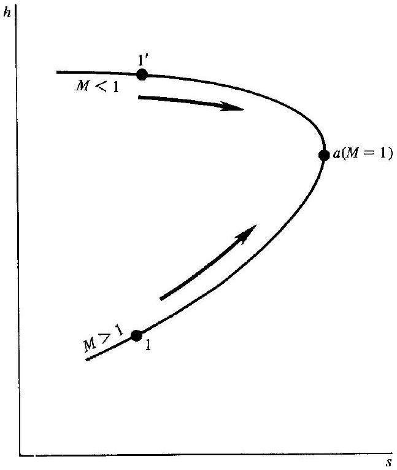
Figure 3.15 1 The Fanno curve.

the inlet flow is supersonic and corresponds to point 1 in Fig. 3.15, then friction causes the downstream flow to move closer to point $a$, with a consequent decrease of Mach number toward unity. Each point on the curve between points 1 and $a$ corresponds to a certain duct length $L$. As $L$ is made larger, the conditions at the exit move closer to point $a$. Finally, for a certain value of $L$, the flow becomes sonic. For this condition, the flow is choked, because any further increase in $L$ is not possible without a drastic revision of the inlet conditions. For example, if the inlet conditions at point 1 were obtained by expansion through a supersonic nozzle, and if $L$ were larger than that allowed for attaining Mach 1 at the exit, then a normal shock would form inside the nozzle, and the duct inlet conditions would suddenly become subsonic.

Consider the alternative case where the inlet flow is subsonic, say given by point $1^{\prime}$ in Fig. 3.15. As $L$ increases, the exit conditions move closer to point $a$. If $L$ is increased to a sufficiently large value, then point $a$ is reached and the flow at the exit becomes sonic. The flow is again choked, and any further increase in $L$ is impossible without an adjustment of the inlet conditions to a lower inlet Mach number, i.e., without moving the inlet conditions to the left of point $1^{\prime}$ in Fig. 3.15.

Finally, note that friction always causes the total pressure to decrease whether the inlet flow is subsonic or supersonic. Also, unlike the Rayleigh curve for flow with heating and cooling, the upper and lower portions of the Fanno curve cannot be traversed by the same one-dimensional flow. That is, within the framework of onedimensional theory, it is not possible to first slow a supersonic flow to sonic conditions by friction, and then further slow it to subsonic speeds also by friction. Such a subsonic deceleration would violate the second law of thermodynamics.

> [!exercise] Choking Length for Supersonic Pipe Flow with Friction
> Using the supersonic inlet conditions from Example 3.18 ($M_1 = 3$, $D = 0.4\,\text{ft}$, $f = 0.005$), determine the maximum pipe length before the flow chokes at $M = 1$ at the exit.
>
> (a) Calculate $L_1^*$ from Table A.4 and compare with the actual pipe length used in Example 3.18.
>
> (b) If the pipe were made longer than $L_1^*$, what would happen to the flow? How does nature adjust — what is the physical mechanism?
>
> (c) Compare this choking phenomenon with the thermal choking discussed in Section 3.8.

## - Solution

From Table A.4, for $M_{1}=3: 4 \bar{f} L_{1}^{*} / D=0.5222$. The length of the duct required to achieve Mach 1 at the exit of the duct is, by definition, $L_{1}^{*}$. Thus

$$
L_{1}^{*}=0.5222 \frac{D}{4 \bar{f}}=(0.5222) \frac{0.4}{(4)(0.005)}=10.44 \mathrm{ft}
$$

### 3.10 | HISTORICAL NOTE: SOUND WAVES AND SHOCK WAVES

Picking up the thread of history from Sec. 1.1, the following questions are posed: When was the speed of sound first calculated and properly understood? What is the origin of normal shock theory? Who developed the principal equations discussed in this chapter? Let us examine these questions further.

By the seventeenth century, it was clearly appreciated that sound propagates through the air at some finite velocity. Indeed, by the time Isaac Newton published
the first edition of his Principia in 1687, artillery tests had already indicated that the speed of sound was approximately $1140 \mathrm{ft} / \mathrm{s}$. These tests were performed by standing a known large distance away from a cannon, and noting the time delay between the light flash from the muzzle and the sound of the discharge. In Proposition 50, Book II, of his Principia, Newton correctly theorized that the speed of sound was related to the "elasticity" of the air (the reciprocal of the compressibility defined in Sec. 1.2). However, he made the erroneous assumption that a sound wave is an isothermal process, and consequently proposed the following incorrect expression for the speed of sound:

$$
a=\sqrt{\frac{1}{\rho \tau_{T}}}
$$

where $\tau_{T}$ is the isothermal compressibility defined in Sec. 1.1. Much to his dismay, Newton calculated a value of $979 \mathrm{ft} / \mathrm{s}$ from this expression- 15 percent lower than the existing gunshot data. Undaunted, however, he followed a now familiar ploy of theoreticians; he proceeded to explain away the difference by the existence of solid dust particles and water vapor in the atmosphere. This misconception was corrected a century later by the famous French mathematician, Pierre Simon Marquis de Laplace, who in a paper entitled "Sur la vitesse du son dans l'aire et dan l'eau" from the Annales de Chimie et de Physique (1816) properly assumed that a sound wave was adiabatic, not isothermal. Laplace went on to derive the proper expression

$$
a=\sqrt{\frac{1}{\rho \tau_{s}}}
$$

where $\tau_{s}$ is the isentropic compressibility defined in Sec. 1.1. This equation is the same as Eq. (3.18) derived in Sec. 3.3. Therefore, by the time of the demise of Napoleon, the process and relationship for the propagation of sound in a gas was fully understood.

The existence of shock waves was also recognized by this time, and following the successful approach of Laplace to the calculation of the speed of sound, it was natural for the German mathematician G. F. Bernhard Riemann in 1858 to first attempt to calculate shock properties by also assuming isentropic conditions. Of course, this was doomed to failure. However, 12 years later, the first major breakthrough in shock wave theory was made by the Scottish engineer, William John Macquorn Rankine (1820-1872). (See Fig. 3.16.) Born in Edinburgh, Scotland, on July 5, 1820, Rankine was one of the founders of the science of thermodynamics. At the age of 25, he was offered the Queen Victoria Chair of Civil Engineering and Mechanics at the University of Glasgow, a post he occupied until his death on December 24, 1872. During this period, Rankine worked in the true sense as an engineer, applying scientific principles to the fatigue in metals of railroad-car axles, to new methods of mechanical construction, and to soil mechanics dealing with earth pressures and the stability of retaining walls. Perhaps his best-known contributions were in the field of steam engines and the development of a particular thermodynamic cycle bearing his name. Also, an engineering unit of absolute temperature was named in his honor.

Figure 3.16 | W. J. M. Rankine (1820-1872).

Rankine's contribution to shock wave theory came late in life- 2 years before his death. In a paper published in 1870 in the Philosophical Transactions of the Roval Society entitled "On the Thermodynamic Theory of Waves of Finite Longitudinal Disturbance," Rankine clearly presented the proper normal shock equations for continuity, momentum, and energy in much the same form as our Eqs. (3.38) through (3.40). (It is interesting that in these equations Rankine defined a quantity he called "bulkiness," which is identical to what we now define as "specific volume." Apparently the usage of the term "bulkiness" later died out of its own cumbersomeness.) Moreover, Rankine properly assumed that the internal structure of the shock wave was not isentropic, but rather that it was a region of dissipation. He was thinking about thermal conduction, not the companion effect of viscosity within the shock. However, Rankine was able to successfully derive relationships for the thermodynamic changes across a shock wave analogous to the equations we have derived in Sec. 3.7. (It is also interesting to note that Rankine's paper coined the symbol $\gamma$ for the ratio of specific heats, $c_{p} / c_{v}$; we are still following this notation a century later. He also recognized that the value of $\gamma$ was "nearly 1.41 for air, oxygen, nitrogen, and hydrogen, and for steam-gas nearly 1.3.")

The equations obtained by Rankine were subsequently rediscovered by the French ballistician Pierre Henry Hugoniot. Not cognizant of Rankine's work, Hugoniot in 1887 published a paper in the Journal de l'Ecole Polytechnique entitled "Mémoire sur la propagation du Mouvement dans les Corps et Spécialement dans les Gases Parfaits" in which the equations for normal shock thermodynamic properties were presented, essentially the equations we have derived in Sec. 3.7. As a result of this pioneering work by Hugoniot and by Rankine before him, a rather modern

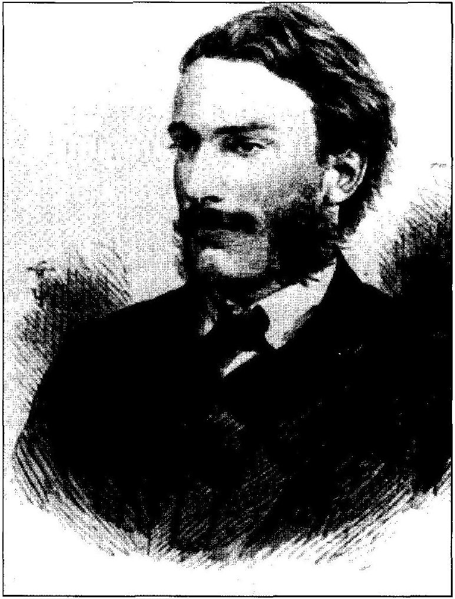
Figure 3.17 | Lord Rayleigh (1842-1919).

generic term has come into use for all equations dealing with changes across shock waves, namely, the Rankine-Hugoniot relations. This label appears frequently in modern gasdynamic literature.

However, the work of both Rankine and Hugoniot did not establish the direction of changes across a shock wave. Noted in both works is the mathematical possibility of either compression (pressure increases) or rarefaction (pressure decreases) shocks. This same possibility is discussed in Sec. 3.6. It was not until 1910 that this ambiguity was resolved. In two almost simultaneous and independent papers, first Lord Rayleigh (see Fig. 3.17) and then G. I. Taylor invoked the second law of thermodynamics to show that only compression shocks are physically possible-i.e., the Rankine-Hugoniot relations apply physically only to the case where the pressure behind the shock is greater than the pressure in front of the shock, Rayleigh's paper was published in Volume 84 of the Proceedings of the Royal Society, September 15, 1910, and was entitled "Aerial Plane Waves of Finite Amplitude." Here, Lord Rayleigh summarizes his results as follows:

But here a question arises which Rankine does not seem to have considered. In order to secure the necessary transfers of heat by means of conduction it is an indispensable condition that the heat should pass from the hotter to the colder body. If maintenance of type be possible in a particular wave as a result of conduction, a reversal of the motion will
give a wave whose type cannot be so maintained. We have seen reason already for the conclusion that a dissipative agency can serve to maintain the type only when the gas passes from a less to a more condensed state.

In addition to applying the second law of thermodynamics, Rayleigh also showed that viscosity played as essential a role in the structure of a shock as conduction. (Recall that Rankine considered conduction, only; also. Hugoniot obtained his results without reference to any dissipative mechanism.)

One month later, in the same journal, a young G. I. Taylor (who was to become one of the leading fluid dynamicists of the twentieth century) published a short paper entitled "The Conditions Necessary for Discontinuous Motion in Gases," which supported Rayleigh's conclusions. Finally, over a course of 40 years, culminating in the second decade of this century, the theory of shock waves as presented in this chapter was fully established.

It should be noted that the shock wave studies by Rankine, Hugoniot, Rayleigh, and Taylor were viewed at the time as interesting basic mechanics research on a relatively academic problem. The on-rush of the application of this theory did not begin until 30 years later with blooming of interest in supersonic vehicles during World War II. However, this is a classic example of the benefits of basic research, even when such work appears obscure at the moment. Rapid advances in supersonic flight during the 1940s were clearly expedited because shock wave theory was sitting there, fully developed and ready for application.

### 3.11 I SUMMARY

This chapter has dealt with one-dimensional flow, i.e., where all flow properties are functions of one space dimension, say $x$. only. This implies flow with constant crosssectional area. Three physical mechanisms that cause the flow properties to change with $x$ even though the area is constant are: (1) a normal shock wave, (2) heat addition, and (3) friction. Return to the roadmap in Fig. 3.1, and review the flow of ideas that highlight this chapter.

The basic normal shock equations are:

Continuity:
Momentum:

Energy:

$$
\begin{aligned}
\rho_{1} u_{1} & =\rho_{2} u_{2} \\
p_{1}+\rho_{1} u_{1}^{2} & =p_{2}+\rho_{2} u_{2}^{2} \\
h_{1}+\frac{u_{1}^{2}}{2} & =h_{2}+\frac{u_{2}^{2}}{2}
\end{aligned}
$$

A combination of these equations, along with the equation of state leads to the Prandtl relation

$$
a^{* 2}=u_{1} u_{2}
$$

which in turn leads to an expression for the Mach number behind a normal shock:

$$
M_{2}^{2}=\frac{1+[(\gamma-1) / 2] M_{1}^{2}}{\gamma M_{1}^{2}-(\gamma-1) / 2}
$$

Further combinations of the basic normal shock equations give

$$
\frac{p_{2}}{p_{1}}=1+\frac{2 \gamma}{\gamma+1}\left(M_{1}^{2}-1\right)
$$

and

$$
\frac{\rho_{2}}{\rho_{1}}=\frac{u_{1}}{u_{2}}=\frac{(\gamma+1) M_{1}^{2}}{2+(\gamma-1) M_{1}^{2}}
$$

Important: Note that the changes across a normal shock wave in a calorically perfect gas are functions of just $M_{1}$ and $\gamma$. For normal shock waves, the upstream Mach number is a pivotal quantity. Also, across a normal shock wave, $T_{o}$ is constant, $s$ increases, and $p_{o}$ decreases. (However, if the gas is not calorically or thermally perfect, $T_{o}$ is not constant across the shock.) A purely thermodynamic relation across a normal shock wave is the Hugoniot equation,

$$
e_{2}-e_{1}=\frac{p_{1}+p_{2}}{2}\left(v_{1}-v_{2}\right)
$$

a graph of which, on the $p-v$ plane, is called the Hugoniot curve.
The governing equations for one-dimensional flow with heat addition are:

Continuity:
Momentum:

Energy:

$$
\rho_{1} u_{1}=\rho_{2} u_{2}
$$

$$
h_{1}+\frac{u_{1}^{2}}{2}+q=h_{2}+\frac{u_{2}^{2}}{2}
$$

The heat addition causes an increase in total temperature, given by

$$
q=c_{p}\left(T_{o_{2}}-T_{o_{1}}\right)
$$

for a calorically perfect gas. Also for this case, the governing equations lead to relationships for the flow properties before and after heat addition in terms of the Mach numbers $M_{1}$ and $M_{2}$ before and after heat addition, respectively. Note that heat added to an initially supersonic flow slows the flow. If enough heat is added, the flow after heat addition can be slowed to Mach 1 ; this is the case of thermal choking. Heat added to an initially subsonic flow increases the flow speed. If enough heat is added, the flow after heat addition can reach Mach 1, again becoming thermally choked. In both cases of choked flow, if additional heat is added, nature adjusts the upstream quantities to allow for the extra heat. An initially supersonic flow that becomes thermally choked will become totally subsonic when additional heat is added, i.e., the inlet Mach number is changed to a subsonic value. An initially subsonic flow that becomes thermally choked will have its inlet Mach number reduced when additional heat is added. A plot of the thermodynamic properties for one-dimensional flow with heat addition on a Mollier diagram is called a Rayleigh curve; hence, such flow with heat addition is called Rayleigh-line flow.

The governing equations for one-dimensional flow with friction are:
Continuity:

$$
\rho_{1} u_{1}=\rho_{2} u_{2}
$$

Momentum:

$$
\begin{gathered}
p_{1}+\rho_{1} u_{1}^{2}-\frac{1}{A} \int_{0}^{L} \pi D \tau_{u} d x \\
=p_{2}+\rho_{2} u_{2}^{2}
\end{gathered}
$$

Energy:

$$
h_{1}+\frac{u_{1}^{2}}{2}=h_{2}+\frac{u_{2}^{2}}{2}
$$

This flow is adiabatic, hence $T_{o}$ is constant. The entropy is increased due to the presence of friction. The governing equations lead to relationships for the flow properties at the inlet and exit in terms of $M_{1}$ and $M_{2}$ at the inlet and exit, respectively. $M_{2}$ is related to $M_{1}$ through Eq. (3.97). The same type of choking phenomena occurs here as the case of flow with heat addition. An initially supersonic flow slows due to the influence of friction; if the constant-area duct is long enough, the exit Mach number becomes unity, and the flow is said to be choked. If the duct is made longer after the flow is choked, nature readjusts the flow in the duct so as to become subsonic at the inlet. An initially subsonic flow experiences an increase in velocity due to frictiona seemingly incongruous result because intuition tells us that friction would always reduce the flow velocity. However, the pressure gradient along the duct in this case is one of decreasing pressure in the $x$ direction; this is in order to obey the governing equations. This favorable pressure gradient tends to increase the flow velocity. Indeed, the effect of decreasing pressure in the flow direction dominates over the retarding effect of friction at the walls of the duct, and hence one-dimensional subsonic flow with friction results in an increase in velocity through the duct. Another way to look at this situation is to recognize that, in order to set up subsonic one-dimensional flow with friction, a high pressure must be exerted at the inlet and a lower pressure at the exit. A plot of the thermodynamic properties of flow with friction on a Mollier diagram is called a Fanno curve, and such flow is called Fanno-line flow.

In this chapter, a number of conveniently defined flow quantities are introduced: (1) total temperature, which is the temperature that would exist if the flow were reduced to zero velocity adiabatically; (2) total pressure, which is the pressure that would exist if the flow were reduced to zero velocity isentropically; (3) $T^{*}$ (and hence $a^{*}=\sqrt{\gamma R T^{*}}$ ), which is the temperature that would exist if the flow were slowed down or speeded up (as the case may be) to Mach 1; (4) characteristic Mach number, $M^{*}=V / a^{*}$. Section 3.5 gives many alternative forms of the energy equation in terms of these quantities. Study this section carefully. Of particular importance are the following relations which hold for a calorically perfect gas:

$$
\begin{aligned}
& \frac{T_{o}}{T}=1+\frac{\gamma-1}{2} M^{2} \\
& \frac{p_{o}}{p}=\left(1+\frac{\gamma-1}{2} M^{2}\right)^{\gamma /(\gamma-1)}
\end{aligned}
$$

$$
\frac{\rho_{o}}{\rho}=\left(1+\frac{\gamma-1}{2} M^{2}\right)^{1 /(\gamma-1)}
$$

# PROBLEMS

(Note: Use the tables at the end of this book as extensively as you wish to solve the following problems. Also, when the words "pressure" and "temperature" are used without additional modification, they refer to the static pressure and temperature.)
3.1 At a given point in the high-speed flow over an airplane wing, the local Mach number, pressure and temperature are $0.7,0.9 \mathrm{~atm}$, and 250 K , respectively. Calculate the values of $p_{o}, T_{o}, p^{*}, T^{*}$, and $a^{*}$ at this point.
3.2 At a given point in a supersonic wind tunnel, the pressure and temperature are $5 \times 10^{4} \mathrm{~N} / \mathrm{m}^{2}$ and 200 K , respectively. The total pressure at this point is $1.5 \times 10^{6} \mathrm{~N} / \mathrm{m}^{2}$. Calculate the local Mach number and total temperature.
3.3 At a point in the flow over a high-speed missile, the local velocity and temperature are $3000 \mathrm{ft} / \mathrm{s}$ and $500^{\circ} \mathrm{R}$, respectively. Calculate the Mach number $M$ and the characteristic Mach number $M^{*}$ at this point.
3.4 Consider a normal shock wave in air. The upstream conditions are given by $M_{1}=3, p_{1}=1 \mathrm{~atm}$, and $\rho_{1}=1.23 \mathrm{~kg} / \mathrm{m}^{3}$. Calculate the downstream values of $p_{2}, T_{2}, \rho_{2}, M_{2}, u_{2}, p_{o_{2}}$, and $T_{o_{2}}$.
3.5 Consider a Pitot static tube mounted on the nose of an experimental airplane. A Pitot tube measures the total pressure at the tip of the probe (hence sometimes called the Pitot pressure), and a Pitot static tube combines this with a simultaneous measurement of the free-stream static pressure. The Pitot and free-stream static measurements are given below for three different flight conditions. Calculate the free-stream Mach number at which the airplane is flying for each of the three different conditions:
a. Pitot pressure $=1.22 \times 10^{5} \mathrm{~N} / \mathrm{m}^{2}$, static pressure $=1.01 \times 10^{5} \mathrm{~N} / \mathrm{m}^{2}$
b. Pitot pressure $=7222 \mathrm{lb} / \mathrm{ft}^{2}$, static pressure $=2116 \mathrm{lb} / \mathrm{ft}^{2}$
c. Pitot pressure $=13107 \mathrm{lb} / \mathrm{ft}^{2}$, static pressure $=1020 \mathrm{lb} / \mathrm{ft}^{2}$
3.6 Consider the compression of air by means of (a) shock compression and (b) isentropic compression. Starting from the same initial conditions of $p_{1}$ and $v_{1}$, plot to scale the $p v$ diagrams for both compression processes on the same graph. From the comparison, what can you say about the effectiveness of shock versus isentropic compression?
3.7 During the entry of the Apollo space vehicle into the Earth's atmosphere, the Mach number at a given point on the trajectory was $M=38$ and the atmosphere temperature was 270 K . Calculate the temperature at the stagnation point of the vehicle, assuming a calorically perfect gas with $\gamma=1.4$. Do you think this is an accurate calculation? If not, why? If not, is your answer an overestimate or underestimate?
3.8 Consider air entering a heated duct at $p_{1}=1 \mathrm{~atm}$ and $T_{1}=288 \mathrm{~K}$. Ignore the effect of friction. Calculate the amount of heat per unit mass (in joules per kilogram) necessary to choke the flow at the exit of the duct, as well as the pressure and temperature at the duct exit, for an inlet Mach number of (a) $M_{1}=2.0$ (b) $M_{1}=0.2$.
3.9 Air enters the combustor of a jet engine at $p_{1}=10 \mathrm{~atm}, T_{1}=1000^{\circ} \mathrm{R}$, and $M_{1}=0.2$. Fuel is injected and burned, with a fuel-air ratio (by mass) of 0.06 . The heat released during the combustion is $4.5 \times 10^{8} \mathrm{ft}-\mathrm{lb}$ per slug of fuel. Assuming one-dimensional frictionless flow with $\gamma=1.4$ for the fuel-air mixture, calculate $M_{2}, p_{2}$, and $T_{2}$ at the exit of the combustor.
3.10 For the inlet conditions of Prob. 3.9, calculate the maximum fuel-air ratio beyond which the flow will be choked at the exit.
3.11 At the inlet to the combustor of a supersonic combustion ramjet (SCRAMjet), the flow Mach number is supersonic. For a fuel-air ratio (by mass) of 0.03 and a combustor exit temperature of $4800^{\circ} \mathrm{R}$, calculate the inlet Mach number above which the flow will be unchoked. Assume one-dimensional frictionless flow with $\gamma=1.4$, with the heat release per slug of fuel equal to $4.5 \times 10^{8} \mathrm{ft} \cdot \mathrm{lb}$.
3.12 Air is flowing through a pipe of $0.02-\mathrm{m}$ inside diameter and $40-\mathrm{m}$ length. The conditions at the exit of the pipe are $M_{2}=0.5, p_{2}=1 \mathrm{~atm}$, and $T_{2}=270 \mathrm{~K}$. Assuming adiabatic, one-dimensional flow, with a local friction coefficient of 0.005 , calculate $M_{\mathrm{l}}, p_{1}$, and $T_{1}$ at the entrance to the pipe.
3.13 Consider the adiabatic flow of air through a pipe of $0.2-\mathrm{ft}$ inside diameter and 3-ft length. The inlet flow conditions are $M_{1}=2.5, p_{1}=0.5 \mathrm{~atm}$, and $T_{1}=520^{\circ} \mathrm{R}$. Assuming the local friction coefficient equals a constant of 0.005 , calculate the following flow conditions at the exit: $M_{2}, p_{2} . T_{2}$, and $p_{o_{2}}$.
3.14 The stagnation chamber of a wind tunnel is connected to a high-pressure air bottle farm which is outside the laboratory building. The two are connected by a long pipe of 4 -in inside diameter. If the static pressure ratio between the bottle farm and the stagnation chamber is 10 , and the bottle-farm static pressure is 100 atm , how long can the pipe be without choking? Assume adiabatic, subsonic, one-dimensional flow with a friction coefficient of 0.005 .
3.15 Starting with Eq. (3.95), derive in detail Eq. (3.96).
3.16 Consider a Mach 2.5 flow of air entering a constant-area duct. Heat is added to this flow in the duct; the amount of heat added is equal to 30 percent of the total enthalpy at the entrance to the duct. Calculate the Mach number at the exit of the duct. Comment on the fluid dynamic significance of this problem, where the exit Mach number does not depend on a number for the actual heat added, but rather only on the dimensionless ratio of heat added to the total enthalpy of the inflowing gas.

I
