## CHAPTER 4

## Oblique Shock and Expansion Waves

I believe we have now arrived at the stage where knowledge of supersonic aerodynamics should be considered by the aeronautical engineer as a necessary pre-requisite to his art.

Theodore von Karman, 1947

## PREVIEW BOX

Figure 4.1 shows the computed shock wave and expansion wave pattern in the flow field over a hypersonic test vehicle at the moment of its separation from a booster rocket at Mach 7. This is NASA's Hyper-X supersoniccombustion ramjet (scramjet) powered unmanned test aircraft also designated the X-43, which should make its first flight in 2003. The flow field is a complex mixture of oblique shock and expansion waves. Figure 4,2 shows the computed detailed shock wave and expansion wave pattern in the internal flow through a scramjet engine. Again, the supersonic flow is dominated by a complex pattern of interacting oblique shock and expansion waves.

Oblique shock and expansion waves, and their various interactions, are the subject of this chapter. For the study of supersonic and hypersonic flow, this is a "bread-and-butter" chapter-it contains what is perhaps some
of the most important physical aspects of compressible flow. So get ready for a whirlwind and hopefully enjoyable ride through the ins and outs of the basic physics and mathematics of oblique shock and expansion waves.

The roadmap for this chapter is given in Fig. 43. After a discussion of the physical source of oblique waves, we will next discuss oblique shock waves and related items, as shown down the left side of Fig. 4.3. Then we move to the right side of the roadmap to study oblique expansion waves, concentrating on the special type labeled Prandtl-Meyer expansions. Finally, as shown at the bottom of Fig. 4.3, we combine these two types of oblique waves into a method of analysis called shock-expansion theory, which allows the direct and exact calculation of the lift and drag on a number of two-dimensional supersonic body shapes.

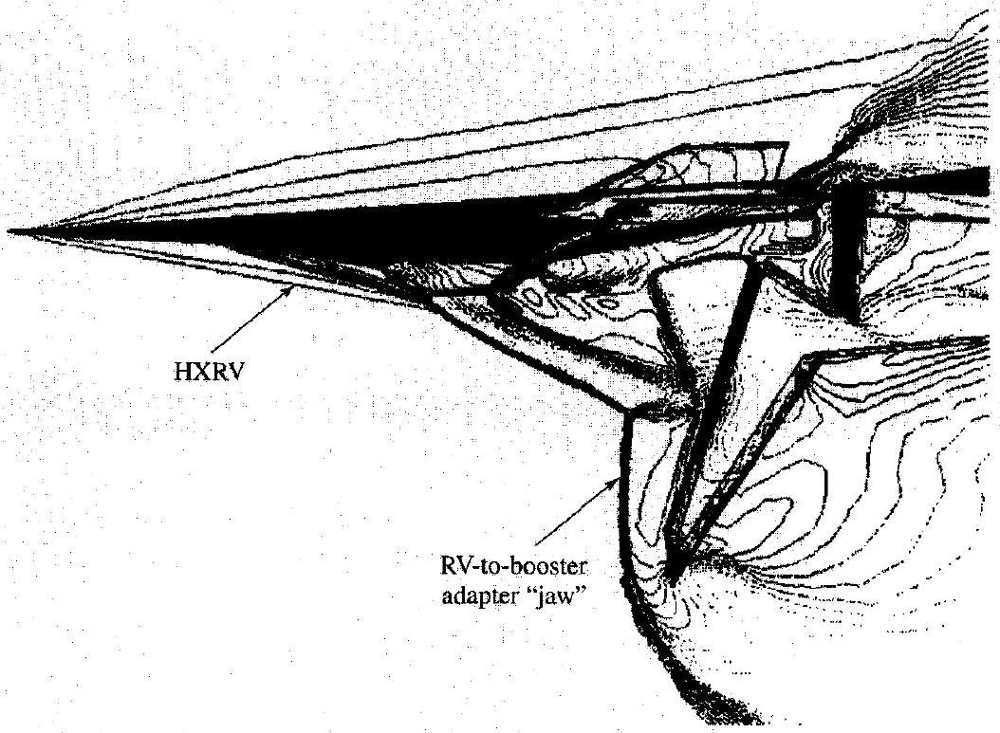
Figure 4.1 I Computational fluid dynamic solution for the shock wave pattern on NASA's Hyper-X hypersonic research vehicle at the instant of its separation from the boost vehicle at Mach 7. (Griffin Anderson, Charles McClinton, and John Weidner, "Scramjet Performance," in Scramjet Propulsion, edited by E. T. Curran and S. N. B. Murthy, AIAA Progress in Astronautics and Aeronautics, Vol. 189, Reston, Virginia, p. 431.)

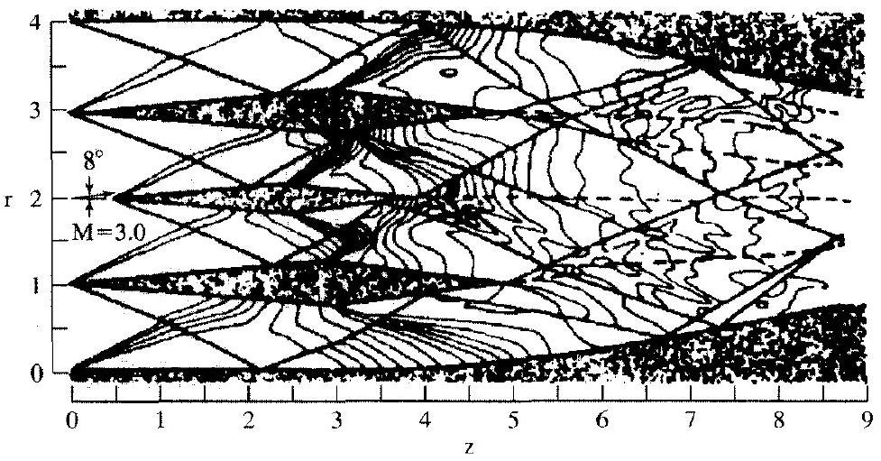
Figure 4.2 I Computational fluid dynamic solution for the wave pattern for a simulated scramjet engine. (James Hunt and John Martin, "Rudiments and Methodology for Design and Analysis of Hypersonic Air-Breathing Vehicles," in Scramjet Propulsion, p. 960.)

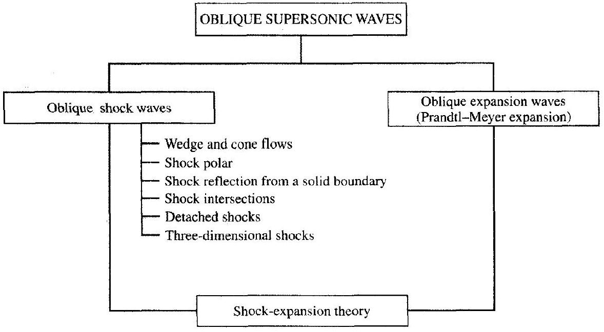
Figure 4.31 Roadmap for Chapter 4.

## 4.1 | INTRODUCTION

The normal shock wave, as considered in Chap. 3, is a special case of a more general family of oblique waves that occur in supersonic flow. Oblique shock waves are illustrated in Figs. 3.2 and 3.3. Such oblique shocks usually occur when supersonic flow

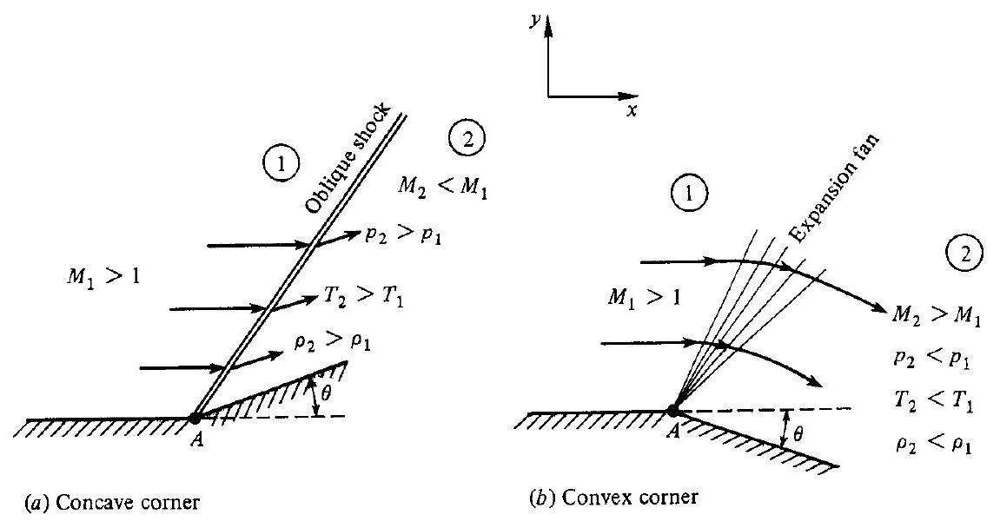
Figure 4.4 I Supersonic flow over a corner.

is "turned into itself," as shown in Fig. 4.4a. Here, an originally uniform supersonic flow is bounded on one side by a surface. At point $A$, the surface is deflected upward through an angle $\theta$. Consequently, the flow streamlines are deflected upward, toward the main bulk of the flow above the surface. This change in flow direction takes place across a shock wave which is oblique to the free-stream direction. All the flow streamlines experience the same deflection angle $\theta$ at the shock. Hence the flow downstream of the shock is also uniform and parallel, and follows the direction of the wall downstream of point $A$. Across the shock wave, the Mach number decreases, and the pressure, temperature, and density increase.

In contrast, when supersonic flow is "turned away from itself" as illustrated in Fig. 4.4b, an expansion wave is formed. Here, the surface is deflected downward through an angle $\theta$. Consequently the flow streamlines are deflected downward, away from the main bulk of flow above the surface. This change in flow direction takes place across an expansion wave, centered at point $A$. Away from the surface, this oblique expansion wave fans out, as shown in Fig. 4.4b. The flow streamlines are smoothly curved through the expansion fan until they are all parallel to the wall behind point $A$. Hence, the flow behind the expansion wave is also uniform and parallel, in the direction of $\theta$ shown in Fig. 4.4b. In contrast to the discontinuities across a shock wave, all flow properties through an expansion wave change smoothly and continuously, with the exception of the wall streamline which changes discontinuously at point $A$. Across the expansion wave, the Mach number increases and the pressure, temperature, and density decrease.

Oblique shock and expansion waves are prevalent in two- and three-dimensional supersonic flows. These waves are inherently two-dimensional in nature, in contrast to the one-dimensional normal shock waves in Chap. 3. That is, the flowfield properties are functions of $x$ and $y$ in Fig. 4.4. The main thrust of this chapter is to present the properties of these two-dimensional waves.

### 4.2 I SOURCE OF OBLIQUE WAVES

Oblique waves are created by the same physical mechanism discussed at the beginning of Sec. 3.6-disturbances which propagate by molecular collisions at the speed of sound, some of which eventually coalesce into shocks and others of which spread out in the form of expansion waves. To more clearly see this process for an oblique wave, consider a moving point source of sound disturbances in a gas, as illustrated in Fig. 4.5. For lack of a better term, let us call this source a "beeper." The beeper is continually emitting sound waves as it moves through the stationary gas. Consider first the case when the beeper is moving at a velocity $V$, which is less than the speed of sound, as shown in Fig. 4.5a. When the beeper is at point $A$, it emits a sound disturbance which propagates in all directions at the speed of sound, $a$. After an interval of time $t$, this sound wave is represented by the circle of radius ( $a t$ ) in Fig. 4.5 a. However, during this same time interval, the beeper has moved a distance $V t$ to point $B$. Moreover, during its transit from $A$ to $B$, the beeper has emitted several other sound waves, which at time $t$ are represented by the smaller circles in Fig. 4.5a. Note from this figure, which is a picture of the situation at time $t$, that the beeper always stays inside the family of circular sound waves, and that the waves continuously move ahead of the beeper. This is because the beeper is traveling at a subsonic speed, $V<a$. Now consider the case when the beeper is moving at supersonic speeds, $V>a$. This is illustrated in Fig. 4.5b. Again, when the beeper is at point $A$, it emits a sound wave. After an interval of time $t$, this wave is the circle with radius (at). During the same interval of time, the beeper has moved a distance $V t$ to point $B$. Moreover, during its transit from $A$ to $B$, the beeper has emitted several other sound waves, which at time $t$ are represented by the smaller circles in Fig. 4.5b. However, in contrast to the subsonic case, the beeper is now constantly outside the family of circular sound waves, i.e., it is moving ahead of the wave fronts because $V>a$. Moreover, something new is happening; these wave fronts form a disturbance envelope given by the straight line $B C$, which is tangent to the family of circles. This line of disturbances is defined as a Mach wave. In addition, the angle $A B C$ which the Mach wave makes with respect to the direction of motion of the beeper is defined as the Mach angle, $\mu$. The Mach angle is easily calculated from the geometry of Fig. 4.5b:

$$
\sin \mu=\frac{a t}{V t}=\frac{a}{V}=\frac{1}{M}
$$

Therefore, the Mach angle is simply determined by the local Mach number as

$$
\mu=\sin ^{-1} \frac{1}{M}
$$

The propagation of weak disturbances and their coalescence into a Mach wave are clearly seen in Fig. 4.5c.

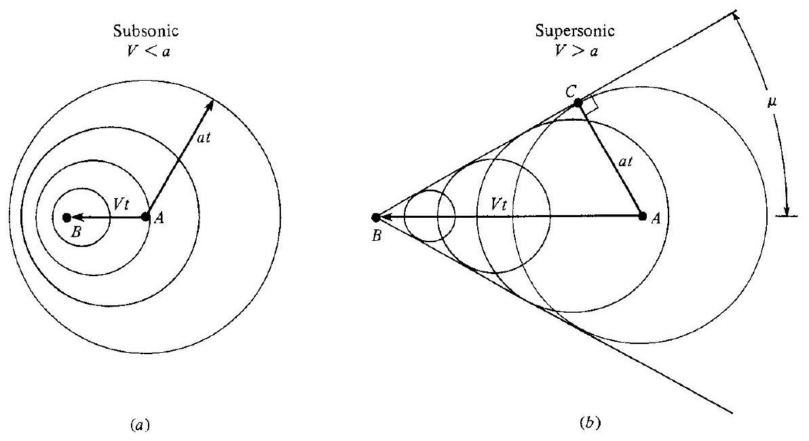
Figure 4.5 I The propagation of disturbances in (a) subsonic and (b) supersonic flow.

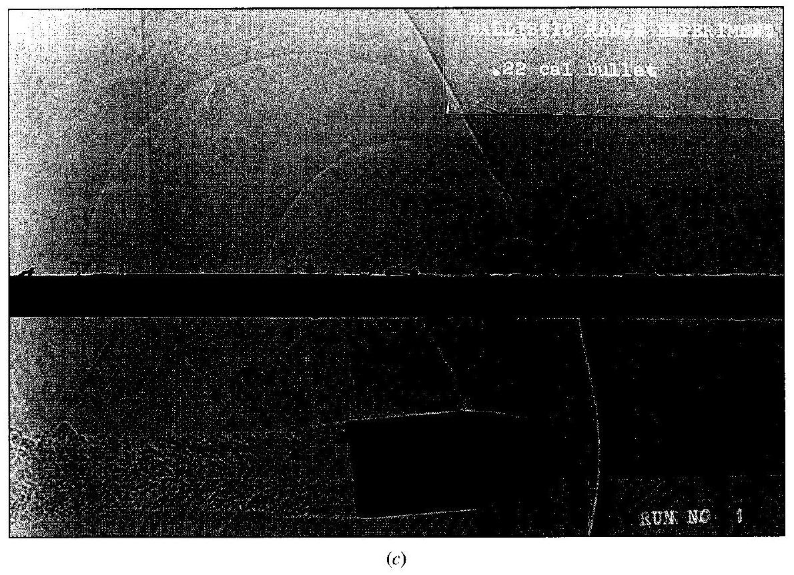
Figure 4.5 | Wave system established by a supersonic .22 caliber bullet passing under a perforated plate. The bow shock wave on the bullet, in passing over the holes in the plate, sends out weak disturbances above the plate which coalesce into a Mach wave above the plate. This is a photographic illustration of the schematic in Fig. 4.5b. (Photo is courtesy of Daniel Bershader, Stanford University.)

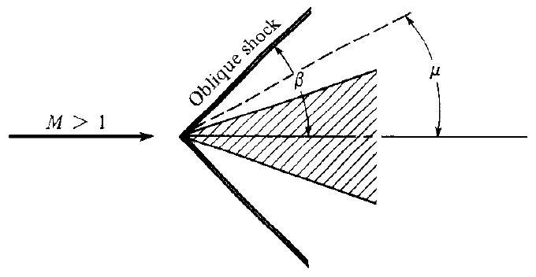
Figure 4.6 I Comparison between the wave angle and the Mach angle.

If the disturbance is stronger than a small beeper emitting sound waves, such as a wedge blasting its way through a gas at supersonic speeds as shown in Fig. 4.6, the wave front becomes stronger than a Mach wave. The strong disturbances coalesce into an oblique shock wave at an angle $\beta$ to the free stream, where $\beta>\mu$. However, the physical mechanism creating the oblique shock is essentially the same as that described above for the Mach wave. Indeed, a Mach wave is a limiting case for oblique shocks, i.e., it is an infinitely weak oblique shock.

## 4.3 | OBLIQUE SHOCK RELATIONS

The geometry of flow through an oblique shock is given in Fig. 4.7. The velocity upstream of the shock is $V_{1}$, and is horizontal. The corresponding Mach number is $M_{1}$. The oblique shock makes a wave angle $\beta$ with respect to $V_{1}$. Behind the shock, the flow is deflected toward the shock by the flow-deflection angle $\theta$. The velocity and Mach number behind the shock are $V_{2}$ and $M_{2}$, respectively. The components of $V_{1}$ perpendicular and parallel, respectively, to the shock are $u_{1}$ and $w_{1}$; the analogous components of $V_{2}$ are $u_{2}$ and $w_{2}$, as shown in Fig. 4.7. Therefore, we can consider the normal and tangential Mach numbers ahead of the shock to be $M_{n_{1}}$ and $M_{t_{1}}$, respectively; similarly, we have $M_{n_{2}}$ and $M_{t_{2}}$ behind the shock.

The integral forms of the conservation equations from Chap. 2 were applied in Sec. 3.2 to a specific control volume in one-dimensional flow, ultimately resulting in the normal shock equations given in Sec. 3.6. Let us take a similar tack here. Consider the control volume drawn between two streamlines through an oblique shock, as illustrated by the dashed lines at the top of Fig. 4.7. Faces $a$ and $d$ are parallel to the shock wave. Apply the integral continuity equation (2.2) to this control volume for a steady flow. The time derivative in Eq. (2.2) is zero. The surface integral evaluated over faces $a$ and $d$ of the control volume in Fig. 4.7 yields $-\rho_{1} u_{1} A_{1}+\rho_{2} u_{2} A_{2}$, where $A_{1}=A_{2}=$ area of faces $a$ and $d$. The faces $b, c, e$, and $f$ of the control volume are parallel to the velocity, and hence contribute nothing to the surface integral (i.e., $\mathbf{V} \cdot d \mathbf{S}=0$ for these faces). Thus, the continuity equation for an oblique shock wave is

$$
\rho_{1} u_{1}=\rho_{2} u_{2}
$$

The integral form of the momentum equation (2.11) is a vector equation. Consider this equation resolved into two components, parallel and perpendicular to the

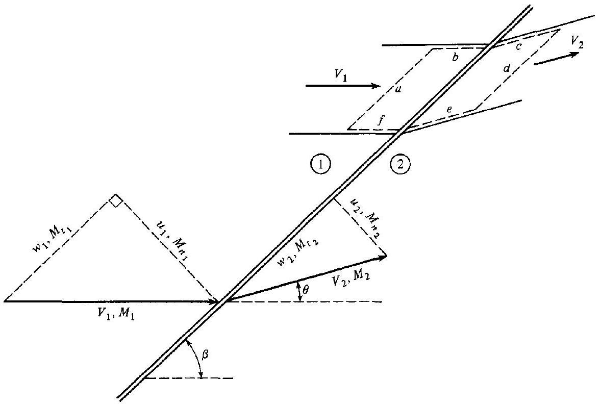
Figure 4.7 I Oblique shock wave geometry.

shock wave in Fig. 4.7. Again, considering steady flow with no body forces, the tangential component of Eq. (2.11) applied to the control surface in Fig. 4.7 yields (noting that the tangential component of $p d \mathbf{S}$ is zero on faces $a$ and $d$, and that the components on $b$ cancel those on $f$; similarly with faces $c$ and $e$ )

$$
\left(-\rho_{1} u_{1}\right) w_{1}+\left(\rho_{2} u_{2}\right) w_{2}=0
$$

Dividing Eq. (4.3) by (4.2), we find that

$$
w_{1}=w_{2}
$$

This is a striking result-the tangential component of the flow velocity is preserved across an oblique shock wave.

Returning to Fig. 4.7, and applying the normal component of Eq. (2.11), we find
or

$$
\begin{aligned}
\left(-\rho_{1} u_{1}\right) u_{1}+\left(\rho_{2} u_{2}\right) u_{2} & =-\left(-p_{1}+p_{2}\right) \\
p_{1}+\rho_{1} u_{1}^{2} & =p_{2}+\rho_{2} u_{2}^{2}
\end{aligned}
$$

The integral form of the energy equation is Eq. (2.20). Applied to the control volume in Fig. 4.7 for a steady adiabatic flow with no body forces, it yields

$$
-\left(-p_{1} u_{1}+p_{2} u_{2}\right)=-\rho_{1}\left(e_{1}+\frac{V_{1}^{2}}{2}\right) u_{1}+\rho_{2}\left(e_{2}+\frac{V_{2}^{2}}{2}\right) u_{2}
$$

or

$$
\left(h_{1}+\frac{V_{1}^{2}}{2}\right) \rho_{1} u_{1}=\left(h_{2}+\frac{V_{2}^{2}}{2}\right) \rho_{2} u_{2}
$$

Dividing Eq. (4.4) by (4.2),

$$
h_{1}+\frac{V_{1}^{2}}{2}=h_{2}+\frac{V_{2}^{2}}{2}
$$

However, recall from the geometry of Fig. 4.7 that $V^{2}=u^{2}+w^{2}$ and that $w_{1}=w_{2}$. Hence,

$$
V_{1}^{2}-V_{2}^{2}=\left(u_{1}^{2}+w_{1}^{2}\right)-\left(u_{2}^{2}+w_{2}^{2}\right)=u_{1}^{2}-u_{2}^{2}
$$

Therefore, Eq. (4.5) becomes

$$
h_{1}+\frac{u_{1}^{2}}{2}=h_{2}+\frac{u_{2}^{2}}{2}
$$

Look carefully at Eqs. (4.2), (4.3a), and (4.6). They are identical in form to the normal shock continuity, momentum, and energy equations (3.38) through (3.40). Moreover, in both sets of equations, the velocities are normal to the wave. Therefore, the changes across an oblique shock wave are governed by the normal component of the free-stream velocity. Furthermore, precisely the same algebra as applied to the normal shock equations in Sec. 3.6, when applied to Eqs. (4.2), (4.3a), and (4.6), will lead to identical expressions for changes across an oblique shock in terms of the normal component of the upstream Mach number $M_{n_{1}}$. That is, for an oblique shock wave with

$$
M_{n_{1}}=M_{1} \sin \beta
$$

we have, for a calorically perfect gas,

$$
\begin{aligned}
\frac{\rho_{2}}{\rho_{1}} & =\frac{(\gamma+1) M_{n_{1}}^{2}}{(\gamma-1) M_{n_{1}}^{2}+2} \\
\frac{p_{2}}{p_{1}} & =1+\frac{2 \gamma}{\gamma+1}\left(M_{n_{1}}^{2}-1\right) \\
M_{n_{2}}^{2} & =\frac{M_{n_{1}}^{2}+[2 /(\gamma-1)]}{[2 \gamma /(\gamma-1)] M_{n_{1}}^{2}-1} \\
\frac{T_{2}}{T_{1}} & =\frac{p_{2}}{p_{1}} \frac{\rho_{1}}{\rho_{2}}
\end{aligned}
$$

and

$$
M_{2}=\frac{M_{\|_{2}}}{\sin (\beta-\theta)}
$$

In Sec. 3.6, we emphasized that changes across a normal shock were a function of one quantity only-the upstream Mach number. Now, from Eqs. (4.7) through (4.11),
we see that changes across an oblique shock are a function of two quantities-both $M_{1}$ and $\beta$. We also see, in reality, normal shocks are just a special case of oblique shocks where $\beta=\pi / 2$.

Equation (4.12) demonstrates that $M_{2}$ cannot be found until the flow deflection angle $\theta$ is obtained. However, $\theta$ is also a unique function of $M_{1}$ and $\beta$, as follows. From the geometry of Fig. 4.7,

$$
\begin{aligned}
\tan \beta & =\frac{u_{1}}{w_{1}} \\
\tan (\beta-\theta) & =\frac{u_{2}}{w_{2}}
\end{aligned}
$$

and

Combining Eqs. (4.13) and (4.14), noting that $w_{1}=w_{2}$, we have

$$
\frac{\tan (\beta-\theta)}{\tan \beta}=\frac{u_{2}}{u_{1}}
$$

Combining Eq. (4.15) with Eqs. (4.2), (4.7), and (4.8), we obtain

$$
\frac{\tan (\beta-\theta)}{\tan \beta}=\frac{2+(\gamma-1) M_{1}^{2} \sin ^{2} \beta}{(\gamma+1) M_{1}^{2} \sin ^{2} \beta}
$$

With some trigonometric manipulation, this equation can be expressed as

$$
\tan \theta=2 \cot \beta\left[\frac{M_{1}^{2} \sin ^{2} \beta-1}{M_{1}^{2}(\gamma+\cos 2 \beta)+2}\right]
$$

Equation (4.17) is called the $\theta-\beta-M$ relation, and specifies $\theta$ as a unique function of $M_{1}$ and $\beta$.

This relation is vital to an analysis of oblique shocks, and results obtained from it are plotted in Fig. 4.8 for $\gamma=1.4$. Examine this figure closely. It is a plot of wave angle versus deflection angle, with the Mach number as a parameter. In particular, note that:

1. For any given $M_{1}$, there is a maximum deflection angle $\theta_{\text {max }}$. If the physical geometry is such that $\theta>\theta_{\text {max }}$, then no solution exists for a straight oblique shock wave. Instead, the shock will be curved and detached, as sketched in Fig. 4.9, which compares wedge and corner flow for situations where $\theta$ is less than or greater than $\theta_{\text {max }}$.
2. For any given $\theta<\theta_{\max }$, there are two values of $\beta$ predicted by the $\theta-\beta-M$ relation for a given Mach number, as sketched in Fig. 4.10. Because changes across the shock are more severe as $\beta$ increases [see Eqs. (4.8) and (4.9), for example], the large value of $\beta$ is called the strong shock solution; in turn, the small value of $\beta$ is called the weak shock solution. In nature, the weak shock solution is favored, and usually occurs. For typical situations such as those

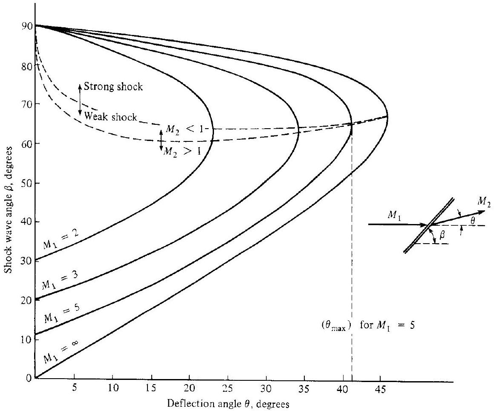
Figure $4.81 \theta-\beta-M$ curves. Oblique shock properties. Important: See front end pages for a more detailed chart.

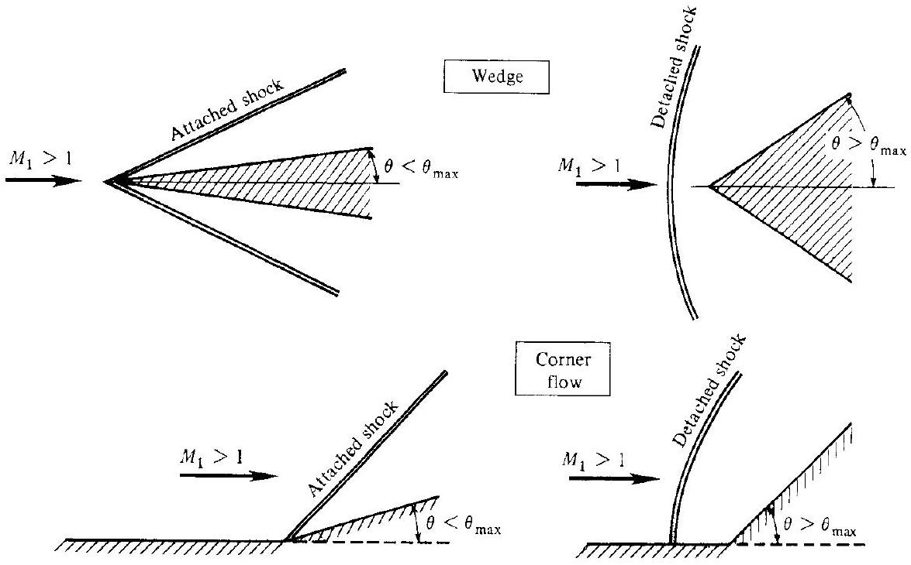
Figure 4.9 | Attached and detached shocks.

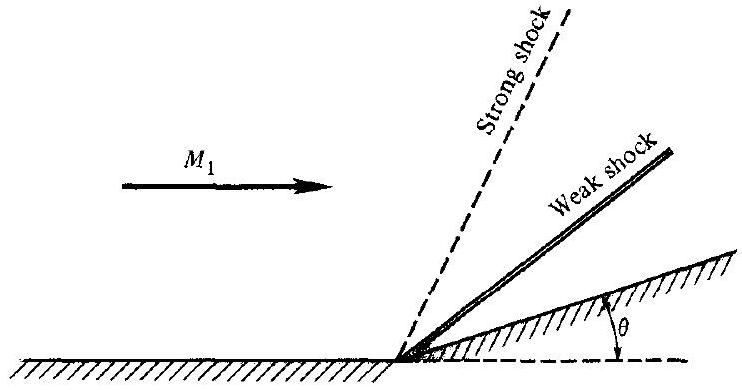
Figure 4.10 | Weak and strong shocks.

sketched in Fig. 4.10, the weak shock is the one we would normally see. However, whether the weak or strong shock solution occurs is determined by the backpressure; in Fig. 4.10, if the downstream pressure were increased by some independent mechanism, then the strong shock shown as the dashed line could be forced to occur. In the strong shock solution, $M_{2}$ is subsonic. In the weak shock solution, $M_{2}$ is supersonic except for a small region near $\theta_{\text {max }}$ (see Fig. 4.8).
3. If $\theta=0$, then $\beta=\pi / 2$ (corresponding to a normal shock) or $\beta=\mu$ (corresponding to a Mach wave).
4. For a fixed deflection angle $\theta$, as the free-stream Mach number decreases from high to low supersonic values, the wave angle increases (for the weak shock solution). Finally, there is a Mach number below which no solutions are possible; at this Mach number, $\theta=\theta_{\text {max }}$. For lower Mach numbers the shock becomes detached, as sketched in Fig. 4.9.

These variations are important, and should be studied carefully. It is important to obtain a feeling for the physical behavior of oblique shocks. Considering Fig. 4.8 together with the oblique shock relations given by Eqs. (4.7) through (4.12), we can see, for example, that for a fixed Mach number, as $\theta$ is increased, $\beta, p_{2}, T_{2}$, and $\rho_{2}$ increase while $M_{2}$ decreases. However, if $\theta$ increases beyond $\theta_{\text {max }}$ the shock wave becomes detached. Alternatively, for a fixed $\theta$, as $M_{1}$ increases from unity, the shock wave is first detached, then becomes attached when $M_{1}$ equals that value for which $\theta=\theta_{\text {max }}$. (See again Fig. 3.2 for the Bell XS-1 aircraft shock patterns.) As the Mach number is increased further, the shock remains attached, $\beta$ decreases, and $p_{2}, T_{2}, \rho_{2}$, and $M_{2}$ increase. The above comments apply to the weak shock solutions; the reader can trace through the analogous trends for the strong shock case.

## EXAMPLE 4.1

A uniform supersonic stream with $M_{1}=3.0, p_{1}=1 \mathrm{~atm}$, and $T_{1}=288 \mathrm{~K}$ encounters a compression corner (see Fig. 4.4a) which deflects the stream by an angle $\theta=20^{\circ}$. Calculate the shock wave angle, and $p_{2}, T_{2}, M_{2}, p_{o_{2}}$, and $T_{o_{2}}$ behind the shock wave.

## - Solution

For the geometrical picture, refer to Fig. 4.7. Also, from Fig. 4.8, for $M_{1}=3$ and $\theta=20$, $\beta=37.8^{\circ}$. Thus,

$$
M_{n_{1}}=M_{1} \sin \beta=3 \sin 37.8^{\circ}=1.839
$$

From Table A.2, for $M_{n_{1}}=1.839: p_{2} / p_{1}=3.783, T_{2} / T_{1}=1.562, M_{n_{2}}=0.6078$, and $p_{o_{2}} / p_{o_{1}}=0.7948$. Hence,

$$
\begin{aligned}
& p_{2}=\frac{p_{2}}{p_{1}} p_{1}=(3.783)(1)=3.783 \mathrm{~atm} \\
& T_{2}=\frac{T_{2}}{T_{1}} T_{1}=(1.562)(288)=449.9 \mathrm{~K} \\
& M_{2}=\frac{M_{n_{2}}}{\sin (\beta-\theta)}=\frac{0.6078}{\sin 17.8}=1.988
\end{aligned}
$$

From Table A.1, for $M_{1}=3: p_{o_{1}} / p_{1}=36.73$ and $T_{o_{1}} / T_{1}=2.8$. Hence,

$$
\begin{aligned}
& p_{o_{2}}=\frac{p_{o_{2}}}{p_{o_{1}}} \frac{p_{o_{1}}}{p_{1}} p_{1}=(0.7948)(36.73)(1)=29.19 \mathrm{~atm} \\
& T_{o_{2}}=T_{o_{1}}=\frac{T_{o_{1}}}{T_{1}} T_{1}=(2.8)(288)=806.4 \mathrm{~K}
\end{aligned}
$$

Note: In this example, we used the fact that the total pressure ratio across the oblique shock is dictated by the component of the upstream Mach number perpendicular to the shock, $M_{n_{1}}$. This is consistent with the fact that all thermodynamic properties across the shock are determined by $M_{n_{1}}$, including the entropy change $s_{2}-s_{1}$. From Eq. (3.63), this determines the total pressure ratio, $p_{o_{2}} / p_{o_{1}}$. We can check the value of $p_{o_{2}} / p_{o_{1}}$ obtained from Table A. 2 by making an alternative calculation as

$$
\frac{p_{o_{2}}}{p_{o_{1}}}=\frac{p_{o_{2}}}{p_{2}} \frac{p_{2}}{p_{1}} \frac{p_{1}}{p_{o_{1}}}
$$

From Table A.1, for $M_{2}=1.988, p_{o_{2}} / p_{2}=7.681$ (obtained by interpolating between entries in the table). We have already obtained from the earlier calculations that $p_{2} / p_{1}=3.783$ and $p_{0_{1}} / p_{1}=36.73$. Hence,

$$
\frac{p_{o_{2}}}{p_{o_{1}}}=\frac{p_{o_{2}}}{p_{2}} \frac{p_{2}}{p_{1}} \frac{p_{1}}{p_{o_{1}}}=(7.681)(3.783)\left(\frac{1}{36.73}\right)=0.7911
$$

This result compares within 0.46 percent with the value of 0.7948 read directly from Table A.2. The small inaccuracy is due to inaccuracy in reading $\beta$ from the $\theta-\beta-M$ diagram, and in taking the nearest entries in Tables A. 1 and A.2.

Comment on accuracy. All the worked examples in this book that require the use of graphs and tabulated data will therefore have only graphical and tabulated accuracy. In many of our calculations using the tables, we will use the nearest entry in the table so as not to have to spend the time to interpolate between entries. Using the nearest entry is usually sufficient for our purposes.

## EXAMPLE 4.2

In Example 4.1, the deflection angle is increased to $\theta=30^{\circ}$. Calculate the pressure and Mach number behind the wave, and compare these results with those of Example 4.1.

## - Solution

From the $\theta-\beta-M$ chart (see end pages), for $M_{1}=3$ and $\theta=30^{\circ}: \beta=52^{\circ}$. Hence

$$
M_{n_{1}}=M_{1} \sin \beta=3 \sin 52^{\circ}=2.364
$$

From Table A.2, for $M_{n_{1}}=2.364: p_{2} / p_{1}=6.276$ (nearest entry) and $M_{n_{2}}=0.5286$. Thus

$$
\begin{aligned}
& p_{2}=\frac{p_{2}}{p_{1}} p_{1}=(6.276)(1)=6.276 \mathrm{~atm} \\
& M_{2}=\frac{M_{n_{2}}}{\sin (\beta-\theta)}=\frac{0.5286}{\sin 22^{\circ}}=1.41
\end{aligned}
$$

Note: Compare the above results with those from Example 4.1. When $\theta$ is increased, the shock wave becomes stronger, as evidenced by the increased pressure behind the shock ( 6.276 atm compared to 3.783 atm ). The Mach number behind the shock is reduced ( 1.41 compared to 1.988 ). Also, as $\theta$ is increased, $\beta$ also increases ( $52^{\circ}$ compared to $37.8^{\circ}$ ).

## IXAMPLE 4.3

In Example 4.1, the free-stream Mach number is increased to 5. Calculate the pressure and Mach number behind the wave, and compare these results with those of Example 4.1.

## - Solution

From the $\theta-\beta-M$ chart, for $M_{1}=5$ and $\theta=20^{\circ}: \beta=30^{\circ}$. Hence,

$$
M_{n_{1}}=M_{1} \sin \beta=5 \sin 30^{\circ}=2.5
$$

From Table A.2, for $M_{n_{1}}=2.5: p_{2} / p_{1}=7.125$ and $M_{n_{2}}=0.513$. Thus,

$$
\begin{aligned}
p_{2} & =\frac{p_{2}}{p_{1}} p_{1}=(7.125)(1)=7.125 \mathrm{~atm} \\
M_{2} & =\frac{M_{n_{2}}}{\sin (\beta-\theta)}=\frac{0.513}{\sin 10^{\circ}}=2.95
\end{aligned}
$$

Note: Compare the above results with those from Example 4.1. When $M_{1}$ is increased, the shock wave becomes stronger, as evidenced by the increased pressure behind the shock ( 7.125 atm compared to 3.783 atm ). The Mach number behind the shock is increased ( 2.95 compared to 1.988). Also, as $M_{1}$ is increased, $\beta$ is decreased ( 30 compared to 37.8 ).

The net results of Examples 4.1 through 4.3 are these basic variations.

1. Anything that increases the normal component of the Mach number ahead of the shock $M_{n_{1}}$ increases the strength of the shock. In Example 4.2, $M_{n_{1}}$ was increased by increasing the wave angle $\beta$; in turn, the increased $\beta$ was brought about by increasing $\theta$. In Example 4.3, $M_{n_{1}}$ was increased by increasing $M_{1}$; although the wave angle $\beta$ decreases in this case (which works to reduce $M_{n_{1}}$ ), the increased value of $M_{1}$ (which works to increase $M_{n_{1}}$ ) more than compensates, and the net result is a larger $M_{n_{1}}$.
2. It is a general rule that, as $\theta$ increases (holding $M_{1}$ constant), the shock wave becomes stronger, and $\beta$ increases.
3. It is a general rule that, as $M_{1}$ increases (holding $\theta$ constant), the shock wave becomes stronger, and $\beta$ decreases.

## EXAMPLE 4.4

Consider a Mach 2.8 supersonic flow over a compression corner with a deflection angle of 15 . If the deflection angle is doubled to 30 , what is the increase in shock strength? Is it also doubled?

## - Solution

From the $\theta-\beta-M$ chart, for $\theta=15, \beta=33.8$, and for $\theta=30, \beta=54.7$
For $\theta=15^{\circ}: \quad M_{n_{1}}=M_{1} \sin \beta=2.8 \sin 33.8=1.558$. From Table A.2, for $M_{n_{1}}=1.56$ (nearest entry),

$$
\frac{p_{2}}{p_{1}}=2.673
$$

For $\theta=30^{\circ}: \quad M_{n_{1}}=2.8 \sin 54.7=2.285$. From Table A.2, for $M_{n_{1}}=2.3$ (nearest entry)

$$
\frac{p_{2}}{p_{1}}=6.005
$$

Clearly, if the angle of the compression corner is doubled, the strength of the shock wave is more than doubled; in this case, the shock strength is increased by a factor of 2.3 .

## EXAMPLE 4.5

Consider a compression corner with a deflection angle of 28 . Calculate the shock strengths when $M_{1}=3$ and when $M_{1}$ is doubled to 6 . Is the shock strength also doubled?

## - Solution

From the $\theta-\beta-M$ diagram for $M_{1}=3, \beta=48.5$. Hence,

$$
M_{n_{1}}=M_{1} \sin \beta=3 \sin 48.5=2.247
$$

From Table A.2, for $M_{n_{1}}=2.25$ (nearest entry)

$$
\frac{p_{2}}{p_{1}}=5.74
$$

From the $\theta-\beta-M$ diagram for $M_{1}=6, \beta=38.0^{\circ}$. Hence,

$$
M_{n_{1}}=M_{1} \sin \beta=6 \sin 38^{\circ}=3.69
$$

From Table A.2, for $M_{n_{1}}=3.7$ (nearest entry),

$$
\frac{p_{2}}{p_{1}}=15.8
$$

Clearly, if the Mach number is doubled, the strength of the shock is more than doubled; in this case, the shock strength is increased by a factor of 2.75 .

The physical results in Examples 4.4 and 4.5 are reflective of the nonlinear behavior of shock waves. The nonlinearity of shock wave phenomena is mathematically reflected in the equations obtained in this section, such as Eqs. (4.7)-(4.12), where the Mach number appears as squared, and sometimes in an intricate fashion in the equations. This is especially true of the $\theta-\beta-M$ relation, Eq. (4.17). In Chap. 9 we will discuss an approximate theory for analyzing supersonic flows over bodies, where the theory involves linear equations. However, we will also see that such linearized theory deals with slender bodies at small angles of attack, where in reality the shock waves are weak. Indeed, linearized supersonic theory does not deal with shock waves explicitly-the theory pretends that they are not here. This will all make more sense when we discuss the material in Chap. 9. At present, we are just introducing a small precursor to the intellectual model contained in Chap. 9.

### 4.3.1 The $\beta-\theta-M$ Relation: An Alternative Form for the $\theta-\beta-M$ Relation

The $\theta-\beta-M$ relation expressed by Eq. (4.17) gives $\theta$ as an explicit function of $\beta$ and $M$. In classical treatments of compressible flow, this is the equation used to relate deflection angle, wave angle, and Mach number. However, for many practical applications, we are given the deflection angle and upstream Mach number, because these are the parameters we can easily see and measure, and we want to find the corresponding wave angle, $\beta$. Equation (4.17) does not allow us to calculate $\beta$ explicitly. Rather, we can plot the $\theta-\beta-M$ curves from Eq. (4.17) as shown in Fig. 4.8, and then find $\beta$ from the graph as demonstrated in Examples 4.1-4.5. Alternatively, we can set up a short computer program to calculate $\beta$ by iterating Eq. (4.17).

It is not commonly known that an alternative equation can be derived that relates $\beta$ explicitly in terms of $\theta$ and $M$. There are at least four different derivations in the literature, found in Refs. 130-133. The key is to write Eq. (4.17) as a cubic equation, and then find the roots of this cubic equation. The earliest work along these lines appears to be that of Thompson (Ref. 130) who recognized that Eq. (4.17) can be
expressed as a cubic in $\sin ^{2} \beta$ :

$$
\begin{aligned}
& \sin ^{6} \beta-\left(\frac{M^{2}+2}{M^{2}}+\gamma \sin ^{2} \theta\right) \sin ^{4} \beta \\
& \quad+\left\{\frac{2 M^{2}+1}{M^{4}}+\left[\left(\frac{\gamma+1}{2}\right)^{2}+\frac{\gamma-1}{M^{2}}\right] \sin ^{2} \beta\right\} \sin ^{2} \beta-\frac{\cos ^{2} \theta}{M^{4}}=0
\end{aligned}
$$

However, Emanuel found it more convenient analytically to express Eq. (4.17) as a cubic in $\tan \beta$ :

$$
\begin{aligned}
& \left(1+\frac{\gamma-1}{2} M^{2}\right) \tan \theta \tan ^{3} \beta-\left(M^{2}-1\right) \tan ^{2} \beta \\
& +\left(1+\frac{\gamma+1}{2} M^{2}\right) \tan \theta \tan \beta+1=0
\end{aligned}
$$

Emanuel observed that Eq. (4.18) has three real, unequal roots for an attached shock wave with a given $\theta$ and $M$. One root is negative, hence nonphysical. The other two positive roots correspond to the weak and strong shock solutions. These roots can be expressed as

$$
\tan \beta=\frac{M^{2}-1+2 \lambda \cos \left[\left(4 \pi \delta+\cos ^{-1} \chi\right) / 3\right]}{3\left(1+\frac{\gamma-1}{2} M^{2}\right) \tan \theta}
$$

where $\delta=0$ yields the strong shock solution, $\delta=1$ yields the weak shock solution, and

$$
\lambda=\left[\left(M^{2}-1\right)^{2}-3\left(1+\frac{\gamma-1}{2} M^{2}\right)\left(1+\frac{\gamma+1}{2} M^{2}\right) \tan ^{2} \theta\right]^{1 / 2}
$$

and

$$
\chi=\frac{\left(M^{2}-1\right)^{3}-9\left(1+\frac{\gamma-1}{2} M^{2}\right)\left(1+\frac{\gamma-1}{2} M^{2}+\frac{\gamma+1}{4} M^{4}\right) \tan ^{2} \theta}{\lambda^{3}}
$$

Equation (4.19) represents an alternative form of the relation between $\beta, \theta$, and $M$; in analogy with Eq. (4.17), which is called the $\theta-\beta-M$ relation, we will label Eq. (4.19) as the $\beta-\theta-M$ relation. Eq. (4.19), along with Eqs. (4.20) and (4.21), allows an exact explicit calculation for $\beta$ when $\theta$ and $M$ are known, albeit a more lengthy calculation than that associated with Eq. (4.17). We emphasize that no simplifying mathematical assumptions go into the derivation of Eq. (4.19); it is an exact relationship.

Consider a Mach 4 flow over a compression corner with a deflection angle of 32 . Calculate the oblique shock wave angle for the weak shock case using (a) Fig. 4.8, and (b) the $\beta-\theta-M$ equation, Eq. (4.19). Compare the results from the two sets of calculations.

## - Solution

a. From Fig. 4.8, we have for $M=4$ and $\theta=32^{\circ}, \beta=48.2^{\circ}$.
b. To use Eq. (4.19), we first calculate $\lambda$ and $\chi$ from Eqs. (4.20) and (4.21), respectively.

In these equations, we have

$$
\begin{aligned}
\left(M^{2}-1\right)^{2} & =\left[(4)^{2}-1\right]^{2}=(15)^{2}=225 \\
\left(M^{2}-1\right)^{3} & =(15)^{3}=3375 \\
\frac{\gamma-1}{2} M^{2} & =\frac{1.4-1}{2}(4)^{2}=3.2 \\
\frac{\gamma+1}{2} M^{2} & =\frac{1.4+1}{2}(4)^{2}=19.2 \\
\frac{\gamma+1}{4} M^{4} & =\frac{1.4+1}{4}(4)^{4}=153.6
\end{aligned}
$$

From Eq. (4.20),

$$
\begin{aligned}
\lambda & =\left[\left(M^{2}-1\right)^{2}-3\left(1+\frac{\gamma-1}{2} M^{2}\right)\left(1+\frac{\gamma+1}{2} M^{2}\right) \tan ^{2} \theta\right]^{1 / 2} \\
& =\left[225-3(4.2)(20.2) \tan ^{2} 32^{\circ}\right]^{1 / 2}=11.208
\end{aligned}
$$

From Eq. (4.21),

$$
\begin{aligned}
\chi & =\frac{\left(M^{2}-1\right)^{3}-9\left(1+\frac{\gamma-1}{2} M^{2}\right)\left(1+\frac{\gamma-1}{2} M^{2}+\frac{\gamma+1}{4} M^{4}\right) \tan ^{2} \theta}{\lambda^{3}} \\
& =\frac{(15)^{3}-9(4.2)(1+3.2+153.6) \tan ^{2} 32^{\circ}}{(11.208)^{3}} \\
& =0.7429
\end{aligned}
$$

For Eq. (4.19), using $\delta=1$ for the weak shock solution, we need

$$
\cos ^{-1} \chi=\cos ^{-1}(0.7439)=0.7334 \mathrm{rad}
$$

$$
\begin{aligned}
\frac{4 \pi \delta+\cos ^{-1} \chi}{3} & =4.433 \mathrm{rad} \\
\cos \left(\frac{4 \pi \delta+\cos ^{-1} \chi}{3}\right) & =\cos 4.433=-0.2752
\end{aligned}
$$
$$

From Eq. (4.19),

$$
\begin{aligned}
\tan \beta & =\frac{M^{2}-1+2 \lambda \cos \left[4 \pi \delta+\cos ^{-1} \chi\right] / 3}{3\left(1+\frac{\gamma-1}{2} M^{2}\right) \tan \theta} \\
& =\frac{16-1+2(11.208)(-0.2752)}{3(4.2) \tan 32^{\circ}} \\
& =1.1216
\end{aligned}
$$

Hence,

$$
\beta=\tan ^{-1}(1.1216)=48.28
$$

This result agrees very well with the graphical solution obtained in part (a).

### 4.4 I SUPERSONIC FLOW OVER WEDGES AND CONES

The oblique shock properties discussed above represent the exact solution for the flow over a wedge or a two-dimensional compression corner, as sketched on the lefthand side of Fig. 4.9. The flow streamlines behind the shock are straight and parallel to the wedge surface. The pressure on the surface of the wedge is constant and equal to $p_{2}$, as further illustrated in Fig. 4.11a.

Straight oblique shocks are also attached to the tip of a sharp cone in supersonic flow, as sketched in Fig. 4.11b. The properties immediately behind this conical shock are given by the oblique shock relations. However, because the flow over a cone is inherently three-dimensional, the flowfield between the shock and cone surface is no longer uniform, as in the case of the wedge. As shown in Fig. 4.11b, the streamlines are curved, and the pressure at the cone surface $p_{s}$ is not the same as $p_{2}$ immediately behind the shock. Moreover, the addition of a third dimension provides the flow with extra space to move through, hence relieving some of the obstructions set up by the presence of the body. This is called the "three-dimensional relieving effect," which is characteristic of all three-dimensional flows. For the flow over a cone, the threedimensional relieving effect results in a weaker shock wave than for a wedge of the same angle. For example, Fig. 4.11 shows that a $20^{\circ}$ half-angle wedge creates a 53 oblique shock for $M_{1}=2$; by comparison, the shock on a $20^{\circ}$ half-angle cone is at a wave angle of $37^{\circ}$, with an attendant lower $p_{2}, \rho_{2}$, and $T_{2}$ immediately behind the shock. Because of these differences, the study in this book of supersonic flow over cones will be delayed until Chap. 10.

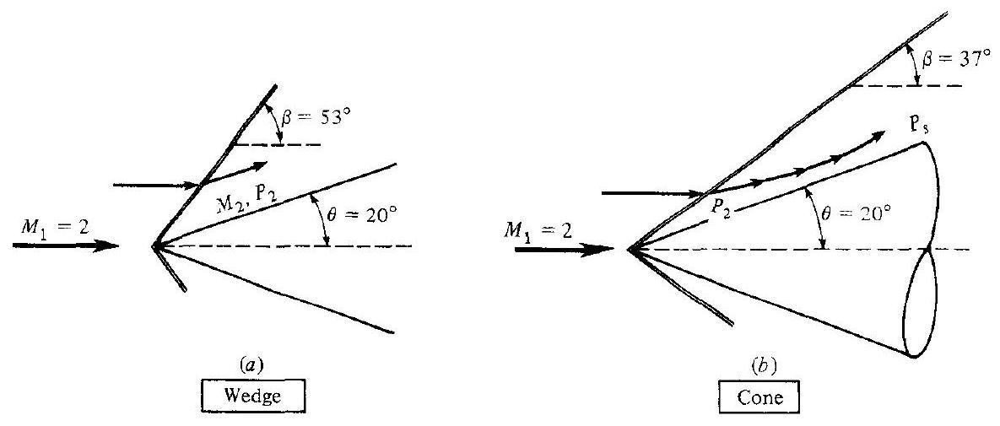
Figure 4.11 I Comparison between wedge and cone flow; illustration of the three-dimensional relieving effect.

## FXAMPLE 4.7

A $10^{\circ}$ half-angle wedge is placed in a "mystery flow" of unknown Mach number. Using a Schlieren system, the shock wave angle is measured as $44^{\circ}$. What is the free-stream Mach number?

## - Solution

From the $\theta-\beta-M$ chart, for $\theta=10^{\circ}$ and $\beta=44^{\circ}$, we have

$$
M_{1}=1.8
$$

Note: This technique has actually been used in some experiments for the measurement of Mach number. However, it is usually more accurate and efficient to use a Pitot tube to measure Mach number, as described in Example 3.7.

## EXAMIPI.F. 4.8

Consider a $15^{\circ}$ half-angle wedge at zero angle of attack. Calculate the pressure coefficient on the wedge surface in a Mach 3 flow of air.

## - Solution

The pressure coefficient is defined as

$$
C_{p}=\frac{p-p_{\infty}}{q_{\infty}}
$$

where $p_{\infty}$ is the free-stream pressure and $q_{\infty}$ is the free-stream dynamic pressure, defined by $q_{\infty}=\frac{1}{2} \rho_{\infty} V_{\infty}^{2}$. For a calorically perfect gas, $q_{\infty}$ can also be expressed in terms of $p_{\infty}$ and $M_{\infty}$ as

$$
q_{\infty} \equiv \frac{1}{2} \rho_{\infty} V_{\infty}^{2}=\frac{1}{2} \frac{\gamma p_{\infty}}{\gamma p_{\infty}} \rho_{\infty} V_{\infty}^{2}=\frac{\gamma p_{\infty}}{2} \frac{V_{\infty}^{2}}{a_{\infty}^{2}}=\frac{\gamma}{2} p_{\infty} M_{\infty}^{2}
$$

Thus, the pressure coefficient can be written as

$$
C_{p}=\frac{p-p_{\infty}}{\frac{\gamma}{2} p_{\infty} M_{\infty}^{2}}=\frac{2}{\gamma M_{\infty}^{2}}\left(\frac{p}{p_{\infty}}-1\right)
$$

In terms of the nomenclature being used in this chapter, where the free-stream properties in front of the shock are denoted by a subscript 1 , then $C_{p}$ is written as

$$
C_{p}=\frac{2}{\gamma M_{1}^{2}}\left(\frac{p_{2}}{p_{1}}-1\right)
$$

For $M_{1}=3$ and $\theta=15^{\circ}$, we have from the $\theta-\beta-M$ diagram $\beta=32.2^{\circ}$. Hence

$$
M_{n_{1}}=M_{1} \sin \beta=3 \sin 32.2=1.6
$$

From Table A.2, for $M_{n_{1}}=1.6: p_{2} / p_{1}=2.82$. Thus,

$$
C_{n}=\frac{2}{(1.4)(3)^{2}}(2.82-1)=0.289
$$

Note: For this example, we can deduce that $C_{p}$ is strictly a function of $\gamma$ and $M_{1}$.

Consider a $15^{\circ}$ half-angle wedge at zero angle of attack in a Mach 3 flow of air. Calculate the drag coefficient. Assume that the pressure exerted over the base of the wedge, the base pressure, is equal to the free-stream pressure.

## - Solution

The physical picture is sketched in Fig. 4.12. The drag is the net force in the $x$ direction; $p_{2}$ is exerted perpendicular to the top and bottom faces, and $p_{1}$ is exerted over the base. The chord length of the wedge is $c$. Consider a unit span of the wedge, i.e.. a length of unity perpendicular to the $x y$ plane. The drag per unit span, denoted by $D^{\prime}$, is

$$
D^{\prime}=2\left[\frac{(c)(1)}{\cos 15} p_{2}\right] \sin 15-\left(2 c \tan 15^{\prime}\right) p_{1}
$$

By definition, the drag coefficient is

$$
c_{d} \equiv \frac{D^{\prime}}{q_{\infty} S}
$$

where $S$ is the planform area (the projected area seen by viewing the wedge from the top). Thus, $S=(c)(1)$. Hence

$$
c_{d}=\frac{D^{\prime}}{q_{\infty} c}
$$

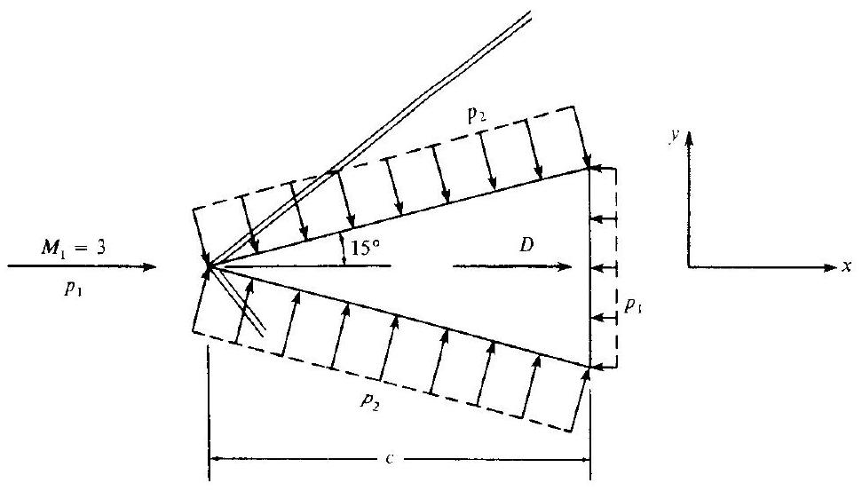
Figure 4.12 | Geometry for Example 4.9.

From Example 4.8, we saw that

$$
q_{\infty}=\frac{\gamma}{2} p_{\infty} M_{\infty}^{2}=\frac{\gamma}{2} p_{1} M_{1}^{2}
$$

Thus,
or

$$
\begin{aligned}
c_{d} & =\frac{2 D^{\prime}}{\gamma p_{1} M_{1}^{2}(c)(1)} \\
c_{d} & =\frac{2}{\gamma p_{1} M_{1}^{2} c}\left[\frac{(2)(c)(1)}{\cos 15^{\circ}} p_{2} \sin 15^{\circ}-\left(2 c \tan 15^{\circ}\right) p_{1}\right] \\
& =\frac{4}{\gamma p_{1} M_{1}^{2}}\left(p_{2}-p_{1}\right) \tan 15^{\circ}=\frac{4}{\gamma M_{1}^{2}}\left(\frac{p_{2}}{p_{1}}-1\right) \tan 15^{\circ}
\end{aligned}
$$

From Example 4.8, which deals with the same wedge at the same flow conditions, we have $p_{2} / p_{1}=2.82$. Thus

$$
c_{d}=\frac{4}{(1.4)(3)^{2}}(2.82-1) \tan 15^{\circ}=0.155
$$

An alternative solution to this problem can be developed using the pressure coefficient given in Example 4.8. The drag coefficient for an aerodynamic body is given by the integral of the pressure coefficient over the surface, as shown in Sec. 1.5 of Ref. 104. To be specific, from Ref. 104 we have

$$
c_{d}=\frac{1}{c} \int_{\mathrm{LE}}^{\mathrm{TE}}\left(C_{p_{u}}-C_{p_{i}}\right) d y
$$

Here, the integral is taken over the surface from the leading edge (LE) to the trailing edge (TE), and $C_{p_{u}}$ and $C_{p t}$ are the pressure coefficients over the upper and lower surfaces, respectively. In this problem, due to the symmetry, clearly $C_{p_{u}}=C_{p_{l}}$. On the upper surface,

$$
d y=\frac{d y}{d x} d x=\left(\tan 15^{\circ}\right) d x
$$

On the lower surface (because $y$ decreases as $x$ increases),

$$
d y=-\left(\frac{d y}{d x}\right) d x=-\tan 15^{\circ} d x
$$

Thus,

$$
c_{d}=\frac{1}{c}\left[\int_{o}^{c} C_{p_{u}}\left(\tan 15^{\circ}\right) d x-\int_{o}^{c} C_{p_{l}}\left(-\tan 15^{\circ}\right) d x\right]
$$

Since $\tan 15^{\circ}=0.2679$, then

$$
c_{d}=\frac{0.268}{c} \int_{o}^{c}\left(C_{p_{u}}+C_{p l}\right) d x
$$

From Example 4.8, $C_{p_{u}}=C_{p l}=0.289$. Thus,

$$
c_{d}=\frac{0.268}{c}(2)(0.289) \int_{o}^{c} d x=\frac{0.155}{c} c=0.155
$$

This is the same answer as obtained from the first method described above.

Note: The only information given in this problem was the body shape, free-stream Mach number, and the fact that we are dealing with air (hence we know that $\gamma=1.4$ ). To calculate the drag coefficient for a given body shape, we only need $M_{1}$ and $\gamma$. This is consistent with the results of dimensional analysis (see Chap. 1 of Ref. 104) that the drag coefficient for a compressible inviscid flow is a function of Mach number and $\gamma$ only; $c_{d}$ does not depend on the size of the body (denoted by $c$ ), the free-stream density, pressure, or velocity. It depends only on the Mach number and $\gamma$. Thus

$$
c_{d}=f\left(M_{1}, \gamma\right)
$$

This relation is verified by the results of this example. Also, the drag in this problem is due to the pressure distribution only; since we are dealing with an inviscid flow, shear stress due to friction is not included. The drag in this problem is therefore a type of "pressure drag"; it is frequently identified as wave drag, and hence $c_{d}$ calculated here is the wave drag coefficient.

### 4.5 I SHOCK POLAR

Graphical explanations go a long way towards the understanding of supersonic flow with shock waves. One such graphical representation of oblique shock properties is given by the shock polar, described next.

Consider an oblique shock with a given upstream velocity $V_{1}$ and deflection angle $\theta_{B}$, as sketched in Fig. 4.13. Also, consider an $x y$ cartesian coordinate system with the $x$ axis in the direction of $V_{1}$. Figure 4.13 is called the physical plane. Define $V_{x_{1}}, V_{y_{1}}, V_{x_{2}}$, and $V_{y_{2}}$ as the $x$ and $y$ components of velocity ahead of and behind the shock, respectively. Now plot these velocities on a graph that uses $V_{x}$ and $V_{y}$ as axes, as shown in Fig. 4.14. This graph of velocity components is called the hodograph plane. The line $O A$ represents $V_{1}$ ahead of the shock; the line $O B$ represents $V_{2}$ behind the shock. In turn, point $A$ in the hodograph plane of Fig. 4.14 represents the entire flowfield of region 1 in the physical plane of Fig. 4.13. Similarly, point $B$ in the hodograph plane represents the entire flowfield of region 2 in the physical plane. If

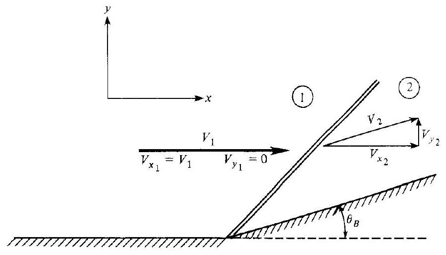
Figure 4.13। The physical ( $x y$ ) plane.

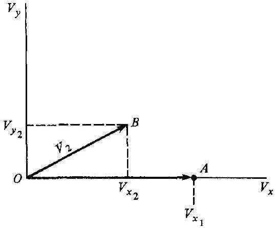
Figure 4.14 | The hodograph plane.

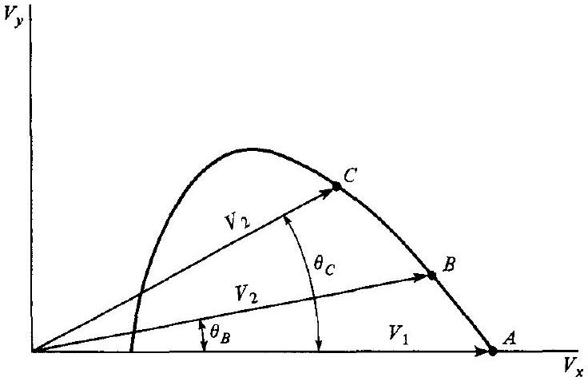
Figure 4.15 I Shock polar for a given $V_{1}$.

now the deflection angle in Fig. 4.13 is increased to a larger value, say $\theta_{C}$, then the velocity $V_{2}$ is inclined further to angle $\theta_{C}$, and its magnitude is decreased because the shock wave becomes stronger. This condition is shown as point $C$ in the hodograph diagram of Fig. 4.15. Indeed, if the deflection angle $\theta$ in Fig. 4.12 is carried through all possible values for which there is an oblique shock solution $\left(\theta<\theta_{\text {max }}\right)$, then the locus of all possible velocities behind the shock is given in Fig. 4.15. This locus is defined as a shock polar. Points $A, B$, and $C$ in Figs. 4.14 and 4.15 are just three points on the shock polar for a given $V_{1}$.

For convenience, let us now nondimensionalize the velocities in Fig. 4.15 by $a^{*}$, defined in Sec. 3.4. Recall that the flow across a shock is adiabatic, hence $a^{*}$ is the same ahead of and behind the shock. Consequently, we obtain a shock polar which is the locus of all possible $M_{2}^{*}$ values for a given $M_{1}^{*}$, as sketched in Fig. 4.16. The convenience of using $M^{*}$ instead of $M$ or $V$ to plot the shock polar is that, as $M \rightarrow \infty, M^{*} \rightarrow 2.45$ (see Sec. 3.5). Hence, the shock polars for a wide range of Mach numbers fit compactly on the same page when plotted in terms of $M^{*}$. Also note that a circle with radius $M^{*}=1$ defines the sonic circle shown in Fig. 4.16. Inside this circle, all velocities are subsonic; outside it, all velocities are supersonic.

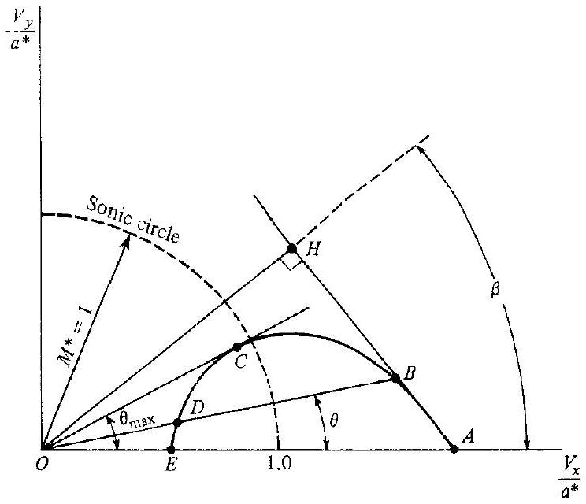
Figure 4.16 | Geometric constructions using the shock polar.

Several important properties of the shock polar are illustrated in Fig. 4.16:

1. For a given deflection angle $\theta$, the shock polar is cut at two points $B$ and $D$. Points $B$ and $D$ represent the weak and strong shock solutions, respectively. Note that $D$ is inside the sonic circle, as would be expected.
2. The line $O C$ drawn tangent to the shock polar represents the maximum deflection angle $\theta_{\text {max }}$ for the given $M_{1}^{*}$ (hence also for the given $M_{1}$ ). For $\theta>\theta_{\text {max }}$, there is no oblique shock solution.
3. Points $E$ and $A$ represent flow with no deflection. Point $E$ is the normal shock solution; point $A$ corresponds to a Mach line.
4. If a line is drawn through $A$ and $B$, and line $O H$ is drawn perpendicular to $A B$. then the angle $H O A$ is the wave angle $\beta$ corresponding to the shock solution at point $B$. This can be proved by simple geometric argument, recalling that the tangential component of velocity is preserved across the shock wave. Try it yourself.
5. The shock polars for different Mach numbers form a family of curves, as drawn in Fig. 4.17. Note that the shock polar for $M_{1}^{*}=2.45\left(M_{1} \rightarrow \infty\right)$ is a circle.

The analytic equation for the shock polar ( $V_{y} / a^{*}$ versus $V_{x} / a^{*}$ ) can be obtained from the oblique shock equations given in Sec. 4.3. The derivation is given in such classic texts as those by Ferri (Ref. 5) or Shapiro (Ref. 16). The result is given here for reference:

$$
\left(\frac{V_{y}}{a^{*}}\right)^{2}=\frac{\left(M_{1}^{*}-V_{x} / a^{*}\right)^{2}\left[\left(V_{x} / a^{*}\right) M_{1}^{*}-1\right]}{\frac{2}{\gamma+1}\left(M_{1}^{*}\right)^{2}-\left(\frac{V_{x}}{a^{*}}\right) M_{1}^{*}+1}
$$

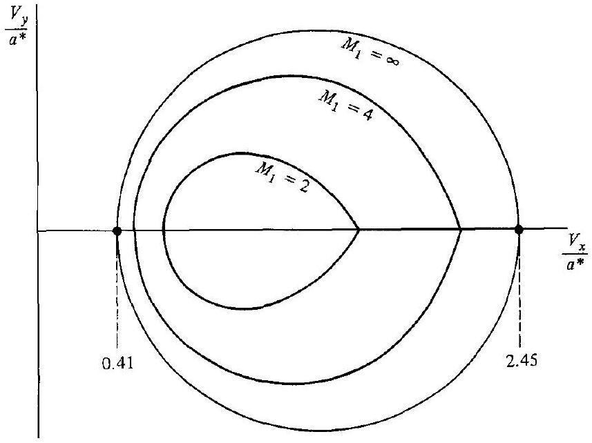
Figure 4.17 I Shock polars for different Mach numbers.

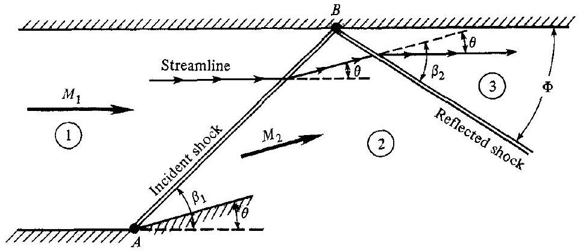
Figure 4.18 | Regular reflection from a solid boundary.

## 4.6 | REGULAR REFLECTION FROM A SOLID BOUNDARY

Consider an oblique shock wave incident on a solid wall, as sketched in Fig. 4.18. Question: Does the shock wave disappear at the wall, or is it reflected downstream? If it is reflected, at what angle and what strength? The answer lies in the physical boundary condition at the wall, where the flow immediately adjacent to the wall must be parallel to the wall. In Fig. 4.18, the flow in region 1 with Mach number $M_{1}$ is deflected through an angle $\theta$ at point $A$. This creates an oblique shock wave that impinges on the upper wall at point $B$. In region 2 behind this incident shock, the streamlines are inclined at an angle $\theta$ to the upper wall. All flow conditions in region 2 are uniquely defined by $M_{1}$ and $\theta$ through the oblique shock relations discussed in Sec. 4.5. At point $B$, in order for the flow to remain tangent to the upper
wall, the streamlines in region 2 must be deflected downward through the angle $\theta$. This can only be done by a second shock wave, originating at $B$, with sufficient strength to turn the flow through an angle $\theta$, with an upstream Mach number of $M_{2}$. This second shock is called a reflected shock; its strength is uniquely defined by $M_{2}$ and $\theta$, yielding the consequent properties in region 3. Because $M_{2}<M_{1}$, the reflected shock wave is weaker than the incident shock, and the angle $\Phi$ it makes with the upper wall is not equal to $\beta_{1}$ (i.e., the reflected shock wave is not specularly reflected).

## EXAMPLE 4.10

Consider a horizontal supersonic flow at Mach 2.8 with a static pressure and temperature of 1 atm and $519^{\circ} \mathrm{R}$, respectively. This flow passes over a compression corner with a deflection angle of $16^{\circ}$. The oblique shock generated at the corner propagates into the flow, and is incident on a horizontal wall, as shown in Fig. 4.18. Calculate the angle $\Phi$ made by the reflected shock wave with respect to the wall, and the Mach number, pressure, and temperature behind the reflected shock.

## - Solution

The flowfield is as shown in Fig. 4.18. From the $\theta-\beta-M$ diagram, $\beta_{1}=35$.

$$
M_{n_{1}}=M_{1} \sin \beta_{1}=2.8 \sin 35=1.606
$$

From Table A.2, for $M_{n_{1}}=1.606: p_{2} / p_{1}=2.82, T_{2} / T_{1}=1.388$, and $M_{n_{2}}=0.6684$. Hence

$$
M_{2}=\frac{M_{n_{2}}}{\sin \left(\beta_{1}-\theta\right)}=\frac{0.6684}{\sin (35-16)}=2.053
$$

From the $\theta-\beta-M$ diagram, for $M=2.053$ and $\theta=16: \beta_{2}=45.5$. The component of the Mach number ahead of the reflected shock normal to the shock is $M_{n_{2}}$. given by

$$
M_{n_{2}}=M_{2} \sin \beta_{2}=2.053 \sin 45.5=1.46
$$

From Table A.2, for $M_{n_{2}}=1.46: p_{3} / p_{2}=2.32, T_{3} / T_{2}=1.294$, and $M_{n_{3}}=0.7157$, where $M_{n_{3}}$ is the component of the Mach number behind the reflected shock normal to the shock. The Mach number in region 3 behind the reflected shock is given by

$$
M_{3}=\frac{M_{n_{3}}}{\sin \left(\beta_{2}-\theta\right)}=\frac{0.7157}{\sin (45.5-16)}=1.45
$$

Also

$$
\begin{aligned}
p_{3} & =\frac{p_{3}}{p_{2}} \frac{p_{2}}{p_{1}} p_{1}=(2.32)(2.82)(1 \mathrm{~atm})=6.54 \mathrm{~atm} \\
T_{3} & =\frac{T_{3}}{T_{2}} \frac{T_{2}}{T_{1}} T_{1}=(1.294)(1.388)(519)=932 \mathrm{R} \\
\Phi & =\beta_{2}-\theta=45.5-16=29.5
\end{aligned}
$$

## PXAMPLE 4.11

Note: The incident shock makes the angle $35^{\circ}$ with respect to the upper wall; the reflected shock wave lies closer to the wall, at an angle of $29.5^{\circ}$. Clearly, the shock wave is not specularly reflected.

Consider the geometry shown in Fig. 4.19. Here a supersonic flow with Mach number, pressure, and temperature $M_{1}, p_{1}$, and $T_{1}$, respectively, is deflected through an angle $\theta_{1}$ by a compression corner at point $A$ on the lower wall, creating an oblique shock wave emanating from point $A$. This shock impinges on the upper wall at point $B$. Also precisely at point $B$ the upper wall is bent downward through the angle $\theta_{2}$. The incident shock is reflected at point $B$, creating a reflected shock which propagates downward and to the right in Fig. 4.19. Consider a flow where $M_{1}=3, p_{1}=1 \mathrm{~atm}$, and $T_{1}=300 \mathrm{~K}$. Consider the geometry as sketched in Fig. 4.19 where $\theta_{1}=14^{\circ}$ and $\theta_{2}=10^{\circ}$. Calculate the Mach number, pressure, and temperature in region 3 behind the reflected shock wave.

## - Solution

From the $\theta-\beta-M$ diagram, $\beta_{1}=31.2^{\circ}$,

$$
M_{n_{1}}=M_{1} \sin \beta_{1}=3 \sin 31.2^{\circ}=1.554
$$

From Table A.2, for $M_{n_{1}}=1.56$ (nearest entry),

$$
\begin{aligned}
& \frac{p_{2}}{p_{1}}=2.673, \quad \frac{T_{2}}{T_{1}}=1.361, \quad M_{n_{2}}=0.6809 \\
& M_{2}=\frac{M_{n_{2}}}{\sin \left(\beta_{1}-\theta_{1}\right)}=\frac{0.6809}{\sin (31.2-14)}=2.30
\end{aligned}
$$

The flow in region 2, at $M_{2}=2.3$, is deflected downward through the combined angle $\theta_{1}+\theta_{2}=14^{\circ}+10^{\circ}=24^{\circ}$. From the $\theta-\beta-M$ diagram for $M=2.3$ and $\theta=24^{\circ}, \beta_{2}=52.5^{\circ}$,

$$
M_{n_{2}}=M_{2} \sin \beta_{2}=2.3 \sin 52.5^{\circ}=1.82
$$

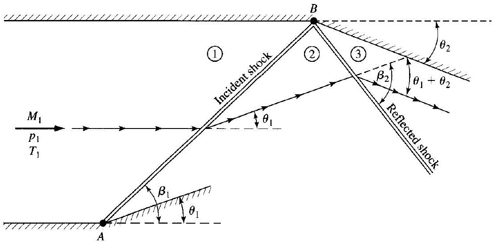
Figure 4.19 | Reflected shock geometry for Example 4.11.

From Table A.2, for $M=1.82$,

$$
\begin{gathered}
\frac{p_{3}}{p_{2}}=3.698, \quad \frac{T_{3}}{T_{2}}=1.547, \quad M_{n_{3}}=0.6121 \\
M_{3}=\frac{M_{n_{3}}}{\sin \left(\beta_{2}-\theta_{1}-\theta_{2}\right)}=\frac{0.6121}{\sin (52.5-24)}=1.28 \\
p_{3}=\frac{p_{3}}{p_{2}} \frac{p_{2}}{p_{1}} p_{1}=(3.698)(2.673)(1)=9.88 \mathrm{~atm} \\
T_{3}=\frac{T_{3}}{T_{2}} \frac{T_{2}}{T_{1}} T_{1}=(1.547)(1.361)(300)=631.6 \mathrm{~K}
\end{gathered}
$$

a. Consider the supersonic flow described in Example 4.10, where $M_{1}=2.8, p_{1}=1 \mathrm{~atm}$, and $M_{3}=1.45$. This flow is shown in Fig. 4.20a. Calculate the total pressure in region 3 where $M_{3}=1.45$.
b. Consider the supersonic flow shown in Fig. 4.20b, where the upstream Mach number and pressure are the same as in part ( $a$ ), i.e., $M_{1}=2.8$ and $p_{1}=1$ atm. This flow is deflected through the angle $\theta$ such that the Mach number behind the single oblique shock in Fig. $4.20 b$ is the same as that behind the reflected shock in Fig. 4.20a, i.e., $M_{2}=1.45$ in Fig. 4.20b. For the flow in Fig. 4.20b, calculate $\theta$ and the total pressure in region 2, $p_{0_{2}}$.

Comment on the relative values of the total pressure obtained in parts (a) and (b).

## - Solution

a. From Example 4.10, $M_{n_{1}}=1.606$, and $M_{n_{2}}=1.46$. From Table A.2, for $M_{n_{1}}=1.606$,

$$
\frac{p_{o_{2}}}{p_{o_{1}}}=0.8952
$$

From Table A.2, for $M_{n_{2}}=1.46$,

$$
\frac{p_{o_{3}}}{p_{o_{2}}}=0.9420
$$

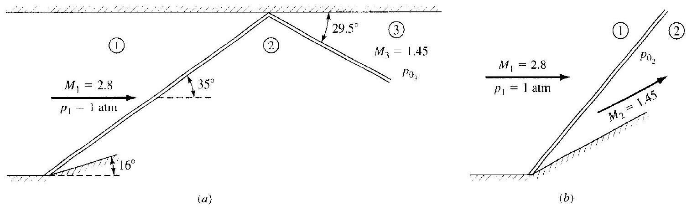
Figure 4.20 | Shock waves for Example 4.12.

From Table A.1, for $M_{1}=2.8$,

$$
\frac{p_{o_{1}}}{p_{1}}=27.14
$$

Hence,

$$
p_{o_{3}}=\left(\frac{p_{o_{3}}}{p_{o_{2}}}\right)\left(\frac{p_{o_{2}}}{p_{o_{1}}}\right)\left(\frac{p_{o_{1}}}{p_{1}}\right) p_{1}=(0.9420)(0.8952)(27.14)(1)=22.9 \mathrm{~atm}
$$

b. For the single shock wave shown in Fig. 4.20b, to find $\theta$ such that $M_{2}=1.45$ when $M_{1}=2.8$, we have to carry out an iterative (trial-and-error) solution where we assume various values of $\theta$, calculate $M_{2}$ for each value, and finally obtain the specific value of $\theta$, which will yield $M_{2}=1.45$. To begin, we arbitrarily assume $\theta=20^{\circ}$. Using the $\theta-\beta-M$ diagram and Table A.2, we find

For $\theta=20^{\circ}: \quad \beta=39.4^{\circ}, \quad M_{n_{1}}=1.777, \quad M_{n_{2}}=0.621, \quad M_{2}=1.87$
Here, $M_{2}$ is too high. We need to assume a larger $\theta$ so that the shock is stronger. Assume $\theta=30^{\circ}$.

For $\theta=30^{\circ}: \quad \beta=54.7^{\circ}, \quad M_{n_{1}}=2.27, \quad M_{n_{2}}=0.541, \quad M_{2}=1.29$
Here, $M_{2}$ is too low. We need to assume a slightly smaller $\theta$ so that the shock is slightly weaker. Assume $\theta=28^{\circ}$.
$\operatorname{For} \theta=28^{\circ}: \quad \beta=50.8^{\circ}, \quad M_{n_{1}}=2.17, \quad M_{n_{2}}=0.554, \quad M_{2}=1.43$
Here, $M_{2}$ is slightly too low. Assume $\theta=27^{\circ}$ so that the shock wave is marginally weaker.

For $\theta=27^{\circ}: \quad \beta=49^{\circ}, \quad M_{n_{1}}=2.11, \quad M_{n_{2}}=0.5613, \quad M_{2}=1.50$
Here, $M_{2}$ is slightly too high. The correct value of $\theta$ is somewhere between $27^{\circ}$ and $28^{\circ}$. Since this example is subject to graphical accuracy only, as well as the level of accuracy obtained by taking the nearest entry in Table A.2, let us simply interpolate between $\theta=27^{\circ}$ where $M_{2}=1.50$, and $\theta=28^{\circ}$ where $M_{2}=1.43$, to obtain $\theta$ where $M_{2}=1.45$ :

$$
\theta=27^{\circ}+\left(1^{\circ}\right)\left(\frac{1.5-1.45}{1.5-1.43}\right)=27^{\circ}+0.7^{\circ}=27.7^{\circ}
$$

The total pressure in region 2 in Fig. $4.20 b$ is obtained from Table A.2, using the nearest entry for $M_{n_{1}}=2.15$, where $p_{o_{2}} / p_{o_{1}}=0.6511$. Also, from Table A. 1 for $M_{1}=2.8$, $p_{o_{1}} / p_{1}=27.14$. Hence,

$$
p_{o_{2}}=\left(\frac{p_{o_{2}}}{p_{o_{1}}}\right)\left(\frac{p_{o_{1}}}{p_{1}}\right)\left(p_{1}\right)=(0.6511)(27.14)(1)=17.67 \mathrm{~atm}
$$

Comparing the two values for total pressure obtained in parts (a) and (b), we see that

$$
\begin{array}{ll}
p_{o_{3}}=22.9 \mathrm{~atm} & (\text { from part }(\mathrm{a})) \\
p_{o_{2}}=17.67 \mathrm{~atm} & (\text { from part }(\mathrm{b}))
\end{array}
$$

Clearly, the case of the flow through the single shock wave shown in Fig. $4.20 b$ results in a lower total pressure than the case of the flow through the double shock system shown in Fig. 4.20a.

### 4.7 I COMMENT ON FLOW THROUGH MULTIPLE SHOCK SYSTEMS

The results of Example 4.12 illustrate an important physical phenomena associated with flow through shock waves. Here we have a flow with an initial Mach number of 2.8, which in both cases shown in Fig. 4.20 is slowed to a lower Mach number of 1.45. In Fig. 4.20a, this is accomplished by passing the flow through two weaker shocks, and in Fig. $4.20 b$ this is accomplished by passing the flow through a single stronger shock. The process of slowing the flow to the same Mach number by means of two shocks compared to that of a single shock results in a higher total pressure. That is, the system shown in Fig. 4.20 results in a smaller loss of total pressure, hence it is an aerodynamically more efficient system. This phenomena has a major practical impact on engine inlet design for supersonic airplanes, and for the diffuser design in supersonic wind tunnels, where it is always preferable to slow the incoming supersonic flow by passing it through a multiple system of weaker shocks than through a single stronger shock. Problem 4.8 at the end of this chapter reinforces this fact. Also, the geometry for a simulated scramjet engine shown in Fig. 4.2 is designed specifically to initiate the multiple shock pattern in the flow seen in Fig. 4.2 in order to decrease the total pressure losses in the engine and therefore achieve better propulsion efficiency.

It is interesting to compare the sum of the two turning angles of the flow in Fig. 4.20a with the single turning angle in Fig. 4.20b. In Fig. 4.20a, the flow is first turned into itself through a deflection of $16^{\circ}$ across the incident shock, and then turned again into itself through a deflection of $16^{\circ}$ across the reflected shock, the sum of the turning angles being $32^{\circ}$. In contrast, the turning angle for the single shock in Fig. $4.20 b$ is calculated (in Example 4.12) to be a smaller value, namely, $27.7^{\circ}$. Hence, the flow through the multiple shock system experiences a net turning angle that is actually larger than that for the single shock system. In spite of this, the multiple shock system is more efficient, resulting in a smaller loss of total pressure (hence a smaller increase in entropy). The reason for this is the highly nonlinear increase in entropy and decrease in total pressure as the Mach number ahead of a shock wave increases. Examine again Fig. 3.10, where the changes in physical properties across a normal shock are plotted versus upstream Mach number. Note the rapid and highly nonlinear decrease in the total pressure ratio, $p_{o_{2}} / p_{o_{1}}$, as $M_{1}$ increases. For example, doubling the upstream Mach number results in a much larger than proportional decrease in total pressure. Returning to the double shock system in Fig. 4.20a, the key to its better efficiency is that the Mach number ahead of the second shock has been reduced by first flowing across the first shock. Even though the flow is going through twice as many shocks with a net turning angle larger than the single shock case, the smaller local Mach number ahead of the second shock more than compensates by
causing a sufficiently smaller increase in entropy across the second shock. Hence, the net total pressure loss across the multiple shock system is less than that across the single shock. The progressive slowing down of the flow through a multiple system of progressively weaker shocks is always more efficient than achieving the same decrease in Mach number across a single shock.

## 4.8 | PRESSURE-DEFLECTION DIAGRAMS

The shock wave reflection discussed in Sec. 4.6 is just one example of a wave interaction process-in the above case it was an interaction between the wave and a solid boundary. There are other types of interaction processes involving shock and expansion waves, and solid and free boundaries. To understand some of these interactions, it is convenient to introduce the pressure-deflection diagram, which is nothing more than the locus of all possible static pressures behind an oblique shock wave as a function of deflection angle for given upstream conditions. Consider Fig. 4.21, which at the top shows oblique shock waves of two different orientations. The top left shows a left-running wave-so called because, when standing at a point on the wave and looking downstream, you see the wave running off toward your left. The flow deflection angle $\theta_{2}$ is upward, and is considered positive. In contrast, the top right shows a right-running wave; since an oblique shock wave always deflects the flow toward the wave, the deflection angle $\theta_{2}^{\prime}$ is downward and is considered negative. The static pressure ahead of the wave, where $\theta=0$, is $p_{1}$; the static pressure behind the left-running wave, where $\theta=\theta_{2}$, is $p_{2}$. These two conditions are illustrated by points 1 and 2 , respectively, on a plot of pressure versus deflection at the bottom of

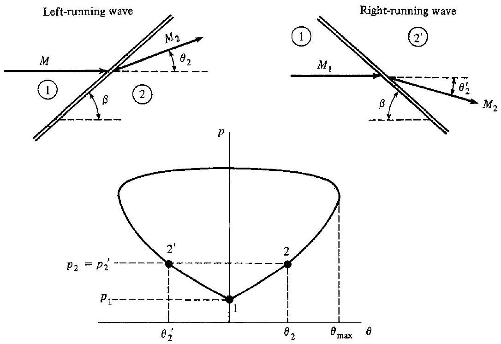
Figure 4.21 I Pressure-deflection diagram for a given $M_{1}$.

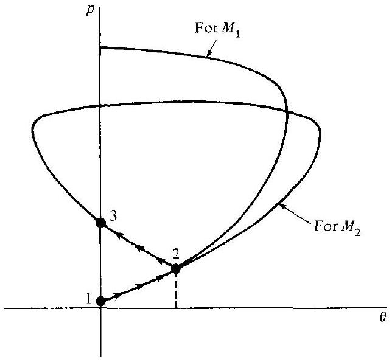
Figure 4.22 I The reflected shock process on a pressure-deflection diagram.

Fig. 4.21. For the right-running wave, if $\theta_{2}$ and $\theta_{2}^{\prime}$ are equal in absolute magnitude (but different in sign), the pressure in region $2^{\prime}$ will also be $p_{2}$. This condition is given by point $2^{\prime}$ on Fig. 4.21. When $\theta$ ranges over all possible values $|\theta|<\theta_{\text {max }}$ for an oblique shock solution, the locus of all possible pressures (for the given $M_{1}$ and $p_{1}$ ) is given by the pressure-deflection diagram, sketched in Fig. 4.21. The right-hand lobe of this figure corresponds to positive $\theta$, the left-hand lobe to negative $\theta$.

The shock reflection process of Sec. 4.6 is sketched in terms of pressuredeflection ( $p \theta$ ) diagrams in Fig. 4.22. A $p \theta$ diagram is first drawn for $M_{1}$, where point 1 corresponds to the pressure in region 1 of Fig. 4.18. Conditions in region 2 are given by point 2 on the $p \theta$ diagram. At this point, a new pressure-deflection diagram is drawn for a free-stream Mach number equal to $M_{2}$. The vertex of this $p \theta$ diagram is at point 2 because the "free stream" of region 2 is already bent upward by the angle $\theta$. Since the flow in region 3 must have $\theta=0$, then we move along the lefthand lobe of this second $p \theta$ diagram until $\theta=0$. This defines point 3 in Fig. 4.22, which yields the conditions behind the reflected shock. Hence, in Fig. 4.22, we move from point 1 to point 2 across the incident shock, and then from point 2 to point 3 across the reflected shock.

## 4.9 | INTERSECTION OF SHOCKS OF OPPOSITE FAMILIES

Consider the intersection of left- and right-running shocks as sketched in Fig. 4.23. The left- and right-running shocks are labeled $A$ and $B$, respectively. Both are incident shocks, and correspond to deflections $\theta_{2}$ and $\theta_{3}$, respectively. These shocks continue as the refracted shocks $C$ and $D$ downstream of the intersection at point $E$. Assume $\theta_{2}>\theta_{3}$. Then shock $A$ is stronger than $B$, and a streamline going through the shock system $A$ and $C$ experiences a different entropy change than the streamline

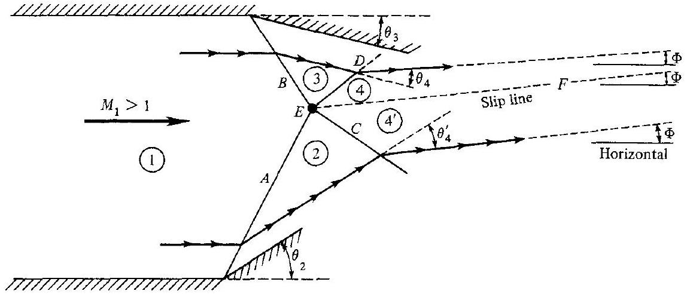
Figure 4.23 1 Intersection of shocks of opposite families.

going through the shock system $B$ and $D$. Therefore, the entropy in regions 4 and $4^{\prime}$ is different. Consequently, the dividing streamline $E F$ between these two regions is a line across which the entropy changes discontinuously. Such a line is defined as a slip line. However, on a physical basis, these conditions must hold across the slip line in Fig. 4.23:

1. The pressure must be the same, $p_{4}=p_{4^{\prime}}$. Otherwise, the slip line would be curved, inconsistent with the geometry of Fig. 4.23.
2. The velocities in regions 4 and $4^{\prime}$ must be in the same direction, although they in general differ in magnitude. If the velocities were in different directions, there would be the chance of a complete void in the flowfield in the vicinity of the slip line-an untenable physical situation.

These two conditions, along with the known properties in region 1 as well as the known $\theta_{2}$ and $\theta_{3}$, completely determine the shock interaction in Fig. 4.23. Also, note that the temperature and density, as well as the entropy and velocity magnitude, are different in regions 4 and $4^{\prime}$.

Pressure-deflection diagrams are particularly useful in visualizing the solution of this shock interaction process. The $p \theta$ diagram corresponding to $M_{1}$ is drawn as the solid curve in Fig. 4.24. Point 1 denotes conditions in region 1, ahead of the shocks. In region 2 of Fig. 4.23, the flow is deflected through the angle $\theta_{2}$. Therefore, point 2 on the $p \theta$ diagram is located by moving along the curve until $\theta=\theta_{2}$. At point 2 , a new $p \theta$ diagram corresponding to $M_{2}$ is drawn, as shown by the dashed curve to the right in Fig. 4.24. Note that the pressure in region $4^{\prime}$ must lie on this curve. Similarly, point 3 is located by moving along the solid curve until $\theta_{3}$ is reached; remember that this deflection is downward, hence we must move in the negative $\theta$ direction. Point 3 corresponds to region 3 in Fig. 4.23. At point 3, a new $p \theta$ diagram corresponding to $M_{3}$ is drawn, as shown by the dashed curve to the left in Fig. 4.24. The pressure in region 4 must lie on this curve. Because $p_{4}=p_{4^{\prime}}$, the point corresponding to regions 4 and $4^{\prime}$ in Fig. 4.24 is the intersection of the two dashed $p \theta$ diagrams. This point defines the flow direction (hence slip line direction) in regions 4 and $4^{\prime}$, namely the angle $\Phi$ in Figs. 4.23 and 4.24. In turn, the flow deflections across the refracted shocks $D$ and $C$

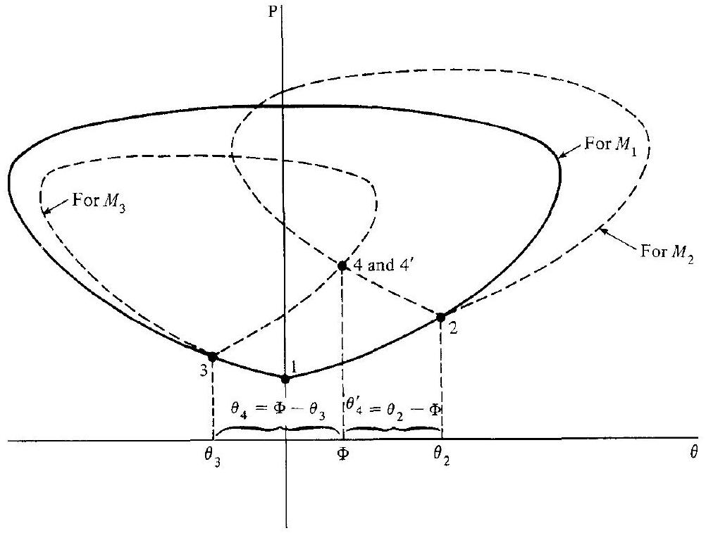
Figure 4.24 | Pressure-deflection diagrams for the shock intersection picture given in Fig. 4.23.

are determined: $\theta_{4}=\Phi-\theta_{3}$ and $\theta_{4^{\prime}}=\theta_{2}-\Phi$. With these deflections, and with the Mach numbers in regions 3 and 2, respectively, the strengths of the refracted shocks $D$ and $C$ are now determined.

Note from Fig. 4.23 that, if $\theta_{2}=\theta_{3}$, the intersecting shocks would be of equal strength, the flow pattern would be completely symmetrical, and there would be no slip line.

### 4.10। INTERSECTION OF SHOCKS OF THE SAME FAMILY

Consider the compression corner sketched in Fig. 4.25, where the supersonic flow in region 1 is deflected through an angle $\theta$, with the consequent oblique shock wave emanating from point $B$. Now consider a Mach wave generated at point $A$ ahead of the shock. Will this Mach wave intersect the shock, or will it simply diverge, i.e., is $\mu_{1}$ greater than or less than $\beta$ ? To find out, consider Eq. (4.7), which written in terms of velocities is

$$
u_{1}=V_{1} \sin \beta
$$

Hence,

$$
\sin \beta=\frac{u_{1}}{V_{1}}
$$

In addition, from Eq. (4.1),

$$
\sin \mu_{1}=\frac{a_{1}}{V_{1}}
$$

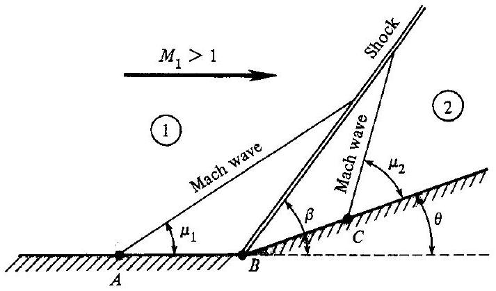
Figure 4.25 I Mach waves ahead of and behind a shock wave.

We have already proven that, for a shock to exist, the normal component of the flow velocity ahead of the shock wave must be supersonic. Thus, $u_{1}>a_{1}$; consequently, from Eqs. (4.23) and (4.24), $\beta>\mu_{1}$. Therefore, referring to Fig. 4.25, the Mach wave at $A$ must intersect the shock wave, as shown.

Now consider a Mach wave generated at point $C$ behind the shock. From Eq. (4.12)

$$
u_{2}=V_{2} \sin (\beta-\theta)
$$

Hence,

$$
\sin (\beta-\theta)=\frac{u_{2}}{V_{2}}
$$

In addition, from Eq. (4.1),

$$
\sin \mu_{2}=\frac{a_{2}}{V_{2}}
$$

We have already proven that the normal component of the flow velocity behind a shock wave is subsonic. Thus, $u_{2}<a_{2}$; consequently, from Eqs. (4.25) and (4.26), $\beta-\theta<\mu_{2}$. Therefore, referring to Fig. 4.25, the Mach wave at $C$ must intersect the shock wave, as shown.

It is now not difficult to extrapolate to the case of two left-running oblique shock waves generated at corners $A$ and $B$ in Fig. 4.26. Because shock wave $B C$ must be inclined at a steeper angle than a Mach wave in region 2, and we have already shown that a left-running Mach wave will intersect a left-running shock, then it is obvious that shock waves $A C$ and $B C$ will intersect as shown in Fig. 4.26. Above the point of intersection $C$, a single shock $C D$ will propagate.

Now consider a streamline passing through regions 1,2 , and 3 as sketched in Fig. 4.26. The pressure and flow direction in region 3 are $p_{3}$ and $\theta_{3}$, respectively, and are determined by the upstream conditions in region 1 , as well as the deflection angles $\theta_{2}$ and $\theta_{3}$. Properties in region 3 are processed by the dual shocks $A C$ and $B C$. On the other hand, consider a streamline passing through regions 1 and 5 . The pressure and flow direction in region 5 are $p_{5}$ and $\theta_{5}$, respectively. Properties in region 5 are processed by the single shock $C D$. Therefore, the entropy change across this

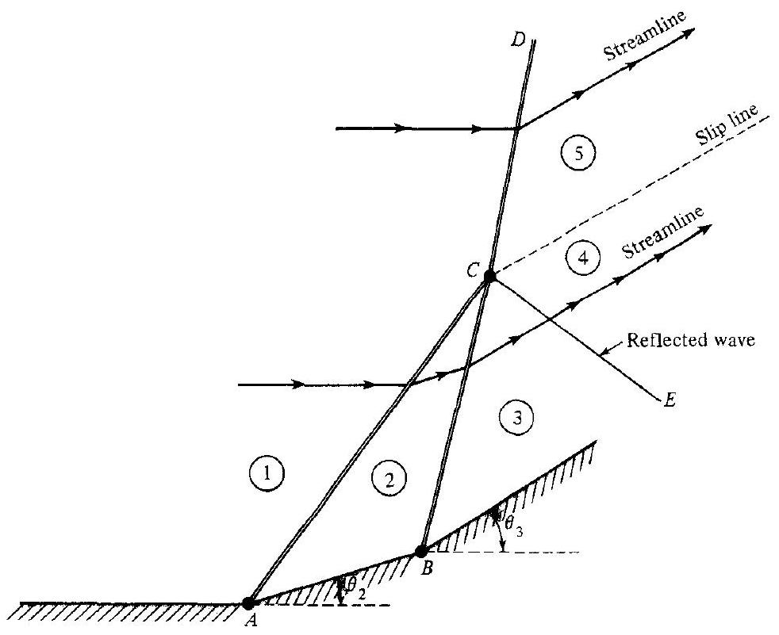
Figure 4.26 I Intersection of shocks of the same family.

single shock will be different than across the two shocks, and hence a slip line must exist downstream, originating at the intersection point $C$. As discussed in Sec. 4.9, the pressures and flow directions across the slip line must be the same. If no other wave existed in the system, this would require $p_{5}=p_{3}$ and $\theta_{5}=\theta_{3}$ simultaneously. However, it is generally not possible to find a single shock $C D$ that will give simultaneously the same pressure and flow deflection as two intermediate shocks $A C$ and $B C$, with both systems starting from the same upstream conditions in region 1 . Therefore, nature removes this problem by creating a weak reflected wave from the intersection point $C$. Depending on the upstream conditions and $\theta_{1}$ and $\theta_{2}$, this reflected wave $C E$ may be a weak shock or expansion wave. Its purpose is to process the flow in region 4 such that $p_{4}=p_{5}$ and $\theta_{4}=\theta_{5}$ simultaneously, thus satisfying the necessary physical conditions across a slip line. The flowfield can be solved numerically by iteratively adjusting waves $C D$ and $C E$ such that the above conditions between regions 4 and 5 are obtained.

### 4.11 I MACH REFLECTION

Return again to the shock wave reflection from a solid wall as discussed in Sec. 4.6 and as sketched in Fig. 4.18. The governing condition is that the flow must be deflected through the angle $\theta$ from regions 2 to 3 by the reflected shock so that the streamlines are parallel to the upper wall. In the discussion of Sec. 4.6, this value of $\theta$ was assumed to be less than $\theta_{\text {max }}$ for $M_{2}$, and hence a solution was allowed for a straight, attached reflected shock. Consider the $\theta-\beta-M$ curves for both $M_{1}$ and $M_{2}$, as

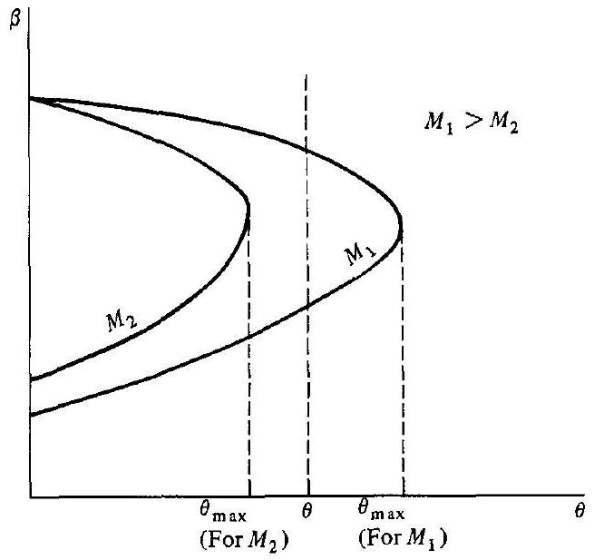
Figure 4.27 I Maximum deflection angle for two different Mach numbers.

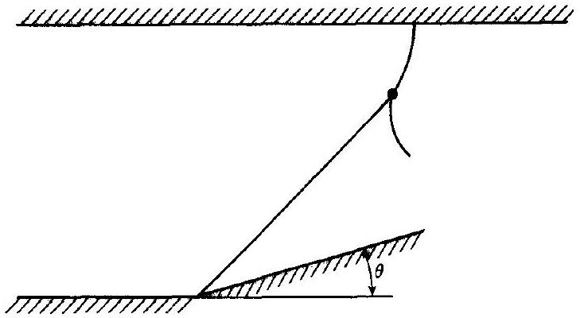
Figure 4.28 I Mach reflection.

sketched in Fig. 4.27. In Sec. 4.6, it was assumed that $\theta$ was to the left of $\theta_{\text {max }}$ for $M_{2}$ in Fig. 4.27. However, what happens when $\left(\theta_{\max }\right.$ for $\left.M_{2}\right)<\theta<\left(\theta_{\max }\right.$ for $\left.M_{1}\right)$ ? This situation is illustrated in Fig. 4.27. For the incident shock with an upstream Mach number of $M_{1}, \theta<\theta_{\text {max }}$, and hence the incident shock is an allowable straight oblique shock solution. This straight incident shock is sketched in Fig. 4.28. On the other hand, when the flow in region 2 at Mach number $M_{2}$ wants to again deflect through the angle $\theta$ via the reflected shock, it finds that $\theta>\theta_{\text {max }}$ for $M_{2}$, and a regular reflection is not possible. Instead, a normal shock is formed at the upper wall to allow the streamlines to continue parallel to the wall. Away from the wall, this normal shock transits into a curved shock which intersects the incident shock, with a curved reflected shock propagating downstream. This shock pattern is sketched in Fig. 4.28 and is labeled a Mach reflection in contrast to the regular reflection discussed in Sec. 4.6. The Mach reflection is characterized by large regions of subsonic flow behind the normal or near normal shocks, and its analysis must be carried out by the more sophisticated numerical techniques to be discussed in Chaps. 11 and 12.

### 4.12 | DETACHED SHOCK WAVE IN FRONT OF A BLUNT BODY

Consider the supersonic flow over a blunt-nosed body as illustrated in Fig. 4.29. A strong curved bow shock wave is created in front of this body, with the shock detached from the nose by a distance $\delta$. At point $a$, the upstream flow is normal to the wave; hence point $a$ corresponds to a normal shock wave. Away from the centerline, the shock wave becomes curved and weaker, eventually evolving into a Mach wave at large distances from the body (illustrated by point $e$ in Fig. 4.29).

Moreover, between points $a$ and $e$, the curved shock goes through all possible conditions allowed for oblique shocks for an upstream Mach number of $M_{1}$. To see this more clearly, consider the $\theta-\beta-M_{1}$ curve sketched in Fig. 4.30. At point $a$, a normal shock exists. Slightly above the centerline at point $b$ in Fig. 4.29, the shock is oblique but pertains to the strong-shock solution in Fig. 4.30. Further along the shock, point $c$ is the dividing point between strong and weak solutions; the streamline through point $c$ experiences the maximum deflection, $\theta_{\text {max }}$. Slightly above point $c$ in Fig. 4.29, at point $c^{\prime}$, the flow becomes sonic behind the shock. From points $a$ to $c^{\prime}$, the flow behind the shock is subsonic. Above point $c^{\prime}$ the flow is supersonic behind the shock. Hence, the flowfield between the blunt body and its curved bow shock is

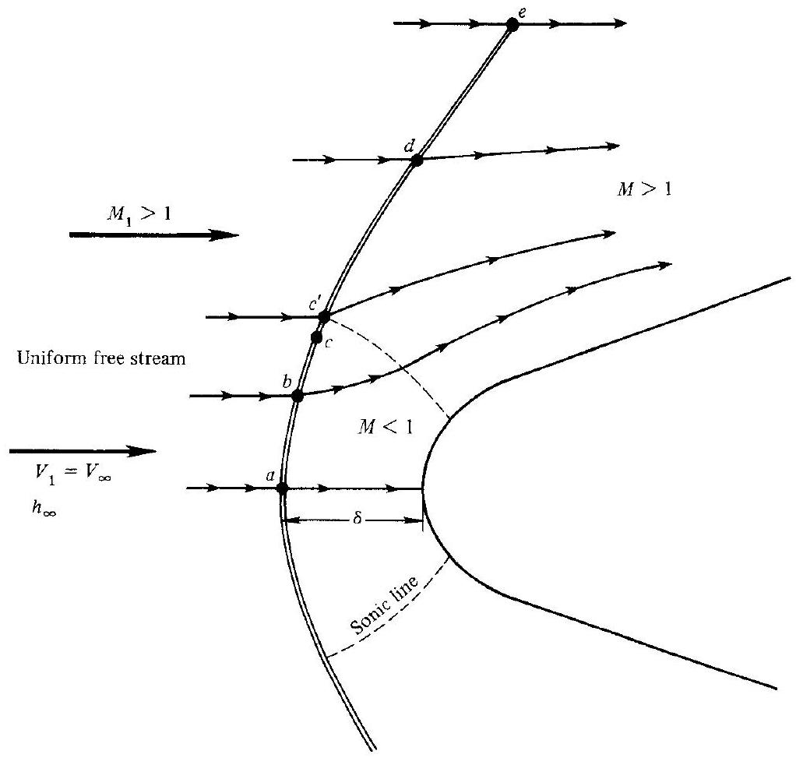
Figure 4.29 I Flow over a supersonic blunt body.

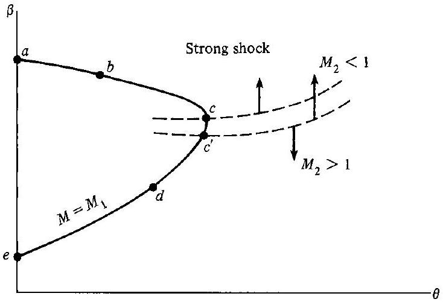
Figure 4.30| $\theta-\beta-M$ diagram for the sketch in Fig. 4.23.

a mixed subsonic-supersonic flow, and the imaginary dividing curve between these two regions (where $M=1$ ) is denoted as the sonic line, as shown in Fig. 4.29.

The shape of the detached shock wave, its detachment distance $\delta$, and the complete flowfield (with curved streamlines) between the shock and the body depend on $M_{1}$ and the size and shape of the body. The solution of this flowfield is not trivial. Indeed, the supersonic blunt body problem was a major focus for supersonic aerodynamicists during the 1950s and 1960s spurred by the need to understand the highspeed flow over blunt-nosed missiles and reentry bodies. The situation in 1957 was precisely described in the classic text by Liepmann and Roshko (Ref. 9), where, in their discussion of blunt body flows, they categorically state that "the shock shape and detachment distance cannot, at present, be theoretically predicted." Indeed, it was not until a decade later that truly sufficient numerical techniques became available for satisfactory engineering solutions of supersonic blunt body flows. These modern techniques are discussed at length in Chap. 12.

### 4.13 I THREE-DIMENSIONAL SHOCK WAVES

In treating oblique shock waves in this chapter, two-dimensional (plane) flow has been assumed. However, many practical supersonic flow problems are three-dimensional, with correspondingly curved shock waves extending in three-dimensional space. The shock wave around a supersonic axisymmetric blunt body at angle of attack is one such example, as sketched in Fig. 4.31. For such three-dimensional shock waves, the two-dimensional theory of the present chapter is still appropriate for calculating properties immediately behind the shock surface at some local point. For example, consider an elemental area $d S$ around point $A$ on the curved shock surface shown in Fig. 4.31. Let $\mathbf{n}$ be the unit normal vector at $A$. The component of the upstream Mach number normal to the shock is then

$$
M_{n_{1}}=\left(M_{1} \mathbf{i}\right) \cdot \mathbf{n}
$$

With the Mach number component normal to the three-dimensional shock wave obtained from Eq. (4.27), values of $p_{2}, \rho_{2}, T_{2}, h_{2}$, and $M_{n_{2}}$ can be calculated

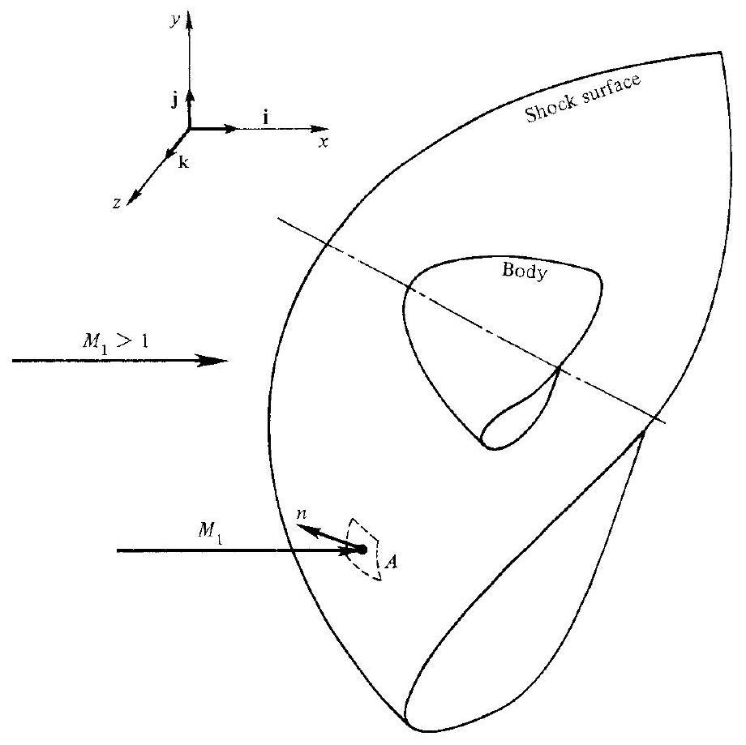
Figure 4.31 | Three-dimensional shock surface.

immediately behind the shock at point $A$ from the shock wave relations given in Eqs. (4.8) through (4.11). We again emphasize that these results hold just immediately behind the shock surface at the local point $A$. Further downstream, the flowfield experiences a complex nonuniform variation which must be analyzed by appropriate threedimensional techniques beyond the scope of this chapter. Such matters are discussed in Chap. 13.

### 4.14 | PRANDTL-MEYER EXPANSION WAVES

We have now finished our discussion of oblique shock waves as itemized in the left column of the roadmap in Fig. 4.3. We now move to the right side of the roadmap, which deals with expansion waves. When a supersonic flow is turned away from itself as discussed in Sec. 4.1, an expansion wave is formed as sketched in Fig. 4.4b. This is directly opposite to the situation when the flow is turned into itself, with the consequent shock wave as sketched in Fig. 4.4a. Expansion waves are the antithesis of shock waves. To appreciate this more fully, some qualitative aspects of flow through an expansion wave are itemized as follows (referring to Fig. 4.4b):

1. $M_{2}>M_{1}$. An expansion corner is a means to increase the flow Mach number.
2. $p_{2} / p_{1}<1, \rho_{2} / \rho_{1}<1, T_{2} / T_{1}<1$. The pressure, density, and temperature decrease through an expansion wave.

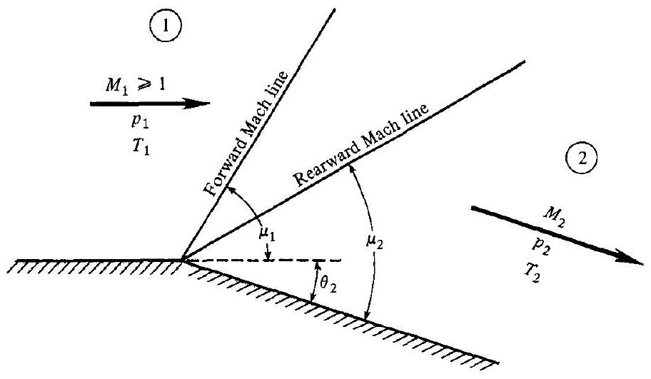
Figure 4.32 I Prandtl-Meyer expansion.

3. The expansion fan itself is a continuous expansion region, composed of an infinite number of Mach waves, bounded upstream by $\mu_{1}$ and downstream by $\mu_{2}$ (see Fig. 4.32), where $\mu_{1}=\arcsin \left(1 / M_{1}\right)$ and $\mu_{2}=\arcsin \left(1 / M_{2}\right)$.
4. Streamlines through an expansion wave are smooth curved lines.
5. Since the expansion takes place through a continuous succession of Mach waves, and $d s=0$ for each Mach wave, the expansion is isentropic.

An expansion wave emanating from a sharp convex corner such as sketched in Figs. $4.4 b$ and 4.32 is called a centered expansion fan. Moreover, because Prandtl in 1907, followed by Meyer in 1908, first worked out the theory for such a supersonic flow, it is denoted as a Prandtl-Meyer expansion wave.

The quantitative problem of a Prandtl-Meyer expansion wave can be stated as follows (referring to Fig. 4.32): For a given $M_{1}, p_{1}, T_{1}$, and $\theta_{2}$, calculate $M_{2}, p_{2}$, and $T_{2}$. The analysis can be started by considering the infinitesimal changes across a very weak wave (essentially a Mach wave) produced by an infinitesimally small flow deflection, $d \theta$, as illustrated in Fig. 4.33. From the law of sines,

$$
\frac{V+d V}{V}=\frac{\sin (\pi / 2+\mu)}{\sin (\pi / 2-\mu-d \theta)}
$$

However, from trigonometric identities,

$$
\begin{aligned}
\sin \left(\frac{\pi}{2}+\mu\right) & =\sin \left(\frac{\pi}{2}-\mu\right)=\cos \mu \\
\sin \left(\frac{\pi}{2}-\mu-d \theta\right) & =\cos (\mu+d \theta)=\cos \mu \cos d \theta-\sin \mu \sin d \theta
\end{aligned}
$$

Substitute Eqs. (4.29) and (4.30) into (4.28):

$$
1+\frac{d V}{V}=\frac{\cos \mu}{\cos \mu \cos d \theta-\sin \mu \sin d \theta}
$$

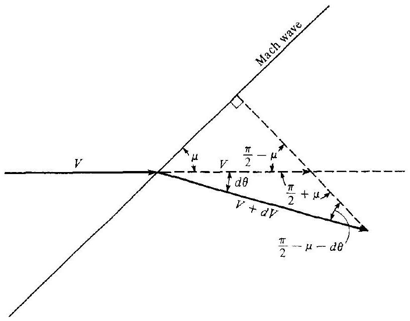
Figure 4.33 | Geometric construction for the infinitesimal changes across a Mach wave; for use in the derivation of the Prandtl-Meyer function. Note that the change in velocity across the wave is normal to the wave.

For small $d \theta$, we can make the small-angle assumptions $\sin d \theta \approx d \theta$ and $\cos d \theta \approx 1$. Then, Eq. (4.31) becomes

$$
1+\frac{d V}{V}=\frac{\cos \mu}{\cos \mu-d \theta \sin \mu}=\frac{1}{1-d \theta \tan \mu}
$$

Recalling the series expansion (for $x<1$ ),

$$
\frac{1}{1-x}=1+x+x^{2}+x^{3}+\cdots
$$

Eq. (4.32) can be expanded as (ignoring terms of second and higher order)

$$
1+\frac{d V}{V}=1+d \theta \tan \mu+\cdots
$$

Thus, from Eq. (4.32a),

$$
d \theta=\frac{d V / V}{\tan \mu}
$$

However, from Eq. (4.1),

$$
\mu=\sin ^{-1} \frac{1}{M}
$$

which can be written as

$$
\tan \mu=\frac{1}{\sqrt{M^{2}-1}}
$$

Substitute Eq. (4.34) into (4.33)

$$
d \theta=\sqrt{M^{2}-1} \frac{d V}{V}
$$

Equation (4.35) is the governing differential equation for Prandtl-Meyer flow. Note these aspects of it:

1. It is an approximate equation for a finite $d \theta$, but becomes a true equality as $d \theta \rightarrow 0$.
2. It was derived strictly on the basis of geometry, where the only real physics is that associated with the definition of a Mach wave. Hence, it is a general relation which holds for perfect gases, chemically reacting gases, and real gases.
3. It treats an infinitesimally small expansion angle, $d \theta$. To analyze the entire Prandtl-Meyer expansion in Fig. 4.32, Eq. (4.35) must be integrated over the complete angle $\theta_{2}$. Integrating Eq. (4.35) from regions 1 to 2 ,

$$
\int_{\theta_{1}}^{\theta_{2}} d \theta=\int_{M_{1}}^{M_{2}} \sqrt{M^{2}-1} \frac{d V}{V}
$$

The integral on the right-hand side can be evaluated after $d V / V$ is obtained in terms of $M$, as follows. From the definition of Mach number,

$$
V=M a
$$

Hence,

$$
\ln V=\ln M+\ln a
$$

Differentiating Eq. (4.37),

$$
\frac{d V}{V}=\frac{d M}{M}+\frac{d a}{a}
$$

Specializing to a calorically perfect gas, the adiabatic energy equation can be written from Eq. (3.28) as

$$
\left(\frac{a_{o}}{a}\right)^{2}=\frac{T_{o}}{T}=1+\frac{\gamma-1}{2} M^{2}
$$

or, solving for $a$,

$$
a=a_{o}\left(1+\frac{\gamma-1}{2} M^{2}\right)^{-1 / 2}
$$

Differentiating Eq. (4.39),

$$
\frac{d a}{a}=-\left(\frac{\gamma-1}{2}\right) M\left(1+\frac{\gamma-1}{2} M^{2}\right)^{-1} d M
$$

Substituting Eq. (4.40) into (4.38), we obtain

$$
\frac{d V}{V}=\frac{1}{1+\frac{\gamma-1}{2} M^{2}} \frac{d M}{M}
$$

Equation (4.41) is the desired relation for $d V / V$ in terms of $M$; substitute it into Eq. (4.36):

$$
\int_{\theta_{1}}^{\theta_{2}} d \theta=\theta_{2}-0=\int_{M_{1}}^{M_{2}} \frac{\sqrt{M^{2}-1}}{1+\frac{\gamma-1}{2} M^{2}} \frac{d M}{M}
$$

In Eq. (4.42), the integral

$$
v(M)=\int \frac{\sqrt{M^{2}-1}}{1+\frac{\gamma-1}{2} M^{2}} \frac{d M}{M}
$$

is called the Prandtl-Mever function, and is given the symbol $\nu$. Performing the integration, Eq. (4.43) becomes

$$
v(M)=\sqrt{\frac{\gamma+1}{\gamma-1}} \tan ^{-1} \sqrt{\frac{\gamma-1}{\gamma+1}\left(M^{2}-1\right)}-\tan ^{-1} \sqrt{M^{2}-1}
$$

The constant of integration that would ordinarily appear in Eq. (4.44) is not important, because it drops out when Eq. (4.44) is substituted into (4.42). For convenience, it is chosen as zero such that $\nu(M)=0$ when $M=1$. Finally, we can now write Eq. (4.42), combined with (4.43), as

$$
\theta_{2}=v\left(M_{2}\right)-v\left(M_{1}\right)
$$

where $\nu(M)$ is given by Eq. (4.44) for a calorically perfect gas. The Prandtl-Meyer function [Eq. (4.44)] is tabulated as a function of $M$ in Table A. 5 for $\gamma=1.4$, along with values of the Mach angle $\mu$, for convenience.

Returning again to Fig. 4.32, Eqs. (4.45) and (4.44) allow the calculation of a Prandtl-Meyer expansion wave, as follows:

1. Obtain $v\left(M_{1}\right)$ from Table A. 5 for the given $M_{1}$.
2. Calculate $v\left(M_{2}\right)$ from Eq. (4.45) using the given $\theta_{2}$ and $v\left(M_{1}\right)$ obtained in step 1.
3. Obtain $M_{2}$ from Table A. 5 corresponding to the value of $v\left(M_{2}\right)$ from step 2 .
4. Recognizing that the expansion is isentropic, and hence that $T_{o}$ and $p_{o}$ are constant through the wave, Eqs. (3.28) and (3.30) yield

$$
\frac{T_{1}}{T_{2}}=\frac{1+\frac{\gamma-1}{2} M_{2}^{2}}{1+\frac{\gamma-1}{2} M_{1}^{2}}
$$

and

$$
\frac{p_{1}}{p_{2}}=\left[\frac{1+\frac{\gamma-1}{2} M_{2}^{2}}{1+\frac{\gamma-1}{2} M_{1}^{2}}\right]^{\gamma /(\gamma-1)}
$$

## EXAMPLE 4.13

A uniform supersonic stream with $M_{1}=1.5, p_{1}=1700 \mathrm{lb} / \mathrm{ft}^{2}$, and $T_{1}=460^{\circ} \mathrm{R}$ encounters an expansion corner (see Fig. 4.32) which deflects the stream by an angle $\theta_{2}=20^{\circ}$. Calculate $M_{2}, p_{2}, T_{2}, p_{o_{2}}, T_{o_{2}}$, and the angles the forward and rearward Mach lines make with respect to the upstream flow direction.

## - Solution

From Table A.5, for $M_{1}=1.5: \nu_{1}=11.91^{\circ}$ and $\mu_{1}=41.81^{\circ}$. So

$$
v_{2}=v_{1}+\theta_{1}=11.91+20=31.91^{\circ}
$$

From Table A.5, for $\nu_{2}=31.91^{\circ}$ :

$$
M_{2}=2.207 \text { and } \mu_{2}=26.95^{\circ}
$$

From Table A.1, for $M_{1}=1.5$ :

$$
\frac{p_{o_{1}}}{p_{1}}=3.671 \quad \text { and } \quad \frac{T_{o_{1}}}{T_{1}}=1.45
$$

From Table A.1, for $M_{2}=2.207$ :

$$
\frac{p_{o_{2}}}{p_{2}}=10.81 \quad \text { and } \quad \frac{T_{o_{2}}}{T_{2}}=1.974
$$

The flow through an expansion wave is isentropic; hence $p_{o_{2}}=p_{o_{1}}$ and $T_{o_{2}}=T_{o_{1}}$. Thus,

$$
\begin{aligned}
& p_{2}=\frac{p_{2}}{p_{o_{2}}} \frac{p_{o_{2}}}{p_{o_{1}}} \frac{p_{o_{1}}}{p_{1}} p_{1}=(10.81)^{-1}(1)(3.671)(1700)=577.3 \mathrm{lb} / \mathrm{ft}^{2} \\
& T_{2}=\frac{T_{2}}{T_{o_{2}}} \frac{T_{o_{2}}}{T_{o_{1}}} \frac{T_{o_{1}}}{T_{1}} T_{1}=(1.975)^{-1}(1)(1.45)(460)=337.9^{\circ} \mathrm{R} \\
& p_{o_{2}}=p_{o_{1}}=\frac{p_{o_{1}}}{p_{1}} p_{1}=(3.671)(1700)=6241 \mathrm{lb} / \mathrm{ft}^{2} \\
& T_{o_{2}}=T_{o_{1}}=\frac{T_{o_{1}}}{T_{1}} T_{1}=(1.45)(460)=667^{\circ} \mathrm{R}
\end{aligned}
$$

Returning to Fig. 4.32:

$$
\begin{aligned}
& \text { Angle of forward Mach line }=\mu_{1}=41.81^{\circ} \\
& \text { Angle of rearward Mach line }=\mu_{2}-\theta_{2}=26.95-20=6.95^{\circ}
\end{aligned}
$$

Consider the arrangement shown in Fig. 4.34. A $15^{\circ}$ half-angle diamond wedge airfoil is in a supersonic flow at zero angle of attack. A Pitot tube is inserted into the flow at the location shown in Fig. 4.34. The pressure measured by the Pitot tube is 2.596 atm . At point $a$ on the backface, the pressure is 0.1 atm . Calculate the free-stream Mach number $M_{1}$.

## - Solution

There will be a normal shock wave in front of the face of the Pitot tube immersed in region 3 in Fig. 4.34. Let the region immediately behind this normal shock be denoted as region 4. The Pitot tube senses the total pressure in region 4, i.e., $p_{0_{4}}$. The pressure at point $a$ is the static pressure in region 3 . Thus

$$
\frac{p_{o_{4}}}{p_{3}}=\frac{2.596}{0.1}=25.96
$$

From Table A.2, for $p_{o_{4}} / p_{3}=25.96: M_{3}=4.45$. From Table A.5, for $M_{3}=4.45$, we have $v_{3}=71.27^{\circ}$. From Eq. (4.45)

$$
v_{2}=v_{3}-\theta=71.27-30=41.27^{\circ}
$$

From Table A.5, for $v_{2}=41.27^{\circ}: M_{2}=2.6$. In region 2, we have

$$
M_{n_{2}}=M_{2} \sin (\beta-\theta)=2.6 \sin (\beta-15)
$$

In this equation, both $M_{n_{2}}$ and $\beta$ are unknown. We must solve by trial and error, as follows.
Assume $M_{1}=4$. Then $\beta=27^{\circ}, M_{n_{1}}=M_{1} \sin \beta=4 \sin 27^{\circ}=1.816$. Hence, from Table A.2, $M_{n_{2}}=0.612$. Putting these results into Eq. (E.1) above,

$$
0.612 \stackrel{?}{=} 2.6 \sin 12^{\circ}=0.54
$$

This does not check.
Assume $M_{1}=4.5$. Then $\beta=25.5^{\circ}, M_{n_{1}}=4.5 \sin 25.5^{\circ}=1.937$. Hence, from Table A.2, $M_{n_{2}}=0.588$. Putting these results into Eq. (E.1),

$$
0.588 \stackrel{?}{=} 2.6 \sin 10.5^{\circ}=0.47
$$

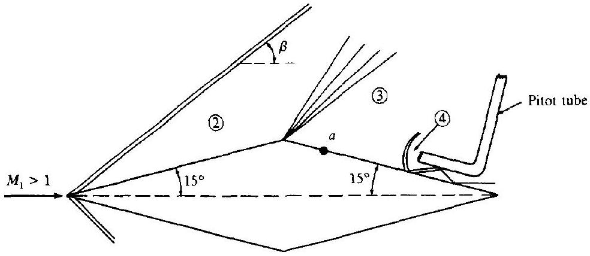
Figure 4.34 | Geometry for Example 4.14.

This does not check. We are going in the wrong direction.
Assume $M_{1}=3.5$. Then $\beta=29.2^{\circ}, M_{n_{1}}=3.5 \sin 29.2^{\circ}=1.71$. Hence, from Table A.2, $M_{n_{2}}=0.638$. Putting these results into Eq. (E.1),

$$
0.638 \stackrel{?}{=} 2.6 \sin 14.2^{\circ}=0.638
$$

This checks. Thus

$$
M_{1}=3.5
$$

### 4.15 I SHOCK-EXPANSION THEORY

In this section we move to the bottom of our roadmap in Fig. 4.3 and discuss shockexpansion theory, which is a logical and natural combination of the items in both the left and right columns of the roadmap. The shock and expansion waves discussed in this chapter allow the exact calculation of the aerodynamic force on many types of two-dimensional supersonic airfoils made up of straight-line segments. For example, consider the symmetrical diamond-shaped airfoil at zero angle of attack in Fig. 4.35. The supersonic flow is first compressed and deflected through the angle $\varepsilon$ by an oblique shock wave at the leading edge. At midchord, the flow is expanded through an angle $2 \varepsilon$ by the expansion wave. At the trailing edge, the flow is again deflected through the angle $\varepsilon$ by another oblique shock; this deflection is necessary to make the flow downstream of the airfoil parallel to the free-stream direction due to symmetry conditions. Hence, the surface pressure on segments $a$ and $c$ are found from oblique shock theory, and on segments $b$ and $d$ from Prandtl-Meyer expansion theory.

At zero angle of attack, the only aerodynamic force on the diamond airfoil will be drag; the lift is zero because the pressure distributions on the top and bottom

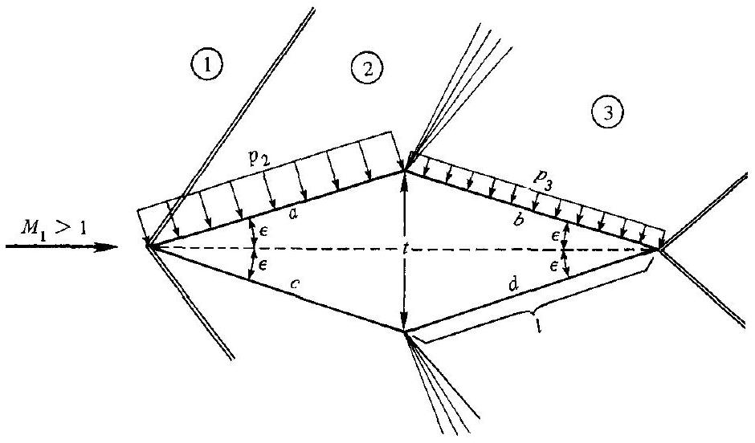
Figure 4.35 I Symmetrical diamond-wedge airfoil.

surfaces are the same. From Eq. (1.47), the pressure drag is

$$
D=x \text { component of }[-\oiint p d \mathbf{S}]
$$

In terms of scalar quantities, and referring to Fig. 4.35, the surface integral yields for the drag per unit span

$$
D=2\left(p_{2} l \sin \varepsilon-p_{3} l \sin \varepsilon\right)=2\left(p_{2}-p_{3}\right) \frac{t}{2}
$$

Hence,

$$
D=\left(p_{2}-p_{3}\right) t
$$

It is a well-known aerodynamic result that two-dimensional inviscid flow over a wing of infinite span at subsonic velocity gives zero drag-a theoretical result given the name d'Alembert's paradox. (The paradox is removed by accounting for the effects of friction). In contrast, for supersonic inviscid flow over an infinite wing, Eq. (4.46) clearly demonstrates that the drag per unit span is finite. This new source of drag encountered when the flow is supersonic is called wave drag, and is inherently related to the loss of total pressure and increase of entropy across the oblique shock waves created by the airfoil.

## FXAMPLF 4.15

Consider an infinitely thin flat plate at a 5 angle of attack in a Mach 2.6 free stream. Calculate the lift and drag coefficients.

## - Solution

From Table A.5, for $M_{1}=2.6: v_{1}=41.41^{\circ}$. Thus, from Eq. (4.45)

$$
v_{2}=v_{1}+\alpha=41.41+5=46.41
$$

From Table A.5, for $\nu_{2}=46.41^{\circ}: M_{2}=2.85$. From Table A.1, for $M_{1}=2.6: p_{o_{1}} / p_{1}=$ 19.95. From Table A.1, for $M_{2}=2.85: p_{o_{2}} / p_{2}=29.29$. Hence

$$
\frac{p_{2}}{p_{1}}=\frac{p_{2}}{p_{o_{2}}} \frac{p_{o_{2}}}{p_{o_{1}}} \frac{p_{o_{1}}}{p_{1}}=\frac{1}{29.29}(1)(19.95)=0.681
$$

From the $\theta-\beta-M$ diagram, for $M_{1}=2.6$ and $\theta=\alpha=5^{\circ}: \beta=26.5^{\circ}$. Thus

$$
M_{n_{1}}=M_{1} \sin \beta=2.6 \sin 26.5^{\circ}=1.16
$$

From Table A.2, for $M_{n_{1}}=1.16: p_{3} / p_{1}=1.403$. From Fig. 4.36, the lift per unit span $L^{\prime}$ is

$$
L^{\prime}=\left(p_{3}-p_{2}\right) c \cos \alpha
$$

The drag per unit span $D^{\prime}$ is

$$
D^{\prime}=\left(p_{3}-p_{2}\right) c \sin \alpha
$$

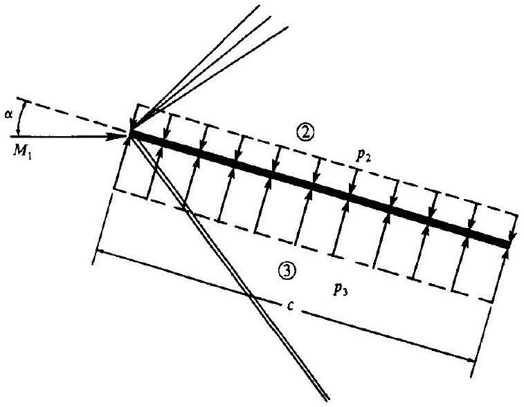
Figure 4.36 I Geometry for Example 4.15.

Recalling that $q_{1}=(\gamma / 2) p_{1} M_{1}^{2}$, we have

$$
\begin{aligned}
c_{l} & =\frac{L^{\prime}}{q_{1} c}=\frac{2}{\gamma M_{1}^{2}}\left(\frac{p_{3}}{p_{1}}-\frac{p_{2}}{p_{1}}\right) \cos \alpha \\
& =\frac{2}{(1.4)(2.6)^{2}}(1.403-0.681) \cos 5^{\circ}=0.152 \\
c_{d} & =\frac{D^{\prime}}{q_{1} c}=\frac{2}{\gamma M_{1}^{2}}\left(\frac{p_{3}}{p_{1}}-\frac{p_{2}}{p_{1}}\right) \sin \alpha \\
& =\frac{2}{(1.4)(2.6)^{2}}(1.403-0.681) \sin 5^{\circ}=0.0133
\end{aligned}
$$

Figure 4.36 shows only part of the wave system associated with the supersonic flow over a flat plate at angle of attack. After the flow passes over the flat plate, it will move downstream of the trailing edge in approximately, but not exactly, the freestream direction. As shown in Fig. 4.37, the supersonic flow over the top surface is turned into itself at the trailing edge, hence generating a left-running shock wave emanating from the trailing edge. The supersonic flow over the bottom surface is turned away from itself at the trailing edge, hence generating a right-running expansion wave. The streamline $a b$ trailing downstream from the trailing edge makes the angle
with respect to the free-stream direction. The flow in region 4, above $a b$, has passed through both the leading edge expansion wave and the trailing edge shock wave, and similarly the flow in region 5, below $a b$, has passed through both the leading edge shock wave and the trailing edge expansion wave. Because the strengths of both shock waves are different, the entropy in region 4 is different than that in region $5, s_{4} \neq s_{5}$. Therefore, $a b$ is a slip line dividing the two regions of different entropy. As discussed in Section 4.9, the pressure is the same across the slip line,

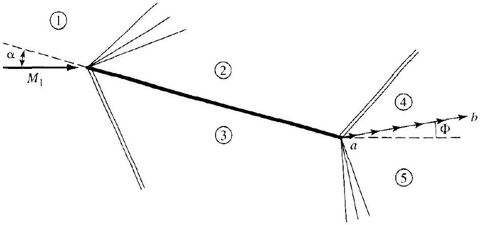
Figure 4.37 |lllustration of the tailing edge streamline for a flat plate at an angle of attack in a supersonic flow.

$p_{4}=p_{5}$, and the flow velocities in regions 4 and 5 are in the same direction, but have different magnitudes. These two conditions dictate the properties of the flow downstream of the leading edge, including the flow direction angle $\Phi$. Indeed, the ultimate physical reason why the flow downstream of the trailing edge does not return to exactly the free-stream conditions and direction is because the entropy of the downstream flow is increased by the shock waves, and hence the conditions downstream of the trailing edge can never be exactly the same as those in the free stream.

However, interestingly enough the downstream flow angle $\Phi$ is usually quite small, on the order of a degree or less. The precise value of $\Phi$ is a function of $M_{1}$ and angle of attack, as will be illustrated in Example 4.16. For values of $M_{1}$ above about 1.3, the downstream flow is canted upward, above the free-stream direction. This is the case shown in Fig. 4.37. This result may at first appear to be against our intuition, because the production of lift on an aerodynamic body creates a downward canting of the downstream flow (downwash). Indeed, Newton's third law dictates that if lift is generated on the body by the flow, the equal and opposite reaction pushes the airflow in the general downward direction downstream of the body. This is a general result for any flow, subsonic or supersonic. However, the flow sketched in Fig. 4.37 appears to violate physics. This paradox is resolved when the wave pattern over a much larger extent of the flow is examined, such as the wave interaction pattern in the far wake of the flat plate shown in Fig. 4.38. The overall effect of the flow through this much larger region results in an overall downwash when viewed over the whole domain. For example, the upwash (upward deflection of $\Phi$ ) shown in Fig. 4.37 is compensated by a net downwash over other parts of the flowfield.

We note that the downstream flow shown in Figs. 4.37 and 4.38 does not affect the lift and drag on the plate. For an inviscid flow, the aerodynamic force on the plate is due only to the integrated pressure distribution on the surface of the plate, as sketched in Fig. 4.36. In steady supersonic flow, disturbances do not propagate upstream, and hence the flow downstream of the trailing edge does not affect the pressure distribution over the plate. This is a basic physical property of steady supersonic

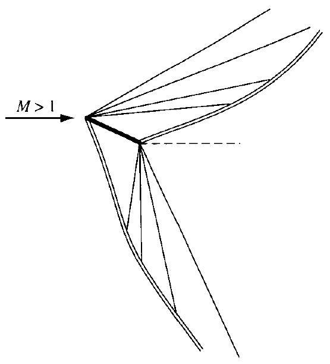
Figure 4.38 I Schematic of the far-field wave pattern downstream of a flat plate at an angle of attack in a supersonic flow.

flow-disturbances can not feed upstream. In contrast, for a completely subsonic flow, a disturbance initiated somewhere in the flow will eventually propagate throughout the entire flowfield. These different physical phenomena for subsonic and supersonic flow are ingrained in the sketches shown in Figs. 4.5a and $b$, respectively.

## EXAMPLE 4.16

Consider an infinitely thin flat plate at an angle of attack of $20^{\circ}$ in a Mach 3 free stream. Calculate the magnitude of the flow direction angle $\Phi$ downstream of the trailing edge, as sketched in Fig. 4.37.

## - Solution

Figure 4.37 illustrates the nature of the flow over the flat plate. The flow properties in each region shown in Fig. 4.37 are calculated as shown next.

Region 2: This flow has passed through the leading edge expansion wave, where the deflection angle $\theta=\alpha=20^{\circ}$ and $M_{1}=3$. From Table A.5, $v_{1}=49.76^{\circ}$. Hence,

$$
v_{2}=v_{1}+\theta=49.76+20=69.76^{\circ}
$$

From Table A.5, for $\nu_{2}=69.76^{\circ}, M_{2}=4.319$.
Note: Because $\Phi$ is generally a very small angle in this example, rather than using the nearest entry, we will interpolate between entries in the table in order to obtain more accuracy.

From Table A.1, for $M_{1}=3, p_{o_{1}} / p_{1}=36.73$. For $M_{2}=4.319, p_{o_{2}} / p_{2}=230.4$. Hence,

$$
\frac{p_{2}}{p_{1}}=\left(\frac{p_{2}}{p_{o_{2}}}\right)\left(\frac{p_{o_{2}}}{p_{o_{1}}}\right)\left(\frac{p_{o_{1}}}{p_{1}}\right)=\left(\frac{1}{230.4}\right)(1)(36.73)=0.1594
$$

Region 3: This flow has passed through the leading edge shock wave, where $M_{1}=3$ and $\theta=20$. From the $\theta-\beta-M$ diagram, $\beta=37.8$.

$$
M_{n_{1}}=M_{1} \sin \beta=3 \sin 37.8^{\circ}=1.839
$$

From Table A. 2 for $M_{n_{1}}=1.839$,

$$
\begin{aligned}
& \frac{p_{3}}{p_{1}}=3.781, \quad \frac{p_{o_{3}}}{p_{o_{1}}}=0.795, \quad M_{n_{3}}=0.6079 \\
& M_{3}=\frac{M_{n_{3}}}{\sin (\beta-\theta)}=\frac{0.6079}{\sin (37.8-20)}=1.989
\end{aligned}
$$

Regions 4 and 5: Here we have to set up an iterative solution in order to simultaneously match the pressures in regions 4 and 5. The steps are:

1. Assume a value for $\Phi$.
2. Calculate the strength of the trailing edge shock for the local compression angle, $\alpha+\Phi$. From this, we can obtain $p_{4}$, or alternatively, $p_{4} / p_{1}$.
3. Calculate the strength of the trailing edge expansion wave for a local expansion angle, $\alpha+\Phi$. From this, we can obtain $p_{5}$, or alternatively, $p_{5} / p_{1}$.
4. Compare $p_{4} / p_{1}$, and $p_{5} / p_{1}$ from the steps 3 and 4. If they are different, assume a new value of $\Phi$.
5. Repeat steps 2-4 until $p_{4} / p_{1}=p_{5} / p_{1}$. When this condition is satisfied, the iteration has converged, and the flow downstream of the trailing edge is now determined.

Assume $\Phi=0$ : We know that this is not the answer, but the calculated wave strengths for this assumption provide a convenient base to start the iterations. For region 4 , the oblique shock angle for $M_{2}=4.319$ and $\theta=20^{\circ}$ is $\beta=31.5^{\circ}$.

$$
\begin{aligned}
M_{n_{2}} & =M_{2} \sin \beta=4.319 \sin 31.5=2.257 \\
\frac{p_{4}}{p_{2}} & =5.777 \\
\frac{p_{4}}{p_{1}} & =\frac{p_{4}}{p_{2}} \frac{p_{2}}{p_{1}}=(5.777)(0.1594)=0.921
\end{aligned}
$$

For region 5, the expansion angle is $\theta=20$. Since $M_{3}=1.989, v_{3}=26.08$. Then $v_{5}= 26.08+20=46.08^{\circ}$. Hence, $M_{5}=2.815$. From Table A.1, for $M_{5}=2.815, p_{05} / p_{5}=27.79$.

$$
\frac{p_{5}}{p_{1}}=\frac{p_{5}}{p_{o_{5}}} \frac{p_{o_{5}}}{p_{o_{3}}} \frac{p_{o_{3}}}{p_{o_{1}}} \frac{p_{o_{1}}}{p_{1}}=\left(\frac{1}{27.79}\right)(1)(0.795)(36.73)=1.05
$$

Comparing the values of $p_{4} / p_{1}=0.921$ and $p_{5} / p_{1}=1.05$, we need to assume $\Phi$ such as to strengthen both the trailing edge shock and expansion waves. This is done by choosing $\Phi$ such that line $a b$ in Fig. 4.37 is canted upward slightly. Already we can see that the result will be an upwash, as discussed earlier.

Assume $\Phi=I^{\circ}$ : The deflection angle for both waves will be $\alpha+\Phi=20^{\circ}+1^{\circ}=21^{\circ}$. Hence, $\beta=33.6, M_{n_{2}}=2.39$, and $p_{4} / p_{2}=6.498$.

$$
\frac{p_{4}}{p_{1}}=\frac{p_{4}}{p_{2}} \frac{p_{2}}{p_{1}}=(6.498)(0.1594)=1.036
$$

For region 5, $\theta=21^{\circ}, v_{5}=v_{3}+\theta=26.08+21+47.08^{\circ}$. Hence, $M_{5}=2.865$. Thus $p_{o_{5}} / p_{5}=29.98$.

$$
\frac{p_{5}}{p_{1}}=\frac{p_{5}}{p_{o 5}} \frac{p_{o 5}}{p_{o 3}} \frac{p_{o 3}}{p_{o_{1}}} \frac{p_{o_{1}}}{p_{1}}=\left(\frac{1}{29.98}\right)(1)(0.795)(36.73)=0.974
$$

Comparing $p_{4} / p_{1}=1.036$ and $p_{5} / p_{1}=0.974$, we see that $\Phi=1^{\circ}$ is slightly too large.
Since the two iterations carried out here clearly illustrate the technique, rather than carry out any more iterations, we can interpolate between the cases for $\Phi=0^{\circ}$ and $\Phi=1^{\circ}$. For the first iteration with $\Phi=0^{\circ}$, the difference between the two pressure ratios is $1.050-0.921=$ 0.129 . For the second iteration with $\Phi=1^{\circ}$, the difference is $0.974-1.036=-0.062$. Interpolating between these differences, where the correct value of $\Phi$ would give a zero pressure difference, we have

$$
\Phi=0^{\circ}+\frac{0.129}{0.129-(-0.062)}=0.675^{\circ}
$$

Rounding off, we can state that, approximately,

$$
\Phi \approx 0.7^{\circ}
$$

It is important to note that an expansion wave is a strong mechanism for turning a supersonic flow through large deflection angles. For example, return to the Prandtl-Meyer function given by Eq. (4.44). In the limit of $M \rightarrow \infty$, the terms in Eq. (4.44) involving the inverse tangent become $90^{\circ}$ because the $\tan 90^{\circ} \rightarrow \infty$. Hence, from Eq. (4.44)

$$
v(\infty)=\left[\sqrt{\frac{\gamma+1}{\gamma-1}}-1\right] 90^{\circ}=130.45^{\circ}
$$

This means that an initially sonic flow over a flat surface theoretically can be expanded through a maximum deflection angle of $130.45^{\circ}$, as sketched in Fig. 4.39. The corresponding pressure and temperature downstream of this expansion are both zero-a physically impossible situation. For upstream Mach numbers larger than one, the maximum deflection angle is correspondingly smaller. However, the case shown in Fig. 4.39 clearly demonstrates that large deflection angles can occur through expansion waves.

In this light, return to Example 4.9 and Fig. 4.12. There, we did not account for the expansion waves that trail downstream from the upper and lower corners of the base, and in Example 4.9 we simply assumed that a constant pressure was exerted over the base of the wedge, equal to freestream pressure. In reality, the flow downstream of the base, and the variation of pressure over the base, is much more complicated than the picture shown in Fig. 4.12. Base flow and the corresponding base pressure distribution are influenced by flow separation in the base region, which in turn is governed in part by viscous flow effects that are beyond the scope of this book. However, in Example 4.17 we make some arbitrary assumptions about the effect of the corner expansion waves on the base pressure, and recalculate the drag coefficient for the wedge. In this fashion, we wish to demonstrate the effect that base pressure can have on the overall drag coefficient.

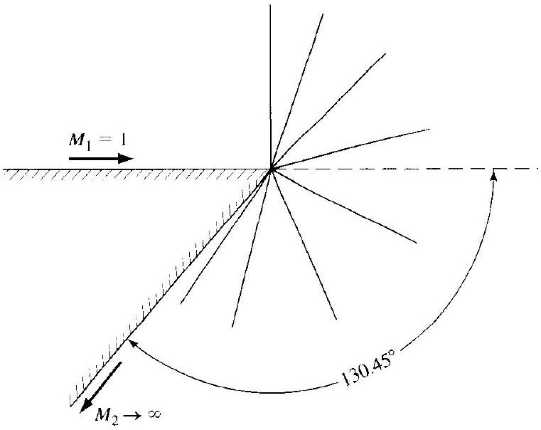
Figure 4.39 | Maximum expansion angle for a Prandtl-Meyer centered expansion wave.

Consider the $15^{\circ}$ half-angle wedge shown in Fig. 4.40. This is the same flow problem sketched in Fig. 4.12, with the added feature of the expansion waves at the corners of the base. We make the assumptions that (1) the flow separates at the corners, with the streamlines trailing downstream of the corners deflected toward the base at an angle of $15^{\circ}$ from the horizontal, as shown in Fig. 4.40, and (2) the base pressure $p_{B}$ is the arithmetic average between the pressure downstream of the expansion waves, $p_{3}$, and the freestream pressure, $p_{1}$. i.e., $p_{B}=1 / 2\left(p_{3}+p_{1}\right)$. We emphasize that both of these assumptions are purely arbitrary; they represent a qualitative model of the flow with arbitrary numbers, and do not necessarily reflect the actual quantitative flowfield values that actually exist in the base flow region. On the basis of the model flow sketched in Fig. 4.40, calculate the drag coefficient of the wedge, and compare with the result obtained in Example 4.9 where the base pressure was assumed to equal $p_{1}$.

## - Solution

From Example 4.8, we have these results for the leading edge shock wave and properties in region 2 behind the shock: $\theta=15^{\circ}, \beta=32.2^{\circ}, M_{n_{1}}=1.6, p_{2} / p_{1}=2.82$. From Table A.2, we obtain $M_{n_{2}}=0.6684$. Hence,

$$
M_{2}=\frac{M_{n_{2}}}{\sin (\beta-\theta)}=\frac{0.6684}{\sin (32.2-15)}=2.26
$$

From Table A.1, for $M_{2}=2.26, p_{o_{2}} / p_{2}=11.75$. From Table A.5, for $M_{2}=2.26, v_{2}= 33.27^{\circ}$. Examining Fig. 4.40, the flow expands from region 2 to region 3 through a total deflection angle of $15^{\circ}+15^{\circ}=30^{\circ}$. Hence,

$$
v_{3}=33.27+30=63.27
$$

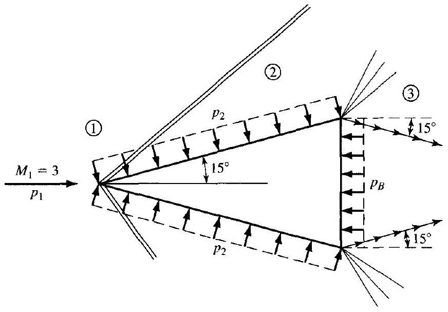
Figure 4.40 | Sketch for Example 4.17.

From Table A.5, for $v_{3}=63.27^{\circ}$ we obtain $M_{3}=3.82$. From Table A.1, for $M_{3}=3.82$, $p_{o_{3}} / p_{3}=119.1$. Hence,

$$
\frac{p_{3}}{p_{1}}=\frac{p_{3}}{p_{o_{3}}} \frac{p_{o_{3}}}{p_{o_{2}}} \frac{p_{o_{2}}}{p_{2}} \frac{p_{2}}{p_{1}}=\left(\frac{1}{119.1}\right)(1)(11.75)(2.82)=0.278
$$

Assume $p_{B}=1 / 2\left(p_{1}+p_{3}\right)$. Hence

$$
\frac{p_{B}}{p_{1}}=\frac{1}{2}\left(1+\frac{p_{3}}{p_{1}}\right)=\frac{1}{2}(1+0.278)=0.639
$$

From Example 4.9, the drag coefficient for the wedge, with the base pressure now denoted by $p_{B}$, is given by

$$
\begin{aligned}
c_{d} & =\frac{4}{\gamma p_{1} M_{1}^{2}}\left(p_{2}-p_{B}\right) \tan 15^{\circ} \\
& =\frac{4}{\gamma M_{1}^{2}}\left(\frac{p_{2}}{p_{1}}-\frac{p_{B}}{p_{1}}\right) \tan 15^{\circ} \\
& =\frac{4}{(1.4)(3)^{2}}(2.82-0.639) \tan 15^{\circ}=0.186
\end{aligned}
$$

The value of $c_{d}$ obtained from Example 4.9 was the lower value of 0.155 . The present example indicates that a 36 percent reduction in base pressure results in a 20 percent increase in drag coefficient.

The result of Example 4.17 illustrates the important effect that base pressure has on the drag coefficient on the wedge shown in Fig. 4.40. The accurate calculation of base pressure for real flow situations involving any aerodynamic body shape with a blunt base is difficult to achieve, even with modern techniques in computational fluid
dynamics. The accurate determination of base pressure remains today a state-of-theart research problem.

## 4. 16 | HISTORICAL NOTE: PRANDTL'S EARLY RESEARCH ON SUPERSONIC FLOWS AND THE ORIGIN OF THE PRANDTL-MEYER THEORY

The small German city of Göttingen nestles on the Leine River, which winds its way through lush countryside once part of the great Saxon empire. Göttingen was chartered in 1211, and quickly became a powerful member of the mercantilistic Hanseatic League in the fourteenth century. The wall around the town, many narrow cobblestone streets, and numerous medieval half-timbered houses survive to this day as reminders of Göttingen's early origin. However, this quaint appearance belies the fact that Göttingen is the home of one of the most famous universities in Europethe Georgia Augusta University founded in 1737 by King George II of England (the Hanover family that ruled England during the eighteenth century was of German origin). The university, simply known as "Göttingen" throughout the world, has been the home of many giants of science and mathematics-Gauss, Weber, Riemann, Planck, Hilbert, Born, Lorentz, Runge, Nernst, and Heisenberg, among others.

One such man, equal in stature to those above, was Ludwig Prandtl. Born in Friesing, Germany, on February 4, 1875, Prandtl became a professor of applied mechanics at Göttingen in 1904. In that same year, at the Congress of Mathematicians in Heidelberg, Prandtl introduced his concept of the boundary layer-an approach that was to revolutionize theoretical fluid mechanics in the twentieth century. Later, during the period from 1912 to 1919, he evolved a theoretical approach for calculating lift and induced drag on finite wings-Prandtl's lifting line and lifting surface theories. This work established Prandtl as the leading fluid dynamicist of modern times; he has clearly been accepted as the father of aerodynamics. Although no Nobel Prize has ever been awarded to a fluid dynamicist, Prandtl probably came closest to deserving such an accolade. (See Sec. 9.10 for a more complete biographical sketch of Prandtl.)

It is not recognized by many students that Prandtl also made major contributions to the theory and understanding of compressible flow. However, in 1905, he built a small Mach 1.5 supersonic nozzle for the purpose of studying steam turbine flows and (of all things) the movement of sawdust in sawmills. For the next 3 years, he was curious about the flow patterns associated with such supersonic nozzles; Fig. 4.41 shows some stunning photographs made in Prandtl's laboratory during this period which clearly illustrate a progression of expansion and oblique shock waves emanating from the exit of a supersonic nozzle. (Using nomenclature to be introduced in Chap. 5, the flow progresses from an "underexpanded" nozzle at the top of Fig. 4.41 to an "overexpanded" nozzle at the bottom of the figure. At the top of the figure, we see expansion waves; at the bottom are shock waves followed by expansion waves.) The dramatic aspect of these photographs is that Prandtl was learning about supersonic flow at the same time that the Wright brothers were just introducing practical powered airplane flight to the world, with maximum velocities no larger than $40 \mathrm{mi} / \mathrm{h}$ !
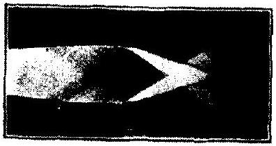
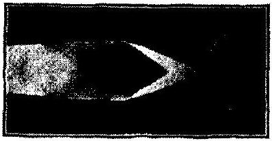
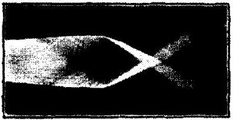
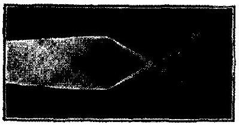
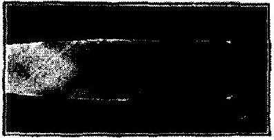
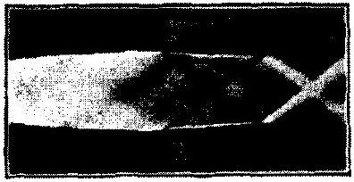

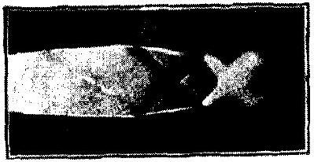
Figure 4.41 I Schlieren photographs of wave patterns downstream of the exit of a supersonic nozzle. The photographs were obtained by Prandtl and Meyer during 1907-1908.

The observation of such shock and expansion waves naturally prompted Prandtl to explore their theoretical properties. Consequently, Theodor Meyer, one of Prandtl's students at Göttingen, presented his doctoral dissertation in 1908 entitled "Ueber Zweidimensionale Bewegungsvorgänge in einem Gas, das mit Ueberschallgeschwindigkeit Stromt" ("On the Two-Dimensional Flow Processes in a Gas Flowing at Supersonic Velocities"). In this dissertation, Meyer presents the first practical theoretical development of the relations for both expansion waves and oblique shock waves-essentially the same theory as developed in this chapter. He begins by first defining a Mach wave and Mach angle as given by Eq. (4.1). Then, starting with geometry similar to that shown in Fig. 4.32, he derives the Prandtl-Meyer function Isee Eq. (4.44) in Sec. 4.14] and tabulates it, not versus Mach number. but rather as a function of $p / p_{o}$. (It is interesting to note that the term "Mach number" had not yet been coined; it was introduced by Jakob Ackeret 20 years later in honor of Ernst Mach, an Austrian scientist and philosopher who studied high-speed flow for a brief period in the 1870s. So Mach number is of fairly recent use.) In the same dissertation, Meyer follows these fundamental results with a companion study of oblique shock waves. deriving relations similar to those discussed in this chapter, and presenting limited shock wave tables of wave angle, deflection angle, and pressure ratio. Almost without fanfare, Meyer ends his paper with a spectacular photograph of internal flow within a supersonic nozzle, reproduced here as Fig. 4.42. The walls of the nozzle have been intentionally roughened so that weak waves-essentially Mach waves-will be

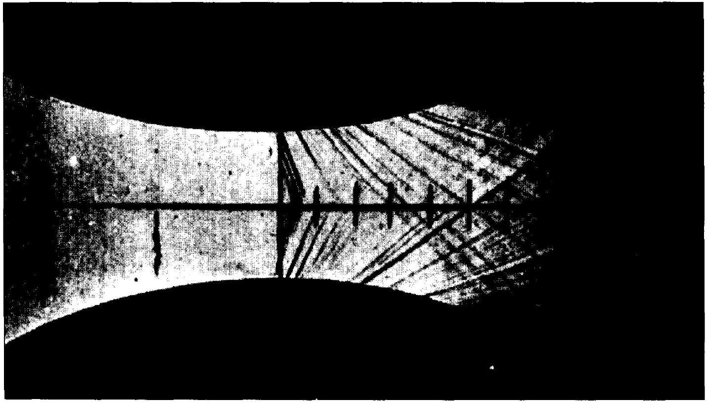
Figure 4.42 I Mach waves in a supersonic nozzle. The waves are generated by roughening the nozzle wall. An original photograph from Meyer's Ph.D. dissertation, 1908.

visible in the schlieren photograph. The reader should marvel over such a picture being taken in 1908; it has the appearance of coming from a modern supersonic laboratory in the 2000 s .

We emphasize that Prandtl's and Meyer's work on expansion and oblique shock waves was contemporary with the normal shock studies of Rayleigh and Taylor in 1910 (see Sec. 3.10). So once again we are reminded of the value of basic research on problems that appear purely academic at the time. The true practical value of Meyer's dissertation did not come to fruition until the advent of supersonic flight in the 1940s.

Throughout subsequent decades, Prandtl maintained his interest in high-speed compressible flow; for example, his work on compressibility corrections for subsonic flow in the 1920s will be discussed in Sec. 9.9. Moreover, many of his students went on to distinguish themselves in high-speed flow research, most notably Theodore von Karman and Adolf Busemann. But this is the essence of other stories, to be told in later sections.

### 4.17 I SUMMARY

Whenever a supersonic flow is turned into itself, shock waves can occur; when the flow is turned away from itself, expansion waves can occur. In either case, if the wave is infinitely weak, it becomes a Mach wave, which makes an angle $\mu$ with respect to the upstream flow direction; $\mu$ is called the Mach angle, defined as

$$
\mu=\sin ^{-1} \frac{1}{M}
$$

Across an oblique shock wave, the tangential components of velocity in front of and behind the wave are equal. (However, the tangential components of Mach number are not the same.) The thermodynamic properties across the oblique shock are dictated by the normal component of the upstream Mach number $M_{n_{1}}$. The values of $p_{2} / p_{1}, \rho_{2} / \rho_{1}, T_{2} / T_{1}, s_{2}-s_{1}$, and $p_{o_{2}} / p_{o_{1}}$ across the oblique shock are the same as for a normal shock wave with an upstream Mach number of $M_{n_{1}}$. In this fashion, the normal shock tables in Appendix A. 2 can be used for oblique shocks. The value of $M_{n_{1}}$ depends on both $M_{1}$ and the wave angle, $\beta$, via

$$
M_{n_{1}}=M_{1} \sin \beta
$$

In turn, $\beta$ is related to $M_{1}$ and the flow deflection angle $\theta$ through the $\theta-\beta-M$ relation

$$
\tan \theta=2 \cot \beta\left[\frac{M_{1}^{2} \sin ^{2} \beta-1}{M_{1}^{2}(\gamma+\cos 2 \beta)+2}\right]
$$

In light of this, we can make the following comparison: (1) In Chap. 3, we noted that the changes across a normal shock depended only on one flow parameter, namely the upstream Mach number $M_{1}$. (2) In the present chapter, we note that two flow parameters are needed to uniquely define the changes across an oblique shock. Any combination of two parameters will do. For example, an oblique shock is uniquely
defined by any one of the following pairs of parameters: $M_{1}$ and $\beta, M_{1}$ and $\theta, \theta$ and $\beta, M_{1}$ and $p_{2} / p_{1}, \beta$ and $p_{2} / p_{1}$ etc.

For the solution of shock wave problems, especially cases involving shock intersections and reflections, the graphical constructions associated with the shock polar and the pressure-deflection diagrams are instructional.

For the curved, detached bow shock wave in front of a supersonic blunt body, the properties at any point immediately behind the shock are given by the oblique shock relations studied in this chapter, for the values of $M_{1}$ and the local $\beta$. Indeed, the oblique shock relations studied here apply in general to points immediately behind any curved, three-dimensional shock wave, so long as the component of the upstream Mach number normal to the shock at a given point is used to obtain the shock properties.

The properties through and behind a Prandtl-Meyer expansion fan are dictated by the differential relation

$$
d \theta=\sqrt{M^{2}-1} \frac{d V}{V}
$$

When integrated across the wave, this equation becomes

$$
\theta_{2}=v\left(M_{2}\right)-v\left(M_{1}\right)
$$

where $\theta_{1}$ is assumed to be zero and $v$ is the Prandtl-Meyer function given by

$$
v(M)=\sqrt{\frac{\gamma+1}{\gamma-1}} \tan ^{-1} \sqrt{\frac{\gamma-1}{\gamma+1}\left(M^{2}-1\right)}-\tan ^{-1} \sqrt{M^{2}-1}
$$

The flow through an expansion wave is isentropic; from the local Mach numbers obtained from the above relations, all other flow properties are given by the isentropic flow relations discussed in Section 3.5.

## PROBLEMS

4.1 Consider an oblique shock wave with a wave angle equal to $35^{\circ}$. Upstream of the wave, $p_{1}=2000 \mathrm{lb} / \mathrm{ft}^{2}, T_{1}=520^{\circ} \mathrm{R}$, and $V_{1}=3355 \mathrm{ft} / \mathrm{s}$. Calculate $p_{2}, T_{2}, V_{2}$ and the flow deflection angle.
4.2 Consider a wedge with a half-angle of $10^{\circ}$ flying at Mach 2. Calculate the ratio of total pressures across the shock wave emanating from the leading edge of the wedge.
4.3 Calculate the maximum surface pressure (in newtons per square meter) that can be achieved on the forward face of a wedge flying at Mach 3 at standard sea level conditions ( $p_{1}=1.01 \times 10^{5} \mathrm{~N} / \mathrm{m}^{2}$ ) with an attached shock wave.
4.4 In the flow past a compression corner, the upstream Mach number and pressure are 3.5 and 1 atm , respectively. Downstream of the corner, the pressure is 5.48 atm . Calculate the deflection angle of the corner.
4.5 Consider a $20^{\circ}$ half-angle wedge in a supersonic flow at Mach 3 at standard sea level conditions ( $p_{1}=2116 \mathrm{lb} / \mathrm{ft}^{2}$ and $T_{1}=519^{\circ} \mathrm{R}$ ). Calculate the wave angle, and the surface pressure, temperature, and Mach number.
4.6 A supersonic stream at $M_{1}=3.6$ flows past a compression corner with a deflection angle of $20^{\circ}$. The incident shock wave is reflected from an opposite wall which is parallel to the upstream supersonic flow, as sketched in Fig. 4.18. Calculate the angle of the reflected shock relative to the straight wall.
4.7 An incident shock wave with wave angle $=30^{\circ}$ impinges on a straight wall. If the upstream flow properties are $M_{1}=2.8, p_{1}=1 \mathrm{~atm}$, and $T_{1}=300 \mathrm{~K}$, calculate the pressure, temperature, Mach number, and total pressure downstream of the reflected wave.
4.8 Consider a streamline with the properties $M_{1}=4.0$ and $p_{1}=1 \mathrm{~atm}$. Consider also the following two different shock structures encountered by such a streamline: (a) a single normal shock wave, and (b) an oblique shock with $\beta=40^{\circ}$, followed by a normal shock. Calculate and compare the total pressure behind the shock structure of each ( $a$ ) and ( $b$ ) above. From this comparison, can you deduce a general principle concerning the efficiency of a single normal shock in relation to an oblique shock plus normal shock in decelerating a supersonic flow to subsonic speeds (which, for example, is the purpose of an inlet of a conventional jet engine)?
4.9 Consider the intersection of two shocks of opposite families, as sketched in Fig. 4.23. For $M_{1}=3, p_{1}=1 \mathrm{~atm}, \theta_{2}=20^{\circ}$, and $\theta_{3}=15^{\circ}$, calculate the pressure in regions 4 and $4^{\prime}$, and the flow direction $\Phi$, behind the refracted shocks.
4.10 Consider the flow past a $30^{\circ}$ expansion corner, as sketched in Fig. 4.32. The upstream conditions are $M_{1}=2, p_{1}=3 \mathrm{~atm}$, and $T_{1}=400 \mathrm{~K}$. Calculate the following downstream conditions: $M_{2}, p_{2}, T_{2}, T_{o_{2}}$, and $p_{o_{2}}$.
4.11 For a given Prandtl-Meyer expansion, the upstream Mach number is 3 and the pressure ratio across the wave is $p_{2} / p_{1}=0.4$. Calculate the angles of the forward and rearward Mach lines of the expansion fan relative to the free-stream direction.
4.12 Consider a supersonic flow with an upstream Mach number of 4 and pressure of 1 atm . This flow is first expanded around an expansion corner with $\theta=15^{\circ}$, and then compressed through a compression corner with equal angle $\theta=15^{\circ}$ so that it is returned to its original upstream direction. Calculate the Mach number and pressure downstream of the compression corner.
4.13 Consider the incident and reflected shock waves as sketched in Fig. 4.17. Show by means of sketches how you would use shock polars to solve for the reflected wave properties.
4.14 Consider a supersonic flow past a compression corner with $\theta=20^{\circ}$. The upstream properties are $M_{1}=3$ and $p_{1}=2116 \mathrm{lb} / \mathrm{ft}^{2}$. A Pitot tube is inserted in the flow downstream of the corner. Calculate the value of pressure measured by the Pitot tube.
4.15 Can shock polars be used to solve the intersection of shocks of opposite families, as sketched in Fig. 4.23? Explain.
4.16 Using shock-expansion theory, calculate the lift and drag (in pounds) on a symmetrical diamond airfoil of semiangle $\varepsilon=15^{\circ}$ (see Fig. 4.35) at an angle of attack to the free stream of 5 when the upstream Mach number and pressure are 2.0 and $2116 \mathrm{lb} / \mathrm{ft}^{2}$, respectively. The maximum thickness of the airfoil is $t=0.5 \mathrm{ft}$. Assume a unit length of 1 ft in the span direction (perpendicular to the page in Fig. 4.35).
4.17 Consider a flat plate with a chord length (from leading to trailing edge) of 1 m . The free-stream flow properties are $M_{1}=3, p_{1}=1 \mathrm{~atm}$, and $T_{1}=$ 270 K . Using shock-expansion theory, tabulate and plot on graph paper these properties as functions of angle of attack from 0 to $30^{\circ}$ (use increments of $5^{\circ}$ ):
a. Pressure on the top surface
b. Pressure on the bottom surface
c. Temperature on the top surface
d. Temperature on the bottom surface
e. Lift per unit span
f. Drag per unit span
g. Lift/drag ratio
(Note: The results from this problem will be used for comparison with linear supersonic theory in Chap. 9.)
4.18 A flat plate is immersed in a Mach 2 flow at standard sea level conditions at an angle of attack of $2^{\circ}$. Assuming the same shear stress distribution given in Example 1.8, calculate, per unit span: (a) lift, (b) wave drag, and (c) skin friction drag. What percentage of the total drag is skin-friction drag? Compare this percentage with the $10^{\circ}$ angle of attack case discussed in Example 1.8.
4.19 Calculate the drag coefficient for a wedge with a $20^{\circ}$ half-angle at Mach 4 . Assume the base pressure is free-stream pressure.
4.20 The flow of a chemically reacting gas is sometimes approximated by the use of relations obtained assuming a calorically perfect gas, such as in this chapter, but using an "effective gamma", a ratio of specific heats less than 1.4. Consider the Mach 3 flow of chemically reacting air, where the flow is approximated by a ratio of specific heats equal to 1.2 . If this gas flows over a compression corner with a deflection angle of 20 degrees, calculate the wave angle of the oblique shock. Compare this result with that for ordinary air with a ratio of specific heats equal to 1.4 . What conclusion can you make about the general effect of a chemically reacting gas on wave angle?
4.21 For the two cases treated in Problem 4.20, calculate and compare the pressure ratio (shock strength) across the oblique shock wave. What can you conclude about the effect of a chemically reacting gas on shock strength?

