## CHAPTER

## 5

## Quasi-One-Dimensional Flow

The whole problem of aerodynamics, both subsonic and supersonic, may be summed up in one sentence: Aerodynamics is the science of slowing-down the air without loss, after it has once been accelerated by any device, such as a wing or a wind tunnel. It is thus good aerodynamic practice to avoid accelerating the air more than is necessary.
W. F. Hilton, 1951

## PREVIEW BOX

This chapter has to do with nozzles and diffusers—vital elements of high-speed wind tunnels. A typical large supersonic wind tunnel is shown in Fig. S.1, so large that it fills a building all by itself. To the left (upstream) of the test section (labeled 2 in Fig. 5.1 ) is a convergentdivergent nozzle designed to smoothly accelerate an airflow to supersonic speeds. To the right (downstream) of the test section is a convergent-divergent diffuser designed to slow the supersonic stream to subsonic velocity via a pattern of multiple shock waves with a minimum of total pressure loss. In Fig. 5.2, a model is shown mounted in the supersonic test section of the same wind tunnel. In this chapter, you will learn how nozzles and diffusers work, and how to calculate the overall properties of the flows through these and other ducts. The applications of this chapter do not stop there.

The same principles govern the performance of rocket engines, such as that shown in Fig. 5.3. Indeed, much of the material in this chapter has direct application to propulsion devices in general.

In this chapter, an important assumption is made regarding the physical nature of the flow through a variable-area duct. We will assume that the flow properties yary only in one direction along the duct, for example, the $x$ direction shown in Fig. 5.4. However, changes of the flow properties in the $x$ direction are brought about by area change of the duct. This is in contrast to the purely one-dimensional flows through a constant area duct studied in Chap. 4. To distinguish between these flows, the flow sketched in Fig. 5.4 is called quasi-one-dimensional flow. To assume that the flow properties vary only in the $x$ direction through a duct that has a

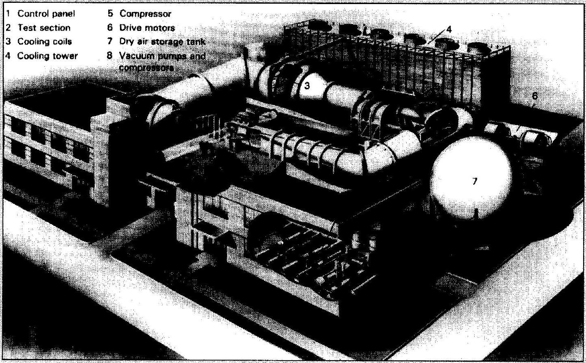
Figure 5.1 1 The NASA Ames $6 \times 6$-foot supersonic wind tunnel with supporting facilities. The $6 \times 6$-foot label applies to the test section with a square cross-section six feet on each side.

two- or three-dimensional shape, such as sketched in Fig. 5.4, seems contradictory. We will discuss and resolve this apparent contradiction in the present chapter.

The roadmap for the present chapter is given in Fig. 5.5. Under the banner of quasi-one-dimensional flow, we first move to the left side of the roadmap and obtain the fundamental equations that govern such flows. Then we move to the right side to obtain a
very special and important relation for quasi-onedimensional flow called the area-velocity relation, which will tell us a lot about the physics of such flows. With these equations and relations, we go to the main features of this chapter, the study of flows through nozzles and diffusers. The material of this chapter is pivotal to many applications in compressible flow-please pay close attention to it.

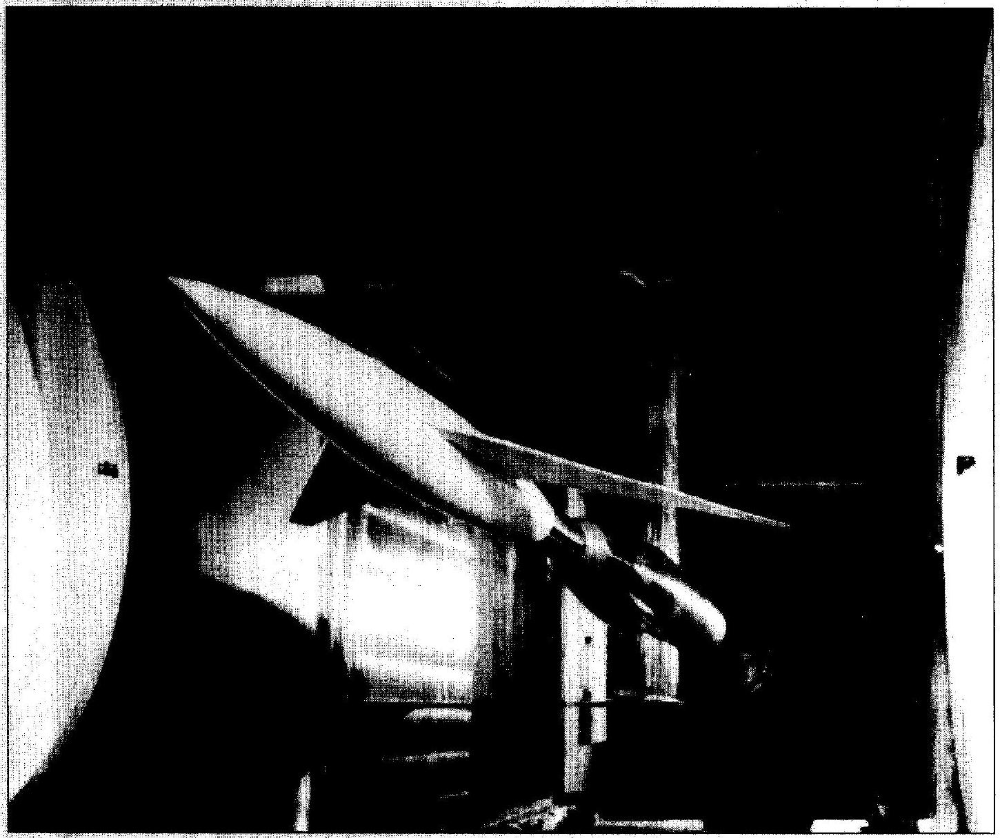
Figure 5.2 1 An aircraft model mounted in the test section of the Ames $6 \times 6$-foot supersonic wind tunnel. The test section is labeled as item 2 in Fig. 5.1.

(continued from page 193)

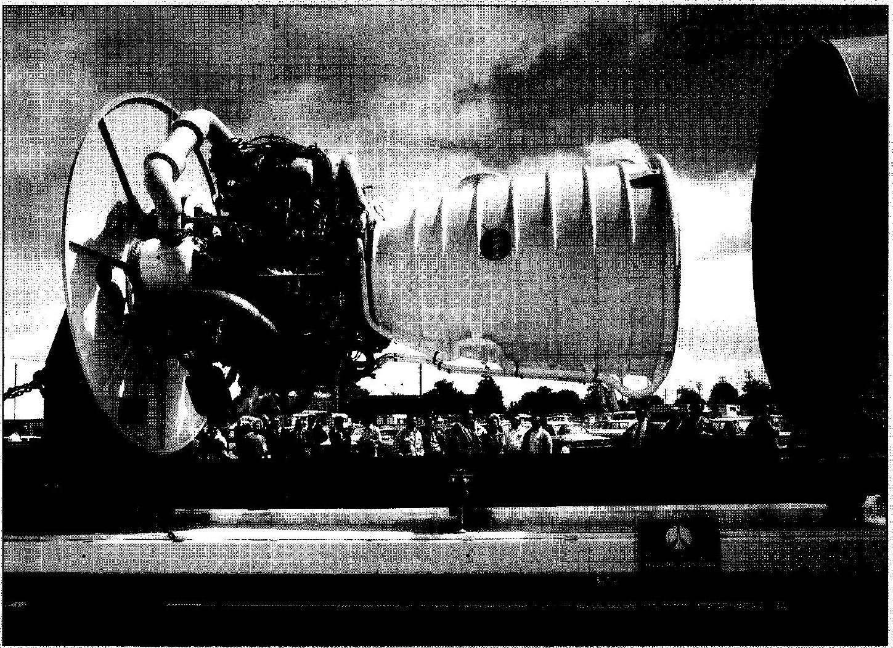
Figure 5.3 Space Shuttle main engine.

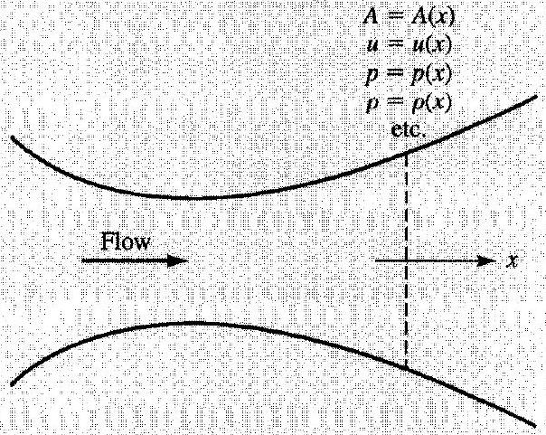
Figure 5.4 | Quasi-one-dimensional flow.

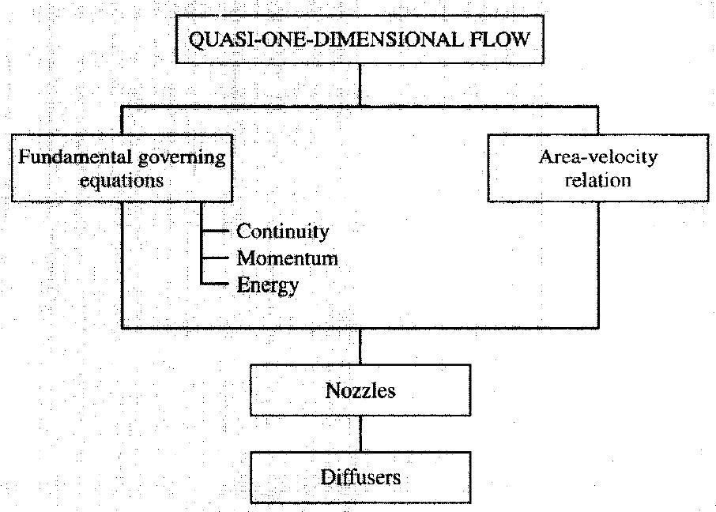
Figure 5.5 | Roadmap for Chapter 5.

### 5.1 I INTRODUCTION

The distinction between one-dimensional flow and quasi-one-dimensional flow was discussed in Sec. 3.1, which should be reviewed by the reader before proceeding further. In Sec. 3.1, as throughout all of Chap. 3, one-dimensional flow was treated as strictly constant-area flow. In the present chapter, this restriction will be relaxed by allowing the streamtube area $A$ to vary with distance $x$, as shown in Figs. 3.5b and 5.4. At the same time, we will continue to assume that all flow properties are uniform across any given cross section of the flow, and hence are functions of $x$ only (and time $t$ if the flow is unsteady). Such a flow, where $A=A(x), p=p(x), \rho=\rho(x)$, and $V=u=u(x)$ for steady flow, is defined as quasi-one-dimensional flow. For this flow, it is the area change that causes the flow properties to vary as a function of $x$; in contrast, for the purely one-dimensional constant area flow treated in Chap. 3, it is a normal shock, heat addition and/or friction that causes the flow properties to vary as a function of $x$. In Sec. 5.2, the governing equations for steady quasi-one-dimensional flow will be derived by applying our conservation principles to a control volume of variable area. In the process, the reader is cautioned that quasi-one-dimensional flow is an approximation-the flow in the variable-area streamtube shown in Figs. 3.5b and 5.4 is (strictly speaking) three-dimensional, and its exact solution must be carried out by methods such as those discussed in Chaps. 11 and 12. However, for a wide variety of engineering problems, such as the study of flow through wind tunnels and rocket engines, quasi-one-dimensional results are frequently sufficient. Indeed, the material developed in this chapter is used virtually daily by practicing gas dynamicists and aerodynamicists, and is indispensable toward a full understanding of compressible flow.

## 5.2 | GOVERNING EQUATIONS

Let us first examine the physical implications of the assumption of quasi-onedimensional flow. Return to Fig. $3.5 b$ for a moment, where the actual physical flow through the variable-area duct is three-dimensional, and the flow properties vary as a function of $x, y$, and $z$. Now examine Fig. 5.4, which illustrates the quasi-onedimensional assumption that the flow through the variable-area duct varies only as a function of $x$, i.e., $u=u(x), p(x)$, etc. This is tantamount to assuming that the flow properties are uniform across any given cross section of area $A$, and that they represent values that are some kind of mean of the actual flow properties distributed over the cross section. It is clear that quasi-one-dimensional flow is an approximation to the actual physics of the flow.

On the other hand, we obtain in this section the governing equations for quasi-onedimensional flow which exactly enforce mass conservation, Newton's second law, and the first law of thermodynamics for such a flow. Hence, the equations are not approximate-they are exact representations of our conservation equations applied to a physical model that is approximate. Please keep in mind that the equations derived in this section exactly enforce our basic flow conservation principles; there are no compromises here in regard to the overall physical integrity of the flow. We preserve this physical integrity by utilizing the integral forms of the conservation equations obtained in Chap. 2, applied in a mathematically exact manner to the model of the flow shown in Fig. 5.4, which is physically approximate. Let us see how this is done.

Algebraic equations for steady quasi-one-dimensional flow can be obtained by applying the integral form of the conservation equations to the variable-area control volume sketched in Fig. 5.6. For example, the continuity equation, Eq. (2.2), repeated here for convenience,

$$
-\oiint_{S} \rho \mathbf{V} \cdot d \mathbf{S}=\frac{\partial}{\partial t} \oiint_{\mathscr{V}} \rho d \mathscr{V}
$$

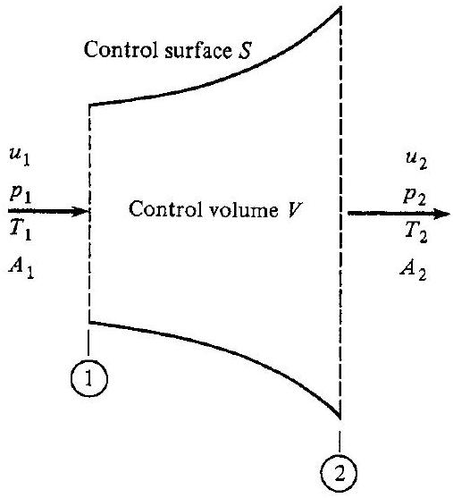
Figure 5.6 I Finite control volume for quasi-one-dimensional flow.

when integrated over the control volume in Fig. 5.6 leads, for steady flow, directly to

$$
\rho_{1} u_{1} A_{1}=\rho_{2} u_{2} A_{2}
$$

This is the continuity equation for steady quasi-one-dimensional flow. Note that in Eq. (5.1) the term $\rho_{1} u_{1} A_{1}$ is the surface integral over the cross section at location 1 , and $\rho_{2} u_{2} A_{2}$ is the surface integral over the cross section at location 2 . The surface integral taken over the side of the control surface between locations 1 and 2 is zero, because the control surface is a streamtube; hence $\mathbf{V}$ is assumed oriented along the surface, and hence $\mathbf{V} \cdot d \mathbf{S}=0$ along the side.

The integral form of the momentum equation, repeated from Eq. (2.11), is

$$
\oiint_{S}(\rho \mathbf{V} \cdot d \mathbf{S}) \mathbf{V}+\oiiint \oiiint_{y} \frac{\partial(\rho \mathbf{V})}{\partial t} d Y=\oiiint_{y} \rho \mathbf{f} d Y-\oiint_{S} p d \mathbf{S}
$$

Applied to Fig. 5.6, assuming steady flow and no body forces, it directly becomes

$$
p_{1} A_{1}+\rho_{1} u_{1}^{2} A_{1}+\int_{A_{1}}^{A_{2}} p d A=p_{2} A_{2}+\rho_{2} u_{2}^{2} A_{2}
$$

This is the momentum equation for steady quasi-one-dimensional flow. Note that it is not strictly an algebraic equation because of the integral term which represents the pressure force on the sides of the control surface between locations 1 and 2 .

The integral form of the energy equation, repeated from Eq. (2.20), is

$$
\begin{aligned}
& \oiint \oiint_{y} \dot{q} \rho d y-\oiint_{S} p \mathbf{V} \cdot d \mathbf{S}+\oiiint \oiint_{y} \rho(\mathbf{f} \cdot \mathbf{V}) d y \\
& \quad=\oiint \oiint_{y} \frac{\partial}{\partial t}\left[\rho\left(e+\frac{V^{2}}{2}\right)\right] d y+\oiint_{S} \rho\left(e+\frac{V^{2}}{2}\right) \mathbf{V} \cdot d \mathbf{S}
\end{aligned}
$$

Applied to Fig. 5.6, and assuming steady adiabatic flow with no body forces, it directly yields

$$
-\left(-p_{1} u_{1} A_{1}+p_{2} u_{2} A_{2}\right)=\rho_{1}\left(e_{1}+\frac{u_{1}^{2}}{2}\right)\left(-u_{1} A_{1}\right)+\rho_{2}\left(e_{2}+\frac{u_{2}^{2}}{2}\right) u_{2} A_{2}
$$

Rearranging,

$$
p_{1} u_{1} A_{1}+\rho_{1} u_{1} A_{1}\left(e_{1}+\frac{u_{1}^{2}}{2}\right)=p_{2} u_{2} A_{2}+\rho_{2} u_{2} A_{2}\left(e_{2}+\frac{u_{2}^{2}}{2}\right)
$$

Divide Eq. (5.3) by (5.1):

$$
\frac{p_{1}}{\rho_{1}}+e_{1}+\frac{u_{1}^{2}}{2}=\frac{p_{2}}{\rho_{2}}+e_{2}+\frac{u_{2}^{2}}{2}
$$

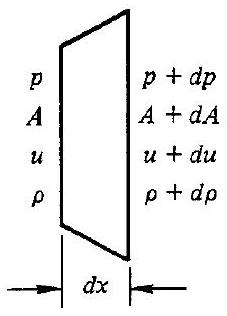
Figure 5.71 Incremental volume.

Noting that $h=e+p / \rho$, Eq. (5.4) becomes

$$
h_{1}+\frac{u_{1}^{2}}{2}=h_{2}+\frac{u_{2}^{2}}{2}
$$

This is the energy equation for steady adiabatic quasi-one-dimensional flow-it states that the total enthalpy is constant along the flow:

$$
h_{o}=\mathrm{const}
$$

Note that Eqs. (5.5) and (5.6) are identical to the adiabatic one-dimensional energy equation derived in Chap. 3 [see Eq. (3.40)]. Indeed, this is a general result; in any adiabatic steady flow, the total enthalpy is constant along a streamline-a result that will be proven in Chap. 6. Also note that Eqs. (5.1) and (5.2), when applied to the special case where $A_{1}=A_{2}$, reduce to the corresponding one-dimensional results expressed in Eqs. (3.2) and (3.5).

In Chap. 6, the general conservation laws will be expressed in differential rather than integral or algebraic forms, as done so far. As a precursor to this, differential expressions for the steady quasi-one-dimensional continuity, momentum, and energy equations will be of use to us now. For example, from Eq. (5.1),

$$
\rho u A=\text { const }
$$

Hence,

$$
d(\rho u A)=0
$$

To obtain a differential form of the momentum equation, apply Eq. (5.2) to the infinitesimal control volume sketched in Fig. 5.7, where the length in the $x$ direction is $d x$ :

$$
p A+\rho u^{2} A+p d A=(p+d p)(A+d A)+(\rho+d \rho)(u+d u)^{2}(A+d A)
$$

Dropping all second-order terms involving products of differentials, this becomes

$$
A d p+A u^{2} d \rho+\rho u^{2} d A+2 \rho u A d u=0
$$

Expanding Eq. (5.7), and multiplying by $u$,

$$
\rho u^{2} d A+\rho u A d u+A u^{2} d \rho=0
$$

Subtracting this equation from Eq. (5.8), we obtain

$$
d p=-\rho u d u
$$

Equation (5.9) is called Euler's equation, to be discussed in Sec. 6.4. Finally, a differential form of the energy equation is obtained from Eq. (5.5), which states that

$$
h+\frac{u^{2}}{2}=\mathrm{const}
$$

Hence,

$$
d h+u d u=0
$$

To reinforce the comments made at the beginning of this section, we emphasize that Eqs. (5.1), (5.2), (5.5), (5.7), (5.9), and (5.10) are exact representations of physics as applied to the approximate model of quasi-one-dimensional flow. So the basic fundamental physical principles stated in Chap. 2 are not compromised here. The only compromise with the true nature of the flow is the use of the simplified model of quasi-one-dimensional flow.

Return to the roadmap in Fig. 5.5. We have completed the left column, and we are now ready to use the fundamental governing equations for quasi-one-dimensional flow to study the properties of nozzle and diffuser flows. However, before going to these applications, we move to the right side of the roadmap and obtain the areavelocity relation. This relation is vital to understanding the physics of the flow, and we need this understanding before we go to the applications.

## 5.3 | AREA-VELOCITY RELATION

A wealth of physical information regarding quasi-one-dimensional flow can be obtained from a particular combination of the differential forms of the conservation equations presented at the end of Sec. 5.2 as shown next. From Eq. (5.7).

$$
\frac{d \rho}{\rho}+\frac{d u}{u}+\frac{d A}{A}=0
$$

To eliminate $d \rho / \rho$ from Eq. (5.11), consider Eq. (5.9):

$$
\frac{d p}{\rho}=\frac{d p}{d \rho} \frac{d \rho}{\rho}=-u d u
$$

Recall that we are considering adiabatic, inviscid flow, i.e., there are no dissipative mechanisms such as friction, thermal conduction, or diffusion acting on the flow. Thus, the flow is isentropic. Hence, any change in pressure, $d p$, in the flow is accompanied by a corresponding isentropic change in density, $d \rho$. Therefore, we can write

$$
\frac{d p}{d \rho}=\left(\frac{\partial p}{\partial \rho}\right)_{s}=a^{2}
$$

Combining Eqs. (5.12) and (5.13),

$$
a^{2} \frac{d \rho}{\rho}=-u d u
$$

or

$$
\frac{d \rho}{\rho}=-\frac{u d u}{a^{2}}=-\frac{u^{2} d u}{a^{2} u}=-M^{2} \frac{d u}{u}
$$

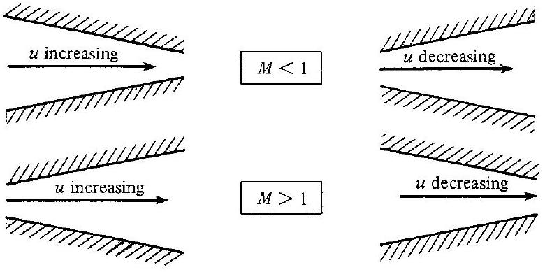
Figure 5.8 I Flow in converging and diverging ducts.

Substituting Eq. (5.14) into Eq. (5.11),

$$
\frac{d A}{A}=\left(M^{2}-1\right) \frac{d u}{u}
$$

Equation (5.15) is an important result. It is called the area-velocity relation, and it tells us this information:

1. For $M \rightarrow 0$, which in the limit corresponds to incompressible flow, Eq. (5.15) shows that $A u=$ const. This is the familiar continuity equation for incompressible flow.
2. For $0 \leq M<1$ (subsonic flow), an increase in velocity (positive $d u$ ) is associated with a decrease in area (negative $d A$ ), and vice versa. Therefore, the familiar result from incompressible flow that the velocity increases in a converging duct and decreases in a diverging duct still holds true for subsonic compressible flow (see top of Fig. 5.8).
3. For $M>1$ (supersonic flow), an increase in velocity is associated with an increase in area, and vice versa. Hence, we have a striking difference in comparison to subsonic flow. For supersonic flow, the velocity increases in a diverging duct and decreases in a converging duct (see bottom of Fig. 5.8).
4. For $M=1$ (sonic flow), Eq. (5.15) yields $d A / A=0$, which mathematically corresponds to a minimum or maximum in the area distribution. The minimum in area is the only physically realistic solution, as described next.

These results clearly show that for a gas to expand isentropically from subsonic to supersonic speeds, it must flow through a convergent-divergent duct (or streamtube), as sketched at the top of Fig. 5.9. Moreover, at the minimum area that divides the convergent and divergent sections of the duct, we know from item 4 above that the flow must be sonic. This minimum area is called a throat. Conversely, for a gas to compress isentropically from supersonic to subsonic speeds, it must also flow through a convergent-divergent duct, with a throat where sonic flow occurs, as sketched at the bottom of Fig. 5.9.

From this discussion, we recognize why rocket engines have large, bell-like nozzle shapes as sketched in Fig. 5.10-to expand the exhaust gases to high-velocity,

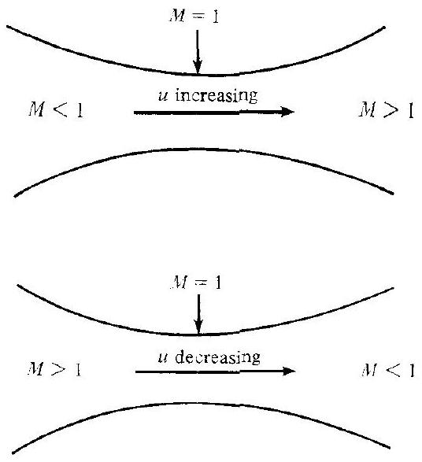
Figure 5.9 | Flow in a convergentdivergent duct.

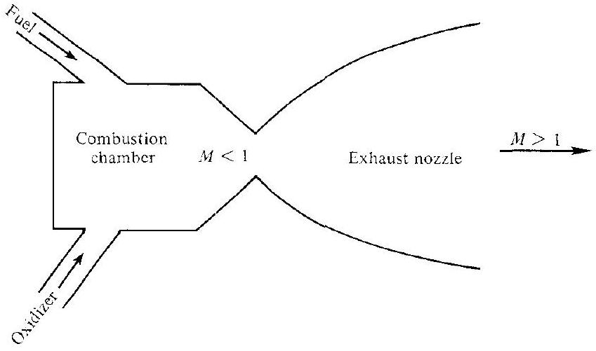
Figure 5.10| Schematic of a rocket engine.

supersonic speeds. This bell-like shape is clearly evident in the photograph of the space shuttle main engine shown in Fig 5.3. Moreover, we can infer the configuration of a supersonic wind tunnel, which is designed to first expand a stagnant gas to supersonic speeds for aerodynamic testing, and then compress the supersonic stream back to a low-speed subsonic flow before exhausting it to the atmosphere. This general configuration is illustrated in Fig. 5.11. Stagnant gas is taken from a reservoir and expanded to high subsonic velocities in the convergent portion of the nozzle. At the minimum area (the first throat), sonic flow is achieved. Downstream of the throat, the flow goes supersonic in the divergent portion of the nozzle. At the end of the nozzle, designed to achieve a specified Mach number, the supersonic flow enters the test section, where a test model or other experimental device is usually situated. Downstream of the test section, the supersonic flow enters a diffuser, where it is slowed down in a convergent duct to sonic flow at the second throat, and then further slowed to low subsonic speeds in a divergent duct. finally being exhausted to the atmosphere.

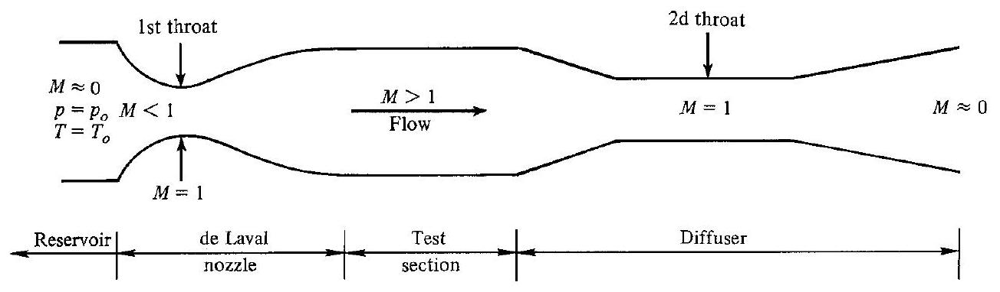
Figure 5.11 I Schematic of a supersonic wind tunnel.

This discussion, along with Fig. 5.11, is a simplistic view of real supersonic wind tunnels, but it serves to illustrate the basic phenomena as revealed by the areavelocity relation, Eq. (5.15). Also note that a convergent-divergent nozzle is sometimes called a de Laval (or Laval) nozzle, after Carl G. P. de Laval, who first used such a configuration in his steam turbines in the late nineteenth century, as described in Secs. 1.1 and 5.8.

The derivation of Eq. (5.15) utilized only the basic conservation equations-no assumption as to the type of gas was made. Hence, Eq. (5.15) is a general relation which holds for real gases and chemically reacting gases, as well as for a perfect gas-as long as the flow is isentropic. We will visit this matter again in Chap. 17.

The area-velocity relation is a differential relation, and in order to make quantitative use of it, we need to integrate Eq. (5.15). However, there is a more direct way of obtaining quantitative relations for quasi-one-dimensional flow, which we will see in the next section. The primary importance of the area-velocity relation is the invaluable physical information it provides, as we have already discussed.

We now move to the bottom of our roadmap in Fig. 5.5. Using the fundamental governing equations as well as the physical information provided by the area-velocity relation, we examine the first of the two central applications in this chapter-flows through nozzles.

### 5.4 I NOZZLES

The analysis of flows through variable-area ducts in a general sense requires numerical solutions such as those to be discussed in Chap. 17. However, based on our experience obtained in Chaps. 3 and 4, we suspect (correctly) that we can obtain closed-form results for the case of a calorically perfect gas. We will divide our discussion into two parts: (1) purely isentropic subsonic-supersonic flow through nozzles and (2) the effect of different pressure ratios across nozzles.

### 5.4.1 Isentropic Subsonic-Supersonic Flow of a Perfect Gas through Nozzles

Consider the duct shown in Fig. 5.12. At the throat, the flow is sonic. Hence, denoting conditions at sonic speed by an asterisk, we have, at the throat, $M^{*}=1$ and

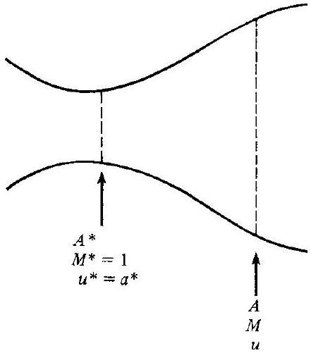
Figure 5.12 | Geometry for derivation of the area Mach number relation.

$u^{*}=a^{*}$. The area of the throat is $A^{*}$. At any other section of the duct, the local area, Mach number, and velocity are $A, M$, and $u$, respectively. Apply Eq. (5.1) between these two locations:

$$
\rho^{*} u^{*} A^{*}=\rho u A
$$

Since $u^{*}=a^{*}$, Eq. (5.16) becomes

$$
\frac{A}{A^{*}}=\frac{\rho^{*}}{\rho} \frac{a^{*}}{u}=\frac{\rho^{*}}{\rho_{o}} \frac{\rho_{o}}{\rho} \frac{a^{*}}{u}
$$

where $\rho_{o}$ is the stagnation density defined in Sec. 3.4, and is constant throughout the isentropic flow. Repeating Eq. (3.31),

$$
\frac{\rho_{o}}{\rho}=\left(1+\frac{\gamma-1}{2} M^{2}\right)^{1 /(\gamma-1)}
$$

and apply this to sonic conditions, we have

$$
\frac{\rho_{o}}{\rho^{*}}=\left(\frac{\gamma+1}{2}\right)^{1 /(\gamma-1)}
$$

Also, by definition, and from Eq. (3.37),

$$
\left(\frac{u}{a^{*}}\right)^{2}=M^{* 2}=\frac{\frac{\gamma+1}{2} M^{2}}{1+\frac{\gamma-1}{2} M^{2}}
$$

Squaring Eq. (5.17), and substituting Eqs. (3.31), (5.18), and (5.19), we have

$$
\begin{aligned}
& \left(\frac{A}{A^{*}}\right)^{2}=\left(\frac{\rho^{*}}{\rho_{o}}\right)^{2}\left(\frac{\rho_{o}}{\rho}\right)^{2}\left(\frac{a^{*}}{u}\right)^{2} \\
& \left(\frac{A}{A^{*}}\right)^{2}=\left(\frac{2}{\gamma+1}\right)^{2 /(\gamma-1)}\left(1+\frac{\gamma-1}{2} M^{2}\right)^{2 /(\gamma-1)}\left(\frac{1+\frac{\gamma-1}{2} M^{2}}{\frac{\gamma+1}{2} M^{2}}\right) \\
& \left(\frac{A}{A^{*}}\right)^{2}=\frac{1}{M^{2}}\left[\frac{2}{\gamma+1}\left(1+\frac{\gamma-1}{2} M^{2}\right)\right]^{(\gamma+1) /(\gamma-1)}
\end{aligned}
$$

Equation (5.20) is called the area-Mach number relation, and it contains a striking result. Turned inside out, Eq. (5.20) tells us that $M=f\left(A / A^{*}\right)$, i.e., the Mach number at any location in the duct is a function of the ratio of the local duct area to the sonic throat area. As seen from Eq. (5.15), $A$ must be greater than or at least equal to $A^{*}$; the case where $A<A^{*}$ is physically not possible in an isentropic flow. Also, from Eq. (5.20) there are two values of $M$ that correspond to a given $A / A^{*}>1$, a subsonic and a supersonic value. The solution of Eq. (5.20) is plotted in Fig. 5.13,

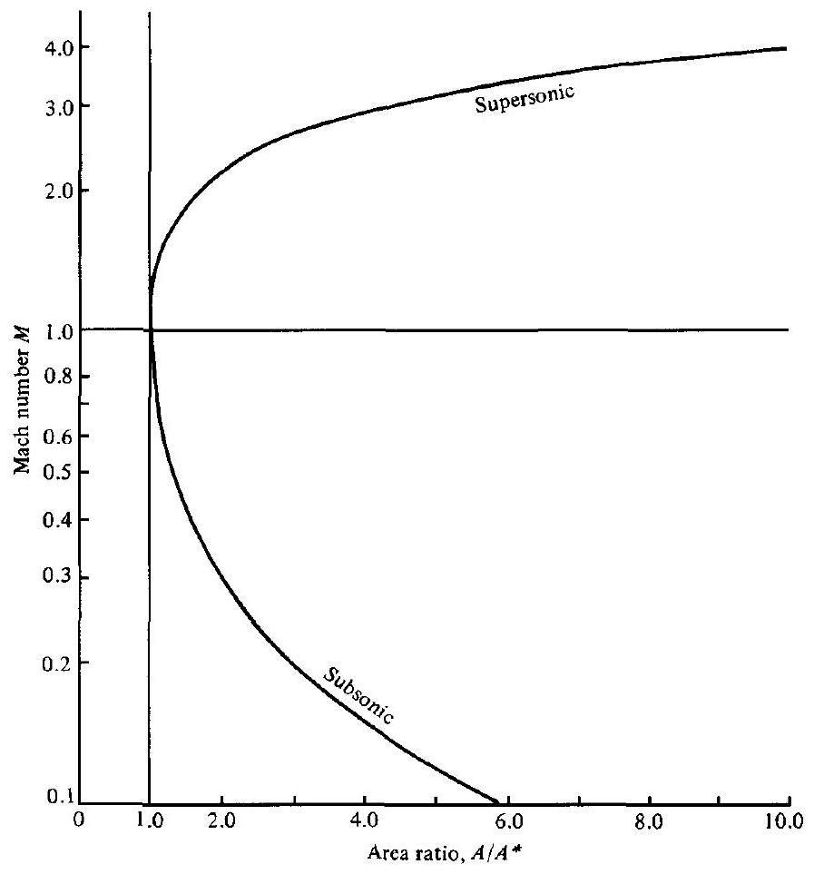
Figure 5.13| Area-Mach number relation.

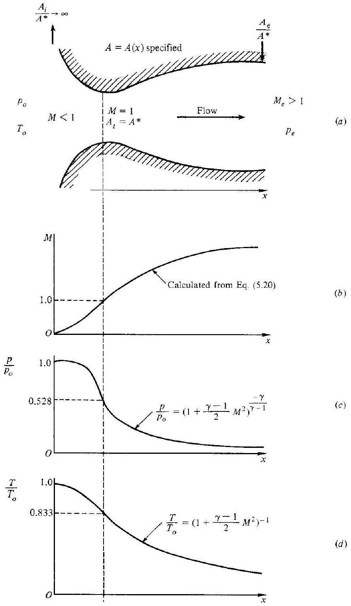
Figure 5.14 | Isentropic supersonic nozzle flow.

which clearly delineates the subsonic and supersonic branches. Values of $A / A^{*}$ as a function of $M$ are tabulated in Table A. 1 for both subsonic and supersonic flow.

Consider a given convergent-divergent nozzle, as sketched in Fig. 5.14a. Assume that the area ratio at the inlet $A_{i} / A^{*}$ is very large, $A_{i} / A^{*} \rightarrow \infty$, and that the inlet is fed with gas from a large reservoir at pressure and temperature $p_{o}$ and $T_{o}$, respectively. Because of the large inlet area ratio, $M \approx 0$; hence $p_{o}$ and $T_{o}$ are essentially stagnation (or total) values. (The Mach number cannot be precisely zero in the reservoir,
or else there would be no mass flow through the nozzle. It is a finite value, but small enough to assume that it is essentially zero.) Furthermore, assume that the given convergent-divergent nozzle expands the flow isentropically to supersonic speeds at the exit. For the given nozzle, there is only one possible isentropic solution for supersonic flow, and Eq. (5.20) is the key to this solution. In the convergent portion of the nozzle, the subsonic flow is accelerated, with the subsonic value of $M$ dictated by the local value of $A / A^{*}$ as given by the lower branch of Fig. 5.13. The consequent variation of Mach number with distance $x$ along the nozzle is sketched in Fig. 5.14b. At the throat, where the throat area $A_{t}=A^{*}, M=1$. In the divergent portion of the nozzle, the flow expands supersonically, with the supersonic value of $M$ dictated by the local value of $A / A^{*}$ as given by the upper branch of Fig. 5.13. This variation of $M$ with $x$ in the divergent nozzle is also sketched in Fig. 5.14b. Once the variation of Mach number through the nozzle is known, the variations of static temperature, pressure, and density follow from Eqs. (3.28), (3.30), and (3.31), respectively. The resulting variations of $p$ and $T$ are shown in Figs. 5.14c and $d$, respectively. Note that the pressure, density, and temperature decrease continuously throughout the nozzle. Also note that the exit pressure, density, and temperature ratios, $p_{e} / p_{o}, \rho_{e} / \rho_{o}$, and $T_{e} / T_{o}$ depend only on the exit area ratio, $A_{\ell} / A^{*}$ via Eq. (5.20). If the nozzle is part of a supersonic wind tunnel, then the test section conditions are completely determined by $A_{e} / A^{*}$ (a geometrical design condition) and $p_{o}$ and $T_{o}$ (gas properties in the reservoir).

### 5.4.2 The Effect of Different Pressure Ratios Across a Given Nozzle

If a convergent-divergent nozzle is simply placed on a table, and nothing else is done, obviously nothing is going to happen; the air is not going to start rushing through the nozzle of its own accord. To accelerate a gas, a pressure difference must be exerted, as clearly stated by Euler's equation, Eq. (5.9). Therefore, in order to establish a flow through any duct, the exit pressure must be lower than the inlet pressure, i.e., $p_{e} / p_{o}<1$. Indeed, for completely shockfree isentropic supersonic flow to exist in the nozzle of Fig. 5.14a, the exit pressure ratio must be precisely the value of $p_{e} / p_{o}$ shown in Fig. 5.14c.

What happens when $p_{e} / p_{o}$ is not the precise value as dictated by Fig. 5.14c? In other words, what happens when the backpressure downstream of the nozzle exit is independently governed (say by exhausting into an infinite reservoir with controllable pressure)? Consider a convergent-divergent nozzle as sketched in Fig. 5.15a. Assume that no flow exists in the nozzle, hence $p_{e}=p_{o}$. Now assume that $p_{e}$ is minutely reduced below $p_{o}$. This small pressure difference will cause a small wind to blow through the duct at low subsonic speeds. The local Mach number will increase slightly through the convergent portion of the nozzle, reaching a maximum at the throat, as shown by curve 1 of Fig. 5.15 b. This maximum will not be sonic; indeed it will be a low subsonic value. Keep in mind that the value $A^{*}$ defined earlier is the sonic throat area, i.e., that area where $M=1$. In the case we are now considering, where $M<1$ at the minimum-area section of the duct, the real throat area of the duct, $A_{t}$, is larger than $A^{*}$, which for completely subsonic flow takes on the

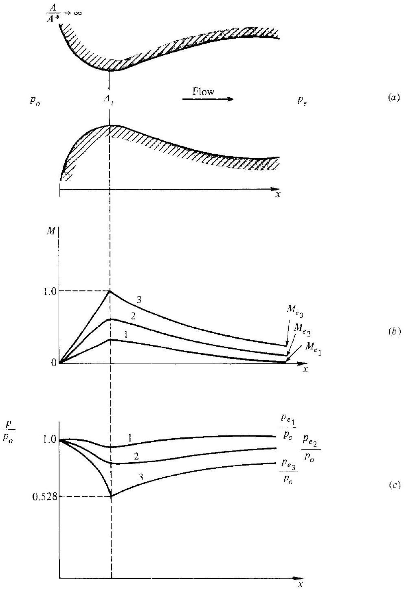
Figure 5.151 Subsonic flow in a convergent-divergent nozzle.

character of a reference quantity different from the actual geometric throat arca. Downstream of the throat, the subsonic flow encounters a diverging duct. and hence $M$ decreases as shown in Fig. 5.15b. The corresponding variation of static pressure is given by curve 1 in Fig. 5.15c. Now assume $p_{e}$ is further reduced. This stronger pressure ratio between the inlet and exit will now accelerate the flow more, and the variations of subsonic Mach number and static pressure through the duct will be larger, as indicated by curve 2 in Figs. 5.15b and $c$. If $p_{e}$ is further reduced, there will be
some value of $p_{e}$ at which the flow will just barely go sonic at the throat, as given by the curve 3 in Figs. $5.15 b$ and $c$. In this case, $A_{t}=A^{*}$. Note that all the cases sketched in Figs $5.15 b$ and $c$ are subsonic flows. Hence, for subsonic flow through the convergent-divergent nozzle shown in Fig. 5.15a, there are an infinite number of isentropic solutions, where both $p_{e} / p_{o}$ and $A / A_{t}$ are the controlling factors for the local flow properties at any given section. This is a direct contrast with the supersonic case discussed in Sec. 5.4.1, where only one isentropic solution exists for a given duct, and where $A / A^{*}$ becomes the only controlling factor for the local flow properties (relative to reservoir properties).

For the cases shown in Figs. 5.15a, b, and $c$, the mass flow through the duct increases as $p_{e}$ decreases. This mass flow can be calculated by evaluating Eq. (5.1) at the throat, $\dot{m}=\rho_{t} A_{t} u_{t}$. When $p_{e}$ is reduced to $p_{e_{3}}$, where sonic flow is attained at the throat, then $\dot{m}=\rho^{*} A^{*} a^{*}$. If $p_{e}$ is now reduced further, $p_{e}<p_{e_{3}}$, the Mach number at the throat cannot increase beyond $M=1$; this is dictated by Eq. (5.15). Hence, the flow properties at the throat, and indeed throughout the entire subsonic section of the duct, become "frozen" when $p_{e}<p_{e_{3}}$, i.e., the subsonic flow becomes unaffected and the mass flow remains constant for $p_{e}<p_{e_{3}}$. This condition, after sonic flow is attained at the throat, is called choked flow. No matter how low $p_{e}$ is made, after the flow becomes choked, the mass flow remains constant. This phenomenon is illustrated in Fig. 5.16. Note from Eq. (3.35) that sonic flow at the throat corresponds to a pressure ratio $p^{*} / p_{o}=0.528$ for $\gamma=1.4$; however, because of the divergent duct downstream of the throat, the value of $p_{e_{3}} / p_{o}$ required to attain sonic flow at the throat is larger than 0.528, as shown in Figs. 5.15c and 5.16.

What happens in the duct when $p_{e}$ is reduced below $p_{e_{3}}$ ? In the convergent portion, as we stated, nothing happens. The flow properties remain as given by the subsonic portion of curve 3 in Fig. $5.15 b$ and $c$. However, a lot happens in the divergent portion of the duct. No isentropic solution is allowed in the divergent duct until $p_{e}$ is adequately reduced to the specified low value dictated by Fig. 5.14c. For values of exit pressure above this, but below $p_{e_{3}}$, a normal shock wave exists inside the divergent duct. This situation is sketched in Fig. 5.17. Let the exit pressure be given by $p_{e_{4}}$. There is a region of supersonic flow ahead of the shock. Behind the

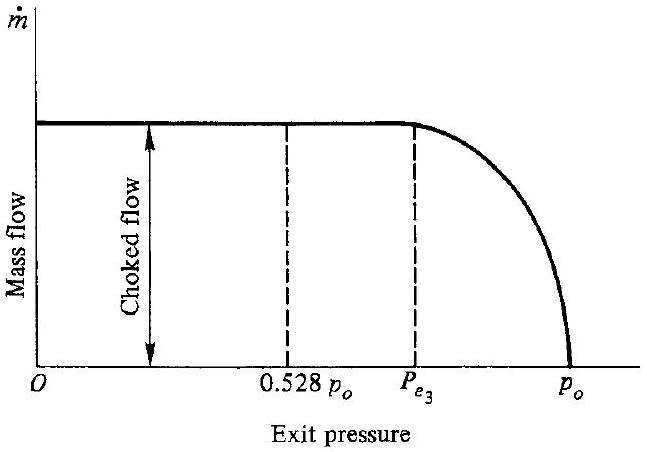
Figure 5.16 | Variation of mass flow with exit pressure; illustration of choked flow.

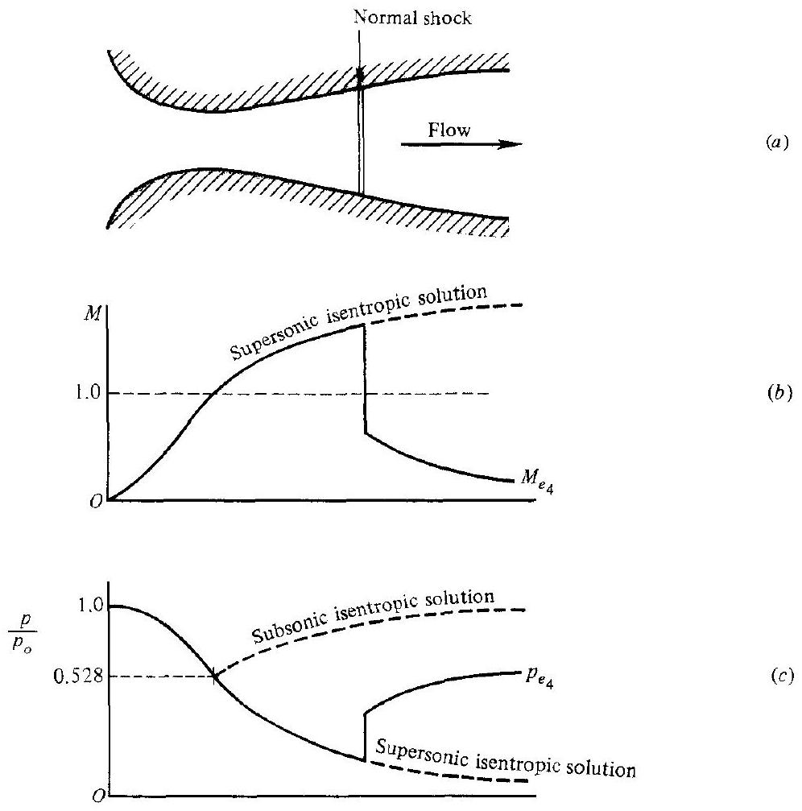
Figure 5.17 | Flow with a shock wave inside a convergent-divergent nozzle.

shock, the flow is subsonic, hence the Mach number decreases towards the exit and the static pressure increases to $p_{e_{4}}$ at the exit. The location of the normal shock wave in the duct is determined by the requirement that the increase of static pressure across the wave plus that in the divergent portion of the subsonic flow behind the shock be just right to achieve $p_{e_{4}}$ at the exit. As the exit pressure is reduced further, the normal shock wave will move downstream, closer to the nozzle exit. It will stand precisely at the exit when $p_{e}=p_{e_{5}}$, where $p_{e_{5}}$ is the static pressure behind a normal shock at the design Mach number of the nozzle. This is illustrated in Figs. 5.18 $a, b$, and $c$. In Fig. 5.18 $c, p_{e_{6}}$ represents the proper isentropic value for the design exit Mach number, which exists immediately upstream of the normal shock wave standing at the exit. When the downstream backpressure $p_{B}$ is further decreased such that $p_{e_{0}}<p_{B}<p_{e_{5}}$, the flow inside the nozzle is fully supersonic and isentropic, with the behavior the same as given earlier in Figs. $5.14 a, b, c$, and $d$. The increase to the backpressure takes place across an oblique shock attached to the nozzle exit, but outside the duct itself. This is sketched in Fig. 5.18d. If the backpressure is further reduced below $p_{e_{6}}$, equilibration of the flow takes place across expansion waves outside the duct, as shown in Fig. 5.18e.

When the situation in Fig. 5.18d exists, the nozzle is said to be overexpanded, because the pressure at the exit has expanded below the back pressure, $p_{e_{6}}<p_{B}$.

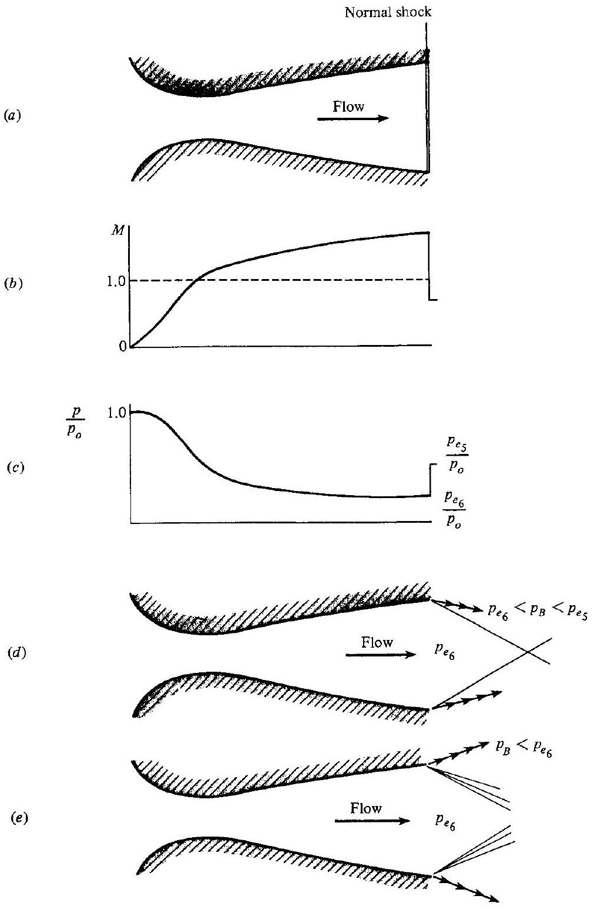
Figure 5.18 I Flow with shock and expansion waves at the exit of a convergent-divergent nozzle.

Conversely, when the situation in Fig. 5.18e exists, the nozzle is said to be underexpanded, because the exit pressure is higher than the back pressure, $p_{e_{6}}>p_{B}$, and hence the flow is capable of additional expansion after leaving the nozzle.

The results of this section are particularly important and useful. The reader should make certain to reread this section until he or she feels comfortable with the concepts and results before proceeding further. Also, keep in mind that these
quasi-one-dimensional considerations allow the analysis of cross-sectional averaged properties inside a nozzle of given shape. They do not tell us much about how to design the contour of a nozzle-especially that for a supersonic nozzle in order to ensure shockfree, isentropic flow. If the shape of the walls of a supersonic nozzle is not just right, oblique shock waves can occur inside the nozzle. The proper contour for a supersonic nozzle can be determined from the method of characteristics, to be discussed in Chap. 11.

## FXAMPI.F 5.1

Consider the isentropic subsonic-supersonic flow through a convergent-divergent nozzle. The reservoir pressure and temperature are 10 atm and 300 K , respectively. There are two locations in the nozzle where $A / A^{*}=6$ : one in the convergent section and the other in the divergent section. At each location, calculate $M, p, T$, and $u$.

## - Solution

In the convergent section, the flow is subsonic. From the front of Table A.1, for subsonic flow with $A / A^{*}=6: M=0.097, p_{o} / p=1.006$, and $T_{o} / T=1.002$. Hence

$$
\begin{aligned}
& p=\frac{p}{p_{0}} p_{0}=(1.006)^{-1}(10)=9.94 \mathrm{~atm} \\
& T=\frac{T}{T_{o}} T_{o}=(1.002)^{-1}(300)=299.4 \mathrm{~K} \\
& a=\sqrt{\gamma R T}=\sqrt{(1.4)(287)(299.4)}=346.8 \mathrm{~m} / \mathrm{s} \\
& u=M a=(0.097)(346.8)=33.6 \mathrm{~m} / \mathrm{s}
\end{aligned}
$$

In the divergent section, the flow is supersonic. From the supersonic section of Table A.I. for $A / A^{*}=6: M=3.368, p_{o} / p=63.13$, and $T_{o} / T=3.269$. Hence

$$
\begin{aligned}
& p=\frac{p}{p_{0}} p_{0}=(63.13)^{1}(10)=0.1584 \mathrm{~atm} \\
& T=\frac{T}{T_{0}} T_{0}=(3.269)^{-1}(300)=91.77 \mathrm{~K} \\
& a=\sqrt{\gamma R T}=\sqrt{(1.4)(287)(91.77)}=192.0 \mathrm{~m} / \mathrm{s} \\
& u=M a=(3.368)(192.0)=646.7 \mathrm{~m} / \mathrm{s}
\end{aligned}
$$

A supersonic wind tunnel is designed to produce Mach 2.5 flow in the test section with standard sea level conditions. Calculate the exit area ratio and reservoir conditions necessary to achieve these design conditions.

## - Solution

From Table A.1, for $M_{e}=2.5$ :

$$
A_{\ell} / A^{*}=2.637 \quad p_{o} / p_{e}=17.09 \quad T_{o} / T_{e}=2.25
$$

Also, at standard sea level conditions, $p_{e}=1 \mathrm{~atm}$ and $T_{e}=288 \mathrm{~K}$. Hence,

$$
\begin{aligned}
p_{o} & =\frac{p_{o}}{p_{e}} p_{e}=(17.09)(1)=17.09 \mathrm{~atm} \\
T_{o} & =\frac{T_{o}}{T_{e}} T_{e}=(2.25)(288)=648 \mathrm{~K}
\end{aligned}
$$

## EXAMPLE 5.3

Consider a rocket engine burning hydrogen and oxygen; the combustion chamber temperature and pressure are 3517 K and 25 atm , respectively. The molecular weight of the chemically reacting gas in the combustion chamber is 16 , and $\gamma=1.22$. The pressure at the exit of the convergent-divergent rocket nozzle is $1.174 \times 10^{-2} \mathrm{~atm}$. The area of the throat is $0.4 \mathrm{~m}^{2}$. Assuming a calorically perfect gas and isentropic flow, calculate: (a) the exit Mach number, (b) the exit velocity, (c) the mass flow through the nozzle, and (d) the area of the exit.

## - Solution

Note that for this problem, where $\gamma=1.22$, the compressible flow tables in the appendix cannot be used since the tables are calculated for $\gamma=1.4$. Thus, to solve this problem, we have to use the governing equations directly.
a. To obtain the exit Mach number, use the isentropic relation given by Eq. (3.30):

$$
\frac{p_{o}}{p_{e}}=\left(1+\frac{\gamma-1}{2} M_{e}^{2}\right)^{\gamma /(\gamma-1)}
$$

or

$$
\begin{aligned}
& M_{e}^{2}=\frac{2}{\gamma-1}\left[\left(\frac{p_{o}}{p_{e}}\right)^{(\gamma-1) / \gamma}-1\right]=\frac{2}{0.22}\left[\left(\frac{25}{1.174 \times 10^{-2}}\right)^{0.22 / 1.22}-1\right]=27.116 \\
& M_{e}=5.21
\end{aligned}
$$

To obtain the exit velocity:
b.

$$
\begin{aligned}
& \frac{T_{e}}{T_{o}}=\left(\frac{p_{e}}{p_{o}}\right)^{(\gamma-1) / \gamma}=\left(\frac{1.174 \times 10^{-2}}{25}\right)^{0.180}=0.2517 \\
& T_{e}=0.2517 T_{o}=0.2517(3517)=885.3 \mathrm{~K}
\end{aligned}
$$

From Sec. 1.4, we know that

$$
\begin{aligned}
R & =\frac{R}{A}=\frac{8314}{16}=519.6 \mathrm{~J} / \mathrm{kg} \cdot \mathrm{~K} \\
a_{e} & =\sqrt{\gamma R T_{e}}=\sqrt{(1.22)(519.6)(885.3)}=749.1 \mathrm{~m} / \mathrm{s} \\
V_{e} & =M_{e} a_{e}=(5.21)(749.1)=3903 \mathrm{~m} / \mathrm{s}
\end{aligned}
$$

c. Since we are given $A^{*}=0.4 \mathrm{~m}^{2}$, let us calculate the mass flow at the throat. First, obtain $\rho_{o}$ from the equation of state:

$$
\rho_{o}=\frac{p_{o}}{R T_{o}}=\frac{(25)\left(1.01 \times 10^{5}\right)}{(519.6)(3517)}=1.382 \mathrm{~kg} / \mathrm{m}^{3}
$$

From Eq. (3.36)

$$
\begin{aligned}
\frac{\rho^{*}}{\rho_{0}} & =\left(\frac{2}{\gamma+1}\right)^{1 /(\gamma-1)}=\left(\frac{2}{2.22}\right)^{4.545}=0.622 \\
\rho^{*} & =0.622 \rho_{0}=(0.622)(1.382)=0.860 \mathrm{~kg} / \mathrm{m}^{3}
\end{aligned}
$$

From Eq. (3.34)

$$
\begin{aligned}
\frac{T^{*}}{T_{o}} & =\frac{2}{\gamma+1}=\frac{2}{2.22}=0.9 \\
T^{*} & =0.9 T_{o}=(0.9)(3517)=3168 \mathrm{~K} \\
a^{*} & =\sqrt{\gamma R T^{*}}=\sqrt{(1.22)(519.6)(3168)}=1417 \mathrm{~m} / \mathrm{s} \\
\dot{m} & =\rho A V=\rho^{*} A^{*} a^{*}=(0.860)(0.4)(1417)=487.4 \mathrm{~kg} / \mathrm{s}
\end{aligned}
$$

d. At the exit, since $\dot{m}=$ const,

$$
\begin{aligned}
& \dot{m}=\rho_{e} A_{e} V_{e}=487.4 \mathrm{~kg} / \mathrm{s} \\
& \rho_{e}=\frac{p_{e}}{R T_{e}}=\frac{\left(1.174 \times 10^{-2}\right)\left(1.01 \times 10^{5}\right)}{(519.6)(885.3)}=0.00258 \mathrm{~kg} / \mathrm{m}^{3} \\
& A_{e}=\frac{\dot{m}}{\rho_{e} V_{e}}=\frac{487.4}{(0.00258)(3903)}=48.4 \mathrm{~m}^{2}
\end{aligned}
$$

Consider the flow through a convergent-divergent duct with an exit-to-throat area ratio of 2 . The reservoir pressure is 1 atm , and the exit pressure is 0.95 atm . Calculate the Mach numbers at the throat and at the exit.

## - Solution

First, let us analyze this problem. If the flow were supersonic in the divergent portion. then from Table A.1, for an area ratio of $A_{e} / A^{*}=2, p_{o} / p_{e}=10.69$; thus $p_{e}$ would have to be $p_{e}=p_{o} / 10.69=(1 \mathrm{~atm}) / 10.69=0.0935 \mathrm{~atm}$. This is considerably less than the given $p_{e}=$ 0.95 atm . Therefore, we do not have a subsonic-supersonic isentropic flow as was the case in Examples 5.1 through 5.3. Question: Is the flow completely subsonic? If this were the case, the throat area $A_{t}$ is not equal to $A^{*}$, and $A_{t}>A^{*}$. Let us examine $A_{t}$ and $A^{*}$. From Table A.1, for $p_{o} / p_{e}=1 / 0.95=1.053, A_{e} / A^{*}=2.17$ (nearest entry). However, for the given problem, $A_{\ell} / A_{t}=2$. Thus, $A_{t}>A^{*}$, and the flow is completely subsonic. From Table A.1, since $p_{0} / p_{e}=1.053$, we have

$$
M_{e}=0.28
$$

At the throat,

$$
\frac{A_{t}}{A^{*}}=\frac{A_{t}}{A_{e}} \frac{A_{e}}{A^{*}}=\frac{1}{2}(2.17)=1.085
$$

From Table A.1, for $A_{t} / A^{*}=1.085$, we have

$$
M_{t}=0.72
$$

## EXAMPLE 5.5

Consider a convergent-divergent duct with an exit-to-throat area ratio of 1.6 . Calculate the exit-to-reservoir pressure ratio required to achieve sonic flow at the throat, but subsonic flow everywhere else.

## - Solution

Since $M=1$ at the throat, $A_{i}=A^{*}$. Thus

$$
\frac{A_{e}}{A_{t}}=\frac{A_{e}}{A^{*}}=1.6
$$

From Table A.1, the subsonic entry that corresponds to $A_{e} / A^{*}=1.6$ is $p_{o} / p_{e}=1.1117$. Hence

$$
\frac{p_{e}}{p_{o}}=\frac{1}{1.1117}=0.9
$$

For this area ratio of $A_{e} / A_{t}=1.6$, if the exit-to-reservoir pressure ratio is greater than 0.9 , the flow through the duct is completely subsonic. If this pressure ratio is less than 0.9 , then the flow will expand to supersonic speed downstream of the throat. However, unless $p_{e} / p_{o}=1 / 7.128=0.1403$, which corresponds to an isentropic expansion to the exit, there will be shock waves either at the lip of the nozzle (overexpanded case) or a normal shock somewhere inside the duct. Which of these cases hold depends upon the prescribed value of $p_{e} / p_{o}$.

## EXAMPLE 5.6

Consider a convergent-divergent nozzle with an exit-to-throat area ratio of 3 . A normal shock wave is inside the divergent portion at a location where the local area ratio is $A / A_{t}=2$. Calculate the exit-to-reservoir pressure ratio.

## - Solution

For this case, we have an isentropic subsonic-supersonic expansion through the part of the nozzle upstream of the normal shock. Let the subscripts 1 and 2 denote conditions immediately upstream and downstream of the shock, respectively. The local Mach number $M_{1}$ just ahead of the shock is obtained from Table A. 1 for $A_{1} / A_{1}^{*}=2$, namely $M_{1}=2.2$. From Table A.2, for $M_{1}=2.2, M_{2}=0.5471$ and $p_{o_{2}} / p_{o_{1}}=0.6281$. From Table A.1, for $M_{2}=0.5471$, we have $A_{2} / A_{2}^{*}=1.27$. Note an important fact at this stage of our calculation. The normal shock is assumed to be infinitely thin, hence $A_{1}=A_{2}$. However, we have previously shown that $A_{1} / A_{1}^{*}=2$ and $A_{2} / A_{2}^{*}=1.27$. Clearly, the value of $A^{*}$ changes across the shock wave. This is due to the entropy increase across the shock. $A_{1}^{*}$ is the flow area necessary to achieve Mach 1 isentropically in the flow upstream of the shock, and $A_{2}^{*}$ is the flow area necessary to achieve Mach 1 isentropically in the flow downstream of the shock. Since the entropy is different for these two flows, then $A^{*}$ is different for the two flows. Proceeding with the calculation,

$$
\frac{A_{e}}{A_{2}^{*}}=\frac{A_{e}}{A_{2}} \frac{A_{2}}{A_{2}^{*}}=\frac{A_{e}}{A_{t}} \frac{A_{t}}{A_{2}} \frac{A_{2}}{A_{2}^{*}}=\text { (3) }\left(\frac{1}{2}\right)(1.27)=1.905
$$

The flow is subsonic behind the normal shock wave, and hence is subsonic throughout the remainder of the divergent portion downstream of the shock. Thus, from the subsonic entries in Table A.1, we have for $A_{\epsilon} / A_{2}^{*}=1.905, M_{e}=0.32$ and $p_{v_{e}} / p_{e}=1.074$. Thus, since $p_{\phi}= p_{o_{1}}$ and $p_{o_{e}}=p_{o_{2}}$, we have

$$
\frac{p_{e}}{p_{o}}=\frac{p_{e}}{p_{o_{e}}} \frac{p_{o_{e}}}{p_{o_{2}}} \frac{p_{o_{2}}}{p_{o_{1}}} \frac{p_{o_{1}}}{p_{o}}=\left(\frac{1}{1.074}\right)(1)(0.6281)(1)=0.585
$$

Example 5.6 treated the case of a normal shock standing inside a nozzle. In this example, the location of the normal shock inside the nozzle was given, and the exit-toreservoir pressure ratio, $p_{e} / p_{e}$, was calculated. This is a straightforward calculation, as demonstrated in Example 5.6. However, in most applications we are not given the location of the shock, but rather we know the pressure ratio $p_{e} / p_{o}$ across the nozzle, and we want to find the location of the shock (i.e., the value of $A / A_{t}$, where the shock is standing). In this situation, we can take either of two approaches.

The first approach is an iterative solution. Assume the location of the shock in the nozzle, i.e., assume the value of $A / A_{t}$ for the shock. Then calculate the pressure ratio $p_{e} / p_{o}$ that would correspond to the shock in this assumed location, using the approach taken in Example 5.6. Check to see if $p_{e} / p_{o}$ from this calculation agrees with the specified value of $p_{e} / p_{o}$. If not, assume another location of the shock, and calculate the new value of $p_{e} / p_{o}$ corresponding to this new shock location. Repeat this iterative process until the proper shock location is found that will yield a calculated $p_{e} / p_{o}$ that agrees with the specified value.

The second approach is direct, but more elaborate. Consider a normal shock standing inside a nozzle, as sketched in Fig. 5.19. The reservoir pressure is $p_{0}$ and the static pressure at the exit is $p_{e}$; the pressure ratio across the nozzle is therefore $p_{e} / p_{o}$. Immediately upstream of the shock (condition 1), the total pressure is $p_{o_{1}}$. Because the flow is isentropic between the reservoir and location $1, p_{o_{1}}=p_{o}$. Recall that $A^{*}$ is a constant value everywhere upstream of the shock, and is equal to the throat area, $A_{t}$. Denote this value of $A^{*}$ by $A_{1}^{*}$. Immediately downstream of the shock (condition 2), the total pressure is $p_{\rho_{2}}$. Also, recall that the value of $A^{*}$ changes across the shock. Denote the value of $A^{*}$ downstream of the shock by $A_{2}^{*}$, which is a constant value

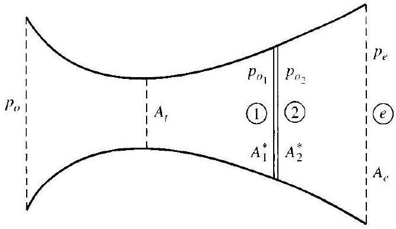
Figure 5.19 | Conditions associated with a normal shock standing inside a nozzle.

everywhere downstream of the shock. The mass flow at any location in the nozzle is $\dot{m}=p u A$. In Problem 5.6 at the end of this chapter, you are asked to derive this equation for the mass flow through a choked nozzle:

$$
\dot{m}=\frac{p_{o} A^{*}}{\sqrt{T_{o}}} \sqrt{\frac{\gamma}{R}\left(\frac{2}{\gamma+1}\right)^{(\gamma+1) /(\gamma-1)}}
$$

where $A^{*}$ is equal to the throat area, and $p_{o}$ and $T_{o}$ are the reservoir pressure and temperature, respectively. Since Eq. (5.21) is of the form

$$
\dot{m}=\frac{p_{o} A^{*}}{\sqrt{T_{o}}} f(\gamma, R)
$$

we see that mass flow is directly proportional to $p_{o} A^{*} /\left(T_{o}\right)^{1 / 2}$. Since both the mass flow and $T_{o}$ are constant across the shock wave in Fig. 5.19, we have from Eq. (5.21):

$$
p_{o} A^{*}=\text { constant across a shock wave }
$$

or

$$
p_{o_{1}} A_{1}^{*}=p_{o_{2}} A_{2}^{*}
$$

Referring to Fig. 5.19, since the flow is isentropic from location 2 to the exit, $p_{o_{e}}=p_{o_{2}}$ and $A_{e}^{*}=A_{2}^{*}$. Thus, Eq. (5.22) becomes

$$
p_{o_{1}} A_{1}^{*}=p_{o_{e}} A_{e}^{*}
$$

Hence, from Eq. (5.23) we can write

$$
\frac{p_{e} A_{e}}{p_{o_{e}} A_{e}^{*}}=\frac{p_{e} A_{e}}{p_{o_{1}} A_{1}^{*}}=\left(\frac{p_{e}}{p_{o_{1}}}\right)\left(\frac{A_{e}}{A_{1}^{*}}\right)
$$

In Eq. (5.24), $p_{e} / p_{o_{1}}$ is the specified pressure ratio across the given nozzle. Also, $A_{e} / A_{1}^{*}$ is the known exit-to-throat area ratio for the given nozzle. Hence the righthand side of Eq. (5.24) is a known number, and therefore the ratio $\left(p_{e} A_{e}\right) /\left(p_{o_{e}} A_{e}^{*}\right)$ is a known number. This ratio can be expressed in terms of the exit Mach number as shown next.

From Eq. (3.30), we can write

$$
\frac{p_{e}}{p_{o_{e}}}=\left(1+\frac{\gamma-1}{2} M_{2}^{2}\right)^{-\gamma /(\gamma-1)}
$$

and from Eq. (5.20) we can write

$$
\frac{A_{e}}{A_{e}^{*}}=\frac{1}{M_{e}}\left[\left(\frac{2}{\gamma+1}\right)\left(1+\frac{\gamma-1}{2} M_{e}^{2}\right)\right]^{(\gamma+1) /[2(\gamma-1)]}
$$

The product of Eqs. (5.25) and (5.26) is

$$
\frac{p_{e}}{p_{o_{e}}} \frac{A_{e}}{A_{e}^{*}}=\frac{1}{M_{e}}\left(\frac{2}{\gamma+1}\right)^{(\gamma+1) /[2(\gamma-1)]}\left(1+\frac{\gamma-1}{2} M_{e}^{2}\right)^{-1 / 2}
$$

Solving Eq. (5.27) for $M_{e}^{2}$, we have

$$
M_{e}^{2}=-\frac{1}{\gamma-1}+\sqrt{\frac{1}{(\gamma-1)^{2}}+\left(\frac{2}{\gamma-1}\right)\left(\frac{2}{\gamma+1}\right)^{(\gamma+1) /(\gamma-1)}\left(\frac{p_{o_{e}} A_{e}^{*}}{p_{e} A_{e}}\right)^{2}}
$$

Since $p_{o_{e}} A_{e}^{*} / p_{e} A_{e}$ is a known number from Eq. (5.24), Eq. (5.28) allows the direct calculation of the exit Mach number. Keep in mind that for the flow shown in Fig. 5.19, $M_{e}$ will be a subsonic value.

The remaining steps required to solve for the location of the normal shock are

1. For the value of $M_{e}$ obtained from Eq. (5.28), obtain $p_{o_{e}} / p_{e}$ from Table A.1.
2. Calculate the ratio of the total pressure across the shock from

$$
\frac{p_{o_{2}}}{p_{o_{1}}}=\frac{p_{o_{e}}}{p_{o_{1}}}=\frac{p_{o_{e}}}{p_{e}} \frac{p_{e}}{p_{o_{1}}}
$$

where $p_{e} / p_{o_{1}}$ is the specified pressure ratio across the nozzle.
3. For the value of $p_{o_{2}} / p_{o_{1}}$ calculated from Eq. (5.29), obtain $M_{1}$ from Table A.2.
4. For the value of $M_{1}$, obtain $A_{1} / A_{1}^{*}$ from Table A.1.

Since $A_{1} / A_{1}^{*}=A_{1} / A_{t}$, the value of $A_{1} / A_{1}^{*}$ obtained from step 4 is the location of the normal shock wave inside the nozzle.

Consider a convergent-divergent nozzle with an exit-to-throat area ratio of 3 . The inlet reservoir pressure is 1 atm and the exit static pressure is 0.5 atm . For this pressure ratio, a normal shock will stand somewhere inside the divergent portion of the nozzle. Calculate the location of the shock wave using (a) a trial-and-error solution and (b) the direct solution. Compare the results.

## - Solution

a. Assume $A / A_{t}=A / A_{1}^{*}=2.3$. From Table A.1, $M_{1}=2.35$. From Table A.2, $M_{2}=0.5286$ and $p_{o_{2}} / p_{o_{1}}=0.5615$. From Table A.1, for $M_{2}=0.5286, A / A_{2}^{*}=1.303$. (Recall that we are using nearest entries in the table.) Hence,

$$
\frac{A_{e^{*}}}{A_{2}^{*}}=\frac{A_{e}}{A_{1}^{*}} \frac{A_{1}^{*}}{A} \frac{A}{A_{2}^{*}}=\text { (3) }\left(\frac{1}{2.3}\right)(1.303)=1.7
$$

For $A_{e} / A_{2}^{*}=1.7$, from Table A.1, $M_{e}=0.36$, and $p_{o_{e}} / p_{e}=1.094$. Hence,

$$
p_{e}=\frac{p_{e}}{p_{o_{e}}} \frac{p_{o_{2}}}{p_{o_{1}}} p_{o_{1}}=\frac{1}{1.094}(0.5615)(1)=0.513 \mathrm{~atm}
$$

Since $p_{e}$ should be 0.5 atm , assume a new $A / A_{1}^{*}$ (closer to the exit), and start over again. Assume $A / A_{1}^{*}=2.4$. For this, $M_{1}=2.4, M_{2}=0.5231, p_{o_{2}} / p_{o_{1}}=0.5401$, and
$A / A_{2}^{*}=1.303$. (Again, recall that we are using nearest entries.) Hence, $A_{e} / A_{2}^{*}=$ (3) $(1 / 2.4)(1.303)=1.629$. With this, $M_{e}=0.39$ and $p_{o_{e}} / p_{e}=1.111$. Hence,

$$
p_{e}=\frac{p_{e}}{p_{o_{e}}} \frac{p_{o_{2}}}{p_{o_{1}}} p_{o_{1}}=\frac{1}{1.111}(0.5401)(1)=0.486 \mathrm{~atm}
$$

Since $p_{e}$ should be 0.5 atm , the value of 0.486 atm is too low by about the same amount as the first iteration is too high. Splitting the difference, the correct location of the normal shock wave is approximately $A / A_{t}=2.35$.
b. Using the direct method, from the specified conditions

$$
\left(\frac{p_{e}}{p_{o_{1}}}\right)\left(\frac{A_{e}}{A_{1}^{*}}\right)=\left(\frac{0.5}{1.0}\right)(3)=1.5
$$

From Eq. (5.24),

$$
\frac{p_{e} A_{e}}{p_{o_{e}} A_{e}^{*}}=1.5
$$

From Eq. (5.28)

$$
\begin{aligned}
M_{e}^{2} & =-\frac{1}{\gamma-1}+\sqrt{\frac{1}{(\gamma-1)^{2}}+\left(\frac{2}{\gamma-1}\right)\left(\frac{2}{\gamma+1}\right)^{(\gamma+1) /(\gamma-1)}\left(\frac{p_{o_{e}} A_{e}^{*}}{p_{e} A_{e}}\right)^{2}} \\
& =-2.5+\sqrt{(2.5)^{2}+(5)(0.8333)^{6}\left(\frac{1}{1.5}\right)^{2}} \\
& =-2.5+\sqrt{6.994}=0.1447
\end{aligned}
$$

Hence,

$$
M_{e}=0.38
$$

From Table A. 1 for $M_{e}=0.38, p_{o_{e}} / p_{e}=1.094$. From Eq. (5.29),

$$
\frac{p_{o_{2}}}{p_{o_{1}}}=\frac{p_{o_{e}}}{p_{e}} \frac{p_{e}}{p_{o_{1}}}=(1.094)\left(\frac{0.5}{1}\right)=0.547
$$

From Table A.2, for $p_{o_{2}} / p_{o_{1}}=0.547, M_{1}=2.38$. From Table A.1, for $M_{1}=2.38$, $A / A_{1}^{*}=A / A_{t}=2.36$. This direct answer compares to that obtained with the iteration in part (a) to within 0.4 percent.

## 5.5 | DIFFUSERS

Let us go through a small thought experiment. Assume that we want to design a supersonic wind tunnel with a test section Mach number of 3 (see Fig. 5.11). Some immediate information about the nozzle is obtained from Table A.1; at $M=3$, $A_{e} / A^{*}=4.23$ and $p_{o} / p_{e}=36.7$. Assume the wind tunnel exhausts to the atmosphere. What value of total pressure $p_{o}$ must be provided by the reservoir to drive the tunnel? There are several possible alternatives. The first is to simply exhaust the nozzle directly to the atmosphere, as sketched in Fig. 5.20. In order to avoid shock

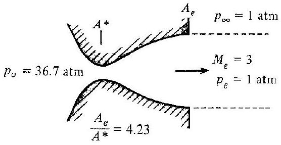
Figure 5.20 | Nozzle exhausting directly to the atmosphere.

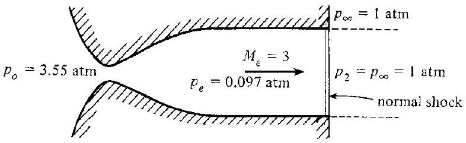
Figure 5.21 | Nozzle with a normal shock at the exit, exhausting to the atmosphere.

or expansion waves in the test region downstream of the exit, the exit pressure $p_{e}$ must be equal to the surrounding atmospheric pressure, i.e., $p_{e}=1 \mathrm{~atm}$. Since $p_{o} / p_{e}=36.7$, the driving reservoir pressure for this case must be 36.7 atm . However, a second alternative is to exhaust the nozzle into a constant-area duct which serves as the test section, and to exhaust this duct into the atmosphere, as sketched in Fig. 5.21. In this case, because the testing area is inside the duct, shock waves from the duct exit will not affect the test section. Therefore, assume a normal shock stands at the duct exit. The static pressure behind the normal shock is $p_{2}$, and because the flow is subsonic behind the shock, $p_{2}=p_{\infty}=1 \mathrm{~atm}$. In this case, the reservoir pressure $p_{o}$ is obtained from

$$
p_{o}=\frac{p_{o}}{p_{e}} \frac{p_{e}}{p_{2}} p_{\infty}=36.7 \frac{1}{10.33} 1=3.55 \mathrm{~atm}
$$

where $p_{2} / p_{e}$ is the static pressure ratio across a normal shock at Mach 3, obtained from Table A.2. Note that, by the simple addition of a constant-area duct with a normal shock at the end, the reservoir pressure required to drive the wind tunnel has markedly dropped from 36.7 to 3.55 atm . Now, as a third alternative, add a divergent duct behind the normal shock in Fig. 5.21 in order to slow the already subsonic flow to a lower velocity before exhausting to the atmosphere. This is sketched in Fig. 5.22. At the duct exit, the Mach number is a very low subsonic value, and for all practical purposes the local total and static pressure are the same. Moreover, assuming an isentropic flow in the divergent duct behind the shock, the total pressure at the duct exit is equal to the total pressure behind the normal shock. Consequently,

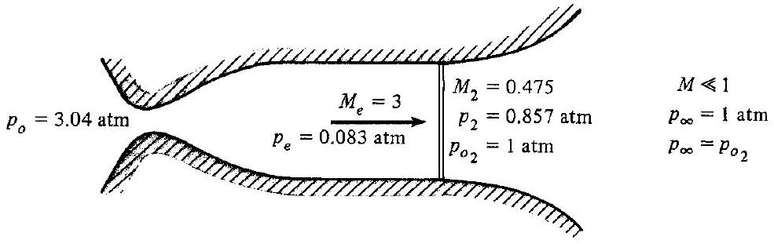
Figure 5.22 I Nozzle with a normal-shock diffuser. The normal shock is slightly upstream of the divergent duct.

$p_{o_{2}} \approx p_{\infty}=1 \mathrm{~atm}$. From Table A.2, the Mach number immediately behind the shock is $M_{2}=0.475$, and the ratio of total to static pressure at this Mach number (from Table A.1) is $p_{o_{2}} / p_{2}=1.17$. Hence

$$
p_{o}=\frac{p_{o}}{p_{e}} \frac{p_{e}}{p_{2}} \frac{p_{2}}{p_{o_{2}}} p_{\infty}=36.7 \frac{1}{10.33} \frac{1}{1.17} 1=3.04 \mathrm{~atm}
$$

This is even better yet-the total pressure required to drive the wind tunnel has been further reduced to 3.04 atm .

Take a look at what has happened! From Table A.2, note the ratio of total pressures across a normal shock wave at Mach 3 is $p_{o_{2}} / p_{o_{1}}=0.328$. Hence $p_{o_{1}} / p_{o_{2}}= 1 / 0.328=3.04$; this is precisely the pressure ratio required to drive the wind tunnel in Fig. 5.22! Thus, from this thought experiment, we infer that the reservoir pressure required to drive a supersonic wind tunnel (and hence the power required from the compressors) is considerably reduced by the creation of a normal shock and subsequent isentropic diffusion to $M \approx 0$ at the tunnel exit, and that this pressure is simply determined by the total pressure loss across a normal shock wave at the test section Mach number.

The normal shock and divergent exhaust duct in Fig. 5.22 are acting as a specific mechanism to slow the air to low subsonic speeds before exhausting to the atmosphere. Such mechanisms are called diffusers, and their function is to slow the flow with as small a loss of total pressure as possible. Of course, the ideal diffuser would compress the flow isentropically, hence with no loss of total pressure. For example, consider the wind tunnel sketched in Fig. 5.11. After isentropically expanding through the supersonic nozzle and passing through the test section, conceptually the supersonic flow could be isentropically compressed by the convergent part of the diffuser to sonic velocity at the second throat, and then further isentropically compressed to low velocity in the divergent section downstream of the throat. This would take place with no loss in total pressure, and hence the pressure ratio required to drive the tunnel would be unity-a perpetual motion machine! Obviously, something is wrong. The problem can be seen by reflecting on the results of Chap. 4. When the convergent part of the diffuser changes the direction of the supersonic flow at the wall, it is extremely difficult to prevent oblique shock waves from occurring inside the duct. Moreover, even without shocks, the real-life effects of friction
between the flow and the diffuser surfaces cause a loss of total pressure. Therefore, the design of a perfect isentropic diffuser is physically impossible.

Accepting the fact that a perfect diffuser cannot be built, can we still hope to do better than the normal shock diffuser sketched in Fig. 5.22? The answer is yes, because it can easily be shown that the total pressure loss across a series of oblique shocks and a terminating weak normal shock is less than that across a single strong normal shock at the same upstream Mach number. (See Example 4.12 and Sec. 4.7.) Therefore, it would appear wise to replace the normal shock diffuser in Fig. 5.22 with an oblique shock diffuser as sketched in Fig. 5.23. Here, the test section flow at Mach number $M_{e}$ and static pressure $p_{e}$ is slowed down through a series of oblique shock waves initiated by a compression corner at the inlet of the diffuser, further slowed by a weak normal shock wave at the end of the constant-area section, and then subsonically compressed by a divergent section which exhausts to the atmosphere. At the diffuser exit, the static pressure is $p_{d}$, which for subsonic flow at the exit is equal to $p_{\infty}$. In concept, this oblique shock diffuser should provide greater pressure recovery (smaller loss in total pressure) than a normal shock diffuser. However, in practice, the interaction of the shock waves in Fig. 5.23 with the viscous boundary layer on the diffuser walls creates an additional total pressure loss which tends to partially mitigate the advantages of an oblique shock diffuser. The real flow through an oblique shock diffuser is shown in the photograph of Fig. 5.24. The shock waves and boundary layers are made visible by a schlieren system-an optical technique sensitive to density gradients in the flow. Note the decay of the diamond-shaped oblique shock

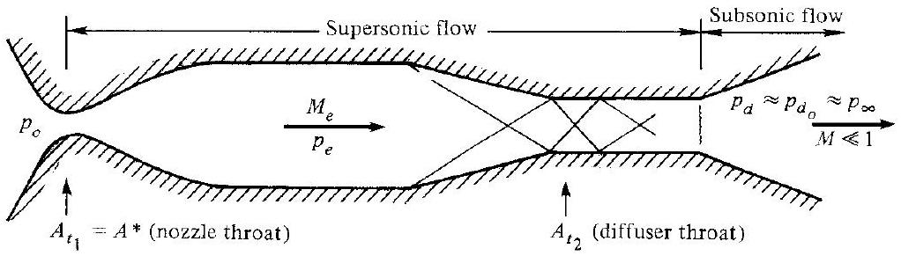
Figure 5.23 | Nozzle with a conventional supersonic diffuser.

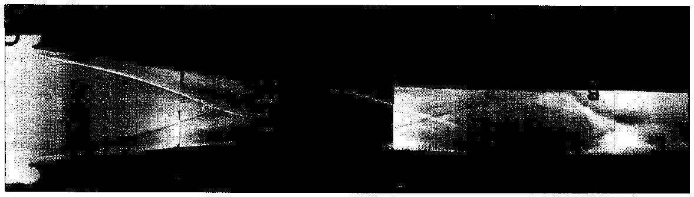
Figure 5.24 | Oblique shock pattern in a two-dimensional supersonic diffuser. The flow is from left to right, and the inlet Mach number is 5 . (Photo was taken by the author at the Aerospace Research Laboratory, Wright-Patterson Air Force Base, OH.)

pattern due to viscous interaction downstream. The net result is that the full potential of an oblique shock diffuser is never fully achieved.

In the literature, there are several figures of merit used to denote the efficiency of diffusers. For wind tunnel work, the most common definition of diffuser efficiency is to compare the actual total pressure ratio across the diffuser, $p_{d_{o}} / p_{o}$, with the total pressure ratio across a hypothetical normal shock wave at the test section Mach number, $p_{o_{2}} / p_{o_{1}}$ (using the nomenclature of Fig. 3.9). Let $\eta_{D}$ denote diffuser effciency. Then

$$
\eta_{D}=\frac{\left(p_{d_{o}} / p_{o}\right)_{\text {actual }}}{\left(p_{o_{2}} / p_{o_{1}}\right)_{\text {normal shock at } M_{e}}}
$$

If, $\eta_{D}=1$, then the actual diffuser is performing as if it were a normal shock diffuser. For low supersonic test section Mach numbers, diffusers in practice usually perform slightly better than normal shock ( $\eta_{D}>1$ ); however, for hypersonic conditions, normal shock recovery is about the best to be expected, and usually $\eta_{D}<1 .^{\dagger}$

Note from Figs. 5.11 and 5.23 that oblique shock diffusers have a minimum-area section, i.e., a throat. In wind tunnel nomenclature, the nozzle throat is called the first throat, with cross-sectional area $A_{t_{1}}=A^{*}$; the diffuser throat is called the second throat, with area $A_{t_{2}}$. Due to the entropy increase in the diffuser, $A_{t_{2}}>A_{t_{1}}$. To prove this, assume that sonic flow exists at both the first and second throats. From Eq. (5.1) evaluated between the two throats,
or

$$
\begin{aligned}
\rho_{1}^{*} A_{t_{1}} a_{1}^{*} & =\rho_{2}^{*} A_{t_{2}} a_{2}^{*} \\
\frac{A_{t_{2}}}{A_{t_{1}}} & =\frac{\rho_{1}^{*}}{\rho_{2}^{*}} \frac{a_{1}^{*}}{a_{2}^{*}}
\end{aligned}
$$

From Secs. 3.4 and 3.5, $a^{*}$ and hence $T^{*}$ are constant throughout a given adiabatic flow. Thus, $a_{1}^{*} / a_{2}^{*}=1$, and Eq. (5.32) becomes

$$
\frac{A_{t_{2}}}{A_{t_{1}}}=\frac{\rho_{1}^{*}}{\rho_{2}^{*}}
$$

However, from the equation of state,

$$
\frac{\rho_{1}^{*}}{\rho_{2}^{*}}=\frac{p_{1}^{*} / R T_{1}^{*}}{p_{2}^{*} / R T_{2}^{*}}=\frac{p_{1}^{*}}{p_{2}^{*}}
$$

Substituting Eq. (5.34) into (5.33),

$$
\frac{A_{t_{2}}}{A_{t_{1}}}=\frac{p_{1}^{*}}{p_{2}^{*}}
$$

[^0]Since $M_{1}=M_{2}=1$, and from Eq. (3.30) evaluated at locations 1 and 2,

$$
\begin{aligned}
& \frac{p_{o_{1}}}{p_{1}^{*}}=\left(1+\frac{\gamma-1}{2} M_{1}^{2}\right)^{\gamma /(\gamma-1)}=\left(\frac{\gamma+1}{2}\right)^{\gamma /(\gamma-1)} \\
& \frac{p_{o_{2}}}{p_{2}^{*}}=\left(1+\frac{\gamma-1}{2} M_{2}^{2}\right)^{\gamma /(\gamma-1)}=\left(\frac{\gamma+1}{2}\right)^{\gamma /(\gamma-1)}
\end{aligned}
$$

Eq. (5.35) can be written as

$$
\frac{A_{t_{2}}}{A_{t_{1}}}=\frac{p_{o_{1}}}{p_{o_{2}}}
$$

Since the total pressure always decreases across shock waves and within boundary layers, $p_{o_{2}}$ will always be less than $p_{o_{1}}$. Thus, from Eq. (5.36), the second throat must always be larger than the first throat. Indeed, if we know the values of total pressure at the two throats, then Eq. (5.36) tells us precisely how large to make the second throat. If $A_{t_{2}}$ is made smaller than demanded by Eq. (5.36), the mass flow through the tunnel cannot be handled by the diffuser; the diffuser "chokes," and supersonic flow in the nozzle and test section is not possible. Note from Eq. (5.36) that only for a hypothetical perfect diffuser (with isentropic flow throughout) would the area of the second throat be equal to that of the first throat.

For typical supersonic diffusers, the efficiency $\eta_{D}$ is very sensitive to $A_{t_{2}}$, as sketched in Fig. 5.25. Note that as $A_{t,}$ is decreased from a large value, $\eta_{D}$ first increases, reaches a peak value, then rapidly decreases. The peak efficiency is obtained by a value of $A_{t_{2}}$ slightly larger than given by Eq. (5.36). Keep in mind that the value of $A_{t_{2}}$ obtained from Eq. (5.36) is the minimum allowed value that will pass the incoming mass flow from the nozzle. Below this value, the flow will be choked, and the diffuser efficiency plummets. The value of $A_{t_{2}}$ from Eq. (5.36) is represented by the dashed vertical line in Fig. 5.25. At much higher values of $A_{t_{2}}$, there are no problems with passing the incoming mass flow; however, the diffuser efficiency is compromised because the supersonic flow from the inlet is not sufficiently compressed and hence remains supersonic in the second throat. In the downstream divergent portion, this supersonic flow first accelerates, and then passes through a normal shock near the diffuser exit. Since the Mach number is fairly high in front of the shock, the total pressure loss across the normal shock is large. This defeats the purpose of an oblique shock diffuser (namely, to have a weak normal shock occur at the second throat in a near sonic flow). As a result, for large $A_{t_{2}}$, the diffuser efficiency is low, as sketched in Fig. 5.25.

Up to this stage in our discussion, the most serious problem with diffusers has not yet been mentioned-the starting problem. Consider again the wind tunnel sketched in Fig. 5.11. When the flow through this tunnel is first started (say by rapidly opening a pressure valve from the reservoir), a complicated transient flow pattern is established, which after a certain time interval settles to the familiar steady flow which we have been discussing in this chapter. The starting process is complex

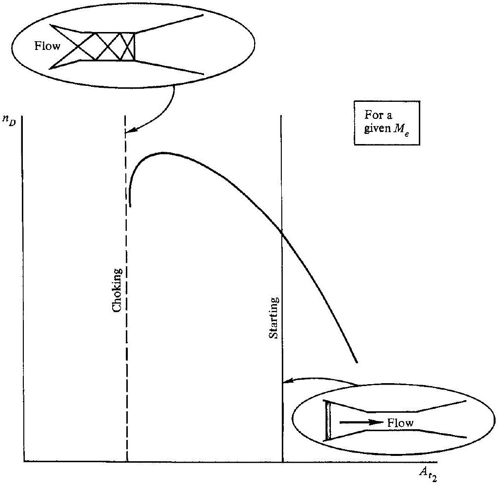
Figure 5.25 I Schematic of the variation of diffuser efficiency with second throat area.

and is still not perfectly understood. However, it is usually accompanied by a normal shock wave that sweeps through the complete duct from the nozzle to the diffuser. When this starting normal shock wave is momentarily at the inlet to the diffuser, the second throat area must be large enough to pass the mass flow behind a normal shock. This value of $A_{t_{2}}$ is given by Eq. (5.36) where now $p_{o_{2}} / p_{o_{1}}$ is the total pressure ratio across a normal shock at the test section Mach number. This starting value of $A_{t_{2}}$ is represented by the solid vertical line in Fig. 5.25, and is always larger than the throat area for peak efficiency. If $A_{t_{2}}$ is less than the starting value, the normal shock will remain upstream of the diffuser, and the tunnel flow will not start properly. If $A_{t_{2}}$ is equal to or greater than the starting value, the normal shock will proceed through (be "swallowed" by) the diffuser, and the tunnel flow will start properly. Therefore, examining Fig. 5.25, we see that a fixed-geometry diffuser designed with a second throat area large enough to allow the flow to start will operate at an efficiency less than maximum. Herein lies the advantage of variable-geometry diffusers, where the throat area can be changed by some mechanical or fluid dynamic means. In such a diffuser, the throat area is made large enough to start the flow, and then later is decreased to obtain higher efficiency during running of the tunnel. However, the design
and fabrication of variable-geometry diffusers is usually complex and expensive. and for this reason most operational wind tunnels use fixed-geometry diffusers.

Our discussion on diffusers has focused on a wind tunnel application for illustration of the general phenomena. However, the analysis of the flow through inlets and diffusers for air-breathing jet engines follows similar arguments. The reader is encouraged to read Shapiro (Ref. 16) or Zucrow and Hoffman (Ref. 17) for extensive discussions on such supersonic inlets.

The reader is cautioned not to take this discussion on diffusers too literally. The actual flow through diffusers is a complicated three-dimensional interaction of shock waves and boundary layers which is not well understood-even after a half-century of serious work on diffusers. Therefore, diffuser design is more of an art than a science. Diffuser efficiency is influenced by a myriad of parameters such as $A_{t} / A_{t}$. $M_{e}$, entrance angle, second throat length, etc. Therefore the design of a diffuser for a given application must be based on empirical data and inspiration. Rarely is the first version of the new diffuser ever completely successful. In this context, the discussion of diffusers in this section is intended for general guidance only.

## EXAMPI.E 5.8

Consider the wind tunnel described in Example 5.2. Estimate the ratio of diffuser throat area to nozzle throat area required to allow the tunnel to start. Also. assuming that the diffuser efficiency is 1.2 after the tunnel has started, calculate the pressure ratio across the tunnel necessary for running, i.e., calculate the ratio of total pressure at the diffuser exit to the reservoir pressure.

## - Solution

From Table A.2, for $M=2.5: p_{o_{2}} / p_{o_{1}}=0.499$. From Eq. (5.36)

$$
\frac{A_{t_{2}}}{A_{t_{1}}}=\frac{p_{o_{1}}}{p_{o_{2}}}=\frac{1}{0.499}=2.00
$$

From Eq. (5.30)

$$
\left(\frac{p_{d_{o}}}{p_{o}}\right)_{\text {actual }}=\eta_{D}\left(\frac{p_{o_{2}}}{p_{o_{1}}}\right)_{\text {normal shock }}=(1.2)(0.499)=0.599
$$

Note: In Example 5.2, standard sea level conditions were stipulated in the test section. For this case, the pressure at the diffuser exit is far above atmospheric pressure. Specitically. from Example 5.2, $p_{n}=17.09 \mathrm{~atm}$; hence $p_{d_{0}}=(0.599)(17.09)=10.23 \mathrm{~atm}$. If the diffuser exhausted directly to the atmosphere, the flow would rapidly expand to supersonic velocity in the free jet downstream of the tunnel exit, with accompanying tremendous losses. Therefore, for this particular wind tunnel, a closed circuit design is by far the best. That is, the low subsonic flow at the exit of the diffuser is ducted right back to the entrance of the nozzle. The tunnel forms a closed loop, and the pressure loss in passing through the tunnel and the return loop is made up by a fan with a motor drive. Since the gas is also heated by the addition of power from
this motor drive, a cooler must also be inserted in the return loop. See Chap. 5 of Ref. 9 for a more detailed discussion of the design of a closed-loop (or closed-return) supersonic wind tunnel.

## 5.6 | WAVE REFLECTION FROM A FREE BOUNDARY

Although they are not inherently quasi-one-dimensional flows, the wave patterns shown emanating from the nozzle exit in Figs. $5.18 d$ and $e$ are frequently encountered in the study of nozzle flows. Therefore, it is appropriate to discuss them at this stage.

The gas jet from a nozzle which exhausts into the atmosphere has a boundary surface which interfaces with the surrounding quiescent gas. As in the case of the slip lines discussed in Chap. 4, the pressure across this boundary must be preserved; hence the jet boundary pressure must equal $p_{\infty}$ along its complete length. Therefore, the oblique shock waves shown in Fig. $5.18 d$ and the expansion waves sketched in Fig. $5.18 e$ must reflect from the jet boundary in such a fashion as to preserve the pressure at the boundary downstream of the nozzle exit. This jet boundary is not a solid surface as treated in Chap. 4; rather, it is a free boundary which can change in size and direction. For example, consider the incident shock wave impinging on a constant-pressure free boundary as shown in Fig. 5.26. In region 1, the pressure is $p_{\infty}$, equal to the surrounding atmosphere. In region 2 behind the incident shock, $p_{2}>p_{\infty}$. However, at the edge of the jet boundary (the dashed line in Fig. 5.26), the pressure must always be $p_{\infty}$. Therefore, when the incident shock hits the boundary, it must be reflected in such a fashion as to obtain $p_{\infty}$ in region 3 behind the reflected wave. Since $p_{3}=p_{\infty}<p_{2}$, this reflected wave must be an expansion wave, as sketched in Fig. 5.26. In turn, the flow is deflected upward by both the incident shock and reflected expansion, causing the free boundary to deflect upward also. The strength of the reflected expansion wave is readily obtained from the theory presented in Chap. 4.

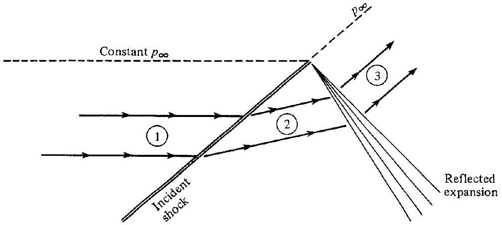
Figure 5.26 | Shock wave incident on a constant-pressure boundary.

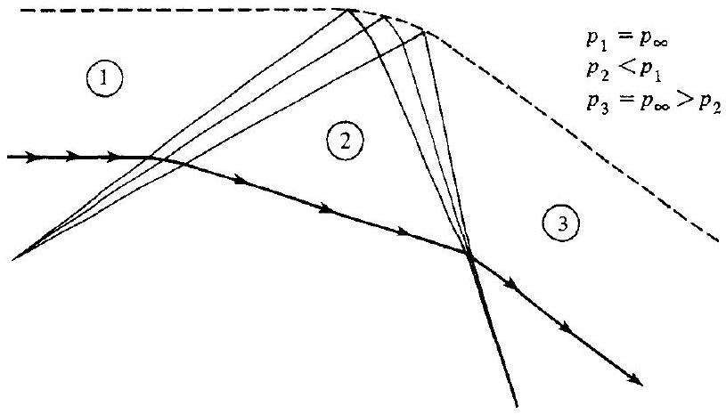
Figure 5.27 I Reflection of an expansion wave incident on a constant-pressure boundary.

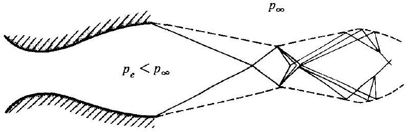
Figure 5.28 | Schematic of the diamond wave pattern in the exhaust from a supersonic nozzle.

Analogously, the incident expansion wave shown in Fig. 5.27 is reflected from a free boundary as a compression wave. This finite compression wave quickly coalesces into a shock wave, as shown. The wave interaction shown in Fig. 5.27 must be analyzed by the method of characteristics, to be discussed in Chap. 11.

From this discussion combined with our results of Chap. 4, we conclude that

1. Waves incident on a solid boundary reflect in like manner, i.e., a compression wave reflects as a compression and an expansion wave reflects as an expansion.
2. Waves incident on a free boundary reflect in opposite manner, i.e., a compression wave reflects as an expansion and an expansion wave reflects as a compression.
Considering the overexpanded nozzle flow in Fig. 5.18d, the flow pattern downstream of the nozzle exit will appear as sketched in Fig. 5.28. The various reflected waves form a diamond-like pattern throughout the exhaust jet. Such a diamond wave pattern is visible in the exhaust from the free jet shown in Fig. 5.29. The reader is left to sketch the analogous wave pattern for the underexpanded nozzle flow in Fig. 5.18e.

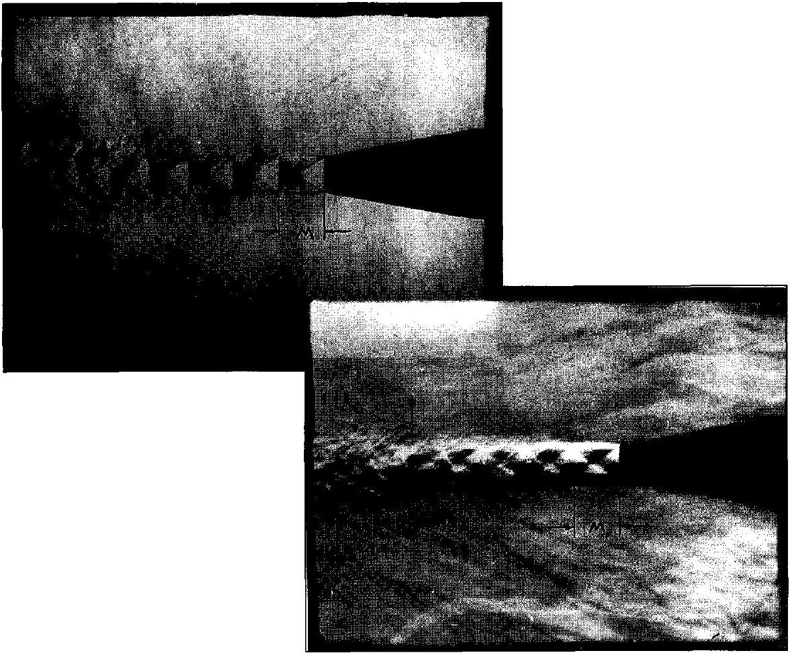
Figure 5.29 | Diamond wave patterns from an axisymmetric free jet (similar to the exhaust from a rocket engine). Taken from E. S. Love, C. E. Grigsby, L. P. Lee, and M. J. Woodling, "Experimental and Theoretical Studies of Axisymmetric Free Jets," NASA Tech. Report No. TR R-6, 1959. $M$ is the wavelength of the first diamond.

## 5.7 | SUMMARY

This brings to an end the technical discussion of the present chapter. The quasi-onedimensional duct flows discussed herein, in concert with the shock and expansion waves discussed in Chaps. 3 and 4, constitute a first tier in the overall structure of compressible flow. You should take this material very seriously, and should make certain that you feel comfortable with the major concepts and results. This will promote a smoother excursion into the remaining chapters.

## 5.8 | HISTORICAL NOTE: DE LAVALA BIOGRAPHICAL SKETCH

The first practical use of a convergent-divergent supersonic nozzle was made before the twentieth century. As related in Sec. 1.1, the Swedish engineer, Carl G. P. de Laval, designed a steam turbine in the late 1800s which incorporated supersonic
expansion nozzles upstream of the turbine blades (see Fig. 1.8). For this reason, such convergent-divergent nozzles are frequently referred to as "Laval nozzles" in the literature. Who was de Laval? What prompted him to design a supersonic nozzle for steam turbines? What kind of man was he? Let us take a closer look.

Carl Gustaf Patrick de Laval was born at Blasenborg, Sweden, on May 9, 1845. The son of a Swedish army captain, de Laval showed an early interest in mechanical mechanisms, disassembling and then reassembling such devices as watches and gun locks. His parents encouraged his development along these lines, and at the age of 18 de Laval entered the University of Upsala, graduating in 1866 with high honors in engineering. He was then employed by a Swedish mining company, the Stora Kopparberg, where he quickly realized that he needed more education. (This is a phenomenon which has affected young engineers through the ages.) Therefore, he returned to Upsala, where he studied chemistry, physics, and mathematics, and graduated with a Ph.D. in 1872. From there, he returned to the Stora Company for 3 years, and then joined the Kloster Iron Works in Germany in 1875. By this time, his inventive genius was beginning to surface: he developed a sieve for improving the distribution of air in bessemer converters, and a new apparatus for galvanizing processes. Also, during his time with Kloster, de Laval was experimenting with centrifugal machines for the separation of cream in milk. Unable to convince Kloster to manufacture his cream separator, de Laval resigned in 1877, moved to Stockholm, and started his own company. Within 30 years, he had sold more than a million de Laval cream separators, and to the present day he is better known in Europe for cream separators then for steam turbines.

However, it was with his steam turbine designs that de Laval made a lasting contribution to the advancement of compressible flow. In 1882, he constructed his first steam turbine using rather conventional nozzles. Such nozzles were convergent shapes, indeed nothing more than orifices in some designs of that day. In turn, the kinetic energy of the steam entering the rotor blades was low, resulting in low rotational turbine speeds. The cause of this deficiency was recognized-the pressure ratio across such nozzles was never less than one-half. Today, as described in Secs. 5.3 and 5.4, we know that such nozzles were choked, and that the flow exhausted from the nozzle exit at a velocity that was not greater than sonic. However, in 1882, engineers did not fully understand such phenomena. Finally, in 1888, de Laval hit upon the system of further expanding the gas by adding a divergent section to the original convergent shape. Suddenly, his steam turbines began to operate at incredible rotational speeds-over $30,000 \mathrm{r} / \mathrm{min}$. Overcoming the many mechanical problems introduced by such an improvement in rotational speed, de Laval developed his turbine business into a large corporation in Stockholm, and quickly obtained a number of international affiliates, in France, Germany, England, the Netherlands, Austria-Hungary, Russia, and the United States. Subsequently, his design was demonstrated at the World Columbian Exposition in Chicago in 1893, as related in Sec. 1.1.

In addition to his successes as an engineer and businessman, de Laval was also adroit in his social relations. He was respected and liked by his social peers and employees. He held national office-being elected to the Swedish Parliament during

1888 to 1890, and later becoming a member of the Senate. He was awarded numerous honors and decorations, and was a member of the Swedish Royal Academy of Science.

After a full and productive life, Carl G. P. de Laval died in Stockholm in 1912 at the age of 67 . However, his influence and his company have lasted to the present day.

It is interesting to note that, on a technical basis, de Laval and other contemporary engineers in 1888 were not quite certain that supersonic flow actually existed in the "Laval nozzle." This was a point of contention that was not properly resolved until the experiments of Stodola in 1903. But Stodola's story is told in the next section.

## 5.9 | HISTORICAL NOTE: STODOLA, AND THE FIRST DEFINITIVE SUPERSONIC NOZZLE EXPERIMENTS

The innovative steam turbine nozzle design by de Laval (see Secs. 1.1 and 5.8) sparked interest in the fluid mechanics of flow through convergent-divergent nozzles at the turn of the century. Leading this interest was an Hungarian-born engineer by the name of Aurel Boleslav Stodola, who was to eventually become the leading expert in Europe on steam turbines. However, whereas de Laval was an idea and design man, Stodola was a scholarly professor who tied up the loose scientific and technical strings associated with Laval nozzles. Stodola is a major figure in the advancement of compressible flow, thermodynamics, and steam turbines. Let us see why, and at the same time take a look at the man himself.

Stodola was born on May 10, 1859, in Liptovsky Mikulas, Hungary, a small Slovakian town at the foot of the High Tatra mountains. The second son of a leather manufacturer, he attended the Budapest Technical University for 1 year in 1876. He was an exceptional student, and in 1877 he shifted to the University of Zurich in Switzerland, and then to the Eidgenossische Technische Hochschule in 1878, also in Zurich. Here, he graduated in 1880 with a mechanical engineering degree. Subsequently, he served a brief time with Ruston and Company in Prague, where he was responsible for the design of several different types of steam engines. However, his superb performance as a student soon earned him a "Chair for Thermal Machinery" back at the Eidgenossische Technische Hochschule in Zurich, a position he held until his retirement in 1929.

There, Stodola established a glowing academic career which included teaching, industrial consultation, and engineering design. However, his main contributions were in applied research. Stodola had a synergistic combination of high mathematical competence with an intense devotion to practical applications. Moreover, he understood the importance of engineering research at a time when it was virtually nonexistent throughout the world. In 1903 (the same year as the Wright brothers' first powered airplane flight), Stodola wrote:

> We engineers of course know that machine building, through widely extended practical experimenting, has solved problems, with the utmost ease, which baffled scientific investigation for years. But this "cut and try method," as engineers ironically term it, is often
extremely costly; and one of the most important questions of all technical activity, that of efficiency, should lead us not to underestimate the results of scientific technical work.

This commentary on the role of basic scientific research was aimed primarily at the design of steam turbines. But it was prophetic of the massive and varied research programs to come during the latter half of the twentieth century.

The importance of Stodola to our consideration in the present book lies in his pioneering work on the flow of steam through Laval nozzles. As mentioned in Sec. 5.8, the possibility of supersonic flow in such nozzles, although theoretically established, had not been experimentally verified, and therefore was a matter of controversy. To study this problem, Stodola constructed a convergent-divergent nozzle with the shape illustrated at the top of Fig. 5.30 . He could vary the backpressure over

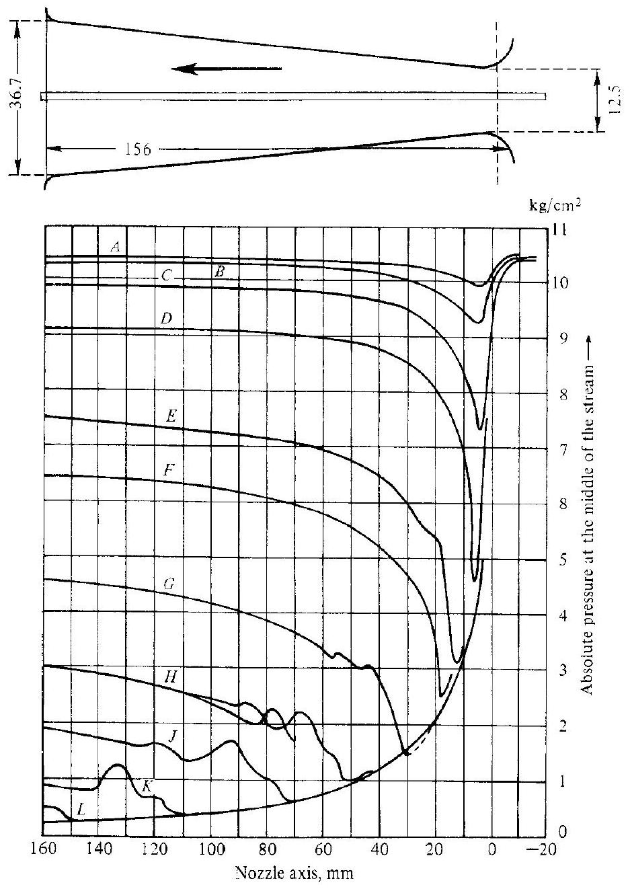
Figure 5.30 I Stodola's original supersonic nozzle data, 1903. The curves are pressure distributions for different backpressures.

any desired range by closing a valve downstream of the nozzle exit. With pressure taps in a long, thin tube extended through the nozzle along its centerline (also shown in Fig. 5.30), Stodola measured the axial pressure distributions associated with different backpressures. These data are shown below the nozzle configuration in Fig. 5.30. This figure is taken directly from Stodola's original publication, a book entitled Steam Turbines, first published in 1903. Here, for the first time in history, the characteristics of the flow through a supersonic nozzle were experimentally confirmed. In Fig. 5.30, the lowest curve corresponds to a complete isentropic expansion (as illustrated in Fig. 5.14c). The curves $D$ through $L$ in Fig. 5.30 correspond to a shock wave inside the nozzle, induced by higher backpressures (as illustrated in Fig. $5.17 c$ ). The curves $A, B$, and $C$ in Fig. 5.30 correspond to completely subsonic flow induced by high backpressures (as illustrated in Fig. 5.15c). With regard to the large jumps in pressure shown by some of the data in Fig. 5.30, Stodola comments:

I see in these extraordinary heavy increases of pressure a realization of the "compression shock" theoretically derived by von Riemann; because steam particles possessed of great velocity strike against a slower moving steam mass and are therefore compressed to a higher degree.
(In this quote, Stodola is referring to G. F. Bernhard Riemann mentioned in Sec. 3.10; however, he would be historically more correct to refer instead to Rankine and Hugoniot, as described in Sec. 3.10.) Stodola's nozzle experiments, as described, and his original data shown in Fig. 5.30, represented a quantum-jump in the understanding of supersonic nozzle flows. Taken in conjunction with de Laval's contributions, Stodola's work represents the original historical underpinning for the material given in this chapter. Furthermore, this work was quickly picked up by Ludwig Prandtl at Göttingen, who went on to make dramatic schlerien photographs of waves in supersonic nozzle flows, as described in Sec. 4.16.

Stodola died in Zurich on December 25, 1942, at the age of 83. During his lifetime, he became the leading world expert on steam turbines, and his students permeated the Swiss steam turbine manufacturing companies, making those companies into international leaders in this field. Moreover, he had exceptional personal charm. The loyalty of his friends was extraordinary, and he acquired an almost disciplelike group during his long life in Zurich. Even upon his death, the number and persuasiveness of his eulogies were exceptional. Clearly, Stodola has left a permanent mark in the history of compressible flow.

### 5.10 I SUMMARY

Quasi-one-dimensional flow is defined as flow wherein all the flow properties are functions of one space dimension only, say $x$, whereas the flow cross-sectional area is a variable, i.e., $u=u(x), p=p(x), T=T(x)$, and $A=A(x)$. This is in contrast to the purely one-dimensional flows discussed in Chap. 3, where the flow crosssectional area is constant. The governing flow equations for quasi-one-dimensional flow, obtained from a control volume model, are

Continuity:

$$
\rho_{1} u_{1} A_{1}=\rho_{2} u_{2} A_{2}
$$

Momentum: $\quad p_{1} A_{1}+\rho_{1} u_{1}^{2} A_{1}+\int_{A_{1}}^{A_{2}} p d A=p_{2} A_{2}+\rho_{2} u_{2}^{2} A_{2}$

Energy:

$$
h_{1}+\frac{u_{1}^{2}}{2}=h_{2}+\frac{u_{2}^{2}}{2}
$$

The differential forms of these equations are:

| Continuity: | $d(\rho u A)=0$ |
| :--- | :---: |
| Momentum: | $d p=-\rho u d u$ |
| Energy: | $d h+u d u=0$ |

These equations hold for inviscid, adiabatic flow-hence isentropic flow. They can be combined to yield the area-velocity relation

$$
\frac{d A}{A}=\left(M^{2}-1\right) \frac{d u}{u}
$$

which states, among other aspects, that

1. If the flow is subsonic, an increase in velocity corresponds to a decrease in area.
2. If the flow is supersonic, an increase in velocity corresponds to an increase in area.
3. If the flow is sonic, the area is at a local minimum.

These results clearly state that, in order to expand an isentropic flow from subsonic to supersonic speeds, a convergent-divergent duct must be used, where Mach 1 will occur at the minimum area (the throat) of the duct.

Quasi-one-dimensional isentropic flow is dictated by the area-Mach number relation,

$$
\left(\frac{A}{A^{*}}\right)^{2}=\frac{1}{M^{2}}\left[\frac{2}{\gamma+1}\left(1+\frac{\gamma-1}{2} M^{2}\right)\right]^{(\gamma+1) /(\gamma-1)}
$$

where $A^{*}$ is the flow area at a local value of Mach 1. From Eq. (5.20) we note the pivotal result that local Mach number is a function of only $A / A^{*}$ (and, of course, $\gamma$ ).

To understand the various flowfields possible in a quasi-one-dimensional. convergent-divergent duct, imagine that the reservoir pressure is held fixed and the backpressure downstream of the exit is progressively reduced. These cases are possible, as we progressively reduce the backpressure:

1. First, the flow is completely subsonic, including both the convergent and the divergent sections. The maximum value of the Mach number (still subsonic) occurs at the throat. The mass flow continually increases as the backpressure is reduced.
2. At some specific value of the backpressure, the flow at the throat becomes sonic. The Mach numbers both upstream and downstream of the throat are still subsonic. The mass flow reaches a maximum value; when the backpressure is further reduced, the mass flow remains constant. The flow is choked.
3. As the backpressure is further reduced, a region of supersonic flow occurs downstream of the throat, terminated by a normal shock wave standing inside the divergent region.
4. At some specific value of the backpressure, the normal shock will be located exactly at the exit. The fully isentropic, subsonic-supersonic flow pattern now exists throughout the entire duct, except right at the exit.
5. As the backpressure is further reduced, the normal shock is replaced by oblique shocks emanating from the edge of the nozzle exit. This is called an overexpanded nozzle flow.
6. At some specific value of the backpressure, corresponding to the isentropic flow value, no waves of any kind will exist in the flow; we will have the purely isentropic subsonic-supersonic expansion through the nozzle, with no waves at the exit.
7. Finally, for a lower backpressure, expansion waves will emanate from the edge of the nozzle exit. This is called an underexpanded nozzle flow.

The function of a diffuser is to slow a flow with the smallest possible loss of total pressure. For a supersonic or hypersonic wind tunnel, the diffuser must slow the flow to a low subsonic speed at the end of the tunnel. For a measure of how efficient the diffuser is, the normal shock diffuser efficiency is defined as

$$
\eta_{D}=\frac{\left(p_{d_{o}} / p_{o}\right)_{\text {actual }}}{\left(p_{o_{2}} / p_{o_{1}}\right)_{\text {normal shock at } M_{e}}}
$$

where $p_{d_{o}} / p_{o}$ is the actual ratio of total pressure between the exit of the diffuser and the nozzle reservoir, and $p_{o_{2}} / p_{o_{1}}$ is the usual total pressure ratio across a normal shock wave at the design Mach number at the nozzle exit. A supersonic diffuser has a local minimum of cross-sectional area called the second throat; the ratio of the second throat area (diffuser) to the first throat area (nozzle) is given by

$$
\frac{A_{t_{2}}}{A_{t_{1}}}=\frac{p_{o_{1}}}{p_{o_{2}}}
$$

## PROBLEMS

5.1 A supersonic wind tunnel is designed to produce flow in the test section at Mach 2.4 at standard atmospheric conditions. Calculate:
a. The exit-to-throat area ratio of the nozzle
b. Reservoir pressure and temperature
5.2 The reservoir pressure of a supersonic wind tunnel is 10 atm . A Pitot tube inserted in the test section measures a pressure of 0.627 atm . Calculate the test section Mach number and area ratio.
5.3 The reservoir pressure of a supersonic wind tunnel is 5 atm . A static pressure probe is moved along the center-line of the nozzle, taking measurements at various stations. For these probe measurements, calculate the local Mach number and area ratio:
a. $\quad 4 \mathrm{~atm}$
b. $\quad 2.64 \mathrm{~atm}$
c. 0.5 atm
5.4 Consider the purely subsonic flow in a convergent-divergent duct. The inlet, throat, and exit area are $1 \mathrm{~m}^{2}, 0.7 \mathrm{~m}^{2}$, and $0.85 \mathrm{~m}^{2}$, respectively. If the inlet Mach number and pressure are 0.3 and $0.8 \times 10^{5} \mathrm{~N} / \mathrm{m}^{2}$. respectively, calculate:
a. $\quad M$ and $p$ at the throat
b. $M$ and $p$ at the exit
5.5 Consider the subsonic flow through a divergent duct with area ratio $A_{2} / A_{1}=$ 1.7. If the inlet conditions are $T_{1}=300 \mathrm{~K}$ and $u_{1}=250 \mathrm{~m} / \mathrm{s}$, and the pressure at the exit is $p_{2}=1 \mathrm{~atm}$, calculate:
a. Inlet pressure $p_{1}$
b. Exit velocity $u_{2}$.
5.6 The mass flow of a calorically perfect gas through a choked nozzle is given by

$$
\dot{m}=\frac{p_{o} A^{*}}{\sqrt{T_{o}}} \sqrt{\frac{\gamma}{R}\left(\frac{2}{\gamma+1}\right)^{(\gamma+1) /(\gamma-1)}}
$$

Derive this relation.
5.7 When the reservoir pressure and temperature of a supersonic wind tunnel are 15 atm and 750 K , respectively, the mass flow is $1.5 \mathrm{~kg} / \mathrm{s}$. If the reservoir conditions are changed to $p_{0}=20 \mathrm{~atm}$ and $T_{0}=600 \mathrm{~K}$, calculate the mass flow.
5.8 A blunt-nosed aerodynamic model is mounted in the test section of a supersonic wind tunnel. If the tunnel reservoir pressure and temperature are 10 atm and $800^{\circ} \mathrm{R}$, respectively, and the exit-to-throat area ratio is 25 , calculate the pressure and temperature at the nose of the model.
5.9 Consider a flat plate mounted in the test section of a supersonic wind tunnel. The plate is at an angle of attack of $10^{\circ}$ and the static pressure on the top surface of the plate is 1.0 atm . The nozzle throat area is $0.05 \mathrm{~m}^{2}$ and the exit area is $0.0844 \mathrm{~m}^{2}$. Calculate the reservoir pressure of the tunnel.
5.10 Consider a supersonic nozzle with a Pitot tube mounted at the exit. The reservoir pressure and temperature are 10 atm and 500 K , respectively. The
pressure measured by the Pitot tube is 0.6172 atm . The throat area is $0.3 \mathrm{~m}^{2}$. Calculate:
a. Exit Mach number $M_{e}$
b. Exit area $A_{e}$
c. Exit pressure and temperature $p_{e}$ and $T_{e}$
d. mass flow through the nozzle
5.11 Consider a convergent-divergent duct with exit and throat areas of $0.5 \mathrm{~m}^{2}$ and $0.25 \mathrm{~m}^{2}$, respectively. The inlet reservoir pressure is 1 atm and the exit static pressure is 0.6 atm . For this pressure ratio, the flow will be supersonic in a portion of the nozzle, terminating with a normal shock inside the nozzle. Calculate the local area ratio $\left(A / A^{*}\right)$ at which the shock is located inside the nozzle.
5.12 Consider a supersonic wind tunnel where the nozzle area ratio is $A_{e} / A_{t_{1}}=$ 104.1. The throat area of the nozzle is $A_{t_{1}}=1.0 \mathrm{~cm}^{2}$. Calculate the minimum area of the diffuser throat, $A_{t_{2}}$, which will allow the tunnel to start.
5.13 At the exit of the diffuser of a supersonic wind tunnel which exhausts directly to the atmosphere, the Mach number is very low $(\approx 0.1)$. The reservoir pressure is 1.8 atm , and the test section Mach number is 2.6 . Calculate the diffuser efficiency $\eta_{D}$.
5.14 In a supersonic nozzle flow, the exit-to-throat area ratio is $10, p_{o}=10 \mathrm{~atm}$, and the backpressure $p_{B}=0.04 \mathrm{~atm}$. Calculate the angle $\theta$ through which the flow is deflected immediately after leaving the edge (or lip) of the nozzle exit.
5.15 Consider an oblique shock wave with $M_{1}=4.0$ and $\beta=50^{\circ}$. This shock wave is incident on a constant-pressure boundary, as sketched in Fig. 5.26. For the flow downstream of the reflected expansion wave, calculate the Mach number $M_{3}$ and the flow direction relative to the flow upstream of the shock.
5.16 Consider a rocket engine burning hydrogen and oxygen. The combustion chamber temperature and pressure are 4000 K and 15 atm , respectively. The exit pressure is $1.174 \times 10^{-2} \mathrm{~atm}$. Calculate the Mach number at the exit. Assume that $\gamma=$ constant $=1.22$ and that $R=519.6 \mathrm{~J} / \mathrm{kg} \mathrm{K}$.
5.17 We wish to design a Mach 3 supersonic wind tunnel, with a static pressure and temperature in the test section of 0.1 atm and $400^{\circ} \mathrm{R}$, respectively.
Calculate:
a. The exit-to-throat area ratio of the nozzle
b. The ratio of diffuser throat area to nozzle throat area
c. Reservoir pressure
d. Reservoir temperature
5.18 Consider two hypersonic wind tunnels with the same reservoir temperature of 3000 K in air. (a) One tunnel has a test-section Mach number of 10 . Calculate the flow velocity in the test section. (b) The other tunnel has a test-section Mach number of 20 . Calculate the flow velocity in the test section.
(c) Compare the answers from (a) and (b), and discuss the physical significance of this comparison.
5.19 Consider a hypersonic wind tunnel with a reservoir temperature of 3000 K in air. Calculate the theoretical maximum velocity obtainable in the test section. Compare this result with the results of Problem 5.18 (a) and (b).
5.20 As Problems 5.18 and 5.19 reflect, the air temperature in the test section of conventional hypersonic wind tunnels is low. In reality, air liquefies at a temperature of about 50 K (depending in part on the local pressure as well). In the practical operation of a hypersonic wind tunnel, liquefaction of the test stream gas should be avoided; when liquefaction occurs. the test stream is a two-phase flow, and the test data is compromised. For a Mach 20 tunnel using air, calculate the minimum reservoir temperature required to avoid liquefaction in the test section.
5.21 The reservoir temperature calculated in Problem 5.20 is beyond the capabilities of heaters in the reservoir of continuous-flow wind tunnels using air. This is why you do not see a Mach 20 continuous-flow tunnel using air. On the other hand, consider the flow of helium, which has a liquefaction temperature of 2.2 K at the low pressures in the test section. This temperature is much lower than that of air. For a Mach 20 wind tunnel using helium, calculate the minimum reservoir temperature required to avoid liquefaction in the test section. For helium, the ratio of specific heats is 1.67 .
5.22 The result from Problem 5.21 shows that the reservoir temperature for a Mach 20 helium tunnel can be very reasonable. This is why several very high Mach number helium hypersonic wind tunnels exist. For the helium wind tunnel in Problem 5.21, calculate the nozzle exit-to-throat area ratio. Compare this with the exit-to-throat area ratio required for an air Mach 20 tunnel.
tim,

[^0]:    ${ }^{\dagger}$ For a more extensive discussion of supersonic diffusers, as well as their application in a modern situation, see Chap. 12 of Ref. 21.

