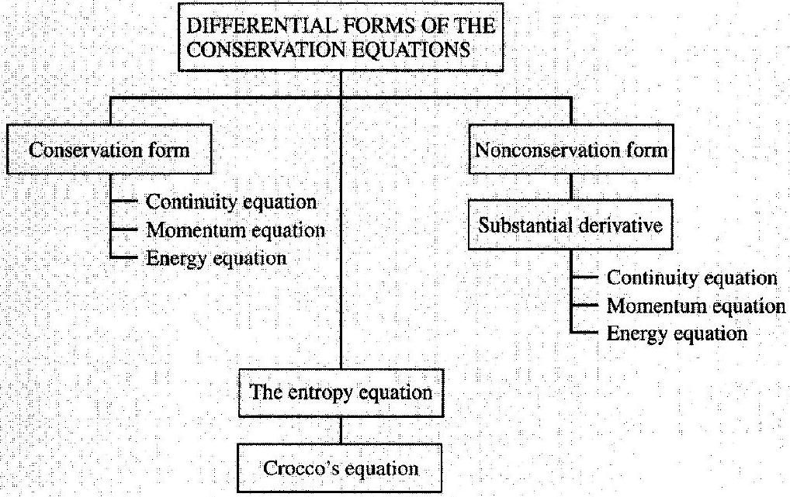
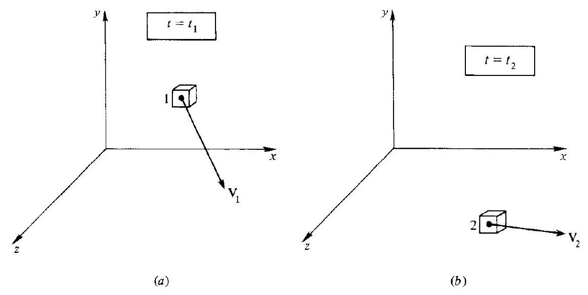

## CHAPTER

## Differential Conservation Equations for Inviscid Flows

The information needed by design engineers of either aircraft or flow machinery is the pressure, the shearing stress, the temperature, and the heat flux vector imposed by the moving fluid over the surface of a specified solid body or bodies in a fluid stream of specified conditions. To supply this information is the main purpose of the discipline of gasdynamics.
H. S. Tsien, 1953

## PREVIEW BOX

In 1913 Gertrude Stein wrote the familiar phrase: "Rose is a rose is a rose is a rose." We borrow from this phrase for the present chapter and say: "A conservation equation is a conservation equation is a conservation equation is a conservation equation." However, like roses that come in a multitude of varieties, the conservation equations come in a variety of forms. We have derived and utilized one form of the conservation equations in the previous chapters, namely, the integral form. In the present chapter, we expand our horizons, and obtain the governing conservation equations in the form of partial differential equations, which will be necessary for the study of the multidimensional and/or unsteady flows highlighted in the remainder of this book.

The panoply of the various forms of the conservation equations are frequently confusing to new students of fluid dynamics because they look so different and yet they speak the same physics. For example, there are at least a dozen different forms of the energy equation, yet in the final analysis they are essentially the same and they all are a statement of the first law of thermodynamics. In the simplest sense, the origin of the different forms stem from the particular model of the flow used to
obtain them. For example, four different models of the flow are illustrated in Figs, 2.2 and 2.3. When we apply the fundamental principle of mass conservation to each of these four models, four different forms of the continuity equation are directly obtained. Although these four equations look completely different, they can be reworked into each other's form by mathematical manipulation, and all four forms represent the same physical principle, namely, that mass is conserved. A purpose of the present chapter is to somewhat demystify the different forms of the equations for you, and to emphasize those forms that will be useful for the remainder of this book. For a complete discussion of the fundamental governing equations, their different forms, and where they come from, see Chap. 2 of the author's book Computational Fluid Dynamics. The Basics With Applications (Ref. 18), where a major effort is made to demystify the equations in their many different forms.

By now you get the point. This chapter is all about equations; it is essentially a continuation of Chap. 2 , which also was all about equations. The comments made in our preview of Chap. 2 also apply here. The present chapter is very important because it adds many useful

Figure 6.1 / Roadmap for Chapter 6.

tools to our toolbox. These tools will make it possible for us to examine a number of exciting applications later in the book.

The roadmap for this chapter is given in Fig. 6.1. We derive two forms of the differential conservation equations: the conservation form and the nonconservation form. (Do not be put off by the term "nonconservation form"-it is strictly nomenclature and does not
imply any violation of the physics. The classification of the equations under the conservation and nonconservation forms is a fairly recent artifact that has come from the rise of computational fluid dynamics, and because this nomenclature is becoming more widespread, we use it here.) The chapter ends with two additional equations, the entropy equation and Crocco's theorem, which have certain special applications to our further studies.

### 6.1 I INTRODUCTION

The analysis of problems in fluid dynamics requires three primary steps:

1. Determine a model of the fluid.
2. Apply the basic principles of physics to this model in order to obtain appropriate mathematical equations embodying these principles.
3. Use the resulting equations to solve the specific problem of interest.

In Chap. 2, the model of the fluid chosen was a control volume. The basic principles of mass conservation, Newton's second law, and energy conservation were applied to a finite control volume to obtain integral forms of the conservation equations. In turn, these equations were applied to specific problems in Chaps. 3, 4, and 5. These applications were such that the integral conservation equations nicely reduced to algebraic equations describing properties at different cross sections of the flow. However, we are now climbing to a higher tier in our study of compressible flow, where most of the previous algebraic equations no longer hold. We will soon be dealing with problems of unsteady flow, as well as flows with two or three spatial dimensions. For such cases, the integral forms of the conservation equations from Chap. 2 must be applied to a small neighborhood surrounding a point in the flow, resulting in differential equations, which describe flow properties at that point. To expedite our analysis, we will make use of these vector identities:

$$
\begin{aligned}
\oiint_{S} \mathbf{A} \cdot d \mathbf{S} & =\oiiint(\nabla \cdot \mathbf{A}) d y \\
\oiint_{S} \mathbf{\Phi} d \mathbf{S} & =\oiiint(\nabla \mathbf{\Phi}) d y
\end{aligned}
$$

where $\mathbf{A}$ and $\boldsymbol{\Phi}$ are vector and scalar functions, respectively, of time and space. and $y$ is a control volume surrounded by a closed control surface $S$, as sketched in Fig. 2.4.

## 6.2 | DIFFERENTIAL EQUATIONS IN CONSERVATION FORM

### 6.2.1 Continuity Equation

Repeating for convenience the continuity equation, Eq. (2.2),

$$
-\oiint_{S} \rho \mathbf{V} \cdot d \mathbf{S}=\oiint \frac{\partial \rho}{\partial t} d \mathscr{V}
$$

and using Eq. (6.1) in the form

$$
\oiint_{S}(\rho \mathbf{V}) \cdot d \mathbf{S}=\oiint \nabla \cdot(\rho \mathbf{V}) d \mathscr{V}^{\mathscr{V}}
$$

we combine Eqs. (2.2) and (6.3) to obtain

$$
\oiint\left[\frac{\partial \rho}{\partial t}+\nabla \cdot(\rho \mathbf{V})\right] d \mathscr{V}=0
$$

It might be argued that a control volume could be chosen such that, in some special case, integration of Eq. (6.4) over one part of the volume would exactly cancel the integration over the remaining part, giving zero for the right-hand side. However, the control volume is an arbitrary shape and size, and in general the only way Eq. (6.4) can be satisfied is for the integrand to be zero at each point within the volume. Hence,

$$
\frac{\partial \rho}{\partial t}+\nabla \cdot(\rho \mathbf{V})=0
$$

Equation (6.4) is the differential form of the continuity equation.

### 6.2.2 Momentum Equation

Repeating for convenience the momentum equation, Eq. (2.11),

$$
\oiiint \rho \mathbf{f} d \mathscr{Y}-\oiint_{S} p d \mathbf{S}=\oiiint \frac{(\partial \rho \mathbf{V})}{\partial t} d \mathscr{Y}+\oiint_{S}(\rho \mathbf{V} \cdot d \mathbf{S}) \mathbf{V}
$$

and using Eq. (6.2) in the form

$$
\oiint_{S} p d \mathbf{S}=\oiiint(\nabla p) d \mathscr{V}
$$

we combine Eqs. (2.11) and (6.6) to obtain

$$
\oiiint \rho \mathbf{f} d Y-\oiiint_{y} \nabla p d Y=\oiiint \frac{\partial(\rho \mathbf{V})}{\partial t} d Y+\oiint_{S}(\rho \mathbf{V} \cdot d \mathbf{S}) \mathbf{V}
$$

Equation (6.7) is a vector equation; for convenience, let us consider cartesian scalar components in the $x, y$, and $z$ directions, respectively (see Fig. 2.4). The $x$ component of Eq. (6.7) is

$$
\oiiint \rho f_{x} d y-\oiiint \frac{\partial p}{\partial x} d y=\oiiint \oiiint_{y} \frac{\partial(\rho u)}{\partial t} d y+\oiint_{S}(\rho \mathbf{V} \cdot d \mathbf{S}) u
$$

However, from Eq. (6.1),

$$
\oiint_{S}(\rho \mathbf{V} \cdot d \mathbf{S}) u=\oiint_{S}(\rho u \mathbf{V}) \cdot d \mathbf{S}=\oiiint_{y} \nabla \cdot(\rho u \mathbf{V}) d y \cdot
$$

Substituting Eq. (6.9) into (6.8),

$$
\oiint\left[\rho f_{x}-\frac{\partial p}{\partial x}-\frac{\partial(\rho u)}{\partial t}-\nabla \cdot(\rho u \mathbf{V})\right] d Y=0
$$

By the same reasoning used to obtain Eq. (6.5) from Eq. (6.4), Eq. (6.10) yields

$$
\frac{\partial(\rho u)}{\partial t}+\nabla \cdot(\rho u \mathbf{V})=-\frac{\partial p}{\partial x}+\rho f_{x}
$$

Equation (6.11) is the differential form of the $x$ component of the momentum equation. The analogous $y$ and $z$ components are

$$
\begin{array}{|l|}
\hline \frac{\partial(\rho v)}{\partial t}+\nabla \cdot(\rho v \mathbf{V})=-\frac{\partial p}{\partial y}+\rho f_{y} \\
\frac{\partial(\rho w)}{\partial t}+\nabla \cdot(\rho w \mathbf{V})=-\frac{\partial p}{\partial z}+\rho f_{z}
\end{array}
$$

### 6.2.3 Energy Equation

Repeating for convenience the energy equation, Eq. (2.20),

$$
\begin{aligned}
& \oiint \rho \dot{q} d y-\oiint_{S} p \mathbf{V} \cdot d \mathbf{S}+\oiiint \rho(\mathbf{f} \cdot \mathbf{V}) d Y \\
& =\oiiint \frac{\partial}{\partial t}\left[\rho\left(e+\frac{V^{2}}{2}\right)\right] d Y+\oiint_{S} \rho\left(e+\frac{V^{2}}{2}\right) \mathbf{V} \cdot d \mathbf{S}
\end{aligned}
$$

and using Eq. (6.1) in the forms

$$
\begin{gathered}
\oiint_{S} \rho\left(e+\frac{V^{2}}{2}\right) \mathbf{V} \cdot d \mathbf{S}=\oiiint_{y} \nabla \cdot\left[\rho\left(e+\frac{V^{2}}{2}\right) \mathbf{V}\right] d \mathscr{V} \\
\oiint_{S} p \mathbf{V} \cdot d \mathbf{S}=\oiiint_{y} \nabla \cdot(p \mathbf{V}) d \mathscr{V}
\end{gathered}
$$

and
we combine Eqs. (2.20), (6.14), and (6.15) to obtain

$$
\begin{gathered}
\oiiint\left\{\rho \dot{q}-\nabla \cdot(p \mathbf{V})+\rho(\mathbf{f} \cdot \mathbf{V})-\frac{\partial}{\partial t}\left[\rho\left(e+\frac{V^{2}}{2}\right)\right]\right. \\
\left.-\nabla \cdot\left[\rho\left(e+\frac{V^{2}}{2}\right) \mathbf{V}\right]\right\} d \mathscr{V}=0
\end{gathered}
$$

Setting the integrand equal to zero, we obtain

$$
\frac{\partial}{\partial t}\left[\rho\left(e+\frac{V^{2}}{2}\right)\right]+\nabla \cdot\left[\rho\left(e+\frac{V^{2}}{2}\right) \mathbf{V}\right]=-\nabla \cdot(p \mathbf{V})+\rho \dot{q}+\rho(\mathbf{f} \cdot \mathbf{V})
$$

Equation (6.17) is the differential form of the energy equation.

### 6.2.4 Summary

Equations (6.5), (6.11) through (6.13), and (6.17) are general equations that apply at any point in an unsteady, three-dimensional flow of a compressible inviscid fluid. They are nonlinear partial differential equations, and they contain all of the physical information and importance of the integral equations from which they were extracted. For virtually the remainder of this book, such differential forms of the basic conservation equations will be employed. Also, note that these equations contain divergence terms of the quantities $\rho \mathbf{V}, \rho u \mathbf{V}, \rho v \mathbf{V}, \rho w \mathbf{V}$, and $\rho\left(e+V^{2} / 2\right) \mathbf{V}$. For this reason, these equations are said to be in divergence form. This form of the equations is also called the conservation form since they stem directly from the integral conservation equations applied to a fixed control volume. However, other forms of these equations are frequently used, as will be derived in Secs. 6.3 and 6.4. We have now finished the left-hand column of our roadmap in Fig. 6.1, and we move on to the right-hand column.

### 6.3 I THE SUBSTANTIAL DERIVATIVE

Consider a small fluid element moving through cartesian space as illustrated in Figs. $6.2 a$ and $b$. The $x, y$, and $z$ axes in these figures are fixed in space. Figure 6.2a shows the fluid element at point 1 at time $t=t_{1}$. Figure $6.2 b$ shows the same fluid

Figure 6.2 I Illustration of the substantial derivative (the $x y z$ coordinate system above is fixed in space, and the fluid element is moving from point 1 to point 2 ).

element at point 2 in the flowfield at some later time, $t_{2}$. Throughout the $(x, y, z)$ space, the velocity field is given by

$$
\mathbf{V}=u \mathbf{i}+v \mathbf{j}+w \mathbf{k}
$$

where

$$
\begin{aligned}
u & =u(x, y, z, t) \\
v & =v(x, y, z, t) \\
w & =w(x, y, z, t)
\end{aligned}
$$

and $\mathbf{i}, \mathbf{j}$, and $\mathbf{k}$ are unit vectors in the $x, y$, and $z$ directions, respectively. In addition, the density field is given by

$$
\rho=\rho(x, y, z, t)
$$

At time $t_{1}$, the density of the fluid element is $\rho_{1}=\rho\left(x_{1}, y_{1}, z_{1}, t_{1}\right)$. At time $t_{2}$, the density of the same fluid element is $\rho_{2}=\rho\left(x_{2}, y_{2}, z_{2}, t_{2}\right)$. Since $\rho=\rho(x, y, z . t)$, we can expand this function in a Taylor's series about point 1 as follows:

$$
\begin{aligned}
\rho_{2}= & \rho_{1}+\left(\frac{\partial \rho}{\partial x}\right)_{1}\left(x_{2}-x_{1}\right)+\left(\frac{\partial \rho}{\partial y}\right)_{1}\left(y_{2}-y_{1}\right) \\
& +\left(\frac{\partial \rho}{\partial z}\right)_{1}\left(z_{2}-z_{1}\right)+\left(\frac{\partial \rho}{\partial t}\right)_{1}\left(t_{2}-t_{1}\right)+\text { higher-order term }
\end{aligned}
$$

Dividing by ( $t_{2}-t_{1}$ ), and ignoring higher-order terms,

$$
\frac{\rho_{2}-\rho_{1}}{t_{2}-t_{1}}=\left(\frac{\partial \rho}{\partial x}\right)_{1} \frac{\left(x_{2}-x_{1}\right)}{\left(t_{2}-t_{1}\right)}+\left(\frac{\partial \rho}{\partial y}\right)_{1} \frac{\left(y_{2}-y_{1}\right)}{\left(t_{2}-t_{1}\right)}+\left(\frac{\partial \rho}{\partial z}\right)_{1} \frac{\left(z_{2}-z_{1}\right)}{\left(t_{2}-t_{1}\right)}+\left(\frac{\partial \rho}{\partial t}\right)_{1}
$$

Keep in mind the physical meaning of the left-hand side of Eq. (6.18). The quantity $\left(\rho_{2}-\rho_{1}\right)$ is the change of density of the particular fluid element as it moves from
point 1 to point 2 . The quantity ( $t_{2}-t_{1}$ ) is the time it takes for this particular fluid element to move from point 1 to point 2 . If we now let time $t_{2}$ approach $t_{1}$ in a limiting sense, the quantity

$$
\lim _{t_{2} \rightarrow t_{1}}\left(\frac{\rho_{2}-\rho_{1}}{t_{2}-t_{1}}\right) \equiv \frac{D \rho}{D t}
$$

becomes the instantaneous time rate of change of density of the particular fluid element as it moves through point 1 . This quantity is denoted by the symbol $D \rho / D t$. Note that $D \rho / D t$ is the rate of change of density of a given fluid element as it moves through space. Here, our eyes are fixed on the fluid element as it is moving. This is physically different than $(\partial \rho / \partial t)_{1}$, which is the time rate of change of density at the fixed point 1 . For $(\partial \rho / \partial t)_{1}$, we fix our eyes on the stationary point 1 and watch the density change due to transient fluctuations in the flowfield. Thus, $D \rho / D t$ and $(\partial \rho / \partial t)_{1}$ are physically and numerically different quantities.

Continuing with our limiting procedures, and again remembering that we are following a given fluid element,

$$
\begin{aligned}
& \lim _{t_{2} \rightarrow t_{1}} \frac{\left(x_{2}-x_{1}\right)}{\left(t_{2}-t_{1}\right)} \equiv u \\
& \lim _{t_{2} \rightarrow t_{1}} \frac{\left(y_{2}-y_{1}\right)}{\left(t_{2}-t_{1}\right)} \equiv v \\
& \lim _{t_{2} \rightarrow t_{1}} \frac{\left(z_{2}-z_{1}\right)}{\left(t_{2}-t_{1}\right)} \equiv w
\end{aligned}
$$

Hence, returning to Eq. (6.18) and taking the limit as $t_{2} \rightarrow t_{1}$, we obtain

$$
\frac{D \rho}{D t}=u \frac{\partial \rho}{\partial x}+v \frac{\partial \rho}{\partial y}+w \frac{\partial \rho}{\partial z}+\frac{\partial \rho}{\partial t}
$$

From this, we can define the notation

$$
\frac{D}{D t} \equiv \frac{\partial}{\partial t}+u \frac{\partial}{\partial x}+v \frac{\partial}{\partial y}+w \frac{\partial}{\partial z}=\frac{\partial}{\partial t}+(\mathbf{V} \cdot \nabla)
$$

as the substantial derivative. The time rate of change of any quantity associated with a particular moving fluid element is given by the substantial derivative. For example,

$$
\frac{D e}{D t}=\frac{\partial e}{\partial t}+u \frac{\partial e}{\partial x}+v \frac{\partial e}{\partial y}+w \frac{\partial e}{\partial z}=\frac{\partial e}{\partial t}+(\mathbf{V} \cdot \nabla) e
$$

where $D e / D t$ is the time rate of change of internal energy per unit mass of the fluid element as it moves through a point in the flowfield, $\partial e / \partial t$ is the local time derivative at the point, and

$$
u \frac{\partial e}{\partial x}+v \frac{\partial e}{\partial y}+w \frac{\partial e}{\partial z}
$$

is the convective derivative. Again, physically, the properties of the fluid element are changing as it moves past a point in a flow because the flowfield itself may be fluctuating with time (the local derivative) and because the fluid element is simply on its way to another point in the flowfield where the properties are different (the convective derivative).

This example will help to reinforce the physical meaning of the substantial derivative. Consider the substantial derivative of the temperature, which from Eq. (6.19) is written as

$$
\frac{D T}{D t}=\frac{\partial T}{\partial t}+(\mathbf{V} \cdot \nabla) T
$$

Imagine that you are hiking in the mountains on a summer day, and you are about to enter a cave. The air temperature inside the cave is cooler than outside. Thus, as you walk through the mouth of the cave, you feel a temperature decrease-this is analogous to the convective derivative, $(\mathbf{V} \cdot \nabla) T$, in Eq. (6.19a). Moreover, being in the mountains, assume that some patches of snow remain from the previous winter. Imagine that you are with a friend who scoops up some of this snow and makes a snowball. Consider a point at the entrance to the cave. If the snowball were thrown through this point, there would be a momentary fluctuation in local temperature at the point due to the cold snowball. This temperature fluctuation is the local time derivative, $\partial T / \partial t$, in Eq. (6.19a). Imagine now that your friend throws the snowball past the entrance of the cave at the same instant you are walking through the entrance, hitting you with the snowball. You will feel an additional, but momentary, temperature drop when the snowball hits you-analogous to the local time derivative in Eq. (6.19a). The net temperature drop you feel as you walk through the mouth of the cave is therefore a combination of both the act of moving into the cave, where it is cooler, and being struck by the snowball at the same instant-this net temperature drop is analogous to the substantial derivative, $D T / D t$, in Eq. (6.19a).

### 6.4 I DIFFERENTIAL EQUATIONS IN NONCONSERVATION FORM

### 6.4.1 Continuity Equation

Returning to Eq. (6.5) and expanding the divergence term (recalling the vector identity that $\nabla \cdot(a \mathbf{B})=a \nabla \cdot \mathbf{B}+\mathbf{B} \cdot \nabla a$, where $a$ is a scalar and $\mathbf{B}$ is a vector), we have

$$
\frac{\partial \rho}{\partial t}+\rho \nabla \cdot \mathbf{V}+\mathbf{V} \cdot \nabla \rho=0
$$

Slightly rearranging Eq. (6.20),

$$
\frac{\partial \rho}{\partial t}+(\mathbf{V} \cdot \nabla) \rho+\rho \nabla \cdot \mathbf{V}=0
$$

Incorporating the nomenclature of Eq. (6.19) into (6.21),

$$
\frac{D \rho}{D t}+\rho \nabla \cdot \mathbf{V}=0
$$

Equation (6.22) is an alternative form of the continuity equation given by Eq. (6.5). Physically, Eq. (6.22) says that the mass of a fluid element made up of a fixed set of particles (molecules and atoms) is constant as the fluid element moves through space. [For a chemically reacting flow, we have to think in terms of a fluid element made up of a fixed set of electrons and nuclei because the molecules and atoms inside the fluid element may increase or decrease due to chemical reaction; nevertheless, Eq. (6.22) is still valid for a chemically reacting flow.]

### 6.4.2 Momentum Equation

Returning to Eq. (6.11) and again expanding the divergence term as well as the time derivative,

$$
\rho \frac{\partial u}{\partial t}+u \frac{\partial \rho}{\partial t}+u \nabla \cdot(\rho \mathbf{V})+\rho \mathbf{V} \cdot \nabla u=-\frac{\partial p}{\partial x}+\rho f_{x}
$$

Multiply Eq. (6.5) by $u$ :

$$
u \frac{\partial \rho}{\partial t}+u \nabla \cdot(\rho \mathbf{V})=0
$$

Subtract Eq. (6.24) from (6.23):

$$
\rho \frac{\partial u}{\partial t}+\rho \mathbf{V} \cdot \nabla u=-\frac{\partial p}{\partial x}+\rho f_{x}
$$

Using the substantial derivative given in Eq. (6.19),

$$
\rho \frac{D u}{D t}=-\frac{\partial p}{\partial x}+\rho f_{x}
$$

By similar manipulation of Eqs. (6.12) and (6.13), we have

$$
\frac{\rho \frac{D v}{D t}=-\frac{\partial p}{\partial y}+\rho f_{y}}{\rho \frac{D w}{D t}=-\frac{\partial p}{\partial z}+\rho f_{z}}
$$

In vector form, Eqs. (6.26) through (6.28) can be written as

$$
\rho \frac{D \mathbf{V}}{D t}=-\nabla p+\rho \mathbf{f}
$$

Equations (6.26) through (6.29) are different forms of Euler's equation, which is an alternative form of the momentum equation given in Eqs. (6.11) through (6.13). Euler's equation physically is a statement of Newton's second law, $\mathbf{F}=m \mathbf{a}$, applied to a moving fluid element of fixed identity.

### 6.4.3 Energy Equation

Returning to Eq. (6.17) and expanding,

$$
\begin{aligned}
& \rho \frac{\partial\left(e+V^{2} / 2\right)}{\partial t}+\left(e+\frac{V^{2}}{2}\right) \frac{\partial \rho}{\partial t}+\left(e+\frac{V^{2}}{2}\right) \nabla \cdot(\rho \mathbf{V}) \\
& \quad+\rho \mathbf{V} \cdot \nabla\left(e+\frac{V^{2}}{2}\right)=-\nabla \cdot(p \mathbf{V})+\rho \dot{q}+\rho(\mathbf{f} \cdot \mathbf{V})
\end{aligned}
$$

The second and third terms of Eq. (6.30), from the continuity equation, Eq. (6.5), give

$$
\left(e+\frac{V^{2}}{2}\right)\left[\frac{\partial \rho}{\partial t}+\nabla \cdot(\rho \mathbf{V})\right]=\left(e+\frac{V^{2}}{2}\right)(0)=0
$$

Hence, along with the substantial derivative nomenclature, Eq. (6.30) becomes

$$
\rho \frac{D\left(e+V^{2} / 2\right)}{D t}=-\nabla \cdot(\rho \mathbf{V})+\rho \dot{q}+\rho(\mathbf{f} \cdot \mathbf{V})
$$

Equation (6.31) is an alternative form of the energy equation given in Eq. (6.17). Equation (6.31) is a physical statement of the first law of thermodynamics applied to a moving fluid element of fixed identity; however, note that for a moving fluid, the energy is the total energy, $e+V^{2} / 2$, i.e., the sum of both internal and kinetic energies per unit mass.

The energy equation is multifaceted-it can be written in many different forms, all of which you will sooner or later encounter in the literature. Therefore, it is important to sort out these different forms now. For example, let us obtain a form of Eq. (6.31) in terms of internal energy $e$ only. Consider the left-hand side of Eq. (6.31),

$$
\begin{aligned}
\rho \frac{D\left(e+V^{2} / 2\right)}{D t} & =\rho \frac{D e}{D t}+\rho \frac{D\left(V^{2} / 2\right)}{D t}=\rho \frac{D e}{D t}+\frac{\rho}{2} \frac{D(\mathbf{V} \cdot \mathbf{V})}{D t} \\
& =\rho \frac{D e}{D t}+\rho \mathbf{V} \cdot \frac{D \mathbf{V}}{D t}
\end{aligned}
$$

Considering the first term of the right-hand side of Eq. (6.31),

$$
\nabla \cdot(p \mathbf{V})=p \nabla \cdot \mathbf{V}+\mathbf{V} \cdot \nabla p
$$

Substitute Eqs. (6.32) and (6.33) into Eq. (6.31):

$$
\rho \frac{D e}{D t}+\rho \mathbf{V} \cdot \frac{D \mathbf{V}}{D t}=-p \nabla \cdot \mathbf{V}-\mathbf{V} \cdot \nabla p+\rho \dot{q}+\rho(\mathbf{f} \cdot \mathbf{V})
$$

Form the scalar product of $\mathbf{V}$ with the vector form of Euler's equation, Eq. (6.29):

$$
\rho \mathbf{V} \cdot \frac{D \mathbf{V}}{D t}=-\mathbf{V} \cdot \nabla p+\rho(\mathbf{f} \cdot \mathbf{V})
$$

Subtracting Eq. (6.35) from (6.34),

$$
\rho \frac{D e}{D t}=-p \nabla \cdot \mathbf{V}+\rho \dot{q}
$$

Equation (6.36) is an alternative form of the energy equation dealing with the rate of change of the internal energy of a moving fluid element.

Let us now obtain a form of the energy equation in terms of enthalpy $h$ only. By definition of enthalpy,

Thus,

$$
\begin{aligned}
& h=e+p v=e+p / \rho \\
& \frac{D h}{D t}=\frac{D e}{D t}+\frac{D(p / \rho)}{D t}
\end{aligned}
$$

Rearranging,

$$
\frac{D e}{D t}=\frac{D h}{D t}-\frac{D(p / \rho)}{D t}=\frac{D h}{D t}-\left[\frac{\rho(D p / D t)-p(D \rho / D t)}{\rho^{2}}\right]
$$

Hence,

$$
\frac{D e}{D t}=\frac{D h}{D t}-\frac{1}{\rho} \frac{D p}{D t}+\frac{p}{\rho^{2}} \frac{D \rho}{D t}
$$

However, recall Eq. (6.22), where

$$
\frac{D \rho}{D t}=-\rho \nabla \cdot \mathbf{V}
$$

Combining Eqs. (6.37) and (6.38),

$$
\frac{D e}{D t}=\frac{D h}{D t}-\frac{1}{\rho} \frac{D p}{D t}-\frac{p}{\rho} \nabla \cdot \mathbf{V}
$$

and substituting Eq. (6.39) into (6.36), we have

$$
\rho \frac{D h}{D t}=\frac{D p}{D t}+\rho \dot{q}
$$

Equation (6.40) is an alternative form of the energy equation dealing with the rate of change of static enthalpy of a moving fluid element.

Let us now obtain a form of the energy equation in terms of total enthalpy $h_{o}=h+V^{2} / 2$. Add Eqs. (6.31) and (6.40):

$$
\rho \frac{D\left(e+V^{2} / 2+h\right)}{D t}=-\nabla \cdot(p \mathbf{V})+\frac{D p}{D t}+2 \rho \dot{q}+\rho(\mathbf{f} \cdot \mathbf{V})
$$

Recalling that $D p / D t=\partial p / \partial t+V \cdot \nabla p$, and subtracting Eq. (6.36) from (6.41),

$$
\begin{aligned}
\rho \frac{D\left(h+V^{2} / 2\right)}{D t}= & -\nabla \cdot(p \mathbf{V})+\frac{\partial p}{\partial t}+\mathbf{V} \cdot \nabla p+p \nabla \cdot \mathbf{V}+\rho \dot{q}+\rho(\mathbf{f} \cdot \mathbf{V}) \\
= & -p \nabla \cdot \mathbf{V}-\mathbf{V} \cdot \nabla p+\frac{\partial p}{\partial t}+\mathbf{V} \cdot \nabla p \\
& +p \nabla \cdot \mathbf{V}+\rho \dot{q}+\rho(\mathbf{f} \cdot \mathbf{V})
\end{aligned}
$$

Cancelling terms in Eq. (6.42), and writing $h_{o} \equiv h+V^{2} / 2$, we have

$$
\rho \frac{D h_{o}}{D t}=\frac{\partial p}{\partial t}+\rho \dot{q}+\rho(\mathbf{f} \cdot \mathbf{V})
$$

Of all the alternative forms of the energy equation obtained to this point, Eq. (6.43) is probably the most useful and revealing. It states physically that the total enthalpy of a moving fluid element in an inviscid flow can change due to

1. Unsteady flow, i.e., $\partial p / \partial t \neq 0$
2. Heat transfer, i.e., $\dot{q} \neq 0$
3. Body forces, i.e., $\mathbf{f} \cdot \mathbf{V} \neq 0$

As we have already seen, many inviscid problems in compressible flow are also adiabatic with no body forces. For this case, Eq. (6.43) becomes

$$
\rho \frac{D h_{o}}{D t}=\frac{\partial p}{\partial t}
$$

Furthermore, for a steady flow, Eq. (6.44) reduces to

$$
\rho \frac{D h_{o}}{D t}=0
$$

which when integrated, yields

$$
h_{o}=\mathrm{const}
$$

Equation (6.45) is an important result-for an inviscid, adiabatic steady flow with no body forces, the total enthalpy is constant along a given streamline. This is to be expected almost from intuition and common sense; it is presaged by the steady shock wave results of Chaps. 3 and 4, and by the steady adiabatic duct flows of Chap. 5, where the total enthalpy is constant throughout the flow. Equation (6.45) holds only
along a streamline because in the previous equations we are following a moving fluid element as it makes its way along a streamline. However, if the particular flowfield under study originates from a reservoir of common total enthalpy, such as the free stream far ahead of a body moving in the atmosphere, then the total enthalpy is the same value for all streamlines, and hence Eq. (6.45) holds throughout the complete flowfield. Finally, note that Eq. (6.45) is a simple algebraic statement of a fundamental physical result which holds no matter how complex the geometry of the flow may be. Although the continuity and momentum equations have to be dealt with as partial differential equations, the energy equation can be utilized as Eq. (6.45), subject of course to the stated restrictions. This will prove to be extremely useful in our subsequent discussions.

Let us obtain yet another alternative form of the energy equation. Solve Eq. (6.22) for $\nabla \cdot \mathbf{V}$,

$$
\nabla \cdot \mathbf{V}=-\frac{1}{\rho} \frac{D \rho}{D t}
$$

Substitute Eq. (6.46) into (6.36):

$$
\rho \frac{D e}{D t}=\frac{p}{\rho} \frac{D \rho}{D t}+\rho \dot{q}
$$

Recalling that $1 / \rho=v$, hence

$$
\frac{D \rho}{D t}=-\frac{1}{v^{2}} \frac{D v}{D t}
$$

then Eq. (6.47) becomes

$$
\begin{gathered}
\rho \frac{D e}{D t}=-\rho p \frac{D v}{D t}+\rho \dot{q} \\
\rho\left[\frac{D e}{D t}+p \frac{D v}{D t}-\dot{q}\right]=0 \\
\frac{D e}{D t}+p \frac{D v}{D t}-\dot{q}=0
\end{gathered}
$$

Compare Eq. (6.48) with the first law of thermodynamics as given by Eq. (1.25)the two are identical. However, in Eq. (6.48), the changes in internal energy and specific volume are those taking place in a moving fluid element, and hence the differentials $d e$ and $d v$ in Eq. (1.25) are physically replaced by the substantial derivatives $D e / D t$ and $D v / D t$. Indeed, in hindsight, Eq. (6.48) could have been derived directly by applying Eq. (1.25) to a moving fluid element. Instead, we chose to derive Eq. (6.48) from a consistent evolution of our general energy equation for a moving fluid, Eq. (6.31), where we recognized that the energy of the fluid is both internal energy and kinetic energy. In the process, we have obtained a rather striking physical result-the internal and kinetic energies of a moving fluid can be separated such that
the first law written strictly in terms of internal energy only does indeed apply to a moving fluid element, as clearly proven by Eq. (6.48).

### 6.4.4 Comment

All the forms of the equations derived in the present section are labeled the nonconservation form of the governing equations. They involve changes of fluid properties of a given fluid element as it moves through the flowfield, and hence they all involve substantial derivatives. This is in contrast to the conservation form derived in Sec. 6.2, which was obtained from the point of view of a control volume fixed in space. The label "nonconservation" is perhaps misleading. This does not mean that the physics of the flow is being violated and that something physically in the flow is not being conserved that should be conserved. Indeed, either form of the governing equations-conservation or nonconservation-are equally valid theoretical descriptions of the flowfield variables as a function of space and time. The label "nonconservation" is an artifact from computational fluid dynamics, where it has some numerical implications. Indeed, if you were to pick up a standard classical fluid dynamics text book and look for the words "conservation form" or "nonconservation form" in the index, you would most likely not find them. This nomenclature is a recent artifact from the discipline of computational fluid dynamics (CFD). Prior to the advent of CFD, the form of the governing equations used was purely arbitrary. To carry out an aerodynamic analysis, the choice of the form of the equations was, and still is, purely a matter of personal preference. The theoretical results are the same, no matter which form is used. So there is no need to make any real distinction between the different forms except when dealing with CFD.

However, CFD is an emerging discipline that plays a strong role in the study and applications of fluid dynamics. Indeed, I am of the opinion that CFD today takes on a role equal to those of pure experiment and pure theory in the practice of fluid dynamics. Therefore, it is appropriate in this book to at least identify the various forms of the governing equations as to conservation or nonconservation form, because you will encounter those labels with increasing frequency in your future work in fluid dynamics. Moreover, this matter will be addressed again in the discussions of CFD applications in Chaps. 11, 12, and 16. Therefore, you should examine these equations carefully enough such that you feel comfortable with them in both forms.

## 6.5 | THE ENTROPY EQUATION

Consider the combined form of the first and second laws of thermodynamics, as given by Eq. (1.30). From Sec. 6.4, we are justified in applying Eq. (1.30) directly to a moving fluid element, where it takes the form

$$
T \frac{D s}{D t}=\frac{D e}{D t}+p \frac{D v}{D t}
$$

Equation (6.49) is labeled simply the entropy equation, and it holds in general for a nonadiabatic viscous flow. However, for an inviscid adiabatic flow, Eq. (6.48) says that

$$
\frac{D e}{D t}+p \frac{D v}{D t}=0
$$

Combining Eqs. (6.49) and (6.50), we have

$$
\frac{D s}{D t}=0
$$

or

$$
s=\mathrm{const}
$$

Equations (6.51) and (6.52) say that the entropy of a moving fluid element is constant. If the flow is steady, the entropy is constant along a streamline in an adiabatic, inviscid flow. Moreover, if the flow originates in a constant entropy reservoir, such as the free stream far ahead of a moving body, each streamline has the same value of entropy, and hence Eq. (6.52) holds throughout the complete flowfield. (In some literature, this is denoted as "homentropic" flow.) Note that Eqs. (6.51) and (6.52) are valid for both steady and unsteady flows.

For the solution of most problems in compressible flow, the continuity, momentum, and energy equations are sufficient; the entropy equation is not needed except to calculate the direction in which a given process may be occurring. However, for isentropic flows, Eqs. (6.51) or (6.52) are frequently a convenience, and may be used to substitute for either the energy or momentum equations. This advantage will be demonstrated in subsequent discussions.

## 6.6 | CROCCO'S THEOREM: A RELATION BETWEEN THE THERMODYNAMICS AND FLUID KINEMATICS OF A COMPRESSIBLE FLOW

Consider again an element of fluid as it moves through a flowfield. The movement of this fluid element is both translational and rotational. The translational motion is denoted by the velocity $\mathbf{V}$. The rotational motion is denoted by the angular velocity, $\omega$. In any basic fluid mechanic text, it is readily shown that $\omega=\frac{1}{2} \nabla \times \mathbf{V}$; hence the curl of the velocity field at any point is a measure of the rotation of a fluid element at that point. The quantity $\nabla \times \mathbf{V}$ is itself denoted as the vorticity of the fluid; the vorticity is equal to twice the angular velocity.

In this section, we will derive a relationship between the fluid vorticity (a kinematic property of the flow) and the pertinent thermodynamic properties. To begin, consider Euler's equation, Eq. (6.29), without body forces,

$$
\rho \frac{D \mathbf{V}}{D t}=-\nabla p
$$

Writing out the substantial derivative, Eq. (6.53) is

$$
\rho \frac{\partial \mathbf{V}}{\partial t}+\rho(\mathbf{V} \cdot \nabla) \mathbf{V}=-\nabla p
$$

Recall the combined first and second laws of thermodynamics in the form of Eq. (1.32). In terms of changes in three-dimensional space, the differentials in Eq. (1.32) can be replaced by the gradient operator,

$$
T \nabla s=\nabla h-v \nabla p=\nabla h-\frac{\nabla p}{\rho}
$$

Combining Eqs. (6.54) and (6.55),

$$
T \nabla s=\nabla h-\frac{1}{\rho}\left[-\rho \frac{\partial \mathbf{V}}{\partial t}-\rho(\mathbf{V} \cdot \nabla) \mathbf{V}\right]
$$

or

$$
T \nabla s=\nabla h+\frac{\partial \mathbf{V}}{\partial t}+(\mathbf{V} \cdot \nabla) \mathbf{V}
$$

However, from the definition of total enthalpy,

Hence,

$$
\nabla h=\nabla h_{o}-\nabla\left(\frac{V^{2}}{2}\right)
$$

Substitute Eq. (6.57) into (6.56):

$$
T \nabla s=\nabla h_{o}-\nabla\left(\frac{V^{2}}{2}\right)+\frac{\partial \mathbf{V}}{\partial t}+(\mathbf{V} \cdot \nabla) \mathbf{V}
$$

Using the vector identity

$$
\nabla\left(\frac{V^{2}}{2}\right)-(\mathbf{V} \cdot \nabla) \mathbf{V}=\mathbf{V} \times(\nabla \times \mathbf{V})
$$

Eq. (6.58) becomes

$$
T \nabla s=\nabla h_{o}-\mathbf{V} \times(\nabla \times \mathbf{V})+\frac{\partial \mathbf{V}}{\partial t}
$$

Equation (6.59) is called Crocco's theorem, because it was first obtained by L. Crocco in 1937 in a paper entitled "Eine neue Stromfunktion fur die Erforschung der Bewegung der Gase mit Rotation," Z. Angew. Math. Mech. vol. 17, 1937, pp. 1-7.

For steady flow, Crocco's theorem becomes

$$
T \nabla s=\nabla h_{o}-\mathbf{V} \times(\nabla \times \mathbf{V})
$$

Keep in mind that Eqs. (6.59) and (6.60) hold for an inviscid flow with no body forces.

Rearranging Eq. (6.60),

$$
\mathbf{V} \times(\nabla \times \frac{(\nabla \times \mathbf{V})}{\text { vorticity }}=\underbrace{\nabla h_{o}}_{\begin{array}{c}
\text { total enthalpy } \\
\text { gradient }
\end{array}}-\underbrace{T \nabla s}_{\begin{array}{c}
\text { gradient of } \\
\text { entropy }
\end{array}}
$$

Equation (6.61) has an important physical interpretation. When a steady flowfield has gradients of total enthalpy and/or entropy, Eq. (6.61) dramatically shows that it is rotational. This has definite practical consequences in the flow behind a curved shock wave, as sketched in Fig. 4.29. In region 1 ahead of the curved shock, all streamlines in the uniform free stream have the same total enthalpy, $h_{o_{1}}=h_{\infty}+V_{\infty}^{2} / 2$. Across the stationary shock wave, the total enthalpy does not change; hence, in region 2 behind the shock, $h_{o_{2}}=h_{o_{1}}$. Hence, all streamlines in the flow behind the shock have the same total enthalpy; thus, behind the shock, $\nabla h_{o}=0$. However, in Fig. 4.29 streamline (b) goes through a strong portion of the curved shock and hence experiences a higher entropy increase than streamline ( $d$ ), which crosses a weaker portion of the shock. Therefore, in region $2, \nabla s \neq 0$. Consequently, from Crocco's theorem as given in Eq. (6.61), $\mathbf{V} \times(\nabla \times \mathbf{V}) \neq 0$ behind the shock. Thus,

$$
\nabla \times \mathbf{V} \neq 0 \quad \text { behind the shock }
$$

Hence, Crocco's theorem shows that the flowfield behind a curved shock is rotational. This is unfortunate, because rotational flowfields are inherently more difficult to analyze than flows without rotation (irrotational flows). We will soon come to appreciate the full impact of this statement.

## 6.7 | HISTORICAL NOTE: EARLY DEVELOPMENT OF THE CONSERVATION EQUATIONS

In his Principia of 1687, Isaac Newton devoted the entire second book to the study of fluid mechanics. To some extent, there was a practical reason for Newton's interest in the flow of fluids-England had become a major sea power under Queen Elizabeth, and its growing economic influence was extended through the world by means of its merchant marine. Consequently, by the time Newton was laying the foundations for rational mechanics, there was intense practical interest in the calculation of the resistance of ship hulls as they move through water, with the ultimate objective of improving ship design. However, the analysis of fluid flow is conceptually more difficult than the dynamics of solid bodies; a solid body is usually geometrically welldefined, and its motion is therefore relatively easy to describe. On the other hand, a fluid is a "squishy" substance, and in Newton's time, it was difficult to decide even how to qualitatively model its motion, let alone obtain quantitative relationships. As will be described in more detail in Sec. 12.4, Newton considered a fluid flow as a uniform, rectilinear stream of particles, much like a cloud of pellets from a shotgun blast. Newton assumed that, upon striking a surface inclined at an angle $\theta$ to the stream, the
particles would transfer their normal momentum to the surface, but their tangential momentum would be preserved. Hence, after collision with the surface, the particles would then move along the surface. As derived in Sec. 12.4, this leads to an expression for the hydrodynamic force on the surface which varies as $\sin ^{2} \theta$. This is Newton's famous "sine-squared" law; however, its accuracy left much to be desired, and of course the physical model was not appropriate. Indeed, it was not until the advent of hypersonic aerodynamics in the 1950s that Newton's sine-squared law could be used in an environment that actually reasonably approached Newton's physical model. This is described in more detail in Secs. 12.4 and 12.9. Nevertheless, Newton's efforts at the end of the seventeenth century represent the first meaningful fluid dynamic analysis, and they stimulated the interest of other scientists.

The discipline of fluid dynamics first bloomed under the influence of Daniel and Johann Bernoulli, and especially through the work of Leonhard Euler, during the period 1730 to 1760. Euler had great physical insight that allowed him to visualize a fluid as a collection of moving fluid elements. Moreover, he recognized that pressure was a point property that varied throughout a flow, and that differences in this pressure provided a mechanism to accelerate the fluid elements. He put these ideas in terms of an equation, obtaining for the first time in history those relations we have derived as Eqs. (6.26) through (6.29) in this chapter. Therefore, the momentum equation in the form we frequently use in modern compressible flow dates back to 1748, as derived by Euler during his residence in St. Petersburg, Russia. Euler went further to explain that the force on an object moving in a fluid is due to the pressure distribution over the object's surface. Although he completely ignored the influence of friction, Euler had established the modern idea for one important source of the aerodynamic force on a body (see Sec. 1.5).

The origin of the continuity equation in the form of Eq. (6.5) also stems back to the mideighteenth century. Although Newton had postulated the obvious fact that the mass of a specified object was constant, this principle was not appropriately applied to fluid mechanics until 1749. In this year, the famous French scientist, Jean le Rond d'Alembert gave a paper in Paris entitled "Essai d'une nouvelle theorie de la resitance des fluides" in which he formulated differential equations for the conservation of mass in special applications to plane and axisymmetric flows. However, the general equation in the form of Eq. (6.5) was first expressed 8 years later by Euler in a series of three basic papers on fluid mechanics that appeared in 1757.

It is therefore interesting to observe that two of the three basic conservation equations used today in modern compressible flow were well-established long before the American Revolutionary War, and that such equations were contemporary with the time of George Washington and Thomas Jefferson!

The origin of the energy equation in the form of Eqs. (6.17) or (6.31) has its roots in the development of thermodynamics in the nineteenth century. It is known that as early as 1839 B. de Saint Venant used a one-dimensional form of the energy equation to derive an expression for the exit velocity from a nozzle in terms of the pressure ratio across the nozzle. But the precise first use of Eq. (6.17) or its derivatives is obscure and is buried somewhere in the rapid development of physical science in the nineteenth century.

The reader who is interested in a concise and interesting history of fluid mechanics in general is referred to the excellent discussion by R. Giacomelli and E. Pistolesi in Volume I of the series Aerodynamic Theory, edited by W. F. Durand in 1934. (See Ref. 22.) Here, the evolution of fluid mechanics from antiquity to 1930 is presented in a very cohesive fashion. You are also referred to the author's recent book A History of Aerodynamics (Ref. 134) for a presentation on the evolution of our intellectual understanding of aerodynamics starting with ancient Greek science.

## 6.8 | HISTORICAL NOTE: LEONHARD EULER-THE MAN

Euler was a giant among eighteenth-century mathematicians and scientists. As a result of his contributions, his name is associated with numerous equations and techniques, e.g. the Euler numerical solution of ordinary differential equations, Eulerian angles in geometry, and the momentum equations for inviscid fluid flow [Eqs. (6.26) through (6.29) in this book]. As indicated in Sec. 6.7, Euler played the primary role in establishing fluid mechanics as a rational science. Who was this man whose philosophy and results still pervade modern fluid mechanics? Let us take a closer look.

Leonhard Euler was born on April 15, 1707, in Basel, Switzerland. His father was a Protestant minister who enjoyed mathematics as a pastime. Therefore, Euler grew up in a family atmosphere that encouraged intellectual activity. At the age of 13, Euler entered the University of Basel, which at that time had about 100 students and 19 professors. One of those professors was Johann Bernoulli, who tutored Euler in mathematics. Three years later, Euler received his master's degree in philosophy.

It is interesting that three of the people most responsible for the early development of theoretical fluid dynamics-Johann Bernoulli, his son Daniel, and Eulerlived in the same town of Basel, were associated with the same University, and were contemporaries. Indeed, Euler and the Bernoullis were close and respected friends-so much so that, when Daniel Bernoulli moved to teach and study at the St. Petersburg Academy in 1725, he was able to convince the Academy to hire Euler as well. At this invitation, Euler left Basel for Russia; he never returned to Switzerland, although he remained a Swiss citizen throughout his life.

Euler's interaction with the Bernoullis in the development of fluid mechanics grew strong during these early years at St. Petersburg. There, Daniel Bernoulli formulated most of the concepts that were eventually published in his book Hydrodynamica in 1738. The book's contents ranged over such topics as jet propulsion, monometers, and flow in pipes. Bernoulli also attempted to obtain a relation between pressure and velocity in a fluid, but his derivation was obscure. In fact, even though the familiar Bernoulli's equation [Eq. (1.1) in this book] is usually ascribed to Daniel via his Hydrodynamica, the precise equation is not to be found in the book! Some improvement was made by his father, Johann, who about the same time also published a book entitled Hydraulica. It is clear from this latter book that the father understood Bernoulli's equation better than the son-Daniel thought of pressure strictly in terms of the height of a monometer column, whereas Johann had the more fundamental
understanding that pressure was a force acting on the fluid. However, it was Euler a few years later who conceived of pressure as a point property that can vary from point to point throughout a fluid, and obtained a differential equation relating pressure and velocity [Eq. (6.29) in this book]. In turn, Euler integrated the differential equation to obtain, for the first time in history, Bernoulli's equation [Eq. (1.1)]. Hence we see that Bernoulli's equation is really a historical misnomer; credit for it is legitimately shared by Euler.

Daniel Bernoulli returned to Basel in 1733, and Euler succeeded him at St. Petersburg as a professor of physics. Euler was a dynamic and prolific man; by 1741 he had prepared 90 papers for publication and written the two-volume book Mechanica. The atmosphere surrounding St. Petersburg was conducive to such achievement. Euler wrote in 1749: "I and all others who had the good fortune to be for some time with the Russian Imperial Academy cannot but acknowledge that we owe everything which we are and possess to the favorable conditions which we had there."

However, in 1740, political unrest in St. Petersburg caused Euler to leave for the Berlin Society of Sciences, at that time just formed by Frederick the Great. Euler lived in Berlin for the next 25 years, where he transformed the Society into a major Academy. In Berlin, Euler continued his dynamic mode of working, preparing at least 380 papers for publication. Here, as a competitor with d'Alembert and others, Euler formulated the basis for mathematical physics.

In 1766, after a major disagreement with Frederick the Great over some financial aspects of the Academy, Euler moved back to St. Petersburg. This second period of his life in Russia became one of physical suffering. In that same year, he became blind in one eye after a short illness. An operation in 1771 resulted in restoration of his sight, but only for a few days. He did not take proper precautions after the operation, and within a few days he was completely blind. However, with the help of others, he continued with his work. His mind was as sharp as ever, and his spirit did not diminish. His literary output even increased-about half his total papers were written after 1765!

On September 18, 1783, Euler conducted business as usual-giving a mathematics lesson, making calculations of the motion of balloons, and discussing with friends the planet of Uranus which had recently been discovered. About 5 p.m. he suffered a brain hemorrhage. His only words before losing consciousness were "I am dying." By 11 P.M., one of the greatest minds in history had ceased to exist.

Euler is considered to be the "great calculator" of the eighteenth century. He made lasting contributions to mathematical analysis, theory of numbers, mechanics, astronomy, and optics. He participated in the founding of the calculus of variations, theory of differential equations, complex variables, and special functions. He invented the concept of finite differences (to be used so extensively in modern fluid dynamics, as described in Chaps. 11 and 12). In retrospect, his work in fluid dynamics was just a small percentage of his total impact on mathematics and science.

Someday, when you have nothing better to do, count the number of times Euler's equations are used and referenced throughout this book. In so doing, you will enhance your appreciation of just how much that eighteenth century giant dominates the foundations of modern compressible flow today.

## 6.9 | SUMMARY

This chapter, though it may appear to be virtually wall-to-wall equations, is extremely important for our further discussions. Therefore you should become very familiar with, and feel at home with, all the equations in boxes-they are the primary results-as well as how they were obtained. Therefore, before proceeding to the next chapter, take the time to reread the present chapter until these equations become firmly fixed in your mind.

The equations in this chapter describe the general unsteady, three-dimensional flow of an inviscid compressible fluid. They are nonlinear partial differential equations. Moreover, the continuity, momentum, and energy equations are coupled, and must be solved simultaneously. There is no general solution to these equations. Their solution for given problems (hence given boundary conditions) constituted the principle effort of theoretical gasdynamicists and aerodynamicists over the past halfcentury. Their efforts are still going on.

Historically, because no general closed-form solution of these nonlinear equations has been found, they have been linearized by the imposition of simplifying assumptions. In turn, the linearized equations can be solved by existing analytical techniques, and although approximate, yield valuable information on some specialized problems of interest. This will be the subject of Chap. 9.

Also historically, there have been a few specific problems that have lent themselves to an exact solution of the governing nonlinear equations. The unsteady onedimensional expansion waves to be discussed in Chap. 7, and the flow over a sharp right-circular cone at zero angle of attack to be discussed in Chap. 10, are two such examples. Even these solutions require some type of limited numerical technique for completion.

In recent years, the high-speed digital computer has provided a new dimension to the solution of compressible flow problems. With such computers, the method of characteristics, an exact numerical technique which was applied laboriously by hand in the 1930s, 1940s, and 1950s, is now routinely employed to solve many nonlinear compressible flow problems of interest. The method of characteristics for unsteady one-dimensional flow will be discussed in Chap. 7, and for two- and three-dimensional steady flows in Chap. 11. But the major impact of computers has been the growth of computational fluid dynamic solutions of the nonlinear governing equations for a whole host of important problems; some computational fluid dynamic techniques will be discussed in Chaps. 11, 12, and 17. Thus, the advent of computational fluid dynamics has recently opened new vistas for the solution of compressible flow problems, and one purpose of the present book is to incorporate these modern vistas into a general study of the discipline. (See also the discussion of computational fluid dynamics in Sec. 1.6.)

