## CHAPTER

## Unsteady Wave Motion

A wave of sudden rarefaction, though mathematically possible, is an unstable condition of motion; any deviation from absolute suddenness tending to make the disturbance become more and more gradual. Hence the only wave of sudden disturbance whose permanency of type is physically possible, is one of sudden compression.
W. J. M. Rankine, 1870, attributed by him to a comment
from Sir William Thomson

## PREVIEW BOX

This chapter is all about traveling waves-pressure waves that propagate with finite velocity relative to a fixed coordinate system. This is in contrast to our previous discussions, where we considered shock waves and expansion waves to be stationary relative to a fixed coordinate system, and the gas ahead of the wave moves with a finite velocity. As far as the waves are concerned, these two pictures are equivalent, as we will soon appreciate, the wave properties depend on the velocity of the gas ahead of the wave relative to the wave, no matter whether the wave is propagating into a stagnant gas or the gas is moving through a stationary wave. However, from our point of view, there is a big difference in the methods used to analyze such waves. A wave traveling through the laboratory creates an unsteady flow relative to the laboratory, whereas the flow through a stationary wave relative to the laboratory is steady. Steady flow is inherently easier to calculate, and that is why we treated the waves as stationary in the previous chapters. For example, the shock waves generated by a supersonic airplane flying overhead are moving past us on the ground at the same velocity as the airplane-this is an unsteady

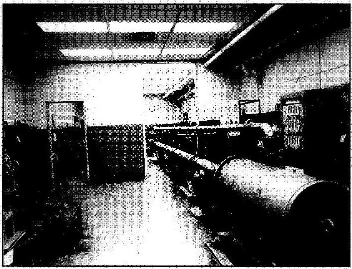
Figure 7.1a I Naval Ordnance Laboratory (NOL) shock tube. Extended view of the shock tube length. (Courtesy of Dr. John S. Vamos, Naval Surface Warfare Center.)

flow relative to us. However, there is no need to study the shock waves from this unsteady point of view, because we can hop on the airplane and ride with it; in this case, the shocks appear stationary relative to us, and we can use the steady flow techniques of the previous chapters to study the waves. This is analogous to placing the airplane in a hypothetical very large supersonic wind tunnel and blowing air at supersonic speeds over the stationary airplane. Our perspective in the previous chapters was that of the airplane fixed in the wind tunnel with the air blowing over it. The physical properties of the shock waves are the same in either case, so we take the easier path and study the shock phenomena from a steady flow point of view.

On the other hand, there are some devices and applications that make direct use of the unsteady flows generated by traveling waves, and in these situations we have to study the actual unsteady flow problem. For example, the exhaust system on an internal combustion reciprocating engine powering a motor vehicle is full of unsteady pressure waves propagating along the exhaust pipes, and it is important to understand and calculate this

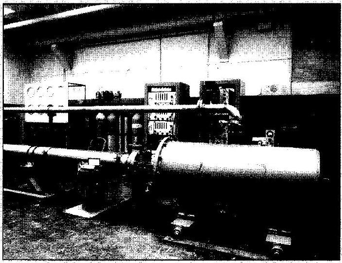
Figure 7.1b 1 Close-up view of the end-wall flange, rectangular test cavity, and dump tank of the NOL shock tube. With the test cavity and dump tank in this installation, the facility is operating as a shock tunnel. (Dr. John S. Vamos)

unsteady flow in order to properly tune the design of the exhaust system.

Another important application is a shock tube, which is a laboratory device for producing high-temperature, high-pressure gases for the purpose of studying the thermodynamic and chemical properties of such gases at temperatures and pressures higher than obtainable in other laboratory devices. A typical shock tube is shown in Figs. 7.1 $a$ and $b$. The shock tube is a very long pipe, as can be seen in Fig. 7.1a, in which a strong shock wave is generated inside the tube and propagates along the tube (from left to right in Fig. 7.1), producing a hightemperature, high-pressure gas behind it. In the particular shock tube shown in Figs. 7.1 $a$ and $b$, the shock runs into an end wall at the flange seen in the middle of Fig. $7.1 b$, and reflects back to the left, producing an even higher temperature gas behind the reflected shock wave. In the NOL shock tube in the configuration shown here, this slug of very high temperature, high-pressure gas then expands through a bank of small supersonic nozzles, creating a supersonic flow in the rectangular shaped test section seen in the middle of Fig. 7.1b, which subsequently exhausts into the large dump tank shown at the right. In this special configuration shown in

Fig. 7.1, with $\mathrm{CO}_{2}$ and $\mathrm{N}_{2}$ as the test gas, the supersonic flow in the rectangular test section becomes a laser gas, and the shock tube is configured to be a gasdynamic laser, an exciting device for a high power laser that was studied extensively in the 1960s and 70s (see Ref. 21 for more details on gasdynamic lasers). To understand and calculate the operation of such a device as shown in Fig. 7.1, the material in this chapter on unsteady wave motion is essential. Indeed, a major focus of this chapter is the understanding and calculation of shock tube wave patterns and flowfields.

The roadmap for this chapter is given in Fig. 7.2. We begin our study of unsteady wave motion by considering moving normal shock waves, which is the left branch shown in Fig. 7.2. Then we move to the right branch to study moving expansion waves, which requires as preliminaries a discussion of linear sound wave propagation (acoustic theory) and of nonlinear finite wave motion. Finally, we combine both branches to examine the flowfield in shock tubes, which is a combination of shock and expansion wave motion. When you reach the end of this roadmap, you will have the essential tools to understand the unsteady wave motion in mechanical devices such as the shock tube shown in Fig. 7.1.

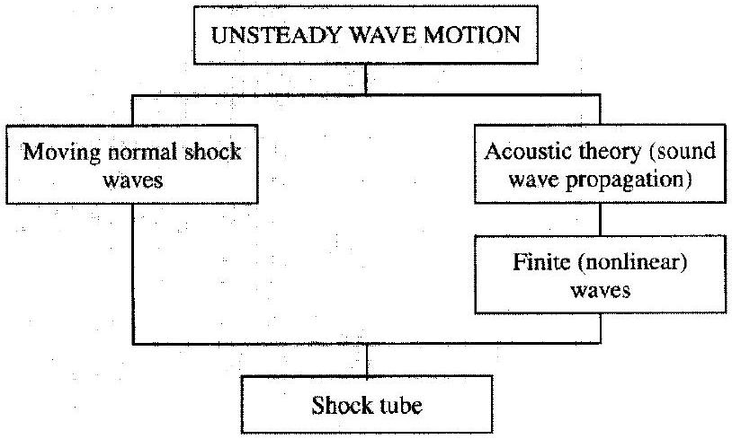
Figure 7.21 Roadmap for Chapter 7.

## 7.1। INTRODUCTION

Consider again the normal shock wave, as discussed in Chap. 3. In that discussion the shock is viewed as a stationary wave, fixed in space, as sketched in Fig. 7.3a. However, in Secs. 3.3 and 3.6, the wave is described as a physical disturbance in the flow, where the wave is propagated by molecular collisions. Hence, sound waves and

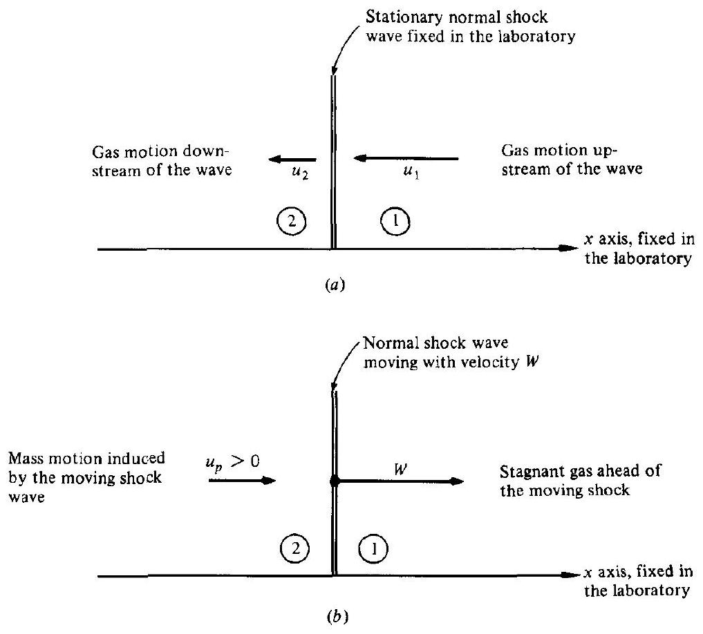
Figure 7.3 I Schematic of stationary and moving shock waves.

shock waves have definite propagation velocities, sonic in the case of sound and supersonic in the case of shocks. However, if the wave is propagating into a flow that itself is moving in the opposite direction at the same velocity magnitude as the wave velocity, then the wave appears stationary in space. This is the case shown in Fig. 7.3a; here, the shock wave with a propagation velocity of $u_{1}$ is trying to move toward the right. However, it is precisely balanced by the upstream gas which is moving toward the left, also with a velocity of $u_{1}$. Consequently, the normal shock wave appears stationary in space (i.e., the shock wave is fixed "relative to the laboratory"), and we see the familiar picture of a standing normal shock wave with a supersonic flow velocity $u_{1}$ ahead of the wave and a subsonic flow velocity $u_{2}$ behind the wave. This was the picture used in Chaps. 3 and 4.

Now assume that the flow velocity $u_{1}$ in Fig. 7.3a is turned off, i.e., let $u_{1}=0$. Then the shock wave is no longer constrained, and it propagates through space to the right. This picture is sketched in Fig. 7.3b; here we relabel the wave propagation velocity as $W$ to emphasize that the wave is now propagating through the laboratory. The magnitude of $u_{1}$ in Fig. 7.3a and $W$ in Fig. 7.3b are the same. However, in Fig. $7.3 b$ we are now watching a normal shock wave propagate with velocity $W$ (relative to the laboratory) into a quiescent gas. In the process, the moving wave induces the gas behind it to move in the same direction as the wave; this mass motion is shown as $u_{p}$ in Fig. 7.3b. Returning to the stationary wave in Fig. 7.3a, all

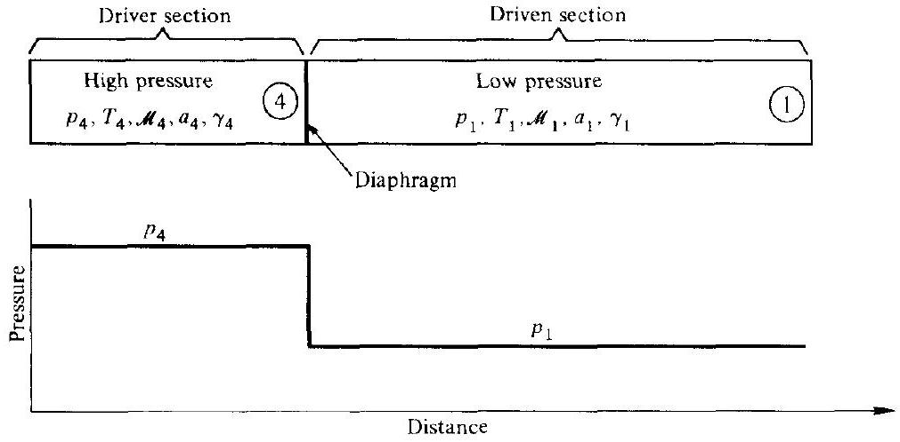
Figure 7.4 I Initial conditions in a pressure-driven shock tube.

properties of the flowfield depend on $x$ only, i.e., $\rho=\rho(x), T=T(x), u=u(x)$, etc. This is a steady flow. In contrast, for the moving wave in Fig. 7.3b, all properties of the flowfield depend on both $x$ and $t$, i.e., $\rho=\rho(x, t), T=T(x, t), u=u(x, t)$, etc. This is an unsteady flow, and hence the picture in Fig. $7.3 b$ is that of unsteady wave motion. Such unsteady wave motion is the subject of this chapter.

An important application of unsteady wave motion is a shock tube, sketched in Fig. 7.4. This is a tube closed at both ends, with a diaphragm separating a region of high-pressure gas on the left (region 4) from a region of low-pressure gas on the right (region 1). The pressure distribution is also illustrated in Fig. 7.4. The gases in regions 1 and 4 can be at different temperatures and have different molecular weights, . // and . //4. In Fig. 7.4, region 4 is called the driver section, and region 1 is the driven section. When the diaphragm is broken (for example, by electrical current, or by mechanical means), a shock wave propagates into section 1 and an expansion wave propagates into section 4. This picture is sketched in Fig. 7.5. As the normal shock wave propagates to the right with velocity $W$, it increases the pressure of the gas behind it (region 2), and induces a mass motion with velocity $u_{p}$. The interface between the driver and driven gases is called the contact surface, which also moves with velocity $u_{p}$. This contact surface is somewhat like the slip lines discussed in Chap. 4; across it the entropy changes discontinuously. However, the pressure and velocity are preserved: $p_{3}=p_{2}$ and $u_{3}=u_{2}=u_{p}$. The expansion wave propagates to the left, smoothly and continuously decreasing the pressure in region 4 to the lower value $p_{3}$ behind the expansion wave. The flowfield in the tube after the diaphragm is broken (Fig. 7.5) is completely determined by the given conditions in regions 1 and 4 before the diaphragm is broken (Fig. 7.4).

Shock tubes are valuable gasdynamic instruments; they have important applications in the study of high-temperature gases in physics and chemistry, in the testing of supersonic bodies and hypersonic entry vehicles, and more recently in the development of high-power gasdynamic and chemical lasers. Many of the hightemperature thermodynamic and chemical kinetic properties to be discussed in Chap. 16 were measured in shock tubes. They are basic tools in the understanding

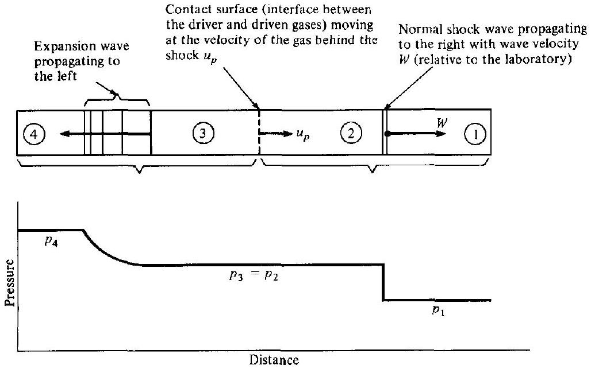
Figure 7.5 I Flow in a shock tube after the diaphragm is broken.

of high-speed compressible flow. Therefore, this chapter first discusses unsteady normal shock waves, followed by a treatment of unsteady one-dimensional finite wave motion, and then focuses the results on the important application of shock tubes.

### 7.2 I MOVING NORMAL SHOCK WAVES

Consider again the stationary normal shock wave sketched in Fig. 7.3a. For this picture, we know from Eqs. (3.38) through (3.40) that the continuity, momentum, and energy equations are, respectively,

$$
\begin{aligned}
\rho_{1} u_{1} & =\rho_{2} u_{2} \\
p_{1}+\rho_{1} u_{1}^{2} & =p_{2}+\rho_{2} u_{2}^{2} \\
h_{1}+u_{1}^{2} / 2 & =h_{2}+u_{2}^{2} / 2
\end{aligned}
$$

Looking at Fig. 7.3a, a literal interpretation of $u_{1}$ and $u_{2}$ is easily seen as
$u_{1}=$ velocity of the gas ahead of the shock wave, relative to the wave
$u_{2}=$ velocity of gas behind the shock wave, relative to the wave
It just so happens in Fig. 7.3a that the shock wave is stationary, so therefore $u_{1}$ and $u_{2}$ are also the flow velocities we see relative to the laboratory. However, the interpretation of $u_{1}$ and $u_{2}$ as relative to the shock wave is more fundamental; Eqs. (3.38) through (3.40) always hold for gas velocities relative to the shock wave, no matter whether the shock is moving or stationary. Therefore, examining the moving shock in Fig. 7.3b, we immediately deduce from the geometry that
$W=$ velocity of the gas ahead of the shock wave, relative to the wave
$W-u_{p}=$ velocity of the gas behind the shock wave, relative to the wave

Hence, for the picture of the moving shock wave in Fig. $7.3 b$, the normal-shock continuity, momentum, and energy equations, Eqs. (3.38) through (3.40), become

$$
\begin{aligned}
\rho_{1} W & =\rho_{2}\left(W-u_{p}\right) \\
p_{1}+\rho_{1} W^{2} & =p_{2}+\rho_{2}\left(W-u_{p}\right)^{2} \\
h_{1}+\frac{W^{2}}{2} & =h_{2}+\frac{\left(W-u_{p}\right)^{2}}{2}
\end{aligned}
$$

Equations (7.1) through (7.3) are the governing normal-shock equations for a shock moving with velocity $W$ into a stagnant gas.

Let us rearrange these equations into a more convenient form. From Eq. (7.1)

$$
W-u_{p}=W \frac{\rho_{1}}{\rho_{2}}
$$

Substitute Eq. (7.4) into (7.2):

$$
p_{1}+\rho_{1} W^{2}=p_{2}+\rho_{2} W^{2}\left(\frac{\rho_{1}}{\rho_{2}}\right)^{2}
$$

and rearranging,

$$
\begin{aligned}
p_{2}-p_{1} & =\rho_{1} W^{2}\left(1-\frac{\rho_{1}}{\rho_{2}}\right) \\
W^{2} & =\frac{p_{2}-p_{1}}{\rho_{1}\left(1-\rho_{1} / \rho_{2}\right)} \\
W^{2} & =\frac{p_{2}-p_{1}}{\rho_{2}-\rho_{1}}\left(\frac{\rho_{2}}{\rho_{1}}\right)
\end{aligned}
$$

Returning to Eq. (7.1),

$$
W=\left(W-u_{p}\right) \frac{\rho_{2}}{\rho_{1}}
$$

Substitute Eq. (7.6) into (7.5):
or

$$
\begin{aligned}
\left(W-u_{p}\right)^{2}\left(\frac{\rho_{2}}{\rho_{1}}\right)^{2} & =\frac{p_{2}-p_{1}}{\rho_{2}-\rho_{1}}\left(\frac{\rho_{2}}{\rho_{1}}\right) \\
\left(W-u_{p}\right)^{2} & =\frac{p_{2}-p_{1}}{\rho_{2}-\rho_{1}}\left(\frac{\rho_{1}}{\rho_{2}}\right)
\end{aligned}
$$

Substitute Eqs. (7.5) and (7.7) into (7.3), and recall that $h=e+p / p$. to obtain

$$
e_{1}+\frac{p_{1}}{\rho_{1}}+\frac{1}{2}\left[\frac{p_{2}-p_{1}}{\rho_{2}-\rho_{1}}\left(\frac{\rho_{2}}{\rho_{1}}\right)\right]=e_{2}+\frac{p_{2}}{\rho_{2}}+\frac{1}{2}\left[\frac{p_{2}-p_{1}}{\rho_{2}-\rho_{1}}\left(\frac{\rho_{1}}{\rho_{2}}\right)\right]
$$

Equation (7.8) algebraically simplifies to

$$
\begin{aligned}
& e_{2}-e_{1}=\frac{p_{1}+p_{2}}{2}\left(\frac{1}{\rho_{1}}-\frac{1}{\rho_{2}}\right) \\
& e_{2}-e_{1}=\frac{p_{1}+p_{2}}{2}\left(v_{1}-v_{2}\right)
\end{aligned}
$$

Equation (7.9) is the Hugoniot equation, and is identically the same form as Eq. (3.72) for a stationary shock. In hindsight, this is to be expected; the Hugoniot equation relates changes of thermodynamic variables across a normal shock wave, and these are physically independent of whether or not the shock is moving.

In general, Eqs. (7.1) through (7.3) must be solved numerically. However, let us specialize to the case of a calorically perfect gas. In this case, $e=c_{v} T$, and $v=R T / p$; hence Eq. (7.9) becomes

$$
\frac{T_{2}}{T_{1}}=\frac{p_{2}}{p_{1}}\left(\frac{\frac{\gamma+1}{\gamma-1}+\frac{p_{2}}{p_{1}}}{1+\frac{\gamma+1}{\gamma-1} \frac{p_{2}}{p_{1}}}\right)
$$

Similarly,

$$
\frac{\rho_{2}}{\rho_{1}}=\frac{1+\frac{\gamma+1}{\gamma-1}\left(\frac{p_{2}}{p_{1}}\right)}{\frac{\gamma+1}{\gamma-1}+\frac{p_{2}}{p_{1}}}
$$

Note that Eqs. (7.10) and (7.11) give the density and temperature ratios across the shock wave as a function of pressure ratio. Unlike a stationary shock wave, where it is convenient to think of Mach number $M_{1}$ as the governing parameter for changes across the wave, for a moving shock wave it now becomes convenient to think of $p_{2} / p_{1}$ as the major parameter governing changes across the wave. To reinforce this statement, define the moving shock Mach number as

$$
M_{s}=\frac{W}{a_{1}}
$$

Incorporating this definition along with the calorically perfect gas relations into Eqs. (7.1) through (7.3), and proceeding with a derivation identical to that used to obtain Eq. (3.57) for a stationary shock, we obtain

$$
\frac{p_{2}}{p_{1}}=1+\frac{2 \gamma}{\gamma+1}\left(M_{s}^{2}-1\right)
$$

Solving Eq. (7.12) for $M_{s}$,

$$
M_{s}=\sqrt{\frac{\gamma+1}{2 \gamma}\left(\frac{p_{2}}{p_{1}}-1\right)+1}
$$

However, since $M_{s}=W / a_{1}$, Eq. (7.13) yields

$$
W=a_{1} \sqrt{\frac{\gamma+1}{2 \gamma}\left(\frac{p_{2}}{p_{1}}-1\right)+1}
$$

Equation (7.14) is important; it relates the wave velocity of the moving shock wave to the pressure ratio across the wave and the speed of sound of the gas into which the wave is propagating.

As mentioned earlier, a shock wave propagating into a stagnant gas induces a mass motion with velocity $u_{p}$ behind the wave. From Eq. (7.1),

$$
u_{p}=W\left(1-\frac{\rho_{1}}{\rho_{2}}\right)
$$

Substituting Eqs. (7.10) and (7.14) into Eq. (7.15), and simplifying, we obtain

$$
u_{p}=\frac{a_{1}}{\gamma}\left(\frac{p_{2}}{p_{1}}-1\right)\left(\frac{\frac{2 \gamma}{\gamma+1}}{\frac{p_{2}}{p_{1}}+\frac{\gamma-1}{\gamma+1}}\right)^{1 / 2}
$$

Note from Eq. (7.16) that, as in the case of $W$, the mass-motion velocity $u_{p}$ also depends on the pressure ratio across the wave and the speed of sound of the gas ahead of the wave.

In summary, for a given pressure ratio $p_{2} / p_{1}$ and speed of sound $a_{1}$, the corresponding values of $\rho_{2} / \rho_{1}, T_{2} / T_{1}, W$, and $u_{p}$ are obtained from Eqs. (7.10), (7.11), (7.14), and (7.16), respectively.

Before leaving this section, let us further explore the characteristics of the induced mass motion behind the moving shock wave. The velocity of this mass motion, $u_{p}$, is relative to the laboratory, i.e., it is what we would observe if we were standing motionless in the laboratory and a shock wave swept by us with velocity $W$. After the wave passed by, we would feel a rush of air in the same direction as the wave motion, and the velocity of this rush of air is $u_{p}$. How large a value can $u_{p}$ obtain? Can it ever be a supersonic velocity? To answer these questions, note that the Mach number of the induced motion (relative to the laboratory) is $u_{p} / a_{2}$, where

$$
\frac{u_{p}}{a_{2}}=\frac{u_{p}}{a_{1}} \frac{a_{1}}{a_{2}}=\frac{u_{p}}{a_{1}} \sqrt{\frac{T_{1}}{T_{2}}}
$$

Substitute Eqs. (7.11) and (7.16) into (7.17):

$$
\frac{u_{p}}{a_{2}}=\frac{1}{\gamma}\left(\frac{p_{2}}{p_{1}}-1\right)\left(\frac{\frac{2 \gamma}{\gamma+1}}{\frac{p_{2}}{p_{1}}+\frac{\gamma-1}{\gamma+1}}\right)^{1 / 2}\left[\frac{1+\frac{\gamma+1}{\gamma-1}\left(\frac{p_{2}}{p_{1}}\right)}{\frac{\gamma+1}{\gamma-1}\left(\frac{p_{2}}{p_{1}}\right)+\left(\frac{p_{2}}{p_{1}}\right)^{2}}\right]^{1 / 2}
$$

Consider an infinitely strong shock, where $p_{2} / p_{1} \rightarrow \infty$. From Eq. (7.18),

$$
\lim _{p_{2} / p_{1} \rightarrow \infty}\left(\frac{u_{p}}{a_{2}}\right)=\sqrt{\frac{2}{\gamma(\gamma-1)}}
$$

For $\gamma=1.4$, Eq. (7.19) shows that $u_{p} / a_{2} \rightarrow 1.89$ as $p_{2} / p_{1} \rightarrow \infty$. Hence, we see that $u_{p}$ is not always a gentle wind-it can be a high-velocity flow, even supersonic. However, the Mach number cannot exceed a limiting value, which in general turns out to be moderately supersonic. As already calculated for a calorically perfect gas with $\gamma=1.4$, the Mach number of the induced flow cannot exceed 1.89 . Nevertheless, it is important to recognize that a strong moving shock wave can induce a supersonic mass motion behind it.

There is a fundamental distinction between steady and unsteady wave motion that must be appreciated-the stagnation properties of the two flows are different. For example, consider again the steady wave in Fig. 7.3a. In Chap. 3 we have shown that the total enthalpy (hence, for a calorically perfect gas, the total temperature) is constant across the stationary wave, i.e., $h_{o_{2}}=h_{o_{1}}$. In contrast, for the moving shock wave in Fig. $7.3 b$, the total enthalpy is not constant across the shock wave, i.e., $h_{o_{2}} \neq h_{o_{1}}$. This is easily seen by inspection. In front of the moving wave the gas is motionless, and hence $h_{o_{1}}=h_{1}$. However, behind the wave, $h_{o_{2}}=h_{2}+u_{p}^{2} / 2$; since $h_{2}>h_{1}$ and because $u_{p}$ is finite, obviously $h_{o_{2}}>h_{o_{1}}$. Similarly, the total pressure behind the moving shock wave, $p_{o_{2}}$, is not given by Eq. (3.63), which holds only for a stationary shock. Rather, $p_{o_{2}}$ for a moving shock must be calculated from the known properties of the induced mass motion.

The above is a special example of a general result: "In an unsteady adiabatic inviscid flow, the total enthalpy is not constant." This is easily proven from an examination of the energy equation in the form of Eq. (6.44), repeated here:

$$
\rho \frac{D h_{o}}{D t}=\frac{\partial p}{\partial t}
$$

Clearly, if the flow is unsteady, $\partial p / \partial t \neq 0$, and hence $h_{o}$ is not constant.

## EXAMPLE 7.1

Consider a normal shock wave propagating into stagnant air where the ambient temperature is 300 K . The pressure ratio across the shock is 10 . Calculate the shock wave velocity, the velocity of the induced mass motion behind the shock wave, and the temperature ratio across the wave, using (a) the equations of this section and (b) the tabulated numbers in Table A.2. Compare the two sets of results.

## - Solution

a. The speed of sound in the ambient air is

$$
a_{1}=\sqrt{\gamma R T_{1}}=\sqrt{(1.4)(287)(300)}=347.2 \mathrm{~m} / \mathrm{s}
$$

From Eq. (7.14),

$$
W=a_{1} \sqrt{\frac{\gamma+1}{2 \gamma}\left(\frac{p_{2}}{p_{1}}-1\right)+1}=347.2 \sqrt{\frac{2.4}{2.8}(10-1)+1}=1024.9 \mathrm{~m} / \mathrm{s}
$$

From Eq. (7.16),

$$
\begin{aligned}
u_{p} & =\frac{a_{1}}{\gamma}\left(\frac{p_{2}}{p_{1}}-1\right)\left[\frac{\frac{2 \gamma}{\gamma+1}}{\frac{p_{2}}{p_{1}}+\frac{\gamma-1}{\gamma+1}}\right]^{1 / 2} \\
& =\frac{347.2}{1.4}(10-1)\left[\frac{1.167}{10+0.167}\right]^{1 / 2}=756.2 \mathrm{~m} / \mathrm{s}
\end{aligned}
$$

From Eq. (7.10),

$$
\frac{T_{2}}{T_{1}}=\frac{p_{2}}{p_{1}}\left[\frac{\frac{\gamma+1}{\gamma-1}+\frac{p_{2}}{p_{1}}}{1+\frac{\gamma+1}{\gamma-1}\left(\frac{p_{2}}{p_{1}}\right)}\right]=10\left[\frac{6+10}{1+6(10)}\right]=2.623
$$

b. From Table A.2, for $p_{2} / p_{1}=10$, the upstream Mach number is 2.95 (nearest entry).

This is the Mach number of the gas ahead of the wave, relative to the wave. Since the gas ahead of the wave is motionless relative to the laboratory, then this is also the Mach number of the moving shock wave relative to the laboratory. Hence,

$$
M_{s}=\frac{W}{a_{1}}=2.95
$$

Thus,

$$
W=2.95 a_{1}=2.95(347.2)=1024.2 \mathrm{~m} / \mathrm{s}
$$

This result obtained from the tables compares within 0.07 percent with that obtained from the exact equation in part (a).
Also, from Table A.2, $T_{2} / T_{1}=2.621$. This compares within 0.08 percent of that obtained from the exact equation in part (a).

From Table A.2, $M_{2}=0.4782$. This is the Mach number of the gas behind the shock relative to the shock. The speed of sound in the gas behind the shock is

$$
a_{2}=\sqrt{\gamma R T_{2}}=\sqrt{\gamma R\left(T_{2} / T_{1}\right) T_{1}}=\sqrt{(1.4)(287)(2.621)(300)}=562.1 \mathrm{~m} / \mathrm{s}
$$

Hence, the velocity of the gas behind the shock relative to the shock is

$$
u_{2}=M_{2} u_{2}=0.4782(562.1)=268.8 \mathrm{~m} / \mathrm{s}
$$

The velocity of the induced mass motion behind the shock, relative to the laboratory is denoted by $u_{p}$, where

$$
u_{p}=W-u_{2}=1024.2-268.8=755.4 \mathrm{~m} / \mathrm{s}
$$

This compares within 0.1 percent of that obtained from the exact equation in part (a).

## EXAMPLE 7.2

Calculate the change in total enthalpy across the moving shock wave in Example 7.1.

## - Solution

From Eq. (1.22), for air

$$
c_{p}=\frac{\gamma R}{\gamma-1}=\frac{(1.4)(287)}{0.4}=1004.5 \mathrm{~J} / \mathrm{kg} \cdot \mathrm{~K}
$$

In region 1, in the stagnant gas ahead of the moving wave, the velocity is zero. Hence the total enthalpy is the same as the static enthalpy.

$$
h_{o_{1}}=h_{1}+\frac{u_{1}^{2}}{2}=h_{1}+0=c_{p} T_{1}=(1004.5)(300)=3.014 \times 10^{5} \mathrm{~J} / \mathrm{kg}
$$

The temperature of the gas in region 2 behind the shock is $T_{2}=\left(T_{2} / T_{1}\right) T_{1}=2.623(300)=$ 786.9 K . The velocity of the gas behind the shock relative to the laboratory is $u_{p}$. Hence

$$
\begin{aligned}
h_{o_{2}} & =h_{2}+\frac{u_{p}^{2}}{2}=c_{p} T_{2}+\frac{u_{p}^{2}}{2} \\
& =(1004.5)(786.9)+\frac{(756.2)^{2}}{2} \\
& =10.76 \times 10^{5} \mathrm{~J} / \mathrm{kg}
\end{aligned}
$$

Thus,

$$
h_{o_{2}}-h_{o_{1}}=(10.76-3.014) \times 10^{5}=7.746 \times 10^{5} \mathrm{~J} / \mathrm{kg}
$$

The total enthalpy increases by the factor of 3.57 across the moving shock wave, clearly demonstrating that the total enthalpy is not constant across a moving shock wave.

## EXAMPLE 7.3

Consider the same shock wave as in Example 7.1 propagating into air that is not stagnant, but rather is moving with a velocity of $200 \mathrm{~m} / \mathrm{s}$ relative to the laboratory in a direction opposite to that of the wave motion. Calculate the velocity of the wave relative to the laboratory, and the velocity of the induced mass motion of the gas behind the wave relative to the laboratory.

## - Solution

Since the wave velocity $W=1024.9 \mathrm{~m} / \mathrm{s}$ calculated from Eq. (7.14) is the same as the velocity of the gas ahead of the shock wave relative to the wave, then in the present example:

$$
\text { Velocity of wave relative to the laboratory }=1024.9-200=824.9 \mathrm{~m} / \mathrm{s}
$$

Since $W-u_{p}$ is the velocity of the gas behind the shock relative to the shock, and from Example 7.1, $W-u_{p}=1024.9-756.2=268.7 \mathrm{~m} / \mathrm{s}$, then the velocity of the gas behind the shock relative to the laboratory in the present example where the shock is moving at a velocity of $824.9 \mathrm{~m} / \mathrm{s}$ relative to the laboratory is:

Velocity of gas behind the wave relative to the laboratory $=824.9-268.7=$ □ $556.2 \mathrm{~m} / \mathrm{s}$
and it is the same direction in which the shock is moving.
Note: The two answers in this example could have been obtained more directly by subtracting the velocity of the air ahead of the wave relative to the laboratory, namely, $200 \mathrm{~m} / \mathrm{s}$, from both $W$ and $u_{p}$ obtained in Example 7.1. For example, the velocity of $556.2 \mathrm{~m} / \mathrm{s}$ obtained here for the velocity of the gas behind the wave relative to the laboratory is simply $u_{p}-200=756.2-200=556.2 \mathrm{~m} / \mathrm{s}$. Hence, we have proven that when the gas in front of the shock is given some finite velocity relative to the laboratory, the other velocities relative to the laboratory are simply changed by the same amount.

For the case treated in Example 7.3, calculate the change in the total enthalpy across the shock wave.

## - Solution

Designate the velocity of the air ahead of the shock relative to the laboratory by $V_{1}$. In this case, $V_{1}=200 \mathrm{~m} / \mathrm{s}$. Also, designate the velocity of the air behind the shock relative to the laboratory by $V_{2}$. In this case, $V_{2}=556.2 \mathrm{~m} / \mathrm{s}$. For the gas ahead of the shock,

$$
\begin{aligned}
h_{o_{1}} & =h_{1}+\frac{V_{1}^{2}}{2}=c_{p} T_{1}+\frac{V_{1}^{2}}{2}=(1004.5)(300)+\frac{(200)^{2}}{2} \\
& =3.214 \times 10^{5} \mathrm{~J} / \mathrm{kg} \cdot \mathrm{~m}
\end{aligned}
$$

For the gas behind the shock, the static temperature is still $T_{2}=786.9 \mathrm{~K}$ (from Example 7.2). Hence.

$$
h_{v_{2}}=c_{p} T_{2}+\frac{V_{2}^{2}}{2}=(1004.5)(786.9)+\frac{(556.2)^{2}}{2}=9.45 \times 10^{5} \mathrm{~J} / \mathrm{kg} \cdot \mathrm{~m}
$$

Thus,

$$
h_{o_{2}}-h_{o_{1}}=(9.45-3.214) \times 10^{5}=6.236 \times 10^{5} \mathrm{~J} / \mathrm{kg}
$$

Compare this result with that from Example 7.2. It is different, even though the strength of the shock is the same in both cases, namely with a pressure ratio $p_{2} / p_{1}=10$. This is a further demonstration that for unsteady wave motion, the total enthalpy changes across the shock, and this change depends not only on the strength of the shock but also on the velocity of the gas relative to the laboratory into which the shock is propagating.

### 7.3 I REFLECTED SHOCK WAVE

Consider a normal shock wave propagating to the right with velocity $W$, as shown in Fig. 7.6a. Assume this moving shock is incident on a flat endwall, as also sketched in Fig. 7.6a. In front of the incident shock, the mass motion $u_{1}=0$. Behind the incident shock, the mass velocity is $u_{p}$ toward the endwall. At the instant the incident shock wave impinges on the endwall, it would appear that the flow velocity at the wall would be $u_{p}$, directed into the wall. However, this is physically impossible; the wall is solid, and the flow velocity normal to the surface must be zero. To avoid this ambiguity, nature immediately creates a reflected normal shock wave which travels to the left with velocity $W_{R}$ (relative to the laboratory), as shown in Fig. 7.6b. The strength of this reflected shock (hence the value of $W_{R}$ ) is such that the originally induced mass motion with velocity $u_{p}$ is stopped dead in its tracks. The mass motion behind the reflected shock wave must be zero, i.e., $u_{5}=0$ in Fig. 7.6b. Thus, the zero-velocity boundary condition is preserved by the reflected shock wave. (This is directly analogous to the steady reflected oblique shock wave discussed in Sec. 4.6, where the reflected shock is necessary to preserve, at the surface, flow tangent to

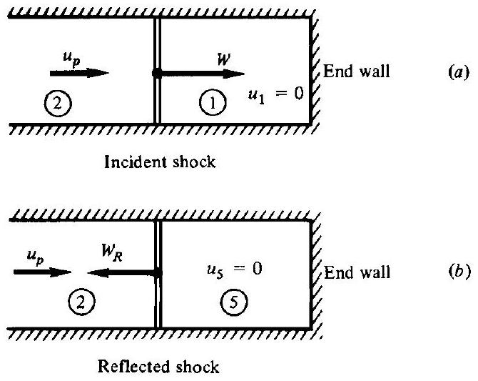
Figure 7.6 | Incident and reflected shock waves.

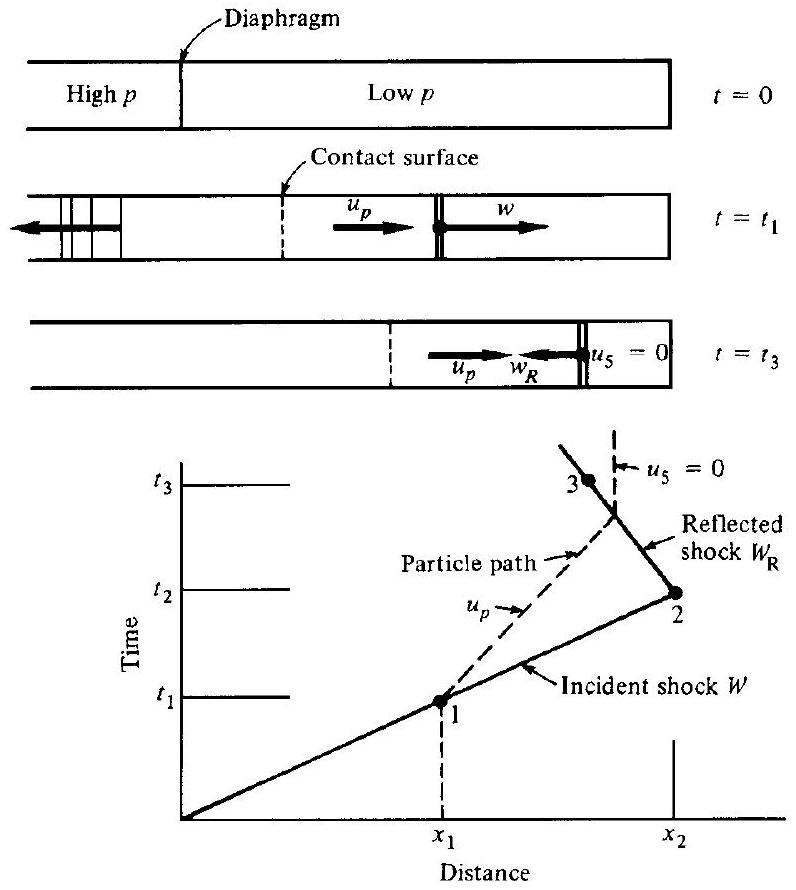
Figure 7.7 I Wave diagram ( $x t$ diagram).

the wall.) Indeed, for an incident normal shock of specified strength, the reflected normal shock strength is completely determined by imposing the boundary condition $u_{5}=0$.

In dealing with unsteady wave motion, it is convenient to construct wave diagrams ( $x t$ diagrams) such as sketched in Fig. 7.7. A wave diagram is a plot of the
wave motion on a graph of $t$ versus $x$. At time $t=0$, the incident shock wave is just starting at the diaphragm location. Therefore, at $t=0$, the incident shock is at location $x=0$. At some instant later, say time $t=t_{1}$, the shock wave is traveling to the right, and is located at point $x=x_{1}$. This is labeled as point 1 in the $x t$ diagram. Note that the path of the incident shock is a straight line in the wave diagram. When the incident shock hits the wall at $x=x_{2}$ (point 2 in Fig. 7.7), it reflects toward the left with velocity $W_{R}$. At some later instant $t=t_{3}$, the reflected shock is at location $x=x_{3}$ (point 3 in Fig. 7.7). The path of the reflected shock wave is also a straiglit line in the wave diagram. The slopes of the incident and reflected shock paths are $1 / W$ and $1 / W_{R}$, respectively. Also note as a general characteristic of reflected shocks that $W_{R}<W$; hence the reflected shock path is more steeply inclined than the incident shock path.

In addition to wave motion, particle motion can also be sketched on the $x t$ diagram. For example, consider a fluid element originally located at $x=x_{1}$. During the time interval $0 \leq t \leq t_{1}$, the incident shock has not yet passed over the element, and hence the element simply stands still. This is indicated by the vertical dashed line through point 1 in Fig. 7.7. At time $1_{1}$, the incident shock passes over the fluid element located at $x_{1}$, and sets it into motion with velocity $u_{p}$. The path of the particle is then given by the inclined dashed line above point 1 . The fluid element continues along this path until it encounters the reflected shock, which brings the element to a standstill again. The complete dashed curve in Fig. 7.7 represents a particle path in the $x t$ diagram.

Return again to the picture of a reflected shock as sketched in Fig. 7.6b. By inspection, we note that
$W_{R}+u_{p}=$ velocity of the gas ahead of the shock wave relative to the wave
$W_{R}=$ velocity of the gas behind the shock wave relative to the wave
Hence, from Eqs. (3.48) through (3.50) and the literal interpretation of the velocities $u_{1}$ and $u_{2}$, we can write for the reflected shock:

$$
\begin{aligned}
\rho_{2}\left(W_{R}+u_{p}\right) & =\rho_{5} W_{R} \\
p_{2}+\rho_{2}\left(W_{R}+u_{p}\right)^{2} & =p_{5}+\rho_{5} W_{R}^{2} \\
h_{2}+\frac{\left(W_{R}+u_{p}\right)^{2}}{2} & =h_{5}+\frac{W_{R}^{2}}{2}
\end{aligned}
$$

These are the continuity, momentum, and energy equations, respectively, for a reflected shock wave.

Examine Figs. 7.6a and $b$. The incident shock propagates into the gas ahead of it with a Mach number $M_{s}=W / a_{1}$. The reflected shock propagates into the gas ahead of it with a Mach number $M_{R}=\left(W_{R}+u_{p}\right) / a_{2}$. From the incident shock equations, Eqs. (7.1) through (7.3), and the reflected shock equations, Eqs. (7.20) through (7.22), and specializing to a calorically perfect gas, a relation between $M_{R}$
and $M_{s}$ can be obtained as

$$
\frac{M_{R}}{M_{R}^{2}-1}=\frac{M_{s}}{M_{s}^{2}-1} \sqrt{1+\frac{2(\gamma-1)}{(\gamma+1)^{2}}\left(M_{s}^{2}-1\right)\left(\gamma+\frac{1}{M_{s}^{2}}\right)}
$$

The derivation is left as an exercise for the reader. However, Eq. (7.23) explicitly dramatizes that the reflected shock properties are a unique function of the incident shock strength-a result that only makes common sense.

With this we have finished our basic discussions of moving normal shock waves. Returning to our roadmap in Fig. 7.2, we have finished the left-hand branch. We now move on to the right-hand branch and prepare for the discussion of moving expansion waves.

## EXAMPLE 7.5

Consider the normal shock in Example 7.1 to be an incident shock on an end wall. Calculate the reflected shock Mach number, the pressure ratio across the reflected shock, and the gas temperature behind the shock.

## - Solution

From Example 7.1, $M_{s}=2.95, T_{2} / T_{1}=2.623$, and $T_{1}=300 \mathrm{~K}$. From Eq. (7.23),

$$
\begin{aligned}
\frac{M_{R}}{M_{R}^{2}-1} & =\frac{M_{s}}{M_{s}^{2}-1} \sqrt{1+\frac{2(\gamma-1)}{(\gamma+1)^{2}}\left(M_{s}^{2}-1\right)\left(\gamma+\frac{1}{M_{s}^{2}}\right)} \\
& =\frac{2.95}{(2.95)^{2}-1} \sqrt{1+\frac{0.8}{5.76}\left[(2.95)^{2}-1\right]\left[1.4+\frac{1}{(2.95)^{2}}\right]} \\
& =0.62
\end{aligned}
$$

Thus,

$$
0.62 M_{R}^{2}-M_{R}-0.62=0
$$

Solving the quadratic, $M_{R}=2.09$ (we throw away the negative root). This is the Mach number of the reflected wave relative to the gas ahead of it. From Table A.2, for $M_{R}=2.09$, we have for the pressure ratio across the reflected shock,

$$
\frac{p_{5}}{p_{2}}=4.978 \text { (nearest entry) }
$$

Also,

$$
\frac{T_{5}}{T_{2}}=1.77 \quad \text { (nearest entry). }
$$

Hence,

$$
T_{5}=\left(\frac{T_{5}}{T_{2}}\right)\left(\frac{T_{2}}{T_{1}}\right) T_{1}=(1.77)(2.623)(300)=1393 \mathrm{~K}
$$

Note: The temperature increase across the incident shock is $T_{2}-T_{1}=786.9-300=486.9 \mathrm{~K}$. The temperature increase across the reflected shock is $T_{5}-T_{2}=1393-786.9=606.1 \mathrm{~K}$, even larger than that across the incident shock. So the reflected shock is a useful mechanism for obtaining high temperatures in a gas, and many shock tubes are designed to use the very hot slug of gas behind the reflected shock at the end wall as the test gas.

## 7.4 | PHYSICAL PICTURE OF WAVE PROPAGATION

Refer again to the flow in a shock tube illustrated in Fig. 7.5. In Secs. 7.2 and 7.3, we have discussed the traveling shock waves that propagate into the driven gas. We now proceed to examine the expansion wave that propagates into the driver gas. This topic will be introduced in the present section by considering a physical definition of finite wave propagation, followed in Sec. 7.5 by a study of the special aspect of the propagation of a sound wave in one dimension. Then in Secs. 7.6-7.9, the quantitative aspects of finite compression and expansion waves will be developed.

Consider a long duct where properties vary only in the $x$ direction, as sketched in Fig. 7.8a. At time $t=t_{1}$, let all properties be constant except in some small local region near $x=x_{1}$. For example, the density distribution is a constant value $\rho_{\infty}$, except near $x=x_{1}$, where there is a change in density $\Delta \rho$, as sketched in Fig. 7.8b.

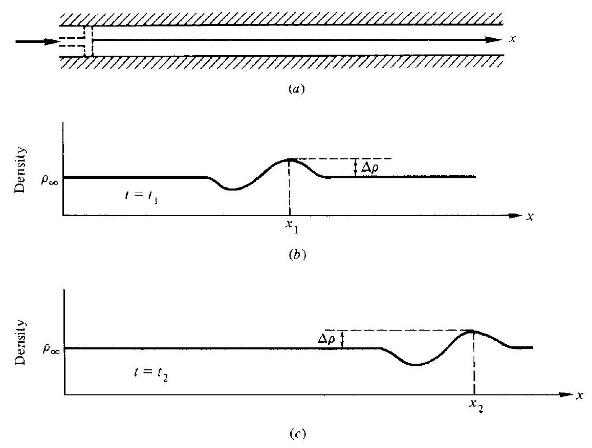
Figure 7.8 | Propagation of a pulse in a one-dimensional tube.

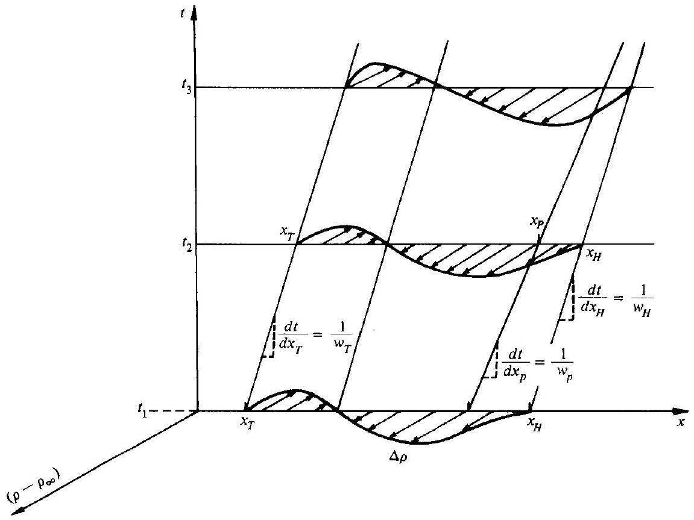
Figure 7.9 | Propagation of a finite wave in the $x$ direction.

This little pulse in density, $\Delta \rho$, can be imagined as created by pushing a piston in the $x$ direction for a moment and then stopping it, as illustrated at the left of Fig. 7.8a. The pulse $\Delta \rho$ moves to the right so that, at a later time $t=t_{2}$, it is located at $x=x_{2}$, as sketched in Fig. 7.8c.

The motion of this pulse on an $x t$ diagram (with $\rho$ added as a third axis for additional clarification) is illustrated in Fig. 7.9. Here, $x_{H}$ denotes the location of the head of the pulse, $x_{T}$ the location of the tail of the pulse, and $x_{p}$ the location of the peak value of the pulse. As shown in Fig. 7.9, the head, tail, and peak are propagating relative to the laboratory with velocities $w_{H}, w_{T}$, and $w_{p}$, respectively. In the most general case, $w_{H} \neq w_{T} \neq w_{P}$; hence the shape of the pulse continually deforms as it propagates along the $x$ axis. Because the disturbance $\Delta \rho$ moves along the $x$ axis, the region where $\Delta \rho \neq 0$ is called a finite wave. The velocity with which an element of this wave moves is called the local wave velocity $w$. In general, the value of $w$ varies through the wave. For example, consider two specific numerical values of $\Delta \rho$ within the wave, $\Delta \rho_{1}$ and $\Delta \rho_{2}$. The velocity with which $\Delta \rho_{1}$ propagates along the $x$ axis will, in general, be different than the velocity with which $\Delta \rho_{2}$ propagates.

Finally, do not confuse wave velocity with mass-motion velocity. The local wave velocity $w$ is not the local velocity of a fluid element of the gas, $u$. Keep in mind that the wave is propagated by molecular collisions, which is a phenomenon superimposed on top of the mass motion of the gas.

### 7.5 I ELEMENTS OF ACOUSTIC THEORY

In order to calculate the local value of such wave properties as $\Delta \rho$ and $w$ we must apply the physical principles of conservation of mass, momentum, and energy as embodied in our general equations of motion for an inviscid adiabatic flow. For example, consider Eqs. (6.5), (6.29), and (6.51) repeated here:

$$
\begin{aligned}
\frac{\partial \rho}{\partial t}+\nabla \cdot(\rho \mathbf{V}) & =0 \\
\rho \frac{D \mathbf{V}}{D t} & =-\nabla p \\
\frac{D s}{D t} & =0
\end{aligned}
$$

Let us apply these equations to the flowfield in Figs. 7.8a, $b$, and $c$, keeping in mind that the local change in density, $\Delta \rho$, is accompanied by corresponding changes in the other flowfield variables, such as a change in the mass-motion velocity, $\Delta u$. Both $\Delta \rho$ and $\Delta u$ are called perturbations; in general they are not necessarily small. Because the undisturbed density and velocity are $\rho_{\infty}$ and $u_{\infty}=0$, respectively, we can express the local density and velocity, $\rho$ and $u$, respectively, as

$$
\begin{aligned}
\rho & =\rho_{\infty}+\Delta \rho \\
u & =u_{\infty}+\Delta u=0+\Delta u=\Delta u
\end{aligned}
$$

Note that both $\Delta \rho$ and $\Delta u$ are functions of $x$ and $t$. From Eq. (6.5), written for onedimensional flow,
or

$$
\begin{array}{r}
\frac{\partial \rho}{\partial t}+\frac{\partial(\rho u)}{\partial x}=0 \\
\frac{\partial \rho}{\partial t}+\rho \frac{\partial u}{\partial x}+u \frac{\partial \rho}{\partial x}=0
\end{array}
$$

Substituting Eqs. (7.24) and (7.25) into Eq. (7.26), we have

$$
\frac{\partial\left(\rho_{\infty}+\Delta \rho\right)}{\partial t}+\left(\rho_{\infty}+\Delta \rho\right) \frac{\partial(\Delta u)}{\partial x}+\Delta u \frac{\partial\left(\rho_{\infty}+\Delta \rho\right)}{\partial x}=0
$$

Because $\rho_{\infty}$ is constant, Eq. (7.27) becomes

$$
\frac{\partial \Delta \rho}{\partial t}+\rho_{\infty} \frac{\partial \Delta u}{\partial x}+\Delta \rho \frac{\partial \Delta u}{\partial x}+\Delta u \frac{\partial \Delta \rho}{\partial x}=0
$$

Consider Eq. (6.29) for one-dimensional flow:

$$
\rho \frac{\partial u}{\partial t}+\rho u \frac{\partial u}{\partial x}=-\frac{\partial p}{\partial x}
$$

Consider also the discussion of thermodynamics in Chap. 1, where it was stated that, for a gas in equilibrium, any thermodynamic state variable is uniquely specified by
any two other state variables. For example,

$$
p=p(\rho, s)
$$

Hence,

$$
d p=\left(\frac{\partial p}{\partial \rho}\right)_{s} d \rho+\left(\frac{\partial p}{\partial s}\right)_{\rho} d s
$$

However, for the physical picture as shown in Figs. 7.8a, $b$, and $c$, before the initiation of the wave the gas properties are constant throughout the one-dimensional space. This includes the entropy, which is the same for all fluid elements. Equation (6.51) states that the entropy of a given fluid element remains constant. Therefore, for the inviscid adiabatic wave motion considered here, $s=$ const in both time and space; i.e., the wave motion is isentropic. Thus in Eq. (7.30), $d s=0$, and we have

$$
d p=\left(\frac{\partial p}{\partial \rho}\right)_{s} d \rho
$$

Considering changes of $p$ and $\rho$ in the $x$ direction, Eq. (7.31) becomes

$$
\frac{\partial p}{\partial x}=\left(\frac{\partial p}{\partial \rho}\right)_{s} \frac{\partial \rho}{\partial x}
$$

Let $(\partial p / \partial \rho)_{s}=a^{2}$. A quick glance at Eq. (3.17) reveals that $a$ is the local speed of sound. However, at this stage in our analysis, we do not as yet have to identify $a$ as the speed of sound; indeed, it will be proven as part of the solution. Thus, for the time being, simply consider $a^{2}$ as an abbreviation for $(\partial p / \partial \rho)_{s}$, and assume we do not identify it with the speed of sound. Then, Eq. (7.32) becomes

$$
\frac{\partial p}{\partial x}=a^{2} \frac{\partial \rho}{\partial x}
$$

Substitute Eq. (7.33) into (7.29):

$$
\rho \frac{\partial u}{\partial t}+\rho u \frac{\partial u}{\partial x}=-a^{2} \frac{\partial \rho}{\partial x}
$$

Substitute Eqs. (7.24) and (7.25) into Eq. (7.34):

$$
\left(\rho_{\infty}+\Delta \rho\right) \frac{\partial \Delta u}{\partial t}+\left(\rho_{\infty}+\Delta \rho\right) \Delta u \frac{\partial \Delta u}{\partial x}=-a^{2} \frac{\partial\left(\rho_{\infty}+\Delta \rho\right)}{\partial x}
$$

or $\quad \rho_{\infty} \frac{\partial \Delta u}{\partial t}+\Delta \rho \frac{\partial \Delta u}{\partial t}+\rho_{\infty} \Delta u \frac{\partial \Delta u}{\partial x}+\Delta \rho \Delta u \frac{\partial \Delta u}{\partial x}=-a^{2} \frac{\partial \Delta \rho}{\partial x}$

Let us recapitulate at this stage. Equations (7.28) and (7.35) represent the continuity and combined momentum and energy equations, respectively. Although they are in terms of the perturbation quantities $\Delta \rho$ and $\Delta u$, they are still exact equations for one-dimensional isentropic flow. Also, keep in mind that they are nonlinear equations.

Now let us consider the wave in Fig. $7.8 b$ and $c$ to be very weak, i.e., consider $\Delta \rho$ and $\Delta u$ as very small perturbations. In this case, the wave becomes, by definition, a sound wave. Here, $\Delta \rho \leqslant \rho_{\infty}$ and $\Delta u \ll a$. Also, since $a^{2}=(\partial p / \partial \rho)_{\text {s }}$ is a thermodynamic state variable, we can consider it as a function of any two other state variables, say $a^{2}=a^{2}(\rho, s)$. But $s=\mathrm{const}$, so $a^{2}=a^{2}(\rho)$. Expand $a^{2}$ in a Taylor's series about the point $\rho_{\infty}$ :

$$
\begin{aligned}
a^{2} & =a_{\infty}^{2}+\left(\frac{\partial a^{2}}{\partial \rho}\right)\left(\rho-\rho_{\infty}\right)+\cdots \\
& =a_{\infty}^{2}+\left(\frac{\partial a^{2}}{\partial \rho}\right)_{\infty} \Delta \rho+\cdots
\end{aligned}
$$

In Eq. (7.36), $a^{2}$ is the value at any point in the wave, whereas $a_{\infty}^{2}$ is the value of $a^{2}$ in the undisturbed gas. Substitute Eq. (7.36) into (7.35):

$$
\begin{aligned}
& \rho_{\infty} \frac{\partial \Delta u}{\partial t}+\Delta \rho \frac{\partial \Delta u}{\partial t}+\rho_{\infty} \Delta u \frac{\partial \Delta u}{\partial x}+\Delta \rho \Delta u \frac{\partial \Delta u}{\partial x} \\
& \quad=-\left[a_{\infty}^{2}+\left(\frac{\partial a^{2}}{\partial \rho}\right)_{\infty} \Delta \rho+\cdots\right] \frac{\partial \Delta \rho}{\partial x}
\end{aligned}
$$

Since $\Delta \rho$ and $\Delta u$ are very small quantities, products of these quantities and their derivatives are extremely small. That is, the second-order terms $(\Delta u)^{2},(\Delta u)(\Delta \rho)$, $(\Delta u)(\partial \Delta \rho / \partial t)$, etc., are very small when compared with the first-order terms $\rho_{\infty}(\partial \Delta u / \partial t), \rho_{\infty}(\partial \Delta u / \partial x)$, etc. In Eqs. (7.28) and (7.37), ignore the second-order terms as being inconsequentially small. The resulting equations are

$$
\begin{gathered}
\frac{\partial \Delta \rho}{\partial t}+\rho_{\infty} \frac{\partial \Delta u}{\partial x}=0 \\
\rho_{\infty} \frac{\partial \Delta u}{\partial t}=-a_{\infty}^{2} \frac{\partial \Delta \rho}{\partial x}
\end{gathered}
$$

Equations (7.38) and (7.39) are called the acoustic equations because they describe the motion of a gas induced by the passage of a sound wave. Due to our assumption of small perturbations, and ignoring higher-order terms, these equations are no longer exact-they are approximate equations, which become more and more accurate as the perturbations become smaller and smaller. However, they have one tremendous advantage-they are linear equations, and hence can be readily solved in closed form.

For future reference, it is important to note that the above analysis is a specific example of general small perturbation theory, leading to linearized equations of motion. Such linearized theory is discussed at length in Chap. 9.

Let us now solve Eqs. (7.38) and (7.39). Differentiate Eq. (7.38) with respect to $t$ :

$$
\frac{\partial^{2} \Delta \rho}{\partial t^{2}}=-\rho_{\infty} \frac{\partial^{2} \Delta u}{\partial x \partial t}
$$

Differentiate Eq. (7.39) with respect to $x$ :

$$
\rho_{\infty} \frac{\partial^{2} \Delta u}{\partial x \partial t}=-a_{\infty}^{2} \frac{\partial^{2} \Delta \rho}{\partial x^{2}}
$$

Substitute Eq. (7.41) into (7.40):

$$
\frac{\partial^{2} \Delta \rho}{\partial t^{2}}=a_{\infty}^{2} \frac{\partial^{2} \Delta \rho}{\partial x^{2}}
$$

The reader may note that Eq. (7.42) is the one-dimensional form of the classic wave equation from mathematical physics. Its solution is of the form

$$
\Delta \rho=F\left(x-a_{\infty} t\right)+G\left(x+a_{\infty} t\right)
$$

This is easily proven as follows. From Eq. (7.43),

$$
\frac{\partial \Delta \rho}{\partial t}=\frac{\partial F}{\partial\left(x-a_{\infty} t\right)} \frac{\partial\left(x-a_{\infty} t\right)}{\partial t}+\frac{\partial G}{\left(x+a_{\infty} t\right)} \frac{\partial\left(x+a_{\infty} t\right)}{\partial t}
$$

or $\quad \frac{\partial \Delta \rho}{\partial t}=F^{\prime}\left(-a_{\infty}\right)+G^{\prime}\left(a_{\infty}\right)$
Hence, $\quad \frac{\partial^{2} \Delta \rho}{\partial t^{2}}=a_{\infty}^{2} F^{\prime \prime}+a_{\infty}^{2} G^{\prime \prime}$
where the primes denote differentiation with respect to the argument of $F$ and $G$, respectively. Also from Eq. (7.43),

$$
\frac{\partial \Delta \rho}{\partial x}=\frac{\partial F}{\partial\left(x-a_{\infty} t\right)} \frac{\left(x-a_{\infty} t\right)}{\partial x}+\frac{\partial G}{\partial\left(x+a_{\infty} t\right)} \frac{\partial\left(x+a_{\infty} t\right)}{\partial x}
$$

or $\quad \frac{\partial \Delta \rho}{\partial x}=F^{\prime}+G^{\prime}$
Hence, $\quad \frac{\partial^{2} \Delta \rho}{\partial x^{2}}=F^{\prime \prime}+G^{\prime \prime}$

Substituting Eqs. (7.44) and (7.45) into Eq. (7.42), we find the identity

$$
a_{\infty}^{2} F^{\prime \prime}+a_{\infty}^{2} G^{\prime \prime}=a_{\infty}^{2}\left(F^{\prime \prime}+G^{\prime \prime}\right)
$$

Hence, Eq. (7.43) is indeed a solution of Eq. (7.42). Moreover, the acoustic equations, Eqs. (7.38) and (7.39), can be manipulated in an analogous fashion to solve for $u$ as

$$
\Delta u=f\left(x-a_{\infty} t\right)+g\left(x+a_{\infty} t\right)
$$

In both Eqs. (7.43) and (7.46), $F, G, f$, and $g$ are arbitrary functions of their argument. Thus, it would appear that our solution for the flow induced by a sound wave is still not specific enough. However, a very powerful physical interpretation lurks behind Eqs. (7.43) and (7.46). For example, consider Eq. (7.43). For simplicity, since $F$ and $G$ are arbitrary, let $G=0$. Then, from Eq. (7.43),

$$
\Delta \rho=F\left(x-a_{\infty} t\right)
$$

Consider a wave propagating along the $x$ axis as sketched in Fig. 7.8. Let us watch the propagation of a given constant value of $\Delta \rho$, say $\Delta \rho_{1}$. Since $\Delta \rho_{1}$ is chosen as a constant magnitude, Eq. (7.47) becomes

$$
\Delta \rho_{1}=F\left(x-a_{\infty} t\right)=\mathrm{const}
$$

Hence, ( $x-a_{\infty} t$ ) must be constant, and thus

$$
x=a_{\infty} t+\text { const }
$$

Equation (7.48) dictates that the fixed value of the disturbance $\Delta \rho_{1}$ must move such that $\left(x-a_{\infty} t\right)$ remains constant. Thus, $\Delta \rho_{1}$ moves with a velocity $d x / d t=a_{\infty}$ in the positive $x$ direction. Moreover, all other parts of the wave also move with velocity $a_{\infty}$. Indeed, from this discussion, we can infer that in the wave equation

$$
\frac{\partial^{2} \boldsymbol{\Phi}}{\partial t^{2}}=a_{\propto}^{2} \frac{\partial^{2} \boldsymbol{\Phi}}{\partial x^{2}}
$$

the constant coefficient $a_{\infty}^{2}$ always represents the square of the speed of propagation of the general quantity $\boldsymbol{\Phi}$.

For the sound wave discussed in this section, a figure analogous to Fig. 7.9 can be drawn, as shown in Fig. 7.10. Here, all parts of the sound wave propagate with the same velocity $a_{\infty}$. The shape of the wave stays the same for all time. This is a

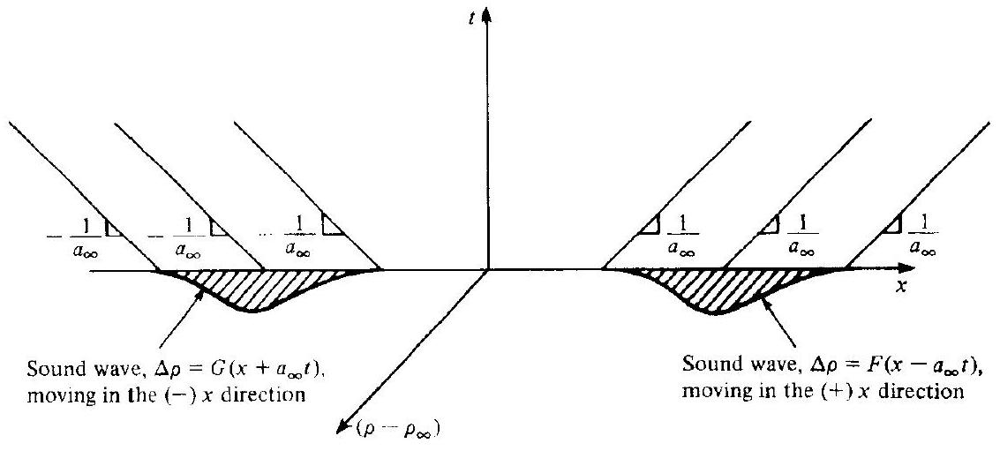
Figure 7.10 | Left- and right-running sound waves.

consequence of our linearized equations as obtained above. If in Eq. (7.43) we assume that $F=0$, then

$$
\Delta \rho=G\left(x+a_{\infty} t\right)
$$

represents a sound wave moving to the left, as also illustrated in Fig. 7.10.
Look what has happened! As a direct result of the above analysis, we have proven that the quantity $a_{\infty}^{2}$, defined as $\left[(\partial p / \partial \rho)_{s}\right]_{\infty}$, is indeed the velocity of propagation of the wave. Moreover, the wave we are considering is a sound wave. Therefore, we have just proven from acoustic theory that the velocity of sound is given by $(\partial p / \partial \rho)_{s}$ evaluated locally in the gas through which it is propagating. Note that a completely separate derivation led to the same result in Eq. (3.17).

Equations (7.43) and (7.46) give $\Delta \rho$ and $\Delta u$, respectively. However, we should have enough fluid dynamic intuition by now to suspect that $\Delta \rho$ and $\Delta u$ are not independent. Indeed, for a given change in density, there is a corresponding change in mass-motion velocity. The relation between $\Delta u$ and $\Delta \rho$ for a sound wave is obtained as follows. From Eq. (7.46), letting $g=0$, we obtain $\Delta u=f\left(x-a_{\infty} t\right)$. Hence,
and

$$
\begin{aligned}
& \frac{\partial \Delta u}{\partial x}=f^{\prime} \\
& \frac{\partial \Delta u}{\partial t}=-a_{\infty} f^{\prime} \\
& \frac{\partial \Delta u}{\partial x}=-\frac{1}{a_{\infty}} \frac{\partial \Delta u}{\partial t}
\end{aligned}
$$

Hence,
Substitute Eq. (7.49) into the linearized continuity equation (7.38):

$$
\begin{aligned}
\frac{\partial \Delta \rho}{\partial t}-\frac{\rho_{\infty}}{a_{\infty}} \frac{\partial \Delta u}{\partial t} & =0 \\
\frac{\partial}{\partial t}\left(\Delta \rho-\frac{\rho_{\infty}}{a_{\infty}} \Delta u\right) & =0 \\
\Delta \rho-\frac{\rho_{\infty}}{a_{\infty}} \Delta u & =\text { const }
\end{aligned}
$$

The constant is easily evaluated by applying Eq. (7.50) in the undisturbed gas, where $\Delta \rho=\Delta u=0$. Hence, the constant is zero, and Eq. (7.50) yields

$$
\Delta u=\frac{a_{\infty}}{\rho_{\infty}} \Delta \rho
$$

This is the desired relation between $\Delta u$ and $\Delta \rho$. A similar relation between $\Delta u$ and $\Delta p$ can be obtained by noting that the flow is isentropic, and hence any change in pressure $\Delta p$ causes an isentropic change in $\Delta \rho$. Thus, $\Delta p / \Delta \rho=(\partial p / \partial \rho)_{s}=a_{\infty}^{2}$, and Eq. (7.51) becomes

$$
\Delta u=\frac{\Delta p}{\rho_{\infty} a_{\infty}}
$$

Recall that Eqs. (7.51) and (7.52) were obtained by assuming $g=0$ in Eq. (7.46); hence they apply to a wave moving to the right, as shown in Fig. 7.10. For a wave moving to the left, as also shown in Fig. 7.10, let $f=0$ in Eq. (7.46). This results in expressions similar to Eqs. (7.51) and (7.52), except with a negative sign. The results are therefore generalized as

$$
\Delta u= \pm \frac{a_{\infty}}{\rho_{\infty}} \Delta \rho= \pm \frac{\Delta p}{\rho_{\infty} a_{\infty}}
$$

where the + and - signs pertain to right- and left-running waves, respectively. Also note that a positive $\Delta u$ denotes mass motion in the positive $x$ direction (to the right), and a negative $\Delta u$ denotes mass motion in the negative $x$ direction (to the left).

In acoustic terminology, that part of a sound wave where $\Delta \rho>0$ is called a condensation, and that part where $\Delta \rho<0$ is called a rarefaction. Note from Eq. (7.53) that for a condensation (where $p$ and $\rho$ increase above ambient conditions), the induced mass motion of the gas is always in the same direction as the wave motion, analogous to the effect of a traveling shock wave. For a rarefaction (where $p$ and $\rho$ decrease below ambient conditions), the induced mass motion is always in the opposite direction as the wave motion. As we shall find in the following sections, this is analogous to the effect of a traveling expansion wave.

### 7.6 I FINITE (NONLINEAR) WAVES

In Sec. 7.5 we studied the properties of a traveling wave where the perturbation from ambient conditions, say $\Delta \rho$, was small. This type of wave was defined as a weak wave, or a sound wave. In the present section, the previous constraint will be lifted, and $\Delta \rho$ will not necessarily be small. Such waves, where the perturbations can be large, are called finite waves.

Consider a finite wave propagating to the right, as shown in Fig. 7.11. Here, the density, temperature, local speed of sound, and mass motion are sketched as functions of $x$ for some instant in time. At the leading portion of the wave, (around $x=x_{2}$ ), $\rho$ is higher than ambient; at the trailing portion (around $x=x_{1}$ ), $\rho$ is lower than ambient. Because the flow is isentropic, the temperature follows the density via Eq. (1.43). Since $a=\sqrt{\gamma R T}$, the local speed of sound also varies through the wave, in the same manner as $T$. With regard to the mass-motion velocity $u$, we can induce from the results of Sec. 7.5 that it will be positive (in the direction of wave motion) where the density is above ambient, and negative (opposite to the direction of wave motion) where the density is below ambient. In Fig. 7.11, the portions of the wave where the density is increasing (ahead of $x_{2}$ and behind $x_{1}$ ) are called finite compression regions, and the portion where the density is decreasing (between $x_{1}$ and $x_{2}$ ) is called an expansion region.

In contrast to the linearized sound wave discussed in Sec. 7.5, different parts of the finite wave in Fig. 7.11 propagate at different velocities relative to the laboratory.

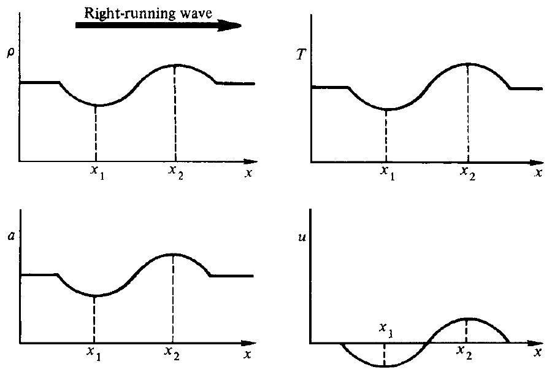
Figure 7.11 I Schematic of property variations in a finite wave.

Consider a fluid element located at $x_{2}$ in Fig. 7.11. At this point, it is moving to the right with velocity $u_{2}$. In addition, the wave is propagating through the gas due to molecular collisions. In fact, if we are riding along with the fluid element, we see the wave propagating by us at the local velocity of sound, $a_{2}$. Therefore, relative to the laboratory, the portion of the wave at location $x_{2}$ is propagating at the velocity $w_{2}=u_{2}+a_{2}$. Indeed, all portions of the wave are propagating at a velocity $u+a$ relative to the laboratory, where $u$ and $a$ are local values of mass velocity and speed of sound, respectively. Physically, the propagation of a local part of the finite wave is the local speed of sound superimposed on top of the local gas mass motion.

Again, reflecting on Fig. 7.11 at $x_{2}$ the mass velocity $u_{2}$ is toward the right, whereas at $x_{1}$ the mass velocity $u_{1}$ is toward the left. Moreover, at $x_{2}$ the speed of sound is larger than at $x_{1}$. Therefore $u_{2}+a_{2}>u_{1}+a_{1}$, and the portion of the wave around $x_{2}$ is traveling faster to the right than the portion around $x_{1}$. Indeed, if $u_{1}$ is a large enough negative number, larger in magnitude than $a_{1}$, then the trailing portion of the wave will actually propagate to the left in such a case. So it is clearly evident that the wave shape will distort as it propagates through space. The compression wave will continually steepen until it coalesces into a shock wave, whereas the expansion wave will continually spread out and become more gradual. This distortion of the wave form is illustrated in Fig. 7.9.

Let us now contrast a sound wave with a finite wave. For an acoustic wave:

1. $\Delta \rho, \Delta T, \Delta u$, etc., are very small.
2. All parts of the wave propagate with the same velocity relative to the laboratory, namely, at the velocity $a_{\infty}$.
3. The wave shape stays the same.
4. The flow variables are governed by linear equations.
5. This is an ideal situation, which is closely approached by audible sound waves.

For a finite wave:

1. $\Delta \rho, \Delta T, \Delta u$, etc., can be large.
2. Each local part of the wave propagates at the local velocity $u+a$ relative to the laboratory.
3. The wave shape changes with time.
4. The flow variables are governed by the full nonlinear equations.
5. This is the "real-life" situation, followed by nature for all real waves.

To develop the governing equations for a finite wave, first consider the continuity equation in the form of Eq. (6.22):

$$
\frac{D \rho}{D t}+\rho(\nabla \cdot \mathbf{V})=0
$$

Recall that, from thermodynamics, $\rho=\rho(p, s)$. Hence,

$$
d \rho=\left(\frac{\partial \rho}{\partial p}\right)_{s} d p+\left(\frac{\partial \rho}{\partial s}\right)_{p} d s
$$

For isentropic flow, $d s=0$. Thus, Eq. (7.54), written in terms of the substantial derivative following a fluid element, becomes

$$
\frac{D \rho}{D t}=\frac{1}{a^{2}} \frac{D p}{D t}
$$

Substitute Eq. (7.55) into Eq. (6.22):

$$
\frac{1}{a^{2}} \frac{D p}{D t}+\rho(\nabla \cdot \mathbf{V})=0
$$

Write Eq. (7.56) for one-dimensional flow:

$$
\frac{1}{a^{2}}\left(\frac{\partial p}{\partial t}+u \frac{\partial p}{\partial x}\right)+\rho \frac{\partial u}{\partial x}=0
$$

Now consider the momentum equation in the form of Eq. (6.29), without body forces:

$$
\rho \frac{D \mathbf{V}}{D t}=-\nabla p
$$

For one-dimensional flow, this becomes
or

$$
\begin{aligned}
\rho \frac{\partial u}{\partial t}+\rho u \frac{\partial u}{\partial x}+\frac{\partial p}{\partial x} & =0 \\
\frac{\partial u}{\partial t}+u \frac{\partial u}{\partial x}+\frac{1}{\rho} \frac{\partial p}{\partial x} & =0
\end{aligned}
$$

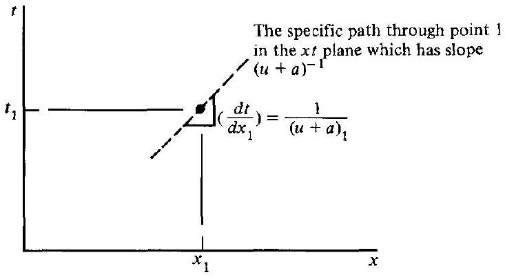
Figure 7.121 A preferred path in the $x t$ plane.

Adding Eqs. (7.57) and (7.58),

$$
\left[\frac{\partial u}{\partial t}+(u+a) \frac{\partial u}{\partial x}\right]+\frac{1}{\rho a}\left[\frac{\partial p}{\partial t}+(u+a) \frac{\partial p}{\partial x}\right]=0
$$

Subtracting Eq. (7.57) from Eq. (7.58),

$$
\left[\frac{\partial u}{\partial t}+(u-a) \frac{\partial u}{\partial x}\right]-\frac{1}{\rho a}\left[\frac{\partial p}{\partial t}+(u-a) \frac{\partial p}{\partial x}\right]=0
$$

Examine Eqs. (7.59) and (7.60). In principle, a solution of these equations gives $u=u(x, t)$ and $p=p(x, t)$, where ( $x, t$ ) is any point in the $x t$ plane, as sketched in Fig. 7.12. Moreover, from the definition of a differential,

$$
d u=\frac{\partial u}{\partial t} d t+\frac{\partial u}{\partial x} d x
$$

In general, we can consider arbitrary changes in $t$ and $x$, say $d t$ and $d x$, and calculate the corresponding change in $u$, given by $d u$ from Eq. (7.61). However, let us not consider arbitrary values of $d t$ and $d x$; rather, let us consider a specific path through point 1 in Fig. 7.12. This specific path is chosen so that it satisfies the equation

$$
d x=(u+a) d t
$$

That is, the path we are defining is the dashed line in Fig. 7.12 that goes through point 1 and has a slope $(d t / d x)_{1}=1 /\left(u_{1}+a_{1}\right)$. Hence, from Eq. (7.61) combined with (7.62), the value of $d u$ that corresponds to $d t$ and $d x$ constrained to move along the path in Fig. 7.12 is

$$
d u=\left[\frac{\partial u}{\partial t}+\frac{\partial u}{\partial x}(u+a)\right] d t
$$

Similarly for $d p$,

$$
d p=\left[\frac{\partial p}{\partial t}+\frac{\partial p}{\partial x}(u+a)\right] d t
$$

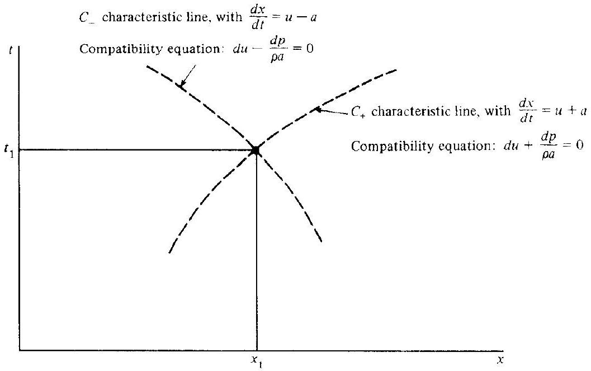
Figure 7.13 I Illustration of the characteristic lines through point 1 in the $x t$ plane.

Substituting Eqs. (7.63) and (7.64) into Eq. (7.59),

$$
d u+\frac{d p}{\rho a}=0
$$

where $d u$ and $d p$ are changes along a specific path defined by the slope $d x / d t= u+a$ in the $x t$ plane. [Note the similarity between Eq. (7.65) for finite waves and Eq. (7.53) for sound waves.]

We now interject the fact that the above analysis is a specific example of a powerful technique in compressible flow-the method of characteristics. Consider any given point ( $x_{1}, t_{1}$ ) in the $x t$ plane as shown in Fig. 7.13. In this analysis, we have found a path through $\left(x_{1}, t_{1}\right)$ along which the governing partial differential equation (7.59) reduces to an ordinary differential equation (7.65). The path is called a $C_{+}$ characteristic line in the $x t$ plane, and Eq. (7.65) is called the compatibility equation along the $C_{+}$characteristic. Equation (7.65) holds only along the characteristic line. The method of characteristics will be discussed at length in Chap. 11; the specific application to finite unsteady wave motion in this chapter serves as an illustrative introduction to some of the general concepts.

From Eq. (7.60) we can find another characteristic line, $C_{-}$, through the point $\left(x_{1}, t_{1}\right)$ in Fig. 7.11, where the slope of the $C$ _ characteristic is $d x / d t=u-a$, and along which the following compatibility equation holds:

$$
d u-\frac{d p}{\rho a}=0
$$

The two characteristics and their respective compatibility equations are illustrated in Fig. 7.13, which should be studied carefully. Note that the $C_{+}$and $C_{-}$characteristic lines are physically the paths of right- and left-running sound waves, respectively, in the $x t$ plane.

Integrating Eq. (7.65) along the $C_{+}$characteristic, we have

$$
J_{+}=u+\int \frac{d p}{\rho a}=\text { const } \quad \text { (along a } C_{+} \text {characteristic) }
$$

Integrating Eq. (7.66) along the $C_{-}$characteristic, we have

$$
J_{-}=u-\int \frac{d p}{\rho a}=\mathrm{const} \quad \text { (along a } C_{-} \text {characteristic) }
$$

In Eqs. (7.67) and (7.68) $J_{+}$and $J_{-}$are called the Riemann invariants. Specializing to a calorically perfect gas, from Eq. (3.19), $a^{2}=\gamma p / \rho$; thus

$$
\rho=\gamma p / a^{2}
$$

Also, since the process is isentropic,

$$
p=c_{1} T^{\gamma /(\gamma-1)}=c_{2} a^{2 \gamma /(\gamma-1)}
$$

where $c_{1}$ and $c_{2}$ are constants. Differentiating Eq. (7.70), we have

$$
d p=c_{2}\left(\frac{2 \gamma}{\gamma-1}\right) a^{[2 \gamma /(\gamma-1)-1]} d a
$$

Substitute Eq. (7.70) into (7.69):

$$
\rho=c_{2} \gamma a^{[2 \gamma /(\gamma-1)-2]}
$$

Substitute Eqs. (7.71) and (7.72) into Eqs. (7.67) and (7.68):

$$
\begin{aligned}
& J_{+}=u+\frac{2 a}{\gamma-1}=\text { const } \quad\left(\text { along a } C_{+} \text {characteristic }\right) \\
& J_{-}=u-\frac{2 a}{\gamma-1}=\text { const } \quad\left(\text { along a } C_{-} \text {characteristic }\right)
\end{aligned}
$$

Equations (7.73) and (7.74) give the Riemann invariants for a calorically perfect gas. The usefulness of the Riemann invariants is clearly seen by solving Eqs. (7.73) and (7.74) for $u$ and $a$ :

$$
\begin{aligned}
& a=\frac{\gamma-1}{4}\left(J_{+}-J_{-}\right) \\
& u=\frac{1}{2}\left(J_{+}+J_{-}\right)
\end{aligned}
$$

If the values of $J_{+}$and $J_{-}$are known at a given point in the $x t$ plane, then Eqs. (7.75) and (7.76) immediately give the local values of $u$ and $a$ at that point.

Considering again the shock tube in Fig. 7.5, with the above analysis we now have enough tools to solve the flowfield in a one-dimensional expansion wave. This is the subject of Sec. 7.7. Also, this brings us to the bottom of the right-hand column in our roadmap in Fig. 7.2.

## 7.7 | INCIDENT AND REFLECTED EXPANSION WAVES

Consider the high- and low-pressure regions separated by a diaphragm in a tube, as sketched in Fig. 7.14. When the diaphragm is removed, as discussed in Sec. 7.1, an expansion wave travels to the left, as also shown in Fig. 7.14. With the removal of the diaphragm, the gas in region 4 feels as if a piston is being withdrawn to the right with velocity $u_{3}$, as sketched in Fig. 7.14. The piston is purely imaginary in this picture; $u_{3}$ is really the mass-motion velocity of the gas (relative to the laboratory) behind the expansion wave. The expansion wave is shown on an $x t$ diagram in Fig. 7.15, where $x=0$ is the location of the diaphragm. The head of the expansion wave moves to the left into region 4. Recall from Sec. 7.6 that any part of a rightrunning finite wave moves with the local velocity $u+a$. The same reasoning shows that any part of a left-running wave moves with the local velocity $u-a$. The expansion wave in Figs. 7.14 and 7.15 is a left-running wave, and hence the local velocity of any part of the wave is $u-a$. In region 4, the mass-motion velocity is zero; hence the head of the wave propagates to the left with a velocity $u_{4}-a_{4}=0-a_{4}=-a_{4}$. Therefore, the path of the head of the wave in the $x t$ plane is a straight line with $d x / d t=u_{4}-a_{4}=-a_{4}$. In light of Sec. 7.6, this path must therefore also be a $C_{-}$characteristic, as shown in Fig. 7.15.

Within the expansion wave, the induced mass motion is $u$, and it is directed toward the right. Also, the temperature, and hence $a$, is reduced inside the wave. Therefore, although the head of the wave advances into region 4 at the speed of sound, other parts of the wave propagate at slower velocities (relative to the laboratory). Hence, the expansion wave spreads out as it propagates down the tube. This is clearly seen in Fig. 7.15, where several $C_{-}$characteristics have been sketched for internal

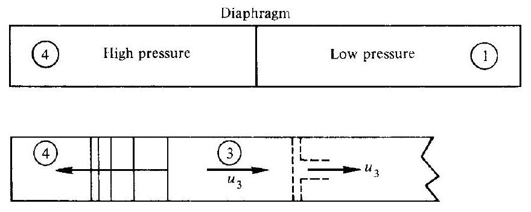
Figure 7.14 I Generation of an expansion wave.

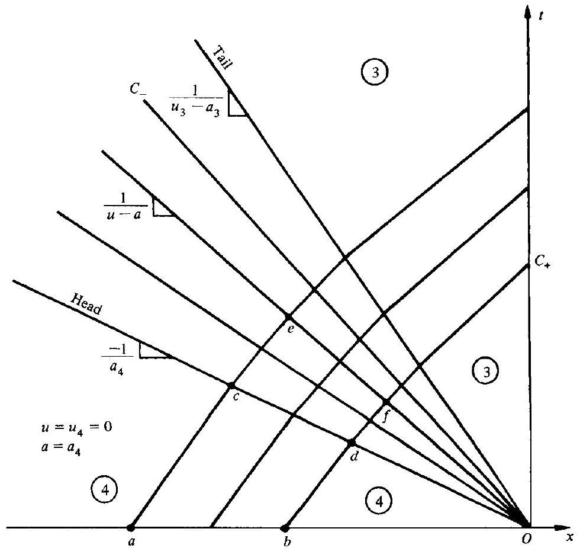
Figure 7.15 I The $C_{+}$and $C_{-}$characteristics for a centered expansion wave (on an $x t$ diagram).

portions of the wave. Note that the tail of the wave propagates at the velocity $d x / d t=u_{3}-a_{3}$. Also note that, if $u_{3}$ is supersonic, i.e., larger than $a_{3}$, the tail of the wave will actually move toward the right relative to the laboratory, although the wave is a left-running wave.

In Fig. 7.15, the $C_{-}$characteristics have been drawn as straight lines. We need to prove that this is indeed the case. To do this, add the $C_{+}$characteristics to the picture, as also shown in Fig. 7.15. In the constant-property region $4, u_{4}=0$ and $a_{4}$ is a constant. Thus, in region 4 , all the $C_{+}$characteristics have the same slope. Moreover, $J_{+}$is the same everywhere in region 4 . Hence, considering the two points $a$ and $b$ in Fig. 7.15,

$$
\left(J_{+}\right)_{a}=\left(J_{+}\right)_{b}
$$

However, recall from Sec. 7.6 that a constant value of $J_{+}$is carried along a $C_{+}$characteristic. Hence, in Fig. 7.15,

$$
\left(J_{+}\right)_{a}=\left(J_{+}\right)_{c}=\left(J_{+}\right)_{e}
$$

and

$$
\left(J_{+}\right)_{b}=\left(J_{+}\right)_{d}=\left(J_{+}\right)_{f}
$$

Comparing Eqs. (7.78) and (7.79) with (7.77), we have

$$
\left(J_{+}\right)_{k}=\left(J_{+}\right)_{f}
$$

Points $e$ and $f$, by definition, are on the same $C_{-}$characteristic, and recalling that a constant value of $J_{-}$is carried along a $C_{-}$characteristic, we have

$$
\left(J_{-}\right)_{e}=\left(J_{-}\right)_{f}
$$

Thus, substituting Eqs. (7.80) and (7.81) into Eqs. (7.75) and (7.76), we have $a_{e}=a_{f}$ and $u_{e^{\prime}}=u_{f}$. Therefore, at points $e$ and $f$ on the $C_{-}$characteristic, the value $d x / d t= u-a$ is the same; since points $e$ and $f$ are any arbitrary points on the same $C_{-}$ characteristic, the slope is the same at all points; the $C_{-}$characteristic must therefore be a straight line in Fig. 7.15. Moreover, we have just shown that the values of $u$ and $a$, and hence of $p, \rho, T$, etc., are constant along the given straight-line $C_{-}$ characteristic.

The pictures shown in Figs. 7.14 and 7.15 are for a wave propagating into a constant-property region (region 4). Such a wave is defined as a simple wave; a leftrunning simple wave has straight $C_{-}$characteristics along which the flow properties are constant. Similarly, a right-running simple wave has straight $C_{+}$characteristics along which the flow properties are constant. Moreover, because the wave in Figs. 7.14 and 7.15 originates at a given point (the origin in the $x t$ plane), it is called a centered wave. Note the analogy between an unsteady one-dimensional centered expansion wave (Fig. 7.13) and the steady two-dimensional Prandtl-Meyer expansion wave in Fig. 4.32.

Repeating, a simple wave is one for which one family of characteristics is straight lines; this can only be the case when the wave is propagating into a uniform region. Note from Fig. 7.15 that the other family (in this case, the $C_{+}$characteristics) can be curved through the wave. In contrast, a nonsimple wave has both families of characteristics as curved lines. This is the case, for example, of a reflected expansion wave during part of its reflection process. When the head of the expansion wave in Fig. 7.15 impinges on the endwall, the mass motion must remain zero at the wall. Therefore, the expansion wave must reflect toward the right. The head of the reflected expansion wave, now a right-running wave, propagates through the incident left-running wave. This region of mixed left- and right-running waves is called a nonsimple region, and is sketched in Fig. 7.16. The properties of the reflected expansion wave in both the nonsimple and simple regions can be calculated throughout the grid shown in Fig. 7.16 by applying the method of characteristics discussed in Sec. 7.6, and by using the boundary condition that $u=0$ at the endwall. This becomes a numerical (or graphical) procedure, where the characteristic lines and the compatibility conditions (the Riemann invariants) are pieced together point by point.

In contrast, the solution for a simple centered expansion wave can be obtained in closed analytical form, as follows. Returning to Fig. 7.15 we have shown that $J_{+}$at all the points $a, b, c, d, e, f$, etc., is the same value, i.e., $J_{+}$is constant through the expansion wave. From Eq. (7.73), therefore.

$$
u+\frac{2 a}{\gamma-1}=\text { const through the wave }
$$

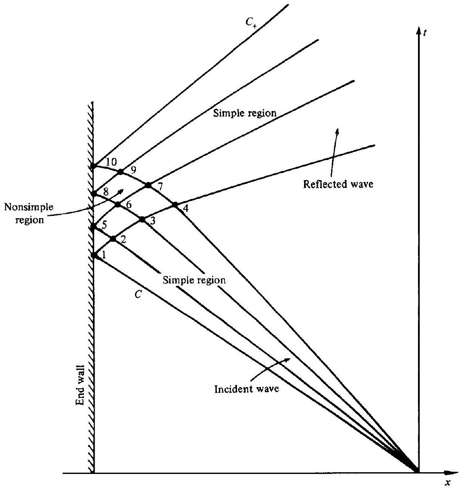
Figure 7.16 | Reflected expansion wave on an $x t$ diagram.

Evaluate the constant by applying Eq. (7.82) in region 4:

$$
u_{4}+\frac{2 a_{4}}{\gamma-1}=0+\frac{2 a_{4}}{\gamma-1}=\mathrm{const}
$$

Combining Eqs. (7.82) and (7.83),

$$
\frac{a}{a_{4}}=1-\frac{\gamma-1}{2}\left(\frac{u}{a_{4}}\right)
$$

Equation (7.84) relates $a$ and $u$ at any local point in a simple expansion wave. Because $a=\sqrt{\gamma R T}$, Eq. (7.84) also gives

$$
\frac{T}{T_{4}}=\left[1-\frac{\gamma-1}{2}\left(\frac{u}{a_{4}}\right)\right]^{2}
$$

Also, because the flow is isentropic, $p / p_{4}=\left(\rho / \rho_{4}\right)^{\gamma}=\left(T / T_{4}\right)^{\gamma / \gamma-1)}$. Hence, Eq. (7.85) yields

$$
\begin{aligned}
& \frac{p}{p_{4}}=\left[1-\frac{\gamma-1}{2}\left(\frac{u}{a_{4}}\right)\right]^{2 \gamma /(\gamma-1)} \\
& \frac{\rho}{\rho_{4}}=\left[1-\frac{\gamma-1}{2}\left(\frac{u}{a_{4}}\right)\right]^{2 /(\gamma-1)}
\end{aligned}
$$

Equations (7.84) through (7.87) give the properties in a simple expansion wave as a function of the local gas velocity in the wave.

To obtain the variation of properties in a centered expansion wave as a function of $x$ and $t$, consider the $C_{-}$characteristics in Fig. 7.15. The equation of any $C_{-}$characteristic is

$$
\frac{d x}{d t}=u-a
$$

or, because the characteristic is a straight line through the origin,

$$
x=(11-a) t
$$

Combining Eqs. (7.84) and (7.88), we have

$$
\begin{aligned}
& x=\left(u-a_{4}+\frac{\gamma-1}{2} u\right) t \\
& u=\frac{2}{\gamma+1}\left(a_{4}+\frac{x}{t}\right)
\end{aligned}
$$

or

Equation (7.89) holds for the region between the head and tail of the centered expansion wave in Fig. 7.15, i.e., $-a_{4} \leq x / t \leq u_{3}-a_{3}$.

In summary, for a centered expansion wave moving toward the left as shown in Fig. 7.15, Eq. (7.89) gives $u$ as a function of $x$ and $t$. In turn, $a, T, p$, and $\rho$ as functions of $x$ and $t$ are obtained by substituting $u=f(x, t)$ into Eqs. (7.84) through (7.87). The results are sketched in Fig. 7.17, which illustrates the spatial variations of $u, \rho, T$, and $p$ through the wave at some instant in time. Note from Eq. (7.89) that $u$ varies linearly with $x$ through a centered expansion wave. For the left-running wave we have been considering, Eq. (7.89) also shows that $u$ is positive, i.e., the mass motion is toward the right, opposite to the direction of propagation of the wave. Also note that the density, temperature, and pressure all decrease through the wave. with the strongest gradients at the head of the wave.

Analogous relations and results are obtained for a right-running expansion wave, except some of the signs in the equations are changed. The analog of Eqs. (7.82) through (7.89) for a right-running centered expansion wave is left for the reader to derive.

Referring again to Fig. 7.16, properties at the grid points defined by the intersection of $C_{+}$and $C_{-}$characteristics in the nonsimple region are obtained from

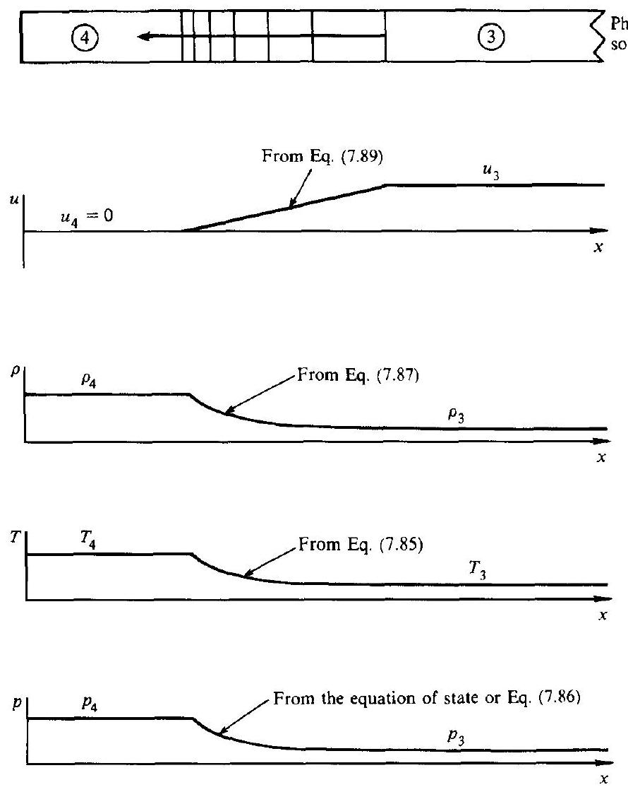
Figure 7.17 | Variation of physical properties within a centered expansion wave.

Eqs. (7.73) through (7.76). For example, $J_{+}$and $J_{-}$at points $1,2,3$, and 4 are known from the incident expansion wave. At point $5, a_{5}$ is determined by $\left(J_{-}\right)_{5}=\left(J_{-}\right)_{2}$ and by the boundary condition $u_{5}=0$. At point 6 , both $a_{6}$ and $u_{6}$ are determined from Eqs. (7.75) and (7.76), knowing that $\left(J_{-}\right)_{6}=\left(J_{-}\right)_{3}$ and $\left(J_{+}\right)_{6}=\left(J_{+}\right)_{5}$. The location of point 6 in the $x t$ space is found by the intersection of the $C_{-}$characteristic through point 3 and the $C_{+}$characteristic through point 5 . These characteristics are drawn as straight lines with slopes that are averages between the connecting points. For example, for line 3-6,

$$
\tan ^{-1}\left(\frac{d t}{d x}\right)=\frac{1}{2}\left[\tan ^{-1}\left(\frac{1}{u-a}\right)_{3}+\tan ^{-1}\left(\frac{1}{u-a}\right)_{6}\right]
$$

and for line 5-6,

$$
\tan ^{-1}\left(\frac{d t}{d x}\right)=\frac{1}{2}\left[\tan ^{-1}\left(\frac{1}{u+a}\right)_{5}+\tan ^{-1}\left(\frac{1}{u+a}\right)_{6}\right]
$$

In this fashion, the flow properties in the entire nonsimple region can be obtained.

Finally, the properties behind the reflected expansion wave after it completely leaves the interaction region are equal to the calculated properties at point 10 .

With this we have completed the right-hand column of our roadmap in Fig. 7.2. We are now ready to combine our knowledge of moving shock waves (left column) and moving expansion waves (right column) in order to study the properties of shock tubes, the last box at the bottom of our roadmap. We have come full circle back to the type of application represented by the shock tube shown in Fig. 7.1.

### 7.8 I SHOCK TUBE RELATIONS

Consider again the shock tube sketched in Figs. 7.4 and 7.5. Initially, a high-pressure gas with molecular weight . $/ / 4$ and ratio of specific heats $\gamma_{4}$ is separated from a lowpressure gas with corresponding. $/_{1}$ and $\gamma_{1}$ by a diaphragm. The ratio $p_{4} / p_{1}$ is called the diaphragm pressure ratio. Along with the initial conditions of the driver and driven gas, $p_{4} / p_{1}$ determines uniquely the strengths of the incident shock and expansion waves that are set up after the diaphragm is removed. We are now in a position to calculate these waves from the given initial conditions.

As discussed in Sec. 7.1, $u_{3}=u_{2}=u_{p}$, and $p_{2}=p_{3}$ across the contact surface. Repeating Eq. (7.16) for the mass motion induced by the incident shock,

$$
u_{p}=u_{2}=\frac{a_{1}}{\gamma_{1}}\left(\frac{p_{2}}{p_{1}}-1\right)\left(\frac{\frac{2 \gamma_{1}}{\gamma_{1}+1}}{\frac{p_{2}}{p_{1}}+\frac{\gamma_{1}-1}{\gamma_{1}+1}}\right)^{1 / 2}
$$

Also, applying Eq. (7.86) between the head and tail of the expansion wave.

$$
\frac{p_{3}}{p_{4}}=\left[1-\frac{\gamma_{4}-1}{2}\left(\frac{u_{3}}{a_{4}}\right)\right]^{2 \gamma_{4} /\left(\gamma_{4}-1\right)}
$$

Solving Eq. (7.90) for $u_{3}$, we have

$$
u_{3}=\frac{2 a_{4}}{\gamma_{4}-1}\left[1-\left(\frac{p_{3}}{p_{4}}\right)^{\left(\gamma_{4}-1\right) / 2 \gamma_{4}}\right]
$$

However, since $p_{3}=p_{2}$, Eq. (7.91) becomes

$$
u_{3}=\frac{2 a_{4}}{\gamma_{4}-1}\left[1-\left(\frac{p_{2}}{p_{4}}\right)^{\left(\gamma_{4}-1\right) / 2 \gamma_{4}}\right]
$$

Recall that $u_{2}=u_{3}$; Eqs. (7.16) and (7.92) can be equated as

$$
\frac{a_{1}}{\gamma_{1}}\left(\frac{p_{2}}{p_{1}}-1\right)\left(\frac{\frac{2 \gamma_{1}}{\gamma_{1}+1}}{\frac{p_{2}}{p_{1}}+\frac{\gamma_{1}-1}{\gamma_{1}+1}}\right)^{1 / 2}=\frac{2 a_{4}}{\gamma_{4}-1}\left[1-\left(\frac{p_{2}}{p_{4}}\right)^{\left(\gamma_{4}-1\right) / 2 \gamma_{4}}\right]
$$

Equation (7.93) can be algebraically rearranged to give

$$
\frac{p_{4}}{p_{1}}=\frac{p_{2}}{p_{1}}\left\{1-\frac{\left(\gamma_{4}-1\right)\left(a_{1} / a_{4}\right)\left(p_{2} / p_{1}-1\right)}{\sqrt{2 \gamma_{1}\left[2 \gamma_{1}+\left(\gamma_{1}+1\right)\left(p_{2} / p_{1}-1\right)\right]}}\right\}^{-2 \gamma_{4} /\left(\gamma_{4}-1\right)}
$$

Equation (7.94) gives the incident shock strength $p_{2} / p_{1}$ as an implicit function of the diaphragm pressure ratio $p_{4} / p_{1}$. Although it is difficult to see from inspection of Eq. (7.94), an evaluation of this relation shows that, for a given diaphragm pressure ratio $p_{4} / p_{1}$, the incident shock strength $p_{2} / p_{1}$ will be made stronger as $a_{1} / a_{4}$ is made smaller. Because $a=\sqrt{\gamma R T}=\sqrt{\gamma(\mathscr{R} / \mathscr{H}) T}$, the speed of sound in a light gas is faster than in a heavy gas. Thus, to maximize the incident shock strength for a given $p_{4} / p_{1}$, the driver gas should be a low-molecular-weight gas at high temperature (hence high $a_{4}$ ), and the driven gas should be a high-molecular-weight gas at low temperature (hence low $a_{1}$ ). For this reason, many shock tubes in practice use $\mathbf{H}_{2}$ or He for the driver gas, and heat the driver gas by electrical means (arc-driven shock tubes) or by chemical combustion (combustion-driven shock tubes).

The analysis of the flow of a calorically perfect gas in a shock tube is now straightforward. For a given diaphragm pressure ratio $p_{4} / p_{1}$ :

1. Calculate $p_{2} / p_{1}$ from Eq. (7.94). This defines the strength of the incident shock wave.
2. Calculate all other incident shock properties from Eqs. (7.10), (7.11), (7.14), and (7.16).
3. Calculate $p_{3} / p_{4}=\left(p_{3} / p_{1}\right) /\left(p_{4} / p_{1}\right)=\left(p_{2} / p_{1}\right) /\left(p_{4} / p_{1}\right)$. This defines the strength of the incident expansion wave.
4. All other thermodynamic properties immediately behind the expansion wave can be found from the isentropic relations

$$
\frac{p_{3}}{p_{4}}=\left(\frac{\rho_{3}}{\rho_{4}}\right)^{\gamma}=\left(\frac{T_{3}}{T_{4}}\right)^{\gamma /(\gamma-1)}
$$

5. The local properties inside the expansion wave can be found from Eqs. (7.84) through (7.87) and (7.89).

## 7.9 | FINITE COMPRESSION WAVES

Consider the sketch shown in Fig. 7.18. Here, a piston is gradually accelerated from zero to some constant velocity to the right in a tube. The piston path is shown in the $x t$ diagram. When the piston is first started at $t=0$, a wave propagates to the right into the quiescent gas with the local speed of sound, $w_{H}=a_{\infty}$. This is the head of a compression wave, because the piston is moving in the same direction as the wave,
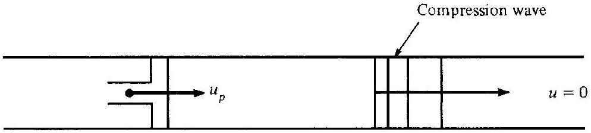

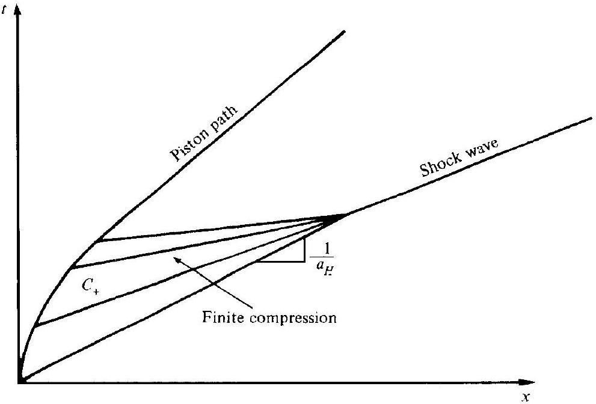
Figure 7.18 I Finite compression wave.

causing a local increase in pressure and temperature. Indeed, inside the wave, the local speed of sound increases, $a>a_{\infty}$, and there is an induced mass motion $u$ toward the right. Hence, inside the wave, $u+a>w_{H}$. Since the characteristic lines are given by $d x / d t=u+a$, we see that the $C_{+}$characteristics in Fig. 7.18 progressively approach each other, coalescing into a shock wave. The tail of the compression wave travels faster than the head, and therefore a finite compression wave will always ultimately become a discontinuous shock wave. This is in contrast to an expansion wave, which, as we have already seen, always spreads out as it propagates. These phenomena were recognized as early as 1870 ; witness the quotation at the beginning of this chapter.

In regard to our discussion of shock tubes, it is interesting to note that, after the breaking of the diaphragm, the incident shock is not formed instantly. Rather, in the immediate region downstream of the diaphragm location, a series of finite compression waves are first formed because the diaphragm breaking process is a complex three-dimensional picture requiring a finite amount of time. These compression waves quickly coalesce into the incident shock wave in a manner analogous to that shown in Fig. 7.18.

### 7.10 | SUMMARY

This brings to an end our discussion of unsteady one-dimensional wave motion. In addition to having important practical applications, this study has given us several "firsts" in our discussion and development of compressible flow. In this chapter, we have encountered

1. Our first real need to apply the general conservation equations in the form of partial differential equations as derived in Chap. 6.
2. Our first introduction to the idea and results of linearized flow-acoustic theory.
3. Our first introduction to the concept of the method of characteristics-finite wave motion.

In subsequent chapters, these philosophies and concepts will be greatly expanded.

## PROBLEMS

7.1 Starting with Eq. (7.9), derive Eqs. (7.10) and (7.11).
7.2 Consider a normal shock wave moving with a velocity of $680 \mathrm{~m} / \mathrm{s}$ into still air at standard atmospheric conditions ( $p_{1}=1 \mathrm{~atm}$ and $T_{1}=288 \mathrm{~K}$ ).
a. Using the equations of Sec. 7.2, calculate $T_{2}, p_{2}$, and $u_{p}$ behind the shock wave.
b. The normal shock tables, Table A.2, can be used to solve moving shock wave problems simply by noting that the tables pertain to flow velocities (hence Mach numbers) relative to the wave. Use Table A. 2 to obtain $T_{2}, p_{2}$, and $u_{p}$ for this problem.
7.3 For the conditions of Prob. 7.2, calculate the total pressure and temperature of the gas behind the moving shock wave.
7.4 Consider motionless air with $p_{1}=0.1 \mathrm{~atm}$ and $T_{1}=300 \mathrm{~K}$ in a constant-area tube. We wish to accelerate this gas to Mach 1.5 by sending a normal shock wave through the tube. Calculate the necessary value of the wave velocity relative to the tube.
7.5 Consider an incident normal shock wave that reflects from the end wall of a shock tube. The air in the driven section of the shock tube (ahead of the incident wave) is at $p_{1}=0.01 \mathrm{~atm}$ and $T_{1}=300 \mathrm{~K}$. The pressure ratio across the incident shock is 1050 . With the use of Eq. (7.23), calculate
a. The reflected shock wave velocity relative to the tube
b. The pressure and temperature behind the reflected shock
7.6 The reflected shock wave associated with a given incident shock can be calculated strictly from the use of Table A.2, without using Eq. (7.23). However, the use of Table A. 2 for this case requires a trial-and-error solution, converging on the proper boundary condition of zero mass motion behind the reflected shock wave. Repeat Prob. 7.5, using Table A. 2 only.
7.7 Consider a blunt-nosed aerodynamic model mounted inside the driven section of a shock tube. The axis of the model is aligned parallel to the axis of the shock tube, and the nose of the model faces towards the on-coming incident shock wave. The driven gas is air initially at a temperature and pressure of 300 K and 0.1 atm , respectively. After the diaphragm is broken, an incident shock wave with a pressure ratio of $p_{2} / p_{1}=40.4$ propagates into the driven section.
a. Calculate the pressure and temperature at the nose of the model shortly after the incident shock sweeps by the model.
b. Calculate the pressure and temperature at the nose of the model after the reflected shock sweeps by the model.
7.8 Consider a centered, one-dimensional, unsteady expansion wave propagating into quiescent air with $p_{4}=10 \mathrm{~atm}$ and $T_{4}=2500 \mathrm{~K}$. The strength of the wave is given by $p_{3} / p_{4}=0.4$. Calculate the velocity and Mach number of the induced mass motion behind the wave, relative to the laboratory.
7.9 The driver section of a shock tube contains He at $p_{4}=8 \mathrm{~atm}$ and $T_{4}=300 \mathrm{~K}$. $\gamma_{4}=1.67$. Calculate the maximum strength of the expansion wave formed after removal of the diaphragm (minimum $p_{3} / p_{4}$ ) for which the incident expansion wave will remain completely in the driver section.
7.10 The driver and driven gases of a pressure-driven shock tube are both air at 300 K . If the diaphragm pressure ratio is $p_{4} / p_{1}=5$, calculate:
a. Strength of the incident shock $\left(p_{2} / p_{1}\right)$
b. Strength of the reflected shock ( $p_{5} / p_{2}$ )
c. Strength of the incident expansion wave ( $p_{3} / p_{4}$ )
7.11 For the shock tube in Prob. 7.10, the lengths of the driver and driven sections are 3 and 9 m , respectively. On graph paper, plot the wave diagram ( $x t$ diagram) showing the wave motion in the shock tube, including the incident and reflected shock waves, the contact surface, and the incident and reflected expansion waves. To construct the nonsimple region of the reflected expansion wave, use the method of characteristics as outlined in Sec. 7.6. Use at least four characteristic lines to define the incident expansion wave, as shown in Fig. 7.16.
7.12 Let the uniform region behind the reflected expansion wave be denoted by the number 6. For the shock tube in Probs. 7.10 and 7.11, calculate the pressure ratio $p_{6} / p_{3}$ and the temperature $T_{6}$ behind the reflected expansion wave.
7.13 In Probs. 5.20 and 5.21, we noted that the reservoir temperature required for a continuous flow air Mach 20 hypersonic wind tunnel was beyond the capabilities of heaters in the reservoir. On the other hand, as discussed in regard to Fig. 7.1, the high temperature gas behind the reflected shock wave at the end-wall of a shock tube can be expanded through a nozzle mounted at the end of the tube. This device is called a shock tunnel, wherein very large reservoir temperatures can be created. The flow duration through a
shock tunnel, however, is limited typically to a few milliseconds. This is the trade-off necessary to achieve a very high reservoir temperature. Consider a shock tunnel with a Mach 20 nozzle using air. The air temperature in the region behind the reflected shock (the reservoir temperature for the shock tunnel) is 4050 K . In the driven section of the shock tube, before the tube diaphram is broken, the air temperature is 288 K . Calculate the Mach number of the incident shock wave required to obtain a temperature of 4050 K behind the reflected shock.

