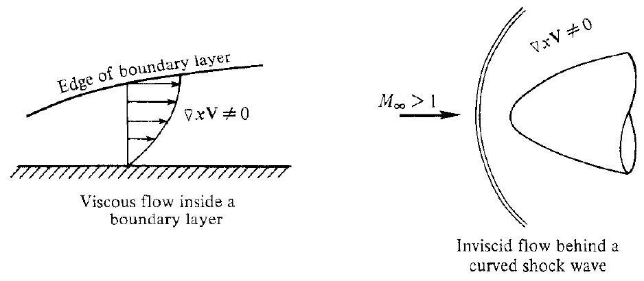
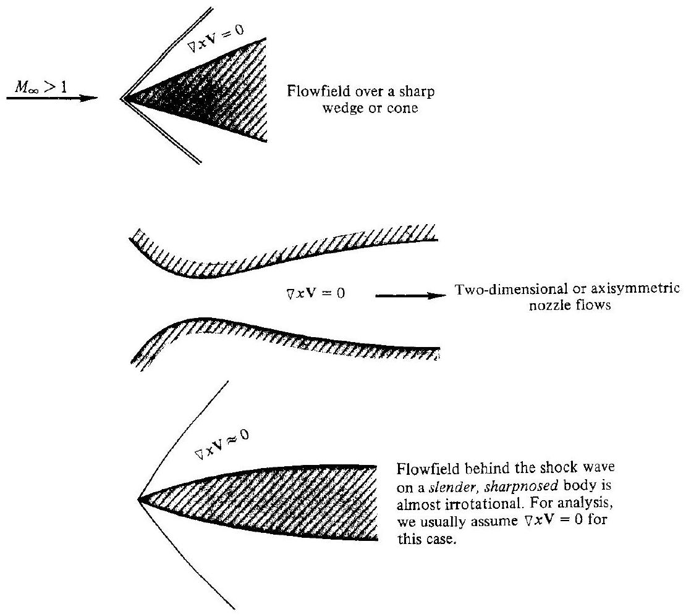
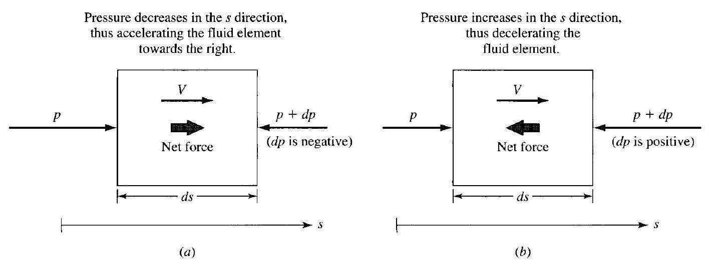
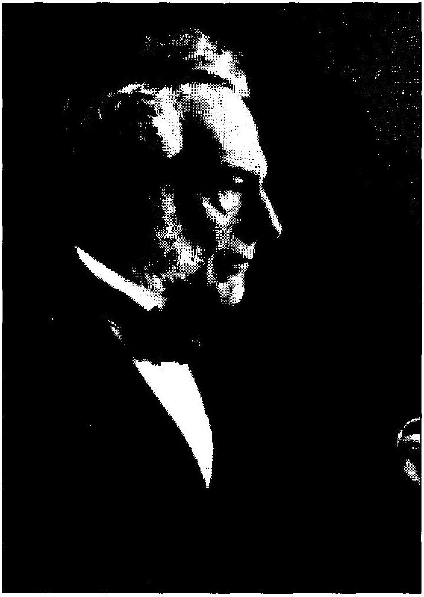
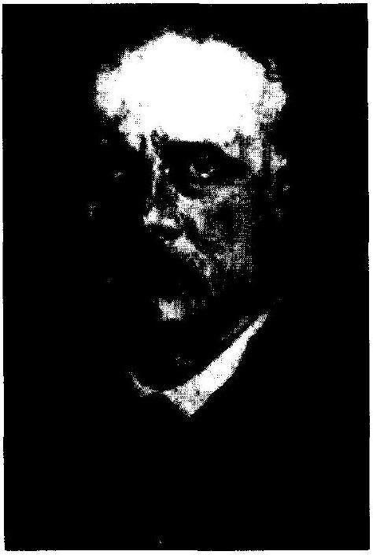

## CHAPTER

## 8

## General Conservation Equations Revisited: Velocity Potential Equation

Dynamics of compressible fluids, like other subjects in which the nonlinear character of the basic equations plays a decisive role, is far from the perfection envisaged by Laplace as the goal of a mathematical theory.

Richard Courant and K. O. Friedrichs, 1948

## PREVIEW BOX

Here we go again-building another tool for our compressible flow toolbox. This new tool is more specialized-it works only for an irrotational flow. But this is not a problem because in many compressible flow applications the actual flow fields are so close to being irrotational that we can assume them as such and proceed to use the tool developed in this chapter. The tool is called the velocity potential equation. It is particularly powerful because it combines the continuity, momentum, and energy equations into one equation, and it has a single dependent variable, the velocity potential, from which all the other primitive flow variables, such as velocity, pressure, and temperature can ultimately be obtained. We will use this tool in subsequent chapters to great advantage.

This chapter is short and direct, therefore we have no need for a roadmap. On the other hand, it is important to return to Fig. 1.7, the overall roadmap for the book, and orient ourselves. Looking at Fig. 1.7, we have finished the left-hand column (boxes 3-6), where subjects such as one-dimensional flow, oblique waves, and quasi-one-dimensional flow were studied using the integral form of the governing conservation equations. The
mathematics for these studies was essentially algebra. Then we moved to the middle column in Fig. 1.7, climbing to a higher mathematical tier and dealing with the governing conservation equations in the form of partial differential equations (box 7). This allowed us to study unsteady shock and expansion wave motion (box 10). These same governing conservation equations in the form of partial differential equations will allow us to deal with many other important and interesting flows itemized in boxes 11-16. However, before continuing down the middle column in Fig. 1.7, we detour to boxes 8 and 9 at the right in Fig. 1.7. The material here, the velocity potential equation and its application to obtain linear solutions of subsonic and supersonic flows, is classical and elegant. After about 80 years since its first development, such linearized theory is still extremely powerful. It provides a quick and simple means to obtain pressure distributions over the surfaces of many types of aerodynamic shapes, and hence to obtain the lift, wave drag, and moments on these bodies. So enjoy this detour through boxes 8 and 9, keeping in mind that you will be seeing and learning some very classical compressible flow theory with very useful practical application.

### 8.1 I INTRODUCTION

In this chapter, the general conservation equations derived in Chap. 6 are simplified for the special case of irrotational flow, discussed below. This simplification is quite dramatic; it allows the separate continuity, momentum, and energy equations with the requisite dependent variables $\rho, p, \mathbf{V}, T$, etc., to cascade into one governing equation with one dependent variable-a new variable defined below as the velocity potential. In this chapter, the velocity potential equation will be derived; in turn, in Chap. 9 it will be employed for the approximate solution of several important problems in compressible flow.

### 8.2 I IRROTATIONAL FLOW

The concept of rotation in a moving fluid was introduced in Sec. 6.6. The vorticity is a point property of the flow, and is given by $\nabla \times \mathbf{V}$. Vorticity is twice the angular velocity of a fluid element, $\nabla \times \mathbf{V}=2 \omega$. A flow where $\nabla \times \mathbf{V} \neq 0$ throughout is called a rotational flow. Some typical examples of rotational flows are illustrated in

Figure 8.1 I Examples of rotational flows.

Figure 8.2 I Examples of irrotational flows.

Fig. 8.1 for the region inside a boundary layer and the inviscid flow behind a curved shock wave (see Sec. 6.6). In contrast, a flow where $\nabla \times \mathbf{V}=0$ everywhere is called an irrotational flow. Some typical examples of irrotational flows are shown in Fig. 8.2 for the flowfield over a sharp wedge or cone, the two-dimensional or axisymmetric flow through a nozzle, and the flow over slender bodies. If the slender body is moving supersonically, the attendant shock wave will be slightly curved, and
hence, strictly speaking, the flowfield will be slightly rotational. However, it is usually practical to ignore this, and to assume $\nabla \times \mathbf{V} \approx 0$ for such cases.

Irrotational flows are usually simpler to analyze than rotational flows; the irrotationality condition $\nabla \times \mathbf{V}=0$ adds an extra simplification to the general equations of motion. Fortunately, as exemplified in Fig. 8.2, a number of practical flowfields can be treated as irrotational. Therefore, a study of irrotational flow is of great practical value in fluid dynamics.

Consider an irrotational flow in more detail. In cartesian coordinates, the mathematical statement of irrotational flow is

$$
\begin{aligned}
\nabla \times \mathbf{V} & =\left|\begin{array}{ccc}
\mathbf{i} & \mathbf{j} & \mathbf{k} \\
\frac{\partial}{\partial x} & \frac{\partial}{\partial y} & \frac{\partial}{\partial z} \\
u & v & w
\end{array}\right| \\
& =\mathbf{i}\left(\frac{\partial w}{\partial y}-\frac{\partial v}{\partial z}\right)-\mathbf{j}\left(\frac{\partial w}{\partial x}-\frac{\partial u}{\partial z}\right)+\mathbf{k}\left(\frac{\partial v}{\partial x}-\frac{\partial u}{\partial y}\right)=0
\end{aligned}
$$

For this equality to hold at every point in the flow,

$$
\frac{\partial w}{\partial y}=\frac{\partial v}{\partial z} \quad \frac{\partial w}{\partial x}=\frac{\partial u}{\partial z} \quad \frac{\partial v}{\partial x}=\frac{\partial u}{\partial y}
$$

Equations (8.1) are called the irrotationality conditions. Now consider Euler's equation [Eq. (6.29)] without body forces.

$$
\rho \frac{D \mathbf{V}}{D t}=-\nabla p
$$

For steady flow, the $x$ component of this equation is
or

$$
\begin{gathered}
\rho u \frac{\partial u}{\partial x}+\rho v \frac{\partial u}{\partial y}+\rho w \frac{\partial u}{\partial z}=-\frac{\partial p}{\partial x} \\
-\frac{\partial p}{\partial x} d x=\rho u \frac{\partial u}{\partial x} d x+\rho v \frac{\partial u}{\partial y} d x+\rho w \frac{\partial u}{\partial z} d x
\end{gathered}
$$

But from Eq. (8.1),

$$
\frac{\partial u}{\partial y}=\frac{\partial v}{\partial x} \quad \text { and } \quad \frac{\partial u}{\partial z}=\frac{\partial w}{\partial x}
$$

Substituting the above relations into Eq. (8.2), we have
or

$$
\begin{aligned}
& -\frac{\partial p}{\partial x} d x=\rho u \frac{\partial u}{\partial x} d x+\rho v \frac{\partial v}{\partial x} d x+\rho w \frac{\partial w}{\partial x} d x \\
& -\frac{\partial p}{\partial x} d x=\frac{1}{2} \rho \frac{\partial u^{2}}{\partial x} d x+\frac{1}{2} \rho \frac{\partial v^{2}}{\partial x} d x+\frac{1}{2} \rho \frac{\partial w^{2}}{\partial x} d x
\end{aligned}
$$

Similarly, by considering the $y$ and $z$ components of Euler's equation,

$$
\begin{aligned}
& -\frac{\partial p}{\partial y} d y=\frac{1}{2} \rho \frac{\partial u^{2}}{\partial y} d y+\frac{1}{2} \rho \frac{\partial v^{2}}{\partial y} d y+\frac{1}{2} \rho \frac{\partial w^{2}}{\partial y} d y \\
& -\frac{\partial p}{\partial z} d z=\frac{1}{2} \rho \frac{\partial u^{2}}{\partial z} d z+\frac{1}{2} \rho \frac{\partial v^{2}}{\partial z} d z+\frac{1}{2} \rho \frac{\partial w^{2}}{\partial z} d z
\end{aligned}
$$

Adding Eqs. (8.3) through (8.5), we obtain

$$
-\left(\frac{\partial p}{\partial x} d x+\frac{\partial p}{\partial y} d y+\frac{\partial p}{\partial z} d z\right)=\frac{1}{2} \rho \frac{\partial V^{2}}{\partial x} d x+\frac{1}{2} \rho \frac{\partial V^{2}}{\partial y} d y+\frac{1}{2} \rho \frac{\partial V^{2}}{\partial z} d z
$$

where $V^{2}=u^{2}+v^{2}+w^{2}$.
Equation (8.6) is in the form of perfect differentials. and can be written as
or

$$
\begin{aligned}
-d p & =\frac{1}{2} \rho d\left(V^{2}\right) \\
d p & =-\rho V d V
\end{aligned}
$$

Equation (8.7) is a special form of Euler's equation which holds for any direction throughout an irrotational inviscid flow with no body forces. If the flow were rotational, Eq. (8.7) would hold only along a streamline. However, for an irrotational flow, the changes in pressure $d p$ and velocity $d V$ in Eq. (8.7) can be taken in any direction, not necessarily just along a streamline.

Euler's equation embodies one of the most fundamental physical characteristics of fluid flow-a physical characteristic that is easily seen in the form given by Eq. (8.7). Namely, in an inviscid flow if the pressure decreases along a given direction $[d p$ is negative in Eq. (8.7)], the velocity must increase in the same direction [in Eq. (8.7), $d V$ must be positive]; similarly, if the pressure increases along a given direction [ $d p$ is positive in Eq. (8.7)], the velocity must decrease in the same direction [in Eq. (8.7), $d V$ must be negative]. In the popular literature this is sometimes called the "Bernoulli principle" because in the early eighteenth century Daniel Bernoulli observed this physical effect. Although he worked hard to properly quantify it, he was unsuccessful. His friend and colleague, Leonard Euler, was the first to obtain the proper quantitative relation, namely Eq. (8.7). This equation dates from 1753. (See Reference 134 for more historical details on Bernoulli and Euler, and their contribution to fluid dynamics.)

The Bernoulli principle is very easy to understand physically. Consider a fluid element moving with velocity $V$ in the $s$ direction as sketched in Fig. 8.3. If the pressure decreases in the $s$ direction as shown in Fig. 8.3a (this is defined as a favorable pressure gradient), the pressure on the left face will be higher than that on the right face, exerting a net force on the fluid element acting toward the right, and hence

Figure 8.3 I Illustration of pressure gradient effect on the velocity of a fluid element. (a) Decreasing pressure in the flow direction increases the velocity. (b) Increasing pressure in the flow direction decreases the velocity.

accelerating it in the $s$ direction. Clearly, in a region of decreasing pressure, the fluid element will increase its velocity. Conversely, if the pressure increases in the $s$ direction as shown in Fig. $8.3 b$ (this is defined as an adverse pressure gradient), the pressure on the right face will be higher than that on the left face, exerting a net force on the fluid element acting toward the left, and hence decelerating it in the $s$ direction. Clearly, in a region of increasing pressure, the fluid element will decrease its velocity.

## 8.3 | THE VELOCITY POTENTIAL EQUATION

Consider a vector $\mathbf{A}$. If $\nabla \times \mathbf{A}=0$ everywhere, then $\mathbf{A}$ can always be expressed as $\nabla \zeta$, where $\zeta$ is a scalar function. This stems directly from the vector identity, $\operatorname{curl}(\operatorname{grad}) \equiv 0$. Hence,

$$
\nabla \times \nabla \zeta=0
$$

where $\zeta$ is any scalar function. For irrotational flow, $\nabla \times \mathbf{V}=0$. Hence, we can define a scalar function, $\boldsymbol{\Phi}=\boldsymbol{\Phi}(x, y, z)$, such that

$$
\mathbf{V} \equiv \nabla \boldsymbol{\Phi}
$$

where $\boldsymbol{\Phi}$ is called the velocity potential. In cartesian coordinates, since
and

$$
\nabla \boldsymbol{\Phi}=\frac{\partial \boldsymbol{\Phi}}{\partial x} \mathbf{i}+\frac{\partial \boldsymbol{\Phi}}{\partial y} \mathbf{j}+\frac{\partial \boldsymbol{\Phi}}{\partial z} \mathbf{k}
$$

then. by comparison,

$$
u=\frac{\partial \boldsymbol{\Phi}}{\partial x} \quad v=\frac{\partial \boldsymbol{\Phi}}{\partial y} \quad w=\frac{\partial \boldsymbol{\Phi}}{\partial z}
$$

Hence, if the velocity potential is known, the velocity can be obtained directly from Eq. (8.8) or (8.9).

As derived next, the velocity potential can be obtained from a single partial differential equation which physically describes an irrotational flow. In addition, we will assume steady, isentropic flow. For simplicity, we will adopt subscript notation for derivatives of $\boldsymbol{\Phi}$ as follows: $\partial \boldsymbol{\Phi} / \partial x \equiv \boldsymbol{\Phi}_{x}, \partial \boldsymbol{\Phi} / \partial y \equiv \boldsymbol{\Phi}_{y}, \partial \boldsymbol{\Phi} / \partial=\equiv \boldsymbol{\Phi}_{z}$, etc. Thus, the continuity equation, Eq. (6.5), for steady flow becomes

$$
\begin{array}{r}
\nabla \cdot(\rho \mathbf{V})=0 \\
\frac{\partial(\rho u)}{\partial x}+\frac{\partial(\rho v)}{\partial y}+\frac{\partial(\rho w)}{\partial z}=0 \\
\frac{\partial}{\partial x} \rho \Phi_{x}+\frac{\partial}{\partial y} \rho \Phi_{y}+\frac{\partial}{\partial z} \rho \Phi_{z}=0 \\
\rho\left(\Phi_{x x}+\Phi_{y y}+\Phi_{z y}\right)+\Phi_{x} \frac{\partial \rho}{\partial x}+\Phi_{y} \frac{\partial \rho}{\partial y}+\Phi_{z} \frac{\partial \rho}{\partial z}=0
\end{array}
$$

Since we are striving for an equation completely in terms of $\mathbf{\Phi}$, we eliminate $\rho$ from Eq. (8.10) by using Euler's equation in the form of Eq. (8.7), which for an irrotational flow applies in any direction:

$$
\begin{aligned}
& d p=-\rho V d V=-\frac{\rho}{2} d\left(V^{2}\right)=-\frac{\rho}{2} d\left(u^{2}+v^{2}+w^{2}\right) \\
& d p=-\rho d\left(\frac{\boldsymbol{\Phi}_{x}^{2}+\boldsymbol{\Phi}_{y}^{2}+\boldsymbol{\Phi}_{z}^{2}}{2}\right)
\end{aligned}
$$

From the speed of sound, $a^{2}=(\partial p / \partial \rho)_{1}$. Recalling that the flow is isentropic, any change in pressure $d p$ in the flow is followed by a corresponding isentropic change in density, $d \rho$. Hence,

$$
\begin{aligned}
& \frac{d p}{d \rho}=\left(\frac{\partial p}{\partial \rho}\right)_{s}=a^{2} \\
& d \rho=\frac{d p}{a^{2}}
\end{aligned}
$$

Combining Eqs. (8.11) and (8.12):

$$
d \rho=-\frac{\rho}{a^{2}} d\left(\frac{\boldsymbol{\Phi}_{x}^{2}+\boldsymbol{\Phi}_{y}^{2}+\boldsymbol{\Phi}_{z}^{2}}{2}\right)
$$

Considering changes in the $x$ direction, Eq. (8.13) directly yields

$$
\begin{aligned}
& \frac{\partial \rho}{\partial x}=-\frac{\rho}{a^{2}} \frac{\partial}{\partial x}\left(\frac{\boldsymbol{\Phi}_{x}^{2}+\boldsymbol{\Phi}_{y}^{2}+\boldsymbol{\Phi}_{z}^{2}}{2}\right) \\
& \frac{\partial \rho}{\partial x}=-\frac{\rho}{a^{2}}\left(\boldsymbol{\Phi}_{x} \boldsymbol{\Phi}_{x x}+\boldsymbol{\Phi}_{y} \boldsymbol{\Phi}_{y x}+\boldsymbol{\Phi}_{z} \boldsymbol{\Phi}_{z x}\right)
\end{aligned}
$$

or

Similarly,

$$
\begin{aligned}
& \frac{\partial \rho}{\partial y}=-\frac{\rho}{a^{2}}\left(\boldsymbol{\Phi}_{x} \boldsymbol{\Phi}_{x y}+\boldsymbol{\Phi}_{y} \boldsymbol{\Phi}_{y y}+\boldsymbol{\Phi}_{z} \boldsymbol{\Phi}_{z y}\right) \\
& \frac{\partial \rho}{\partial z}=-\frac{\rho}{a^{2}}\left(\boldsymbol{\Phi}_{x} \boldsymbol{\Phi}_{x z}+\boldsymbol{\Phi}_{y} \boldsymbol{\Phi}_{y z}+\boldsymbol{\Phi}_{z} \boldsymbol{\Phi}_{z z}\right)
\end{aligned}
$$

Substituting Eqs. (8.14) through (8.16) into Eq. (8.10), canceling the $\rho$ that appears in each term, and factoring out the second derivatives of $\boldsymbol{\Phi}$, we have

$$
\begin{gathered}
\left(1-\frac{\boldsymbol{\Phi}_{x}^{2}}{a^{2}}\right) \boldsymbol{\Phi}_{x x}+\left(1-\frac{\boldsymbol{\Phi}_{y}^{2}}{a^{2}}\right) \boldsymbol{\Phi}_{y y}+\left(1-\frac{\boldsymbol{\Phi}_{z}^{2}}{a^{2}}\right) \boldsymbol{\Phi}_{z z} \\
-\frac{2 \boldsymbol{\Phi}_{x} \boldsymbol{\Phi}_{y}}{a^{2}} \boldsymbol{\Phi}_{x y}-\frac{2 \boldsymbol{\Phi}_{x} \boldsymbol{\Phi}_{z}}{a^{2}} \boldsymbol{\Phi}_{x z}-\frac{2 \boldsymbol{\Phi}_{y} \boldsymbol{\Phi}_{z}}{a^{2}} \boldsymbol{\Phi}_{y z}=0
\end{gathered}
$$

Equation (8.17) is called the velocity potential equation.
Equation (8.17) is not strictly in terms of $\boldsymbol{\Phi}$ only; the variable speed of sound $a$ still appears. We need to express $a$ in terms of $\boldsymbol{\Phi}$. From the energy equation, Eq. (6.45),

$$
h_{o}=\mathrm{const}
$$

Hence, for a calorically perfect gas, this equation can be expressed as

$$
\begin{gathered}
c_{p} T+\frac{V^{2}}{2}=c_{p} T_{o} \\
\frac{\gamma R T}{\gamma-1}+\frac{V^{2}}{2}=\frac{\gamma R T_{o}}{\gamma-1} \\
\frac{a^{2}}{\gamma-1}+\frac{V^{2}}{2}=\frac{a_{o}^{2}}{\gamma-1} \\
a^{2}=a_{o}^{2}-\frac{\gamma-1}{2} V^{2}=a_{o}^{2}-\frac{\gamma-1}{2}\left(u^{2}+v^{2}+w^{2}\right) \\
a^{2}=a_{o}^{2}-\frac{\gamma-1}{2}\left(\boldsymbol{\Phi}_{x}^{2}+\boldsymbol{\Phi}_{y}^{2}+\boldsymbol{\Phi}_{z}^{2}\right)
\end{gathered}
$$

Since $a_{o}$ is a known constant of the flow, Eq. (8.18) gives the speed of sound $a$ as a function of $\boldsymbol{\Phi}$.

In summary, Eq. (8.17) coupled with Eq. (8.18) represents a single equation for the unknown variable $\boldsymbol{\Phi}$. Equation (8.18) represents a combination of the continuity, momentum, and energy equations. This leads to a general procedure for the solution of irrotational, isentropic flowfields:

1. Solve for $\boldsymbol{\Phi}$ from Eqs. (8.17) and (8.18) for the specified boundary conditions of the given problem.
2. Calculate $u, v$, and $w$ from Eq. (8.9). Hence, $V=\sqrt{u^{2}+v^{2}+w^{2}}$.
3. Calculate $a$ from Eq. (8.18).
4. Calculate $M=V / a$.
5. Calculate $T, p$, and $\rho$ from Eqs. (3.28), (3.30), and (3.31) respectively.

Hence, we see that once $\boldsymbol{\Phi}=\boldsymbol{\Phi}(x, y, z)$ is obtained, the whole flowfield is known. This demonstrates the importance of $\boldsymbol{\Phi}$.

Note that Eq. (8.17) combined with (8.18) is a nonlinear partial differential equation. It applies to any irrotational, isentropic flow: subsonic, transonic, supersonic, or hypersonic. It also applies to incompressible flow, where $a \rightarrow \infty$, hence yielding the familiar Laplace's equation,

$$
\boldsymbol{\Phi}_{x x}+\boldsymbol{\Phi}_{y y}+\boldsymbol{\Phi}_{z z}=0
$$

Moreover, the combined Eqs. (8.17) and (8.18) is an exact equation within the framework of isentropic, irrotational flow. No mathematical assumptions (such as small perturbations) have been applied at this stage of our presentation. There is no general closed-form solution to the velocity potential equation, and hence its solution is usually approached in one of these ways:

1. Exact numerical solutions. This approach makes it difficult to formulate general trends and rules-the results are raw numbers which have to be analyzed, just like experimental data obtained in the laboratory. However, the techniques of modern computational fluid dynamics are rendering numerical solutions as everyday occurrences in compressible flow, allowing solutions to complicated applications where there would ordinarily be no solution at all. We will study aspects of computational fluid dynamics in Chaps. 11, 12, and 17, emphasizing methods of characteristic and finite-difference solutions.
2. Transformation of variables in order to make the velocity potential equation linear, but still exact. Examples of this approach are scarce. One such method is the hodograph solution for subsonic flow, as described by Shapiro (see Ref. 16). Due to its limited usefulness, this technique will not be considered here.
3. Linearized solutions. Here, we find linear equations that are approximations to the exact nonlinear equations, but which lend themselves to closed-form analytic solution. A large number of real engineering problems lend themselves
to reasonable approximations which linearize the velocity potential equation. Aerodynamic theory historically abounds in linearized theories. This will be the subject of Chap. 9.

## 8.4 | HISTORICAL NOTE: ORIGIN OF THE CONCEPTS OF FLUID ROTATION AND VELOCITY POTENTIAL

The French mathematician Augustin Cauchy, famous for his contributions to partial differential equations and complex variables, was also active in the theory of fluid flow. In a paper presented to the Paris Academy of Sciences in 1815, he introduced the average rotation at a point in the flow. The extension of this idea to the concept of instantaneous rotation of a fluid element was made by the Englishman George Stokes at Cambridge in 1847. (See Fig. 8.4.) In a paper dealing with the viscous flow of fluids. Stokes was the first person to visualize the motion of a fluid element as the resolution of three components: pure translation, pure rotation, and pure strain. The concept of rotation of a fluid element was then applied to inviscid flows about 15 years later by Hermann von Helmholtz.

Figure 8.4 I Sir George Stokes (1819-1903).

Figure 8.5 I Hermann von Helmholts (1821-1894).

Helmholtz (see Fig. 8.5) is generally known to fluid dynamicists as a towering giant during the nineteenth century, with his accomplishments equivalent in stature to those of Euler and d'Alembert. However, it is interesting to note that Helmholtz is mainly recognized by the rest of civilization for his work in medicine, acoustics, optics, and electromagnetic theory. Born in Potsdam, Germany, on August 31, 1821, Helmholtz studied medicine in Berlin, and became a noted physiologist, holding professional positions in medicine at Königsberg, Bonn. and Heidelberg between 1855 to 1871. After that, he became a professor of physics at the University of Berlin until his death in 1894.

Helmholtz made substantial contributions to the theory of incompressible inviscid flow during the nineteenth century. We note here only one such contribution, relevant to this chapter. In 1858 he published a paper entitled "On the Integrals of the Hydrodynamical Equations Corresponding to Vortex Motions," in which he observed that the velocity components along all three axes in a flow could be expressed as a derivative of a single function. He called this function potential of velocity, which is identical to $\boldsymbol{\Phi}$ in Eq. (8.8). This was the first practical use of a velocity potential in fluid mechanics. although Louis de Lagrange (1736-1813). in his book Mechanique Analytic published in 1788, had first introduced the basic concept of this potential. Moreover, Helmholtz concluded "that in the cases in which a potential of the velocity exists the smallest fluid particles do not possess rotatory motions, whereas when no such potential exists, at least a portion of these particles is found in rotary motion."

Therefore, the general concepts in this chapter dealing with irrotational and rotational flows, as well as the definition of the velocity potential, were established more than a century ago.

