## CHAPTER 9

## Linearized Flow

Geometry which should only obey physics, when united to the latter, sometimes commands it. If it happens that a question which we wish to examine is too complicated to permit all its elements to enter into the analytical relation which we wish to set up, we separate the more inconvenient elements, we substitute for them other elements less troublesome, but also less real, and then we are surprised to arrive, notwithstanding our painful labor, at a result contradicted by nature; as if after having disguised it, cut it short, or mutilated it, a purely mechanical combination would give it back to us.

Jean le Rond d'Alembert, 1752

## PREVIEW BOX

The Boeing 777 jet transport, shown in Fig. 1.4, has swept wings, like many aircraft designed to fly near or beyond Mach one. Why swept wings? We answer this question in the present chapter. From a purely physical point of view, we will explain the advantages of a swept wing for high-speed flight. The discussion is centered around the concept of the critical Mach number, which is introduced toward the end of the chapter.

However, the main thrust of this chapter is to present a fast and simple means of estimating the pressure distribution over bodies moving at high subsonic or supersonic speeds. Recall from Eq. (1.45) that, for an inviscid flow, the aerodynamic force on a body is due only to the surface pressure distribution integrated over the complete body surface. If we had a simple means of calculating the pressure distributions over the body surface, then the calculation of the lift and drag on the body would be straightforward. This chapter presents such simple means of calculating pressure distributions. But as we have stated before, you cannot get something for nothing. The simple calculations of pressure distribution are only approximate results, and they can be made only for slender bodies (thin bodies, not thick ones) at small angles of attack in a flow that is either subsonic or supersonic, not transonic or hypersonic. However, there
are a lot of thin body shapes that fly at small angles of attack at subsonic or supersonic speeds, so the material in this chapter is much more useful than it seems at first thought.

The techniques presented here are based on a linearized form of the velocity potential equation, hence the label "linearized flows." This material is classical, it was developed in the 1920s, and remained the primary means for calculating pressure distributions over thin bodies at small angles of attack until the advent of computational fluid dynamics (CFD) in the 1960s and 70s. Today, linearized theory still has an important role to play in the study of compressible flow, mainly because of the simple formulas it provides for surface pressure distributions. The results of linearized theory give us fast, "back-of-the-envelope" calculations for surface pressure distributions that are tailor-made for preliminary design studies. So even in this modern world of computers and sophisticated CFD, classical linearized theory still has its place. This is why we devote a chapter to it in the present book on "modern" compressible flow.

The roadmap for this chapter is given in Fig. 9.1. We begin by discussing the appropriate physical assumptions that lead to the reduction of the nonlinear velocity

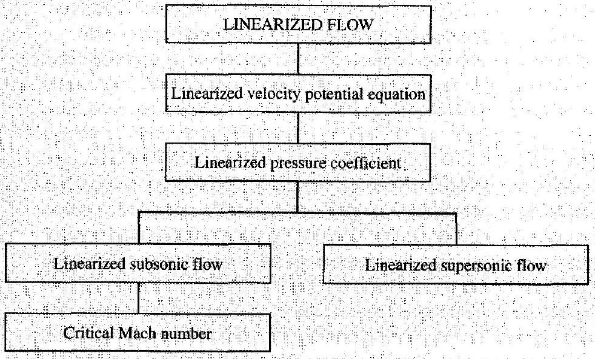
Figure 9.1 Roadmap for Chapter 9.

potential equation to a linear partial differential equation, and then derive this linear equation in detail. Then we define the pressure coefficient, and proceed to obtain an approximate linear expression for the pressure coefficient that is consistent with the degree of accuracy represented by the linearized velocity potential equation. These tools are shown as the center column in our roadmap in Fig. 9.1. The tools apply equally well to
subsonic and supersonic flows. Hence, we next move to the left column in Fig. 9.1, and study high-speed, compressible, subsonic flow. Then we move to the box at the right and study supersonic flow. Finally, we venture back to the left column and define the critical Mach number, discuss how it can be calculated, and examine its physical implications. It is here where we explain the aerodynamic functioning of swept wings.

## 9.1 | INTRODUCTION

Transport yourself back in time to the year 1940, and imagine that you are an aerodynamicist responsible for calculating the lift on the wing of a high-performance fighter plane. You recognize that the airspeed is high enough so that the wellestablished incompressible flow techniques of the day will give inaccurate results. Compressibility must be taken into account. However, you also recognize that the governing equations for compressible flow are nonlinear, and that no general solution exists for these equations. Numerical solutions are out of the question-high-speed digital computers are still 15 years in the future. So, what do you do? The only practical recourse is to seek assumptions regarding the physics of the flow, which will allow the governing equations to become linear, but which at the same time do not totally compromise the accuracy of the real problem. In turn, these linear equations can be attacked by conventional mathematical techniques.

In this context, it is easy to appreciate why linear solutions to flow problems dominated the history of aerodynamics and gasdynamics up to the middle 1950s. In modern compressible flow, with the advent of the high-speed computer, the importance of linearized flow has been relaxed. Linearized solutions now take their proper role as closed-form analytic solutions useful for explicitly identifying trends and governing parameters, for highlighting some important physical aspects of the flow, and for providing practical formulas for the rapid estimation of aerodynamic forces and pressure distributions. In modern practice, whenever accuracy is desired the full nonlinear equations are solved numerically on a computer, as described in subsequent chapters.

This chapter deals exclusively with linearized flow, but not to the extent that most earlier classical texts do. The reader is strongly urged to consult the classic texts listed as Refs. 3 through 17, especially those by Ferri, Hilton, Shapiro, and Liepmann and Roshko, for a more in-depth presentation. Our purpose here is to put linearized flow into proper perspective with modern techniques and to glean important physical trends from the linearized results.

Finally, there are a number of practical aerodynamic problems where, on a physical basis, a uniform flow is changed, or perturbed, only slightly. One such example is the flow over a thin airfoil illustrated in Fig. 9.2. The flow is characterized by only a small deviation of the flow from its original uniform state. The analyses of such

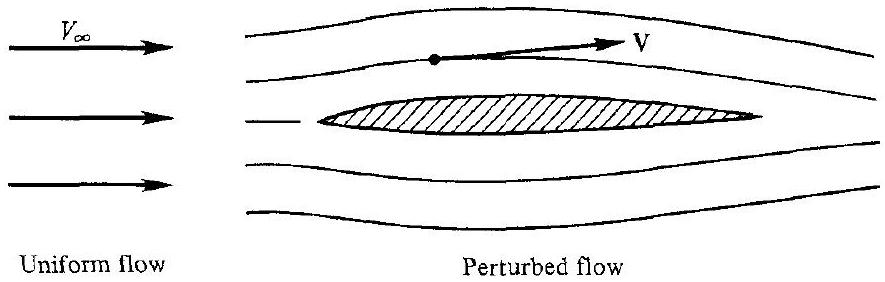
Figure 9.2 | Comparison between uniform and perturbed flows.

flows are usually called small-perturbation theories. Small-perturbation theory is frequently (but not always) linear theory, an example is the acoustic theory discussed in Sec. 7.5, where the assumption of small perturbations allowed a linearized solution. Linearized solutions in compressible flow always contain the assumption of small perturbations, but small perturbations do not always guarantee that the governing equations can be linearized, as we shall soon see.

## 9.2 | LINEARIZED VELOCITY POTENTIAL EQUATION

Consider a slender body immersed in a uniform flow, as sketched in Fig. 9.2. In the uniform flow, the velocity is $V_{\infty}$ and is oriented in the $x$ direction. In the perturbed flow, the local velocity is $\mathbf{V}$, where $\mathbf{V}=V_{x} \mathbf{i}+V_{y} \mathbf{j}+V_{z} \mathbf{k}$, and where $V_{x}, V_{y}$, and $V_{z}$ are now used to denote the $x, y$, and $z$ components of velocity, respectively. In this chapter, $u^{\prime}, v^{\prime}$, and $w^{\prime}$ denote perturbations from the uniform flow, such that

$$
\begin{aligned}
V_{x} & =V_{\infty}+u^{\prime} \\
V_{y} & =v^{\prime} \\
V_{z} & =w^{\prime}
\end{aligned}
$$

Here, $u^{\prime}, v^{\prime}$, and $w^{\prime}$ are the perturbation velocities in the $x, y$, and $z$ directions, respectively. Also in the perturbed flow, the pressure, density, and temperature are $p, \rho$, and $T$, respectively. In the uniform stream, $V_{x}=V_{\infty}, V_{y}=0$, and $V_{z}=0$. Also in the uniform stream, the pressure, density, and temperature are $p_{\infty}, \rho_{\infty}$, and $T_{\infty}$, respectively.

In terms of the velocity potential,

$$
\nabla \boldsymbol{\Phi}=\mathbf{V}=\left(V_{\infty}+u^{\prime}\right) \mathbf{i}+v^{\prime} \mathbf{j}+w^{\prime} \mathbf{k}
$$

where $\boldsymbol{\Phi}$ is now denoted as the "total velocity potential" (introduced in Chap. 8). Let us now define a new velocity potential, the perturbation velocity potential $\phi$, such that

$$
\frac{\partial \phi}{\partial x}=u^{\prime} \quad \frac{\partial \phi}{\partial y}=v^{\prime} \quad \frac{\partial \phi}{\partial z}=w^{\prime}
$$

Then,

$$
\boldsymbol{\Phi}(x, y, z)=V_{\infty} x+\phi(x, y, z)
$$

where

$$
\begin{aligned}
& V_{x}=V_{\infty}+u^{\prime}=\frac{\partial \boldsymbol{\Phi}}{\partial x}=V_{\infty}+\frac{\partial \phi}{\partial x} \\
& V_{y}=v^{\prime}=\frac{\partial \boldsymbol{\Phi}}{\partial y}=\frac{\partial \phi}{\partial y} \\
& V_{z}=w^{\prime}=\frac{\partial \boldsymbol{\Phi}}{\partial z}=\frac{\partial \phi}{\partial z}
\end{aligned}
$$

Also,

$$
\begin{aligned}
& \boldsymbol{\Phi}_{x x}=\frac{\partial^{2} \phi}{\partial x^{2}} \\
& \boldsymbol{\Phi}_{y y}=\frac{\partial^{2} \phi}{\partial y^{2}} \\
& \boldsymbol{\Phi}_{z z}=\frac{\partial^{2} \phi}{\partial z^{2}}
\end{aligned}
$$

Consider again the velocity potential equation, Eq. (8.17). Multiplying this equation by $a^{2}$ and substituting $\boldsymbol{\Phi}=V_{\infty} x+\phi$, we have

$$
\begin{aligned}
& {\left[a^{2}-\left(V_{\infty}+\frac{\partial \phi}{\partial x}\right)^{2}\right] \frac{\partial^{2} \phi}{\partial x^{2}}+\left[a^{2}-\left(\frac{\partial \phi}{\partial y}\right)^{2}\right] \frac{\partial^{2} \phi}{\partial y^{2}}+\left[a^{2}-\left(\frac{\partial \phi}{\partial z}\right)^{2}\right] \frac{\partial^{2} \phi}{\partial z^{2}}} \\
& \quad-2\left(V_{\infty}+\frac{\partial \phi}{\partial x}\right) \frac{\partial \phi}{\partial y} \frac{\partial^{2} \phi}{\partial x \partial y}-2\left(V_{\infty}+\frac{\partial \phi}{\partial x}\right) \frac{\partial \phi}{\partial z} \frac{\partial^{2} \phi}{\partial x \partial z}-2 \frac{\partial \phi}{\partial y} \frac{\partial \phi}{\partial z} \frac{\partial^{2} \phi}{\partial y \partial z}=0
\end{aligned}
$$

Equation (9.1) is called the perturbation-velocity potential equation. To obtain better physical insight, we recast Eq. (9.1) in terms of velocities:

$$
\begin{aligned}
& {\left[a^{2}-\left(V_{\infty}+u^{\prime}\right)^{2}\right] \frac{\partial u^{\prime}}{\partial x}+\left[a^{2}-v^{\prime 2}\right] \frac{\partial v^{\prime}}{\partial y}+\left[a^{2}-w^{\prime 2}\right] \frac{\partial w^{\prime}}{\partial z}} \\
& \quad-2\left(V_{\infty}+u^{\prime}\right) v^{\prime} \frac{\partial u^{\prime}}{\partial y}-2\left(V_{\infty}+u^{\prime}\right) w^{\prime} \frac{\partial u^{\prime}}{\partial z}-2 v^{\prime} w^{\prime} \frac{\partial v^{\prime}}{\partial z}=0
\end{aligned}
$$

Since the total enthalpy is constant throughout the flow,
or

$$
\begin{aligned}
h_{\infty}+\frac{V_{\infty}^{2}}{2} & =h+\frac{V^{2}}{2}=h+\frac{\left(V_{\infty}+u^{\prime}\right)^{2}+v^{\prime 2}+w^{\prime 2}}{2} \\
\frac{a_{\infty}^{2}}{\gamma-1}+\frac{V_{\infty}^{2}}{2} & =\frac{a^{2}}{\gamma-1}+\frac{\left(V_{\infty}+u^{\prime}\right)^{2}+v^{\prime 2}+w^{\prime 2}}{2} \\
a^{2} & =a_{\infty}^{2}-\frac{\gamma-1}{2}\left(2 u^{\prime} V_{\infty}+u^{\prime 2}+v^{\prime 2}+w^{\prime 2}\right)
\end{aligned}
$$

Substituting Eq. (9.3) into (9.2), and algebraically rearranging,

$$
\begin{aligned}
(1- & \left.M_{\infty}^{2}\right) \frac{\partial u^{\prime}}{\partial x}+\frac{\partial v^{\prime}}{\partial y}+\frac{\partial w^{\prime}}{\partial z} \\
= & M_{\infty}^{2}\left[(\gamma+1) \frac{u^{\prime}}{V_{\infty}}+\left(\frac{\gamma+1}{2}\right) \frac{u^{\prime 2}}{V_{\infty}^{2}}+\left(\frac{\gamma-1}{2}\right)\left(\frac{v^{\prime 2}+w^{\prime 2}}{V_{\infty}^{2}}\right)\right] \frac{\partial u^{\prime}}{\partial x} \\
+ & M_{\infty}^{2}\left[(\gamma-1) \frac{u^{\prime}}{V_{\infty}}+\left(\frac{\gamma+1}{2}\right) \frac{v^{\prime 2}}{V_{\infty}^{2}}+\left(\frac{\gamma-1}{2}\right)\left(\frac{w^{\prime 2}+u^{\prime 2}}{V_{\infty}^{2}}\right)\right] \frac{\partial v^{\prime}}{\partial y} \\
+ & M_{\infty}^{2}\left[(\gamma-1) \frac{u^{\prime}}{V_{\infty}}+\left(\frac{\gamma+1}{2}\right) \frac{w^{\prime 2}}{V_{\infty}^{2}}+\left(\frac{\gamma-1}{2}\right)\left(\frac{u^{\prime 2}+v^{\prime 2}}{V_{\infty}^{2}}\right)\right] \frac{\partial w^{\prime}}{\partial z} \\
+ & M_{\infty}^{2}\left[\frac{v^{\prime}}{V_{\infty}}\left(1+\frac{u^{\prime}}{V_{\infty}}\right)\left(\frac{\partial u^{\prime}}{\partial y}+\frac{\partial v^{\prime}}{\partial x}\right)+\frac{w^{\prime}}{V_{\infty}}\left(1+\frac{u^{\prime}}{V_{\infty}}\right)\left(\frac{\partial u^{\prime}}{\partial z}+\frac{\partial w^{\prime}}{\partial x}\right)\right. \\
& \left.\quad+\frac{u^{\prime} w^{\prime}}{V_{\infty}^{2}}\left(\frac{\partial w^{\prime}}{\partial y}+\frac{\partial v^{\prime}}{\partial z}\right)\right]
\end{aligned}
$$

Equation (9.4) is still an exact equation for irrotational, isentropic flow. It is simply an expanded form of the perturbation-velocity potential equation. Note that the left-hand side of Eq. (9.4) is linear, but the right-hand side is not. Also recall that we have not said anything about the size of the perturbation velocities $u^{\prime}, v^{\prime}$, and $w^{\prime}$. They could be large or small. Equation (9.4) holds for both cases.

We now specialize to the case of small perturbations, i.e., we assume the $u^{\prime}, v^{\prime}$, and $w^{\prime}$ are small compared to $V_{\infty}$ :

$$
\frac{u^{\prime}}{V_{\infty}}, \frac{v^{\prime}}{V_{\infty}}, \text { and } \frac{w^{\prime}}{V_{\infty}} \ll 1 \quad\left(\frac{u^{\prime}}{V_{\infty}}\right)^{2},\left(\frac{v^{\prime}}{V_{\infty}}\right)^{2}, \text { and }\left(\frac{w^{\prime}}{V_{\infty}}\right)^{2} \lll 1
$$

With this in mind, compare like terms (coefficients of like derivatives) on the leftand right-hand sides of Eq. (9.4):

1. For $0 \leq M_{\infty} \leq 0.8$ and for $M_{\infty} \geq 1.2$, the magnitude of

$$
M_{\infty}^{2}\left[(\gamma+1) \frac{u^{\prime}}{V_{\infty}}+\cdots\right] \frac{\partial u^{\prime}}{\partial x}
$$

is small in comparison to the magnitude of

$$
\left(1-M_{\infty}^{2}\right) \frac{\partial u^{\prime}}{\partial x}
$$

Thus, ignore the former term.
2. For $M_{\infty} \leq 5$ (approximately),

$$
M_{\infty}^{2}\left[(\gamma-1) \frac{u^{\prime}}{V_{\infty}}+\cdots\right] \frac{\partial v^{\prime}}{\partial y}
$$

is small in comparison to $\partial v^{\prime} / \partial y$,

$$
M_{\infty}^{2}\left[(\gamma-1) \frac{u^{\prime}}{V_{\infty}}+\cdots\right] \frac{\partial w^{\prime}}{\partial z}
$$

is small in comparison to $\partial w^{\prime} / \partial z$, and

$$
M_{\infty}^{2}\left[\frac{v^{\prime}}{V_{\infty}}\left(1+\frac{u^{\prime}}{V_{\infty}}\right)\left(\frac{\partial u^{\prime}}{\partial y}+\frac{\partial v^{\prime}}{\partial x}\right)+\cdots\right] \approx 0
$$

Thus, ignore these terms in comparison to those on the left-hand side of Eq. (9.4).
With these order-of-magnitude comparisons, Eq. (9.4) reduces to

$$
\left(1-M_{\infty}^{2}\right) \frac{\partial u^{\prime}}{\partial x}+\frac{\partial v^{\prime}}{\partial y}+\frac{\partial w^{\prime}}{\partial z}=0
$$

or, in terms of the perturbation velocity potential,

$$
\left(1-M_{\infty}^{2}\right) \frac{\partial^{2} \phi}{\partial x^{2}}+\frac{\partial^{2} \phi}{\partial y^{2}}+\frac{\partial^{2} \phi}{\partial z^{2}}=0
$$

Note that Eqs. (9.5) and (9.6) are approximate equations: they no longer represent the exact physics of the flow. However, look what has happened. The original nonlinear equations, Eqs. (9.1) through (9.4), have been reduced to linear equations, namely, Eqs. (9.5) and (9.6). Inasmuch as Eq. (9.1) is called the perturbation-velocity potential equation, Eq. (9.6) is called the linearized perturbation-velocity potential equation. However, a price has been paid for this linearization. The approximate equation (9.6) is much more restrictive than the exact equation (9.1), for these reasons:

1. The perturbations must be small.
2. From item 1 in the list above, we see that transonic flow ( $0.8 \leq M_{\infty} \leq 1.2$ ) is excluded.
3. From item 2 in that same list we see that hypersonic flow ( $M_{\infty} \geq 5$ ) is excluded.

Thus, Eq. (9.6) is valid for subsonic and supersonic flow only-an important point to remember. However, Eq. (9.6) has the striking advantage that it is linear.

In summary, we have demonstrated that subsonic and supersonic flows lend themselves to approximate, linearized theory for the case of irrotational, isentropic flow with small perturbations. In contrast, transonic and hypersonic flows cannot be linearized, even with small perturbations. This is another example of the consistency of nature. Note some of the physical problems associated with transonic flow (mixed subsonic-supersonic regions with possible shocks, and extreme sensitivity to geometry changes at sonic conditions) and with hypersonic flow (strong shock waves close to the geometric boundaries, i.e., thin shock layers, as well as high enthalpy, and hence high-temperature conditions in the flow). Just on an intuitive basis, we
would expect such physically complicated flows to be inherently nonlinear. For the remainder of this chapter, we will consider linear flows only; thus, we will deal with subsonic and supersonic flows.

### 9.3 I LINEARIZED PRESSURE COEFFICIENT

The pressure coefficient $C_{p}$ is defined as

$$
C_{p} \equiv \frac{p-p_{\infty}}{\frac{1}{2} \rho_{\infty} V_{\infty}^{2}}
$$

where $p$ is the local pressure, and $p_{\infty}, \rho_{\infty}$, and $V_{\infty}$ are the pressure, density, and velocity, respectively, in the uniform free stream. The pressure coefficient is simply a nondimensional pressure difference; it is extremely useful in fluid dynamics.

An alternative form of the pressure coefficient, convenient for compressible flow, can be obtained as follows:

$$
\frac{1}{2} \rho_{\infty} V_{\infty}^{2}=\frac{1}{2} \frac{\gamma p_{\infty}}{\gamma p_{\infty}} \rho_{\infty} V_{\infty}^{2}=\frac{\gamma}{2} p_{\infty} \frac{V_{\infty}^{2}}{a_{\infty}^{2}}=\frac{\gamma}{2} p_{\infty} M_{\infty}^{2}
$$

Hence, Eq. (9.7) becomes

$$
C_{p}=\frac{p-p_{\infty}}{(\gamma / 2) p_{\infty} M_{\infty}^{2}}=\frac{p_{\infty}\left(p / p_{\infty}-1\right)}{(\gamma / 2) p_{\infty} M_{\infty}^{2}}
$$

Hence,

$$
C_{p}=\frac{2}{\gamma M_{\infty}^{2}}\left(\frac{p}{p_{\infty}}-1\right)
$$

Equation (9.10) is an alternative form of Eq. (9.7), expressed in terms of $\gamma$ and $M_{\infty}$ rather than $\rho_{\infty}$ and $V_{\infty}$. It is still an exact representation of the definition of $C_{p}$.

We now proceed to obtain an approximate expression for $C_{p}$ that is consistent with linearized theory. Since the total enthalpy is constant,

$$
h+\frac{V^{2}}{2}=h_{\infty}+\frac{V_{\infty}^{2}}{2}
$$

For a calorically perfect gas, this becomes

$$
\begin{gathered}
T+\frac{V^{2}}{2 c_{p}}=T_{\infty}+\frac{V_{\infty}^{2}}{2 c_{p}} \\
T-T_{\infty}=\frac{V_{\infty}^{2}-V^{2}}{2 c_{p}}=\frac{V_{\infty}^{2}-V^{2}}{2 \gamma R /(\gamma-1)} \\
\frac{T}{T_{\infty}}-1=\frac{\gamma-1}{2} \frac{V_{\infty}^{2}-V^{2}}{\gamma R T_{\infty}}=\frac{\gamma-1}{2} \frac{V_{\infty}^{2}-V^{2}}{a_{\infty}^{2}}
\end{gathered}
$$

Since

$$
V^{2}=\left(V_{\infty}+u^{\prime}\right)^{2}+v^{\prime 2}+w^{\prime 2}
$$

Eq. (9.11) becomes

$$
\frac{T}{T_{\infty}}=1-\frac{\gamma-1}{2 a_{\infty}^{2}}\left(2 u^{\prime} V_{\infty}+u^{\prime 2}+v^{\prime 2}+w^{\prime 2}\right)
$$

Since the flow is isentropic, $p / p_{\infty}=\left(T / T_{\infty}\right)^{\gamma /(\gamma-1)}$, and Eq. (9.12) gives
or

$$
\begin{aligned}
& \frac{p}{p_{\infty}}=\left[1-\frac{\gamma-1}{2 a_{\infty}^{2}}\left(2 u^{\prime} V_{\infty}+u^{\prime 2}+v^{\prime 2}+w^{\prime 2}\right)\right]^{\gamma /(\gamma-1)} \\
& \frac{p}{p_{\infty}}=\left[1-\frac{\gamma-1}{2} M_{\infty}^{2}\left(\frac{2 u^{\prime}}{V_{\infty}}+\frac{u^{\prime 2}+v^{\prime 2}+w^{\prime 2}}{V_{\infty}^{2}}\right)\right]^{\gamma /(\gamma-1)}
\end{aligned}
$$

Equation (9.13) is still an exact expression. However, considering small perturbations: $u^{\prime} / V_{\infty} \ll 1: u^{\prime 2} / V_{\infty}, v^{\prime 2} / V_{\infty}^{2}$, and $w^{\prime 2} / V_{\infty}^{2} \lll 1$. Hence, Eq. (9.13) is of the form

$$
\frac{p}{p_{\infty}}=(1-\varepsilon)^{\gamma /(\gamma-1)}
$$

where $\varepsilon$ is small. Hence, from the binomial expansion, neglecting higher-order terms,

$$
\frac{p}{p_{\infty}}=1-\frac{\gamma}{\gamma-1} \varepsilon+\cdots
$$

Thus, Eq. (9.13) can be expressed in the form of Eq. (9.14) as seen next, neglecting higher-order terms:

$$
\frac{p}{p_{\infty}}=1-\frac{\gamma}{2} M_{\infty}^{2}\left(\frac{2 u^{\prime}}{V_{\infty}}+\frac{u^{\prime 2}+v^{\prime 2}+w^{\prime 2}}{V_{\infty}^{2}}\right)+\cdots
$$

Substitute Eq. (9.15) into Eq. (9.10):

$$
\begin{aligned}
C_{p} & =\frac{2}{\gamma M_{\infty}^{2}}\left[1-\frac{\gamma}{2} M_{\infty}^{2}\left(\frac{2 u^{\prime}}{V_{\infty}}+\frac{u^{\prime 2}+v^{\prime 2}+w^{\prime 2}}{V_{\infty}^{2}}\right)+\cdots-1\right] \\
& =-\frac{2 u^{\prime}}{V_{\infty}}-\frac{u^{\prime 2}+v^{\prime 2}+w^{\prime 2}}{V_{\infty}^{2}}+\cdots
\end{aligned}
$$

Since $u^{\prime 2} / V_{\infty}^{2}, v^{\prime 2} / V_{\infty}^{2}$, and $w^{\prime 2} / V_{\infty}^{2} \lll 1$, Eq. (9.16) becomes

$$
C_{p}=-\frac{2 u^{\prime}}{V_{\infty}}
$$

Equation (9.17) gives the linearized pressure coefficient, valid for small perturbations. Note its particularly simple form; the linearized pressure coefficient depends only on the $x$ component of the perturbation velocity.

### 9.4 I LINEARIZED SUBSONIC FLOW

As mentioned in Sec. 9.1, historically a major impetus for the development of linearized theory for subsonic compressible flow grew out of the need to predict aerodynamic forces and moments on airfoils. Throughout the 1930s, this question became increasingly compelling: How can we take incompressible results (theory or experiment), and modify them to take compressibility into account? In this section we will develop an answer by utilizing the linearized equations developed in Secs. 9.2 and 9.3. The development will deal explicitly with the two-dimensional flow over an airfoil; however, it applies for any two-dimensional shape which satisfies the assumptions of small perturbations, e.g., the flow over a bumpy or wavy wall.

Consider the compressible subsonic flow over a thin airfoil at small angle of attack (hence small perturbations), as sketched in Fig. 9.3. The usual inviscid flow boundary condition must hold at the surface, i.e., the flow velocity must be tangent to the surface. Referring to Fig. 9.3, at the surface this boundary condition is

$$
\frac{d f}{d x}=\frac{v^{\prime}}{V_{\infty}+u^{\prime}}=\tan \theta
$$

For small perturbations, $u^{\prime} \ll V_{\infty}$, and $\tan \theta \approx \theta$; hence, Eq. (9.18) becomes

$$
\frac{d f}{d x}=\frac{v^{\prime}}{V_{\infty}}=\theta
$$

Since $v^{\prime}=\partial \phi / \partial y$, Eq. (9.19) is written as

$$
\frac{\partial \phi}{\partial y}=V_{\infty} \frac{d f}{d x}
$$

Equation (9.20) represents the appropriate boundary condition at the surface, consistent with linearized theory.

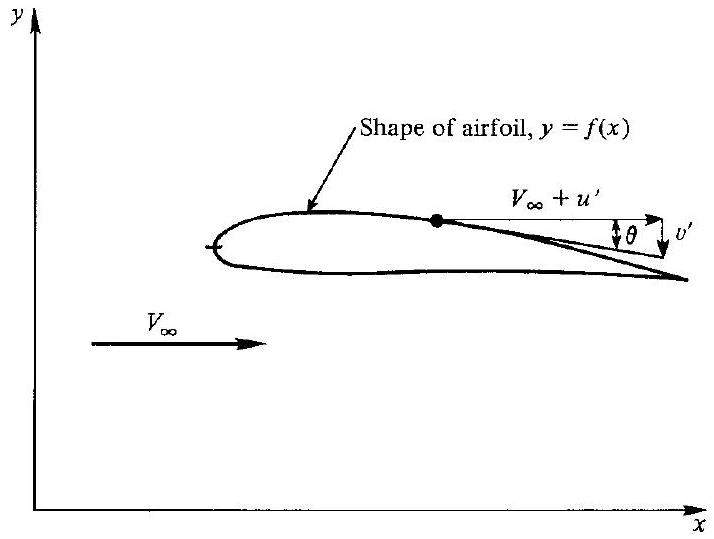
Figure 9.3 | Airfoil in physical space.

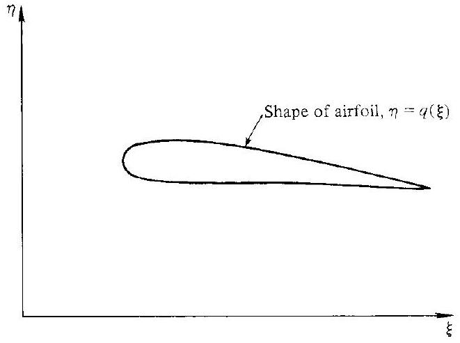
Figure 9.4 I Airfoil in transformed space.

The subsonic compressible flow over the airfoil in Fig. 9.3 is governed by the linearized perturbation-velocity potential equation (9.6). For two-dimensional flow, this becomes

$$
\beta^{2} \phi_{x x}+\phi_{y y}=0
$$

where $\beta \equiv \sqrt{1-M_{\infty}^{2}}$. Equation (9.21) can be transformed to a familiar incompressible form by considering a transformed coordinate system ( $\xi, \eta$ ), such that

$$
\begin{aligned}
& \xi=x \\
& \eta=\beta y
\end{aligned}
$$

In this transformed space, sketched in Fig. 9.4, a transformed perturbation velocity potential $\bar{\phi}(\xi, \eta)$ is defined such that

$$
\bar{\phi}(\xi, \eta)=\beta \phi(x, y)
$$

To couch Eq. (9.21) in terms of the transformed variables, note that

$$
\frac{\partial \xi}{\partial x}=1 \quad \frac{\partial \xi}{\partial y}=0 \quad \frac{\partial \eta}{\partial x}=0 \quad \frac{\partial \eta}{\partial y}=\beta
$$

Therefore, the derivatives of $\phi$ in ( $x, y$ ) space are related to the derivatives of $\bar{\phi}$ in $(\xi, \eta)$ space, according to

$$
\begin{aligned}
\phi_{x} & =\frac{\partial \phi}{\partial x}=\frac{1}{\beta} \frac{\partial \bar{\phi}}{\partial x}=\frac{1}{\beta}\left[\frac{\partial \bar{\phi}}{\partial \xi} \frac{\partial \xi}{\partial x}+\frac{\partial \bar{\phi}}{\partial \eta} \frac{\partial \eta}{\partial x}\right]=\frac{1}{\beta} \frac{\partial \bar{\phi}}{\partial \xi}=\frac{\bar{\phi}_{\xi}}{\beta} \\
\phi_{x x} & =\frac{1}{\beta} \bar{\phi}_{\xi \xi} \\
\phi_{y} & =\frac{\partial \phi}{\partial y}=\frac{1}{\beta} \frac{\partial \bar{\phi}}{\partial y}=\frac{1}{\beta}\left[\frac{\partial \bar{\phi}}{\partial \xi} \frac{\partial \xi}{\partial y}+\frac{\partial \bar{\phi}}{\partial \eta} \frac{\partial \eta}{\partial y}\right]=\frac{\partial \bar{\phi}}{\partial \eta}=\bar{\phi}_{\eta} \\
\phi_{y y} & =\bar{\phi}_{\eta \eta} \beta
\end{aligned}
$$

Substituting Eqs. (9.26) and (9.28) into Eq. (9.21),
or

$$
\begin{aligned}
\beta^{2}\left(\frac{1}{\beta} \bar{\phi}_{\xi \xi}\right)+\beta \bar{\phi}_{\eta \eta} & =0 \\
\bar{\phi}_{\xi \xi}+\bar{\phi}_{\eta \eta} & =0
\end{aligned}
$$

Equation (9.29) is Laplace's equation, which governs incompressible flow. Hence, $\bar{\phi}$ represents an incompressible flow in $(\xi, \eta)$ space, which is related to a compressible flow $\phi$ in $(x, y)$ space.

The shape of the airfoil is given by $y=f(x)$ and $\eta=q(\xi)$ in $(x, y)$ and $(\xi, \eta)$ space, respectively. From Eq. (9.20) in $(x, y)$ space, we have

$$
V_{\infty} \frac{d f}{d x}=\frac{\partial \phi}{\partial y}=\frac{1}{\beta} \frac{\partial \bar{\phi}}{\partial y}=\frac{\partial \bar{\phi}}{\partial \eta}
$$

Applying Eq. (9.20) in ( $\xi, \eta$ ) space,

$$
V_{\infty} \frac{d q}{d \xi}=\frac{\partial \bar{\phi}}{\partial \eta}
$$

The right-hand sides of Eqs. (9.30) and (9.31) are equal; hence, equating the lefthand sides,

$$
\frac{d f}{d x}=\frac{d q}{d \xi}
$$

Equation (9.32) is an important result; it demonstrates that the shape of the airfoil in $(x, y)$ and $(\xi, \eta)$ space is the same. Hence, the above transformation relates the compressible flow over an airfoil in $(x, y)$ space to the incompressible flow in $(\xi, \eta)$ space over the same airfoil.

The practicality of the above development is in the pressure coefficient. For the compressible flow in Fig. 9.3, the pressure coefficient is, from Eq. (9.17),

$$
C_{p}=-\frac{2 u^{\prime}}{V_{\infty}}=-\frac{2}{V_{\infty}} \frac{\partial \phi}{\partial x}=-\frac{2}{V_{\infty}} \frac{1}{\beta} \frac{\partial \bar{\phi}}{\partial x}=-\frac{2}{V_{\infty}} \frac{1}{\beta} \frac{\partial \bar{\phi}}{\partial \xi}
$$

Denoting the incompressible perturbation velocity in the $\xi$ direction by $\bar{u}$, where $\bar{u}=\partial \bar{\phi} / \partial \xi$, Eq. (9.33) becomes

$$
C_{p}=\frac{1}{\beta}\left(-\frac{2 \bar{u}}{V_{\infty}}\right)
$$

Since $(\xi, \eta)$ space corresponds to incompressible flow, Eq. (9.17) yields

$$
-\frac{2 \bar{u}}{V_{\infty}}=C_{p_{o}}
$$

where $C_{p_{o}}$ is the incompressible pressure coefficient. Combining Eqs. (9.34) and (9.35),

$$
C_{p}=\frac{C_{p_{o}}}{\sqrt{1-M_{\infty}^{2}}}
$$

Equation (9.36) is called the Prandtl-Glauert rule; it is a similarity rule which relates incompressible flow over a given two-dimensional profile to subsonic compressible flow over the same profile. Moreover, consider the aerodynamic lift $L$ and moment $M$ on this airfoil. We define the lift and moment coefficients, $C_{L}$ and $C_{M}$, respectively, as

$$
\begin{aligned}
C_{L} & =\frac{L}{\frac{1}{2} \rho_{\infty} V_{\infty}^{2} S} \\
C_{M} & =\frac{M}{\frac{1}{2} \rho_{\infty} V_{\infty}^{2} S l}
\end{aligned}
$$

where $S$ is a reference area (for a wing, usually the platform area of the wing), and $/$ is a reference length (for an airfoil, usually the chord length). In Sec. 1.5, the lift was defined as the component of aerodynamic force perpendicular to the free-stream velocity. As explained in Sec. 1.5, the sources of all aerodynamic forces and moments on a body are the pressure and shear stress distributions over the surface. Since we are dealing with an inviscid flow, the shear stress is zero. Moreover, Eq. (1.46) gives an equation for the lift in terms of the integral of the pressure distribution. Since both $L$ and $M$ are due to the pressure acting on the surface, and surface pressure for subsonic compressible flow is related to surface pressure for incompressible flow through Eq. (9.36), it can readily be shown that (see, for example, Ref. 1)

$$
\begin{aligned}
C_{L} & =\frac{C_{L_{o}}}{\sqrt{1-M_{\infty}^{2}}} \\
C_{M} & =\frac{C_{M_{u}}}{\sqrt{1-M_{\infty}^{2}}}
\end{aligned}
$$

Equations 9.37a and 9.37b are also called the Prandtl-Glauert rule. They are exceptionally practical aerodynamic formulas for the approximate compressibility correction to low-speed lift and moments on slender two-dimensional aerodynamic shapes. Note that the effect of compressibility is to increase the magnitudes of $C_{L}$ and $C_{M}$.

Equations (9.36) through (9.37) are results from linearized theory. They indicate that the aerodynamic forces go to infinity as $M_{\infty}$ goes to unity-an impossible result. This quandary is resolved, of course, by recalling that linearized theory breaks down in the transonic regime (near $M_{\infty}=1$ ). Indeed, the Prandtl-Glauert rule is reasonably valid only up to a Mach number of approximately 0.7 . More accurate compressibility correction will be discussed in Sec. 9.5.

An important effect of compressibility on subsonic flowfields can be seen by noting that

$$
u^{\prime}=\frac{\partial \phi}{\partial x}=\frac{1}{\beta} \frac{\partial \bar{\phi}}{\partial x}=\frac{1}{\beta} \frac{\partial \bar{\phi}}{\partial \xi}=\frac{\bar{u}}{\beta}=\frac{\bar{u}}{\sqrt{1-M_{\chi}^{2}}}
$$

Comparing the extreme left- and right-hand sides of Eq. (9.38) at a given location in the flow, as $M_{\infty}$ increases, the perturbation velocity $u^{\prime}$ increases. Compressibility
strengthens the disturbance to the flow introduced by a solid body. From another perspective, in comparison to incompressible flow, a perturbation of given strength reaches further away from the surface in compressible flow. The spatial extent of the disturbed flow region is increased by compressibility. Also, the disturbance reaches out in all directions, both upstream and downstream.

In classical inviscid incompressible flow theory, a two-dimensional closed body experiences no aerodynamic drag. This is the well-known d'Alembert's paradox, and is due to the fact that, without the effects of friction and its associated separated flow, the pressure distributions over the forward and rearward portions of the body exactly cancel in the flow direction. Does the same result occur for inviscid subsonic compressible flow? The answer can be partly deduced from Eq. (9.36). The compressible pressure coefficient $C_{p}$ differs from the incompressible value $C_{p_{0}}$ by only a constant scale factor. Hence, if the distribution of $C_{p_{0}}$ results in zero drag, the distribution of $C_{p}$ will also cancel in the flow direction and result in zero drag. Similar results are obtained from nonlinear subsonic calculations (thick bodies at large angle of attack). Hence, d'Alembert's paradox can be generalized to include subsonic compressible flow as well as incompressible flow.

## FXAMPLE 9.1

Consider a subsonic flow with an upstream Mach number of $M_{\infty}$. This flow moves over a wavy wall with a contour given by $y_{w}=h \cos (2 \pi x / l)$, where $y_{w}$ is the ordinate of the wall, $h$ is the amplitude, and $l$ is the wavelength. Assume that $h$ is small. Using the small perturbation theory of this chapter, derive an equation for the velocity potential and the surface pressure coefficient.

## - Solution

The wall shape is sketched in Fig. 9.5. Assume that $h / l$ is small. Therefore, the flowfield above the wall is characterized by small perturbations from the uniform flow conditions. Hence, the perturbation-velocity potential equation, Eq. (9.6), applies. In two dimensions, this becomes

$$
\left(1-M_{\infty}^{2}\right) \frac{\partial^{2} \phi}{\partial x^{2}}+\frac{\partial^{2} \phi}{\partial y^{2}}=0
$$

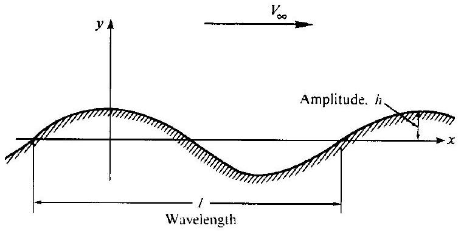
Figure 9.5 I Geometry of a wavy wall.

Recall that Eq. (E.1) is linear, and a standard approach to the solution of linear partial differential equations is separation of variables. Assume that $\phi$, which is a function of $x$ and $y$, can be expressed as a product of functions $x$ only and $y$ only, i.e.,

$$
\phi(x, y)=F(x) G(y)
$$

Substitute Eq. (E.2) into Eq. (E.1):

$$
\begin{aligned}
& \left(1-M_{\infty}^{2}\right) G \frac{d^{2} F}{d x^{2}}+F \frac{d^{2} G}{d y^{2}}=0 \\
& \frac{1}{F} \frac{d^{2} F}{d x^{2}}+\frac{1}{\left(1-M_{\infty}^{2}\right) G} \frac{d^{2} G}{d y^{2}}=0
\end{aligned}
$$

or
for any arbitrary values of $x$ and $x$. In particular, if $x$ is held
Equation (E.3) must hold for any arbitrary values of $x$ and $y$. In particular, if $x$ is held constant but $y$ is varied, $(1 / F)\left(d^{2} F / d x^{2}\right)$ is constant. However, Eq. (E.3) dictates that $\left[1 /\left(1-M_{\infty}^{2}\right) G \mid\left(d^{2} G / d y^{2}\right)\right.$ must also be constant; indeed, it must be equal to the negative value of the former constant in order for the two terms in Eq. (E.3) to always add to zero. Let this constant be denoted by $k^{2}$. Hence, Eq. (E.3) yields
and

$$
\begin{aligned}
\frac{1}{\left(1-M_{\infty}^{2}\right) G} \frac{d^{2} G}{d y^{2}} & =k^{2} \\
\frac{1}{F} \frac{d^{2} F}{d x^{2}} & =-k^{2}
\end{aligned}
$$

From Eq. (E.4).

$$
\frac{d^{2} G}{d y^{2}}-k^{2}\left(1-M_{\infty}^{2}\right) G=0
$$

Equation (E.6) is a second-order linear ordinary differential equation with constant coefficients; its solution is (see any standard text on differential equations)

$$
G(y)=A_{1} e^{\cdots k \sqrt{1-M_{\infty}^{2} y}}+A_{2} e^{k \sqrt{1-M_{\infty}^{2} y}}
$$

From Eq. (E.5),

$$
\frac{d^{2} F}{d x^{2}}+k^{2} F=0
$$

The standard solution of Eq. (E.8) is

$$
F(x)=B_{1} \sin k x+B_{2} \cos k x
$$

In Eqs. (E.7) and (E.9), the constants of integration, $A_{1}, A_{2}, B_{1}$, and $B_{2}$, and the parameter $k$ are determined from the physical boundary conditions of the problem as

1. As $y \rightarrow \infty, V$ and hence $\nabla \phi$ must remain finite (i.e., they cannot increase to an infinite value, because nature abhors infinities).
2. The flow at the wall must be tangent to the wall. Hence,

$$
\frac{d y_{w}}{d x}=\frac{v_{w}^{\prime}}{V_{\infty}+u_{w^{\prime}}^{\prime}}
$$

In Eq. (E.10), small perturbations dictate that $u_{w}^{\prime} \ll V_{\infty}$; hence, Eq. (E.10) becomes

$$
\frac{d y_{w}}{d x}=\frac{v_{w}^{\prime}}{V_{\infty}}=\frac{1}{V_{\infty}}\left(\frac{\partial \phi}{\partial y}\right)_{w}
$$

Combining Eqs. (E.11) and the wall equation, we have

$$
\left(\frac{\partial \phi}{\partial y}\right)_{w}=-V_{\infty} h\left(\frac{2 \pi}{l}\right) \sin \left(\frac{2 \pi x}{l}\right)
$$

Consistent with our assumption of small perturbations, $y_{w}$ is small. Hence, Eq. (E.12), which strictly speaking is applied at the wall surface, can be evaluated at $y=0$ without compromising the first-order accuracy of the solution. That is,

$$
\left(\frac{\partial \phi}{\partial y}\right)_{w} \approx\left(\frac{\partial \phi}{\partial y}\right)_{y=0}
$$

In turn, Eq. (E.12) becomes

$$
\left(\frac{\partial \phi}{\partial y}\right)_{y=0}=-V_{\infty} h\left(\frac{2 \pi}{l}\right) \sin \left(\frac{2 \pi x}{l}\right)
$$

Returning to Eq. (E.7), for the first boundary condition listed above to hold, $A_{2}=0$. This ensures that $\mathbf{V}$ remains finite at $y \rightarrow \infty$. Also, combining Eqs. (E.2) and (E.7) and (E.9), with $A_{2}=0$, we have

$$
\phi(x, y)=\left(B_{1} \sin k x+B_{2} \cos k x\right) A_{1} e^{-k \sqrt{1-M_{\infty}^{2}} y}
$$

Hence,

$$
\frac{\partial \phi}{\partial y}=\left(B_{1} \sin k x+B_{2} \cos k x\right) A_{1}(-k) \sqrt{1-M_{\infty}^{2}} e^{-k \sqrt{1-M_{\infty}^{2}} y}
$$

Evaluating Eq. (E.15) at the wall ( $y=0$ as already described):

$$
\left(\frac{\partial \phi}{\partial y}\right)_{y=0}=-A_{1} k \sqrt{1-M_{\infty}^{2}}\left(B_{1} \sin k x+B_{2} \cos k x\right)
$$

Combining Eq. (E.16) with the second boundary condition, Eq. (E.13), we have

$$
-A_{1} k \sqrt{1-M_{\infty}^{2}}\left(B_{1} \sin k x+B_{2} \cos k x\right)=-V_{\infty} h\left(\frac{2 \pi}{l}\right) \sin \left(\frac{2 \pi x}{l}\right)
$$

By inspection, we see that Eq. (E.17) is satisfied if

$$
\begin{aligned}
B_{2} & =0 \\
k & =\frac{2 \pi}{l} \\
A_{1} k \sqrt{1-M_{\infty}^{2}} B_{1} & =V_{\infty} h\left(\frac{2 \pi}{l}\right) \\
A_{1} B_{1} & =\frac{V_{\infty} h}{\sqrt{1-M_{\infty}^{2}}}
\end{aligned}
$$

or

Hence, Eq. (E.14) becomes

$$
\phi(x, y)=\frac{V_{\infty} h}{\sqrt{1-M_{\infty}^{2}}} \exp \left(\frac{-2 \pi \sqrt{1-M_{\infty}^{2}} y}{l}\right) \sin \left(\frac{2 \pi x}{l}\right)
$$

Equation (E.18) is the solution to the problem. From it all other physical properties can be found. For example,

$$
u^{\prime}=\frac{\partial \phi}{\partial x}=\frac{V_{\infty} h}{\sqrt{1-M_{\infty}^{2}}}\left(\frac{2 \pi}{l}\right)\left(\cos \frac{2 \pi x}{l}\right) \exp \left(\frac{-2 \pi \sqrt{1-M_{\infty}^{2}} y}{l}\right)
$$

Also, from Eq. (9.17), combined with (E.19),

$$
C_{p}=-\frac{2 u^{\prime}}{V_{\infty}}=-\frac{4 \pi}{\sqrt{1-M_{\infty}^{2}}}\left(\frac{h}{l}\right) \exp \left(\frac{-2 \pi \sqrt{1-M_{\infty}^{2}} y}{l}\right) \cos \left(\frac{2 \pi x}{l}\right)
$$

Since $y=0$ approximately corresponds to the wall, then the pressure coefficient at the wall $C_{p_{W}}$ can be obtained from Eq. (E.20) as

$$
C_{p_{w}}=-\frac{4 \pi}{\sqrt{1-M_{\infty}^{2}}}\left(\frac{h}{l}\right) \cos \left(\frac{2 \pi x}{l}\right)
$$

Let us interpret the results as embodied in Eqs. (E.18) through (E.21). To begin with, a comparison of Eq. (E.21) with the wall equation shows that the pressure coefficient at the wall has the same cosine variation as the shape of the wall, but it is $180^{\circ}$ out of phase [due to the negative sign in Eq. (E.21)]. This comparison is illustrated in Fig. 9.6 which shows a schematic of the $C_{p, v}$, variation positioned above the wall shape. Clearly, the pressure variation is symmetrical with the wall shape. The pressure distribution is illustrated by the arrows normal to the surface. Due to the symmetry of this distribution, there is no pressure force in the $x$ direction on the wall. That is, there is no drag. This is an example of a general result, namely: For two-dimensional, inviscid, adiabatic, subsonic compressible flow, a body experiences no aerodynamic drag. This is a generalization of the well-known d'Alembert's paradox which predicts zero drag for a two-dimensional body immersed in an incompressible potential flow.

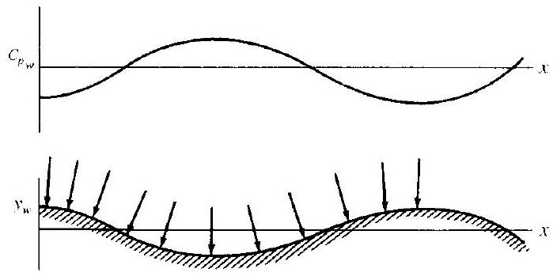
Figure 9.6 I Schematic of pressure variation on a wavy wall over which a subsonic flow is moving.

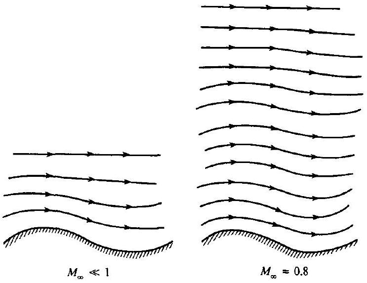
Figure 9.7 I Linearized subsonic flow over a wavy wall; effects of compressibility on streamline shapes.

With regard to the Mach number effects on both the flowfield and $C_{p_{w}}$, first consider Eq. (E.18), which shows that

$$
\phi \propto \frac{1}{\sqrt{1-M_{\infty}^{2}}} \exp \left(\frac{-2 \pi \sqrt{1-M_{\infty}^{2}} y}{l}\right)
$$

Thus, for any fixed subsonic value of $M_{\infty}, \phi \rightarrow 0$ as $y \rightarrow \infty$. That is, the disturbances introduced by the presence of the wall virtually disappear at large distances from the wall-they attenuate with distance. However, the distance to which a disturbance of a given magnitude reaches out, away from the wall, increases with increasing $M_{\infty}$, as can be seen from the above proportionality. Thus, in a subsonic flow, as $M_{\infty}$ increases, the disturbances reach out further from the wall. This is shown schematically in Fig. 9.7, which compares streamlines between low and high subsonic Mach numbers.

The most important effect of Mach number in a subsonic flow is, by far, its influence on surface pressure coefficient, as demonstrated by Eq. (E.21):

$$
C_{p_{u}} \propto \frac{1}{\sqrt{1-M_{\infty}^{2}}}
$$

Let $M_{\infty_{1}}$ and $M_{\infty_{2}}$ be two different free-stream Mach numbers. Then, from Eq. (E.21),

$$
\frac{\left(C_{p_{w}}\right)_{M_{\infty_{1}}}}{\left(C_{p_{w}}\right)_{M_{\infty_{2}}}}=\sqrt{\frac{1-M_{\infty_{2}}^{2}}{1-M_{\infty 1}^{2}}}
$$

Furthermore, if $M_{\infty 2} \approx 0$, which corresponds to incompressible flow, then Eq. (E.22) yields

$$
C_{p_{w}}=\frac{\left(C_{p_{w}}\right)_{o}}{\sqrt{1-M_{\infty}^{2}}}
$$

which is the Prandtl-Glauert rule derived earlier.

At the end of Example 9.1, the statement was made that $M_{\infty} \approx 0$ corresponds to incompressible flow. This provides a good opportunity to examine a physical (or should we say "metaphysical") implication of incompressible flow. Precisely speaking, for a purely incompressible flow, the Mach number is precisely zero, $M=0$. At first thought, how can this be? Incompressible flows have a finite velocity, or else there would be no "flow." But a finite velocity does not necessarily mean a finite Mach number. An incompressible flow is a constant density flow, hence, from Eq. (1.5), where $d \rho=0$, the compressibility $\tau=0$. In turn, from Eq. (3.18), the speed of sound is infinite in an incompressible flow. Since $M=V / a$, the Mach number in a purely incompressible flow is always zero, even though $V$ is finite. This result is consistent with the definitions of an incompressible flow. From time to time you will see results in the literature for flows labeled as $M=0$. Just recognize that this is a label for incompressible flow results. In retrospect, the paradox discussed here is a consequence of the fact that purely incompressible flow is a myth-it does not exist in nature. It is simply an intellectual construct made by human beings to model a class of real flows in nature that closely resemble a defined incompressible flow.

### 9.5 I IMPROVED COMPRESSIBILITY CORRECTIONS

Linearized solutions are influenced predominantly by free-stream conditions; they do not fully recognize changes in local regions of the flow. Such local changes are basically nonlinear phenomena. For example, as shown in Sec. 7.5, the wave velocity of each portion of a linearized acoustic wave propagates at the free-stream speed of sound $a_{\infty}$. Later in Chap. 7 we saw the true case where each element of a finite wave propagates at the local value of $u \pm a$, and therefore the wave shape distorts in the process-a nonlinear phenomena. Another example is contained in Sec. 9.4. Linearized subsonic flow is governed by $M_{\infty}$, not the local Mach number $M$. Witness Eqs. (9.36) through (9.37), where $M_{\infty}$ is the dominant parameter.

In an effort to obtain an improved compressibility correction, Laitone (see Ref. 23 ) applied Eq. ( 9.36 ) locally in the flow, i.e.,

$$
C_{p}=\frac{C_{p}}{\sqrt{1-M^{2}}}
$$

where $M$ is the local Mach number. In turn, $M$ can be related to $M_{\infty}$ and the pressure coefficient through the isentropic flow relations. The resulting compressibility correction is

$$
C_{p}=\frac{C_{p_{t}}}{\sqrt{1-M_{\infty}^{2}}+\left[M_{\infty}^{2}\left(1+\frac{\gamma-1}{2} M_{\infty}^{2}\right) / 2 \sqrt{1-M_{\infty}^{2}}\right] C_{p_{t}}}
$$

Note that, as $C_{p_{o}}$ becomes small, Eq. (9.39) approaches the Prandtl-Glauert rule.
Another compressibility correction that has been adopted widely is that due to von Karman and Tsien (see Refs. 24 and 25). Utilizing a hodograph solution of the
nonlinear equations of motion along with a simplified "tangent gas" equation of state, this result was obtained:

$$
C_{p}=\frac{C_{p_{o}}}{\sqrt{1-M_{\infty}^{2}}+\left(\frac{M_{\infty}^{2}}{1+\sqrt{1-M_{\infty}^{2}}}\right) \frac{C_{p_{o}}}{2}}
$$

Equation (9.40) is called the Karman-Tsien rule.
Figure 9.8 contains experimental measurements of the $C_{p}$ variation with $M_{\infty}$ at the 0.3 chord location on an NACA 4412 airfoil; these measurements are compared

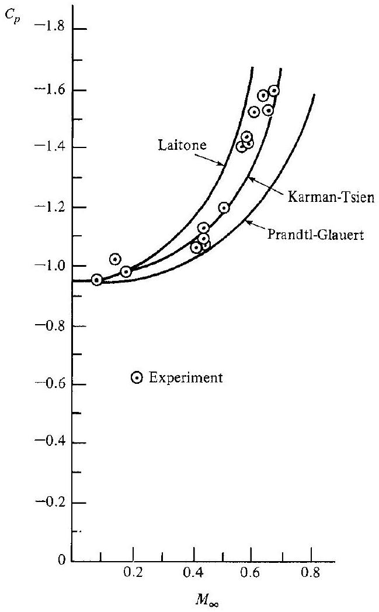
Figure 9.8 I Comparison of several compressibility corrections with experiment for an NACA 4412 airfoil at an angle of attack $\alpha=1^{\circ} 53^{\prime}$. The experimental data are chosen for their historical significance; they are from John Stack, W. F. Lindsey, and Robert E. Littell. "The compressibility Burble and the Effect of Compressibility on Pressures and Forces Acting on an Airfoil." NACA Report No. 646, 1938. This was the first major NACA publication to address the compressibility problem in a systematic fashion; it covered work performed in the 24 -in-high speed tunnel at Langley Aeronautical Laboratory and was carried out during 1935-1936.

with the Prandtl-Glauert, Laitone, and Karman--Tsien rules. Note that the PrandtlGlauert rule, although the simplest to apply, underpredicts the experimental values, whereas the improved compressibility corrections are clearly more accurate. This is because both the Laitone and Karman-Tsien rules bring in the nonlinear aspects of the flow.

## 9.6 | LINEARIZED SUPERSONIC FLOW

From Eq. (9.6) the linearized perturbation-velocity potential equation for twodimensional flow takes the form of

$$
\beta^{2} \phi_{x x}+\phi_{y y}=0
$$

for subsonic flow, where $\beta=\sqrt{1-M_{\infty}^{2}}$, and the form of

$$
\lambda^{2} \phi_{x x}-\phi_{y y}=0
$$

for supersonic flow, where $\lambda=\sqrt{M_{\infty}^{2}-1}$. The difference between Eqs. (9.41) and (9.42) is fundamental, for they are elliptic and hyperbolic partial differential equations, respectively. A discussion of the distinction between elliptic and hyperbolic equations is deferred until Chap. 11; suffice it to say here that the equations reflect fundamental physical differences between subsonic and supersonic flowsdifferences which will be highlighted in this and subsequent sections.

Consider the supersonic flow over a body or surface which introduces small changes in the flowfield, i.e., flow over a thin airfoil, over a mildly wavy wall, or over a small hump in a surface. The latter is sketched in Fig. 9.9. Equation (9.42), which

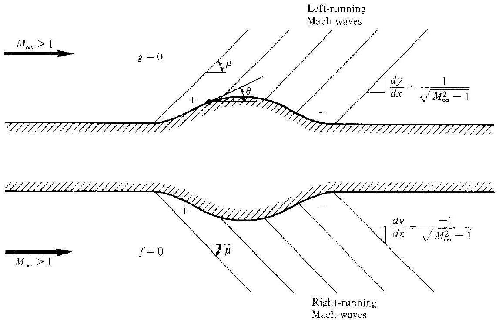
Figure 9.9 I Linearized supersonic flow over a bump.

governs this flow, is of the form of the classical wave equation first discussed in Sec. 7.5 in conjunction with acoustic theory. Its general solution is

$$
\phi=f(x-\lambda y)+g(x+\lambda y)
$$

which can be verified by direct substitution into Eq. (9.42). Examining the particular solution where $g=0$, and hence $\phi=f(x-\lambda y)$, we see that lines of constant $\phi$ correspond to $x-\lambda y=$ const, or

$$
\frac{d y}{d x}=\frac{1}{\lambda}=\frac{1}{\sqrt{M_{\infty}^{2}-1}}
$$

Recalling that the Mach angle $\mu=\arcsin \left(1 / M_{\infty}\right)=\arctan \left(1 / \sqrt{M_{\infty}^{2}-1}\right)$. Eq. (9.44) states that lines of constant $\phi$ are the family of left-running Mach lines, as sketched in the upper half of Fig. 9.9. In turn, if $f=0$ in Eq. (9.43), then lines of constant $\phi$ are the family of right-running Mach lines shown in the lower half of Fig.9.9.

Hence, Fig. 9.9 illustrates a basic physical difference between subsonic and supersonic flow. When $M_{\infty}<1$, it was shown in Sec. 9.4 that disturbances propagate everywhere in the flowfield, including upstream as well as downstream. In contrast, for $M_{\infty}>1$. Fig. 9.9 illustrates that weak disturbances propagate along Mach lines, and hence the flowfield upstream of a disturbance does not feel the presence of the disturbance. In steady supersonic flows, disturbances do not propagate upstream; they are limited to a region downstream of the source of disturbance.

Returning to Eq. (9.43), letting $g=0$, we have

Hence,

$$
\begin{aligned}
\phi & =f(x-\lambda y) \\
u^{\prime} & =\frac{\partial \phi}{\partial x}=f^{\prime}
\end{aligned}
$$

and

$$
v^{\prime}=\frac{\partial \phi}{\partial y}=-\lambda f^{\prime}
$$

where $f^{\prime}$ represents the derivative with respect to the argument, ( $x-\lambda y$ ). Combining Eqs. (9.45) and (9.46),

$$
u^{\prime}=-\frac{v^{\prime}}{\lambda}
$$

Equation (9.18) gives the boundary condition on the surface as

$$
\tan \theta=\frac{d y}{d x}=\frac{v^{\prime}}{V_{\infty}+u^{\prime}}
$$

For small perturbations, $u^{\prime} \ll V_{\infty}$ and $\tan \theta \approx \theta$. Hence, Eq. (9.48) becomes

$$
v^{\prime}=V_{\infty} \theta
$$

Substituting Eq. (9.49) into (9.47),

$$
u^{\prime}=-\frac{V_{\infty} \theta}{\lambda}
$$

Therefore, from Eqs. (9.17) and (9.50), the pressure coefficient on the surface is
or

$$
\begin{aligned}
& C_{p}=-\frac{2 u^{\prime}}{V_{\infty}}=\frac{2 \theta}{\lambda} \\
& C_{p}=\frac{2 \theta}{\sqrt{M_{\infty}^{2}-1}}
\end{aligned}
$$

Equation (9.51) is an important result. It is the linearized supersonic surface pressure coefficient, and it states that $C_{P}$ is directly proportional to the local surface inclination with respect to the free stream. It holds for any slender two-dimensional shape. For example, consider the biconvex airfoil shown in Fig. 9.10. At two arbitrary points $A$ and $B$ on the top surface,

$$
C_{p A}=\frac{2 \theta_{A}}{\sqrt{M_{\infty}^{2}-1}} \quad \text { and } \quad C_{p B}=\frac{2 \theta_{B}}{\sqrt{M_{\infty}^{2}-1}}
$$

respectively. Note in Fig. 9.10 that $\theta_{A}$ is positive and $\theta_{B}$ is negative, and hence $C_{p}$ varies from positive on the forward surface to negative on the rearward surface. This is consistent with our earlier discussions in Chap. 4: We know from inspection of

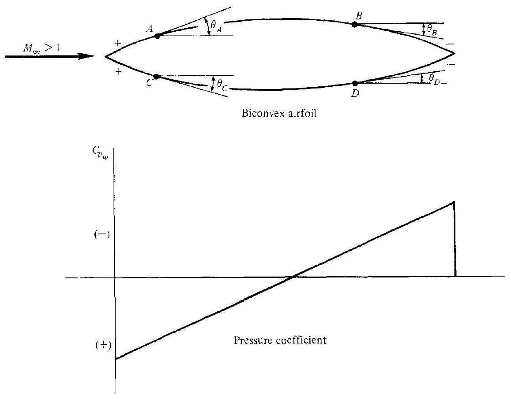
Figure 9.10 1 Schematic of the linearized pressure coefficient over a biconvex airfoil.

Fig. 9.10 that the front and rear surfaces are compression and expansion surfaces, respectively.

Equation (9.51) was derived by setting $g=0$ in Eq. (9.43). Thus it holds for a surface generating a family of left-running waves, i.e., the top surfaces in Figs. 9.9 and 9.10. If we set $f=0$ in Eq. (9.43), the surface pressure coefficient becomes

$$
C_{p}=\frac{-2 \theta}{\sqrt{M_{\infty}^{2}-1}}
$$

which holds for a surface generating right-running waves, i.e., the bottom surfaces in Figs. 9.9 and 9.10. In both Eqs. (9.51) and (9.52), $\theta$ is measured positive above the local flow direction and negative below the local flow direction. Hence, on the bottom surface of the biconvex airfoil in Fig. 9.10, $\theta_{C}$ is negative and $\theta_{D}$ is positive. In conjunction with Eq. (9.52), this still yields a positive $C_{p}$ on the forward compression surface and a negative $C_{p}$ on the rearward expansion surface.

There is no real need to worry about the formal sign conventions mentioned above. For any practical application, this author suggests the use of Eq. (9.51) along with common sense to single out the compression and expansion surfaces on a body. If the surface is a compression surface, $C_{p}$ from Eq. (9.51) must be positive, no matter whether the surface is on the top or bottom of the body. Similarly, if the surface is an expansion surface, $C_{p}$ from Eq. (9.51) must be negative.

This leads to another basic difference between subsonic and supersonic inviscid flows. Recall that, for $M_{\infty}<1$, a two-dimensional body experiences no drag. For $M_{\infty}>1$, however, as denoted by the + and - signs in Figs. 9.9 and 9.10, $C_{p}$ is positive on the front surfaces and negative on the rear surface. Consequently, there is a net pressure imbalance which creates a drag force on the body. This force is the wave drag, first introduced in Sec. 4.15. Although shock waves do not appear explicitly within the framework of linearized theory, their consequence in terms of wave drag are reflected in the linearized results. Hence, d'Alembert's paradox does not apply to supersonic flows.

Further contrast between subsonic and supersonic flows is seen by comparing Eqs. (9.36) and (9.51). In subsonic flow, Eq. (9.36) shows that $C_{p}$ increases when $M_{\infty}$ increases. However, for supersonic flow, Eq. (9.51) shows that $C_{p}$ decreases when $M_{\infty}$ increases. These important trends are illustrated in Fig. 9.11.

Finally, to examine the accuracy of Eq. (9.51), Fig. 9.12 compares linearized theory with exact results for $C_{p}$ on the surface of a wedge of semiangle $\theta$. The exact results are obtained from oblique shock theory as described in Chap. 4. Note that the agreement between exact and linear theories is good at small $\theta$, but deteriorates rapidly as $\theta$ increases. For $M_{\infty}=2$ as shown in Fig. 9.11, linearized theory yields reasonably accurate results for $C_{p}$ when $\theta<4^{\circ}$.

Although the linearized pressure distribution from Eq. (9.51) becomes inaccurate beyond a deflection angle of approximately $4^{\circ}$, when it is integrated over the surface of an airfoil, these inaccuracies tend to compensate over the top and bottom surfaces. As a result the linearized values for $C_{L}$ and $C_{D}$ are more accurate at larger angles of attack than one would initially expect. Some of these trends are illustrated in the problems at the end of this chapter.

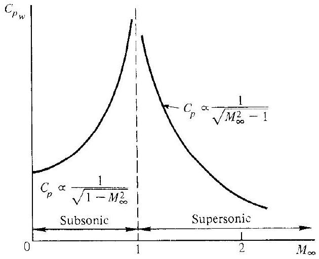
Figure 9.11 I Variation of the linearized pressure coefficient with Mach number.

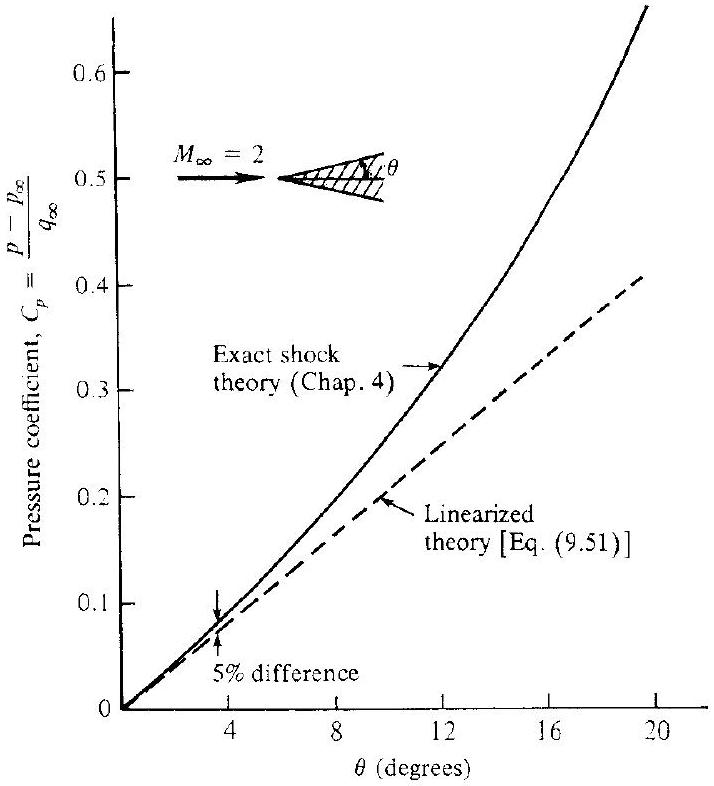
Figure 9.12 | Comparison between linearized theory and exact shock results for the pressure on a wedge in supersonic flow.

Consider a supersonic flow with an upstream Mach number of $M_{\chi}$. This flow moves over the same wavy wall as first shown in Fig. 9.5, and as given in Example 9.1. For small $h$, use linear theory to derive an equation for the velocity potential and surface pressure coefficient.

## - Solution

From Eq. (9.42),

$$
\frac{\partial^{2} \phi}{\partial x}-\frac{1}{\left(M_{\infty}^{2}-1\right)} \frac{\partial^{2} \phi}{\partial y^{2}}=0
$$

Keeping in mind that $\left(M_{\infty}^{2}-1\right)>0$ for supersonic flow, compare Eq. (G.1) with Eq. (7.42), which was identified as the classical wave equation. We see that Eq. (G.1) is also of the form of the simple wave equation. Hence, a solution to Eq. (G.1) can be expressed as

$$
\phi(x, y)=f\left(x-\sqrt{M_{\infty}^{2}-1} y\right)+g\left(x+\sqrt{M_{\infty}^{2}-1} y\right)
$$

Let $g=0$. Then Eq. (G.2) becomes
and

$$
\begin{aligned}
\phi(x, y) & =f\left(x-\sqrt{M_{\infty}^{2}-1} y\right) \\
\frac{\partial \phi}{\partial y} & =\left[f^{\prime}\left(x-\sqrt{M_{\infty}^{2}-1} y\right)\right]\left(-\sqrt{M_{\infty}^{2}-1}\right)
\end{aligned}
$$

where $f^{\prime}$ denotes the derivative of $f$ with respect to its argument, ( $x-\sqrt{M_{\infty}^{2}-1} y$ ). Recall the boundary conditions at the wall discussed in Sec. 9.4:

$$
\frac{\partial \phi}{\partial y}=V_{\infty} \frac{d y_{w}}{d x}
$$

Thus

$$
\sqrt{M_{\infty}^{2}-1} f^{\prime}(x)=V_{\infty} h\left(\frac{2 \pi}{l}\right) \sin \left(\frac{2 \pi x}{l}\right)
$$

where Eq. (G.5) holds at the wall. Thus, from Eq. (G.5),

$$
f^{\prime}(x)=\frac{V_{\infty} h}{\sqrt{M_{\infty}^{2}-1}}\left(\frac{2 \pi}{l}\right) \sin \left(\frac{2 \pi x}{l}\right)
$$

Integrating Eq. (G.6) with respect to its argument [note that the argument is ( $x-\sqrt{M_{\infty}^{2}-1} y$ ), but with $y=0]$, we have

$$
f(x)=-\frac{V_{\infty} h}{\sqrt{M_{\infty}^{2}-1}} \cos \left(\frac{2 \pi x}{l}\right)+\mathrm{const}
$$

Since $f(x)$ is defined throughout the flow, not just at the wall, and because it has the form of Eq. (G.7), where $x$ represents the argument of $f$, then Eq. (G.3) can be written as

$$
\begin{aligned}
\phi(x, y) & =f\left(x-\sqrt{M_{\infty}^{2}-1} y\right) \\
& =-\frac{V_{\infty} h}{\sqrt{M_{\infty}^{2}-1}} \cos \left[\frac{2 \pi}{l}\left(x-\sqrt{M_{\infty}^{2}-1} y\right)\right]+\mathrm{const}
\end{aligned}
$$

Therefore, from Eqs. (9.17) and (G.8)

$$
C_{p}=-\frac{2 u^{\prime}}{V_{\infty}}=-\frac{2}{V_{\infty}} \frac{\partial \phi}{\partial x}=-\frac{4 \pi}{\sqrt{M_{\infty}^{2}-1}}\left(\frac{h}{l}\right) \sin \left[\frac{2 \pi}{l}\left(x-\sqrt{M_{\infty}^{2}-1} y\right)\right]
$$

At the wall, Eq. (G.9) becomes

$$
C_{p_{u}}=-\frac{4 \pi}{\sqrt{M_{2}^{2}-1}}\left(\frac{h}{l}\right) \sin \left(\frac{2 \pi x}{l}\right)
$$

Equations (G.8) through (G.10) represent the solution for the linearized supersonic flow over a wavy wall.

Let us examine these results closely. First, in contrast to the previous results for subsonic flow, no exponential attenuation factor occurs. For supersonic flow, the perturbations do not disappear at $y \rightarrow \infty$. Moreover, the magnitude of a disturbance (magnitude of $\phi$ or $C_{p}$, for example) is constant for $\left(x-\sqrt{M_{\alpha}^{2}-1} y\right)=$ const. That is, the effect of the wall is propagated to infinity with constant strength along the lines $x-\sqrt{M_{x}^{2}-1} y=$ const. Hence, these lines have a slope

$$
\frac{d y}{d x}=\frac{1}{\sqrt{M_{\varkappa}^{2}-1}}
$$

and are therefore identical to Mach lines, with the angle $\mu$ to the free-stream direction.

$$
\mu=\sin ^{-1}\left(\frac{1}{M_{\infty}}\right)
$$

These lines are sketched in Fig. 9.13 where they are also identified as characteristic lines. The proof that Mach lines are indeed the same as characteristic lines in the sense defined in Chap. 7 will be made in Chap. 11. We simply note the fact here. Also note, in contrast to

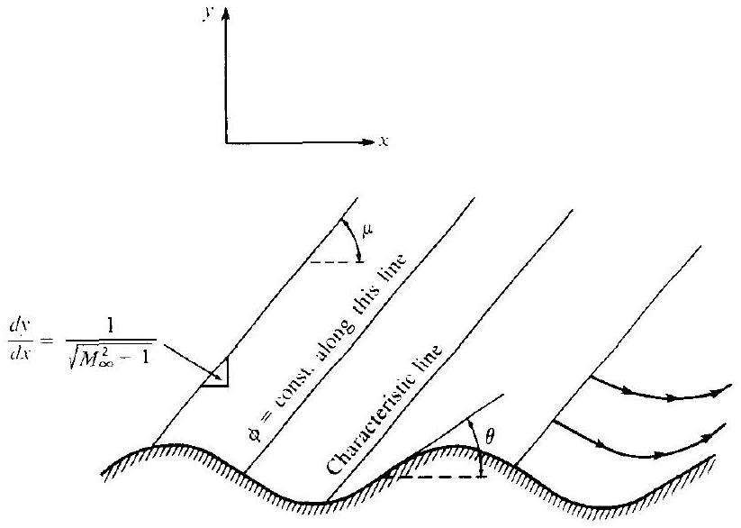
Figure 9.131 Linearized supersonic flow over a wavy wall.

subsonic flow, that Eq. (G.8) yields streamlines that are unsymmetrical about a vertical line through a crest or trough of the wall. Instead, the streamlines remain geometrically similar between two inclined Mach waves, as sketched in Fig. 9.13.

Two additional physical results of great importance can be interpreted from Eq. (G.10). First, note that unlike subsonic flow, the surface pressure distribution is no longer symmetrical about the wall [Eq. (G.10) is a sine variation, whereas the wall is a cosine shape]. Hence, for supersonic flow, the surface pressure distributions do not cancel in the $x$ direction; instead, there is a net force in the $x$ direction, in the same direction as the free stream. This force is called wave drag.

Second, Eq. (G.10) for the pressure coefficient can be couched in a simpler form by noting that the equation of the wall is

$$
y_{w}=h \cos \left(\frac{2 \pi x}{l}\right)
$$

Hence,

$$
\frac{d y_{w}}{d x}=-2 \pi\left(\frac{h}{l}\right) \sin \left(\frac{2 \pi x}{l}\right)
$$

Combining Eqs. (G.10) and (G.11),

$$
C_{p}=\frac{2\left(\frac{d y_{w}}{d x}\right)}{\sqrt{M_{\infty}^{2}-1}}
$$

However, letting $\theta$ denote the angle of the wall as sketched in the Fig. 9.13, at any point on the surface,

$$
\tan \theta=\frac{d y_{w}}{d x}
$$

Compatible with linearized theory, which assumes small perturbations, i.e., slender bodies, $\theta$ is assumed small. Hence, from Eq. (G.13)

$$
\tan \theta=\frac{d y_{w}}{d x} \simeq \theta
$$

Thus, combining Eqs. (G.12) and (G.14),

$$
C_{p_{w}}=\frac{2 \theta}{\sqrt{M_{\infty}^{2}-1}}
$$

Equation (G.15) is the same as Eq. (9.51) derived earlier.

## 9.7 | CRITICAL MACH NUMBER

Consider an airfoil at low subsonic speed with a free-stream Mach number $M_{\infty}=0.3$, as shown in Fig. 9.14a. The flow expands around the top surface of the airfoil, dropping to a minimum pressure at point $A$. At this point, the local Mach

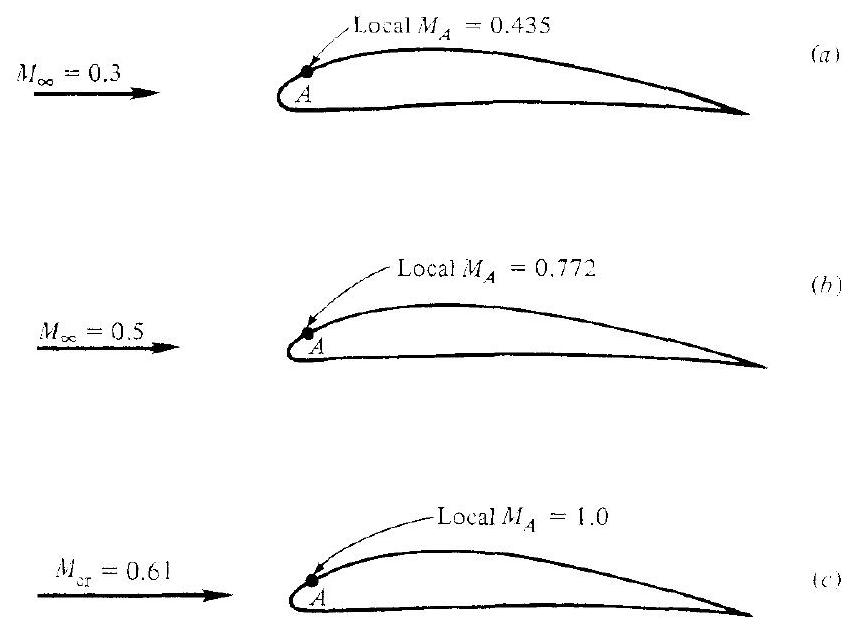
Figure 9.14 | Definition of critical Mach number. Point $A$ is the location of minimum pressure on the top surface of the airfoil.

number on the surface will be a maximum, in this case $M_{A}=0.435$. Now assume that we increase $M_{\infty}$ to 0.5 . The local Mach number at the minimum pressure point will correspondingly increase to 0.772 , as shown in Fig. 9.14b. Now let us increase $M_{\infty}$ to just the right value such that $M_{A}=1.0$ at the minimum-pressure point. This value is $M_{\infty}=0.61$, as shown in Fig. 9.14c. When this occurs, $M_{\infty}$ is called the critical Mach number, $M_{\mathrm{cr}}$. By definition, the critical Mach number is that free-stream Mach number at which sonic flow is first encountered on the airfoil.

The critical Mach number can be calculated as follows. Assuming isentropic flow throughout the flowfield, Eq. (3.30) gives

$$
\frac{p_{A}}{p_{\infty}}=\left(\frac{1+\frac{\gamma-1}{2} M_{\infty}^{2}}{1+\frac{\gamma-1}{2} M_{A}^{2}}\right)^{\gamma /(\gamma-1)}
$$

Combining Eqs. (9.10) and (9.53), the pressure coefficient at point $A$ is

$$
C_{p A}=\frac{2}{\gamma M_{\infty}^{2}}\left[\left(\frac{1+\frac{\gamma-1}{2} M_{\infty}^{2}}{1+\frac{\gamma-1}{2} M_{A}^{2}}\right)^{\gamma /(\gamma-1)}-1\right]
$$

From Eq. (9.54), for a given $M_{\infty}$ the values of local pressure coefficient and local Mach number are uniquely related at any given point $A$. Now assume as before that point $A$ is the minimum-pressure (hence maximum-velocity) point on the airfoil. Furthermore, assume $M_{A}=1$. Then, by definition, $M_{\infty} \equiv M_{\mathrm{cr}}$. Also, for this case the value of the pressure coefficient is defined as the critical pressure coefficient $C_{p_{\text {er }}}$.

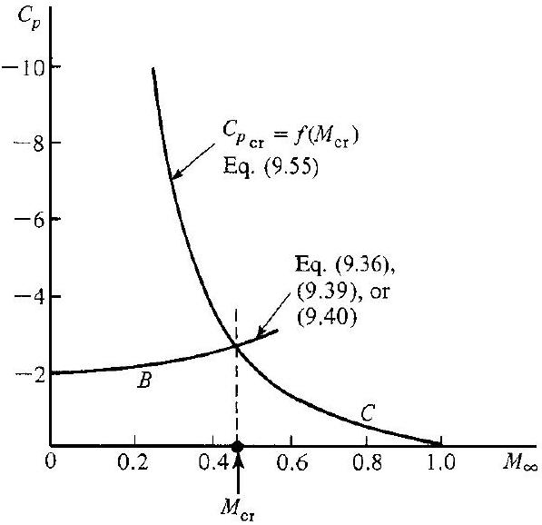
Figure 9.15 I Calculation of critical Mach number.

Setting $M_{A}=1, M_{\infty}=M_{\mathrm{cr}}$, and $C_{p} \equiv C_{p_{\mathrm{cr}}}$ in Eq. (9.54), we obtain

$$
C_{p_{\mathrm{cr}}}=\frac{2}{\gamma M_{\mathrm{cr}}^{2}}\left[\left(\frac{1+\frac{\gamma-1}{2} M_{\mathrm{cr}}^{2}}{1+\frac{\gamma-1}{2}}\right)^{\gamma /(\gamma-1)}-1\right]
$$

Note that $C_{p_{\mathrm{cr}}}$ is a unique function of $M_{\mathrm{cr}}$; this variation is plotted as curve $C$ in Fig. 9.15.

Equation (9.55), along with one of the compressibility rules such as Eqs. (9.36), (9.39), or (9.40), provides enough tools to calculate the critical Mach number for a given airfoil:

1. Obtain as given data a measured or calculated value of the incompressible pressure coefficient at the minimum pressure point, $C_{p_{0}}$.
2. Using one of the compressibility corrections, plot $C_{p}$ as a function of $M_{\infty}$, shown as curve $B$ in Fig. 9.15.
3. Using Eq. (9.55) plot $C_{p_{\mathrm{cr}}}$ as a function of $M_{\mathrm{cr}}$, shown as curve $C$ in Fig. 9.15.
4. The intersection of curves $B$ and $C$ defines the critical Mach number for the given airfoil.

Note in Fig. 9.15 that curve $C$ [from Eq. (9.55)] is a result of the fundamental gasdynamics of the flow; it is unique, and does not depend on the size or shape of the airfoil. In contrast, curve $B$ is different for different airfoils. For example, consider two airfoils, one thin and one thick. For the thin airfoil, the flow experiences only a mild expansion over the top surface, and hence $\left|C_{p_{o}}\right|$ is small. Combined with the chosen
compressibility correction, curve $B$ in Fig. 9.15 is low on the graph, resulting in a high value of $M_{\mathrm{cr}}$. For the thick airfoil, $\left|C_{p_{0}}\right|$ is naturally larger because the flow experiences a stronger expansion over the top surface. Curve $B$ is higher on the graph, resulting in a lower value of $M_{\mathrm{cr}}$. Hence, an airfoil designed for a high critical Mach number must have a thin profile.

When the free-stream Mach number exceeds $M_{\mathrm{cr}}$, a finite region of supersonic flow exists on the top surface of the airfoil. At a high enough subsonic Mach number, this embedded supersonic region will be terminated by a weak shock wave. The total pressure loss associated with the shock will be small; however, the adverse pressure gradient induced by the shock tends to separate the boundary layer on the top surface, causing a large pressure drag. The net result is a dramatic increase in drag. The free-stream Mach number at which the large drag rise begins is defined as the drag-divergence Mach number; it is always slightly larger than $M_{\mathrm{cr}}$. The massive increase in drag encountered at the drag-divergence Mach number is the technical base of the "sound barrier" which was viewed with much trepidation before 1947.

The relationship between the critical Mach number, the drag-divergence Mach number, and Mach one is sketched in Fig. 9.16, which shows the qualitative variation of the drag coefficient for a given shaped body (such as an airfoil, wing, or whole airplane) as a function of free-stream Mach number. At low subsonic speeds, the drag coefficient is relatively constant as $M_{\infty}$ increases. Point $a$ denotes the critical Mach number. As $M_{\infty}$ is increased slightly above $M_{\mathrm{cr}}, C_{D}$ remains constant. Then, at some value of $M_{\infty}$ slightly larger than $M_{\mathrm{cr}}$, the value of $C_{D}$ skyrockets. The free-stream Mach number at which this large drag increase occurs is the drag-divergence Mach number, denoted by point $b$ in Fig. 9.16.

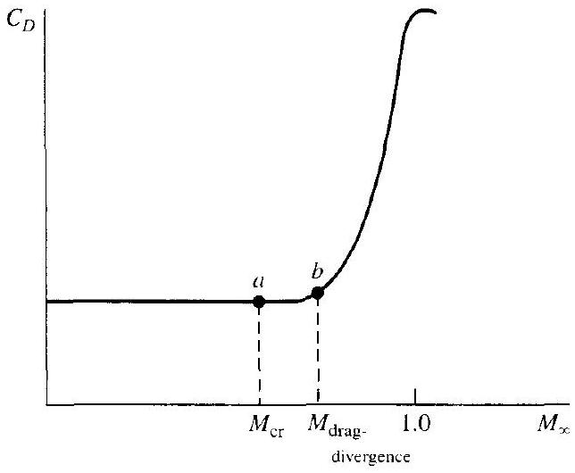
Figure 9.16 I Generic sketch of the variation of drag coefficient with freestream Mach number, showing the relative locations of the critical Mach number and the drag-divergence Mach number, both of which are less than Mach one.

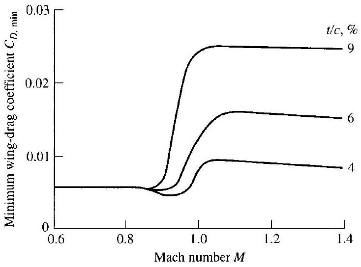
Figure 9.17 | Variation of minimum wing drag coefficient versus Mach number with airfoil thickness ratio as a parameter. The wing is swept, with a sweep angle of 47 degrees. (From Loftin, Quest for Performance, NASA SP 468, 1985.)

For purposes of discussion, consider the wing of an airplane. In most cases, if something is done during the design of the wing to increase $M_{\mathrm{cr}}$, then usually the value of $M_{\text {drag-divergence }}$ also increases. This is a good thing, because the wing can fly closer to Mach one before the large drag rise is encountered. In airplane design, there have been two classic features employed to increase $M_{\text {cr }}$, hence, $M_{\text {drag-divergence }}$. The first simply is to make the wing thinner. As already discussed, a thinner airfoil will have a higher $M_{\mathrm{cr}}$ than a thicker airfoil, everything else being equal. This is reinforced by the wind tunnel data shown in Fig. 9.17, where the drag coefficient is plotted versus free-stream Mach number for three wings with three different thicknesses. Note the particularly large drag rise encountered by the wing with 9 percent thickness-to-chord ratio, and that it occurs at a value of $M_{\text {drag-divergence }}$ of about 0.88 . By reducing the wing thickness to 6 and 4 percent, the magnitude of the drag rise is progressively reduced, and the value of $M_{\text {drag divergence }}$ is progressively increased, moving closer to Mach one.

The other classic design feature used to increase $M_{\text {cr }}$ is to sweep the wing. To see how wing sweep increases the critical Mach number of the wing, first consider a straight wing, a portion of which is sketched in Fig. 9.18a. We define a straight wing as one for which the midchord line is perpendicular to the free stream; this is certainly the case for the rectangular planform shown in Fig. 9.18a. Assume the straight wing has an airfoil section with a thickness-to-chord ratio of 0.15 , as shown at the left of Fig. 9.18a. Streamline $A B$ flowing over this wing sees the airfoil with $t_{1} / c_{1}=0.15$. Now consider the same wing swept back through the angle $\Lambda=45^{\circ}$, as shown in Fig. 9.18b. Streamline CD, which flows over this wing (ignoring any three-dimensional curvature effects), sees an effective airfoil shape with the same

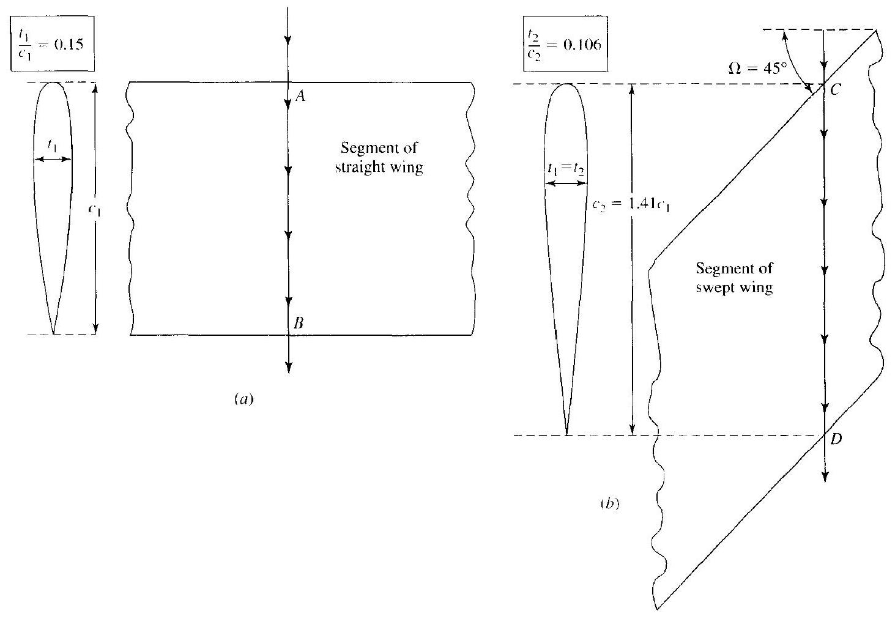
Figure 9.18 । By sweeping the wing, a streamline effectively sees a thinner airfoil, hence increasing the critical Mach number of the wing.

thickness as before ( $t_{2}=t_{1}$ ), but the effective chord length $c_{2}$ is longer by a factor of 1.41 (i.e., $c_{2}=1.41 c_{1}$ ). This makes the effective thickness-to-chord ratio seen by streamline $C D$ equal to $t_{2} / c_{2}=0.106$-thinner by almost one-third compared to the straight-wing case. Hence, by sweeping the wing, the flow behaves as if the airfoil section is thinner, with a consequent increase in the critical Mach number of the wing. Everything else being equal, a swept wing has a larger critical Mach number, hence a large drag-divergence Mach number than a straight wing. For this reason, most high-speed airplanes designed since the middle 1940s have swept wings. (The only reason why the Bell X-1, shown in Fig. 1.9, had straight wings is because its design commenced in 1944 before any knowledge or data about swept wings was available in the United States. Later, when such swept-wing data flooded into the United States from Germany in mid-1945, the Bell designers were conservative, and stuck with the straight wing.) A wonderful example of an early swept-wing fighter is the North American F-86 of Korean War vintage, shown in Fig. 9.19.

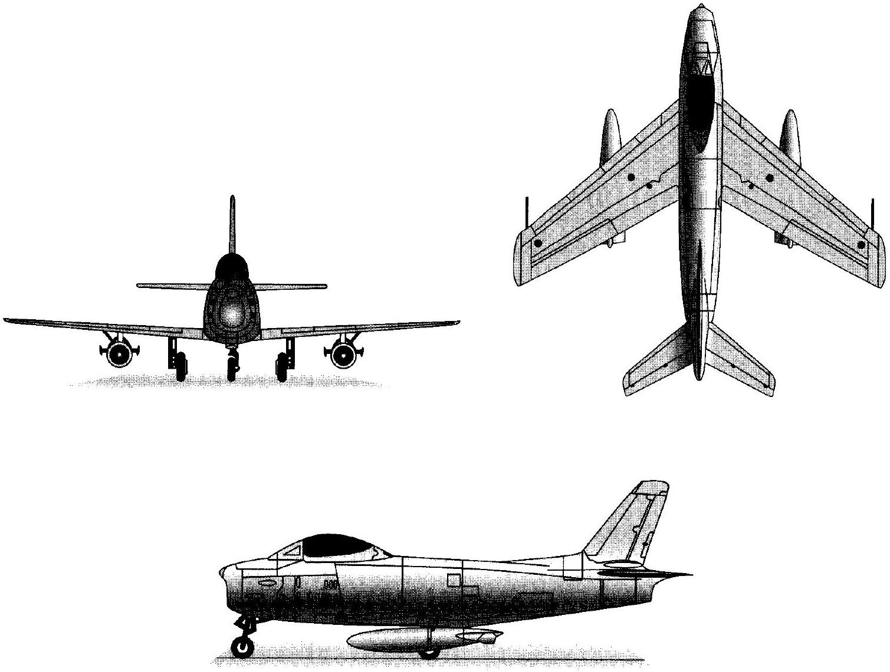
Figure 9.19 | A typical example of a swept-wing aircraft. The North American F-86 Sabre of Korean War fame.

### 9.8 I SUMMARY

This chapter has presented some of the technical aspects of subsonic and supersonic linearized flow for two-dimensional bodies and wall geometries. Closed-form analytical results have been obtained which illustrate important physical trends, and which dramatically contrast some fundamental differences between subsonic and supersonic flow. Although modern numerical techniques now exist for the accurate solution of flows with complex geometry (to be discussed in subsequent chapters), linearized solutions still play an important role in the whole spectrum of modern compressible flow.

Finally, it should be noted that linearized theory has also been applied to threedimensional flows, yielding results for slender bodies of revolution at small angles of attack, and for finite wings. Although space will not be devoted in this book to such
three-dimensional linearized flows, the reader is strongly encouraged to study this aspect in the classical literature. (See, for example, Refs. 5, 6, and 9.)

## 9.9 | HISTORICAL NOTE: THE 1935 VOLTA CONFERENCE-THRESHOLD TO MODERN COMPRESSIBLE FLOW; WITH ASSOCIATED EVENTS BEFORE AND AFTER

Some of the threads of the early history of compressible flow have already been established in previous chapters. We have seen in Sec. 3.10 how normal shock wave theory was well established by Rankine and Hugoniot in the latter half of the nineteenth century, and capped off by Rayleigh and Taylor in 1910. This work was extended to two dimensions by Prandtl and Meyer during the period from 1905 to 1908, when they developed and presented the fundamentals of both oblique shock and expansion wave theories for supersonic flow (see Sec. 4.16). Moreover, the basic properties of quasi-one-dimensional flow through supersonic nozzles were examined by de Laval in the 1880s and 1890s, and by Stodola and Prandtl in the first decade of the twentieth century. (See Secs. 4.16, 5.8, and 5.9.) However, at this time the only practical application of such work was in the design and analysis of steam turbinessupersonic wind tunnels, rocket engines, and high-speed aircraft were still far in the future.

The next major contribution to the advancement of compressible flow theory occurred in the 1920s. Although the flight speeds of all airplanes at that time were comfortably within the realm of incompressible flow (less than $100 \mathrm{~m} / \mathrm{s}$ ), the tip speeds of propellers regularly approached the speed of sound. This promoted an early interest in the effect of compressibility on propeller airfoils. As early as 1922, Prandtl is quoted as stating that the lift coefficient increased according to $\left(1-M_{\infty}^{2}\right)^{-1 / 2}$; he mentioned this conclusion in his lectures at Göttingen, but without written proof. This result was mentioned again 6 years later by Jacob Ackeret, a colleague of Prandtl, in the famous German series Handbuch der Physik, again without proof. Subsequently, the concept was formally established by H. Glauert in 1928. Using only six pages in the Proceedings of the Royal Society. Glauert presented a derivation based on linearized small-perturbation theory (similar to that described in Sec. 9.4), which confirmed the $\left(1-M_{\infty}^{2}\right)^{-1 / 2}$ variation. In this paper, entitled "The Effect of Compressibility on the Lift of an Airfoil," vol. 118, p. 113. Glauert derived the famous Prandtl-Glauert compressibility correction given here as Eqs. (9.36) and (9.37). This result was to stand alone, unaltered, for the next 10 years.

The next major advance in compressible flow theory involved the calculation of properties on a sharp right-circular cone in supersonic flow. (This will be the subject of Chap. 10.) In 1928, Adolf Busemann, a colleague of Prandtl's at Göttingen, arrived at a graphical solution for supersonic conical flows. However, in 1933 a more practical analytical formulation leading to the numerical solution of an ordinary differential equation for conical flow was given by G. I. Taylor and J. W. Maccoll in a paper entitled "The Air Pressure on a Cone Moving at High Speeds" which appeared
in the Proceedings of the Royal Society, vol. 139A, 1933, pp. 278-311. We will develop and study this Taylor-Maccoll equation in Chap. 10 in a form that is virtually unchanged from the original formulation in 1933.

In addition, the 1920s also saw the development of linearized theory for twodimensional supersonic flow by Jacob Ackeret. In 1925, Ackeret presented a paper entitled "Luftkrafte auf Flugel, die mit groserer als Schallgeschwingigkeit bewegt werden" ("Air Forces on Wings Moving at Supersonic Speeds") which appeared in Zeitschrift für Flugtechnik und Motorluftschiffahrt, vol. 16, 1925, p. 72. In this paper, Ackeret derived the $\left(M_{\infty}^{2}-1\right)^{-1 / 2}$ variation for a linearized pressure coefficient given above by Eq. (9.51) in Sec. 9.6. Ackeret's paper showed for the first time the now familiar decrease in pressure coefficient as the supersonic Mach number increases, as sketched in Fig. 9.11. Shortly thereafter, in 1929, Prandtl and Busemann developed for the first time in history exact nonlinear solutions for two-dimensional supersonic flow by means of the method of characteristics (a story to be told in Chap. 11). Busemann went on to apply this method of characteristics to the design of a supersonic nozzle, leading to the first practical supersonic wind tunnel in the mid1930s. (See Sec. 11.17.)

In these paragraphs, a rather unexpected picture develops. Today we have a tendency to think of compressible flow as a very modern engineering science. This is because such material did not enter the majority of university engineering curricula until the 1950s, nor did industry require a substantial expertise in this field until about the same period. However, it is clear from the above sketch that the fundamentals of compressible flow were well established before 1935. This status is underscored by an article that appeared in 1934 in the monumental series Aerodynamic Theory, edited by W. F. Durand (see Ref. 22). Sponsored by the Guggenheim Fund for the Promotion of Aeronautics, Aerodynamic Theory is a six-volume compendium of the aerodynamic state of the art of that day (and still remains an important contemporary cornerstone for the study of aerodynamics). In Volume III of this series, G. I. Taylor and J. W. Maccoll authored a section entitled "The Mechanics of Compressible Fluids." This article takes only 41 pages out of a total of 2158 in the complete series, reflecting the relative practical unimportance of high-speed flow at that time. However, the material in those 41 pages could be used as a text for the standard compressible flow course of today. Taylor and Maccoll range from a discussion on acoustic theory and finite waves as we have presented in Chap. 7, to shock wave theory as given in Chaps. 3 and 4, to nozzle flows and the design of high-speed wind tunnels as we have discussed in Chap. 5, to potential theory and the Prandtl-Glauert relation as presented in this chapter, to conical flow as will be described in Chap. 10, and even to a brief introduction to the essence of characteristic theory (to be developed in Chap. 11). It is therefore remarkable that, as the world entered the year 1935 on a collision course with war and with airplanes still flying at Mach 0.3 or less, the foundation of theoretical compressible flow was securely laid. This foundation would finally see extensive use, beginning about 15 years later.

In light of the above, it is not surprising that 1935 was a fertile time for an international meeting of those few fluid mechanicians dealing with compressible flow. The time was right, and in Italy the circumstances were right. Since 1931 the Royal

Academy of Science in Rome had been conducting a series of important scientific conferences sponsored by the Alessandro Volta Foundation. (Alesandro Volta was an Italian physicist who invented the electric battery in 1800 . The unit of electromotive force, the volt, is named in his honor.) The first conference dealt with nuclear physics, and then rotated between the sciences and the humanities on alternate years. The second Volta conference had the title "Europe," and in 1933 the third conference was the subject of immunology. This was followed by the subject "The Dramatic Theater" in 1934. During this period, the influence of Italian aeronautics was gaining momentum, led by General Arturo Crocco, an aeronautical engineer who had become interested in flight in 1903. He was also the father of Luigi Crocco, who distinguished himself as a leading aeronautical scientist in the midtwentieth century. [Luigi is responsible for Crocco's theorem embodied in Eq. (6.59).] General Crocco had become interested in ramjet engines in 1931, and therefore was well aware of the potential impact of compressible flow theory and experiment on future aviation. This led to the choice of the topic of the fifth Volta conference-"High Velocities in Aviation." Participation was by invitation only, and due to the prestige of the conference and the excitement of the subject matter, the participants paid special attention to the preparation of their papers. As a result, between September 30 and October 6, 1935, the major figures in the development of compressible flow gathered in RomeTheodore von Karman and Eastman Jacobs from the United States. Prandtl and Busemann from Germany, Ackeret from Switzerland, G. I. Taylor from England, Crocco and Enrico Pistolesi from Italy, and many more. The fifth Volta conference was to become a major threshold, opening the established theory of compressible flow to practical applications in the decades to come.

The technical content of that Volta conference ranged from subsonic to supersonic flow, and from experimental to theoretical considerations. For example, Prandtl gave a general introduction and survey paper on compressible flow, showing many schlieren pictures (such as Figs. 4.41 and 4.42) for illustration. G. I. Taylor discussed supersonic conical flow theory, and von Karman presented research on minimum wave-drag shapes for axisymmetric bodies. The linearized Prandtl-Glauert relation was once again derived and presented by Enrico Pistolesi, along with several higher-order calculations for compressibility corrections. Eastman Jacobs presented new test results for compressibility effects on subsonic airfoils, obtained in several high-speed wind tunnels at the NACA Langley Aeronautical Laboratory in Virginia. Jakob Ackeret gave a paper on many different subsonic and supersonic wind tunnel designs. There were also presentations on propulsion techniques for high-speed flight, including rockets and ramjets. The meeting also included a field trip to the new Italian aerodynamic research center at Guidonia near Rome. Guidonia was equipped with several high-speed wind tunnels, subsonic and supersonic, all designed after the work of Ackeret and constructed under his consultation. This laboratory was to produce a large bulk of supersonic experimental data before and during World War II, and was to produce from its ranks a leading supersonic aerodynamicist, Antonio Ferri. (Much of the work performed at Guidonia is reflected in Ferri's book, Ref. 5.)

However, probably one of the most farsighted and important papers given at the fifth Volta conference was presented by Adolf Busemann (see Fig. 9.20). Entitled

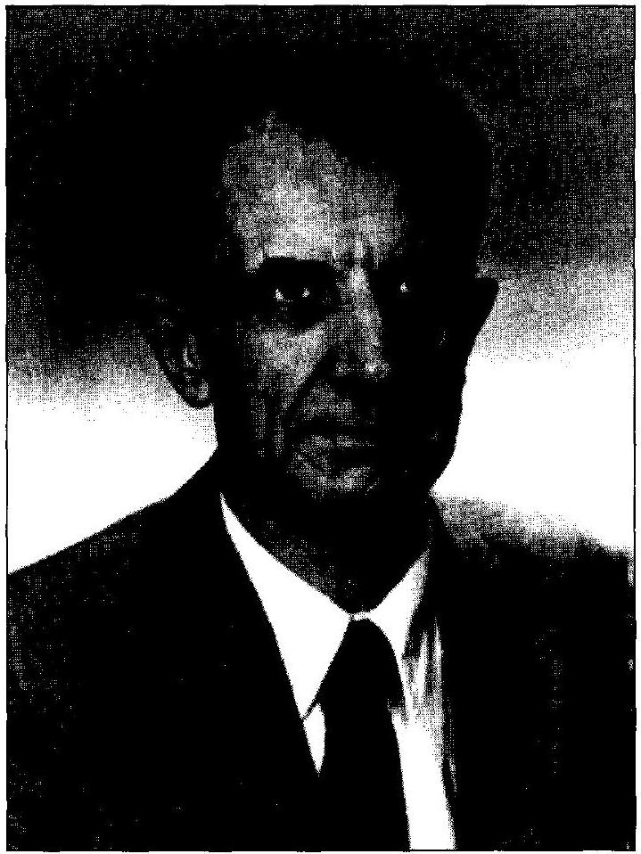
Figure 9.20 | Adolf Busemann.

"Aerodynamischer Auftrieb bei Uberschallgeschwindigkeit" ("Aerodynamic Forces at Supersonic Speeds"), this paper introduced for the first time in history the concept of the swept wing as a mechanism for reducing the large drag increase encountered beyond the critical Mach number (see Sec. 9.7). Busemann reasoned that the flow over a wing is governed mainly by the component of velocity perpendicular to the leading edge. If the wing is swept this component will decrease, as illustrated in Fig. 9.21, which is taken directly from Busemann's original paper. Consequently, the free-stream Mach number at which the large rise in drag is encountered is increased. Therefore, airplanes with swept wings could fly faster before encountering the dragdivergence phenomena discussed in Sec. 9.7. This swept-wing concept of Busemann's is now reflected in the vast majority of high-speed aircraft in operation today.

It is interesting to note that the fifth Volta conference was given special significance by the Italian government. Its prestige was reflected in its location-it was held in an impressive Renaissance building that served as the city hall during the Holy Roman Empire. Moreover, the Italian dictator Benito Mussolini chose the conference to make his announcement that Italy had invaded Ethiopia. It is curious that such a political statement was saved for a technical meeting on high-speed flow.

The conference served to spread excitement about the future of high-speed flight, and provided the first major international exchange of information on compressible

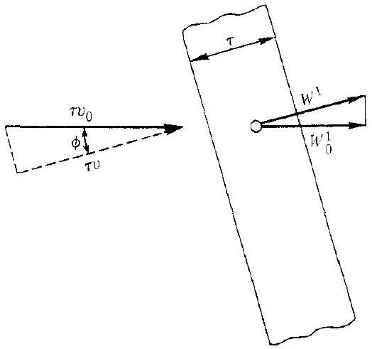
Abb. 4 Schräg angeblasener Tragflügel.

Figure 9.21 The swept-wing concept as it appeared in Busemann's original paper in 1935.
flow. However, in many respects, it had a delayed impact. For example, Busemann's work on swept wings appeared to drop from sight. This was because the German Luftwaffe recognized its military significance, and classified the concept in 1936one year after the conference. The Germans went on to produce a large bulk of sweptwing research during World War II, resulting in the design of the first operational jet airplane-the Me 262-which had a moderate degree of sweep. After the war, technical teams from the three allied nations. England, Russia, and the United States, swooped into the German research laboratories at Penemunde and Braunschweig, and gathered all the swept-wing data they could find. (The United States also gathered Adolf Busemann himself, who was moved to the NACA Langley Aeronautical Laboratory. Later, Busemann became a professor at the University of Colorado, and he now lives an active retired life in Boulder, Colorado.) Virtually all the modern high-speed airplanes of today can trace their lineage back to the original data obtained from Germany, and ultimately to Busemann's paper at the fifth Volta conference.

Strangely enough, the significance of Busemann's idea was lost on most attendees at the conference. Von Karman and Jacobs did not spread it upon their return to the United States. Indeed, 10 years later, when World War II was reaching its conclusion and jet airplanes were beginning to revolutionize aviation, the idea of swept wings was developed independently by R. T. Jones, an ingenious aerodynamicist at the NACA Langley Laboratory. When Jones made such a proposal to Jacobs and von Karman in 1945, neither man remembered Busemann's idea from the Volta conference. (See Ref. 134 for more historical details on the invention of the swept wing.)

On the positive side, however, the Volta conference did serve to spur highspeed research in the United States. Renewed efforts were made by the NACA to obtain data on compressibility effects on high-speed subsonic airfoils-this time prompted
not only by high tip speeds of propellers, but also by the foresight that airplane wings would soon encounter such phenomena. Figure 9.8 gives some experimental data published by NACA in 1938. Shortly thereafter, von Karman and Tsien published a compressibility correction that improved upon the older Prandtl-Glauert relation (see Sec. 9.5).

Nevertheless, in general the United States reacted slowly to the stimulus provided by the Volta conference. Upon his return from Italy in late 1935, von Karman urged both the Army and the NACA to develop high-speed wind tunnels, including supersonic facilities. He encountered deaf ears. Finally, as the clouds of war enveloped the United States in 1941, such urging encountered more receptive attitudes. Von Karman established at Cal Tech the first major university curriculum in compressible flow in 1942; this course of study was highly populated by military officers. Finally, in 1944, the first operational supersonic wind tunnel in the United States was built at the Army Ballistics Research Laboratory in Aberdeen, Maryland. This tunnel was designed by von Karman and his colleagues at Cal Tech, and was operated by Cal Tech personnel at Aberdeen under contract from the Army. Twelve years after Busemann began to collect data in his supersonic tunnel in Germany, and 9 years after the fifth Volta conference and the construction of supersonic tunnels at Guidonia in Italy, the United States was finally seriously in the business of supersonic research.

### 9.10 | HISTORICAL NOTE: PRANDTLA BIOGRAPHICAL SKETCH

The name of Ludwig Prandtl (see Fig. 9.22) pervades virtually all of twentieth century fluid mechanics, ranging from inviscid incompressible flow over airfoils and finite wings, to the ingenious idea of the boundary layer for viscous flows, and extending through the early development of high-speed subsonic and supersonic flows. We have already mentioned his impact on the advancement of compressible flow in Secs. 4.16 and 9.9 Who was this man who gathers so much respect, even bordering on reverence, from fluid mechanicians? Let us take a closer look.

Ludwig Prandtl was born on February 4, 1875, in Freising, Bavaria. His father was Alexander Prandtl, a professor of surveying and engineering at the agricultural college at Weihenstephan, near Freising. Although three children were born into the Prandtl family, two died at birth and Ludwig grew up as an only child. At an early age, Prandtl became interested in his father's books on physics, machinery, and instruments. Much of Prandtl's remarkable ability to intuitively go to the heart of a physical problem can be traced to his environment at home as a child, where his father, a great lover of nature, induced Ludwig to observe natural phenomena and to reflect upon them.

In 1894, Prandtl began his formal scientific studies at the Technische Hochschule in Munich, where his principal teacher was A. Foppl. Six years later, he graduated from the University of Munich with a Doctor's degree. However, by this time he was alone, his father having died in 1896 and his mother in 1898.

By 1900, Prandtl had not done any work nor shown any interest in fluid mechanics. Indeed, his doctor's thesis at Munich was in solid mechanics, dealing with

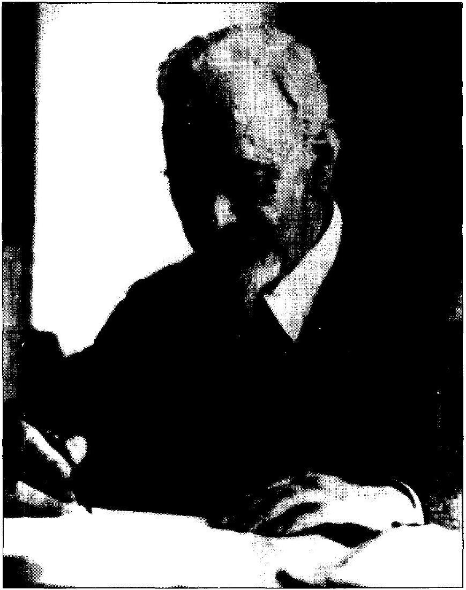
Figure 9.22 | Ludwig Prandtl (1875-1953).

unstable elastic equilibrium in which bending and distortion acted together. (It is not generally recognized by people in fluid dynamics that Prandtl continued his interest and research in solid mechanics through most of his life-this work is eclipsed, however, by his major contributions to the study of fluid flow.) However, soon after graduation from Munich, Prandtl had his first major encounter with fluid mechanics. Joining the Nuremburg works of the Maschinenfabrick Augsburg as an engineer. Prandtl worked in an office designing mechanical equipment for the new factory. He was made responsible for redesigning an apparatus for removing machine shavings by suction. Finding no reliable information in the scientific literature about the fluid mechanics of suction. Prandtl arranged his own experiments to answer a few fundamental questions about the flow. The result of this work was his new design for shavings cleaners. The apparatus was modified with pipes of improved shape and size, and carried out satisfactory operation at one-third its original power consumption. Prandtl's contributions in fluid mechanics had begun.

One year later, in 1901, he became Professor of Mechanics in the Mathematical Engineering Department at the Technische Hochschule in Hanover. (Please note that
in Germany a "technical highschool" is equivalent to a technical university in the United States.) It was at Hanover that Prandtl enhanced and continued his new-found interest in fluid mechanics. It was here, and not at Göttingen, that Prandtl first developed his famous boundary layer theory. It was also here that he first became interested in the steam flow through Laval nozzles, in parallel with the pioneering work by Stodola (see Sec. 5.9).

In 1904, Prandtl delivered his famous paper on the concept of the boundary layer to the Third Congress of Mathematicians at Heidelberg. From this time on, the star of Prandtl was to rise meteorically. Later that year he moved to Göttingen to become Director of the Institute for Technical Physics, later to be renamed Applied Mechanics.

It should be noted that, at the turn of the century, no engineering curriculum existed in any pure university in Germany; such training was provided by the technische hochschules. However, at this time Felix Klein, a powerful mathematician, was director at the University of Göttingen. He recognized that, since the University provided no formal instruction in engineering, it consequently had little connection with industry and the rapidly increasing influence of technology on society. Attempting to rectify this situation, Klein established a series of professional chairs and institutes dedicated to the applied sciences. One of these was the Institute for Technical Physics, for which Prandtl was chosen as Director (at the age of 30) in 1904. This institute gave instruction in mechanics, thermodynamics, strength of materials, and hydraulics. Other institutes were in applied mathematics and applied electricity. Of course, in the meantime, Göttingen was maintaining and fostering its already excellent reputation in pure mathematics and physics (see Sec. 4.16). So it is no wonder that Prandtl flourished in this environment.

In the fall of 1909, Prandtl married Gertrude Foppl, a daughter of August Foppl, Prandtl's old professor from the Technische Hochschule in Munich. The marriage subsequently produced two daughters.

As described in Sec. 4.16, Prandtl made substantial contributions to the understanding of compressible flow during the period 1905 to 1910-this work on flow through Laval nozzles, and especially on oblique shock and expansion waves, was of particular note. During the period 1910 to 1920, his primary output shifted to lowspeed airfoil and finite-wing theory, leading to the famous Prandtl lifting line and lifting surface theories for calculating lift and induced drag. About this time, after a long hiatus, researchers in England and the United States began to grasp the significance of Prandtl's boundary layer theory, and his work on wing theory quickly spread via various English language translations of his papers. By 1925, Prandtl had firmly established a worldwide reputation as the leader in aerodynamics. Students and colleagues flocked to Göttingen, and then fanned out to various international locations to establish centers of aerodynamic research. These included Jakob Ackeret in Zurich, Switzerland, Adolf Busemann in Germany, and Theodore von Karman at Cal Tech in the United States.

During the 1920s and 1930s, Prandtl's responsibilities at Göttingen expanded. In addition to the Institute for Applied Mechanics, he now was in charge of the newly established Kaiser Wilhelm Institute for Fluid Dynamics. (After World War II, the
name was changed to the Max Planck Institute.) In these years, Prandtl continued his interest in high-speed flow, leading in part to the development of the Prandtl-Glauert compressibility correction (see Secs. 9.4 and 9.9). Moreover, a major aerodynamic laboratory-the Aerodynamische Versuchsanstalt-was established at Göttingen, containing a number of low- and high-speed wind tunnels and other expensive research equipment.

Shortly after the Nazis came to power in Germany in 1933, Göttingen experienced a major exodus of Jewish professors, causing the university to lose substantial expertise and prestige, especially in the area of pure mathematics and physics. However, Prandtl was not directly affected, and in fact the Air Ministry of the new German government began to provide major support to his aerodynamic research. Prandtl continued to work under these conditions until 1945, when the Americans passed through Göttingen during the last days of World War II. By all accounts. Prandtl was concerned about the fate of his Jewish colleagues, but he was a scientist without a major sense of political awareness. As a matter of dedication to his country, Prandtl subjugated personal misgivings to what he felt was obligation. Some insight into Prandtl's character and thinking during this period is given by von Karman in his autobiography entitled The Wind and Beyond (Little, Brown and Co., 1967). Von Karman's comments on Prandtl, his former teacher, are not particularly complimentary, and have been the source of some rebuttal from other colleagues of Prandtl. Nevertheless, von Karman's viewpoint is worth reading, and in fact the entire book is an excellent portrait of the growth of twentieth century fluid mechanics, with many interesting observations on the cast of characters by someone who himself played a large part in its development.

Prandtl's personal technical contributions during the last years of his life were not as potent as in his early days. However, his interests remained in fluid dynamics, although he published a few papers in his original field of solid mechanics. discussing nonelastic phenomena in more conventional terms. He also became interested in meteorological fluid dynamics, and was actively working in this area until the end of his life.

Prandtl died in 1953. He was clearly the father of modern aerodynamics-a monumental figure in fluid dynamics. Each day, around the world, his name will continue to be spoken for as long as we maintain and extend our technical society.

### 9.11 I HISTORICAL NOTE: GLAUERTA BIOGRAPHICAL SKETCH

Equations (9.36) and (9.37) give the famous Prandtl-Glauert compressibility correction. Every student of fluid dynamics has some knowledge of Prandtl. But who was Glauert? Let us take a look.

Hermann Glauert was born in Sheffield, England, on October 4, 1892. He was well-educated, first at the King Edward VII School at Sheffield, and then later at Trinity College, Cambridge, where he received many honors for his high leadership in the classroom. For example, he was awarded the Ryson Medal for astronomy in 1913, an Isaac Newton Scholarship in 1914, and the Rayleigh Prize in 1915.

In 1916, as the second year of World War I waxed on, Glauert joined the staff of the Royal Aircraft Establishment in Farnborough. There, he quickly grasped the fundamentals of aerodynamics, and wrote numerous reports and memoranda dealing with airfoil and propeller theory, the performance, stability, and control of airplanes, and the theory of the autogyro. In 1926, he published a book entitled The Elements of Aerofoil and Airscrew Theory; this book was the single most important instrument for spreading Prandtl's airfoil and wing theory around the English-speaking world, and to this day is still used as a reference in courses dealing with incompressible flow.

Glauert did not collaborate with Prandtl on the development of the PrandtlGlauert rule. As related in Sec. 9.9, Glauert worked independently and was the first person to derive the rule from established aerodynamic theory, publishing his results in 1928 in the Proceedings of the Royal Society (see Sec. 9.9).

By the early 1930s, Glauert was probably the leading theoretical aerodynamicist in England. He had also become the Principal Scientific Officer of the RAE, as well as Head of its Aerodynamics Department. However, on August 4, 1934, Glauert was strolling through a small park called Fleet Common at Farnborough. It was a pleasant day, and he stopped to watch some Royal Engineers who were blowing up tree stumps. Suddenly, from 8 yards away, a blast tore a stump to pieces, hurling fragments of wood in all directions. One hit Glauert squarely on the forehead; he died a few hours later. England, and the world, were suddenly and prematurely deprived of one of its best aerodynamicists.

### 9.12 I SUMMARY

In addition to the intermediate summary comments made in Sec. 9.8, we give a more specific summary of the basic results from linearized theory here.

For an irrotational, inviscid, compressible flow, the continuity, momentum, and energy equations reduce to one equation with one dependent variable, namely, the velocity potential $\boldsymbol{\Phi}$, defined as $\mathbf{V}=\nabla \boldsymbol{\Phi}$. The full velocity potential equation is

$$
\begin{gathered}
\left(1-\frac{\boldsymbol{\Phi}_{x}^{2}}{a^{2}}\right) \boldsymbol{\Phi}_{x x}+\left(1-\frac{\boldsymbol{\Phi}_{y}^{2}}{a^{2}}\right) \boldsymbol{\Phi}_{y y}+\left(1-\frac{\boldsymbol{\Phi}_{z}^{2}}{a^{2}}\right) \boldsymbol{\Phi}_{z z} \\
-\frac{2 \boldsymbol{\Phi}_{x} \boldsymbol{\Phi}_{y}}{a^{2}} \boldsymbol{\Phi}_{x y}-\frac{2 \boldsymbol{\Phi}_{x} \boldsymbol{\Phi}_{z}}{a^{2}} \boldsymbol{\Phi}_{x z}-\frac{2 \boldsymbol{\Phi}_{y} \boldsymbol{\Phi}_{z}}{a^{2}} \boldsymbol{\Phi}_{y z}=0
\end{gathered}
$$

This is an exact equation for irrotational flow; it holds for the flow over arbitrary bodies, thin or thick, at arbitrary angles of attack, small or large. However, defining a perturbation velocity potential $\phi$ as $\boldsymbol{\Phi}(x, y, z)=V_{\infty} x+\phi(x, y, z)$ and assuming small perturbations, Eq. (8.17) reduces to a simpler form, applicable to subsonic and supersonic flow, but not applicable to transonic or hypersonic flow:

$$
\left(1-M_{\infty}^{2}\right) \frac{\partial^{2} \phi}{\partial x^{2}}+\frac{\partial^{2} \phi}{\partial y^{2}}+\frac{\partial^{2} \phi}{\partial z^{2}}=0
$$

This is the linearized small-perturbation velocity potential equation. Since Eq. (9.6) is linear, it is much more amenable to analytic solution than the full velocity potential
equation given by Eq. (8.17). However, to obtain this advantage with Eq. (9.6), we trade accuracy; Eq. (9.6) is an approximate relation that holds only for small perturbations (thin bodies at small angles of attack) and only for subsonic or supersonic flow.

For the linearized solution of both subsonic and supersonic compressible flows, Eq. (9.6) represents one important tool. Two additional necessary tools are the form of the pressure coefficient consistent with small perturbations,

$$
C_{p}=-\frac{2 u^{\prime}}{V_{\infty}}
$$

and the boundary condition

$$
v^{\prime}=V_{\infty} \theta
$$

For subsonic compressible flow, these tools lead to the Prandtl-Glauert rule,

$$
C_{p}=\frac{C_{p_{i}}}{\sqrt{1-M_{\infty}^{2}}}
$$

where $C_{p o}$ is the pressure coefficient at low speeds (incompressible flow). Also,

$$
C_{L}=\frac{C_{L_{0}}}{\sqrt{1-M_{\infty}^{2}}}
$$

and

$$
C_{M}=\frac{C_{M_{u}}}{\sqrt{1-M_{\infty}^{2}}}
$$

where $C_{L}$ and $C_{M}$ are the lift and moment coefficients.
For supersonic flow, the preceding tools lead to an expression for the pressure coefficient given by

$$
C_{p}=\frac{2 \theta}{\sqrt{M_{\infty}^{2}-1}}
$$

As derived in the homework problems, Eq. (9.51) when applied to a flat plate at an angle of attack $\alpha$ yields

$$
\begin{aligned}
C_{L} & =\frac{4 \alpha}{\sqrt{M_{\infty}^{2}-1}} \\
C_{D} & =\frac{4 \alpha^{2}}{\sqrt{M_{\infty}^{2}-1}} \\
C_{M_{c / 4}} & =\frac{-\alpha}{\sqrt{M_{\infty}^{2}-1}}
\end{aligned}
$$

where $C_{L}, C_{D}$, and $C_{M_{c} 4}$ are the lift, drag, and moment coefficients, respectively. Here, $C_{M_{c / 4}}$ is taken about the quarter-chord point (a point 0.25 of the chord length from the leading edge).

## PROBLEMS

9.1 Show that this nonlinear equation is valid for transonic flow with small perturbations:

$$
\left(1-M_{\infty}^{2}\right) \frac{\partial^{2} \phi}{\partial x^{2}}+\frac{\partial^{2} \phi}{\partial y^{2}}+\frac{\partial^{2} \phi}{\partial z^{2}}=M_{\infty}^{2}\left[\frac{\gamma+1}{V_{\infty}} \frac{\partial \phi}{\partial x}\right] \frac{\partial^{2} \phi}{\partial x^{2}}
$$

9.2 The low-speed lift coefficient for an NACA 2412 airfoil at an angle of attack of $4^{\circ}$ is 0.65 . Using the Prandtl-Glauert rule, calculate the lift coefficient for $M_{\infty}=0.7$.
9.3 In low-speed flow, the pressure coefficient at a point on an airfoil is -0.9 . Calculate the value of $C_{p}$ at the same point for $M_{\infty}=0.6$ by means of
a. The Prandtl-Glauert rule
b. Laitone's correction
c. The Karman-Tsien rule
9.4 Consider a flat plate with chord length $c$ at an angle of attack $\alpha$ to a supersonic free stream of Mach number $M_{\infty}$. Let $L$ and $D$ be the lift and drag per unit span, and $S$ be the planform area of the plate per unit span, $S=c(1)$. Using linearized theory, derive the following expressions for the lift and drag coefficients (where $C_{L} \equiv L / \frac{1}{2} \rho_{\infty} V_{\infty}^{2} S$ and $C_{D} \equiv D / \frac{1}{2} \rho_{\infty} V_{\infty}^{2} S$ ):
a. $C_{L}=\frac{4 \alpha}{\sqrt{M_{\infty}^{2}-1}}$
b. $C_{D}=\frac{4 \alpha^{2}}{\sqrt{M_{\infty}^{2}-1}}$
9.5 For the flat plate in Problem 9.4, the quarter-chord point is located, by definition, at a distance equal to $c / 4$ from the leading edge. Using linearized theory, derive the following expression for the moment coefficient about the quarter-chord point for supersonic flow

$$
C_{M_{c / 4}}=\frac{-\alpha}{\sqrt{M_{\infty}^{2}-1}}
$$

where $C_{M_{c / 4}} \equiv M_{c / 4} / \frac{1}{2} \rho_{\infty} V_{\infty}^{2} S c$, and as usual in aeronautical practice, a positive moment by convention is in the direction of increasing angle of attack.
9.6 Consider a flat plate at an angle of attack of $4^{\circ}$.
a. Calculate $C_{L}$ and $C_{M_{c / 4}}$ for $M_{\infty}=0.03$ (essentially incompressible flow). (Hint: Consult a book, such as Reference 104, for the aerodynamic properties of a flat plate using incompressible flow thin airfoil theory.)
b. Apply the Prandtl-Glauert rule to the results of part (a), and calculate $C_{L}$ and $C_{M_{c / 4}}$ for $M_{\infty}=0.6$.
9.7 Consider a diamond-shaped airfoil such as that sketched in Fig. 4.35. The half-angle is $\varepsilon$, thickness is $t$, and chord is $c$. For supersonic flow, use linearized theory to derive the following expression for $C_{D}$ at $\alpha=0$ :

$$
C_{D}=\frac{4}{\sqrt{M_{\infty}^{2}-1}}\left(\frac{t}{c}\right)^{2}
$$

9.8 Supersonic linearized theory predicts that, for a thin airfoil of arbitrary shape and thickness at angle of attack $\alpha, C_{L}=4 \alpha / \sqrt{M_{\infty}^{2}-1}$, independent of the shape and thickness. Prove this result.
9.9 Repeat Prob. 4.17, except using linearized theory. Plot the linearized results on top of the same graphs produced for Prob. 4.17 in order to assess the differences between linear theory (which is approximate) and shockexpansion theory (which is exact). From this comparison, over what angle-ofattack range would you feel comfortable in applying linear theory?
9.10 Linear supersonic theory predicts that the curve of wave drag versus Mach number has a minimum point at a certain value of $M_{\infty}>1$.
a. Calculate this value of $M_{\infty}$.
b. Does it make physical sense for the wave drag to have a minimum value at some supersonic value of $M_{\infty}$ above 1? Explain. What does this say about the validity of linear theory for certain Mach number ranges?
9.11 At $\alpha=0^{\circ}$, the minimum pressure coefficient for an NACA 0009 airfoil in low-speed flow is -0.25 . Calculate the critical Mach number for this airfoil using
a. The Prandtl-Glauert rule
b. The (more accurate) Karman-Tsien rule

