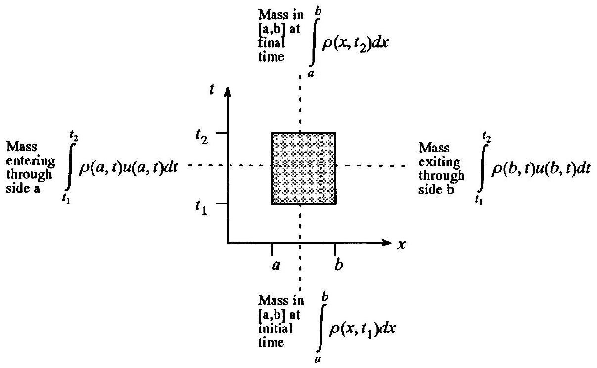
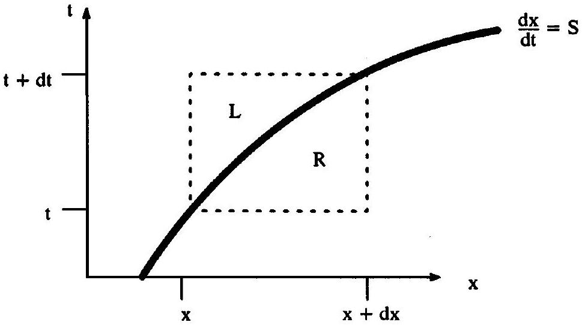

## CHAPTER 2

## Governing Equations of Gasdynamics

### 2.0 Introduction

The governing equations of gasdynamics are expressions of conservation and the second law of thermodynamics. Conservation requires that three fundamental quantities mass, momentum, and energy - are neither created nor destroyed but are only redistributed or, excepting mass, converted from one form to another. For example, if momentum increases in one place, either momentum or an equivalent amount of energy must decrease someplace else. Conservation of momentum and energy is extremely complicated for a general physical system owing to the variety of mechanisms that can affect momentum and energy, such as viscosity, chemical reactions, gravity, electromagnetic forces, and so forth. To keep things simple, traditional gasdynamics as discussed in this book concerns inviscid flows of perfect gases, optionally free of forces except for pressure, which eliminates all influences on momentum and energy except for redistribution and pressure.

A companion principle to conservation, known as the second law of thermodynamics, requires that a fourth fundamental quantity called entropy should never decrease. The second law of thermodynamics restricts the redistributions and conversions of conserved quantities otherwise allowed by the conservation laws. As another supplement to conservation, the equations of state specify the nature and type of gas. Three conservation laws, two equations of state, and the second law of thermodynamics collectively constitute the Euler equations when expressed in a fixed coordinate system, or the Lagrange equations when expressed in a coordinate system that moves with the flow. This book mainly concerns the Euler equations, but see Problem 2.7 and Section 23.1 for an introduction to the Lagrange equations.

### 2.1 The Integral Form of the Euler Equations

### 2.1.1 Conservation of Mass

Conservation of mass states that the total mass of the universe is constant; in other words, mass is neither created nor destroyed but can only be moved from one place to another. Then if mass increases in one place it must decrease someplace else. For a onedimensional flow, consider the fluid in a region $[a, b]$ during a time interval $\left[t_{1}, t_{2}\right]$. Then a precise statement of conservation of mass for one-dimensional flow is as follows:

- change in total mass in $[a, b]$ in time interval $\left[t_{1}, t_{2}\right]=$ net mass passing through boundaries of $[a, b]$ in time interval $\left[t_{1}, t_{2}\right]$.

This statement converts to mathematics immediately as follows:

$$
\int_{a}^{b}\left[\rho\left(x, t_{2}\right)-\rho\left(x, t_{1}\right)\right] d x=-\int_{t_{1}}^{t^{2}}[\rho(b, t) u(b, t)-\rho(a, t) u(a, t)] d t
$$

Figure 2.1 An illustration of conservation of mass.

where $\rho(x, t)$ is the mass per unit volume, $u(x, t)$ is the velocity, and $\rho(x, t) u(x, t)$ is the time rate of mass flow past point $x$. Then $\int_{a}^{b} \rho(x, t) d x$ is the total mass in $[a, b]$ at time $t$ and $\int_{t_{1}}^{t_{2}} \rho(x, t) u(x, t) d t$ is the total mass passing $x$ in the time interval $\left[t_{1}, t_{2}\right]$. The derivation of conservation of mass is illustrated in Figure 2.1.

Let us now introduce some standard fluids terminology. The mass per unit volume $\rho$ is called density. A flux is a timed rate of flow of any property through any surface; then $\rho u$ is the instantaneous mass flux and $\int_{t_{1}}^{t_{2}} \rho(x, t) u(x, t) d t$ is the total mass flux through the surface $x=$ const. during the time interval $\left[t_{1}, t_{2}\right]$. The arbitrary spatial region $[a, b]$ is called a control volume. Similarly, the arbitrary region in the $x-t$ plane defined by $[a, b]$ and $\left[t_{1}, t_{2}\right]$ is called a space-time control volume. Although the space-time control volume in Figure 2.1 is rectangular, it could just as well be triangular, quadrilateral, or some other shape. Nonrectangular space-time control volumes correspond to control volumes that contract, expand, or move in time.

### 2.1.2 Conservation of Momentum

Conservation of momentum says that momentum changes due to one of three factors - redistribution, conversion of momentum to or from energy, and force. In other words, if momentum increases in one place, either momentum or an equivalent amount of energy must decrease someplace else, or a force must act. Conservation of momentum can be extremely complicated owing to the variety of mechanisms that can affect momentum, such as viscosity, chemical reactions, gravity, electromagnetic forces, and so forth. However, classic gasdynamics concerns inviscid flows of perfect gases, optionally free of all forces except for pressure force, which eliminates all influences on momentum except for redistribution and pressure. In English, a precise statement of conservation of momentum for one-dimensional gasdynamics is as follows:
change in total momentum in $[a, b]$ in time interval $\left[t_{1}, t_{2}\right]=$ net momentum flow through boundaries of $[a, b]$ in time interval $\left[t_{1}, t_{2}\right]+$ net momentum change due to pressure on boundaries of $[a, b]$.

Mathematically this statement converts to

$$
\begin{aligned}
\int_{a}^{b} & {\left[\rho\left(x, t_{2}\right) u\left(x, t_{2}\right)-\rho\left(x, t_{1}\right) u\left(x, t_{1}\right)\right] d x } \\
& =-\int_{t_{1}}^{t_{2}}\left[\rho(b, t) u^{2}(b, t)-\rho(a, t) u^{2}(a, t)\right] d t-\int_{t_{1}}^{t_{2}}[p(b, t)-p(a, t)] d t
\end{aligned}
$$

where $\rho(x, t) u(x, t)$ is momentum per unit volume and $\rho(x, t) u^{2}(x, t)$ is the time rate of momentum flow or, in other words, the instantaneous momentum flux. Then $\int_{a}^{b} \rho(x, t) u(x, t) d x$ is the total momentum in $[a, b]$ at time $t, \int_{t_{1}}^{t_{2}} \rho(x, t) u^{2}(x, t) d t$ is the total momentum flowing past $x$ in time interval $\left[t_{1}, t_{2}\right]$ (i.e., the total momentum flux), and $\int_{t_{1}}^{t_{2}} p(x, t) d t$ is the total momentum change at $x$ due to pressure in time interval $\left[t_{1}, t_{2}\right]$.

### 2.1.3 Conservation of Energy

Conservation of energy says that energy change is due to one of three factors redistribution, conversion of energy to or from momentum, or conversion to or from some other form of energy, heat, or work. In other words, if energy increases in one place, either energy or an equivalent amount of momentum must decrease someplace else, or heating or work must be done. Conservation of energy may be extremely complicated for a general physical system owing to the variety of mechanisms that can affect energy, such as viscosity, chemical reactions, gravity, electromagnetic forces, heating, and so forth. However, traditional gasdynamics concerns inviscid flows of perfect gases, optionally free of all sources of energy except for pressure, which eliminates all influences on energy except for redistribution and pressure.

Conservation of energy is most naturally stated in terms of specific total energy. Here and in general, specific means per unit mass. In the standard notation, specific quantities are denoted by lowercase letters, whereas nonspecific quantities - in other words, quantities that depend on the total amount of substance - are denoted by uppercase letters. For example, $V$ is volume and $v=1 / \rho$ is specific volume. Specific internal energy $e(x, t)$ is the energy per unit mass contained in the microscopic motions of the individual fluid molecules, and the specific kinetic energy $u^{2}(x, t) / 2$ is the energy per unit mass contained in the macroscopic motion of the overall fluid. Then the specific total energy $e_{\mathrm{T}}(x, t)=e(x, t)+u^{2}(x, t) / 2$ is the energy per unit mass stored in both microscopic and macroscopic motion.

In English, a precise statement of conservation of energy for one-dimensional gasdynamics is as follows:

- change in total energy in $[a, b]$ in time interval $\left[t_{1}, t_{2}\right]=$ net energy flow through boundaries of $[a, b]$ in time interval $\left[t_{1}, t_{2}\right]+$ net energy change due to pressure on boundaries of $[a, b]$ in time interval $\left[t_{1}, t_{2}\right]$.

This statement converts to mathematics immediately as follows:

$$
\begin{aligned}
\int_{a}^{b}[ & \left.\rho\left(x, t_{2}\right) e_{\mathrm{T}}\left(x, t_{2}\right)-\rho\left(x, t_{1}\right) e_{\mathrm{T}}\left(x, t_{1}\right)\right] d x \\
= & -\int_{t_{1}}^{t_{2}}\left[\rho(b, t) u(b, t) e_{\mathrm{T}}(b, t)-\rho(a, t) u(a, t) e_{\mathrm{T}}(a, t)\right] d t \\
& -\int_{t_{1}}^{t_{2}}[p(b, t) u(b, t)-p(a, t) u(a, t)] d t
\end{aligned}
$$

where $e_{\mathrm{T}}(x, t)$ is the total energy per unit mass, $\rho(x, t) e_{\mathrm{T}}(x, t)$ is the total energy per unit volume, and $\rho(x, t) e_{\mathrm{T}}(x, t) u(x, t)$ is the instantaneous total energy flux. Then $E_{\mathrm{T}}= \int_{a}^{b} \rho(x, t) e_{\mathrm{T}}(x, t) d x$ is the total energy in $[a, b]$ at time $t, \int_{t_{1}}^{t_{2}} \rho(x, t) u(x, t) e_{\mathrm{T}}(x, t) d t$ is the total energy flux (i.e., the total energy flowing past $x$ in time interval $\left[t_{1}, t_{2}\right]$ ), and $\int_{t_{1}}^{t_{2}} p(x, t) u(x, t) d t$ is the total energy change at $x$ in time interval $\left[t_{1}, t_{2}\right]$ due to pressure, which is also sometimes called pressure work. Equation (2.3a) omits body force terms, such as those due to gravity. It also omits heat transfer terms; in other words, the flow is assumed to be adiabatic. Indeed, as mentioned earlier, Equation (2.3a) neglects all energy effects except for pressure and redistribution.

Now let us consider an alternative form of Equation (2.3a). Specific enthalpy $h=e+p / \rho$ is the energy per unit mass found in the microscopic motions of the fluid molecules plus the potential energy per unit mass stored by compression. Specific total enthalpy $h_{\mathrm{T}}= h+u^{2} / 2=e_{\mathrm{T}}+p / \rho$ is the energy per unit mass stored in the microscopic and macroscopic motions of the fluid plus the potential energy per unit mass stored by compression. Then conservation of energy can be rewritten in terms of total enthalpy as follows:

$$
\begin{aligned}
& \int_{a}^{b}\left[\rho\left(x, t_{2}\right) e_{\mathrm{T}}\left(x, t_{2}\right)-\rho\left(x, t_{1}\right) e_{\mathrm{T}}\left(x, t_{1}\right)\right] d x \\
& \quad=-\int_{t_{1}}^{t_{2}}\left[\rho(b, t) u(b, t) h_{\mathrm{T}}(b, t)-\rho(a, t) u(a, t) h_{\mathrm{T}}(a, t)\right] d t
\end{aligned}
$$

Equation (2.3b) is certainly more compact than Equation (2.3a); this book will use both versions of Equation (2.3) at various times.

### 2.1.4 Equations of State for a Perfect Gas

We now have three equations in four unknowns. Specifically, the equations are conservation of mass, conservation of momentum, and conservation of energy and the unknowns are density, velocity, pressure, and total energy. A unique solution requires an equal number of equations and unknowns; thus this subsection introduces one more unknown and two more equations. The two additional equations are called equations of state. Equations of state specify the type of fluid; in other words, equations of state distinguish air from motor oil from any other sort of fluid.

A quick thermodynamics review is in order. Mechanical properties such as velocity and kinetic energy describe the macroscopic properties of a system, while thermodynamic properties such as internal energy and enthalpy describe the average microscopic properties of a system. Some properties, such as density and pressure, can be considered either mechanical or thermodynamic. The thermodynamic state is defined by three thermodynamic properties - for example, volume, mass, and internal energy - and all other thermodynamic
properties can be expressed as functions of these three, that is, as equations of state. Three equations of state determine all other equations of state. All quantities in gasdynamics are traditionally expressed per unit mass - as specific quantities - which eliminates one variable, since mass per unit mass is always one. Then the specific thermodynamic state is defined by two specific thermodynamic properties - for example, density and specific internal energy - and all other specific thermodynamic properties can be expressed as functions of these two, that is, as specific equations of state. Two specific equations of state determine all other specific equations of state.

As it turns out, the equations of state are a result of conservation on the microscopic level. Assuming that large numbers of gas molecules interact only upon direct collision, conservation of momentum on the microscopic level yields the following equation of state known as the ideal gas law or the thermal equation of state:

$$
\text { - } \quad p=\rho R T
$$

where $R$ is the gas constant. Although $R$ is constant for a given gas, it is different for different gases. For sea-level air, a typical value is $R=287 \mathrm{~N} \cdot \mathrm{~m} / \mathrm{kg} \cdot \mathrm{K}$. A fluid satisfying the thermal equation of state is called thermally perfect. Again assuming that large numbers of gas molecules interact only upon direct collision, conservation of energy on the microscopic level yields the following caloric equation of state:

$$
e=c_{v} T
$$

where $c_{v}$ is called the constant volume specific heat. An equivalent expression is as follows:

$$
\quad \quad h=c_{p} T
$$

where $c_{p}$ is the constant pressure specific heat. The specific heats are assumed constant, although the constant is different for different gases; typical values for sea-level air are $c_{v}=717 \mathrm{~N} \cdot \mathrm{~m} / \mathrm{kg} \cdot \mathrm{K}$ and $c_{p}=1,004 \mathrm{~N} \cdot \mathrm{~m} / \mathrm{kg} \cdot \mathrm{K}$. Either version of Equation (2.5) can optionally include an additive constant; the exact value of the constant is usually irrelevant and is taken here to be zero for convenience. Any fluid that satisfies the caloric equation of state, Equation (2.5), is called calorically perfect.

A fluid that satisfies both the thermal equation of state, Equation (2.4), and the caloric equation of state, Equation (2.5), is called a perfect gas; all other gases are known as imperfect or real gases. Real gases are either dense or rarefied. The microscopic particles in dense gases are close enough together that certain intermolecular forces, which are inversely proportional to powers of the separation distance, have significant strengths; in other words, the microscopic particles interact continuously instead of interacting only during direct collisions, as in a perfect gas. In contrast, the microscopic particles in rarefied gases are so far apart that the statistical averages used for perfect gases fail, since these statistical averages assume large numbers of particles per unit volume. This book concerns only perfect gases.

Equations of state are only required for compressible flows. For incompressible flows, there is no interaction between the microscopic and macroscopic levels, so that the nature of the substance as specified by the equations of state is irrelevant. You might think of this like banking. In incompressible flow, only the funds in the checking account are available; although there is a savings account, the funds in savings cannot be transferred to checking or back. By contrast, in compressible flow, the funds in checking and savings transfer back
and forth freely. The equations of state describe how deposits, withdrawals, and transfers of funds affect various accounts.

Equations (2.1)-(2.5) are collectively known as the integral form of the Euler equations. In other words, the Euler equations equal conservation of mass, momentum, and energy for a perfect gas (and optionally the second law of thermodynamics as discussed in the next subsection).

This subsection ends with some useful perfect gas definitions and results.
The ratio of specific heats is defined as

$$
\gamma=\frac{c_{p}}{c_{v}} .
$$

The gas constant and specific heats are related by

$$
c_{p}=R+c_{v}
$$

or

$$
\begin{aligned}
c_{p} & =\frac{\gamma R}{\gamma-1} \\
c_{v} & =\frac{R}{\gamma-1}
\end{aligned}
$$

Equations (2.4), (2.5), and (2.9) can be combined to yield a useful equation of state:

$$
p=(\gamma-1) \rho e=(\gamma-1)\left(\rho e_{\mathrm{T}}-\frac{1}{2} \rho u^{2}\right) .
$$

The speed of sound is the speed at which small disturbances, especially acoustic disturbances, propagate through a substance measured relative to the movement of the substance. For a perfect gas, an equation of state for the speed of sound $a$ is as follows:

$$
a^{2}=\gamma R T=\frac{\gamma p}{\rho} .
$$

Equations (2.10) and (2.11) yield yet another useful equation of state:

$$
\gamma e_{\mathrm{T}}=\frac{\gamma}{2} u^{2}+\frac{1}{\gamma-1} a^{2} .
$$

This equation, the definition $h_{\mathrm{T}}=e_{\mathrm{T}}+p / \rho$, and Equation (2.11) imply

$$
h_{\mathrm{T}}=\frac{1}{2} u^{2}+\frac{1}{\gamma-1} a^{2}
$$

Any number of other equations of state for perfect gases can be derived in a similar fashion, as needed. We shall see some more equations of state involving entropy in the next subsection.

### 2.1.5 Entropy and the Second Law of Thermodynamics

In addition to conservation laws, any physical system must also satisfy the second law of thermodynamics, which is stated in terms of entropy $S$ or the specific entropy $s$. There are many ways to define entropy. For example, in traditional thermodynamics, entropy is defined as the ratio of reversible heat transfer to temperature. However, such a definition gives little insight into the true meaning of entropy. Intuitively, entropy indicates "disorder"
or "loss of information." More specifically, for a given thermodynamic state, entropy measures how much is known about the positions, velocities, rotations, vibrations, etc. of the individual microscopic particles composing the fluid. Put another way, the thermodynamic state describes the average state of the microscopic particles, and entropy measures deviations from the average. Zero entropy corresponds to perfect knowledge of the microscopic states of the gas particles whereas increasing entropy corresponds to increasing uncertainty about the microscopic states of the gas particles.

Building on this intuitive definition of entropy, a formal definition of entropy is given by Boltzmann's relation:

$$
S=k \ln \Omega,
$$

where $k=1.38 \times 10^{-23} \mathrm{~J} / \mathrm{K}$ is a universal constant known as the Boltzmann constant and $\Omega$ is the number of ways in which the microscopic particles composing the gas can be arranged to give a specified thermodynamic state. For example, if there were just one way to arrange the fluid molecules to obtain a given thermodynamic state, then the entropy of that state would be $k \ln 1=0$. The quantity $\Omega$ grows exponentially with uncertainty; then ln $\Omega$ grows linearly with uncertainty; then $S=k \ln \Omega$ also grows linearly with uncertainty, where the Boltzmann constant $k$ is a traditional convenience factor.

For a perfect gas, the equation of state giving specific entropy $s$ as a function of specific internal energy and density is

$$
s=c_{v} \ln e-R \ln \rho+c o n s t
$$

The exact value of the additive constant is usually unobtainable and usually unimportant. Equation (2.15a) can be rewritten in any number of ways using perfect gas relations. For example, an equivalent equation is as follows:

$$
s=c_{v} \ln p-c_{p} \ln \rho+\text { const }
$$

Suppose that the entropy is constant or, in other words, the flow is homentropic. This is often the case in inviscid flows, except at shocks. Then Equation (2.15) implies

$$
\begin{aligned}
p & =(\text { const. }) \rho^{\gamma}, \\
T & =(\text { const. }) \rho^{\gamma-1}, \\
a & =(\text { const. }) \rho^{(\gamma-1) / 2},
\end{aligned}
$$

and many other similar relationships. For homentropic flow, any form of Equation (2.16) can replace Equations (2.3), (2.4), and (2.5), leaving only three equations in three unknowns in the Euler equations, rather than five equations in five unknowns.

Having defined entropy, the second law of thermodynamics can be expressed as follows: The total entropy of the universe never decreases. In other words, after any process, less is known about the microscopic state of the matter in the universe. If more is known about the microscopic particles in one place, then less must be known about the microscopic particles in another place, such that on balance less is known about the microscopic particles in the universe.

Without being specific about the source of entropy increase, the second law of thermodynamics for one-dimensional gasdynamics can be stated as

- change in total entropy in $[a, b]$ in time interval $\left[t_{1}, t_{2}\right] \geq$ net entropy passing through boundaries of $[a, b]$ in time interval $\left[t_{1}, t_{2}\right]$.

This statement converts to mathematics immediately as follows:

$$
\begin{aligned}
& \quad \int_{a}^{b}\left[\rho\left(x, t_{2}\right) s\left(x, t_{2}\right)-\rho\left(x, t_{1}\right) s\left(x, t_{1}\right)\right] d x \\
& \quad \geq-\int_{t_{1}}^{t_{2}}[\rho(b, t) u(b, t) s(b, t)-\rho(a, t) u(a, t) s(a, t)] d t
\end{aligned}
$$

where $s(x, t)$ is the entropy per unit mass, $\rho(x, t) s(x, t)$ is the entropy per unit volume, and $\rho(x, t) s(x, t) u(x, t)$ is the instantaneous entropy flux. Then $S=\int_{a}^{b} \rho(x, t) s(x, t) d x$ is the total entropy in $[a, b]$ at time $t$ and $\int_{t_{1}}^{t_{2}} \rho(x, t) u(x, t) s(x, t) d t$ is the total entropy flowing past $x$ in time interval $\left[t_{1}, t_{2}\right]$, that is, the total entropy flux.

Although the second law of thermodynamics is sometimes lumped in with the Euler equations, it is more often considered separately. Even with the second law of thermodynamics, the Euler equations may have multiple solutions, at least in the special case of steady flows. For example, steady uniform supersonic flow over a wedge allows two solutions - a strong and a weak oblique shock solution. In fact, both solutions are observed in real life, although the weak shock is far more common. As another example, steady uniform supersonic flow over a cone also gives rise to strong and weak conical shock solutions. However, in this case, only the weak conical shock is observed in practice. As a third example, steady one-dimensional flow is always uniform except that it may allow a single normal shock anywhere in the flow, across which the flow switches from supersonic to subsonic; thus, there are infinitely many solutions, any of which can occur in real life. In short, the steady Euler equations allow multiple solutions in the presence of shocks and other entropy sources.

### 2.1.6 Vector Notation

Define the vector of conserved quantities as follows:

$$
\quad \mathbf{u}=\left[\begin{array}{c}
\rho \\
\rho u \\
\rho e_{\mathrm{T}}
\end{array}\right] .
$$

The components of $\mathbf{u}$ will sometimes be referred to as $u_{1}, u_{2}$, and $u_{3}$, which represent mass per unit volume, momentum per unit volume, and total energy per unit volume, respectively. Mass, momentum, and energy are called the conserved quantities. The reader should take care not to confuse the conserved quantities $u_{1}, u_{2}$, and $u_{3}$ with the velocity $u$. Define the flux vector as follows:

$$
\quad \mathbf{f}=\left[\begin{array}{c}
\rho u \\
\rho u^{2}+p \\
\left(\rho e_{\mathrm{T}}+p\right) u
\end{array}\right]=\left[\begin{array}{c}
\rho u \\
\rho u^{2}+p \\
\rho h_{\mathrm{T}} u
\end{array}\right] .
$$

The components of $\mathbf{f}$ will sometimes be referred to as $f_{1}, f_{2}$ and $f_{3}$, which represent mass flux, momentum flux plus pressure force, and total energy flux plus pressure work, respectively. Although $\mathbf{f}$ is called the flux vector, it includes pressure effects as well as fluxes. Strictly speaking the pressure effects on momentum and energy are not fluxes, but
they can be and often are treated as such. However, if you prefer, the pressure and flux contributions can be separated as

$$
\mathbf{f}=\left[\begin{array}{c}
\rho u \\
\rho u^{2} \\
\rho u e_{\mathrm{T}}
\end{array}\right]+\left[\begin{array}{c}
0 \\
p \\
p u
\end{array}\right] .
$$

Equations (2.1)-(2.3) can be rewritten compactly in terms of the flux vector and the vector of conserved quantities as follows:

$$
\quad \int_{a}^{b}\left[\mathbf{u}\left(x, t_{2}\right)-\mathbf{u}\left(x, t_{1}\right)\right] d x=-\int_{t_{1}}^{t_{2}}[\mathbf{f}(b, t)-\mathbf{f}(a, t)] d t
$$

### 2.2 The Conservation Form of the Euler Equations

Historically, differential equations are preferred to integral equations, if for no other reason than that differential expressions are more compact. This section concerns a differential form of the Euler equations known as the conservation form of the Euler equations. If $\rho(x, t)$ is differentiable in time, then by the fundamental theorem of calculus

$$
\rho\left(x, t_{2}\right)-\rho\left(x, t_{1}\right)=\int_{t_{1}}^{t_{2}} \frac{\partial \rho}{\partial t} d t
$$

Similarly, if $\rho(x, t) u(x, t)$ is differentiable in space then

$$
\rho(b, t) u(b, t)-\rho(a, t) u(a, t)=\int_{b}^{a} \frac{\partial(\rho u)}{\partial x} d x
$$

Assuming integration in space is reversible with integration in time, Equation (2.1) becomes

$$
\int_{a}^{b} \int_{t_{1}}^{t_{2}}\left[\frac{\partial \rho}{\partial t}+\frac{\partial(\rho u)}{\partial x}\right] d t d x=0
$$

This integral is zero for any $a, b, t_{1}$, and $t_{2}$, which implies that the integrand is zero. Notice that this is true because the limits of integration are arbitrary. For example, $\int_{0}^{2 \pi} \sin (x) d x=0$ does not imply $\sin x=0$; instead, the integral is zero because the positive and negative portions of $\sin x$ cancel. On the other hand, if $\int_{a}^{b} f(x) d x=0$ for all $a$ and $b$, then the integral cannot always be zero due to cancelation, and the integrand $f(x)$ must be identically zero, except for isolated points and other zero-measure regions.

Setting the integrand in Equation (2.22) equal to zero yields a differential form of conservation of mass. Differential forms of conservation of momentum, conservation of energy, and the second law of thermodynamics are obtained similarly. The results are summarized as follows:

$$
\begin{array}{ll} 
& \frac{\partial \rho}{\partial t}+\frac{\partial(\rho u)}{\partial x}=0, \\
& \frac{\partial(\rho u)}{\partial t}+\frac{\partial}{\partial x}\left(\rho u^{2}+p\right)=0, \\
& \frac{\partial\left(\rho e_{\mathrm{T}}\right)}{\partial t}+\frac{\partial}{\partial x}\left(\rho u e_{\mathrm{T}}+p u\right)=\frac{\partial\left(\rho e_{\mathrm{T}}\right)}{\partial t}+\frac{\partial}{\partial x}\left(\rho u h_{\mathrm{T}}\right)=0, \\
& \frac{\partial(\rho s)}{\partial t}+\frac{\partial}{\partial x}(\rho u s) \geq 0 .
\end{array}
$$

Equations (2.23)-(2.25), (2.4), (2.5), and optionally (2.26) are known collectively as the conservation form of the Euler equations. This form is called the conservation form because the dependent variables are the conserved quantities. The term "conservation" is important to distinguish this differential form from other differential forms, such as the primitive variable form seen in the next section.

### 2.2.1 Vector and Vector-Matrix Notation

Using the vector notation of Section 2.16, the conservation form can be written as

$$
\text { - } \quad \frac{\partial \mathbf{u}}{\partial t}+\frac{\partial \mathbf{f}}{\partial x}=0 .
$$

The flux vector $\mathbf{f}$ can be written as a function of the conserved quantities $\mathbf{u}$. For example, using Equation (2.10), $f_{3}$ can be written explicitly as a function of $u_{1}, u_{2}, u_{3}$ :

$$
\begin{aligned}
f_{3} & =\left(\rho e_{\mathrm{T}}+p\right) u=\left[\rho e_{\mathrm{T}}+(\gamma-1)\left(\rho e_{\mathrm{T}}-\frac{1}{2} \rho u^{2}\right)\right] u \\
& =\left(\gamma \rho e_{\mathrm{T}}-\frac{\gamma-1}{2} \frac{\rho^{2} u^{2}}{\rho}\right) \frac{\rho u}{\rho} \\
& =\left(\gamma u_{3}-\frac{\gamma-1}{2} \frac{u_{2}^{2}}{u_{1}}\right) \frac{u_{2}}{u_{1}}=\gamma \frac{u_{2} u_{3}}{u_{1}}-\frac{\gamma-1}{2} \frac{u_{2}^{3}}{u_{1}^{2}}
\end{aligned}
$$

Then by the chain rule

$$
\frac{\partial \mathbf{f}}{\partial x}=\frac{d \mathbf{f}}{d \mathbf{u}} \frac{\partial \mathbf{u}}{\partial \mathbf{x}},
$$

where

$$
\frac{d \mathbf{f}}{d \mathbf{u}}=\left[\begin{array}{ccc}
\frac{\partial f_{1}}{\partial u_{1}} & \frac{\partial f_{1}}{\partial u_{2}} & \frac{\partial f_{1}}{\partial u_{3}} \\
\frac{\partial f_{2}}{\partial u_{1}} & \frac{\partial f_{2}}{\partial u_{2}} & \frac{\partial f_{2}}{\partial u_{3}} \\
\frac{\partial f_{3}}{\partial u_{1}} & \frac{\partial f_{3}}{\partial u_{2}} & \frac{\partial f_{3}}{\partial u_{3}}
\end{array}\right],
$$

which is called the Jacobian matrix of $\mathbf{f}$. For example, $\partial f_{3} / \partial u_{1}$ is computed from Equation (2.28) as follows:

$$
\begin{aligned}
\frac{\partial f_{3}}{\partial u_{1}} & =-\gamma \frac{u_{2} u_{3}}{u_{1}^{2}}+(\gamma-1) \frac{u_{2}^{3}}{u_{1}^{3}}=-\gamma \frac{\rho u \cdot \rho e_{\mathrm{T}}}{\rho^{2}}+(\gamma-1) \frac{(\rho u)^{3}}{\rho^{3}} \\
& =-\gamma u e_{\mathrm{T}}+(\gamma-1) u^{3} .
\end{aligned}
$$

If we call the Jacobian matrix $A$, Equation (2.27) becomes

$$
\text { - } \quad \frac{\partial \mathbf{u}}{\partial t}+A \frac{\partial \mathbf{u}}{\partial x}=0 \text {, }
$$

where

$$
A=\left[\begin{array}{ccc}
0 & 1 & 0 \\
\frac{\gamma-3}{2} u^{2} & (3-\gamma) u & \gamma-1 \\
-\gamma u e_{\mathrm{T}}+(\gamma-1) u^{3} & \gamma e_{\mathrm{T}}-\frac{3}{2}(\gamma-1) u^{2} & \gamma u
\end{array}\right],
$$

Figure 2.2 The derivation of the Rankine-Hugoniot relations.

or equivalently

$$
A=\left[\begin{array}{ccc}
0 & 1 & 0 \\
\frac{\gamma-3}{2} u^{2} & (3-\gamma) u & \gamma-1 \\
-u h_{\mathrm{T}}+\frac{1}{2}(\gamma-1) u^{3} & h_{\mathrm{T}}-(\gamma-1) u^{2} & \gamma u
\end{array}\right] .
$$

### 2.2.2 Rankine-Hugoniot Relations

The previous subsection glossed over a crucial issue - unlike the integral form of the Euler equations, the differential form requires differentiable solutions. But the true flow often contains large nondifferentiable jump discontinuities such as shocks and contact discontinuities which, apparently, the integral form of the Euler equations can model but the differential form cannot. Luckily, the mathematical theory of partial differential equations introduces the concept of weak solutions for just such occasions. To avoid complicated mathematics, let us just say that the differential form of the Euler equations can be considered shorthand for the integral form. Any nondifferentiable solutions are called weak solutions of the differential form.

Although the differential form gives a complete description of the flow in smooth regions, only the integral form can describe shocks and contact discontinuities. Thus, to provide a complete picture, the differential form is supplemented by a jump condition derived from the integral form. Consider a jump discontinuity separating states $L$ and $R$ traveling at speed $S$. Choose a rectangular space-time control volume surrounding the discontinuity, as shown in Figure 2.2. Apply the integral form of the Euler equations to the control volume to obtain the Rankine-Hugoniot relations:

$$
\quad \mathbf{f}_{R}-\mathbf{f}_{L}=S\left(\mathbf{u}_{R}-\mathbf{u}_{L}\right) .
$$

### 2.3 The Primitive Variable Form of the Euler Equations

This section concerns another differential form of the Euler equations, called the primitive variable form. While commonly used for incompressible, viscous, and turbulent
fluid flows, the primitive variable form is less often used for gasdynamics. The primitive variables are those flow variables that can be directly measured - density, pressure, and velocity - as opposed to variables, such as the conserved variables, that are functions of measurable variables. Before stating the primitive variable form, consider the following notation:

$$
\frac{D}{D t}=\frac{\partial}{\partial t}+u \frac{\partial}{\partial x}
$$

This is known as the substantial or material derivative. The substantial derivative is the time rate of change following the substance or, in this case, following the gas. To see this, notice that the gas moves in the direction $(u, 1)$ in the $x-t$ plane; then $D / D t$ is a directional derivative in the $x-t$ plane in the direction ( $u, 1$ ). A pathline is any curve in the $x-t$ plane everywhere parallel to $(u, 1)$. Then $D / D t$ is the time rate of change along a pathline.

Using the substantial derivative, we can write the primitive variable form as

$$
\begin{aligned}
& \frac{D \rho}{D t}+\rho \frac{\partial u}{\partial x}=0 \\
& \frac{D u}{D t}+\frac{1}{\rho} \frac{\partial p}{\partial x}=0 \\
& \frac{D p}{D t}+\rho a^{2} \frac{\partial u}{\partial x}=0 \\
& \frac{D s}{D t} \geq 0
\end{aligned}
$$

Equation (2.34) is conservation of mass, Equation (2.35) is conservation of momentum, Equation (2.36) is conservation of energy, and Equation (2.37) is the second law of thermodynamics.

### 2.3.1 Vector-Matrix Notation

Define the vector of primitive variables as follows:

- $\mathbf{w}=\left[\begin{array}{c}\rho \\ u \\ p\end{array}\right]$.

Then the primitive variable form of the Euler equations can be written in vector-matrix notation as

- $\quad \frac{\partial \mathbf{w}}{\partial t}+C \frac{\partial \mathbf{w}}{\partial x}=0$,
where
- $C=\left[\begin{array}{ccc}u & \rho & 0 \\ 0 & u & \frac{1}{\rho} \\ 0 & \rho a^{2} & u\end{array}\right]$.

Unlike the conservation form, the primitive variable form cannot be written in the form $\frac{\partial w}{\partial t}+\frac{\partial f(w)}{\partial x}=0$, as the reader can show. Then, unlike the matrix $A$ in the conservation form, the matrix $C$ in primitive variable form is not the Jacobian of any flux function $\mathbf{f} \boldsymbol{(} \mathbf{w} \boldsymbol{)}$.

There is a simple relationship between $A$ and $C$. First notice that

$$
d \mathbf{u}=Q d \mathbf{w},
$$

where

$$
Q=\frac{d \mathbf{u}}{d \mathbf{w}}=\left[\begin{array}{ccc}
1 & 0 & 0 \\
u & \rho & 0 \\
\frac{1}{2} u^{2} & \rho u & \frac{1}{\gamma-1}
\end{array}\right]
$$

Similarly

$$
d \mathbf{w}=Q^{-1} d \mathbf{u}
$$

where

$$
Q^{-1}=\frac{d \mathbf{w}}{d \mathbf{u}}=\left[\begin{array}{ccc}
1 & 0 & 0 \\
-\frac{1}{\rho} u & \frac{1}{\rho} & 0 \\
\frac{1}{2}(\gamma-1) u^{2} & -(\gamma-1) u & \gamma-1
\end{array}\right]
$$

Then Equation (2.30) can be written as

$$
Q \frac{\partial \mathbf{w}}{\partial t}+A Q \frac{\partial \mathbf{w}}{\partial x}=0
$$

or

$$
\frac{\partial \mathbf{w}}{\partial t}+Q^{-1} A Q \frac{\partial \mathbf{w}}{\partial x}=0
$$

Comparing with Equation (2.39) we see that

$$
C=Q^{-1} A Q
$$

In other words, $A$ and $C$ are similar matrices; the concept of similar matrices is discussed in any introductory text on linear algebra.

### 2.4 Other Forms of the Euler Equations

Of course, the conservative form and the primitive variable form are hardly the only ways to write the Euler equations. Any number of other ways follow from linear combinations of the Euler equations or, in other words, from multiplying the Euler equations by an invertible $3 \times 3$ matrix. For example, we can multiply both sides of Equation (2.30) by any invertible $3 \times 3$ matrix $Q^{-1}$ to obtain the new form

$$
Q^{-1} \frac{\partial \mathbf{u}}{\partial t}+Q^{-1} A \frac{\partial \mathbf{u}}{\partial x}=0
$$

Notice that this procedure changes the equations but not the dependent variables, which are still the conservative variables. Similarly, Equation (2.39) can be multiplied by any invertible matrix $Q^{-1}$ to obtain other new forms whose dependent variables are the primitive variables.

For convenience, new forms of the Euler equations often introduce new dependent variables. If we rewrite Equation (2.46) as

$$
Q^{-1} \frac{\partial \mathbf{u}}{\partial t}+Q^{-1} A Q Q^{-1} \frac{\partial \mathbf{u}}{\partial x}=0
$$

and then consider the linear change of dependent variables from $\mathbf{u}$ to $\mathbf{v}$, where

$$
d \mathbf{v}=Q^{-1} d \mathbf{u}
$$

or equivalently

$$
\frac{\partial \mathbf{v}}{\partial x}=Q^{-1} \frac{\partial \mathbf{u}}{\partial x} \quad \text { and } \quad \frac{\partial \mathbf{v}}{\partial t}=Q^{-1} \frac{\partial \mathbf{u}}{\partial t},
$$

then, using these new dependent variables, Equation (2.47) becomes

$$
\frac{\partial \mathbf{v}}{\partial t}+Q^{-1} A Q \frac{\partial \mathbf{v}}{\partial x}=0
$$

Notice that the matrix $Q^{-1} A Q$ is similar to $A$. In the next chapter, $\mathbf{v}$ is chosen such that $Q^{-1} A Q$ is diagonal.

## References

Anderson, J. D. 1990. Modern Compressible Flow with Historical Perspective, 2nd ed., New York: McGraw-Hill.
Hirsch, C. 1990. Numerical Computation of Internal and External Flows, Volume 2: Computational Methods for Inviscid and Viscous Flows, Chichester: Wiley, Chapter 16.
Vincenti, W. G., and Kruger, C. H. 1965. Physical Gas Dynamics, New York: Wiley.

## Problems

2.1 The following laws should be familiar to most readers from introductory courses. If not, please look up the laws in a relevant elementary text. In each case, state whether the laws express conservation of mass, conservation of momentum, conservation of energy, or no conservation law.
(a) Newton's laws of motion
(b) the first law of thermodynamics
(c) the continuity equation for fluids
(d) the continuity equation for electromagnetism ("conservation of charge")
(e) Chemical equations (e.g., $2 \mathrm{HI} \leftrightarrows \mathrm{H}_{2}+\mathrm{I}_{2}$ )
(f) $e=m c^{2}$
2.2 If $\mathbf{f}(\mathbf{u})=\frac{d \mathbf{f}}{d \mathbf{u}} \mathbf{u}$ then $\mathbf{f}(\mathbf{u})$ is called a homogeneous function of order one.
(a) Find all scalar homogeneous functions of order one.
(b) Show that the flux function for the Euler equations, given by Equation (2.19), is a homogeneous function of order one.
2.3 In general, for any substance, the speed of sound $a$ is defined as $a^{2}=\left.\frac{\partial p}{\partial \rho}\right|_{s=c o n s t}$. Show that this general definition for the speed of sound implies Equation (2.11) in the case of perfect gases.
2.4 (a) For isothermal flow ( $T=$ const.), show that the Euler equations can be written as follows:
$\frac{\partial}{\partial t} \rho+\frac{\partial}{\partial x}(\rho u)=0$,
$\frac{\partial}{\partial t}(\rho u)+\frac{\partial}{\partial x}\left(\rho\left(u^{2}+a^{2}\right)\right)=0$,
where $a^{2}=\left(\frac{d p}{d \rho}\right)_{T=\text { const. }}=R T$.
(b) Write the isothermal Euler equations in the forms $\frac{\partial u}{\partial t}+\frac{\partial f(u)}{\partial x}=0$ and $\frac{\partial u}{\partial t}+A \frac{\partial u}{\partial x}=0$.
(c) Homogeneous functions of order one were defined in Problem 2.2. Is the flux function $\mathbf{f}(\mathbf{u})$ for the isothermal Euler equations a homogeneous function of order one?
2.5 Assume that $u \neq 0, u \neq a$, and $u \neq-a$. Find an expression for the primitive variables ( $\rho, u, p$ ) in terms of the components ( $f_{1}, f_{2}, f_{3}$ ) of the conservative flux vector $\mathbf{f}$ given by Equation (2.19). Why is it impossible to find an expression for ( $\rho, u, p$ ) in terms of $\left(f_{1}, f_{2}, f_{3}\right)$ when $u=0, u=a$, or $u=-a$ ?
2.6 (a) For any arbitrary control volume $[a, b]$ in steady one-dimensional gasdynamics, prove that

$$
\begin{aligned}
& \rho_{a} u_{a}=\rho_{b} u_{b}, \\
& p_{a}+\rho_{a} u_{a}^{2}=p_{b}+\rho_{b} u_{b}^{2}, \\
& \frac{1}{2} u_{a}^{2}+\frac{1}{\gamma-1} a_{a}^{2}=\frac{1}{2} u_{b}^{2}+\frac{1}{\gamma-1} a_{b}^{2} .
\end{aligned}
$$

(b) Use the results of part (a) to prove that

$$
\left(u_{b}-u_{a}\right) a^{* 2}=\left(u_{b}-u_{a}\right) u_{a} u_{b},
$$

where the critical speed of sound $a^{*}$ is defined as follows:

$$
a^{* 2}=\frac{1}{2} u_{a}^{2}+\frac{1}{\gamma-1} a_{a}^{2}=\frac{1}{2} u_{b}^{2}+\frac{1}{\gamma-1} a_{b}^{2} .
$$

(c) Use the result of part (b) to argue that steady one-dimensional flow is completely uniform except that it can be punctuated by, at most, one shock. Show that the single steady shock, if it exists, satisfies Prandtl's relation $u_{a} u_{b}=a^{* 2}$. Use the fact that a shock in steady flow always transitions between supersonic $(|u|>|a|)$ and subsonic $(|u|<|a|)$ flow. This is also true of moving shocks, provided that the shock moves at a constant speed and provided that the flow is expressed in a frame of reference fixed to the shock.
2.7 The Euler equations describe flows of compressible, inviscid, perfect gases in stationary coordinates. The Lagrange equations describe the same type of flow but in coordinates that move with the fluid. For the Lagrange equations, $x$ is not an appropriate independent variable. Instead, the Lagrange equations require an independent variable that moves with the fluid. To define such a variable, first recall that any point that moves with the fluid is called a fluid element. You can visualize a fluid element as a tiny drop of dye that moves with the fluid. Choose any arbitrary reference fluid element 0 . Then the mass coordinate $m$ of any fluid element is defined as the mass between the fluid element and the reference $m=0$. By conservation of mass, the mass between any two fluid elements is constant; thus the mass coordinate does not depend on time. The Lagrange coordinate $m$ and the Eulerian coordinate $x$ are related as follows:

$$
m=\int_{x(0, t)}^{x(m, t)} \rho(x, t) d x
$$

or

$$
d x=\frac{\partial x}{\partial m} d m+\frac{\partial x}{\partial t} d t=v d m+u d t .
$$

(a) Briefly explain why conservation of mass is trivial for the Lagrange equations. Instead, conservation of volume replaces conservation of mass for the Lagrange equations. Conservation of volume for the Lagrange equations serves the same purpose as conservation of mass for the Euler equations - both ensure that fluid neither mysteriously appears or
disappears, and both are sometimes referred to as the continuity equation. In English, conservation of volume can be stated as follows:
change in total volume in $\left[m_{1}, m_{2}\right]$ during time interval $\left[t_{1}, t_{2}\right]=$ change in the $x$ coordinate of $m_{2}$ minus the change in the $x$ coordinate of $m_{1}$.

Translate this expression to mathematics to obtain an integral form of conservation of volume for the Lagrange equations. Write the integral form in terms of specific volume $v(m, t)$ and velocity $u(m, t)$.
(b) Write conservation of momentum for the Lagrange equations in integral form. Write the integral in terms of velocity $u(m, t)$ and pressure $p(m, t)$.
(c) Write conservation of energy for the Lagrange equations in integral form. Write the integral in terms of velocity $u(m, t)$, pressure $p(m, t)$, and total specific energy $e_{\mathrm{T}}(m, t)$.
(d) Write the integral form of the Lagrange equations in the following form:
$\int_{m_{1}}^{m_{2}}\left[\mathbf{u}\left(m, t_{2}\right)-\mathbf{u}\left(m, t_{1}\right)\right] d m=-\int_{t_{1}}^{t_{2}}\left[\mathbf{f}\left(m_{2}, t\right)-\mathbf{f}\left(m_{1}, t\right)\right] d t$.
(e) Derive a conservative differential form of the Lagrange equations. Write the result in the following form:
$\frac{\partial \mathbf{u}}{\partial t}+\frac{\partial \mathbf{f}}{\partial x}=0$,
where
$\mathbf{u}=\left[\begin{array}{c}v \\ u \\ e_{\mathrm{T}}\end{array}\right], \quad \mathbf{f}=\left[\begin{array}{c}-u \\ p \\ p u\end{array}\right]$.
(f) Show that the Rankine-Hugoniot relations for the Lagrange equations are as follows:
$\Delta \mathbf{f}=W \Delta \mathbf{u}$,
where $W=d m_{\text {shock }} / d t$ is the Lagrangean shock speed (i.e., the shock speed in the $m-t$ plane). For a right-running jump, the Lagrangean shock speed $W$ is related to the Eulerian shock speed $S$ by $W=\rho_{R}\left(S-u_{R}\right)$.

