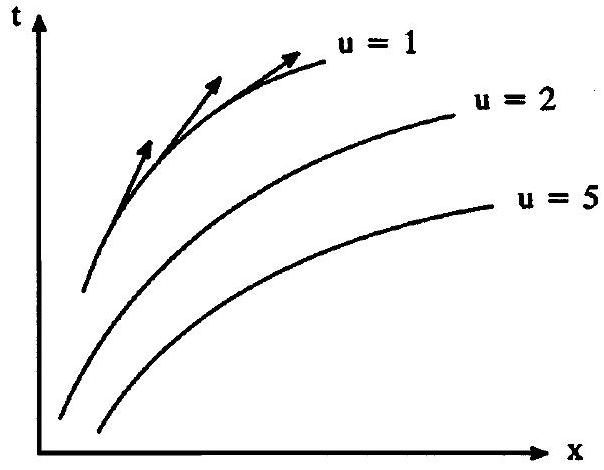
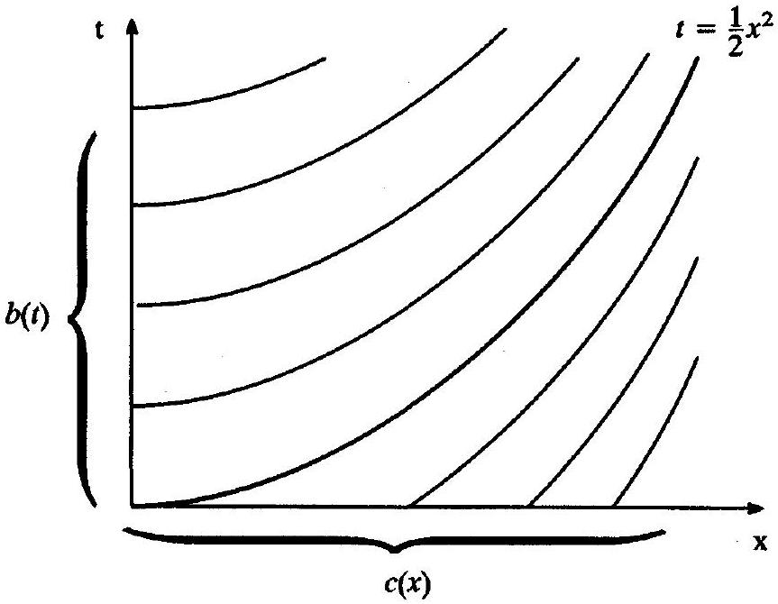
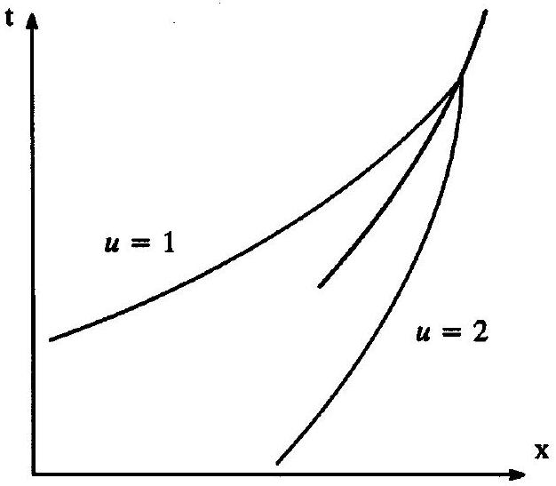
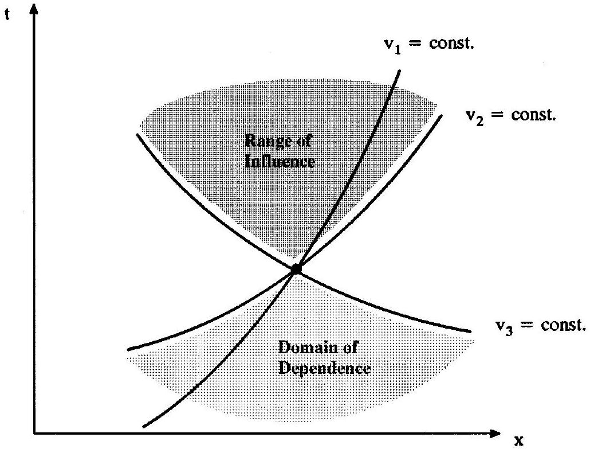
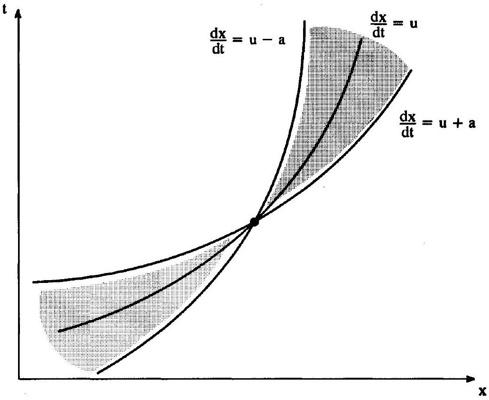
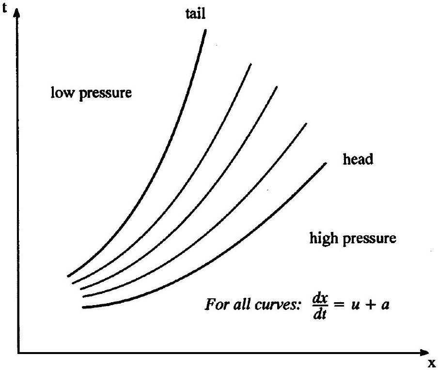
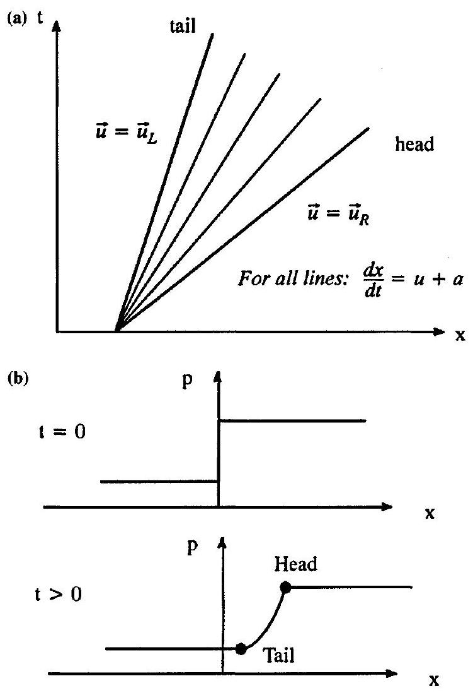
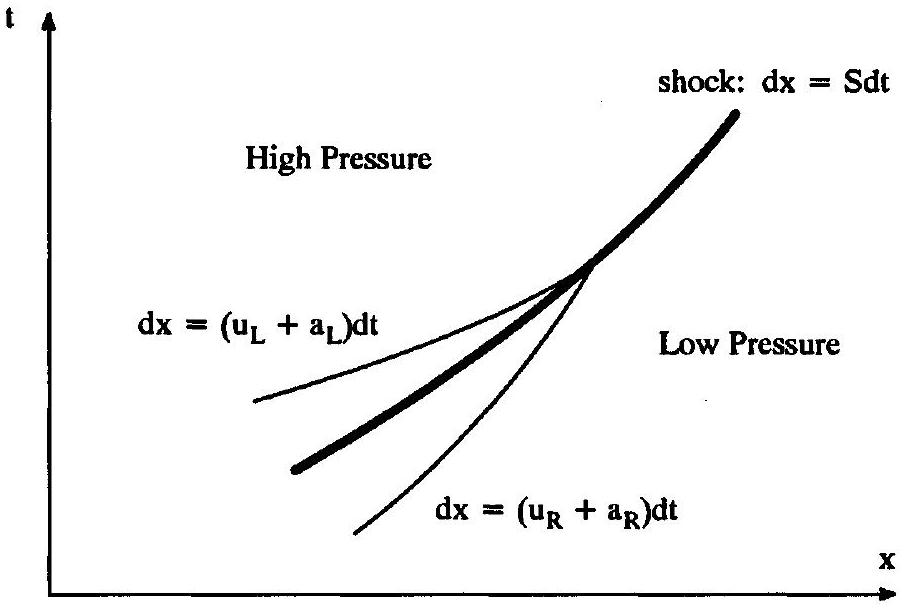
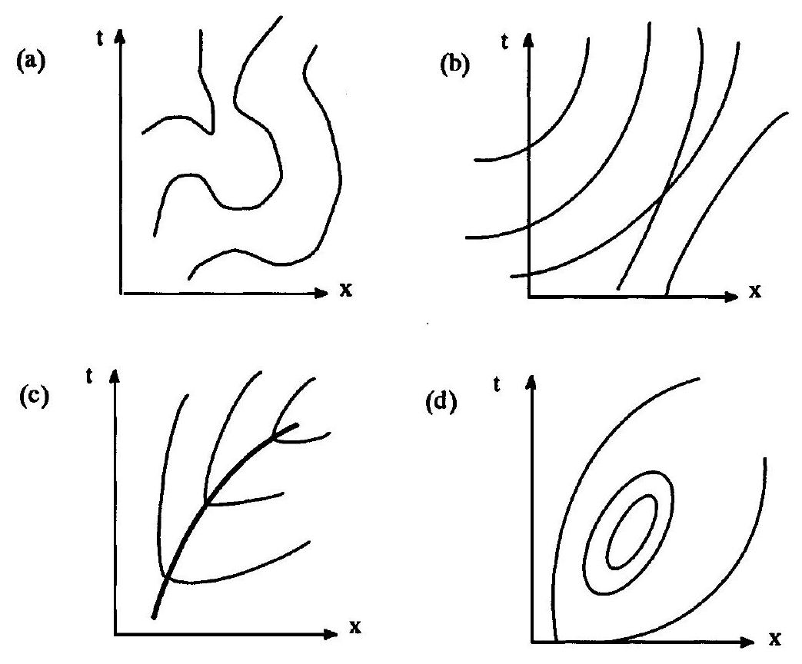
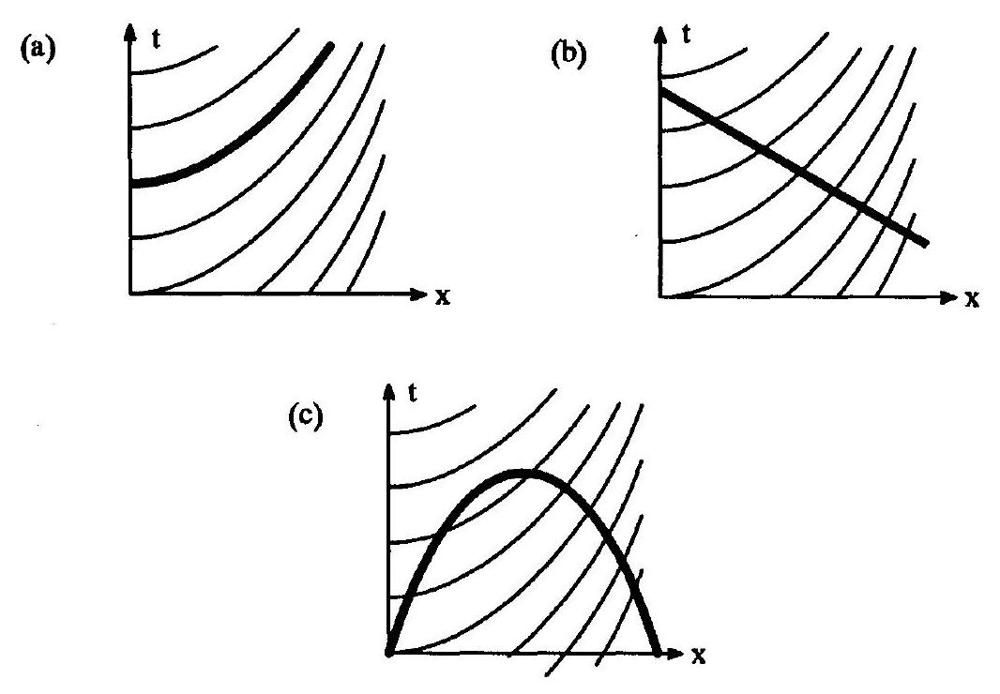

## CHAPTER 3

## Waves

### 3.0 Introduction

The last chapter explained changes in conserved quantities in terms of fluxes. This chapter explains changes in conserved quantities in terms of waves, a description every bit as complete and compelling as the flux description.

Everyone knows intuitively what waves are, but how are they actually defined? Tipler (1976) says "wave motion can be thought of as the transport of energy and momentum from one point in space to another without the transport of matter. In mechanical waves, e.g., water waves, waves on a string, or sound waves, the energy and momentum are transported by means of a disturbance in the medium which is propagated because the medium has elastic properties." Most other elementary physics books contain a similar definition. However, although this definition has some useful elements, it does not fully suffice in our applications. For example, this definition says that waves "travel without transport of matter." But mass transport constitutes a type of wave in fluid dynamics.

For a more precise understanding of waves, consider the following simple partial differential equation:

$$
\frac{\partial u}{\partial t}+a \frac{\partial u}{\partial x}=0,
$$

where $a$ is constant. This is known as the linear advection equation. Suppose that the spatial domain is $-\infty<x<\infty$ and suppose that the initial conditions are

$$
u(x, 0)=u_{0}(x),
$$

where $u_{0}(x)$ is any function. Then the solution to the linear advection equation is

$$
u=u_{0}(x-a t),
$$

which is easily verified by substituting into the linear advection equation. According to this solution, the initial conditions propagate at a constant speed $a$ to the right for $a>0$ and to the left for $a<0$. This is the simplest possible example of a wave solution. The lines $x-a t=$ const. are called wavefronts, $u(x, t)$ is called the signal or wave information, $a$ is called the wave speed, and $u_{0}(x)$ is called the wave shape or wave form.

As another example, discussed in most freshman physics books, consider the onedimensional wave equation:

$$
\frac{\partial^{2} u}{\partial t^{2}}+a^{2} \frac{\partial^{2} u}{\partial x^{2}}=0
$$

where $a>0$ is constant. The solution to this wave equation is

$$
u=u_{1}(x-a t)+u_{2}(x+a t),
$$

where the wave shapes $u_{1}$ and $u_{2}$ depend on the boundary and initial conditions. This solution is a superposition of two wave solutions - right-running waves with wavefronts
$x-a t=$ const. and left-running waves with wavefronts $x+a t=$ const. The superposition of two waves may obscure the waveforms since it is neither purely $u_{1}$ nor purely $u_{2}$ but some linear combination that may or may not resemble $u_{1}$ or $u_{2}$. Elementary physics texts often focus on sinusoidal waveforms where, for example, $u_{1}=A_{1} \cos \left(k_{1} x-\omega_{1} t\right)$ and $u_{2}=A_{2} \cos \left(k_{2} x-\omega_{2} t\right)$. Small disturbances in elastic substances tend to create sinusoidal waves; for example, a small lateral displacement of a taut string or a small compression of a solid bar will tend to create sinusoidal waves due to the elastic or "springy" properties of the string or bar; these waves may, in turn, communicate themselves to the surrounding air. However, whereas air and other gases allow sinusoidal waves, they also allow many other waveforms. Indeed, the waves that appear in gasdynamics generally are not sinusoidal. Small sinusoidal waves are the concerns of acoustics and aeroacoustics, which are specialized topics not discussed in this text. In general, any small wave or small disturbance in a gas that travels at the speed of sound $a$ relative to the gas is called an acoustic wave or an acoustic disturbance, whether or not the waveform is sinusoidal.

In the linear advection equation and the one-dimensional wave equation, waves travel with a constant speed. However, in general, wave speeds may vary with position, time, and other factors. For example,

$$
u=u_{0}(x-a(u) t)
$$

and

$$
u=u_{0}(x-a(u, x, t) t)
$$

are perfectly valid wave solutions. Such waves preserve the initial waveform $u_{0}(x)$, although the initial waveform may be locally stretched or compressed due to variations in the wave speed $a$.

The linear advection equation and other equations preserve the initial waveform. However, more generally, the waveform may change in time due, for example, to viscosity or friction. In this case, the wave solution is generally no longer a function of the single variable $x-a t$ but is instead a function of $x$ and $t$ separately, and thus the main advantage of the wave description is lost. At best, the solution may be the product of some function of $t$ and some function of $x-a t$ such as $e^{-v t} u_{0}(x-a t)$, where $v$ is a constant associated with friction.

### 3.1 Waves for a Scalar Model Problem

As a simple scalar model problem, consider a first-order partial differential equation:

$$
\frac{\partial u}{\partial t}+a \frac{\partial u}{\partial x}=0,
$$

where $u=u(x, t)$. This equation is more general than it first appears - if the coefficient of $\partial u / \partial t$ is anything other than one, simply divide both sides of the equation by the coefficient of $\partial u / \partial t$ to put the equation in form (3.2). Equation (3.2) is linear if $a=$ const. and quasi-linear if $a=a(u, x, t)$. Linear or quasi-linear, this equation has wave solutions. To see this, first notice that

$$
\frac{\partial u}{\partial t}+a \frac{\partial u}{\partial x}=(1, a) \cdot\left(\frac{\partial u}{\partial t}, \frac{\partial u}{\partial x}\right)=(1, a) \cdot \nabla u .
$$

Figure 3.1 A typical wave diagram for a scalar model problem.

In other words, $\frac{\partial u}{\partial t}+a \frac{\partial u}{\partial x}$ is a directional derivative in the $x-t$ plane in the direction ( $1, a$ ). Then, in English, Equation (3.2) says there is no change in the solution $u$ in the direction of $(1, a)$ in the $x-t$ plane. Now consider a curve $x=x(t)$ that is everywhere tangent to $(1, a)$ in the $x-t$ plane. The slope of the vector $(1, a)$ is $a$ and the slope of the curve $x=x(t)$ is $d x / d t$. Then

$$
\frac{d x}{d t}=a .
$$

Then Equation (3.2) is equivalent to the following:

$$
\quad u=\text { const. for } \frac{d x}{d t}=a \text {. }
$$

This is a wave solution - the curves $d x / d t=a$ are wavefronts, $u$ is the signal or wave information, and $a$ is the wave speed. The wavefronts $d x / d t=a$ are sometimes also called characteristics curves or simply characteristics. There are infinitely many wavefronts coating the entire $x-t$ plane. A few select wavefronts are illustrated in Figure 3.1. The space-time vectors ( $1, a$ ) are also shown in a few instances to emphasize that the wavefronts are always parallel to $(1, a)$. Plots of wavefronts, such as Figure 3.1, are known as wave diagrams.

Example 3.1 Solve the following quasi-linear partial differential equation:

$$
x \frac{\partial u}{\partial t}+\frac{\partial u}{\partial x}=0 .
$$

Suppose the domain is $x \geq 0, t \geq 0$. Also, suppose the initial conditions are $u(x, 0)=c(x)$ and the boundary conditions are $u(0, t)=b(t)$.

Solution Divide the partial differential equation by $x$ and apply Equation (3.3):

$$
u=\text { const } . \text { for } \frac{d x}{d t}=\frac{1}{x}
$$

or

$$
u=\text { const } . \text { for } t=\frac{1}{2} x^{2}+\text { const } .
$$

Figure 3.2 Wave diagram for Example 3.1.

The wavefronts $t=x^{2} / 2+$ const. are parabolas as illustrated in Figure 3.2. The easy part is done. To complete the solution, the value of $u$ on each wavefront must be determined using the initial and boundary conditions. Notice that wavefronts with $t \leq x^{2} / 2$ pass through the positive $x$ axis and wavefronts with $t>x^{2} / 2$ pass through the positive $t$ axis. Now consider any point ( $x_{1}, t_{1}$ ). The wavefront passing through ( $x_{1}, t_{1}$ ) is

$$
t-t_{1}=\frac{1}{2}\left(x^{2}-x_{1}^{2}\right) .
$$

If $t_{1} \leq x_{1}^{2} / 2$ this wavefront intersects the positive $x$ axis at $x=x_{0}$, where

$$
-t_{1}=\frac{1}{2}\left(x_{0}^{2}-x_{1}^{2}\right) .
$$

Solving this expression for $x_{0}$ gives

$$
x_{0}=\sqrt{x_{1}^{2}-2 t_{1}} .
$$

Then $u\left(x_{1}, t_{1}\right)=u\left(x_{0}, 0\right)=c\left(x_{0}\right)$, since any two points on the same wavefront have the same value of $u$, and this implies

$$
u\left(x_{1}, t_{1}\right)=c\left(\sqrt{x_{1}^{2}-2 t_{1}}\right) .
$$

Similarly, if $t_{1}>x_{1}^{2} / 2$ the wavefront intersects the positive $t$ axis at $t=t_{0}$, where

$$
t_{0}-t_{1}=-\frac{1}{2} x_{1}^{2} .
$$

Solving this expression for $t_{0}$ gives

$$
t_{0}=t_{1}-\frac{1}{2} x_{1}^{2} .
$$

Then $u\left(x_{1}, t_{1}\right)=u\left(0, t_{0}\right)=b\left(t_{0}\right)$, since any two points on the same wavefront have the same value of $u$, and this implies

$$
u\left(x_{1}, t_{1}\right)=b\left(t_{1}-\frac{1}{2} x_{1}^{2}\right) .
$$

After dropping the subscripts, which are no longer needed, we obtain the final solution:

$$
u(x, t)= \begin{cases}c\left(\sqrt{x^{2}-2 t}\right) & t \leq \frac{1}{2} x^{2}, \\ b\left(t-\frac{1}{2} x^{2}\right) & t>\frac{1}{2} x^{2} .\end{cases}
$$

In this example, and in general, it is extremely important to specify proper boundary and initial conditions. In particular, the boundary and initial conditions must be chosen so that each wavefront passes through one and only one boundary or initial condition. If a wavefront passes through more than one boundary or initial condition, the two conditions may yield conflicting values for $u$; in this case, the problem is over specified. However, if a wavefront does not pass through any boundary or initial condition, there is no way to determine the value of $u$ on the characteristic; in this case, the problem is under specified. In either case, under specified or over specified, the problem is said to be ill-posed. Otherwise the problem is well-posed.

In the above example, it was relatively easy to solve $d x / d t=a$. In other cases, however, this ordinary differential equation may have no analytic solution such as, for example, $a=\cos (x t)$. In such cases, the wave description given by Equation (3.3) is not as useful.

The wavefronts illustrated in Figures 3.1 and 3.2 never intersect. However, as shown in Figure 3.3, this is not always the case. A conflict occurs when two wavefronts with different signals meet. For example, in Figure 3.3, $u=1$ and $u=2$ both cannot be true. Such conflicts can only be resolved by a jump discontinuity in the solution, known as a shock wave, shown by the bold curve in Figure 3.3. Shock waves are different from other waves. For example, shock waves are not described by Equation (3.3). Instead, shock waves are governed by jump relations and the theory of weak solutions. Shock waves are the "black hole" of waves - they

Figure 3.3 Wave diagram for a shock wave in a scalar model problem.

absorb any waves they meet, effectively destroying them and the signals they carry. Notice that shocks can occur any time wavefronts converge, despite the fact that the boundary and initial conditions may be completely smooth and continuous.

This section has introduced a number of important concepts. These concepts will be fleshed out in subsequent sections and will play a vital role in the remainder of the text.

### 3.2 Waves for a Vector Model Problem

Consider a system of first-order partial differential equations:

$$
\frac{\partial \mathbf{u}}{\partial t}+A \frac{\partial \mathbf{u}}{\partial x}=0,
$$

where $\mathbf{u}=\mathbf{u}(x, t)$ and $A$ is a square matrix. This equation is more general than it first appears - if the coefficient of $\partial \mathbf{u} / \partial t$ is an invertible matrix, simply multiply both sides of the equation by the inverse of the matrix to put the equation in form (3.4). This equation is linear if $A=$ const. and quasi-linear if $A=A(\mathbf{u}, x, t)$. An equation or system of equations with a complete wave description is sometimes called hyperbolic. For example, Equation (3.2) is always hyperbolic, as seen in the last section. On the other hand, the system of Equations (3.4) is hyperbolic if and only if $A$ is diagonalizable. In other words, the system of Equations (3.4) is hyperbolic if and only if

$$
Q^{-1} A Q=\Lambda
$$

for some matrix $Q$, where $\Lambda$ is a diagonal matrix. More specifically, $\Lambda$ is a diagonal matrix whose diagonal elements $\lambda_{i}$ are characteristic values or eigenvalues of $A, Q$ is a matrix whose columns $\mathbf{r}_{i}$ are right characteristic vectors or right eigenvectors of $A$, and $Q^{-1}$ is a matrix whose rows $\mathbf{l}_{i}$ are left characteristic vectors or left eigenvectors of $A$. As most readers will recall from elementary linear algebra, right characteristic vectors are defined as follows:

$$
A \mathbf{r}_{i}=\lambda_{i} \mathbf{r}_{i} .
$$

While less familiar, left characteristic vectors are defined in almost the same way as right characteristic vectors, except that left characteristic vectors multiply $A$ on the left rather than on the right. In particular

$$
\mathbf{l}_{i}^{T} A=\lambda_{i} \mathbf{l}_{i}^{T}
$$

or, equivalently,

$$
A^{T} \mathbf{l}_{i}=\lambda_{i} \mathbf{l}_{i} .
$$

Multiply both sides of Equation (3.4) by $Q^{-1}$ to obtain

$$
\text { - } \quad Q^{-1} \frac{\partial \mathbf{u}}{\partial t}+Q^{-1} A \frac{\partial \mathbf{u}}{\partial x}=0 \text {. }
$$

This is called a characteristic form of equation (3.4). We define characteristic variables $\mathbf{v}$ as follows:

$$
\text { - } \quad d \mathbf{v}=Q^{-1} d \mathbf{u} \text {. }
$$

Then the characteristic form becomes

$$
\frac{\partial \mathbf{v}}{\partial t}+Q^{-1} A Q \frac{\partial \mathbf{v}}{\partial x}=0
$$

or

$$
\quad \frac{\partial \mathbf{v}}{\partial t}+\Lambda \frac{\partial \mathbf{v}}{\partial x}=0
$$

This is also called the characteristic form. This time the characteristic form is written in terms of the characteristic variables $\mathbf{v}$ rather than in terms of the conservative variables $\mathbf{u}$. (Compare the material in this section to the material in Section 2.4.)

The characteristic form is a wave form. To see this, consider the $i$-th equation in (3.10):

$$
\frac{\partial v_{i}}{\partial t}+\lambda_{i} \frac{\partial v_{i}}{\partial x}=0
$$

This is like Equation (3.2) except that, for quasi-linear systems of equations, $\lambda_{i}$ depends on all of the characteristic variables and not just on the single characteristic variable $v_{i}$. Despite this difference, the same analysis applies so that by Equation (3.3)

$$
v_{i}=\text { const. for } \frac{d x}{d t}=\lambda_{i} \text {. }
$$

The curves $d x=\lambda_{i} d t$ are called wavefronts or characteristics; the variables $v_{i}$ are called signals or information carried by the waves or characteristic variables; and the characteristic values $\lambda_{i}$ are called wave speeds or characteristic speeds or signal speeds. The term "characteristic" is used here because the analysis depends heavily on the characteristic values and characteristic vectors of matrix $A$. Using this terminology, Equation (3.12) says that the $i$-th characteristic variable is constant along the $i$-th characteristic curve.

For a system of $N$ equations, there are $N$ families of waves. Thus, there are $N$ characteristics passing through each point in the $x-t$ plane. This is illustrated in Figure 3.4 for $N=3$. A point in the $x-t$ plane is obviously only influenced by points at earlier times and can obviously only influence points at later times. However, because influence spreads in finitespeed waves, a point in the $x-t$ plane is not influenced by every point at earlier times and does not influence every point at later times. Instead, a point in the $x-t$ plane is influenced only by points in a finite domain of dependence and influences only points in a finite range of influence. The domain of dependence and range of influence are bounded on the right and left by the waves with the greatest and least speeds, respectively, as seen in Figure 3.4.

In a well-posed problem, the range of influence of the initial and boundary conditions should exactly encompass the entire flow in the $x-t$ plane. Put in the reverse sense, in a well-posed problem, the domain of dependence of every point in the $x-t$ plane should contain the boundary or initial conditions. Put yet another way, each of the three waves passing through a point in the $x-t$ plane should carry a different signal from the initial or boundary conditions; a wave carries a signal from the initial or boundary conditions if it originates in the initial or boundary conditions or if it intersects another wave carrying a signal from the initial or boundary conditions.

Although intersections between characteristics of different families are routine, as seen in Figure 3.4, intersections between characteristics of the same family are not - any intersection between two characteristics from the same family creates a shock wave. Shock

Figure 3.4 Typical wave diagram for a vector model problem.

waves are not governed by the ordinary characteristic equations, which originate in differential forms of the governing equations, but instead are governed by jump relations and the theory of weak solutions, which originate in integral forms of the governing equations.

The characteristic variables are defined by the equation $d \mathbf{v}=Q^{-1} d \mathbf{u}$. Unfortunately, this differential equation may not always have an analytic solution. Hence, whereas $d \mathbf{v}$ is always analytically defined, v may not be. For this reason, it is common to write Equation (3.12) as follows:

$$
\text { - } \quad d v_{i}=0 \text { for } \frac{d x}{d t}=\lambda_{i} \text {. }
$$

The relations $d v_{i}=0$ are sometimes called compatibility relations. Similarly, in some cases, the ordinary differential equation $d x / d t=\lambda_{i}$ may not have an analytic solution. The wave description is of more limited use when either $d v_{i}=0$ or $d x / d t=\lambda_{i}$ lack an analytical solution.

### 3.3 The Characteristic Form of the Euler Equations

The last chapter introduced the conservation form and the primitive variable form of the Euler equations. This section concerns a third form called the characteristic form. The unsteady Euler equations are hyperbolic, that is, they have a full wave description. To see this, first recall that the primitive variable form of the Euler equations can be written as

$$
\frac{\partial \mathbf{w}}{\partial t}+C \frac{\partial \mathbf{w}}{\partial x}=0,
$$

where

$$
\mathbf{w}=\left[\begin{array}{c}
\rho \\
u \\
p
\end{array}\right]
$$

and

$$
C=\left[\begin{array}{ccc}
u & \rho & 0 \\
0 & u & \frac{1}{\rho} \\
0 & \rho a^{2} & u
\end{array}\right]
$$

As shown later, in Subsection 3.3.1, $C$ is diagonalizable and

$$
Q_{C}^{-1} C Q_{C}=\Lambda
$$

where

$$
\begin{aligned}
& Q_{C}=\left[\begin{array}{ccc}
1 & \frac{\rho}{2 a} & -\frac{\rho}{2 a} \\
0 & \frac{1}{2} & \frac{1}{2} \\
0 & \frac{\rho a}{2} & -\frac{\rho a}{2}
\end{array}\right], \\
& Q_{C}^{-1}=\left[\begin{array}{ccc}
1 & 0 & -\frac{1}{a^{2}} \\
0 & 1 & \frac{1}{\rho a} \\
0 & 1 & -\frac{1}{\rho a}
\end{array}\right]
\end{aligned}
$$

and

$$
\quad \quad \Lambda=\left[\begin{array}{ccc}
u & 0 & 0 \\
0 & u+a & 0 \\
0 & 0 & u-a
\end{array}\right]
$$

Then, by Equation (3.8), a characteristic form of the Euler equations is as follows:

$$
Q_{C}^{-1} \frac{\partial \mathbf{w}}{\partial t}+Q_{C}^{-1} C \frac{\partial \mathbf{w}}{\partial x}=0
$$

or

- $\frac{\partial \rho}{\partial t}+u \frac{\partial \rho}{\partial x}-\frac{1}{a^{2}}\left(\frac{\partial p}{\partial t}+u \frac{\partial p}{\partial x}\right)=0$,
- $\quad \frac{\partial u}{\partial t}+(u+a) \frac{\partial u}{\partial x}+\frac{1}{\rho a}\left(\frac{\partial p}{\partial t}+(u+a) \frac{\partial p}{\partial x}\right)=0$,
- $\frac{\partial u}{\partial t}+(u-a) \frac{\partial u}{\partial x}-\frac{1}{\rho a}\left(\frac{\partial p}{\partial t}+(u-a) \frac{\partial p}{\partial x}\right)=0$.

By Equation (3.10), a characteristic form that involves characteristic rather than primitive variables is

$$
\frac{\partial \mathbf{v}}{\partial t}+\Lambda \frac{\partial \mathbf{v}}{\partial x}=0
$$

or

$$
\begin{aligned}
& \frac{\partial v_{0}}{\partial t}+u \frac{\partial v_{0}}{\partial x}=0, \\
& \frac{\partial v_{+}}{\partial t}+(u+a) \frac{\partial v_{+}}{\partial x}=0, \\
& \frac{\partial v_{-}}{\partial t}+(u-a) \frac{\partial v_{-}}{\partial x}=0,
\end{aligned}
$$

where

$$
d \mathbf{v}=Q_{C}^{-1} d \mathbf{w}
$$

or

$$
\begin{aligned}
& d v_{0}=d \rho-\frac{d p}{a^{2}} \\
& d v_{+}=d u+\frac{d p}{\rho a} \\
& d v_{-}=d u-\frac{d p}{\rho a}
\end{aligned}
$$

In the last several equations, the characteristic variables are subscripted by ( $0,+,-$ ) rather than by $(1,2,3)$. Different sources order the characteristic variables differently. For example, many sources list the characteristic variables in order of ascending wave speeds, in which case $(1,2,3)=(-, 0,+)$, whereas other sources list the characteristic variables in order of descending waves speeds, in which case $(1,2,3)=(+, 0,-)$. Although $(1,2,3)$ may refer to different characteristics, $(0,+,-)$ always refers to the same characteristics, as defined above, by standard convention.

By Equation (3.13), the Euler equations can be written as

- $\quad d v_{0}=d \rho-\frac{d p}{a^{2}}=0$ for $d x=u d t$,
- $d v_{+}=d u+\frac{d p}{\rho a}=0$ for $d x=(u+a) d t$,
- $\quad d v_{-}=d u-\frac{d p}{\rho a}=0$ for $d x=(u-a) d t$.

Integrating the compatibility relations, these equations become

$$
\begin{aligned}
& s=\text { const. for } d x=u d t \\
& v_{+}=u+\int \frac{d p}{\rho a}=\text { const. for } d x=(u+a) d t \\
& v_{-}=u-\int \frac{d p}{\rho a}=\text { const. for } d x=(u-a) d t .
\end{aligned}
$$

Therefore, in general, only the first compatibility relation is fully analytically integrable. To prove Equation (3.21a'), recall that

$$
s=c_{v} \ln p-c_{p} \ln \rho+\mathrm{const}
$$

Then

$$
d s=c_{v} \frac{d p}{p}-c_{p} \frac{d \rho}{\rho}=-\frac{c_{p}}{\rho}\left(d \rho-\frac{c_{v}}{c_{p}} \frac{\rho}{p} d p\right)
$$

But Equation (2.6) says $\gamma=c_{p} / c_{v}$ and Equation (2.11) says $a^{2}=\gamma p / \rho$. Thus

$$
d s=-\frac{c_{p}}{\rho}\left(d \rho-\frac{d p}{a^{2}}\right)=-\frac{c_{p}}{\rho} d v_{0}
$$

Then $d v_{0}=0$ is equivalent to $d s=0$, which is trivially integrated to obtain $s=$ const. This proves Equation (3.21a'). Also, Equation (3.19a) becomes

$$
\quad \frac{D s}{D t}=\frac{\partial s}{\partial t}+u \frac{\partial s}{\partial x}=0
$$

where $D / D t$ is the substantial derivative defined by Equation (2.33). Recall that the substantial derivative is the time rate of change following the fluid. Thus Equations (3.19a') and (3.21a') tell us that the entropy is constant following the fluid.

Compare Equation (3.19a') with Equation (2.37). These equations are nearly identical: Equation (2.37) says that the substantial derivative of the entropy is greater than or equal to zero, while Equation ( $3.19 a^{\prime}$ ) says that the substantial derivative of the entropy is exactly equal to zero. Which one is correct? Well, like all differential forms, the characteristic form applies everywhere except across jump discontinuities or, in particular, shocks. Then Equations (3.19a') and (3.21a') imply that entropy is constant following the gas except across shocks. This is a natural consequence of ignoring viscosity and other entropy-generating effects in the Euler equations (there is nothing in the Euler equations to generate entropy except for shocks). If entropy is constant following the gas, the flow is called isentropic. Then Equations (3.19a') and (3.21a') imply that the flow is isentropic except at shocks. Notice that the Euler equations imply the second law of thermodynamics except at shocks or, in other words, Equation (3.19a') implies Equation (2.37) except at shocks, where Equation (3.19a') does not apply. Only at shocks do the Euler equations need explicit supplementation by the second law of thermodynamics. At shocks, the second law of thermodynamics, as given by Equation (2.37), implies that the entropy increases following the gas, that is, shocks generate entropy. Shocks are discussed further in Section 3.6.

The characteristic form can also be derived from the conservation form of the Euler equations. Recall that the conservation form of the Euler equations can be written as

$$
\frac{\partial \mathbf{u}}{\partial t}+A \frac{\partial \mathbf{u}}{\partial x}=0
$$

where

$$
\mathbf{u}=\left[\begin{array}{c}
\rho \\
\rho u \\
\rho e_{\mathrm{T}}
\end{array}\right]
$$

and

$$
A=\left[\begin{array}{ccc}
0 & 1 & 0 \\
\frac{\gamma-3}{2} u^{2} & (3-\gamma) u & \gamma-1 \\
-\gamma u e_{\mathrm{T}}+(\gamma-1) u^{3} & \gamma e_{\mathrm{T}}-\frac{3}{2}(\gamma-1) u^{2} & \gamma u
\end{array}\right] .
$$

Then

$$
Q_{A}^{-1} A Q_{A}=\Lambda,
$$

where

$$
\begin{aligned}
& Q_{A}=\left[\begin{array}{ccc}
1 & \frac{\rho}{2 a} & -\frac{\rho}{2 a} \\
u & \frac{\rho}{2 a}(u+a) & -\frac{\rho}{2 a}(u-a) \\
\frac{u^{2}}{2} & \frac{\rho}{2 a}\left(\frac{u^{2}}{2}+\frac{a^{2}}{\gamma-1}+a u\right) & -\frac{\rho}{2 a}\left(\frac{u^{2}}{2}+\frac{a^{2}}{\gamma-1}-a u\right)
\end{array}\right], \\
& Q_{A}^{-1}=\frac{\gamma-1}{\rho a}\left[\begin{array}{ccc}
\frac{\rho}{a}\left(-\frac{u^{2}}{2}+\frac{a^{2}}{\gamma-1}\right) & \frac{\rho}{a} u & -\frac{\rho}{a} \\
\frac{u^{2}}{2}-\frac{a u}{\gamma-1} & -u+\frac{a}{\gamma-1} & 1 \\
-\frac{u^{2}}{2}-\frac{a u}{\gamma-1} & u+\frac{a}{\gamma-1} & -1
\end{array}\right],
\end{aligned}
$$

and $\Lambda$ is just as before. By Equation (2.13), Equation (3.23a) can also be written as

$$
Q_{A}=\left[\begin{array}{ccc}
1 & \frac{\rho}{2 a} & -\frac{\rho}{2 a} \\
u & \frac{\rho}{2 a}(u+a) & -\frac{\rho}{2 a}(u-a) \\
\frac{u^{2}}{2} & \frac{\rho}{2 a}\left(h_{\mathrm{T}}+a u\right) & -\frac{\rho}{2 a}\left(h_{\mathrm{T}}-a u\right)
\end{array}\right] \text {. }
$$

It can be shown that

$$
d \mathbf{v}=Q_{A}^{-1} d \mathbf{u}=Q_{C}^{-1} d \mathbf{w}
$$

In other words, the characteristic variables are the same regardless of whether they are derived from the primitive variables or the conservative variables. Similarly, characteristic forms such as (3.19) and (3.21) are the same, regardless of whether they are derived from the primitive variable form or the conservation form of the Euler equations. Although the results are always the same, the conservation form requires more involved algebra than the primitive variable form, as we shall see later, in Subsection 3.3.1.

Consider the differential equations $d v_{i}=0$ and $d x / d t=\lambda_{i}$ which appear in Equation (3.21). As seen above, only the first compatibility relation $d v_{0}=d p-a^{2} d \rho=0$ can be analytically integrated. Also, $\lambda_{i}$ is a function of $u$ and $a$. Thus $d x / d t=\lambda_{i}$ cannot be integrated until $u$ and $a$ are known, and $u$ and $a$ are unknown until the problem is solved, which is a classic "Catch 22." The inability to analytically integrate $d v_{i}=0$ and $d x / d t=\lambda_{i}$ limits the utility of the wave description of the Euler equations. The big exceptions to this situation are simple waves, as described in Section 3.4.

### 3.3.1 Examples

In this subsection, a few of the results seen above will be derived as examples. After studying these examples, the reader should be able to derive any of the results given above. For convenience, this subsection will use numbered indices ( $1,2,3$ ) rather than $(0,+,-)$.

Example 3.2 Derive Equation (3.17).
Solution The characteristic values of $C$ are the solutions of $\operatorname{det}(\lambda I-C)=0$.
But

$$
\begin{aligned}
\operatorname{det}(\lambda I-C) & =\left|\begin{array}{ccc}
\lambda-u & -\rho & 0 \\
0 & \lambda-u & -\frac{1}{\rho} \\
0 & -\rho a^{2} & \lambda-u
\end{array}\right| \\
& =(\Lambda-u)\left[(\lambda-u)^{2}-a^{2}\right] .
\end{aligned}
$$

Then the characteristic values of $C$ are $\lambda_{1}=u, \lambda_{2}=u+a$, and $\lambda_{3}=u-a$, which lead immediately to Equation (3.17).

Example 3.3 Find the left and right characteristic vectors of matrix $C$ associated with $\lambda_{1}=u$, where $C$ is given by Equation (2.40).

Solution To find the right characteristic vector associated with $\lambda_{1}=u$, solve the following system of equations:

$$
(u I-C) \mathbf{r}=\left[\begin{array}{ccc}
0 & -\rho & 0 \\
0 & 0 & -\frac{1}{\rho} \\
0 & -\rho a^{2} & 0
\end{array}\right]\left[\begin{array}{l}
r_{1} \\
r_{2} \\
r_{3}
\end{array}\right]=\left[\begin{array}{l}
0 \\
0 \\
0
\end{array}\right]
$$

This is equivalent to

$$
r_{2}=r_{3}=0 .
$$

The value $r_{1}$ is arbitrary. Thus any right characteristic value associated with $\lambda_{1}=u$ can be written as follows:

$$
\mathbf{r}_{C 1}=(\text { const } .)\left[\begin{array}{l}
1 \\
0 \\
0
\end{array}\right]
$$

where "const." is any functional factor. You might think that "const." has to be a constant real number. However, when working in functional spaces, a "constant" may be any function, such as $\rho$ or $a^{2}$.

To find the left characteristic vector associated with $\lambda_{1}=u$, solve the following system of equations:

$$
(u l-C)^{T} \mathbf{I}=\left[\begin{array}{ccc}
0 & 0 & 0 \\
-\rho & 0 & -\rho a^{2} \\
0 & -\frac{1}{\rho} & 0
\end{array}\right]\left[\begin{array}{l}
l_{1} \\
l_{2} \\
l_{3}
\end{array}\right]=\left[\begin{array}{l}
0 \\
0 \\
0
\end{array}\right] .
$$

This is equivalent to

$$
l_{1}+a^{2} l_{3}=0, \quad l_{2}=0
$$

Thus any left characteristic value associated with $\lambda_{1}=u$ can be written as follows:

$$
\mathbf{l}_{C 1}=\text { (const.) }\left[\begin{array}{c}
1 \\
0 \\
-\frac{1}{a^{2}}
\end{array}\right]
$$

Example 3.4 Derive Equations (3.15) and (3.16).
Solution Using a process similar to that seen in the last example, the right and left characteristic vectors associated with $\lambda_{2}=u+a$ are found to be

$$
\mathbf{r}_{C 2}=(\text { const } .)\left[\begin{array}{c}
\frac{1}{\rho a} \\
1 \\
\rho a
\end{array}\right]
$$

and

$$
\mathbf{l}_{C 2}=\text { (const.) }\left[\begin{array}{c}
0 \\
1 \\
\frac{1}{\rho a}
\end{array}\right]
$$

and the right and left characteristic vectors associated with $\lambda_{3}=u-a$ are found to be

$$
\mathbf{r}_{C 3}=\text { (const.) }\left[\begin{array}{c}
-\frac{1}{\rho a} \\
-1 \\
\rho a
\end{array}\right]
$$

and

$$
\mathbf{I}_{C 3}=\text { (const.) }\left[\begin{array}{c}
0 \\
1 \\
-\frac{1}{\rho a}
\end{array}\right]
$$

To form the matrices $Q_{C}$ and $Q_{C}^{-1}$, choose the functional factors "const." in the characteristic vectors such that

$$
\mathbf{r}_{C i} \cdot \mathbf{l}_{C j}=\delta_{i j}= \begin{cases}1 & i=j, \\ 0 & i \neq j .\end{cases}
$$

Then $Q_{C}$ is a matrix whose columns are the right characteristic vectors. This is sometimes expressed as follows:

$$
Q_{C}=\left[\mathbf{r}_{C 1}\left|\mathbf{r}_{C 2}\right| \mathbf{r}_{C 3}\right] .
$$

Also $Q_{C}^{-1}$ is a matrix whose rows are left characteristic vectors. This is sometimes expressed as follows:

$$
Q_{C}^{-1}=\left[\mathbf{l}_{C 1}\left|\mathbf{l}_{C 2}\right| \mathbf{l}_{C 3}\right]^{T}
$$

In general, $Q_{C}$ and $Q_{C}^{-1}$ can be written as

$$
Q_{C}=\left[\begin{array}{ccc}
\frac{1}{c_{1}} & \frac{\rho}{2 a c_{2}} & -\frac{\rho}{2 a c_{3}} \\
0 & \frac{1}{2 c_{2}} & \frac{1}{2 c_{3}} \\
0 & \frac{\rho a}{2 c_{2}} & -\frac{\rho a}{2 c_{3}}
\end{array}\right]
$$

and

$$
Q_{C}^{-1}=\left[\begin{array}{ccc}
c_{1} & 0 & -\frac{c_{1}}{a^{2}} \\
0 & c_{2} & \frac{c_{2}}{\rho a} \\
0 & c_{3} & -\frac{c_{3}}{\rho a}
\end{array}\right] \text {, }
$$

where $c_{1}, c_{2}$, and $c_{3}$ are any functional factors. Equations (3.15) and (3.16) are obtained by choosing $c_{1}=c_{2}=c_{3}=1$.

Example 3.5 Derive Equation (3.23) for $Q_{A}$.
Solution Equation (3.23) can be derived directly just as in the last example. Alternatively, recall that

$$
C=Q^{-1} A Q,
$$

where

$$
Q=\left[\begin{array}{ccc}
1 & 0 & 0 \\
u & \rho & 0 \\
\frac{1}{2} u^{2} & \rho u & \frac{1}{\gamma-1}
\end{array}\right]
$$

Then

$$
\Lambda=Q_{C}^{-1} C Q_{C}=Q_{C}^{-1}\left(Q^{-1} A Q\right) Q_{C}=\left(Q Q_{C}\right)^{-1} A\left(Q Q_{C}\right)
$$

and thus

$$
Q_{A}=Q Q_{C},
$$

which yields Equation (3.23).

Example 3.6 Derive Equation (3.20a) from the conservation form of the Euler equations.

$$
\begin{aligned}
& \text { Solution The first row of } d \mathbf{v}=Q_{A}^{-1} d \mathbf{u} \text { yields } \\
& d v_{1}=\mathbf{l}_{1} \cdot d \mathbf{u},
\end{aligned}
$$

where $\mathbf{l}_{1}$ is the first row of $Q_{A}^{-1}$. Referring to Equations (2.18) and (3.24), we get

$$
\begin{aligned}
d v_{1}=\mathbf{l}_{1} \cdot d \mathbf{u} & =-\frac{\gamma-1}{a^{2}}\left[\frac{u^{2}}{2}-\frac{a^{2}}{\gamma-1},-u, 1\right] \cdot\left[d \rho, d(\rho u), d\left(\rho e_{T}\right)\right] \\
& =-\frac{\gamma-1}{a^{2}}\left[\left(\frac{u^{2}}{2}-\frac{a^{2}}{\gamma-1}\right) d \rho-u d(\rho u)+d\left(\rho e_{T}\right)\right]
\end{aligned}
$$

By Equation (2.10)

$$
d\left(\rho e_{\mathrm{T}}\right)=d\left(\frac{1}{\gamma-1} p+\frac{1}{2} \rho u^{2}\right)=\frac{1}{\gamma-1} d p+\frac{1}{2} u^{2} d \rho+\rho u d u .
$$

Then

$$
\begin{aligned}
d v_{1}= & -\frac{\gamma-1}{a^{2}}\left[\left(\frac{u^{2}}{2}-\frac{a^{2}}{\gamma-1}\right) d \rho-u(\rho d u+u d \rho) \frac{1}{\gamma-1} d p\right. \\
& \left.+\frac{1}{2} u^{2} d \rho+\rho u d u\right]
\end{aligned}
$$

or

$$
d v_{1}=d \rho-\frac{d p}{a^{2}},
$$

which agrees with Equation (3.20a) after accounting for the difference between the (1,2,3) and $(0,+,-)$ indexing. Of course, the primitive variable form yields the same result for much less effort.

### 3.3.2 Physical Interpretation

There is a beautiful physical connection between the flow physics and the mathematics of characteristics. Consider the first characteristic family. The wave speed $\lambda_{1}$ equals the flow speed $u$, whereas the wavefronts $d x=\lambda_{1}=u d t$ equal the pathlines. Then the first family of waves travels with the fluid. As seen in Equation (3.21a'), the signal is entropy; thus waves from the first family of characteristics are sometimes called entropy waves.

Now consider the other two families of characteristics. If $d x=u d t$ corresponds to travel with the local flow speed $u$, then $d x=(u+a) d t$ corresponds to travel at the local flow speed plus the local speed of sound, whereas $d x=(u-a) d t$ corresponds to travel at the local flow speed minus the local speed of sound. In either case, the wave speed is the speed of sound relative to the flow. As mentioned in Section 3.0, such waves are called acoustic waves. Unlike that of entropy waves, the signal carried by acoustic waves is not very easy to describe; in fact, the signal carried by acoustic waves does not correspond to any well-known physical quantity.

Figure 3.5 Typical wave diagram for the Euler equations.

The acoustic waves define a domain of dependence and range of influence for any point in the $x-t$ plane. For example, Figure 3.5 illustrates the domain of dependence and range of influence for supersonic flow traveling in the positive $x$ direction ( $u<a<0$ ). For supersonic flow traveling in the negative $x$ direction $(u<-a<0)$, all wave speeds are negative, and thus all three characteristic curves slope to the left. For subsonic flow traveling in the positive $x$ direction ( $0<u<a$ ), two wave speeds are positive and one wave speed is negative; and for subsonic flow traveling in the negative $x$ direction ( $-a<u<0$ ), two wave speeds are negative and one wave speed is positive. Notice that supersonic flows force all waves to travel in one direction - all waves are swept downwind and none can travel upwind - whereas subsonic flows allow acoustic waves to travel in both directions. Thus, for example, it is impossible to have a conversation in supersonic flow; the upwind person can speak, and the downwind person can listen, but not vice versa.

In summary, the natural wave speeds in compressible flow are the flow speed and the speed of sound relative to the flow. Except for shock waves (described in Section 3.6), all information travels through the fluid at one of these three natural wave speeds. Compare this situation to that of an incompressible flow. In an incompressible flow, the wave speeds are assumed to be infinite. Then all regions of fluid can communicate with all other regions of fluid instantly, and the domain of dependence and range of influence equal the entire fluid.

### 3.4 Simple Waves

The complicated nonlinear interactions between the three characteristics prevent analytical integration of $d x=\lambda_{i} d t$ and $d x / d t=\lambda_{i}$. However, these nonlinear interactions
can be reduced or eliminated if one or two characteristic variables are constant. For example, suppose that entropy is constant everywhere, and not just along the characteristic curves $d x=u d t$; then the flow is called homentropic. As seen in the last chapter, for homentropic flow of a perfect gas

$$
\begin{aligned}
& p=(\text { const. }) \rho^{\gamma}, \\
& a=(\text { const. }) \rho^{(\gamma-1) / 2} .
\end{aligned}
$$

These expressions can be used to express $d p / \rho a$ entirely in terms of $a$. In particular, a short calculation proves the following:

$$
\int \frac{d p}{\rho a}=\frac{2 a}{\gamma-1}+\text { const } .
$$

Then Equation (3.21) becomes

$$
\begin{array}{ll}
s=\text { const. } & \\
v_{+}=u+\frac{2 a}{\gamma-1}=\text { const. } & \text { for } d x=(u+a) d t, \\
v_{-}=u-\frac{2 a}{\gamma-1}=\text { const. } & \text { for } d x=(u-a) d t .
\end{array}
$$

The characteristic variables $v_{ \pm}=u \pm 2 a /(\gamma-1)$ are also known as Riemann invariants.
Assuming constant entropy, $d v_{i}=0$ can be analytically integrated but $d x=\lambda_{i} d t$ still cannot be analytically integrated. But suppose that, in addition to entropy, another characteristic variable is also constant. By assuming that two characteristic variables are constant, and that only one characteristic variable is not constant, the complicated nonlinear interactions among characteristic variables are completely eliminated, which allows a complete analytical integration of the characteristic equations. For example, suppose $s=$ const. and $v_{-}=u-2 a /(\gamma-1)=$ const. As usual, $v_{+}=u+2 a /(\gamma-1)=$ const. along the characteristics $d x=(u+a) d t$. But then all three characteristic variables are constant along the characteristics $d x=(u+a) d t$. If all three characteristic variables are constant, then so are all three conservative variables, or all three primitive variables, or any other set of variables. In short, all flow variables are constant along the characteristics $d x=(u+a) d t$. In particular, $u$ and $a$ are constant along the characteristics $d x=(u+a) d t$. Then $d x=(u+a) d t$ can be trivially integrated, yielding

$$
x=(u+a) t+\text { const } .
$$

Thus the characteristics are straight lines. Of course, the other two families of characteristic curves are not straight lines; however, they are irrelevant, since the associated characteristic variables are constant everywhere, not just along those special characteristic curves.

To summarize:
Assuming $s=$ const. and $v_{-}=u-2 a /(\gamma-1)=$ const. then all flow properties are constant along the characteristic lines $x=(u+a) t+$ const.

Similarly, one can show that:
Assuming $s=$ const. and $v_{+}=u+2 a /(\gamma-1)=$ const. then all flow properties are constant along the characteristic lines $x=(u-a) t+$ const.

Finally, one can show that:

- Assuming $v_{-}=$const. and $v_{+}=$const. then all flow properties are constant along the characteristics lines $x=u t+$ const .

Any region of flow governed by Equations (3.39), (3.40), or (3.41) is called a simple wave. More specifically, flow regions governed by Equation (3.39) or (3.40) are called simple acoustic waves, whereas flows governed by Equation (3.41) are called simple entropy waves. Two regions of steady uniform flow are always separated by simple waves, steadily moving shocks, or steadily moving contacts.

Consider simple acoustic waves. There are many alternatives to Equations (3.39) and (3.40). For example, one intriguing way to write Equation (3.39) is as follows:

$$
\frac{\partial(u+a)}{\partial t}+(u+a) \frac{\partial(u+a)}{\partial x}=0 .
$$

In this form, Equation (3.39) involves only the single variable $u+a$. Similarly, Equation (3.40) can be written as

$$
\frac{\partial(u-a)}{\partial t}+(u-a) \frac{\partial(u-a)}{\partial x}=0 .
$$

Now consider simple entropy waves. Simple entropy waves are defined by $v_{+}=$const. and $v_{-}=$const. If these equations are added and subtracted, one obtains $u=$ const. and $a=$ const. Hence the velocity and speed of sound are constant throughout a simple entropy wave. Then Equation (3.41) can be written as

$$
\frac{\partial s}{\partial t}+u \frac{\partial s}{\partial x}=0,
$$

where $u=$ const. There is nothing special about the choice of entropy in this equation. For example, this equation could just as well have been written in terms of density:

$$
\frac{\partial \rho}{\partial t}+u \frac{\partial \rho}{\partial x}=0 .
$$

Other variables can also be used, although probably $u$ or $a$ should be avoided since these are constant everywhere in the flow and not just along characteristics.

### 3.5 Expansion Waves

An expansion wave decreases pressure and density. For a one-dimensional flow of perfect gas, an expansion wave is any region in which the wave speed $\lambda_{2}=u+a$ or $\lambda_{3}=u-a$ increases monotonically from left to right. More specifically, an expansion occurs when

$$
\quad u(x, t)+a(x, t) \leq u(y, t)+a(y, t), \quad b_{1}(t) \leq x \leq y \leq b_{2}(t)
$$

or

$$
\quad u(x, t)-a(x, t) \leq u(y, t)-a(y, t), \quad b_{1}(t) \leq x \leq y \leq b_{2}(t) \text {. }
$$

A typical expansion is illustrated in Figure 3.6. The figure shows only the characteristics in the family creating the expansion; the other two families of characteristics are not shown.

Figure 3.6 Wave diagram for an expansion in the Euler equations.

Now let us describe some of the properties of expansion waves. Expansion waves are always composed of acoustic waves - entropy waves cannot create expansions. An expansion wave is composed of characteristics; in particular, the boundaries $b_{1}(t)$ and $b_{2}(t)$ are characteristics. The boundary on the high-pressure side is called the head of the expansion. Similarly, the boundary on the low-pressure side is called the tail of the expansion. The first derivatives of pressure, density, and so forth may be discontinuous across the head and tail of an expansion; fortunately, these discontinuous derivatives can be handled naturally within the context of characteristics without resorting to weak solution theory.

A simple expansion wave is an expansion wave that is also a simple wave. Simple expansion waves separate regions of steady uniform flow. A centered expansion fan is an expansion wave in which all characteristics originate from a single point in the $x-t$ plane, either a jump discontinuity in the initial conditions or an intersection between shocks or contact discontinuities. The term "fan" is used because, in a wave diagram, it looks like an old-fashioned hand fan. A simple centered expansion fan is, obviously, an expansion wave that is both simple and centered. A simple centered expansion fan is illustrated in Figure 3.7.

Example 3.7 Assume $s=$ const. and $u+2 a /(\gamma-1)=$ const. Suppose a simple expansion fan centered on $(x, t)=(0,0)$ connects the two steady uniform flows $\mathbf{u}_{L}$ and $\mathbf{u}_{R}$. Find $u$, $a$, and $p$ in the expansion fan as functions of $x$ and $t$.

Solution If $u+2 a /(\gamma-1)=$ const. then

$$
u+\frac{2 a}{\gamma-1}=u_{L}+\frac{2 a_{L}}{\gamma-1}=u_{R}+\frac{2 a_{R}}{\gamma-1} .
$$

By Equation (3.40), all flow properties are constant along the characteristics $x=(u-a) t$ (notice that these characteristics all pass through the origin $(x, t)=(0,0)$ as required). But

Figure 3.7 (a) Wave diagram for a simple centered expansion fan in the Euler equations. (b) Pressure as a function of $x$ for a simple centered expansion fan in the Euler equations.

$x=(u-a) t$ implies $a=u-x / t$. Then

$$
u+\frac{2}{\gamma-1}\left(u-\frac{x}{t}\right)=u_{L}+\frac{2 a_{L}}{\gamma-1}=u_{R}+\frac{2 a_{R}}{\gamma-1} .
$$

Solving for $u$ yields

$$
\begin{aligned}
u(x, t) & =\frac{2}{\gamma+1}\left(\frac{x}{t}+\frac{\gamma-1}{2} u_{L}+a_{L}\right) \\
& =\frac{2}{\gamma+1}\left(\frac{x}{t}+\frac{\gamma-1}{2} u_{R}+a_{R}\right) .
\end{aligned}
$$

This is the solution for the velocity in the expansion. Also, $a=u-x / t$ yields

$$
\begin{aligned}
a(x, t) & =\frac{2}{\gamma+1}\left(\frac{x}{t}+\frac{\gamma-1}{2} u_{L}+a_{L}\right)-\frac{x}{t} \\
& =\frac{2}{\gamma+1}\left(\frac{x}{t}+\frac{\gamma-1}{2} u_{R}+a_{R}\right)-\frac{x}{t} .
\end{aligned}
$$

This is the solution for the speed of sound in the expansion. Finally, the isentropic relations found in Equation (2.16) yield

$$
p=p_{L}\left(\frac{a}{a_{L}}\right)^{2 \gamma /(\gamma-1)}=p_{R}\left(\frac{a}{a_{R}}\right)^{2 \gamma /(\gamma-1)} .
$$

This is the solution for the pressure in the expansion. Equations (3.47), (3.48), and (3.49) hold for $b_{1}(t) \leq x \leq b_{2}(t)$. The boundary $b_{1}(t)$ is a characteristic line $x / t=u_{L}-a_{L}$ and the boundary $b_{2}(t)$ is a characteristic line $x / t=u_{R}-a_{R}$.

Notice that $u, a, p$, and all other flow properties in the simple centered expansion fan depend on $x / t$ rather than on $x$ or $t$ separately. This implies that the expansion waveform remains the same in time except for a uniform stretching. More specifically, plots of $u\left(x, t_{1}\right)$ and $u\left(x, t_{2}\right)$ look exactly the same for all $t_{1}>0$ and $t_{2}>0$ except for a constant scaling factor in the $x$ direction. Such waves are called self-similar.

### 3.6 Compression Waves and Shock Waves

A compression wave increases pressure and density. For a one-dimensional flow of perfect gas, a compression wave occurs when the wave speed $\lambda_{2}=u+a$ or $\lambda_{3}= u-a$ decreases monotonically from left to right. More specifically, a compression occurs when

$$
u(x, t)+a(x, t) \geq u(y, t)+a(y, t), \quad b_{1}(t) \leq x \leq y \leq b_{2}(t)
$$

or

$$
\quad u(x, t)-a(x, t) \geq u(y, t)-a(y, t), \quad b_{1}(t) \leq x \leq y \leq b_{2}(t) \text {. }
$$

Now let us describe some of the properties of compression waves. Compression waves are always composed of acoustic waves - entropy waves cannot create compressions. A compression wave is composed of characteristics; in particular, the boundaries $b_{1}(t)$ and $b_{2}(t)$ are characteristics. The first derivatives of pressure, density, and so forth may be discontinuous across the boundaries of a compression wave; fortunately, these discontinuous derivatives can be handled naturally within the context of characteristics without resorting to weak solution theory.

A simple compression wave is a compression wave that is also a simple wave. Simple compression waves separate regions of steady uniform flow. A centered compression fan is a compression wave in which all characteristics converge on a single point. A simple centered compression fan is, obviously, a compression wave that is both simple and centered.

As we have seen, the characteristics in an expansion diverge whereas the characteristics in a compression converge. Although divergence can continue forever, convergence cannot - instead, converging characteristics must eventually meet. An intersection between two or more characteristics from the same family creates a shock wave. A shock wave is a jump discontinuity governed by the Rankine-Hugoniot relations:

$$
\mathbf{f}_{R}-\mathbf{f}_{L}=S\left(\mathbf{u}_{R}-\mathbf{u}_{L}\right),
$$

Figure 3.8 Wave diagram for a shock wave in the Euler equations.

where $S$ is the shock speed, $\mathbf{f}_{L, R}$ are the flux vectors on the left- and right-hand sides of the shock, and $\mathbf{u}_{L, R}$ are the vectors of conserved quantities on the left- and right-hand sides of the shock. Furthermore, shocks must satisfy the following compression condition:

$$
\quad u_{L}+a_{L} \geq S \geq u_{R}+a_{R}
$$

or

$$
\quad u_{L}-a_{L} \geq S \geq u_{R}-a_{R} \text {. }
$$

Hence the wave speed just to the left of the shock is greater than the shock speed, which is, in turn, greater than the wave speed just to the right of the shock. A shock wave may originate in a jump discontinuity in the initial conditions or it may form spontaneously from a smooth compression wave. Figure 3.8 illustrates a typical shock wave.

Equation (3.51) can be seen as a natural consequence of the compression condition (3.50). Alternatively, Equation (3.51) can be seen as a natural consequence of the second law of thermodynamics. In smooth flow regions, the Euler equations imply the second law of thermodynamics, as seen in Equations (3.19a') and (3.21a'). In other words, any smooth solution of the Euler equations automatically satisfies the second law of thermodynamics. In contrast, the Euler equations do not imply the second law of thermodynamics across shocks. Instead, a separate condition is required across shocks, such as Equation (3.51). In short, for the one-dimensional Euler equations, the second law of thermodynamics amounts to inequality (3.51) at shocks. The second law of thermodynamics and the perfect gas relations also imply that entropy, pressure, density, temperature, and the speed of sound all increase as fluid passes through a shock. Also, for a steadily moving shock, the second law of thermodynamics requires that the Mach number $M=u / a$ must decrease from greater than one to less than one in a coordinate system moving with the shock.

Real gases may reverse the shock relationships. For example, in a real gas, shocks may decrease rather than increase pressure and density - this is called an expansion shock. However, although the nature of the fluid as specified by the equations of state may affect other aspects of shocks, the second law of thermodynamics always requires that the
wave speed just to the left of the shock must be greater than the shock speed, which must be, in turn, greater than the wave speed just to the right of the shock, just as in Equation (3.51).

Suppose that a shock has a constant speed $S$. Then the shock separates two regions of uniform flow $\mathbf{u}_{L}$ and $\mathbf{u}_{R}$. The Rankine-Hugoniot relations applied in a coordinate system moving with the shock yield

$$
\begin{aligned}
& \rho_{L}\left(u_{L}-S\right)=\rho_{R}\left(u_{R}-S\right) \\
& \rho_{L}\left(u_{L}-S\right)^{2}+p_{L}=\rho_{R}\left(u_{R}-S\right)^{2}+p_{R} \\
& h_{L}+\frac{1}{2}\left(u_{L}-S\right)^{2}=h_{R}+\frac{1}{2}\left(u_{R}-S\right)^{2}
\end{aligned}
$$

Notice that the movement of the coordinate system only affects velocity $u$ and not scalars such as $\rho$ and $p$. Manipulating Equations (3.52) yields the following useful result:

$$
e_{R}-e_{L}=\frac{p_{R}+p_{L}}{2}\left(\frac{1}{\rho_{L}}-\frac{1}{\rho_{R}}\right),
$$

which is known as the Hugoniot relation. This is proven, for example, in Anderson (1990).
It is often convenient to express shock properties in terms of the pressure ratio $p_{L} / p_{R}$. For example, for a steady right-running shock

$$
\begin{aligned}
& \frac{T_{L}}{T_{R}}=\frac{a_{L}^{2}}{a_{R}^{2}}=\frac{p_{L}}{p_{R}} \frac{\frac{\gamma+1}{\gamma-1}+\frac{p_{L}}{p_{R}}}{1+\frac{\gamma+1}{\gamma-1} \frac{p_{L}}{p_{R}}} \\
& u_{L}=u_{R}+\frac{a_{R}}{\gamma} \frac{\frac{p_{L}}{p_{R}}-1}{\sqrt{\frac{\gamma+1}{2 \gamma}}\left(\frac{p_{L}}{p_{R}}-1\right)+1}
\end{aligned}
$$

and

$$
S=u_{R}+a_{R} \sqrt{\frac{\gamma+1}{2 \gamma}\left(\frac{p_{L}}{p_{R}}-1\right)+1} .
$$

These three equations (with a few minor differences) are derived in Anderson (1990) using the Hugoniot relation. There are a great number of other useful shock relations, as described in Anderson (1990) or in any basic text on compressible flow or gasdynamics. This section describes only the relations needed in the rest of the book.

### 3.7 Contact Discontinuities

Nearby characteristics must converge, diverge, or precisely parallel each other. As we have seen, convergence in acoustic characteristics creates compression waves or shock waves, whereas divergence in acoustic characteristics creates expansion waves. This section discusses a third possibility: parallel entropy waves creating neither compression nor expansion. In particular, a contact discontinuity occurs when the wave speed $\lambda_{1}=u$ and pressure are continuous while other flow properties jump. In other words, for a contact discontinuity

$$
\begin{aligned}
u_{L} & =u_{R}, \\
p_{L} & =p_{R} .
\end{aligned}
$$

In multidimensional flows, contact discontinuities are also called slip lines or vortex sheets.

Let us compare and contrast shocks with contact discontinuities. Like shocks, contact discontinuities are jump discontinuities. Unlike shocks, fluid does not pass through contact discontinuities; instead, since $u$ is the same on both sides, contact discontinuities move with the fluid. Entropy may change across a contact discontinuity, as in shocks. However, contact discontinuities do not create entropy, unlike shocks, but simply separate regions with different entropies. The second law of thermodynamics says that entropy must increase following the fluid. However, no fluid passes through a contact; thus the second law does not apply across a contact; thus entropy, density, energy, and all other flow properties may either increase or decrease across a contact, unlike shocks. Like shocks, contact discontinuities obey the Rankine-Hugoniot relations. Unlike shocks, contacts cannot form spontaneously: They must originate either in the initial conditions or in the intersection of two shocks.

## References

Anderson, J. D. 1990. Modern Compressible Flow, New York: McGraw-Hill, Chapter 7.
Courant, R., and Friedrichs, K. O. 1948. Supersonic Flow and Shock Waves, New York:
Springer-Verlag, Chapter 3.
Hirsch, C. 1990. Numerical Computation of Internal and External Flows, Volume 2: Computational
Methods for Inviscid and Viscous Flows, Chichester: Wiley, Chapter 16.
Paterson, A. R. 1983. A First Course in Fluid Dynamics, New York: Cambridge, Chapter 14.
Tipler, P. A. 1976. Physics, New York: Worth, Chapters 21-25.

## Problems

3.1 The wave diagrams in Figure 3.9 each illustrate one family of characteristics. In each case, state whether the wave diagram is physically possible. Explain.
3.2 Consider the partial differential equation seen in Example 3.1. Suppose boundary and initial conditions are given along the bold curves shown in Figure 3.10. In each case, state whether the boundary and initial conditions are well-posed. Explain.
3.3 Consider the following partial differential equation:

$$
e^{x} \frac{\partial u}{\partial t}+t \frac{\partial u}{\partial x}=0
$$

Write this equation in the form " $u=$ const. for $t=t(x)$."
3.4 Consider the following system of partial differential equations:

$$
\begin{aligned}
& \frac{\partial u_{1}}{\partial t}+\frac{\partial u_{2}}{\partial x}=0, \\
& \frac{\partial u_{2}}{\partial t}+\frac{\partial u_{3}}{\partial x}=0, \\
& \frac{\partial u_{3}}{\partial t}+4 \frac{\partial u_{1}}{\partial x}-17 \frac{\partial u_{2}}{\partial x}+8 \frac{\partial u_{3}}{\partial x}=0 .
\end{aligned}
$$

Is this system of equations hyperbolic? In other words, does this system have a complete set of characteristics? If so, write the system of equations in the characteristic form $\frac{\partial \mathrm{v}}{\partial t}+\Lambda \frac{\partial \mathrm{v}}{\partial x}=$ 0 , where $\Lambda$ is a diagonal matrix. Also, write the system of equations in the form " $v_{i}=$ const. for $x=\lambda_{i} t+$ const." Sketch the range of influence and domain of dependence for a typical point in the $x-t$ plane.

Figure 3.9 Wave diagrams for Problem 3.1.

Figure 3.10 Wave diagrams for Problem 3.2.

3.5 Consider the Euler equations governing isothermal flow, given in Problem 2.4.
(a) For the Jacobian matrix $A$ found in Problem 2.4b, find the characteristic values, left characteristic vectors, and right characteristic vectors.
(b) Using the results of part (a), find a matrix $Q$ that diagonalizes $A$. Also find $Q^{-1}$.
(c) Using the results of parts (a) and (b), write the isothermal Euler equations in the form $\frac{\partial \mathrm{v}}{\partial t}+\Lambda \frac{\partial \mathrm{v}}{\partial x}=0$, where $\Lambda$ is a diagonal matrix.
(d) Using the results of parts (a)-(c), write the isothermal Euler equations in the form " $d v_{i}=0$ when $d x=\lambda_{i} d t$." If possible, integrate the compatibility relations $d v_{i}=0$.
3.6 Total enthalpy is constant along streamlines in steady adiabatic flow. In other words $\frac{1}{2} u^{2}+\frac{1}{\gamma-1} a^{2}=$ const.
by Equation (2.13). In the Euler equations, replace conservation of energy by this algebraic equation. Then the conservation form of the Euler equations becomes
$\frac{\partial}{\partial t} \rho+\frac{\partial}{\partial x}(\rho u)=0$,
$\frac{\partial}{\partial t}(\rho u)+\frac{\partial}{\partial x}\left(\rho u^{2}+p\right)=0$,
$\frac{1}{2} u^{2}+\frac{1}{\gamma-1} a^{2}=$ const.
Show that this system of equations is hyperbolic, that is, that it has a complete set of characteristics, just like the original Euler equations. The steady-state solutions of the original and modified systems are the same. Thus the steady-state solutions can be found by time evolving the modified system of equations, rather than the original system, to steady state. Replacing a differential equation by an algebraic equation substantially reduces the costs.
3.7 Consider a one-dimensional tube containing stagnant standard sea-level air. A piston is impulsively inserted into the tube, creating a normal shock wave moving with Mach number 1.75 relative to the stagnant standard sea-level air. What is the piston velocity? You may find it helpful to use the shock tables found in the appendices of most texts on compressible flow or gasdynamics, which list the ratios of various flow properties across a shock as functions of the preshock Mach number. Just make sure to calculate the preshock Mach number moving with the shock. In fact, the entire problem should be done in a coordinate system moving with the shock. In a standard sea-level atmosphere, $a=340 \mathrm{~m} / \mathrm{sec}$.
3.8 Consider the Lagrange equations, as seen in Problem 2.7. Show that the characteristic form of the Lagrange equations can be written as follows:
$\frac{\partial v^{+}}{\partial t}=-c \frac{\partial v^{+}}{\partial m}$,
$\frac{\partial v^{-}}{\partial t}=c \frac{\partial v^{-}}{\partial m}$,
$\frac{\partial v^{0}}{\partial t}=0$,
where $c=\rho a$ is the Lagrangean speed of sound and where the characteristic variables are defined as follows:
$d v^{+}=d u+\frac{1}{c} d p$,
$d v^{-}=d u-\frac{1}{c} d p$,
$d v^{0}=d p+c^{2} d v$.

