## CHAPTER 4

## Scalar Conservation Laws

### 4.0 Introduction

This chapter concerns simple scalar models of the Euler equations, called scalar conservation laws. Scalar conservation laws mimic the Euler equations, to the extent that any single equation can mimic a system of equations. In order to stress the parallels between scalar conservation laws and the Euler equations, the first part of this chapter essentially repeats the last two chapters, albeit in a highly abbreviated and simplified fashion. As a result, besides its inherent usefulness, the first part of this chapter also serves as a nice review and reinforcement of the last two chapters.

Like the Euler equations, scalar conservation laws can be written in integral or differential forms. In integral forms, scalar conservation laws look exactly like Equation (2.21) except that the vector of conserved quantities $\mathbf{u}$ is replaced by a single scalar conserved quantity $u$, and the flux vector $\mathbf{f}(\mathbf{u})$ is replaced by a single scalar flux function $f(u)$. Similarly, in differential forms, scalar conservation laws look exactly like Equations (2.27) and (2.30) except that the vector of conserved quantities $\mathbf{u}$ is replaced by a single scalar conserved quantity $u$, the flux vector $\mathbf{f}(\mathbf{u})$ is replaced by a single scalar flux function $f(u)$, and the Jacobian matrix $A(\mathbf{u})$ is replaced by a single scalar wave speed $a(u)$, not to be confused with the speed of sound.

Replacing several interlinked conserved quantities by a single conserved quantity dramatically simplifies the governing equations while retaining much of the essential physics. In particular, scalar conservation laws can model simple compression waves, simple expansion waves, shock waves, and contact discontinuities. Like simple waves in the Euler equations, scalar conservation laws have a complete analytical characteristic solution. Furthermore, like simple waves in the Euler equations, the characteristics of scalar conservation laws are always straight lines in the $x-t$ plane. However, scalar conservation laws cannot model nonsimple waves, since nonsimple waves result from interactions between various families of characteristics, whereas scalar conservation laws only have one family of characteristics. The two most important scalar conservation laws are the linear advection equation, which models simple entropy waves and contacts, and Burgers' equation, which models simple acoustic waves and shocks.

The second law of thermodynamics selects physically relevant solutions of the Euler equations in the presence of shocks. To model physically relevant solutions, scalar conservation laws require an entropy condition analogous to the second law of thermodynamics. Entropy conditions can take the form of an integral or differential inequality analogous to Equations (2.17), (2.26), or (2.37). Alternatively, entropy conditions can take the form of an algebraic inequality at shocks analogous to Equation (3.51).

Although of little inherent interest, scalar conservation laws are prized as models of the Euler equations. In this capacity, scalar conservation laws serve a valuable pedagogical role throughout the rest of the book. Rather than explain methods and concepts for the Euler equations directly, the book will often first explain them for scalar conservation laws, and
then explain the extension to the Euler equations. In other words, rather than taking one giant step, scalar conservation laws permit two baby steps.

### 4.1 Integral Form

Assume that there is a conserved quantity with density $u=u(x, t)$ and flux $f= f(u)$. In other words, assume that there is a conserved quantity that is only affected by flux; furthermore, assume that the flux is purely a function of the conserved quantity and does not depend independently on $x, t$, or on any other conserved quantities. The flux function $f$ can be any continuously differentiable function of $u$. Specific choices for $u$ and $f$ will be discussed later in the chapter. (Be careful not to confuse the conserved quantity $u$ seen in this chapter with the velocity $u$ seen in the last two chapters.)

Consider an arbitrary one-dimensional region $[a, b]$ during time interval $\left[t_{1}, t_{2}\right]$. The scalar conservation law can be stated as follows:

- change in total conserved quantity in $[a, b]$ in time interval $\left[t_{1}, t_{2}\right]=$ net flux through the boundaries of $[a, b]$ in time interval $\left[t_{1}, t_{2}\right]$.

This translates to mathematics immediately as follows:

$$
\quad \int_{a}^{b}\left[u\left(x, t_{2}\right)-u\left(x, t_{1}\right)\right] d x=-\int_{t_{1}}^{t_{2}}[f(u(b, t))-f(u(a, t))] d t
$$

which is the integral form of the scalar conservation law. This is analogous to the integral form of the Euler equations, as given by Equation (2.21).

### 4.2 Conservation Form

By the fundamental theorem of calculus

$$
u\left(x, t_{2}\right)-u\left(x, t_{1}\right)=\int_{t_{1}}^{t_{2}} \frac{\partial u}{\partial t} d t
$$

and

$$
f(u(b, t))-f(u(a, t))=\int_{a}^{b} \frac{\partial f}{\partial x} d x
$$

Then Equation (4.1) becomes

$$
\int_{t_{1}}^{t_{2}} \int_{a}^{b}\left(\frac{\partial u}{\partial t}+\frac{\partial f(u)}{\partial x}\right) d x d t=0
$$

or

$$
\quad \frac{\partial u}{\partial t}+\frac{\partial f(u)}{\partial x}=0 .
$$

This is the conservation form of the scalar conservation law and is analogous to the conservation form of the Euler equations, as seen in Equation (2.27).

The solutions of the integral form (4.1) may contain jump discontinuities. Discontinuous solutions of the integral form (4.1) are called weak solutions of the differential form (4.2). Jump discontinuities in the differential form must satisfy a jump condition derived
from the integral form. For a jump discontinuity traveling at speed $S$, the jump condition is

$$
f\left(u_{R}\right)-f\left(u_{L}\right)=S\left(u_{R}-u_{L}\right),
$$

which is analogous to the Rankine-Hugoniot relations, Equation (2.32).
Using the chain rule, the conservation form may be rewritten as

- $\frac{\partial u}{\partial t}+a(u) \frac{\partial u}{\partial x}=0$,
where
- $a(u)=\frac{d f}{d u}$.

These expressions are analogous to Equations (2.30), (2.31), and (3.10).

### 4.3 Characteristic Form

Equation (4.4) is the characteristic form of the scalar conservation law. To see this, notice that Equation (4.4) is a quasi-linear partial differential equation in the form of Equation (3.2). By Equation (3.3)

$$
u=\text { const } . \text { for } \frac{d x}{d t}=a(u)
$$

But $a(u)$ is constant since $u$ is constant. Thus $d x / d t=a(u)$ can be trivially integrated to obtain

$$
u=\text { const } . \quad \text { for } \quad x=a(u) t+\text { const } .
$$

More specifically, if the characteristic passes through $\left(x_{0}, t_{0}\right)$ then

$$
u=u\left(x_{0}, t_{0}\right) \text { for } x-x_{0}=a(u)\left(t-t_{0}\right) .
$$

This is a wave solution - the lines $x=a(u) t+$ const. are wavefronts, $u$ is the signal, and $a$ is the wave speed or signal speed. For any given time $t, u(x, t)$ can also be called the waveform. The wavefronts $x=a(u) t+$ const. are also called characteristics, $u$ is also called the characteristic variable, and $a$ is also called the characteristic slope or characteristic speed.

For scalar conservation laws, the characteristics comprise a single family of straight lines. In other words, the conserved variable $u$ (which is also the characteristic variable) is constant along straight lines with slope $a(u)$ in the $x-t$ plane. Because there is only one family of waves, the waves travel entirely to the right or entirely to the left at each point in the $x-t$ plane, like supersonic flow in the Euler equations. The range of influence and domain of dependence are simple concepts for scalar conservation laws. The range of influence of ( $x, t$ ) is the characteristic line passing through ( $x, t$ ) for times greater than $t$. The domain of dependence of $(x, t)$ is the characteristic line passing through $(x, t)$ for times less than $t$. In other words, at each instant of time, each point influences exactly one point and is influenced by exactly one point.

Section 3.4 described simple waves for the Euler equations. In particular, simple waves involve two trivial families and one nontrivial family of characteristics. Scalar conservation
laws only ever have one family of characteristics. Thus, leaving aside shock waves and contacts, scalar conservation laws support only simple waves. The advantages of simple waves are the same for scalar conservation laws as for the Euler equations: straight-line characteristics, analytically integrable compatibility relations, and so forth, leading to a simple analytical solution.

### 4.4 Expansion Waves

Expansion waves were discussed in Section 3.5. Scalar conservation laws support features analogous to simple expansion waves. For scalar conservation laws, an expansion wave is any region in which the wave speed $a(u)$ increases from left to right. More specifically, an expansion occurs where

$$
\quad a(u(x, t)) \leq a(u(y, t)), \quad b_{1}(t) \leq x \leq y \leq b_{2}(t) \text {. }
$$

Note the similarity to Equation (3.46). A centered expansion fan is an expansion wave where all characteristics originate at a single point in the $x-t$ plane. Centered expansion fans must originate in the initial conditions or at intersections between shocks or contacts.

### 4.5 Compression Waves and Shock Waves

Compression and shock waves were discussed in Section 3.6. Scalar conservation laws support features analogous to simple compression and shock waves. For scalar conservation laws, a compression wave is any region in which the wave speed $a(u)$ decreases from left to right. More specifically, a compression wave occurs where

$$
\quad a(u(x, t)) \geq a(u(y, t)), \quad b_{1}(t) \leq x \leq y \leq b_{2}(t) .
$$

Note the similarity to Equation (3.50). A centered compression fan is a compression wave where all characteristics converge on a single point in the $x-t$ plane.

The converging characteristics in a compression wave must eventually intersect, creating a shock wave. A shock wave is a jump discontinuity governed by Equation (4.3), which can be rewritten as follows:

$$
S=\frac{f\left(u_{R}\right)-f\left(u_{L}\right)}{u_{R}-u_{L}}
$$

Thus the shock speed equals the slope of the secant line connecting $u_{L}$ and $u_{R}$. By the mean value theorem, Equation (4.10) implies

$$
S=f^{\prime}(\xi)=a(\xi)
$$

where $\xi$ is between $u_{L}$ and $u_{R}$. If you wish, you can think of $a(\xi)$ as an average of $a(u)$ for $u$ between $u_{L}$ and $u_{R}$. Then, in this sense, the shock speed equals an average wave speed. A shock wave may originate in a jump discontinuity in the initial conditions or it may form spontaneously from a smooth compression wave.

In addition to the jump condition (4.10), shock waves must satisfy the following condition:

$$
a\left(u_{L}\right) \geq S \geq a\left(u_{R}\right)
$$

This says that the wave speed just to the left of the shock is greater than the shock speed, which is, in turn, greater than the wave speed just to the right of the shock. Note the similarity to Equation (3.51). If we interpret the wave speeds as slopes in the $x-t$ plane, then Equation (4.12) implies that:

- Waves (characteristics) terminate on shocks. Waves (characteristics) never originate in shocks.

In other words, in keeping with the "black hole" notion of shocks, shocks only absorb waves; they never emit waves. Of course, the same holds true for shocks in the Euler equations. Equation (4.12) can be seen as a natural consequence of the compression condition (4.9). Alternatively, Equation (4.12) can be seen as a natural consequence of the second law of thermodynamics, or what passes for the second law of thermodynamics for scalar conservation laws, as discussed later in Section 4.10.

As defined in elementary calculus, a function $f(u)$ is convex or concave up if $f^{\prime \prime}(u)= a^{\prime}(u) \geq 0$ for all $u$. Then a scalar conservation law is convex if its flux function is convex. For convex scalar conservation laws, (4.12) is equivalent to the following:

$$
u_{L} \geq u_{R} .
$$

Convex scalar conservation laws model perfect gases, whereas nonconvex scalar conservation laws model real gases. For example, for a perfect gas, a jump discontinuity in the initial conditions of the Euler equations gives rise to at most one shock, one contact, and one simple centered expansion fan (i.e., one wave per conservation equation). Similarly, a jump discontinuity in the initial conditions of a convex scalar conservation law gives rise to at most one shock, or one contact, or one simple centered expansion fan (again, one wave per conservation equation). For a real gas, however, a jump discontinuity in the initial conditions may give rise to multiple shocks, multiple contacts, and multiple simple centered expansion fans. By the same token, a jump discontinuity in the initial conditions of a nonconvex scalar conservation law may give rise to multiple shocks, multiple contacts, or multiple expansion fans. Nonconvex scalar conservation laws will be discussed in Section 4.9.

### 4.6 Contact Discontinuities

Contact discontinuities were discussed in Section 3.7, Scalar conservation laws support features analogous to contact discontinuities. For scalar conservation laws, a contact discontinuity is a jump discontinuity from $u_{L}$ to $u_{R}$ such that

$$
a\left(u_{L}\right)=a\left(u_{R}\right) .
$$

Note the similarity to Equation (3.57). Like contacts in the Euler equations, contacts in scalar conservation laws must originate in the initial conditions or at the intersections of shocks.

### 4.7 Linear Advection Equation

The next three sections concern possible choices for the flux function $f(u)$ in scalar conservation laws. The simplest possible choice for the flux function is

$$
f(u)=a u,
$$

where $a=$ const. The resulting scalar conservation law is then

- $\frac{\partial u}{\partial t}+\frac{\partial(a u)}{\partial x}=\frac{\partial u}{\partial t}+a \frac{\partial u}{\partial x}=0$.

This scalar conservation law is called the linear advection equation or the linear convection equation. (Recall that the linear advection equation was already discussed briefly in Section 3.0, to help introduce waves.) Notice that the linear advection equation is convex.

What is the relationship between the linear advection equation and the Euler equations? Recall that simple entropy waves are governed by Equations (3.41), (3.44), or (3.45). In particular, Equations (3.44) and (3.45) are

$$
\begin{aligned}
& \frac{D s}{D t}=\frac{\partial s}{\partial t}+V \frac{\partial s}{\partial x}=0 \\
& \frac{D \rho}{D t}=\frac{\partial \rho}{\partial t}+V \frac{\partial \rho}{\partial x}=0
\end{aligned}
$$

where $V=$ const. is the velocity. Here $V$ is used for velocity to avoid confusion with the variable $u$ in the linear advection equation. Then the linear advection equation governs simple entropy waves where $a=V=$ const. and $u$ equals any flow variable such as $s$ or $\rho$.

Besides simple entropy waves, the linear advection equations also allow contact discontinuities - in fact, any jump discontinuity in the initial conditions obviously satisfies the contact condition (4.14). However, the linear advection equation does not allow shocks. This all makes sense since shocks are associated with acoustic waves, whereas contacts are associated with entropy waves. The linear advection equation models only entropy waves and thus models contacts but not shocks.

Suppose the initial conditions for the linear advection equation are $u(x, 0)$. By Equation (4.6), the linear advection equation has the following exact solution:

$$
u(x, t)=u(x-a t, 0)
$$

Hence the initial conditions move as a unit to the right ( $a>0$ ) or to the left ( $a<0$ ) without stretching. The existence of a simple exact solution makes the linear advection equation ideal for testing numerical methods (without an exact solution to compare against, it is impossible to fully judge the quality of a numerical approximation). Of course, all scalar conservation laws have an exact solution given by Equations (4.3), (4.6), and (4.14). However, the exact solution of other scalar conservation laws is generally far more complicated; for example, see Theorem 3.1 of Lax (1973).

Despite its seeming simplicity, the linear advection equation poses some heady challenges for numerical approximations. Most numerical approximations introduce a modest amount of false smearing. For shocks, which are naturally compressive, physical compression and numerical smearing reach a rapid equilibrium. However, contacts are naturally neutral, being neither compressive nor expansive. With nothing to oppose numerical smearing, typical numerical approximations smear contacts progressively wider and wider as time increases, almost as if they were expansions. Furthermore, besides jump discontinuities, the linear advection equation also retains corners, spikes, and any other nonsmooth features of the initial conditions. Nonlinear equations do not tend to retain jumps, corners, and so forth, but instead tend to smear and smooth such features. Unfortunately, most numerical
approximations tend to smear and smooth such features whether or not the governing equation is nonlinear.

As a word of caution, many modern numerical methods use the exact solution of the linear advection equation as an integral component, to circumvent the numerical difficulties mentioned in the last paragraph. Although there is nothing wrong with this practice per se, the linear advection equation no longer presents a completely fair test case for such methods - any method that knows the exact solution should have little trouble passing linear advection tests with flying colors.

### 4.8 Burgers' Equation

The simplest nonlinear choice of the flux function $f(u)$ is

$$
f(u)=\frac{1}{2} u^{2} .
$$

The resulting scalar conservation law is then

$$
\text { - } \quad \frac{\partial u}{\partial t}+\frac{\partial}{\partial x}\left(\frac{1}{2} u^{2}\right)=\frac{\partial u}{\partial t}+u \frac{\partial u}{\partial x}=0 \text {. }
$$

This scalar conservation law is called the inviscid Burgers' equation. As you might guess, given the appearance of the adjective "inviscid," there is also a viscous Burgers' equation. The viscous Burgers' equation will not be discussed in this book. Since there is no possibility for confusion, the inviscid Burgers' equation will usually be referred to simply as Burgers' equation. Notice that Burgers' equation is convex.

What is the relationship between the Burgers' equation and the Euler equations? Recall that simple acoustic waves are governed by Equations (3.39), (3.40), (3.42), and (3.43). In particular, Equations (3.42) and (3.43) are

$$
\begin{aligned}
& \frac{\partial(V+a)}{\partial t}+(V+a) \frac{\partial(V+a)}{\partial x}=0, \\
& \frac{\partial(V-a)}{\partial t}+(V-a) \frac{\partial(V-a)}{\partial x}=0,
\end{aligned}
$$

where $V$ is fluid velocity. As in the last section, $V$ is used for velocity to avoid confusion with the variable $u$ in Burgers' equation. Then the inviscid Burgers' equation governs simple acoustic waves where $u=V \pm a$.

Besides simple acoustic waves, the inviscid Burgers' equation also allows shocks. In fact, most solutions of Burgers' equation are quickly dominated by one or more shocks. However, Burgers' equation does not allow contacts; examining the contact condition (4.14), $a\left(u_{L}\right)=a\left(u_{R}\right)$ implies $u_{L}=u_{R}$, which is hardly a jump discontinuity. This all makes sense: Shocks are associated with acoustic waves, whereas contacts are associated with entropy waves. Burgers' equation models only acoustic waves and thus models shocks but not contacts. Burgers' equation and the linear advection equation, between the two of them, model both acoustic and entropy waves. Thus the linear advection equation and Burgers' equation model all three families of characteristics of the Euler equations.

Example 4.1 Solve Burgers' equation on an infinite domain with the following initial conditions:

$$
u(x, 0)= \begin{cases}0 & \text { for } x<0 \\ 1 & \text { for } x>0\end{cases}
$$

Notice that the initial conditions are constant except for a single jump discontinuity; this is called a Riemann problem. All of the subsequent examples in this section and the next are also Riemann problems. The following chapter is entirely devoted to Riemann problems.

Solution Consider the following self-similar solution

$$
u(x, t)= \begin{cases}0 & \text { for } \frac{x}{t}<\frac{1}{2} \\ 1 & \text { for } \frac{x}{t}>\frac{1}{2}\end{cases}
$$

The wave diagram for this solution is plotted in Figure 4.1. This solution clearly satisfies the initial conditions. This solution is constant away from the jump discontinuity; thus it clearly satisfies Burgers' equation away from the jump discontinuity. Furthermore, the jump discontinuity satisfies jump condition (4.10). This is proven as follows:

$$
S=\frac{f\left(u_{R}\right)-f\left(u_{L}\right)}{u_{R}-u_{L}}=\frac{1 / 2-0}{1-0}=\frac{1}{2}
$$

Unfortunately, the jump in solution (4.20) does not satisfy conditions (4.12) or (4.13). Examining Figure 4.1, we see that the characteristics originate rather than terminate on the jump discontinuity, in violation of Equation (4.12). Thus Equation (4.20) is not a valid solution. Remember that every solution must satisfy four basic conditions: the initial and boundary conditions, the differential form of the governing equation away from jump discontinuities, the jump condition (4.10) at jump discontinuities, and compression conditions (4.12) or (4.13) at shocks.

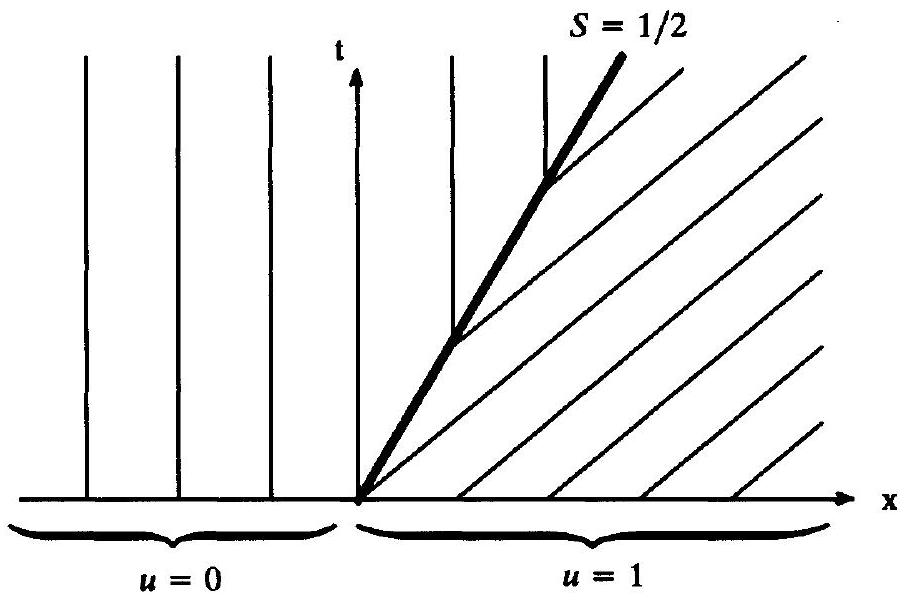
Figure 4.1 Wave diagram for the wrong solution of Example 4.1.

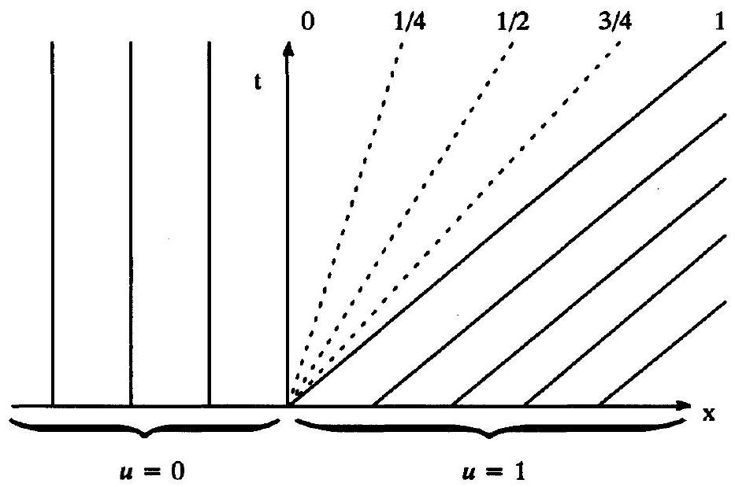
Figure 4.2 Wave diagram for the correct solution of Example 4.1.

Let us try again. Consider the following self-similar solution

$$
u(x, t)= \begin{cases}0 & \text { for } \frac{x}{t}<0, \\ \frac{x}{t} & \text { for } 0<\frac{x}{t}<1, \\ 1 & \text { for } \frac{x}{t}>1 .\end{cases}
$$

The wave diagram for this solution is plotted in Figure 4.2. This solution clearly satisfies the initial conditions. This solution is uniform outside the simple centered expansion fan and thus clearly satisfies Burgers' equation there. Inside the simple centered expansion fan

$$
\frac{\partial u}{\partial t}+u \frac{\partial u}{\partial x}=\frac{\partial}{\partial t}\left(\frac{x}{t}\right)+\frac{x}{t} \frac{\partial}{\partial x}\left(\frac{x}{t}\right)=-\frac{x}{t^{2}}+\frac{x}{t} \frac{1}{t}=0,
$$

which again satisfies Burgers' equation. This solution contains no jump discontinuities, and thus there is no need to worry about conditions (4.10), (4.12), or (4.13). Thus Equation (4.21) is the correct solution.

Many numerical methods do not enforce conditions (4.12) or (4.13). Thus many numerical methods may approximate the wrong solution given by (4.20) rather than the correct solution given by (4.21). This example was first given by Lax (1973).

Example 4.2 Reverse the left and right states in the initial conditions, and repeat the previous example.

Solution The solution is a shock traveling at a speed of $1 / 2$. This is just like the "wrong" solution from the last example, except that now the shock takes the solution from one to zero, rather than from zero to one. In other words, reversing the left and right states makes the "wrong" solution "right."

Example 4.3 Solve Burgers' equation on an infinite domain for $t \leq 4 / 3$ with the following initial conditions:

$$
u(x, 0)= \begin{cases}1 & \text { for }|x|<\frac{1}{3} \\ 0 & \text { for }|x|>\frac{1}{3}\end{cases}
$$

Solution The jump at $x=-1 / 3$ creates a simple centered expansion fan; the jump at $x=1 / 3$ creates a shock. Until the shock and expansion fan intersect, the exact piecewise-linear solution is as follows:

$$
u(x, t)= \begin{cases}0 & \text { for }-\infty<x<b_{1} \\ \frac{x-b_{1}}{b_{2}-b_{1}} & \text { for } b_{1}<x<b_{2} \\ 1 & \text { for } b_{1}<x<b_{\text {shock }} \\ 0 & \text { for } b_{\text {shock }}<x<\infty\end{cases}
$$

where

$$
\begin{aligned}
& b_{1}=-\frac{1}{3} \\
& b_{2}=-\frac{1}{3}+t \\
& b_{\text {shock }}=\frac{1}{3}+\frac{1}{2} t
\end{aligned}
$$

Notice that $b_{2}=b_{\text {shock }}$ for $t=4 / 3$. Thus the shock and the expansion fan interact for $t>4 / 3$, which complicates the solution. The wave diagram for the solution is plotted in Figure 4.3.

Example 4.4 Solve Burgers' equation on an infinite domain for $t \leq 2 / 3$ with the following initial conditions:

$$
u(x, 0)= \begin{cases}1 & \text { for }|x|<\frac{1}{3} \\ -1 & \text { for }|x|>\frac{1}{3}\end{cases}
$$

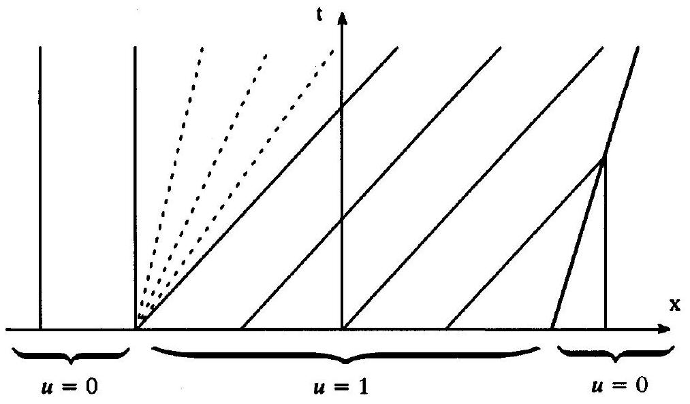
Figure 4.3 Wave diagram for Example 4.3.

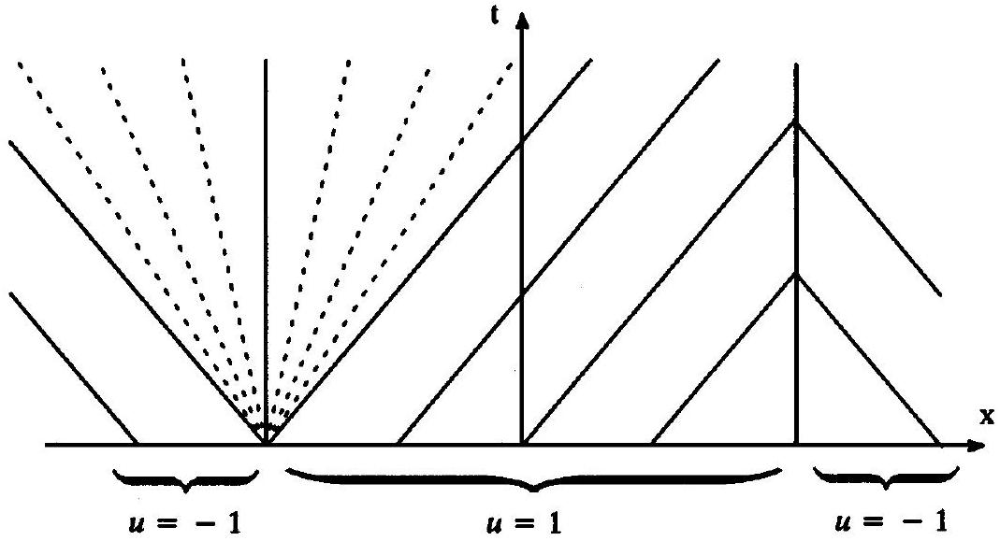
Figure 4.4 Wave diagram for Example 4.4.

Solution The jump at $x=-1 / 3$ creates a simple centered expansion fan; the jump at $x=1 / 3$ creates a steady shock. Until the shock and expansion fan intersect, the exact piecewise-linear solution is as follows:

$$
u(x, t)= \begin{cases}-1 & \text { for }-\infty<x<b_{1}, \\ -1+2 \frac{x-b_{1}}{b_{2}-b_{1}} & \text { for } b_{1}<x<b_{2}, \\ 1 & \text { for } b_{2}<x<b_{\text {shock }}, \\ -1 & \text { for } b_{\text {shock }}<x<\infty,\end{cases}
$$

where

$$
\begin{aligned}
& b_{1}=-\frac{1}{3}-t, \\
& b_{2}=-\frac{1}{3}+t, \\
& b_{\text {shock }}=\frac{1}{3} .
\end{aligned}
$$

Notice that $b_{2}=b_{\text {shock }}$ for $t=2 / 3$. Thus the shock and the expansion fan interact for $t>2 / 3$, which complicates the solution. The wave diagram for the solution is plotted in Figure 4.4.

### 4.9 Nonconvex Scalar Conservation Laws

This section concerns nonconvex scalar conservation laws. As stated in Section 4.5, nonconvex scalar conservation laws model real gas flows. Furthermore, nonconvex scalar conservation laws arise directly in certain rather obscure applications. For example, a simple model of two-phase flow in a porous medium yields a nonconvex scalar conservation law with the following flux function:

$$
f(u)=\frac{u^{2}}{u^{2}+c(1-u)^{2}},
$$

where $c$ is a constant. This scalar conservation law is called the Bucky-Leverett equation. Since this book mainly concerns perfect gases, we will accordingly mainly use convex conservation laws, which model perfect gas flows. However, nonconvex scalar conservation laws shed light on the nature of convex scalar conservation laws by showing what they are not. Also, the computational gasdynamics literature often mentions nonconvex scalar conservation laws, making this discussion essential for students of the literature.

The biggest difference between convex and nonconvex scalar conservation laws lies in the shock condition (4.12). For convex scalar conservation laws, Equation (4.12) is both necessary and sufficient. However, for nonconvex scalar conservation laws, Equation (4.12) is only necessary but not sufficient. In other words, nonconvex scalar conservation laws require something stronger than Equation (4.12). Specifically, for nonconvex scalar conservation laws, Equation (4.12) must be replaced by the following condition:

$$
\text { - } \quad \frac{f(u)-f\left(u_{L}\right)}{u-u_{L}} \geq S=\frac{f\left(u_{R}\right)-f\left(u_{L}\right)}{u_{R}-u_{L}} \geq \frac{f\left(u_{R}\right)-f(u)}{u_{R}-u}
$$

for all $u$ between $u_{L}$ and $u_{R}$. This is called the Oleinik entropy condition. Unlike Equation (4.12), the Oleinik entropy condition applies both at shocks and at contacts. Notice that, by the mean value theorem, the Oleinik entropy condition implies Equation (4.12). The Oleinik entropy condition says that the flux function lies entirely above the secant line connecting $u_{L}$ and $u_{R}$ for $u_{L}<u_{R}$, and the flux function lies entirely below the secant line connecting $u_{L}$ and $u_{R}$ for $u_{L}>u_{R}$. Figure 4.5 illustrates this condition. The dashed lines are the secant lines connecting $u_{L}$ and $u_{R}$ to $u$, the solid line is the secant line connecting $u_{L}$ and $u_{R}$, and the bold curve is the flux function. Notice that the flux function can do anything it likes between $u_{L}$ and $u_{R}$ - it can have maxima, minima, inflection points, and so forth - provided only that it does not cross the secant line connecting $u_{L}$ and $u_{R}$.

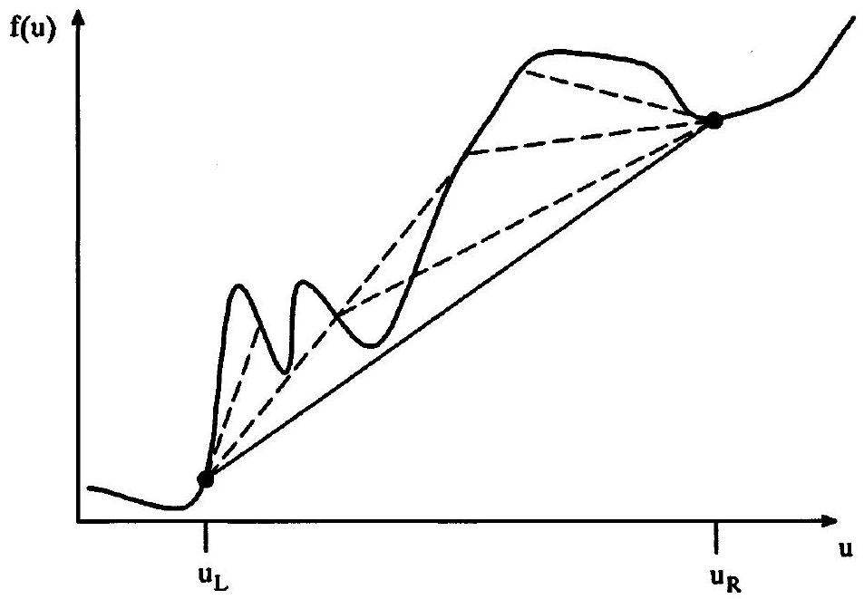
Figure 4.5 An illustration of the Oleinik entropy condition. The left and right states are connected by a single shock.

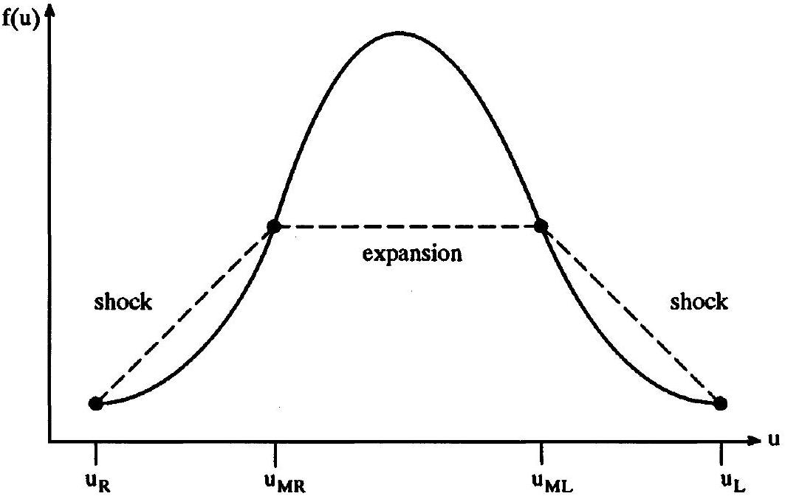
Figure 4.6 Nonconvex flux function for Example 4.5.

Example 4.5 Consider a scalar conservation law with the following initial conditions:

$$
u(x, 0)= \begin{cases}u_{L} & \text { for } x<0, \\ u_{R} & \text { for } x>0 .\end{cases}
$$

Assume the scalar conservation law has the nonconvex flux function illustrated in Figure 4.6. Sketch the wave diagram for the solution.

Solution In Figure 4.6, $u_{M L}$ and $u_{M R}$ are the inflection points of $f(u)$. Since $u_{L}>u_{R}$, the Oleinik entropy condition says that the flux function should lie below the secant lines connecting the left and right states of any shocks or contacts. Consulting Figure 4.6, we see that the flux function lies entirely below the secant line connecting $u_{L}$ and $u_{M L}$, consistent with the Oleinik entropy condition for shocks. Notice that this would not be true if $u_{M L}$ were decreased. Similarly, the flux function lies entirely below the secant line connecting $u_{M R}$ and $u_{R}$, consistent with the Oleinik entropy condition for shocks. Notice that this would not be true if $u_{M R}$ were increased. Finally, the flux derivative $a(u)=f^{\prime}(u)$ monotonically increases as $u$ runs from $u_{M L}$ to $u_{M R}$, in accordance with expansion condition (4.8). Notice that this would not be true if $u_{M L}$ were increased or $u_{M R}$ were decreased. Thus there is a shock between $u_{L}$ and $u_{M L}$, an expansion between $u_{M L}$ and $u_{M R}$, and a shock between $u_{M R}$ and $u_{R}$. The Oleinik entropy condition allows no other solutions. The wave diagram is shown in Figure 4.7.

Example 4.6 Reverse the left and right states, and repeat the previous example.
Solution Since $u_{L}<u_{R}$, the Oleinik entropy condition says that the flux function should lie above the secant lines connecting the left and right states of any shocks or

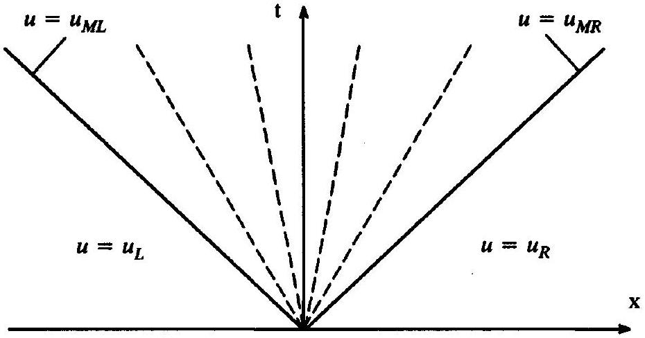
Figure 4.7 Wave diagram for Example 4.5.

contacts. In this case, the flux function lies entirely above the secant line connecting $u_{L}$ and $u_{R}$. Furthermore, $a\left(u_{L}\right)=a\left(u_{R}\right)=0$. Then the solution consists of a single contact connecting $u_{L}$ and $u_{R}$. If $u_{L}$ is moved slightly to the right, or $u_{R}$ is moved slightly to the left, the solution would consist of a single shock between $u_{L}$ and $u_{R}$.

### 4.10 Entropy Conditions

The Euler equations come paired with the second law of thermodynamics. Similarly, scalar conservation laws should come paired with entropy conditions analogous to the second law of thermodynamics. In the Euler equations, the second law of thermodynamics allows multiple solutions, at least for steady flows. By contrast, in scalar conservation laws, entropy conditions always select a unique solution.

In the applications of interest to us, the second law of thermodynamics and entropy conditions need not be written in terms of entropy. For example, for the Euler equations, the second law of thermodynamics amounts to an algebraic inequality (3.51) at shocks, which does not involve entropy. Similarly, for convex scalar conservation laws, the entropy condition amounts to an algebraic inequality (4.12) or (4.13) at shocks, which does not involve entropy. Finally, for nonconvex scalar conservation laws, the entropy condition amounts to an algebraic inequality (4.25) at shocks and contacts, which does not involve entropy.

Although entropy conditions need not explicitly involve entropy, it is interesting to write them in a form that does. Thus, whereas previous sections in this chapter put entropy conditions in the form of inequalities, this section puts entropy conditions in a differential form analogous to Equation (2.26), involving a scalar entropy function and a scalar entropy flux function. The scalar entropy and entropy flux are functions of $u$. Before proceeding further, as necessary background, the following example illustrates what happens to scalar conservation laws when $u$ and $f$ are replaced by functions of $u$.

Example 4.7 Section 2.4 described linear changes of dependent variables for the Euler equations. In a similar fashion, perform a change of dependent variables in Burgers' equations from $u$ to $U=u^{2}$. Also, change the conservative flux so that the equation remains in conservation form. Show that this transformation alters the weak solutions.

Solution Multiply both sides of Burgers' equation by $2 u$ to obtain

$$
2 u \frac{\partial u}{\partial t}+2 u^{2} \frac{\partial u}{\partial x}=0,
$$

which can be written as

$$
\frac{\partial}{\partial t}\left(u^{2}\right)+\frac{\partial}{\partial x}\left(\frac{2}{3} u^{3}\right)=0
$$

or

$$
\frac{\partial U}{\partial t}+\frac{\partial F}{\partial x}=0,
$$

where

$$
U(x, t)=u^{2}(x, t)
$$

and

$$
F=\frac{2}{3} u^{3}=\frac{2}{3} U^{3 / 2} .
$$

Thus the dependent variable has been changed from $u$ to $U=u^{2}$ and the flux has been changed from $f=u^{2} / 2$ to $F=2 u^{3} / 3$.

Unfortunately, the weak solutions of the transformed Burgers' equation differ substantially from the weak solutions of the original Burgers' equation. By Equation (4.10), the jump condition for Burgers' equation is

$$
S=\frac{f\left(u_{R}\right)-f\left(u_{L}\right)}{u_{R}-u_{L}}=\frac{1}{2} \frac{u_{R}^{2}-u_{L}^{2}}{u_{R}-u_{L}}=\frac{1}{2}\left(u_{R}+u_{L}\right),
$$

whereas the jump condition for the transformed Burgers' equation is

$$
S=\frac{F\left(U_{R}\right)-F\left(U_{L}\right)}{U_{R}-U_{L}}=\frac{2}{3} \frac{u_{R}^{3}-u_{L}^{3}}{u_{R}^{2}-u_{L}^{2}}=\frac{1}{2}\left(u_{R}+u_{L}\right)+\frac{1}{6} \frac{\left(u_{R}-u_{L}\right)^{2}}{u_{R}+u_{L}} .
$$

Thus the transformed equation has a different shock speed. Although this example concerns Burgers' equation, in general, changing $u$ and $f$ in scalar conservation laws always alters the weak solutions.

In Section 2.4, we saw that changes of variables did not alter the weak solutions. However, in Section 2.4 we changed only the dependent variable $\mathbf{u}$ and not the flux $\mathbf{f}$. For scalar conservation laws, different flux functions $f$ define different jump relations $f_{R}-f_{L}= S\left(u_{R}-u_{L}\right)$, causing the weak solutions to differ. Hence this example got us into trouble not because it changed $u$ but because it changed $f$, and the altered flux function implied altered jump relations.

Consider the following properties of the second law of thermodynamics as seen in Subsections 2.1.5 and in Sections 2.2, 2.3, and 3.3:

- Entropy is a function of the conserved quantities.
- Entropy flux is a function of the conserved quantities.
- Except at shocks, entropy change is due entirely to entropy flux. In other words, the entropy following the fluid neither increases nor decreases except at shocks. Put yet another way, except at shocks, the Euler equations imply
$\frac{\partial(\rho s)}{\partial t}+\frac{\partial(\rho u s)}{\partial x}=0$.
Thus the Euler equations automatically satisfy the second law of thermodynamics, except at shocks.
- Entropy increases across shocks. In other words, the entropy change across shocks is greater than the entropy change due to entropy flux. Put yet another way, across shocks, the second law of thermodynamics requires

$$
\frac{\partial(\rho s)}{\partial t}+\frac{\partial(\rho u s)}{\partial x}>0 .
$$

Suppose $u(x, t)$ is any solution of a scalar conservation law. Transform the scalar conservation law as in Example 4.7. Then suppose any solution $u(x, t)$ satisfies

$$
\frac{\partial U(u)}{\partial t}+\frac{\partial F(u)}{\partial x}=0
$$

in smooth regions and

$$
\frac{\partial U(u)}{\partial t}+\frac{\partial F(u)}{\partial x}>0
$$

across shocks. In other words, combining the last two equations, suppose that

- $\frac{\partial U(u)}{\partial t}+\frac{\partial F(u)}{\partial x} \geq 0$
for all weak solutions of a scalar conservation law. Then Equation (4.28) is analogous to the second law of thermodynamics. The function $U(u)$ is called an entropy function and the function $F(u)$ is called an entropy flux function.

As the reader can easily show, $\partial u / \partial t+\partial f / \partial x=0$ implies Equation (4.26) in smooth regions if

$$
\frac{d F}{d u}=\frac{d f}{d u} \frac{d U}{d u} .
$$

With a good deal more effort, the reader can show that weak solutions of $\partial u / \partial t+\partial f / \partial x=0$ satisfy (4.27) across shocks if

$$
\frac{d^{2} U}{d u^{2}} \leq 0
$$

Using standard calculus definitions, Equation (4.30) says that the entropy function $U$ is concave down or simply concave. As shown by Merriam (1989), Equations (4.29) and (4.30) have the following simple general solution:

$$
\begin{array}{ll} 
& U(u)=-u^{2}, \\
& \frac{d F}{d u}=-2 u \frac{d f}{d u} .
\end{array}
$$

This solution is but one of many possible concave entropy functions and entropy fluxes. (Note that, in the literature, scalar entropy often decreases rather than increases, unlike
physical entropy. In other words, Equation (4.28) is replaced by $\partial U / \partial t+\partial F / \partial x \leq 0$ and Equation (4.30) is replaced by $d^{2} U / d u^{2} \geq 0$, in which case the entropy function is convex. In this case, a general solution is $U(u)=u^{2}$ and $F(u)=2 u d f / d u$.)

Example 4.8 Consider Burgers' equation. Find a concave entropy function, entropy flux, and an entropy condition in conservation form.

Solution An entropy condition for Burgers' equation is as follows:

$$
\frac{\partial U(u)}{\partial t}+\frac{\partial F(u)}{\partial x} \geq 0
$$

where

$$
U(u)=-u^{2}
$$

and

$$
F(u)=-\frac{2}{3} u^{3}
$$

For Burgers' equation, or for any convex scalar conservation law, entropy condition (4.13) says

$$
u_{L} \geq u_{R} .
$$

Believe it or not, conditions (4.33) and (4.36) mean exactly the same thing; this is proven in Example 3.4 of LeVeque (1992).

Unfortunately, there are major obstacles to enforcing entropy conditions in numerical approximations. First off, it is often impossible to enforce or verify entropy inequalities such as (4.12), (4.13), or (4.25). Thus, in practice, other forms are used, such as the differential form described in this section. Using these other forms, mathematicians have developed a body of complicated techniques for proving that numerical approximations to scalar conservation laws satisfy entropy conditions in the convergence limit $\Delta x \rightarrow 0$ and $\Delta t \rightarrow 0$. However, for ordinary finite values of $\Delta x$ and $\Delta t$, Argrow and Cox (1993) have shown that most numerical approximations to Burgers' equation violate entropy conditions and that most numerical approximations to the Euler equations violate the second law of thermodynamics by producing locally negative entropy. Fortunately, local negative entropy production has surprisingly benign effects in practice. Rather than deal explicitly with entropy conditions, most code developers rely on a few tricks of the trade and extensive testing to ensure that their codes do not approximate unphysical solutions. In the hopefully rare cases where they occur, wildly wrong solutions can easily escape detection until compared with the results of experiments or of more accurate codes.

### 4.11 Waveform Preservation, Destruction, and Creation

Simple waves, shock waves, and contacts provide a complete wave description of the solutions to scalar conservation laws. As seen in this section, the wave description implies useful relationships between the solution $u(x, t)$ and the initial conditions $u(x, 0)=u_{0}(x)$. These relationships will be exploited heavily in Chapter 16.

To start with, suppose $u(x, t)$ is continuous for all $x$ and $t$. If the solution is always continuous, the characteristics are always divergent or neutral, since convergent characteristics must eventually meet and form shocks. Hence for scalar conservation laws, any completely continuous solution is an expansion wave. By Equation (4.7)

$$
u(x, t)=u_{0}(x-a(u) t) .
$$

Then, by definition, continuous solutions $u(x, t)$ preserve the initial waveform $u_{0}(x)$. Of course, the nonconstant wave speed $a(u)$ means that the initial waveform may stretch; however, this does not violate waveform preservation as defined here.

Now suppose the solution is continuous for all $x$ and $t$, except for a single contact. Then the solution consists of two simple expansions separated by a contact discontinuity. To create the contact, the initial conditions must contain a jump from $u_{L}$ to $u_{R}$ such that $a\left(u_{L}\right)=a\left(u_{R}\right)$. Then the solution preserves the contact, although of course the contact moves to the left or right at speed $a\left(u_{L}\right)=a\left(u_{R}\right)$. The same argument applies to any number of contacts, assuming that the contacts never intersect. Thus continuous solutions, or solutions with any number of nonintersecting contacts, preserve the initial waveform. Waveform preservation is illustrated in Figure 4.8.

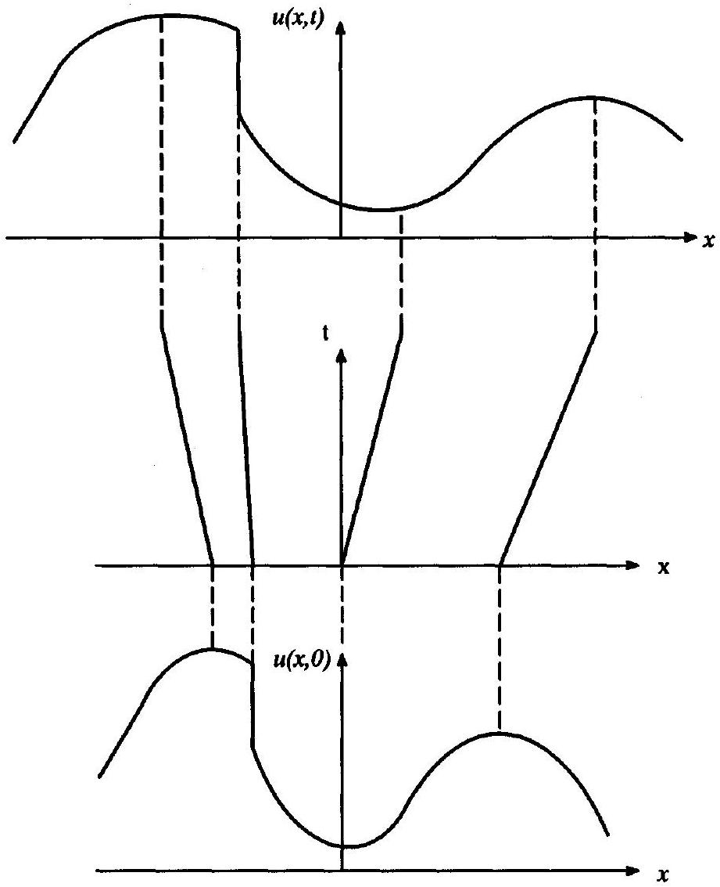
Figure 4.8 Waveform preservation for scalar conservation laws.

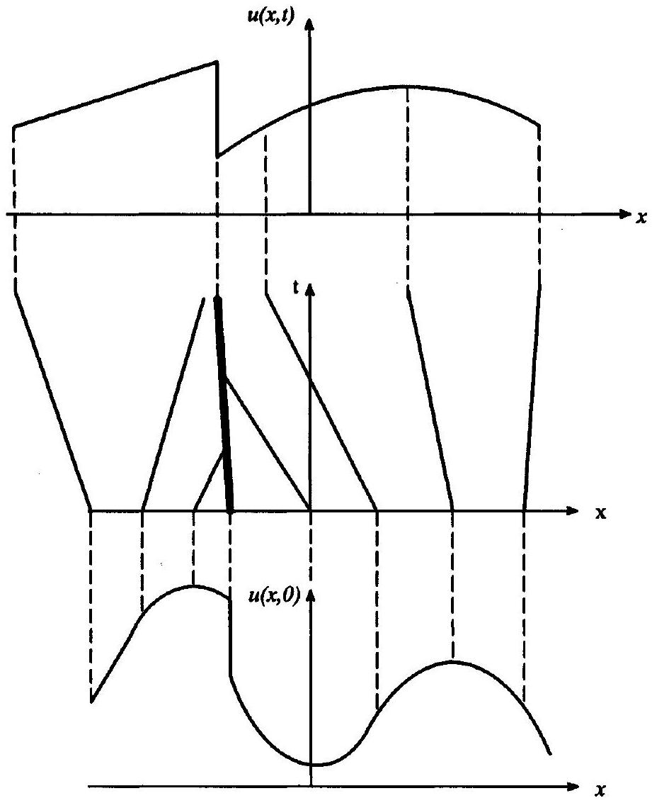
Figure 4.9 Waveform destruction for scalar conservation laws.

Now suppose the solution is completely continuous for all $x$ and $t$, except for a single shock. Then the solution consists of two simple expansions converging on the shock. The shock continuously absorbs characteristics from the expansions, including characteristics carrying the maxima and minima of the solution. Since maxima and minima define the range of the solution, the shock diminishes the range. In fact, the range of the solution decays like $(t)^{-1 / 2}$ for convex flux functions, as shown in Section 4 of Lax (1973). Intuitively, shocks constantly snip out sections of the waveform, and the remaining waveform stretches to fill the gaps. It is like feeding a rubber pencil into a pencil sharpener - as much as the sharpener grinds off the end, the pencil stretches to keep its length constant while its thickness decreases. In conclusion, shocks destroy rather than preserve the initial waveform. Waveform destruction is illustrated in Figure 4.9.

Now consider the intersection of two shocks. For a convex scalar conservation law, the intersection of two shocks creates a single shock or a single contact. In this case, every value in the solution can be traced back to the initial conditions along characteristics or, in other words, the waveform always derives from the initial waveform. However, for nonconvex scalar conservation laws, a shock intersection may give rise to multiple shocks,

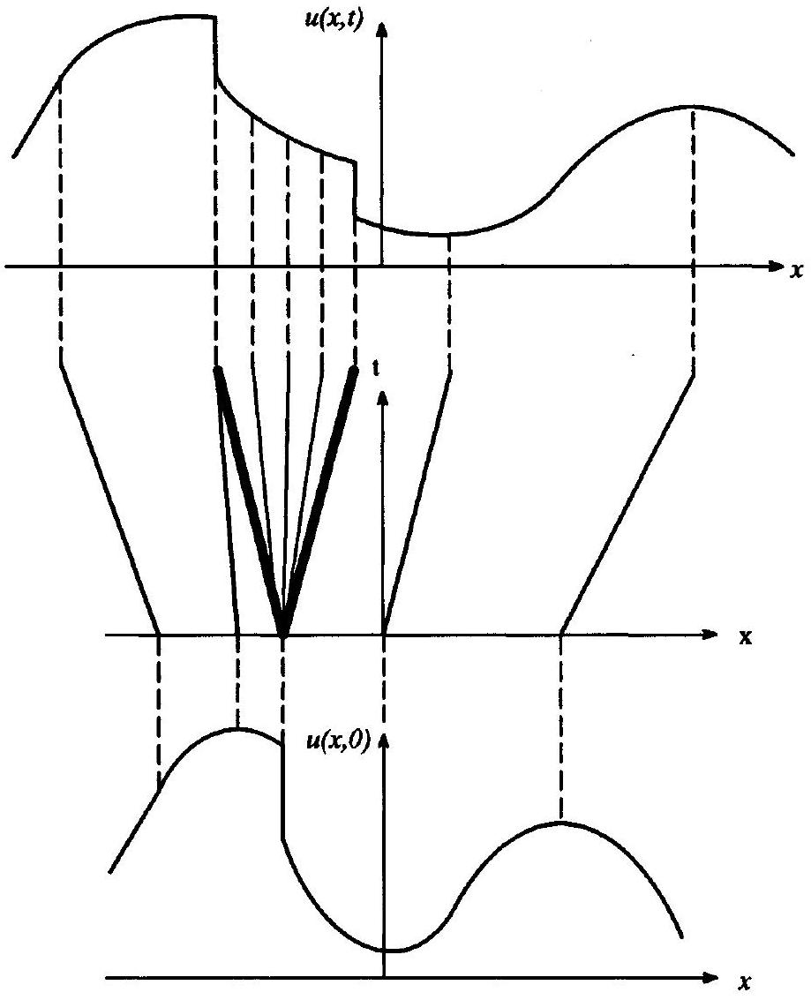
Figure 4.10 Waveform creation for scalar conservation laws.

multiple centered expansion fans, and multiple contacts. The values of the solution in the interior of such a multiwave region cannot be traced back to the initial conditions; hence the waveform in the interior of the multiwave region does not derive from the initial waveform. Instead, the solution must create a new waveform to fill the multiwave region. Similar considerations apply at the intersections of a shock and a contact, or a contact and a contact, or at jump discontinuities in the initial conditions. Any created waveforms are always monotonically increasing or monotonically decreasing. This important property will be used extensively in Chapter 16. Waveform creation is illustrated in Figure 4.10.

In summary, the solutions of scalar conservation laws consist entirely of smooth simple waves, shock waves, and contacts. For convex scalar conservation laws, smooth waves and contacts are always waveform preserving, whereas shock waves and shock/contact intersections are always waveform destroying; convex scalar conservation laws are never waveform creative. For nonconvex scalar conservation laws, smooth waves and contacts are always waveform preserving, shock waves are always waveform destroying, and shock/contact intersections and jumps in the initial conditions are sometimes waveform creating; any
waveform sections created by shock/contact intersections or jumps in the initial conditions are monotonically increasing or monotonically decreasing.

For the Euler equations, the waveforms are the characteristic variables $v_{i}(x, t)$. As with scalar conservation laws, there are useful wave relationships between characteristic variables $v_{i}(x, t)$ and the initial characteristic variables $v_{i}(x, 0)$. As with scalar conservation laws, smooth waves and contacts are always waveform preserving, shock waves are always waveform destroying, and shock/contact intersections and jumps in the initial conditions are sometimes waveform creating. In this limited sense, the Euler equations are more like nonconvex than convex scalar conservation laws - nonconvex scalar conservation laws are waveform creating, like the Euler equations, whereas convex scalar conservation laws are not. However, unlike nonconvex scalar conservation laws, created waveforms in the Euler equations need not be monotonically increasing or monotonically decreasing. In fact, in general, waveforms created to fill multiwave regions resulting from shock/contact intersections or jumps in the initial conditions will contain new maxima and minima, caused by interactions between characteristic variables.

## References

Argrow, B. M., and Cox, R. A. 1993. "A Quantitative, Second-Law Based Measure of Accuracy of Numerical Schemes." In Thermodynamics and the Design, Analysis, and Improvement of Energy Systems (AES vol. 30/HTD vol. 266), ed. H. J. Richter, Salem, MA: ASME, pp. 49-57.
Lax, P. D. 1973. Hyperbolic Systems of Conservation Laws and the Mathematical Theory of Shock Waves. Regional Conference Series in Applied Mathematics, 11, Philadelphia: SIAM.
LeVeque, R. J. 1992. Numerical Methods for Conservation Laws, 2nd ed., Basel: Birhäuser-Verlag, Chapters 2, 3, and 4.
Merriam, M. L. 1989. An Entropy-Based Approach to Non-Linear Stability, NASA-TM-101086 (unpublished report).

## Problems

4.1 Consider Burgers' equation on an infinite domain with the following initial conditions:
$u(x, 0)= \begin{cases}2 & \text { for }|x|<\frac{1}{2}, \\ -1 & \text { for }|x|>\frac{1}{2} .\end{cases}$
The two jump discontinuities create two waves. Find the time when the two waves first intersect. Solve Burgers' equation for all times less than the intersection time. Draw a wave diagram for the solution.
4.2 Write the Bucky-Leverett equation, defined by Equation (4.24), in characteristic form.
4.3 In each case, state whether the scalar conservation law is convex or nonconvex:
(a) $\frac{\partial u}{\partial t}+\frac{\partial}{\partial x}\left(\frac{2}{3} u^{3 / 2}\right)=0$
(b) $e^{-u} \frac{\partial u}{\partial t}+\frac{\partial u}{\partial x}=0$
(c) $\frac{\partial u}{\partial t}+\sin u \frac{\partial u}{\partial x}=0$
4.4 Find conditions under which a scalar conservation law can have a stationary jump discontinuity. In particular, show that the flux function must have a maximum or a minimum. In other words, the wave speed must equal zero somewhere inside the shock. Put yet another way, the wind must change directions across the shock. Put yet another way, the flux function must have a sonic point.
4.5 Consider the following scalar conservation law:

$$
\frac{\partial u}{\partial t}+\frac{\partial}{\partial x}\left(u^{3}+\frac{u^{2}}{2}\right)=0
$$

(a) Is this scalar conservation law convex?
(b) Write the entropy condition in the form of an algebraic inequality. Simplify as much as possible using relationships such as $a^{3}-b^{3}=(a-b)\left(a^{2}+a b+b^{2}\right)$.
(c) Find an entropy function and an entropy flux. Write the entropy condition as a partial differential inequality.
4.6 Consider a scalar conservation law with the following initial conditions:
$u(x, 0)= \begin{cases}u_{L} & \text { for } x<0, \\ u_{R} & \text { for } x>0 .\end{cases}$
Assume the scalar conservation law has the nonconvex flux function illustrated below.
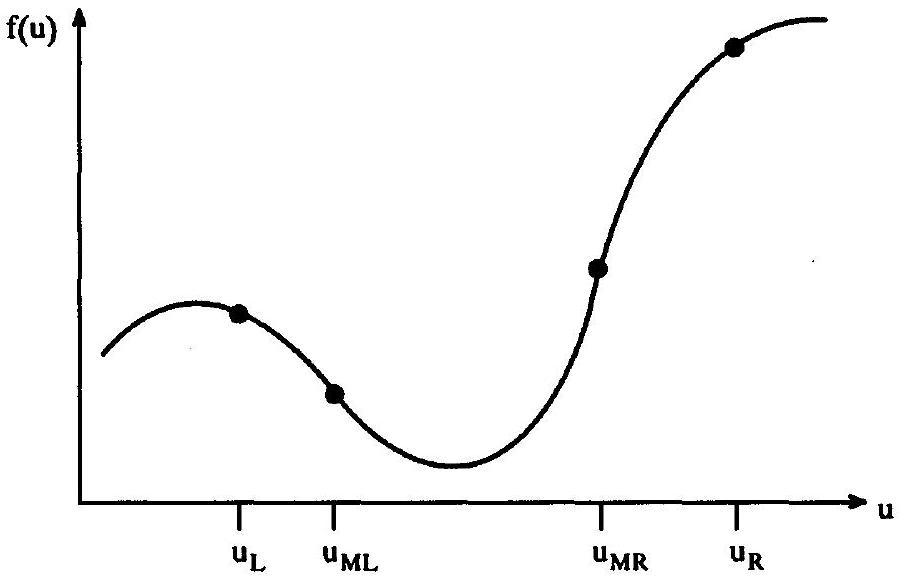

## Problem 4.6

(a) Sketch the wave diagram for the solution. Explain.
(b) Reverse the left and right states. Sketch the wave diagram for the solution. Explain.
4.7 Consider the solutions to hypothetical scalar conservation laws shown in the figures. In each case, state whether the solution is waveform preserving, waveform destroying, waveform

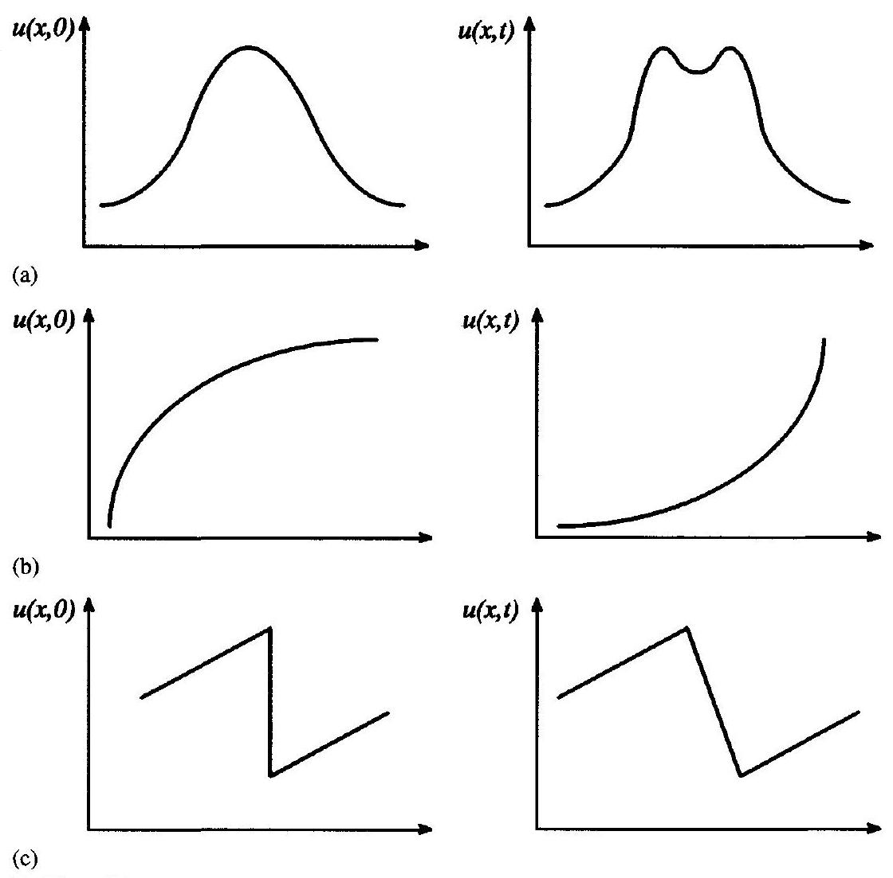
Problem 4.7

creating, or none of the above. Explain. You may find it helpful to draw some possible wave diagrams.
4.8 (a) Show that Equation (4.25) implies Equation (4.12).
(b) Show that Equations (4.12), (4.13), and (4.25) are equivalent for convex scalar conservation laws.

