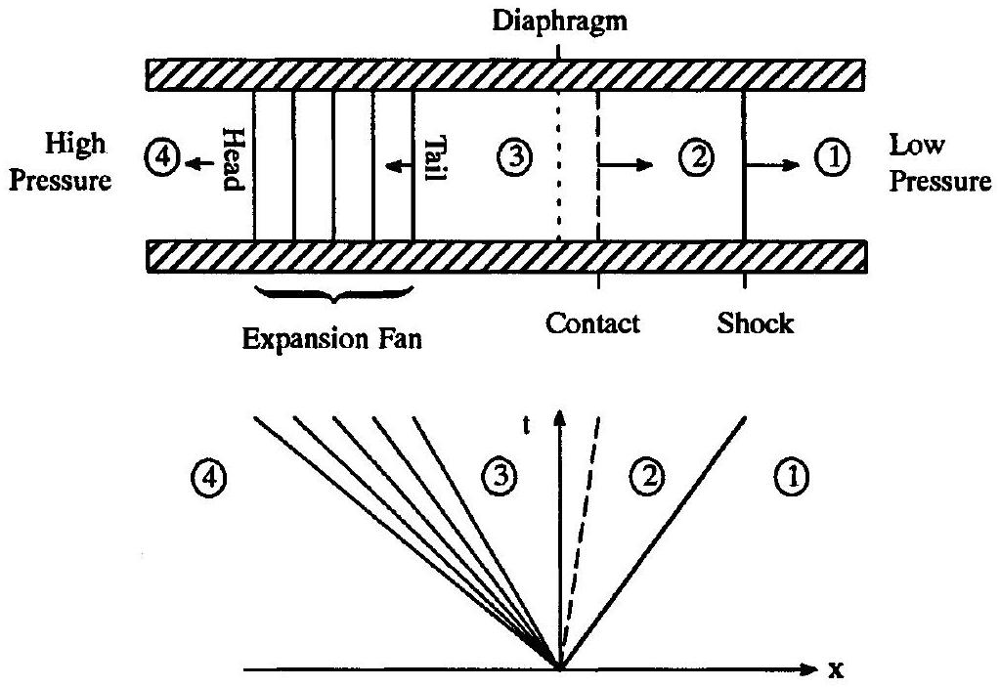
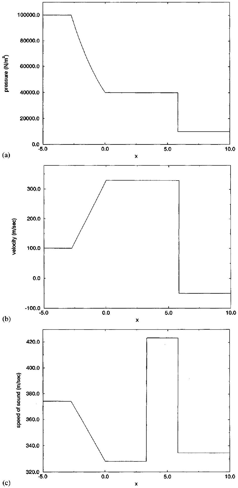
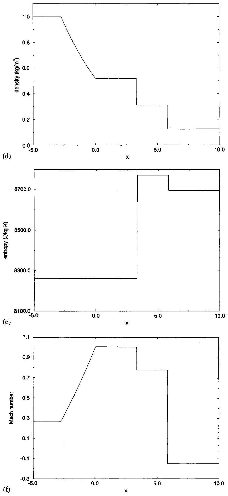
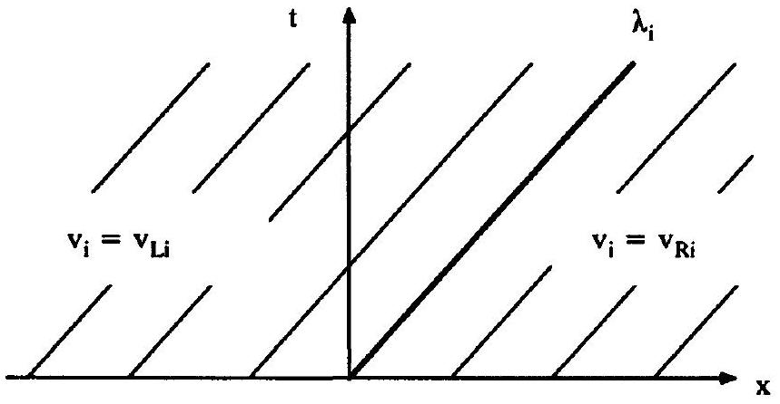
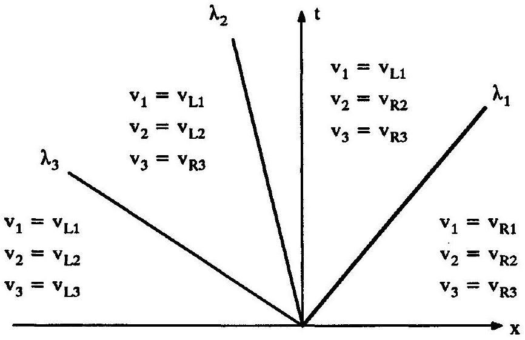
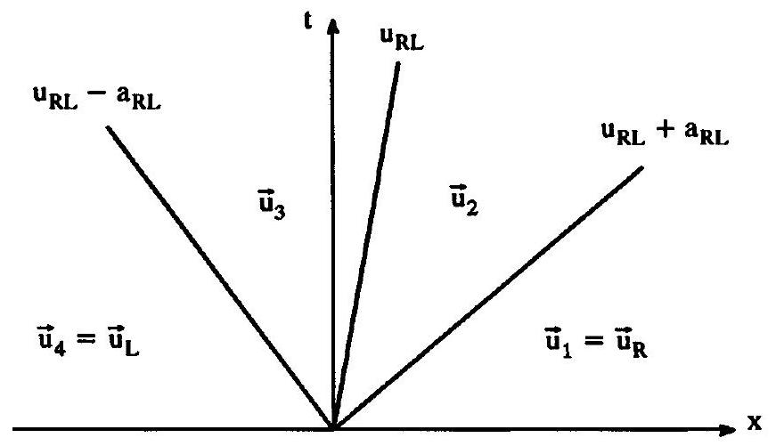
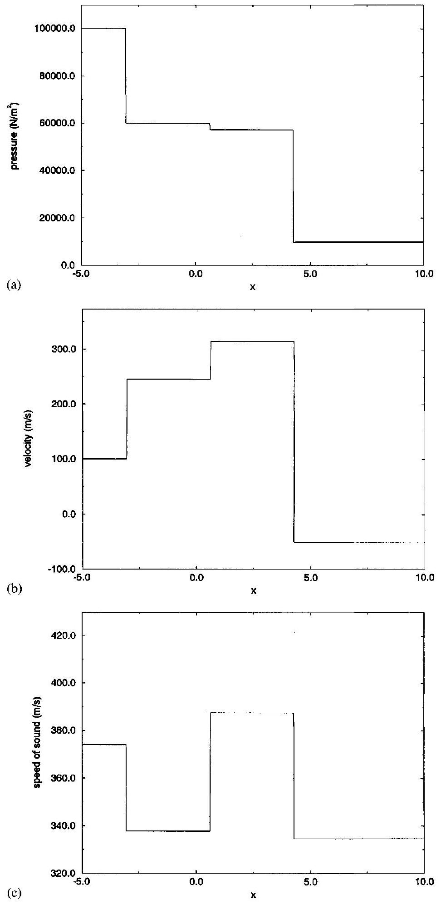
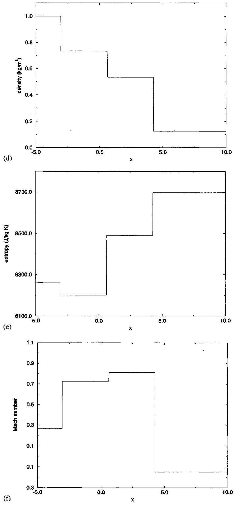
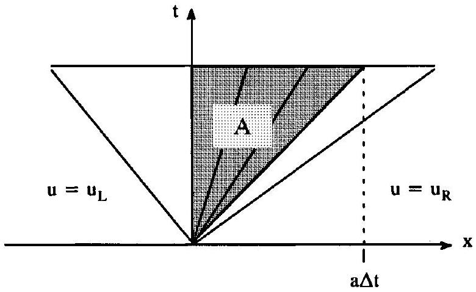

## CHAPTER 5

## The Riemann Problem

### 5.0 Introduction

For any equation, such as the one-dimensional Euler equations or scalar conservation equations, the Riemann problem has uniform initial conditions on an infinite spatial domain, except for a single jump discontinuity. For example, for the Euler equations, the Riemann problem centered on $x=x_{0}$ and $t=t_{0}$ has the following initial conditions:

$$
\mathbf{u}\left(x, t_{0}\right)= \begin{cases}\mathbf{u}_{L} & x<x_{0}, \\ \mathbf{u}_{R} & x>x_{0},\end{cases}
$$

where $\mathbf{u}_{L}$ and $\mathbf{u}_{R}$ are constant vectors. For convenience, this chapter uses $x_{0}=0$ and $t_{0}=0$.
The Riemann problem has an exact analytical solution for the Euler equations, scalar conservation laws, and any linear system of equations. Furthermore, the solution is selfsimilar or self-preserving. In other words, the solution stretches uniformly in space as time increases but otherwise retains its shape, so that $\mathbf{u}\left(x, t_{1}\right)$ and $\mathbf{u}\left(x, t_{2}\right)$ are "similar" to each other for any two times $t_{1}$ and $t_{2}$. Put another way, the solution only depends on the single variable $x / t$ rather than on $x$ and $t$ separately. Put yet another way, the solution is constant along any line $x=$ (const.) $t$ passing through the origin in the $x-t$ plane. More generally, a self-similar solution is any solution that depends on only one independent variable, such as $x / t$ or $t / \sqrt{x}$, that is a function of the two original independent variables. By reducing the number of independent variables, self-similarity simplifies solution techniques and sometimes even leads to analytical solutions, as in the case of the Riemann problem. Other famous examples of self-similarity include steady laminar boundary layers, jets, and wakes, and Sedov's unsteady spherical, cylindrical, and planar shock waves.

There are three reasons for devoting an entire chapter to the Riemann problem. First, the last two chapters have concerned waves, and the Riemann problem provides an excellent example of waves. Indeed, for the Euler equations and scalar conservation laws, the solution of the Riemann problem involves the three basic types of waves described in the last two chapters: simple expansion waves, shock waves, and contacts. Second, since the Riemann problem has an exact solution, it makes a nice test case for numerical approximations. In fact, the solution to the Riemann problem is one of the very few exact solutions of the unsteady one-dimensional Euler equations. Third, and most importantly, many numerical methods incorporate an exact or approximate solution to the Riemann problem in order to provide superior wave capturing. Indeed, the Riemann problem tends to improve numerical modeling of both smooth waves (characteristics) as well as nonsmooth waves (shocks and contacts).

Numerical approximations based on the Riemann problem may solve the Riemann problem hundreds, thousands, or even millions of times to obtain a single solution. Thus the cost of solving the Riemann problem is a serious issue. When incorporated into numerical models, the solution to an approximate Riemann problem may prove almost as good as or even, in some ways, better than the solution to the true Riemann problem, often at a fraction
of the cost. This chapter describes two approximate Riemann problem solvers that replace the true nonlinear flux function by a locally linearized approximation.

In most cases, numerical methods using Riemann solvers require only the flux along $x=0$. Fortunately the flux is constant along the line $x=0$, by self-similarity. For future reference, this chapter will, in many instances, derive expressions for the flux at $x=0$. The chapter ends with a description of the Riemann problem for scalar conservation laws. Examples in Sections 4.8 and 4.9 illustrate some techniques for solving the Riemann problem for scalar conservation laws, both for convex and nonconvex flux functions. This chapter takes a different approach: The solution to the Riemann problem is written in terms of flux $f(u)$, which is especially convenient when the solution is used in numerical methods only requiring the flux at $x=0$.

### 5.1 The Riemann Problem for the Euler Equations

Consider a one-dimensional tube containing two regions of stagnant fluid at different pressures. Suppose the two regions of fluid are initially separated by a rigid diaphragm. If the diaphragm is instantaneously removed, perhaps by a small explosion, the pressure imbalance causes a one-dimensional unsteady flow containing a steadily moving shock, a steadily moving simple centered expansion fan, and a steadily moving contact discontinuity separating the shock and expansion. The shock, expansion, and contact each separate regions of uniform flow. This setup is called a shock tube. The flow in a shock tube is illustrated in Figure 5.1.

The flow in a shock tube always has zero initial velocity. Removing this restriction, the shock tube problem becomes the Riemann problem and thus is a special case of the Riemann problem. Like the shock tube problem, the Riemann problem may give rise to a shock, a simple centered expansion fan, and a contact separating the shock and expansion; however, unlike the shock tube problem, one or two of these waves may be absent. Unfortunately, in general, nonzero velocities in the initial conditions of the Riemann problem are difficult

Figure 5.1 The shock tube problem for the Euler equations.

to produce experimentally. One approach is to burst two distant diaphragms, creating two shocks that move towards each other; the intersection of the two shocks instantaneously creates a Riemann problem. In other words, in one interpretation, the Riemann problem equals the shock intersection problem, or possibly the contact intersection problem or the shock-contact intersection problem.

To find the exact solution to the Riemann problem, first consider the shock. Let the states to the left and right of the shock be $\mathbf{u}_{2}$ and $\mathbf{u}_{1}=\mathbf{u}_{R}$, respectively. From Section 3.6 recall that

$$
\begin{aligned}
& \frac{a_{2}^{2}}{a_{1}^{2}}=\frac{p_{2}}{p_{1}} \frac{\frac{\gamma+1}{\gamma-1}+\frac{p_{2}}{p_{1}}}{1+\frac{\gamma+1}{\gamma-1} \frac{p_{2}}{p_{1}}} \\
& u_{2}=u_{1}+\frac{a_{1}}{\gamma} \frac{\frac{p_{2}}{p_{1}}-1}{\sqrt{\frac{\gamma+1}{2 \gamma}\left(\frac{p_{2}}{p_{1}}-1\right)+1}} \\
& S=u_{1}+a_{1} \sqrt{\frac{\gamma+1}{2 \gamma}\left(\frac{p_{2}}{p_{1}}-1\right)+1}
\end{aligned}
$$

Next, consider the contact discontinuity. Let the states to the left and right of the contact be $\mathbf{u}_{3}$ and $\mathbf{u}_{2}$, respectively. From Section 3.7

$$
\begin{aligned}
& u_{2}=u_{3} \\
& p_{2}=p_{3}
\end{aligned}
$$

Finally, consider the simple centered expansion fan. Let the states to the left and right of the expansion be $\mathbf{u}_{4}=\mathbf{u}_{L}$ and $\mathbf{u}_{3}$, respectively. From Section 3.5

$$
\begin{aligned}
& u(x, t)=\frac{2}{\gamma+1}\left(\frac{x}{t}+\frac{\gamma-1}{2} u_{4}+a_{4}\right) \\
& a(x, t)=u(x, t)-\frac{x}{t}=\frac{2}{\gamma+1}\left(\frac{x}{t}+\frac{\gamma-1}{2} u_{4}+a_{4}\right)-\frac{x}{t} \\
& p=p_{4}\left(\frac{a}{a_{4}}\right)^{2 \gamma /(\gamma-1)}
\end{aligned}
$$

Let us now combine the preceding shock, contact, and expansion results to find an equation for the unknown pressure ratio $p_{2} / p_{1}$ across the shock in terms of the known pressure ratio $p_{4} / p_{1}=p_{L} / p_{R}$ across the Riemann problem. The simple wave condition $u+2 a /(\gamma-1)=$ const. given in Equation (3.40) implies

$$
u_{3}+\frac{2 a_{3}}{\gamma-1}=u_{4}+\frac{2 a_{4}}{\gamma-1}
$$

Combining Equations (3.49) and (5.2) yields

$$
u_{3}=u_{4}+\frac{2 a_{4}}{\gamma-1}\left[1-\left(\frac{p_{3}}{p_{4}}\right)^{(\gamma-1) / 2 \gamma}\right]
$$

Combining Equations (3.57), (3.58), and (5.2) yields

$$
u_{2}=u_{4}+\frac{2 a_{4}}{\gamma-1}\left[1-\left(\frac{p_{2}}{p_{4}}\right)^{(\gamma-1) / 2 \gamma}\right]
$$

or

$$
u_{2}=u_{4}+\frac{2 a_{4}}{\gamma-1}\left[1-\left(\frac{p_{1}}{p_{4}} \frac{p_{2}}{p_{1}}\right)^{(\gamma-1) / 2 \gamma}\right]
$$

Solving Equation (5.4) for $p_{4} / p_{1}$ yields

$$
\frac{p_{4}}{p_{1}}=\frac{p_{2}}{p_{1}}\left[1+\frac{\gamma-1}{2 a_{4}}\left(u_{4}-u_{2}\right)\right]^{-2 \gamma /(\gamma-1)}
$$

Finally, combining Equations (3.55) and (5.5) gives the desired result:

$$
\frac{p_{4}}{p_{1}}=\frac{p_{2}}{p_{1}}\left\{1+\frac{\gamma-1}{2 a_{4}}\left[u_{4}-u_{1}-\frac{a_{1}}{\gamma} \frac{\frac{p_{2}}{p_{1}}-1}{\sqrt{\frac{\gamma+1}{2 \gamma}\left(\frac{p_{2}}{p_{1}}-1\right)+1}}\right]\right\}^{-2 \gamma /(\gamma-1)}
$$

Notice that this equation is the wrong way around: Instead of expressing the unknown $p_{2} / p_{1}$ as a function of the known $p_{4} / p_{1}$, it expresses the known $p_{4} / p_{1}$ as a function of the unknown $p_{2} / p_{1}$. Unfortunately, there is no straightforward analytical way to invert (5.6). Any equation of the form $g($ unknown $)=f($ known $)$ is called implicit whereas any equation of the form unknown $=f($ known $)$ is called explicit. For another example of implicit equations, $A \mathbf{x}=\mathbf{b}$ is implicit whereas $\mathbf{x}=A^{-1} \mathbf{b}$ is explicit. Linear implicit systems of equations can be solved relatively easily using, for example, Gaussian elimination. However, nonlinear implicit equations, including Equation (5.6), must be solved using more expensive numerical techniques such as bisection, the method of false position, Newton's method, the secant method, or some other numerical procedure; such procedures are described in Mathews (1992) or any number of other numerical analysis texts under the heading of root solvers. For example, in the Riemann problem, if the first two guesses are $p_{2} / p_{1}= 0.05 p_{4} / p_{1}$ and $p_{2} / p_{1}=0.5 p_{4} / p_{1}$, the secant method usually converges extremely rapidly; ten orders of magnitude in seven iterations is typical. However, attempts to solve Equation (5.6) may fail if the quantity in square brackets is negative and $2 \gamma /(\gamma-1)$ is not an integer. For example, $(-1)^{7}=-1$ but $(-1)^{7.001}$ is undefined. This difficulty is easily overcome by simply taking both sides of Equation (5.6) to the power of $(\gamma-1) / 2 \gamma$. This transfers the exponent to the pressure ratios, which are always positive and thus can always be raised to noninteger exponents.

Once $p_{2}$ is found using Equation (5.6), the rest of the solution follows easily. In particular, Equations (3.55) or (5.4) yield $u_{2}$, Equation (3.54) yields $a_{2}$, and Equation (3.56) yields the speed of the shock separating regions 1 and 2 , thereby completely determining state 2 . Similarly, Equation (3.57) yields $u_{3}$ (which is also the speed of the contact separating regions 2 and 3), Equation (3.58) yields $p_{3}$, and Equation (5.2) yields $a_{3}$, and thus state 3 is completely determined. Finally, Equation (3.47) yields $u$ inside the expansion, Equation (3.48) yields $a$ inside the expansion, and Equation (3.47) yields $p$ inside the expansion. The expansion wave is bounded on the left by a characteristic of slope $u_{4}-a_{4}$ and on the right by a characteristic of slope $u_{3}-a_{3}$, both of which are known from the initial conditions
and the contact and shock relations. Thus the expansion fan is completely determined. Notice that each flow region is specified in terms of $u, a$, and $p$; of course, any other flow property including any conservative flux can easily be determined from these three as required.

In some cases, the Riemann problem may yield only one or two waves, rather than three. To a large extent, the above solution procedure handles such cases automatically. For example, if the solution is a pure shock, then the exact Riemann solver will yield a shock, a very weak expansion, and a very weak contact. Unfortunately, for weak waves, in practice, the Riemann solver may yield incorrect wave speeds, which can lead to some rather alarming solutions, such as a very weak expansion wave whose tail travels faster than its head.

Example 5.1 Find the exact solution to the Riemann problem for the Euler equations at $t=0.01 \mathrm{~s}$ if $p_{L}=100,000 \mathrm{~N} / \mathrm{m}^{2}, \rho_{L}=1 \mathrm{~kg} / \mathrm{m}^{3}, u_{L}=100 \mathrm{~m} / \mathrm{s}$ and $p_{R}=10,000 \mathrm{~N} / \mathrm{m}^{2}$, $\rho_{R}=0.125 \mathrm{~kg} / \mathrm{m}^{3}, u_{R}=-50 \mathrm{~m} / \mathrm{s}$. As usual, assume $\gamma=1.4$ and $R=287 \mathrm{~N} \cdot \mathrm{~m} / \mathrm{kg} \cdot \mathrm{K}$.

Solution The Riemann problem yields an expansion, contact, and shock. The left-hand side of the expansion has velocity $-274.2 \mathrm{~m} / \mathrm{s}$ and the right-hand side of the expansion has velocity $1.247 \mathrm{~m} / \mathrm{s}$; the contact has velocity $329.5 \mathrm{~m} / \mathrm{s}$; and the shock has velocity $582.5 \mathrm{~m} / \mathrm{s}$. The solution at $t=0.01 \mathrm{~s}$ is plotted in Figure 5.2. By self-similarity, the solution at all other times is identical except for uniform stretching, which only affects the scale on the $x$ axis.

### 5.2 The Riemann Problem for Linear Systems of Equations

The exact solution to the Riemann problem for the Euler equation is expensive, since the main equation (5.6) is nonlinear and implicit. This section concerns the exact solution to the Riemann problem for a linear system of equations. As with most problems, linearity simplifies the Riemann problem substantially. In fact, the main obstacle in this section is not finding the solution but finding the proper notation for expressing the solution; this section considers several common notations. Of course, this presentation is wasted unless there is a linear system of equations that approximates the nonlinear Euler equations, at least for the purposes of Riemann problems; this issue is discussed in following sections.

Consider the linear Riemann problem

$$
\frac{\partial \mathbf{u}}{\partial t}+A \frac{\partial \mathbf{u}}{\partial x}=0,
$$

where

$$
\mathbf{u}(x, 0)= \begin{cases}\mathbf{u}_{L} & x<0 \\ \mathbf{u}_{R} & x>0\end{cases}
$$

and where $A$ is a constant $N \times N$ matrix. Matrix characteristics and matrix diagonalization were described in detail in Chapter 3. Assume that $A$ is diagonalizable:

$$
A=Q \wedge Q^{-1}
$$

Figure 5.2 The solution to the Riemann problem for the Euler equations given in Example 5.1.

Figure 5.2 (cont.)

where $Q$ is a constant $N \times N$ matrix whose columns $\mathbf{r}_{i}$ are right characteristic vectors of $A, Q^{-1}$ is a constant $N \times N$ matrix whose rows $\mathbf{l}_{i}$ are left characteristic vectors of $A$, and $\Lambda$ is a constant $N \times N$ diagonal matrix whose diagonal elements $\lambda_{i}$ are characteristic values of $A$. Consider the following change of variables:

$$
\mathbf{v}=Q^{-1} \mathbf{u},
$$

which are the characteristic variables. By Equations (3.9) and (3.10), the linear Riemann problem can be written in characteristic form as

$$
\frac{\partial \mathbf{v}}{\partial t}+\Lambda \frac{\partial \mathbf{v}}{\partial x}=0
$$

where

$$
\mathbf{v}(x, 0)= \begin{cases}\mathbf{v}_{L}=Q^{-1} \mathbf{u}_{L} & x<0, \\ \mathbf{v}_{R}=Q^{-1} \mathbf{u}_{R} & x>0 .\end{cases}
$$

The individual equations in the characteristic form are as follows:

$$
\frac{\partial v_{i}}{\partial t}+\lambda_{i} \frac{\partial v_{i}}{\partial x}=0
$$

where

$$
v_{i}(x, 0)= \begin{cases}v_{L i}=\mathbf{l}_{i} \cdot \mathbf{u}_{L} & x<0, \\ v_{R i}=\mathbf{l}_{i} \cdot \mathbf{u}_{R} & x>0 .\end{cases}
$$

Since $\lambda_{i}$ is constant, Equation (5.11) is just the linear advection equation. In other words, the Riemann problem for a linear system of $N$ equations is equivalent to $N$ Riemann problems for linear advection equations. The Riemann problem for the linear advection equation (5.11) has a trivial solution, as illustrated in Figure 5.3.

At this point, the Riemann problem for the linear system of equations is essentially solved and, as promised, the solution was very easy. This leads to the sticky issue of notation. What is the best way to write our simple solution? For specificity, all the results in this section will be written for $N=3$; the extension to general $N$ should be obvious. After superimposing

Figure 5.3 The solution to the Riemann problem for the linear advection equation.

Figure 5.4 The solution to the Riemann problem for a linear system of three partial differential equations.

solutions to three linear advection equations, the solution to the characteristic form of the linear system of equations can be written as:

$$
\mathbf{v}(x, t)=\mathbf{v}\left(\frac{x}{t}\right)= \begin{cases}\left(v_{L 1} v_{L 2} v_{L 3}\right)^{T} & x / t<\lambda_{3}, \\ \left(v_{L 1} v_{L 2} v_{R 3}\right)^{T} & \lambda_{3}<x / t<\lambda_{2}, \\ \left(v_{L 1} v_{R 2} v_{R 3}\right)^{T} & \lambda_{2}<x / t<\lambda_{1}, \\ \left(v_{R 1} v_{R 2} v_{R 3}\right)^{T} & x / t>\lambda_{1} .\end{cases}
$$

The transposes $T$ in Equation (5.12) serve simply to covert row vectors to column vectors since, in the standard notation of this book, all vectors are column vectors. The solution given by Equation (5.12) is illustrated in Figure 5.4. Figure 5.4 is obtained by overlaying three solutions of the type illustrated in Figure 5.3, just like overlaying transparencies.

Although Equation (5.12) is a perfectly fine way to write the solution to the Riemann problem for a linear system of equations, there are many other equally fine ways. In particular, let us rewrite Equation (5.12) to reflect the effects of each wave. Let $\Delta \mathbf{u}=\mathbf{u}_{R}-\mathbf{u}_{L}$ and $\Delta \mathbf{v}=\mathbf{v}_{R}-\mathbf{v}_{L}$. Notice that

$$
\Delta \mathbf{v}=Q^{-1} \Delta \mathbf{u} .
$$

Let $\Delta v_{i}=v_{R i}-v_{L i}$ be the jump in the $i$ th characteristic variable. In this context, $\Delta v_{i}$ is sometimes called the strength or amplitude of the $i$ th wave. In other words, the $i$ th wave creates a jump $\Delta v_{i}$ in the $i$ th characteristic variable, leaving the other characteristic variables unchanged. The net effect of all three waves is a jump $\Delta \mathbf{v}=\mathbf{v}_{R}-\mathbf{v}_{L}$ in the characteristic variables or a jump $\Delta \mathbf{u}=\mathbf{u}_{R}-\mathbf{u}_{L}$ in the conservative variables. Let

$$
\text { - } \quad \Delta v_{i}=\mathbf{l}_{i} \cdot \Delta \mathbf{u} \text {, }
$$

where $\mathbf{l}_{i}$ is the $i$ th row of $Q^{-1}$. Also let

$$
\Delta \mathbf{v}_{1}=\left[\begin{array}{c}
\Delta v_{1} \\
0 \\
0
\end{array}\right], \quad \Delta \mathbf{v}_{2}=\left[\begin{array}{c}
0 \\
\Delta v_{2} \\
0
\end{array}\right], \quad \Delta \mathbf{v}_{3}=\left[\begin{array}{c}
0 \\
0 \\
\Delta v_{3}
\end{array}\right] .
$$

Notice that $\Delta \mathbf{v}_{1}+\Delta \mathbf{v}_{2}+\Delta \mathbf{v}_{3}=\Delta \mathbf{v}=\mathbf{v}_{R}-\mathbf{v}_{L}$. Be careful not to confuse the scalars $\Delta v_{i}$ with the vectors $\Delta \mathbf{v}_{i}$. Then solution (5.12) becomes

$$
\mathbf{v}\left(\frac{x}{t}\right)= \begin{cases}\mathbf{v}_{L}=\mathbf{v}_{R}-\Delta \mathbf{v}_{3}-\Delta \mathbf{v}_{2}-\Delta \mathbf{v}_{1} & x / t<\lambda_{3}<\lambda_{2}<\lambda_{1} \\ \mathbf{v}_{L}+\Delta \mathbf{v}_{3}=\mathbf{v}_{R}-\Delta \mathbf{v}_{2}-\Delta \mathbf{v}_{1} & \lambda_{3}<x / t<\lambda_{2}<\lambda_{1} \\ \mathbf{v}_{L}+\Delta \mathbf{v}_{3}+\Delta \mathbf{v}_{2}=\mathbf{v}_{R}-\Delta \mathbf{v}_{1} & \lambda_{3}<\lambda_{2}<x / t<\lambda_{1} \\ \mathbf{v}_{L}+\Delta \mathbf{v}_{3}+\Delta \mathbf{v}_{2}+\Delta \mathbf{v}_{1}=\mathbf{v}_{R} & \lambda_{3}<\lambda_{2}<\lambda_{1}<x / t\end{cases}
$$

So far, the solution has been written in terms of characteristic variables. Now let us write the solution in terms of the original variables $\mathbf{u}=Q \mathbf{v}$. In particular

$$
\mathbf{u}\left(\frac{x}{t}\right)= \begin{cases}\mathbf{u}_{L}=\mathbf{u}_{R}-Q \Delta \mathbf{v}_{3}-Q \Delta \mathbf{v}_{2}-Q \Delta \mathbf{v}_{1} & x / t<\lambda_{3}<\lambda_{2}<\lambda_{1}, \\ \mathbf{u}_{L}+Q \Delta \mathbf{v}_{3}=\mathbf{u}_{R}-Q \Delta \mathbf{v}_{2}-Q \Delta \mathbf{v}_{1} & \lambda_{3}<x / t<\lambda_{2}<\lambda_{1}, \\ \mathbf{u}_{L}+Q \Delta \mathbf{v}_{3}+Q \Delta \mathbf{v}_{2}=\mathbf{u}_{R}-Q \Delta \mathbf{v}_{1} & \lambda_{3}<\lambda_{2}<x / t<\lambda_{1}, \\ \mathbf{u}_{L}+Q \Delta \mathbf{v}_{3}+Q \Delta \mathbf{v}_{2}+Q \Delta \mathbf{v}_{1}=\mathbf{u}_{R} & \lambda_{3}<\lambda_{2}<\lambda_{1}<x / t .\end{cases}
$$

But as the reader can easily show

$$
Q \Delta \mathbf{v}_{i}=\mathbf{r}_{i} \Delta v_{i},
$$

where $\mathbf{r}_{i}$ is the $i$ th column of $Q$. Then

$$
\mathbf{u}\left(\frac{x}{t}\right)= \begin{cases}\mathbf{u}_{L}=\mathbf{u}_{R}-\mathbf{r}_{3} \Delta v_{3}-\mathbf{r}_{2} \Delta v_{2}-\mathbf{r}_{1} \Delta v_{1} & x / t<\lambda_{3}<\lambda_{2}<\lambda_{1}, \\ \mathbf{u}_{L}+\mathbf{r}_{3} \Delta v_{3}=\mathbf{u}_{R}-\mathbf{r}_{2} \Delta v_{2}-\mathbf{r}_{1} \Delta v_{1} & \lambda_{3}<x / t<\lambda_{2}<\lambda_{1}, \\ \mathbf{u}_{L}+\mathbf{r}_{3} \Delta v_{3}+\mathbf{r}_{2} \Delta v_{2}=\mathbf{u}_{R}-\mathbf{r}_{1} \Delta v_{1} & \lambda_{3}<\lambda_{2}<x / t<\lambda_{1}, \\ \mathbf{u}_{L}+\mathbf{r}_{3} \Delta v_{3}+\mathbf{r}_{2} \Delta v_{2}+\mathbf{r}_{1} \Delta v_{1}=\mathbf{u}_{R} & \lambda_{3}<\lambda_{2}<\lambda_{1}<x / t .\end{cases}
$$

The solution has now been written in three different ways, once in terms of the conserved variables and twice in terms of the characteristic variables. Many numerical methods do not use the solution directly. Instead, many numerical methods use only the flux at $x=0$. In this case, the flux function is $\mathbf{f}(\mathbf{u})=A \mathbf{u}$. Thus, for future reference, let us compute the solution for $A \mathbf{u}(0)$. Again, there are many ways to write the solution for $A \mathbf{u}(0)$. First, multiply Equation (5.18) by $A$ and recall that $\mathbf{r}_{i}$ is a right characteristic vector of $A$ to obtain
$A \mathbf{u}\left(\frac{x}{t}\right)= \begin{cases}A \mathbf{u}_{L}=A \mathbf{u}_{R}-\mathbf{r}_{3} \lambda_{3} \Delta v_{3}-\mathbf{r}_{2} \lambda_{2} \Delta v_{2}-\mathbf{r}_{1} \lambda_{1} \Delta v_{1} & x / t<\lambda_{3}<\lambda_{2}<\lambda_{1}, \\ A \mathbf{u}_{L}+\mathbf{r}_{3} \lambda_{3} \Delta v_{3}=A \mathbf{u}_{R}-\mathbf{r}_{2} \lambda_{2} \Delta v_{2}-\mathbf{r}_{1} \lambda_{1} \Delta v_{1} & \lambda_{3}<x / t<\lambda_{2}<\lambda_{1}, \\ A \mathbf{u}_{L}+\mathbf{r}_{3} \lambda_{3} \Delta v_{3}+\mathbf{r}_{2} \lambda_{2} \Delta v_{2}=A \mathbf{u}_{R}-\mathbf{r}_{1} \lambda_{1} \Delta v_{1} & \lambda_{3}<\lambda_{2}<x / t<\lambda_{1}, \\ A \mathbf{u}_{L}+\mathbf{r}_{3} \lambda_{3} \Delta v_{3}+\mathbf{r}_{2} \lambda_{2} \Delta v_{2}+\mathbf{r}_{1} \lambda_{1} \Delta v_{1}=A \mathbf{u}_{R} & \lambda_{3}<\lambda_{2}<\lambda_{1}<x / t .\end{cases}$
Then

$$
A \mathbf{u}(0)= \begin{cases}A \mathbf{u}_{L}=A \mathbf{u}_{R}-\mathbf{r}_{3} \lambda_{3} \Delta v_{3}-\mathbf{r}_{2} \lambda_{2} \Delta v_{2}-\mathbf{r}_{1} \lambda_{1} \Delta v_{1} & 0<\lambda_{3}<\lambda_{2}<\lambda_{1}, \\ A \mathbf{u}_{L}+\mathbf{r}_{3} \lambda_{3} \Delta v_{3}=A \mathbf{u}_{R}-\mathbf{r}_{2} \lambda_{2} \Delta v_{2}-\mathbf{r}_{1} \lambda_{1} \Delta v_{1} & \lambda_{3}<0<\lambda_{2}<\lambda_{1}, \\ A \mathbf{u}_{L}+\mathbf{r}_{3} \lambda_{3} \Delta v_{3}+\mathbf{r}_{2} \lambda_{2} \Delta v_{2}=A \mathbf{u}_{R}-\mathbf{r}_{1} \lambda_{1} \Delta v_{1} & \lambda_{3}<\lambda_{2}<0<\lambda_{1}, \\ A \mathbf{u}_{L}+\mathbf{r}_{3} \lambda_{3} \Delta v_{3}+\mathbf{r}_{2} \lambda_{2} \Delta v_{2}+\mathbf{r}_{1} \lambda_{1} \Delta v_{1}=A \mathbf{u}_{R} & \lambda_{3}<\lambda_{2}<\lambda_{1}<0 .\end{cases}
$$

Although this is a perfectly fine way to write $A \mathbf{u}(0)$, the expression is a bit long. It can be compacted by introducing special notation. In particular, let

$$
\begin{aligned}
& \lambda_{i}^{-}=\min \left(0, \lambda_{i}\right) \\
& \lambda_{i}^{+}=\max \left(0, \lambda_{i}\right)
\end{aligned}
$$

Then

$$
\begin{aligned}
& A \mathbf{u}(0)=A \mathbf{u}_{L}+\sum_{i=1}^{3} \mathbf{r}_{i} \lambda_{i}^{-} \Delta v_{i} \\
& A \mathbf{u}(0)=A \mathbf{u}_{R}-\sum_{i=1}^{3} \mathbf{r}_{i} \lambda_{i}^{+} \Delta v_{i}
\end{aligned}
$$

Averaging Equations (5.21a) and (5.21b) yields

$$
A \mathbf{u}(0)=\frac{1}{2} A\left(\mathbf{u}_{R}+\mathbf{u}_{L}\right)-\frac{1}{2} \sum_{i=1}^{3} \mathbf{r}_{i}\left|\lambda_{i}\right| \Delta v_{i}
$$

Keep in mind that Equations (5.21a), (5.21b), and (5.21c) are all the same result written in different ways.

Equation (5.21) is yet another perfectly fine way to write $A \mathbf{u}(0)$. However, sometimes it is more elegant to write $A \mathbf{u}(0)$ in terms of matrices, using a special matrix notation. In fact, the sums in Equation (5.21) can be viewed as matrix-vector products. Suppose $\Lambda$ is a diagonal matrix with diagonal elements $\lambda_{i}$. Then $\Lambda^{+}$is a diagonal matrix with diagonal elements $\lambda_{i}^{+}=\max \left(0, \lambda_{i}\right), \Lambda^{-}$is a diagonal matrix with diagonal elements $\lambda_{i}^{-}=\min \left(0, \lambda_{i}\right)$, and $|\Lambda|$ is a diagonal matrix with diagonal elements $\left|\lambda_{i}\right|$. Notice that

$$
\Lambda^{+}+\Lambda^{-}=\Lambda
$$

and

$$
\Lambda^{+}-\Lambda^{-}=|\Lambda| .
$$

Now suppose that $A$ is any diagonalizable matrix such that

$$
\Lambda=Q \Lambda Q^{-1}
$$

Then in standard notation we have

$$
\begin{aligned}
& A^{+}=Q \Lambda^{+} Q^{-1} \\
& A^{-}=Q \Lambda^{-} Q^{-1} \\
& |A|=Q|\Lambda| Q^{-1}
\end{aligned}
$$

Notice that

$$
A^{+}+A^{-}=A
$$

and

$$
A^{+}-A^{-}=|A| .
$$

In terms of this matrix notation, Equation (5.21) becomes

$$
\begin{aligned}
& A \mathbf{u}(0)=A \mathbf{u}_{L}+A^{-}\left(\mathbf{u}_{R}-\mathbf{u}_{L}\right), \\
& A \mathbf{u}(0)=A \mathbf{u}_{R}-A^{+}\left(\mathbf{u}_{R}-\mathbf{u}_{L}\right), \\
& A \mathbf{u}(0)=\frac{1}{2} A\left(\mathbf{u}_{R}+\mathbf{u}_{L}\right)-\frac{1}{2}|A|\left(\mathbf{u}_{R}-\mathbf{u}_{L}\right) .
\end{aligned}
$$

### 5.3 Three-Wave Linear Approximations - Roe's Approximate Riemann Solver for the Euler Equations

The exact solution to the Riemann problem for the Euler equations is too expensive for many applications. But suppose the Euler equations are replaced by a linear system of equations. More specifically, suppose the true nonlinear flux function is replaced by a locally linearized approximate flux function. Then the simple solution from the last section applies. Of course, the whole trick is to choose the linear approximation, which turns out to be a surprising amount of work, although the savings are often worth it. This section describes one possibility; the next section will discuss another.

### 5.3.1 Secant Line and Secant Plane Approximations

Consider any nonlinear scalar function $f(u)$. The two most popular linear approximations of $f(u)$ are tangent line and secant line approximations. The tangent line about $u_{L}$ is defined as follows:

$$
f(u) \approx a\left(u_{L}\right)\left(u-u_{L}\right)+f\left(u_{L}\right),
$$

where $a(u)=f^{\prime}(u)$. This approximation is best near $u_{L}$ and gets progressively worse away from $u_{L}$. Similarly, the tangent line about $u_{R}$ is defined as follows:

$$
f(u) \approx a\left(u_{R}\right)\left(u-u_{R}\right)+f\left(u_{R}\right),
$$

This approximation is best near $u_{R}$ and gets progressively worse away from $u_{R}$. Instead of favoring $u_{L}, u_{R}$, or any other point, a linear approximation that clings to the function over the entire interval between $u_{L}$ and $u_{R}$ might be more desirable. In particular, the secant line is defined as follows:

$$
f(u) \approx a_{R L}\left(u-u_{L}\right)+f\left(u_{L}\right),
$$

or equivalently,

$$
f(u) \approx a_{R L}\left(u-u_{R}\right)+f\left(u_{R}\right),
$$

where

$$
a_{R L}=\frac{f\left(u_{R}\right)-f\left(u_{L}\right)}{u_{R}-u_{L}} .
$$

Whereas a tangent line is more accurate near a single point, the secant line is more accurate on average over the entire region between $u_{L}$ and $u_{R}$. The mean value theorem implies the following relationship between tangent and secant lines:

$$
a_{R L}=a(\xi)
$$

for some $\xi$ between $u_{L}$ and $u_{R}$. In this sense, the secant line slope $a_{R L}$ is an average tangent line slope $a(u)$, and thus the secant line is an average tangent line.

Now consider any nonlinear vector function $\mathbf{f}(\mathbf{u})$. The tangent plane approximation about $\mathbf{u}_{L}$ is defined as follows:

$$
\mathbf{f}(\mathbf{u}) \approx A\left(\mathbf{u}_{L}\right)\left(\mathbf{u}-\mathbf{u}_{L}\right)+\mathbf{f}\left(\mathbf{u}_{L}\right),
$$

where $A=d \mathbf{f} / d \mathbf{u}$ is a Jacobian matrix. (See Section 2.2.1 for a more detailed description of Jacobian matrices.) A secant plane is any plane containing the line connecting $\mathbf{u}_{L}$ and $\mathbf{u}_{R}$. There are infinitely many such planes. Secant plane approximations are defined as follows:

$$
\mathbf{f}(\mathbf{u}) \approx A_{R L}\left(\mathbf{u}-\mathbf{u}_{L}\right)+\mathbf{f}\left(\mathbf{u}_{L}\right),
$$

where $A_{R L}$ is any matrix such that

$$
\mathbf{f}\left(\mathbf{u}_{R}\right)-\mathbf{f}\left(\mathbf{u}_{L}\right)=A_{R L}\left(\mathbf{u}_{R}-\mathbf{u}_{L}\right) .
$$

If $\mathbf{f}(\mathbf{u})$ is a vector with $N$ components, then $A_{R L}$ is an $N \times N$ matrix with $N^{2}$ elements. Then Equation (5.35) consists of $N$ equations in $N^{2}$ unknowns. Since there are more unknowns than equations, in general, Equation (5.35) yields infinitely many solutions for $A_{R L}$ and thus, as promised, there are infinitely many secant planes. For example, two possible solutions are

$$
A_{R L}=\left[\begin{array}{ccc}
\frac{f_{1}\left(\mathbf{u}_{R}\right)-f_{1}\left(\mathbf{u}_{L}\right)}{u_{1, R}-u_{1, L}} & 0 & 0 \\
0 & \frac{f_{2}\left(\mathbf{u}_{R}\right)-f_{2}\left(\mathbf{u}_{L}\right)}{u_{2, R}-u_{2, L}} & 0 \\
0 & 0 & \frac{f_{3}\left(\mathbf{u}_{R}\right)-f_{3}\left(\mathbf{u}_{L}\right)}{u_{3, R}-u_{3, L}}
\end{array}\right]
$$

and

$$
A_{R L}=\frac{1}{3}\left[\begin{array}{ccc}
\frac{f_{1}\left(\mathbf{u}_{R}\right)-f_{1}\left(\mathbf{u}_{L}\right)}{u_{1, R}-u_{1, L}} & \frac{f_{1}\left(\mathbf{u}_{R}\right)-f_{1}\left(\mathbf{u}_{L}\right)}{u_{2, R}-u_{2, L}} & \frac{f_{1}\left(\mathbf{u}_{R}\right)-f_{1}\left(\mathbf{u}_{L}\right)}{u_{3, R}-u_{3, L}} \\
\frac{f_{2}\left(\mathbf{u}_{R}\right)-f_{2}\left(\mathbf{u}_{L}\right)}{u_{1, R}-u_{1, L}} & \frac{f_{2}\left(\mathbf{u}_{R}\right)-f_{2}\left(\mathbf{u}_{L}\right)}{u_{2, R}-u_{2, L}} & \frac{f_{2}\left(\mathbf{u}_{R}\right)-f_{2}\left(\mathbf{u}_{L}\right)}{u_{3, R}-u_{3, L}} \\
\frac{f_{3}\left(\mathbf{u}_{R}\right)-f_{3}\left(\mathbf{u}_{L}\right)}{u_{1, R}-u_{1, L}} & \frac{f_{3}\left(\mathbf{u}_{R}\right)-f_{3}\left(\mathbf{u}_{L}\right)}{u_{2, R}-u_{2, L}} & \frac{f_{3}\left(\mathbf{u}_{R}\right)-f_{3}\left(\mathbf{u}_{L}\right)}{u_{3, R}-u_{3, L}}
\end{array}\right] .
$$

In the scalar case, secant lines are average tangent lines. Hence, secant line slopes are average tangent line slopes. Then, in the vector case, suppose we require that secant planes be average tangent planes. Then, by analogy with Equation (5.32), $A_{R L}$ should be an average of $A(u)$. This is certainly not true for either of the preceding matrices. Instead choose $A_{R L}$ as follows:

$$
\quad A_{R L}=A\left(\mathbf{u}_{R L}\right),
$$

where $\mathbf{u}_{R L}$ is an average of $\mathbf{u}_{L}$ and $\mathbf{u}_{R}$. Now there are only $N$ unknowns - the components of $\mathbf{u}_{R L}$. Then Equation (5.35) consists of $N$ equations in $N$ unknowns. With an equal number of equations and unknowns, Equation (5.35) now yields a unique solution. Besides yielding a unique solution, the choice (5.36) has another major advantage: Any expressions based on $A(\mathbf{u})$ also hold for $A_{R L}=A\left(\mathbf{u}_{R L}\right)$ after substituting $\mathbf{u}_{R L}$ for $\mathbf{u}$. For example, the characteristic values of $A$ are $u, u+a$, and $u-a$ while the characteristic values of $A_{R L}$ are $u_{R L}, u_{R L}+a_{R L}$, and $u_{R L}-a_{R L}$.

Equation (5.36) is certainly not the only reasonable choice. Secant planes are used in numerous different contexts with numerous different slopes $A_{R L}$. For example, in the context
of root solvers, the secant method uses secant lines or secant planes. Although there is a unique secant method for scalar functions based on the unique secant line, there are infinitely many secant methods for vector functions, depending on the choice of the secant plane (i.e. depending on the choice of $A_{R L}$ ). The most popular vector version of the secant method is called Broyden's method. As with all secant methods, Broyden's is an iterative method that requires an iterative sequence of secant planes. In Broyden's method, $A_{R L}$ is first chosen equal to the Jacobian matrix $A$ evaluated on an arbitrary initial guess. Thus the secant plane approximation begins as a tangent plane approximation. After the initial setting, every new $A_{R L}$ is computed from an old $A_{R L}-$ in particular, at each iteration, the new $A_{R L}$ is chosen as close as possible to the old $A_{R L}$ subject to condition (5.35); see Dennis and Schnabel (1983) for details. Although other applications use other secant planes, Equation (5.36) is the best choice for us. This section has concerned only linear approximations to functions. Part II will consider all sorts of polynomial approximations, including lines, quadratics, and cubics, although it will deal with mainly scalar functions.

### 5.3.2 Roe Averages

The last subsection described secant plane approximations to vector functions. This subsection derives a specific secant plane approximation to the flux vector found in the Euler equations or, in other words, this subsection derives an average Jacobian matrix $A_{R L}$. From Sections 2.1.6 and 2.2.1, recall that

$$
\begin{aligned}
& \mathbf{u}=\left[\begin{array}{c}
\rho \\
\rho u \\
\rho e_{T}
\end{array}\right], \\
& \mathbf{f}=\left[\begin{array}{c}
\rho u \\
\rho u^{2}+p \\
\rho h_{T} u
\end{array}\right], \\
& A=\left[\begin{array}{ccc}
0 & 1 & 0 \\
\frac{\gamma-3}{2} u^{2} & (3-\gamma) u & \gamma-1 \\
-u h_{T}+\frac{1}{2}(\gamma-1) u^{3} & h_{T}-(\gamma-1) u^{2} & \gamma u
\end{array}\right] .
\end{aligned}
$$

For this application, it is convenient to eliminate $p$ and $e_{T}$ in favor of $h_{T}$. Using the perfect gas relations found in Section 2.1.4, Equations (2.18) and (2.19) become

$$
\begin{aligned}
& \mathbf{u}=\left[\begin{array}{c}
\rho \\
\rho u \\
\frac{1}{\gamma} \rho h_{T}+\frac{1}{2 \gamma}(\gamma-1) \rho u^{2}
\end{array}\right], \\
& \mathbf{f}=\left[\begin{array}{c}
\rho u \\
\frac{\gamma-1}{\gamma} \rho h_{T}+\frac{\gamma+1}{2 \gamma} \rho u^{2} \\
\rho u h_{T}
\end{array}\right] .
\end{aligned}
$$

Assume that $A_{R L}=A\left(\mathbf{u}_{R L}\right)$, as in Equation (5.36). Then Equation (2.31) implies

$$
A_{R L}=\left[\begin{array}{ccc}
0 & 1 & 0 \\
\frac{\gamma-3}{2} u_{R L}^{2} & (3-\gamma) u_{R L} & \gamma-1 \\
-u_{R L} h_{R L}+\frac{1}{2}(\gamma-1) u_{R L}^{3} & h_{R L}-(\gamma-1) u_{R L}^{2} & \gamma u_{R L}
\end{array}\right] \text {. }
$$

This is called the Roe-average Jacobian matrix.
Let us solve for $u_{R L}$ and $h_{R L}$. As a convenient notation, let $\Delta u=u_{R}-u_{L}, \Delta \rho= \rho_{R}-\rho_{L}, \Delta h_{T}=h_{T, R}-h_{T, L}$, and so forth. Then Equation (5.35) becomes

$$
\begin{aligned}
& {\left[\begin{array}{c}
\Delta(\rho u) \\
\frac{\gamma-1}{\gamma} \Delta\left(\rho h_{T}\right)+\frac{\gamma+1}{2 \gamma} \Delta\left(\rho u^{2}\right) \\
\Delta\left(\rho u h_{T}\right)
\end{array}\right]} \\
& \quad=\left[\begin{array}{ccc}
0 & 1 & 0 \\
\frac{\gamma-3}{2} u_{R L}^{2} & (3-\gamma) u_{R L} & (\gamma-1) \\
-u_{R L} h_{R L}+\frac{1}{2}(\gamma-1) u_{R L}^{3} & h_{R L_{T}}-(\gamma-1) u_{R L}^{2} & \gamma u_{R L}
\end{array}\right] \\
& \quad \times\left[\begin{array}{c}
\Delta \rho \\
\Delta(\rho u) \\
\frac{1}{\gamma} \Delta\left(\rho h_{T}\right)+\frac{1}{2 \gamma}(\gamma-1) \Delta\left(\rho u^{2}\right)
\end{array}\right]
\end{aligned}
$$

The first equation in (5.40) is the trivial identity $\Delta(\rho u)=\Delta(\rho u)$. Thus system (5.40) really consists of only two equations in two unknowns: $u_{R L}$ and $h_{R L}$.

The second equation in system (5.40) is

$$
\begin{aligned}
& \frac{\gamma-3}{2} u_{R L}^{2} \cdot \Delta \rho+(3-\gamma) u_{R L} \cdot \Delta \rho u+(\gamma-1) \cdot \frac{1}{\gamma} \Delta \rho h_{T} \\
& \quad+(\gamma-1) \cdot \frac{1}{2 \gamma}(\gamma-1) \Delta \rho u^{2}=\frac{\gamma-1}{\gamma} \Delta \rho h_{T}+\frac{\gamma+1}{2 \gamma} \Delta \rho u^{2}
\end{aligned}
$$

After a bit of algebra, this reduces to

$$
\Delta \rho u_{R L}^{2}-2 \Delta(\rho u) u_{R L}+\Delta\left(\rho u^{2}\right)=0
$$

which is a quadratic. Apply the quadratic formula to get

$$
u_{R L}=\frac{\Delta(\rho u) \pm \sqrt{[\Delta(\rho u)]^{2}-\Delta \rho \cdot \Delta\left(\rho u^{2}\right)}}{\Delta \rho}
$$

Now invoke the definitions of $\Delta \rho, \Delta(\rho u)$, and $\Delta\left(\rho u^{2}\right)$ to obtain

$$
u_{R L}=\frac{\rho_{R} u_{R}-\rho_{L} u_{L} \pm \sqrt{\left(\rho_{R} u_{R}-\rho_{L} u_{L}\right)^{2}-\left(\rho_{R}-\rho_{L}\right)\left(\rho_{R} u_{R}^{2}-\rho_{L} u_{L}^{2}\right)}}{\rho_{R}-\rho_{L}}
$$

Simplification yields

$$
\begin{aligned}
u_{R L} & =\frac{\rho_{R} u_{R}-\rho_{L} u_{L} \pm \sqrt{\rho_{R} \rho_{L}\left[u_{R}^{2}-2 u_{R} u_{L}+u_{L}^{2}\right]}}{\rho_{R}-\rho_{L}} \\
& =\frac{\rho_{R} u_{R}-\rho_{L} u_{L} \pm \sqrt{\rho_{R} \rho_{L}}\left(u_{R}-u_{L}\right)}{\rho_{R}-\rho_{L}} \\
& =\frac{\left(\rho_{R} \pm \sqrt{\rho_{R} \rho_{L}}\right) u_{R}-\left(\rho_{L} \pm \sqrt{\rho_{R} \rho_{L}}\right) u_{L}}{\rho_{R}-\rho_{L}} \\
& =\frac{\sqrt{\rho_{R}}\left(\sqrt{\rho_{R}} \pm \sqrt{\rho_{L}}\right) u_{R}-\sqrt{\rho_{L}}\left(\sqrt{\rho_{L}} \pm \sqrt{\rho_{R}}\right) u_{L}}{\left(\sqrt{\rho_{R}}+\sqrt{\rho_{L}}\right)\left(\sqrt{\rho_{R}}-\sqrt{\rho_{L}}\right)} .
\end{aligned}
$$

The positive root yields an unphysical solution. Choose the negative root to find

$$
\quad u_{R L}=\frac{\sqrt{\rho_{R}} u_{R}+\sqrt{\rho_{L}} u_{L}}{\sqrt{\rho_{R}}+\sqrt{\rho_{L}}}
$$

This is called the Roe-average velocity. Alternatively,

$$
u_{R L}=\theta u_{L}+(1-\theta) u_{R}
$$

where

$$
\theta=\frac{\sqrt{\rho_{R}}}{\sqrt{\rho_{R}}+\sqrt{\rho_{L}}}
$$

Notice that $0 \leq \theta \leq 1$. Then $u_{R L}$ is somewhere between $u_{L}$ and $u_{R}$. If $0 \leq \theta \leq 1$ then averages such as (5.42) are called linear averages, linear interpolations, or convex linear combinations.

The third equation in system (5.40) is

$$
\begin{aligned}
& \left(-u_{R L} h_{R L}+\frac{1}{2}(\gamma-1) u_{R L}^{3}\right) \cdot \Delta \rho+\left(h_{R L}-(\gamma-1) u_{R L}^{2}\right) \cdot \Delta \rho u \\
& \quad+\gamma u_{R L} \cdot \frac{1}{\gamma} \Delta \rho h_{T}+\gamma u_{R L} \cdot \frac{1}{2 \gamma}(\gamma-1) \Delta \rho u^{2}=\Delta\left(\rho u h_{T}\right)
\end{aligned}
$$

Solving for $h_{R L}$ yields

$$
\begin{aligned}
h_{R L}= & \frac{\Delta\left(\rho u h_{T}\right)-u_{R L} \Delta\left(\rho h_{T}\right)-\frac{1}{2}(\gamma-1) u_{R L}^{3} \Delta \rho}{\Delta(\rho u)-u_{R L} \Delta \rho} \\
& +\frac{(\gamma-1) u_{R L}^{2} \Delta \rho u-\frac{1}{2}(\gamma-1) u_{R L} \Delta\left(\rho u^{2}\right)}{\Delta(\rho u)-u_{R L} \Delta \rho}
\end{aligned}
$$

or

$$
\begin{aligned}
h_{R L}= & \frac{\left[\Delta\left(\rho u h_{T}\right)-u_{R L} \Delta\left(\rho h_{T}\right)\right]+\frac{1}{2}(\gamma-1) u_{R L}^{2}\left[\Delta(\rho u)-u_{R L} \Delta \rho\right]}{\Delta(\rho u)-u_{R L} \Delta \rho} \\
& -\frac{\frac{1}{2}(\gamma-1) u_{R L}\left[\Delta\left(\rho u^{2}\right)-u_{R L} \Delta(\rho u)\right]}{\Delta(\rho u)-u_{R L} \Delta \rho}
\end{aligned}
$$

For any flow variable $v$, Equation (5.41) implies

$$
\Delta(\rho u v)-u_{R L} \Delta(\rho v)=\sqrt{\rho_{L} \rho_{R}} \cdot \Delta u \cdot \frac{\sqrt{\rho_{R}} v_{R}+\sqrt{\rho_{R}} \rho_{L}}{\sqrt{\rho_{R}}+\sqrt{\rho_{L}}}
$$

In particular, if $v=1$,

$$
\Delta(\rho v)-u_{R L} \Delta \rho=\sqrt{\rho_{R} \rho_{L}} \Delta u ;
$$

if $v=u$,

$$
\Delta\left(\rho u^{2}\right)-u_{R L} \Delta(\rho u)=\sqrt{\rho_{R} \rho_{L}} \Delta u u_{R L}
$$

and if $v=h_{T}$,

$$
\Delta\left(\rho u h_{T}\right)-u_{R L} \Delta\left(\rho h_{T}\right)=\sqrt{\rho_{R} \rho_{L}} \cdot \Delta u \cdot \frac{\sqrt{\rho_{R}} h_{T, R}+\sqrt{\rho_{L}} h_{T, L}}{\sqrt{\rho_{R}}+\sqrt{\rho_{L}}}
$$

Substituting the last three results into Equation (5.43) gives

$$
h_{R L}=\frac{\sqrt{\rho_{R}} h_{T, R}+\sqrt{\rho_{L}} h_{T, L}}{\sqrt{\rho_{R}}+\sqrt{\rho_{L}}}
$$

This is called the Roe-average specific total enthalpy. Then $h_{R L}$ is somewhere between $h_{T, L}$ and $h_{T, R}$ just as $u_{R L}$ is somewhere between $u_{L}$ and $u_{R}$.

The usual perfect gas relationships hold between the Roe-averaged quantities. For example, Equation (2.13) becomes

$$
h_{R L}=\frac{1}{2} u_{R L}^{2}+\frac{a_{R L}^{2}}{\gamma-1}
$$

which implies

$$
a_{R L}^{2}=\frac{\sqrt{\rho_{R}} a_{R}^{2}+\sqrt{\rho_{L}} a_{L}^{2}}{\sqrt{\rho_{R}}+\sqrt{\rho_{L}}}+\frac{\gamma-1}{2} \frac{\sqrt{\rho_{R} \rho_{L}}}{\left(\sqrt{\rho_{R}}+\sqrt{\rho_{L}}\right)^{2}}\left(u_{R}-u_{L}\right)^{2} .
$$

This is sometimes called the Roe-average speed of sound. This expression for $a_{R L}^{2}$ is certainly not as simple as expression (5.41) for $u_{R L}$ or expression (5.48) for $h_{R L}$. In particular, $a_{R L}^{2}$ is not necessarily between $a_{L}^{2}$ and $a_{R}^{2}$. In fact, the expressions $u_{R L}$ and $h_{R L}$ are uniquely simple - the expressions for all other flow properties are more complicated. Thus it is usually most efficient to calculate $u_{R L}$ and $h_{R L}$ and to derive other averaged quantities as needed from these. Notice that although $p_{R L} / \rho_{R L}=a_{R L}^{2} / \gamma$ there are no expressions for $p_{R L}$ or $\rho_{R L}$ separately. This is not a serious problem since, no matter how it is written, $A_{R L}$ never depends on $p_{R L}$ and $\rho_{R L}$ except in the ratio $p_{R L} / \rho_{R L}$. However, having said this, it is convenient and traditional to let

$$
\quad \rho_{R L}=\sqrt{\rho_{R} \rho_{L}}
$$

This is sometimes called the Roe-average density. Then $p_{R L}=\rho_{R L} a_{R L}^{2} / \gamma$. This completes the derivation of the Roe-average matrix $A_{R L}$.

### 5.3.3 Algorithm

The secant plane approximation to the flux vector in the Euler equations is

$$
\mathbf{f}(\mathbf{u}) \approx A_{R L}\left(\mathbf{u}-\mathbf{u}_{L}\right)+\mathbf{f}\left(\mathbf{u}_{L}\right),
$$

where $A_{R L}$ is the Roe-average flux Jacobian matrix found in the last subsection; see Equations (5.39), (5.41), and (5.48). Then Roe's approximate Riemann problem is

$$
\frac{\partial \mathbf{u}}{\partial t}+\frac{\partial}{\partial x}\left(A_{R L}\left(\mathbf{u}-\mathbf{u}_{L}\right)+\mathbf{f}\left(\mathbf{u}_{L}\right)\right)=\frac{\partial \mathbf{u}}{\partial t}+A_{R L} \frac{\partial \mathbf{u}}{\partial x}=0,
$$

where

$$
\mathbf{u}(x, 0)= \begin{cases}\mathbf{u}_{L} & x<0, \\ \mathbf{u}_{R} & x>0 .\end{cases}
$$

Using the procedure from Section 5.2 to solve Equation (5.52) yields Roe's approximate Riemann solver. The following steps summarize Roe's approximate Riemann solver.

Step 1 Given the conserved variables $\mathbf{u}=\left(\rho, \rho u, \rho e_{T}\right)^{T}$ for the left and right states, compute $\left(u, p, h_{T}\right)^{T}$ for the left and right states. In particular, let $u=\rho u / \rho, p= (\gamma-1)\left(\rho e_{T}-\rho u^{2} / 2\right)$, and $h_{T}=\left(\rho e_{T}+p\right) / \rho$.

Step 2 Compute the Roe-averaged quantities as follows:

$$
\begin{aligned}
& \rho_{R L}=\sqrt{\rho_{R} \rho_{L}} \\
& u_{R L}=\frac{\sqrt{\rho_{R}} u_{R}+\sqrt{\rho_{L}} u_{L}}{\sqrt{\rho_{R}}+\sqrt{\rho_{L}}} \\
& h_{R L}=\frac{\sqrt{\rho_{R}} h_{T R}+\sqrt{\rho_{L}} h_{T L}}{\sqrt{\rho_{R}}+\sqrt{\rho_{L}}} \\
& a_{R L}=\sqrt{(\gamma-1)\left(h_{R L}-\frac{1}{2} u_{R L}^{2}\right)}
\end{aligned}
$$

Step 3 Compute the Roe-average wave speeds. By Equation (3.17)

$$
\begin{aligned}
& \lambda_{1}=u_{R L} \\
& \lambda_{2}=u_{R L}+a_{R L} \\
& \lambda_{3}=u_{R L}-a_{R L}
\end{aligned}
$$

Step 4 Compute the wave strengths. By Equation (3.20)

$$
\begin{aligned}
& \Delta v_{1}=\Delta \rho-\frac{\Delta p}{a_{R L}^{2}} \\
& \Delta v_{2}=\Delta u+\frac{\Delta p}{\rho_{R L} a_{R L}} \\
& \Delta v_{3}=\Delta u-\frac{\Delta p}{\rho_{R L} a_{R L}}
\end{aligned}
$$

where $\Delta \rho=\rho_{R}-\rho_{L}, \Delta p=p_{R}-p_{L}$, and $\Delta u=u_{R}-u_{L}$.

Step 5 Compute the right characteristic vectors. By Equation (3.23)

$$
\begin{aligned}
& \mathbf{r}_{1}=\left[\begin{array}{c}
1 \\
u_{R L} \\
\frac{1}{2} u_{R L}^{2}
\end{array}\right], \\
& \mathbf{r}_{2}=\frac{\rho_{R L}}{2 a_{R L}}\left[\begin{array}{c}
1 \\
u_{R L}+a_{R L} \\
h_{R L}+a_{R L} u_{R L}
\end{array}\right] \\
& \mathbf{r}_{3}=-\frac{\rho_{R L}}{2 a_{R L}}\left[\begin{array}{c}
1 \\
u_{R L}-a_{R L} \\
h_{R L}-a_{R L} u_{R L}
\end{array}\right]
\end{aligned}
$$

Step 6 If necessary, compute the solution. Use Equation (5.18) to arrive at the solution from the left or the right, whichever direction has the least number of waves. If $x / t \leq \lambda_{3}$ then

$$
\mathbf{u}=\mathbf{u}_{L}
$$

If $\lambda_{3} \leq x / t \leq \lambda_{1}$ then

$$
\mathbf{u}=\mathbf{u}_{L}+\mathbf{r}_{3} \Delta v_{3}
$$

Therefore

$$
\begin{aligned}
& \rho=\rho_{L}-\frac{\rho_{R L}}{2 a_{R L}} \Delta v_{3}, \\
& \rho u=\rho_{L} u_{L}-\frac{\rho_{R L}}{2 a_{R L}}\left(u_{R L}-a_{R L}\right) \Delta v_{3}, \\
& \rho e_{T}=\rho_{L} e_{T L}-\frac{\rho_{R L}}{2 a_{R L}}\left(h_{R L}-a_{R L} u_{R L}\right) \Delta v_{3} .
\end{aligned}
$$

If $\lambda_{1} \leq x / t \leq \lambda_{2}$ then

$$
\mathbf{u}=\mathbf{u}_{R}-\mathbf{r}_{2} \Delta v_{2}
$$

Therefore

$$
\begin{aligned}
& \rho=\rho_{R}-\frac{\rho_{R L}}{2 a_{R L}} \Delta v_{2} \\
& \rho u=\rho_{R} u_{R}-\frac{\rho_{R L}}{2 a_{R L}}\left(u_{R L}+a_{R L}\right) \Delta v_{2} \\
& \rho e_{T}=\rho_{R} e_{T R}-\frac{\rho_{R L}}{2 a_{R L}}\left(h_{R L}+a_{R L} u_{R L}\right) \Delta v_{2}
\end{aligned}
$$

If $\lambda_{2} \leq x / t$ then

$$
\mathbf{u}=\mathbf{u}_{R}
$$

Many applications do not require the solution but instead require only the fluxes at $x=0$, in which case this step can be safely skipped.

Step 7 If necessary, compute the fluxes at $x=0$. By Equation (5.21), if $x / t=0$, then the flux can be written as

$$
\begin{aligned}
& \mathbf{f}(\mathbf{u}(0)) \approx A_{R L} \mathbf{u}(0)=\mathbf{f}\left(\mathbf{u}_{L}\right)+\sum_{i=1}^{3} \mathbf{r}_{i} \min \left(0, \lambda_{i}\right) \Delta v_{i} \\
& \mathbf{f}(\mathbf{u}(0)) \approx A_{R L} \mathbf{u}(0)=\mathbf{f}\left(\mathbf{u}_{R}\right)-\sum_{i=1}^{3} \mathbf{r}_{i} \max \left(0, \lambda_{i}\right) \Delta v_{i} \\
& \mathbf{f}(\mathbf{u}(0)) \approx A_{R L} \mathbf{u}(0)=\frac{1}{2}\left(\mathbf{f}\left(\mathbf{u}_{R}\right)+\mathbf{f}\left(\mathbf{u}_{L}\right)\right)-\frac{1}{2} \sum_{i=1}^{3} \mathbf{r}_{i}\left|\lambda_{i}\right| \Delta v_{i} .
\end{aligned}
$$

For example, the right-hand side of Equation (5.56a) can be written in more detail as follows:

$$
\left[\begin{array}{c}
\rho_{L} u_{L}+\min \left(0, \lambda_{1}\right) \Delta v_{1}+\frac{\rho_{R L}}{2 a_{R L}}\left(\min \left(0, \lambda_{2}\right) \Delta v_{2}-\min \left(0, \lambda_{3}\right) \Delta v_{3}\right) \\
\rho_{L} u_{L}^{2}+p_{L}+u_{R L} \min \left(0, \lambda_{1}\right) \Delta v_{1}+\frac{\rho_{R L}}{2 a_{R L}}\left(\lambda_{2} \min \left(0, \lambda_{2}\right) \Delta v_{2}-\lambda_{3} \min \left(0, \lambda_{3}\right) \Delta v_{3}\right) \\
\rho_{L} h_{T L} u_{L}+\frac{u_{R L}^{2}}{2} \min \left(0, \lambda_{1}\right) \Delta v_{1}+\frac{\rho_{R L}}{2 a_{R L}}\left(\left(h_{R L}+a_{R L} u_{R L}\right) \min \left(0, \lambda_{2}\right) \Delta v_{2}\right. \\
\left.-\left(h_{R L}-a_{R L} u_{R L}\right) \min \left(0, \lambda_{3}\right) \Delta v_{3}\right)
\end{array}\right]
$$

The matrix expressions seen in Equation (5.27) can be used instead of these scalar expressions, but the matrix expressions are less computationally efficient.

### 5.3.4 Performance

Roe's approximate Riemann solver yields three equally spaced waves, just like the true Riemann solver. However, unlike the true Riemann solver, all three waves in Roe's approximate Riemann solver have zero spread - in other words, Roe's approximate Riemann solver cannot capture the finite spread of the expansion fan. Roe's approximate Riemann solver is illustrated in Figure 5.5.

Roe's approximate Riemann solver is roughly two and half times less expensive than the exact Riemann solver. While the price is right, how is the accuracy? First, suppose the

Figure 5.5 Roe's approximate Riemann solver for the Euler equations.

exact Riemann problem yields a single shock or a single contact with speed $S$. The shock or contact must satisfy the Rankine-Hugoniot relations

$$
\mathbf{f}\left(\mathbf{u}_{R}\right)-\mathbf{f}\left(\mathbf{u}_{L}\right)=S\left(\mathbf{u}_{R}-\mathbf{u}_{L}\right) .
$$

Also, $A_{R L}$ must satisfy the secant plane condition

$$
\mathbf{f}\left(\mathbf{u}_{R}\right)-\mathbf{f}\left(\mathbf{u}_{L}\right)=A_{R L}\left(\mathbf{u}_{R}-\mathbf{u}_{L}\right) .
$$

Combining the last two equations gives

$$
A_{R L}\left(\mathbf{u}_{R}-\mathbf{u}_{L}\right)=S\left(\mathbf{u}_{R}-\mathbf{u}_{L}\right)
$$

which implies that $S$ is a characteristic value of $A_{R L}$ and that $\mathbf{u}_{R}-\mathbf{u}_{L}$ is a right characteristic vector of $A_{R L}$. More particularly, suppose $S=\lambda$; and $\mathbf{u}_{R}-\mathbf{u}_{L}=\mathbf{r}_{j}$ for any $i$ and $j$. By Equation (5.14)

$$
v_{R i}-v_{L i}=\mathbf{l}_{i} \cdot\left(\mathbf{u}_{R}-\mathbf{u}_{L}\right)=\mathbf{l}_{i} \cdot \mathbf{r}_{j}=\delta_{i j}= \begin{cases}1 & i=j \\ 0 & i \neq j\end{cases}
$$

In other words, two of the three waves have zero strength. The single nontrivial wave makes the full transition between $\mathbf{u}_{L}$ and $\mathbf{u}_{R}$. Furthermore, the single nontrivial wave has speed $\lambda_{i}=S$. Then for a single shock or a single contact, Roe's approximate Riemann solver yields the exact solution! Notice that this result was obtained using only the general definition of a secant plane approximation, Equation (5.35), and did not require any special properties of Roe's secant plane approximation. Thus for a single shock or a single contact, any secant plane approximation yields the exact solution.

Except for a single shock or a single contact, Roe's approximate Riemann solver deviates substantially from the true solver. For example, suppose the exact Riemann solver yields a single centered expansion fan. Roe's approximate Riemann solver yields three waves: one strong wave located somewhere inside the true expansion fan and two weak but still significant waves located outside the true expansion fan. The strong wave acts like an expansion shock. An expansion shock is a jump discontinuity that satisfies the Rankine-Hugoniot relations; however, unlike a true shock for perfect gases, an expansion shock expands rather than compresses the flow. Although Roe's linear flux function allows expansion shocks, the true nonlinear flux function does not, since expansion shocks violate the second law of thermodynamics for perfect gases. The routine appearance of expansion shocks constitutes a major weakness of linearized approximations such as Roe's.

Example 5.2 Find the solution to Roe's approximate Riemann problem at $t=0.01 \mathrm{~s}$ if $p_{L}=100,000 \mathrm{~N} / \mathrm{m}^{2}, \rho_{L}=1 \mathrm{~kg} / \mathrm{m}^{3}, u_{L}=100 \mathrm{~m} / \mathrm{s}$ and $p_{R}=10,000 \mathrm{~N} / \mathrm{m}^{2}, \rho_{R}=0.125 \mathrm{kg} / \mathrm{m}^{3}, u_{R}=-50 \mathrm{~m} / \mathrm{s}$.

Solution Roe's approximate Riemann solver yields three waves. The first wave has speed $-357.5 \mathrm{~m} / \mathrm{s}$ and strength $584.3 \mathrm{~m} / \mathrm{s}$; the second wave has speed $-10.82 \mathrm{~m} / \mathrm{s}$ and strength $-0.1261 \mathrm{~kg} / \mathrm{m}^{3}$; the third wave has speed $335.9 \mathrm{~m} / \mathrm{s}$ and strength $-884.3 \mathrm{~m} / \mathrm{s}$. Notice that the strength of the "entropy" wave has units of density whereas the strengths of the "acoustic" waves have units of velocity. The solution at $t=0.01 \mathrm{~s}$ is plotted in Figure 5.6. By self-similarity, the solution at all other times is identical except for uniform

Figure 5.6 Roe's approximate solution to the Riemann problem for the Euler equations given in Example 5.2.

Figure 5.6 (cont.)

stretching. Notice that the initial conditions are exactly the same as in Example 5.1. For ease of comparison with the results of Example 5.1, Figure 5.6 is plotted on the same scale as Figure 5.2; however, even without this consideration, there is no mistaking the huge differences between the exact and approximate solutions. Fortunately, the differences are not usually significant when Riemann solvers are incorporated into numerical algorithms. In fact, it is misleading to consider Roe's approximate Riemann solver or, for that matter, any approximate Riemann solver separate from its application in numerical algorithms, as seen in Chapter 18.

### 5.4 One-Wave Linear Approximations

Although substantially cheaper than the true Riemann solver, Roe's approximate Riemann solver is still too expensive for many applications. Consider the following linear flux function:

$$
\mathbf{f}(\mathbf{u}) \approx r_{R L} \mathbf{u}+\mathbf{b}_{R L},
$$

where $r_{R L}$ is any constant scalar and $\mathbf{b}_{R L}$ is any constant vector. Then an approximate linear Riemann problem is

$$
\frac{\partial \mathbf{u}}{\partial t}+\frac{\partial}{\partial x}\left(r_{R L} \mathbf{u}+\mathbf{b}_{R L}\right)=\frac{\partial \mathbf{u}}{\partial t}+r_{R L} \frac{\partial \mathbf{u}}{\partial x}=0,
$$

where

$$
\mathbf{u}(x, 0)= \begin{cases}\mathbf{u}_{L} & x<0, \\ \mathbf{u}_{R} & x>0 .\end{cases}
$$

Equation (5.59) consists of three linear advection problems as follows:

$$
\frac{\partial u_{i}}{\partial t}+r_{R L} \frac{\partial u_{i}}{\partial x}=0,
$$

where

$$
u_{i}(x, 0)= \begin{cases}u_{i L} & x<0, \\ u_{i R} & x>0 .\end{cases}
$$

Notice that the linear advection problems are identical except for their initial conditions. Then the solution consists of a single wave of speed $r_{R L}$ which affects all three dependent variables. Alternatively, if you prefer, the solution consists of three waves, each of which affects only a single dependent variable, and each of which happens to have the same wave speed $r_{R L}$.

How to choose the slope $r_{R L}$ ? Suppose the solution consists of a single shock or a single contact of speed $S$. Then the Rankine-Hugoniot relations say

$$
\mathbf{f}\left(\mathbf{u}_{R}\right)-\mathbf{f}\left(\mathbf{u}_{L}\right)=S\left(\mathbf{u}_{R}-\mathbf{u}_{L}\right) .
$$

Comparing with Equation (5.58) let

$$
r_{R L}=S
$$

Then, for a single shock or a single contact, the one-wave approximate Riemann problem (5.59) yields the exact solution. Hence with the right choice of $r_{R L}$, the simple one-wave model yields the exact solution in the same cases as Roe's three-wave model, and at a fraction of the cost. If the true solution contains more than a single shock or a single contact, the one-wave linear model is a poor approximation, but then so is Roe's three-wave linear model, albeit to a lesser extent.

Unfortunately, it is difficult to devise a general expression for $r_{R L}$ consistent with Equation (5.60). For a single right-running shock, the shock speed $S$ can be written as

$$
S=u_{R L}+a_{R L},
$$

where $u_{R L}$ is the Roe-average velocity, $a_{R L}$ is the Roe-average speed of sound, and $u_{R L}+a_{R L}$ is a Roe-average wave speed. Similarly, for a single left-running shock, the shock speed can be written as

$$
S=u_{R L}-a_{R L} .
$$

Finally, for a single contact, the contact speed can be written as

$$
S=u_{R}=u_{L}=u_{R L} .
$$

Notice that, in all cases, $S$ is a characteristic value of the Roe-average Jacobian matrix $A_{R L}$. This suggests that, in all cases, $r_{R L}$ should be a Roe-average wave speed or, in other words, a characteristic value of the Roe-average Jacobian matrix $A_{R L}$. Unfortunately, there is no simple way to choose between the three wave speeds. In practice, $r_{R L}$ is usually set equal to the fastest wave speed. Thus

$$
r_{R L}=\rho\left(A_{R L}\right)
$$

where $\rho\left(A_{R L}\right)$ is the largest characteristic value of $A_{R L}$ in absolute value. For example, if $u_{R L}=-200 \mathrm{~m} / \mathrm{s}$ and $a_{R L}=300 \mathrm{~m} / \mathrm{s}$ then $\rho\left(A_{R L}\right)=u_{R L}-a_{R L}=-500 \mathrm{~m} / \mathrm{s}$. The quantity $\rho\left(A_{R L}\right)$ is sometimes called the spectral radius of $A_{R L}$. (Do not confuse the spectral radius $\rho(A)$ with density $\rho$.) Notice that Equation (5.61) satisfies Equation (5.60) for a single shock but not for a single contact $-\rho\left(A_{R L}\right) \neq u_{R L}$ since $u_{R L}$ is always somewhere between $u_{R L}-a_{R L}$ and $u_{R L}+a_{R L}$.

In this context, using Roe averaging to find $\rho\left(A_{R L}\right)$ is not necessarily worth the expense. Instead, the Roe-average Jacobian matrix can be replaced by any average Jacobian matrix. For example,

$$
A_{R L}=A\left(\frac{\mathbf{u}_{R}+\mathbf{u}_{L}}{2}\right),
$$

in which case

$$
r_{R L}=\rho\left(A_{R L}\right)=u\left(\frac{\mathbf{u}_{R}+\mathbf{u}_{L}}{2}\right) \pm a\left(\frac{\mathbf{u}_{R}+\mathbf{u}_{L}}{2}\right) .
$$

For another example, if

$$
A_{R L}=\frac{A\left(\mathbf{u}_{R}\right)+A\left(\mathbf{u}_{L}\right)}{2},
$$

then

$$
r_{R L}=\rho\left(A_{R L}\right)=\frac{u\left(\mathbf{u}_{R}\right)+u\left(\mathbf{u}_{L}\right)}{2} \pm \frac{a\left(\mathbf{u}_{R}\right)+a\left(\mathbf{u}_{L}\right)}{2} .
$$

Of course, Equation (5.60) is almost never satisfied when such simple averages replace the Roe average. Hence these simple averages cannot capture a single shock or a single contact exactly. On the positive side, these simple averages are less likely to admit expansion shocks.

### 5.5 Other Approximate Riemann Solvers

There are many other approximate Riemann solvers besides the two seen above. One of the most popular is Osher's approximate Riemann solver. This is a relatively complicated and costly approximate Riemann solver. Whereas the fluxes in Roe's approximate Riemann solver involve terms such as $\mathbf{r}_{i} \min \left(0, \lambda_{i}\right)$, as seen in Equation (5.56a), the fluxes in Osher's approximate Riemann solver involve terms such as $\int \mathbf{r}_{i} \min \left(0, \lambda_{i}\right) d s$, where the integration path parameterized by the variable $s$ is specially chosen. In essence, Osher's approximate Riemann solver represents both the shock wave and the expansion wave by smooth waves with finite spread. As its main advantage, this approach captures the finite spread of the true expansion fan and thus prevents expansion shocks; on the other hand, this approach artificially induces shock spreading. In terms of complication and cost, Osher's approximate Riemann solver lies somewhere between Roe's approximate Riemann solver and the exact Riemann solver. See Osher and Solomon (1982) for details.

Harten, Lax, and Van Leer (1983) developed another well-known approximate Riemann solver. Sometimes known as the HLL approximate Riemann solver, this approximate Riemann solver is a two-wave linear model. In terms of complication, cost, and construction technique, it lies somewhere between a one-wave linear model and a three-wave linear model. Einfeldt (1988) later modified the HLL approximate Riemann solver in several ways, including modifications to prevent expansion shocks; this is sometimes known as the HLLE approximate Riemann solver. For more on HLL and HLLE approximate Riemann solvers see Einfeldt, Munz, Roe, and Sjögreen (1991) and Toro, Spruce, and Spears (1994). Harten derived yet a third approximate Riemann solver, based on a locally quadratic rather than a locally linear approximation to the flux function. Harten's approximate Riemann solver is described later in the book; see Subsection 17.3.3. There are certainly many other approximate Riemann solvers, although most are variants of the approximate Riemann solvers described here.

### 5.6 The Riemann Problem for Scalar Conservation Laws

Scalar conservation laws were described in Chapter 4. For convex flux functions, the Riemann problem always yields a single wave. In particular, if $a\left(u_{L}\right)>a\left(u_{R}\right)$, the Riemann problem yields a single shock with speed $S=\left(f\left(u_{R}\right)-f\left(u_{L}\right)\right) /\left(u_{R}-u_{L}\right)$. If $a\left(u_{L}\right)=a\left(u_{R}\right)$, the Riemann problem yields a single contact with speed $S=a\left(u_{L}\right)= a\left(u_{R}\right)$. Finally, if $a\left(u_{L}\right)<a\left(u_{R}\right)$, the Riemann problem yields a single centered expansion fan whose left-hand side moves with speed $a\left(u_{L}\right)$ and whose right-hand side moves with speed $a\left(u_{R}\right)$.

Nonconvex flux functions introduce numerous complications; see Section 4.9 for several examples. Fortunately, a general implicit solution exists. First, let us find the implicit solution for $u(0, t)$. Consider the triangular region $A$ in the $x-t$ plane bounded by the characteristic

Figure 5.7 An illustration of the region required in the proof of Osher's exact solution of the Riemann problem for scalar conservation.

$x=0$ on the one side, by the characteristic $x=a t$ on the other side, and by $t=$ const. on the top, as illustrated in Figure 5.7. Notice that $a$ and $t=$ const. can be anything you like. If $x=a t$ happens to coincide exactly with a shock or a contact, it can be moved infinitesimally to the left or the right onto the immediately adjacent characteristic.

Integrate the scalar conservation law over region $A$ as follows:

$$
\iint_{A}\left(\frac{\partial u}{\partial t}+\frac{\partial f}{\partial x}\right) d A=0
$$

This yields

$$
\int_{x=0}^{a \Delta t} \int_{t^{\prime}=x / a}^{t} \frac{\partial u}{\partial t} d t^{\prime} d x+\int_{t^{\prime}=0}^{t} \int_{x=0}^{a t} \frac{\partial f}{\partial x} d x d t^{\prime}=0
$$

or

$$
\int_{x=0}^{a t}[u(x, t)-u(x, x / a)] d x+\int_{t^{\prime}=0}^{t}\left[f\left(u\left(a t^{\prime}, t^{\prime}\right)\right)-f\left(u\left(0, t^{\prime}\right)\right)\right] d t=0 .
$$

Recall that the solution is always constant along characteristics. More specifically, suppose $u(x, 0)=u_{0}=$ const. and $u(x, x / a)=u(a t, t)=u_{1}=$ const. Then

$$
\int_{x=0}^{a t}\left[u(x, t)-u_{1}\right] d x+\int_{t^{\prime}=0}^{t}\left[f\left(u_{1}\right)-f\left(u_{0}\right)\right] d t=0
$$

or

$$
f\left(u_{0}\right)-f\left(u_{1}\right)=\frac{1}{t} \int_{x=0}^{a t}\left[u(x, t)-u_{1}\right] d x
$$

The discussion of waveform preservation, waveform destruction, and waveform creation seen in Section 4.11 implies that scalar conservation laws are always monotonicity preserving. In other words, if the initial conditions are monotone increasing ( $u_{R}>u_{L}$ ) then the solution is monotone increasing for all time; and if the initial conditions are monotone decreasing ( $u_{R}<u_{L}$ ) then the solution is monotone decreasing for all time. First suppose the solution is monotone increasing. Then $u_{1} \geq u(x, t)$ for all $x \leq a t$, which implies

$$
f\left(u_{0}\right)-f\left(u_{1}\right)=\frac{1}{t} \int_{x=0}^{a t}\left[u(x, t)-u_{1}\right] d x \leq 0
$$

or

$$
f\left(u_{0}\right) \leq f\left(u_{1}\right)
$$

Since $u_{1}$ is arbitrary,

$$
f\left(u_{0}\right) \leq \min _{u_{L} \leq u_{1} \leq u_{R}} f\left(u_{1}\right)
$$

In fact, a little thought shows that

$$
f\left(u_{0}\right)=\min _{u_{L} \leq u_{1} \leq u_{R}} f\left(u_{1}\right)
$$

Now suppose the solution is monotone decreasing. The same reasoning as before shows that

$$
f\left(u_{0}\right)=\max _{u_{L} \geq u_{1} \geq u_{R}} f\left(u_{1}\right)
$$

Dropping the subscripts, we can write the desired result as

$$
f(u(0, t))= \begin{cases}\min _{u_{L} \leq u \leq u_{R}} f(u) & \text { if } u_{L}<u_{R} \\ \max _{u_{L} \geq u \geq u_{R}} f(u) & \text { if } u_{L}>u_{R}\end{cases}
$$

Many numerical methods require only the flux at $x=0$, as given in this equation.
Now suppose $x / t=s \neq 0$. The following change of variables rotates the line $x=s t$ into the line $x=0$, so that the previous result applies:

$$
y=x-s t \quad \tau=t
$$

Then

$$
\begin{aligned}
\frac{\partial u}{\partial t} & =\frac{\partial u}{\partial \tau} \frac{\partial \tau}{\partial t}+\frac{\partial u}{\partial y} \frac{\partial y}{\partial t}=\frac{\partial u}{\partial \tau}-s \frac{\partial u}{\partial y} \\
\frac{\partial f}{\partial x} & =\frac{\partial f}{\partial \tau} \frac{\partial \tau}{\partial x}+\frac{\partial f}{\partial y} \frac{\partial y}{\partial x}=\frac{\partial f}{\partial y}
\end{aligned}
$$

Then the scalar conservation law $\partial u / \partial t+\partial f / \partial x=0$ becomes

$$
\frac{\partial u}{\partial \tau}-s \frac{\partial u}{\partial y}+\frac{\partial f}{\partial y}=0
$$

or

$$
\frac{\partial u}{\partial \tau}+\frac{\partial}{\partial y}(f-s u)=0
$$

Notice that the change of independent variables does not affect the dependent variable $u$. Now apply Equation (5.66) to the flux function $f-s u$ :

$$
f(u(y=0, \tau))-s u(y=0, \tau)= \begin{cases}\min _{u_{L} \leq u \leq u_{R}}[f(u)-s u] & \text { if } u_{L}<u_{R} \\ \max _{u_{L} \geq u \geq u_{R}}[f(u)-s u] & \text { if } u_{L}>u_{R}\end{cases}
$$

But $y=x-s t=0$ implies $x=s t$. Then

$$
f(u(s t, t))-s u(s t, t)= \begin{cases}\min _{u_{L} \leq u \leq u_{R}}[f(u)-s u] & \text { if } u_{L}<u_{R} \\ \max _{u_{L} \geq u \geq u_{R}}[f(u)-s u] & \text { if } u_{L}>u_{R}\end{cases}
$$

Then $s=x / t$ implies the final result:

$$
f(u(x, t))-\frac{x}{t} u(x, t)= \begin{cases}\min _{u_{L} \leq u \leq u_{R}}\left[f(u)-\frac{x}{t} u\right] & \text { if } u_{L}<u_{R} \\ \max _{u_{L} \geq u \geq u_{R}}\left[f(u)-\frac{x}{t} u\right] & \text { if } u_{L}>u_{R}\end{cases}
$$

The solution is in the implicit form $F(u(x / t), x / t)=0$ rather than the explicit form $u(x / t)=F(x / t)$. The implicit form can be solved numerically using, for example, the secant method. Alternatively, an explicit solution can be found directly using the techniques seen in the examples of Sections 4.8 and 4.9. Equations (5.66) and (5.68) were first obtained by Osher (1984), although the proof given here is different.

Now consider approximate linearized Riemann solvers for scalar conservation laws. As shown in Section 5.3.1, there is always a unique secant line approximation for a scalar flux function. In particular,

$$
f(u) \approx a_{R L}\left(u-u_{L}\right)+f\left(u_{L}\right)
$$

where

$$
a_{R L}=\frac{f\left(u_{R}\right)-f\left(u_{L}\right)}{u_{R}-u_{L}}
$$

Then, for example, by Equation (5.66)

$$
f(u(0, t)) \approx \begin{cases}\min _{u_{L} \leq u \leq u_{R}} a_{R L}\left(u-u_{L}\right)+f\left(u_{L}\right) & \text { if } u_{L}<u_{R} \\ \max _{u_{L} \geq u \geq u_{R}} a_{R L}\left(u-u_{L}\right)+f\left(u_{L}\right) & \text { if } u_{L}>u_{R}\end{cases}
$$

or

- $\quad f(u(0, t)) \approx \begin{cases}\min \left(f\left(u_{L}\right), f\left(u_{R}\right)\right) & \text { if } u_{L}<u_{R}, \\ \max \left(f\left(u_{L}\right), f\left(u_{R}\right)\right) & \text { if } u_{L}>u_{R} .\end{cases}$

Many numerical methods require only the flux at $x=0$, as given in this equation.

## References

Anderson, J. D. 1990. Modern Compressible Flow with Historical Perspective, 2nd ed., New York: McGraw-Hill, Section 7.8.
Dennis, J. E., and Schnabel, R. B. 1983. Numerical Methods for Unconstrained Optimization and Nonlinear Equations, Englewood Cliffs, NJ: Prentice-Hall, Chapter 8.
Einfeldt, B. 1988. "On Godunov-Type Methods for Gas Dynamics," SIAM Journal on Numerical Analysis, 25: 294-318.
Einfeldt, B., Munz, C. D., Roe, P. L., and Sjögreen, B. 1991. "On Godunov-Type Methods near Low Densities," Journal of Computational Physics, 92: 273-295.
Harten, A., Lax, P., and Van Leer, B. 1983. "On Upstream Differencing and Godunov-Type Schemes for Hyperbolic Conservation Law," SIAM Review, 5: 1-20.
Mathews, J. H. 1992. Numerical Methods for Mathematics, Science, and Engineering, 2nd ed., Englewood Cliffs, NJ: Prentice-Hall, Chapter 2.
Osher, S. 1984. "Riemann Solvers, the Entropy Condition, and Difference Approximations," SIAM Journal on Numerical Analysis, 31: 217-235.
Osher, S., and Solomon, F. 1982. "Upwind Difference Schemes for Hyperbolic Systems of Equations," Mathematics of Computation, 38: 339-374.

Roe, P. L. 1981. "Approximate Riemann Solvers, Parameter Vectors, and Difference Schemes," Journal of Computational Physics, 43: 357-372.
Roe, P. L., and Pike, J. 1984. "Efficient Construction and Utilisation of Approximate Riemann Solutions." In Computing Methods in Applied Science and Engineering, VI, eds. R. Glowinski and J.-L. Lions, Amsterdam: North-Holland.
Toro, E. F., Spruce, M., and Speares, W. 1994. "Restoration of the Contact Surface in the HLL-Riemann Solver," Shock Waves, 4: 25-34.

## Problems

5.1 Suppose that the initial conditions for the Riemann problem for the Euler equations contain only small jumps in all flow properties. Argue briefly and intuitively that the three waves in the solution act something like acoustic and entropy waves, i.e., like characteristics. Is the same thing true for Roe's approximate Riemann problem?
5.2 Argue that a solution containing a simple centered compression fan separating two regions of uniform flow is self-similar about the point where the characteristics converge. Are all simple waves self-similar?
5.3 Waveform creation was described in Section 4.11. Argue that the Riemann problem for the Euler equations is usually waveform creating. Also, argue that the created waveforms may contain new maxima and minima. Since entropy is a characteristic variable, or at least very closely related to a characteristic variable, you may wish to focus on the entropy plot in Figure 5.2.
5.4 (a) Argue that the exact solution to the Riemann problem for the Euler equations depends only on $p_{L} / p_{R}$ rather than on $p_{L}$ and $p_{R}$ separately. Then, for example, the solution will be the same for $p_{L}=100,000$ and $p_{R}=10,000$ as for $p_{L}=1$ and $p_{R}=1 / 10$, regardless of the units used for pressure, assuming that density and velocity are kept the same in each case.
(b) Does the exact solution to the Riemann problem for the Euler equations depend only on $\rho_{L} / \rho_{R}$ or does it depend on $\rho_{L}$ and $\rho_{R}$ separately?
(c) Does the exact solution to the Riemann problem for the Euler equations depend only on $x / t$ or does it depend on $x$ and $t$ separately?
5.5 Consider the Riemann problem for the Euler equations.
(a) Suppose that the solution to the Riemann problem produces only a shock. Using the Hugoniot relation, Equation (3.53), find the relationship between $p_{R}, p_{L}, \rho_{R}$, and $\rho_{L}$. The plot of $p_{R}$ versus $v_{R}=1 / \rho_{R}$ for a given $p_{L}$ and $v_{L}=1 / \rho_{L}$ is called a Hugoniot curve. A Hugoniot curve illustrates all possible postshock states for a given preshock state. Prove that the Hugoniot curve is always a hyperbola.
(b) Suppose that the solution to the Riemann problem produces only a centered expansion fan. Find the relationship between $p_{R}, p_{L}, \rho_{R}$, and $\rho_{L}$.
(c) Suppose that the solution to the Riemann problem produces only a contact. Find the relationship between $p_{R}$ and $p_{L}$ and between $u_{R}$ and $u_{L}$.
5.6 (a) Using your favorite programming language, write a code to solve Equation (5.6). You can use any root solver you like, including false position or the secant method. Suppose $p_{L}=100,000 \mathrm{~N} / \mathrm{m}^{2}, \rho_{L}=1 \mathrm{~kg} / \mathrm{m}^{3}, u_{L}=50 \mathrm{~m} / \mathrm{s}$ and $p_{R}=50,000 \mathrm{~N} / \mathrm{m}^{2}, \rho_{R}= 0.125 \mathrm{~kg} / \mathrm{m}^{3}, u_{R}=25 \mathrm{~m} / \mathrm{s}$. What is the pressure ratio $p_{2} / p_{1}$ across the shock?
(b) Use your root solver to write a code that finds the exact solution to the Riemann problem for the Euler equations. Test your code by verifying the results shown in Figure 5.2. Then solve the Riemann problem given in part (a). In particular, what are the pressure, density, and velocity to the left and right of the shock and the expansion?
(c) Use the states to the left and right of the shock found in part (b) as the left and right states for the Riemann problem. Describe the speeds and strengths of the waves in the solution. Do you obtain a pure shock solution?
(d) Use the states to the left and right of the expansion found in part (b) as the left and right states for the Riemann problem. Describe the speeds and strengths of the waves in the solution. Do you obtain a pure expansion?
5.7 Consider the Riemann problem for the following linear system of partial differential equations:

$$
\begin{aligned}
& \frac{\partial u_{1}}{\partial t}+\frac{\partial u_{2}}{\partial x}=0, \\
& \frac{\partial u_{2}}{\partial t}+\frac{\partial u_{3}}{\partial x}=0, \\
& \frac{\partial u_{3}}{\partial t}+4 \frac{\partial u_{1}}{\partial x}-17 \frac{\partial u_{2}}{\partial x}+8 \frac{\partial u_{3}}{\partial x}=0 .
\end{aligned}
$$

(a) Write the system of equations in the form $\partial \mathbf{u} / \partial t+A \partial \mathbf{u} / \partial x=0$. Find $A^{-}, A^{+}$, and $|A|$.
(b) Write the general solution to the Riemann problem as in Equation (5.18).
(c) Write the general solution for $A u(0, t)$ in six different ways using Equations (5.21) and (5.27).
5.8 Consider the following Riemann problem:

$$
\begin{aligned}
& \frac{\partial u}{\partial t}+\frac{\partial}{\partial x}\left(u^{3}+\frac{u^{2}}{2}\right)=0, \\
& u(x, 0)= \begin{cases}-1 & \text { for }|x|<0, \\
1 & \text { for }|x|>0 .\end{cases}
\end{aligned}
$$

(a) Plot the flux function for $-1 \leq u \leq 1$.
(b) Solve the Riemann problem using the techniques described in Chapter 4.
(c) Solve the Riemann problem using Equation (5.68).
(d) Approximately solve the Riemann problem using Equation (5.69).
5.9 Consider the isothermal Euler equations given in Problem 2.4. (You will need to complete Problem 2.4 before attempting this problem.)
(a) Find an exact solution to the Riemann problem for the isothermal Euler equations.
(b) Find a Roe-average matrix for the isothermal Euler equations. Use this result to find an approximate solution to the Riemann problem.
(c) Find an approximate one-wave solution to the Riemann problem for the isothermal Euler equations.

