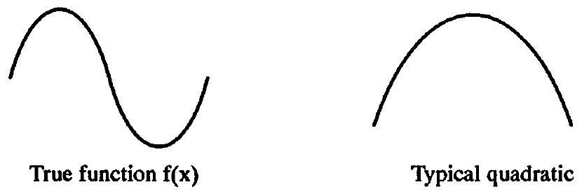
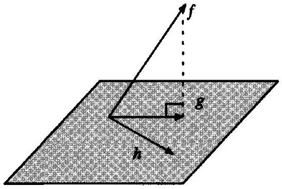
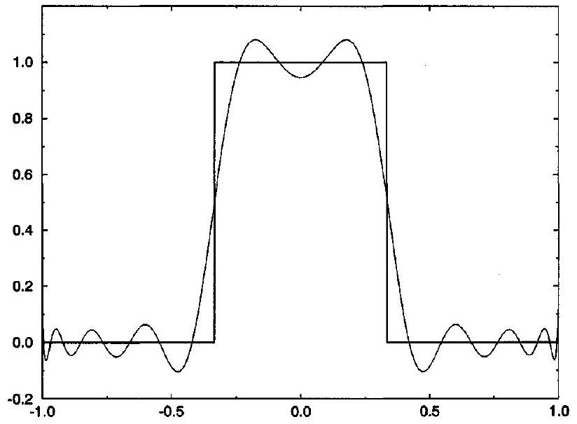
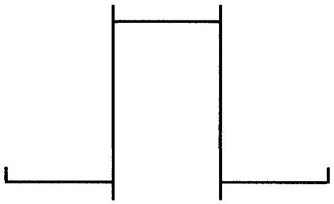
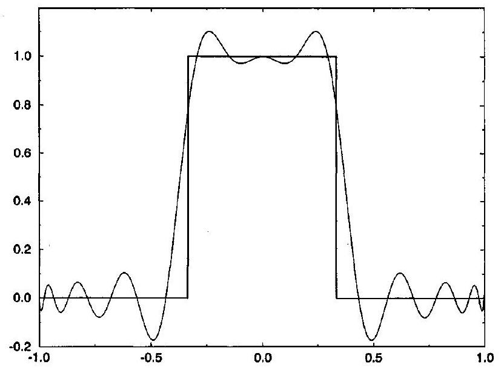
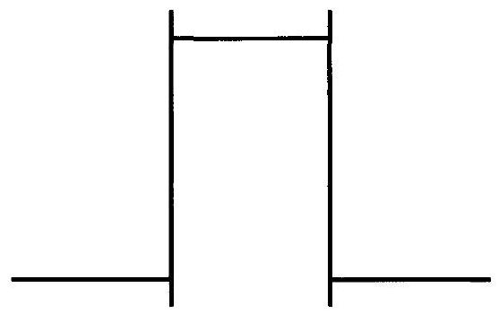
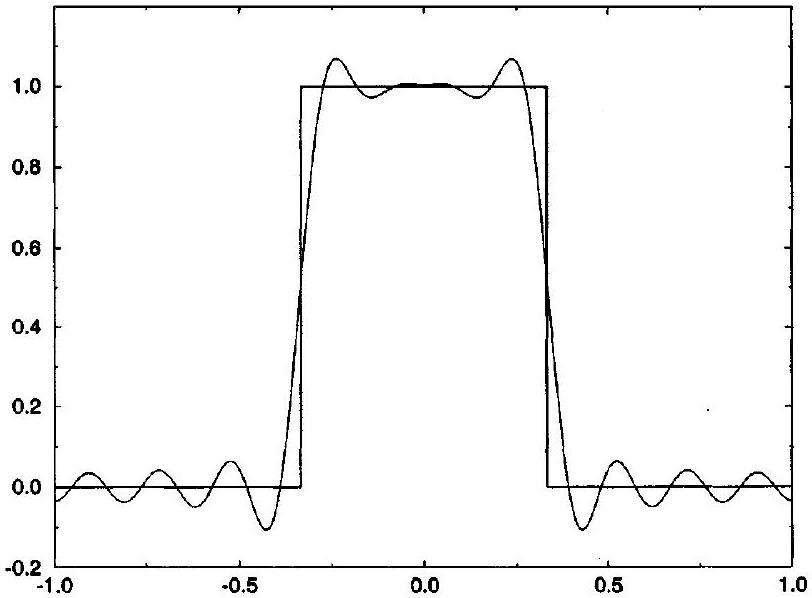

## CHAPTER 7

## Orthogonal Functions

### 7.0 Introduction

This chapter concerns orthogonal functions. A professor recently translated some of Elvis Presley's hit songs into Latin. The love songs were easy, but the professor had trouble with Elvis' rock hits - there are no Latin words for "blue suede shoes" or "hound dog." Computers have a similar difficulty when it comes to functions. As seen in the last chapter, computers represent functions by finite sequences. Unfortunately, most finite sequences cannot adequately express most discontinuous functions. For example, whereas an infinite-order polynomial can represent any piecewise-smooth function, even the best finite-order polynomial approximations exhibit substantial oscillations in the presence of jump discontinuities. Of course, the best polynomial depends on how you define "best." For example, the "best" polynomial could be the polynomial with the least error in the 1 -norm, the 2 -norm, the $\infty$-norm, or at some specified critical point. However, sometimes there are no good polynomials regardless of your criteria. This is quite often the case with discontinuous functions. Even completely smooth functions can suffer, as seen in the following example.

Example 7.1 Find the best quadratic approximation for a function with one maximum and one minimum.

Solution As seen in Figure 7.1, the error is enormous no matter which quadratic is chosen. The quadratic can model the maximum or the minimum but not both. There is simply no way to make a one-hump camel look like a two-hump camel. In this case, the choice of quadratic is largely arbitrary, and thus it is impossible to tell much about the original function by examining the chosen quadratic representation.

An $N$ th order polynomial has at most $N-1$ extrema. Then, as in the last example, a function represented by an $N$ th-order polynomial should have no more than $N-1$ extrema. Although this is a nice rule of thumb, the rest of this chapter describes a more rigorous approach based on choosing the best finite-length vector approximation to a function. From Section 6.3, recall that computers describe functions by sequences and, as defined in this chapter, vectors are sequences that retain their identities under coordinate transformations.

After a general introduction to orthogonal functions in Section 7.1, the rest of the chapter concerns specific orthogonal functions. In particular, Section 7.2 concerns Legendre polynomials, Section 7.3 concerns Chebyshev polynomials, and Section 7.4 concerns Fourier series. Fourier series prove invaluable later in the book (Chapter 15 uses discrete Fourier series heavily).

Figure 7.1 Quadratic approximation of a function with two extrema.

Spectral methods represent functions by coefficients in finite series of orthogonal functions; see, for example, Canuto et al. (1988). Although traditionally used for incompressible and turbulent flows, researchers have increasingly applied spectral methods to compressible flows. For example, Giannakouros and Karniadakis (1994) describe a spectral version of the flux-corrected transport method seen in Chapter 21. Although this book will not consider spectral methods, this chapter gives readers the fundamental background required to understand such methods. As two other applications of orthogonal functions relevant to this book, Van Leer (1977) uses Legendre polynomials and Sanders (1988) uses Hermite polynomials. Many books discuss orthogonal functions in terms of one of their most popular applications: the solution of ordinary differential equations. This book does not concern ordinary differential equations, and thus we will not discuss this application of orthogonal functions.

Putting aside the applications of orthogonal functions mentioned above, the main purpose of this chapter is to provide a reference standard for the next chapter. For example, this chapter shows how to find the "best" quadratic approximation to a given function over a given region. This chapter also illustrates the definitions of norm, inner product, and especially convergence seen in the last chapter.

### 7.1 Functions as Vectors

The last chapter showed that many functions could be interpreted as sequences or, more specifically, vectors. In fact, in a very concrete sense, many functions are vectors. This section gives a brief review of vector algebra, as seen in any basic linear algebra textbook, except that functions replace vectors.

A linear combination of functions $\left(f_{0}, \ldots, f_{M}\right)$ is defined as follows:

$$
a_{0} f_{0}+\cdots+a_{M} f_{M},
$$

where $\left(a_{0}, \ldots, a_{M}\right)$ are real numbers. A set of functions $\left(f_{0}, \ldots, f_{M}\right)$ is linearly independent if

$$
a_{0} f_{0}+\cdots+a_{M} f_{M}=0 \quad \text { implies } \quad a_{0}=\cdots=a_{M}=0,
$$

where the zero on the right-hand side of the linear combination refers to the zero function, rather than the real number zero. A basis for a functional space is a set of linearly independent functions such that every function in the space can be written as a linear combination of the basis functions. In other words, for any function $f$ and any basis $\left(f_{0}, \ldots, f_{M}\right)$ there exist real numbers ( $a_{0}, \ldots, a_{M}$ ) such that

$$
f=a_{0} f_{0}+\cdots+a_{M} f_{M} .
$$

The numbers $\left(a_{0}, \ldots, a_{M}\right)$ are called the components of $f$ in basis $\left(f_{0}, \ldots, f_{M}\right)$. The number $M+1$ is called the dimension of the space. Functional spaces are often infinite dimensional. Any basis for a space is said to span the space.

Recall functional inner products, as discussed in Section 6.1. Two functions $f$ and $g$ are orthogonal if $f \cdot g=0$. An orthogonal basis is a basis of mutually orthogonal functions; thus

$$
f_{i} \cdot f_{j}=0 \quad i \neq j .
$$

As seen in Section 6.1, every inner product defines a natural norm as follows:

$$
\|f\|^{2}=\mathbf{f} \cdot \mathbf{f} .
$$

An orthonormal basis is an orthogonal basis where $\left\|f_{i}\right\|=1$ using the natural norm.
The components of $f$ in an orthogonal basis ( $f_{0}, \ldots, f_{M}$ ) are computed as follows:

$$
a_{i}=\frac{f \cdot f_{i}}{f_{i} \cdot f_{i}} .
$$

Similarly, the components of $f$ in an orthonormal basis ( $f_{0}, \ldots, f_{M}$ ) are computed as follows:

$$
a_{i}=f \cdot f_{i} .
$$

Suppose that the full space has dimension $M+1$. Consider a subspace of dimension $N+1 \leq M+1$ with orthogonal basis $\left(g_{0}, \ldots, g_{N}\right)$. Then, for every function $f$ in the full space, the orthogonal projection of $f$ onto the subspace is

$$
g=a_{0} g_{0}+\cdots+a_{N} g_{N},
$$

where

$$
a_{i}=\frac{f \cdot g_{i}}{g_{i} \cdot g_{i}} .
$$

The orthogonal projection $g$ is the function in the subspace closest to $f$ as measured in the natural norm: If we let $f$ be any function in the full space, $g$ be the orthogonal projection of $f$ onto the subspace, and $h$ be any other function in the subspace, then

$$
\|f-g\| \leq\|f-h\|,
$$

where $\|f\|=\sqrt{f \cdot f}$. If the full space is three dimensional and the subspace is two dimensional, orthogonal projections can be visualized as in Figure 7.2.

Figure 7.2 Orthogonal projection from three to two dimensions.

### 7.2 Legendre Polynomial Series

The Legendre polynomials $P_{j}(x)$ are defined as follows:

$$
\begin{aligned}
& P_{0}(x)=1, \quad P_{1}(x)=x \\
& (j+1) P_{j+1}(x)=(2 j+1) x P_{j}(x)-j P_{j-1}(x)
\end{aligned}
$$

For example,

$$
P_{2}(x)=\frac{1}{2}\left(3 x^{2}-1\right), \quad P_{3}(x)=\frac{1}{2}\left(5 x^{3}-3 x\right)
$$

The Legendre polynomials $P_{j}$ form a basis for the space of piecewise-smooth functions with domains $[-1,1]$. This basis is orthogonal using the following inner product:

$$
f \cdot g=\int_{-1}^{1} f(x) g(x) d x
$$

In particular,

$$
P_{i} \cdot P_{j}=\int_{-1}^{1} P_{i}(x) P_{j}(x) d x= \begin{cases}2 /(2 j+1) & i=j \\ 0 & i \neq j\end{cases}
$$

Then, for any piecewise-smooth function $f(x)$ with domain $[-1,1]$,

$$
f(x)=\sum_{i=0}^{\infty} a_{j} P_{j}(x)
$$

where

$$
a_{j}=\frac{f \cdot P_{j}}{P_{j} \cdot P_{j}}=\frac{2 j+1}{2} \int_{-1}^{1} f(x) P_{j}(x) d x
$$

This is called the Legendre polynomial series for $f(x)$. For functions whose domains do not equal $[-1,1]$, use a linear mapping from the domain $[a, b]$ to $[-1,1]$.

The first $N+1$ Legendre polynomials ( $P_{0}, \ldots, P_{N}$ ) span the space of polynomials of order $N$ or less. A simpler but nonorthogonal basis for the same subspace is $\left(1, x, x^{2}, x^{3}, \ldots\right)$. Any nonorthogonal basis can be converted to an orthogonal basis using the Gram-Schmidt procedure, as described in any elementary linear algebra text such as Anton's (1981); in particular, the Gram-Schmidt procedure using the inner product of Equation (7.8) converts $\left(1, x, x^{2}, \ldots, x^{N}\right)$ to $\left(P_{0}, \ldots, P_{N}\right)$.

The orthogonal projection of any piecewise-smooth function $f$ with domain $[-1,1]$ onto the subspace spanned by ( $P_{0}, \ldots, P_{N}$ ) is

$$
f(x) \approx a_{0} P_{0}(x)+\cdots+a_{N} P_{N}(x)
$$

where

$$
a_{j}=\frac{f \cdot P_{j}}{P_{j} \cdot P_{j}}=\frac{2 j+1}{2} \int_{-1}^{1} f(x) P_{j}(x) d x
$$

This is sometimes called a truncated Legendre polynomial series or an Nth-order Legendre polynomial series for $f(x)$.

The $N$ th-order Legendre polynomial series is the closest $N$ th-order polynomial to $f$ as measured in the 2-norm. Therefore

$$
\left\|f(x)-a_{0} P_{0}(x)-\cdots-a_{N} P_{N}(x)\right\|_{2} \leq\left\|f(x)-b_{0} P_{0}(x)-\cdots-b_{N} P_{N}(x)\right\|_{2}
$$

or

$$
\begin{aligned}
& \int_{-1}^{1}\left(f(x)-a_{0} P_{0}(x)-\cdots-a_{N} P_{N}(x)\right)^{2} d x \\
& \quad \leq \int_{-1}^{1}\left(f(x)-b_{0} P_{0}(x)-\cdots-b_{N} P_{N}(x)\right)^{2} d x
\end{aligned}
$$

where the $a_{j}$ are defined by Equation (7.13) and the $b_{j}$ are any other real numbers. The $N$ thorder Legendre polynomial series is sometimes referred to as the $N$ th-order polynomial that best approximates $f$ in the least squares sense. Compared with Legendre polynomials, other polynomials may reduce the error at a single point, such as a Taylor series taken about that point. Moreover, other polynomials may reduce the error over any subdomain of $[-1,1]$; however, no other $N$ th-order polynomial can reduce the error over the entire domain $[-1,1]$, as measured in the 2 -norm, compared with the $N$ th-order Legendre polynomial series.

From Section 6.3, recall that there are at least three common definitions for functional convergence: pointwise convergence, convergence in the mean ( 2 -norm), and uniform convergence ( $\infty$-norm). The $N$ th-order Legendre polynomial series pointwise converges to the true function as $N \rightarrow \infty$. In other words, if $f$ is piecewise-smooth with domain $[-1,1]$, then the $N$ th-order Legendre polynomial series pointwise converges to $f(x)$ for all $-1 \leq x \leq 1$ where $f$ is continuous; furthermore, the $N$ th-order Legendre polynomial series pointwise converges to the average $\left(f_{L}+f_{R}\right) / 2$, where $f$ jumps from $f_{L}$ to $f_{R}$. The $N$ th-order Legendre polynomial series also converges in the mean to the true function as $N \rightarrow \infty$. In other words:

$$
\lim _{N \rightarrow \infty}\left\|f-a_{0} P_{0}-\cdots-a_{N} P_{N}\right\|_{2}=0
$$

or

$$
\lim _{N \rightarrow \infty} \int_{-1}^{1}\left(f(x)-a_{0} P_{0}(x)-\cdots-a_{N} P_{N}(x)\right)^{2} d x=0
$$

These convergence results are not quite so rosy as they may first appear. First off, the rate of convergence may be extremely low, especially in the presence of jump discontinuities. Furthermore, the $N$ th-order Legendre polynomial series may not converge uniformly. In other words, the maximum or $\infty$-norm error may remain large regardless of $N$.

Example 7.2 Find the second-order Legendre polynomial series for

$$
f(x)= \begin{cases}0 & -1 \leq x<0 \\ x & 0 \leq x \leq 1\end{cases}
$$

Solution Assuming the reader can do the integrations seen in Equation (7.13), the required coefficients are $a_{0}=1 / 4, a_{1}=1 / 2$, and $a_{2}=5 / 16$. Then the second-order

Legendre polynomial series is

$$
\frac{1}{4} P_{0}(x)+\frac{1}{2} P_{1}(x)+\frac{5}{16} P_{2}(x)=\frac{1}{4}+\frac{1}{2} x+\frac{5}{16} \cdot \frac{1}{2}\left(3 x^{2}-1\right) .
$$

This result has been written in terms of the basis $\left(P_{0}, P_{1}, P_{2}\right)$. However, $\left(1, x, x^{2}\right)$ is also a basis for the same space, albeit a nonorthogonal basis. In terms of basis ( $1, x, x^{2}$ ), the Legendre polynomial series becomes

$$
\frac{15}{32} x^{2}+\frac{1}{2} x+\frac{3}{32}
$$

Since Taylor series use the basis $\left(1, x, x^{2}\right)$, this is sometimes called the Taylor series form of the Legendre polynomial series. However, although this is in Taylor series form, the Legendre polynomial series does not equal the Taylor series! The Taylor series taken about $b$ equals zero for $b$ less than zero, equals $x$ for $b$ greater than zero, and is undefined for $b$ equal to zero. Then the Taylor series captures the function perfectly on one side of $x=0$, either the left or the right side, but gets the function completely wrong on the other side of $x=0$, where $x=0$ is the location of the jump discontinuity in the first derivative. Basically, Taylor series use very detailed information about the function at a single point; however, a single point cannot indicate the presence of a distant jump discontinuity in the function or its derivatives, so that the Taylor series becomes invalid for points on the other side of a jump discontinuity in the function or its derivatives. Thus Taylor series minimize the error at a single point while Legendre polynomial series and other series minimize the error over an entire region. Note that, unlike Legendre polynomial series, Taylor series are not vectors and thus do not properly belong in this discussion.

Example 7.3 Plot the 20th-order polynomial that has the minimum least-squares error approximating $f(x)$ where

$$
f(x)= \begin{cases}0 & 1 / 3<|x|<1, \\ 1 & |x| \leq 1 / 3 .\end{cases}
$$

Solution The 20th-order Legendre polynomial series is plotted in Figure 7.3. The jump discontinuities at $x= \pm 1 / 3$ cause the Legendre polynomial series to oscillate about the correct function throughout the domain. The largest errors occur just to the left and right of the jump discontinuities and at the endpoints $x= \pm 1$. Because they are so narrow, the errors near the endpoints are a bit hard to see; however, they are just as large as the errors near the jump discontinuities.

As the order $N$ increases, the number of oscillations increases, the period of the oscillations decreases, and the amplitude of the oscillations decreases except near the endpoints and jump discontinuities. There is always one large oscillation near each jump discontinuity and endpoint - the period of these oscillations decreases but the amplitudes do not decrease as $N \rightarrow \infty$. Thus there are always a few increasingly narrow bands where the error remains large. These spurious oscillations are sometimes called Gibbs oscillations. The Legendre polynomial in the limit of very large $N$ appears roughly as shown in Figure 7.4.

Although the Legendre polynomial series may have the minimum error in a least squares sense, it does not really capture the essence of the square wave - in fact, just looking at the graph of the Legendre polynomial series, it could be hard to guess what function it was

Figure 7.3 Twentieth-order Legendre polynomial series for a square wave.

Figure 7.4 Very high-order Legendre polynomial series for a square wave.

trying to approximate, as least for small $N$. It might be well worth incurring a little extra 2-norm error to obtain an approximation that better captured the shape of the square wave and, in particular, was free of spurious overshoots and oscillations. This can be done using piecewise-polynomial approximations, as seen in Chapter 9.

### 7.3 Chebyshev Polynomial Series

The Chebyshev polynomials $T_{j}(x)$ are defined as follows:

$$
\begin{aligned}
& T_{0}(x)=1, \quad T_{1}(x)=x, \\
& T_{j+1}(x)=2 x T_{j}(x)-T_{j-1}(x) .
\end{aligned}
$$

For example,

$$
T_{2}(x)=2 x^{2}-1, \quad T_{3}(x)=4 x^{3}-3 x
$$

Like the Legendre polynomials, the Chebyshev polynomials $T_{j}$ form a basis for the space of piecewise-smooth functions with domains $[-1,1]$. This basis is orthogonal using the
following inner product:

$$
f \cdot g=\int_{-1}^{1} \frac{f(x) g(x)}{\sqrt{1-x^{2}}} d x
$$

Then

$$
f(x)=\sum_{i=0}^{\infty} a_{j} T_{j}(x)
$$

where

$$
a_{0}=\frac{f \cdot T_{0}}{T_{0} \cdot T_{0}}=\frac{1}{\pi} \int_{-1}^{1} \frac{f(x) T_{j}(x)}{\sqrt{1-x^{2}}} d x
$$

and

$$
a_{j}=\frac{f \cdot T_{j}}{T_{j} \cdot T_{j}}=\frac{2}{\pi} \int_{-1}^{1} \frac{f(x) T_{j}(x)}{\sqrt{1-x^{2}}} d x
$$

for any piecewise-smooth function $f(x)$ with domain $[-1,1]$. This is called the Chebyshev polynomial series for $f(x)$. For functions whose domains do not equal $[-1,1]$, use a linear mapping from the domain $[a, b]$ to $[-1,1]$.

Like Legendre polynomials, the first $N$ Chebyshev polynomials $\left(T_{0}, \ldots, T_{N}\right)$ span the subspace of polynomials of order $N$ or smaller. The orthogonal projection of any piecewisesmooth function $f$ with domain $[-1,1]$ onto this subspace is

$$
f(x) \approx a_{0} T_{0}(x)+\cdots+a_{N} T_{N}(x)
$$

where the $a_{j}$ are defined by Equations (7.17) and (7.18). This is sometimes called a truncated Chebyshev polynomial series or an Nth-order Chebyshev polynomial series for $f$. The $N$ th-order Chebyshev polynomial series is the closest $N$ th-order polynomial to $f$ as measured in the natural norm $\|f\|^{2}=f \cdot f$. In other words,

$$
\begin{aligned}
& \int_{-1}^{1}\left(f(x)-a_{0} T_{0}(x)-\cdots-a_{N} T_{N}(x)\right)^{2} \\
& \quad \leq \int_{-1}^{1} \frac{\left(f(x)-b_{0} T_{0}(x)-\cdots-b_{N} T_{N}(x)\right)^{2}}{\sqrt{1-x^{2}}} d x
\end{aligned}
$$

where the coefficients $a_{j}$ are defined by Equations (7.17) and (7.18) and where the coefficients $b_{j}$ are any other real numbers.

The natural norm for Chebyshev polynomials includes a weighting function $w(x)= 1 / \sqrt{1-x^{2}}$. By contrast, the natural norm for Legendre polynomial series is the 2 -norm, which employs a uniform weighting function $w(x)=1$. However, as we have seen, Legendre polynomial series tend to experience large errors near the endpoints. The weighting function $w(x)=1 / \sqrt{1-x^{2}}$ heavily penalizes errors near the endpoints $\pm 1$ and thus results in a more uniform error distribution. For a given polynomial order, the minimax polynomial is the polynomial that minimizes the maximum error. In other words, the minimax polynomial minimizes the $\infty$-norm of the error. Unfortunately, there is no easy way to obtain the minimax polynomial, but in many cases the Chebyshev polynomial comes close.

The expressions (7.17) and (7.18) are a bit awkward unless $f(x)$ happens to include a factor of $\sqrt{1-x^{2}}$. Fortunately, there is a simple alternative. The $n$ th-order Chebyshev polynomial $T_{n}(x)$ has exactly $n$ roots, $z_{n 1}, \ldots, z_{n n}$, where

$$
z_{n i}=\cos \left(\frac{\pi(2 i-1)}{2 n}\right)
$$

It can be shown that

$$
a_{0}=\frac{1}{N+1} \sum_{i=1}^{N+1} f\left(z_{N+1, i}\right)
$$

and

$$
a_{n}=\frac{2}{N+1} \sum_{i=1}^{N+1} f\left(z_{N+1, i}\right) T_{n}\left(z_{N+1, i}\right)
$$

Example 7.4 Find the second-order Chebyshev polynomial series for

$$
f(x)= \begin{cases}0 & -1 \leq x<0 \\ x & 0 \leq x \leq 1\end{cases}
$$

Solution By Equation (7.20), the roots of $T_{3}(x)$ are $\pm \sqrt{3} / 2$ and 0 . Assuming the reader can do the evaluations and sums seen in Equations (7.21) and (7.22), the required coefficients are $a_{0}=a_{2}=1 /(2 \sqrt{3})$ and $a_{1}=1 / 2$. Then the second-order Chebyshev polynomial series is

$$
\frac{1}{2 \sqrt{3}} T_{0}(x)+\frac{1}{2} T_{1}(x)+\frac{1}{2 \sqrt{3}} T_{2}(x)=\frac{1}{2} x+\frac{1}{\sqrt{3}} x^{2}
$$

where the expression on the right-hand side is the Taylor series form. The maximum error of the Chebyshev polynomial series occurs at $\pm \sqrt{3} / 4= \pm 0.433$ and is equal to $\sqrt{3} / 16=0.108$. Compare this to the Legendre polynomial series found in Example 7.2, whose maximum error occurs at $\pm 8 / 15= \pm 0.533$ and is equal to 0.110 . Thus, in this case, the difference in the maximum error is only slight. In fact, overall, the Legendre polynomial series and the Chebyshev polynomial series are surprisingly similar in this case, illustrating that two polynomials may be similar even when their Taylor series coefficients differ radically; this will be an important point later in the text.

Example 7.5 Plot the 20th-order polynomial Chebyshev polynomial for

$$
f(x)= \begin{cases}0 & 1 / 3<|x|<1, \\ 1 & |x| \leq 1 / 3 .\end{cases}
$$

Solution The 20th-order Chebyshev polynomial series is plotted in Figure 7.5. The discussion of Example 7.3 applies again here, except that the large spike in the Gibbs oscillations near the endpoints is eliminated. Then the Chebyshev polynomial in the limit of very large $N$ appears roughly as shown in Figure 7.6.

Figure 7.5 Twentieth-order Chebyshev polynomial series for a square wave.

Figure 7.6 Very high-order Chebyshev polynomial series for a square wave.

### 7.4 Fourier Series

Consider the trigonometric functions $1, \cos x, \cos 2 x, \cos 3 x, \ldots$ and $\sin x, \sin 2 x$, $\sin 3 x, \ldots$. These trigonometric functions form a basis for the space of piecewise-smooth functions with domains $[0,2 \pi]$. This basis is orthogonal using the following inner product:

$$
f \cdot g=\int_{0}^{2 \pi} f(x) g(x) d x
$$

Then

$$
f(x)=a_{0}+\sum_{n=1}^{\infty} a_{n} \cos n x+\sum_{n=1}^{\infty} b_{n} \sin n x,
$$

where

$$
\begin{aligned}
& a_{0}=\frac{f \cdot 1}{1 \cdot 1}=\frac{1}{2 \pi} \int_{0}^{2 \pi} f(x) d x \\
& a_{n}=\frac{f \cdot \cos n x}{\cos n x \cdot \cos n x}=\frac{1}{\pi} \int_{0}^{2 \pi} f(x) \cos n x d x
\end{aligned}
$$

and

$$
b_{n}=\frac{f \cdot \sin n x}{\sin n x \cdot \sin n x}=\frac{1}{\pi} \int_{0}^{2 \pi} f(x) \sin n x d x
$$

for any piecewise-smooth function $f(x)$ with domain $[0,2 \pi]$. This is called a Fourier series for $f(x)$.

The first $2 N+1$ trigonometric functions $(1, \cos x, \ldots, \cos N x$ and $\sin x, \ldots, \sin N x)$ form the basis for a $(2 N+1)$-dimensional subspace of functions. The orthogonal projection of any piecewise-smooth function $f$ with domain $[0,2 \pi]$ onto this subspace is

$$
f(x) \approx a_{0}+\sum_{n=1}^{N} a_{n} \cos n x+\sum_{n=1}^{N} b_{n} \sin n x
$$

where $a_{n}$ and $b_{n}$ are defined by Equations (7.25), (7.26), and (7.27). This is sometimes called a truncated Fourier series or a $2 N$-order Fourier series for $f$. The truncated Fourier series is the closest function to $f$ in the subspace spanned by $(1, \cos x, \ldots, \cos N x)$ and $(\sin x, \ldots, \sin N x)$ in a least squares sense. Whereas both Legendre polynomial series and Fourier series minimize 2 -norm error, they minimize the 2 -norm error over different subspaces.

The truncated Fourier series pointwise converges to the true function as $N \rightarrow \infty$. In other words, if $f$ is piecewise-smooth with domain $[0,2 \pi]$ then the truncated Fourier series converges to $f(x)$ for all $0 \leq x \leq 2 \pi$ where $f$ is continuous; furthermore, the truncated Fourier series converges to the average $\left(f_{L}+f_{R}\right) / 2$ where $f$ jumps from $f_{L}$ to $f_{R}$. The truncated Fourier series also converges in the mean to the true function as $N \rightarrow \infty$. However, the rate of convergence may be extremely low, especially in the presence of jump discontinuities. Furthermore, the truncated Fourier series may not converge uniformly: there may always be points where the error is large, regardless of $N$. This is yet another example of how convergence alone may not mean much - only a reasonably rapid rate of convergence in the $\infty$-norm guarantees a genuinely high quality approximation.

Outside of the domain $[0,2 \pi]$, Fourier series repeat themselves with period $2 \pi$. Therefore the domains $[2 \pi, 4 \pi],[4 \pi, 6 \pi],[-2 \pi, 0]$, and $[-4 \pi,-2 \pi]$ all contain exact copies of the Fourier series on the domain $[0,2 \pi]$. In most cases, this repetition is an artifact of the Fourier series. However, some functions - called periodic functions - behave exactly this way. For example, all trigonometric functions are periodic. While particularly well suited for representing periodic functions, Fourier series can represent any function on the domain $[0,2 \pi]$. However, if the function is not periodic, the Fourier series will perceive any difference between $f(0)$ and $f(2 \pi)$ as a jump discontinuity in the function. Also, the Fourier series will perceive any difference between $f^{\prime}(0)$ and $f^{\prime}(2 \pi)$ as a jump discontinuity in the first derivative, and similarly for higher-order derivatives. Jump discontinuities in the function or its derivatives cause difficulties for Fourier series, just as for Legendre and Chebyshev polynomial series.

A function is called bandlimited if

$$
f(x)=a_{0}+\sum_{n=1}^{N} a_{n} \cos n x+\sum_{n=1}^{N} b_{n} \sin n x
$$

for some $N$. In other words, for bandlimited functions, the truncated Fourier series is exact for some finite $N$. The analogous situation to bandlimiting for polynomial series,
such as Legendre and Chebyshev polynomial series, is that a function is an $N$ th-order polynomial for some $N$. Although few physical functions are true polynomials, many physical functions are naturally bandlimited. Bandlimiting is often specified in terms of the shortest wavelength $2 \pi / N$ or the highest frequency $N / 2 \pi$ rather than in terms of $N$. Discontinuous and nonsmooth functions cannot be bandlimited; then, according to the discussion in the previous paragraph, nonperiodic functions also cannot be bandlimited.

For functions whose domains do not equal $[0,2 \pi]$, we can use a linear mapping from the domain $[a, b]$ to $[0,2 \pi]$. Specifically, the trigonometric functions

$$
\cos \left(2 \pi n \frac{x-a}{b-a}\right), \quad \sin \left(2 \pi n \frac{x-a}{b-a}\right)
$$

span the piecewise-smooth functions $f(x)$ with finite domains $[a, b]$. Then

$$
f(x) \approx a_{0}+\sum_{n=1}^{N} a_{n} \cos \left(2 \pi n \frac{x-a}{b-a}\right)+\sum_{n=1}^{N} b_{n} \sin \left(2 \pi n \frac{x-a}{b-a}\right)
$$

where

$$
\begin{aligned}
a_{0} & =\frac{1}{b-a} \int_{a}^{b} f(x) d x \\
a_{n} & =\frac{2}{b-a} \int_{a}^{b} f(x) \cos \left(2 \pi n \frac{x-a}{b-a}\right) d x
\end{aligned}
$$

and

$$
b_{n}=\frac{2}{b-a} \int_{a}^{b} f(x) \sin \left(2 \pi n \frac{x-a}{b-a}\right) d x
$$

Example 7.6 Plot the 20th-order Fourier series for

$$
f(x)= \begin{cases}0 & 1 / 3<|x|<1 \\ 1 & |x| \leq 1 / 3\end{cases}
$$

Solution Notice that N=10 for 20th-order Fourier series. The 20th-order Fourier series is plotted in Figure 7.7. Comparing with the Legendre polynomial series seen in Example 7.3 and the Chebyshev polynomial series seen in Example 7.5, we see that the Gibbs oscillations in the Fourier series are noticeably smaller. The Fourier series for $N \rightarrow \infty$ looks much like the Chebyshev polynomial series for $N \rightarrow \infty$, as seen in Figure 7.6, where the "hiccups" at each jump discontinuity are approximately $9 \%$ of the size of the jumps. The problem areas due to the Gibbs phenomenon in Fourier series and in the earlier polynomial series are like those of the ghetto - while you can make the ghetto as small as you like, things are still just as bad for the people left in the ghetto.

The trigonometric functions $(1, \cos x, \cos 2 x, \cos 3 x, \ldots)$ form a basis for the space of piecewise-smooth even functions with domains $[0,2 \pi]$; any even function expressed in this basis is called a Fourier cosine series. Similarly, the trigonometric functions $(\sin x, \sin 2 x, \sin 3 x, \ldots)$ form a basis for the space of piecewise-smooth odd functions with domains $[0,2 \pi]$; any odd function expressed in this basis is called a Fourier sine series. In

Figure 7.7 Twentieth-order Fourier series for a square wave.

general, any function expressed in terms of any basis of trigonometric functions is called a trigonometric series; Founier series, Fourier cosine series, and Fourier sine series are all examples of trigonometric series.

This section and the previous two described several important sets of orthogonal basis functions. Of course, these are just a few examples among many. Some other wellknown orthogonal basis functions include Laguerre polynomials, Hermite polynomials, and Jacobi polynomials; see the references below for further details. However, regardless of the choice of basis function, no single finite-length vector can adequately represent a discontinuous function. Instead, we require piecewise-polynomial approximations, as discused in Chapter 9.

## References

Anton, H. 1981. Elementary Linear Algebra, 3rd ed., New York: Wiley.
Canuto, C., Hussaini, M. Y., Quarteroni, A., and Zang, T. A. 1988. Spectral Methods in Fluid Dynamics, Berlin: Springer-Verlag.
Davis, H. F. 1963. Fourier Series and Orthogonal Functions, New York: Dover.
Giannakouros, J., and Karniadakis, G. E. 1994. "A Spectral Element-FCT Method for the Compressible Euler Equations," Journal of Computational Physics, 115: 65-85.
Press, W. H., Teukolsky, S. A., Vetterling, W. T., and Flannery, B. P. 1992, Numerical Recipes in C: The Art of Scientific Computing, 2nd ed., New York: Cambridge University Press, Sections 4.5, 5.5, and 5.8.
Sanders, R. 1988. "A Third-Order Accurate Variation Nonexpansive Difference Scheme for Single Nonlinear Conservation Laws," Mathematics of Computation, 51: 535-558.
Van Leer, B. 1977. "Towards the Ultimate Conservative Difference Scheme. IV. A New Approach to Numerical Convection," Journal of Computational Physics, 23: 276-299.

## Problems

7.1 Find the second-order Legendre polynomial series for $f(x)=\sin x$ on the domain $[-1,1]$. Compare with the second-order Taylor series about $x=0$.
7.2 Consider the following function:
$f(x)= \begin{cases}0 & 1 \leq|x| \leq 2, \\ 1-x^{2} & |x|<1 .\end{cases}$
(a) Find the single quadratic that best approximates this function in the least squares sense over the function's entire domain.
(b) Roughly speaking, what happens to the $N$ th-order polynomial that best approximates this function in the least square sense as $N \rightarrow \infty$ ?
7.3 (a) Find the second-order Chebyshev polynomial series for $f(x)=e^{-x^{2}}$ on the domain $[-1,1]$. Compare with the second-order Taylor series about $x=0$.
(b) Show that the coefficients of the Legendre polynomial series can be written in terms of the error function defined as follows:
$\operatorname{erf}(x)=\frac{2}{\sqrt{x}} \int_{0}^{x} e^{-y^{2}} d y$.
7.4 Find the Fourier series for the following function:
$f(x)= \begin{cases}0 & -1 \leq x<0, \\ x & 0 \leq x \leq 1 .\end{cases}$
Compare with the Chebyshev polynomial series found in Example 7.4. In particular, is the Chebyshev series more or less oscillatory than the Fourier series?
7.5 The Hermite polynomials $H_{j}(x)$ are defined as follows:
$H_{0}(x)=1$,
$H_{1}(x)=2 x$,
$H_{j+1}(x)=2 x H_{j}(x)-2 j H_{j-1}(x)$.
For example,
$H_{2}(x)=4 x^{2}-2$,
$H_{3}(x)=8 x^{3}-12 x$.
(a) Prove that $H_{0}(x), H_{1}(x)$, and $H_{2}(x)$ are orthogonal using the following inner product:
$f \cdot g=\int_{-\infty}^{\infty} e^{-x^{2}} f(x) g(x) d x$.
Also, find the norms of $H_{0}(x), H_{1}(x)$, and $H_{2}(x)$ using the natural norm. You may wish to use a table of integrals.
(b) Assume that the full set of Hermite polynomials is orthogonal and that $\left\|H_{j}(x)\right\|= 2^{j} j!\sqrt{\pi}$. Find a general expression for any piecewise-smooth integrable function with domain $(-\infty, \infty)$ in terms of an infinite Hermite polynomial series. Also, for any such function, find the closest truncated Hermite polynomial series. In what sense is this finite-length polynomial series "closest" to the function? In other words, which errors does the weighting function $e^{-x^{2}}$ tolerate and which errors does it penalize? Do you really expect Hermite polynomial series to accurately approximate a function over an entire infinite domain?
(c) Given their norms, what numerical problems would you expect when using Hermite polynomial series. Show that these problems can be eliminated by using orthonormal Hermite polynomials defined recursively as follows:

$$
\begin{aligned}
& \tilde{H}_{0}(x)=\frac{1}{\pi^{1 / 4}}, \quad \tilde{H}_{1}(x)=\frac{x}{\pi^{1 / 4}} \\
& \tilde{H}_{j+1}(x)=x \sqrt{\frac{2}{j+1}} \tilde{H}_{j}(x)-\sqrt{\frac{j}{j+1}} H_{j-1}(x)
\end{aligned}
$$

