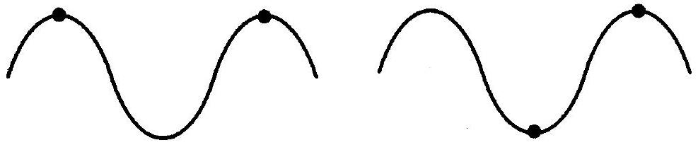
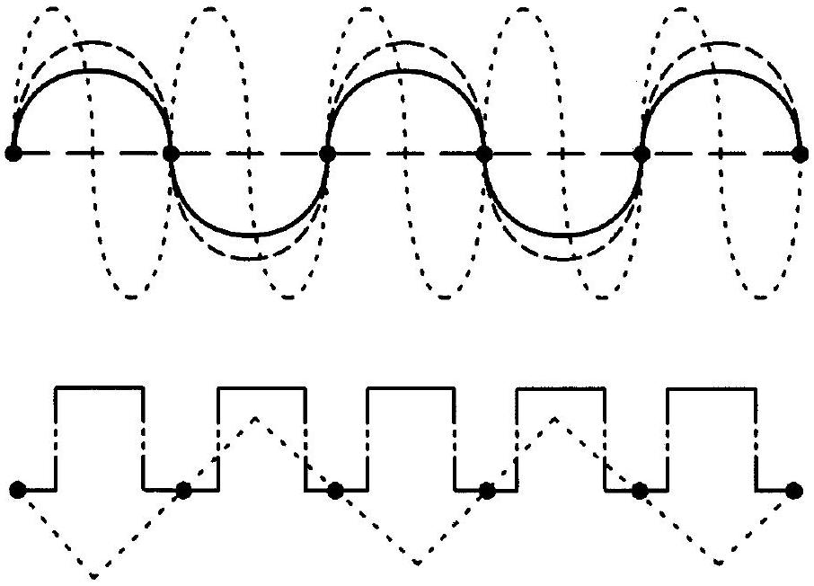
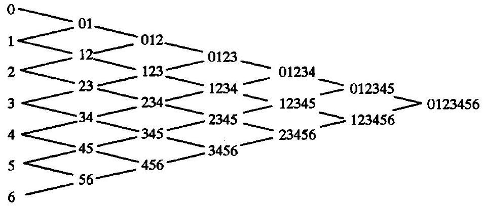
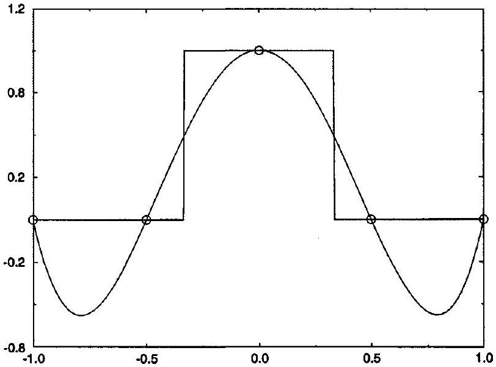
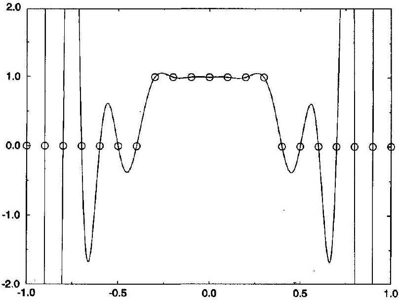
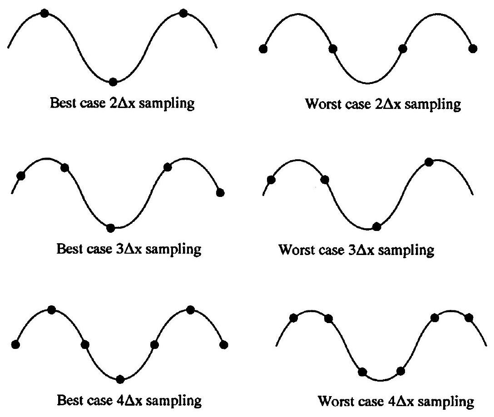
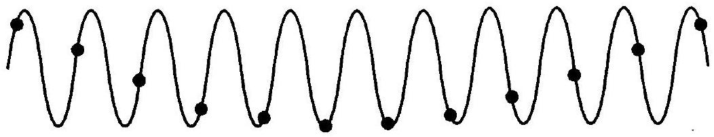
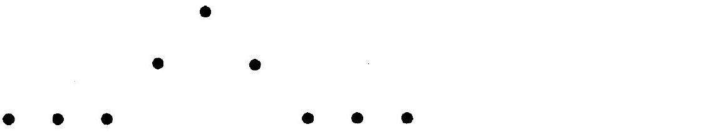
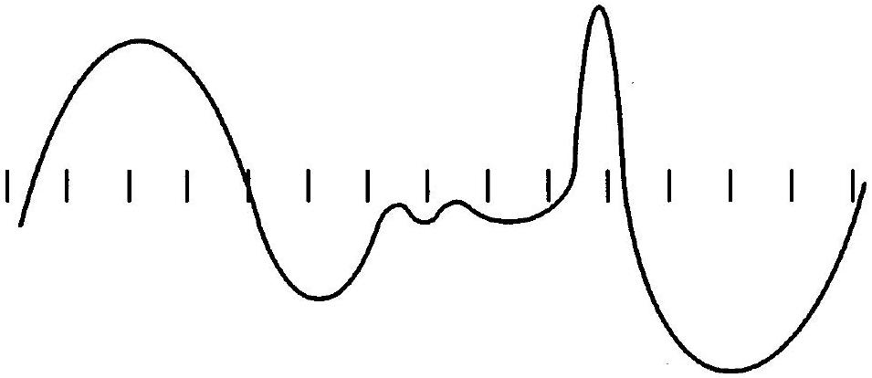

## CHAPTER 8

## Interpolation

### 8.0 Introduction

This chapter concerns polynomial and trigonometric interpolation. Polynomial interpolation leads to piecewise-polynomial reconstruction in Chapter 9 and to numerical differentiation and integration formulae in Chapter 10. As seen in Section 6.3, computers represent functions by sequences of real numbers. In the last chapter, the numbers were coefficients in functional forms such as Legendre polynomial series. In this chapter, the numbers are samples. In particular, consider any set of sample points $\left(x_{0}, x_{1}, \ldots, x_{N}\right)$ in the domain of a function $f(x)$. Then the samples $f_{i}=f\left(x_{i}\right)$ represent the function $f(x)$. Notice that the total number of samples is $N+1$ since the sample index starts from zero rather than one. The spacing between samples is $\Delta x_{i}=x_{i}-x_{i-1}$. If the sample spacing is constant then

$$
\Delta x=\frac{x_{N}-x_{0}}{N} .
$$

For example, six samples with $x_{5}-x_{0}=5$ have the sample spacing $\Delta x=1$. Samples are especially popular for solving differential equations, since differential equations are "pointwise" equations (i.e., they describe solutions in terms of rates of change at individual points). Finite-difference methods use samples as their primary representation.

Finite-difference methods often switch from samples to functional representations in order to differentiate or to perform other functional operations. Any function created from samples is called a reconstruction. Any reconstruction passing through the sample points is called an interpolation on the domain $\left[x_{0}, x_{N}\right]$ and an extrapolation on the domains $\left(-\infty, x_{0}\right)$ and $\left(x_{N}, \infty\right)$. This chapter concerns interpolations that yield a single polynomial. The next chapter describes interpolations and other sorts of reconstructions that yield piecewise-polynomials.

The quality of a sampling is gauged by how well the original function can be reconstructed from the samples. Of course, like all finite-length sequences, samples cannot adequately represent just any arbitrary function.

Example 8.1 Suppose that a function has three extrema but only two samples. Then the two samples must inevitably miss important information about the function, as illustrated in Figure 8.1. Specifically, in every case, the two samples lose critical information about the size or location of an extremum. Thus it is impossible to accurately reconstruct the original function from only two samples. This example shows that, at the very least, there should be one sample near every extremum. Not counting the endpoints of the function, the function in this example requires at least three samples.

Example 8.2 Given only samples, and no other information about the function, it may be impossible to accurately reconstruct the original function. For example, any number

Figure 8.1 Two samples cannot represent three extrema.

Figure 8.2 Different functions have the same samples.

of functions have uniformly zero samples $f\left(x_{i}\right)=0$ as illustrated in Figure 8.2. Of course, referring to the previous example, there is absolutely no chance of reconstructing the true function if it is anything other than $f(x)=0$ - for all of the other possible functions shown, the samples clearly miss critical information about the function.

As seen in these examples, one must know something more about a function other than its samples. In keeping with the spirit of the last chapter, one can restrict the possible functions to a limited finite-dimensional subspace, such that the samples uniquely specify a function from the subspace. In this case, the known subspace constitutes the "additional information" about the function required to make sampling work. As one possibility, suppose we know that the true function is a finite-length polynomial. Then the $N$ thorder polynomial interpolation equals the true function for large enough $N$. As another possibility, suppose we know that the true function is bandlimited or, in other words, that the true function equals a finite-length Fourier series. Then an $N$ th-order trigonometric interpolation equals the true function for large enough $N$.

### 8.1 Polynomial Interpolation

There is a unique $N$ th-order polynomial passing through any set of $N+1$ samples. For example, there is a unique line passing through any two points; there is a unique
quadratic passing through any three points; there is a unique cubic passing through any four points; and so on. Depending on where it is evaluated, this polynomial is either an interpolation polynomial or an extrapolation polynomial. The last chapter introduced a number of different polynomial forms, including Taylor series form, Legendre polynomial series form, and Chebyshev polynomial series form. However, these are not necessarily the best forms for expressing interpolation polynomials; this section introduces two new polynomial forms that are well suited for interpolation.

### 8.1.1 Lagrange Form

The Lagrange form of a polynomial is defined as follows:
$p_{N}(x)=\sum_{i=0}^{N} a_{i}\left(x-x_{0}\right)\left(x-x_{1}\right) \cdots\left(x-x_{i-1}\right)\left(x-x_{i+1}\right) \cdots\left(x-x_{N-1}\right)\left(x-x_{N}\right)$.
Notice that the sum skips the factor $x-x_{i}$. The Lagrange form coefficients $a_{i}$ of the interpolation polynomial are found by solving the following linear systems of equations:

$$
f\left(x_{i}\right)=a_{i}\left(x_{i}-x_{0}\right)\left(x_{i}-x_{1}\right) \cdots\left(x_{i}-x_{i-1}\right)\left(x_{i}-x_{i+1}\right) \cdots\left(x_{i}-x_{N-1}\right)\left(x_{i}-x_{N}\right),
$$

where $i=0, \ldots, N$. The solution to this diagonal system of linear equations is trivial:

$$
a_{i}=\frac{f\left(x_{i}\right)}{\left(x_{i}-x_{0}\right)\left(x_{i}-x_{1}\right) \cdots\left(x_{i}-x_{i-1}\right)\left(x_{i}-x_{i+1}\right) \cdots\left(x_{i}-x_{N-1}\right)\left(x_{i}-x_{N}\right)} .
$$

Consider the following standard notation:

$$
\prod_{i=1}^{N} x_{i}=x_{1} \cdots x_{N}
$$

where the capital pi stands for product. Then the Lagrange form of the interpolation polynomial can be written as

$$
p_{N}(x)=\sum_{i=0}^{N} f\left(x_{i}\right) \prod_{\substack{j=0 \\ j \neq i}}^{N} \frac{x-x_{j}}{x_{i}-x_{j}} .
$$

The Lagrange form is easy to derive and easy to remember but may be difficult to work with (for example, integration and differentiation are difficult in Lagrange form). The Lagrange form is discussed here mainly for completeness.

Example 8.3 Find the Lagrange form of the interpolation polynomial passing through the following points: $(-1,1),(0,2),(3,101),(4,246)$.

Solution The Lagrange form of the interpolation cubic is

$$
\begin{aligned}
p_{3}(x)= & -\frac{1}{20} x(x-3)(x-4)+\frac{1}{6}(x+1)(x-3)(x-4) \\
& -\frac{101}{12} x(x+1)(x-4)+\frac{123}{10} x(x+1)(x-3)
\end{aligned}
$$

### 8.1.2 Newton Form

The Newton form of a polynomial is defined as follows:

$$
\begin{aligned}
p_{N}(x)= & a_{0}+a_{1}\left(x-x_{0}\right)+a_{2}\left(x-x_{0}\right)\left(x-x_{1}\right) \\
& +a_{3}\left(x-x_{0}\right)\left(x-x_{1}\right)\left(x-x_{2}\right)+\cdots+a_{N}\left(x-x_{0}\right) \cdots\left(x-x_{N-1}\right)
\end{aligned}
$$

or

$$
p_{N}(x)=a_{0}+\sum_{i=1}^{N} a_{i} \prod_{j=0}^{i-1}\left(x-x_{j}\right)
$$

The Newton form coefficients $a_{i}$ of the interpolation polynomial are found by solving the following triangular linear systems of equations:

$$
\begin{aligned}
f\left(x_{0}\right) & =a_{0} \\
f\left(x_{1}\right) & =a_{0}+a_{1}\left(x_{1}-x_{0}\right) \\
f\left(x_{2}\right) & =a_{0}+a_{1}\left(x_{2}-x_{0}\right)+a_{2}\left(x_{2}-x_{0}\right)\left(x_{2}-x_{1}\right), \\
& \vdots \\
f\left(x_{N}\right) & =a_{0}+a_{1}\left(x_{N}-x_{0}\right)+a_{2}\left(x_{N}-x_{0}\right)\left(x_{N}-x_{1}\right) \\
& +\cdots+a_{N}\left(x_{N}-x_{0}\right)\left(x_{N}-x_{1}\right) \cdots\left(x_{N}-x_{N-1}\right) .
\end{aligned}
$$

Finding the solutions for $a_{0}$ and $a_{1}$ is relatively easy. In particular $a_{0}=f\left(x_{0}\right)$ and

$$
a_{1}=\frac{f\left(x_{1}\right)-a_{0}}{x_{1}-x_{0}}=\frac{f\left(x_{1}\right)-f\left(x_{0}\right)}{x_{1}-x_{0}} .
$$

Determining the solutions for $a_{2}, a_{3}$, and so on becomes progressively more difficult. Luckily, as it turns out, there is a simple recursive solution. To state this solution, we must first define the Newton divided differences. In particular, the zeroth Newton divided differences are defined as follows:

$$
f\left[x_{i}\right]=f\left(x_{i}\right)
$$

where $i=0, \ldots, N$. The first Newton divided differences are then defined as

$$
f\left[x_{i}, x_{i+1}\right]=\frac{f\left[x_{i+1}\right]-f\left[x_{i}\right]}{x_{i+1}-x_{i}}=\frac{f\left(x_{i+1}\right)-f\left(x_{i}\right)}{x_{i+1}-x_{i}},
$$

where $i=0, \ldots, N-1$. The second Newton divided differences are defined as

$$
\begin{aligned}
f\left[x_{i}, x_{i+1}, x_{i+2}\right] & =\frac{f\left[x_{i+1}, x_{i+2}\right]-f\left[x_{i}, x_{i+1}\right]}{x_{i+2}-x_{i}} \\
& =\frac{1}{x_{i+2}-x_{i}}\left(\frac{f\left(x_{i+2}\right)-f\left(x_{i+1}\right)}{x_{i+2}-x_{i+1}}-\frac{f\left(x_{i+1}\right)-f\left(x_{i}\right)}{x_{i+1}-x_{i}}\right)
\end{aligned}
$$

where $i=0, \ldots, N-2$. The third Newton divided differences are defined as

$$
f\left[x_{i}, x_{i+1}, x_{i+2}, x_{i+3}\right]=\frac{f\left[x_{i+1}, x_{i+2}, x_{i+3}\right]-f\left[x_{i}, x_{i+1}, x_{i+2}\right]}{x_{i+3}-x_{i}}
$$

Figure 8.3 Formation of Newton divided differences.

where $i=0, \ldots, N-3$. In general, the $n$th Newton divided differences are defined as follows:

$$
f \quad f\left[x_{i}, \ldots, x_{i+n}\right]=\frac{f\left[x_{i+1}, \ldots, x_{i+n}\right]-f\left[x_{i}, \ldots, x_{i+n-1}\right]}{x_{i+n}-x_{i}},
$$

where $i=0, \ldots, N-n$. As a way to help remember this definition, notice that the denominator uses the two sample points omitted from one or the other of the divided differences in the numerator. Using this recursive definition, the Newton divided differences form a triangle such as the one for $f\left[x_{0}, x_{1}, x_{2}, x_{3}, x_{4}, x_{5}, x_{6}\right]$ seen in Figure 8.3.

For future reference, it is interesting to note the connection between the Newton divided differences and functional derivatives. If $f(x)$ has $n$ continuous derivatives in $\left[x_{i}, x_{i+n}\right]$ then

$$
f\left[x_{i}, \ldots, x_{i+n}\right]=\frac{1}{n!} \frac{d^{n} f}{d x^{n}}(\xi)
$$

for some $x_{i}<\xi<x_{i+n}$. If the $p$ th derivative of $f(x)$ has a jump discontinuity at $z$ in $\left[x_{i}, x_{i+n}\right]$, but otherwise $f(x)$ is continuously differentiable, then

$$
f\left[x_{i}, \ldots, x_{i+n}\right]=O\left(\frac{1}{\Delta x^{n-p}}\left(\frac{d^{p} f\left(z_{R}\right)}{d x^{p}}-\frac{d^{p} f\left(z_{L}\right)}{d x^{p}}\right)\right)
$$

for all $n \geq p$, where $z_{L}$ and $z_{R}$ refer to the left- and right-hand limits of the $p$ th derivative, respectively. Thus the $n$th Newton divided difference is proportional to the jump in the $p$ th derivative divided by $\Delta x^{n-p}$.

The coefficients of the Newton form of the interpolation polynomial are easily defined in terms of Newton divided differences as follows:

$$
a_{i}=f\left[x_{0}, x_{1}, \ldots, x_{i}\right]
$$

In other words, the Newton form of the interpolation polynomial is as follows:

- $\quad p_{N}(x)=f\left[x_{0}\right]+\sum_{i=1}^{N} f\left[x_{0}, \ldots, x_{i}\right] \prod_{j=0}^{i-1}\left(x-x_{j}\right)$.

Sensibly enough, the ordering of the sample points does not affect the Newton divided differences nor the interpolation polynomial.

The Newton form of the interpolation polynomial becomes particularly simple if the spacing between the samples is a constant $\Delta x$. Suppose $x_{i+1}-x_{i}=\Delta x=$ const. Then

$$
\begin{aligned}
& f\left[x_{i}, x_{i+1}\right]=\frac{f\left(x_{i+1}\right)-f\left(x_{i}\right)}{\Delta x} \\
& f\left[x_{i}, x_{i+1}, x_{i+2}\right]=\frac{f\left(x_{i+2}\right)-2 f\left(x_{i+1}\right)-f\left(x_{i}\right)}{2 \Delta x^{2}} \\
& f\left[x_{i}, x_{i+1}, x_{i+2}, x_{i+3}\right]=\frac{f\left(x_{i+3}\right)-3 f\left(x_{i+2}\right)+3 f\left(x_{i+1}\right)-f\left(x_{i}\right)}{6 \Delta x^{3}}
\end{aligned}
$$

and so on. Define zeroth differences by

$$
\Delta_{i}^{0} f=f\left(x_{i}\right)
$$

where $i=0, \ldots, N$, first differences by

$$
\Delta_{i}^{1} f=\Delta_{i+1}^{0} f-\Delta_{i}^{0} f=f\left(x_{i+1}\right)-f\left(x_{i}\right)
$$

where $i=0, \ldots, N-1$, second differences by

$$
\Delta_{i}^{2} f=\Delta_{i+1}^{1} f-\Delta_{i}^{1} f=f\left(x_{i+2}\right)-2 f\left(x_{i+1}\right)+f\left(x_{i}\right)
$$

where $i=0, \ldots, N-2$, third differences by

$$
\Delta_{i}^{3} f=\Delta_{i+1}^{2} f-\Delta_{i}^{2} f=f\left(x_{i+3}\right)-3 f\left(x_{i+2}\right)+3 f\left(x_{i+1}\right)-f\left(x_{i}\right),
$$

where $i=0, \ldots, N-3$, and fourth differences by

$$
\Delta_{i}^{4} f=\Delta_{i+1}^{3} f-\Delta_{i}^{3} f=f\left(x_{i+4}\right)-4 f\left(x_{i+3}\right)+6 f\left(x_{i+2}\right)-4 f\left(x_{i+1}\right)+f\left(x_{i}\right),
$$

where $i=0, \ldots, N-4$. In general, we can define $n$th differences as follows:

$$
\Delta_{i}^{n} f=\Delta_{i+1}^{n-1} f-\Delta_{i}^{n-1} f
$$

where $i=0, \ldots, N-n$. Then

$$
f\left[x_{i}, \ldots, x_{i+n}\right]=\frac{\Delta_{i}^{n} f}{n!\Delta x^{n}}
$$

and the Newton form of the interpolation polynomial is

$$
\begin{aligned}
p_{N}(x)= & f\left(x_{0}\right)+\frac{\Delta_{0}^{1} f}{\Delta x}\left(x-x_{0}\right)+\frac{1}{2} \frac{\Delta_{0}^{2} f}{\Delta x^{2}}\left(x-x_{0}\right)\left(x-x_{1}\right) \\
& +\frac{1}{6} \frac{\Delta_{0}^{3} f}{\Delta x^{3}}\left(x-x_{0}\right)\left(x-x_{1}\right)\left(x-x_{2}\right) \\
& +\cdots+\frac{1}{N!} \frac{\Delta_{0}^{N} f}{\Delta x^{N}}\left(x-x_{0}\right)\left(x-x_{1}\right) \cdots\left(x-x_{N-1}\right)
\end{aligned}
$$

which, not coincidentally, looks quite a bit like a Taylor series.

Example 8.4 Find the Newton form of the interpolation polynomial passing through the following points: $(-1,1),(0,2),(3,101),(4,246)$.

Solution The first divided differences are

$$
\begin{aligned}
& f\left[x_{0}, x_{1}\right]=\frac{f\left(x_{1}\right)-f\left(x_{0}\right)}{x_{1}-x_{0}}=\frac{2-1}{0-(-1)}=1, \\
& f\left[x_{1}, x_{2}\right]=\frac{f\left(x_{2}\right)-f\left(x_{1}\right)}{x_{2}-x_{1}}=\frac{101-2}{3-0}=33, \\
& f\left[x_{2}, x_{3}\right]=\frac{f\left(x_{3}\right)-f\left(x_{2}\right)}{x_{3}-x_{2}}=\frac{246-101}{4-3}=145 .
\end{aligned}
$$

The second divided differences are

$$
\begin{aligned}
& f\left[x_{0}, x_{1}, x_{2}\right]=\frac{f\left[x_{1}, x_{2}\right]-f\left[x_{0}, x_{1}\right]}{x_{2}-x_{0}}=\frac{33-1}{3-(-1)}=8, \\
& f\left[x_{1}, x_{2}, x_{3}\right]=\frac{f\left[x_{2}, x_{3}\right]-f\left[x_{1}, x_{2}\right]}{x_{3}-x_{1}}=\frac{145-33}{4-0}=28 .
\end{aligned}
$$

The third divided difference is

$$
f\left[x_{0}, x_{1}, x_{2}, x_{3}\right]=\frac{f\left[x_{1}, x_{2}, x_{3}\right]-f\left[x_{0}, x_{1}, x_{2}\right]}{x_{3}-x_{0}}=\frac{28-8}{4-(-1)}=4 .
$$

Then the Newton form of the interpolation polynomial is

$$
p_{3}(x)=1+(x+1)+8 x(x+1)+4 x(x+1)(x-3) .
$$

Although it may look different, this polynomial is the same as the one found in Example 8.3.

### 8.1.3 Taylor Series Form

Although better than the Lagrange form, the Newton form is still awkward for many functional operations including integration and differentiation. This section introduces the Taylor series form of the interpolation polynomial. The Taylor series form is the hardest to create, costing three times as much to create as the Newton form, but it is the easiest to differentiate or integrate. The Taylor series form of a polynomial is

$$
p_{N}(x)=a_{0}+a_{1}(x-b)+\cdots+a_{N}(x-b)^{N}
$$

Then the Taylor coefficients $a_{i}$ of the interpolation polynomial are found by solving the following linear systems of equations:

$$
f\left(x_{i}\right)=a_{0}+a_{1}\left(x_{i}-b\right)+a_{2}\left(x_{i}-b\right)^{2}+\cdots+a_{N}\left(x_{i}-b\right)^{N}
$$

where $i=0, \ldots, N$. The solution involves coefficients $d_{i j}$ defined as follows:

$$
d_{0 j}(b)=1
$$

for $j=0, \ldots, N$. Also,

$$
d_{i 0}(b)=\left(b-x_{i-1}\right) d_{i-1,0}(b)
$$

for $i=0, \ldots, N$. In general,

$$
d_{i j}(b)=d_{i, j-1}(b)+\left(b-x_{i+j-1}\right) d_{i-1, j}(b)
$$

for $i=1, \ldots, N$ and $j=1, \ldots, N$. The coefficients $d_{i j}$ may be considered as elements of an $(N+1) \times(N+1)$ matrix $D$. The only caution is that the elements of $D$ are indexed starting from 0 rather than 1 . The elements in the zeroth row of $D$ are all 1 whereas the elements in the zeroth column of $D$ are $1, b-x_{0},\left(b-x_{0}\right)\left(b-x_{1}\right),\left(b-x_{0}\right)\left(b-x_{1}\right)\left(b-x_{2}\right)$, and so on. In general, $d_{i j}$ is formed by adding the element $d_{i, j-1}$ on the left and ( $b-x_{i+j-1}$ ) times the element $d_{i-1, j}$ above.

To get a further sense of $d_{i j}$, consider the following: $d_{i j}(b)$ is the sum of all possible products of $i$ distinct factors chosen from the set of $i+j$ elements $\left\{\left(b-x_{0}\right),(b-\right. \left.\left.x_{1}\right), \ldots,\left(b-x_{i+j-1}\right)\right\}$. Although elegant, this way of thinking about $d_{i j}$ should never be used computationally for large $N$, since it would be extremely expensive compared to the recursive definition of Equation (8.11).

The coefficients of the Taylor series form of the interpolation polynomial can be written as follows:

$$
\quad a_{j}=\sum_{i=0}^{N-j} d_{i j}(b) f\left[x_{0}, \ldots, x_{i+j}\right]
$$

Recall that the diagonal of a matrix runs from the upper left to the lower right. Similarly, the antidiagonal of a matrix runs from the lower right to the upper left. Thinking in terms of matrices, only the elements of $D$ above the antidiagonal are required to form $a_{j}$-the elements below the antidiagonal can either be ignored or considered to be zero.

Example 8.5 Find a general expression for the Taylor series form of the interpolation polynomial passing through three samples $\left(x_{0}, f\left(x_{0}\right)\right),\left(x_{1}, f\left(x_{1}\right)\right),\left(x_{2}, f\left(x_{2}\right)\right)$.

Solution In this case, $N=2$ and $D$ is the following $3 \times 3$ matrix:

$$
D=\left[\begin{array}{ccc}
d_{00}=1 & d_{01}=1 & d_{02}=1 \\
d_{10}=b-x_{0} & d_{11}=b-x_{0}+b-x_{1} & 0 \\
d_{20}=\left(b-x_{0}\right)\left(b-x_{1}\right) & 0 & 0
\end{array}\right]
$$

For example, $d_{11}$ is formed as follows:

$$
d_{11}=d_{10}+\left(b-x_{1}\right) d_{01}=b-x_{0}+\left(b-x_{1}\right) \times 1
$$

Then a general Taylor series form of the quadratic interpolation polynomial is

$$
p_{2}(x)=a_{2}(x-b)^{2}+a_{1}(x-b)+a_{0}
$$

where $a_{2}=f\left[x_{0}, x_{1}, x_{2}\right]$,

$$
a_{1}=f\left[x_{0}, x_{1}\right]+\left(b-x_{0}+b-x_{1}\right) f\left[x_{0}, x_{1}, x_{2}\right]
$$

and

$$
a_{0}=f\left[x_{0}\right]+\left(b-x_{0}\right) f\left[x_{0}, x_{1}\right]+\left(b-x_{0}\right)\left(b-x_{1}\right) f\left[x_{0}, x_{1}, x_{2}\right]
$$

Example 8.6 For $N=3$, show that a general expression for $D$ is

$$
\left[\begin{array}{cccc}
1 & 1 & 1 & 1 \\
b-x_{0} & b-x_{0}+b-x_{1} & b-x_{0}+b & 0 \\
\left(b-x_{0}\right)\left(b-x_{1}\right) & \left(b-x_{0}\right)\left(b-x_{1}\right) & -x_{1}+b-x_{2} & \\
& +\left(b-x_{0}\right)\left(b-x_{2}\right) & 0 & 0 \\
\left(b-x_{0}\right)\left(b-x_{1}\right)\left(b-x_{2}\right) & 0 & 0 & 0
\end{array}\right] .
$$

Solution The element $d_{21}$ is formed as follows:

$$
\begin{aligned}
d_{21} & =d_{20}+\left(b-x_{2}\right) d_{11} \\
& =\left(b-x_{0}\right)\left(b-x_{1}\right)+\left(b-x_{2}\right)\left(b-x_{0}+b-x_{1}\right)
\end{aligned}
$$

Notice that $d_{21}$ is the sum of all possible products of two distinct factors chosen from the set $\left\{\left(b-x_{0}\right),\left(b-x_{1}\right),\left(b-x_{2}\right)\right\}$. The other elements are formed similarly.

Example 8.7 Find a general expression for a third-order interpolation polynomial in Taylor series form.

Solution Any third-order interpolation polynomial can be written as follows:

$$
p_{3}(x)=a_{3}(x-b)^{3}+a_{2}(x-b)^{2}+a_{1}(x-b)+a_{0} .
$$

Using the matrix $D$ from the previous example, the zeroth column of $D$ yields

$$
\begin{aligned}
a_{0}= & f\left[x_{0}\right]+\left(b-x_{0}\right) f\left[x_{0}, x_{1}\right]+\left(b-x_{0}\right)\left(b-x_{1}\right) f\left[x_{0}, x_{1}, x_{2}\right] \\
& +\left(b-x_{0}\right)\left(b-x_{1}\right)\left(b-x_{2}\right) f\left[x_{0}, x_{1}, x_{2}, x_{3}\right]
\end{aligned}
$$

The first column of $D$ yields

$$
\begin{aligned}
a_{1}= & f\left[x_{0}, x_{1}\right]+\left(b-x_{0}+b-x_{1}\right) f\left[x_{0}, x_{1}, x_{2}\right] \\
& +\left[\left(b-x_{0}\right)\left(b-x_{1}\right)+\left(b-x_{0}\right)\left(b-x_{2}\right)\right. \\
& \left.+\left(b-x_{1}\right)\left(b-x_{2}\right)\right] f\left[x_{0}, x_{1}, x_{2}, x_{3}\right]
\end{aligned}
$$

The second column of $D$ yields

$$
a_{2}=f\left[x_{0}, x_{1}, x_{2}\right]+\left(b-x_{0}+b-x_{1}+b-x_{2}\right) f\left[x_{0}, x_{1}, x_{2}, x_{3}\right] .
$$

Finally, the third column of $D$ yields $a_{3}=f\left[x_{0}, x_{1}, x_{2}, x_{3}\right]$.

Example 8.8 Find the Taylor series form of the interpolation polynomial with $b=0$ passing through the following points:

$$
(-1,1), \quad(0,2), \quad(3,101), \quad(4,246) .
$$

Solution From Example 8.4 recall that $f\left[x_{0}, x_{1}\right]=1, f\left[x_{0}, x_{1}, x_{2}\right]=8$, and $f\left[x_{0}, x_{1}, x_{2}, x_{3}\right]=4$. Consider the expression for $D$ given in Example 8.6. If $b=0$,
$x_{0}=-1, x_{1}=0, x_{2}=3$, and $x_{3}=4$ then

$$
D=\left[\begin{array}{rrrr}
1 & 1 & 1 & 1 \\
1 & 1 & -2 & 0 \\
0 & -3 & 0 & 0 \\
0 & 0 & 0 & 0
\end{array}\right]
$$

The coefficients of the Taylor series form polynomial are

$$
\begin{aligned}
a_{0} & =d_{00} f\left(x_{0}\right)+d_{10} f\left[x_{0}, x_{1}\right]+d_{20} f\left[x_{0}, x_{1}, x_{2}\right]+d_{30} f\left[x_{0}, x_{1}, x_{2}, x_{3}\right] \\
& =(1 \times 1)+(1 \times 1)+(0 \times 8)+(0 \times 4)=2, \\
a_{1} & =d_{01} f\left[x_{0}, x_{1}\right]+d_{11} f\left[x_{0}, x_{1}, x_{2}\right]+d_{21} f\left[x_{0}, x_{2}, x_{3}\right] \\
& =(1 \times 1)+(1 \times 8)-(3 \times 4)=-3, \\
a_{2} & =d_{02} f\left[x_{0}, x_{1}, x_{2}\right]+d_{12} f\left[x_{0}, x_{1}, x_{2}, x_{3}\right] \\
& =(1 \times 8)-(2 \times 4)=0,
\end{aligned}
$$

and

$$
a_{3}=d_{03} f\left[x_{0}, x_{1}, x_{2}, x_{3}\right]=1 \times 4=4 .
$$

The Taylor series form of the interpolation polynomial is then

$$
p_{3}(x)=a_{0}+a_{1} x+a_{2} x^{2}+a_{3} x^{3}=2-3 x+4 x^{3}
$$

Having worked this example three times now, in three different forms, we see that this is certainly the simplest form of the three. However, in general, the Taylor series form is not always the simplest form.

Example 8.9 Find a general expression for $D$ when $N=4$.
Solution The zeroth column of $D$ is

$$
\left[\begin{array}{c}
1 \\
b-x_{0} \\
\left(b-x_{0}\right)\left(b-x_{1}\right) \\
\left(b-x_{0}\right)\left(b-x_{1}\right)\left(b-x_{2}\right) \\
\left(b-x_{0}\right)\left(b-x_{1}\right)\left(b-x_{2}\right)\left(b-x_{3}\right)
\end{array}\right] .
$$

This column leads to the expression for $a_{0}$. The first column of $D$ is

$$
\left[\begin{array}{c}
1 \\
b-x_{0}+b-x_{1} \\
\left(b-x_{0}\right)\left(b-x_{1}\right)+\left(b-x_{0}\right)\left(b-x_{2}\right)+\left(b-x_{1}\right)\left(b-x_{2}\right) \\
\left(b-x_{0}\right)\left(b-x_{1}\right)\left(b-x_{2}\right)+\left(b-x_{0}\right)\left(b-x_{1}\right)\left(b-x_{3}\right) \\
+\left(b-x_{0}\right)\left(b-x_{2}\right)\left(b-x_{3}\right)+\left(b-x_{1}\right)\left(b-x_{2}\right)\left(b-x_{3}\right) \\
0
\end{array}\right] .
$$

This column leads to the expression for $a_{1}$. The second column of $D$ is

$$
\left[\begin{array}{c}
1 \\
b-x_{0}+b-x_{1}+b-x_{2} \\
\left(b-x_{0}\right)\left(b-x_{1}\right)+\left(b-x_{0}\right)\left(b-x_{2}\right) \\
+\left(b-x_{1}\right)\left(b-x_{2}\right)+\left(b-x_{0}\right)\left(b-x_{3}\right) \\
+\left(b-x_{1}\right)\left(b-x_{3}\right)+\left(b-x_{2}\right)\left(b-x_{3}\right) \\
0 \\
0
\end{array}\right]
$$

This column leads to the expression for $a_{2}$. The third column of $D$ is

$$
\left[\begin{array}{c}
1 \\
b-x_{0}+b-x_{1}+b-x_{2}+b-x_{3} \\
0 \\
0 \\
0
\end{array}\right]
$$

This column leads to the expression for $a_{3}$. The fourth and last column of $D$ has 1 as its first element and 0 everywhere else. This column leads to the expression for $a_{4}$, namely $a_{4}=f\left[x_{0}, x_{1}, x_{2}, x_{3}, x_{4}\right]$.

### 8.1.4 Accuracy of Polynomial Interpolation

Most readers will be familiar with Taylor's remainder theorem for Taylor series. There is a similar result for polynomial interpolation. In particular, let the $N+1$ interpolation points be $\left(x_{0}, f\left(x_{0}\right)\right), \ldots,\left(x_{N}, f\left(x_{N}\right)\right)$. Suppose $f(x)$ has $N+1$ continuous derivatives. Then the absolute error $e_{N}(x)=f(x)-p_{N}(x)$ of the interpolation polynomial $p_{N}(x)$ is

$$
e_{N}(x)=\left(x-x_{0}\right)\left(x-x_{1}\right) \cdots\left(x-x_{N}\right) \frac{1}{(N+1)!} \frac{d^{N+1} f(\xi)}{d x^{N+1}}
$$

for all $\min x_{i} \leq x \leq \max x_{i}$ and where $\xi=\xi(x)$ is some number $\min x_{i} \leq \xi \leq \max x_{i}$. Notice that Equation (8.13) looks like the next term in the Newton form of the interpolation polynomial, except that the Newton divided difference is replaced by a derivative, as in Equation (8.5).

Suppose that $f(x)$ has infinitely many continuous derivatives. According to Equation (8.13), the error will decrease as $N$ increases if the $(N+1)$ th derivative of $f(x)$ grows slower than $1 /(N+1)$ ! times $\left(x-x_{0}\right) \cdots\left(x-x_{N}\right)$. Then the interpolation polynomial $p_{N}(x)$ converges to the exact function $f(x)$ as $N \rightarrow \infty$. However, according to Equation (8.13), the error may increase as $N$ increases if the $(N+1)$ th derivative of $f(x)$ grows faster than $1 /(N+1)$ ! times $\left(x-x_{0}\right) \cdots\left(x-x_{N}\right)$. Then the interpolation polynomial $p_{N}(x)$ may diverge from $f(x)$ as $N \rightarrow \infty$. If $f(x)$ does not have infinitely many continuous derivatives, then Equation (8.13) does not apply. In this case, the error increases rapidly as $N$ increases, at least for large enough $N$, and the interpolation polynomial $p_{N}(x)$ diverges from $f(x)$ as $N \rightarrow \infty$.

Large polynomial interpolation errors, including those that prevent convergence, tend to take the form of spurious oscillations called the Runge phenomenon. The Runge phenomenon is similar to the Gibbs oscillations found in Lagrange, Chebyshev, and Fourier series, as seen in the last chapter. However, unlike Gibbs oscillations, the Runge phenomenon can occur even when the function is completely smooth. The period and amplitude of Gibbs oscillations decrease everywhere as $N$ increases except for the one oscillation next to each jump discontinuity, whose amplitude remains steady for large $N$. By contrast, the amplitude of Runge oscillations can increase throughout the domain as $N$ increases, even for perfectly smooth functions.

Example 8.10 Consider the function

$$
f(x)=-\sin \pi x .
$$

Suppose the function is sampled using $N+1$ evenly spaced samples on the domain $[-1,1]$. Find the interpolation polynomials $p_{N}(x)$ for $N=1, \ldots, 6$.

Solution The samples are $x_{i}=-1+2 i / N$. Then $p_{1}(x)=p_{2}(x)=0$,

$$
\begin{aligned}
& p_{3}(x)=2.923 x\left(x^{2}-1\right) \\
& p_{4}(x)=2.667 x\left(x^{2}-1\right) \\
& p_{5}(x)=-3.134 x+4.962 x^{3}-1.827 x^{5}
\end{aligned}
$$

and

$$
p_{6}(x)=-3.118 x+4.871 x^{3}-1.754 x^{5} .
$$

In this case, the function is extremely smooth and thus the interpolation is extremely successful.

Example 8.11 Consider the following square-wave function:

$$
f(x)= \begin{cases}0 & -1 \leq x<-1 / 3, \\ 1 & -1 / 3 \leq x \leq 1 / 3, \\ 0 & 1 / 3<x \leq 1 .\end{cases}
$$

Suppose the function is sampled using $N+1$ evenly spaced samples on the domain $[-1,1]$. Find the interpolation polynomials $p_{N}(x)$ for $N=1, \ldots, 5$ and $N=20$.

Solution The first five interpolation polynomials are

$$
\begin{aligned}
& p_{1}(x)=0 \\
& p_{2}(x)=1-x^{2}, \\
& p_{3}(x)=1.125\left(1-x^{2}\right), \\
& p_{4}(x)=4 x^{4}-5 x^{2}+1,
\end{aligned}
$$

and

$$
p_{5}(x)=3.255 x^{4}-4.427 x^{2}+1.172
$$

Figure 8.4 Fourth-order polynomial interpolation for a square wave.

Figure 8.5 Twentieth-order polynomial interpolation for a square wave.

The interpolation polynomials $p_{4}(x)$ and $p_{20}(x)$ are plotted in Figures 8.4 and 8.5, respectively. The Runge oscillations in this example are incredibly severe. While the very center of the square wave improves as $N$ increases, the edges blow up. This example shows that higher-order interpolation should be used cautiously, if at all, in the presence of jump discontinuities. Comparing Examples 7.3 and 7.5, we see that interpolation polynomials can be far worse than Legendre or Chebyshev polynomials. In other words, the $N$ th-order interpolation polynomial is much worse than the best $N$ th-order polynomial as measured in the 2 -norm, the $\infty$-norm, or any other norm. In fact, in this case, even the best $N$ th-order polynomial is not especially good, and the interpolation polynomial does not even come close to the best. The interpolation polynomial gets worse as $N$ increases whereas Legendre and Chebyshev polynomial series get better.

### 8.1.5 Summary of Polynomial Interpolation

The properties of polynomial interpolation are summarized as follows:

- Error tends to decrease as $N$ increases unless $\left|d^{N+1} f / d x^{N+1}\right|$ increases rapidly with $N$ or unless $d^{N+1} f / d x^{N+1}$ is discontinuous. If $\left|d^{N+1} f / d x^{N+1}\right|$ is reasonably small for all $N$, the error decreases as $N^{-N}$.
- Error tends to take the form of spurious oscillations, called the Runge phenomenon. The error tends to be greatest near the edges of the interpolation domain and least near the center. The Runge phenomenon often grows with $N$. As a result, most experts advise against using interpolations with orders greater than four. This rule of thumb has proven reliable both in general and in the specific context of computational gasdynamics.
- Large and discontinuous derivatives tend to cause the most error when located near the center of the interpolation domain and the least error when located near the edges of the domain.
- On a domain $[-1,1]$, the 2 -norm interpolation error is nearly minimized by choosing the samples $x_{i}$ to be the roots of the Legendre polynomial $P_{N+1}(x)$ defined in Section 7.2. Although this sampling nearly minimizes the 2 -norm error among interpolation polynomials, the error may still be far worse than in a Legendre polynomial series.
- On a domain $[-1,1]$, the maximum interpolation error is nearly minimized by choosing the samples $x_{i}$ to be the roots of a Chebyshev polynomial $T_{N+1}(x)$, as given by Equation (7.20).
- Error generally increases extremely rapidly outside of the interpolation domain $[a, b]$. Hence even when interpolation error is small, extrapolation error may be extremely large.

### 8.2 Trigonometric Interpolation and the Nyquist Sampling Theorem

Most numerical methods studied in this book use polynomial interpolation rather than trigonometric interpolation. Even still, trigonometric interpolation sheds an interesting light on the limitations of sampling, which justifies a brief consideration here. Assume that a reconstruction has the same form as a Fourier series. Given $2 N+1$ samples, the $2 N+1$ coefficients are determined by the following system of equations:

$$
f\left(x_{i}\right)=a_{0}+\sum_{n=1}^{N} a_{n} \cos \left(2 \pi n \frac{x_{i}-a}{b-a}\right)+\sum_{n=1}^{N} b_{n} \sin \left(2 \pi n \frac{x_{i}-a}{b-a}\right)
$$

for $i=0, \ldots, 2 N$. This system appears to have $2 N+1$ equations in the $2 N+1$ unknowns $a_{n}$ and $b_{n}$. Unfortunately, relations such as

$$
\sin \theta=\cos (\theta-\pi / 2)=-\sin (\theta-\pi)=-\cos (\theta-3 \pi / 2)
$$

imply that as many as half of the equations may be duplicates. Hence, despite appearances, there are generally more unknowns than equations, and thus the system yields infinitely many solutions for the Fourier series form coefficients. There are two ways to deal with this situation. One approach is to roughly double the number of samples, from $2 N+1$ to $4 N+1$. Indeed, $4 N+1$ or more samples always yield a unique solution for the coefficients
$a_{n}$ and $b_{n}$. Alternatively, given any number of samples $M+1$ less than $4 N+1$, find the coefficients $a_{n}$ and $b_{n}$ that minimize the 2 -norm error of the $2 N$-order trigonometric interpolation. As it turns out, both approaches yield the same expressions for the coefficients $a_{n}$ and $b_{n}$. In particular, if $f(x)$ has domain $[0,2 \pi]$ then both approaches yield

$$
f(x)=a_{0}+\sum_{n=1}^{N} a_{n} \cos (n x)+\sum_{n=1}^{N} b_{n} \sin (n x),
$$

where

$$
\begin{aligned}
& a_{0}=\frac{1}{M+1} \sum_{i=0}^{M} f\left(x_{i}\right), \\
& a_{n}=\frac{2}{M+1} \sum_{i=0}^{M} f\left(x_{i}\right) \cos \left(n x_{i}\right),
\end{aligned}
$$

and

$$
b_{n}=\frac{2}{M+1} \sum_{i=0}^{M} f\left(x_{i}\right) \sin \left(n x_{i}\right)
$$

and where $M+1$ is the number of samples and $2 N$ is the order of the trigonometric series. Even though the trigonometric polynomial is written in Fourier series form, the trigonometric interpolation equals the true Fourier series only if $M \geq 4 N$.

Even when the trigonometric interpolation equals the "best case" Fourier series, it may still exhibit large Gibbs oscillations, as discussed in Section 7.4. But suppose we know that the true function $f(x)$ is bandlimited, as defined in Section 7.4. In other words, suppose the true function $f(x)$ exactly equals its Fourier series:

$$
f(x)=a_{0}+\sum_{n=1}^{N} a_{n} \cos \left(2 \pi n \frac{x-a}{b-a}\right)+\sum_{n=1}^{N} b_{n} \sin \left(2 \pi n \frac{x-a}{b-a}\right)
$$

for some $N$. Then the unique $2 N$ th-order trigonometric interpolation passing through any $4 N+1$ samples equals the true function. Let us rewrite this result in terms of the sample spacing $\Delta x$ instead of $N$. Assume that $x_{0}=a$ and $x_{N}=b$. Then, substituting $4 N$ for $N$ in Equation (8.1), we get $\Delta x=(b-a) / 4 N$. Notice that the shortest wavelength in Equation (8.18) is $(b-a) / N$, that is, the shortest wavelength in Equation (8.18) equals $4 \Delta x$. Then samples spaced apart by $\Delta x$ perfectly represent functions whose shortest wavelengths are $4 \Delta x$. This is called the Nyquist sampling theorem.

Example 8.12 If $f\left(x_{i}\right)=0$ and the function is bandlimited according to the Nyquist sampling theorem, then the function must be $f(x)=0$. This is the natural choice, as seen in Example 8.2.

Example 8.13 The shortest wavelength that can be captured by sampling with spacing $\Delta x$ is $2 \Delta x$. In particular, for $2 \Delta x$-oscillations, also known as odd-even oscillations, every sample is alternately a maximum and a minimum. However, the Nyquist sampling theorem says that $4 \Delta x$ is the shortest wavelength that can be accurately captured. In particular, consider the samplings shown in Figure 8.6; by the Nyquist sampling theorem, only the

Figure 8.6 An illustration of the Nyquist sampling theorem.

Figure 8.7 An illustration of aliasing.

$4 \Delta x$-samplings always adequately represent the sinusoid. Intuitively, $4 \Delta x$-samplings always place a sample at or near each extremum, whereas $2 \Delta x$ - and $3 \Delta x$-samplings may or may not. Thus, among other things, the Nyquist sampling theorem requires that there be at least one sample near every extremum, so that the sampled local maximum is only slightly less than the true local maximum and the sampled local minimum is only slightly more than the true local minimum.

Example 8.14 When the Nyquist sampling theorem is violated, short-wavelength components in the original function may appear to be long-wavelength components in the sampling - this is known as aliasing. For example, the worst-case $2 \Delta x$ sampling seen in Figure 8.6 represents a short-wavelength component by a very long wavelength; in fact, it turns a sinusoid into a constant, and a constant has an infinite wavelength! As another example, consider the sampling shown in Figure 8.7. The samples still vary sinusoidally, like the original function, but the samples have a much longer wavelength.

Strictly speaking, the Nyquist sampling theorem and the conclusions drawn therefrom, especially regarding the dangers of $2 \Delta x$-oscillations, apply only to trigonometric interpolation. However, without too much effort, you can convince yourself that $2 \Delta x$ "odd-even" oscillations pose threats to other sorts of interpolation, including polynomial interpolations. In particular, if a sampling misses the peaks of the $2 \Delta x$-oscillations, then no sort of interpolation can hope to accurately recover the lost information about the oscillations. However, if the sampling does capture the peaks of the $2 \Delta x$-oscillations, the resulting rapid oscillations in the samples will tend to spur large-amplitude spurious Runge oscillations in interpolation polynomial and other types of interpolations. In short, you should probably avoid oscillations with periods of less than $4 \Delta x$, regardless of whether you intend to use trigonometric, polynomial, or some other sort of interpolation. For more on the Nyquist sampling theorem, see Hamming (1973) or any number of electrical engineering books on digital signal processing.

## References

Hamming, R. W. 1973. Numerical Methods for Scientists and Engineers, 2nd ed., New York: Dover, Chapters 14, 31, and 32.
Mathews, J. H. 1992. Numerical Methods for Mathematics, Science, and Engineering, 2nd ed., Englewood Cliffs, NJ: Prentice-Hall, Sections 4.2-4.5, 5.4, 6.2.

## Problems

8.1 Suppose $f[-5,-1,0,3,5]=24, f[0,3,5,6]=12$, and $f[-1,0,3,5]=15$. Find $f[-5$, $-1,0,3,5,6]$.
8.2 Consider the samples $(-5,25),(0,5),(1,10),(2,20)$. The Taylor series form of the interpolation polynomial requires a matrix $D$. Write the matrix $D$ for $b=0$.
8.3 According to Equation (8.13), which of the following functions are subject to substantial Runge oscillations when sampled and interpolated? Explain briefly in each case.
(a) $\sin ^{2}(\pi x)$
(b) $1 /\left(1+10 x^{2}\right)$
(c) $e^{-8 x^{2}}$
(d) $\ln 5 x^{2}$
8.4 Consider $f(x)=3 \sin ^{2}(\pi x / 6)$. Sample the function at $x=0,1,2$, and 4. Show all work (this is not a programming exercise).
(a) Find the interpolation polynomial in Lagrange form.
(b) Find the Newton divided differences of the samples.
(c) Find the interpolation polynomial in Newton form.
(d) For $b=3$, find the coefficient matrix $D$.
(e) Find the interpolation polynomial in the form of a Taylor series about $b=3$.
8.5 Consider the following samples: $f(-1)=0, f(-0.2)=0.1, f(0)=1, f(0.2)=0.1$, and $f(1)=0$. Show all work (this is not a programming exercise).
(a) Find the interpolation polynomial in Lagrange form.
(b) Find the Newton divided differences of the samples.
(c) Find the interpolation polynomial in Newton form.
(d) For $b=0$, find the coefficient matrix $D$.
(e) Find the interpolation polynomial in the form of a Taylor series about $b=0$.
8.6 Draw at least five different functions through the samples shown below. The functions should represent a variety of behaviors. In particular, at least one of the functions should be

Figure 8.8 Samples for Problem 8.6.

Figure 8.9 Function for Problem 8.7.

nonoscillatory. Will any of the functions passing through the samples satisfy the Nyquist sampling theorem?
8.7 Consider the function shown in the figure.
(a) Using the reasoning of Example 8.1, what is the minimum order of a polynomial that could adequately represent this function?
(b) Would you expect this function to be bandlimited? If so, roughly, what is the minimum wavelength in the trigonometric series that could adequately represent this function? If not, what features of the function create the unlimited short wavelengths?
(c) If the samples must be evenly spaced, what is the minimum number of samples required, according to the Nyquist sampling theorem?
(d) Suppose you were allowed uneven sample spacings, and you wanted to make a rough sketch of the function. Argue that the minimum number of samples required for an adequate rough sketch of the function equals one sample for each maximum and minimum, assuming that the samples are placed exactly on the maxima and minima.
8.8 Consider the following function:

$$
f(x)=\sin x(\sin x+\cos x+\sin 3 x+\cos 7 x) .
$$

(a) This function is periodic. What is its period?
(b) Using trigonometric identities, write this in the form of a Fourier series over one period.
(c) What is the minimum number of samples required to represent one period of this function, according to the Nyquist sampling theorem?

