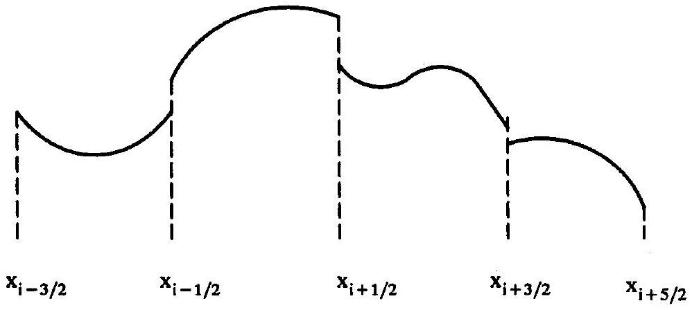
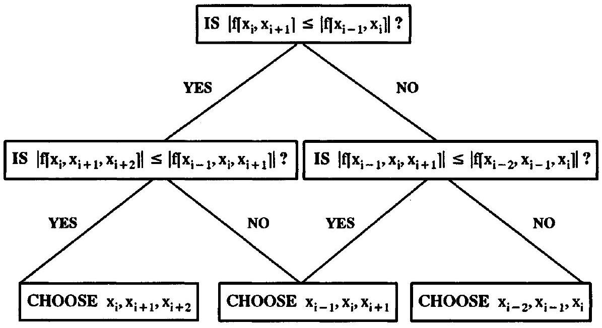
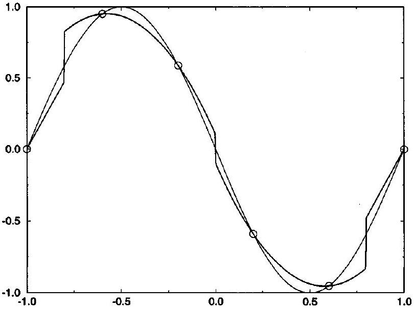
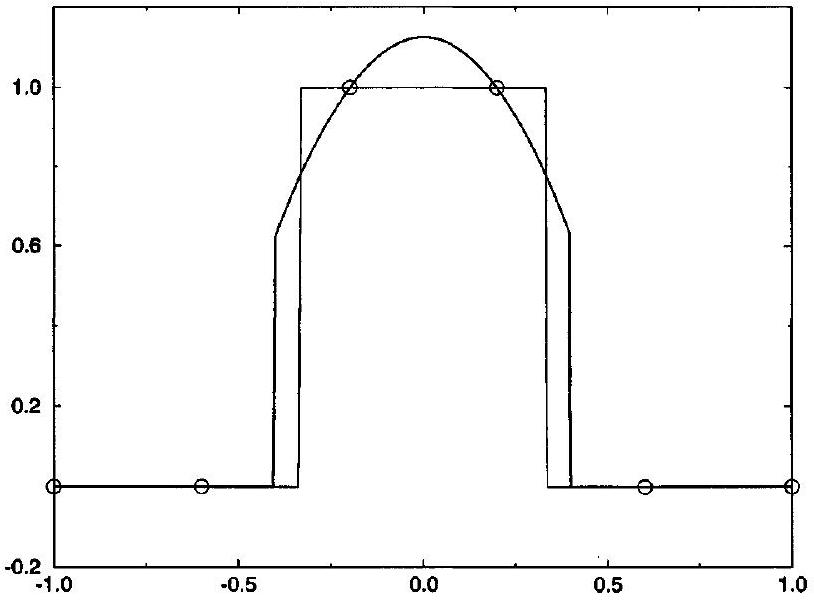
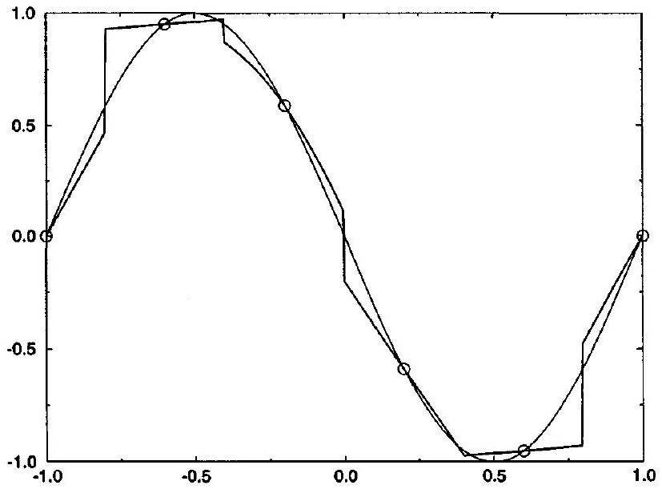
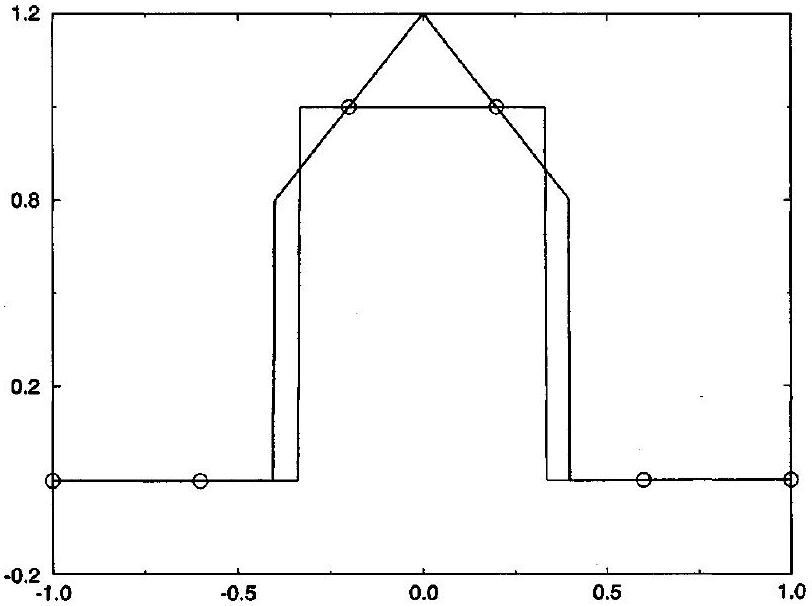
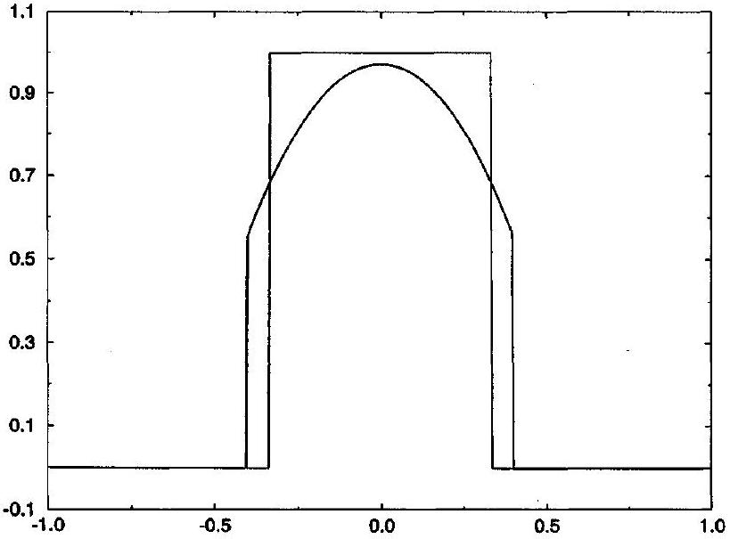
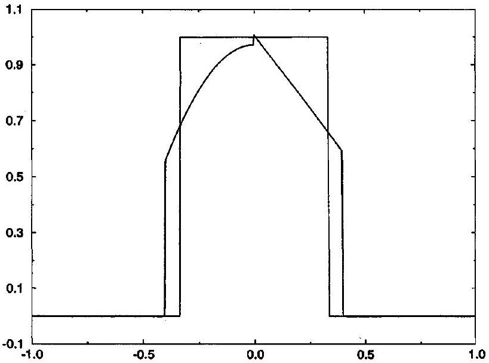

## CHAPTER 9

## Piecewise-Polynomial Reconstruction

### 9.0 Introduction

The last two chapters dramatically demonstrate the folly in attempting to represent a discontinuous function by a single polynomial. In the best case, with the entire true function available, the single polynomial representation will suffer from narrow width but large-amplitude Gibbs oscillations near the jump discontinuities, at least when minimizing the error in ordinary norms, as seen in Chapter 7. In more typical cases, with only limited information about the true function available or, more specifically, with only samples of the function available, the single polynomial will suffer from the Runge phenomenon, a relatively severe form of spurious oscillation that can increase rapidly as the number of samples increases, as seen in Chapter 8.

To overcome the problems associated with single-polynomial reconstructions, this chapter will consider piecewise-polynomial reconstructions, which were introduced earlier in Section 6.3, especially in Example 6.8. In piecewise-polynomial reconstructions, instead of representing the entire function by a single polynomial, we represent different local regions or cells by different polynomials. Figure 9.1 illustrates a typical piecewise-polynomial representation. By using separate and independent polynomials for each cell, only the cells containing jump discontinuities need suffer from large spurious oscillations, rather than the entire representation. Furthermore, piecewise-polynomial representations naturally allow jump discontinuities: the simplest reconstructions allow jump discontinuities only at cell edges, whereas the subcell resolution techniques discussed in Section 9.4 allow jump discontinuities to occur anywhere, including the insides of cells. Of course, piecewisepolynomial reconstructions cost more to build and evaluate and require more storage space than a single polynomial reconstruction; however, for discontinuous functions, the accuracy improvements easily justify the additional costs.

The best known piecewise-polynomial reconstructions are called splines. Although splines are fine for reconstructing continuous smooth functions, they are not appropriate for the discontinuous functions found in computational gasdynamics. Splines expend a great deal of effort towards achieving smooth and continuous reconstructions, which is completely counterproductive if the true function is not smooth or continuous. To explain further, splines link the reconstructions in adjacent cells together to achieve continuity in the function and its derivatives across cell edges; then local problems caused by discontinuities in the function or its derivatives can pollute the entire spline, and not just the cells containing the discontinuities. Nevertheless, splines are still generally more successful than single polynomials when it comes to reconstructing discontinuous functions. Since splines are not appropriate for our applications, we shall not discuss them further. The details can be found in any number of numerical analysis texts, including Mathews (1992).

Instead of splines, this chapter concerns a class of piecewise-polynomial reconstructions sometimes referred to as essentially nonoscillatory or ENO reconstructions. The ENO reconstructions are heavily based on polynomial interpolations as studied in Chapter 8.

Figure 9.1 A typical piecewise-polynomial reconstruction.

In Section 9.1, each cell chooses an interpolation polynomial passing through neighboring samples; in Section 9.2, each cell averages interpolation polynomials passing through neighboring samples. The trick is to choose the right interpolation polynomial from among the many possible candidates, or to choose the right average of interpolation polynomials.

Many methods in computational gasdynamics approximate cell integral averages rather than samples. Thus, besides reconstructions from samples, this chapter also concerns reconstructions from cell integral averages. Section 9.3 introduces a clever technique called reconstruction via the primitive function, which turns any sample reconstruction technique into a cell-integral-average reconstruction technique.

Now let's introduce some nomenclature and notation. Suppose that the functional domain $[a, b]$ is divided into cells $\left[x_{-1 / 2}, x_{1 / 2}\right],\left[x_{1 / 2}, x_{3 / 2}\right]$, and so on up to $\left[x_{N-1 / 2}, x_{N+1 / 2}\right]$. The points $x_{i+1 / 2}$ are called the cell edges and the points $x_{i}=\left(x_{i+1 / 2}+x_{i-1 / 2}\right) / 2$ are called the cell centers. The difference between the cell edges $\Delta x_{i}=x_{i+1 / 2}-x_{i-1 / 2}$ is called the cell width. Depending on the application, either the cell edges or the cell centers are aligned with the boundaries of the domain $[a, b]$. Therefore either $x_{-1 / 2}=a$ and $x_{N+1 / 2}=b$ or $x_{0}=a$ and $x_{N}=b$; this is discussed further in Section 19.0. Incidentally, it is sometimes convenient to reverse the notation, so that cell edges are indexed by integers $x_{i}$ and cell centers are indexed by half-integers $x_{i+1 / 2}$, as in Example 6.8.

Given cells, a function $f(x)$ can be represented by cell-centered samples such as $f\left(x_{i}\right)$. Alternatively, a function $f(x)$ can be represented by cell-integral averages defined by

$$
\text { - } \quad \bar{f}_{i}=\frac{1}{\Delta x_{i}} \int_{x_{i-1 / 2}}^{x_{i+1 / 2}} f(x) d x \text {, }
$$

where $i=0, \ldots, N$. As you might expect, cell-integral averages are especially popular for approximating integral equations whereas samples are especially popular for approximating differential equations. Finite-difference methods use samples as their primary representation whereas finite-volume methods use cell-integral averages as their primary representation. Of course, although finite-difference methods use samples as their primary representation, they sometimes switch to piecewise-polynomial representations. Similarly, although finite-volume methods use cell-integral averages as their primary representation, they sometimes switch to piecewise-polynomial representations. By contrast with finite-difference and finite-volume methods, finite-element methods use piecewise-polynomials as their primary representation. In other words, finite-element methods carry around the polynomial
coefficients for each cell, either in place of or in addition to samples or cell-integral averages, and thus finite-element methods do not necessarily need to reconstruct the solution. This book concerns only finite-volume and finite-difference methods.

Besides cell-integral averages there are many other possible cell averages. For example, the cell average could be some type of algebraic average such as

$$
\bar{f}_{i}=\frac{f\left(x_{i+1 / 2}\right)+f\left(x_{i-1 / 2}\right)}{2}
$$

or

$$
\bar{f}_{i}=f\left(\frac{x_{i+1 / 2}+x_{i-1 / 2}}{2}\right)=f\left(x_{i}\right) .
$$

However, the differences between cell-integral averages and these other cell averages are small provided that $\Delta x_{i}$ is small and $f$ is smooth and continuous. In particular, one can show that

$$
\frac{1}{\Delta x_{i}} \int_{x_{i-1 / 2}}^{x_{i+1 / 2}} f(x) d x=\frac{f\left(x_{i+1 / 2}\right)+f\left(x_{i-1 / 2}\right)}{2}+O\left(\Delta x_{i}^{2}\right)
$$

and

$$
\frac{1}{\Delta x_{i}} \int_{x_{i-1 / 2}}^{x_{i+1 / 2}} f(x) d x=f\left(x_{i}\right)+O\left(\Delta x_{i}^{2}\right)
$$

This last result says that cell-centered samples equal cell-integral averages to within secondorder accuracy. Equation (9.3) is proven in Example 10.1, and Equation (9.3) implies Equation (9.2). Many numerical methods are only second-order accurate, in which case many distinctions between samples and cell-integral averages disappear, at least in one dimension.

### 9.1 Piecewise Interpolation-Polynomial Reconstructions

Most traditional reconstruction techniques, including splines and polynomial interpolations, are subject to large oscillatory errors in the presence of jump discontinuities. In the past, researchers have thoroughly investigated the nature of these oscillations while largely neglecting to suggest reconstruction techniques that could avoid them. Thus, when the connection between reconstruction and computational gasdynamics became widely appreciated in the 1970s, the computational gasdynamics community had to devise new reconstruction techniques that could handle the shocks and contacts found in their applications. Although many of the earliest such reconstruction techniques were applicable only in the context of computational gasdynamics, because they depended on parameters such as the CFL number specific to computational gasdynamics, some of the more recent reconstruction techniques are completely generic. Therefore, despite the fact that they were developed in the context of computational gasdynamics, the reconstruction techniques seen in the rest of this chapter are completely general and can be used in any context. These general reconstructions are sometimes called essentially nonoscillatory (ENO) reconstructions. ENO reconstruction was first developed by Harten, Engquist, Osher, and Chakravarthy (1987).

This section concerns piecewise-continuous piecewise-polynomial reconstructions composed strictly of interpolation polynomials. Consider a set of sample points $\left(x_{0}, x_{1}, \ldots, x_{N}\right)$. Define a set of cells whose centers are samples, that is, the cells are $\left[x_{-1 / 2}, x_{1 / 2}\right], \ldots$,
$\left[x_{N-1 / 2}, x_{N+1 / 2}\right]$ and the cell centers are $x_{i}=\left(x_{i+1 / 2}+x_{i-1 / 2}\right) / 2$. Then the simplest possible reconstruction is piecewise-constant, such that the reconstruction on cell $\left[x_{i-1 / 2}, x_{i+1 / 2}\right]$ equals $f\left(x_{i}\right)$. Away from jump discontinuities, a piecewise-constant reconstruction is firstorder accurate. Although the piecewise-constant reconstruction has jumps at each cell edge, those jumps are only first order, at most. The only exception is when the true function has a jump discontinuity. Then the reconstruction may have zeroth-order jumps at cell edges near the true jump.

The next simplest reconstruction is piecewise-linear. Assuming the reconstruction is composed strictly of linear interpolations, the reconstruction on cell $\left[x_{i-1 / 2}, x_{i+1 / 2}\right]$ can be the line through ( $x_{i-1}, f\left(x_{i-1}\right)$ ) and ( $x_{i}, f\left(x_{i}\right)$ ) or the line through ( $x_{i}, f\left(x_{i}\right)$ ) and $\left(x_{i+1}, f\left(x_{i+1}\right)\right)$. Thus the reconstruction on cell $\left[x_{i-1 / 2}, x_{i+1 / 2}\right]$ is either

$$
f\left(x_{i}\right)+f\left[x_{i-1}, x_{i}\right]\left(x-x_{i}\right)=f\left(x_{i}\right)+\frac{f\left(x_{i}\right)-f\left(x_{i-1}\right)}{x_{i}-x_{i-1}}\left(x-x_{i}\right)
$$

or

$$
f\left(x_{i}\right)+f\left[x_{i}, x_{i+1}\right]\left(x-x_{i}\right)=f\left(x_{i}\right)+\frac{f\left(x_{i+1}\right)-f\left(x_{i}\right)}{x_{i+1}-x_{i}}\left(x-x_{i}\right) .
$$

As seen in Equations (8.5) and (8.6), large divided differences imply large or discontinuous derivatives, which in turn imply poor interpolation accuracy according to Equation (8.13). By this reasoning, the best linear interpolation is the one with the least divided difference in absolute value. Then the reconstruction on cell $\left[x_{i-1 / 2}, x_{i+1 / 2}\right]$ is

$$
f\left(x_{i}\right)+f\left[x_{j}, x_{j+1}\right]\left(x-x_{i}\right),
$$

where

$$
j= \begin{cases}i & \left|f\left[x_{i}, x_{i+1}\right]\right| \leq\left|f\left[x_{i-1}, x_{i}\right]\right|, \\ i-1 & \left|f\left[x_{i}, x_{i+1}\right]\right|>\left|f\left[x_{i-1}, x_{i}\right]\right| .\end{cases}
$$

For an equivalent and more compact expression, define the following function:

$$
m(x, y)= \begin{cases}x & |x| \leq|y| \\ y & |x|>|y|\end{cases}
$$

In other words, $m(x, y)$ is the minimum of $x$ and $y$ in absolute value. Then the reconstruction on cell $\left[x_{i-1 / 2}, x_{i+1 / 2}\right]$ is

$$
f\left(x_{i}\right)+S_{i}\left(x-x_{i}\right)
$$

where

$$
S_{i}=m\left(f\left[x_{i-1}, x_{i}\right], f\left[x_{i}, x_{i+1}\right]\right)
$$

and where the letter $S$ stands for "slope." The piecewise-linear reconstruction has secondorder accuracy and $O\left(\Delta x^{2}\right)$ jump discontinuities across each cell edge except, of course, when the true function has a jump discontinuity.

Now consider piecewise-quadratic reconstruction. Assuming the reconstruction is composed strictly of quadratic interpolations, the reconstruction on cell $\left[x_{i-1 / 2}, x_{i+1 / 2}\right]$ can be as follows: the quadratic passing through ( $x_{i-2}, f\left(x_{i-2}\right)$ ), ( $x_{i-1}, f\left(x_{i-1}\right)$ ), and ( $x_{i}, f\left(x_{i}\right)$ ); the quadratic passing through ( $\left.x_{i-1}, f\left(x_{i-1}\right)\right),\left(x_{i}, f\left(x_{i}\right)\right)$, and ( $x_{i+1}, f\left(x_{i+1}\right)$ ); or the quadratic
passing through ( $\left.x_{i}, f\left(x_{i}\right)\right),\left(x_{i+1}, f\left(x_{i+1}\right)\right)$, and ( $x_{i+2}, f\left(x_{i+2}\right)$ ). Thus, in Newton form, the reconstruction on cell $\left[x_{i-1 / 2}, x_{i+1 / 2}\right]$ is

$$
\begin{aligned}
& f\left(x_{i}\right)+f\left[x_{i-1}, x_{i}\right]\left(x-x_{i}\right)+f\left[x_{i-2}, x_{i-1}, x_{i}\right]\left(x-x_{i}\right)\left(x-x_{i-1}\right) \\
& f\left(x_{i}\right)+f\left[x_{i-1}, x_{i}\right]\left(x-x_{i}\right)+f\left[x_{i-1}, x_{i}, x_{i+1}\right]\left(x-x_{i}\right)\left(x-x_{i-1}\right) \\
& \quad=f\left(x_{i}\right)+f\left[x_{i}, x_{i+1}\right]\left(x-x_{i}\right)+f\left[x_{i-1}, x_{i}, x_{i+1}\right]\left(x-x_{i}\right)\left(x-x_{i+1}\right)
\end{aligned}
$$

or

$$
f\left(x_{i}\right)+f\left[x_{i}, x_{i+1}\right]\left(x-x_{i}\right)+f\left[x_{i}, x_{i+1}, x_{i+2}\right]\left(x-x_{i}\right)\left(x-x_{i+1}\right) .
$$

As before, large Newton divided differences imply large or discontinuous derivatives, which in turn imply poor interpolation accuracy. The above expressions involve two firstdivided differences and three second-divided differences. In general, the polynomial with the least first-divided difference will not have the least second-divided difference and, vice versa, the polynomial with the least second-divided difference will not have the least firstdivided difference. Thus there must be some sort of compromise between minimizing the first- and second-divided differences. As it turns out, in many cases (but certainly not in all cases), large first-divided differences are worse than large second-divided differences. Thus, the first-divided difference will be minimized first and the second-divided difference will be minimized second. Notice that Equation (9.10) involves both of the first-divided differences, depending on how it is written. Thus Equation (9.10) always makes the first cut, and the first-divided difference is used to eliminate either Equation (9.9) or (9.11) (in particular, to eliminate whichever of these polynomials has the greater first-divided difference in absolute value). After this, eliminate whichever of the two remaining equations has the greater second-divided difference in absolute value. Put another way, the piecewisequadratic selection procedure chooses between the two lines $f\left(x_{i}\right)+f\left[x_{i-1}, x_{i}\right]\left(x-x_{i}\right)$ and $f\left(x_{i}\right)+f\left[x_{i}, x_{i+1}\right]\left(x-x_{i}\right)$, whichever has the least slope, just as in the piecewiselinear reconstruction. Then the piecewise-quadratic selection procedure chooses between two quadratics, whichever one is closest to the previously chosen line.

In summary, the reconstruction on cell $\left[x_{i-1 / 2}, x_{i+1 / 2}\right]$ is as follows:

$$
f\left(x_{i}\right)+f\left[x_{j}, x_{j+1}\right]\left(x-x_{i}\right)+f\left[x_{k}, x_{k+1}, x_{k+2}\right]\left(x-x_{j}\right)\left(x-x_{j+1}\right)
$$

where $j$ is chosen as in Equation (9.5) and

$$
k= \begin{cases}j & \left|f\left[x_{j}, x_{j+1}, x_{j+2}\right]\right| \leq\left|f\left[x_{j-1}, x_{j}, x_{j+1}\right]\right| \\ j-1 & \left|f\left[x_{j}, x_{j+1}, x_{j+2}\right]\right|>\left|f\left[x_{j-1}, x_{j}, x_{j+1}\right]\right|\end{cases}
$$

This piecewise-quadratic selection procedure is illustrated by the flow chart seen in Figure 9.2. The piecewise-quadratic reconstruction has third-order accuracy and $O\left(\Delta x^{3}\right)$ jump discontinuities at each cell edge except, of course, where the true function has a jump discontinuity.

Similarly, for a piecewise-cubic reconstruction, the reconstruction on cell $\left[x_{i-1 / 2}, x_{i+1 / 2}\right]$ is as follows:

$$
\begin{aligned}
& f\left(x_{i}\right)+f\left[x_{j}, x_{j+1}\right]\left(x-x_{i}\right)+f\left[x_{k}, x_{k+1}, x_{k+2}\right]\left(x-x_{j}\right)\left(x-x_{j+1}\right) \\
& \quad+f\left[x_{l}, x_{l+1}, x_{l+2}, x_{l+3}\right]\left(x-x_{k}\right)\left(x-x_{k+1}\right)\left(x-x_{k+2}\right)
\end{aligned}
$$

Figure 9.2 The selection procedure for a piecewise-quadratic ENO reconstruction.

where $j$ and $k$ are chosen as in Equations (9.5) and (9.13), respectively, and

$$
l= \begin{cases}k & \left|f\left[x_{k}, x_{k+1}, x_{k+2}, x_{k+3}\right]\right| \leq\left|f\left[x_{k-1}, x_{k}, x_{k+1}, x_{k+2}\right]\right|, \\ k-1 & \left|f\left[x_{k}, x_{k+1}, x_{k+2}, x_{k+3}\right]\right|>\left|f\left[x_{k-1}, x_{k}, x_{k+1}, x_{k+2}\right]\right| .\end{cases}
$$

As one way to view this selection procedure, notice that it chooses the line with the least slope, then the quadratic closest to the line, then the cubic closest to the quadratic. The piecewise-cubic reconstruction has fourth-order accuracy and $O\left(\Delta x^{4}\right)$ jump discontinuities across each cell edge except, of course, where the true function has a jump discontinuity.

The above reconstruction procedure can be generalized to any order of accuracy. Thinking recursively, suppose that the first $m+1$ interpolation points for cell $\left[x_{i-1 / 2}, x_{i+1 / 2}\right]$ have already been selected, where the left-most interpolation point is $l_{m}(i)$. In other words, suppose the interpolation points selected so far are $\left(x_{l_{m}(i)}, x_{l_{m}(i)+1}, \ldots, x_{l_{m}(i)+m}\right)$. Then add a point to the left or to the right depending on which selection yields the least $(m+1)$ th divided difference in absolute value. This selection procedure can be written in algorithmic form as
$l_{0}(i)=i$
for $m=0, \ldots, n-1$

$$
l_{m+1}(i)= \begin{cases}l_{m}(i) & \left|f\left[x_{l_{m}(i)}, \ldots, x_{l_{m}(i)+m+1}\right]\right| \leq\left|f\left[x_{l_{m}(i)-1}, \ldots, x_{l_{m}(i)+m}\right]\right|, \\ l_{m}(i)-1 & \left|f\left[x_{l_{m}(i)}, \ldots, x_{l_{m}(i)+m+1}\right]\right|>\left|f\left[x_{l_{m}(i)-1}, \ldots, x_{l_{m}(i)+m}\right]\right| .\end{cases}
$$

Then, in Newton form, the $n$ th-order polynomial reconstruction on cell $\left[x_{i-1 / 2}, x_{i+1 / 2}\right]$ is

$$
\sum_{j=0}^{n} f\left[x_{l_{n}(i)}, \ldots, x_{l_{n}(i)+j}\right] \prod_{k=0}^{j-1}\left(x-x_{l_{n}(i)+k}\right) .
$$

This expression is just the standard expression for an $n$ th-order interpolation polynomial passing through points ( $x_{l_{n}(i)}, x_{l_{n}(i)+1}, \ldots, x_{l_{n}(i)+n}$ ), as given by Equation (8.8). Equivalently,

$$
\sum_{j=0}^{n} f\left[x_{l_{j}(i)}, \ldots, x_{l_{j}(i)+j}\right] \prod_{k=0}^{j-1}\left(x-x_{l_{j-1}(i)+k}\right) .
$$

This second expression is completely equivalent to the first, as the reader can show using the properties of Newton divided differences and Newton form polynomials. As its main advantage, (9.17) allows recursive formation of the interpolation polynomial, as a natural part of the recursive sample-point selection procedure.

Suppose the boundaries of the computational domain are solid or far-field boundaries. Then the number of candidate interpolations decreases near the edge of the domain. In particular, for $n$ th-order piecewise-polynomial reconstruction, there are $n$ candidate polynomials well away from the boundaries but only one candidate polynomial in cells $\left[x_{-1 / 2}, x_{1 / 2}\right]$ and $\left[x_{N-1 / 2}, x_{N+1 / 2}\right]$, two candidate polynomials in cells $\left[x_{1 / 2}, x_{3 / 2}\right]$ and $\left[x_{N-3 / 2}, x_{N-1 / 2}\right]$, and so on. To avoid this problem, most of the examples in this chapter will be worked on periodic domains, where $x_{N+1}=x_{1}, x_{N+1 / 2}=x_{1 / 2}$, and so forth. On a periodic domain, any missing values can be found by wrapping around to the other side of the domain.

The above reconstruction technique is usually surprisingly effective, especially near jump discontinuities. Given the candidates, this procedure often chooses the best and rarely chooses the worst candidate. At the very least, it usually chooses candidates that do not cross jump discontinuities and thus do not suffer from large spurious oscillations. However, there are two exceptions. First, in the boundary cells $\left[x_{-1 / 2}, x_{1 / 2}\right]$ and $\left[x_{N-1 / 2}, x_{N+1 / 2}\right]$, there may only be one candidate, as mentioned in the last paragraph, and thus there is no way to avoid interpolating across jumps if jumps occur in boundary cells. Second, suppose two jump discontinuities occur right next to each other. For cells in between the two jumps, all candidate $n$ th-order interpolation polynomials may cross one or the other of the jumps. This is more likely to occur as $n$ increases. For example, if two jumps are separated by two cells, then piecewise-linear interpolations based on two points can avoid both jumps, but all candidate piecewise-quadratic interpolations based on three points pass through one jump or the other. If a jump discontinuity cannot be avoided using $n$ th-order interpolations, one can reduce the order of the interpolation. Lower-order interpolations can more easily avoid jumps; furthermore, even if they cannot avoid jumps, lower-order interpolations suffer less severe oscillations when they do cross jumps, as seen in Chapter 8. Techniques for adjusting the interpolation order will not be discussed here.

Example 9.1 Consider the function

$$
f(x)=-\sin \pi x
$$

Suppose the function is sampled using $N+1$ evenly spaced samples on the periodic domain $[-1,1]$. Figure 9.3 shows the piecewise-quadratic reconstruction, as described in this section, where the samples are taken at the cell centers and $N=5$. The piecewise-quadratic reconstruction is far less accurate than a single fifth-order interpolation polynomial, as seen in Example 8.10. The large jumps at the cell edges are particularly annoying.

Figure 9.3 Piecewise-quadratic interpolation ENO reconstruction of a sine wave.

Figure 9.4 Piecewise-quadratic interpolation ENO reconstruction of a square wave.

Example 9.2 Consider the following square-wave function:

$$
f(x)= \begin{cases}0 & -1 \leq x<-1 / 3, \\ 1 & -1 / 3 \leq x \leq 1 / 3, \\ 0 & 1 / 3<x \leq 1,\end{cases}
$$

on a periodic domain. Suppose the function is sampled using $N+1$ evenly spaced samples on the periodic domain $[-1,1]$. Figure 9.4 shows the piecewise-quadratic reconstruction for $N=5$. For $N=10$, the reconstruction is essentially perfect, save for slight mislocations in the jump discontinuities. Thus, for $N=10$ or above, the reconstruction is perfectly zero where it should be zero and perfectly one where it should be one; the only discrepancy
is that the jumps between zero and one are moved to adjacent cell edges. The piecewisequadratic reconstruction is obviously far superior to the single interpolation polynomial seen in Example 8.11.

### 9.2 Averaged Interpolation-Polynomial Reconstructions

In the last section, the reconstructions were formed purely from interpolations. In particular, for a piecewise-linear reconstruction, the reconstruction on cell $\left[x_{i-1 / 2}, x_{i+1 / 2}\right]$ was as follows:

$$
f\left(x_{i}\right)+S_{i}\left(x-x_{i}\right)
$$

where

$$
S_{i}=m\left(f\left[x_{i-1}, x_{i}\right], f\left[x_{i}, x_{i+1}\right]\right)
$$

and where

$$
m(x, y)= \begin{cases}x & |x| \leq|y| \\ y & |x|>|y|\end{cases}
$$

If you think about it, there is absolutely no reason why $m(x, y)$ could not be replaced by some other function. Think of $m(x, y)$ as an average of $x$ and $y$-there is no reason why an average must choose either $x$ or $y$. In this context, two common alternative averaging functions are the usual arithmetic average,

$$
\frac{x+y}{2}
$$

and the minimum modulus or minmod average,

$$
\operatorname{minmod}(x, y)= \begin{cases}m(x, y) & x \text { and } y \text { have same sign } \\ 0 & x \text { and } y \text { have opposite sign. }\end{cases}
$$

The minmod function chooses the smallest argument in absolute value if the arguments have the same sign and chooses zero otherwise. Using either of these averages to replace $m(x, y)$, the reconstruction on cell $\left[x_{i-1 / 2}, x_{i+1 / 2}\right]$ is no longer necessarily a pure linear interpolation; instead, the reconstruction is a line that falls somewhere between the two candidate interpolation lines. In this context, averaging functions such as $m(x, y)$ and minmod $(x, y)$ are often called slope limiters.

For piecewise-quadratic reconstructions, there are three candidate quadratic interpolations, as seen in the last section. The three candidates can be averaged; alternatively, we can eliminate the worst candidate and average the remaining two candidates. Let us pursue the latter idea. First, choose between candidates (9.9) and (9.10); in particular, choose whichever one has the least second-divided difference in absolute value. Then, in Newton form, one candidate is

$$
\begin{aligned}
& f\left(x_{i}\right)+f\left[x_{i-1}, x_{i}\right]\left(x-x_{i}\right) \\
& \quad+m\left(f\left[x_{i-2}, x_{i-1}, x_{i}\right], f\left[x_{i-1}, x_{i}, x_{i+1}\right]\right)\left(x-x_{i}\right)\left(x-x_{i-1}\right)
\end{aligned}
$$

Alternatively, this candidate can be written in Taylor series form as follows:

$$
f\left(x_{i}\right)+S_{i}^{-}\left(x-x_{i}\right)+C_{i}^{-}\left(x-x_{i}\right)^{2}
$$

where

$$
\begin{aligned}
& S_{i}^{-}=f\left[x_{i-1}, x_{i}\right]+C_{i}^{-}\left(x_{i}-x_{i-1}\right) \\
& C_{i}^{-}=m\left(f\left[x_{i-2}, x_{i-1}, x_{i}\right], f\left[x_{i-1}, x_{i}, x_{i+1}\right]\right)
\end{aligned}
$$

and where $S$ stands for "slope," as before, and $C$ stands for "curvature." Similarly, choose between candidates (9.10) and (9.11); in particular, choose whichever one has the least second-divided difference in absolute value. Then, in Newton form, another candidate is

$$
\begin{aligned}
& f\left(x_{i}\right)+f\left[x_{i}, x_{i+1}\right]\left(x-x_{i}\right) \\
& \quad+m\left(f\left[x_{i-1}, x_{i}, x_{i+1}\right], f\left[x_{i}, x_{i+1}, x_{i+2}\right]\right)\left(x-x_{i}\right)\left(x-x_{i+1}\right)
\end{aligned}
$$

Alternatively, this candidate can be written in Taylor series form as follows:

$$
f\left(x_{i}\right)+S_{i}^{+}\left(x-x_{i}\right)+C_{i}^{+}\left(x-x_{i}\right)^{2}
$$

where

$$
\begin{aligned}
S_{i}^{+} & =f\left[x_{i}, x_{i+1}\right]-C_{i}^{+}\left(x_{i+1}-x_{i}\right) \\
C_{i}^{+} & =m\left(f\left[x_{i-1}, x_{i}, x_{i+1}\right], f\left[x_{i}, x_{i+1}, x_{i+2}\right]\right)
\end{aligned}
$$

In some cases, both candidates may be the same as Equation (9.10), in which case Equation (9.10) is the final winner; otherwise, average the two candidates. For example, one can minmod average the two candidates in Taylor series form. Then the reconstruction on cell $\left[x_{i-1 / 2}, x_{i+1 / 2}\right]$ is

$$
f\left(x_{i}\right)+S_{i}\left(x-x_{i}\right)+C_{i}\left(x-x_{i}\right)^{2}
$$

where

$$
\begin{aligned}
& S_{i}=\min \bmod \left(S_{i}^{+}, S_{i}^{-}\right) \\
& C_{i}=\min \bmod \left(C_{i}^{+}, C_{i}^{-}\right)
\end{aligned}
$$

There is nothing sacred about this averaging procedure. For example, $m(x, y)$ and minmod $(x, y)$ could be replaced by other averaging functions. Also, the averaging could be done on the Newton form coefficients rather than on the Taylor series form coefficients. Large functional derivatives indicate inaccurate interpolations, and both the Newton and Taylor series coefficients approximate functional derivatives, albeit in somewhat different ways.

The preceding averaging procedure can be generalized to any arbitrary order of accuracy. The "-" candidate is chosen from among all $n$ th-order interpolation polynomials passing through $\left(x_{i}, f\left(x_{i}\right)\right)$ and $\left(x_{i-1}, f\left(x_{i-1}\right)\right)$ using the procedure described in the last section; similarly, the " + " candidate is chosen from among all $n$ th-order interpolation polynomials passing through ( $x_{i}, f\left(x_{i}\right)$ ) and ( $x_{i+1}, f\left(x_{i+1}\right)$ ), again using the procedure described in the last section. Then the two candidates are averaged in Taylor series form using minmod or something else.

Figure 9.5 Average-quadratic interpolation ENO reconstruction of a sine wave.

Example 9.3 Consider the function

$$
f(x)=-\sin \pi x .
$$

Suppose the function is sampled using $N+1$ evenly spaced samples on the periodic domain $[-1,1]$. Figure 9.5 shows the piecewise-quadratic reconstruction, as described in this section, where the samples are cell centered and $N=5$. The piecewise-quadratic reconstruction is far less accurate than the single fifth-order interpolation polynomial seen in Example 8.10. The minmod averaging zeros out the quadratic term in most of the cells, so that the reconstruction is linear in most of the cells.

Example 9.4 Consider the following square-wave function:

$$
f(x)= \begin{cases}0 & -1 \leq x<-1 / 3, \\ 1 & -1 / 3 \leq x \leq 1 / 3, \\ 0 & 1 / 3<x \leq 1 .\end{cases}
$$

Suppose the function is sampled using $N+1$ evenly spaced samples on the periodic domain $[-1,1]$. Figure 9.6 shows the piecewise-quadratic reconstruction for $N=5$ found using the procedure described in this section. The minmod averaging zeros out the quadratic term in all of the cells, making the reconstruction piecewise-linear. For $N=10$ or greater, the reconstruction is essentially perfect, save for slight mislocations in the jump discontinuities. The piecewise-quadratic reconstruction is far more accurate than the single interpolation polynomial seen in Example 8.11.

The previous section defined a set of candidate polynomial interpolations for each cell and eliminated all but one. Similarly, this section defined a set of candidate polynomial interpolations for each cell, eliminated all but two, and averaged the two finalists. Continuing

Figure 9.6 Average-quadratic interpolation ENO reconstruction of a square wave.

the progression, one can eliminate fewer and fewer candidates or, in other words, average more and more candidates to obtain the final reconstruction. In the most extreme case, one can eliminate only the candidates that appear to overlap shocks and average all of the remaining candidates. By keeping more candidates, one can improve the formal order of accuracy in smooth regions. Remember that $N$ samples yield a formal order of accuracy as high as $N-1$; the ENO reconstructions explored above generally achieve a much lower order of accuracy, since they discard most sample points. Averaging more candidates also reduces the sensitivity of the reconstruction to small changes in the samples; when two candidates involve divided differences of nearly equal size, the ENO reconstructions described above may change their final choice abruptly with only small changes in the divided differences. Averaging more candidates reduces sensitivity and, in particular, reduces the effects of round-off errors on the reconstruction.

Along these lines, Liu, Osher, and Chan (1994) described weighted ENO (WENO) reconstructions. WENO reconstructions form convex linear combinations of the candidate polynomial interpolations, where the size of the coefficients varies inversely with the size of the local divided differences. The linear interpolation involves more arithmetic and complication, but it increases the order of accuracy to as high as $N / 2-1$ in smooth regions, decreases the sensitivity of the reconstruction to small changes in the samples, and eliminates all of the logical "if" statements that appear in ordinary ENO methods as part of the candidate selection process, which allows WENO reconstructions to run much faster on parallel machines. For a variation on WENO reconstruction, and a detailed description of the benefits of WENO reconstruction, see Jiang and Shu (1996). This section has described reconstructions that average polynomial interpolations; however, to keep things simple, the rest of the book will focus on reconstructions that use one carefully chosen polynomial interpolation in each cell, as described in the previous section.

### 9.3 Reconstruction via the Primitive Function

Chapter 8 showed how to find the unique $N$ th-order polynomial satisfying $p_{N}\left(x_{i}\right)=f\left(x_{i}\right)$ for $i=0, \ldots, N$. This section shows how to find the unique $N$ th-order
polynomial satisfying

$$
\frac{1}{\Delta x_{i}} \int_{x_{i-1 / 2}}^{x_{i+1 / 2}} p_{N}(x) d x=\frac{1}{\Delta x_{i}} \int_{x_{i-1 / 2}}^{x_{i+1 / 2}} f(x) d x
$$

or equivalently,

$$
\bar{p}_{N, i}=\bar{f}_{i}
$$

for $i=0, \ldots, N$. In other words, this section describes reconstruction from cell-integral averages. You might think it would be necessary to start all over from scratch. Fortunately, this is not the case. Here we describe a simple technique for recycling everything we have learned about reconstruction and interpolation from samples.

As seen in any basic calculus textbook, the antiderivative or primitive function $F(x)$ of $f(x)$ is defined as

$$
f(x)=\frac{d F(x)}{d x}
$$

or equivalently,

$$
F(x)=\int_{x_{-1 / 2}}^{x} f(y) d y
$$

where the lower limit of integration has been chosen such that

$$
\sum_{j=0}^{i} \Delta x_{j} \bar{f}_{j}=\sum_{j=0}^{i} \int_{x_{j-1 / 2}}^{x_{j+1 / 2}} f(y) d y=\int_{x_{-1 / 2}}^{x_{i+1 / 2}} f(y) d y=F\left(x_{i+1 / 2}\right)
$$

This expression says that the partial sums of the cell integrals are samples of the primitive function. The following three steps convert $N+1$ cell-integral averages into the desired reconstruction:

Step 1 Find $F\left(x_{i+1 / 2}\right)=\sum_{j=0}^{i} \Delta x_{j} \bar{f}_{j}$ for $i=-1, \ldots, N$. Note that $F\left(x_{-1 / 2}\right)= F(a)=0$.

Step 2 Find the interpolation polynomial $P(x)$ passing through $\left(x_{i+1 / 2}, F\left(x_{i+1 / 2}\right)\right)$ for $i=-1, \ldots, N$. The interpolation polynomial should be found in Taylor series form in order to ease the differentiation in the next step. Of course, trigonometric or any other sort of interpolation can be used in place of polynomial interpolation. In this sense, this algorithm is completely general and extends any sort of interpolation or reconstruction procedure from samples to cell-integral averages.

Step 3 Since $f(x)=d F / d x$ and $F(x) \approx P(x)$, a function approximating $f(x)$ is $p(x)=d P(x) / d x$.

This process is known as reconstruction via the primitive function or simply $R P$. $R P$ was discovered by Colella and Woodward (1984). There is an alternative reconstruction technique known as reconstruction via deconvolution or RD. Unfortunately, RD only works for constant $\Delta x$. For constant $\Delta x$, reconstruction via deconvolution yields exactly the same results as reconstruction via the primitive function, albeit for less effort. See Harten, Engquist, Osher, and Chakravarthy (1987) for a description of reconstruction via deconvolution.

Example 9.5 Suppose that the region [ 0,5 ] is divided into four cells, [ 0,1 ], [1, 2], $[2,3]$, and $[3,5]$. Suppose that the cell-integral averages are $\bar{f}_{0}=1.14166, \bar{f}_{1}=1.07166$, $\bar{f}_{2}=1.22166$, and $\bar{f}_{3}=1.58666$, respectively. Perform reconstruction via the primitive function based on polynomial interpolation.

Solution The samples of the primitive function at the cell edges are

$$
\begin{aligned}
& F(0)=0 \\
& F(1)=\Delta x_{0} \bar{f}_{0}=1.14166 \\
& F(2)=\Delta x_{1} \bar{f}_{1}+F(1)=1 \cdot 1.07166+1.14166=2.21333, \\
& F(3)=\Delta x_{2} \bar{f}_{2}+F(2)=1 \cdot 1.22166+2.21333=3.435, \\
& F(5)=\Delta x_{3} \bar{f}_{3}+F(3)=2 \cdot 1.58666+3.435=6.60833 .
\end{aligned}
$$

As the reader can easily verify, the interpolation polynomial passing through $(0,0)$, $(1,1.14166),(2,2.21333),(3,3.435)$, and $(5,6.60833)$ is

$$
P_{4}(x)=-0.005 x^{4}+0.06666666 x^{3}-0.2 x^{2}+1.28 x
$$

Then a cubic reconstruction is as follows:

$$
p_{3}(x)=\frac{d P_{4}}{d x}=-0.02 x^{3}+0.2 x^{2}-0.4 x+1.28
$$

Reconstruction via the primitive function can be combined with the piecewise-polynomial ENO reconstruction techniques seen in Sections 9.1 and 9.2; in fact, the original descriptions of ENO reconstructions all concern just such combinations. The rest of this section describes the combination of reconstruction via the primitive function with the material of Section 9.1; the combination with the material of Section 9.2 is similar, and thus the details are omitted.

While the last algorithm was phrased to work for any type of interpolation, the following algorithm is phrased specifically for piecewise-polynomial interpolation, which allows for some extra efficiencies.

Step 1 Find the Newton divided differences of $F\left(x_{i+1 / 2}\right)$. For example,

$$
\begin{aligned}
F\left[x_{i-1 / 2}, x_{i+1 / 2}\right] & =\frac{F\left(x_{i+1 / 2}\right)-F\left(x_{i-1 / 2}\right)}{x_{i+1 / 2}-x_{i-1 / 2}} \\
& =\frac{\sum_{j=0}^{i} \Delta x_{j} \bar{f}_{j}-\sum_{j=0}^{i-1} \Delta x_{j} \bar{f}_{j}}{\Delta x_{i}}=\frac{\Delta x_{i} \bar{f}_{i}}{\Delta x_{i}}=\bar{f}_{i}
\end{aligned}
$$

For another example,

$$
\begin{aligned}
F\left[x_{i-1 / 2}, x_{i+1 / 2}, x_{i+3 / 2}\right] & =\frac{F\left[x_{i+1 / 2}, x_{i+3 / 2}\right]-F\left[x_{i-1 / 2}, x_{i+1 / 2}\right]}{x_{i+3 / 2}-x_{i-1 / 2}} \\
& =\frac{\bar{f}_{i+1}-\bar{f}_{i}}{x_{i+3 / 2}-x_{i-1 / 2}}=\frac{\bar{f}_{i+1}-\bar{f}_{i}}{\Delta x_{i+1}+\Delta x_{i}}
\end{aligned}
$$

Notice that it is not necessary to actually form the sums $F\left(x_{i+1 / 2}\right)=\sum_{j=0}^{i} \Delta x_{i j} \bar{f}_{j}$, since they are never needed in formulas such as the preceding two.

Step 2 Choose the interpolation points for each cell. Notice that the interpolation should not be constant (the interpolation is differentiated in step 3, and the derivative of a constant is zero, which is not a very helpful approximation). Then assume that the interpolation in each cell is linear or some higher-order polynomial. For cell $\left[x_{i-1 / 2}, x_{i+1 / 2}\right]$, start with the line $F_{i-1 / 2}+F\left[x_{i-1 / 2}, x_{i+1 / 2}\right]\left(x-x_{i-1 / 2}\right)$ passing through the cell-edge samples, that is, start with the two interpolation points $l_{0}(i)=i+1 / 2$ and $l_{1}(i)=i-1 / 2$. Then the remaining interpolation points are chosen recursively as follows:
for $m=1, \ldots, n$

$$
l_{m+1}(i)= \begin{cases}l_{m}(i) & \left|F\left[x_{l_{m}(i)}, \ldots, x_{l_{m}(i)+m+1}\right]\right| \leq\left|F\left[x_{l_{m}(i)-1}, \ldots, x_{l_{m}(i)+m}\right]\right| \\ l_{m}(i)-1 & \left|F\left[x_{l_{m}(i)}, \ldots, x_{l_{m}(i)+m+1}\right]\right|>\left|F\left[x_{l_{m}(i)-1}, \ldots, x_{l_{m}(i)+m}\right]\right|\end{cases}
$$

Step 3 Find the Taylor series form of the interpolation polynomial in each cell, where the Taylor series is taken about the cell center $x_{i}$. Then the reconstruction $P_{n+1, i}$ on cell $\left[x_{i-1 / 2}, x_{i+1 / 2}\right]$ is as follows:

$$
P_{n+1, i}(x)=\sum_{j=0}^{n+1} a_{j}\left(x-x_{i}\right)^{j}
$$

By Equation (8.12)

$$
a_{j}=\sum_{k=0}^{n-j+1} d_{k j} F\left[x_{l_{n+1}(i)}, \ldots, x_{l_{n+1}(i)+j+k}\right]
$$

and by Equation (8.11)

$$
\begin{aligned}
d_{0 j} & =1 \\
d_{k 0} & =\left(x_{i}-x_{l_{n+1}}(j)+k-1\right) d_{k-1,0} \\
d_{k j} & =d_{k, j-1}+\left(x_{i}-x_{l_{n+1}}(i)+k+j-1\right) d_{k-1, j}
\end{aligned}
$$

Step 4 Since $f(x)=d F / d x$ and $F(x) \approx P_{n+1}(x)$, an $n$ th-order polynomial approximating $f(x)$ is $p_{n}(x)=d P_{n+1}(x) / d x$. In particular, the reconstruction on cell $\left[x_{i-1 / 2}\right.$, $\left.x_{i+1 / 2}\right]$ is as follows:

$$
p_{n+1, i}(x)=\sum_{j=1}^{n+1} j a_{j}\left(x-x_{i}\right)^{j-1}
$$

In general, the reconstruction is discontinuous across the cell edges $x_{i+1 / 2}$. To approximate $f(x)$ at cell edges, you can average the left- and right-hand limits of the reconstruction at the cell edges, using any sort of averaging function you like.

Example 9.6 Find a general expression for a piecewise-linear ENO reconstruction using reconstruction via the primitive function.

Solution The reconstruction on cell $\left[x_{i-1 / 2}, x_{i+1 / 2}\right]$ is

$$
p_{1, i}(x)=a_{1}+2 a_{2}\left(x-x_{i}\right)
$$

Let

$$
\begin{aligned}
j & =l_{2}(i)+\frac{1}{2} \\
& = \begin{cases}i & \left|F\left[x_{i-1 / 2}, x_{i+1 / 2}, x_{i+3 / 2}\right]\right| \leq\left|F\left[x_{i-3 / 2}, x_{i-1 / 2}, x_{i+1 / 2}\right]\right| \\
i-1 & \left|F\left[x_{i-1 / 2}, x_{i+1 / 2}, x_{i+3 / 2}\right]\right|>\left|F\left[x_{i-3 / 2}, x_{i-1 / 2}, x_{i+1 / 2}\right]\right|\end{cases}
\end{aligned}
$$

Then

$$
a_{2}=\frac{\bar{f}_{j+1}-\bar{f}_{j}}{\Delta x_{j+1}+\Delta x_{j}}=\frac{1}{2} \frac{\bar{f}_{j+1}-\bar{f}_{j}}{x_{j+1}-x_{j}}
$$

and

$$
a_{1}=\bar{f}_{j}+2\left(x_{i}-x_{j}\right) a_{2}
$$

But if $j=i$ or $j=i-1$ then

$$
a_{1}=\bar{f}_{i}
$$

Then the reconstruction on cell $\left[x_{i-1 / 2}, x_{i+1 / 2}\right]$ becomes

$$
p_{1, i}(x)=\bar{f}_{i}+\frac{\bar{f}_{j+1}-\bar{f}_{j}}{x_{j+1}-x_{j}}\left(x-x_{i}\right)
$$

For constant $\Delta x$

$$
p_{1, i}(x)=\bar{f}_{i}+\frac{\bar{f}_{i+1}-\bar{f}_{i}}{\Delta x}\left(x-x_{i}\right)
$$

or

$$
p_{1, i}(x)=\bar{f}_{i}+\frac{\bar{f}_{i}-\bar{f}_{i-1}}{\Delta x}\left(x-x_{i}\right)
$$

Notice that the same results are obtained if the cell-integral averages are treated like samples. In fact, since this is a second-order accurate approximation, there is no need to distinguish between samples and cell-integral averages.

Example 9.7 Find a general expression for a piecewise-quadratic reconstruction using reconstruction via the primitive function.

Solution The reconstruction on cell $\left[x_{i-1 / 2}, x_{i+1 / 2}\right]$ is

$$
p_{2, i}(x)=a_{1}+2 a_{2}\left(x-x_{i}\right)+3 a_{3}\left(x-x_{i}\right)^{2}
$$

Let

$$
\begin{aligned}
j & =l_{2}(i)+\frac{1}{2} \\
k & =l_{3}(i)+\frac{1}{2}
\end{aligned}
$$

Notice that $j=i, i-1$ and $k=j, j-1=i, i-1, i-2$. Then

$$
\begin{aligned}
a_{3} & =\frac{1}{\Delta x_{k}+\Delta x_{k+1}+\Delta x_{k+2}}\left[\frac{\bar{f}_{k+2}-\bar{f}_{k+1}}{\Delta x_{k+2}+\Delta x_{k+1}}-\frac{\bar{f}_{k+1}-\bar{f}_{k}}{\Delta x_{k+1}+\Delta x_{k}}\right] \\
a_{2} & =\frac{\bar{f}_{k+1}-\bar{f}_{k}}{\Delta x_{k+1}+\Delta x_{k}}+\left(3 x_{i}-x_{k-1 / 2}-x_{k+1 / 2}-x_{k+3 / 2}\right) a_{3} \\
a_{1} & =\bar{f}_{i}-\frac{\Delta x_{i}^{2}}{4} a_{3}
\end{aligned}
$$

The derivation of the preceding expression for $a_{1}$ requires a good deal of algebra, which is omitted.

For constant $\Delta x$, the above expressions simplify quite a bit and we get

$$
\begin{aligned}
& a_{3}=\frac{\bar{f}_{k+2}-2 \bar{f}_{k+1}+\bar{f}_{k}}{6 \Delta x^{2}} \\
& a_{2}=\frac{\bar{f}_{k+1}-\bar{f}_{k}}{2 \Delta x}+\frac{\bar{f}_{k+2}-2 \bar{f}_{k+1}+\bar{f}_{k}}{2 \Delta x}\left(i-k-\frac{1}{2}\right) \\
& a_{1}=\bar{f}_{i}-\frac{1}{24}\left(\bar{f}_{k+2}-2 \bar{f}_{k+1}+\bar{f}_{k}\right)
\end{aligned}
$$

The resulting expressions are

$$
\begin{aligned}
f(x) \approx & \bar{f}_{i}-\frac{1}{24}\left(\bar{f}_{i}-2 \bar{f}_{i-1}+\bar{f}_{i-2}\right)+\frac{1}{2 \Delta x}\left(3 \bar{f}_{i}-4 \bar{f}_{i-1}+\bar{f}_{i-2}\right)\left(x-x_{i}\right) \\
& +\frac{1}{2 \Delta x^{2}}\left(\bar{f}_{i}-2 \bar{f}_{i-1}+\bar{f}_{i-2}\right)\left(x-x_{i}\right)^{2}
\end{aligned}
$$

or

$$
\begin{aligned}
f(x) \approx & \bar{f}_{i}-\frac{1}{24}\left(\bar{f}_{i+1}-2 \bar{f}_{i}+\bar{f}_{i-1}\right)+\frac{1}{2 \Delta x}\left(\bar{f}_{i+1}-\bar{f}_{i-1}\right)\left(x-x_{i}\right) \\
& +\frac{1}{2 \Delta x^{2}}\left(\bar{f}_{i+1}-2 \bar{f}_{i}+\bar{f}_{i-1}\right)\left(x-x_{i}\right)^{2}
\end{aligned}
$$

or

$$
\begin{aligned}
f(x) \approx & \bar{f}_{i}-\frac{1}{24}\left(\bar{f}_{i+2}-2 \bar{f}_{i+1}+\bar{f}_{i}\right)-\frac{1}{2 \Delta x}\left(3 \bar{f}_{i}-4 \bar{f}_{i+1}+\bar{f}_{i+2}\right)\left(x-x_{i}\right) \\
& +\frac{1}{2 \Delta x^{2}}\left(\bar{f}_{i+2}-2 \bar{f}_{i+1}+\bar{f}_{i}\right)\left(x-x_{i}\right)^{2}
\end{aligned}
$$

Example 9.8 Rework Examples 9.2 and 9.4 using cell-integral averages rather than samples. Make sure that the cell edges are the same as in Examples 9.2 and 9.4, that is, make sure the cell centers are the same as the sample points.

Solution The result of piecewise interpolation-polynomial reconstruction combined with reconstruction via the primitive function is shown in Figure 9.7. Compared with

Figure 9.7 Piecewise-quadratic interpolation ENO reconstruction via the primitive function for a square wave.

Figure 9.8 Average-quadratic interpolation ENO reconstruction via the primitive function for a square wave.

Figure 9.4, the results are somewhat inferior. Similarly, the result of average interpolationpolynomial reconstruction combined with reconstruction via the primitive function is shown in Figure 9.8. Compared with Figure 9.6, the results again are somewhat inferior.

### 9.4 Reconstructions with Subcell Resolution

The piecewise-continuous reconstructions seen so far can capture jump discontinuities, but only at cell edges. To overcome this weakness, consider the following set of steps:

Step 1 Reconstruct the function using one of the methods seen in previous sections. In particular, suppose the reconstruction is as follows:

$$
\left\{\begin{array}{cc}
p_{0}(x) & x_{-1 / 2} \leq x<x_{1 / 2} \\
p_{1}(x) & x_{1 / 2} \leq x<x_{3 / 2} \\
\vdots & \vdots \\
p_{N}(x) & x_{N-1 / 2} \leq x \leq x_{N+1 / 2}
\end{array}\right.
$$

Step 2 Identify cells suspected of harboring jump discontinuities. For example, a cell might contain a jump discontinuity if the Newton form or Taylor series form coefficients of the reconstruction in the cell are large in absolute value. The jump test should err on the side of safety for there is no significant accuracy penalty if the test yields a false positive, but there is a potentially large one if the test yields a false negative. For example, as a very conservative test, you might suspect any cell whose first-divided differences are greater than or equal to the first-divided differences in the two neighboring cells.

Step 3 The reconstruction found in step 1 is retained for any cells that definitely do not contain a jump according to the test in step 2 . However, for any cells that might contain a jump according to the test in step 2, the old reconstruction is replaced by a new reconstruction. Suppose that the jump location in cell $\left[x_{i-1 / 2}, x_{i+1 / 2}\right]$ is $\theta_{i}$, where $\theta_{i}$ is estimated in step 4. Then the new reconstruction in cell $\left[x_{i-1 / 2}, x_{i+1 / 2}\right]$ is found by extending the reconstruction on cell $\left[x_{i-1 / 2}, x_{i-3 / 2}\right]$ to the right until it reaches $\theta_{i}$ and by extending the reconstruction on cell $\left[x_{i+1 / 2}, x_{i+3 / 2}\right]$ to the left until it reaches $\theta_{i}$. Thus the new reconstruction $p_{i}^{S R}$ on cell $\left[x_{i-1 / 2}, x_{i+1 / 2}\right]$ is

$$
p_{i}^{S R}(x)= \begin{cases}p_{i-1}(x) & x_{i-1 / 2} \leq x<\theta_{i}, \\ p_{i+1}(x) & \theta_{i} \leq x<x_{i+1 / 2} .\end{cases}
$$

Step 4 Estimate the location $\theta_{i}$ of the shock in each cell $\left[x_{i-1 / 2}, x_{i+1 / 2}\right]$ identified in step 2. In particular, choose $\theta_{i}$ so that the cell-integral average of the new reconstruction equals the cell-integral average of the old reconstruction, that is, choose $\theta_{i}$ such that

$$
\bar{p}_{i}^{S R}=\bar{p}_{i},
$$

or equivalently,

$$
\frac{1}{\Delta x_{i}} \int_{x_{i-1 / 2}}^{\theta_{i}} p_{i-1}(x) d x+\frac{1}{\Delta x_{i}} \int_{\theta_{i}}^{x_{i+1 / 2}} p_{i+1}(x) d x=\frac{1}{\Delta x_{i}} \int_{x_{i-1 / 2}}^{x_{i+1 / 2}} p_{i}(x) d x
$$

Note that if $p_{i}$ were formed from cell-integral averages using reconstruction via the primitive function, then $\bar{p}_{i}=\bar{f}_{i}$, and the right-hand side of Equation (9.38) would be $\bar{f}_{i}$. If Equation (9.38) has no real solutions, or if all solutions $\theta_{i}$ lie outside cell [ $x_{i-1 / 2}, x_{i+1 / 2}$ ], then the cell is assumed not to contain any jump discontinuities after all, and the reconstruction reverts to the original choice $p_{i}(x)$.

The above procedure is called reconstruction with subcell resolution. Subcell resolution was first proposed by Harten (1989). Equation (9.38) is at the heart of subcell resolution.

For example, given cell-integral averages $\bar{f}_{i}$ and a piecewise-constant reconstruction, Equation (9.38) implies

$$
\frac{1}{\Delta x_{i}}\left(\left(\theta_{i}-x_{i-1 / 2}\right) \bar{f}_{i-1}+\left(x_{i+1 / 2}-\theta_{i}\right) \bar{f}_{i+1}\right)=\bar{f}_{i}
$$

or

$$
\theta_{i}=x_{i-1 / 2}+\frac{\bar{f}_{i+1}-\bar{f}_{i}}{\bar{f}_{i+1}-\bar{f}_{i-1}} \Delta x_{i}
$$

For another example, given cell-integral averages $\bar{f}_{i}$ and a piecewise-linear reconstruction, Equation (9.38) implies

$$
\theta_{i}=x_{i-1 / 2}+d_{i} \Delta x_{i}
$$

where

$$
\begin{aligned}
& \frac{1}{2}\left(S_{i+1}-S_{i-1}\right) \Delta x_{i} d_{i}^{2}+\left(\bar{u}_{i+1}-\bar{u}_{i}-\frac{3 S_{i+1}+S_{i-1}}{2} \Delta x_{i}\right) d_{i} \\
& \quad+S_{i+1} \Delta x_{i}-\left(\bar{u}_{i+1}-\bar{u}_{i}\right)=0
\end{aligned}
$$

which can be solved using the quadratic equation. Unfortunately, for piecewise-quadratic and higher-order piecewise-polynomial reconstructions, there is no way to find an explicit expression for $\theta_{i}$. One can either make do with less accurate expressions such as Equations (9.39) or (9.40) or use a numerical root solver such as Newton's method or the secant method as described in almost any basic text on numerical analysis.

## References

Colella, P., and Woodward, P. R. 1984. "The Piecewise Parabolic Method (PPM) for Gas-Dynamical Simulations," Journal of Computational Physics, 54: 174-201.
Harten, A. 1989. "ENO Schemes with Subcell Resolution," Journal of Computational Physics, 83: 148-184.
Harten, A., Engquist, B., Osher S., and Chakravarthy, S. R. 1987. "Uniformly High Order Accurate Essentially Non-Oscillatory Schemes, III," Journal of Computational Physics, 71: 231-303.
Jiang, G.-S., and Shu, C.-W. 1996. "Efficient Implementation of Weighted ENO Schemes," Journal of Computational Physics, 126: 202-228.
Liu, X.-D., Osher, S., and Chan, T. 1994. "Weighted Essentially Non-Oscillatory Schemes," Journal of Computational Physics, 115: 200-212.
Mathews, J. H. 1992. Numerical Methods for Mathematics, Science, and Engineering, 2nd ed., Englewood Cliffs, NJ: Prentice-Hall.

## Problems

9.1 Minmod can average any number of numbers. In particular, if all of the numbers are positive then minmod chooses the least number, if all of the numbers are negative then minmod chooses the greatest number, and otherwise minmod chooses zero. Using this definition, find minmod $(-1,-5.5,-\pi)$, minmod $(14.2,-0.1,7,-14.2,91)$, and minmod $(1,0.1,7)$.
9.2 Consider the following continuous piecewise-quadratic function:
$f(x)= \begin{cases}(x+1)^{2} & -1 \leq x \leq 0, \\ (x-1)^{2} & 0 \leq x \leq 1,\end{cases}$

Suppose that this function is sampled at $x=0, \pm 1 / 2$, and $\pm 1$.
(a) Consider the cell $[-1 / 4,1 / 4]$. Find all possible interpolation quadratics passing through the cell center 0 . Which of these quadratics best represents $f(x)$ over the entire cell and why?
(b) Use the piecewise-quadratic reconstruction technique described in Section 9.1 to find a quadratic reconstruction on cell $[-1 / 4,1 / 4]$. Does this quadratic equal the best choice found in part (a)?
(c) Use the piecewise-quadratic reconstruction technique described in Section 9.2 to find a quadratic reconstruction on cell $[-1 / 4,1 / 4]$. Is this reconstruction one of the interpolation polynomials found in part (a) or something else? Is this reconstruction better or worse than the best interpolation polynomial found in part (a)? Is this reconstruction better or worse than the interpolation polynomial found in part (b)?
(d) Suppose the reconstructions in parts (b) and (c) are modified to allow subcell resolution, as described in Section 9.4. That is, suppose the reconstruction can change from one polynomial to any other at some point $\theta$ inside cell $[-1 / 4,1 / 4]$. What should $\theta$ be? Argue that subcell resolution, used properly, will yield an exact reconstruction of the original function.
9.3 Prove the following using trigonometric identities:
$\int_{x_{i}-\Delta x / 2}^{x_{i}+\Delta x / 2} \sin x d x=2 \sin \frac{1}{2} \Delta x \sin x_{i}$.
Is this result consistent with Equation (9.3)? Explain.
9.4 Suppose that the cell-integral average of $f(x)$ on cell $[-3,-1]$ is 25 , the cell-integral average of $f(x)$ on cell $[-1,0]$ is 3.25 , the cell-integral average of $f(x)$ on cell $[0,3]$ is 40.25 , and the cell-integral average of $f(x)$ on cell [3,4] is 167.25. Find a single polynomial approximation to $f(x)$ using reconstruction via the primitive function. (Hint: the interpolation polynomial passing through $(-3,0),(-1,50),(0,53.25),(3,174)$, and $(4,341.25)$ is $\frac{1}{4} x^{4}+3 x^{3}+ \frac{3}{2} x^{2}+2 x+53.25$.)
9.5 (a) Prove Equation (9.39).
(b) Prove Equation (9.40).
9.6 The confusing thing about minmod is that it can be written in many different ways. This problem will help the reader become accustomed to some of these expressions. To do the proofs in each part, simply show that the expressions are equal if both $x$ and $y$ are positive, if both $x$ and $y$ are negative, and if $x$ and $y$ have opposite signs.
(a) Show that

$$
\begin{aligned}
\operatorname{minmod}(x, y) & =\operatorname{sign}(x) \max [0, \min (x \operatorname{sign}(x), y \operatorname{sign}(x))] \\
& =\operatorname{sign}(x) \max [0, \min (|x|, y \operatorname{sign}(x))],
\end{aligned}
$$

where

$$
\operatorname{sign}(x)= \begin{cases}-1 & x<0, \\ 0 & x=0, \\ 1 & x>0 .\end{cases}
$$

(b) Show that

$$
\operatorname{minmod}(x, y)=y \min \bmod \left(1, \frac{x}{y}\right)=y \max \left[0, \min \left(1, \frac{x}{y}\right)\right] .
$$

9.7 Consider the following periodic function:

$$
f(x)= \begin{cases}\sqrt{1-4 x^{2}} & |x| \leq 1 / 2, \\ 0 & 1 / 2<|x| \leq 1 .\end{cases}
$$

For $|x| \leq 1 / 2$, this function is shaped like an ellipse. Suppose the function is sampled using 21 evenly spaced samples on the periodic domain $[-1,1]$, including the two endpoints of the domain.
(a) Find the unique interpolation polynomial passing through all of the samples. The polynomial can be in Lagrange, Newton, or Taylor series form.
(b) Find a piecewise quadratic-interpolation reconstruction using the techniques of Section 9.1.
(c) Find an average quadratic-interpolation reconstruction using the techniques of Section 9.2.
(d) Would subcell resolution improve the results found in parts (b) and (c)? If so, where should $\theta$ be chosen in each of the cells where subcell resolution is helpful? If not, why not? Would your answer to this question change if the number of samples changed?

