## CHAPTER 11

## Conservation and Other Basic Principles

### 11.0 Introduction

This chapter describes a founding principle of shock-capturing numerical methods called numerical conservation. It also introduces other fundamental concepts including implicit methods, explicit methods, stencil width, the numerical domain of dependence, consistency, convergence, stability, formal order of accuracy, semidiscrete approximations, and the method of lines. The material in this chapter applies equally to the Euler equations and to scalar conservation laws.

As seen in Sections 2.2 and 4.2, the physical principle of conservation leads to a description of fluid flow in terms of fluxes. This chapter concerns the analogous principle of numerical conservation, and its intimate relationship to conservative numerical fluxes. By mimicking the flux behavior of the integral and conservation form of the Euler equations, conservative numerical methods obtain the following advantage: correct shock placement. By contrast, nonconservative numerical methods consistently under- or overestimate shock speeds, so that numerical shocks increasingly lag or lead the true shocks as time progresses.

### 11.1 Conservative Finite-Volume Methods

Suppose that space is divided into cells $\left[x_{i-1 / 2}, x_{i+1 / 2}\right]$, where $x=x_{i+1 / 2}$ is called a cell edge. Also, suppose that time is divided into time intervals $\left[t^{n}, t^{n+1}\right]$, where $t=t^{n}$ is called a time level. Apply the integral form of the conservation law, Equation (2.21) or (4.1), to each cell during each time interval to obtain

$$
\int_{x_{i-1 / 2}}^{x_{i+1 / 2}}\left[u\left(x, t^{n+1}\right)-u\left(x, t^{n}\right)\right] d x=-\int_{t^{n}}^{t^{n+1}}\left[f\left(u\left(x_{i+1 / 2}, t\right)\right)-f\left(u\left(x_{i-1 / 2}, t\right)\right)\right] d t
$$

This leads immediately to the following numerical conservation form:

$$
\quad \quad \bar{u}_{i}^{n+1}=\bar{u}_{i}^{n}-\lambda\left(\hat{f}_{i+1 / 2}^{n}-\hat{f}_{i-1 / 2}^{n}\right) \text {, }
$$

where

$$
\begin{aligned}
& \quad \bar{u}_{i}^{n} \approx \frac{1}{\Delta x} \int_{x_{i-1 / 2}}^{x_{i+1 / 2}} u\left(x, t^{n}\right) d x, \\
& \quad \hat{f}_{i+1 / 2}^{n} \approx \frac{1}{\Delta t} \int_{t^{n}}^{t^{n+1}} f\left(u\left(x_{i+1 / 2}, t\right)\right) d t,
\end{aligned}
$$

and

$$
\lambda=\frac{\Delta t}{\Delta x} \text {, }
$$

and where $\Delta x=x_{i+1 / 2}-x_{i-1 / 2}$ and $\Delta t=t^{n+1}-t^{n}$. In the above expressions, an overbar indicates spatial cell-integral averages, as in earlier chapters, while a hat indicates

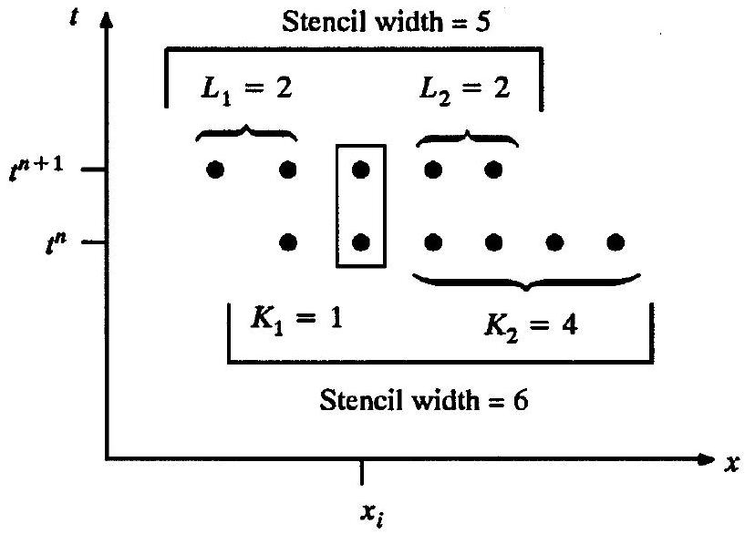
Figure 11.1 A typical stencil diagram.

time-integral averages. If numerical methods can be written in conservation form, as in Equation (11.1), then they are called conservative and the quantities $\hat{f}_{i+1 / 2}^{n}$ are called conservative numerical fluxes.

Equation (11.1) describes a time step from time level $n$ to time level $n+1$. After $n$ time steps, a numerical method knows the solution at all time levels less than $n$ but does not know that solution at any time levels greater than $n$. In an implicit method, the unknown solution at time level $n+1$ depends on itself or on the unknown solution at later time levels. In particular, in a typical implicit method, $\bar{u}_{i}^{n+1}$ depends on ( $\bar{u}_{i-K_{1}}^{n}, \ldots, \bar{u}_{i+K_{2}}^{n}$ ) and $\left(\tilde{u}_{i-L_{1}}^{n+1}, \ldots, \tilde{u}_{i+L_{2}}^{n+1}\right)$, where $K_{1} \geq 0, K_{2} \geq 0, L_{1} \geq 0$, and $L_{2} \geq 0$ are any integers. In other words,

$$
\bar{u}_{i}^{n+1}=\bar{u}\left(\bar{u}_{i-K_{1}}^{n}, \ldots, \bar{u}_{i+K_{2}}^{n} ; \bar{u}_{i-L_{1}}^{n+1}, \ldots, \bar{u}_{i+L_{2}}^{n+1}\right) .
$$

Recall the earlier definition of implicit systems of equations, seen following Equation (5.6). An implicit numerical method must solve an implicit system of equations, using Gaussian elimination for linear systems or roots solvers such as such as Newton's method or Broyden's method for nonlinear systems.

The terms in equation (11.5), ( $\bar{u}_{i-K_{1}}^{n}, \ldots, \bar{u}_{i+K_{2}}^{n}$ ) and ( $\bar{u}_{i-L_{1}}^{n+1}, \ldots, \bar{u}_{i+L_{2}}^{n+1}$ ), are called the stencil or the direct numerical domain of dependence of $\bar{u}_{i}^{n+1}$. The quantities $K_{1}+K_{2}+1$ and $L_{1}+L_{2}+1$ are called stencil widths. Stencils are often illustrated by stencil diagrams such as the one shown in Figure 11.1. In order to avoid clutter, future stencil diagrams will include only the dots.

Example 11.1 Suppose that

$$
\bar{u}_{i}^{n+1}=\bar{u}_{i}^{n}-\frac{\lambda}{2}\left(f\left(u_{i+1}^{n+1}\right)-f\left(u_{i-1}^{n+1}\right)\right)+\frac{\lambda}{2}\left(f\left(\bar{u}_{i+2}^{n}\right)-4 f\left(\bar{u}_{i+1}^{n}\right)+3 f\left(\bar{u}_{i}^{n}\right)\right) .
$$

Then $K_{1}=0, K_{2}=2, L_{1}=1$, and $L_{2}=1$. The stencil width at time level $n$ is three and the stencil width at time level $n+1$ is also three.

Phrased in terms of conservative numerical fluxes, Equation (11.5) becomes

$$
\hat{f}_{i+1 / 2}^{n}=\hat{f}\left(\bar{u}_{i-K_{1}+1}^{n}, \ldots, \bar{u}_{i+K_{2}}^{n} ; \bar{u}_{i-L_{1}+1}^{n+1}, \ldots, \bar{u}_{i+L_{2}}^{n+1}\right) .
$$

Compared with Equation (11.5), Equation (11.6) adds one to the lower indices $i-K_{1}$ and $i-L_{1}$. To understand why, suppose that Equation (11.6) did not add one to the lower indices, that is, suppose that

$$
\hat{f}_{i+1 / 2}^{n}=\hat{f}\left(\bar{u}_{i-K_{1}}^{n}, \ldots, \bar{u}_{i+K_{2}}^{n} ; \bar{u}_{i-L_{1}}^{n+1}, \ldots, \bar{u}_{i+L_{2}}^{n+1}\right) .
$$

Then

$$
\hat{f}_{i-1 / 2}^{n}=\hat{f}\left(\bar{u}_{i-K_{1}-1}^{n}, \ldots, \bar{u}_{i+K_{2}-1}^{n} ; \bar{u}_{i-L_{1}-1}^{n+1}, \ldots, \bar{u}_{i+L_{2}-1}^{n+1}\right)
$$

and then

$$
\bar{u}_{i}^{n+1}=u_{i}^{n}-\lambda\left(\hat{f}_{i+1 / 2}^{n}-\hat{f}_{i-1 / 2}^{n}\right) .
$$

The domain of dependence of $u_{i}^{n+1}$ is the union of $u_{i}^{n}$, the domain of dependence of $\hat{f}_{i+1 / 2}^{n}$, and the domain of dependence of $\hat{f}_{i-1 / 2}^{n}$. However, this would imply

$$
\bar{u}_{i}^{n+1}=\bar{u}\left(\bar{u}_{i-K_{1}-1}^{n}, \ldots, \bar{u}_{i+K_{2}}^{n} ; \bar{u}_{i-L_{1}-1}^{n+1}, \ldots, \bar{u}_{i+L_{2}}^{n+1}\right),
$$

which does not agree with Equation (11.5).
Implicit methods require costly solutions to implicit systems of equations. By contrast, in explicit methods, the unknown solution at time level $n+1$ depends only on the known solution at time level $n$ or earlier and does not depend on the unknown solution at time level $n+1$ or later time levels. Typical explicit methods satisfy

$$
\bar{u}_{i}^{n+1}=\bar{u}\left(\bar{u}_{i-K_{1}}^{n}, \ldots, \bar{u}_{i+K_{2}}^{n}\right),
$$

or equivalently,

$$
\text { - } \quad \hat{f}_{i+1 / 2}^{n}=\hat{f}\left(\bar{u}_{i-K_{1}+1}^{n}, \ldots, \bar{u}_{i+K_{2}}^{n}\right) \text {. }
$$

Referring to Equation (11.7), $\left(\bar{u}_{i-K_{1}}^{n}, \ldots, \bar{u}_{i+K_{2}}^{n}\right)$ is called the stencil or the direct numerical domain of dependence of $\bar{u}_{i}^{n+1}$, and $K_{1}+K_{2}+1$ is called the stencil width. Each time step in an explicit method requires the solution of an explicit system of equations, which costs far less than the solution of an implicit system of equations. Although each time step in an explicit method costs less than in an implicit method, explicit methods usually have to take more time steps. The next chapter details the trade-offs between implicit and explicit methods.

Proper numerical approximations become perfect in the limit $\Delta x \rightarrow 0$ and $\Delta t \rightarrow 0$. An approximate equation is consistent if it equals the true equation in the limit $\Delta x \rightarrow 0$ and $\Delta t \rightarrow 0$. Also, a solution to an approximation equation is convergent if it equals the true solution to the true equation in the limit $\Delta x \rightarrow 0$ and $\Delta t \rightarrow 0$. Consistency is not the same thing as convergence; consistency refers to the discrete approximation whereas convergence refers to its solutions. Just because the discrete and exact equations are equal in the limit $\Delta x \rightarrow 0$ and $\Delta t \rightarrow 0$ does not imply that their solutions are also equal - even infinitesimal differences in an equation may create large differences in the solution, especially if the differences create instability.

When is a conservative approximation consistent? As a general rule, the smaller $\Delta x$ and $\Delta t$, the smaller the differences between the solution values in the stencil. In fact, away from
jumps, every solution value in the stencil becomes equal in the limit $\Delta x \rightarrow 0$ and $\Delta t \rightarrow 0$. Thus

$$
\bar{u}_{i-K_{1}}^{n}=\cdots=\bar{u}_{i+K_{2}}^{n}=\bar{u}_{i-L_{1}}^{n+1}=\cdots=\bar{u}_{i+L_{2}}^{n+1}=u
$$

in the limit $\Delta x \rightarrow 0$ and $\Delta t \rightarrow 0$. Then Equations (11.3), (11.6), and (11.8) imply the following consistency condition:

$$
\hat{f}(u, \ldots, u)=f(u)
$$

assuming only that $\hat{f}$ is reasonably smooth and continuous. Then the conservative numerical flux $\hat{f}$ is said to be consistent with the physical flux $f$. Consistency between the numerical flux and the physical flux is necessary but not sufficient for consistency between the numerical approximation and the true governing equation.

Although the limiting case $\Delta x \rightarrow 0$ and $\Delta t \rightarrow 0$ motivates the definition of consistent numerical flux, a consistent numerical flux satisfies $\hat{f}_{i+1 / 2}^{n}=f(u)$ anytime the numerical solution equals a constant $u$ throughout the stencil, whether the constancy is achieved for finite values of $\Delta x$ and $\Delta t$ or only in the limit $\Delta x \rightarrow 0$ and $\Delta t \rightarrow 0$. By one interpretation, $\hat{f}_{i+1 / 2}^{n}$ is a time integral-average of $f$. If all of the values in an average are equal, any "reasonable" average should preserve the common value. In this sense, the consistent flux condition is just a commonsense averaging condition.

Example 11.2 Suppose that the conservative numerical flux is

$$
\hat{f}_{i+1 / 2}^{n}=\frac{f\left(\bar{u}_{i+1}^{n}\right)+f\left(\bar{u}_{i}^{n}\right)}{2} .
$$

If $\bar{u}_{i+1}^{n}=\bar{u}_{i}^{n}=u$ then

$$
\hat{f}_{i+1 / 2}^{n}=\frac{f(u)+f(u)}{2}=f(u) .
$$

Thus the conservative numerical flux is consistent with the physical flux.

Conservative numerical methods have the following fundamental property:
Conservative numerical methods automatically locate shocks correctly.
Notice that this result only speaks to the location of the shock and not its shape. In fact, like all numerical methods, conservative methods may experience large spurious oscillations and smearing near shocks. However, averaging out oscillations and smearing, conservative methods always place shocks correctly. Conversely, even small deviations from strict conservative flux differencing typically result in markedly incorrect shock speeds unless, of course, the Rankine-Hugoniot jump relations given by Equation (2.32) are explicitly enforced, which requires costly shock-tracking logic. Methods that explicitly enforce the Rankine-Hugoniot relations are called shock-fitting methods or, sometimes, shock-tracking methods; methods that do not are called shock-capturing methods. Shock-capturing methods have dominated shock-fitting methods since the 1960s. This text concerns shock-capturing methods exclusively. Shock-capturing methods must be conservative. Modern shock-fitting methods are also often conservative.

What explains the unique shock-capturing abilities of conservative methods? Many sources cite the following result:

> Consider a conservative numerical method. Assume that the conservative numerical flux is consistent with the physical flux. If the numerical solution converges as $\Delta x \rightarrow 0$ and $\Delta t \rightarrow 0$, then it converges to an exact solution of the integral form of the conservation law or, in other words, to an exact weak solution of the differential form of the conservation law.

Put another way, the Lax-Wendroff theorem says that conservative numerical methods capture shock speeds (not to mention every other aspect of the solution) perfectly in the limiting case $\Delta x \rightarrow 0$ and $\Delta t \rightarrow 0$ assuming only that such a limiting solution exists. This result was first proven by Lax and Wendroff (1960) and is known as the Lax-Wendroff theorem. Also see LeVeque (1992) for a modern mathematically rigorous statement.

The Lax-Wendroff theorem has several limitations. First, it only says what happens if the solution converges as $\Delta x \rightarrow 0$ and $\Delta t \rightarrow 0$ - the Lax-Wendroff theorem never says that the solution actually does converge. While conservation is one element in convergence, convergence requires stability and consistency in addition to conservation, as discussed in Sections 15.4 and 16.11. Second, assuming that the solution converges, the Lax-Wendroff theorem guarantees perfection only in the limiting case $\Delta x \rightarrow 0$ and $\Delta t \rightarrow 0$, which may or may not imply good behavior for finite values of $\Delta x$ and $\Delta t$. For example, the pointwise and 2-norm convergence result for Legendre polynomial series, Chebyshev polynomial series, and Fourier series do not prevent these series from experiencing large spurious oscillations and overshoots in the presence of jump discontinuities, as seen in Chapter 7. In short, lacking a decreasing upper bound on the maximum error, convergence results alone may not assure quality in ordinary calculations. Third, assuming that the solution converges, the Lax-Wendroff theorem allows any weak solution - it does not ensure that the weak solution satisfies the second law of thermodynamics or other entropy conditions. Fourth and finally, Shu and Osher (p. 452, 1988) indicate that the conclusions of the Lax-Wendroff theorem apply to a class of nonconservative methods. This class of methods allows $O\left(\Delta x^{r}\right)$ deviations from strict conservative flux differencing, where $r$ is any positive exponent. Since these deviations disappear in the converged solution (i.e., in the limit $\Delta x \rightarrow 0$ ), the results of the Lax-Wendroff theorem still apply. However, these nonconservative methods tend to seriously mislocate shocks for any realistic values of $\Delta x$ and $\Delta t$. Thus, although interesting and important, the Lax-Wendroff theorem alone does not explain the special shock-capturing abilities of conservative methods.

So what does explain the special shock-capturing abilities of conservative methods? First, consider a conservative numerical approximation to the total amount of conserved quantity in cells $M$ through $N$ as follows:

$$
\begin{aligned}
\sum_{i=M}^{N} \bar{u}_{i}^{n+1}= & \sum_{i=M}^{N} \bar{u}_{i}^{n}-\sum_{i=M}^{N} \lambda\left(\hat{f}_{i+1 / 2}^{n}-\hat{f}_{i-1 / 2}^{n}\right) \\
= & \sum_{i=M}^{N} \bar{u}_{i}^{n}-\lambda\left(\hat{f}_{N+1 / 2}^{n}-\hat{f}_{N-1 / 2}^{n}+\hat{f}_{N-1 / 2}^{n}-\hat{f}_{N-3 / 2}^{n}+\cdots\right. \\
& \left.\quad+\hat{f}_{M+3 / 2}^{n}-\hat{f}_{M+1 / 2}^{n}+\hat{f}_{M+1 / 2}^{n}-\hat{f}_{M-1 / 2}^{n}\right) \\
= & \sum_{i=M}^{N} \bar{u}_{i}^{n}-\lambda\left(\hat{f}_{N+1 / 2}^{n}-\hat{f}_{M-1 / 2}^{n}\right)
\end{aligned}
$$

Hence, the conservative numerical fluxes cancel in the sum except for the flux through the right edge of cell $N$ and the flux through the left edge of cell $M$. This is called the telescoping flux property. The term "telescoping" is evocative of a pocket telescope, which collapses in on itself. Most freshman calculus books discuss telescoping series. The term telescoping means that same thing here: Every term in the series cancels, except for the first and the last. The telescoping flux property is a direct consequence of strict flux differencing; strict flux differencing ensures that the numerical flux from cell $i$ to cell $i+1$ is equal and opposite to the numerical flux from cell $i+1$ to cell $i$ for all $i$, which implies the required cancellations in the telescoping flux property.

Suppose that a conservative method knows the exact values of $\Sigma_{i=M}^{N} \bar{u}_{i}^{n}, \hat{f}_{M-1 / 2}^{n}$, and $\hat{f}_{N+1 / 2}^{n}$. Then this method yields the exact value for $\Sigma_{i=M}^{N} \bar{u}_{i}^{n+1}$ even when the cells between $M$ and $N$ contain shocks and contacts. Thus, although the numerical solution may oscillate about the correct shock profile or smear the shock over several grid cells, the numerical solution still obtains the correct integral-average across cells $M$ through $N$. Of course, this argument assumes that the method has exact values for $\Sigma_{i=M}^{N} \bar{u}_{i}^{n}, \hat{f}_{M-1 / 2}^{n}$, and $\hat{f}_{N+1 / 2}^{n}$, which is rarely true. However, these quantities tend to be nearly correct provided that the initial conditions $\bar{u}_{i}^{0}$ are correct, and provided that cells $M$ and $N$ are in smooth regions away from shocks.

In summary, strict conservative flux differencing implies the telescoping flux property, which in turn implies correct shock locations, on average. Strict conservative flux differencing is the key. Methods with strict flux differencing tend to locate shocks correctly, on average, whereas methods with even minor deviations from strict flux differencing do not.

The behavior of conservative numerical methods versus nonconservative numerical methods is illustrated in Figure 11.2. The conservative method obtains the correct integralaverage $\Sigma_{i=M}^{N} \bar{u}_{i}^{n+1}$ (some values are too high, some values are too low, but the positive and negative errors cancel in the sum). The nonconservative method underestimates $\Sigma_{i=M}^{N} \bar{u}_{i}^{n+1}$ because it underestimates the shock speed. In this example, the conservative method has a

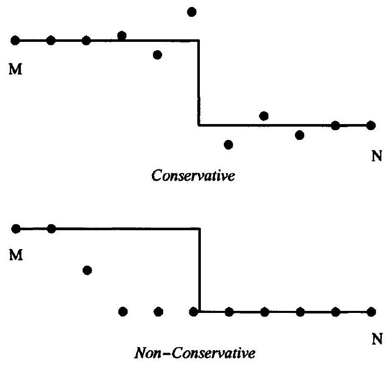
Figure 11.2 Conservative vs. nonconservative methods.

better shock placement whereas the nonconservative method has a better shock shape. However, in other cases, the conservative method will have both a better position and a better shape. The only consistent difference between conservative and nonconservative shockcapturing methods is that conservative methods correctly capture the speeds and locations of shocks, contacts, and other large-gradient flow features.

As we have seen, shock-capturing methods may exhibit large spurious oscillations near shocks. At the very least, shock-capturing methods spread shocks across several cells. For sinusoidal waves, the $x$ direction is called phase while the $y$ direction is called amplitude. Employing this terminology for shock waves, computational gasdynamics has long sought a simple condition that ensures proper shock amplitudes in the same way that conservation ensures proper shock phase, as discussed under the heading of nonlinear stability in Chapter 16. In their favor, shock-fitting methods do not generally suffer large amplitude errors at shocks. However, the cost required to treat amplitude errors in shock-capturing methods is usually less than the cost of shock tracking.

Lest the reader take conservation too much for granted, consider the case of chemically reacting gas flows with strong source terms. Yee and Shinn (1989) examined solutions consisting of a uniform flow punctuated by a single unsteady shock. In the presence of strong source terms, they found that supposedly conservative approximations propagated the shock at the wrong speed. Fortunately, this is impossible in our applications.

As examples of conservation and the other principles above, the remainder of the section will describe nine simple finite-volume approximations based directly on the conservation form. The integration formulae from Section 10.2 will approximate the flux integral seen in Equation (11.3).

### 11.1.1 Forward-Time Methods

To start with, use the simplest possible numerical integration formula. In particular, use the following constant forward-time extrapolation:

$$
f\left(u\left(x_{i+1 / 2}, t\right)\right)=f\left(u\left(x_{i+1 / 2}, t^{n}\right)\right)+O(\Delta t)
$$

for $t^{n} \leq t \leq t^{n+1}$. In other words, use Riemann integration as given by Equation (10.26) to find

$$
\frac{1}{\Delta t} \int_{t^{n}}^{t^{n+1}} f\left(u\left(x_{i+1 / 2}, t\right)\right) d t=f\left(u\left(x_{i+1 / 2}, t^{n}\right)\right)+O(\Delta t)
$$

The right-hand side involves the unknown $f\left(u\left(x_{i+1 / 2}, t^{n}\right)\right)$ rather than knowns such as $f\left(\bar{u}_{i}^{n}\right)$ or $f\left(\bar{u}_{i+1}^{n}\right)$. However, $f\left(u\left(x_{i+1 / 2}, t^{n}\right)\right)$ is easily approximated in terms of $f\left(\bar{u}_{i}^{n}\right)$ and $f\left(\bar{u}_{i+1}^{n}\right)$ using interpolation, extrapolation, and reconstruction via the primitive function. For example, using constant forward-space extrapolation, we get

$$
f\left(u\left(x_{i+1 / 2}, t^{n}\right)\right)=f\left(u\left(x_{i+1}, t^{n}\right)\right)+O(\Delta x) .
$$

Similarly, using constant backward-space extrapolation gives

$$
f\left(u\left(x_{i+1 / 2}, t^{n}\right)\right)=f\left(u\left(x_{i}, t^{n}\right)\right)+O(\Delta x)
$$

Finally, using linear central-space interpolation gives

$$
f\left(u\left(x_{i+1 / 2}, t^{n}\right)\right)=\frac{f\left(u\left(x_{i+1}, t^{n}\right)\right)+f\left(u\left(x_{i}, t^{n}\right)\right)}{2}+O\left(\Delta x^{2}\right)
$$

These expressions still involve $u\left(x_{i}, t^{n}\right)$ rather than $\bar{u}_{i}^{n}$. In general, reconstruction via the primitive function converts $\bar{u}_{i}^{n}$ to $u\left(x_{i}, t^{n}\right)$, as seen in Chapter 9. Luckily, there is no need for anything so sophisticated in this case, since the order of accuracy is so low. In particular, by Equation (9.3), cell-centered samples equal cell-integral averages to second-order accuracy. Then

$$
\begin{aligned}
f\left(u\left(x_{i+1 / 2}, t^{n}\right)\right) & =f\left(\bar{u}_{i+1}^{n}\right)+O(\Delta x) \\
f\left(u\left(x_{i+1 / 2}, t^{n}\right)\right) & =f\left(\bar{u}_{i}^{n}\right)+O(\Delta x) \\
f\left(u\left(x_{i+1 / 2}, t^{n}\right)\right) & =\frac{f\left(\bar{u}_{i+1}^{n}\right)+f\left(\bar{u}_{i}^{n}\right)}{2}+O\left(\Delta x^{2}\right)
\end{aligned}
$$

In summary, the forward-time forward-space (FTFS) method is as follows:

- $\quad \bar{u}_{i}^{n+1}=\bar{u}_{i}^{n}-\lambda\left(\hat{f}_{i+1 / 2}^{n}-\hat{f}_{i-1 / 2}^{n}\right)$,
- $\quad \hat{f}_{i+1 / 2}^{n}=f\left(\bar{u}_{i+1}^{n}\right)$,
or equivalently,

$$
\bar{u}_{i}^{n+1}=\bar{u}_{i}^{n}-\lambda\left(f\left(\bar{u}_{i+1}^{n}\right)-f\left(\bar{u}_{i}^{n}\right)\right) .
$$

FTFS is formally first-order accurate in time and space. Notice that $K_{1}=0$ and $K_{2}=1$.
Similarly, the forward-time backward-space (FTBS) method is as follows:

$$
\begin{aligned}
& \bar{u}_{i}^{n+1}=\bar{u}_{i}^{n}-\lambda\left(\hat{f}_{i+1 / 2}^{n}-\hat{f}_{i-1 / 2}^{n}\right), \\
& \hat{f}_{i+1 / 2}^{n}=f\left(\bar{u}_{i}^{n}\right),
\end{aligned}
$$

or equivalently,

$$
\bar{u}_{i}^{n+1}=\bar{u}_{i}^{n}-\lambda\left(f\left(\bar{u}_{i}^{n}\right)-f\left(\bar{u}_{i-1}^{n}\right)\right) .
$$

FTBS is formally first-order accurate in time and space. Notice that $K_{1}=1$ and $K_{2}=0$.
Finally, the forward-time central-space (FTCS) method is as follows:

- $\quad \bar{u}_{i}^{n+1}=\bar{u}_{i}^{n}-\lambda\left(\hat{f}_{i+1 / 2}^{n}-\hat{f}_{i-1 / 2}^{n}\right)$,
- $\quad \hat{f}_{i+1 / 2}^{n}=\frac{f\left(\bar{u}_{i+1}^{n}\right)+f\left(\bar{u}_{i}^{n}\right)}{2}$,
or equivalently,

$$
\bar{u}_{i}^{n+1}=\bar{u}_{i}^{n}-\frac{\lambda}{2}\left(f\left(\bar{u}_{i+1}^{n}\right)-f\left(\bar{u}_{i-1}^{n}\right)\right) .
$$

FTCS is formally first-order accurate in time and second-order accurate in space. Notice that $K_{1}=1$ and $K_{2}=1$. The stencil diagrams for FTFS, FTBS, and FTCS are shown in Figure 11.3.

Some errors arise from the component approximations; for example, jump discontinuities cause spurious oscillations in Legendre polynomials, Fourier series, interpolation polynomials, numerical differentiation, numerical integration, and so on. Other errors arise from combinations of component approximations. In particular, by one definition, instability refers to errors arising from interactions between various space and time approximations.

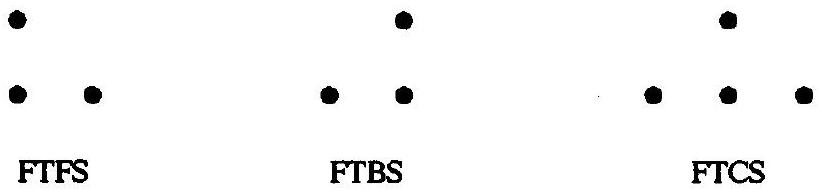
Figure 11.3 Stencil diagrams for forward-time methods.

Like the errors in the individual components, instability tends to take the form of large spurious oscillations. In the worst case, unstable methods "blow up" as time increases regardless of initial conditions and parameters such as $\Delta x$ and $\Delta t$. In other words, the amplitude of the spurious oscillations increases without bound as time increases. In particular, FTFS tends to blow up when applied to flows with right-running waves, FTBS tends to blow up when applied to flows with left-running waves, and FTCS tends to blow up when applied to any flow. Chapters 15 and 16 discuss stability exhaustively.

The term "order of accuracy" is somewhat vague for single approximations, as discussed in Section 6.3, because it depends on whether the error is measured pointwise or in some norm, and because it depends on local behaviors of the solution such as jump discontinuities. The term "order of accuracy" is even more cloudy for combinations of approximations such as those found in FTBS, FTFS, and FTCS, because of instability. For example, consider FTBS applied to an equation with positive wave speeds. Suppose $\Delta x$ is decreased while everything else is fixed, including $\Delta t$, the number of time steps, the initial conditions, and the boundary conditions. In general, the error decreases with $\Delta x$ for large enough $\Delta x$ (as you would expect from first-order spatial accuracy) but then the error dramatically and catastrophically increases after $\Delta x$ drops below a certain threshold, due to instability. In fact, as we shall see later, error is sensitive not only to $\Delta x$ and $\Delta t$ separately, but also to the ratio $\lambda=\Delta t / \Delta x$. If the ratio $\lambda=\Delta t / \Delta x$ becomes too large relative to the local wave speeds, the error becomes large and grows rapidly with each time step, at least in explicit methods. In the individual integration and interpolation formulae, $R$ th-order accuracy implies convergence as $\Delta x \rightarrow 0$ or $\Delta t \rightarrow 0$. However, convergence and other order-of-accuracy properties often fail when used in combinations such as FTBS because of instability. The orders of accuracy of the component formulae are sometimes called formal orders of accuracy. Other possible definitions of order of accuracy will be discussed in Subsection 11.2.2.

Example 11.3 Consider the following linear advection problem on a periodic domain $[-1,1]$ :

$$
\begin{aligned}
& \frac{\partial u}{\partial t}+\frac{\partial u}{\partial x}=0, \\
& u(x, 0)= \begin{cases}1 & |x| \leq 1 / 3, \\
0 & |x|>1 / 3 .\end{cases}
\end{aligned}
$$

Approximate $u(x, 2)$ using FTFS, FTBS, and FTCS with 20 cells and $\lambda=\Delta t / \Delta x=0.8$.
Solution A little background is in order before performing the required calculations. By Equation (4.17), the exact solution is

$$
u(x, t)=u(x-t, 0) .
$$

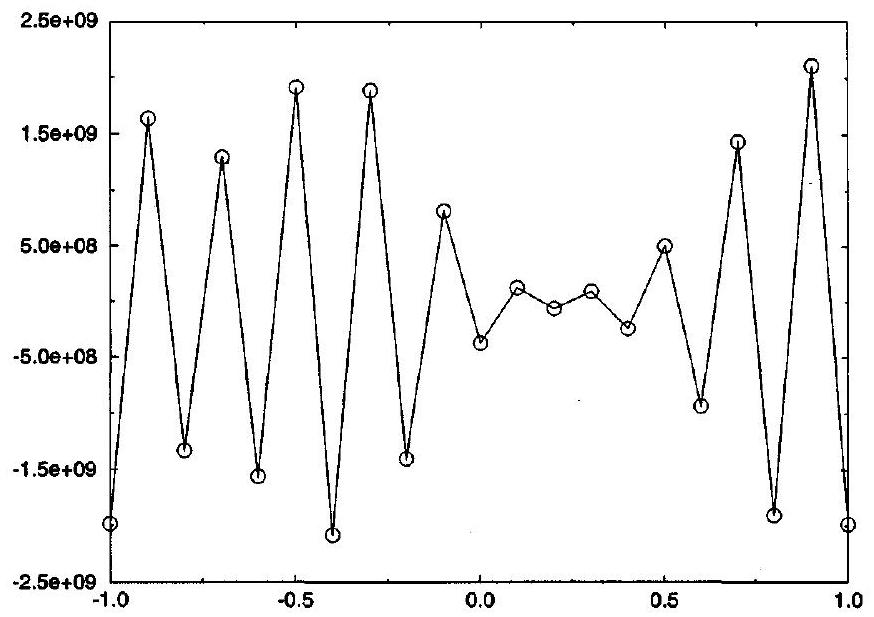
Figure 11.4 Linear advection of a square wave approximated by FTFS.

By definition of a periodic domain of width 2,

$$
u(x, t)=u(x-2, t)
$$

Then $u(x, 2)=u(x-2,0)=u(x, 0)$. Thus the true solution travels about the periodic domain exactly once. The cell widths are $\Delta x=2 / 20=1 / 10$ and the cell centers are $x_{i}=-1+i \Delta x$ for $i=0, \ldots, 20$. The solution in the 0 th cell and the $N$ th cell is equal by periodicity; in other words, $\bar{u}_{0}=\bar{u}_{N}$. Similarly, $\bar{u}_{1}=\bar{u}_{N+1}$. The time step is $\Delta t= 0.8 \Delta x=2 / 25$, and thus exactly $2 / \Delta t=25$ time steps are required to reach the final time $t=2$. From Chapter 4, remember that jump discontinuities in the solution of the linear advection equation are contact discontinuities. Thus this example illustrates contactcapturing abilities rather than shock-capturing abilities. However, in general, contacts are more difficult to capture than shocks, and a method that captures contacts is liable to capture shocks even better.

The solutions found using FTFS, FTBS, and FTCS are shown in Figures 11.4, 11.5 , and 11.6 , respectively. Both FTFS and FTCS are unstable, although FTFS is many orders of magnitude more unstable than FTCS. By contrast FTBS yields a reasonably good solution, although the corners of the square wave are severely rounded off and the magnitude of the square wave is reduced by about $10 \%$.

### 11.1.2 Backward-Time Methods

In the previous subsection, Equation (11.6) was approximated using a simple constant forward-time extrapolation. In this subsection, Equation (11.6) is approximated by a simple constant backward-time extrapolation as follows:

$$
f\left(u\left(x_{i+1 / 2}, t\right)\right)=f\left(u\left(x_{i+1}, t^{n+1}\right)\right)+O(\Delta t)
$$

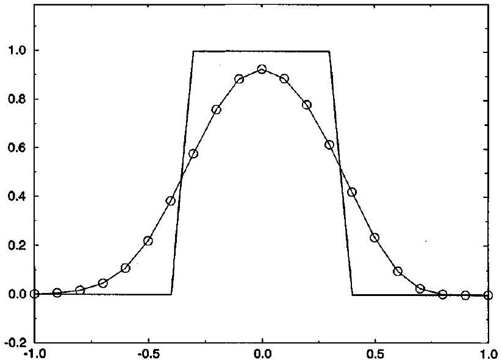
Figure 11.5 Linear advection of a square wave approximated by FTBS.

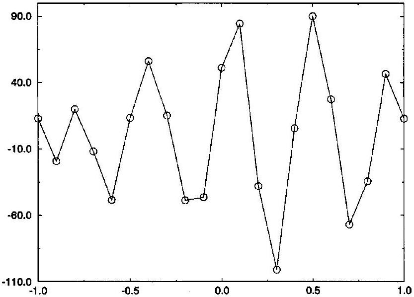
Figure 11.6 Linear advection of a square wave approximated by FTCS.

for $t^{n} \leq t \leq t^{n+1}$. In other words, use Riemann integration as given by Equation (10.26) to find

$$
\frac{1}{\Delta t} \int_{t^{n}}^{t^{n+1}} f\left(u\left(x_{i+1 / 2}, t\right)\right) d t=f\left(u\left(x_{i+1 / 2}, t^{n+1}\right)\right)+O(\Delta t)
$$

Then $f\left(u\left(x_{i+1 / 2}, t^{n+1}\right)\right)$ is approximated from $f\left(\bar{u}_{i}^{n+1}\right)$ and $f\left(\bar{u}_{i+1}^{n+1}\right)$ just as in the last subsection. The details are essentially the same as before and are therefore omitted.

The backward-time forward-space (BTFS) method is as follows:

$$
\begin{aligned}
& \bar{u}_{i}^{n+1}=\bar{u}_{i}^{n}-\lambda\left(\hat{f}_{i+1 / 2}^{n}-\hat{f}_{i-1 / 2}^{n}\right), \\
& \hat{f}_{i+1 / 2}^{n}=f\left(\bar{u}_{i+1}^{n+1}\right),
\end{aligned}
$$

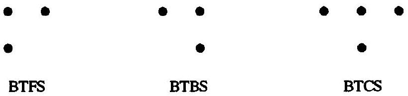
Figure 11.7 Stencil diagrams for backward-time methods.

or equivalently,

$$
\bar{u}_{i}^{n+1}=\bar{u}_{i}^{n}-\lambda\left(f\left(\bar{u}_{i+1}^{n+1}\right)-f\left(\bar{u}_{i}^{n+1}\right)\right) .
$$

BTFS is formally first-order accurate in time and space. Notice that $K_{1}=K_{2}=0, L_{1}=0$, and $L_{2}=1$.

Similarly, the backward-time backward-space (BTBS) method is as follows:

$$
\begin{aligned}
& \bar{u}_{i}^{n+1}=\bar{u}_{i}^{n}-\lambda\left(\hat{f}_{i+1 / 2}^{n}-\hat{f}_{i-1 / 2}^{n}\right), \\
& \hat{f}_{i+1 / 2}^{n}=f\left(\bar{u}_{i}^{n+1}\right),
\end{aligned}
$$

or equivalently,

$$
\bar{u}_{i}^{n+1}=\bar{u}_{i}^{n}-\lambda\left(f\left(\bar{u}_{i}^{n+1}\right)-f\left(\bar{u}_{i-1}^{n+1}\right)\right) .
$$

BTBS is formally first-order accurate in time and space. Notice that $K_{1}=K_{2}=0, L_{1}=1$, and $L_{2}=0$.

Finally, the backward-time central-space (BTCS) method is as follows:

- $\quad \bar{u}_{i}^{n+1}=\bar{u}_{i}^{n}-\lambda\left(\hat{f}_{i+1 / 2}^{n}-\hat{f}_{i-1 / 2}^{n}\right)$,
- $\quad \hat{f}_{i+1 / 2}^{n}=\frac{f\left(\bar{u}_{i+1}^{n+1}\right)+f\left(\bar{u}_{i}^{n+1}\right)}{2}$,
or equivalently,

$$
\text { - } \quad \bar{u}_{i}^{n+1}=\bar{u}_{i}^{n}-\frac{\lambda}{2}\left(f\left(\bar{u}_{i+1}^{n+1}\right)-f\left(\bar{u}_{i-1}^{n+1}\right)\right) \text {. }
$$

BTCS is formally first-order accurate in time and second-order accurate in space. Notice that $K_{1}=K_{2}=0, L_{1}=1$, and $L_{2}=1$. BTCS is also known as the implicit Euler or the backward Euler method. The stencil diagrams for BTFS, BTBS, and BTCS are shown in Figure 11.7. Notice that all of the methods in this subsection are implicit whereas all of the methods in the previous subsection were explicit.

Example 11.4 Write the implicit Euler (BTCS) method for the linear advection equation on a periodic domain as a linear system of equations. Describe a simple numerical method for solving this linear system of equations.

Solution BTCS for the linear advection equation is as follows:

$$
\bar{u}_{i}^{n+1}=\bar{u}_{i}^{n}-\frac{\lambda a}{2}\left(\bar{u}_{i+1}^{n+1}-\bar{u}_{i-1}^{n+1}\right)
$$

or

$$
\bar{u}_{i}^{n+1}+\frac{\lambda a}{2}\left(\bar{u}_{i+1}^{n+1}-\bar{u}_{i-1}^{n+1}\right)=\bar{u}_{i}^{n}
$$

Assume the cells are indexed from 1 to $N$. If $i=1$ we have

$$
\bar{u}_{1}^{n+1}+\frac{\lambda a}{2}\left(\bar{u}_{2}^{n+1}-\bar{u}_{0}^{n+1}\right)=\bar{u}_{1}^{n}
$$

But $u_{0}^{n}=u_{N}^{n}$ by the definition of a periodic domain. Then

$$
\bar{u}_{1}^{n+1}+\frac{\lambda a}{2}\left(\bar{u}_{2}^{n+1}-\bar{u}_{N}^{n+1}\right)=\bar{u}_{i}^{n}
$$

If $i=N$ then

$$
\bar{u}_{N}^{n+1}+\frac{\lambda a}{2}\left(\bar{u}_{N+1}^{n+1}-\bar{u}_{N-1}^{n+1}\right)=\bar{u}_{N}^{n}
$$

But $u_{N+1}^{n}=u_{1}^{n}$ by the definition of a periodic domain. Then

$$
\bar{u}_{N}^{n+1}+\frac{\lambda a}{2}\left(\bar{u}_{1}^{n+1}-\bar{u}_{N-1}^{n+1}\right)=\bar{u}_{N}^{n}
$$

The desired result is

$$
\left[\begin{array}{ccccccc}
1 & \lambda a / 2 & & & & & -\lambda a / 2 \\
-\lambda a / 2 & 1 & \lambda a / 2 & & & & \\
& -\lambda a / 2 & 1 & \lambda a / 2 & & & \\
& & & & & & \\
& & & & -\lambda a / 2 & 1 & \lambda a / 2 \\
\lambda a / 2 & & & & & -\lambda a / 2 & 1
\end{array}\right]\left[\begin{array}{c}
\bar{u}_{1}^{n+1} \\
\bar{u}_{2}^{n+1} \\
\bar{u}_{3}^{n+1} \\
\vdots \\
\bar{u}_{N-1}^{n+1} \\
\bar{u}_{N}^{n+1}
\end{array}\right]=\left[\begin{array}{c}
\bar{u}_{1}^{n} \\
\bar{u}_{2}^{n} \\
\bar{u}_{3}^{n} \\
\vdots \\
\bar{u}_{N-1}^{n} \\
\bar{u}_{N}^{n}
\end{array}\right] .
$$

The matrix is tridiagonal except for the elements in the upper right and lower left corners. The elements in the corners are a direct result of periodic boundary conditions; different boundary conditions would yield different results, although the matrix interior is always tridiagonal.

The above "periodic tridiagonal" system of equations may be solved using Gaussian elimination. Specifically, the subdiagonal may be eliminated by adding a multiple of the first row to the second, and then a multiple of the second row to the third, and so on. The resulting system of equations is upper bidiagonal, except that the far-right column is nonzero and the lower left-hand element is nonzero. Furthermore, the resulting system of equations is upper triangular except for the lower left-hand element. Adding a multiple of the first row to the last row creates a zero in the first element in the last row; however, it also creates a nonzero entry in the second element in the last row. Then adding a multiple of the second row to the last row creates a zero in the second element in the last row; however, it also creates a nonzero entry in the third element in the last row. The process continues, chasing the nonzero element across the last row from left to right until it finally lands in the last column of the last row, when the system of equations becomes entirely upper triangular. Once the system is upper triangular, it is easily solved using back-substitution, as described in any elementary text on linear algebra.

Example 11.5 Consider the following linear advection problem on a periodic domain $[-1,1]$ :

$$
\begin{aligned}
& \frac{\partial u}{\partial t}+\frac{\partial u}{\partial x}=0, \\
& u(x, 0)= \begin{cases}1 & |x| \leq 1 / 3, \\
0 & |x|>1 / 3 .\end{cases}
\end{aligned}
$$

Approximate $u(x, 2)$ using BTFS, BTBS, and BTCS with 20 cells and $\lambda=\Delta t / \Delta x=0.8$.
Solution See Example 11.3 for a background discussion on this test problem. BTFS is highly unstable, and the results are omitted. The solution for BTBS is shown in Figure 11.8. Like FTBS, BTBS exhibits smearing and smoothing, although to a much greater degree. The solution for BTCS is shown in Figure 11.9. Unlike FTCS, seen in

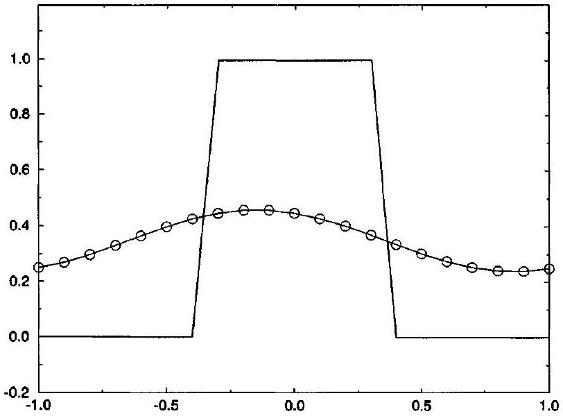
Figure 11.8 Linear advection of a square wave approximated by BTBS.

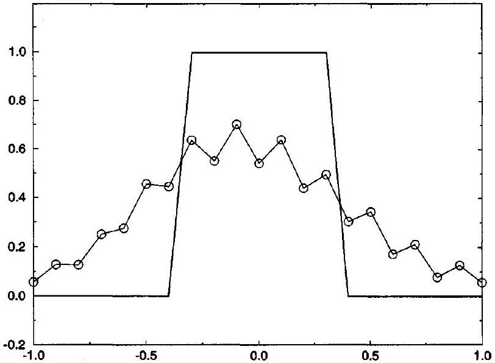
Figure 11.9 Linear advection of a square wave approximated by BTCS.

Example 11.3, BTCS does not blow up. However, BTCS still exhibits substantial error in the form of odd-even $2 \Delta x$-wave oscillations. Furthermore, the size of the square wave has been eroded by perhaps $40 \%$.

### 11.1.3 Central-Time Methods

This subsection concerns a common variant on the standard conservation form. In this variant, the time interval $\left[t^{n}, t^{n+1}\right]$ is replaced by the time interval $\left[t^{n-1}, t^{n+1}\right]$. Thus we apply the integral form of the conservation law, Equation (2.21) or (4.1), to each cell $\left[x_{i-1 / 2}, x_{i+1 / 2}\right]$ during the time interval $\left[t^{n-1}, t^{n+1}\right]$ to obtain

$$
\int_{x_{i-1 / 2}}^{x_{i+1 / 2}}\left[u\left(x, t^{n+1}\right)-u\left(x, t^{n-1}\right)\right] d x=-\int_{t^{n-1}}^{t^{n+1}}\left[f\left(u\left(x_{i+1 / 2}, t\right)\right)-f\left(u\left(x_{i-1 / 2}, t\right)\right)\right] d t
$$

This leads immediately to the following alternative conservation form:

$$
\bar{u}_{i}^{n+1}=\bar{u}_{i}^{n-1}-2 \lambda\left(\hat{f}_{i+1 / 2}^{n}-\hat{f}_{i-1 / 2}^{n}\right),
$$

where

$$
\begin{aligned}
\bar{u}_{i}^{n \pm 1} & \approx \frac{1}{\Delta x} \int_{x_{i-1 / 2}}^{x_{i+1 / 2}} u\left(x, t^{n \pm 1}\right) d x \\
\hat{f}_{i+1 / 2}^{n} & \approx \frac{1}{2 \Delta t} \int_{t^{n-1}}^{t^{n+1}} f\left(u\left(x_{i+1 / 2}, t\right)\right) d t
\end{aligned}
$$

and

$$
\lambda=\frac{\Delta t}{\Delta x}
$$

Like ordinary conservative methods, these central-time conservative methods automatically locate shocks correctly, since they involve strict flux differencing and thus obtain the telescoping flux property.

Approximate Equation (11.26) using Equation (10.27):

$$
\frac{1}{2 \Delta t} \int_{t^{n-1}}^{t^{n+1}} f\left(u\left(x_{i+1 / 2}, t\right)\right) d t=f\left(u\left(x_{i+1 / 2}, t^{n}\right)\right)+O\left(\Delta t^{2}\right)
$$

Then $f\left(u\left(x_{i+1 / 2}, t^{n}\right)\right)$ is approximated by $f\left(\bar{u}_{i}^{n}\right)$ and $f\left(\bar{u}_{i+1}^{n}\right)$ just as in the last two subsections.

The central-time forward-space (CTFS) method is as follows:

$$
\begin{aligned}
& \bar{u}_{i}^{n+1}=\bar{u}_{i}^{n-1}-2 \lambda\left(\hat{f}_{i+1 / 2}^{n}-\hat{f}_{i-1 / 2}^{n}\right), \\
& \hat{f}_{i+1 / 2}^{n}=f\left(\bar{u}_{i+1}^{n}\right),
\end{aligned}
$$

or equivalently,

$$
\bar{u}_{i}^{n+1}=\bar{u}_{i}^{n-1}-2 \lambda\left(f\left(\bar{u}_{i+1}^{n}\right)-f\left(\bar{u}_{i}^{n}\right)\right) .
$$

CTFS is formally second-order accurate in time and first-order accurate in space.

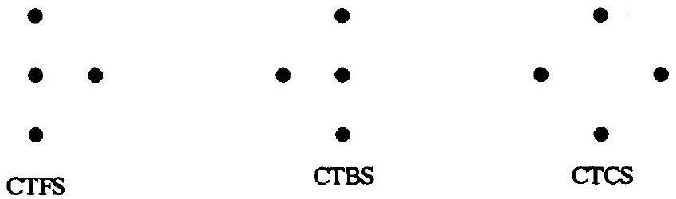
Figure 11.10 Stencil diagrams for central-time methods.

Similarly, the central-time backward-space (CTBS) method is as follows:

$$
\begin{aligned}
& \bar{u}_{i}^{n+1}=\bar{u}_{i}^{n-1}-2 \lambda\left(\hat{f}_{i+1 / 2}^{n}-\hat{f}_{i-1 / 2}^{n}\right), \\
& \hat{f}_{i+1 / 2}^{n}=f\left(\bar{u}_{i}^{n}\right),
\end{aligned}
$$

or equivalently,

$$
\bar{u}_{i}^{n+1}=\bar{u}_{i}^{n-1}-2 \lambda\left(f\left(\bar{u}_{i}^{n}\right)-f\left(\bar{u}_{i-1}^{n}\right)\right) .
$$

CTBS is formally second-order accurate in time and first-order accurate in space.
Finally, the central-time central-space (CTCS) method is as follows:

- $\quad \bar{u}_{i}^{n+1}=\bar{u}_{i}^{n-1}-2 \lambda\left(\hat{f}_{i+1 / 2}^{n}-\hat{f}_{i-1 / 2}^{n}\right)$,
- $\quad \hat{f}_{i+1 / 2}^{n}=\frac{f\left(\bar{u}_{i+1}^{n}\right)+f\left(\bar{u}_{i}^{n}\right)}{2}$,
or equivalently,

$$
\bar{u}_{i}^{n+1}=\bar{u}_{i}^{n-1}-\lambda\left(f\left(\bar{u}_{i+1}^{n}\right)-f\left(\bar{u}_{i-1}^{n}\right)\right) .
$$

CTCS is formally second-order accurate in both time and space. CTCS is better known as the leapfrog method. The stencil diagrams for CTFS, CTBS, and CTCS are shown in Figure 11.10. The stencil diagram for CTCS helps explain the moniker "leapfrog": CTCS "leapfrogs" over the point ( $x_{i}, t^{n}$ ).

All of the methods in this subsection are explicit and second-order accurate in time. Also, all of the methods in this subsection require two sets of initial conditions $u_{i}^{0}$ and $u_{i}^{1}$ rather than just one set $u_{i}^{0}$. The initial conditions $u_{i}^{1}$ can be generated from $u_{i}^{0}$ by another method such as, for example, BTCS.

For central-time methods, the odd-indexed time levels depend mainly on even-indexed time levels, while the even-indexed time levels depend mainly on odd-indexed time levels. This allows separation between odd- and even-indexed time levels called temporal oddeven decoupling. Also, in the leapfrog method, odd-indexed spatial points depend mainly on even-indexed spatial points, whereas even-indexed spatial points depend mainly on oddindexed spatial points. This allows separation between odd- and even-indexed spatial points called spatial odd-even decoupling. Odd-even decoupling in time or space typically creates spurious odd-even $2 \Delta x$-waves in time or space. For example, although the leapfrog method correctly locates shocks, it exhibits severe oscillations about shocks. Odd-even decoupling in the leapfrog method stems directly from odd-even decoupling in the underlying central difference approximation, as discussed in Subsection 10.1.2. Other methods based on the central difference approximation, such as FTCS and BTCS, may also exhibit signs of oddeven decoupling.

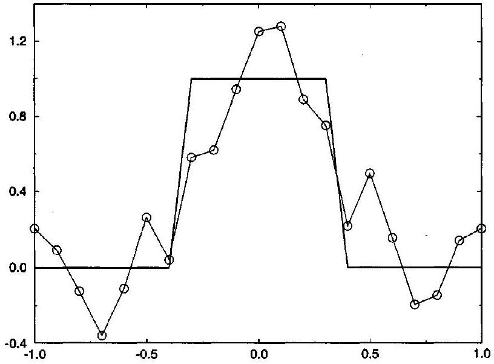
Figure 11.11 Linear advection of a square wave approximated by CTCS.

Example 11.6 Consider the following linear advection problem on a periodic domain $[-1,1]$ :

$$
\begin{aligned}
& \frac{\partial u}{\partial t}+\frac{\partial u}{\partial x}=0, \\
& u(x, 0)= \begin{cases}1 & |x| \leq 1 / 3, \\
0 & |x|>1 / 3 .\end{cases}
\end{aligned}
$$

Approximate $u(x, 2)$ using CTFS, CTBS, and CTCS with 20 cells and $\lambda=\Delta t / \Delta x=0.8$.
Solution See Example 11.3 for a background discussion on this problem. CTFS and CTBS are unstable and the results are omitted. The solution for CTCS is shown in Figure 11.11. Compared with Examples 11.3 and 11.5, CTCS falls somewhere between BTCS and FTCS. CTCS does not blow up like FTCS; however, it does experience large spurious oscillations and overshoots, certainly larger than those found in BTCS.

### 11.2 Conservative Finite-Difference Methods

Like conservative finite-volume methods, conservative finite-difference methods imitate the integral and conservation forms of the Euler equations. In particular, just like the conservation form for finite-volume methods, the conservation form for finite-difference methods is defined as follows:

$$
\quad u_{i}^{n+1}=u_{i}^{n}-\lambda\left(\hat{f}_{i+1 / 2}^{n}-\hat{f}_{i-1 / 2}^{n}\right) \text {, }
$$

where

$$
u_{i}^{n} \approx u\left(x_{i}, t^{n}\right)
$$

and

$$
\lambda=\frac{\Delta t}{\Delta x} .
$$

Not every finite-difference method can be written in conservation form; those which can are called conservative and the quantities $\hat{f}_{i+1 / 2}^{n}$ are called conservative numerical fluxes. Conservation has exactly the same advantages for finite-difference methods as it had for finite-volume methods: Strict conservative flux differencing implies correct shock and contact locations. Finite-difference methods derived from the conservation form of the Euler equations or scalar conservation laws tend to be conservative; conversely, finite-difference methods derived from other differential forms, such as the characteristic or primitive variable forms, tend not to be conservative.

Terms such as direct domain of dependence, explicit, and implicit are all defined just as before. In particular, for typical explicit methods

$$
\hat{f}_{i+1 / 2}^{n}=\hat{f}\left(u_{i-K_{1}+1}^{n}, \ldots, u_{i+K_{2}}^{n}\right),
$$

and for typical implicit methods

$$
\hat{f}_{i+1 / 2}^{n}=\hat{f}\left(u_{i-K_{1}+1}^{n}, \ldots, u_{i+K_{1}}^{n} ; u_{i-L_{1}+1}^{n+1}, \ldots, u_{i+L_{2}}^{n+1}\right) .
$$

The conservative finite-volume methods seen in the last section can all be rederived in a finite-difference context. The conservation form of the Euler equations or scalar conservation laws is as follows:

$$
\frac{\partial u}{\partial t}+\frac{\partial f}{\partial x}=0 .
$$

By Equation (10.8) we have

$$
\frac{\partial u}{\partial t}\left(x, t^{n}\right)=\frac{u\left(x, t^{n+1}\right)-u\left(x, t^{n}\right)}{\Delta t}+O(\Delta t)
$$

and

$$
\frac{\partial f}{\partial x}\left(x_{i}, t\right)=\frac{f\left(u\left(x_{i+1}, t\right)\right)-f\left(u\left(x_{i}, t\right)\right)}{\Delta x}+O(\Delta x),
$$

which are forward-time and forward-space approximations, respectively. Also, by Equation (10.7),

$$
\frac{\partial u}{\partial t}\left(x, t^{n+1}\right)=\frac{u\left(x, t^{n+1}\right)-u\left(x, t^{n}\right)}{\Delta t}+O(\Delta t)
$$

and

$$
\frac{\partial f}{\partial x}\left(x_{i}, t\right)=\frac{f\left(u\left(x_{i}, t\right)\right)-f\left(u\left(x_{i-1}, t\right)\right)}{\Delta x}+O(\Delta x),
$$

which are backward-time and backward-space approximations, respectively. Finally, by Equation (10.15),

$$
\frac{\partial u}{\partial t}\left(x, t^{n}\right)=\frac{u\left(x, t^{n+1}\right)-u\left(x, t^{n-1}\right)}{2 \Delta t}+O\left(\Delta t^{2}\right)
$$

and

$$
\frac{\partial f}{\partial x}\left(x_{i}, t\right)=\frac{f\left(u\left(x_{i+1}, t\right)\right)-f\left(u\left(x_{i-1}, t\right)\right)}{2 \Delta x}+O\left(\Delta x^{2}\right)
$$

which are central-time and central-space approximations, respectively. Then the three time discretizations and the three space discretizations can be paired in any combination for a total of nine methods. In particular, this approach yields forward-time forward-space (FTFS), forward-time backward-space (FTBS), forward-time central-space (FTCS), backward-time forward-space (BTFS), backward-time backward-space (BTBS), backward-time centralspace (BTCS or implicit Euler), central-time forward-space (CTFS), central-time backwardspace (CTBS), and central-time central-space (CTCS or leapfrog). All these methods are exactly the same as before. The only difference is that these methods now approximate cellcentered samples rather than cell-integral averages; however, since cell-centered samples equal cell-integral averages to within second-order accuracy, and since all of the methods in question are second-order accurate or less, there is no need to distinguish between cellcentered samples and cell-integral averages. The finite-difference derivations are far more common than the finite-volume derivations, but this only reflects a matter of taste and tradition.

### 11.2.1 The Method of Lines

The derivational approach described in the previous subsection involves arbitrary pairings of space and time discretizations. This approach can be generalized and formalized into the following two-step design procedure:
(1) Spatial Discretization Discretize the spatial derivative as follows:

$$
\frac{\partial f}{\partial x}\left(x_{i}, t\right) \approx \frac{\hat{f}_{s, i+1 / 2}(t)-\hat{f}_{s, i-1 / 2}(t)}{\Delta x}
$$

In other words, freeze time and discretize space. Then Equation (11.40) becomes

$$
\text { - } \quad \frac{d u}{d t}\left(x_{i}, t\right) \approx-\frac{\hat{f}_{s, i+1 / 2}(t)-\hat{f}_{s, i-1 / 2}(t)}{\Delta x} \text {. }
$$

This is called a semidiscrete finite-difference approximation and $\hat{f}_{s}$ is called the semidiscrete conservative numerical flux. The semidiscrete approximation comprises a system of ordinary differential equations. In many cases, the semidiscrete approximation is only needed at discrete time levels, in which case the semidiscrete approximation can be written as

$$
\frac{d u_{i}^{n}}{d t} \approx-\frac{\hat{f}_{s, i+1 / 2}^{n}-\hat{f}_{s, i-1 / 2}^{n}}{\Delta x}
$$

where $u_{i}^{n}=u\left(x_{i}, t^{n}\right)$ and $\hat{f}_{s, i+1 / 2}^{n}=\hat{f}_{s, i+1 / 2}\left(t^{n}\right)$.
(2) Temporal Discretization Starting with the semidiscrete flux $\hat{f}_{s}$, use a RungeKutta method or other ordinary differential equation solver to find an $\hat{f}$ such that

- $\quad \frac{u_{i}^{n+1}-u_{i}^{n}}{\Delta t}=-\frac{\hat{f}_{i+1 / 2}^{n}-\hat{f}_{i-1 / 2}^{n}}{\Delta x}$.

In other words, freeze space and discretize time. This is called a fully discrete finitedifference approximation and $\hat{f}$ is called the fully discrete conservative numerical flux. Notice that the fully discrete approximation (11.49) is the same as Equation (11.35); thus, by definition, the fully discrete approximation is conservative.

This two-stage design procedure is sometimes called the method of lines, where the lines are the coordinate lines $x=$ const. and $t=$ const. All of the forward-time and backwardtime methods seen in this section were derived using the method of lines, although the derivations did not employ any of the above notation or formalism. The following examples explain how the finite-difference derivations of FTFS and BTCS fit into the formalism of the method of lines.

Example 11.7 For FTFS, the space discretization is the forward-space approximation with $\hat{f}_{s, i+1 / 2 n}\left(t^{n}\right)=f\left(u_{i+1}^{n}\right)$ and the time discretization is the forward-time approximation with $\hat{f}_{i+1 / 2}^{n}=\hat{f}_{s, i+1 / 2}\left(t^{n}\right)=f\left(u_{i+1}^{n}\right)$. The forward-time discretization is a RungeKutta method - specifically, the forward-time discretization equals the explicit forwardEuler approximation described in Section 10.3.

Example 11.8 For BTCS, the space discretization is the central-space approximation with $\hat{f}_{s, i+1 / 2}\left(t^{n}\right)=\left(f\left(u_{i+1}^{n}\right)+f\left(u_{i}^{n}\right)\right) / 2$ and the time discretization is the backward-time approximation with $\hat{f}_{i+1 / 2}^{n}=\hat{f}_{s, i+1 / 2}\left(t^{n+1}\right)$. The backward-time discretization is a RungeKutta method-specifically, the backward-time discretization equals the implicit backwardEuler approximation.

Unfortunately, random "mix and match" pairings of temporal and spatial discretizations in the method of lines are often unstable. For example, FTCS, CTBS, and CTFS are unconditionally unstable. After choosing the spatial discretization, one can arbitrarily choose the temporal discretization, hoping against the odds for compatibility, as we have done in this section. Alternatively, after choosing the spatial discretization, one can choose a class of temporal discretizations - such as a four-stage explicit Runge-Kutta time discretization with ten free parameters - and then select from among the discretizations in the class using stability analysis, order of accuracy, numerical tests, and so on.

The right-hand side $R_{i}(t)$ of the semidiscrete approximation is sometimes called the residual,

$$
R_{i}(t)=-\frac{\hat{f}_{s, i+1 / 2}(t)-\hat{f}_{s, i-1 / 2}(t)}{\Delta x} .
$$

The term "residual" originates in the context of steady-state solutions; the residual is zero for steady-state solutions, and thus any norm of the residual measures the remaining or "residual" unsteadiness. This subsection has considered only finite-difference methods. However, the method of lines also applies to finite-volume methods; see Problem 11.11.

### 11.2.2 Formal, Local, and Global Order of Accuracy

Before ending this section, let us revisit the concept of "order of accuracy." Formal order-of-accuracy measures the order of accuracy of the individual space and time
approximations. However, due to instability, formal order of accuracy may have little to do with the actual performance of the overall method. What are the alternatives? Besides formal order of accuracy, one way to measure the order of accuracy is to reduce $\Delta x$ and $\Delta t$ simultaneously, while fixing $\lambda=\Delta t / \Delta x$, the final time, and the initial and boundary conditions. Then a method has global Rth-order accuracy in time and space if

$$
\|e\|_{\infty} \leq K \Delta x^{R}=K^{\prime} \Delta t^{R}
$$

for some constant $K$, where $e_{i}=u\left(x_{i}, t^{n}\right)-u_{i}^{n}$ is the absolute error and where $K^{\prime}=\lambda^{R} K$. Of course, other error measures result if the $\infty$-norm is replaced by the 1 -norm, the 2 norm, or any other vector norm, or if the error is measured pointwise. See Section 6.1 for a discussion on vector norms. Unfortunately, the global order of accuracy is difficult to predict theoretically. Instead, it is usually determined using numerical tests. Assuming equality rather than inequality in Equation (11.51), the order of accuracy $R$ can be estimated by comparing the numerical solutions for two different values of $\Delta x$ as follows:

$$
R=\frac{\ln \left(\left\|e_{2}\right\|_{\infty} /\left\|e_{1}\right\|_{\infty}\right)}{\ln \left(\Delta x_{2} / \Delta x_{1}\right)}=\frac{\ln \left(\left\|e_{2}\right\|_{\infty} /\left\|e_{1}\right\|_{\infty}\right)}{\ln \left(\Delta t_{2} / \Delta t_{1}\right)}
$$

where $\left(e_{1}\right)_{i}=\left|u\left(x_{i}, t^{n}\right)-u_{i}^{n}\right|$ is the absolute error for $\Delta x_{1}$ and $\Delta t_{1}=\lambda \Delta x_{1}$ and where $\left(e_{2}\right)_{i}=\left|u\left(x_{i}, t^{n}\right)-u_{i}^{n}\right|$ is the absolute error for $\Delta x_{2}$ an $\Delta t_{2}=\lambda \Delta x_{2}$. Of course, other error measures result if the $\infty$-norm is replaced by the 1 -norm, the 2 -norm, or any other vector norm.

Order-of-accuracy measures such as Equation (11.52) may be complex functions of $\Delta x_{1}$, $\Delta x_{2}, \lambda$, the final time, the initial conditions, and the boundary conditions. For example, even when a numerical method has a high order of accuracy on smooth solutions, the order of accuracy on shocked solutions is typically first order or less, as measured in the $\infty$-norm or as measured pointwise near the shock. However, it is often possible to find a fairly representative value for the order of accuracy for a useful range of $\Delta x$ and $\Delta t$ assuming smooth solutions.

Another way to measure the order of accuracy is to measure the error caused by a single time step. Imagine that the numerical solution is perfect at time level $n$. That is, suppose that $u_{i}^{n}=u\left(x_{i}, t^{n}\right)$ for all $i$, where $u(x, t)$ is the exact solution. This is usually true for $n=0$, since $u_{i}^{0}$ is usually found by sampling the exact known initial conditions $u(x, 0)$. Now take one more time step to time level $n+1$. The local truncation error is the error introduced by the single time step from time level $n$ to $n+1$. More specifically, the local truncation error is defined as

$$
\text { t.e. } i=\frac{u\left(x_{i}, t^{n+1}\right)-u_{i}^{n+1}}{\Delta t} .
$$

In most cases, the term "local" means "local in space." However, here the term "local" means "local in time." Now reduce $\Delta x$ and $\Delta t$ simultaneously, while fixing $\lambda=\Delta t / \Delta x$, the final time, and the initial and boundary conditions. Then a method has local Rth-order accuracy if

$$
\| \text { t.e. } \|_{\infty} \leq K \Delta x^{R}=K^{\prime} \Delta t^{R}
$$

for some constant $K^{\prime}$. Of course, other error measures result if the $\infty$-norm is replaced by the 1 -norm, the 2 -norm, or any other vector norm, or if the truncation error is measured pointwise. Unlike the global order of accuracy, the local order of accuracy is relatively easy to predict theoretically; see Section 10.3 of LeVeque (1992) for details.

To this point, the book has defined consistency as follows: A consistent discrete equation equals the true governing equation in the limit $\Delta x \rightarrow 0$ and $\Delta t \rightarrow 0$. We now state a more restrictive definition: A consistent discrete equation has zero local truncation error in the limit $\Delta x \rightarrow 0$ and $\Delta t \rightarrow 0$. Unfortunately, this more restrictive definition depends not only on the discrete equation but also on the solution. In particular, by this definition, most numerical methods are consistent for smooth solutions but not for discontinuous solutions. For discontinuous solutions, the local truncation error tends to be $O(1)$ and thus the local truncation error does not go to zero as $\Delta x \rightarrow 0$ and $\Delta t \rightarrow 0$.

As a general rule, the formal order of accuracy is greater than or equal to the local order of accuracy, which is in turn greater than or equal to the global order of accuracy assuming, of course, that all three measures use the same norm. For stable smooth solutions, the three measures should be nearly the same, but otherwise the three measures may be quite different. Unfortunately, in the literature, the term "order of accuracy" can refer to the formal, local, or global order of accuracy in any norm. In this book, "order of accuracy" will usually refer to the pointwise formal order of accuracy unless explicitly stated otherwise.

### 11.3 Transformation to Conservation Form

Conservative numerical methods need not be written in conservation form. For example, Equation (11.16) is a nonconservation form of FTCS, Equation (11.23) is a nonconservation form of BTCS, and Equation (11.34) is a nonconservation form of CTCS. This section describes techniques for transforming numerical methods to conservation form. These transformation techniques distinguish conservative from nonconservative methods. Remember that, by definition, a method is conservative if and only if it can be written in conservation form. Conversely, a method is not conservative if and only if it cannot be written in conservation form or, in other words, if the transformation techniques described in this section fail.

There are many legitimate reasons for using nonconservation forms. First, different nonconservation forms expose different physical aspects of a method; whereas conservation form exposes conservation and flux aspects, other forms expose wave aspects, viscous aspects, and so on. By exposing certain critical physical aspects, nonconservation forms aid in the design and analysis of numerical methods. Second, different nonconservation forms expose different numerical aspects. For example, certain forms may instantly expose numerical stability properties, or at least simplify stability analysis. Third, nonconservation forms may characterize stencils better than conservation form. For example, Equation (11.22) appears to involve $f\left(\bar{u}_{i}^{n}\right)$ but Equation (11.23) clearly does not. Finally, nonconservation forms are sometimes more esthetically pleasing, more compact, or more elegant than conservation forms. Chapters 13 and 14 will introduce important nonconservation forms.

Although there are any number of good reasons for using various nonconservation forms, the variety of forms sometimes leads to confusion. Unfortunately, the same method often appears completely different when written in different forms. Without some experience with the variety of forms commonly seen in the literature, similar or even identical methods may seem completely unrelated based solely on superficial differences in form. Transformation techniques, such as the ones described below, are essential for putting methods in the same form in order to determine genuine similarities and differences. Even when using nonconservation forms, the conservation form often makes a nice intermediary for transforming between nonconservation forms. Thus rather than transform a method between forms $A$ and
$B$ directly, it is sometimes easier to transform a method from form $A$ to conservation form, and then from conservation form to form $B$. The transformation techniques in this section will be described entirely by example.

Example 11.9 Consider FTCS in the following nonconservation form:

$$
\bar{u}_{i}^{n+1}=\bar{u}_{i}^{n}-\frac{\lambda}{2}\left(f\left(\bar{u}_{i+1}^{n}\right)-f\left(\bar{u}_{i-1}^{n}\right)\right) .
$$

Rewrite FTCS in conservation form.
Solution You already know the answer from Equation (11.15). However, for purposes of this example, imagine that you have never seen Equation (11.15). Judging strictly by Equation (11.16), you might innocently try something like this:

$$
\bar{u}_{i}^{n+1}=\bar{u}_{i}^{n}-\lambda\left(\hat{f}_{i+1 / 2}^{n}-\hat{f}_{i-1 / 2}^{n}\right),
$$

where

$$
\begin{aligned}
& \hat{f}_{i+1 / 2}^{n}=\frac{1}{2} f\left(\bar{u}_{i+1}^{n}\right) \\
& \hat{f}_{i-1 / 2}^{n}=\frac{1}{2} f\left(\bar{u}_{i-1}^{n}\right)
\end{aligned}
$$

However, this is not conservation form! In particular, the indexing makes no sense: Adding one to the index of $\hat{f}_{i-1 / 2}^{n}$ does not give $\hat{f}_{i+1 / 2}^{n}$, and subtracting one from the index of $\hat{f}_{i+1 / 2}^{n}$ does not give $\hat{f}_{i-1 / 2}^{n}$. Physically, this means that cells $\left[x_{i-1 / 2}, x_{i+1 / 2}\right]$ and $\left[x_{i+1 / 2}, x_{i+3 / 2}\right]$ see different fluxes through their common cell edge $x_{i+1 / 2}$, contradicting the basic notion of conservation.

Thus, although conservation form involves a flux difference, not just any flux difference will do. To put FTCS in conservation form, add and subtract $\lambda g_{i}^{n} / 2$ on the right-hand side as follows:

$$
u_{i}^{n+1}=u_{i}^{n}-\frac{\lambda}{2}\left(f\left(u_{i+1}^{n}\right)+g_{i}^{n}-g_{i}^{n}-f\left(u_{i-1}^{n}\right)\right) .
$$

Then FTCS is conservative if and only if there exists $g_{i}^{n}$ such that

$$
\hat{f}_{i+1 / 2}^{n}=\frac{1}{2}\left(f\left(u_{i+1}^{n}\right)+g_{i}^{n}\right)
$$

and

$$
\hat{f}_{i-1 / 2}^{n}=\frac{1}{2}\left(f\left(u_{i-1}^{n}\right)+g_{i}^{n}\right)
$$

Requiring $\hat{f}_{i+1 / 2}^{n}=\hat{f}_{(i-1 / 2)+1}^{n}$ leads immediately to the following result:

$$
\hat{f}_{i+1 / 2}^{n}=\frac{1}{2}\left(f\left(u_{i+1}^{n}\right)+g_{i}^{n}\right)=\frac{1}{2}\left(f\left(u_{i}^{n}\right)+g_{i+1}^{n}\right)
$$

or

$$
g_{i+1}^{n}-g_{i}^{n}=f\left(u_{i+1}^{n}\right)-f\left(u_{i}^{n}\right)
$$

The obvious solution is

$$
g_{i+1}^{n}=f\left(u_{i+1}^{n}\right),
$$

or equivalently,

$$
g_{i}^{n}=f\left(u_{i}^{n}\right) .
$$

In fact, this solution is unique to within an additive constant. Then the conservative numerical flux of FTCS is

$$
\hat{f}_{i+1 / 2}^{n}=\frac{1}{2}\left(f\left(u_{i+1}^{n}\right)+g_{i}^{n}\right)=\frac{1}{2}\left(f\left(u_{i+1}^{n}\right)+f\left(u_{i}^{n}\right)\right) .
$$

Of course, this result agrees perfectly with Equation (11.15). In going from Equation (11.15) to (11.16), the term $g_{i}^{n}=f\left(u_{i}^{n}\right)$ cancelled out. This example has simply reconstructed $g_{i}^{n}$.

Example 11.10 Derive the following finite-difference method:

$$
u_{i}^{n+1}=u_{i}^{n}-\frac{\lambda}{2}\left(-f\left(u_{i+2}^{n}\right)+4 f\left(u_{i+1}^{n}\right)-3 f\left(u_{i}^{n}\right)\right) .
$$

Write the method in conservation form.
Solution By Equation (10.17), the spatial discretization is

$$
\frac{\partial f}{\partial x}\left(x_{i}, t^{n}\right)=\frac{-f\left(u_{i+2}^{n}\right)+4 f\left(u_{i+1}^{n}\right)-3 f\left(u_{i}^{n}\right)}{2 \Delta x}+O\left(\Delta x^{2}\right) .
$$

By Equation (10.8), the time discretization is

$$
\frac{\partial u}{\partial t}\left(x_{i}, t^{n}\right)=\frac{u_{i}^{n+1}-u_{i}^{n}}{\Delta t}+O(\Delta t)
$$

The combination of the time and space discretization immediately yields the desired method. This method is formally second-order accurate in space and first-order accurate in time.

Now we move to the main task: writing the method in conservation form. A slightly different and more intuitive approach will be used in this example, as compared with the last example. First, notice that the term $-f\left(u_{i+2}^{n}\right)$ belongs in $\hat{f}_{i+1 / 2}^{n}$. To see why, imagine that - $f\left(u_{i+2}^{n}\right)$ were instead part of $\hat{f}_{i-1 / 2}^{n}$. Then $\hat{f}_{i+1 / 2}^{n}=\hat{f}_{(i-1 / 2)+1}^{n}$ implies that $\hat{f}_{i+1 / 2}^{n}$ contains $-f\left(u_{i+3}^{n}\right)$. But $u_{i+3}^{n}$ lies outside the numerical domain of dependence and thus $\hat{f}_{i+1 / 2 n}^{n}$ should not depend on $u_{i+3}^{n}$. So, as claimed, $-f\left(u_{i+2}^{n}\right)$ belongs in $\hat{f}_{i+1 / 2}^{n}$. Then $\hat{f}_{i-1 / 2}^{n}=\hat{f}_{n}^{n}(i+1 / 2)-1$ implies that $\hat{f}_{i-1 / 2}^{n}$ contains $-f\left(u_{i+1}^{n}\right)$. By similar reasoning, $3 f\left(u_{i}^{n}\right)$ belongs in $\hat{f}_{i-1 / 2}^{n}$, and then $\hat{f}_{i+1 / 2}^{n}$ contains $3 f\left(u_{i+1}^{n}\right)$. In conclusion,

$$
\hat{f}_{i+1 / 2}^{n}=\frac{1}{2}\left(-f\left(u_{i+2}^{n}\right)+3 f\left(u_{i+1}^{n}\right)\right),
$$

or equivalently,

$$
\hat{f}_{i-1 / 2}^{n}=\frac{1}{2}\left(-f\left(u_{i+1}^{n}\right)+3 f\left(u_{i}^{n}\right)\right),
$$

This example can also be done in the same fashion as the previous example by adding and subtracting $\lambda g_{i}^{n} / 2=\lambda f\left(u_{i+1}^{n}\right) / 2$.

## References

Boris, J. P., and Book, D. L. 1973. "Flux-Corrected Transport I. SHASTA, a Fluid Transport Algorithm that Works," Journal of Computational Physics, 11: 28-69.
Lax, P. D., and Wendroff, B. 1960. "Systems of Conservation Laws," Communications on Pure and Applied Mathematics, 13: 217-237.
LeVeque, R. J. 1992. Numerical Methods for Conservation Laws, 2nd ed., Basel: Birkhäuser-Verlag, Chapters 10, 11, and 12.
Shu, C.-W., and Osher, S. 1988. "Efficient Implementation of Essentially Non-Oscillatory
Shock-Capturing Schemes," Journal of Computational Physics, 77: 439-471.
Yee, H. C., and Shinn, J. L. 1989. "Semi-Implicit and Fully-Implicit Shock-Capturing Methods for Hyperbolic Conservation Laws with Stiff Source Terms," AIAA Journal, 27: 299-307.

## Problems

11.1 Find the missing quantities in the figure below.

$$
\begin{array}{lll}
\hat{f}_{i-3 / 2}=2 & \hat{f}_{i-1 / 2}=? & \hat{f}_{i+1 / 2}=12
\end{array} \quad \hat{f}_{i+3 / 2}^{n}=4
$$

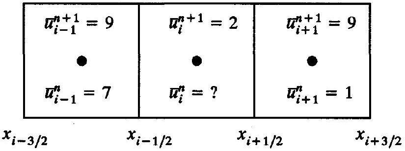
Problem 11.1

11.2 (a) Derive the following finite-difference approximation:

$$
\frac{u_{i}^{n+1}-u_{i}^{n}}{\Delta t}+\frac{-f\left(u_{i+2}^{n+1}\right)+8 f\left(u_{i+1}^{n+1}\right)-8 f\left(u_{i-1}^{n+1}\right)+f\left(u_{i-2}^{n+1}\right)}{12 \Delta x}=0 .
$$

(b) Draw the stencil diagram for this method. What are $L_{1}$ and $L_{2}$ ?
(c) Is this method conservative? If so, write the method in conservation form.
(d) Is this method implicit or explicit?
(e) What is the method's formal order of accuracy in time and space?
11.3 Consider the following numerical method:
$u_{i}^{n+1}-u_{i}^{n-1}=\frac{\lambda}{2}\left(u_{i+1}^{n}-u_{i-1}^{n}\right)\left(u_{i+1}^{n}+u_{i-1}^{n}\right)$.
Is this method central-time conservative as defined in Subsection 11.1.3? If so, write the method in central-time conservation form. What type of approximation is this? What scalar conservation law does it approximate?
11.4 The simplest averages are linear averages. Thinking of $\hat{f}_{i+1 / 2}^{n}$ as an average, suppose that $\hat{f}_{i+1 / 2}^{n}$ is a linear combination of $\left(f\left(\bar{u}_{i-K_{1}}^{n}\right), \ldots, f\left(\bar{u}_{i+K_{2}}^{n}\right)\right.$ ). Show that $\hat{f}_{i+1 / 2}^{n}$ is consistent with $f(u)$ if the linear combination is convex. Remember that, by definition, the coefficients in a convex linear combination are between zero and one, and the sum of the coefficients is equal to one.
11.5 Consider the following initial value problem for Burgers' equation:

$$
\begin{aligned}
& \frac{\partial u}{\partial t}+u \frac{\partial u}{\partial x}=0 \\
& u(x, 0)= \begin{cases}u_{L} & x<0 \\
u_{R} & x>0\end{cases}
\end{aligned}
$$

Notice that Burgers' equation is in characteristic rather than conservation form. Now consider the following finite-difference approximation:

$$
\begin{aligned}
& u_{i}^{n+1}=u_{i}^{n}-\lambda u_{i}^{n}\left(u_{i}^{n}-u_{i-1}^{n}\right), \\
& u_{i}^{0}= \begin{cases}u_{L} & i<0 \\
u_{R} & x \geq 0\end{cases}
\end{aligned}
$$

(a) Is this a conservative numerical approximation? If so, what is the conservative numerical flux $\hat{f}_{i+1 / 2}^{n}$ ?
(b) Assume that $u_{L}>u_{R}$, in which case the exact solution consists of a single steady shock. Does the numerical approximation yield correct shock speeds? Justify your answer using numerical results. Plot the exact versus the approximate solutions for at least two different choices of $u_{L}$ and $u_{R}$.
11.6 Consider the following two-step method:

$$
\begin{aligned}
& u_{i}^{(1)}=u_{i}^{n}-\frac{\lambda}{2}\left(f\left(u_{i+1}^{n}\right)-f\left(u_{i-1}^{n}\right)\right), \\
& u_{i}^{n+1}=u_{i}^{n}-\frac{\lambda}{4}\left(f\left(u_{i+1}^{n}\right)-f\left(u_{i-1}^{n}\right)\right)-\frac{\lambda}{4}\left(f\left(u_{i+1}^{(1)}\right)-f\left(u_{i-1}^{(1)}\right)\right) .
\end{aligned}
$$

(a) Derive this method using the method of lines. What is $\hat{f}_{s, i+1 / 2}^{n}$ ? Use an appropriate Runge-Kutta method for the time discretization.
(b) What is the formal order of accuracy of the method in time and space?
(c) Draw the stencil diagram. What are $K_{1}$ and $K_{2}$ ?
(d) Write the method in conservation form.
(e) Prove that the conservative numerical flux $\hat{f}_{i+1 / 2}^{n}$ is consistent with the physical flux $f(u)$.
11.7 In 1973, Boris and Book suggested a first-order upwind method for scalar conservation laws. In the original paper, the first-order upwind method was written in the following nonconservation form:
$u_{i}^{n+1}=\left(q_{i+1 / 2}^{+}+q_{i-1 / 2}^{-}\right) u_{i}^{n}+\frac{1}{2}\left(q_{i+1 / 2}^{+}\right)^{2}\left(u_{i+1}^{n}-u_{i}^{n}\right)-\frac{1}{2}\left(q_{i-1 / 2}^{-}\right)^{2}\left(u_{i}^{n}-u_{i-1}^{n}\right)$,
where

$$
\begin{aligned}
& q_{i+1 / 2}^{+}=\frac{\frac{1}{2}-\lambda a\left(u_{i}\right)}{1+\lambda\left(a\left(u_{i+1}\right)-a\left(u_{i}\right)\right)} \\
& q_{i+1 / 2}^{-}=\frac{\frac{1}{2}+\lambda a\left(u_{i+1}\right)}{1+\lambda\left(a\left(u_{i+1}\right)-a\left(u_{i}\right)\right)}
\end{aligned}
$$

Notice that restrictions such as $|\lambda a(u)|<\frac{1}{2}, 0 \leq \lambda a(u)<1$, or $-1<\lambda a(u) \leq 0$ will prevent zero denominators in the expressions for the coefficients $q^{+}$and $q^{-}$.
(a) Show that this method can be written in conservation form as follows:

$$
\begin{aligned}
& u_{i}^{n+1}=u_{i}^{n}-\left(\hat{f}_{i+1 / 2}^{n}-\hat{f}_{i-1 / 2}^{n}\right), \\
& \hat{f}_{i+1 / 2}^{n}=-\frac{1}{2}\left(q_{i+1 / 2}^{+}\right)^{2} u_{i+1}^{n}+\frac{1}{2}\left(q_{i+1 / 2}^{-}\right)^{2} u_{i}^{n} .
\end{aligned}
$$

As a helpful hint, notice that $q_{i+1 / 2}^{+}+q_{i+1 / 2}^{-}=1$.
(b) Show that this method is linear when applied to the linear advection equation.
(c) Show that the conservative numerical flux found in part (a) is consistent with the true flux if and only if the method is applied to the linear advection equation.
11.8 In Example 11.4, BTCS for the linear advection equation was written as a "periodic tridiagonal" linear system of equations. Similarly, write BTBS and BTFS in terms of "periodic bidiagonal" linear system of equations.
11.9 Suppose $\Delta x$ is not constant. Find expressions for FTFS, FTBS, FTCS, BTFS, BTBS, BTCS, CTFS, CTBS, and CTCS using the expressions given in Chapter 10. Is there any difference between the finite-volume and finite-difference expressions?
11.10 Consider the following linear advection problem on a periodic domain $[-1,1]$ :

$$
\begin{aligned}
& \frac{\partial u}{\partial t}+\frac{\partial u}{\partial x}=0 \\
& u(x, 0)= \begin{cases}1 & |x| \leq 1 / 3 \\
0 & |x|>1 / 3\end{cases}
\end{aligned}
$$

Approximate $u(x, 2)$ using the following methods:
(a) FTFS, FTBS, and FTCS;
(b) BTFS, BTBS, BTCS;
(c) CTFS, CTBS, CTCS.

In each case, let $\lambda=\Delta t / \Delta x=0.8$. Also, use 150,300 , and 600 evenly spaced grid points. Estimate the global order of accuracy using Equation (11.52). Repeat, substituting the 1 -norm for the $\infty$-norm in Equation (11.52). In each case, how does the global order of accuracy compare with the formal order of accuracy? Is there a relationship between stability and the global order of accuracy?
11.11 Subsection 11.2.1 described the method of lines for finite-difference methods. This problem concerns the method of lines for finite-volume methods.
(a) Let $t_{2} \rightarrow t_{1}$ in the integral form of any scalar conservation law to find the following integro-differential form:

$$
\frac{d}{d t} \int_{a}^{b} u(x, t) d t=-[f(u(b, t))-f(u(a, t))]
$$

(b) Apply the integro-differential form of the conservation law found in part (a) to each cell $\left[x_{i-1 / 2}, x_{i+1 / 2}\right]$ at time $t=t^{n}$ to obtain the following natural form for a conservative semidiscrete finite-volume method:

$$
\frac{d \bar{u}_{i}^{n}}{d t}=-\frac{\hat{f}_{s, i+1 / 2}^{n}-\hat{f}_{s, i-1 / 2}^{n}}{\Delta x}
$$

where

$$
\bar{u}_{i}^{n} \approx \frac{1}{\Delta x} \int_{x_{i-1 / 2}}^{x_{i+1 / 2}} u\left(x, t^{n}\right) d x
$$

and show that the semidiscrete conservative numerical flux is

$$
\hat{f}_{s, i+1 / 2}^{n} \approx f\left(u\left(x_{i+1 / 2}, t^{n}\right)\right) .
$$

