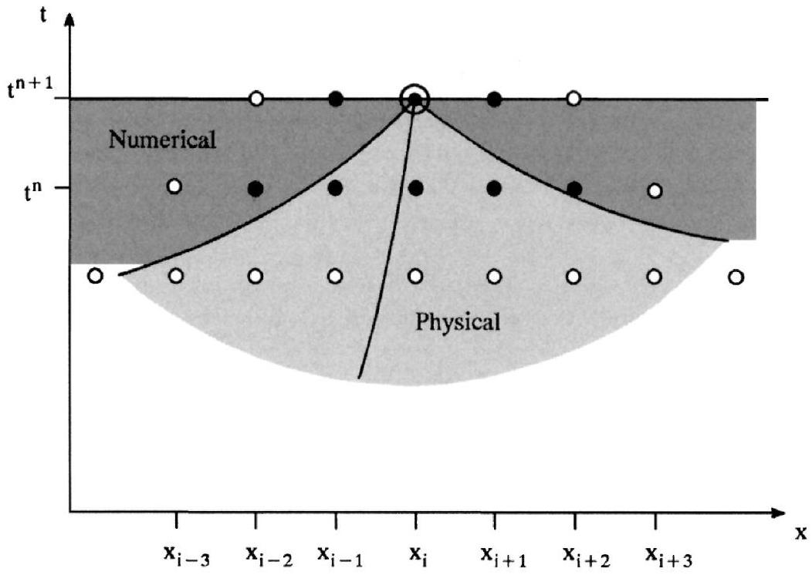
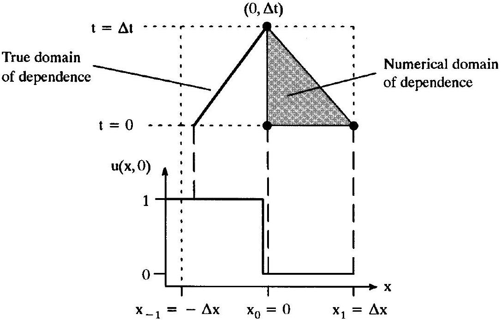
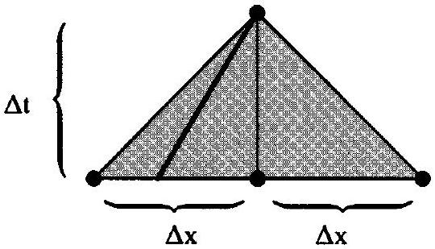
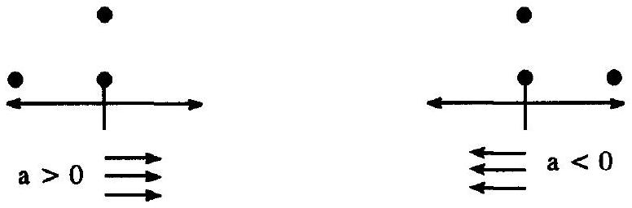
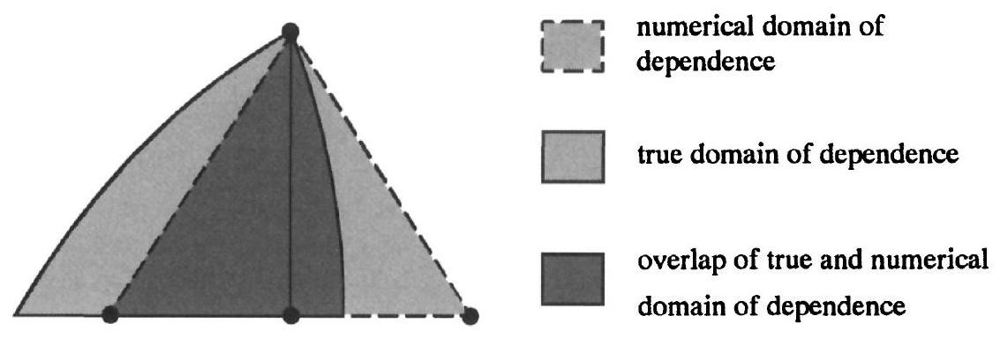

## The CFL Condition

### 12.0 Introduction

Waves imply finite physical domains of dependence, as discussed in Chapters 3 and 4. The last chapter introduced numerical domains of dependence. This chapter and the next flesh out the notion of numerical domains of dependence, and discuss the relationships between numerical and physical domains of dependence. This chapter and the next concern only finite-difference methods; however, the same principles apply to finite-volume methods, albeit with subtle modifications.

As seen in the Chapter 11, $u_{i}^{n+1}$ depends on the solution at discrete points collectively called the stencil or the direct numerical domain of dependence. For example, for a typical implicit method, $u_{i}^{n+1}$ depends on ( $u_{i-K_{1}}^{n}, \ldots, u_{i+K_{2}}^{n}$ ) and ( $u_{i-L_{1}}^{n+1}, \ldots, u_{i+L_{2}}^{n+1}$ ). Of course, each of these values depends on other values. For instance, $u_{i-K_{1}}^{n}$ depends on $\left(u_{i-2 K_{1}}^{n-1}, \ldots, u_{i-K_{1}+K_{2}}^{n-1}\right)$ and $\left(u_{i-K_{1}-L_{1}}^{n}, \ldots, u_{i-K_{1}+L_{2}}^{n}\right)$. The full or complete numerical domain of dependence of $u_{i}^{n+1}$ consists of ( $u_{i-K_{1}}^{n}, \ldots, u_{i+K_{2}}^{n}$ ) and ( $u_{i-L_{1}}^{n+1}, \ldots, u_{i+L_{2}}^{n+1}$ ) plus the points that these values depend upon.

Example 12.1 Sketch the direct and full numerical domains of dependence for an implicit finite-difference method with $K_{1}=K_{2}=2$ and $L_{1}=L_{2}=1$. For the Euler equations, compare the numerical domain of dependence with the physical domain of dependence for a typical subsonic right-running flow.

Solution Figure 12.1 contrasts typical physical and numerical domains of dependence. In particular, in Figure 12.1, the lightly shaded area is the physical domain of dependence of $u_{i}^{n+1}$ while the closed circles are the direct numerical domain of dependence of $u_{i}^{n+1}$. In Figure 12.1, the closed circles depend on the open circles. Similarly, the open circles depend on other circles, not shown, which depend on other circles, and so forth, until the circles dot the entire region beneath the line $t=t^{n+1}$. As a convenient definition, the numerical domain of dependence includes not only the discrete points but also the regions between the discrete points. Think of putting a rubber band around the outermost ring of points and considering everything inside the rubber band as part of the full numerical domain of dependence. Figure 12.1 represents the full numerical domain of dependence as the union of the lightly and darkly shaded regions. Then the full numerical domain of dependence contains the lightly shaded physical domain of dependence.

Consider the following condition:

> The full numerical domain of dependence must contain the physical domain of dependence.

This is called the Courant-Friedrichs-Lewyor (CFL) condition. Any numerical method that violates the CFL condition misses information affecting the true solution. If the missing

Figure 12.1 Numerical vs. physical domain of dependence.

information is critical, the numerical solution will deviate substantially from the true solution or, in the worst case, blow up to infinity. A method that violates the CFL condition is like a car with blind spots in its rearview mirrors, a horse with blinders on, or a person with tunnel vision, each of which can lead to serious accidents.

### 12.1 Scalar Conservation Laws

This section describes the CFL condition for scalar conservation laws, beginning with a series of examples.

Example 12.2 This example shows what can happen when a numerical method violates the CFL condition, thus missing vital information contained in the true domain of dependence but not in the numerical domain of dependence. Consider the following linear advection problem:

$$
\begin{aligned}
& \frac{\partial u}{\partial t}+a \frac{\partial u}{\partial x}=0, \\
& u(x, 0)= \begin{cases}1 & x<0, \\
0 & x \geq 0 .\end{cases}
\end{aligned}
$$

Assume that $a>0$. The exact solution is

$$
u(x, t)=u(x-a t, 0)= \begin{cases}1 & x-a t<0 \\ 0 & x-a t \geq 0\end{cases}
$$

The FTFS approximation is

$$
\begin{aligned}
& u_{i}^{n+1}=(1+\lambda a) u_{i}^{n}-\lambda a u_{i+1}^{n}, \\
& u_{i}^{0}=u(i \Delta x, 0)= \begin{cases}1 & i<0, \\
0 & i \geq 0,\end{cases}
\end{aligned}
$$

where $\lambda=\Delta t / \Delta x$. Then

$$
\begin{aligned}
& u_{i}^{1}= \begin{cases}1 & i \leq-2, \\
1+\lambda a & i=-1, \\
0 & i \geq 0,\end{cases} \\
& u_{i}^{2}= \begin{cases}1 & i \leq-3, \\
(1+\lambda a)(1-\lambda a) & i=-2, \\
(1+\lambda a)(1+\lambda a) & i=-1, \\
0 & i \geq 0,\end{cases}
\end{aligned}
$$

and so forth. As the first two time steps show, FTFS moves the jump in the wrong direction (left rather than right) and produces spurious oscillations and overshoots. Furthermore, the exact solution yields $u(0, \Delta t)=1$ whereas the FTFS approximation yields $u_{0}^{1}=0$ for any $\lambda$.

What explains the poor performance of FTFS in this example? As illustrated in Figure 12.2 , FTFS violates the CFL condition. In particular, at ( $0, \Delta t$ ), FTFS cannot see the jump discontinuity in the initial conditions. In other words, the true domain of dependence of ( $0, \Delta t$ ) contains only the value 1 , whereas the numerical domain of dependence of ( $0, \Delta t$ ) contains only the value 0 . After making the initial mistake, FTFS digs itself in deeper and deeper with every subsequent time step. In short, the radical differences between the true and numerical domains of dependence result in radical differences between the true and numerical solutions. In fact, FTFS generally blows up for positive wave speeds regardless

Figure 12.2 FTFS violates the CFL condition for positive wave speeds.

Figure 12.3 FTCS satisfies the CFL condition.

of initial conditions. Any scheme violating the CFL condition is unstable in the sense that it permits large errors, although CFL-violating schemes do not always blow up like FTFS.

Example 12.3 The CFL condition is necessary but not sufficient for stability. For example, consider FTCS. In the $t-x$ plane, the true domain of dependence is a line of slope $a$ whereas the numerical domain of dependence is the triangular region bounded by lines of slope $\pm \Delta x / \Delta t= \pm 1 / \lambda$. Cocking your head, in the $x-t$ plane, the true domain of dependence is a line of slope $1 / a$ while the numerical domain of dependence is the triangular region bounded by lines of slope $\pm \lambda$, as seen in Figure 12.3. Then FTCS satisfies the CFL condition for $-1 \leq \lambda a \leq 1$. Despite the fact that FTCS satisfies the CFL condition, FTCS almost always blows up, as seen in Example 11.3.

Example 12.4 Consider the implicit Euler (BTCS) method:

$$
u_{i}^{n+1}=u_{i}^{n}-\frac{\lambda}{2}\left(f\left(u_{i+1}^{n+1}\right)-f\left(u_{i-1}^{n+1}\right)\right) .
$$

The direct numerical domain of dependence of $u_{i}^{n+1}$ is $u_{i}^{n}, u_{i+1}^{n+1}$, and $u_{i-1}^{n+1}$. But $u_{i+1}^{n+1}$ depends on $u_{i+1}^{n}, u_{i+2}^{n+1}$ and $u_{i}^{n+1}$. In turn, $u_{i+2}^{n+1}$ depends on $u_{i+2}^{n}, u_{i+3}^{n+1}, u_{i+1}^{n+1}$, and so on. This iterative reasoning shows that $u_{i}^{n+1}$ depends on all of the grid points at time levels $n$ and $n+1$, which then depend on all the grid points at all earlier time levels. In other words, the full numerical domain of dependence of $u_{i}^{n+1}$ equals every grid point at every earlier time. Since the numerical domain of dependence for BTCS includes everything earlier, it certainly includes the physical domain of dependence. Thus BTCS always satisfies the CFL condition regardless of $\Delta x, \Delta t$, or $\lambda$.

For scalar conservation laws, the CFL condition translates into a simple inequality restricting the wave speed. For an explicit forward-time method, suppose that $u_{i}^{n+1}$ depends on ( $u_{i-K_{1}}^{n}, \ldots, u_{i+K_{2}}^{n}$ ). In the $x-t$ plane, the true domain of dependence is a line of slope $1 / a\left(u_{i}^{n}\right)$, while the numerical domain of dependence is a triangle bounded on the left by a line of slope $\Delta t /\left(K_{1} \Delta x\right)=\lambda / K_{1}$ and on the right by a line of slope $-\Delta t /\left(K_{2} \Delta x\right)=-\lambda / K_{2}$. Alternatively, in the $t-x$ plane, the true domain of dependence is a line of slope $a\left(u_{i}^{n}\right)$, while the numerical domain of dependence is a triangle bounded below by a line of slope $-K_{2} / \lambda$
and above by a line of slope $K_{1} / \lambda$. Then the CFL condition becomes

$$
-\frac{K_{2}}{\lambda} \leq a \leq \frac{K_{1}}{\lambda}
$$

or

$$
-K_{2} \leq \lambda a \leq K_{1} .
$$

Physically speaking, Equation (12.1) requires that waves travel no more than $K_{1}$ points to the right or $K_{2}$ points to the left during a single time step. If $K_{1}=K_{2}=K$, this becomes

$$
\quad \lambda|a| \leq K .
$$

Because of its intimate association with the CFL condition, $\lambda a$ is called the CFL number or the Courant number.

In Equations (12.1) and (12.2), $a$ usually depends on $u$. Then inequalities (12.1) and (12.2) depend on the solution's range. For example, consider Burgers' equation with $a(u)=u$. Suppose that $\left|u_{i}^{n}\right| \leq M$ for all $i$ and $n$. Then Equation (12.2) becomes $\lambda M \leq K$. Notice that the upper bound $K / M$ on $\lambda$ decreases as the upper bound $M$ on $\left|u_{i}^{n}\right|$ increases. Suppose that a numerical approximation of Burgers' equation overshoots, creating overly large values of $\left|u_{i}^{n}\right|$. Such an approximation suffers a "double whammy" of overshoots plus reduced CFL numbers and time steps. By contrast, the linear advection equation has a constant wave speed $a$. Then the CFL limit depends only on the stencil via $K$ and not on the numerical solution's range.

The true domain of dependence lies to the left if $a>0$ and to the right if $a<0$. Then the CFL condition implies $K_{1} \geq 1$ if $a>0$ and $K_{2} \geq 1$ if $a<0$. In other words, the CFL condition requires the minimum stencil $K_{1}=1, K_{2}=0$ for $a>0$ or $K_{1}=0, K_{2}=1$ for $a<0$. Figure 12.4 illustrates this minimum stencil, sometimes called an upwind stencil. The next chapter discusses minimum-width and other upwind stencils in detail.

Now consider the CFL condition for implicit methods. In particular, suppose that $u_{i}^{n+1}$ depends on $u_{i-K_{1}}^{n}, \ldots, u_{i+K_{2}}^{n}$ and $u_{i-L_{1}}^{n+1}, \ldots, u_{i+L_{2}}^{n+1}$. If $L_{1}>0$ and $L_{2}=0$ then the full numerical domain of dependence of $u_{i}^{n+1}$ includes everything to the left of $x=x_{i}$ and beneath $t=t^{n+1}$ in the $x-t$ plane. Similarly, if $L_{1}=0$ and $L_{2}>0$ then the full numerical domain of dependence of $u_{i}^{n+1}$ includes everything to the right of $x=x_{i}$ and beneath $t=t^{n+1}$ in the $x-t$ plane. Finally, if $L_{1}>0$ and $L_{2}>0$ then the full numerical domain of dependence of $u_{i}^{n+1}$ includes everything in the entire $x-t$ plane beneath $t=t^{n+1}$. In short, implicit methods avoid CFL restrictions by using the entire computational domain, provided that the stencil includes at least one point to the left and one to the right; this includes BTCS but not BTFS or BTBS. Of course, explicit methods can also reduce or avoid CFL restrictions by using large or infinite values of $K_{1}$ and $K_{2}$, so that $u_{i}^{n+1}$ depends on most or all of the points at time level $n$.

Figure 12.4 The smallest stencil allowed by the CFL condition.

This is a convenient time to compare implicit and explicit methods. As discussed in the last chapter, each time step in an implicit method costs much more than in an explicit method. On the other hand, lacking a CFL limit on the time step, implicit methods can take much larger time steps, bounded only by the desired time accuracy, and thus they can reach any given time in fewer time steps.

Consider a grid containing many large cells and a few small cells. For example, grids often cluster small cells near solid boundaries, shocks, and other high-gradient regions, which constitute only a small fraction of the total flow domain. For unsteady flows, the large cells in explicit approximations have to take a time step dictated by the few small cells. For example, for a symmetric explicit method, the CFL condition requires $\Delta t \leq \min \left(K|a| \Delta x_{i}\right)$. By contrast, implicit methods can take time steps as large as they like, constrained only by the fact that time accuracy decreases as the time step increases.

Consider again the case of a grid with a few small cells, but now think about steady-state calculations. In explicit methods, which no longer require time accuracy or synchronization, different cells can take different time steps, allowing the larger cells to use times steps proportional to their size. This is called local time stepping. While steadiness reduces the time-step restrictions on explicit methods, it has an even greater effect on implicit methods. Steadiness removes the only limitation on the time step - time accuracy - allowing implicit methods to take extremely large time steps relative to most explicit methods. Implicit methods commonly use CFL numbers ranging from the tens to the thousands on steady flows. In summary, explicit methods tend to take smaller cheaper time steps; implicit methods tend to take larger costlier time steps.

Chapters 15 and 16 discuss stability. Depending on your point of view, the CFL condition counts as a stability condition. However, when viewed in this way, the CFL condition is necessary but not sufficient for stability; numerical methods that satisfy the CFL condition may still blow up or exhibit other less drastic instabilities, as seen in Example 12.3. In general, other stability conditions are more restrictive than the CFL condition. In fact, like the CFL condition, many other stability conditions amount to bounds on the CFL number. For example, the CFL condition for an explicit centered method with a nine-point stencil is $|\lambda a| \leq 4$. However, another stability condition might require $|\lambda a| \leq 1$. The reader should resist the temptation to refer to all stability bounds on the CFL number as CFL conditions.

There is a trade-off between stability and the formal order of accuracy. Increased stencil width can increase the formal order of accuracy or increase the stability limits on the CFL number, but not both. Put another way, for a fixed stencil size, the stability limits tend to decrease as formal order of accuracy increases, and vice versa. This explains why a method with a nine-point stencil might operate under a stability restriction such as $|\lambda a| \leq 1$ : The wide stencil has increased the formal order of accuracy rather than increased the stability limits.

### 12.2 The Euler Equations

This section concerns vector conservation laws such as the Euler equations. The Euler equations have three families of waves that define the physical domain of dependence. For example, consider the method shown in Figure 12.5. This method violates the CFL condition, since the true domain of dependence is partly outside of the numerical domain of dependence.

Just like scalar conservation laws, the CFL condition for vector conservation laws implies a simple restriction on wave speeds. For an explicit method, suppose that $\mathbf{u}_{i}^{n+1}$ depends

Figure 12.5 A method for the Euler equations that violates the CFL condition.

on $\mathbf{u}_{i-K_{1}}^{n}, \ldots, \mathbf{u}_{i+K_{2}}^{n}$. In the $x-t$ plane, the true domain of dependence is the area bounded on the left by a characteristic curve of slope $1 /(u+a)$ and on the right by a characteristic curve of slope $1 /(u-a)$, while the numerical domain of dependence is a triangle bounded on the left by a line of slope $\Delta t /\left(K_{1} \Delta x\right)=\lambda / K_{1}$ and on the right by a line of slope $-\Delta t /\left(K_{2} \Delta x\right)=-\lambda / K_{2}$. Alternatively, in the $t-x$ plane, the true domain of dependence is the area bounded below by a characteristic curve of slope $u-a$ and above by a characteristic curve of slope $u+a$, while the numerical domain of dependence is a triangle bounded below by a line of slope $-K_{2} / \lambda$ and above by a line of slope $K_{1} / \lambda$. Then the CFL condition becomes

$$
\begin{aligned}
& -\frac{K_{2}}{\lambda} \leq u-a, \\
& u+a \leq \frac{K_{1}}{\lambda}
\end{aligned}
$$

or

$$
\begin{aligned}
& -K_{2} \leq \lambda(u-a), \\
& \lambda(u+a) \leq K_{1} .
\end{aligned}
$$

Physically speaking, Equation (12.3) requires that waves travel no more than $K_{1}$ points to the right or $K_{2}$ points to the left during a single time step.

Suppose that $K_{1}=K_{2}=K$. Also suppose $\rho(A)$ is the larger of $u-a$ and $u+a$ in absolute value, where $u-a$ and $u+a$ are the least and greatest characteristic values of $A$, and $A$ is the Jacobian matrix of the conservative flux vector. In general, for any matrix $A$, the quantity $\rho(A)$ is the largest characteristic value of $A$ in absolute value; $\rho(A)$ is sometimes called the spectral radius of $A$. Then the CFL condition becomes

$$
-\quad \lambda \rho(A) \leq K \text {. }
$$

Because of its intimate association with the CFL condition, $\lambda \rho(A)$ is called the CFL number or the Courant number.

For supersonic flows, all waves travel in the same direction, either left or right. Then the minimum stencil allowed by the CFL condition contains either $\mathbf{u}_{i-1}^{n}$ and $\mathbf{u}_{i}^{n}$ for right-running supersonic flow or $\mathbf{u}_{i}^{n}$ and $\mathbf{u}_{i+1}^{n}$ for left-running supersonic flow. For subsonic flows, waves travel in both directions, and the minimum stencil always contains $\mathbf{u}_{i-1}^{n}, \mathbf{u}_{i}^{n}$, and $\mathbf{u}_{i+1}^{n}$. The other observations from the last section, including the contrast between explicit and implicit methods, carry over to vector conservation laws essentially unchanged.

Example 12.5 For subsonic flow, both FTFS and FTBS violate the CFL condition. Although FTFS satisfies the CFL condition for at least one family of waves, it also violates the CFL condition for at least one other family of waves. The same is true of FTBS. However, FTBS satisfies the CFL condition for supersonic right-running flow, whereas FTFS satisfies the CFL condition for supersonic left-running flow.

## References

Courant, R., Friedrichs, K. O., and Lewy, H. 1928. "Uber die Partiellen Differenzengleichungen der Mathematisches Physik," Math. Ann., 100: 32-74. English translation, 1967. "On the Partial Difference Equations of Mathematical Physics," IBM Journal, 11: 215-234.

## Problems

12.1 Find the direct numerical domain of dependence, the full numerical domain of dependence, and the CFL condition for the following numerical approximations of scalar conservation laws:
(a) $\frac{u_{i}^{n+1}-u_{i}^{n}}{\Delta t}+\frac{-f\left(u_{i+2}^{n+1}\right)+8 f\left(u_{i+1}^{n+1}\right)-8 f\left(u_{i-1}^{n+1}\right)+f\left(u_{i-2}^{n+1}\right)}{12 \Delta x}=0$
(b) $u_{i}^{n+1}=u_{i}^{n}-\frac{\lambda}{2}\left(-f\left(u_{i+2}^{n}\right)+4 f\left(u_{i+1}^{n}\right)-3 f\left(u_{i}^{n}\right)\right)$
(c) $u_{i}^{n+1}=u_{i}^{n+1}-\frac{\lambda}{2}\left(-f\left(u_{i+2}^{n+1}\right)+4 f\left(u_{i+1}^{n+1}\right)-3 f\left(u_{i}^{n+1}\right)\right)$
12.2 Find the CFL condition for the following numerical approximations of the Euler equations:
(a) $\frac{\mathbf{u}_{i}^{n+1}-\mathbf{u}_{i}^{n}}{\Delta t}+\frac{-\mathbf{f}\left(\mathbf{u}_{i+2}^{n+1}\right)+8 \mathbf{f}\left(\mathbf{u}_{i+1}^{n+1}\right)-8 \mathbf{f}\left(\mathbf{u}_{i-1}^{n+1}\right)+\mathbf{f}\left(\mathbf{u}_{i-2}^{n+1}\right)}{12 \Delta x}=0$
(b) $\mathbf{u}_{i}^{n+1}=\mathbf{u}_{i}^{n}-\frac{\lambda}{2}\left(-\mathbf{f}\left(\mathbf{u}_{i+2}^{n}\right)+4 \mathbf{f}\left(\mathbf{u}_{i+1}^{n}\right)-3 \mathbf{f}\left(\mathbf{u}_{i}^{n}\right)\right)$
(c) $\mathbf{u}_{i}^{n+1}=\mathbf{u}_{i}^{n}-\frac{\lambda}{2}\left(-\mathbf{f}\left(\mathbf{u}_{i+2}^{n+1}\right)+4 \mathbf{f}\left(\mathbf{u}_{i+1}^{n+1}\right)-3 \mathbf{f}\left(\mathbf{u}_{i}^{n+1}\right)\right)$
12.3 Consider the following vector conservation law:

$$
\begin{aligned}
& \frac{\partial \mathbf{u}}{\partial t}+\frac{\partial \mathbf{f}(\mathbf{u})}{\partial x}=0 \\
& \mathbf{u}=\left[\begin{array}{l}
u_{1} \\
u_{2} \\
u_{3}
\end{array}\right], \quad \mathbf{f}(\mathbf{u})=\left[\begin{array}{c}
u_{2} \\
u_{3} \\
4 u_{1}-17 u_{2}+8 u_{3}
\end{array}\right] .
\end{aligned}
$$

(a) Suppose that an explicit numerical approximation to this system of partial differential equations has a centered stencil containing $2 \boldsymbol{K}+1$ points. Find the CFL condition.
(b) Suppose that an uncentered explicit approximation has a stencil containing $K_{1}$ points to the left and $K_{2}$ points to the right. Find the CFL condition.

