## Upwind and Adaptive Stencils

### 13.0 Introduction

This chapter describes the basic principles of stencil selection. To keep the discussion to a reasonable length, the focus will be on explicit finite-difference methods, except for the last section, which concerns explicit finite-volume methods. Some methods blindly choose the same stencil regardless of circumstances, including the nine simple methods seen in Chapter 11. However, this naive simplicity exacts a toll on accuracy, stability, or both. This chapter introduces methods with adjustable stencils, also called adaptive or solution-sensitive stencils. This chapter provides only an introduction; a full account will have to wait until later, especially Chapter 18 and Part V.

The governing principles of adjustable stencil selection are as follows:

- The numerical domain of dependence should model the physical domain of dependence. For example, the physical domain of dependence always lies entirely upwind; in other words, the physical domain of dependence lies to the right for left-running waves and to the left for right-running waves. Upwind stencils model this physical behavior by using only upwind points or, at least, more upwind than downwind points. However, in some cases, centered methods using equal numbers of upwind and downwind points actually model the physical domain of dependence better than upwind methods, as discussed below. Even downwind-biased stencils may provide good enough modeling, providing that they contain at least one upwind point; as seen in the last chapter, the CFL condition requires that every stencil contain at least one upwind point.
- The numerical domain of dependence should avoid shocks and contacts whenever possible. As seen in Part II, jump discontinuities can severely disrupt the component approximations, and the combinations used in computational gasdynamics sometimes further magnify the disruption.

Sections 13.1 and 13.2 describe general principles for upwind and adaptive stencil selection. The other four sections in this chapter introduce standard design techniques used to implement the principles seen in the first two sections. Section 13.3 introduces fluxaveraging techniques including flux limiting, flux correction, and self-adjusting hybrids. Flux averaging addresses the second principle of stencil selection, repelling stencils from shocks and onto smooth solution regions. Sections 13.4 and 13.5 introduce flux splitting and wave speed splitting, respectively. Flux splitting and wave speed splitting address the first principle of stencil selection - they introduce upwinding, at least enough to satisfy the CFL condition. Many methods combine flux averaging and flux splitting, with flux averaging used to avoid shocks and to enforce nonlinear stability conditions, and flux splitting used for upwinding and/or to enforce the CFL condition. Finally, Section 13.6, introduces reconstruction-evolution, an alternative way to address the two principles of
stencil selection. The reconstruction stage allows numerical methods to avoid shocks, while the evolution stage introduces upwinding, at least enough to satisfy the CFL condition. Finite-difference methods traditionally use flux averaging and flux splitting, whereas finitevolume methods traditionally use reconstruction-evolution. Although flux splitting, wave speed splitting, and reconstruction-evolution start out trying to model physical waves, they often end up as artificial numerical constructs. For example, reconstruction-evolution methods often use partially unphysical approximate Riemann solvers, such as those seen in Chapter 5, rather than the true Riemann solver, to improve efficiency and numerical accuracy.

### 13.1 Scalar Conservation Laws

There are only two directions in one-dimension - left and right. Rather than using left or right, we shall often specify directions relative to the wind. In particular, for rightrunning waves, right is the downwind direction and left is the upwind direction; similarly, for left-running waves, left is the downwind direction and right is the upwind direction. A numerical stencil contains more points to the right, more points to the left, or an equal number of points to the right and left. Equivalently, a stencil contains more points in the upwind direction, more points in the downwind direction, or an equal number of points in the upwind and downwind directions. Then every numerical approximation to a scalar conservation law belongs in one of three categories:

> Centered: The stencil contains equal numbers of points in both directions.
> Upwind: The stencil contains more points in the upwind direction.
> Downwind: The stencil contains more points in the downwind direction.

Notice that, as defined here, upwind methods need not use upwind points exclusively; they can use downwind points provided that they do not outnumber the upwind points. Some people use the terms upwind-biased or upstream in place of upwind, the terms downwindbiased or downstream in place of downwind, and the term symmetric in place of centered.

Example 13.1 Categorize the methods seen in Chapter 11 as upwind, downwind, or centered. Comment on any correlations between upwinding and stability.

Solution The central-space methods FTCS, BTCS, and CTCS are centered. The backward-space methods FTBS, BTBS, and CTBS are upwind if $a>0$ and downwind if $a<0$. The forward-space methods FTFS, BTFS, and CTFS are upwind if $a<0$ and downwind if $a>0$.

Now consider the correlations between upwinding and stability. FTBS, FTFS, BTBS, and BTFS are unstable when they are downwind and stable when they are upwind, at least for small enough CFL numbers, as seen in Chapter 11. In contrast, CTBS and CTFS are highly unstable regardless of whether they are upwind or downwind and regardless of the CFL number. Turning to the centered methods, FTCS is unconditionally unstable, BTCS is unconditionally stable, and CTCS is stable for small enough CFL numbers. It seems that upwinding tends to enhance stability, at least for very simple methods with forward- or backward-time stepping.

Upwind and downwind stencils belong in the general category of adjustable or adaptive or solution-sensitive stencils. Upwind and downwind methods test for wind direction and then, based on the results of that test, select either a right- or left-biased stencil. Other adjustable stencils use other selection criteria in addition to wind direction, such as nonlinear stability conditions and first or second differences of the solution, which may indicate the presence of shocks or other large derivatives. Some methods always use the same fixed stencil regardless of shocks, wind direction, or other solution features, making them inherently simpler and less costly. However, intelligently designed adaptive stencils yield benefits far outweighing their increased complexity and cost.

As a class, upwind methods have an excellent reputation for shock capturing. This reputation stems mainly from the observations made in the last example. In other words, among very simple forward- or backward-time methods, upwind methods dramatically outdo centered methods. However, looking beyond such elementary examples, higher-order upwind methods often have no special advantages over higher-order centered methods. Specifically, upwind stencils may or may not model the true domain of dependence better than symmetric stencils. Furthermore, upwind stencils may or may not enhance accuracy or stability in the presence of shocks as compared with symmetric stencils. As one ingredient in their success, upwind methods absolutely must model wave physics, at least enough to determine wave directions; however, although not forced to, centered methods can also model waves in many of the same ways as traditional upwind methods using, for example, Riemann solvers, to obtain similar benefits. Therefore, when reading this chapter, make sure to distinguish between upwinding and other ways of modeling wave physics.

The rest of this section compares upwind, downwind, and centered methods for scalar conservation laws. As the first basis of comparison, consider the relationship between the physical and numerical domains of dependence. A numerical method is called physical if the numerical domain of dependence closely models the physical domain of dependence.

Example 13.2 Consider an explicit approximation to $\left(x_{i}, t^{n+1}\right)$. Find the most physical two-point stencil for a smooth solution if $\lambda|a| \leq 1$.

Solution We wish to choose the two points at time level $n$ closest to the domain of dependence of ( $x_{i}, t^{n+1}$ ). For $0 \leq \lambda a \leq 1$, the answer is ( $x_{i}, t^{n}$ ) and ( $x_{i-1}, t^{n}$ ), as illustrated in Figure 13.1. Similarly, for $-1 \leq \lambda a \leq 0$, the answer is ( $x_{i}, t^{n}$ ) and ( $x_{i+1}, t^{n}$ ). In either case, the best stencil is the upwind stencil. Although still relatively close to the physical domain of dependence, the two-point downwind stencil seen in Figure 13.1 violates the CFL condition, making it unacceptably unphysical.

The two-point upwind stencil models the physical domain of dependence better than any other stencil - additional points beyond the two must lie relatively distant from the physical domain of dependence. On the other hand, as seen in Part II, two point approximations only have first-order accuracy at best; second-order accuracy requires at least three points as in the next example.

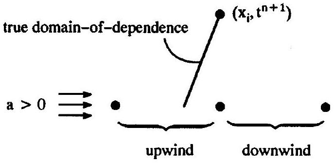
Figure 13.1 The true domain of dependence is always upwind.

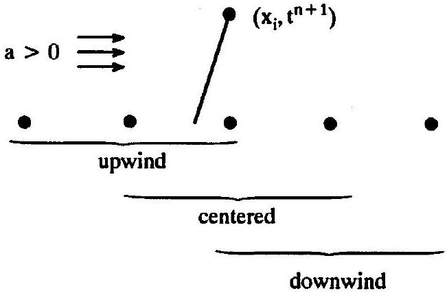
Figure 13.2 Upwind, downwind, and centered three-point stencils.

Example 13.3 Consider an explicit approximation to ( $x_{i}, t^{n+1}$ ). Find the most physical three-point stencil for a smooth solution if $\lambda|a| \leq 3 / 2$.

Solution We must choose the three points at time level $n$ closest to the domain of dependence of $\left(x_{i}, t^{n+1}\right)$. For $-1 / 2 \leq \lambda a \leq 1 / 2$, the answer is the centered stencil $\left(x_{i-1}, t^{n}\right),\left(x_{i}, t^{n}\right),\left(x_{i+1}, t^{n}\right)$, as illustrated in Figure 13.2. For $1 / 2 \leq \lambda a \leq 3 / 2$, the answer is the upwind stencil $\left(x_{i-2}, t^{n}\right),\left(x_{i-1}, t^{n}\right),\left(x_{i}, t^{n}\right)$. Finally, for $-3 / 2 \leq \lambda a \leq-1 / 2$, the answer is the upwind stencil $\left(x_{i}, t^{n}\right),\left(x_{i+1}, t^{n}\right),\left(x_{i+2}, t^{n}\right)$. Thus, for a three-point stencil, the upwind stencil always lies closest to the true domain of dependence for $1 / 2 \leq \lambda|a| \leq 3 / 2$, and the centered stencil always lies closest to the true domain of dependence for $\lambda|a| \leq 1 / 2$; the downwind stencil seen in Figure 13.2 always lies furthest from the true domain of dependence. More importantly, the centered stencil satisfies the CFL condition for $\lambda|a| \leq 1$, the upwind stencil satisfies the CFL condition for $\lambda|a| \leq 2$, whereas the downwind stencil never satisfies the CFL condition. This comparison favors centered methods for smaller CFL numbers, upwind methods for larger CFL numbers, and completely rejects the downwind stencil.

How do you justify using points relatively distant from the true domain of dependence, as in the last example? Beyond practical considerations such as the order of accuracy, consider this: whereas the true solution sees everything within the true domain of dependence,
finite-difference approximations see only discrete samples within the numerical domain of dependence. Thus it only makes good sense to supplement this spotty view with points from outside the true domain of dependence. In smooth regions, points outside the true domain of dependence often contain valuable information about the solution inside the true domain of dependence, much in the same way that Taylor series can use the behavior of a smooth function at a single point to characterize the entire function, although, of course, the quality of the information decreases with distance from the point.

In general, for odd-width stencils, either the centered or an upwind stencil lies closest to the true domain of dependence, depending on the CFL number. Stencils with two, four, six, and other even widths do not allow centered stencils; thus an upwind stencil is closest to the true domain of dependence. Although downwind stencils are never as close to the true domain of dependence as the centered or the best upwind stencil, downwind stencils may still prove acceptable provided that they contain at least one upwind point and thus satisfy the CFL condition for small enough CFL numbers, which can occur for stencil widths of four or larger.

Wider stencils allow large time steps, higher orders of accuracy, or both. However, for wider stencils, the numerical domain of dependence may deviate substantially from the true domain of dependence, making the method less physical, at least in this sense. Furthermore, as a practical matter, a large numerical domain of dependence runs the risk of overlapping shocks that lie well outside the true domain of dependence. As seen repeatedly in Part II, shocks tend to cause large spurious oscillations, especially as the number of points in the approximation increases. Points on either side of a shock contain almost no information about each other, at least not without invoking the Rankine-Hugoniot relations, and any attempts to use points on the other side of a shock typically result in large oscillatory errors. Thus wide stencils potentially face a shock-capturing "double whammy": an increased risk of overlapping a shock and an increased error when they do.

Example 13.4 How does the answer to Example 13.3 change in the presence of shocks?
Solution To start with, suppose that the wind changes direction across a shock, which typically occurs at steady and slowly moving shocks. As seen in Figure 13.3, the upwind stencils always lie entirely to one side of the shock, whereas the centered stencils contain points on both sides of the shock. In this special case, the upwind stencil is clearly superior. But suppose the shock does not reverse the wind direction. As seen in Figure 13.4, an upwind stencil to the left of the shock avoids the shock, while a downwind stencil to the right of the shock avoids the shock. To summarize, unless shocks reverse the wind direction, upwinding does not ensure shock avoidance. In general, to avoid shocks, a method should have a leftward bias to the left of shocks and a rightward bias to the right of shocks, regardless of whether the upwind direction is left or right. Of course, the downwind stencil seen in Figure 13.4 violates the CFL condition, which generally creates larger errors than crossing the shock would. In general, the stencil must contain at least one upwind point, even when that upwind point causes the stencil to cross shocks.

This section indicates that centered methods sometimes outperform upwind methods both in terms of physicality and accuracy. The ENO methods discussed in Section 23.5 incorporate the principles described above, often selecting centered or downwind stencils

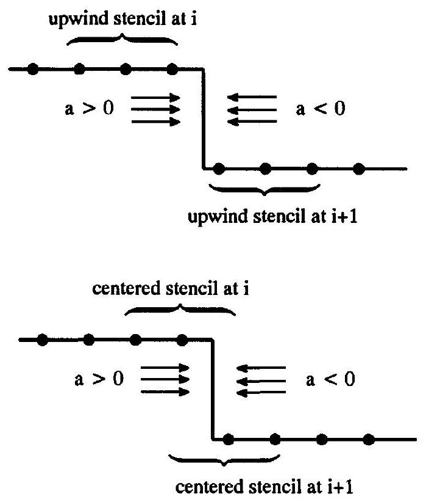
Figure 13.3 Upwind versus centered stencils at steady or slowly moving shocks containing compressive sonic points.

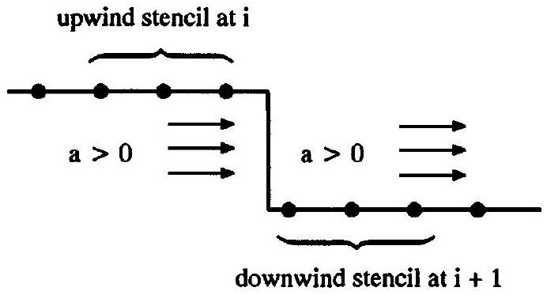
Figure 13.4 For steady shocks, upwind stencils avoid the shock on one side whereas downwind stencils avoid the shock on the other side.

over upwind stencils. For those still reluctant to give up their belief in the inherent superiority of upwind methods, consider the classic centered Lax-Wendroff method versus the BeamWarming second-order upwind method, which basically differ only in their choice of stencil. As seen in Chapter 17, the centered Lax-Wendroff method outperforms the Beam-Warming method, at least for scalar conservation laws. The opposite holds true for the Euler equations, but remember that the Beam-Warming second-order upwind method for the Euler equations uses flux splitting or some other trick to separate the different families of waves, whereas the Lax-Wendroff method does not, and that gives the Beam-Warming method the edge, rather than its stencil's bias direction.

As a final point, an approximation cannot use points that do not exist (i.e., points lying outside of the computational domain). For example, a stencil must always have a leftward bias near a right-hand boundary, regardless of whether left is the upwind or downwind direction. This is discussed further in Chapter 19.

In conclusion, starting with the minimum two-point upwind stencil, adjustable stencils should select additional points symmetrically or nearly symmetrically in smooth regions, and otherwise select points to stay away from boundaries, shocks, contacts, and other steep gradients to the extent allowed by the CFL condition.

### 13.2 The Euler Equations

The last section concerned scalar conservation laws. This section briefly concerns vector conservation laws such as the Euler equations. The Euler equations have three families of waves. Subsonic flows have both right- and left-running waves of waves, which complicates the concept of upwinding. An upwind method must somehow decompose the solution into component waves, approximating the right-running waves with a leftward bias and the left-running waves with a rightward bias. However, the differential equations $d v_{i}=0$ and $d x=\lambda_{i} d t$ appearing in the characteristic form of the Euler equations do not have analytic solutions, except for simple waves. Thus, rather than attempting to access characteristics directly through the characteristic form, most vector upwind methods access characteristics indirectly using techniques such as flux vector splitting or Riemann solvers. Unlike upwind methods, symmetric methods do not need to access characteristics using Riemann solvers or flux vector splitting; however, separately approximating characteristic families may yield improvements regardless of upwind stencil bias. Do not confuse upwinding with devices for separating different families of characteristics. As used in this book, upwinding refers only to the bias direction of the stencil. Upwind and downwind methods must separate characteristic families; centered methods may or may not.

### 13.3 Introduction to Flux Averaging

Up until now, this chapter has concerned general principles for upwind and adaptive stencil selection. The remainder of the chapter briefly introduces important techniques for designing numerical methods with upwind and adaptive stencils based on these principles. This section concerns flux averaging, a technique commonly used to avoid shocks. Flux averaging starts with two or more established methods, then chooses one of the methods, or averages the methods, varying the choice or average based on the divided differences of the solution. The following example shows why flux averaging works better for shock avoidance than for upwinding.

Example 13.5 Design a first-order upwind method for the linear advection equation that chooses between FTBS and FTFS.

Solution For $a>0$, FTFS is highly unstable, so use FTBS. Conversely, for $a<0$, FTBS is highly unstable, so use FTFS. A first-order upwind method for the linear advection equation is

$$
u_{i}^{n+1}=u_{i}^{n}-\lambda a \begin{cases}u_{i}^{n}-u_{i-1}^{n} & \text { for } a>0, \\ u_{i+1}^{n}-u_{i}^{n} & \text { for } a<0 .\end{cases}
$$

This is sometimes called the Courant-Isaacson-Rees (CIR) method, after the authors of a 1952 paper. However, this book will usually refer to it using the longer but more descriptive phrase the first-order upwind method for the linear advection equation.

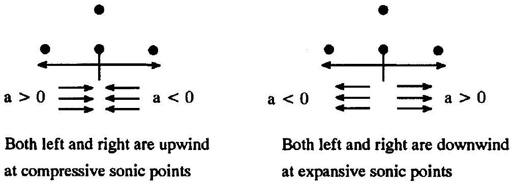
Figure 13.5 Problems with upwind methods at sonic points.

The above approach is problematic for nonlinear scalar conservation laws and vector conservation laws. For nonlinear scalar conservation laws, suppose that the wind direction changes from right to left; this occurs at compressive sonic points. Then both FTBS and FTFS are upwind. However, suppose that the wind direction changes from left to right, which occurs at expansive sonic points. Then both FTBS and FTFS are downwind. This is illustrated in Figure 13.5. As seen later in the book, expansive sonic points often cause numerical troubles, such as expansion shocks. Fortunately, most methods handle compressive sonic points with aplomb. For vector conservation laws, such as the Euler equations, the winds run in both directions in subsonic flow, even away from sonic points. Then both FTBS and FTFS violate the CFL condition, and either choice is unstable. In general, flux averaging fails whenever the component methods all share the same flaw. In this specific example, the flux averaging fails when both FTFS and FTBS are unstable, which occurs when waves travel in both directions, either because there are multiple families of waves traveling in both directions or because a single family of waves switches directions at a sonic point.

Rather than choosing one method or the other, as in the last example, why not compromise on something somewhere between the two? A flux average can be written in the following form:

$$
\hat{f}_{i+1 / 2}^{n}=\operatorname{avg}_{i+1 / 2}^{n}\left(\hat{f}_{i+1 / 2}^{(1)}, \hat{f}_{i+1 / 2}^{(2)}\right),
$$

where $a v g_{i+1 / 2}^{n}$ is any averaging function, $\hat{f}_{i+1 / 2}^{(1)}$ is the conservative numerical flux of a numerical method such as a first-order upwind method with a two-point stencil, and $\hat{f}_{i+1 / 2}^{(2)}$ is the conservative numerical flux of another method such as a second-order centered method. The subscripts and superscripts on the averaging function $a v g_{i+1 / 2}^{n}$ indicate that it might depend on time and space, usually via first- or second-divided differences of the solution $u_{i}^{n}$. Flux-averaged methods typically do two things: (1) They choose an appropriate stencil by choosing between first- and second-order accurate methods and ( 2 ) they enforce nonlinear stability conditions such as those discussed in Chapter 16. For example, flux averaging leads directly to the popular TVD methods, which use the freedom of flux averaging to enforce the nonlinear stability conditions seen in Sections 16.2, 16.3, 16.4, or 16.5.

There are many different ways to write the same average. As a simple example, consider

$$
\frac{1}{2}(x+y)=x+\frac{1}{2}(y-x)=y-\frac{1}{2}(y-x) .
$$

In the first expression, the average is written as a linear combination of $x$ and $y$. In the second expression, the average is written as $x$ plus a correction based on the difference $y-x$. In the third expression, the average is written as $y$ plus a correction based on the difference $y-x$. Despite the superficial differences, the average is always the same.

Let us now consider some specific flux-averaging notations. To start with, consider the following flux average:

$$
\operatorname{avg}_{i+1 / 2}^{n}(x, y)=\theta_{i+1 / 2}^{n} x+\left(1-\theta_{i+1 / 2}^{n}\right) y .
$$

In other words,

$$
\hat{f}_{i+1 / 2}^{n}=\theta_{i+1 / 2}^{n} \hat{f}_{i+1 / 2}^{(1)}+\left(1-\theta_{i+1 / 2}^{n}\right) \hat{f}_{i+1 / 2}^{(2)} .
$$

If $0 \leq \theta_{i+1 / 2}^{n} \leq 1$ then $\hat{f}_{i+1 / 2}$ is called a linear average, a linear interpolation, or a convex linear combination of $\hat{f}_{i+1 / 2}^{(1)}$ and $\hat{f}_{i+1 / 2}^{(2)}$. The convexity condition $0 \leq \theta_{i+1 / 2}^{n} \leq 1$ ensures the following reasonable condition:

$$
\min \left(\hat{f}_{i+1 / 2}^{(1)}, \hat{f}_{i+1 / 2}^{(2)}\right) \leq \hat{f}_{i+1 / 2}^{n} \leq \max \left(\hat{f}_{i+1 / 2}^{(1)}, \hat{f}_{i+1 / 2}^{(2)}\right) .
$$

Thus $\hat{f}_{i+1 / 2}$ is always somewhere between $\hat{f}_{i+1 / 2}^{(1)}$ and $\hat{f}_{i+1 / 2}^{(2)}$. In this context, the averaging parameter $\theta_{i+1 / 2}^{n}$ is sometimes called a shock switch and the averaged method is sometimes called a self-adjusting hybrid method. This form of flux averaging was first suggested by Harten and Zwas (1972). For more details on self-adjusting hybrids and shock switches, see Chapter 22.

An equivalent way to write Equation (13.2a) is as follows:

$$
\operatorname{avg}_{i+1 / 2}^{n}(x, y)=x+\phi_{i+1 / 2}^{n}(y-x),
$$

where $\phi_{i+1 / 2}^{n}=1-\theta_{i+1 / 2}^{n}$. In other words;

$$
\hat{f}_{i+1 / 2}^{n}=\hat{f}_{i+1 / 2}^{(1)}+\phi_{i+1 / 2}^{n}\left(\hat{f}_{i+1 / 2}^{(2)}-\hat{f}_{i+1 / 2}^{(1)}\right) .
$$

In this context, the averaging parameter $\phi_{i+1 / 2}^{n}$ is sometimes called a flux limiter and the averaged method is sometimes called a flux-limited method. This form of flux averaging was first suggested by Van Leer (1974), although his notation differs somewhat. For more details on flux-limited methods, see Chapter 20.

In many cases, the averaging function is exchanged for a differencing function. Specifically,

$$
\operatorname{avg}_{i+1 / 2}^{n}(x, y)=x+\operatorname{diff}_{i+1 / 2}^{n}(x, y)
$$

For example, suppose that

$$
\operatorname{diff}_{i+1 / 2}^{n}(x, y)=\phi_{i+1 / 2}^{n}(y-x)
$$

where $\phi_{i+1 / 2}^{n}$ is a flux limiter. Then let

$$
\hat{f}_{i+1 / 2}^{(\mathrm{C})}=\operatorname{diff}_{i+1 / 2}^{n}\left(\hat{f}_{i+1 / 2}^{(1)}, \hat{f}_{i+1 / 2}^{(2)}\right)=\phi_{i+1 / 2}^{n}\left(\hat{f}_{i+1 / 2}^{(2)}-\hat{f}_{i+1 / 2}^{(1)}\right) .
$$

Then we have

$$
\hat{f}_{i+1 / 2}^{n}=\hat{f}_{i+1 / 2}^{(1)}+\hat{f}_{i+1 / 2}^{(\mathrm{C})}=\hat{f}_{i+1 / 2}^{(1)}+\operatorname{diff}_{i+1 / 2}^{n}\left(\hat{f}_{i+1 / 2}^{(1)}, \hat{f}_{i+1 / 2}^{(2)}\right) .
$$

In this context, $\hat{f}_{i+1 / 2}^{(\mathrm{C})}$ is called a flux-correction and the averaged method is called a fluxcorrected method. This form of flux averaging was first proposed by Boris and Book (1973). For more details on flux-corrected methods, see Chapter 21. Equation (13.5) is exactly the same as Equations (13.2) and (13.3), although Equations (13.2) and (13.3) are phrased in terms of averages, whereas Equation (13.5) is phrased in terms of differences. In fact, despite the differences in terminology and form, there is no fundamental distinction between any of the flux averages or flux differences seen above. Despite similar starting points, traditional distinctions have arisen between self-adjusting hybrid, flux-limited, and fluxcorrected methods in terms of their component methods, their averaging or differencing functions, their extension from scalar conservation laws to the Euler equations, sonic point treatments, stability treatments, and so forth, as discussed in Chapters 20, 21, and 22.

### 13.4 Introduction to Flux Splitting

As seen in the last section, flux averaging can generate sophisticated new methods from established simple methods. But where do these "simple methods" come from? Specifically, most flux-averaging methods use upwind methods but, as seen in Example 13.5, flux averaging itself does not naturally generate upwind methods. This section and the next concern classic splitting techniques for constructing finite-difference upwind methods. Many methods combine flux averaging and flux splitting, using flux splitting to ensure that a stencil has the minimum amount of upwinding required by the CFL condition, and using flux averaging to further adapt the stencil to avoid shocks.

The flux and wave descriptions of gas flows pull numerical methods in two different directions. On the one hand, numerical methods must use fluxes to satisfy conservation as described in Chapters 2 and 11. On the other hand, numerical methods must use waves to satisfy the CFL condition as described in Chapters 3 and 12. Since numerical methods must use both descriptions, they need a simple way to transition from fluxes to waves. Imagine that right-running waves cause flux $f^{+}$and left-running waves cause flux $f^{-}$such that

$$
f(u)=f^{+}(u)+f^{-}(u)
$$

and

$$
\frac{d f^{+}}{d u} \geq 0, \quad \frac{d f^{-}}{d u} \leq 0 .
$$

This is called flux splitting. For the Euler equations, the flux vector derivatives yield Jacobian matrices, and the inequalities refer to the signs of the characteristic values of the Jacobian matrices. Written in terms of flux splitting, the governing conservation law becomes

$$
\frac{\partial u}{\partial t}+\frac{\partial f^{+}}{\partial x}+\frac{\partial f^{-}}{\partial x}=0,
$$

which is called the flux split form. Then $\partial f^{+} / \partial x$ can be discretized conservatively using at least one point on the left, and $\partial f^{-} / \partial x$ can be discretized conservatively using at least one point on the right, thus obtaining conservation and the CFL condition.

Unfortunately, flux splitting cannot describe the true relationship between fluxes and waves unless all waves run in the same direction. Specifically, when all the waves are right-running, the unique physical flux splitting is $f^{+}=f$ and $f^{-}=0$. Similarly, when
all the waves are left-running, the unique physical flux splitting is $f^{-}=f$ and $f^{+}=0$. However, waves only run in the same direction away from sonic points in scalar conservation laws, and for supersonic flows in the Euler equations. Near sonic points, or for subsonic flows, flux splitting is necessarily somewhat artificial. Even when a physical flux splitting exists, there may be compelling numerical reasons to use something else. In summary, flux splitting may yield successful numerical methods even when based on fantasy relationships between fluxes and waves. This section concerns flux splitting for scalar conservation laws. Section 18.2 describes flux splitting for the Euler equations.

Example 13.6 Design a first-order upwind method for the linear advection equation using flux splitting.

Solution The unique physical flux splitting is $f(u)=a u, f^{+}(u)=\max (0, a) u$, and $f^{-}(u)=\min (0, a) u$. Then a split flux form of the linear advection equation is as follows

$$
\frac{\partial u}{\partial t}+\frac{\partial}{\partial x}(\max (0, a) u)+\frac{\partial}{\partial x}(\min (0, a) u)=0
$$

A backward-space approximation gives:

$$
\frac{\partial}{\partial x}(\max (0, a) u) \approx \max (0, a) \frac{u_{i}^{n}-u_{i-1}^{n}}{\Delta x}
$$

and a forward-space approximation gives

$$
\frac{\partial}{\partial x}(\min (0, a) u) \approx \min (0, a) \frac{u_{i+1}^{n}-u_{i}^{n}}{\Delta x}
$$

Combining these with a forward-time approximation yields

$$
u_{i}^{n+1}=u_{i}^{n}-\lambda \max (0, a)\left(u_{i}^{n}-u_{i-1}^{n}\right)-\lambda \min (0, a)\left(u_{i+1}^{n}-u_{i}^{n}\right) .
$$

Equivalently, in conservation form

$$
u_{i}^{n+1}=u_{i}^{n}-\lambda a \begin{cases}u_{i}^{n}-u_{i-1}^{n} & \text { for } a>0 \\ u_{i+1}^{n}-u_{i}^{n} & \text { for } a<0\end{cases}
$$

which is exactly the same as the method found in Example 13.5.

Example 13.7 Design a first-order upwind method for Burgers' equation using flux splitting.

Solution The unique physical flux splitting is $f(u)=u^{2} / 2, f^{+}(u)=\max (0, u) u / 2$, and $f^{-}(u)=\min (0, u) u / 2$, as illustrated in Figure 13.6. Then a split flux form of Burgers' equation is as follows:

$$
\frac{\partial u}{\partial t}+\frac{1}{2} \frac{\partial}{\partial x}(\max (0, u) u)+\frac{1}{2} \frac{\partial}{\partial x}(\min (0, u) u)=0
$$

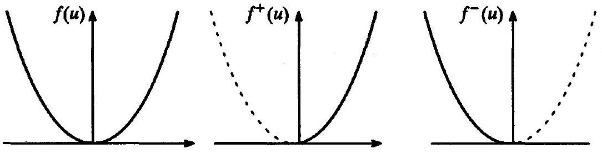
Figure 13.6 The "physical" flux splitting for Burgers' equation.

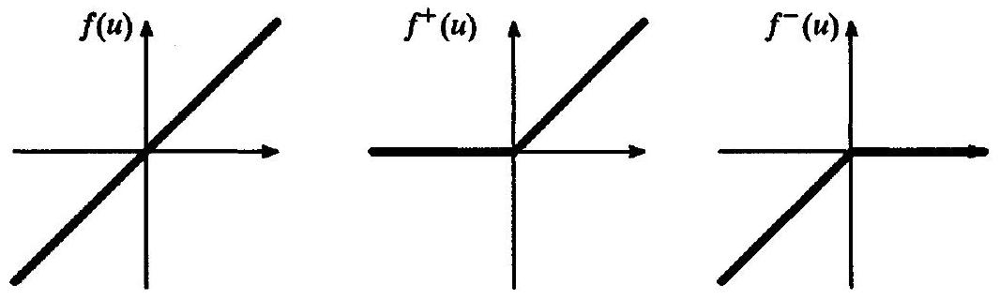
Figure 13.7 Another flux splitting for the linear advection equation.

A backward-space approximation gives

$$
\frac{\partial}{\partial x}(\max (0, u) u) \approx \frac{\max \left(0, u_{i}^{n}\right) u_{i}^{n}-\max \left(0, u_{i-1}^{n}\right) u_{i-1}^{n}}{\Delta x}
$$

and a forward-space approximation gives

$$
\frac{\partial}{\partial x}(\min (0, u) u) \approx \frac{\min \left(0, u_{i+1}^{n}\right) u_{i+1}^{n}-\max \left(0, u_{i}^{n}\right) u_{i}^{n}}{\Delta x} .
$$

Combining these with a forward-time approximation yields

$$
\begin{aligned}
u_{i}^{n+1}= & u_{i}^{n}-\frac{\lambda}{2}\left(\max \left(0, u_{i}^{n}\right) u_{i}^{n}-\max \left(0, u_{i-1}^{n}\right) u_{i-1}^{n}\right) \\
& -\frac{\lambda}{2}\left(\min \left(0, u_{i+1}^{n}\right) u_{i+1}^{n}-\min \left(0, u_{i}^{n}\right) u_{i}^{n}\right)
\end{aligned}
$$

Example 13.8 In the last two examples, the split fluxes $f^{+}(u)$ and $f^{-}(u)$ were completely smooth, continuous, and physical. Is this always true?

Solution No - split fluxes are not necessarily smooth, continuous, or physical. For example, consider the linear advection equation. For $a>0$, let $f^{+}(u)=a \max (0, u)$ and $f^{-}(u)=a \min (0, u)$, as illustrated in Figure 13.7. Unlike the flux splittings in the last two examples, this flux splitting is not physical. For example, $f^{-}=f$ and $f^{+}=0$ for $u<0$. In other words, this flux splitting falsely attributes all of the flux to left-running waves for $u<0$, even though all of the flux is actually due to right-running waves since $a>0$. As another issue, these split fluxes have discontinuous first derivatives at $u=0$, which may

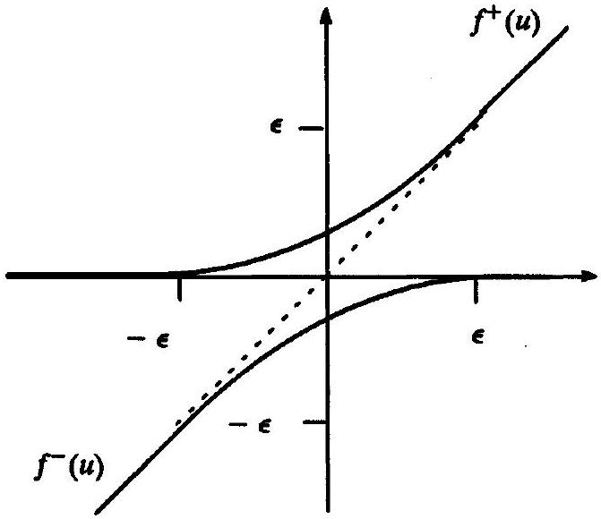
Figure 13.8 Yet another flux splitting for the linear advection equation.

cause numerical problems. A similar but smoother flux splitting is as follows:

$$
\begin{aligned}
& f^{+}(u)= \begin{cases}0 & u \leq-\epsilon, \\
\epsilon\left(\frac{u+\epsilon}{2 \epsilon}\right)^{2} & -\epsilon<u<\epsilon, \\
u & u \geq \epsilon,\end{cases} \\
& f^{-}(u)= \begin{cases}u & u \leq-\epsilon, \\
-\epsilon\left(\frac{u-\epsilon}{2 \epsilon}\right)^{2} & -\epsilon<u<\epsilon, \\
0 & u \geq \epsilon,\end{cases}
\end{aligned}
$$

where $\epsilon$ is any small number. This flux splitting is illustrated in Figure 13.8. These split fluxes have continuous first derivatives but discontinuous second derivatives at $u= \pm \epsilon$.

In many cases, it may be difficult to find a continuous flux splitting, much less a flux splitting with continuous derivatives. For example, consider the flux function illustrated in Figure 13.9. The sonic points are where the wind changes direction. At sonic points, $f(u)$ has a maximum or minimum, that is, $a(u)=f^{\prime}(u)=0$. Sonic points are a natural place to switch between $f^{+}(u)$ and $f^{-}(u)$, and, in particular, sonic point splittings are the unique physical flux splittings. However, sonic point splittings have jump discontinuities at sonic points unless $f(u)=0$ at sonic points. The jumps experienced by the unique physical flux splitting means that the physical flux splitting is not always the best choice numerically speaking. Even when the physical flux splitting is continuous at sonic points, the first derivatives may not be, which can cause numerical problems, again meaning that physical flux splitting is not always the best choice numerically speaking.

### 13.4.1 Flux Split Form

This subsection concerns a general flux splitting form for numerical approximations of scalar conservation laws. Assume that $\partial f^{+} / \partial x$ is discretized with a leftward bias,

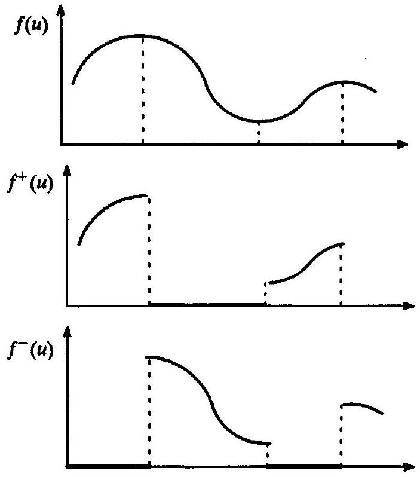
Figure 13.9 A nonsmooth flux splitting for a typical scalar conservation law.

so that the approximation at $x=x_{i}$ is centered on or biased towards $x=x_{i-1 / 2}$. More specifically, assume that

$$
\frac{\partial f^{+}}{\partial x} \approx \frac{\Delta \hat{f}_{i-1 / 2}^{+}}{\Delta x}
$$

for some $\Delta \hat{f}_{i-1 / 2}^{+}$. Similarly, assume that $\partial f^{-} / \partial x$ is discretized with a rightward bias, so that its approximation at $x=m x_{i}$ is centered on or biased towards $x=x_{i+1 / 2}$. More specifically, assume that

$$
\frac{\partial f^{-}}{\partial x} \approx \frac{\Delta \hat{f}_{i+1 / 2}^{-}}{\Delta x}
$$

for some $\Delta \hat{f}_{i+1 / 2}^{-}$. Finally, use the forward-Euler time discretization to obtain

$$
u_{i}^{n+1}=u_{i}^{n}-\lambda\left(\Delta \hat{f}_{i-1 / 2}^{+}+\Delta \hat{f}_{i+1 / 2}^{-}\right) .
$$

This is called the flux split form of a numerical approximation.
Any explicit forward-time approximation can be written in flux split form, whether or not the approximation was derived from a flux split form of the governing equations. Thus, putting aside physical flux splitting considerations such as Equations (13.6) and (13.7), any explicit conservative numerical method can be written in form (13.11). Of course, without conditions (13.6) and (13.7), a flux split form (13.11) says literally nothing about the connection between fluxes and waves. However, it can still be useful for other things, such as nonlinear stability analysis.

A method in flux split form is conservative if and only if

$$
\Delta \hat{f}_{i+1 / 2}^{+}+\Delta \hat{f}_{i+1 / 2}^{-}=g_{i+1}^{n}-g_{i}^{n}
$$

for some $g_{i}^{n}$. The proof follows the method of Example 11.9. In particular, add and subtract $\lambda g_{i}^{n}$ in Equation (13.11) to get

$$
u_{i}^{n+1}=u_{i}^{n}-\lambda\left(\Delta \hat{f}_{i-1 / 2}^{+}+g_{i}^{n}-g_{i}^{n}+\Delta \hat{f}_{i+1 / 2}^{-}\right) .
$$

Compare with the conservation form

$$
u_{i}^{n+1}=u_{i}^{n}-\lambda\left(\hat{f}_{i+1 / 2}^{n}-\hat{f}_{i-1 / 2}^{n}\right) .
$$

Then the flux split form can be written in conservation form if and only if there exists $g_{i}^{n}$ such that

$$
\begin{aligned}
& \hat{f}_{i+1 / 2}^{n}=\Delta \hat{f}_{i+1 / 2}^{-}+g_{i}^{n} \\
& \hat{f}_{i-1 / 2}^{n}=-\Delta \hat{f}_{i-1 / 2}^{+}+g_{i}^{n}
\end{aligned}
$$

Then $\hat{f}_{i+1 / 2}^{n}=\hat{f}_{(i-1 / 2)+1}^{n}$ leads immediately to Equation (13.12). Equations (13.13) and (13.14) allow easy transformation from conservation form to flux split form and vice versa. In fact, for any given conservative numerical flux $\hat{f}_{+1 / 2}^{n}$, Equations (13.13) and (13.14) yield a different flux split form for every $g_{i}^{n}$. Since there are no restrictions on $g_{i}^{n}$, every conservative method has infinitely many flux split forms.

Example 13.9 Write the first-order upwind method for Burgers' equation found in Example 13.7 in flux split form and conservation form.

Solution Example 13.7 naturally yields the flux split form as follows:

$$
\begin{aligned}
& \Delta \hat{f}_{i-1 / 2}^{+}=\frac{1}{2}\left(\max \left(0, u_{i}^{n}\right) u_{i}^{n}-\max \left(0, u_{i-1}^{n}\right) u_{i-1}^{n}\right) \\
& \Delta \hat{f}_{i+1 / 2}^{-}=\frac{1}{2}\left(\min \left(0, u_{i+1}^{n}\right) u_{i+1}^{n}-\min \left(0, u_{i}^{n}\right) u_{i}^{n}\right)
\end{aligned}
$$

To write the method in conservation form, use the following identities:

$$
|x|=\max (0, x)-\min (0, x)
$$

and

$$
x=\max (0, x)+\min (0, x)
$$

for any number $x$. Then, as the reader can show, Equation (13.12) has the following unique solution:

$$
g_{i+1}^{n}=\frac{1}{2}\left(u_{i+1}^{n}\right)^{2}, \quad g_{i}^{n}=\frac{1}{2}\left(u_{i}^{n}\right)^{2} .
$$

After some algebra, Equation (13.13) yields

$$
\hat{f}_{i+1 / 2}^{n}=\frac{1}{2}\left(\min \left(0, u_{i+1}^{n}\right) u_{i+1}^{n}+\max \left(0, u_{i}^{n}\right) u_{i}^{n}\right) .
$$

This expression can also be derived using the approach illustrated in Example 11.10.

### 13.4.2 Introduction to Flux Reconstruction

As mentioned earlier, many numerical methods combine flux splitting and flux averaging. In this regard, Shu and Osher (1988) suggested a particularly interesting general approach, based on the method of lines. From Subsection 11.2.1, recall that the spatial discretization in the method of lines constructs $\hat{f}_{s, i+1 / 2}^{n}$ such that

$$
\frac{\partial f}{\partial x}\left(u\left(x_{i}, t^{n}\right)\right) \approx \frac{\hat{f}_{s, i+1 / 2}^{n}-\hat{f}_{s, i-1 / 2}^{n}}{\Delta x} .
$$

Rather than interpolating or extrapolating between two stable and well-established conservative numerical fluxes to find $\hat{f}_{s, i+1 / 2}^{n}$, as in flux averaged methods, Shu and Osher construct the semidiscrete conservative numerical flux function starting from scratch. In particular, suppose that $\hat{f}_{s, i+1 / 2}^{n}=\hat{f}_{s}^{n}\left(x_{i+1 / 2}\right)$, that is, suppose $\hat{f}_{s, i+1 / 2}^{n}$ depends on space directly, rather than only indirectly through $u_{i}^{n}$. Then the spatial discretization step constructs $\hat{f}_{s, i+1 / 2}^{n}$ such that

$$
\frac{\partial f}{\partial x}\left(u\left(x_{i}, t^{n}\right)\right) \approx \frac{\hat{f}_{s}^{n}\left(x_{i+1 / 2}\right)-\hat{f}_{s}^{n}\left(x_{i-1 / 2}\right)}{\Delta x} .
$$

But, by the fundamental theorem of calculus, this is equivalent to

$$
f\left(u\left(x_{i}, t^{n}\right)\right) \approx \frac{1}{\Delta x} \int_{x_{i-1 / 2}}^{x_{i+1 / 2}} \hat{f}_{s}^{n}(x) d x
$$

Then, in this approach, the spatial discretization step reconstructs $\hat{f}_{s}^{n}(x)$ from cell-integral averages $f\left(u\left(x_{i}, t^{n}\right)\right) \approx f\left(u_{i}^{n}\right)$. But this is just reconstruction via the primitive function, as described in Section 9.3. Reconstruction via the primitive function based on essentially nonoscillatory (ENO) reconstruction, as seen in Chapter 9, yields a rich variety of semidiscrete fluxes, some associated with standard methods and some completely new. From one point of view, such flux reconstructions naturally yield adaptive flux averages of fixedstenciled methods, as seen in Section 21.4.

ENO flux reconstruction avoids shocks but does not introduce upwinding. In other words, ENO reconstruction considers only the size of divided differences during stencil selection, as discussed in Chapter 9, and thus may not choose any upwind points, in violation of the CFL condition. So we must use flux splitting to introduce the minimal amount of upwinding required by the CFL condition. In particular, reconstruct $\hat{f}_{s}^{+}(x)$ from $f^{+}\left(u_{i}^{n}\right)$ and $f^{+}\left(u_{i-1}^{n}\right)$ plus other points as determined by ENO reconstruction techniques, and reconstruct $\hat{f}_{s}^{-}(x)$ from $f^{-}\left(u_{i}^{n}\right)$ and $f^{-}\left(u_{i+1}^{n}\right)$ plus other points as determined by ENO reconstruction techniques. Then

$$
\hat{f}_{s, i+1 / 2}^{n}=\hat{f}_{s}^{+}\left(x_{i+1 / 2}\right)+\hat{f}_{s}^{-}\left(x_{i+1 / 2}\right) .
$$

### 13.5 Introduction to Wave Speed Splitting

The last section concerned flux splitting. This section concerns a closely related type of splitting called wave speed splitting. Flux splitting uses the governing equations in conservation form and tends to yield conservative numerical approximations. In contrast wave speed splitting uses the governing equations in nonconservation form and tends to yield nonconservative approximations. Thus, in most cases, flux splitting is preferred over wave speed splitting except when the flux function has the special property $\mathbf{f}=(d \mathbf{f} / d \mathbf{u}) \mathbf{u}$.

As discussed below, this special property makes flux splitting and wave speed splitting essentially equivalent. Among other applications, wave speed splitting leads to an interesting wave speed split form often used in nonlinear stability analysis.

For scalar conservation laws, suppose that the wave speed is split as follows:

$$
a(u)=a^{+}(u)+a^{-}(u),
$$

where

$$
a^{+} \geq 0, \quad a^{-} \leq 0 .
$$

Then the scalar conservation law can be written as

$$
\frac{\partial u}{\partial t}+a^{+} \frac{\partial u}{\partial x}+a^{-} \frac{\partial u}{\partial x}=0
$$

which is called a wave speed split form of the scalar conservation law. Then $a^{+} \partial u / \partial x$ can be discretized conservatively using at least one point on the left, and $a^{-} \partial u / \partial x$ can be discretized conservatively using at least one point on the right, thus obtaining conservation and the CFL condition. Notice that $a^{+} \partial u / \partial x$ and $a^{-} \partial u / \partial x$ are not in conservation form, which makes it more difficult, but certainly not impossible, to obtain a conservative discretization.

Now consider vector conservation laws such as the Euler equations. Suppose that the flux Jacobian matrix $A=d \mathbf{f} / d \mathbf{u}$ is split as follows:

$$
A(\mathbf{u})=A^{+}(\mathbf{u})+A^{-}(\mathbf{u})
$$

where the characteristic values of $A^{+}$are nonnegative and the characteristic values of $A^{-}$ are nonpositive. In standard matrix notation,

$$
A^{+} \geq 0, \quad A^{-} \leq 0 .
$$

The matrices $A^{+}$and $A^{-}$are usually obtained by splitting the characteristic values of $A$, which represent wave speeds, into positive and negative parts. Then the vector conservation law can be written as

$$
\frac{\partial \mathbf{u}}{\partial t}+A^{+} \frac{\partial \mathbf{u}}{\partial x}+A^{-} \frac{\partial \mathbf{u}}{\partial x}=0 .
$$

This is called a wave speed split form of the vector conservation law. Then $A^{+} \partial \mathbf{u} / \partial x$ can be discretized conservatively using at least one point on the left, and $A^{-} \partial \mathbf{u} / \partial x$ can be discretized conservatively using at least one point on the right, thus obtaining conservation and the CFL condition.

The flux vector in the Euler equations has a special relationship with its Jacobian matrix. In particular,

$$
\mathbf{f}=A \mathbf{u} .
$$

Then the flux function $\mathbf{f}$ in the Euler equations is called a homogenous function of order one. As some alert readers may recall, Problem 2.2 introduced homogeneous flux functions of order one. By Equation (13.25), every wave speed splitting $A^{ \pm}$of the Euler equations leads immediately to the flux vector splitting $\mathbf{f}^{ \pm}=A^{ \pm} \mathbf{u}$, although this flux vector splitting may or may not satisfy condition (13.6).

Example 13.10 Design a first-order upwind method for the linear advection equation using wave speed splitting.

Solution The unique physical wave speed splitting is $a^{+}=\max (0, a)$ and $a^{-}= \min (0, a)$. For right-running waves with $a>0, a^{+}=a$ and $a^{-}=0$. In other words, this physical wave speed splitting properly attributes everything to right-running waves. Similarly, for left-running waves with $a<0, a^{-}=a$ and $a^{+}=0$. In other words, this physical wave speed splitting properly attributes everything to left-running waves. Written in terms of this wave speed splitting, the linear advection equation becomes

$$
\frac{\partial u}{\partial t}+\max (0, a) \frac{\partial u}{\partial x}+\min (0, a) \frac{\partial u}{\partial x}=0 .
$$

Then a backward-space approximation gives

$$
\max (0, a) \frac{\partial u}{\partial x} \approx \max (0, a) \frac{u_{i}^{n}-u_{i-1}^{n}}{\Delta x},
$$

and a forward-space approximation gives

$$
\min (0, a) \frac{\partial u}{\partial x} \approx \min (0, a) \frac{u_{i+1}^{n}-u_{i}^{n}}{\Delta x} .
$$

Combining these with a forward-time approximation yields

$$
u_{i}^{n+1}=u_{i}^{n}-\lambda \max (0, a)\left(u_{i}^{n}-u_{i-1}^{n}\right)-\lambda \min (0, a)\left(u_{i+1}^{n}-u_{i}^{n}\right),
$$

which is the same as the method found in Examples 13.5 and 13.6.
As it turns out, there is no real difference between this example and Example 13.6. The linear advection equation has the special property $f(x)=(d f / d u) u=a u$. Thus, just like the flux function for the Euler equations, the flux function for the linear advection equation is a homogenous function of order one. Although there are many homogenous vector functions of order one, the only homogenous scalar functions of order one are linear functions. Thus, among scalar conservation laws, only the linear advection equation has a homogenous flux function of order one - Burgers' equation and all other scalar conservation laws do not have this special property. Since $f(u)=a u$, any wave speed splitting $a^{ \pm}$implies a flux splitting $f^{ \pm}=a^{ \pm} u$. In particular, the wave speed splitting $a^{+}=\max (0, a)$ and $a^{-}=\min (0, a)$ used in this example immediately implies the flux splitting $f^{+}(u)=\max (0, a) u$ and $f^{-}(u)=\min (0, a) u$ used in Example 13.6. Vice versa, any flux splitting $f^{ \pm}$implies a wave speed splitting $a^{ \pm}=f^{ \pm} / u$.

### 13.5.1 Wave Speed Split Form

This section introduces a general wave speed split form for numerical methods often used in nonlinear stability analysis, as seen in Section 16.4. Assume that $a^{+} \partial u / \partial x$ is discretized with a leftward bias, so that its approximation at $x=x_{i}$ is centered on or biased towards $x=x_{i-1 / 2}$. More specifically, assume

$$
a^{+} \frac{\partial u}{\partial x} \approx a_{i-1 / 2}^{+} \frac{u_{i}^{n}-u_{i-1}^{n}}{\Delta x} .
$$

Of course, the first-order upwind approximation $\left(u_{i}^{n}-u_{i-1}^{n}\right) / \Delta x$ to $\partial u / \partial x$ can be replaced by any number of other approximations. Similarly, assume that $a^{-} \partial u / \partial x$ is discretized with a rightward bias, so that its approximation at $x=x_{i}$ is centered on or biased towards $x=x_{i+1 / 2}$. More specifically, assume

$$
a^{-} \frac{\partial u}{\partial x} \approx a_{i+1 / 2}^{-} \frac{u_{i+1}^{n}-u_{i}^{n}}{\Delta x}
$$

Again, the first-order upwind approximation $\left(u_{i+1}^{n}-u_{i}^{n}\right) / \Delta x$ to $\partial u / \partial x$ can be replaced by any number of other approximations. Finally, use the forward-time discretization to obtain

$$
u_{i}^{n+1}=u_{i}^{n}-\lambda a_{i+1 / 2}^{-}\left(u_{i+1}^{n}-u_{i}^{n}\right)-\lambda a_{i-1 / 2}^{+}\left(u_{i}^{n}-u_{i-1}^{n}\right),
$$

which is called a wave speed split form of the numerical approximation. Any explicit conservative numerical method can be written in wave speed split form, whether or not it was derived using wave speed splitting. In other words, putting aside physical splitting considerations such as Equations (13.19) and (13.20), any explicit conservative numerical method can be written in form (13.28). Of course, without conditions (13.19) and (13.20), a wave speed split form (13.28) of the numerical approximation says literally nothing about the connections between fluxes and waves.

There is a simple relationship between the flux split form seen in Subsection 13.4.1 and the wave speed split form seen in this subsection. In particular,

$$
\Delta \hat{f}_{i+1 / 2}^{ \pm}=a_{i+1 / 2}^{ \pm}\left(u_{i+1}^{n}-u_{i}^{n}\right) .
$$

In other words, wave speed split form simply factors the split fluxes $\Delta f_{i+1 / 2}^{ \pm}$into coefficients $a_{i+1 / 2}^{ \pm}$times first differences $u_{i+1}^{n}-u_{i}^{n}$. This factorization is natural and convenient when the split fluxes happen to include factors $u_{i+1}^{n}-u_{i}^{n}$. Otherwise, wave speed split form still works, but with a caveat. Suppose that $\Delta f_{i+1 / 2}^{ \pm}$does not include a factor $u_{i+1}^{n}-u_{i}^{n}$ and, furthermore, suppose that $\Delta f_{i+1 / 2}^{ \pm} \neq 0$ when $u_{i+1}^{n}-u_{i}^{n}=0$. Then the coefficients $a_{i+1 / 2}^{ \pm}$ must be infinite since only infinity times zero yields anything other than zero. In fact, for most methods with more than two or three points in their stencils, all possible wave speed splitting forms involve infinite coefficients. Even with the niggling issue of infinite coefficients, wave speed split form is still more useful than flux split form. This is not to say that wave speed splitting is better than flux splitting (in fact, quite the opposite) but only to say that wave speed split form is better than flux split form in certain applications, especially nonlinear stability analysis.

By Equations (13.12) and (13.29), a method in wave speed split form is conservative if and only if

$$
\left(a_{i+1 / 2}^{+}+a_{i+1 / 2}^{-}\right)\left(u_{i+1}^{n}-u_{i}^{n}\right)=g_{i+1}^{n}-g_{i}^{n}
$$

for some flux function $g_{i}^{n}$. Similarly, Equations (13.13), (13.14), and (13.29) imply

$$
\begin{aligned}
& \hat{f}_{i+1 / 2}^{n}=a_{i+1 / 2}^{-}\left(u_{i+1}^{n}-u_{i}^{n}\right)+g_{i}^{n}, \\
& \hat{f}_{i-1 / 2}^{n}=-a_{i-1 / 2}^{+}\left(u_{i}^{n}-u_{i+1}^{n}\right)+g_{i}^{n} .
\end{aligned}
$$

Equations (13.31) and (13.32) allow easy transformation from conservation form to wave speed split form and vice versa. In fact, for any given conservative numerical flux $\hat{f}_{i+1 / 2}^{n}$, Equations (13.31) and (13.32) yield a different wave speed split form for every different $g_{i}^{n}$. Since there are no restrictions on $g_{i}^{n}$, every conservative method has infinitely many wave
speed split forms. By the way, if the coefficients $a_{i+1 / 2}^{ \pm}$are finite, and if $\hat{f}_{i+1 / 2}^{n}$ is consistent with $f(u)$, then Equations (13.31) and (13.32) imply that $g_{i}^{n}$ is consistent with $f(u)$.

Example 13.11 Assuming that $g_{i}^{n}$ is consistent with $f(u)$, the most obvious choice for the splitting function $g_{i}^{n}$ is

$$
g_{i}^{n}=f\left(u_{i}^{n}\right) .
$$

Then the conservation condition (13.30) for scalar conservation laws implies

$$
a_{i+1 / 2}^{+}+a_{i+1 / 2}^{-}=a_{i+1 / 2}^{n}
$$

where, as usual, $a_{i+1 / 2}^{n}$ is defined as follows:

$$
a_{i+1 / 2}^{n}= \begin{cases}\frac{f\left(u_{i+1}^{n}\right)-f\left(u_{i}^{n}\right)}{u_{i+1}^{n}-u_{i}^{n}} & u_{i+1}^{n} \neq u_{i}^{n}, \\ f^{\prime}\left(u_{i}^{n}\right) & u_{i+1}^{n}=u_{i}^{n} .\end{cases}
$$

In this example, the numerical wave speed splitting $a_{i+1 / 2}^{n}=a_{i+1 / 2}^{+}+a_{i+1 / 2}^{-}$directly reflects the physical wave speed splitting $a(u)=a^{+}(u)+a^{-}(u)$.

The above notation for the wave speed split form is the standard notation when wave speed splitting is used to derive new methods. Unfortunately, the above notation is not the standard notation when existing methods are rewritten in wave speed split form as a preliminary step in nonlinear stability analysis. Instead, the nonlinear stability literature uses the following notation for wave speed split form:

$$
u_{i}^{n+1}=u_{i}^{n}+C_{i+1 / 2}^{+}\left(u_{i+1}^{n}-u_{i}^{n}\right)-C_{i-1 / 2}^{-}\left(u_{i}^{n}-u_{i-1}^{n}\right),
$$

which follows Harten (1983). Comparing Equations (13.28) and (13.36), we see that Harten's wave speed split form notation is related to the earlier wave speed split form notation through

$$
C_{i+1 / 2}^{+}=-\lambda a_{i+1 / 2}^{-}, \quad C_{i+1 / 2}^{-}=\lambda a_{i+1 / 2}^{+} .
$$

If a method is derived using wave speed splitting, and not just written in wave speed split form, then Equations (13.19) and (13.20) become

$$
\begin{aligned}
& \lambda a(u)=C^{+}(u)-C^{-}(u), \\
& C^{+}(u) \geq 0, \quad C^{-}(u) \geq 0 .
\end{aligned}
$$

Also, conservation condition (13.30) becomes

$$
\left(C_{i+1 / 2}^{-}-C_{i+1 / 2}^{+}\right)\left(u_{i+1}^{n}-u_{i}^{n}\right)=\lambda\left(g_{i+1}^{n}-g_{i}^{n}\right) .
$$

Similarly, Equations (13.31) and (13.32) become

$$
\begin{aligned}
& \lambda \hat{f}_{i+1 / 2}^{n}=-C_{i+1 / 2}^{+}\left(u_{i+1}^{n}-u_{i}^{n}\right)+\lambda g_{i}^{n} \\
& \lambda \hat{f}_{i-1 / 2}^{n}=-C_{i-1 / 2}^{-}\left(u_{i}^{n}-u_{i-1}^{n}\right)+\lambda g_{i}^{n}
\end{aligned}
$$

Unfortunately, the coefficients $C_{i+1 / 2}^{ \pm}$are often infinite when $u_{i+1}^{n}=u_{i}^{n}$. If the coefficients $C_{i+1 / 2}^{ \pm}$are always finite, then $u_{i}^{n+1}=u_{i}^{n}$ whenever $u_{i-1}^{n}=u_{i}^{n}=u_{i+1}^{n}$. Many methods with two- or three-point stencils satisfy this condition, but many methods with wider stencils do not. Rephrasing this observation in the reverse sense, any method that allows $u_{i}^{n+1} \neq u_{i}^{n}$ when $u_{i-1}^{n}=u_{i}^{n}=u_{i+1}^{n}$ cannot have uniformly finite coefficients $C_{i+1 / 2}^{ \pm}$. Remember that there are infinitely many wave speed split forms, depending on the choice of $g_{i}^{n}$. For a given numerical method, of the infinitely many possible wave speed split forms, at most one has finite coefficients $C_{i+1 / 2}^{ \pm}$. If the coefficients $C_{i+1 / 2}^{ \pm}$are always finite, and if $\hat{f}_{i+1 / 2}^{n}$ is consistent with $f(u)$, then Equations (13.41) and (13.42) imply that $g_{i}^{n}$ is consistent with $f(u)$.

Example 13.12 Find two wave speed splitting forms for FTCS for scalar conservation laws. If possible, one of the forms should have finite $C_{i+1 / 2}^{ \pm}$.

Solution Recall that the conservative numerical flux of FTCS is

$$
\hat{f}_{i+1 / 2}^{n}=\frac{f\left(u_{i+1}^{n}\right)+f\left(u_{i}^{n}\right)}{2} .
$$

Suppose that $g_{i}^{n}=f\left(u_{i}^{n}\right)$. Then Equations (13.41) and (13.42) yield

$$
\begin{aligned}
& \lambda \frac{f\left(u_{i+1}^{n}\right)+f\left(u_{i}^{n}\right)}{2}=-C_{i+1 / 2}^{+}\left(u_{i+1}^{n}-u_{i}^{n}\right)+\lambda f\left(u_{i}^{n}\right), \\
& \lambda \frac{f\left(u_{i}^{n}\right)+f\left(u_{i-1}^{n}\right)}{2}=-C_{i-1 / 2}^{-}\left(u_{i}^{n}-u_{i-1}^{n}\right)+\lambda f\left(u_{i}^{n}\right) .
\end{aligned}
$$

Solving for $C_{i+1 / 2}^{+}$and $C_{i-1 / 2}^{-}$yields

$$
\begin{aligned}
& C_{i+1 / 2}^{+}=-\frac{\lambda}{2} a_{i+1 / 2}^{n} \\
& C_{i-1 / 2}^{-}=\frac{\lambda}{2} a_{i-1 / 2}^{n}
\end{aligned}
$$

where $a_{i+1 / 2}^{n}$ is defined by Equation (13.35). Notice that $C_{i+1 / 2}^{+}$and $C_{i-1 / 2}^{-}$are always finite, assuming only that the physical wave speed $a(u)$ is always finite. Similarly, to chose another arbitrary example, if $g_{i}^{n}=f\left(u_{i}^{n}\right)+\left(u_{i+1}^{n}-u_{i}^{n}\right) / \lambda$ then

$$
\begin{aligned}
& C_{i+1 / 2}^{+}=-\frac{\lambda}{2} a_{i+1 / 2}^{n}+1 \\
& C_{i-1 / 2}^{-}=\frac{\lambda}{2} a_{i-1 / 2}^{n}+\frac{u_{i+1}^{n}-u_{i}^{n}}{u_{i-1}^{n}-u_{i}^{n}} .
\end{aligned}
$$

Notice that $C_{i+1 / 2}^{+}$is always finite, but $C_{i-1 / 2}^{-}$is infinite if $u_{i}^{n}=u_{i-1}^{n}$.

Example 13.13 Find three flux derivative splitting forms for FTFS for scalar conservation laws. If possible, one of the forms should have finite $C_{i+1 / 2}^{+}$.

Solution Recall that the conservative numerical flux of FTFS is

$$
\hat{f}_{i+1 / 2}^{n}=f\left(u_{i+1}^{n}\right) .
$$

Suppose that $g_{i}^{n}=f\left(u_{i}^{n}\right)$. Then

$$
\begin{aligned}
& C_{i+1 / 2}^{+}=-\lambda a_{i+1 / 2} \\
& C_{i-1 / 2}^{-}=0
\end{aligned}
$$

Alternatively, splitting FTFS about $g_{i}^{n}=\frac{1}{2}\left(f\left(u_{i+1}^{n}\right)+f\left(u_{i}^{n}\right)\right)$ yields

$$
\begin{aligned}
& C_{i+1 / 2}^{+}=-\frac{1}{2} \lambda a_{i+1 / 2}^{n}, \\
& C_{i-1 / 2}^{-}=\frac{1}{2} \lambda a_{i+1 / 2}^{n} \frac{u_{i+1}^{n}-u_{i}^{n}}{u_{i}^{n}-u_{i-1}^{n}} .
\end{aligned}
$$

Finally, splitting FTFS about $g_{i}^{n}=f\left(u_{i+1}^{n}\right)$ yields

$$
\begin{aligned}
& C_{i+1 / 2}^{+}=0 \\
& C_{i-1 / 2}^{-}=\lambda a_{i+1 / 2}^{n} \frac{u_{i+1}^{n}-u_{i}^{n}}{u_{i}^{n}-u_{i-1}^{n}}
\end{aligned}
$$

Notice that the first form has bounded coefficients $C_{i+1 / 2}^{+}$and $C_{i-1 / 2}^{-}$, whereas the last two forms have bounded $C_{i+1 / 2}^{+}$and unbounded $C_{i-1 / 2}^{-}$. Although the examples in this section always found at least one wave speed split form with finite coefficients, this is only because the stencils are so narrow.

### 13.6 Introduction to Reconstruction-Evolution Methods

The last two sections have concerned splitting techniques for finite-difference methods. Although splitting techniques also work for finite-volume methods, finite-volume methods more often use a different approach towards the same ends. Consider the following two-step finite-volume design approach:
(1) Spatial Reconstruction Reconstruct the solution $u\left(x, t^{n}\right)$ using, for example, the ENO techniques of Chapter 9. This step need not account for the upwind direction. Also, this step may involve solution averaging and slope limiting, analogous to flux averaging and flux limiting seen in finite-difference methods. Put another way, finite-volume methods form $u$ and then $f(u)$, while finite-difference methods form $f(u)$ directly.
(2) Temporal Evolution Evolve the solution from time level $n$ to $n+1$ using characteristics or some other technique. In particular, approximate $u\left(x_{i+1 / 2}, t\right)$ for $t^{n} \leq t \leq t^{n+1}$. Then

$$
\hat{f}_{i+1 / 2}^{n}=\frac{1}{\Delta t} \int_{t^{n}}^{t^{n+1}} f\left(u\left(x_{i+1 / 2}, t\right)\right) d t
$$

Any reasonable approximation based on waves and characteristics naturally introduces the minimal amount of upwinding required by the CFL condition.

This procedure is illustrated in Figure 13.10. Methods derived using this procedure are sometimes called reconstruction-evolution methods, a term coined by Harten, Engquist,

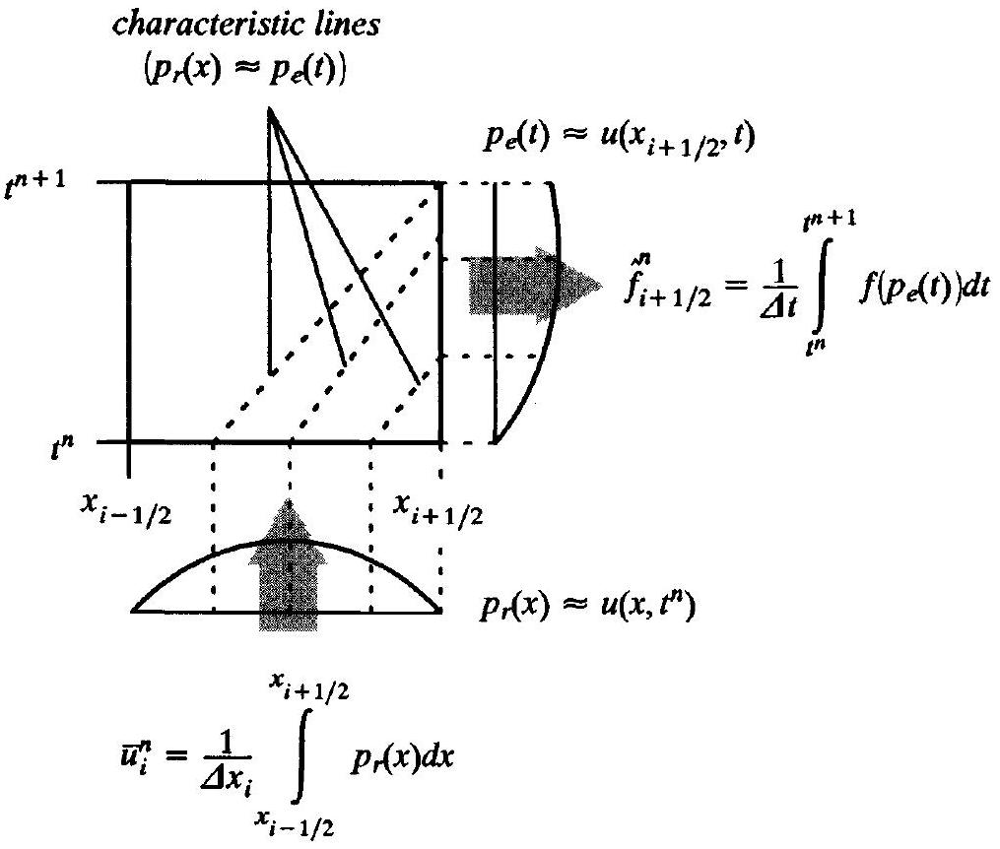
Figure 13.10 An illustration of reconstruction-evolution.

Osher, and Chakravarthy (1987). Alternatively, they are sometimes called Godunov-type methods, after the earliest such first-order accurate method, especially when the time evolution uses the exact Riemann solver. They are sometimes called MUSCL-type methods, after the earliest such second-order accurate method, discussed in Chapter 23. They are sometimes called flux difference splitting methods, to stress their relationship with flux vector splitting, especially when the time evolution uses a linearized Riemann solver such as Roe's approximate Riemann solver, as explained in Section 18.3.2. This book will mainly use the term reconstruction-evolution.

Reconstruction-evolution methods are extremely physical and elegant. However, in practice, reconstruction-evolution methods may be unduly expensive. After expending a huge amount of effort to reconstruct and evolve the solution, most of the detailed information is simply thrown away by the integral averaging at the end of the time evolution. Then the process starts all over again, with the reconstruction step attempting to reconstruct information just recently tossed aside. Of course, the polynomial reconstruction could be retained from time step to time step, and updated directly in terms of the polynomial coefficients rather than indirectly via cell-integral averages and reconstruction, but this is getting into finite-element territory. Other options will be explored in Section 23.1.

Example 13.14 Find a first-order reconstruction-evolution method for the linear advection equation. Use piecewise-constant reconstruction and exact evolution.

Solution Suppose that the reconstruction is $p_{\mathrm{r}}(x) \approx u\left(x, t^{n}\right)$. For piecewiseconstant reconstruction, let $p_{\mathrm{r}}(x)=\bar{u}_{i}^{n}$ on cell $\left[x_{i-1 / 2}, x_{i+1 / 2}\right]$. Suppose that the evolution
is $p_{\mathrm{e}, i+1 / 2}(t) \approx u\left(x_{i+1 / 2}, t\right)$. For the linear advection equation, the exact solution implies $u(x, t)=u\left(x-a\left(t-t^{n}\right), t^{n}\right)$ or

$$
\begin{aligned}
p_{\mathrm{e}, i+1 / 2}(t) & =p_{\mathrm{r}}\left(x_{i+1 / 2}-a\left(t-t^{n}\right)\right) \\
& = \begin{cases}\bar{u}_{i}^{n} & \text { for } 0 \leq \lambda a \leq 1 \\
\bar{u}_{i+1}^{n} & \text { for }-1 \leq \lambda a \leq 0 .\end{cases}
\end{aligned}
$$

Then

$$
\begin{aligned}
\hat{f}_{i+1 / 2}^{n} & =\frac{1}{\Delta t} \int_{t^{n}}^{t^{n+1}} f\left(p_{\mathrm{e}, i+1 / 2}(t)\right) d t=\frac{1}{\Delta t} \int_{t^{n}}^{t^{n+1}} a p_{\mathrm{e}, i+1 / 2}(t) d t \\
& = \begin{cases}a \bar{u}_{i}^{n} & \text { for } 0 \leq \lambda a \leq 1 \\
a \bar{u}_{i+1}^{n} & \text { for }-1 \leq \lambda a \leq 0\end{cases}
\end{aligned}
$$

The resulting method can be written as follows:

$$
\bar{u}_{i}^{n+1}=\bar{u}_{i}^{n}-\lambda a \begin{cases}\bar{u}_{i}^{n}-\bar{u}_{i-1}^{n} & \text { for } a>0, \\ \bar{u}_{i+1}^{n}-\bar{u}_{i}^{n} & \text { for } a<0 .\end{cases}
$$

The same method was found in Examples 13.5, 13.6, and 13.10. Of course, this method is a finite-volume one whereas the earlier methods were finite difference. However, since this method is only first-order accurate, there is no need to distinguish finite-volume from finite-difference methods.

Why do completely different derivation techniques keep yielding the same numerical approximation to the linear advection equation? Mainly, because the linear advection equation is linear and linearity tends to wipe out the differences that would otherwise exist.

Example 13.15 Rederive the method found in the last example. This time, use a variant of reconstruction-evolution, in which the evolution step approximates $u\left(x, t^{n+1}\right)$ rather than $u\left(x_{i+1 / 2}, t\right)$. Form the cell-integral averages of $u\left(x, t^{n+1}\right)$ to approximate $\bar{u}_{i}^{n+1}$.

Solution Suppose that the reconstruction is $p_{\mathrm{r}}(x) \approx u\left(x, t^{n}\right)$. For piecewiseconstant reconstruction, let $p_{\mathrm{r}}(x)=\bar{u}_{i}^{n}$ on cell $\left[x_{i-1 / 2}, x_{i+1 / 2}\right]$. Suppose that the temporal evolution is $p_{\mathrm{e}}^{n+1}(x) \approx u\left(x, t^{n+1}\right)$. For the linear advection equation, the exact solution implies $u(x, t)=u\left(x-a\left(t-t^{n}\right), t^{n}\right)$ or

$$
p_{\mathrm{e}}^{n+1}(x)=p_{\mathrm{r}}\left(x_{i+1 / 2}-a \Delta t\right)
$$

The desired alternative derivation of the linear first-order upwind method is illustrated in Figure 13.11. For $a>0$, the mathematical details are as follows:

$$
\begin{aligned}
\bar{u}_{i}^{n+1} & =\frac{1}{\Delta x} \int_{x_{i-1 / 2}}^{x_{i+1 / 2}} p_{\mathrm{e}}^{n+1}(x) d x=\frac{1}{\Delta x} \int_{x_{i-1 / 2}}^{x_{i+1 / 2}} p_{\mathbf{r}}(x-a \Delta t) d x \\
& =\frac{1}{\Delta x}\left[(\Delta x-a \Delta t) \bar{u}_{i}^{n}+a \Delta t \bar{u}_{i-1}^{n}\right]=\bar{u}_{i}^{n}-\lambda a\left(\bar{u}_{i}^{n}-\bar{u}_{i-1}^{n}\right)
\end{aligned}
$$

A similar calculation for $a<0$ verifies that this is indeed the first-order upwind method for the linear advection equation. In the last example, the solution was time evolved just at cell edges $x_{i+1 / 2}$. In this example, the entire solution was time evolved. The approach

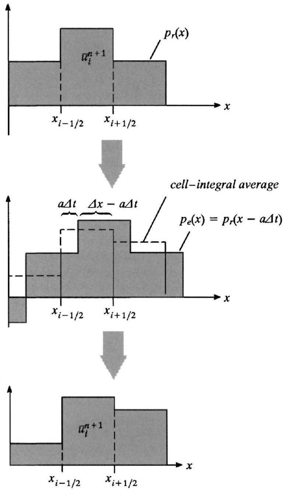
Figure 13.11 One way to view reconstruction-evolution methods for the linear advection equation.

in this example is easily illustrated, and the two approaches are entirely equivalent when the time evolution is exact, as for linear equations. However, the approach in this example does not naturally yield conservative numerical fluxes $\hat{f}_{i+1 / 2}^{n}$ and, in fact, will give rise to nonconservative methods in many cases unless great care is exercised.

The time-evolution step in the preceding examples was trivial, since the linear advection equation has a simple exact solution. But what about nonlinear conservation laws, which lack simple exact solutions? First, consider piecewise-constant reconstruction. Piecewiseconstant reconstruction gives rise to a Riemann problem at each cell edge, where the

Riemann problem has an exact solution, as seen in Chapter 5. Reconstruction-evolution methods often use approximate Riemann solvers that deviate from the true Riemann solver in surprising ways without changing the numerical solution. In fact, in some cases, nonphysical deviations can actually improve numerical accuracy. Thus, just like flux splitting, recon-struction-evolution methods allow and even benefit from nonphysicality in their wave description. This is discussed further in Sections 17.3 and 18.3.

Now consider higher-order reconstructions, such as piecewise-linear, piecewise-quadratic, or some other higher-order piecewise polynomial reconstruction. Unfortunately, the jump at each cell edge in the piecewise-linear or higher-order piecewise-polynomial reconstruction gives rise to a problem that lacks an exact solution. However, the exact solution can be approximated using Riemann solvers. In fact, just as before with first-order methods, a well-constructed but artificial approximate wave solution may actually improve results compared with the unattainable exact physical solution. This is discussed in Chapter 23.

## References

Boris, J. P., and Book, D. L. 1973. "Flux-Corrected Transport I. SHASTA, a Fluid Transport Algorithm that Works," Journal of Computational Physics, 11: 38-69.
Courant, R., Isaacson, E., and Rees, M. 1952. "On the Solution of Nonlinear Hyperbolic Differential Equations by Finite Differences," Communications on Pure and Applied Mathematics, 5: 243-255.
Harten, A. 1983. "High Resolution Schemes for Hyperbolic Conservation Laws," Journal of Computational Physics, 49: 357-393.
Harten, A., Engquist, B., Osher S., and Chakravarthy, S. R. 1987. "Uniformly High Order Accurate Essentially Non-Oscillatory Schemes, III," Journal of Computational Physics, 71: 231-303.
Harten, A., and Zwas, G. 1972. "Self-Adjusting Hybrid Schemes for Shock Computations," Journal of Computational Physics, 9: 568-583.
Shu, C.-W., and Osher, S. 1988. "Efficient Implementation of Essentially Non-Oscillatory Shock-Capturing Schemes," Journal of Computational Physics, 77: 439-471.
Steger, J. L., and Warming, R. F. 1979. "Flux Vector Splitting of the Inviscid Gasdynamic Equations with Application to Finite-Difference Methods," Journal of Computational Physics, 40: 263-293.
Van Leer, B. 1974. "Towards the Ultimate Conservative Difference Scheme. II. Monotonicity and Conservation Combined in a Second-Order Scheme," Journal of Computational Physics, 14: 361-370 .

## Problems

13.1 Consider the following numerical method:

$$
u_{i}^{n+1}=u_{i}^{n}-\frac{\lambda}{2}\left(3 f\left(u_{i}^{n}\right)-4 f\left(u_{i-1}^{n}\right)+f\left(u_{i-2}^{n}\right)\right) .
$$

(a) Is this method upwind, downwind, or centered?
(b) Write the method in flux split form in two different ways.
(c) Write the method in wave speed split form in two different ways. If possible, find a wave speed split form with finite coefficients.
13.2 Consider the following numerical method:

$$
u_{i}^{n+1}=u_{i}^{n}+\frac{\lambda}{12}\left(f\left(u_{i+2}^{n}\right)-8 f\left(u_{i+1}^{n}\right)+8 f\left(u_{i-1}^{n}\right)-f\left(u_{i-2}^{n}\right)\right) .
$$

(a) Is this method upwind, downwind, or centered?
(b) Write the method in flux split form in two different ways.
(c) Write the method in wave speed split form in two different ways. If possible, find a wave speed split form with finite coefficients.
13.3 Consider a scalar conservation law with flux function $f(u)$. In each case, suggest a first-order upwind method based on flux splitting.
(a) $f(u)=u^{3} / 3$
(b) $f(u)=u^{4} / 4$
(c) $f(u)=u^{2}-2 u+1$
13.4 Consider the scalar flux function $f(u)=\frac{1}{3} u^{3}-u^{2}+u$. Suggest a flux splitting. If possible, choose the flux splitting to be continuous.
13.5 Consider wave speed split forms, as described in Section 13.5. Argue briefly that, for a given numerical method, there is at most one wave speed split form whose coefficients are always finite.

