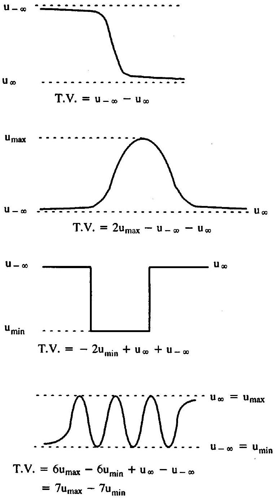
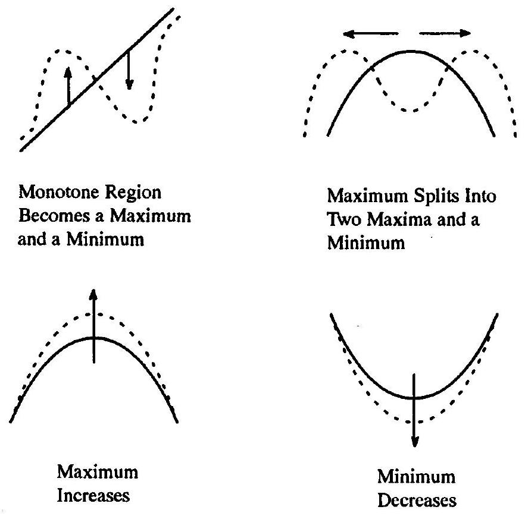
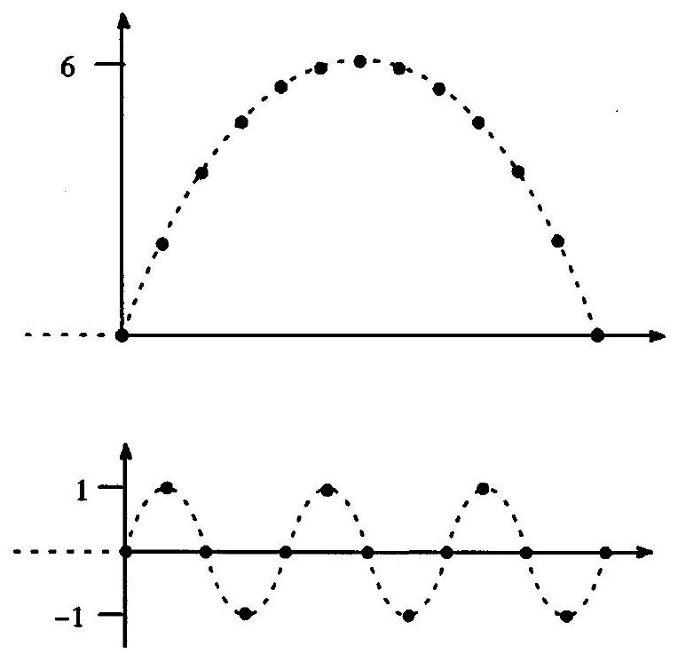
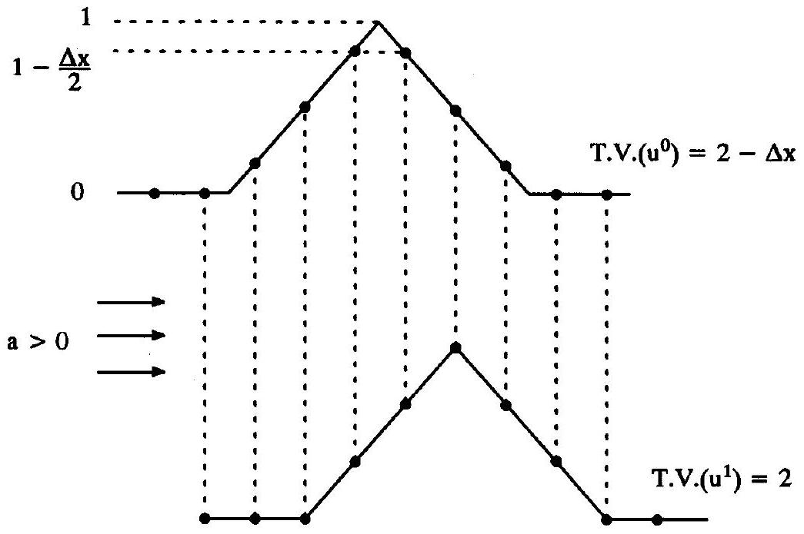
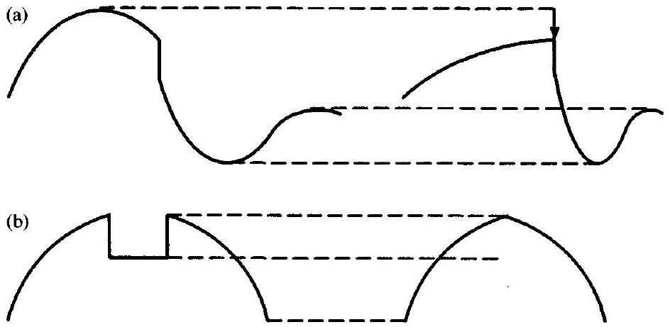
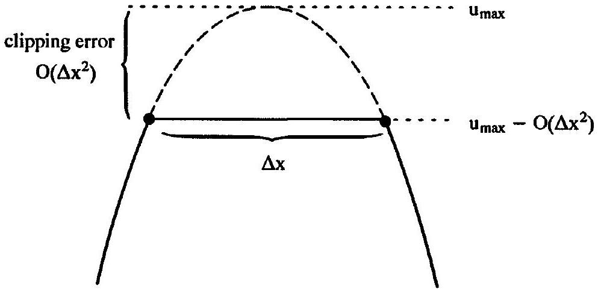
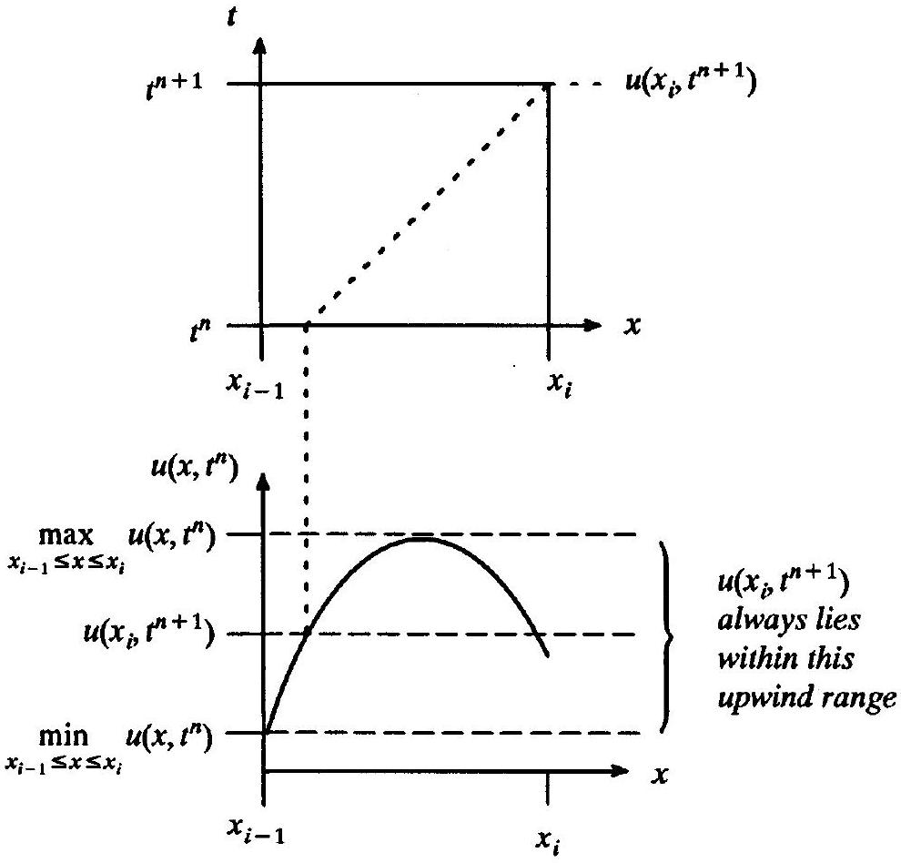
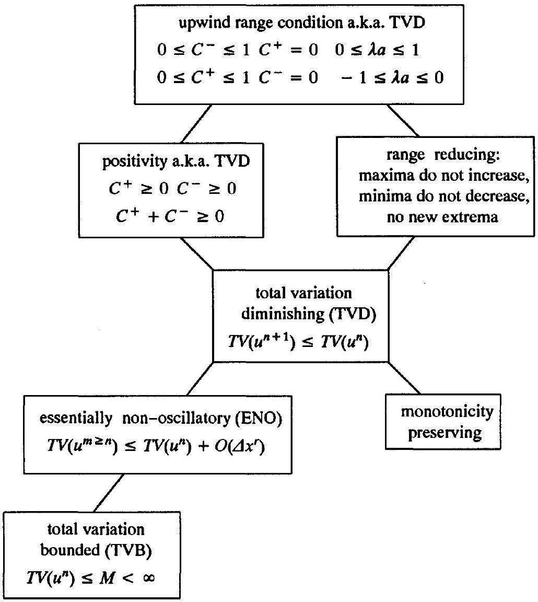
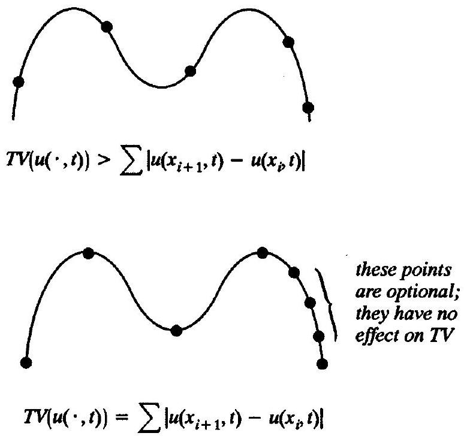
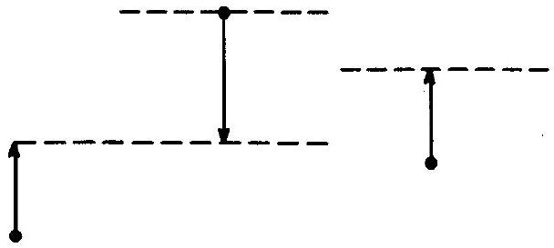

## Nonlinear Stability

### 16.0 Introduction

The last chapter concerned linear stability. This chapter concerns nonlinear stability. Linear stability theory is classic, dating to the late 1940s. The study of nonlinear stability is far newer. Starting with papers by Boris and Book (1973) and Van Leer (1974), nonlinear stability theory developed over roughly the next fifteen years. Although nonlinear stability theory may someday undergo major revision, no significant new developments have appeared in the literature since the late 1980s. Thus after a period of intensive development, nonlinear stability theory has plateaued, at least temporarily.

To keep the discussion within reasonable bounds, this chapter concerns only explicit forward-time finite-difference approximations. Furthermore, this chapter concerns mainly one-dimensional scalar conservation laws on infinite spatial domains. As far as more realistic scenarios go, the Euler equations are discussed briefly in Section 16.12, multidimensions are discussed briefly at the end of this introduction, and solid and far-field boundaries are discussed briefly in Section 19.1. Unlike solid and far-field boundaries, the periodic boundaries in Chapter 15 and the infinite boundaries in this chapter do not pose any difficult stability issues.

The last chapter began with a general introduction to stability, both linear and nonlinear. Any impatient readers who skipped the last chapter should go back and read Section 15.0. While linear and nonlinear stability share the same broad philosophical principles, especially the emphasis on spurious oscillations, the details are completely different. Thus, except for its introduction, the last chapter is not a prerequisite for this chapter. One of the more important nonlinear stability conditions relies heavily on the wave speed split form described in Section 13.5. Readers who skipped this section should go back and read it. Also, most of the nonlinear stability conditions discussed in this chapter rely heavily on the principles of waveform preservation, waveform destruction, and waveform creation, as described in Section 4.11. Again, any readers who skipped this section should go back and read it.

Perhaps the best known nonlinear stability condition is the total variation diminishing (TVD) condition, suggested by Harten in 1983. People have several common misconceptions about TVD. First, the term "TVD" commonly refers to three distinct nonlinear stability conditions - the actual TVD condition and two other stronger conditions, which imply TVD. Second, some people believe that TVD completely eliminates all spurious oscillations for all $\Delta x$ and $\Delta t$. It does not. In fact, the actual TVD condition may allow large spurious oscillations; of the two other conditions commonly called TVD conditions, only the strongest one truly eliminates spurious oscillations, and then only for scalar model problems on infinite spatial domains away from sonic points. Third, although the term TVD is widely used, few outside of the mathematics community recognize that TVD refers to stability.

This chapter will only address nonlinear stability conditions; it will not discuss how numerical methods actually achieve nonlinear stability. Suffice it to say that TVD methods
typically have two ingredients: first, they involve flux averaging as introduced in Section 13.3; second, they carefully exploit the freedom of flux averaging to enforce nonlinear stability conditions. A few TVD methods, such as first-order upwind methods, do not need to use flux averaging - they achieve nonlinear stability by good fortune rather than by design.

As discussed in Section 15.0, this book defines stability mainly in terms of spurious oscillations and overshoots. The last chapter described spurious oscillations in linear methods using Fourier series. However, the Euler equations and most scalar conservation laws are highly nonlinear. Numerical approximations should contain at least as much nonlinearity as the governing equations. Most modern numerical methods add their own nonlinearity, making them highly nonlinear even for linear governing equations. Without the principle of superposition, different frequencies in a discrete Fourier series interact nonlinearly, making any sort of von Neumann analysis intractable. Although nonlinear stability analyses still focus on spurious oscillations and overshoots, they must take a completely different tack.

To further expound on the connections between linear stability analysis as seen in the last chapter and nonlinear stability analysis as seen in this chapter, recall that linear stability analysis naturally uses the "unbounded growth" definition of stability. In other words, linear stability analysis requires only that the solution should not "blow up" or, more specifically, that each component in the Fourier series representation of the solution should not increase to infinity. Nonlinear stability analysis may use a similar notion - while it never attempts to decompose the solution into sinusoidal components, as in a Fourier series, nonlinear stability conditions can require that the overall amount of oscillation, as measured by the total variation, remains bounded; this is known as the total variation bounded (TVB) condition. In linear stability analysis, the special properties of linear equations imply that if the solution does not blow up then it must monotonically shrink or stay the same. More specifically, if each component in the Fourier series representation of the solution remains bounded, then each component in the Fourier series representation either shrinks by the same amount or remains exactly the same at each time step. Nonlinear stability analysis may use a similar notion - while it never attempts to decompose the solution into sinusoidal components, as in a Fourier series, it can require that the overall amount of oscillation, as measured by the total variation, either shrinks or remains exactly that same at each time step; this is known as the total variation diminishing (TVD) condition. Not "blowing up" and "shrinking" are equivalent notions for linear equations, at least when viewed in terms of Fourier series coefficients. However, these notions are distinct when viewed in terms of total variation, for either linear or especially nonlinear equations. In particular, TVD implies TVB but not necessarily vice versa.

After determining whether or not the solution blows up, as a secondary goal, von Neumann stability analysis investigates spurious oscillations caused by phase errors rather than amplitude errors in the Fourier series representation. Phase errors cause dispersion and spurious oscillations, a form of instability if you care to view it that way, although dispersion never causes the solution to blow up. Nonlinear stability analysis may use similar notions - it can investigate any sort of spurious oscillation, regardless of whether or not it causes the solution to blow up, and regardless of how it affects the total size of the oscillations as measured by the total variation. Indeed, in most cases, it is impossible to enforce TVB or TVD directly. Instead, most nonlinear stability analyses actually use much stronger conditions that address the individual maxima and minima found in spurious oscillations, rather than the overall growth of the spurious oscillations as measured by the total variation.

These conditions include the positivity condition and especially the upwind range condition, both of which imply TVB and TVD.

As we have said, rather than fitting maxima and minima into regular periodic oscillations, as in Fourier series, nonlinear stability analysis focuses on the individual maxima and minima and sums thereof. In fact, maxima and minima are the most important features of any function. Here and throughout the chapter, the terms "maxima" and "minima" include "suprema" and "infema," such as horizontal asymptotes. As discussed following Equation (6.8), there is a technical distinction between the values that a function actually attains versus the values that a function draws arbitrarily close to. However, it is extremely awkward to say "maxima, minima, suprema, and infema." Thus, this chapter will take the liberty of saying "maxima and minima" or simply "extrema" to cover all four terms. To continue, as any freshman calculus student knows, a function can be plotted roughly knowing only its maxima and minima. Of course, roots, inflection points, randomly chosen samples, and so on are also extremely helpful, but not as helpful as maxima and minima. Without maxima and minima, or at least estimates thereof, any graph of the function will not look much like it should. Sometimes one knows that a function has a certain parametric form. For example, sometimes one knows that the function is an $N$ th-order polynomial or an $N$ th-order trigonometric series, as discussed in Chapter 8. In such cases, almost any sort of further information allows you to determine the constants in the parametric form and reconstruct the function perfectly, including the maxima and minima. However, the functions in gasdynamics do not generally assume any predictable parametric forms. Thus, for the functions in gasdynamics, or for any arbitrary function, the most important pieces of information are the maxima and minima.

Von Neumann analysis as seen in the last chapter applies to any linear method. However, the nonlinear stability conditions in this chapter exploit properties that are, to varying degrees, specific to scalar conservation laws and the one-dimensional Euler equations. The maxima and minima in the solutions to scalar conservation laws and the one-dimensional Euler equations behave in simple, predictable, and exploitable fashions. In particular, according to the discussion of Section 4.11, any waveform-preserving portions of the solution preserve maxima and minima. Of course, maxima and minima may change positions, but their values never change, except near shocks. In contrast, waveform-destroying portions of the solutions, near shocks, may reduce or eliminate maxima and increase or eliminate minima. Besides waveform preservation and waveform destruction, one must also consider waveform creation. For scalar conservation laws, waveform creation never creates new maxima or minima - created waveforms are purely monotone increasing or monotone decreasing. In summary, for scalar conservation laws, existing maxima either stay the same or decrease near shocks, existing minima either stay the same or increase near shocks, and no new maxima and minima are ever created. This is called the range diminishing property. The same conclusions hold for the characteristic variables in the one-dimensional Euler equations, except that new maxima and minima may appear in the waveforms created by jump discontinuities in the initial conditions, intersections between jump discontinuities, and reflections of jump discontinuities from solid surfaces. This proves more annoying in theory than in practice.

Many of the nonlinear stability conditions seen in this chapter stem directly from the range diminishing property and thus indirectly from the properties of waveform preservation, waveform destruction, and waveform creation as found in scalar conservation laws and the one-dimensional Euler equations. In particular, the range diminishing property implies TVD and TVB. However, since TVD and TVB are much weaker properties than the range diminishing property, they may apply in circumstances where the range diminishing
condition does not; remember that scalar conservation laws and the one-dimensional Euler equations are only model problems for more realistic equations, and we would like to find principles that apply generally, not just in model problems, making the TVD and TVB conditions more widely usable than range diminishing.

In one interpretation, the CFL condition is a necessary nonlinear stability condition, as discussed in Chapter 12. Unlike most of the nonlinear stability conditions described in this chapter, the CFL condition has no direct relationship to spurious maxima and minima. The nonlinear stability conditions in this chapter often do not imply the CFL condition and, in fact, generally have no direct connection to the CFL condition, since they concern maxima and minima whereas the CFL condition does not. Any nonlinear stability condition that does not imply the CFL condition is certainly not, by itself, a sufficient stability condition. Thus most of the nonlinear stability conditions in this chapter are not, in and of themselves, sufficient for nonlinear stability. Furthermore, they may not, in isolation, be necessary for nonlinear stability.

Nonlinear stability is especially vital at shocks and contacts, which tend to create large spurious oscillations in otherwise stable and monotone solutions. Of course, conservation is also vital at shocks and contacts, in order to locate such features correctly, as discussed in Chapter 11. In one sense, conservation addresses the phase (location) of the solution, while nonlinear stability addresses the complementary issue of the amplitude (shape) of the solution. This naturally leads us to consider the combined effects of nonlinear stability conditions and conservation. In fact, there is an established body of theory describing the effects of conservation combined with nonlinear stability conditions in the convergence limit $\Delta x \rightarrow 0$ and $\Delta t \rightarrow 0$, as discussed briefly in Section 16.11. Unfortunately, there are far fewer results on the combined effects of conservation and nonlinear stability for ordinary values of $\Delta x$ and $\Delta t$. As a rough rule of thumb, for ordinary values of $\Delta x$ and $\Delta t$, conservation accentuates both the positive and negative effects of nonlinear stability conditions. For example, if the stability condition reduces the order of accuracy, the combination of stability and conservation may further reduce the order of accuracy.

Unfortunately, no one has yet discovered the perfect nonlinear stability condition. If they had, this chapter would be considerably shorter: it would describe the perfect condition and be over. Instead, this chapter considers nine imperfect conditions, each with their own strengths and weakness. Some of these conditions, especially the weakest, are useful mostly in the limit $\Delta x \rightarrow 0$ and $\Delta t \rightarrow 0$; on the positive side, these weaker conditions may apply to all sorts of equations, not just to scalar conservation laws or to the one-dimensional Euler equations. Others of these conditions limit the numerical solution in entirely unphysical ways. For example, some of the stronger conditions cause first- or second-order clipping errors at extrema, whereas the strongest limit the order of accuracy to one throughout the entire solution.

In summary, although the stronger nonlinear stability conditions restrict the formal order of accuracy, especially at extrema, they also may effectively reduce or completely eliminate spurious oscillations and overshoots; by contrast, the weaker nonlinear stability conditions place little or no restrictions on the formal order of accuracy at extrema or elsewhere, but they may allow large spurious oscillations and overshoots. To some extent, there is thus a trade-off between two types of errors, and one must choose between oscillatory errors in monotone regions or clipping errors at extrema.

This book mainly concerns one-dimensional flows. However, before continuing, let us say a few words about nonlinear stability in multidimensions. Unfortunately, in general, there are still many unresolved issues in the theory of multidimensional gasdynamics.

Fortunately, putting aside theory, there are established heuristics, usually heavily based on one-dimensional concepts, that work well enough in practice. Nonlinear stability is no exception. Recall that the one-dimensional stability analysis, as seen in this book, uses spurious oscillations as a fundamental unifying principle. As one primary obstacle to multidimensional stability analysis, a function can oscillate in multidimensions without creating maxima or minima. For example, imagine a wavy surface, like a corrugated tin roof. If the ridges of the surface are kept perfectly horizontal, then every oscillatory wave in the surface is either a maximum or a minimum. However, if the surface is tilted, then only the ridges on the highest and lowest ends of the surface represent true maxima and minima. This poses a dilemma: should we attempt to control all oscillations, or just those oscillations that cause maxima and minima? Goodman and LeVeque (1985) proposed a multidimensional definition of TVD that accounts for all of the oscillations and not just extrema; unfortunately, they found that even weak limits on such oscillations limited the order of accuracy to one. Laney and Caughey (1991a, 1991b, 1991c) proposed another multidimensional definition of TVD that only controls true multidimensional extrema; although such definitions do not restrict the order of accuracy away from extrema, they might allow large multidimensional oscillations of the sort that do not cause extrema.

As the other primary obstacle to nonlinear stability theory in multidimensions, the Euler equations are no longer nonoscillatory in multidimensions, at least in many regions of flow; in other words, the multidimensional characteristic variables do not necessarily share the nonoscillatory properties of the one-dimensional characteristic variables, as exploited in this chapter. Even if they were completely nonoscillatory, there is always the issue of how to access multidimensional characteristic variables to enforce nonoscillatory nonlinear stability conditions. The classic one-dimensional characteristic access techniques - flux splitting, wave speed splitting, and Riemann solvers - do not extend in any obvious truly multidimensional way. Thus at this point, nonlinear stability theory in multidimensions remains a work in progress. However, as always, even when the theory is lacking, there are practical procedures that seem to work well enough. Thus even though the nonlinear analysis seen in this chapter is strictly one dimensional in theory, it still yields major improvements in multidimensional methods in practice.

Many of the results in this chapter require mathematical proofs. To avoid disrupting the flow of the discussion, several of the longer proofs are relegated to Section 16.13 at the end.

### 16.1 Monotonicity Preservation

The solutions of scalar conservation laws on infinite spatial domains are monotonicity preserving, meaning that if the initial conditions $u(x, 0)$ are monotone increasing, the solution $u(x, t)$ is monotone increasing for all time; and if the initial conditions are monotone decreasing, the solution is monotone decreasing for all time. As with many of the nonlinear stability conditions in this chapter, monotonicity preservation is a consequence of waveform preservation, waveform destruction, and waveform creation, as described in Section 4.11.

Suppose that a numerical approximation inherits monotonicity preservation. Then, if the initial conditions are monotone, monotonicity-preserving methods do not allow spurious oscillations and, in this sense, are stable. Monotonicity preservation was first suggested by Godunov (1959). However, overall, monotonicity preservation is a poor stability condition for the following reasons:

- Monotonicity preservation does not address the stability of nonmonotone solutions.
- Most attempts at enforcing monotonicity preservation end up enforcing much stronger nonlinear stability conditions, such as the positivity condition discussed in Section 16.4.
- Monotonicity preservation does not allow even small benign oscillations in monotone solutions. Small oscillations do not necessarily indicate serious instability, and attempts to purge all oscillatory errors, however small, may cause much larger nonoscillatory errors.
These results imply that monotonicity preservation is too weak in some situations and too strong in others. As one specific example of the effects of monotonicity preservation, consider linear methods. (Nonlinear stability conditions such as monotonicity preservation apply to linear as well as nonlinear methods. Of course, the reverse is not true - linear stability conditions do not apply to nonlinear methods, except possibly locally and approximately.) As it turns out, linear monotonicity-preserving methods are first-order accurate, at best. This is called Godunov's theorem. Unfortunately, first-order accuracy is not enough for most practical computations; second-order accuracy is usually minimal. Because of this, Godunov's theorem is often used to justify inherently nonlinear methods, which are nonlinear even when the governing equations are linear. However, Godunov's theorem is possibly better used as an argument against monotonicity preservation - a more relaxed policy towards minor oscillations would reduce or avoid the order-of-accuracy sacrifice. But whatever its drawbacks, monotonicity preservation is an established element of modern nonlinear stability theory. In fact, all but two of the nonlinear stability conditions considered in the remainder of the chapter imply monotonicity preservation.

### 16.2 Total Variation Diminishing (TVD)

As its greatest drawback, monotonicity preservation fails to address nonmonotone solutions. This section concerns the total variation diminishing (TVD) condition, first proposed by Harten (1983). In essence, TVD is the smallest possible step beyond monotonicity preservation. In other words, TVD is the weakest possible condition that implies monotonicity preservation and yet addresses the stability of both monotone and nonmonotone solutions.

Total variation is a classic concept in real and functional analysis, as seen in any number of mathematical textbooks; for example, see Royden (1968). The most general definition of total variation covers all sorts of strange and arbitrary functions. However, for the sorts of functions seen in computational gasdynamics, the total variation of the exact solution may be defined as follows:

$$
T V(u(\cdot, t))=\sup _{\text {all possible }} \sum_{x_{i}}^{\infty}\left|u\left(x_{i+1}, t\right)-u\left(x_{i}, t\right)\right|,
$$

where this "sup" notation means that the supremum is taken over all possible sets of samples taken from the function's infinite domain. As in Equation (6.8), most readers should mentally replace "sup" by "max." This chapter will hereafter take the liberty of including suprema under the heading of maxima and infema under the heading of minima.

To better understand the meaning of total variation, consider the following result:

> The total variation of a function on an infinite domain is a sum of extrema, maxima counted positively and minima counted negatively. The two infinite boundaries are always extrema and they both count once; every other extrema counts twice.

Figure 16.1 Total variation of functions in Example 16.1.

This result was first reported in the computational gasdynamics literature by Laney and Caughey (1991a). It is proven in Section 16.13. Intuitively, (16.2) says that the total variation measures the overall amount of oscillation in a function.

Example 16.1 Using (16.2), the total variation of any function is easily determined by inspecting its graph, as illustrated in Figure 16.1.

What causes the total variation to increase? Obviously, by (16.2), only maxima and minima affect the total variation. A new local maximum cannot occur unless a new local minimum also occurs, that is, maxima and minima always come in pairs. The reader can

Figure 16.2 Things that cause total variation to increase.

easily verify this by sketching a curve and then attempting to create a new local maximum without also creating a new local minimum; even allowing jump discontinuities, this is an exercise in frustration. By (16.2), any new local maximum-minimum pair always increases the total variation. Furthermore, the total variation increases if an existing local maximum increases or an existing local minimum decreases. Figure 16.2 illustrates all of the things that can cause total variation to increase.

The discussion of waveform preservation, creation, and destruction in Section 4.11 implies that maxima do not increase, minima do not decrease, and no new maxima or minima are created in solutions to scalar conservation laws. In other words, none of the things that cause total variation to increase can occur in the solutions of scalar conservations. Then solutions of scalar conservation laws are total variation diminishing (TVD) and we can write

$$
T V\left(u\left(\cdot, t_{2}\right)\right) \leq T V\left(u\left(\cdot, t_{1}\right)\right)
$$

for all $t_{2} \geq t_{1}$. In the original description, Harten (1983) used the term total variation nonincreasing (TVNI). However, every subsequent paper has used the term "diminishing" as a synonym for "nonincreasing."

Suppose that a numerical approximation inherits the total variation diminishing property. That is, suppose that

$$
T V\left(u^{n+1}\right) \leq T V\left(u^{n}\right)
$$

for all $n$ where

$$
T V\left(u^{n}\right)=\sum_{i=-\infty}^{\infty}\left|u_{i+1}^{n}-u_{i}^{n}\right| .
$$

Fortunately, (16.2) applies to discrete functions as well as to continuously defined functions. In other words, Equation (16.5) says that the total variation of a numerical approximation on an infinite domain is a sum of extrema, maxima counted positively and minima counted negatively. The two infinite boundaries are always extrema and they both count once; every other extrema counts twice.

As promised at the beginning of the section, TVD implies monotonicity preservation. To see this, suppose that the initial conditions are monotone. The total variation of the initial conditions is $u_{\infty}-u_{-\infty}$ if the initial conditions are monotone increasing and $u_{-\infty}-u_{\infty}$ if the initial conditions are monotone decreasing. If the solution remains monotone, the total variation is constant. However, if the solution does not remain monotone, and instead develops new maxima and minima, the total variation increases. However, of course, the total variation cannot increase in a total variation diminishing method, and thus the solution must remain monotone.

As shown in the following examples, sometimes the TVD condition is too weak and sometimes the TVD condition is too strong.

Example 16.2 This example shows that TVD allows spurious oscillations. Consider the two solutions illustrated in Figure 16.3. Both solutions have the same total variation of 12. Thus, in theory at least, a TVD method could evolve one into the other. This kind of thing does not happen much in practice for two reasons. First, most so-called TVD methods actually satisfy much stronger nonlinear stability conditions, which prevent such oscillations. Second, most TVD methods are also conservative, and the combination tends to prevent oscillations that TVD alone would allow. In short, it is not TVD itself that prevents oscillations in practice, but other conditions that imply or supplement TVD.

Figure 16.3 TVD allows spurious oscillations.

Figure 16.4 Maxima may increase in samples of the true solution; thus the total variation of the samples may increase.

Example 16.3 This example shows how TVD affects accuracy at extrema. Consider the linear advection of a triangular shape, as shown in Figure 16.4. In the figure, the total variation should increase by $\Delta x$ between time steps, but this increase is disallowed by TVD. In actuality, the total variation of the numerical approximation should both decrease and increase as the alignment between the grid and the exact solution changes. Preventing maxima from increasing, or minima from decreasing, causes an error called clipping. In this example, TVD forces an $O(\Delta x)$ clipping error at the nonsmooth maximum. Clipping error is $O\left(\Delta x^{2}\right)$ for most smooth extrema, as discussed in the next section.

In theory, TVD does not always require clipping. For example, the local maximum could increase, provided that a local maximum decreased somewhere else, or a local minimum increased somewhere else, or a local maximum-minimum pair disappeared somewhere else. In theory, even when some clipping occurs, it might be less severe than first- or secondorder, for the same reasons. However, in practice, TVD methods typically clip every time, reducing the order of accuracy at extrema to two or less, as measured by equations such as (11.52). This is partly because most so-called TVD methods actually satisfy much stronger nonlinear stability conditions than TVD. Unlike TVD, these stronger nonlinear stability conditions imply second order or greater clipping errors at every extrema, as described in later sections. Even if you could devise a method that was only TVD, and did not satisfy any stronger nonlinear stability condition, most TVD methods are also conservative and the combination tends to exaggerate the effects of TVD.

We have just seen some of the drawbacks with TVD. Let us now look at one advantage. Oscillations always add to the total variation, and thus oscillations cannot grow indefinitely without violating the TVD condition. If the number of oscillations increases, the size of
the oscillations must eventually decrease, and vice versa. Hence, assuming that the total variation of the initial conditions is finite, TVD prevents unbounded oscillatory growth and thus TVD eliminates the worst-case type of instability. In fact, taking the total variation to be a rough estimate of the overall amount of oscillation, the total amount of oscillation must either decrease or stay the same at every time step.

The properties of TVD are summarized as follows:

- Most attempts at enforcing TVD end up enforcing much stronger nonlinear stability conditions, such as the positivity condition discussed in Section 16.4.
- TVD implies monotonicity preservation. This is desirable in circumstances where monotonicity preservation is too weak but undesirable in circumstances where monotonicity preservation is too strong, since TVD may be even stronger.
- TVD tends to cause clipping errors at extrema. In theory, clipping need not occur at every extrema and may be only moderate where it does occur. However, in practice, most TVD methods clip all extrema to between first- and second-order accuracy.
- TVD methods may allow large spurious oscillations in theory but rarely in practice. At the very least, TVD puts a nonincreasing upper bound on oscillations, eliminating worst-case "unbounded growth" instability.

Regardless of its drawbacks, TVD is a nearly unavoidable element of current nonlinear stability theory. As it turns out, all but two of the stability conditions seen in the remainder of this chapter imply TVD.

### 16.3 Range Diminishing

TVD allows large spurious oscillations, at least under certain circumstances. This section concerns a stronger condition which completely eliminates spurious oscillations. The exact solutions of scalar conservation laws on infinite spatial domains have the following property:

- Maxima do not increase, minima do not decrease, and no new extrema are created with time.

As described in the introduction to the chapter, this property is a direct consequence of waveform preservation, waveform destruction, and monotone waveform creation. It implies that both the global and local range of the exact solution continuously contract in time. More specifically, the local range is preserved during waveform preservation or creation, and the local range is reduced during waveform destruction at shocks. Thus property (16.6) is called the range diminishing or range reducing property. Range diminishing is illustrated in Figure 16.5. In particular, Figure 16.5 shows that the range may diminish either globally or locally: in Figure 16.5a, the global maximum decreases, and thus the global range also decreases; in Figure 16.5b, a local minimum is eliminated, which decreases the range locally, near the center of the solution, but not globally.

Range diminishing was first proposed by Boris and Book (1973) and later clarified by Harten (1983). The reader should be aware that range diminishing is not a standard term. However, it makes sense to introduce a new term, rather than saying "maxima do not increase, minima do not decrease, and there are no new maxima or minima" each time, as in the existing literature.

Figure 16.5 (a) An illustration of global range reduction. (b) An illustration of local range reduction.

Suppose that a numerical approximation inherits the range diminishing property. In other words, in the discrete approximation, suppose that maxima do not increase, minima do not decrease, and that no new maxima and minima are created. Then the numerical approximation is obviously free of any spurious oscillations and overshoots. Unfortunately, range diminishment exacts a toll on accuracy. To see this, notice that in the perfect finitedifference method

$$
u_{i}^{n}=u\left(x_{i}, t^{n}\right) .
$$

Hence, the perfect finite-difference approximation yields samples of the exact solution. However, the local and global ranges of the true samples both decrease and increase in time, unless a sample always falls exactly on the crest of every maxima and minima in the true solution. For example, suppose that the closest sample falls just to the right of a right-running global maximum in the exact solution. Then this sample is a local maximum among samples, but yet it should increase as the maximum in the true solution moves to the right. This is illustrated in Figure 16.4. For another example, suppose a maximum in the true solution falls between two samples (the maximum falls between the cracks, so to speak) such that the samples are monotone or constant. At some later time, one of the samples may fall directly on top of the local maximum and thus should create a new maximum in the samples. Actually, the biggest problem in this case is the sample spacing, which must be reduced to reliably capture such fine details. An adequate sampling of the exact solution would not produce new maxima or minima.

Because of all this, range reduction in numerical methods prevents certain legitimate physical behaviors. The same can be said of monotonicity preservation and TVD, and for exactly the same reasons. Physically, the numerical solution should allow small increases in existing maxima and small decreases in existing minima. The numerical solution should also allow small new maxima and minima, if not for physical reasons then for numerical reasons, since eliminating all new maxima and minima may create larger errors than it prevents, especially in linear methods, by Godunov's theorem.

Like TVD, range reduction implies clipping at extrema. Unlike TVD, range reduction clips every extrema, causing at least second-order errors. Thus

- Range diminishing methods are formally second-order accurate at extrema, at best.

To prove this, suppose a spatial maximum occurs at ( $x_{\text {max }}, t_{\text {max }}$ ). By Taylor series

$$
\begin{aligned}
u(x, t)= & u\left(x_{\max }, t_{\max }\right)+\frac{\partial u}{\partial x}\left(x_{\max }, t_{\max }\right)\left(x-x_{\max }\right) \\
& +\frac{1}{2} \frac{\partial^{2} u}{\partial x^{2}}\left(x_{\max }, t_{\max }\right)\left(x-x_{\max }\right)^{2}+\cdots
\end{aligned}
$$

But if ( $x_{\text {max }}, t_{\text {max }}$ ) is a smooth spatial maximum then

$$
\frac{\partial u}{\partial x}\left(x_{\max }, t_{\max }\right)=0
$$

and

$$
\frac{\partial^{2} u}{\partial x^{2}}\left(x_{\max }, t_{\max }\right) \leq 0,
$$

as proven in any elementary calculus book. Then

$$
u\left(x, t_{\max }\right)=u\left(x_{\max }, t_{\max }\right)-O\left(\Delta x^{2}\right)
$$

for all $x_{\text {max }}-O(\Delta x) \leq x \leq x_{\text {max }}+O(\Delta x)$. In the best case, a sample falls exactly on $x_{\text {max }}$. But, in general, the nearest sample is $O(\Delta x)$ away from $x_{\text {max }}$ and the true maximum $u\left(x_{\text {max }}, t_{\text {max }}\right)$ is represented by a sample $u\left(x_{\text {max }}, t_{\text {max }}\right)-O\left(\Delta x^{2}\right)$. This is illustrated in Figure 16.6. If the samples ever once miss the maximum, then range reduction never allows the samples to increase, making the second-order reduction permanent. In Figure 16.6, clipping appears to neatly trim the top of the maximum, leaving a flat plateau. In practice, clipping need not act quite so crisply but, in any event, clipping limits accuracy at most smooth extrema to second order.

All statements about formal order of accuracy contain a certain degree of ambiguity, as discussed in Section 6.3 and Subsection 11.2.2. Equation (16.7) is no exception. For example, the proof of (16.7) assumed two continuous derivatives. If the solution does not have the required continuous derivatives, the formal order of accuracy will decrease, as in Example 16.3. Furthermore, the proof of (16.7) assumes that the second derivative is strictly less than zero. If the second derivative equals zero, the formal order of accuracy will increase. Finally, (16.7) does not account for space-time interactions, instability, or any sort

Figure 16.6 Clipping error is formally second order or greater at smooth extrema.

of numerical error except for clipping. Because of these additional sources of error, most range reducing methods do not achieve full second-order accuracy at extrema, but instead produce a fractional pointwise order of accuracy at smooth extrema somewhere between one and two.

As it turns out, range diminishing implies TVD, since range diminishing specifically disallows all behaviors that increase total variation, such as those illustrated in Figure 16.2. The properties of range diminishing are summarized as follows:

- Most attempts at enforcing range diminishing end up enforcing stronger nonlinear stability conditions, such as the upwind range condition of Section 16.5. However, there have been some attempts to enforce the range diminishing condition directly and precisely. For example, see Laney and Caughey (1991b, 1991c) or Coray and Koebbe (1993).
- Range diminishing implies TVD. This is desirable in circumstances where TVD is too weak. However, this is undesirable in circumstance where TVD is too strong, since range diminishing is even stronger.
- Range diminishing always causes clipping error at extrema. Clipping limits the formal pointwise order of accuracy at extrema to two.
- Range diminishing completely eliminates any spurious oscillations, overshoots, or extrema.

This chapter has now described monotonicity preservation, TVD, and range diminishing conditions. Unfortunately, all three of these conditions are difficult to prove or enforce directly. The next two sections concern conditions that are relatively easy to prove or enforce, and thus these next two conditions are among the most popular and practical nonlinear stability conditions.

### 16.4 Positivity

This section concerns a nonlinear stability condition based on the wave speed split form discussed in Section 13.5. Recall that the wave speed split form is

$$
u_{i}^{n+1}=u_{i}^{n}+C_{i+1 / 2}^{+}\left(u_{i+1}^{n}-u_{i}^{n}\right)-C_{i-1 / 2}^{-}\left(u_{i}^{n}-u_{i-1}^{n}\right) .
$$

Recall that methods derived using wave speed splitting naturally arrive in wave speed split form where $C_{i+1 / 2}^{ \pm} \geq 0$; however, any method can be written in a wave speed split form, in infinitely many different ways, provided one can tolerate infinite coefficients $C_{i+1 / 2}^{ \pm}$when $u_{i+1}^{n}-u_{i}^{n}=0$. But suppose that a numerical method can be written in a wave speed split form with finite nonnegative coefficients such that

$$
\begin{aligned}
& C_{i+1 / 2}^{+} \geq 0, \quad C_{i+1 / 2}^{-} \geq 0, \\
& C_{i+1 / 2}^{+}+C_{i+1 / 2}^{-} \leq 1
\end{aligned}
$$

for all $i$. This is called the positivity condition. Positivity was first suggested by Harten (1983). The reader should be warned that the term "positivity" has many meanings in the literature. Instead of a positivity condition, in the existing literature, Equation (16.8) is most often called a TVD condition. Obviously this leads to confusion with the true TVD condition, Equation (16.3), which justifies the introduction of a distinct term. Although
positivity implies TVD, as discussed below, positivity is certainly not the same thing as TVD. Unlike previous nonlinear stability conditions, the positivity condition does not derive from any specific physical attributes of the exact solution, except possibly $C_{i+1 / 2}^{ \pm} \geq 0$, which is a physical splitting condition, if you care to interpret it that way, as seen in Equation (13.39).

A numerical method can be split in infinitely many different ways, as seen in Section 13.5. A method that does not satisfy Equation (16.8) when written in one wave speed split form may yet satisfy Equation (16.8) when written in some other wave speed split form. However, in general, at most one splitting will yield finite coefficients $C_{i+1 / 2}^{ \pm}$and thus at most one splitting even has the potential to satisfy Equation (16.8).

The positivity condition, Equation (16.8), does not look much like a nonlinear stability condition, in the sense that it does not have any obvious connections to spurious oscillations. However, the positivity condition lies between two nonlinear stability conditions. In particular, positivity implies TVD, as shown by Harten (1983); the reader may wish to attempt this half-page proof as an exercise. Also, the upwind range condition implies positivity, as discussed in the next section and as proven in Section 16.13. Its intimate association with admitted nonlinear stability conditions makes positivity a nonlinear stability condition.

One of the common myths about positivity is that it eliminates spurious oscillations and overshoots. Although positivity limits spurious oscillations and overshoots, just like all nonlinear stability conditions, it does not necessarily eliminate spurious oscillations and overshoots. A good example is the Lax-Friedrichs method. The Lax-Friedrichs method is positive and yet may develop large spurious oscillations in as little as one time step, as discussed in Section 17.1. Unfortunately, the myth about positivity has led to the myth that the Lax-Friedrichs method does not allow spurious oscillations and overshoots. In fact, in some quarters, Lax-Friedrichs has an unwarranted reputation as the ultimate nonoscillatory method because it satisfies not only positivity but also every nonlinear stability condition seen in this chapter, except for the range diminishing and upwind range conditions. However, this reflects more on the weaknesses of current nonlinear stability theory than on the strengths of the Lax-Friedrichs method.

Like range reduction, positivity usually restricts accuracy at extrema to between first and second order. However, positivity by itself does not limit the order of accuracy at extrema but instead the combination of positivity and conservation limits the order of accuracy at extrema to between first and second order in a "clipping-like" way; see Subsection 3.3.2 of Laney and Caughey (1991c) for a discussion.

Example 16.4 Show that FTCS is not positive.

Solution Example 13.12 described wave speed split forms for FTCS. Every method can be written in, at most, one wave speed form with finite coefficients. For FTCS, that form is as follows:

$$
\begin{aligned}
& C_{i+1 / 2}^{+}=-\frac{\lambda}{2} a_{i+1 / 2}^{n}, \\
& C_{i-1 / 2}^{-}=\frac{\lambda}{2} a_{i-1 / 2}^{n},
\end{aligned}
$$

where as usual

$$
a_{i+1 / 2}^{n}= \begin{cases}\frac{f\left(u_{i+1}^{n}\right)-f\left(u_{i}^{n}\right)}{u_{i+1}^{n}-u_{i}^{n}} & \text { if } u_{i+1}^{n} \neq u_{i}^{n}, \\ a(u)=f^{\prime}(u) & \text { if } u_{i+1}^{n}=u_{i}^{n}=u .\end{cases}
$$

Since $C_{i+1 / 2}^{+}=-C_{i+1 / 2}^{-}$, the coefficients $C_{i+1 / 2}^{+}$and $C_{i+1 / 2}^{-}$cannot both be nonnegative. Thus this form violates $C_{i+1 / 2}^{ \pm} \geq 0$. Every other wave speed split form of FTCS has infinite coefficients - either $C_{i+1 / 2}^{+}$or $C_{i+1 / 2}^{-}$or both are infinite when $u_{i}^{n}=u_{i+1}^{n}$. Thus every other wave speed split form violates either $C_{i+1 / 2}^{ \pm} \geq 0$ or $C_{i+1 / 2}^{+}+C_{i+1 / 2}^{-} \leq 1$ or both. Thus FTCS does not satisfy positivity. This is consistent with the known instability of FTCS.

Example 16.5 Show that FTFS is positive for $-1 \leq \lambda a_{i+1 / 2}^{n} \leq 0$.
Solution As shown in Example 13.13, FTFS can be written in wave speed split form with the following finite coefficients:

$$
\begin{aligned}
& C_{i+1 / 2}^{+}=-\lambda a_{i+1 / 2} \\
& C_{i-1 / 2}^{-}=0
\end{aligned}
$$

Then FTFS is positive if $0 \leq C_{i+1 / 2}^{+} \leq 1$ or $-1 \leq \lambda a_{i+1 / 2}^{n} \leq 0$. Notice that, in this case, the positivity condition is equivalent to the CFL condition.

Example 16.6 Positivity is sometimes defined in terms of the artificial viscosity form seen in Section 14.2. Show that a method is positive if

$$
\left|\lambda a_{i+1 / 2}^{n}\right| \leq \lambda \epsilon_{i+1 / 2}^{n} \leq 1,
$$

where as usual

$$
a_{i+1 / 2}^{n}= \begin{cases}\frac{f\left(u_{i+1}^{n}\right)-f\left(u_{i}^{n}\right)}{\left(u_{i+1}^{n}\right)-u_{i}^{n}} & \text { if } u_{i+1}^{n} \neq u_{i}^{n}, \\ a(u)=f^{\prime}(u) & \text { if } u_{i+1}^{n}=u_{i}^{n}=u .\end{cases}
$$

Solution The artificial viscosity form is

$$
\begin{aligned}
u_{i}^{n+1}= & u_{i}^{n}-\frac{\lambda}{2}\left(f\left(u_{i+1}^{n}\right)-f\left(u_{i-1}^{n}\right)\right) \\
& -\frac{\lambda}{2}\left(\epsilon_{i+1 / 2}^{n}\left(u_{i+1}^{n}-u_{i}^{n}\right)+\epsilon_{i-1 / 2}^{n}\left(u_{i}^{n}-u_{i-1}^{n}\right)\right) .
\end{aligned}
$$

This can be rewritten in wave speed split form as follows:

$$
\begin{aligned}
u_{i}^{n+1}= & u_{i}^{n}-\frac{\lambda}{2}\left(\epsilon_{i+1 / 2}^{n}+a_{i+1 / 2}^{n}\right)\left(u_{i+1}^{n}-u_{i}^{n}\right) \\
& -\frac{\lambda}{2}\left(\epsilon_{i-1 / 2}^{n}-a_{i-1 / 2}^{n}\right)\left(u_{i}^{n}-u_{i-1}^{n}\right)
\end{aligned}
$$

This implies

$$
\begin{aligned}
& C_{i+1 / 2}^{+}=\frac{\lambda}{2}\left(\epsilon_{i+1 / 2}^{n}+a_{i+1 / 2}^{n}\right) \\
& C_{i+1 / 2}^{-}=\frac{\lambda}{2}\left(\epsilon_{i+1 / 2}^{n}-a_{i+1 / 2}^{n}\right)
\end{aligned}
$$

or

$$
\begin{aligned}
& C_{i+1 / 2}^{+}+C_{i+1 / 2}^{-}=\lambda \epsilon_{i+1 / 2}^{n}, \\
& C_{i+1 / 2}^{+}-C_{i+1 / 2}^{-}=\lambda a_{i+1 / 2}^{n} .
\end{aligned}
$$

By Equation (16.11), notice that $\epsilon_{i+1 / 2}^{n} \geq\left|a_{i+1 / 2}^{n}\right|$ implies $C_{i+1 / 2}^{+} \geq 0$ and $C_{i+1 / 2}^{-} \geq 0$. By Equation (16.12), notice that $\lambda \epsilon_{i+1 / 2}^{n} \leq 1$ implies $C_{i+1 / 2}^{+}+C_{i+1 / 2}^{-} \leq 1$. Putting $\epsilon_{i+1 / 2}^{n} \geq\left|a_{i+1 / 2}^{n}\right|$ and $\lambda \epsilon_{i+1 / 2}^{n} \leq 1$ together, we have $\left|\lambda a_{i+1 / 2}^{n}\right| \leq \lambda \epsilon_{i+1 / 2}^{n} \leq 1$, which implies positivity.

Unfortunately, $\left|\lambda a_{i+1 / 2}^{n}\right| \leq \lambda \epsilon_{i+1 / 2}^{n} \leq 1$ only allows first-order accurate methods, as shown by Osher (1984). However, in the artificial viscosity form, suppose that FTCS is replaced by some other reference method, written in wave speed split form as follows:

$$
u_{i}^{n+1}=u_{i}^{n}+D_{i+1 / 2}^{+}\left(u_{i+1}^{n}-u_{i}^{n}\right)-D_{i-1 / 2}^{-}\left(u_{i}^{n}-u_{i-1}^{n}\right) .
$$

Then this reference method plus second-order artificial viscosity is

$$
\begin{aligned}
u_{i}^{n+1}= & u_{i}^{n}+\left(D_{i+1 / 2}^{+}+\frac{\lambda}{2} \epsilon_{i+1 / 2}^{n}\right)\left(u_{i+1}^{n}-u_{i}^{n}\right) \\
& -\left(D_{i-1 / 2}^{-}+\frac{\lambda}{2} \epsilon_{i-1 / 2}^{n}\right)\left(u_{i}^{n}-u_{i-1}^{n}\right)
\end{aligned}
$$

or

$$
u_{i}^{n+1}=u_{i}^{n}+C_{i+1 / 2}^{+}\left(u_{i+1}^{n}-u_{i}^{n}\right)-C_{i-1 / 2}^{-}\left(u_{i}^{n}-u_{i-1}^{n}\right),
$$

where

$$
\begin{aligned}
& C_{i+1 / 2}^{+}=D_{i+1 / 2}^{+}+\frac{\lambda}{2} \epsilon_{i+1 / 2}^{n} \\
& C_{i+1 / 2}^{-}=D_{i+1 / 2}^{-}+\frac{\lambda}{2} \epsilon_{i+1 / 2}^{n}
\end{aligned}
$$

Increasing the artificial viscosity $\epsilon_{i+1 / 2}^{n}$ increases both $C_{i+1 / 2}^{+}$and $C_{i+1 / 2}^{-}$. Thus $C_{i+1 / 2}^{+} \geq 0$ and $C_{i+1 / 2}^{-} \geq 0$ for sufficiently large $\epsilon_{i+1 / 2}^{n}$. However, if $\epsilon_{i+1 / 2}^{n}$ is too large then $C_{i+1 / 2}^{+}+ C_{i+1 / 2}^{-} \leq 1$ is violated. Hence, according to the positivity condition, artificial viscosity is stabilizing in small amounts and destabilizing in large amounts. Whereas positivity implies first-order accuracy for FTCS plus artificial viscosity, it allows arbitrary orders of accuracy for other reference methods plus artificial viscosity, at least away from extrema, especially for reference methods with stencils wider than three points.

The properties of positivity are summarized as follows:

- Positivity is relatively easy to prove and enforce. This makes positivity one of
the most widely cited nonlinear stability conditions. However, while many papers discuss positivity, the vast majority of them actually enforce the upwind range condition, which is a special case of positivity, as discussed in the next section.
- Positivity implies TVD. This is desirable in circumstances where TVD is too weak. However, this is undesirable in circumstances where TVD is too strong, since positivity is even stronger. Most so-called TVD methods are actually positive.
- Positivity causes a "clipping-like" error at extrema. Positivity and conservation generally limit the formal order of accuracy at extrema to between first and second order.
- Positivity allows large spurious oscillations and overshoots.

### 16.5 Upwind Range Condition

Genetics tells us that children inherit their properties from their parents, grandparents, and more distant ancestors. Similarly, $u\left(x, t^{n+1}\right)$ inherits its properties from its "ancestors" such as $u\left(x, t^{n}\right)$. In particular, by following wavefronts or, in other words, by tracing characteristics, we see that $u\left(x_{i}, t^{n+1}\right)$ inherits its value from an upwind ancestor such as $u\left(x_{i-1}, t^{n}\right)$. If all of the upwind ancestors fall within a certain range, as defined by a maximum and a minimum, then $u\left(x_{i}, t^{n+1}\right)$ must also lie within this same range. Written mathematically and precisely, the exact solution of a scalar conservation law satisfies the condition

$$
\min _{x_{i-1} \leq x \leq x_{i}} u\left(x, t^{n}\right) \leq u\left(x_{i}, t^{n+1}\right) \leq \max _{x_{i-1} \leq x \leq x_{i}} u\left(x, t^{n}\right)
$$

for $0 \leq \lambda a\left(x_{i}, t^{n+1}\right) \leq 1$. Also,

$$
\min _{x_{i} \leq x \leq x_{i+1}} u\left(x, t^{n}\right) \leq u\left(x_{i}, t^{n+1}\right) \leq \max _{x_{i} \leq x \leq x_{i+1}} u\left(x, t^{n}\right)
$$

for $-1 \leq \lambda a\left(x_{i}, t^{n+1}\right) \leq 0$. This is called the upwind range property. The upwind range property is illustrated in Figure 16.7.

Unfortunately, in a numerical approximation, a child cannot know about all of its possible ancestors - it can only know about the ancestors that live at discrete neighboring sample points. But notice that

$$
\begin{aligned}
& \min _{x_{i-1} \leq x \leq x_{i}} u\left(x, t^{n}\right) \leq \min \left(u\left(x_{i}, t^{n}\right), u\left(x_{i-1}, t^{n}\right)\right), \\
& \min _{x_{i} \leq x \leq x_{i+1}} u\left(x, t^{n}\right) \leq \min \left(u\left(x_{i}, t^{n}\right), u\left(x_{i+1}, t^{n}\right)\right)
\end{aligned}
$$

and

$$
\begin{aligned}
& \max \left(u\left(x_{i}, t^{n}\right), u\left(x_{i-1}, t^{n}\right)\right) \leq \max _{x_{i-1} \leq x \leq x_{i}} u\left(x, t^{n}\right), \\
& \max \left(u\left(x_{i}, t^{n}\right), u\left(x_{i+1}, t^{n}\right)\right) \leq \max _{x_{i} \leq x \leq x_{i+1}} u\left(x, t^{n}\right) .
\end{aligned}
$$

Then Equation (16.13a) is true if

$$
\min \left(u\left(x_{i}, t^{n}\right), u\left(x_{i-1}, t^{n}\right)\right) \leq u\left(x_{i}, t^{n+1}\right) \leq \max \left(u\left(x_{i}, t^{n}\right), u\left(x_{i-1}, t^{n}\right)\right)
$$

for $0 \leq \lambda a\left(x_{i}, t^{n+1}\right) \leq 1$. Also, Equation (16.13b) is true if

$$
\min \left(u\left(x_{i}, t^{n}\right), u\left(x_{i+1}, t^{n}\right)\right) \leq u\left(x_{i}, t^{n+1}\right) \leq \max \left(u\left(x_{i}, t^{n}\right), u\left(x_{i+1}, t^{n}\right)\right)
$$

Figure 16.7 The upwind range property of the exact solution.

for $-1 \leq \lambda a\left(x_{i}, t^{n+1}\right) \leq 0$. This is a simplified version of the upwind range property. The simplified version is equivalent to the original version if and only if the solution is monotone increasing or monotone decreasing. Unfortunately, at maxima and minima, the simplified version unphysically restricts the solution, capping maxima too low and minima too high.

Suppose that a numerical approximation has the simplified version of the upwind range property. In other words, suppose that

$$
\begin{array}{lll}
\min \left(u_{i}^{n}, u_{i-1}^{n}\right) \leq u_{i}^{n+1} \leq \max \left(u_{i}^{n}, u_{i-1}^{n}\right), & & 0 \leq \lambda a\left(u_{i}^{n+1}\right) \leq 1, \\
\min \left(u_{i}^{n}, u_{i+1}^{n}\right) \leq u_{i}^{n+1} \leq \max \left(u_{i}^{n}, u_{i+1}^{n}\right), & & -1 \leq \lambda a\left(u_{i}^{n+1}\right) \leq 0 .
\end{array}
$$

This is called the upwind range or upwind compartment condition. The upwind range condition was first suggested by Boris and Book (1973) and Van Leer (1974). It was further developed by Sweby (1984) and others. The reader should be aware that "upwind range" is not a standard term. In fact, in the existing literature, Equation (16.15) is most often called a TVD condition. Obviously, this leads to confusion with the true TVD condition, Equation (16.3), which justifies the introduction of a distinct term.

Let us now consider some of the issues surrounding the upwind range condition. First, the upwind range condition allows values of the solution to travel at most one grid point per time step, either to the left or to the right. Then the upwind range condition only makes sense when $\lambda|a| \leq 1$. Second, the upwind range condition involves $\lambda a\left(u_{i}^{n+1}\right)$. At time level $n$, by definition, explicit methods cannot depend on $\lambda a\left(u_{i}^{n+1}\right)$. However, the unknown $\lambda a\left(u_{i}^{n+1}\right)$
has the same sign as the known $\lambda a\left(u_{i}^{n}\right)$ unless the waves change direction during the time step. The wind can only change directions at sonic points where $a(u)=0$. Thus, in practice, it may be difficult to enforce the upwind range condition at sonic points. Third, the upwind range condition implies the range diminishing condition, except possibly at sonic points, as shown in Section 16.13. Fourth and finally, also as shown in Section 16.13, an explicit method has the upwind range condition if and only if it can be written in wave speed split form where

$$
\begin{array}{llll}
0 \leq C_{i+1 / 2}^{-} \leq 1 & C_{i+1 / 2}^{+}=0, & 0 \leq \lambda a\left(u_{i}^{n+1}\right) \leq 1, \\
0 \leq C_{i+1 / 2}^{+} \leq 1 & C_{i+1 / 2}^{-}=0, & -1 \leq \lambda a\left(u_{i}^{n+1}\right) \leq 0
\end{array}
$$

for all $i$. Then the upwind range condition implies positivity. As a possibly more convenient expression, for conservative methods, Equation (16.16) is equivalent to

$$
\begin{array}{ll}
0 \leq \lambda \frac{\hat{f}_{i+1 / 2}^{n}-\hat{f}_{i-1 / 2}^{n}}{u_{i}^{n}-u_{i-1}^{n}} \leq 1, & 0 \leq \lambda a\left(u_{i}^{n+1}\right) \leq 1, \\
-1 \leq \lambda \frac{\hat{f}_{i+1 / 2}^{n}-\hat{f}_{i-1 / 2}^{n}}{u_{i+1}^{n}-u_{i}^{n}} \leq 0, & -1 \leq \lambda a\left(u_{i}^{n+1}\right) \leq 0 .
\end{array}
$$

Example 16.7 Show that FTFS satisfies the upwind range condition if $-1 \leq \lambda a_{i+1 / 2}^{n} \leq 0$.
Solution As shown in Example 13.13, FTFS can be written in wave speed split form with the following coefficients:

$$
\begin{aligned}
& C_{i+1 / 2}^{+}=-\lambda a_{i+1 / 2}^{n} \\
& C_{i-1 / 2}^{-}=0
\end{aligned}
$$

Then FTFS has the upwind range condition if $0 \leq C_{i+1 / 2}^{+} \leq 1$. This is true if and only if $-1 \leq \lambda a_{i+1 / 2}^{n} \leq 0$.

The properties of the upwind range condition are summarized as follows:

- The upwind range condition is relatively easy to prove and enforce, except possibly at sonic points. This makes the upwind range condition one of the most popular nonlinear stability conditions.
- The upwind range condition implies positivity. In fact, it can be seen as a special case of the positivity condition.
- The upwind range condition implies the range diminishing condition, except possibly at sonic points. Then the upwind range condition always causes second-order clipping error at extrema, except possibly at sonic points, just like the range diminishing condition. Also, the upwind range condition completely eliminates spurious oscillations and overshoots, just like the range diminishing condition, except possibly at sonic points.
- The upwind range condition assumes $\lambda|a| \leq 1$.

### 16.6 Total Variation Bounded (TVB)

All of the nonlinear stability conditions considered so far are too strong, at least under certain circumstances. In particular, all of the nonlinear stability conditions considered so far imply monotonicity preservation which is sometimes too strong, as argued in Section 16.1. This section and the next consider some weaker stability conditions; in particular, the conditions in this section and the next do not imply monotonicity preservation. Equation (16.3) implies that exact solutions to scalar conservation laws have the following property:

$$
T V(u(\cdot, t)) \leq M \leq \infty
$$

for all $t$ and for some constant $M$. For example, $M$ could be the total variation of the initial conditions. Then the exact solutions of scalar conservation laws are said to be total variation bounded (TVB) or to have bounded variation (BV). Like total variation, bounded variation is a classic concept in real and functional analysis, although it typically has a slightly different meaning than that seen here; see Royden (1968). Suppose that a numerical approximation inherits the total variation bounded property. In other words, suppose that

$$
T V\left(u^{n}\right) \leq M \leq \infty
$$

for all $n$ and for some constant $M$. TVB is easily the weakest nonlinear stability condition seen in this chapter. In particular, TVB allows large oscillations provided only that spurious oscillations do not grow unboundedly large as time increases. Thus TVB simply ensures that a method does not blow up, at least not in an oscillatory fashion.

Of all the stability conditions in this chapter, along with TVD, TVB is perhaps the most similar to the linear stability conditions studied in the last chapter. Specifically, both linear stability conditions and TVB prevent unbounded oscillatory growth. For linear methods, if the solution does not blow up then it must either shrink or stay the same size. Thus, to say that a linear method does not blow up is actually quite a strong statement. Nonlinear methods, however, have a much richer variety of behaviors. Thus, when you say that a nonlinear method does not blow up or, equivalently, when you say that a nonlinear method is TVB, the method could still have other provocative behaviors. For example, in theory, the error could start small and grow in time, provided the error eventually stopped growing or reached a horizontal asymptote, however large that asymptote might be.

Historically, in the computational gasdynamics literature, conditions bounding total variation appeared years before TVD, in the context of convergence proofs. When the limitations of TVD (especially clipping) became better known, Shu (1987) officially suggested TVB as a substitute for TVD. Certainly, TVB does not place any unphysical restrictions on the solution like TVD does, except possibly when combined with other properties such as conservation. TVB does place restrictions on the solution in the limit $\Delta x \rightarrow 0$ and $\Delta t \rightarrow 0$, but even then TVB is only really helpful in combination with other conditions such as conservation. Shu (1987) suggested a method which he called a TVB method, as mentioned in Section 21.4. Obviously this method's success cannot be explained solely by the fact that it is TVB.

TVB follows the "unbounded growth" definition of stability. There is a subtle but important variant on TVB often used in the "convergence" definition of stability. In particular, suppose that the total variation is bounded by a constant $M$ for all times $t$, as with ordinary TVB, and also for all sufficiently small $\Delta x$ and $\Delta t$. LeVeque (1992) calls this the total
variation stability condition to distinguish it from the ordinary TVB condition. Notice that total variation stability implies TVB but not vice versa. In fact, many common numerical methods are TVB but not total variation stable. For example, the Lax-Wendroff method seen in Section 17.2 is TVB but not total variation stable, at least for discontinuous solutions. In particular, for given initial conditions, the total variation is bounded for all $t$ for any fixed $\Delta x$ and $\Delta t$, but the total variation grows without bound for discontinuous solutions as $\Delta x \rightarrow 0$ and $\Delta t \rightarrow 0$ for fixed $t$.

The properties of TVB are summarized as follows:

- Most attempts at TVB end up enforcing much stronger nonlinear stability conditions, such as the positivity condition discussed in Section 16.4.
- TVB is the weakest nonlinear stability condition seen in this chapter. In particular, every other stability condition in this chapter implies TVB, except for monotonicity preservation, but TVB does not imply any of the other stability conditions in this chapter.
- TVB does not force errors such as clipping, unlike most of the other nonlinear stability conditions in this chapter.
- TVB tolerates large spurious oscillations, provided only that the oscillations remain bounded. Although TVB puts an upper bound on oscillations, the upper bound can be as large as you like.
- A variant of TVB, sometimes called total variation stability, is useful in convergence proofs, as discussed in Section 16.11.
- As the weakest nonlinear stability condition seen in this chapter, TVB is the most likely condition to apply to other equations in addition to scalar conservation laws and the one-dimensional Euler equations.

### 16.7 Essentially Nonoscillatory (ENO)

Equation (16.3) obviously implies

$$
T V\left(u\left(\cdot, t_{2}\right)\right) \leq T V\left(u\left(\cdot, t_{1}\right)\right)+O\left(\Delta x^{\mathrm{r}}\right)
$$

for all $t_{2} \geq t_{1}$, where $O\left(\Delta x^{\mathrm{r}}\right)$ refers to any positive $r$ th-order term. Then exact solutions of scalar conservation on infinite domains are called essentially nonoscillatory (ENO). Suppose that a numerical approximation inherits the essentially nonoscillatory property. In other words, suppose

$$
T V\left(u^{m}\right) \leq T V\left(u^{n}\right)+O\left(\Delta x^{r}\right)
$$

for all $m \geq n$ and for some arbitrary $r>0$. In particular, Equation (16.21) implies

$$
T V\left(u^{n+1}\right) \leq T V\left(u^{n}\right)+O\left(\Delta x^{\mathrm{r}}\right) .
$$

The ENO condition was suggested by Harten, Engquist, Osher, and Chakravarthy (1987). Notice that TVD implies ENO, which in turn implies TVB. Also, ENO becomes TVD in the limit $\Delta x \rightarrow 0$. The constant $r$ can equal the formal order of accuracy of the method. Better yet, $r$ can equal two. Then ENO allows second-order increases in the total variation of the numerical approximation and, in particular, second-order increases in maxima and secondorder decreases in minima, which eliminates the need for clipping. Unfortunately, ENO theoretically allows large oscillations and overshoots, more so than TVD but less so than

TVB, since oscillations and overshoots can grow by an $r$ th-order amount at every time step. Furthermore, like TVD and TVB, it is extremely difficult to show directly that a numerical method is ENO. Of course, TVD, range reducing, positivity, and the upwind range condition all imply ENO. But if a method satisfies a stronger nonlinear stability condition then one should say so, and not pretend that it only satisfies some weaker nonlinear stability condition. In fact, while ENO methods (Sections 21.4 and 23.5) based on ENO reconstructions exist (Chapter 9) there is no rigorous proof that these methods have ENO stability. In other words, it is important to distinguish between ENO stability and ENO methods, just as it is important to distinguish between TVD stability and TVD methods, or TVB stability and TVB methods.

### 16.8 Contraction

This section considers one of the more obscure nonlinear stability conditions. Consider two exact solutions $u(x, t)$ and $v(x, t)$ of the same scalar conservation law on the same unbounded domain. The solutions are different only because their initial conditions are different. As shown by Lax (1973), any two solutions always draw closer together as measured in the 1 -norm. That is,

$$
\left\|u\left(\cdot, t_{2}\right)-v\left(\cdot, t_{2}\right)\right\|_{1} \leq\left\|u\left(\cdot, t_{1}\right)-v\left(\cdot, t_{1}\right)\right\|_{1}
$$

for all $t_{2} \geq t_{1}$. This is called the contraction property. Suppose a numerical approximation inherits contraction. That is, for any two numerical approximations, suppose that

$$
\left\|u^{n+1}-v^{n+1}\right\|_{1} \leq\left\|u^{n}-v^{n}\right\|_{1} .
$$

Numerical contraction is difficult to directly verify or enforce. The contraction condition implies TVD and the monotone condition seen in the next section implies contraction. Unlike previous nonlinear stability conditions, the contraction condition appears to have no direct link to spurious oscillations. Contraction is an occasionally useful property in mathematical proofs, especially convergence proofs. See Lax (1973) and Section 15.6 of LeVeque (1992) for more details.

### 16.9 Monotone Methods

Consider two exact solutions $u(x, t)$ and $v(x, t)$ of the same scalar conservation law on the same unbounded domain. The solutions are different only because their initial conditions are different. In particular, suppose that the initial conditions satisfy $u(x, 0) \geq v(x, 0)$ for all $x$. Then $u(x, t) \geq v(x, t)$ for all $x$ and $t$. This is called the monotone property. Suppose that a numerical approximation inherits the monotone property. In other words, suppose $u_{i}^{0} \geq v_{i}^{0}$ for all $i$ implies $u_{i}^{n} \geq v_{i}^{n}$ for all $i$ and $n$. It can be shown that an explicit forward-time method is monotone if and only if $u_{i}^{n+1}$ increases or stays the same when any value in its stencil ( $u_{i-K_{1}}^{n}, \ldots, u_{i+K_{2}}^{n}$ ) increases. Be careful not to confuse monotone methods with monotone increasing or decreasing solutions or with monotonicity-preserving methods. The monotone condition was first proposed by Harten, Hyman, and Lax (1976). The monotone condition limits the order of accuracy to one, which strongly limits the practical appeal of monotone methods. The main application for the monotone condition is convergence proofs. Like contraction, the monotone condition appears to have no direct link to spurious oscillations, except that it implies TVD. See Crandall and Majda (1980) or Section 15.7 of LeVeque (1992) for more details on monotone methods.

### 16.10 A Summary of Nonlinear Stability Conditions

Figure 16.8 summarizes seven of the nine nonlinear stability conditions seen in this chapter. The contraction and monotone conditions are omitted from the figure since they are rarely seen outside of the mathematical literature. In Figure 16.8, the stability conditions are arranged with the strongest conditions on the top and the weakest conditions on the bottom. A line connecting two conditions means that the upper condition implies the lower condition. Going from bottom to top in Figure 16.8, the strength of the stability conditions increases, both in terms of positive effects in reducing spurious oscillations and overshoots and in terms of negative effects in reducing the order of accuracy. More specifically, as the strength of the stability conditions increase, spurious overshoots and oscillations decrease, while formal accuracy decreases at extrema or even globally.

Confusingly, as mentioned earlier, the term TVD commonly refers to positivity, the upwind range condition, or even the range reducing condition. In other words, in current parlance, the term TVD is almost synonymous with nonlinear stability. Since the term TVD has been used so indiscriminantly, the vocabulary of nonlinear stability is underdeveloped in the standard literature; this book has introduced new terms to address the situation.

Figure 16.8 A summary of nonlinear stability conditions for scalar conservation laws.

Except for the positivity condition, all of the nonlinear stability conditions seen in this chapter are properties of the exact solution of scalar conservation laws. However, paradoxically, these physical properties become unphysical when imposed on finite-difference approximations, since the maxima and minima of the samples of the numerical solution behave differently than the maxima and minima of the exact solution. One way around this problem is to apply nonlinear stability conditions to some continuously defined functional representation of the solution, such as a piecewise-polynomial reconstruction. Maxima and minima in functional representations behave like maxima and minima in the exact functional solution, since there is no longer any concern about alignment between the samples and extrema. Finite-element methods use piecewise-polynomials as their base representation. However, this chapter is confined to finite-difference methods. For finite-difference methods, a functional solution must be reconstructed from samples. However, lacking knowledge of the true maxima and minima, any maximum in the reconstruction that exceeds the corresponding maximum in the samples could very well represent an overshoot, and any minimum in the reconstruction that falls below the corresponding minimum in the samples could very well represent an undershoot. Thus, the idea of applying stability conditions to a functional representation rather than samples does not really change the situation for finite-difference methods. In other words, there remains a trade-off between stability and formal accuracy at extrema. The only way to avoid second-order clipping at extrema is to allow occasional under- and overshoots at extrema, a type of instability, if you care to view it that way. Many methods play it safe and tolerate clipping for the sake of robust stability.

One possible way to avoid this trade-off, first suggested by Zalesak (1979), is to store maxima and minima from time step to time step, in addition to the ordinary samples. This prevents problems, such as those seen in Example 16.3, where the values of maxima and minima are immediately lost when sampling the initial conditions or, otherwise, in the first few time steps. It also requires less storage than retaining an entire functional representation from time step to time step, as in finite-element methods. However, no one has yet devised a practical means for tracking maxima and minima, and the modern trend is surely away from such special bookkeeping. For more on these sorts of issues, see Zalesak (1979); Harten, Engquist, Osher, and Chakravarthy (1987); and Sanders (1988).

Until now, this chapter has only defined and described nonlinear stability conditions, without providing any clues about the actual enforcement of nonlinear stability conditions, aside from assertions such as "this condition is easy to enforce" or "this condition is hard to enforce." So how are nonlinear stability conditions enforced? Flux and solution averaging were discussed in Sections 13.3 and 13.6, respectively. After stencil selection, flux and solution averaging still allow a wide latitude to adjust the approximation on the chosen stencil. This freedom can be used to satisfy nonlinear stability conditions, such as positivity or the upwind range condition. More specifically, nonlinear stability conditions place upper and lower bounds on averaging parameters such as $\theta_{i+1 / 2}^{n}$ or $\phi_{i+1 / 2}^{n}$. Even after enforcing such nonlinear stability conditions, flux and solution averaging usually have quite a bit of freedom to spare to use for other things. This is discussed in detail in Part V, especially Chapter 20. Thus, for example, when you hear someone refer to a "TVD method" they generally mean a numerical method that (1) involves solution sensitivity achieved through flux averaging or, rarely, solution averaging (2) uses that solution sensitivity to enforce some sort of nonlinear stability condition which implies TVD, such as the upwind range condition, at least for certain model problems ( 3 ) limits the order of accuracy at extrema, usually to between first and second order; and (4) came after the invention of the term

TVD, circa 1983. Therefore, when applied to specific methods, terms such as TVD, TVB, and ENO usually imply much more than nonlinear stability.

To keep the discussion within reasonable bounds, this chapter has only concerned explicit finite-difference methods for scalar conservation laws on unbounded domains. Let us very briefly consider the effects of lifting these restrictions. First consider implicit methods. Except for the positivity condition, all of the nonlinear stability conditions in this chapter are properties of the exact solution and thus apply equally well to explicit and implicit methods; see Harten (1984) and Problem 16.8 for a simple extension of positivity to a class of implicit methods. Second, consider finite-volume methods. The maxima and the minima of cell-integral averages behave differently than the maxima and minima of samples or, for that matter, the maxima and minima of the exact solution. Unfortunately, there have been few attempts to account for the subtle but important second-order differences between samples and cell-integral averages. See Section 2.7 of Laney and Caughey (1991c) for a short discussion. Third, consider boundary conditions. As with linear stability, solid and far-field boundary conditions have profound effects on nonlinear stability; this is discussed briefly in Section 19.1. In practice, most boundary treatments attempt to make the boundary method as physical as possible and hope for the best as far as numerics and stability. Unlike solid and far-field boundaries, periodic boundaries behave very much like the infinite boundaries studied in this chapter; see Problem 16.3.

### 16.11 Stability and Convergence

By the Lax Equivalence Theorem seen in Section 15.4, the "unbounded growth" and "convergence" definitions of stability and instability are essentially equivalent for linear methods, at least as for smooth solutions. Unfortunately, nonlinearity disturbs this simple relationship; although nonlinear "unbounded growth" stability is necessary for "convergence" stability, they are no longer exactly equivalent. Suppose that a numerical method for a scalar conservation law on an infinite domain is conservative, is consistent for smooth solutions (it need not be consistent for nonsmooth solutions), and has well-posed initial conditions. Also, for given initial conditions, suppose that the total variation is bounded for all $n$ and for all sufficiently small $\Delta x$ and $\Delta t$. In other words, suppose that the solution is total variation stable. Then the numerical approximation converges to an exact weak solution in the 1 -norm as $\Delta x \rightarrow 0$ and $\Delta t \rightarrow 0$. For a mathematically rigorous statement and proof of this result, see Theorem 15.2 of LeVeque (1992). Unlike the Lax Equivalence Theorem, this result applies both to smooth and nonsmooth solutions.

Unfortunately, converged solutions may not satisfy the entropy conditions discussed in Chapter 4. In other words, although total variation stability implies convergence to an exact solution, it does not necessarily imply convergence to the exact solution. Entropy conditions are not an issue for linear problems, which have only a single weak solution. However, entropy conditions are a major issue for nonlinear problems when the solution might contain shocks. The monotone condition seen in Section 16.9 ensures convergence to the entropy solution; see, for example, Theorem 15.7 in LeVeque (1992). However, the monotone condition also restricts the order of accuracy to first order, limiting its usefulness in most practical applications. In general, for higher-order accurate methods, entropy conditions must be proven on a case by case basis, exploiting the specific details of each numerical method, in addition to general properties such as positivity and conservation. Such proofs tend to be extremely long, complicated, and mathematical and are well beyond the scope of this book. For some examples, see Osher and Chakravarthy (1984) or Osher and Tadmor
(1988). Of course, just because the solution satisfies entropy conditions in the limit $\Delta x \rightarrow 0$ and $\Delta t \rightarrow 0$ does not mean that the solution satisfies entropy conditions for ordinary values of $\Delta x$ and $\Delta t$, as discussed in Section 4.10.

Because of the Lax Equivalence Theorem, many people equate stability and convergence, even for nonlinear methods. Whereas most nonlinear stability conditions imply convergence, most nonlinear stability conditions imply much more than just convergence. By most definitions of stability, the main goal of stability is to prevent large errors for ordinary values of $\Delta x$ and $\Delta t$, rather than to ensure zero errors in the limit $\Delta x \rightarrow 0$ and $\Delta t \rightarrow 0$. Hence, by most definitions of stability, convergence is simply a fringe benefit of nonlinear stability. However, for those who equate stability with convergence, the TVB and total variation stability conditions are the most important nonlinear stability conditions, and the other nonlinear stability conditions seen in this chapter are interesting only because they imply the TVB or total variation stability conditions and are easier to prove than TVB or total variation stability directly. Similarly, if stability is taken to mean convergence to the solution that satisfies entropy conditions, then the TVB or total variation stability conditions are the most important stability conditions, in the sense that they ensure convergence, while the other stronger nonlinear stability conditions in this chapter are introduced primarily to help encourage convergence to the solution that satisfies the entropy condition.

Although desirable, perfection in the limit $\Delta x \rightarrow 0$ and $\Delta t \rightarrow 0$ may not imply much about the accuracy of the solution for ordinary values of $\Delta x$ and $\Delta t$. For example, as seen in Chapter 7, Legendre polynomial series, Chebyshev series, and Fourier series all converge in the 1 -norm and 2 -norm as $\Delta x \rightarrow 0$, but the maximum error or $\infty$-norm error is large for any finite $\Delta x$ in the presence of jump discontinuities, due to Gibbs oscillations. The most helpful convergence results take the form of a strict upper bound on the maximum error that decreases rapidly as $\Delta x \rightarrow 0$ and $\Delta t \rightarrow 0$. Unfortunately, such convergence results are rare in computational gasdynamics.

### 16.12 The Euler Equations

This section concerns nonlinear stability for the Euler equations. In theory, the nonlinear stability analysis seen in the rest of this chapter only applies if the Euler equations share the relevant nonlinear stability properties of scalar conservation laws. Of course, the weaker the nonlinear stability property, the more likely it is that the Euler equations will satisfy it. For example, most equations satisfy TVB, since this only requires that solutions do not blow up. On the other hand, only a few equations satisfy the range diminishing or upwind range conditions since, for starters, these only make sense for pure wavelike solutions. Surprisingly, the nonlinear stability conditions described in this chapter can often be used even when the governing equations do not have the relevant nonlinear stability traits. For example, in the Navier-Stokes equations, the inviscid "wavelike" terms may be discretized in a way that enforces nonlinear stability conditions, whereas the viscous "nonwavelike" terms can be discretized separately in a way that does not enforce nonlinear stability conditions. Historically, the potential usefulness of nonlinear stability conditions for equations that do not share the relevant nonlinear properties of scalar conservation laws was noted along with one of the very first nonlinear stability conditions - see Figure 5 in Boris and Book (1973) and the associated discussion.

Fortunately, the characteristic variables of the one-dimensional Euler equations share most of the nonlinear stability properties of scalar conservation laws - including monotoni-
city preservation, TVD, range diminishing, the upwind range condition, TVB, and ENO - except possibly for waveforms created by jump discontinuity intersections, waveforms created by reflections of jump discontinuities from solid boundaries, and waveforms created by jump discontinuities in the initial conditions. For example, the solution to the Riemann problem seen in Example 5.1 creates a new minimum in the entropy, which is a characteristic variable. Notice that, in general, the primitive variables, the conservative variables, or any other set of variables besides the characteristic variables of the Euler equations most certainly do not share most of the nonlinear stability properties of scalar conservation laws, regardless of whether the solution is waveform creating or not.

Although the total variation of any single characteristic variable may increase during waveform creation, the total variation summed over all three families of characteristic variables cannot increase. Unfortunately, a numerical method that shares this property may allow large spurious oscillations and overshoots, even more so than TVD methods for scalar conservation laws. As an alternative, the characteristic variables of the Euler equations are TVB, measured either separately or summed together, although this property allows even larger spurious oscillations and overshoots than TVD. Even if the characteristic variables of the Euler equations always had the same nonlinear stability properties as scalar conservation laws, few numerical methods can actually access characteristic variables directly. Instead, most numerical methods access characteristic variables indirectly via flux vector splitting or Riemann solvers, as discussed in Chapter 13. Without direct access to characteristics, it may be difficult to enforce the nonlinear stability conditions discussed in this chapter even in those regions where they apply.

Certainly there are sticky theoretical obstacles to the extension of nonlinear stability conditions from scalar conservation laws to the Euler equations, the Navier-Stokes equations, and other equations. However, there are a number of more or less successful practical techniques for enforcing nonlinear stability conditions. While these practical techniques do not always rigorously ensure nonlinear stability, they do well enough for most purposes, as judged by the numerical results. In fact, in practice, almost all modern shock-capturing methods for the Euler and Navier-Stokes equations have been heavily influenced by the nonlinear stability concepts described in this chapter. Specific techniques will be studied in Part V.

### 16.13 Proofs

This section contains four proofs deferred from other sections in the chapter. To begin with, consider Equation (16.2) from Section 16.2. First, let us show that the total variation of a discrete function equals a signed sum of extrema, maxima counted positively and minima counted negatively, interior extrema counted twice, and boundary extrema counted once. Rewrite Equation (16.5) in terms of each $u_{i}^{n}$ separately rather that in terms of the differences $u_{i+1}^{n}-u_{i}^{n}$. To find the coefficient of $u_{i}^{n}$, consider the two terms in the total variation sum that involve $u_{i}^{n}$ as follows:

$$
\begin{aligned}
& \left|u_{i}^{n}-u_{i-1}^{n}\right|+\left|u_{i+1}^{n}-u_{i}^{n}\right| \\
& \quad= \begin{cases}u_{i+1}^{n}-u_{i-1}^{n} & \text { if } u_{i}^{n}-u_{i-1}^{n} \geq 0 \quad \text { and } \quad u_{i+1}^{n}-u_{i}^{n} \geq 0, \\
u_{i-1}^{n}-u_{i+1}^{n} & \text { if } u_{i}^{n}-u_{i-1}^{n} \leq 0 \quad \text { and } \quad u_{i+1}^{n}-u_{i}^{n} \leq 0, \\
2 u_{i}^{n}-u_{i+1}^{n}-u_{i-1}^{n} & \text { if } u_{i}^{n}-u_{i-1}^{n}>0 \quad \text { and } \quad u_{i+1}^{n}-u_{i}^{n}<0, \\
-2 u_{i}^{n}+u_{i+1}^{n}+u_{i-1}^{n} & \text { if } u_{i}^{n}-u_{i-1}^{n}<0 \quad \text { and } \quad u_{i+1}^{n}-u_{i}^{n}>0 .\end{cases}
\end{aligned}
$$

Figure 16.9 Maximizing the total variation of the samples of a continuously defined function.

Thus the coefficient of $u_{i}^{n}$ is 2 if $u_{i}^{n}$ is a maximum, -2 if $u_{i}^{n}$ is a minimum, and 0 otherwise. Boundary terms only occur once in the sum and thus can only contribute once rather than twice to the sum. For a somewhat more rigorous proof, see Laney and Caughey (1991a).

Now let us prove that the total variation of a continuously defined function equals a signed sum of extrema, maxima counted positively and minima counted negatively, interior extrema counted twice, and boundary extrema counted once. Recall definition (16.1). For any grid

$$
\sum_{i=-\infty}^{\infty}\left|u\left(x_{i+1}, t\right)-u\left(x_{i}, t\right)\right|
$$

equals a signed sum of sample extrema, with sample maxima counted positively and sample minima counted negatively, interior sample extrema counted twice, and boundary sample extrema counted once, as proven in the last paragraph. The samples $u\left(x_{i}, t\right)$ may have fewer maxima and minima than $u(x, t)$. However, for any extremum in the samples $u\left(x_{i}, t\right)$, there is a corresponding extremum in $u(x, t)$. In particular, if a sample $u\left(x_{i}, t\right)$ is a local sample maximum then a corresponding local maximum exists in $u(x, t)$ which is greater than or equal to $u\left(x_{i}, t\right)$; similarly if $u\left(x_{i}, t\right)$ is a local sample minimum then a corresponding local minimum exists in $u(x, t)$ which is less than or equal to $u\left(x_{i}, t\right)$. Now choose a set of samples that maximizes the total variation. In particular, suppose that one sample falls on the crest of each and every local maxima and minima of $u(x, t)$ and that there is one sample at each of the infinite boundaries. There can be any number of other samples as well, but these other samples do not affect the total variation. This is illustrated in Figure 16.9. Then the maxima of the samples are all as large as possible, the minima are all as small as possible, and the samples have as many maxima and minima as possible. This implies that

$$
\sum_{i=-\infty}^{\infty}\left|u\left(x_{i+1}, t\right)-u\left(x_{i}, t\right)\right|
$$

is as large as possible and thus

$$
T V(u(\cdot, t))=\sum_{i=-\infty}^{\infty}\left|u\left(x_{i+1}, t\right)-u\left(x_{i}, t\right)\right| .
$$

But, as shown above, the total variation of the samples equals a signed sum of extrema, maxima counted positively and minima counted negatively, interior sample extrema counted twice, and boundary sample extrema counted once. By construction, the maxima and minima of the samples $u\left(x_{i}, t\right)$ are exactly the same as the maxima and minima of $u(x, t)$, and thus the result for the total variation of the samples $u\left(x_{i}, t\right)$ carries over to $u(x, t)$. This completes the proof.

As asserted in Section 16.5, an explicit method has the upwind range condition if and only if it can be written in wave speed split form such that

$$
\begin{array}{lll}
0 \leq C_{i+1 / 2}^{-} \leq 1, & C_{i+1 / 2}^{+}=0, & 0 \leq \lambda a\left(u_{i}^{n+1}\right) \leq 1, \\
0 \leq C_{i+1 / 2}^{+} \leq 1, & C_{i+1 / 2}^{-}=0, & -1 \leq \lambda a\left(u_{i}^{n+1}\right) \leq 0
\end{array}
$$

for all $i$. The following is a proof of Equation (16.16a). The proof of Equation (16.16b) is similar. First, let us show that (16.16a) implies the upwind range condition. Suppose a method can be written as follows:

$$
u_{i}^{n+1}=u_{i}^{n}-C_{i-1 / 2}^{-}\left(u_{i}^{n}-u_{i-1}^{n}\right),
$$

where $0 \leq C_{i-1 / 2}^{-} \leq 1$. Letting $C_{i-1 / 2}^{-}=0$ gives $u_{i}^{n+1}=u_{i}^{n}$, while letting $C_{i-1 / 2}^{-}=1$ gives $u_{i}^{n+1}=u_{i-1}^{n}$. Then $0<C_{i-1 / 2}^{-}<1$ gives a value for $u_{i}^{n+1}$ between $u_{i}^{n}$ and $u_{i-1}^{n}$. In other words, $0 \leq C_{i-1 / 2}^{-} \leq 1$ implies

$$
\min \left(u_{i}^{n}, u_{i-1}^{n}\right) \leq u_{i}^{n+1} \leq \max \left(u_{i}^{n}, u_{i-1}^{n}\right),
$$

which is the upwind range condition. Going in reverse, let us show that the upwind range condition implies (16.16a). If a method is upwind range and $0 \leq \lambda a\left(u_{i}^{n+1}\right) \leq 1$ then

$$
\min \left(u_{i}^{n}, u_{i-1}^{n}\right) \leq u_{i}^{n+1} \leq \max \left(u_{i}^{n}, u_{i-1}^{n}\right) .
$$

Any explicit forward-time method can be written uniquely in the following wave speed split form:

$$
u_{i}^{n+1}=u_{i}^{n}-C_{i-1 / 2}^{-}\left(u_{i}^{n}-u_{i-1}^{n}\right) .
$$

To see this, notice that any forward-time method can be written as

$$
u_{i}^{n+1}=u_{i}^{n}-H_{i}^{n},
$$

where $H_{i}$ may represent conservative flux differences, FTCS plus artificial viscosity, or any other form you care to name. Then

$$
C_{i-1 / 2}^{-}=H_{i}^{n} /\left(u_{i}^{n}-u_{i-1}^{n}\right) .
$$

The upwind range condition implies

$$
\min \left(u_{i}^{n}, u_{i-1}^{n}\right) \leq u_{i}^{n}-C_{i-1 / 2}^{-}\left(u_{i}^{n}-u_{i-1}^{n}\right) \leq \max \left(u_{i}^{n}, u_{i-1}^{n}\right)
$$

or

$$
\min \left(0, u_{i-1}^{n}-u_{i}^{n}\right) \leq-C_{i-1 / 2}^{-}\left(u_{i}^{n}-u_{i-1}^{n}\right) \leq \max \left(0, u_{i-1}^{n}-u_{i}^{n}\right)
$$

Figure 16.10 Trapped inside a compartment, the maximum can move to an adjacent point but cannot increase.

or

$$
\min \left(0, u_{i}^{n}-u_{i-1}^{n}\right) \leq C_{i-1 / 2}^{-}\left(u_{i-1}^{n}-u_{i}^{n}\right) \leq \max \left(0, u_{i}^{n}-u_{i-1}^{n}\right) .
$$

If $u_{i}^{n}-u_{i-1}^{n} \geq 0$ this says

$$
0 \leq C_{i-1 / 2}^{-}\left(u_{i-1}^{n}-u_{i}^{n}\right) \leq u_{i}^{n}-u_{i-1}^{n}
$$

or

$$
0 \leq C_{i-1 / 2}^{-} \leq 1 .
$$

If $u_{i}^{n}-u_{i-1}^{n} \leq 0$ this says

$$
u_{i}^{n}-u_{i-1}^{n} \leq C_{i-1 / 2}^{-}\left(u_{i-1}^{n}-u_{i}^{n}\right) \leq 0
$$

or

$$
0 \leq C_{i-1 / 2}^{-} \leq 1 .
$$

Thus the upwind range condition implies that a method can be written in wave speed split form such that $0 \leq C_{i-1 / 2}^{-} \leq 1$ and $C_{i+1 / 2}^{+}=0$. This completes the proof of Equation (16.16a).

As the last proof in this section, let us show that the upwind range condition implies range diminishing, except possibly at sonic points, as asserted in Section 16.5. A compartment is any region whose upper and lower bounds lie between $u_{i}^{n}$ and $u_{i-1}^{n}$ and between $u_{i}^{n}$ and $u_{i+1}^{n}$. For example, the upwind range condition traps each $u_{i}^{n+1}$ inside compartments whose upper and lower bounds are $u_{i}^{n}$ and its upwind neighbor, either $u_{i-1}^{n}$ or $u_{i+1}^{n}$. Let us show that a solution is range diminishing provided that $u_{i}^{n+1}$ is trapped inside a compartment, regardless of how the compartment is constructed. In monotone regions, the compartments are disjoint, and there is no way for two points to cross one another, and thus there is no way to create a new maximum and minimum. A compartment enclosing a maximum has its upper edge exactly aligned with the maximum, which prevents the maximum from increasing. Also, in this case, the compartment may overlap at most one neighboring compartment, which allows the maximum to move to a neighboring compartment if appropriate. A compartment condition at a maximum is illustrated in Figure 16.10. Similar reasoning applies at minima. Thus compartments imply range reduction. The upwind range condition implies compartments except possibly at sonic points. This completes the proof.

## References

Boris, J. P., and Book, D. L. 1973. "Flux-Corrected Transport I. SHASTA, a Fluid Transport Algorithm that Works," Journal of Computational Physics, 11: 38-69.

Coray, C., and Koebbe, J. 1993. "Accuracy Optimized Methods for Constrained Numerical Solutions of Hyperbolic Conservation Laws," Journal of Computational Physics, 109: 115-132.
Crandall, M. G., and Majda, A. 1980. "Monotone Difference Approximations for Scalar Conservation Laws," Mathematics of Computation, 34: 1-21.
Godunov, S. K. 1959. "A Difference Scheme for Numerical Computation of Discontinuous Solutions of Hydrodynamics Equations," Math. Sbornik, 47: 271-306.
Goodman, J. B., and LeVeque, R. J. 1985. "On the Accuracy of Stable Schemes for 2D Scalar Conservation Law," Mathematics of Computation, 45: 15-21.
Harten, A. 1983. "High Resolution Schemes for Hyperbolic Conservation Laws," Journal of Computational Physics, 49: 357-393.
Harten, A. 1984. "On a Class of High Resolution Total-Variation-Stable Finite-Difference Schemes," SIAM Journal on Numerical Analysis, 21: 1-23.
Harten, A., Engquist, B., Osher, S., and Chakravarthy, S. R. 1987. "Uniformly High Order Accurate Essentially Non-Oscillatory Schemes, III," Journal of Computational Physics, 71: 231-303.
Harten, A., Hyman, J. M., and Lax, P. D. 1976. "On Finite-Difference Approximations and Entropy Conditions for Shocks," Communications on Pure and Applied Mathematics, 29: 297-322.
Jameson, A. 1995. "Positive Schemes and Shock Modelling for Compressible Flows," International Journal for Numerical Methods in Fluids, 20: 743-776.
Laney, C. B., and Caughey, D. A. 1991a. "Extremum Control II: Semidiscrete Approximations to Conservation Laws," AIAA Paper 91-0632 (unpublished).
Laney, C. B., and Caughey, D. A. 1991b. "Extremum Control III: Fully-Discrete Approximations to Conservation Laws," AIAA Paper 91-1534 (unpublished).
Laney, C. B., and Caughey, D. A. 1991c. "Monotonicity and Overshoot Conditions for Numerical Approximations to Conservation Laws," Sibley School of Mechanical and Aerospace Engineering, Fluid Dynamics Program, Cornell University, Report FDA-91-10 (unpublished).
Lax, P. D. 1973. Hyperbolic Systems of Conservation Laws and the Mathematical Theory of Shock Waves, Regional Conference Series in Applied Mathematics, 11, SIAM.
LeVeque, R. J. 1992. Numerical Methods for Conservation Laws, 2nd ed., Basel: Birkhäuser-Verlag, Chapter 15.
Osher, S. 1984. "Riemann Solvers, the Entropy Condition, and Difference Approximations," SIAM Journal on Numerical Analysis, 21: 217-235.
Osher, S., and Chakravarthy, S. R. 1984. "High Resolution Schemes and the Entropy Condition," SIAM Journal on Numerical Analysis, 21: 955-984.
Osher, S., and Tadmor, E. 1988. "On the Convergence of Difference Approximations to Scalar Conservation Laws," Mathematics of Computation, 50: 19-51.
Royden, H. L. 1968. Real Analysis, 2nd ed., New York: MacMillan.
Sanders, R. 1988. "A Third-Order Accurate Variation Nonexpansive Difference Scheme for Single Nonlinear Conservation Laws," Mathematics of Computation, 51: 535-558.
Shu, C.-W. 1987. "TVB Uniformly High-Order Accurate Schemes for Conservation Laws," Mathematics of Computation, 49: 105-121.
Sweby, P. K. 1984. "High Resolution Schemes Using Flux Limiters for Hyperbolic Conservation Laws," SIAM Journal on Numerical Analysis, 21: 985-1011.
Van Leer, B. 1974. "Towards the Ultimate Conservative Difference Scheme. II. Monotonicity and Conservation Combined in a Second-Order Scheme," Journal of Computational Physics, 14: 361-370.

## Zalesak, S. T. 1979. "Fully Multidimensional Flux-Corrected Transport Algorithms for Fluids," Journal of Computational Physics, 31: 335-362.

## Problems

16.1 Under what circumstances will FTBS have the following nonlinear stability conditions?
(a) monotonicity preservation
(b) total variation diminishing
(c) range diminishing
(d) positivity
(e) upwind range
(f) total variation bounded
(g) essentially nonoscillatory
(h) contracting
(i) monotone
(j) total variation stable
16.2 Consider the following method:

$$
u_{i}^{n+1}=u_{i}^{n}+\frac{\lambda}{12}\left(f\left(u_{i+2}^{n}\right)-8 f\left(u_{i+1}^{n}\right)+8 f\left(u_{i-1}^{n}\right)-f\left(u_{i-2}^{n}\right)\right)
$$

(a) Using Godunov's theorem, argue that this method cannot be monotonicity preserving when applied to the linear advection equation.
(b) Find the coefficient of second-order artificial viscosity $\epsilon_{i+1 / 2}^{n}$. Does this method satisfy the nonlinear stability condition $\left|\lambda a_{i+1}^{n}\right| \leq \lambda \epsilon_{i+1 / 2}^{n} \leq 1$ found in Example 16.5? If so, what are the constraints on the CFL number? Explain carefully.
(c) Does this method satisfy the positivity condition? If so, what are the constraints on the CFL number?
16.3 This chapter described nonlinear stability on infinite domains. This problem concerns nonlinear stability on periodic domains.
(a) Argue that monotonicity preservation does not make sense on periodic domains.
(b) Express the total variation of a continuously defined and discretely defined function on a periodic domain as a linear combination of maxima and minima.
16.4 Consider the following function:

$$
u(x)=1+\frac{-2 x+5}{3 x^{2}+4}
$$

on an infinite domain $-\infty<x<\infty$.
(a) Find the total variation of the continuously defined function $u(x)$.
(b) Find the total variation of the samples $u(i)$ where $i$ is an integer between $-\infty$ and $\infty$. In other words, find the total variation of the discretely defined function $\{\ldots, u(-2)$, $u(-1), u(0), u(1), u(2), \ldots\}$. Explain your reasoning carefully. Why does your answer differ from that found in part (a)?
(c) Find samples $x_{i}$ that maximize the total variation of $u\left(x_{i}\right)$.
16.5 This problem concerns the range diminishing condition. A function is range diminishing if its range diminishes both globally and locally in time. If the global range of a function increases, then the local range must also increase somewhere, and then the function is not range reducing. In contrast, if the global range of a function decreases, the local range may decrease or increase. The whole concept of range reduction only makes sense if the function has wavelike behavior, so that individual pieces of the function can be tracked through time, along wavefronts, to determine whether the local range is increasing or decreasing in time. If the range of each local piece is decreasing, then the function is range reducing. With this background in mind, are the following functions range reducing for $t>0$ ? If not, are the following functions TVD or TVB?
(a) $u(x, t)=e^{-(x-a t)^{2}-t}$ where $a=$ const.
(b) $u(x, t)=\cos \left(k_{a} x-\omega_{a} t\right)-\cos \left(k_{b} x-\omega_{b} t\right)$ where $k_{a}, k_{b}, \omega_{a}$, and $\omega_{b}$ are constants.
(c) $u(x, t)=\frac{x^{2}-1}{x^{2}+1} \sin t$.
16.6 In 1979, Zalesak suggested the following nonlinear stability condition:
$\min \left(u_{i-1}^{n}, u_{i}^{n}, u_{i+1}^{n}\right) \leq u_{i}^{n+1} \leq \min \left(u_{i-1}^{n}, u_{i}^{n}, u_{i+1}^{n}\right)$.
(a) Argue that this nonlinear stability condition does not allow existing maxima to increase or existing minima to decrease.
(b) Argue that this nonlinear condition allows large new maxima and minima. In other words, argue that this nonlinear stability condition allows large spurious oscillations.
16.7 While the main body of this chapter concerns only explicit methods, this problem and the next concern implicit methods. Consider an implicit backward-time conservative approximation in the following form:
$u_{i}^{n+1}=u_{i}^{n}-\lambda\left(\hat{f}_{i+1 / 2}^{n+1}-\hat{f}_{i-1 / 2}^{n+1}\right)$,
where $\hat{f}_{i \pm 1 / 2}^{n+1}$ are functions of the solution at time level $n+1$.
(a) Suppose that this method can be written in implicit wave speed split form as follows:

$$
u_{i}^{n+1}=u_{i}^{n}+C_{i+1 / 2}^{+}\left(u_{i+1}^{n+1}-u_{i}^{n+1}\right)-C_{i-1 / 2}^{-}\left(u_{i}^{n+1}-u_{i-1}^{n+1}\right) .
$$

Show that the positivity condition $C_{i+1 / 2}^{+} \geq 0$ and $C_{i+1 / 2}^{-} \geq 0$ for all $i$ implies TVD.
(b) Suppose that this method can be written in implicit artificial viscosity form as follows:

$$
\begin{aligned}
u_{i}^{n+1}= & u_{i}^{n}-\frac{\lambda}{2}\left(f\left(u_{i+1}^{n+1}\right)-f\left(u_{i-1}^{n+1}\right)\right) \\
& +\frac{\lambda}{2}\left(\epsilon_{i+1 / 2}^{n+1}\left(u_{i+1}^{n+1}-u_{i}^{n+1}\right)-\epsilon_{i-1 / 2}^{n+1}\left(u_{i}^{n+1}-u_{i-1}^{n+1}\right)\right) .
\end{aligned}
$$

Show that the positivity condition from part (a) is satisfied if $\left|a_{i+1 / 2}^{n}\right| \leq \epsilon_{i+1 / 2}^{n}$.
16.8 An explicit forward-time conservative approximation is as follows:
$u_{i}^{n+1}=u_{i}^{n}-\lambda\left(\hat{f}_{i+1 / 2}^{n}-\hat{f}_{i-1 / 2}^{n}\right)$.
Also, an implicit backward-time conservative approximation is as follows:
$u_{i}^{n+1}=u_{i}^{n}-\lambda\left(\hat{f}_{i+1 / 2}^{n+1}-\hat{f}_{i-1 / 2}^{n+1}\right)$.
Consider a convex linear combination of the explicit forward-time approximation and the implicit backward-time approximations as follows:
$u_{i}^{n+1}=u_{i}^{n}-\lambda(1-\theta)\left(\hat{f}_{i+1 / 2}^{n}-\hat{f}_{i-1 / 2}^{n}\right)-\lambda \theta\left(\hat{f}_{i+1 / 2}^{n+1}-\hat{f}_{i-1 / 2}^{n+1}\right)$,
where $0 \leq \theta \leq 1$.
(a) Suppose that this method can be written in a wave speed split form as follows:

$$
\begin{aligned}
u_{i}^{n+1}= & u_{i}^{n}+(1-\theta)\left(C_{i+1 / 2}^{+}\right)^{n}\left(u_{i+1}^{n}-u_{i}^{n}\right)-(1-\theta)\left(C_{i-1 / 2}^{-}\right)^{n}\left(u_{i}^{n}-u_{i-1}^{n}\right) \\
& +\theta\left(C_{i+1 / 2}^{+}\right)^{n+1}\left(u_{i+1}^{n+1}-u_{i}^{n+1}\right)-\theta\left(C_{i-1 / 2}^{-}\right)^{n+1}\left(u_{i}^{n+1}-u_{i-1}^{n+1}\right)
\end{aligned}
$$

Show that the positivity condition $\left(C_{i+1 / 2}^{+}\right)^{n} \geq 0$,

$$
\left(C_{i+1 / 2}^{-}\right)^{n} \geq 0,\left(C_{i+1 / 2}^{+}\right)^{n}+\left(C_{i+1 / 2}^{+}\right)^{n} \leq 1 /(1-\theta)
$$

for all $i$ and $n$ implies the TVD condition.
(b) Suppose that this method can be written in implicit artificial viscosity form as follows:

$$
\begin{aligned}
u_{i}^{n+1}= & u_{i}^{n}-\frac{\lambda}{2}(1-\theta)\left(f\left(u_{i+1}^{n}\right)-f\left(u_{i-1}^{n}\right)\right)-\frac{\lambda}{2} \theta\left(f\left(u_{i+1}^{n+1}\right)-f\left(u_{i-1}^{n+1}\right)\right) \\
& +\frac{\lambda}{2}(1-\theta)\left(\epsilon_{i+1 / 2}^{n}\left(u_{i+1}^{n}-u_{i}^{n}\right)-\epsilon_{i-1 / 2}^{n}\left(u_{i}^{n}-u_{i-1}^{n}\right)\right) \\
& +\frac{\lambda}{2} \theta\left(\epsilon_{i+1 / 2}^{n+1}\left(u_{i+1}^{n+1}-u_{i}^{n+1}\right)-\epsilon_{i-1 / 2}^{n+1}\left(u_{i}^{n+1}-u_{i-1}^{n+1}\right)\right) .
\end{aligned}
$$

Show that the positivity condition from part (a) is satisfied if $\left|a_{i+1 / 2}^{n}\right| \leq \epsilon_{i+1 / 2}^{n} \leq 1 /(1-\theta) \quad$ for all $i$ and $n$.

