## Basic Numerical Methods for Scalar Conservation Laws

### 17.0 Introduction

This chapter surveys simple classic methods for scalar conservation laws. As seen in Part III, the six basic design techniques used in computational gasdynamics are as follows:
(1) flux averaging (Section 13.3),
(2) flux and wave speed splitting (Sections 13.4 and 13.5),
(3) numerical integration and numerical differentiation (Chapter 10),
(4) Cauchy-Kowalewski (Section 15.3),
(5) method of lines (Subsection 11.2.1), and
(6) reconstruction-evolution (Section 13.6).

The numerical methods found in this chapter use all of these derivational techniques, albeit in the simplest possible ways. To begin with, Section 17.1 derives the Lax-Friedrichs method using numerical differentiation and the method of lines. Section 17.2 derives the Lax-Wendroff method using the Cauchy-Kowalewski technique and numerical differentiation. Section 17.3 derives three first-order upwind methods using reconstructionevolution and numerical integration. Section 17.4 derives the Beam-Warming secondorder upwind method using the Cauchy-Kowalewski technique, numerical differentiation, and flux splitting. Finally, Section 17.5 derives Fromm's method using a simple fixed flux average of the Lax-Wendroff method and the Beam-Warming second-order upwind method.

To help evaluate the numerical methods found in this chapter, consider the following twelve-point checklist based on the material found in Part III:
(1) Artificial viscosity (Chapter 14, Sections 15.1, 15.3, and 16.4).
(2) CFL condition (Chapter 12).
(3) Conservation (Chapter 11).
(4) Consistency (Sections 11.1, 15.3, 15.4 and 16.11).
(5) Convergence (Sections 15.4 and 16.11).
(6) Explicit versus implicit (Sections 11.1 and 12.1).
(7) Finite volume versus finite difference (Chapter 11).
(8) Linear stability (Section 11.1, Chapter 15).
(9) Linear versus nonlinear (Chapters 15 and 16).
(10) Nonlinear stability (Sections 11.1 and 12.1, Chapter 16).
(11) Order of accuracy (Sections 11.1 and 11.2).
(12) Upwinding and stencil selection (Chapter 13).

These theoretical specifications are no substitute for actual performance testing. To put each method through its paces, the rest of this introduction constructs a series of five

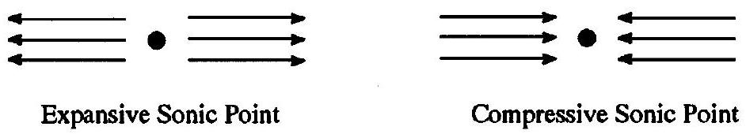
Figure 17.1 Expansive and compressive sonic points.

numerical test problems designed to cover the range of solution features, especially solution features that commonly cause numerical problems.

What kinds of solution features cause numerical problems? To begin with, many numerical methods have difficulties when a wave speed equals zero. In three dimensions, wave speeds equal zero along sonic surfaces; in two dimensions, wave speeds equal zero along sonic lines; and in one dimension, wave speeds equal zero at sonic points. In other words, $u^{*}$ is a sonic point if $f^{\prime}\left(u^{*}\right)=a\left(u^{*}\right)=0$. Sonic points usually signal a change in the wind direction. Sonic points are expansive if the wave direction switches from left to right and compressive if the wave direction switches from right to left, as illustrated in Figure 17.1. Expansive sonic points typically occur inside sonic expansion fans, which contain one stationary characteristic separating left- from right-running characteristics. Compressive sonic points typically occur inside stationary or slowly moving shocks.

Section 4.5 introduced convex flux functions. Convex flux functions have at most one sonic point. For example, Burgers' equation has a convex flux function $f(u)=u^{2} / 2$ with a unique sonic point $u^{*}=0$. By contrast, the nonconvex flux $f(u)=\cos \pi u$ has infinitely many sonic points $u^{*}=0, \pm 1, \pm 2, \pm 3, \ldots$.

Unless specific steps are taken, many numerical methods produce significant errors near sonic points, especially expansive sonic points, which often cause spurious expansion shocks. Upwind methods are forced to give sonic points special consideration, since the upwind direction changes at sonic points. Although not required, centered methods should also treat sonic points differently from other points, or suffer the consequences.

Besides sonic points, shock waves, contact discontinuities, expansion fans, and other nonsmooth flow features are major stumbling blocks for many numerical methods. Typical symptoms include oscillations, overshoots, and a smearing that spreads the discontinuities over a region of from two to seven cells. As far as a shock smearing goes, the physical compression and numerical expansion reach an equilibrium after only a few time steps, effectively halting any further smearing. Contact discontinuities do not have any physical compression, and thus numerical smearing increases progressively with the number of time steps, as if the contact were an expansion fan. Not surprisingly, contact smearing decreases as the order of accuracy increases. Specifically, Harten (1978) estimated that, unless specific steps are taken, numerical methods will smear contact discontinuities over a region proportional to $n^{1 /(r+1)}$ where $n$ is the number of time steps and $r$ is the order of accuracy. In the same paper, Harten described the most popular measure to combat contact smearing, known as artificial compression; this technique is discussed in Section 21.3. For reconstruction-evolution methods, the other alternative is subcell resolution, as described in Section 9.4. The first-generation methods seen in this chapter incorporate neither artificial compression nor subcell resolution and are all subject to contact smearing according to their order of accuracy. As far as expansions are concerned, expansions typically have corners (discontinuities in the first derivative of the solution) at their head and tail. Many numerical methods may experience spurious overshoots, oscillations, and smearing at the heads and
tails, albeit to a lesser extent than at shocks and contacts. Furthermore, some numerical methods partially or completely replace sonic expansions by expansion shocks.

While recognizing the importance of shocks, contacts, expansion fans, and sonic points, let us not forget about ordinary smooth solutions. Although far less challenging than discontinuous solutions, most numerical methods exhibit obvious flaws even on completely smooth solutions, at least for large enough $\Delta x, \Delta t$, and $t$. For example, for smooth solutions of scalar conservation laws, the exact solution preserves the local and global range, as discussed in Sections 4.11 and Chapter 16, especially Section 16.3. By contrast, most stable numerical approximations continuously erode the solution, dramatically reducing the local and global range. Besides amplitude and dissipative errors, most numerical methods also experience phase errors, causing the approximate solution to lead or lag the true solution, and dispersive errors, causing spurious oscillations as different frequencies separate; see section 15.3. Unlike shocks, contacts, expansions, and sonic points, the formal order of accuracy is a generally reliable indicator of the size of phase, dispersive, and amplitude errors for smooth solutions, assuming only that the numerical method is reasonably stable.

The following five test cases involve all of the flow features identified above - shocks, contacts, expansion fans, sonic points, and smooth regions. To avoid the complicating influence of boundary conditions, all five test cases involve a periodic domain $[-1,1]$. In other words, $u(-1, t)=u(1, t)$ for all $t$ and, furthermore, $u(x-1, t)=u(x+1, t)$ for all $x$ and $t$.

Test Case 1 Find $u(x, 30)$ where

$$
\begin{aligned}
& \frac{\partial u}{\partial t}+\frac{\partial u}{\partial x}=0, \\
& u(x, 0)=-\sin (\pi x),
\end{aligned}
$$

which is linear advection of one period of a sinusoid. Use 40 evenly spaced grid points and $\lambda=\Delta t / \Delta x=0.8$. At $t=30$, the initial conditions have traveled around the periodic domain $[-1,1]$ exactly 15 times so that $u(x, 30)=u(x, 0)$. This test case has a completely smooth exact solution with no sonic points. This test case illustrates mainly phase and amplitude errors but not dispersion; since there is only one frequency in the exact solution, there is no way for different frequencies to separate as happens in dispersion.

Test Case 2 Find $u(x, 4)$ where

$$
\begin{aligned}
& \frac{\partial u}{\partial t}+\frac{\partial u}{\partial x}=0, \\
& u(x, 0)= \begin{cases}1 & \text { for }|x|<\frac{1}{3}, \\
0 & \text { for } \frac{1}{3}<|x| \leq 1,\end{cases}
\end{aligned}
$$

which is linear advection of a square wave. Use 40 evenly spaced grid points and $\lambda= \Delta t / \Delta x=0.8$. At $t=4$, the initial conditions have traveled around the periodic domain $[-1,1]$ exactly twice so that $u(x, 4)=u(x, 0)$. The two jump discontinuities in the solution correspond to contact discontinuities. This test case illustrates progressive contact smearing and dispersion.

Test Case 3 Find $u(x, 4)$ and $u(x, 40)$ where

$$
\begin{aligned}
& \frac{\partial u}{\partial t}+\frac{\partial u}{\partial x}=0 \\
& u(x, 0)= \begin{cases}1 & \text { for }|x|<\frac{1}{3} \\
0 & \text { for } \frac{1}{3}<|x| \leq 1,\end{cases}
\end{aligned}
$$

which is linear advection of a square wave. Use 600 evenly spaced grid points and $\lambda= \Delta t / \Delta x=0.8$. This example illustrates convergence as $\Delta x \rightarrow 0$ and $\Delta t \rightarrow 0$. It also illustrates how dissipation, dispersion, and other numerical artifacts accumulate with large times for discontinuous solutions.

Test Case 4 Find $u(x, 0.6)$ where

$$
\begin{aligned}
& \frac{\partial u}{\partial t}+\frac{\partial}{\partial x}\left(\frac{1}{2} u^{2}\right)=0, \\
& u(x, 0)= \begin{cases}1 & \text { for }|x|<\frac{1}{3}, \\
0 & \text { for } \frac{1}{3}<|x| \leq 1 .\end{cases}
\end{aligned}
$$

Use 40 evenly spaced grid points and $\lambda=\Delta t / \Delta x=0.8$. The scalar conservation law is Burgers' equation and the initial condition is a square wave. This problem was solved in Example 4.3. To review briefly, the jump from zero to one at $x=-1 / 3$ creates an expansion fan, while the jump from one to zero at $x=1 / 3$ creates a shock. The unique sonic point for Burgers' equation is $u^{*}=0$. Although the exact solution never crosses the sonic point, a numerical method with spurious overshoots or oscillations may cross the sonic point once or even several times, causing a dramatic error if the numerical method has sonic point problems.

Test Case 5 Find $u(x, 0.3)$ where

$$
\begin{aligned}
& \frac{\partial u}{\partial t}+\frac{\partial}{\partial x}\left(\frac{1}{2} u^{2}\right)=0 \\
& u(x, 0)= \begin{cases}1 & \text { for }|x|<\frac{1}{3} \\
-1 & \text { for } \frac{1}{3}<|x| \leq 1\end{cases}
\end{aligned}
$$

Use 40 evenly spaced grid points and $\lambda=\Delta t / \Delta x=0.8$. The scalar conservation law is Burgers' equation and the initial condition is a square wave. This problem was solved in Example 4.4. To review briefly, the jump from minus one to one at $x=-1 / 3$ creates a sonic expansion fan, while the jump from one to minus one at $x=1 / 3$ creates a steady shock. Notice that both the expansion fan and the shock symmetrically span the sonic point $u^{*}=0$.

### 17.1 Lax-Friedrichs Method

This section concerns the Lax-Friedrichs method, discovered in 1954. To derive the Lax-Friedrichs method, first consider FTCS:

$$
u_{i}^{n+1}=u_{i}^{n}-\frac{\lambda}{2}\left(f\left(u_{i+1}^{n}\right)-f\left(u_{i-1}^{n}\right)\right) .
$$

As seen repeatedly in Part III, FTCS is unconditionally unstable. However, suppose $u_{i}^{n}$ is replaced by $\left(u_{i+1}^{n}+u_{i-1}^{n}\right) / 2$. With this modification, FTCS becomes the Lax-Friedrichs method:

$$
\quad u_{i}^{n+1}=\frac{1}{2}\left(u_{i+1}^{n}+u_{i-1}^{n}\right)-\frac{\lambda}{2}\left(f\left(u_{i+1}^{n}\right)-f\left(u_{i-1}^{n}\right)\right) .
$$

In conservation form, introduced in Chapter 11, the Lax-Friedrichs method is

$$
u_{i}^{n+1}=u_{i}^{n}-\lambda\left(\hat{f}_{i+1 / 2}^{n}-\hat{f}_{i-1 / 2}^{n}\right)
$$

where

$$
\text { - } \quad \hat{f}_{i+1 / 2}^{n}=\frac{1}{2}\left(f\left(u_{i+1}^{n}\right)+f\left(u_{i}^{n}\right)\right)-\frac{1}{2 \lambda}\left(u_{i+1}^{n}-u_{i}^{n}\right) \text {. }
$$

In artificial viscosity form, introduced in Chapter 14, the Lax-Friedrichs method is

$$
u_{i}^{n+1}=u_{i}^{n}-\frac{\lambda}{2}\left(f\left(u_{i+1}^{n}\right)-f\left(u_{i-1}^{n}\right)\right)+\frac{\lambda}{2}\left(\epsilon_{i+1 / 2}^{n}\left(u_{i+1}^{n}-u_{i}^{n}\right)-\epsilon_{i-1 / 2}^{n}\left(u_{i}^{n}-u_{i-1}^{n}\right)\right),
$$

where

$$
\epsilon_{i+1 / 2}^{n}=\frac{1}{\lambda} .
$$

In wave speed split form, introduced in Subsection 13.5.1, the Lax-Friedrichs method is

$$
u_{i}^{n+1}=u_{i}^{n}+C_{i+1 / 2}^{+}\left(u_{i+1}^{n}-u_{i}^{n}\right)-C_{i-1 / 2}^{-}\left(u_{i}^{n}-u_{i-1}^{n}\right)
$$

where

$$
\begin{aligned}
C_{i+1 / 2}^{+} & =\frac{1}{2}\left(1-\lambda a_{i+1 / 2}^{n}\right) \\
C_{i+1 / 2}^{-} & =\frac{1}{2}\left(1+\lambda a_{i+1 / 2}^{n}\right)
\end{aligned}
$$

Of course, as always, there are infinitely many other wave speed split forms. However, this is the only wave speed split form with finite coefficients - in this sense, this is the unique natural wave speed split form.

The above derivation paints Lax-Friedrichs as a minor modification of FTCS. However, despite the seemingly small size of the modification, Lax-Friedrichs and FTCS end up completely different.

The twelve-point checklist for the Lax-Friedrichs method is as follows:
(1) The Lax-Friedrichs method has the maximum amount of artificial viscosity allowed by the linear stability condition $(\lambda a)^{2} \leq \lambda \epsilon \leq 1$ found in Example 15.4. Furthermore, it has the maximum amount of artificial viscosity allowed by the nonlinear stability condition $\left|\lambda a_{i+1 / 2}^{n}\right| \leq \lambda \epsilon_{i+1 / 2}^{n} \leq 1$ found in Example 16.6.
(2) CFL condition: $|\lambda a(u)| \leq 1$.
(3) Conservative.
(4) Consistent.
(5) Converges to the correct solution as $\Delta x \rightarrow 0$ and $\Delta t \rightarrow 0$ provided that the CFL condition is satisfied.
(6) Explicit.
(7) Finite difference.
(8) Linearly stable provided that the CFL condition is satisfied.
(9) Linear when applied to the linear advection equation. Nonlinear when applied to any nonlinear scalar conservation law.
(10) Consider the nonlinear stability conditions seen in Chapter 16. The Lax-Friedrichs method satisfies the monotonicity preservation, TVD, positivity, TVB, ENO, contraction, and monotone conditions provided that the CFL condition is satisfied. It does not satisfy the range diminishing or the upwind range condition and, in fact, the Lax-Friedrichs method allows large spurious oscillations, especially for small $\lambda$ and large $\Delta x$, as seen in Test Case 2 and Problem 17.4 below.
(11) First-order accurate in time and space. This is true of any method that satisfies $\left|\lambda a_{i+1 / 2}^{n}\right| \leq \lambda \epsilon_{i+1 / 2}^{n} \leq 1$, as mentioned in Example 16.6.
(12) Centered.

As an additional property, not listed above, steady-state solutions of the Lax-Friedrichs method depend on the time-step $\Delta t$. If a steady-state solution exists, then $u_{i}^{n+1}-u_{i}^{n} \rightarrow 0$ as $n \rightarrow \infty$. If $u_{i}^{n+1}=u_{i}^{n}$, the Lax-Friedrichs method becomes

$$
\lambda\left(f\left(u_{i+1}^{n}\right)-f\left(u_{i-1}^{n}\right)\right)=u_{i+1}^{n}-2 u_{i}^{n}+u_{i-1}^{n} .
$$

The solution to this equation clearly depends on $\lambda=\Delta t / \Delta x$ and thus on $\Delta t$. This steadystate dependency on $\Delta t$ is highly unphysical - the steady-state solution should depend only on the grid, through $\Delta x$, and not on the time steps $\Delta t$ taken to obtain the steady-state solution. The behavior of the Lax-Friedrichs method is illustrated using the five standard test cases defined in Section 17.0.

Test Case 1 As seen in Figure 17.2, the sinusoid experiences devastating dissipation. The sinusoid's shape is well preserved, and the phase error is relatively small, but the amplitude is only about $3.6 \%$ of what it should be.

Test Case 2 As seen in Figure 17.3, the solution exhibits large "odd-even" oscillations. In other words, the solution exhibits oscillations with the shortest possible wavelength of $2 \Delta x$. Notice that these large spurious oscillations occur despite the nonlinear

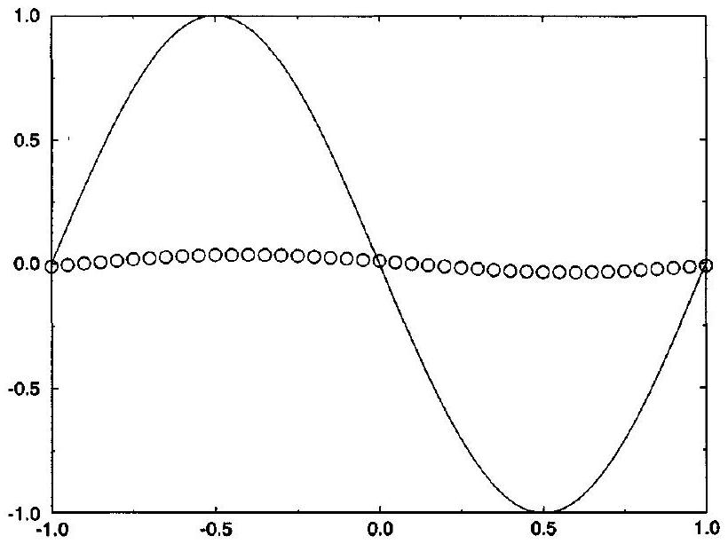
Figure 17.2 Lax-Friedrichs method for Test Case 1.

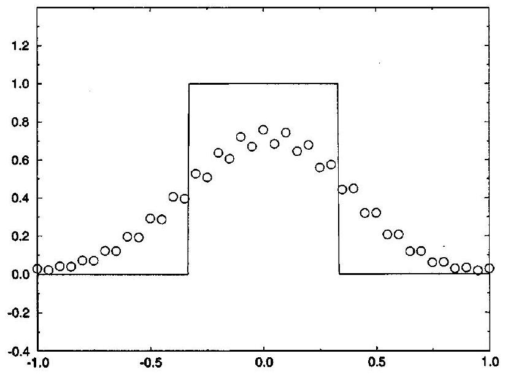
Figure 17.3 Lax-Friedrichs method for Test Case 2.

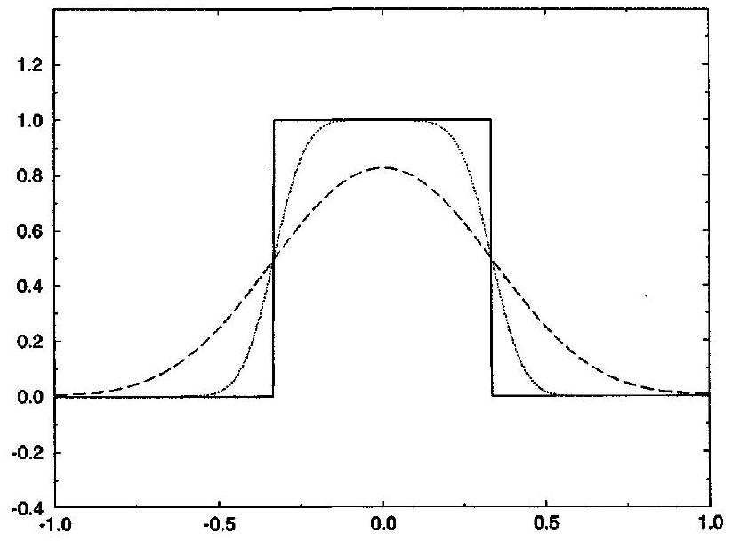
Figure 17.4 Lax-Friedrichs method for Test Case 3.

stability properties of the Lax-Friedrichs method listed above. As one explanation, the Lax-Friedrichs method has too much artificial viscosity which, just like too little artificial viscosity, leads to instability and spurious oscillations. As another explanation, these oscillations are caused by odd-even decoupling, much as in FTCS or the leapfrog method; see the discussion in Subsection 11.1.3. However, suppose the artificial viscosity were moderately reduced, or suppose a nonuniform grid were used, which would reduce or eliminate odd-even decoupling, as seen in Subsection 10.1.2. In this case, there would still be too much artificial viscosity, and thus there would still be spurious oscillations in the solution. In addition to the spurious oscillations, the contacts are extremely smeared and the peak of the square wave has been reduced by about $25 \%$. On the positive side, the solution is reasonably symmetric and properly located.

Test Case 3 In Figure 17.4, the dotted line represents the Lax-Friedrichs approximation to $u(x, 4)$, the long dashed line represents the Lax-Friedrichs approximation

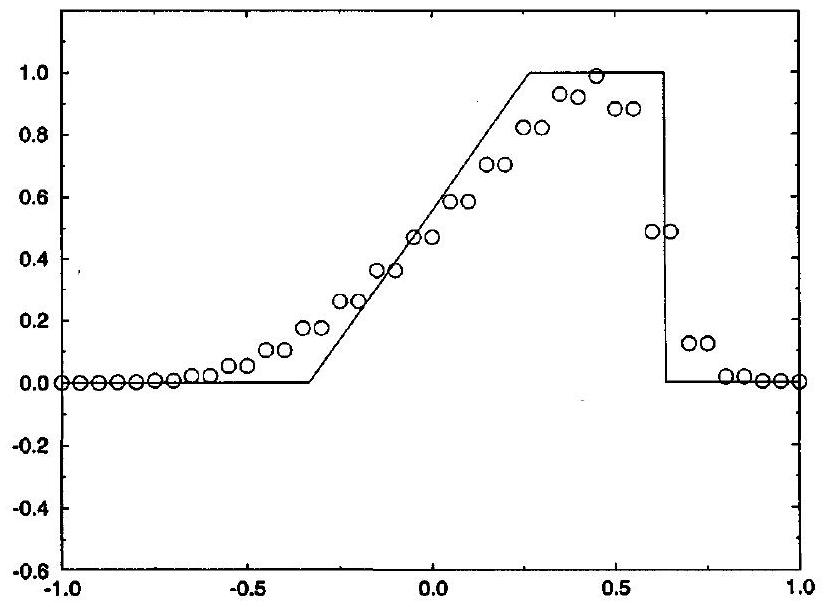
Figure 17.5 Lax-Friedrichs method for Test Case 4.

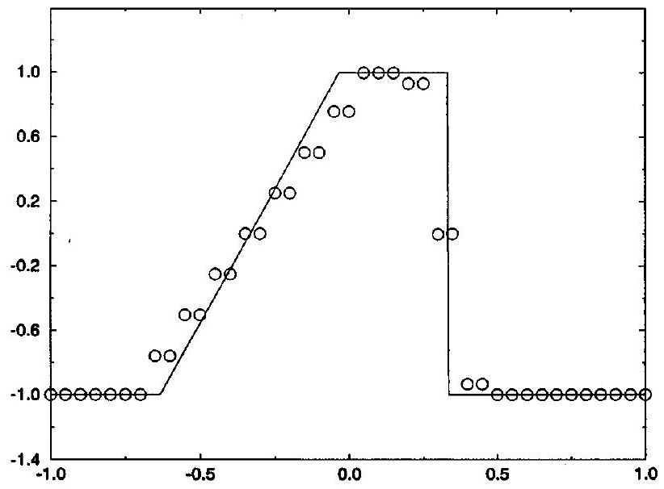
Figure 17.6 Lax-Friedrichs method for Test Case 5.

to $u(x, 40)$, and the solid line represents the exact solution for $u(x, 4)$ or $u(x, 40)$. Clearly, increasing the number of grid points, and decreasing $\Delta x$ and $\Delta t$, dramatically improves the approximation for $u(x, 4)$, as compared with Figure 17.3. There are still some very tiny, nearly invisible, odd-even plateaus in the solution. Thus the slight roughness seen in the plot is not a printer artifact but a genuine solution behavior.

Test Cases 4 and 5 As seen in Figures 17.5 and 17.6, the Lax-Friedrichs solution contains a number of strange odd-even two-point plateaus.

### 17.2 Lax-Wendroff Method

The Lax-Friedrichs method has the greatest amount of artificial viscosity allowed by the linear stability condition $(\lambda a)^{2} \leq \lambda \epsilon \leq 1$ found in Example 15.4. This section
concerns the method at the other extreme - the Lax-Wendroff method has the least amount of artificial viscosity allowed by the linear stability condition $(\lambda a)^{2} \leq \lambda \epsilon \leq 1$. To derive the Lax-Wendroff method, consider a Taylor series for $u(x, t+\Delta t)$ :

$$
u(x, t+\Delta t)=u(x, t)+\Delta t \frac{\partial u}{\partial t}(x, t)+\frac{\Delta t^{2}}{2} \frac{\partial^{2} u}{\partial t^{2}}(x, t)+O\left(\Delta t^{3}\right)
$$

The $t$ derivatives can be transformed to $x$ derivatives using the governing equation. This is called the Lax-Wendroff or Cauchy-Kowalewski technique, as introduced in Section 15.3, where it was used to convert $t$ derivatives to $x$ derivatives on the right-hand sides of modified equations. In this case, the governing equation is

$$
\frac{\partial u}{\partial t}+\frac{\partial f(u)}{\partial x}=0
$$

which implies

$$
\frac{\partial u}{\partial t}=-\frac{\partial f(u)}{\partial x}=-\frac{\partial f(u)}{\partial u} \frac{\partial u}{\partial x}=-a(u) \frac{\partial u}{\partial x}
$$

and

$$
\begin{aligned}
\frac{\partial^{2} u}{\partial t^{2}} & =\frac{\partial}{\partial t}\left(\frac{\partial u}{\partial t}\right)=\frac{\partial}{\partial t}\left(-\frac{\partial f(u)}{\partial x}\right)=-\frac{\partial}{\partial x}\left(\frac{\partial f(u)}{\partial t}\right) \\
& =-\frac{\partial}{\partial x}\left(a(u) \frac{\partial u}{\partial t}\right)=\frac{\partial}{\partial x}\left(a(u) \frac{\partial f(u)}{\partial x}\right)
\end{aligned}
$$

Substitute the preceding expressions for $\partial u / \partial t$ and $\partial^{2} u / \partial t^{2}$ into the Taylor series for $u(x, t+\Delta t)$ to obtain

$$
u(x, t+\Delta t)=u(x, t)-\Delta t \frac{\partial f}{\partial x}(x, t)+\frac{\Delta t^{2}}{2} \frac{\partial}{\partial x}\left(a(u) \frac{\partial f}{\partial x}\right)(x, t)+O\left(\Delta t^{3}\right)
$$

This expression is discretized using central differences as follows:

$$
\begin{aligned}
u_{i}^{n+1}= & u_{i}^{n}-\Delta t \frac{f\left(u_{i+1}^{n}\right)-f\left(u_{i-1}^{n}\right)}{2 \Delta x} \\
& +\frac{\Delta t^{2}}{2} \frac{a_{i+1 / 2}^{n} \frac{f\left(u_{i+1}^{n}\right)-f\left(u_{i}^{n}\right)}{\Delta x}-a_{i-1 / 2}^{n} \frac{f\left(u_{i}^{n}\right)-f\left(u_{i-1}^{n}\right)}{\Delta x}}{\Delta x}
\end{aligned}
$$

or

- $\quad u_{i}^{n+1}=u_{i}^{n}-\frac{\lambda}{2}\left(f\left(u_{i+1}^{n}\right)-f\left(u_{i-1}^{n}\right)\right)$

$$
+\frac{\lambda^{2}}{2}\left[a_{i+1 / 2}^{n}\left(f\left(u_{i+1}^{n}\right)-f\left(u_{i}^{n}\right)\right)-a_{i-1 / 2}^{n}\left(f\left(u_{i}^{n}\right)-f\left(u_{i-1}^{n}\right)\right)\right]
$$

which is called the Lax-Wendroff method. The Lax-Wendroff method was discovered in 1960.

As mentioned before, the preceding derivation of the Lax-Wendroff method illustrates a general technique called the Lax-Wendroff or the Cauchy-Kowalewski technique. Let us
say a few words about the general Cauchy-Kowalewski technique before continuing. Suppose that $u(x, t)$ is expressed as a two-dimensional Taylor series about $\left(x_{i}, t^{n}\right)$ as follows:

$$
u(x, t) \approx \sum_{j=0}^{N} \sum_{k=0}^{j} \frac{\partial^{j} u\left(x_{i}, t^{n}\right)}{\partial x^{k} \partial t^{j-k}} \frac{\left(x-x_{i}\right)^{k}}{k!} \frac{\left(t-t^{n}\right)^{j-k}}{(j-k)!} .
$$

Using the governing equation, all of the temporal derivatives in the preceding expression can be exchanged for spatial derivatives as follows:

$$
\begin{aligned}
& \frac{\partial u}{\partial t}=-\frac{d f}{d u} \frac{\partial u}{\partial x} \\
& \frac{\partial^{2} u}{\partial x \partial t}=-\frac{d f}{d u} \frac{\partial^{2} u}{\partial x^{2}}-\frac{d^{2} f}{d u^{2}}\left(\frac{\partial u}{\partial x}\right)^{2} \\
& \frac{\partial^{2} u}{\partial t^{2}}=\left(\frac{\partial f}{\partial u}\right)^{2} \frac{\partial^{2} u}{\partial x^{2}}+2 \frac{d^{2} f}{d u^{2}} \frac{d f}{d u}\left(\frac{\partial u}{\partial x}\right)^{2} \\
& \frac{\partial^{3} u}{\partial x^{2} \partial t}=-\frac{d^{3} f}{d u^{3}}\left(\frac{\partial u}{\partial x}\right)^{3}-3 \frac{d^{2} f}{d u^{2}} \frac{\partial^{2} u}{\partial x^{2}} \frac{\partial u}{\partial x}-\frac{d f}{d u} \frac{\partial^{3} u}{\partial x^{3}}
\end{aligned}
$$

and so forth. Then, any value of $u(x, t)$ at time $t$ can be approximated to any order of accuracy using pure spatial discretization of pure spatial derivatives. The Cauchy-Kowalewski technique will be used again to the derive the Beam-Warming second-order upwind method in Section 17.4 and periodically throughout the rest of the book.

In the Lax-Wendroff method, the average wave speed $a_{i+1 / 2}^{n}$ may be defined in a variety of different ways. For example,

$$
a_{i+1 / 2}^{n}=a\left(\frac{u_{i+1}^{n}+u_{i}^{n}}{2}\right)
$$

or

$$
a_{i+1 / 2}^{n}=\frac{a\left(u_{i+1}^{n}\right)+a\left(u_{i}^{n}\right)}{2} .
$$

In other words, the Lax-Wendroff method is actually an entire class of methods differing only in the choice of the average wave speed $a_{i+1 / 2}^{n}$. This book will use the following definition:

$$
a_{i+1 / 2}^{n}= \begin{cases}\frac{f\left(u_{i+1}^{n}\right)-f\left(u_{i}^{n}\right)}{u_{i+1}^{n}-u_{i}^{n}} & \text { for } u_{i}^{n} \neq u_{i+1}^{n}, \\ a\left(u_{i}^{n}\right) & \text { for } u_{i}^{n}=u_{i+1}^{n} .\end{cases}
$$

This is not the best choice for $a_{i+1 / 2}^{n}$ if the Lax-Wendroff method is used on a standalone basis. However, this choice makes the theoretical analysis simpler, and it also makes the Lax-Wendroff method well suited for adaptive combinations with other numerical methods, to form second- and third-generation methods. The reader may recall a similar discussion about averages from Section 5.4 - in particular, Equation (17.7) is the same as Equation (5.62), Equation (17.8) is the same as Equation (5.64), and Equation (17.9) is the same as the Roe average seen in Section 5.3.

In conservation form, the Lax-Wendroff method is

$$
u_{i}^{n+1}=u_{i}^{n}-\lambda\left(\hat{f}_{i+1 / 2}^{n}-\hat{f}_{i-1 / 2}^{n}\right)
$$

where

$$
\begin{aligned}
\hat{f}_{i+1 / 2}^{n} & =\frac{1}{2}\left(f\left(u_{i+1}^{n}\right)+f\left(u_{i}^{n}\right)\right)-\frac{1}{2} \lambda a_{i+1 / 2}^{n}\left(f\left(u_{i+1}^{n}\right)-f\left(u_{i}^{n}\right)\right) \\
& =\frac{1}{2}\left(f\left(u_{i+1}^{n}\right)+f\left(u_{i}^{n}\right)\right)-\frac{1}{2} \lambda\left(a_{i+1 / 2}^{n}\right)^{2}\left(u_{i+1}^{n}-u_{i}^{n}\right)
\end{aligned}
$$

In artificial viscosity form, the Lax-Wendroff method is
$u_{i}^{n+1}=u_{i}^{n}-\frac{\lambda}{2}\left(f\left(u_{i+1}^{n}\right)-f\left(u_{i-1}^{n}\right)\right)+\frac{\lambda}{2}\left(\epsilon_{i+1 / 2}^{n}\left(u_{i+1}^{n}-u_{i}^{n}\right)-\epsilon_{i-1 / 2}^{n}\left(u_{i}^{n}-u_{i-1}^{n}\right)\right)$,
where

$$
\epsilon_{i+1 / 2}^{n}=\lambda\left(a_{i+1 / 2}^{n}\right)^{2}
$$

In wave speed split form, the Lax-Wendroff method is

$$
u_{i}^{n+1}=u_{i}^{n}+C_{i+1 / 2}^{+}\left(u_{i+1}^{n}-u_{i}^{n}\right)-C_{i-1 / 2}^{-}\left(u_{i}^{n}-u_{i-1}^{n}\right),
$$

where

$$
\begin{aligned}
& C_{i+1 / 2}^{+}=-\frac{1}{2} \lambda a_{i+1 / 2}^{n}\left(1-\lambda a_{i+1 / 2}^{n}\right) \\
& C_{i+1 / 2}^{-}=\frac{1}{2} \lambda a_{i+1 / 2}^{n}\left(1+\lambda a_{i+1 / 2}^{n}\right)
\end{aligned}
$$

Of course, as always, there are infinitely many other wave speed split forms. However, this is the only wave speed split form with finite coefficients - in this sense, this is the unique natural wave speed split form. The twelve-point checklist for the Lax-Wendroff method is as follows:
(1) The Lax-Wendroff method has the minimum amount of artificial viscosity allowed by the linear stability condition $(\lambda a)^{2} \leq \lambda \epsilon \leq 1$ found in Example 15.4.
(2) CFL condition: $|\lambda a(u)| \leq 1$.
(3) Conservative.
(4) Consistent.
(5) The Lax-Wendroff method may not converge on nonsmooth solutions as $\Delta x \rightarrow 0$ and $\Delta t \rightarrow 0$. Even if it does converge, the converged solution may not satisfy entropy conditions. In particular, the Lax-Wendroff method allows expansion shocks, at least with $a_{i+1 / 2}^{n}$ defined as in Equation (17.9).
(6) Explicit.
(7) Finite difference.
(8) Linearly stable provided that the CFL condition is satisfied.
(9) Linear when applied to the linear advection equation. Nonlinear when applied to any nonlinear scalar conservation law.
(10) Consider the nonlinear stability conditions seen in Chapter 16. Although there is no rigorous proof, numerical tests show that the Lax-Wendroff method is TVB. However, although the total variation is bounded for any fixed $\Delta x$ and $\Delta t$, the
total variation may go to infinity in the limit $\Delta x \rightarrow 0$ and $\Delta t \rightarrow 0$. Thus the LaxWendroff method is always TVB but not always total variation stable; see the discussion in Section 16.11. Furthermore, by Godunov's theorem seen in Section 16.1, the Lax-Wendroff method is not monotonicity preserving. Then the Lax-Wendroff method cannot satisfy any condition that implies monotonicity preservation including TVD, positivity, range reduction, the upwind range condition, contraction, or the monotone condition.
(11) Formally second-order accurate in time and space.
(12) Centered.

As an additional property, not listed above, steady-state solutions of the Lax-Wendroff method depend on the time step $\Delta t$, since the conservative numerical flux depends on $\lambda$ and thus on $\Delta t$. The behavior of the Lax-Wendroff method is illustrated using the five standard test cases defined in Section 17.0.

Test Case 1 As seen in Figure 17.7, the sinusoid's shape and amplitude are well captured. The only visible error is a slight lagging phase error.

Test Case 2 As seen in Figure 17.8, the solution overshoots and undershoots by about $20 \%$. As one explanation, the Lax-Wendroff method has insufficient artificial viscosity, which leads to instability and spurious oscillations. On the positive side, the solution is apparently properly located, and thus the overall phase error is slight. Also, the Lax-Wendroff method smears the contacts far less than the Lax-Friedrichs method seen in Figure 17.3. This is to be expected given the increased order of accuracy.

Test Case 3 In Figure 17.9, the dotted line represents the Lax-Wendroff approximation to $u(x, 4)$, the long dashed line represents the Lax-Wendroff approximation to $u(x, 40)$, and the solid line represents the exact solution for $u(x, 4)$ or $u(x, 40)$. Comparing Figures 17.8 and 17.9, we see that increasing the number of grid points improves

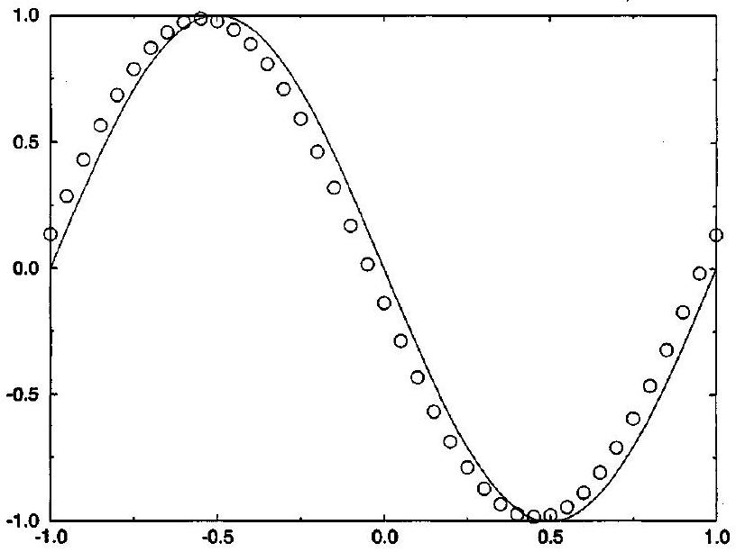
Figure 17.7 Lax-Wendroff method for Test Case 1.

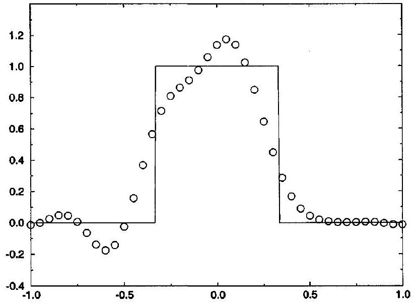
Figure 17.8 Lax-Wendroff method for Test Case 2.

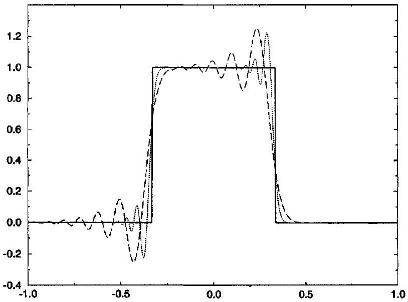
Figure 17.9 Lax-Wendroff method for Test Case 3.

the solution for $u(x, 4)$ in some ways but makes it worse in other ways. In particular, increasing the number of grid points creates large ringing oscillations to the left of the jump discontinuities. In fact, these ringing oscillations grow to infinity in the limit $\Delta x \rightarrow 0$ and $\Delta t \rightarrow 0$. Comparing the solutions for $u(x, 4)$ and $u(x, 40)$, as seen in Figure 17.9, we see that increasing the final time also increases the ringing oscillations. However, for fixed $\Delta x$ and $\Delta t$, the total variation created by the jump must eventually stop growing as $t \rightarrow \infty$. To see this, from von Neumann analysis, recall that the amplitudes of the sinusoids in a discrete Fourier series representation of the solution cannot increase. Thus the oscillations in the solution are created entirely by dispersion, that is, by frequency-dependent propagation speeds. But dispersion can only create a limited amount of oscillation for a fixed $\Delta x$. Once dispersion creates the maximum amount of oscillation possible, by fully separating various frequencies, the only way for the total variation to increase is for the amplitude of the oscillations to increase, which is impossible by the results of linear stability analysis.

As one way to view it, the solution starts with a finite amount of energy, which can be redistributed but whose total cannot increase. Once all of the energy is redistributed from the jumps into the spurious oscillations, the total energy in the oscillations cannot increase.

Test Case 4 As seen in Figure 17.10, the solution overshoots by about $12 \%$ near the shock and undershoots and overshoots by about $40 \%$ near the tail of the expansion. Notice that the undershoot overlaps the sonic point $u^{*}=0$ and, as seen in the next test case, the Lax-Wendroff method has severe problems at sonic points, which helps to explain the large tearing in the solution near the sonic point. The shock is smeared across two or three grid points but is otherwise well captured.

Test Case 5 As seen in Figure 17.11, the steady shock is perfectly captured. However, the expansion fan is captured as an expansion shock, in violation of the entropy

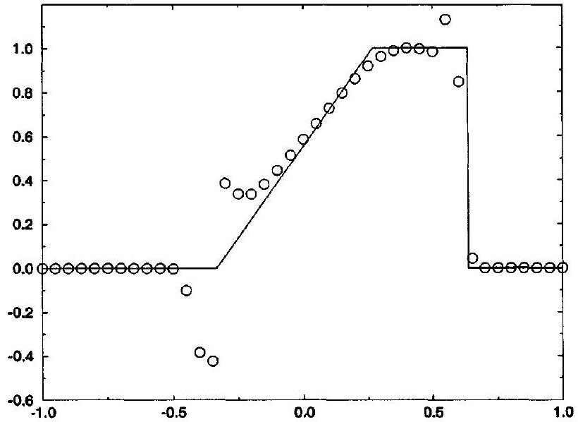
Figure 17.10 Lax-Wendroff method for Test Case 4.

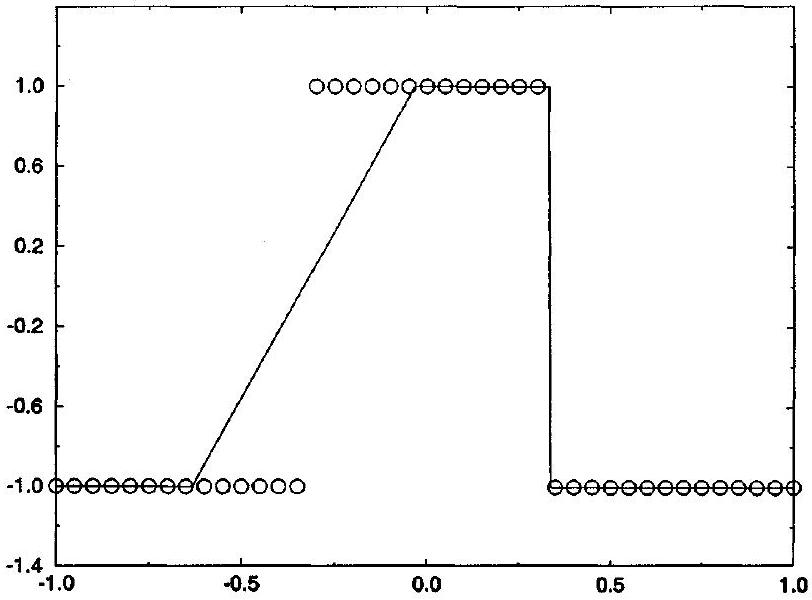
Figure 17.11 Lax-Wendroff method for Test Case 5.

conditions. In fact, the Lax-Wendroff method fails to alter its initial conditions in any way, which is perfectly correct at the shock and a complete disaster at the expansion. To be fair, the performance in this test case can be greatly improved by using a different definition for $a_{i+1 / 2}^{n}$ rather than the "Roe average" definition of Equation (17.9).

### 17.3 First-Order Upwind Methods

The Lax-Friedrichs method has too much artificial viscosity. The Lax-Wendroff method does not have enough artificial viscosity. This section concerns methods somewhere in the middle. First-order upwind methods were introduced in Chapter 13. In particular, a first-order upwind method for the linear advection equation, sometimes called CIR, was derived using flux averaging in Example 13.5, flux splitting in Example 13.6, wave speed splitting in Example 13.10, and reconstruction-evolution in Example 13.14. Whereas the derivation technique did not matter much for linear equations, which lack sonic points, the derivation technique is critical for nonlinear equations, which do contain sonic points. This section derives first-order upwind methods for nonlinear scalar conservation laws using reconstruction-evolution. Since reconstruction-evolution is central to this section, the reader should carefully review the introduction to reconstruction-evolution seen in Section 13.6 before proceeding. Also, the reader should review Section 5.6, which concerns the Riemann problem for scalar conservation laws. Although this section concerns first-order upwind methods based on reconstruction-evolution, first-order upwind methods can also be found using flux splitting or wave speed splitting, as described later in Subsection 18.2.5.

Suppose the reconstruction is piecewise-constant. Then each cell edge gives rise to a Riemann problem, as illustrated in Figure 17.12. Then the exact evolution of the piecewiseconstant reconstruction yields

$$
u_{i}^{n+1}=u_{i}^{n}-\lambda\left(\hat{f}_{i+1 / 2}^{n}-\hat{f}_{i-1 / 2}^{n}\right),
$$

where

$$
\hat{f}_{i+1 / 2}^{n}=\frac{1}{\Delta t} \int_{t^{n}}^{t^{n+1}} f\left(u_{\mathrm{RIEMANN}}\left(x_{i+1 / 2}, t\right)\right) d t
$$

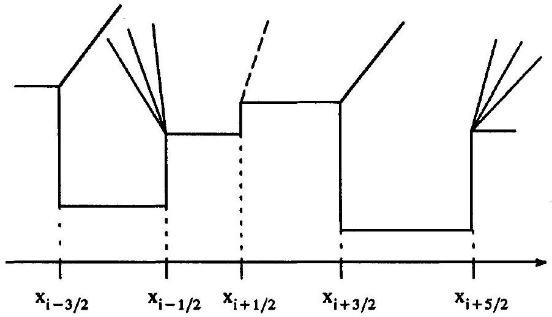
Figure 17.12 Each cell edge in a piecewise-constant reconstruction gives rise to a Riemann problem.

where $u_{\text {RIEMANN }}\left(x_{i+1 / 2}, t\right)$ is a real or approximate solution to the Riemann problem centered on the cell edge $x_{i+1 / 2}$. Since the solution to the Riemann problem is self-similar or, in other words, strictly a function of $\left(x-x_{i+1 / 2}\right) / t, u_{\text {RIEMANN }}\left(x_{i+1 / 2}, t\right)$ is constant for all time since $\left(x_{i+1 / 2}-x_{i+1 / 2}\right) / t=0$. Then

$$
\text { - } \quad \hat{f}_{i+1 / 2}^{n}=f\left(u_{\text {RIEMANN }}\left(x_{i+1 / 2}, t\right)\right) \text {, }
$$

where $f$ ( $u_{\text {RIEMANN }}\left(x_{i+1 / 2}, t\right)$ ) is found using any exact or approximate Riemann solver, such as those seen in Section 5.6, and where $t$ can be any arbitrary time greater than $t^{n}$. In this section, the term first-order upwind method refers to any method based on Equation (17.13).

Equation (17.13) assumes that waves from different cell edges do not interact or, at least, that any interactions do not affect the solution at the cell edges. If $\lambda|a(u)| \leq 1 / 2$ then waves travel at most one-half cell per time step - then waves originating at one cell edge cannot interact with waves originating from any other cell edge during a single time step. If $\lambda|a(u)| \leq 1$ then waves travel at most one cell per time step - then waves can interact, but the interactions cannot reach the cell edges during a single time step. In fact, if $\lambda|a(u)| \leq 1$, waves from adjacent cell edges can interact only if there is a compressive sonic point inside the cell, so that the waves at the left cell edge are right-running whereas the waves from the right cell edge are left-running. Notice that, by coincidence, the noninteraction condition $\lambda|a(u)| \leq 1$ is also the CFL condition.

If the wave speeds are always positive, the waves originating from cell edge $x_{i+1 / 2}$ all travel to the right, and then Equation (17.13) always yields $f_{i+1 / 2}^{n}=f\left(u_{i}^{n}\right)$, which is FTBS. Similarly, if the wave speeds are always negative, the waves originating from cell edge $x_{i+1 / 2}$ all travel to the left, and then Equation (17.13) always yields $f_{i+1 / 2}^{n}=f\left(u_{i+1}^{n}\right)$, which is FTFS. This is true for any reasonable real or approximate Riemann used in Equation (17.13). Thus all first-order upwind methods given by Equation (17.13) are the same - either FTBS or FTFS - except near sonic points, where the wave speed changes sign.

In general, first-order upwind methods have excellent shock-capturing abilities. As one explanation, this is because first-order upwind methods use the minimum possible stencil allowed by the CFL condition; this explanation was pursued earlier in Chapter 13. As another explanation, this is because first-order upwind methods assume that a jump discontinuity exists at every cell edge, and then they evolve the cell-edge discontinuities in time using an exact or approximate solution. This approach works extremely well when the true solution actually does have jumps at cell edges. However, this approach does not work as well if the true solution does not contain jump discontinuities, or if jump discontinuities lie somewhere inside a cell. Contrast the assumption of jump discontinuities, inherent to first-order upwind methods, with the more traditional assumption of completely smooth solutions found in finite-difference methods derived using, say, Taylor series.

The twelve-point checklist for first-order upwind methods given by Equation (17.13) is as follows:
(1) First-order upwind methods given by Equation (17.13) have artificial viscosity $\epsilon_{i+1 / 2}^{n}=\left|\lambda a_{i+1 / 2}^{n}\right|$, except possibly at sonic points. Then first-order upwind methods have the least amount of artificial viscosity allowed by the nonlinear stability condition $\left|\lambda a_{i+1 / 2}^{n}\right| \leq \lambda \epsilon_{i+1 / 2}^{n} \leq 1$ found in Example 16.6, except possibly at sonic points. After this section, the methods in this chapter no longer fall so neatly at the extremes of a stability condition. Furthermore, $\epsilon_{i+1 / 2}^{n}$ will no longer be a simple function of $a_{i+1 / 2}^{n}$.
(2) CFL condition: $|\lambda a(u)| \leq 1$.
(3) Conservative.
(4) Consistent.
(5) The first-order upwind methods given by Equation (17.13) converge as $\Delta x \rightarrow 0$ and $\Delta t \rightarrow 0$ provided that the CFL condition is satisfied. Whether the converged solution satisfies the entropy condition depends on how the first-order upwind method treats sonic points. At sonic points, the more artificial viscosity the better, within reason.
(6) Explicit.
(7) Finite volume.
(8) Linearly stable provided that the CFL condition is satisfied.
(9) The first-order upwind methods given by Equation (17.13) are linear when applied to the linear advection equation. In fact, all first-order upwind methods given by Equation (17.13) are the same when applied to the linear advection equation - they equal either FTBS for $a>0$ or FTFS for $a<0$. First-order upwind methods are nonlinear when applied to any nonlinear scalar conservation law. The behavior at sonic points in a nonlinear scalar conservation law is the only thing that distinguishes the first-order upwind methods given by Equation (17.13).
(10) The first-order upwind methods given by Equation (17.13) satisfy all of the nonlinear stability conditions considered in Chapter 16. As always, this assumes that the CFL condition is satisfied and may not be true at sonic points. In particular, firstorder upwind methods satisfy monotonicity preservation, TVD, positivity, range reduction, the upwind range condition, TVB, ENO, contraction, and the monotone condition, except possibly at sonic points. Thus first-order upwind methods do not allow spurious oscillations or overshoots, except possibly at sonic points.
(11) Formally first-order accurate in time and space, except possibly at sonic points.
(12) Upwind.

Note that steady-state solutions of first-order upwind methods do not depend on $\Delta t$, unlike all of the other methods in this chapter. The following subsections consider some specific first-order upwind methods.

### 17.3.1 Godunov's First-Order Upwind Method

The exact Riemann solver for a scalar conservation law is given by Equation (5.66). In Equation (5.66), replace $u_{L}$ by $u_{i}^{n}$, replace $u_{R}$ by $u_{i+1}^{n}$, replace $t=0$ by $t=t^{n}$, and replace $x=0$ by $x=x_{i+1 / 2}$. Substitute into Equation (17.13) to find

$$
\hat{f}_{i+1 / 2}^{n}= \begin{cases}\min _{u_{i}^{n} \leq u \leq u_{i+1}^{n}} f(u) & \text { if } u_{i}^{n}<u_{i+1}^{n}, \\ \max _{u_{i}^{n} \geq u \geq u_{i+1}^{n}} f(u) & \text { if } u_{i}^{n}>u_{i+1}^{n} .\end{cases}
$$

This is called Godunov's first-order upwind method. Godunov's first-order upwind method was discovered in 1959. As shown in any calculus book, the maximum of a function on a closed interval occurs either at the endpoints of the interval or where the derivative of the function equals zero. The derivative of the flux function is the wave speed, and the wave
speed is zero at sonic points. Then Equation (17.14a) is equivalent to the following:
$\quad \quad \hat{f}_{i+1 / 2}^{n}= \begin{cases}\min \left(f\left(u_{i}^{n}\right), f\left(u_{i+1}^{n}\right), f\left(u^{*}\right)\right) & \text { if } u_{i}^{n}<u_{i+1}^{n}, \\ \max \left(f\left(u_{i}^{n}\right), f\left(u_{i+1}^{n}\right), f\left(u^{*}\right)\right) & \text { if } u_{i}^{n}>u_{i+1}^{n},\end{cases}$
where $u^{*}$ refers to any and all sonic points between $u_{i}^{n}$ and $u_{i+1}^{n}$. In artificial viscosity form, Godunov's first-order upwind method is
$u_{i}^{n+1}=u_{i}^{n}-\frac{\lambda}{2}\left(f\left(u_{i+1}^{n}\right)-f\left(u_{i-1}^{n}\right)\right)+\frac{\lambda}{2}\left(\epsilon_{i+1 / 2}^{n}\left(u_{i+1}^{n}-u_{i}^{n}\right)-\epsilon_{i-1 / 2}^{n}\left(u_{i}^{n}-u_{i-1}^{n}\right)\right)$,
where

$$
\begin{aligned}
\epsilon_{i+1 / 2}^{n} & =\max _{\substack{u \text { between } \\
u_{i} \text { and } u_{i+1}}}\left(\frac{f\left(u_{i+1}^{n}\right)-2 f(u)+f\left(u_{i}^{n}\right)}{u_{i+1}^{n}-u_{i}^{n}}\right) \\
& =\max \left(\left|a_{i+1 / 2}^{n}\right|, \frac{f\left(u_{i+1}^{n}\right)-2 f\left(u^{*}\right)+f\left(u_{i}^{n}\right)}{u_{i+1}^{n}-u_{i}^{n}}\right)
\end{aligned}
$$

and where $a_{i+1 / 2}^{n}$ is given by Equation (17.9). In wave speed split form, Godunov's first-order upwind method is

$$
u_{i}^{n+1}=u_{i}^{n}+C_{i+1 / 2}^{+}\left(u_{i+1}^{n}-u_{i}^{n}\right)-C_{i-1 / 2}^{-}\left(u_{i}^{n}-u_{i-1}^{n}\right)
$$

where

$$
\begin{aligned}
C_{i+1 / 2}^{+}= & -\lambda \min _{\substack{u \text { between } \\
u_{i} \text { and } u_{i+1}}}\left(\frac{f(u)-f\left(u_{i}^{n}\right)}{u_{i+1}^{n}-u_{i}^{n}}\right) \\
= & -\min \left(0, \lambda a_{i+1 / 2}^{n}, \lambda \frac{f\left(u^{*}\right)-f\left(u_{i}^{n}\right)}{u_{i+1}^{n}-u_{i}^{n}}\right)
\end{aligned}
$$

and

$$
\begin{aligned}
C_{i+1 / 2}^{-} & =\lambda \max _{\substack{u \text { between } \\
u_{i} \text { and } u_{i+1}}}\left(\frac{f\left(u_{i+1}^{n}\right)-f(u)}{u_{i+1}^{n}-u_{i}^{n}}\right) \\
& =\max \left(0, \lambda a_{i+1 / 2}^{n}, \lambda \frac{f\left(u_{i+1}^{n}\right)-f\left(u^{*}\right)}{u_{i+1}^{n}-u_{i}^{n}}\right)
\end{aligned}
$$

Of course, as always, there are infinitely many other wave speed split forms. However, this is the only wave speed split form with finite coefficients - in this sense, this is the unique natural wave speed split form.

Godunov's first-order upwind method satisfies the nonlinear stability condition $\left|\lambda a_{i+1 / 2}^{n}\right| \leq \lambda \epsilon_{i+1 / 2}^{n} \leq 1$ found in Example 16.6 provided that the CFL condition is satisfied, except possibly at expansive sonic points. At expansive sonic points $u^{*}$, Godunov's method satisfies $\left|\lambda a_{i+1 / 2}^{n}\right| \leq \lambda \epsilon_{i+1 / 2}^{n} \leq 1$ if the CFL condition is satisfied and if

$$
\lambda \frac{f\left(u_{i+1}^{n}\right)-2 f\left(u^{*}\right)+f\left(u_{i}^{n}\right)}{u_{i+1}^{n}-u_{i}^{n}} \leq 1
$$

It can be shown that this is true if

$$
\max _{\substack{u \text { between } \\ u_{i} \text { and } u_{i+1}}} \lambda f^{\prime \prime}(u)\left(u_{i+1}^{n}-u_{i}^{n}\right) \leq 2 .
$$

Whereas the CFL condition limits $f^{\prime}(u)$, this last stability condition limits $f^{\prime \prime}(u)$. Although far less common than limits on the first derivative, stability limits on the second derivative crop up from time to time. The behavior of Godunov's first-order upwind method is illustrated using the five standard test cases defined in Section 17.0.

Test Case 1 As seen in Figure 17.13, the sinusoid's shape is well preserved, and its phase is nearly correct, but its amplitude has been reduced by about $82 \%$. In this case, Godunov's first-order upwind method equals FTBS.

Test Case 2 As seen in Figure 17.14, the contacts are extremely smeared and the square wave's peak has been reduced by about $10 \%$. On the positive side, the solution

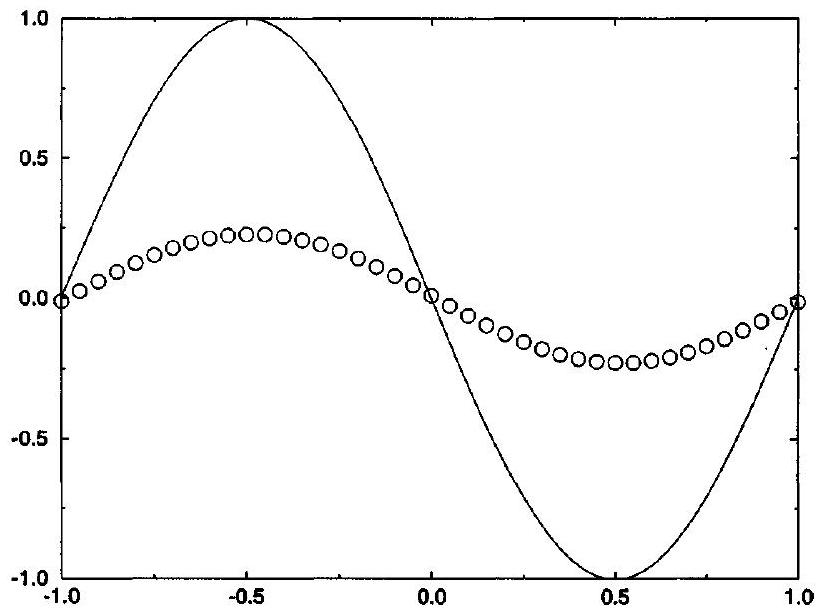
Figure 17.13 Godunov's first-order upwind method for Test Case 1.

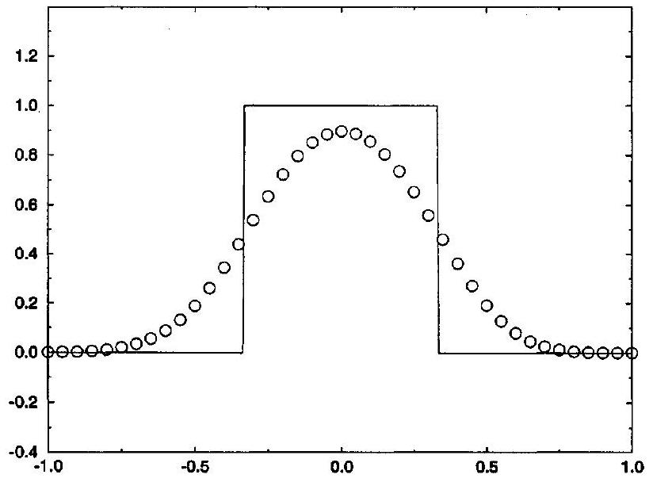
Figure 17.14 Godunov's first-order upwind method for Test Case 2.

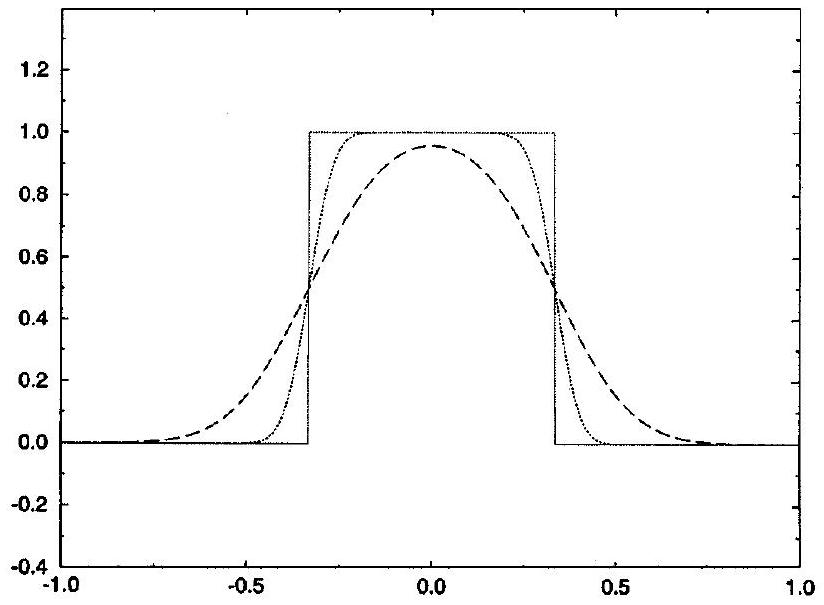
Figure 17.15 Godunov's first-order upwind method for Test Case 3.

is symmetric, properly located, and free of spurious overshoots or oscillations. As in Test Case 1, Godunov's first-order upwind method equals FTBS.

Test Case 3 In Figure 17.15, the dotted line represents Godunov's approximation to $u(x, 4)$, the long dashed line represents Godunov's approximation to $u(x, 40)$, and the solid line represents the exact solution for $u(x, 4)$ or $u(x, 40)$. Clearly, increasing the number of grid points, and decreasing $\Delta x$ and $\Delta t$, dramatically improve the approximation for $u(x, 4)$, as compared with Figure 17.14. Once again, Godunov's first-order upwind method equals FTBS in this test case.

Test Case 4 As seen in Figure 17.16, the shock is captured across only two grid points and without any spurious overshoots or oscillations. The corner at the head of the expansion fan has been slightly rounded off. As with all of the preceding test cases, Godunov's first-order upwind method equals FTBS in this case.

Test Case 5 As seen in Figure 17.17, Godunov's method captures the steady shock perfectly. Godunov's method partially captures the expansion fan. However, the expansion fan contains an $O(\Delta x)$ expansion shock at the expansive sonic point found in the center of the expansion fan. As one way to view the problem, the reconstruction used by Godunov's method has $O(\Delta x)$ jumps at every cell edge, and the time evolution tends to retain the $O(\Delta x)$ jumps if the solution contains an expansive sonic point. Somewhat surprisingly, the best way to address this problem is to replace the exact Riemann solver by an approximate Riemann solver, as discussed in following subsections - in other words, one needs to reduce the physicality of the method to improve the numerics. Unlike the preceding four test cases, Godunov's first-order upwind method does not equal FTBS in this test case. In fact, only Test Case 5 distinguishes Godunov's first-order upwind method from the other first-order upwind methods seen in this section, since this is the only test case to involve sonic points.

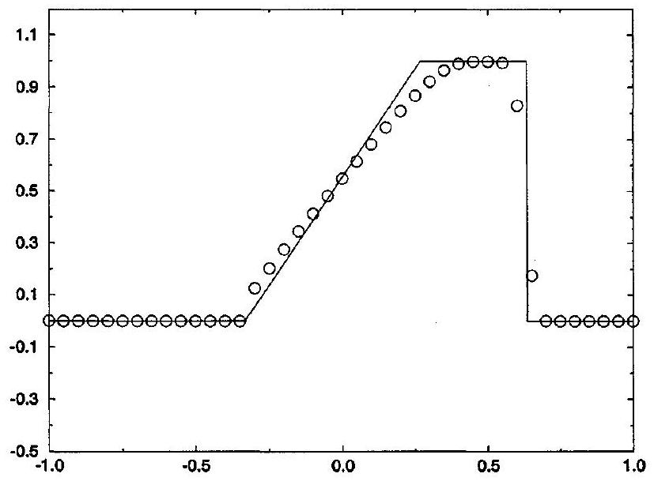
Figure 17.16 Godunov's first-order upwind method for Test Case 4.

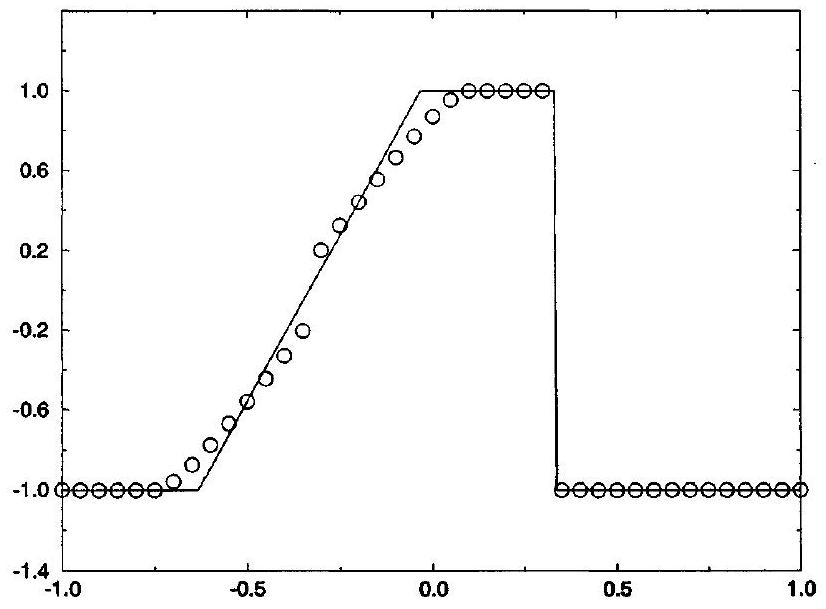
Figure 17.17 Godunov's first-order upwind method for Test Case 5.

### 17.3.2 Roe's First-Order Upwind Method

Roe's approximate Riemann solver is given by Equation (5.69). In Equation (5.69), replace $u_{L}$ by $u_{i}^{n}$, replace $u_{R}$ by $u_{i+1}^{n}$, replace $t=0$ by $t=t^{n}$, and replace $x=0$ by $x= x_{i+1 / 2}$. Substitute into Equation (17.13) to find

$$
\hat{f}_{i+1 / 2}^{n}= \begin{cases}\min \left(f\left(u_{i}^{n}\right), f\left(u_{i+1}^{n}\right)\right) & \text { if } u_{i}^{n}<u_{i+1}^{n}, \\ \max \left(f\left(u_{i}^{n}\right), f\left(u_{i+1}^{n}\right)\right) & \text { if } u_{i}^{n}>u_{i+1}^{n} .\end{cases}
$$

This is called Roe's first-order upwind method. Roe's first-order upwind method for the Euler equations was discovered in 1981. However, the scalar version was well-known before this. For example, the version for the linear advection equation is sometimes called the Courant-Isaacson-Rees (CIR) method; then the version for nonlinear scalar conservation
laws is sometimes called the generalized Courant-Isaacson-Rees (GCIR) method. Also, the version for nonlinear scalar conservation laws is sometimes called the Murman-Cole scheme; see Murman and Cole (1971). One way to think of Roe's first-order upwind method is that it equals Godunov's first-order upwind method applied to the following locally linearized flux function:

$$
f_{l}(u)=a_{i+1 / 2}^{n} u+f\left(u_{i}^{n}\right),
$$

where $a_{i+1 / 2}^{n}$ is given by Equation (17.9). In artificial viscosity form, Roe's first-order upwind method is
$u_{i}^{n+1}=u_{i}^{n}-\frac{\lambda}{2}\left(f\left(u_{i+1}^{n}\right)-f\left(u_{i-1}^{n}\right)\right)+\frac{\lambda}{2}\left(\epsilon_{i+1 / 2}^{n}\left(u_{i+1}^{n}-u_{i}^{n}\right)-\epsilon_{i-1 / 2}^{n}\left(u_{i}^{n}-u_{i-1}^{n}\right)\right)$,
where

$$
\epsilon_{i+1 / 2}^{n}=\left|a_{i+1 / 2}^{n}\right|
$$

and where $a_{i+1 / 2}^{n}$ is given by Equation (17.9). The coefficient of artificial viscosity for Roe's method is illustrated in Figure 17.18. Figure 17.18 clearly illustrates the relationships among Roe's first-order upwind method, the Lax-Friedrichs method, the Lax-Wendroff method, and FTCS. Furthermore, Figure 17.18 clearly illustrates the relationships among these four methods, the linear stability condition $(\lambda a)^{2} \leq \lambda \epsilon \leq 1$ found in Example 15.4, and the nonlinear stability condition $\left|\lambda a_{i+1 / 2}^{n}\right| \leq \lambda \epsilon_{i+1 / 2}^{n} \leq 1$ found in Example 16.6. Unfortunately, after this section, most methods will no longer fit so neatly into diagrams

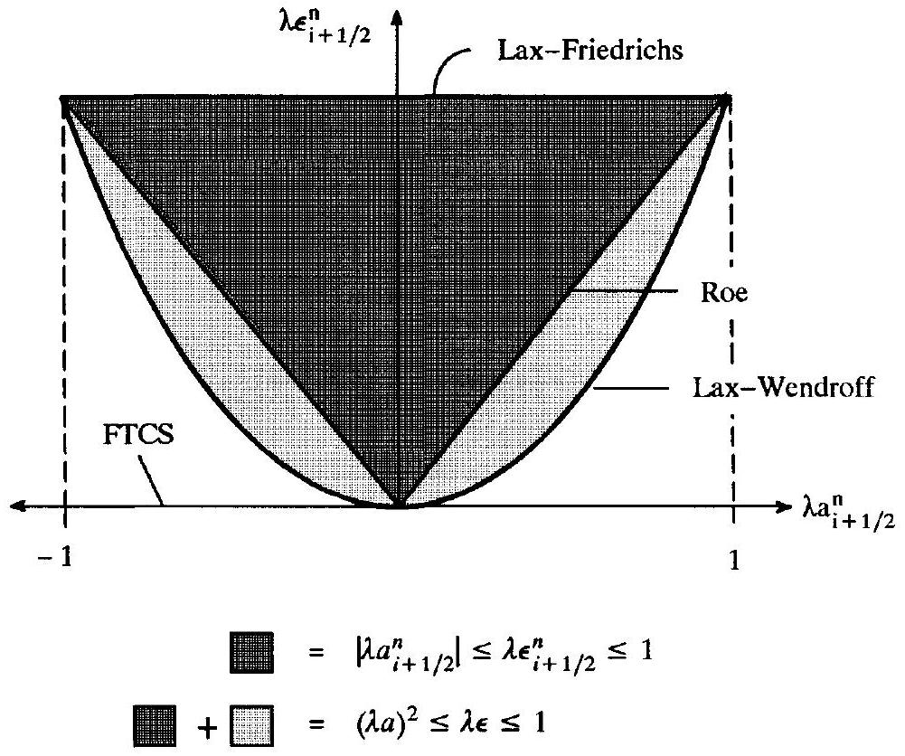
Figure 17.18 The artificial viscosity of FTCS, the Lax-Friedrichs method, the Lax-Wendroff method, and Roe's first-order upwind method.

such as Figure 17.18. In wave speed splitting form, Roe's first-order upwind method is

$$
u_{i}^{n+1}=u_{i}^{n}+C_{i+1 / 2}^{+}\left(u_{i+1}^{n}-u_{i}^{n}\right)-C_{i-1 / 2}^{-}\left(u_{i}^{n}-u_{i-1}^{n}\right),
$$

where

$$
\begin{aligned}
& C_{i+1 / 2}^{+}=-\lambda \min \left(0, a_{i+1 / 2}^{n}\right) \\
& C_{i+1 / 2}^{-}=\lambda \max \left(0, a_{i+1 / 2}^{n}\right)
\end{aligned}
$$

Of course, as always, there are infinitely many other wave speed split forms. However, this is the only wave speed split form with finite coefficients - in this sense, this is the unique natural wave speed split form. Roe's first-order upwind method can also be written as follows:

$$
u_{i}^{n+1}= \begin{cases}u_{i}^{n}-\lambda\left(f\left(u_{i}^{n}\right)-f\left(u_{i-1}^{n}\right)\right) & \text { if } a_{i+1 / 2}^{n} \geq 0 \text { and } a_{i-1 / 2}^{n} \geq 0, \\ u_{i}^{n}-\lambda\left(f\left(u_{i+1}^{n}\right)-f\left(u_{i}^{n}\right)\right) & \text { if } a_{i+1 / 2}^{n} \leq 0 \text { and } a_{i-1 / 2}^{n} \leq 0, \\ u_{i}^{n} & \text { if } a_{i+1 / 2}^{n} \geq 0 \text { and } a_{i-1 / 2}^{n} \leq 0, \\ u_{i}^{n}-\lambda\left(f\left(u_{i+1}^{n}\right)-f\left(u_{i-1}^{n}\right)\right) & \text { if } a_{i+1 / 2}^{n} \leq 0 \text { and } a_{i-1 / 2}^{n} \geq 0 .\end{cases}
$$

Comparing Equations (17.14) and (17.19), we notice that Roe's first-order upwind method differs from Godunov's first-order upwind method only at sonic points, just as expected. More specifically, Roe's first-order method differs from Godunov's first-order upwind method only at expansive sonic points. Comparing Equations (17.15) and (17.21), we see that Roe's first-order upwind method has less artificial viscosity than Godunov's firstorder upwind method at expansive sonic points. The reduced artificial viscosity reduces the accuracy of Roe's method at expansive sonic points. On the positive side, Roe's first-order upwind method is simpler and cheaper than Godunov's first-order upwind method.

The behavior of Roe's first-order upwind method is illustrated using the five standard test cases defined in Section 17.0.

Test Cases 1 through 4 Roe's first-order upwind method is identical to Godunov's first-order method and to FTBS, since these tests cases all lack expansive sonic points. See Figures 17.13 to 17.16 and the associated discussion.

Test Case 5 As seen in Figure 17.19, the steady shock is captured perfectly. Unfortunately, like the Lax-Wendroff method, Roe's method fails to alter the initial conditions in any way, which is a total disaster at the expansion. As one way to view the situation, Roe's approximate Riemann solver cannot capture the finite spread of expansion fans, and this defect carries over to Roe's first-order upwind method. As another way to view the situation, Godunov's first-order method has somewhat inadequate artificial viscosity at expansive sonic points, whereas Roe's first-order upwind method has drastically inadequate artificial viscosity at expansive sonic points. In particular, at the expansive sonic point in this test case, by Equation (17.21), Roe's first-order upwind method has

$$
\epsilon=\frac{f(1)-f(-1)}{1-(-1)}=0
$$

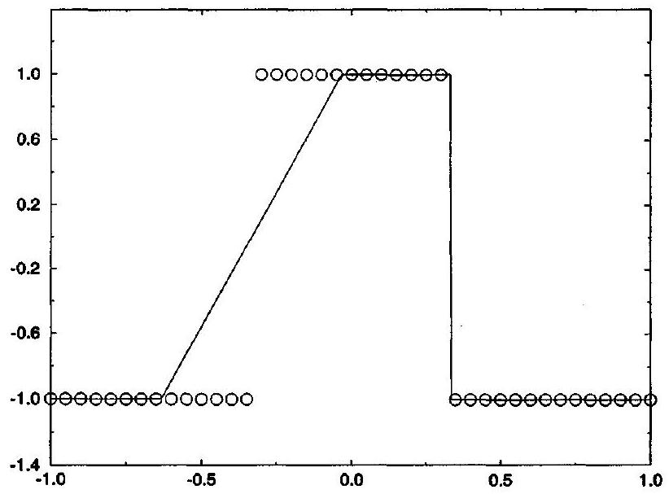
Figure 17.19 Roe's first-order upwind method for Test Case 5.

which makes Roe's first-order upwind method the same as FTCS. By Equation (17.15) Godunov's first-order upwind method has

$$
\epsilon=\frac{f(1)+f(-1)}{1-(-1)}=\frac{1}{2},
$$

which is a little small but better than nothing. Although Roe's and Godunov's first-order upwind methods have too little artificial viscosity at expansive sonic points, too much artificial viscosity at expansive sonic points can also cause problems. In particular, too little artificial viscosity may cause a spurious vertical jump, whereas too much may cause a spurious horizontal jump. Clearly, expansive sonic points are delicate things.

### 17.3.3 Harten's First-Order Upwind Method

Whereas Roe's approximate Riemann solver uses locally linear approximations to the flux function, this section uses locally quadratic approximations to the flux function. A linear approximation to the flux is not very accurate at the maxima and minima of the flux function (i.e., sonic points) because a linear function is always monotone increasing or decreasing. Unlike linear functions, quadratic functions allow extrema, and thus a quadratic approximation should be much more successful for modeling the extrema of the flux function. Suppose that the left and right states to the Riemann problem are $u_{L}=u_{i}^{n}$ and $u_{R}=u_{i+1}^{n}$, respectively. Also, suppose that the quadratic approximation to the flux function passes through ( $u_{i}^{n}, f\left(u_{i}^{n}\right)$ ) and ( $u_{i+1}^{n}, f\left(u_{i+1}^{n}\right)$ ). This leaves one degree of freedom in the quadratic which can be used any way you like. For example, this degree of freedom can be used to model the true flux function. The closer the quadratic resembles the true flux function, the more the resulting first-order upwind method resembles Godunov's first-order upwind method, but, unfortunately, Godunov's first-order upwind method allows $O(\Delta x)$ jumps at expansive sonic points. Thus the free parameter in the quadratic should be chosen to model the true flux function everywhere except near expansive sonic points, where it should be chosen to address the special numerical needs of expansive sonic points. It is exciting to realize that an approximate Riemann solver may actually yield better numerical
results than the exact Riemann solver, at least near expansive sonic points. In other words, errors in the solution to the Riemann problem may either increase or decrease errors in first-order upwind approximations based on Riemann solvers.

Suppose that the locally quadratic approximation to the flux function is written as follows:

$$
f_{q, i+1 / 2}(u)=\frac{\delta_{i+1 / 2}^{n}}{u_{i}^{n}-u_{i+1}^{n}}\left(u-u_{i+1}^{n}\right)\left(u-u_{i}^{n}\right)+a_{i+1 / 2}^{n}\left(u-u_{i}^{n}\right)+f\left(u_{i}^{n}\right),
$$

where $\delta_{i+1 / 2}^{n}$ is a free parameter and $a_{i+1 / 2}^{n}$ is defined by Equation (17.9). Notice that the quadratic in Equation (17.24) is in Newton form, as defined in Subsection 8.1.2. Among other virtues, the Newton form separates the linear term $a_{i+1 / 2}^{n}\left(u-u_{i}^{n}\right)+f\left(u_{i}^{n}\right)$ used in the last subsection from the new quadratic term $\delta_{i+1 / 2}^{n}\left(u-u_{i+1}^{n}\right)\left(u-u_{i}^{n}\right) /\left(u_{i+1}^{n}-u_{i}^{n}\right)$ added in this subsection. The factor $1 /\left(u_{i+1}^{n}-u_{i}^{n}\right)$ in the new quadratic term is for convenience and for consistency with the literature. By Equations (5.66) and (17.13), the exact solution to this approximate locally quadratic Riemann problem yields the following first-order upwind method:

$$
\hat{f}_{i+1 / 2}^{n}= \begin{cases}\min _{u_{i}^{n} \leq u \leq u_{i+1}^{n}} f_{q, i+1 / 2}(u) & \text { if } u_{i}^{n}<u_{i+1}^{n}, \\ \max _{u_{i}^{n} \geq u \geq u_{i+1}^{n}} f_{q, i+1 / 2}(u) & \text { if } u_{i}^{n}>u_{i+1}^{n},\end{cases}
$$

which is called Harten's first-order upwind method. As shown in Problem 17.10 Harten's first-order upwind method can be written as

$$
\hat{f}_{i+1 / 2}^{n}=\frac{1}{2}\left(f\left(u_{i+1}^{n}\right)+f\left(u_{i}^{n}\right)\right)-\frac{1}{2} \epsilon_{i+1 / 2}^{n}\left(u_{i}^{n+1}-u_{i}^{n}\right),
$$

where

- $\quad \epsilon_{i+1 / 2}= \begin{cases}\frac{\left(a_{i+1 / 2}^{n}\right)^{2}+\left(\delta_{i+1 / 2}^{n}\right)^{2}}{2 \delta_{i+1 / 2}^{n}} & \left|a_{i+1 / 2}^{n}\right|<\delta_{i+1 / 2}^{n}, \\ \left|a_{i+1 / 2}^{n}\right| & \left|a_{i+1 / 2}^{n}\right|>\delta_{i+1 / 2}^{n},\end{cases}$
which is the expression given in Harten's original 1983 paper. The coefficient of artificial viscosity of Harten's first-order upwind method is illustrated in Figure 17.20. Comparing

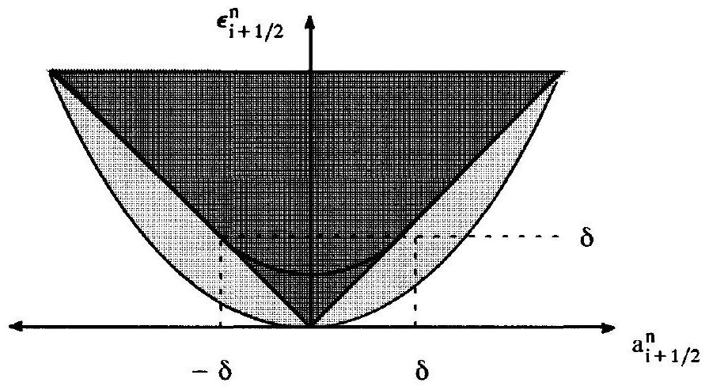
Figure 17.20 The artificial viscosity of Harten's first-order upwind method.

Figures 17.18 and 17.20, for small $\delta_{i+1 / 2}^{n}$, we notice that Harten's first-order upwind method is exactly the same as Roe's first-order upwind method except for the increased artificial viscosity near sonic points, which may reduce or eliminate entropy-condition-violating expansion shocks. Harten's first-order upwind method is sometimes called an entropy fix of Roe's first-order upwind method. Of course, every first-order upwind method in this section differs from Roe's first-order upwind methods only near sonic points. In this sense, every first-order upwind method in this section is some sort of "entropy fix" of Roe's first-order upwind method.

Notice that the quadratic in Equation (17.24) equals an interpolation quadratic if

$$
\frac{\delta_{i+1 / 2}^{n}}{u_{i+1}^{n}-u_{i}^{n}}=f\left[u_{i-1}, u_{i}, u_{i+1}\right]=\frac{1}{2} \frac{d^{2} f(\xi)}{d u^{2}}
$$

or if

$$
\frac{\delta_{i+1 / 2}^{n}}{u_{i+1}^{n}-u_{i}^{n}}=f\left[u_{i}, u_{i+1}, u_{i+2}\right]=\frac{1}{2} \frac{d^{2} f\left(\xi^{\prime}\right)}{d u^{2}},
$$

where $\xi$ is some local value of $u$. Either of these interpolation quadratics equals the true flux function to third-order accuracy. Alternatively, by matching terms in a Taylor series, the quadratic in Equation (17.24) equals the true flux function to third-order accuracy if

$$
\frac{\delta_{i+1 / 2}^{n}}{u_{i+1}^{n}-u_{i}^{n}}=\frac{1}{2} \frac{d^{2} f\left(u_{i}^{n}\right)}{d u^{2}},
$$

as shown in Problem 17.10. More generally, Equation (17.24) equals the true flux function to third-order accuracy if

$$
\frac{\delta_{i+1 / 2}^{n}}{u_{i+1}^{n}-u_{i}^{n}}=\frac{1}{2}\left(f^{\prime \prime}\right)_{i+1 / 2}^{n},
$$

where $\left(f^{\prime \prime}\right)_{i+1 / 2}^{n}$ is any average value of $f^{\prime \prime}(u)$ for $u$ between $u_{i}^{n}$ and $u_{i+1}^{n}$. For example, Van Leer, Lee, and Powell (1989) suggested the following "Roe average" second derivative:

$$
\left(f^{\prime \prime}\right)_{i+1 / 2}^{n}= \begin{cases}\frac{f^{\prime}\left(u_{i+1}^{n}\right)-f^{\prime}\left(u_{i}^{n}\right)}{u_{i+1}^{n}-u_{i}^{n}} & u_{i}^{n} \neq u_{i+1}^{n}, \\ f^{\prime \prime}\left(u_{i}^{n}\right) & u_{i}^{n}=u_{i+1}^{n} .\end{cases}
$$

With this average, Equation (17.27) becomes

$$
\delta_{i+1 / 2}^{n}=\frac{1}{2}\left(a\left(u_{i+1}^{n}\right)-a\left(u_{i}^{n}\right)\right) .
$$

More generally, Van Leer, Lee, and Powell (1989) suggested the following:

$$
\delta_{i+1 / 2}^{n}=\delta_{0}\left(a\left(u_{i+1}^{n}\right)-a\left(u_{i}^{n}\right)\right) .
$$

Although $\delta_{0}=1 / 2$ is the best choice as far as modeling the true flux function, larger values are required to avoid expansion shocks at sonic points; in particular, Van Leer, Lee, and Powell (1989) suggest $1 \leq \delta_{0} \leq 2$.

Although Roe's first-order upwind method encounters problems only at expansive sonic points, Harten's first-order upwind method increases the artificial viscosity at both expansive and compressive sonic points, relative to Roe's first-order upwind method, unless $\delta=0$ at
compressive sonic points. Roe's first-order upwind method performs well at compressive sonic points, and Harten's "entropy fix" only degrades performance in this instance. This problem is easily addressed by using a linear approximation at compressive sonic points, as in Roe's first-order upwind method, and a quadratic approximation at expansive sonic points, as in Harten's first-order upwind method. This yields a first-order upwind method with the following coefficient of artificial viscosity:

$$
\epsilon_{i+1 / 2}^{n}= \begin{cases}\frac{\left(a_{i+1 / 2}^{n}\right)^{2}+\left(\delta_{i+1 / 2}^{n}\right)^{2}}{2 \delta_{i+1 / 2}^{n}} & \left|a_{i+1 / 2}^{n}\right|<\delta_{i+1 / 2}^{n} \\ \left|a_{i+1 / 2}^{n}\right| & a\left(u_{i}^{n}\right) \leq 0, a\left(u_{i+1}^{n}\right) \geq 0 \\ \text { otherwise. }\end{cases}
$$

This coefficient was first suggested by Van Leer, Lee, and Powell (1989). Having said all of this, in practice, the most common approach is to set $\delta_{i+1 / 2}^{n}$ equal to some small constant rather than attempting any solution sensitivity of the sort seen in Equations (17.27), (17.30), or (17.31).

The behavior of Harten's first-order upwind method is illustrated using the five standard test cases defined in Section 17.0.

Test Cases 1 through 4 Harten's first-order upwind method is identical to Roe's method and Godunov's first-order upwind method. See Figures 17.13 to 17.16 and the associated discussion.

Test Case 5 As seen in Figure 17.21, using Equations (17.30) and (17.31) with $\delta_{0}=1$, Harten's first-order upwind method captures the expansion fan without any expansion shock. The main defect in the expansion fan is a slight rounding off of the corners at the head and tail. Away from the expansion fan, Harten's first-order method is just the same as Roe's and Godunov's first-order upwind method. In particular, it captures the steady shock perfectly.

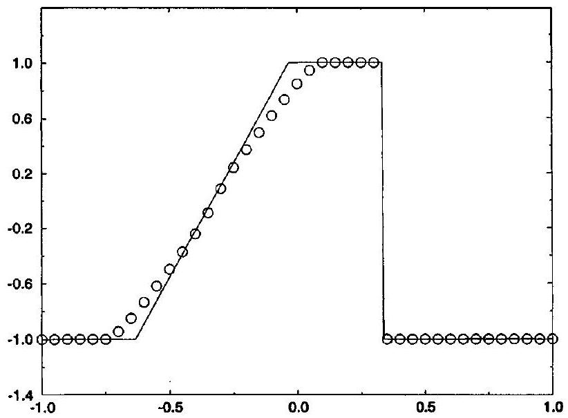
Figure 17.21 Harten's first-order upwind method for Test Case 5.

### 17.4 Beam-Warming Second-Order Upwind Method

The first-order upwind methods seen in the last section are accurate and stable at shocks. Unfortunately, first-order accuracy in smooth regions is too low for most practical computations. This leads to the following question: do higher-order accurate upwind methods in general share the stability and shock capturing abilities of their first-order brethren? If so, higher-order accurate upwind methods will be the methods of choice for shock capturing. This section concerns a specific second-order accurate upwind method proposed by Warming and Beam (1976). The Beam-Warming second-order upwind method exemplifies some of the general virtues and limitations of higher-order upwind methods.

The derivation of the Beam-Warming second-order upwind method is similar to the derivation of the Lax-Wendroff method seen in Section 17.2. To begin with, consider the following Taylor series:

$$
u(x, t+\Delta t)=u(x, t)-\Delta t \frac{\partial f}{\partial x}(x, t)+\frac{\Delta t^{2}}{2} \frac{\partial}{\partial x}\left(a(u) \frac{\partial f}{\partial x}\right)(x, t)+O\left(\Delta t^{3}\right)
$$

where the governing equation has been used to replace time derivatives by space derivatives. Assume $a(u)>0$. Use Equation (10.18) to discretize the first derivative:

$$
\frac{\partial f}{\partial x}\left(x_{i}, t^{n}\right)=\frac{3 f\left(u_{i}^{n}\right)-4 f\left(u_{i-1}^{n}\right)+f\left(u_{i-2}^{n}\right)}{2 \Delta x}+O\left(\Delta x^{2}\right) .
$$

Also let

$$
\frac{\partial}{\partial x}\left(a(u) \frac{\partial f}{\partial x}\right)\left(x_{i}, t^{n}\right)=\frac{\partial}{\partial x}\left(a(u) \frac{\partial f}{\partial x}\right)\left(x_{i-1}, t^{n}\right)+O(\Delta x)
$$

where

$$
\begin{aligned}
& \frac{\partial}{\partial x}\left(a(u) \frac{\partial f}{\partial x}\right)\left(x_{i-1}, t^{n}\right) \\
& \quad=\frac{a_{i-1 / 2}^{n}\left(f\left(u_{i}^{n}\right)-f\left(u_{i-1}^{n}\right)\right)-a_{i-3 / 2}^{n}\left(f\left(u_{i-1}^{n}\right)-f\left(u_{i-2}^{n}\right)\right)}{\Delta x^{2}}+O\left(\Delta x^{2}\right)
\end{aligned}
$$

The resulting method is as follows:

$$
\begin{aligned}
u_{i}^{n+1}= & u_{i}^{n}-\frac{\lambda}{2}\left(3 f\left(u_{i}^{n}\right)-4 f\left(u_{i-1}^{n}\right)+f\left(u_{i-2}^{n}\right)\right) \\
& +\frac{\lambda^{2}}{2}\left[a_{i-1 / 2}^{n}\left(f\left(u_{i}^{n}\right)-f\left(u_{i-1}^{n}\right)\right)-a_{i-3 / 2}^{n}\left(f\left(u_{i-1}^{n}\right)-f\left(u_{i-2}^{n}\right)\right)\right],
\end{aligned}
$$

which is the Beam-Warming second-order upwind method for $a(u)>0$. Similarly, for $a(u)<0$,

$$
\begin{aligned}
u_{i}^{n+1}= & u_{i}^{n}+\frac{\lambda}{2}\left(3 f\left(u_{i}^{n}\right)-4 f\left(u_{i+1}^{n}\right)+f\left(u_{i+2}^{n}\right)\right) \\
& +\frac{\lambda^{2}}{2}\left[a_{i+3 / 2}^{n}\left(f\left(u_{i+2}^{n}\right)-f\left(u_{i+1}^{n}\right)\right)-a_{i+1 / 2}^{n}\left(f\left(u_{i+1}^{n}\right)-f\left(u_{i}^{n}\right)\right)\right]
\end{aligned}
$$

which is the Beam-Warming second-order upwind method for $a(u)<0$. In the BeamWarming method, the average wave speed $a_{i+1 / 2}^{n}$ may be defined in a variety of different ways. In other words, the Beam-Warming method is actually an entire class of methods
differing in the choice of $a_{i+1 / 2}^{n}$, just like the Lax-Wendroff method. As usual, this book will use definition (17.9).

The above expressions for the Beam-Warming second-order method are fine except at sonic points, where $a(u)$ changes sign. There are at least three possible ways to define the method at sonic points: flux averaging, flux splitting, and reconstruction-evolution. In 1976, at the time of the original paper, neither flux splitting nor higher-order accurate reconstruction-evolution had been invented yet. Thus the original paper used flux averaging, such that the Beam-Warming second-order upwind method was used in smooth regions away from sonic points, and a first-order upwind method was used at shocks and at sonic points. However, this approach is a little too advanced for now; flux averaging will not be considered in detail until Part V. So now consider reconstruction-evolution. Reconstructionevolution easily yields first-order accurate methods with piecewise-constant reconstructions, as seen in the last section, since an exact or approximate solution to the Riemann problem easily yields the time evolution. However, reconstruction-evolution requires a great deal more effort for second- and higher-order accurate methods, which use piecewiselinear and higher-order polynomial reconstructions, because these spatial reconstructions lack any obvious time evolution. Thus the reconstruction-evolution approach is also a little too advanced for the time being. This leaves flux splitting, first introduced in Section 13.4. In particular, suppose that $f(u)=f^{+}(u)+f^{-}(u)$, where $d f^{+} / d u \leq 0$ and $d f^{-} / d u \leq 0$. Then $\partial f / \partial x=\partial f^{+} / \partial x+\partial f^{-} / \partial x$. Use the Beam-Warming method for $a>0$ to discretize $\partial f^{+} / \partial x$ and use the Beam-Warming method for $a<0$ to discretize $\partial f^{-} / \partial x$. The resulting method is as follows:

$$
\begin{aligned}
u_{i}^{n+1}= & u_{i}^{n}-\frac{\lambda}{2}\left(3 f^{+}\left(u_{i}^{n}\right)-4 f^{+}\left(u_{i-1}^{n}\right)+f^{+}\left(u_{i-2}^{n}\right)\right) \\
& +\frac{\lambda}{2}\left(3 f^{-}\left(u_{i}^{n}\right)-4 f^{-}\left(u_{i+1}^{n}\right)+f^{-}\left(u_{i+2}^{n}\right)\right) \\
& +\frac{\lambda^{2}}{2}\left[a_{i-1 / 2}^{+}\left(f^{+}\left(u_{i}^{n}\right)-f^{+}\left(u_{i-1}^{n}\right)\right)-a_{i-3 / 2}^{+}\left(f^{+}\left(u_{i-1}^{n}\right)-f^{+}\left(u_{i-2}^{n}\right)\right)\right] \\
& +\frac{\lambda^{2}}{2}\left[a_{i+3 / 2}^{-}\left(f^{-}\left(u_{i+2}^{n}\right)-f^{-}\left(u_{i+1}^{n}\right)\right)-a_{i+1 / 2}^{-}\left(f^{-}\left(u_{i+1}^{n}\right)-f^{-}\left(u_{i}^{n}\right)\right)\right],
\end{aligned}
$$

where

$$
a_{i+1 / 2}^{ \pm}= \begin{cases}\frac{\left(f^{ \pm}\right)^{\prime}\left(u_{i+1}^{n}\right)-\left(f^{ \pm}\right)^{\prime}\left(u_{i}^{n}\right)}{u_{i+1}^{n}-u_{i}^{n}} & u_{i}^{n} \neq u_{i+1}^{n}, \\ \left(f^{ \pm}\right)^{\prime \prime}\left(u_{i}^{n}\right) & u_{i}^{n}=u_{i+1}^{n} .\end{cases}
$$

To keep things simple, the rest of the section concerns the Beam-Warning secondorder upwind method for $a(u)>0$. In conservation form, the Beam-Warming second-order upwind method for $a(u)>0$ is

$$
u_{i}^{n+1}=u_{i}^{n}-\lambda\left(\hat{f}_{i+1 / 2}^{n}-\hat{f}_{i-1 / 2}^{n}\right),
$$

where

$$
\begin{aligned}
\hat{f}_{i+1 / 2}^{n} & =\frac{1}{2}\left(3 f\left(u_{i}^{n}\right)-f\left(u_{i-1}^{n}\right)\right)-\frac{\lambda}{2} a_{i-1 / 2}^{n}\left(f\left(u_{i}^{n}\right)-f\left(u_{i-1}^{n}\right)\right) \\
& =\frac{1}{2}\left(3 f\left(u_{i}^{n}\right)-f\left(u_{i-1}^{n}\right)\right)-\frac{\lambda}{2}\left(a_{i-1 / 2}^{n}\right)^{2}\left(u_{i}^{n}-u_{i-1}^{n}\right)
\end{aligned}
$$

In artificial viscosity form, the Beam-Warming second-order upwind method for $a(u)>0$ is

$$
\begin{aligned}
u_{i}^{n+1}= & u_{i}-\frac{\lambda}{2}\left(f\left(u_{i+1}^{n}\right)-f\left(u_{i-1}^{n}\right)\right) \\
& +\frac{\lambda}{2}\left(\epsilon_{i+1 / 2}^{n}\left(u_{i+1}^{n}-u_{i}^{n}\right)-\epsilon_{i-1 / 2}^{n}\left(u_{i}^{n}-u_{i-1}^{n}\right)\right),
\end{aligned}
$$

where

$$
\epsilon_{i+1 / 2}^{n}=a_{i+1 / 2}^{n}-a_{i-1 / 2}^{n}\left(1-\lambda a_{i-1 / 2}^{n}\right) r_{i}^{n}
$$

and where

$$
r_{i}^{n}=\frac{u_{i}^{n}-u_{i-1}^{n}}{u_{i+1}^{n}-u_{i}^{n}} .
$$

Notice that $r_{i}^{n} \geq 0$ if the solution is monotone increasing or decreasing, whereas $r_{i}^{n} \leq 0$ if the solution has a maximum or minimum. Figure 17.22 illustrates the coefficient of artificial viscosity for the Beam-Warming method applied to the linear advection equation. Unlike the previous methods in this chapter, $\lambda \epsilon$ is not a simple function of $\lambda a$. Instead, $\lambda \epsilon$ depends on both $\lambda a$ and the ratio $r_{i}^{n}$. Depending on $r_{i}^{n}$, the coefficient of artificial viscosity of the Beam-Warming second-order upwind method may equal that of Roe's first-order upwind method, or the Lax-Wendroff method, or a variety of other unnamed methods. The complicated and possibly infinite coefficient of artificial viscosity is a sad but common consequence of straying outside the stencil ( $u_{i-1}^{n}, u_{i}^{n}, u_{i+1}^{n}$ ). In wave speed split form, the

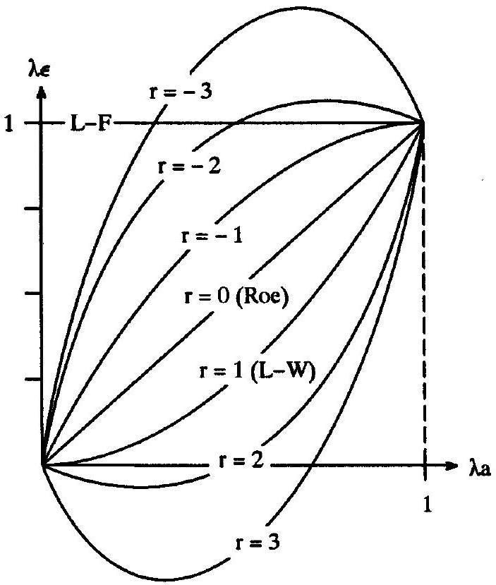
Figure 17.22 Artificial viscosity for the Beam-Warming second-order upwind method applied to the linear advection equation.

Beam-Warming second-order upwind method for $a(u)>0$ is

$$
u_{i}^{n+1}=u_{i}^{n}+C_{i+1 / 2}^{+}\left(u_{i+1}^{n}-u_{i}^{n}\right)-C_{i-1 / 2}^{-}\left(u_{i}^{n}-u_{i-1}^{n}\right),
$$

where

$$
\begin{aligned}
& C_{i+1 / 2}^{+}=\frac{1}{2} \lambda a_{i-1 / 2}^{n} r_{i}^{n}\left(\lambda a_{i-1 / 2}^{n}-3\right), \\
& C_{i+1 / 2}^{-}=\frac{1}{2} \lambda a_{i-1 / 2}^{n} r_{i}^{n}\left(\lambda a_{i-1 / 2}^{n}-1\right) .
\end{aligned}
$$

Of course, as always, there are infinitely many other wave speed split forms. Unlike the previous methods in this chapter, the coefficients $C_{i+1 / 2}^{+}$in Equation (17.38) are infinite when the ratio $r_{i}^{n}$ is infinite. In fact, there is no wave speed split form of the BeamWarming second-order upwind method with finite coefficients. This is another sad but common consequence of straying outside the stencil ( $u_{i-1}^{n}, u_{i}^{n}, u_{i+1}^{n}$ ).

The twelve-point checklist for the Beam-Warming second-order upwind method is as follows:
(1) The coefficient of artificial viscosity may be large or infinite, depending on the ratio $r_{i}^{n}=\left(u_{i}^{n}-u_{i-1}^{n}\right) /\left(u_{i+1}^{n}-u_{i}^{n}\right)$ and the CFL number.
(2) CFL condition: $|\lambda a(u)| \leq 2$. This is the first time we have seen a CFL limit larger than 1 . This is a major benefit of using a wider stencil.
(3) Conservative.
(4) Consistent.
(5) The Beam-Warming second-order upwind method may not converge on nonsmooth solutions as $\Delta x \rightarrow 0$ and $\Delta t \rightarrow 0$. Even if it does converge, the converged solution may not satisfy entropy conditions. In particular, the Beam-Warming second-order upwind method may allow expansion shocks, depending on the sonic point treatment.
(6) Explicit.
(7) Finite difference.
(8) Linearly stable provided that the CFL condition is satisfied.
(9) Linear when applied to the linear advection equation. Nonlinear when applied to any nonlinear scalar conservation law.
(10) Consider the nonlinear stability conditions seen in Chapter 16. Although there is no rigorous proof, numerical tests show that the Beam-Warming second-order upwind method is TVB. However, although the total variation is bounded for any fixed $\Delta x$ and $\Delta t$, the total variation may equal infinity in the limit $\Delta x \rightarrow 0$ and $\Delta t \rightarrow 0$. In other words, the Beam-Warming second-order upwind method is always TVB but not always total variation stable; see the discussion in Section 16.11. Furthermore, by Godunov's theorem seen in Section 16.1, the Beam-Warming second-order method is not monotonicity preserving. Then the Beam-Warming second-order upwind method cannot satisfy any condition that implies monotonicity preservation including TVD, positivity, range reduction, the upwind range condition, contraction, or the monotone condition.
(11) Formally second-order accurate in time and space, except possibly at sonic points. (12) Upwind.

As an additional property, not listed above, steady-state solutions of the Beam-Warming second-order upwind method depend on the time step $\Delta t$. The behavior of the BeamWarming second-order upwind method is illustrated using the five standard test cases defined in Section 17.0.

Test Case 1 As seen in Figure 17.23, the sinusoid's shape and amplitude are well captured. The only visible error is a slight leading phase error.

Test Case 2 As seen in Figure 17.24, the numerical solution oscillates about the true solution causing errors of up to $25 \%$. On the whole, this solution is distinctly worse than the Lax-Wendroff solution seen in Figure 17.8. The relatively poor performance of the Beam-Warming second-order upwind method in Test Case 2 could have been predicted by examining the artificial viscosity. As seen in Figure 17.22, for large $\left|r_{i}^{n}\right|$, the coefficient

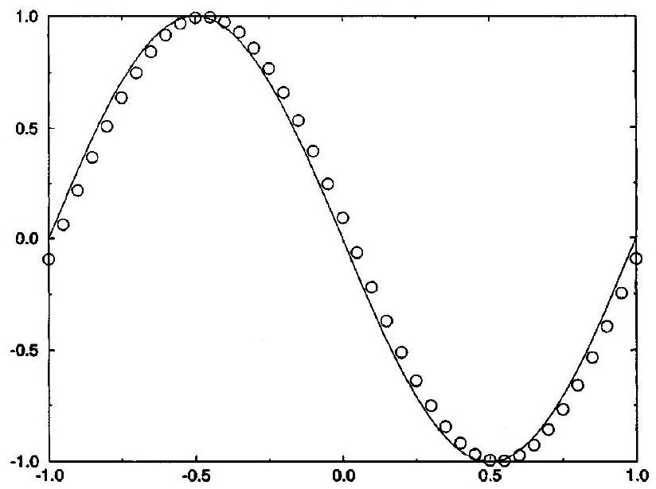
Figure 17.23 Beam-Warming second-order upwind method for Test Case 1.

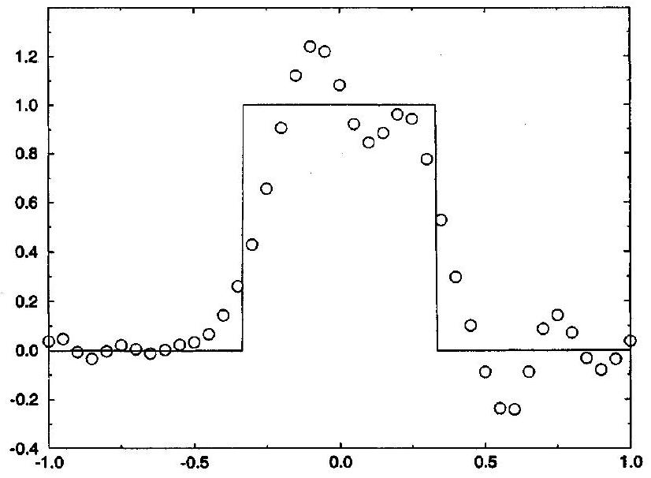
Figure 17.24 Beam-Warming second-order upwind method for Test Case 2.

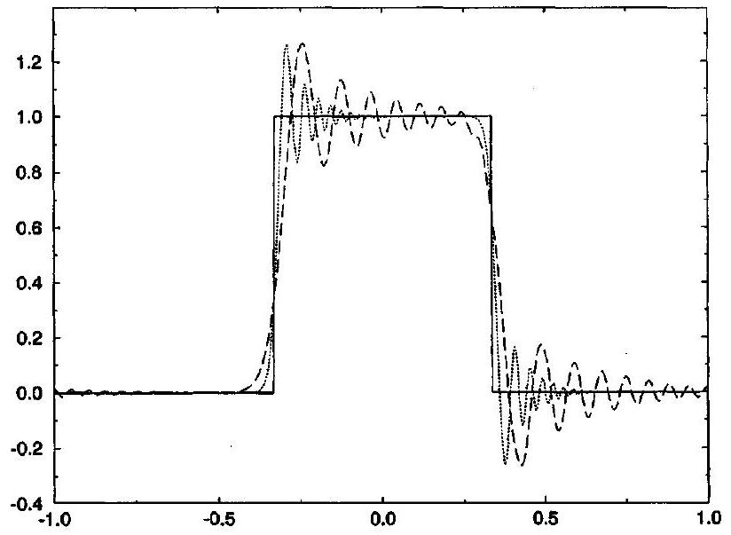
Figure 17.25 Beam-Warming second-order upwind method for Test Case 3.

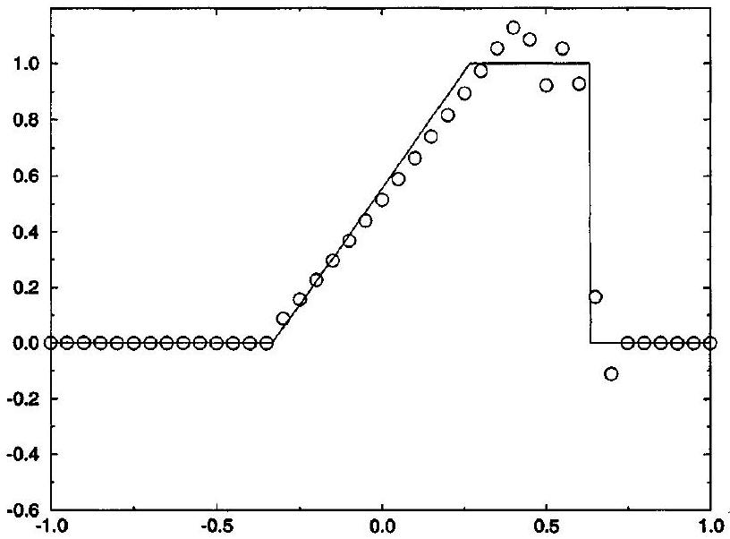
Figure 17.26 Beam-Warming second-order upwind method for Test Case 4.

of artificial viscosity may be either way too large or way too small, either of which leads to instability and spurious oscillations.

Test Case 3 In Figure 17.25, the dotted line represents the Beam-Warming approximation to $u(x, 4)$, the long dashed line represents the Beam-Warming approximation to $u(x, 40)$, and the solid line represents the exact solution for $u(x, 4)$ and $u(x, 40)$. The spurious oscillations are similar to those found in the Lax-Wendroff method, except that they are far more severe and lie on opposite sides of the jump discontinuities.

Test Case 4 This test case and the next use the natural flux splitting $f^{+}(u)= \max (0, u) u / 2$ and $f^{-}(u)=\max (0, u) u / 2$ for Burgers' equation, as described in Example 13.7. As seen in Figure 17.26, the Beam-Warming second-order upwind method

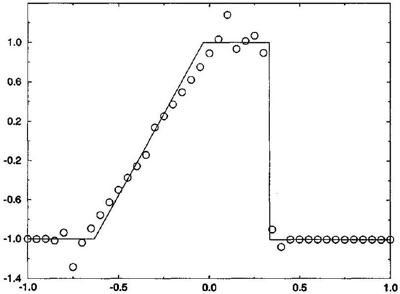
Figure 17.27 Beam-Warming second-order upwind method for Test Case 5.

captures the expansion fan extremely well. In fact, comparing Figure 17.26 with Figures 17.10 and 17.16, we see that the Beam-Warming second-order upwind method captures the expansion fan far better than the Lax-Wendroff method and slightly better than Godunov's first-order upwind method. Unfortunately, the Beam-Warming second-order upwind method is not quite so successful on the shock. In particular, the Beam-Warming second-order upwind method experiences large $2 \Delta x$ oscillations to the left of the shock and a smaller undershoot to the right of the shock.

Test Case 5 As seen in Figure 17.27, the Beam-Warming second-order upwind method captures the steady shock quite well, with only slight undershoots and overshoots. Unfortunately, the Beam-Warming second-order upwind method has more difficulties with the sonic expansion fan. First of all, it experiences a small but significant spurious expansion shock near the sonic point. Second of all, it experiences large spurious oscillations to the left and right of the expansion fan. Still, this is a far better performance than the Lax-Wendroff method or Roe's first-order upwind method, which do not affect the initial conditions in any way.

We can now answer the question posed at the beginning of the section: unlike firstorder upwind methods, higher-order upwind methods may be extremely oscillatory. In fact, higher-order upwind methods may be even more oscillatory than centered methods, as is the case comparing the Beam-Warming second-order upwind method with the LaxWendroff method. Of course, this conclusion is completely consistent with the discussion of upwind methods found in Section 13.1. In their original paper, Warming and Beam (1976) recognized the oscillatory nature of their second-order upwind method; they proposed a blending that used a first-order upwind method at shocks and sonic points and their secondorder upwind method in smooth regions, as mentioned earlier. As a final note, there is an implicit method commonly referred to as the Beam-Warming method, and this method should not be confused with the explicit method discussed here.

### 17.5 Fromm's Method

This section concerns Fromm's method, discovered in 1968. Flux averaging was introduced in Section 13.3, and Fromm's method is best seen as a simple average of the LaxWendroff method and the Beam-Warming second-order upwind method. For an average of two methods to make sense, the two methods should have complementary properties. For example, one method might have too much artificial viscosity, while the other has too little. As another example, one method might have the best stencil for smooth regions, while the other method might have the best stencil for shocks. As a third example, one method may have negative artificial dispersion, while the other has positive artificial dispersion.

To start this section, let us show that the Lax-Wendroff method and the Beam-Warming second-order upwind method have complementary properties, at least when applied to the linear advection equation. Modified equations are an extremely powerful analysis tool for linear methods, as described in Section 15.3. The modified equation for the Lax-Wendroff method applied to the linear advection equation is

$$
\frac{\partial u}{\partial t}+a \frac{\partial u}{\partial x}=-\frac{a \Delta x^{2}}{6}\left(1-(\lambda a)^{2}\right) \frac{\partial^{3} u}{\partial x^{3}}-\frac{a \Delta x^{3}}{8} \lambda a\left(1-(\lambda a)^{2}\right) \frac{\partial^{4} u}{\partial x^{4}}+\cdots
$$

The modified equation for the Beam-Warming second-order upwind method applied to the linear advection equation for $a>0$ is

$$
\frac{\partial u}{\partial t}+a \frac{\partial u}{\partial x}=\frac{a \Delta x^{2}}{6}(1-\lambda a)(2-\lambda a) \frac{\partial^{3} u}{\partial x^{3}}-\frac{a \Delta x^{3}}{8}(1-\lambda a)^{2}(2-\lambda a) \frac{\partial^{4} u}{\partial x^{4}}+\cdots
$$

Notice that the coefficients of the third-derivative terms in Equations (17.39) and (17.40) have opposite signs for $0 \leq \lambda a \leq 1$. This suggests that an average of the Lax-Wendroff method and the Beam-Warming second-order upwind method will have less dispersive error than either method separately, at least when applied to the linear advection equation. In particular, the sum of Equations (17.39) and (17.40) divided by two yields

$$
\begin{aligned}
\frac{\partial u}{\partial t}+a \frac{\partial u}{\partial x}= & \frac{a \Delta x^{2}}{6}(1-\lambda a)\left(\frac{1}{2}-\lambda a\right) \frac{\partial^{3} u}{\partial x^{3}} \\
& -\frac{a \Delta x^{3}}{8}(1-\lambda a)\left((\lambda a)^{2}-\lambda a+1\right) \frac{\partial^{4} u}{\partial x^{4}}+\cdots .
\end{aligned}
$$

As the reader can easily verify, the coefficient of the third derivative in Equation (17.41) is substantially less in absolute value than the ones in Equation (17.39) or (17.40) for $0 \leq \lambda a \leq 1$.

Let us average the Lax-Wendroff and Beam-Warming second-order upwind methods in artificial viscosity form. Instead of using FTCS as the reference method, as in the standard artificial viscosity form, it is more convenient here to use FTBS as the reference. The LaxWendroff method may be written as FTBS plus second-order artificial viscosity as follows:

$$
\begin{aligned}
u_{i}^{n+1}= & u_{i}^{n}-\lambda\left(f\left(u_{i}^{n}\right)-f\left(u_{i-1}^{n}\right)\right)-\frac{1}{2} \lambda a_{i+1 / 2}^{n}\left(1-\lambda a_{i+1 / 2}^{n}\right)\left(u_{i+1}^{n}-u_{i}^{n}\right) \\
& +\frac{1}{2} \lambda a_{i-1 / 2}^{n}\left(1-\lambda a_{i-1 / 2}^{n}\right)\left(u_{i}^{n}-u_{i-1}^{n}\right)
\end{aligned}
$$

The Beam-Warming second-order upwind method for $a(u)>0$ may be written as FTBS plus second-order artificial viscosity as follows:

$$
\begin{aligned}
u_{i}^{n+1}= & u_{i}^{n}-\lambda\left(f\left(u_{i}^{n}\right)-f\left(u_{i-1}^{n}\right)\right)-\frac{1}{2} \lambda a_{i-1 / 2}^{n}\left(1-\lambda a_{i-1 / 2}^{n}\right)\left(u_{i}^{n}-u_{i-1}^{n}\right) \\
& +\frac{1}{2} \lambda a_{i-3 / 2}^{n}\left(1-\lambda a_{i-3 / 2}^{n}\right)\left(u_{i-1}^{n}-u_{i-2}^{n}\right)
\end{aligned}
$$

The sum of Equations (17.42) and (17.43) divided by two yields the following:

$$
\begin{aligned}
u_{i}^{n+1}= & u_{i}^{n}-\lambda\left(f\left(u_{i}^{n}\right)-f\left(u_{i-1}^{n}\right)\right)-\frac{1}{4} \lambda a_{i+1 / 2}^{n}\left(1-\lambda a_{i+1 / 2}^{n}\right)\left(u_{i+1}^{n}-u_{i}^{n}\right) \\
& +\frac{1}{4} \lambda a_{i-3 / 2}^{n}\left(1-\lambda a_{i-3 / 2}^{n}\right)\left(u_{i-1}^{n}-u_{i-2}^{n}\right)
\end{aligned}
$$

which is Fromm's method for $a(u)>0$. Fromm's method for $a(u)<0$ is left as an exercise for the reader. Also, Fromm's method can be extended to any $a(u)$, regardless of sign, using flux averaging, reconstruction-evolution, or flux splitting, just as in the last section; the details are omitted. Finally, expressions for the conservation form, the artificial viscosity form, and wave speed split forms are left as exercises. The extremely simple fixed arithmetic average in Fromm's method is fairly successful, which indicates that more sophisticated solution-sensitive averages might be wildly successful. We shall return to this idea in Part V; in particular, see Section 20.1. The standard twelve-point checklist for Fromm's method is as follows:
(1) The coefficient of artificial viscosity may be large or infinite, depending on the ratio $r_{i}^{n}=\left(u_{i}^{n}-u_{i-1}^{n}\right) /\left(u_{i+1}^{n}-u_{i}^{n}\right)$ and the CFL number.
(2) CFL condition $|\lambda a(u)| \leq 2$.
(3) Conservative.
(4) Consistent.
(5) Fromm's method may not converge on nonsmooth solutions as $\Delta x \rightarrow 0$ and $\Delta t \rightarrow 0$. Even if it does converge, the converged solution may not satisfy entropy conditions. In particular, Fromm's method allows expansion shocks, depending on the sonic point treatment.
(6) Explicit.
(7) Finite difference.
(8) Linearly stable provided that $|\lambda a| \leq 1$. Unlike the other methods in this chapter, the linear stability condition is more restrictive than the CFL condition. The linear stability condition is inherited from the Lax-Wendroff method, whereas the CFL condition is inherited from the Beam-Warming second-order upwind method.
(9) Linear when applied to the linear advection equation. Nonlinear when applied to any nonlinear scalar conservation law.
(10) Consider the nonlinear stability conditions seen in Chapter 16. Although there is no rigorous proof, numerical tests show that Fromm's method is TVB for $|\lambda a(u)| \leq 1$. However, although the total variation is bounded for any fixed $\Delta x$ and $\Delta t$, the total variation may go to infinity in the limit $\Delta x \rightarrow 0$ and $\Delta t \rightarrow 0$. In other words, Fromm's method is always TVB but not always total variation stable; see the discussion in Section 16.11. Furthermore, by Godunov's theorem seen in Section 16.1, Fromm's method is not monotonicity preserving. Then Fromm's method cannot
satisfy any condition that implies monotonicity preservation including TVD, positivity, range reduction, the upwind range condition, contraction, or the monotone condition.
(11) Formally second-order accurate in time and space.
(12) Upwind.

As an additional property, not listed above, steady-state solutions of Fromm's method depend on the time step $\Delta t$. The behavior of Fromm's method is illustrated using the five standard test cases defined in Section 17.0.

Test Case 1 As seen in Figure 17.28, Fromm's method yields the best results on this test case of any method seen in this chapter. Whereas the Lax-Wendroff method had a slight lagging error as seen in Figure 17.7, and the Beam-Warming second-order upwind method had a slight leading error as seen in Figure 17.23, Fromm's method is nearly indistinguishable from the true solution in Figure 17.28.

Test Case 2 As seen in Figure 17.29, the numerical solution oscillates about the true solution, but the maximum error is only about $7.5 \%$. The contact discontinuities have been smeared out over about five grid cells, which is the least smearing seen so far. In fact, overall, Fromm's method does better than any other method seen in this chapter on this test case. It should be noted that the linear advection equation is perhaps an unfair choice, since Fromm's method was specifically designed to have a low error when applied to the linear advection equation. Fromm's method may not do quite so well when applied to a nonlinear equation.

Test Case 3 In Figure 17.30, the dotted line represents Fromm's approximation to $u(x, 4)$, the long dashed line represents Fromm's approximation to $u(x, 40)$, and the solid line represents the exact solution for $u(x, 4)$ and $u(x, 40)$. The spurious oscillations are similar to those found in the Lax-Wendroff and Beam-Warming second-order upwind methods, except that they are far less severe.

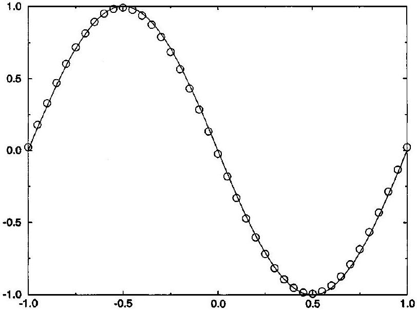
Figure 17.28 Fromm's method for Test Case 1.

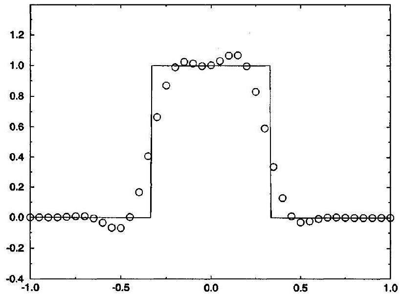
Figure 17.29 Fromm's method for Test Case 2.

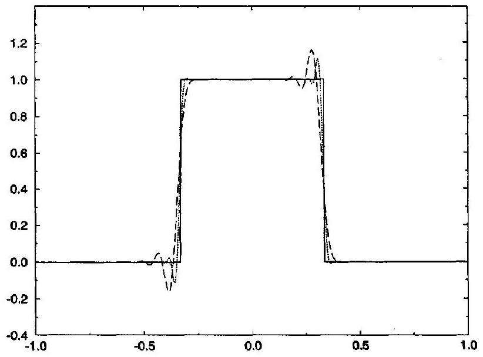
Figure 17.30 Fromm's method for Test Case 3.

Test Cases 4 and 5 These are left as exercises. See Problem 17.12.

## References

Fromm, J. E. 1968. "A Method for Reducing Dispersion in Convective Difference Schemes," Journal of Computational Physics, 3: 176-189.
Godunov, S. K. 1959. "A Difference Scheme for Numerical Computation of Discontinuous Solutions of Hydrodynamics Equations," Math. Sbornik, 47: 271-306. English translation in U.S. Joint Publications Research Service, JPRS 7226, 1969.
Harten, A. 1978. "The Artificial Compression Method for Computation of Shocks and Contact Discontinuities: III. Self-Adjusting Hybrid Schemes," Mathematics of Computation, 32: 363-389.

Harten, A. 1983. "High Resolution Schemes for Hyperbolic Conservation Laws," Journal of Computational Physics, 49: 357-393.
Lax, P. D. 1954. "Weak Solutions of Nonlinear Hyperbolic Equations and Their Numerical Computation," Communications on Pure and Applied Mathematics, 7: 159-193.
Lax, P. D., and Wendroff, B. 1960. "Systems of Conservation Laws," Communications on Pure and Applied Mathematics, 13: 217-237.
Murman, E. M., and Cole, J. D. 1971. "Calculations of Plane Unsteady Transonic Flow," AIAA Journal, 9: 114-121.
Roe, P. L. 1981. "Approximate Riemann Solvers, Parameter Vectors, and Difference Schemes," Journal of Computational Physics, 43: 357-372.
Van Leer, B., Lee, W.-T., and Powell, K. G. 1989. "Sonic-Point Capturing," AIAA Paper 89-1945 (unpublished).
Warming, R. F., and Beam, R. M. 1976. "Upwind Second-Order Difference Schemes and Applications in Aerodynamic Flows," AIAA Journal, 14: 1241-1249.

## Problems

17.1 In general, linearity allows for simplifications. In particular, the expressions for the numerical methods found in this chapter may be simplified when the methods are applied to the linear advection equation. The simplified forms often improve computational efficiency and minimize round-off errors. Thus the simplified form is often preferred for actual programming. Unfortunately, the simplified linear forms look quite a bit different from the general forms for nonlinear scalar conservation laws. This can be confusing, in that some sources only provide the simplified expressions for linear advection equations, making it hard to recognize the method.
(a) Show that the Lax-Friedrichs method applied to the linear advection equation can be written as follows:

$$
u_{i}^{n+1}=\frac{1}{2}(1-\lambda a) u_{i+1}^{n}+\frac{1}{2}(1+\lambda a) u_{i-1}^{n} .
$$

(b) Show that the Lax-Wendroff method applied to the linear advection equation can be written as follows:

$$
u_{i}^{n+1}=\frac{1}{2} \lambda a(\lambda a-1) u_{i+1}^{n}-(\lambda a-1)(\lambda a+1) u_{i}^{n}+\frac{1}{2} \lambda a(\lambda a+1) u_{i-1}^{n} .
$$

(c) Show that the Beam-Warming second-order method applied to the linear advection equation with $a>0$ can be written as follows:

$$
u_{i}^{n+1}=\frac{1}{2}(\lambda a-1)(\lambda a-2) u_{i}^{n}-\lambda a(\lambda a-2) u_{i-1}^{n}+\frac{1}{2} \lambda a(\lambda a-1) u_{i-2}^{n} .
$$

(d) Show that Fromm's method applied to the linear advection equation with $a>0$ can be written as follows:

$$
\begin{aligned}
u_{i}^{n+1}= & u_{i}^{n}-\frac{1}{4} \lambda a(1-\lambda a)\left(u_{i+1}^{n}-u_{i}^{n}\right)-\lambda a\left(u_{i}^{n}-u_{i-1}^{n}\right) \\
& +\frac{1}{4} \lambda a(1-\lambda a)\left(u_{i-1}^{n}-u_{i-2}^{n}\right)
\end{aligned}
$$

(e) Argue that the approximations found in parts (a)-(d) are all perfect when $\lambda a=1$.
17.2 Under ordinary circumstances, Fromm's method is second-order accurate. Show that Fromm's method is third-order accurate when applied to the linear advection equation with $\lambda a=1 / 2$. You may prove this result either analytically or with numerical results.
17.3 In Section 17.1, the Lax-Friedrichs method is derived from FTCS by replacing $u_{i}^{n}$ by $\left(u_{i+1}^{n}+u_{i-1}^{n}\right) / 2$. Remember that FTCS is formally second-order accurate in space. Also notice that $u_{i}^{n}$ and $\left(u_{i+1}^{n}+u_{i-1}^{n}\right) / 2$ are the same to within second-order spatial accuracy. Does this imply that the Lax-Friedrichs method is formally second-order accurate in space? If so, then why is the Lax-Friedrichs method usually considered a first-order accurate method? Your answer should be relatively brief and intuitive. You may wish to review the discussion on order of accuracy found in Subsection 11.2.2.
17.4 Consider the Lax-Friedrichs method for the linear advection equation with the following initial conditions:

$$
u_{0}^{0}=0.4, \quad u_{1}^{0}=0.5, \quad u_{2}^{0}=0.6, \quad u_{3}^{0}=1.0, \quad u_{4}^{0}=0.6, \quad u_{5}^{0}=0.5, \quad u_{6}^{0}=0.4 .
$$

Notice that the initial conditions contain a single maximum at $u_{3}^{0}$.
(a) Find $u_{1}^{1}, u_{2}^{1}, u_{3}^{1}, u_{4}^{1}$, and $u_{5}^{1}$ using the CFL number $\lambda a=0.25$. Notice that the solution develops large oscillations in a single time step. In particular, $u_{2}^{1}$ and $u_{4}^{1}$ are maxima, while $u_{3}^{1}$ is a minimum.
(b) For the given initial conditions, show that the Lax-Friedrichs method for the linear advection equation develops spurious oscillations in one time step for $0<\lambda a<0.6$ but does not develop spurious oscillations in one time step for $0.6 \leq \lambda a \leq 1$. You may prove this result either analytically or with numerical results.
(c) The oscillations in the Lax-Friedrichs method and in other situations are often attributed to odd-even decoupling. To eliminate odd-even decoupling, reduce the coefficient of artificial viscosity by $10 \%$, that is, let $\epsilon=0.9 / \lambda$, and repeat part (a). The resulting method depends on both even and odd points. Show that although reducing the artificial viscosity reduces the spurious oscillations, the method still develops spurious oscillations after a single time step. In other words, spurious oscillations in the Lax-Friedrichs method cannot be completely attributed to odd-even decoupling.
17.5 (a) Consider the Lax-Friedrichs method. What are the advantages and disadvantages of reducing its coefficient of artificial viscosity by a constant amount?
(b) Consider the Lax-Wendroff method. What are the advantages and disadvantages of increasing its coefficient of artificial viscosity by a constant amount?
17.6 Consider the scalar flux functions illustrated below.
(a) Sketch the flux functions. In your sketches, label all sonic points and state whether they are expansive or compressive.
(b) Find the conservative numerical flux $f_{i+1 / 2}^{n}$ of Godunov's and Roe's first-order upwind method.
17.7 Write Equation (17.33) for the Beam-Warming second-order upwind method in conservation form.
17.8 As seen in Figure 17.11, the Lax-Wendroff method using the "Roe average" definition of $a_{i+1 / 2}^{n}$ seen in Equation (17.9) allows a large expansion shock in Test Case 5. In this problem, we shall see how alternative definitions of $a_{i+1 / 2}^{n}$ affect expansive sonic point capturing.
(a) Repeat Test Case 5 using definition (17.7) for $a_{i+1 / 2}^{n}$.
(b) Repeat Test Case 5 using definition (17.8) for $a_{i+1 / 2}^{n}$.
17.9 Use Equation (17.18) to prove that Godunov's first-order upwind method applied to Burgers' equation always satisfies the nonlinear stability condition $\left|\lambda a_{i+1 / 2}^{n}\right| \leq \lambda \epsilon_{i+1 / 2}^{n} \leq 1$ found in Example 16.6, provided that the CFL condition is satisfied, regardless of expansive sonic points.
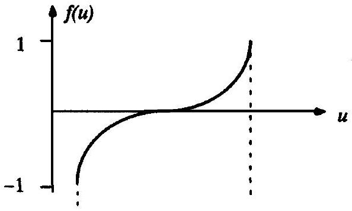

$$
u_{i+1}^{n}=-1 \quad u_{i}^{n}=3
$$

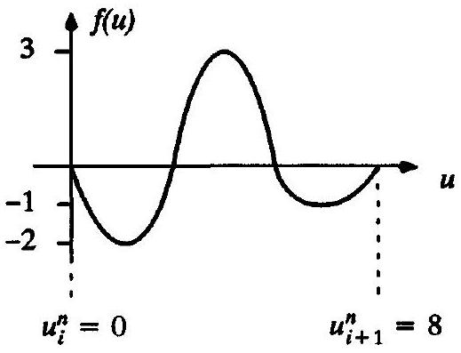

## Problem 17.6.

17.10 Consider the following quadratic approximation to $f(u)$ :

$$
f_{q, i+1 / 2}(u)=\frac{\delta}{u_{i+1}^{n}-u_{i}^{n}}\left(u-u_{i}^{n}\right)^{2}-\left(\delta-a_{i+1 / 2}^{n}\right)\left(u-u_{i}^{n}\right)+f\left(u_{i}^{n}\right) .
$$

(a) Show that this is the same quadratic as Equation (17.24), except that this has been written in Taylor series form rather than Newton form, which you may find more convenient in this problem.
(b) Verify that $f_{q, i+1 / 2}\left(u_{i}^{n}\right)=f\left(u_{i}^{n}\right)$ and $f_{q, i+1 / 2}\left(u_{i+1}^{n}\right)=f\left(u_{i+1}^{n}\right)$.
(c) Assuming $\delta \neq 0$, the quadratic $f_{q, i+1 / 2}$ always has a global extremum. Show that the global extremum of $f_{q, i+1 / 2}$ occurs at $u^{*}$ where

$$
u^{*}-u_{i}^{n}=\frac{1}{2 \delta}\left(\delta-a_{i+1 / 2}^{n}\right)\left(u_{i+1}^{n}-u_{i}^{n}\right) .
$$

(d) When is the extremum found in part (c) a maximum? When is the extremum found in part (c) a minimum? When does the extremum found in part (c) fall between $u_{i}^{n}$ and $u_{i+1}^{n}$ ?
(e) Using the result from parts (a)-(d), prove that Equation (17.25) implies Equation (17.26).
(f) Show that $f_{q, i+1 / 2}(u)=f(u)$ if $f(u)=a u$ and $\delta=0$.
(g) Show that $f_{q, i+1 / 2}(u)=f(u)$ if $f(u)=u^{2} / 2$ and $\delta=\left(u_{i+1}^{n}-u_{i}^{n}\right) / 2$.
(h) Consider any flux function $f(u)$. Matching terms in a Taylor series for $f(u)$ centered on $u_{i}^{n}$, show that $f_{q, i+1 / 2}(u)=f(u)+O\left(u_{i+1}^{n}-u_{i}^{n}\right)^{3}$ if $\delta=f^{\prime \prime}\left(u_{i}^{n}\right)\left(u_{i+1}^{n}-u_{i}^{n}\right) / 2$.
17.11 Write Fromm's method for $a(u)>0$ in wave speed split form using $g_{i}^{n}=\left(f\left(u_{i}^{n}\right)+\right. \left.f\left(u_{i-1}^{n}\right)\right) / 2$.
17.12 (a) Find an expression for Fromm's method for $a(u)<0$.
(b) Find a version of Fromm's method that works for any $a(u)$ by averaging Equations (17.5) and (17.33). Test this method on Test Cases 4 and 5.
(c) Find a version of Fromm's method that works for any $a(u)$ by applying (1) the expression for $a(u)>0$ found in Section 17.5 to the positive part of a flux split form of the governing equations and (2) the expression for $a(u)<0$ found in part (a) to the negative part of a flux split form of the governing equations. Is this version of Fromm's method the same as that found in part (b)? If not, test this method on Test Cases 4 and 5, and say how it compares to the method found in part (b).
17.13 Apply Harten's first-order upwind method to Test Case 5. Use $\Delta x=0.025$ and $\Delta t=0.02$ and evolve the solution for 30 time steps. Compare the solutions for $\delta_{i+1 / 2}^{n}=0,0.01$, $0.025,0.05,0.1,0.2,0.5$, and 0.8 . How do your results compare with Godunov's and Roe's first-order upwind methods?
17.14 Consider the following initial value problem on the periodic domain $[-1,1]$ :

$$
\begin{aligned}
& \frac{\partial u}{\partial t}+\frac{\partial u}{\partial x}=0, \\
& u(x, 0)= \begin{cases}1-3|x| & |x| \leq 1 / 3, \\
0 & |x| \geq 1 / 3 .\end{cases}
\end{aligned}
$$

For each of the following methods, approximate $u(x, 4)$ using 40 grid points and $\lambda=0.8$. Make sure to plot the exact solution as a reference.
(a) the Lax-Friedrichs method
(b) the Lax-Wendroff method
(c) FTBS
(d) the Beam-Warming second-order upwind method
(e) Fromm's method

