## Basic Numerical Methods for the Euler Equations

### 18.0 Introduction

This chapter concerns numerical methods for the Euler equations. Rather than starting from scratch, this chapter mainly converts the numerical methods for scalar conservation laws seen in the last chapter into numerical methods for the Euler equations. The approaches described here can be divided into two categories - flux approaches and wave approaches. Wave approaches can be further subdivided into two categories - flux vector splitting approaches and reconstruction-evolution approaches. Whereas flux approaches consider only fluxes, wave approaches model both fluxes and waves, and especially the interactions between various families of waves, using either flux vector splitting or Riemann solvers, which makes them more physical and accurate but also more expensive and complicated. Before continuing, the reader may wish to review pertinent material from previous chapters. In particular, in preparation for flux vector splitting, discussed in Section 18.2, the reader should review the introduction to flux splitting and wave speed splitting found in Sections 13.4 and 13.5, respectively. Furthermore, in preparation for reconstructionevolution methods, which use real or approximate Riemann solvers, the reader should review Chapter 5 and the introduction to reconstruction-evolution methods found in Section 13.6. And, of course, the reader should not even consider reading this chapter until carefully ingesting the last chapter.

This chapter converts all of the numerical methods for scalar conservation laws seen in the last chapter, except for Fromm's method, into numerical methods for the vector Euler equations in one if not several ways. For most numerical methods, the vector versions retain most of the properties of the scalar versions. However, while flaws in the scalar versions carry over to vector versions, the vector versions may introduce additional flaws, due to the interaction among various conserved quantities and various families of waves, and can otherwise change certain properties of the scalar methods. Vector and scalar versions generally share properties such as conservation, explicit versus implicit, finite volume versus finite difference, linear stability, linearity, and formal order of accuracy. Vector and scalar versions sometimes do not share other properties such as artificial viscosity, convergence, and nonlinear stability. For example, the vector version will usually have a matrix coefficient of artificial viscosity, generally not uniquely defined, which may or may not resemble the scalar coefficient of artificial viscosity. As another example, convergence proofs for scalar conservation laws may not carry over to vector conservation laws such as the Euler equations. Fortunately, the CFL condition extends rather easily from scalar to vector versions. For example, if the scalar method has the CFL condition $\lambda|a(u)| \leq 1$ then the vector method has the CFL condition $\lambda \rho(A(\mathbf{u})) \leq 1$, where $\rho(A)$ is the largest wave speed in absolute value.

Now let us consider two standard test problems. The Riemann problem for the Euler equations has one of the few exact solutions of the Euler equations, as discussed in Section 5.1. Thus, not by coincidence, both of the standard test problems used in this chapter
are Riemann problems. These two test problems were first suggested by Sod (1978) and are sometimes referred to as Sod's test problems. These two test problems are classics and appear often in modern research papers such as, for example, Zha and Bilgen (1993). Before stating the test problems, a short background discussion is in order. In any Euler calculation, one must choose between fixing the maximum CFL number or fixing the time step. In the most relevant example, the solution to the Riemann problem generally generates new and faster waves than those found in the initial conditions, causing the CFL number to increase rapidly for the first few time steps, assuming fixed time steps, or causing the time step to decrease rapidly for the first few time steps, assuming fixed CFL numbers. In our examples, the time step is fixed rather than the CFL number, which allows for more meaningful comparisons between methods. If the CFL number is fixed, and if a method overestimates the wave speeds, then it must take smaller time steps and more time steps than other methods to reach the final time and is thus, in this sense, double penalized. Conversely, if a method underestimates the wave speeds, then it can take larger time steps and fewer time steps than other methods and is thus, in this sense, rewarded for its mistake. Of course, when fixing the time step, one must ensure that any overshoots in the wave speeds do not violate the CFL condition. Although the results in this chapter use fixed time steps, under ordinary practical circumstances it usually makes more sense to take the largest time steps possible, consistent with accuracy and stability, which usually means fixing the CFL number.

Besides CFL-condition-violating overshoots in the wave speeds, another potential problem is undershoots in quantities like pressure and density. Although these quantities are physically positive, undershoots may drive them numerically negative, causing the method to fail when, for example, computing the speed of sound according to $a=\sqrt{\gamma p / \rho}$. It is thus important to constantly monitor quantities such as pressure, energy, and density to ensure that they remain positive. If they do become negative, some possible responses include presmoothing the initial conditions, adding artificial viscosity, or replacing the negative quantities by zero, as in $p=\max (0, p)$.

What follows are the two standard test cases used in this chapter. In the following descriptions, any properties of the exact solution, such as the maximum wave speeds, come from the exact solution found as described in Section 5.1.

Test Case 1 Find the pressure, velocity, speed of sound, density, entropy, and Mach number at $t=0.01 \mathrm{~s}$ where

$$
\mathbf{w}(x, 0)= \begin{cases}\mathbf{w}_{L} & x<0 \\ \mathbf{w}_{R} & x \geq 0,\end{cases}
$$

and where

$$
\begin{gathered}
\mathbf{w}_{L}=\left[\begin{array}{l}
\rho_{L} \\
u_{L} \\
p_{L}
\end{array}\right]=\left[\begin{array}{c}
1 \mathrm{~kg} / \mathrm{m}^{3} \\
0 \mathrm{~m} / \mathrm{s} \\
100,000 \mathrm{~N} / \mathrm{m}^{2}
\end{array}\right], \\
\mathbf{w}_{R}=\left[\begin{array}{l}
\rho_{R} \\
u_{R} \\
p_{R}
\end{array}\right]=\left[\begin{array}{c}
0.125 \mathrm{~kg} / \mathrm{m}^{3} \\
0 \mathrm{~m} / \mathrm{s} \\
10,000 \mathrm{~N} / \mathrm{m}^{2}
\end{array}\right] .
\end{gathered}
$$

Use $N=50$ points on the domain $[-10 \mathrm{~m}, 10 \mathrm{~m}]-$ then $\Delta x=(20 \mathrm{~m}) / 50=0.4 \mathrm{~m}$. Also use an initial CFL number of 0.4 . In the initial conditions, the maximum wave speed is $374.17 \mathrm{~m} / \mathrm{s}$. The fixed time step is thus $\Delta t=0.4 \times 0.4 \mathrm{~m} /(374.17 \mathrm{~m} / \mathrm{s})=4.276 \times 10^{-4} \mathrm{~s}$. Then $\lambda=\Delta t / \Delta x=1.069 \times 10^{-3} \mathrm{~s} / \mathrm{m}$. Then the final time $t=0.01 \mathrm{~s}$ is reached in approximately 23 time steps. For all $t>0$, in the exact solution, the maximum wave speed is $693.03 \mathrm{~m} / \mathrm{s}$ which corresponds to a CFL number of $\left(1.069 \times 10^{-3} \mathrm{~s} / \mathrm{m}\right)(693.03 \mathrm{~m} / \mathrm{s})=$ 0.7408. Different numerical methods will use slightly different CFL numbers, depending on how well they approximate the maximum wave speeds. For example, a highly dissipative method like the Lax-Friedrichs method will have a CFL number of 0.69 after the first few time steps, whereas a method prone to overshoots and undershoots like MacCormack's version of the Lax-Wendroff method will have a CFL number near 0.87 .

Test Case 2 Find the pressure, velocity, speed of sound, density, entropy, and Mach number at $t=0.01 \mathrm{~s}$ where

$$
\mathbf{w}(x, 0)= \begin{cases}\mathbf{w}_{L} & x<0 \\ \mathbf{w}_{R} & x \geq 0,\end{cases}
$$

and where:

$$
\begin{gathered}
\mathbf{w}_{L}=\left[\begin{array}{l}
\rho_{L} \\
u_{L} \\
p_{L}
\end{array}\right]=\left[\begin{array}{c}
1 \mathrm{~kg} / \mathrm{m}^{3} \\
0 \mathrm{~m} / \mathrm{s} \\
100,000 \mathrm{~N} / \mathrm{m}^{2}
\end{array}\right], \\
\mathbf{w}_{R}=\left[\begin{array}{l}
\rho_{R} \\
u_{R} \\
p_{R}
\end{array}\right]=\left[\begin{array}{c}
0.010 \mathrm{~kg} / \mathrm{m}^{3} \\
0 \mathrm{~m} / \mathrm{s} \\
1,000 \mathrm{~N} / \mathrm{m}^{2}
\end{array}\right] .
\end{gathered}
$$

Use $N=50$ points on the domain [ $-10 \mathrm{~m}, 15 \mathrm{~m}$ ] - then $\Delta x=(25 \mathrm{~m}) / 50=0.5 \mathrm{~m}$. Also use an initial CFL number of 0.3 . In the initial conditions, the maximum wave speed is $374.17 \mathrm{~m} / \mathrm{s}$. The fixed time step is thus $\Delta t=0.3 \times 0.5 \mathrm{~m} /(374.17 \mathrm{~m} / \mathrm{s})=4.01 \times 10^{-4} \mathrm{~s}$. Then $\lambda=\Delta t / \Delta x=8.02 \times 10^{-4} \mathrm{~s} / \mathrm{m}$. Then the final time $t=0.01 \mathrm{~s}$ is reached in approximately 25 time steps. For all $t>0$, in the exact solution, the maximum wave speed is $1,138.7 \mathrm{~m} / \mathrm{s}$, which corresponds to a CFL number of $\left(8.02 \times 10^{-3} \mathrm{~s} / \mathrm{m}\right)(1138.7 \mathrm{~m} / \mathrm{s})=0.91$. Different numerical methods will achieve different final CFL numbers, depending on how well they approximate the maximum wave speeds.

As far as Riemann problems go, there is nothing very special or exotic about Test Case 1. It does not contain any particularly strong shocks, contacts, or expansions. It does not contain any sonic points, although undershoots in the Mach number may cause the solution to cross the sonic point in the entropy waves $u=0$ and overshoots in the Mach number may cause the solution to cross the sonic point in the acoustic waves $u-a=0$. About the only thing that makes Test Case 1 unusually challenging is that the shock and contact are close together. Even at the final time, when their separation is greatest, the shock and contact are separated by only 2.5 m , which corresponds to only about five grid cells. It is next to impossible for most numerical methods to capture both a shock and a contact in five grid cells or less, unless they incorporate special features like artificial compression or subcell resolution, which the methods in this chapter do not.

Test Case 2 is much more challenging than Test Case 1. First, the shock and contact are separated by only five grid cells or less. Second, the expansion fan contains an expansive sonic point $u-a=0$ at $x=0$, which causes small expansion shocks to form in many numerical methods. Third, the shock contains a compressive sonic point $u+a=0$, although this does not tend to cause most numerical methods any particular problems. Finally, the initial conditions of Test Case 2 involve the unusually large pressure ratio of 100 . However, as it turns out, the large pressure ratio in the initial conditions does not translate into a large pressure ratio across the shock - in fact, the pressure ratio across the shock is only 6.392, which is not particularly strong, and is only about twice as strong as the pressure ratio across the shock in Test Case 1. In other words, most of the large pressure ratio is taken up in the smooth expansion fan, which makes the large pressure ratio easier to handle. Still, many numerical methods have a hard time getting started on Test Case 2, although they tend to settle down after the first few times steps, after the large initial jump discontinuity has had a chance to spread out.

Even though many sources use Sod's test cases, it is still possible to choose the exact circumstances to flatter or embarrass any given method. For example, a method such as the Lax-Friedrichs method looks relatively convincing for small $\Delta x$ but quite alarming for large $\Delta x$, as seen in Subsection 18.1.1. Besides the parameter $\Delta x$, most methods are also sensitive to the CFL number, so that a large CFL number may favor some methods, while a small CFL number may favor others. In fact, not surprisingly, most of the original research papers include mainly flattering results, making a fair assessment based on the original papers difficult. In this chapter, to be as even handed as possible, the circumstances for Test Cases 1 and 2 were chosen to make every method look just slightly dismal. For example, as mentioned above, both test cases allow at most five or six grid points between the shock and contact and between the contact and the tail of the expansion fan, which is simply not enough space for most methods. As a result, most methods will show a good deal of smearing, undershoot, and overshoot in these regions, which would lessen considerably if the number of grid points were increased. Although we could have chosen to use more grid points, or in other ways tailored the circumstances to show each method in a better light, this would lead to more subtle differences between methods, and our goal is to show differences, possibly even to exaggerate the differences, to help stress the relative strengths and weaknesses of each method.

Sod's test cases and, indeed, all Riemann problems will tend to flatter first-order accurate methods. The solution to the Riemann problem consists mainly of flat regions punctuated by sharp transitions such as shocks and contacts. First-order accurate methods tend to shine under such circumstances, by design, whereas second- and higher-order accurate methods tend to develop large spurious oscillations, even more so than for scalar conservation laws, due to the interactions between the several conserved variables and several families of waves. Second- and higher-order accuracy has the potential to improve the interior of the expansion fan and to reduce the rate of smearing of the contact, but these benefits do not generally outweigh the detriments in the case of the Riemann problem. In fact, ideally, one should turn off the second- and higher-order terms near trouble spots like shocks, but this chapter concerns only first-generation methods and thus, by definition, the higher-order methods in this chapter are committed to leaving their higher-order terms on all of the time, appropriately or not. To be completely fair, this chapter should include test cases that favor second- and higher-order methods over first-order methods, especially problems with completely smooth solutions, but the Riemann problem has an exact solution whereas other
smoother test cases do not. Thus this chapter will stick to the two Riemann problem test cases defined above.

### 18.1 Flux Approach

This section describes the simplest approach for converting numerical methods for scalar conservation laws into numerical methods for the Euler equations. The technique described considers only flux - it makes no efforts to model waves. The numerical differentiation formulae derived in Section 10.1 and the numerical integration formulae derived in Section 10.2 apply equally to scalars and vectors. For example, the central difference formula given by Equation (10.16) is

$$
\frac{d f}{d x}\left(x_{i}\right)=\frac{f\left(x_{i+1}\right)-f\left(x_{i-1}\right)}{2 \Delta x}+O\left(\Delta x^{2}\right)
$$

for scalar functions and

$$
\frac{d \mathbf{f}}{d x}\left(x_{i}\right)=\frac{\mathbf{f}\left(x_{i+1}\right)-\mathbf{f}\left(x_{i-1}\right)}{2 \Delta x}+O\left(\Delta x^{2}\right)
$$

for vector functions. Many of the numerical methods seen in the book are based directly on the integration and differentiation formulae of Sections 10.1 and 10.2. For such numerical methods, simply replace the scalar $u$ by the vector $\mathbf{u}$, the scalar $f$ by the vector $\mathbf{f}$, and the scalar derivative $a=d f / d u$ by the Jacobian matrix $A=d \mathbf{f} / d \mathbf{u}$.

### 18.1.1 Lax-Friedrichs Method

The Lax-Friedrichs method for scalar conservation laws was described in Section 17.1. In Equation (17.1), replace $u$ by $\mathbf{u}$ and $f$ by $\mathbf{f}$. Then the Lax-Friedrichs method for the Euler equations is

$$
\quad \quad \mathbf{u}_{i}^{n+1}=\frac{1}{2}\left(\mathbf{u}_{i+1}^{n}+\mathbf{u}_{i-1}^{n}\right)-\frac{\lambda}{2}\left(\mathbf{f}\left(\mathbf{u}_{i+1}^{n}\right)-\mathbf{f}\left(\mathbf{u}_{i-1}^{n}\right)\right) \text {. }
$$

Nothing could be easier than that. The behavior of the Lax-Friedrichs method is illustrated using the two tests cases defined in Section 18.0. As seen in Figures 18.1 and 18.2, the Lax-Friedrichs method exhibits considerable smearing and dissipation, as well as a number of two-point odd-even plateaus. Of course, the Lax-Friedrichs method for scalar conservation laws experiences similar difficulties, which the Lax-Friedrichs method for the Euler equations has simply inherited. On the positive side, the Lax-Friedrichs method handles the expansive sonic point in Test Case 2 with aplomb and, in general, has no more difficulties with Test Case 2 than with Test Case 1.

### 18.1.2 Lax-Wendroff Methods

The Lax-Wendroff method for scalar conservation laws was described in Section 17.2. In Equation (17.5), replace $u$ by $\mathbf{u}, f$ by $\mathbf{f}$, and $a_{i+1 / 2}^{n}$ by $A_{i+1 / 2}^{n}$. Then the Lax-Wendroff method for the Euler equations is

$$
\begin{aligned}
\mathbf{u}_{i}^{n+1}= & \mathbf{u}_{i}^{n}-\frac{\lambda}{2}\left(\mathbf{f}\left(\mathbf{u}_{i+1}^{n}\right)-\mathbf{f}\left(\mathbf{u}_{i-1}^{n}\right)\right) \\
& +\frac{\lambda^{2}}{2}\left[A_{i+1 / 2}^{n}\left(\mathbf{f}\left(\mathbf{u}_{i+1}^{n}\right)-\mathbf{f}\left(\mathbf{u}_{i}^{n}\right)\right)-A_{i-1 / 2}^{n}\left(\mathbf{f}\left(\mathbf{u}_{i}^{n}\right)-\mathbf{f}\left(\mathbf{u}_{i-1}^{n}\right)\right)\right] .
\end{aligned}
$$

Figure 18.1 The Lax-Friedrichs method for Test Case 1.

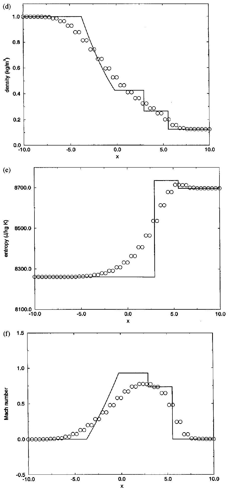
Figure 18.1 (cont.)

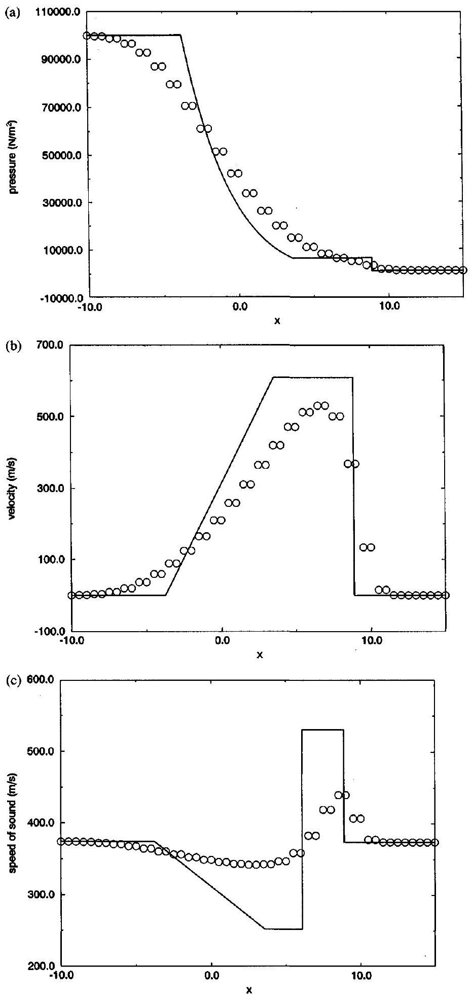
Figure 18.2 The Lax-Friedrichs method for Test Case 2.

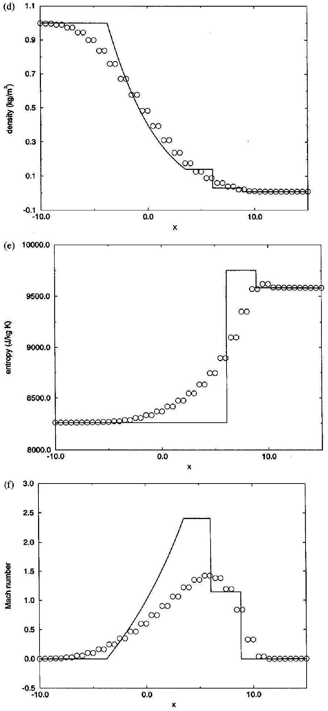
Figure 18.2 (cont.)

Like $a_{i+1 / 2}^{n}$ in the scalar version, there are many possible definitions for $A_{i+1 / 2}^{n}$ in the vector version of the Lax-Wendroff method. For example,

$$
A_{i+1 / 2}^{n}=A\left(\frac{\mathbf{u}_{i+1}^{n}+\mathbf{u}_{i}^{n}}{2}\right) .
$$

Another possibility is the Roe-average Jacobian matrix $A_{i+1 / 2}^{n}$ described in Section 5.3. Thus, like the scalar version, the vector version of the Lax-Wendroff method is actually an entire class of methods that differ only in their choice of $A_{i+1 / 2}^{n}$. However, unlike $a_{i+1 / 2}^{n}$ in the scalar version, the choice of $A_{i+1 / 2}^{n}$ in the vector version of the Lax-Wendroff method greatly affects costs. For the one-dimensional Euler equations, the Jacobian matrix $A(\mathbf{u})$ has nine entries, each of which are nonlinear functions of $\mathbf{u}$. Thus every evaluation of $A(\mathbf{u})$ is expensive. Any reasonable definition for $A_{i+1 / 2}^{n}$ requires at least one evaluation of $A(\mathbf{u})$ if not several. Furthermore, an average such as the Roe average involves significant additional costs besides the cost of evaluating $A(\mathbf{u})$, such as square roots. Even with the cheapest possible definitions for $A_{i+1 / 2}^{n}$, there is still the expense and complication of vector-matrix multiples such as

$$
A_{i+1 / 2}^{n}\left(\mathbf{f}\left(\mathbf{u}_{i+1}^{n}\right)-\mathbf{f}\left(\mathbf{u}_{i}^{n}\right)\right) .
$$

Forming the average Jacobian matrices and the vector-matrix multiples are major expenses, to the extent that the Lax-Wendroff method may become uncompetitive with other methods that do not require Jacobian matrix evaluations and multiplications, such as the Lax-Friedrichs method. Fortunately, there are two-step variants of the Lax-Wendroff method that completely avoid Jacobian matrices. One such variant is the Richtmyer method, defined as follows:

$$
\begin{array}{ll} 
& \mathbf{u}_{i+1 / 2}^{n+1 / 2}=\frac{1}{2}\left(\mathbf{u}_{i+1}^{n}+\mathbf{u}_{i}^{n}\right)-\frac{\lambda}{2}\left(\mathbf{f}\left(\mathbf{u}_{i+1}^{n}\right)-\mathbf{f}\left(\mathbf{u}_{i}^{n}\right)\right), \\
& \mathbf{u}_{i}^{n+1}=\mathbf{u}_{i}^{n}-\lambda\left(\mathbf{f}\left(\mathbf{u}_{i+1 / 2}^{n+1 / 2}\right)-\mathbf{f}\left(\mathbf{u}_{i-1 / 2}^{n+1 / 2}\right)\right) .
\end{array}
$$

The first step, Equation (18.3a), is called the predictor. In this case, the predictor is the Lax-Friedrichs method. The second step, Equation (18.3b), is called the corrector. In this case, the corrector is the leapfrog method (CTCS). Predictor-corrector methods for partial differential equations such as the Euler equations are reminiscent of two-step RungeKutta methods for ordinary differential equations, such as the modified Euler or improved Euler methods, as described in Section 10.3. Notice that the Richtmyer method uses two different grids - the standard grid $x_{i}$ and the staggered grid $x_{i+1 / 2}=\left(x_{i+1}+x_{i}\right) / 2$. The staggered grid points lie halfway between the standard grid points. The predictor maps the standard grid to the staggered grid, and the corrector maps that staggered grid back to the standard grid. Staggered grids are extremely common in predictor-corrector methods.

Another predictor-corrector variant of the Lax-Wendroff method is MacCormack's method, which is defined as follows:

$$
\begin{aligned}
& \overline{\mathbf{u}}_{i}=\mathbf{u}_{i}^{n}-\lambda\left(\mathbf{f}\left(\mathbf{u}_{i+1}^{n}\right)-\mathbf{f}\left(\mathbf{u}_{i}^{n}\right)\right), \\
& \mathbf{u}_{i}^{n+1}=\frac{1}{2}\left(\mathbf{u}_{i}^{n}+\overline{\mathbf{u}}_{i}\right)-\frac{\lambda}{2}\left(\mathbf{f}\left(\overline{\mathbf{u}}_{i}\right)-\mathbf{f}\left(\overline{\mathbf{u}}_{i-1}\right)\right) .
\end{aligned}
$$

This looks a bit like the Richtmyer method with the predictor and corrector reversed. Equivalently, MacCormack's method can be written as

$$
\begin{array}{ll} 
& \overline{\mathbf{u}}_{i}=\mathbf{u}_{i}^{n}-\lambda\left(\mathbf{f}\left(\mathbf{u}_{i+1}^{n}\right)-\mathbf{f}\left(\mathbf{u}_{i}^{n}\right)\right), \\
& \overline{\overline{\mathbf{u}}}_{i}=\overline{\mathbf{u}}_{i}-\lambda\left(\mathbf{f}\left(\overline{\mathbf{u}}_{i}\right)-\mathbf{f}\left(\overline{\mathbf{u}}_{i-1}\right)\right), \\
& \mathbf{u}_{i}^{n+1}=\frac{1}{2}\left(\mathbf{u}_{i}^{n}+\overline{\overline{\mathbf{u}}}_{i}\right) .
\end{array}
$$

In this form, the predictor, Equation (18.4a), is FTFS. The corrector, Equation (18.4b), is FTBS. The predictor and corrector in MacCormack's method can be reversed as follows:

$$
\begin{array}{ll} 
& \overline{\mathbf{u}}_{i}=\mathbf{u}_{i}^{n}-\lambda\left(\mathbf{f}\left(\mathbf{u}_{i}^{n}\right)-\mathbf{f}\left(\mathbf{u}_{i-1}^{n}\right)\right), \\
& \overline{\mathbf{u}}_{i}=\overline{\mathbf{u}}_{i}-\lambda\left(\mathbf{f}\left(\overline{\mathbf{u}}_{i+1}\right)-\mathbf{f}\left(\overline{\mathbf{u}}_{i}\right)\right), \\
& \mathbf{u}_{i}^{n+1}=\frac{1}{2}\left(\mathbf{u}_{i}^{n}+\overline{\overline{\mathbf{u}}}_{i}\right) .
\end{array}
$$

This method is again called MacCormack's method. Left-running waves are better captured by the first version of MacCormack's method, whereas right-running waves are better captured by the second version. To avoid favoring either left- or right-running waves, the two versions of MacCormack's method are often combined, reversing the order of FTBS and FTFS after every time step. Notice that, as promised, none of the above two-step predictor-corrector methods involves Jacobian matrices. It is rather exciting to realize that two unstable methods, applied in succession, can result in a completely stable method. In the case of MacCormack's method, the predictor or corrector or both are always unconditionally unstable, and yet the sequence is completely stable provided only that the CFL condition $\lambda \rho(A) \leq 1$ is satisfied.

The above two-step methods seem quite different from the original one-step LaxWendroff method and quite different from each other. In fact, they are different, certainly different enough to qualify as distinct methods. However, if the flux function is linear, then the Lax-Wendroff method, the Richtmyer method, and the two versions of MacCormack's method are identical. Furthermore, if the flux function is nonlinear, then the Lax-Wendroff method, the Richtmyer method, and the two versions of MacCormack's method are equal to within second-order accuracy. Of course, any second-order accurate method is equal to any other second-order accurate method to within second-order accuracy. But, although they may have differences, MacCormack's method, the Richtmyer method, and the original Lax-Wendroff method have distinctive similarities both in theory and practice that set them apart from other methods. Historically, MacCormack's method is usually preferred over other Lax-Wendroff variants, although the differences are not necessarily major nor consistently in favor of one variant over another. Even with the sophisticated methods available today, many people still turn to MacCormack's method first, especially in the absence of shocks, mainly because of its inviting simplicity and efficiency.

Lax-Wendroff methods for the Euler equations were never meant to be used au natural, at least not for solutions containing strong shocks or contacts. In fact, almost every practical Lax-Wendroff code adds artificial viscosity of some variety. The most traditional choice is the von Neumann-Richtmyer artificial viscosity, described in Subsection 17.3.2 of Hirsch (1990). A more modern approach is to add some sort of adaptive artificial viscosity, perhaps designed to enforce nonlinear stability conditions, as discussed in Part V. However, to keep
things as simple as possible, this section will use constant-coefficient second-order artificial viscosity. For example, the Richtmyer method with this sort of artificial viscosity becomes

$$
\begin{aligned}
& \mathbf{u}_{i+1 / 2}^{n+1 / 2}=\frac{1}{2}\left(\mathbf{u}_{i+1}^{n}+\mathbf{u}_{i}^{n}\right)-\frac{\lambda}{2}\left(\mathbf{f}\left(\mathbf{u}_{i+1}^{n}\right)-\mathbf{f}\left(\mathbf{u}_{i}^{n}\right)\right), \\
& \mathbf{u}_{i}^{n+1}=\mathbf{u}_{i}^{n}-\lambda\left(\mathbf{f}\left(\mathbf{u}_{i+1 / 2}^{n+1 / 2}\right)-\mathbf{f}\left(\mathbf{u}_{i-1 / 2}^{n+1 / 2}\right)\right)+\epsilon\left(\mathbf{u}_{i+1}^{n}-2 \mathbf{u}_{i}^{n}+\mathbf{u}_{i-1}^{n}\right) .
\end{aligned}
$$

The behaviors of MacCormack's method and the Richtmyer method are illustrated using the two tests cases defined in Section 18.0. Version (18.4) of MacCormack's method is used, since it seems marginally superior to either version (18.5) or to switching back and forth between the two versions. The results for MacCormack's method applied to Test Case 1 are shown in Figure 18.3, and the results for the Richtmyer method applied to Test Case 1 are shown in Figure 18.4. Without artificial viscosity, neither MacCormack's method nor the Richtmyer method can complete the first time step without overshooting and creating negative pressures. Thus, for Test Case 1, both methods take two time steps with a constant coefficient of second-order artificial viscosity $\boldsymbol{\epsilon}=0.02$. After the first two time steps have smoothed the initial conditions, both methods are able to continue without artificial viscosity. However, although neither method fails catastrophically, they both experience severe overshoots and oscillations without continued use of artificial viscosity, especially at the tail of the expansion fan. To show the benefits of artificial viscosity, it was left on throughout Test Case 2, and the results are shown in Figures 18.5 and 18.6. Even though Test Case 2 is substantially more difficult than Test Case 1, the results are substantially better due to the continued use of artificial viscosity. Notice that the Richtmyer method performs noticeably better than MacCormack's method. Specifically, besides the size of the spurious oscillations, MacCormack's method has a strong expansion shock at the expansive sonic point, while the Richtmyer method does not. In all fairness, however, the results could be evened out by feeding MacCormack's method more artificial viscosity than the Richtmyer method.

### 18.2 Wave Approach I: Flux Vector Splitting

This section concerns flux vector splitting methods for the Euler equations. So far, the book has only considered flux splitting for scalar conservation laws, especially the linear advection equation and Burgers' equation, as seen in Section 13.4. Unfortunately, things are much more complicated for the Euler equations. Although there are only a few plausible flux splittings for the linear advection equation and Burgers' equation, there are any number of plausible flux vector splittings for the Euler equations, many of which are quite involved. This section will consider four possible flux vector splittings: Steger-Warming, Van Leer, Liou-Steffen, and Zha-Bilgen. This section discusses these four splittings in historical order although, rather perversely, the most difficult flux splittings were discovered first, whereas the simplest flux splittings came later.

Let us review flux vector splitting. Suppose the flux vector can be written as follows:

$$
\mathbf{f}(\mathbf{u})=\mathbf{f}^{+}(\mathbf{u})+\mathbf{f}^{-}(\mathbf{u}),
$$

where the characteristic values of $d \mathbf{f}^{+} / d \mathbf{u}$ are all nonnegative and the characteristic values of $d \mathbf{f}^{-} / d \mathbf{u}$ are all nonpositive. In standard notation,

$$
\frac{d \mathbf{f}^{+}}{d \mathbf{u}} \geq 0, \quad \frac{d \mathbf{f}^{-}}{d \mathbf{u}} \leq 0
$$

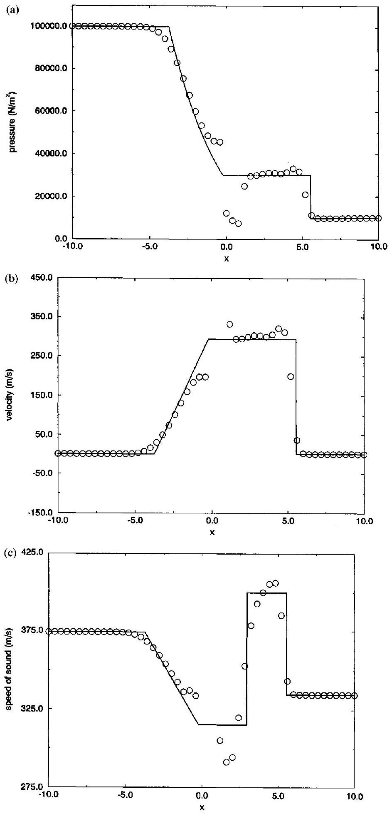
Figure 18.3 MacCormack's method for Test Case 1.

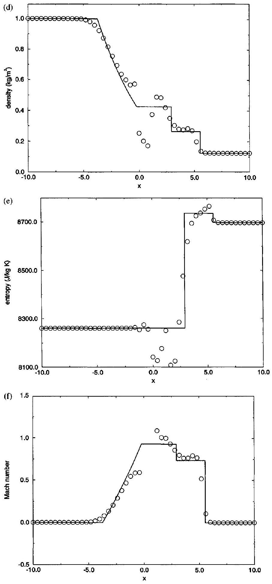
Figure 18.3 (cont.)

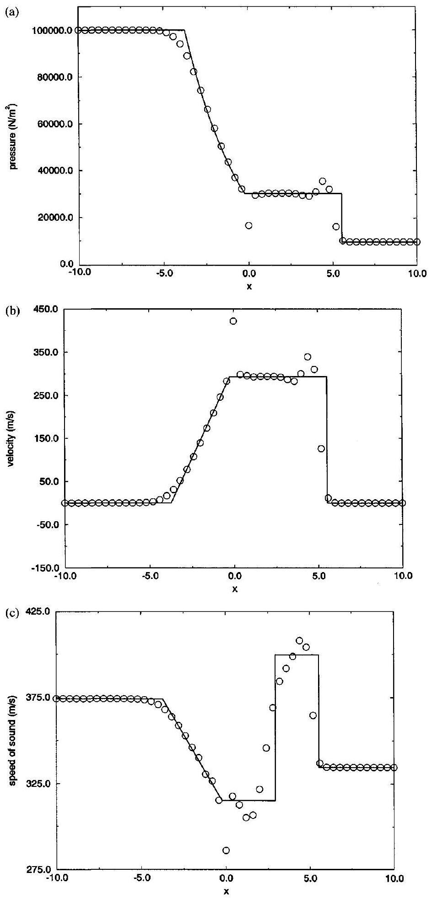
Figure 18.4 The Richtmyer method for Test Case 1.

Figure 18.4 (cont.)

Figure 18.5 MacCormack's method with artificial viscosity for Test Case 2.

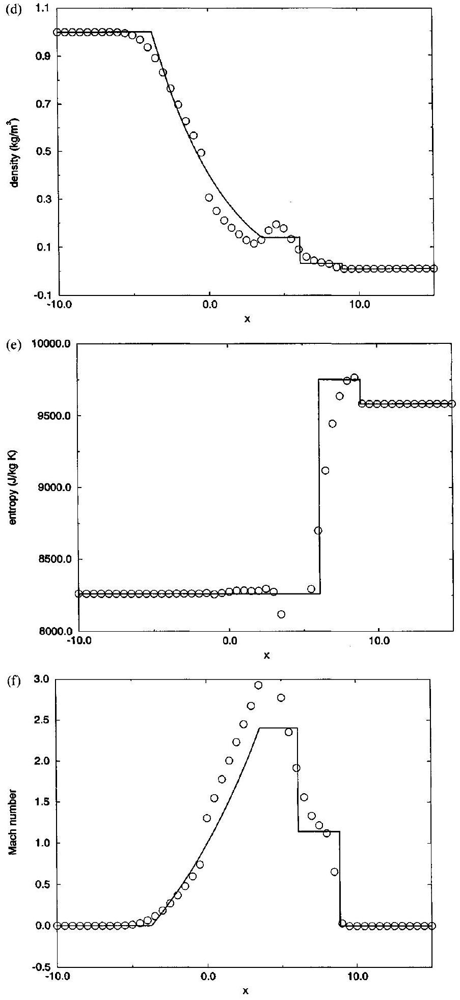
Figure 18.5 (cont.)

Figure 18.6 The Richtmyer method with artificial viscosity for Test Case 2.

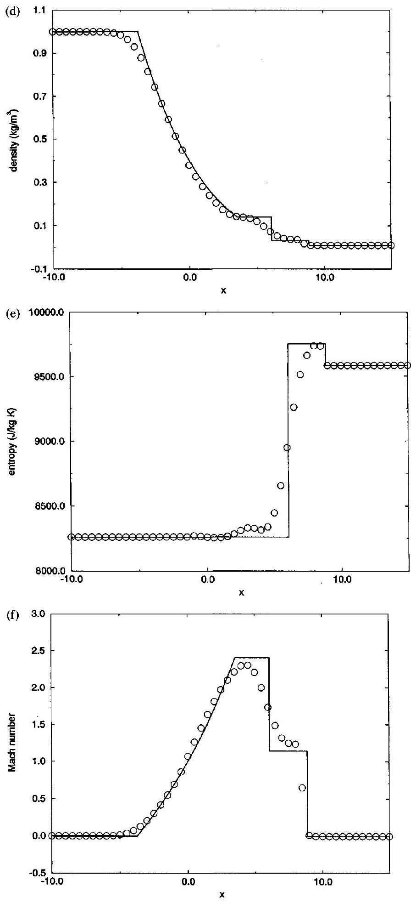
Figure 18.6 (cont.)

This is called flux vector splitting. Then the vector conservation law can be written as

$$
\frac{\partial \mathbf{u}}{\partial t}+\frac{\partial \mathbf{f}^{+}}{\partial x}+\frac{\partial \mathbf{f}^{-}}{\partial x}=0 .
$$

Then $\partial \mathbf{f}^{+} / \partial x$ can be discretized using FTBS or some other such method, and $\partial \mathbf{f}^{-} / \partial x$ can be discretized using FTFS or some other method. The resulting method will be completely stable for both left- and right-running waves.

As a related concept, consider wave speed splitting, as introduced in Section 13.5. To review, suppose the flux Jacobian matrix can be written as follows:

$$
A(\mathbf{u})=A^{+}(\mathbf{u})+A^{-}(\mathbf{u})
$$

where the characteristic values of $A^{+}$are nonnegative and the characteristic values of $A^{-}$ are nonpositive. In standard notation,

$$
A^{+} \geq 0, \quad A^{-} \leq 0 .
$$

Then the vector conservation law can be written as

$$
\frac{\partial \mathbf{u}}{\partial t}+A^{+} \frac{\partial \mathbf{u}}{\partial x}+A^{-} \frac{\partial \mathbf{u}}{\partial x}=0
$$

The matrices $A^{+}$and $A^{-}$are usually obtained by splitting the characteristic values of $A$ (a.k.a. the wave speeds) into positive and negative parts. This is called wave speed splitting. Specifically, let the wave speeds be $\lambda_{i}$. The wave speeds are split as follows:

$$
\lambda_{i}=\lambda_{i}^{+}+\lambda_{i}^{-}
$$

where

$$
\lambda_{i}^{+} \geq 0, \quad \lambda_{i}^{-} \leq 0
$$

Let us express wave speed splitting in matrix notation. Let $\Lambda$ be a diagonal matrix of $\lambda_{i}$, $\Lambda^{+}$be a diagonal matrix of $\lambda_{i}^{+}$, and let $\Lambda^{-}$be a diagonal matrix of $\lambda_{i}^{-}$. Then $\Lambda$ is split as follows:

$$
\Lambda=\Lambda^{+}+\Lambda^{-}
$$

where

$$
\Lambda^{+} \geq 0, \quad \Lambda^{-} \leq 0 .
$$

The wave speeds $\Lambda$ and the Jacobian matrix $A$ are related by

$$
Q_{A}^{-1} A Q_{A}=\Lambda
$$

where

$$
Q_{A}=\left[\begin{array}{ccc}
1 & \frac{\rho}{2 a} & -\frac{\rho}{2 a} \\
u & \frac{\rho}{2 a}(u+a) & -\frac{\rho}{2 a}(u-a) \\
\frac{u^{2}}{2} & \frac{\rho}{2 a}\left(\frac{u^{2}}{2}+\frac{a^{2}}{\gamma-1}+a u\right) & -\frac{\rho}{2 a}\left(\frac{u^{2}}{2}+\frac{a^{2}}{\gamma-1}-a u\right)
\end{array}\right] \text {, }
$$

$$
Q_{A}^{-1}=\frac{\gamma-1}{\rho a}\left[\begin{array}{ccc}
\frac{\rho}{a}\left(-\frac{u^{2}}{2}+\frac{a^{2}}{\gamma-1}\right) & \frac{\rho}{a} u & -\frac{\rho}{a} \\
\frac{u^{2}}{2}-\frac{a u}{\gamma-1} & -u+\frac{a}{\gamma-1} & 1 \\
-\frac{u^{2}}{2}-\frac{a u}{\gamma-1} & u+\frac{a}{\gamma-1} & -1
\end{array}\right] .
$$

Then

$$
A=A^{+}+A^{-},
$$

where

$$
A^{+}=Q_{A}^{-1} \Lambda^{+} Q_{A} \geq 0, \quad A^{-}=Q_{A}^{-1} \Lambda^{-} Q_{A} \leq 0
$$

and where, in this standard notation, the matrix inequalities refer to the characteristic values of the matrix.

In general, flux vector splitting and wave speed splitting are distinct. However, the Euler equations have a special property: The flux vector is a homogenous function of order one. In other words,

$$
\mathbf{f}(\mathbf{u})=\frac{d \mathbf{f}}{d \mathbf{u}} \mathbf{u}=A \mathbf{u} .
$$

Then the wave speed splitting $A^{ \pm}=Q_{A}^{-1} \Lambda^{ \pm} Q_{A}$ leads immediately to the following flux vector splitting:

$$
\begin{aligned}
& \mathbf{f}^{+}=A^{+} \mathbf{u}=Q_{A}^{-1} \Lambda^{+} Q_{A} \mathbf{u}, \\
& \mathbf{f}^{-}=A^{-} \mathbf{u}=Q_{A}^{-1} \Lambda^{-} Q_{A} \mathbf{u} .
\end{aligned}
$$

A tedious calculation shows that

$$
\mathbf{f}^{ \pm}=\frac{1}{\gamma} Q_{A}\left[\begin{array}{c}
(\gamma-1) \rho \lambda_{1}^{ \pm} \\
a \lambda_{2}^{ \pm} \\
-a \lambda_{3}^{ \pm}
\end{array}\right]
$$

or

- $\quad \mathbf{f}^{ \pm}=\frac{\gamma-1}{\gamma} \rho \lambda_{1}^{ \pm}\left[\begin{array}{c}1 \\ u \\ \frac{1}{2} u^{2}\end{array}\right]+\frac{\rho}{2 \gamma} \lambda_{2}^{ \pm}\left[\begin{array}{c}1 \\ u+a \\ \frac{u^{2}}{2}+\frac{a^{2}}{\gamma-1}+a u\end{array}\right]+\frac{\rho}{2 \gamma} \lambda_{3}^{ \pm}\left[\begin{array}{c}1 \\ u-a \\ \frac{u^{2}}{2}+\frac{a^{2}}{\gamma-1}-a u\end{array}\right]$.

This result was first obtain by Steger and Warming (1981). Conversely, a flux vector splitting $\mathbf{f}^{ \pm}$leads immediately to the following wave speed splitting:

$$
\left[\begin{array}{c}
(\gamma-1) \rho \lambda_{1}^{ \pm} \\
a \lambda_{2}^{ \pm} \\
-a \lambda_{3}^{ \pm}
\end{array}\right]=\gamma Q_{A}^{-1} \mathbf{f}^{ \pm}
$$

or

$$
\begin{aligned}
{\left[\begin{array}{l}
\lambda_{1}^{ \pm} \\
\lambda_{2}^{ \pm} \\
\lambda_{3}^{ \pm}
\end{array}\right]=} & \frac{\gamma}{\rho a^{2}}\left[\begin{array}{c}
-\frac{u^{2}}{2}+\frac{a^{2}}{\gamma-1} \\
\frac{\gamma-1}{2} u^{2}-a u \\
\frac{\gamma-1}{2} u^{2}+a u
\end{array}\right] f_{1}^{ \pm} \\
& +\frac{\gamma}{\rho a^{2}}\left[\begin{array}{c}
u \\
-(\gamma-1) u+a \\
-(\gamma-1) u-a
\end{array}\right] f_{2}^{ \pm}+\frac{\gamma}{\rho a^{2}}\left[\begin{array}{c}
-1 \\
\gamma-1 \\
\gamma-1
\end{array}\right] f_{3}^{ \pm}
\end{aligned}
$$

To summarize, by Equations (18.17) and (18.18) flux vector splitting and wave speed splitting are essentially equivalent for the Euler equations or for any conservation law with a homogeneous flux function of order one. Unfortunately, a wave speed splitting converted to a flux vector splitting using Equation (18.17) may not satisfy the flux vector splitting condition (18.7) and, conversely, a flux vector splitting converted to a wave speed splitting using Equation (18.18) may not satisfy the wave speed splitting condition (13.23). In general, it is best to convert all wave speed splittings to flux vector splittings prior to discretization, since discretizations of conservative flux vector splitting forms such as Equation (13.8) are more likely to be conservative than discretizations of nonconservative wave speed splitting forms such as Equation (13.24).

### 18.2.1 Steger-Warming Flux Vector Splitting

Steger and Warming (1981) proposed the first flux vector splitting, based on wave speed splitting. One possible wave speed splitting is as follows:

$$
\begin{array}{ll}
\lambda_{i}^{+} & =\max \left(0, \lambda_{i}\right)=\frac{1}{2}\left(\lambda_{i}+\left|\lambda_{i}\right|\right), \\
\lambda_{i}^{-} & =\min \left(0, \lambda_{i}\right)=\frac{1}{2}\left(\lambda_{i}-\left|\lambda_{i}\right|\right) .
\end{array}
$$

Convert this wave speed splitting to flux vector splitting using Equation (18.17). Then for $M \leq-1$ :

$$
\begin{aligned}
& \mathbf{f}^{+}=\mathbf{0}, \\
& \mathbf{f}^{-}=\mathbf{f},
\end{aligned}
$$

for $-1<M \leq 0$ :

$$
\begin{aligned}
\mathbf{f}^{+} & =\frac{\rho}{2 \gamma}(u+a)\left[\begin{array}{c}
1 \\
u+a \\
\frac{u^{2}}{2}+\frac{a^{2}}{\gamma-1}+a u
\end{array}\right], \\
\mathbf{f}^{-} & =\frac{\gamma-1}{\gamma} \rho u\left[\begin{array}{c}
1 \\
u \\
\frac{1}{2} u^{2}
\end{array}\right]+\frac{\rho}{2 \gamma}(u-a)\left[\begin{array}{c}
1 \\
u-a \\
\frac{u^{2}}{2}+\frac{a^{2}}{\gamma-1}-a u
\end{array}\right],
\end{aligned}
$$

for $0<M \leq 1$ :

$$
\begin{aligned}
\mathbf{f}^{+} & =\frac{\gamma-1}{\gamma} \rho u\left[\begin{array}{c}
1 \\
u \\
\frac{1}{2} u^{2}
\end{array}\right]+\frac{\rho}{2 \gamma}(u+a)\left[\begin{array}{c}
1 \\
u+a \\
\frac{u^{2}}{2}+\frac{a^{2}}{\gamma-1}+a u
\end{array}\right], \\
\mathbf{f}^{-} & =\frac{\rho}{2 \gamma}(u-a)\left[\begin{array}{c}
1 \\
u-a \\
\frac{u^{2}}{2}+\frac{a^{2}}{\gamma-1}-a u
\end{array}\right],
\end{aligned}
$$

and for $M>1$ :

$$
\begin{aligned}
& \mathbf{f}^{+}=\mathbf{f}, \\
& \mathbf{f}^{-}=\mathbf{0},
\end{aligned}
$$

where $M=u / a$ is the Mach number. Then, for supersonic right-running flows, all of the waves are right-running, and the flux vector splitting (18.20d) correctly attributes all of the flux to right-running waves and none to left-running waves. Similarly, for supersonic left-running flows, all of the waves are left-running, and the flux vector splitting (18.20a) correctly attributes all of the flux to left-running waves and none to right-running waves. For subsonic flows, waves are both left- and right-running, and the flux vector splitting (18.20b) or (18.20c) correctly attributes some flux to left-running waves and some flux to right-running waves, although there is no reason to believe that it gets the exact physical proportions correct.

Sonic points in the entropy waves occur for $M=0$, whereas sonic points in the acoustic waves occur for $M= \pm 1$. Unfortunately, wave speed splitting (18.19) may experience difficulties at these sonic points, due to the discontinuity in the first derivative of the split wave speeds at these sonic points. A simple "entropy fix" that rounds out the corners is

$$
\text { - } \quad \lambda_{i}^{ \pm}=\frac{1}{2}\left(\lambda_{i} \pm \sqrt{\lambda_{i}^{2}+\delta^{2}}\right) \text {, }
$$

where $\delta$ is a small user-adjustable parameter. All of the numerical results given later in this section use the simple wave speed splitting (18.19) rather than this "entropy-fixed" wave speed splitting.

### 18.2.2 Van Leer Flux Vector Splitting

Van Leer (1982) suggested a second type of flux vector splitting. Unlike the StegerWarming flux vector splitting, Van Leer's flux vector splitting is not based on wave speed splitting. As seen in Section 13.4, sonic points are natural flux splitting points; at the very least, sonic points require special consideration to avoid numerical problems. For the Euler equations, the Mach number $M$ indicates sonic points; in particular, sonic points occur when $M=u / a=0, \pm 1$. Thus, to help address sonic points, Van Leer bases his flux vector splitting on Mach number splitting. The flux vector for the Euler equations can be written
in terms of the Mach number as follows:

$$
\mathbf{f}=\left[\begin{array}{l}
f_{1} \\
f_{2} \\
f_{3}
\end{array}\right]=\left[\begin{array}{c}
\rho a M \\
\frac{\rho a^{2}}{\gamma}\left(\gamma M^{2}+1\right) \\
\rho a^{3} M\left(\frac{1}{2} M^{2}+\frac{1}{\gamma-1}\right)
\end{array}\right]
$$

Notice that the mass flux $f_{1}$ depends linearly on $M$. Then the mass flux can be split much like the flux function for the linear advection equation, as seen in Example 13.8. In particular, the linear function $M$ can be split into two quadratic functions as follows:

$$
\begin{aligned}
& \quad M^{+}= \begin{cases}0 & M \leq-1 \\
\left(\frac{M+1}{2}\right)^{2} & -1<M<1 \\
M & M \geq 1\end{cases} \\
& \quad M^{-}= \begin{cases}M & M \leq-1 \\
-\left(\frac{M-1}{2}\right)^{2} & -1<M<1 \\
0 & M \geq 1\end{cases}
\end{aligned}
$$

Obviously $M^{+}+M^{-}=M$ for $|M| \geq 1$. The same is true for $|M|<1$, which is easily proven as follows:

$$
M^{+}+M^{-}=\frac{M^{2}+2 M+1}{4}-\frac{M^{2}-2 M+1}{4}=M
$$

Notice that $M^{ \pm}$and its first derivative are continuous. Unfortunately, the second derivative is highly discontinuous at the sonic points $M= \pm 1$. This could be prevented by splitting the linear flux into two cubic pieces - the higher the order of the polynomials in the splitting, the more degrees of freedom there are to ensure continuity in the derivatives. Mach number splitting (18.23) implies the following mass flux splitting:

$$
f_{1}^{ \pm}=\rho a M^{ \pm}
$$

The momentum flux $f_{2}$ depends on $\gamma M^{2}+1$. By the same principles as before, this quadratic is split into two cubics, where the cubics ensure continuity of the split momentum flux and its first derivative. Omitting the details, the result is

$$
\begin{aligned}
& \left(\gamma M^{2}+1\right)^{+}= \begin{cases}0 & M \leq-1, \\
\left(\frac{M+1}{2}\right)^{2}((\gamma-1) M+2) & -1<M<1, \\
\gamma M^{2}+1 & M \geq 1,\end{cases} \\
& \left(\gamma M^{2}+1\right)^{-}= \begin{cases}\gamma M^{2}+1 & M \leq-1, \\
-\left(\frac{M-1}{2}\right)^{2}((\gamma-1) M-2) & -1<M<1, \\
0 & M \geq 1 .\end{cases}
\end{aligned}
$$

This implies the following momentum flux splitting:

$$
f_{2}^{ \pm}=\frac{\rho a^{2}}{\gamma}\left(\gamma M^{2}+1\right)^{ \pm}
$$

or

$$
\begin{aligned}
& f_{2}^{+}= \begin{cases}0 & M \leq-1, \\
\frac{1}{\gamma} f_{1}^{+}((\gamma-1) u+2 a) & -1<M \leq 1, \\
f_{2} & M>1,\end{cases} \\
& f_{2}^{-}= \begin{cases}f_{2} & M \leq-1, \\
\frac{1}{\gamma} f_{1}^{-}((\gamma-1) u-2 a) & -1<M \leq 1, \\
0 & M>1 .\end{cases}
\end{aligned}
$$

For future reference, remember that the momentum flux includes a pressure term, by standard convention; then the above momentum flux splitting implicitly involves a pressure splitting. In particular, as the reader can show, Van Leer splits the pressure as follows:

$$
\begin{aligned}
& p^{+}=p \begin{cases}0 & M \leq-1, \\
\left(\frac{M+1}{2}\right)^{2}(2-M) & -1<M<1, \\
1 & M \geq 1,\end{cases} \\
& p^{-}=p \begin{cases}1 & M \leq-1, \\
-\left(\frac{M-1}{2}\right)^{2}(2+M) & -1<M<1, \\
0 & M \geq 1 .\end{cases}
\end{aligned}
$$

Finally, the energy flux depends on the cubic $M\left(\frac{1}{2} M^{2}+\frac{1}{\gamma-1}\right)$, which is split into two quartics. Omitting the rather complicated algebra, the final result is

$$
\begin{aligned}
& f_{3}^{+}= \begin{cases}0 & M \leq-1, \\
\frac{1}{2(\gamma+1)(\gamma-1)} f_{1}^{+}((\gamma-1) u+2 a)^{2} & -1<M \leq 1, \\
f_{3} & M>1,\end{cases} \\
& f_{3}^{+}= \begin{cases}f_{3} & M \leq-1, \\
\frac{1}{2(\gamma+1)(\gamma-1)} f_{1}^{-}((\gamma-1) u-2 a)^{2} & -1<M \leq 1, \\
0 & M>1 .\end{cases}
\end{aligned}
$$

To summarize, from Equations (18.24), (18.27), and (18.29), notice that

- $\mathbf{f}^{ \pm}= \pm \frac{\rho a}{4}(M \pm 1)^{2}\left[\begin{array}{c}1 \\ \frac{(\gamma-1) u \pm 2 a}{\gamma} \\ \frac{((\gamma-1) u \pm 2 a)^{2}}{2(\gamma+1)(\gamma-1)}\end{array}\right]$
for $|M|<1$. Otherwise, $\mathbf{f}^{+}=\mathbf{f}$ and $\mathbf{f}^{-}=\mathbf{0}$ for $M \geq 1$, and $\mathbf{f}^{-}=\mathbf{f}$ and $\mathbf{f}^{+}=\mathbf{0}$ for $M \leq 1$. Like the Steger-Warming flux vector splitting, Van Leer's flux vector splitting correctly attributes all of the flux to right-running waves for right-running supersonic flow and all of the flux to left-running waves for left-running supersonic flow. Furthermore, in the original paper, Van Leer proves that his splitting satisfies $d \mathbf{f}^{+} / d \mathbf{u} \geq 0$ and $d \mathbf{f}^{-} / d \mathbf{u} \leq 0$, as required by Equation (13.7).

Van Leer's flux vector splitting may be converted to wave speed splitting using Equation (18.18)

$$
\lambda_{1}^{+}=\frac{\gamma}{\rho a^{2}}\left[\left(-\frac{u^{2}}{2}+\frac{a^{2}}{\gamma-1}\right) f_{1}^{+}+u f_{2}^{+}-f_{3}^{+}\right]
$$

Then by Equation (18.30)
$\lambda_{1}^{+}=\frac{\gamma f_{1}^{+}}{\rho a^{2}}\left[-\frac{u^{2}}{2}+\frac{a^{2}}{\gamma-1}+\frac{u}{\gamma}((\gamma-1) u+2 a)-\frac{(\gamma-1)^{2} u^{2}+4(\gamma-1) a u+4 a^{2}}{2(\gamma+1)(\gamma-1)}\right]$.
Combine terms to find

$$
\begin{aligned}
\lambda_{1}^{+}= & \frac{\gamma f_{1}^{+}}{\rho a^{2}}\left[\left(-\frac{1}{2}+\frac{\gamma-1}{\gamma}-\frac{\gamma-1}{2(\gamma+1)}\right) u^{2}\right. \\
& \left.+2\left(\frac{1}{\gamma}-\frac{1}{\gamma+1}\right) a u+\frac{1}{\gamma-1}\left(1-\frac{2}{\gamma+1}\right) a^{2}\right]
\end{aligned}
$$

Simplify the coefficients of $u^{2}, a u$, and $a^{2}$ to find

$$
\lambda_{1}^{+}=\frac{\gamma f_{1}^{+}}{\rho a^{2}}\left(-\frac{1}{\gamma(\gamma+1)} u^{2}+\frac{2}{\gamma(\gamma+1)} u a+\frac{1}{\gamma+1} a^{2}\right)
$$

or, equivalently,

$$
\lambda_{1}^{+}=\frac{f_{1}^{+}}{\rho(\gamma+1)}\left(-M^{2}+2 M+\gamma\right)
$$

Proceed similarly for the other eigenvalues to find the following final results, as given in Subsection 20.2.3 of Hirsch (1990):

$$
\begin{aligned}
& \lambda_{1}^{+}=\frac{a}{4}(M+1)^{2}\left[1+\frac{(M-1)^{2}}{\gamma+1}\right] \\
& \lambda_{2}^{+}=\frac{a}{4}(M+1)^{2}\left[3-M+\frac{\gamma-1}{\gamma+1}(M-1)^{2}\right] \\
& \lambda_{3}^{+}=\frac{a}{2}(M+1)^{2} \frac{M-1}{\gamma+1}\left[1+\frac{\gamma-1}{2} M\right]
\end{aligned}
$$

and

$$
\begin{aligned}
& \lambda_{1}^{-}(M)=-\lambda_{1}^{+}(-M), \\
& \lambda_{2}^{-}(M)=-\lambda_{3}^{+}(-M), \\
& \lambda_{3}^{-}(M)=-\lambda_{2}^{+}(-M) .
\end{aligned}
$$

The Van Leer flux vector splitting was generalized and extended to real gases by Liou, Van Leer, and Shuen (1990) and to chemically reacting flows by Shuen, Liou, and Van Leer (1990). This completes our discussion of the Van Leer flux vector splitting.

### 18.2.3 Liou-Steffen Flux Vector Splitting

The Beam-Warming and Van Leer flux vector splittings are both relatively complicated and expensive. As an alternative, Liou and Steffen (1993) suggested a far simpler flux vector splitting. The Liou-Steffen flux vector splitting uses Van Leer's approach to split the Mach number and pressure appearing in the momentum flux but, unlike Van Leer's flux vector splitting, leaves the rest of the variables in the flux vector alone. The Liou-Steffen flux vector splitting method distinguishes between true momentum flux and pressure force terms, much as in Equation (2.20). Specifically, the flux vector is written as follows:

$$
\mathbf{f}=\left[\begin{array}{c}
\rho u \\
\rho u^{2} \\
\rho h_{\mathrm{T}} u
\end{array}\right]+\left[\begin{array}{l}
0 \\
p \\
0
\end{array}\right]
$$

or

$$
\mathbf{f}=M\left[\begin{array}{c}
\rho a \\
\rho u a \\
\rho h_{\mathrm{T}} a
\end{array}\right]+\left[\begin{array}{c}
0 \\
p \\
0
\end{array}\right]
$$

The Mach number and the pressure appearing in the second vector are split just as in Van Leer's flux vector splitting. Specifically,

$$
M=M^{+}+M^{-}
$$

and

$$
p=p^{+}+p^{-}
$$

where $M^{ \pm}$are defined by Equation (18.23) and $p^{ \pm}$are defined by Equation (18.28). As an alternative to Van Leer's pressure splitting, Liou and Steffen suggested the following simplified pressure splitting:

$$
\begin{aligned}
& \quad p^{+}=p \begin{cases}0 & M \leq-1, \\
\frac{1}{2}(1+M) & -1<M<1, \\
1 & M \geq 1,\end{cases} \\
& \quad p^{-}=p \begin{cases}1 & M \leq-1, \\
\frac{1}{2}(1-M) & -1<M<1, \\
0 & M \geq 1,\end{cases}
\end{aligned}
$$

which seems to yield results almost as good as Van Leer's pressure splitting. Interestingly enough, Liou and Steffen split the Mach number a second time as follows:

$$
M=\max \left(0, M^{+}+M^{-}\right)+\min \left(0, M^{+}+M^{-}\right)
$$

Then the Liou-Steffen flux vector splitting with "double Mach number splitting" is

$$
\mathbf{f}^{+}=\max \left(0, M^{+}+M^{-}\right)\left[\begin{array}{c}
\rho a \\
\rho u a \\
\rho h_{\mathrm{T}} a
\end{array}\right]+\left[\begin{array}{c}
0 \\
p^{+} \\
0
\end{array}\right],
$$

$$
\mathbf{f}^{-}=\min \left(0, M^{+}+M^{-}\right)\left[\begin{array}{c}
\rho a \\
\rho u a \\
\rho h_{\mathrm{T}} a
\end{array}\right]+\left[\begin{array}{c}
0 \\
p^{-} \\
0
\end{array}\right] .
$$

### 18.2.4 Zha-Bilgen Flux Vector Splitting

Inspired by Liou and Steffen, Zha and Bilgen (1993) suggested another simple flux vector splitting. Whereas Liou and Steffen separated true flux from pressure terms only in conservation of momentum, Zha and Bilgen separate pressure terms from true flux in both conservation of momentum and conservation of energy, which seems sensible. In particular, Zha and Bilgen write the flux vector as

$$
\mathbf{f}=u\left[\begin{array}{c}
\rho \\
\rho u \\
\rho e_{\mathrm{T}}
\end{array}\right]+\left[\begin{array}{c}
0 \\
p \\
p u
\end{array}\right]
$$

much like Equation (2.20). Then the Zha-Bilgen flux vector splitting is

$$
\begin{aligned}
\quad \mathbf{f}^{+} & =\max (0, u)\left[\begin{array}{c}
\rho \\
\rho u \\
\rho e_{\mathrm{T}}
\end{array}\right]+\left[\begin{array}{c}
0 \\
p^{+} \\
(p u)^{+}
\end{array}\right], \\
\quad \mathbf{f}^{-} & =\min (0, u)\left[\begin{array}{c}
\rho \\
\rho u \\
\rho e_{\mathrm{T}}
\end{array}\right]+\left[\begin{array}{c}
0 \\
p^{-} \\
(p u)^{-}
\end{array}\right],
\end{aligned}
$$

where $p^{ \pm}$are defined by Equation (18.33) and $(p u)^{ \pm}$are defined as follows:

$$
\begin{aligned}
& \quad(p u)^{+}=p \begin{cases}0 & M \leq-1, \\
\frac{1}{2}(u+a) & -1<M<1, \\
u & M \geq 1,\end{cases} \\
& \quad(p u)^{-}=p \begin{cases}u & M \leq-1, \\
\frac{1}{2}(u-a) & -1<M<1, \\
0 & M \geq 1 .\end{cases}
\end{aligned}
$$

Notice that the Zha-Bilgen splitting completely eliminates any sort of Van Leer splitting, making theirs the simplest flux vector splitting yet.

### 18.2.5 First-Order Upwind Methods

The flux vector splittings described in the last four subsections are only the first step. The next step is to discretize $\partial \mathbf{f}^{+} / \partial x$ and $\partial \mathbf{f}^{-} / \partial x$. Consider the Euler equations written in a split flux form:

$$
\frac{\partial \mathbf{u}}{\partial t}+\frac{\partial \mathbf{f}^{+}}{\partial x}+\frac{\partial \mathbf{f}^{-}}{\partial x}=0 .
$$

Discretize $\partial \mathbf{f}^{+} / \partial x$ using FTBS and discretize $\partial \mathbf{f}^{-} / \partial x$ using FTFS to obtain the following
flux split first-order upwind method:

$$
\mathbf{u}_{i}^{n+1}=\mathbf{u}_{i}^{n}-\lambda\left(\mathbf{f}^{+}\left(\mathbf{u}_{i}^{n}\right)-\mathbf{f}^{+}\left(\mathbf{u}_{i-1}^{n}\right)+\mathbf{f}^{-}\left(\mathbf{u}_{i+1}^{n}\right)-\mathbf{f}^{-}\left(\mathbf{u}_{i}^{n}\right)\right) .
$$

In conservation form, the flux split first-order upwind method is

$$
\hat{\mathbf{f}}_{i+1 / 2}^{n}=\mathbf{f}^{+}\left(\mathbf{u}_{i}\right)+\mathbf{f}^{-}\left(\mathbf{u}_{i+1}\right) .
$$

Equation (18.39) can be written in the following interesting form:

$$
\hat{\mathbf{f}}_{i+1 / 2}^{n}=\frac{1}{2}\left(\mathbf{f}\left(u_{i+1}^{n}\right)+\mathbf{f}\left(u_{i}^{n}\right)\right)-\left(A_{i+1 / 2}^{+}-A_{i+1 / 2}^{-}\right)\left(\mathbf{u}_{i+1}^{n}-\mathbf{u}_{i}^{n}\right),
$$

where

$$
\begin{aligned}
& \mathbf{f}^{+}\left(\mathbf{u}_{i+1}^{n}\right)-\mathbf{f}^{+}\left(\mathbf{u}_{i}^{n}\right)=A_{i+1 / 2}^{+}\left(\mathbf{u}_{i+1}^{n}-\mathbf{u}_{i}^{n}\right), \\
& \mathbf{f}^{-}\left(\mathbf{u}_{i+1}^{n}\right)-\mathbf{f}^{-}\left(\mathbf{u}_{i}^{n}\right)=A_{i+1 / 2}^{-}\left(\mathbf{u}_{i+1}^{n}-\mathbf{u}_{i}^{n}\right) .
\end{aligned}
$$

Equation (18.40) has the form of central differences plus second-order artificial viscosity, where the matrix coefficient of artificial viscosity is $A_{i+1 / 2}^{+}-A_{i+1 / 2}^{-}$. Equation (18.41) defines the matrices $A_{i+1 / 2}^{ \pm}$in much the same way as the Roe-average matrix was defined in Section 5.3. In fact, Equation (18.41) yields an infinite number of solutions for the matrices $A_{i+1 / 2}^{ \pm}$, as discussed in Section 5.3. Of course, you should not use the artificial viscosity form seen in Equation (18.40) in computations, since it involves two expensive-to-compute matrices $A_{i+1 / 2}^{ \pm}$. However, the artificial viscosity form is useful in later analysis, especially for describing the connections between flux vector splitting methods and reconstructionevolution methods.

Equation (18.39) used with the Steger-Warming flux vector splitting is called the StegerWarming flux split first-order upwind method; Equation (18.39) used with Van Leer's flux vector splitting is called Van Leer's flux split first-order upwind method; and Equation (18.39) used with the Zha-Bilgen flux vector splitting is called the Zha-Bilgen flux split first-order upwind method. Liou and Steffen (1993) suggested a nonstandard first-order upwind method based on Liou-Steffen flux vector splitting. In particular,

$$
\begin{aligned}
\hat{\mathbf{f}}_{i+1 / 2}^{n}= & \max \left(0, M_{i}^{+}+M_{i+1}^{-}\right)\left[\begin{array}{c}
\rho_{i}^{n} a_{i}^{n} \\
\rho_{i}^{n} u_{i}^{n} a_{i}^{n} \\
\rho_{i}^{n}\left(h_{\mathrm{T}}\right)_{i}^{n} a_{i}^{n}
\end{array}\right]+\left[\begin{array}{c}
0 \\
p_{i}^{+} \\
0
\end{array}\right] \\
& +\min \left(0, M_{i}^{+}+M_{i+1}^{-}\right)\left[\begin{array}{c}
\rho_{i+1}^{n} a_{i+1}^{n} \\
\rho_{i+1}^{n} u_{i+1}^{n} a_{i+1}^{n} \\
\rho_{i+1}^{n}\left(h_{\mathrm{T}}\right)_{i+1}^{n} a_{i+1}^{n}
\end{array}\right]+\left[\begin{array}{c}
0 \\
p_{i+1}^{-} \\
0
\end{array}\right] .
\end{aligned}
$$

Liou and Steffen called this method the advection upstream splitting method (AUSM) although, as usual, this book will refer to it by author and type - the Liou-Steffen flux split first-order upwind method - rather than by acronym. The Liou-Steffen flux vector splitting was designed specifically for use in the Liou-Steffen first-order upwind method. Similarly, the Zha-Bilgen flux vector splitting was designed specifically for use in the Zha-Bilgen first-order upwind method. By contrast, the Steger-Warming and Van Leer flux vector
splittings were designed as general purpose, and they have been used successfully with a variety of different discretizations down through the years. In the original paper, Liou and Steffen (1993) indicate that their first-order upwind method obtains results comparable to other first-order flux vector splitting methods and flux difference splitting methods, including Roe's first-order upwind method as discussed in Subsection 18.3.2, and with substantially reduced costs. Zha and Bilgen (1993) make the same claim for their first-order upwind method, and they provide interesting comparisons between the Zha-Bilgen firstorder upwind method, the Liou-Steffen first-order upwind method, Van Leer's first-order upwind method, and Roe's first-order upwind method. As another variation on flux vector splitting, Radespiel and Kroll (1995) suggested an adaptive combination of the Van Leer and Liou-Steffen first-order upwind methods, with the Liou-Steffen first-order upwind method splitting used in smooth regions and Van Leer flux first-order upwind method used near shocks.

The performance of flux split first-order upwind methods is illustrated by the two standard tests cases defined in Section 18.0. For Test Case 1, the results of the Steger-Warming flux split first-order upwind method are shown in Figure 18.7, the results of the Van Leer flux split first-order upwind method are shown in Figure 18.8, the results of the Liou-Steffen flux split first-order upwind method are shown in Figure 18.9, and the results of the ZhaBilgen flux split first-order upwind method are shown in Figure 18.10. The results are all reasonably similar, although the Steger-Warming splitting is decidedly worse than the others. In this test case, the simple Liou-Steffen and Zha-Bilgen flux vector splittings acquit themselves admirably and are, if anything, just slightly better than the more complicated Van Leer flux vector splitting. For Test Case 2, the results of the Steger-Warming flux split first-order upwind method are shown in Figure 18.11, the results of the Van Leer flux split first-order upwind method are shown in Figure 18.12, the results of the Liou-Steffen flux split first-order upwind method are shown in Figure 18.13, and the results of the ZhaBilgen flux split first-order upwind method are shown in Figure 18.14. In Test Case 2, to get them started, both the Liou-Steffen and Zha-Bilgen flux split first-order upwind methods needed a small amount of fixed-coefficient second-order artificial viscosity for the first two time steps. In particular, the Liou-Steffen flux split first-order upwind method uses $\epsilon=0.025$ and Zha-Bilgen flux split first-order upwind method uses $\epsilon=0.02$ for the first two time steps, which are near the minimum possible values, after which the artificial viscosity is turned completely off. Although the two simplest flux splitting methods may need a little bit of help getting started, the final results are just as good as those of the two more complicated flux splitting methods. In fact, all four methods perform about the same, although Van Leer's flux splitting leads to a slightly larger expansion shock at the expansive sonic point, while the Zha-Bilgen flux splitting leads to a slight drop in the entropy between the contact and expansion. Still, when it comes to first-order upwind methods, there is not too much to choose from between the four flux vector splittings. The real differences show up in the next subsection, where flux vector splitting is used in a second-order upwind method.

### 18.2.6 Beam-Warming Second-Order Upwind Method

The Beam-Warming second-order upwind method for scalar conservation laws was described in Section 17.4. This section concerns a version for the Euler equations

Figure 18.7 Steger-Warming flux split first-order upwind method for Test Case 1.

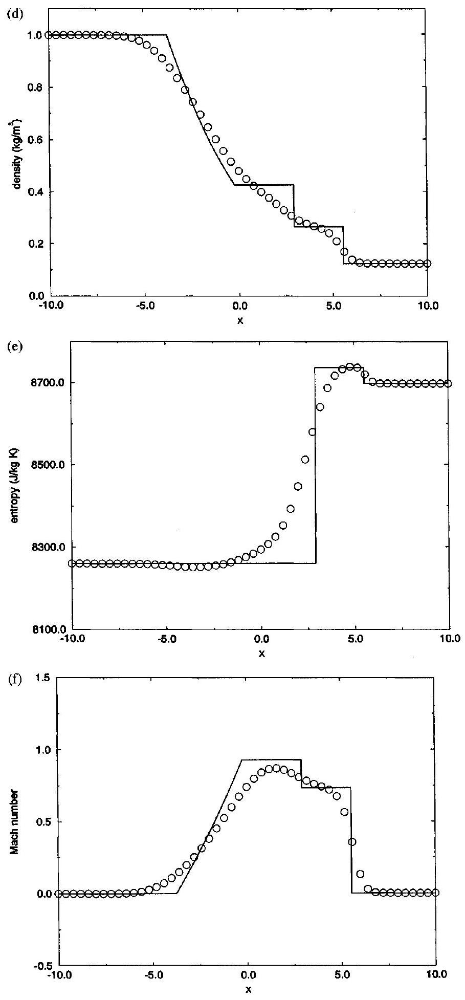
Figure 18.7 (cont.)

Figure 18.8 Van Leer flux split first-order upwind method for Test Case 1.

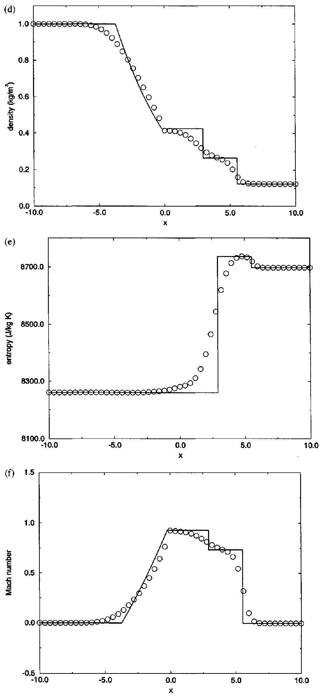
Figure 18.8 (cont.)

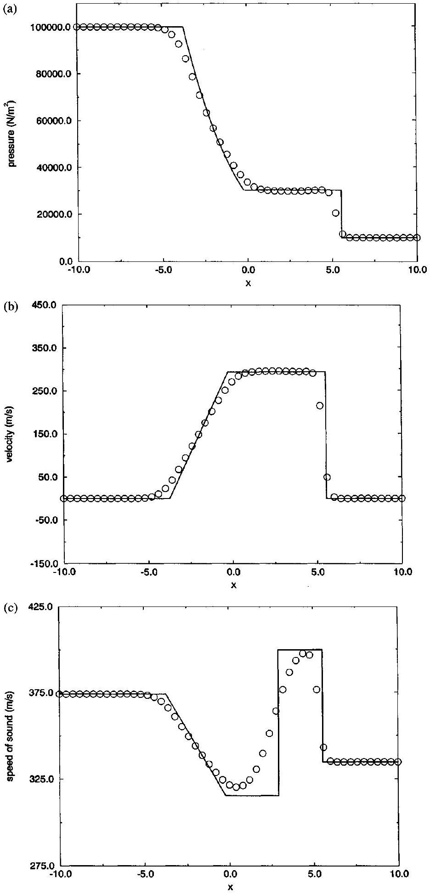
Figure 18.9 Liou-Steffen flux split first-order upwind method for Test Case 1.

Figure 18.9 (cont.)

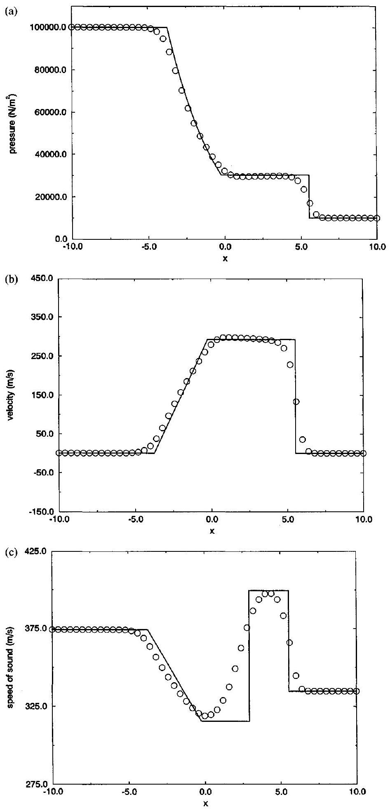
Figure 18.10 Zha-Bilgen flux split first-order upwind method for Test Case 1.

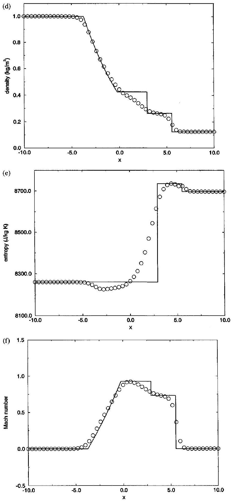
Figure 18.10 (cont.)

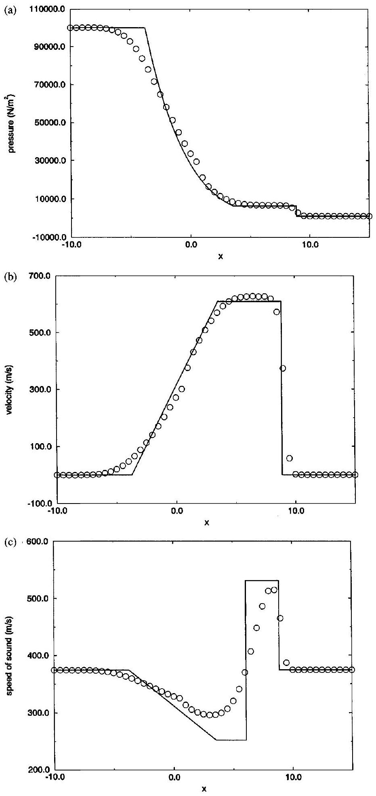
Figure 18.11 Steger-Warming flux split first-order upwind method for Test Case 2.

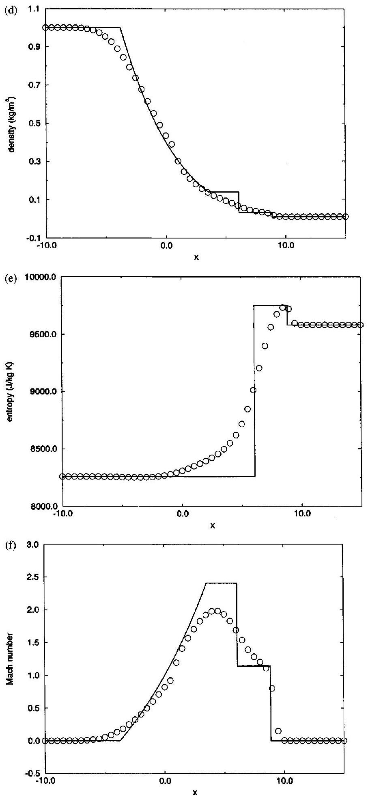
Figure 18.11 (cont.)

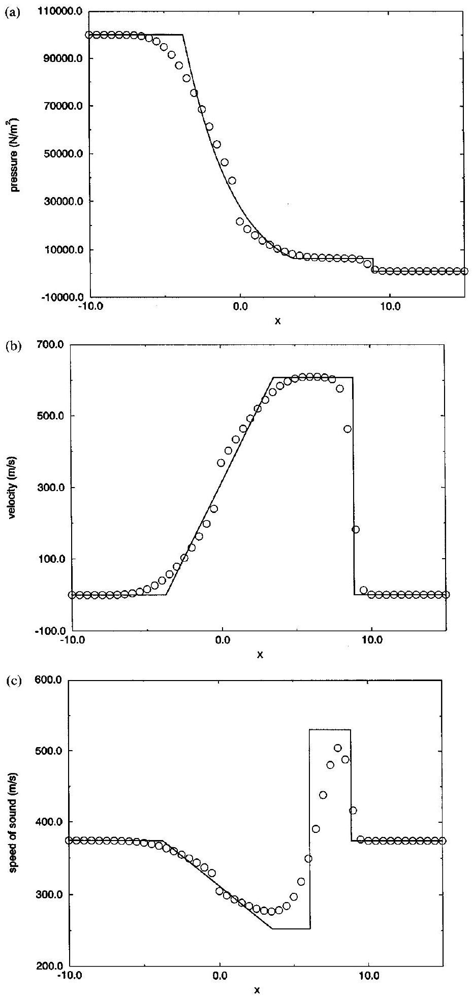
Figure 18.12 Van Leer flux split first-order upwind method for Test Case 2.

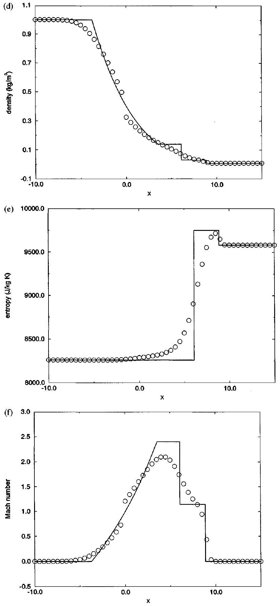
Figure 18.12 (cont.)

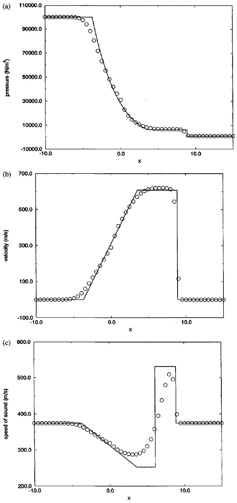
Figure 18.13 Liou-Steffen flux split first-order upwind method for Test Case 2.

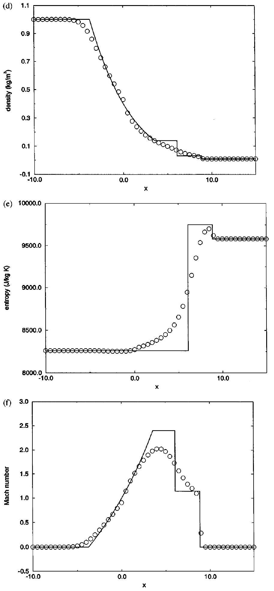
Figure 18.13 (cont.)

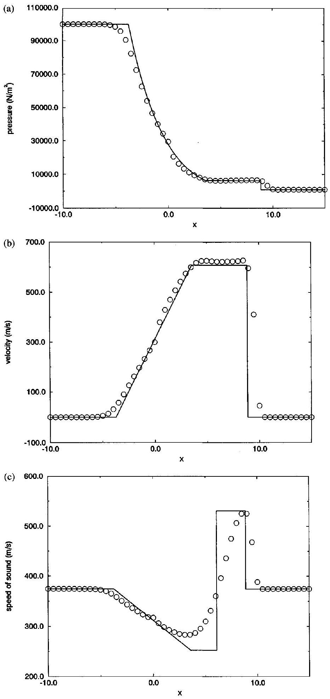
Figure 18.14 Zha-Bilgen flux split first-order upwind method for Test Case 2.

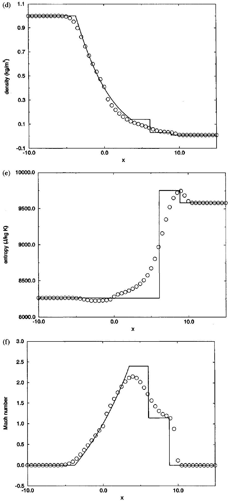
Figure 18.14 (cont.)

based on flux vector splitting. First, consider right-running supersonic flows, that is, flows with all-positive wave speeds. Using the flux approach of Section 18.1, the Beam-Warming method for scalar conservation laws with $a>0$, Equation (17.32a), becomes

$$
\begin{aligned}
\mathbf{u}_{i}^{n+1}= & \mathbf{u}_{i}^{n}-\frac{\lambda}{2}\left(3 \mathbf{f}\left(\mathbf{u}_{i}^{n}\right)-4 \mathbf{f}\left(\mathbf{u}_{i-1}^{n}\right)+\mathbf{f}\left(\mathbf{u}_{i-2}^{n}\right)\right) \\
& +\frac{\lambda^{2}}{2}\left[A_{i-1 / 2}^{n}\left(\mathbf{f}\left(\mathbf{u}_{i}^{n}\right)-\mathbf{f}\left(\mathbf{u}_{i-1}^{n}\right)\right)-A_{i-3 / 2}^{n}\left(\mathbf{f}\left(\mathbf{u}_{i-1}^{n}\right)-\mathbf{f}\left(\mathbf{u}_{i-2}^{n}\right)\right)\right] .
\end{aligned}
$$

Similarly, consider left-running supersonic flows (i.e., flows with all-negative wave speeds). Using the flux approach of Section 18.1, the Beam-Warming method for scalar conservation laws with $a<0$, Equation (17.32b), becomes

$$
\begin{aligned}
\mathbf{u}_{i}^{n+1}= & \mathbf{u}_{i}^{n}-\frac{\lambda}{2}\left(-3 \mathbf{f}\left(\mathbf{u}_{i}^{n}\right)+4 \mathbf{f}\left(\mathbf{u}_{i+1}^{n}\right)-\mathbf{f}\left(\mathbf{u}_{i+2}^{n}\right)\right) \\
& +\frac{\lambda^{2}}{2}\left[A_{i+3 / 2}^{n}\left(\mathbf{f}\left(\mathbf{u}_{i+2}^{n}\right)-\mathbf{f}\left(\mathbf{u}_{i+1}^{n}\right)\right)-A_{i+1 / 2}^{n}\left(\mathbf{f}\left(\mathbf{u}_{i+1}^{n}\right)-\mathbf{f}\left(\mathbf{u}_{i}^{n}\right)\right)\right] .
\end{aligned}
$$

For subsonic flows containing both left- and right-running waves, write the Euler equations in flux split form, and discretize $\partial \mathbf{f}^{+} / \partial x$ using Equation (18.43a) and discretize $\partial \mathbf{f}^{-} / \partial x$ using Equation (18.43b) to obtain the following method:

$$
\begin{aligned}
\mathbf{u}_{i}^{n+1}= & \mathbf{u}_{i}^{n}-\frac{\lambda}{2}\left(3 \mathbf{f}^{+}\left(\mathbf{u}_{i}^{n}\right)-4 \mathbf{f}^{+}\left(\mathbf{u}_{i-1}^{n}\right)+\mathbf{f}^{+}\left(\mathbf{u}_{i-2}^{n}\right)\right)-\frac{\lambda}{2}\left(-3 \mathbf{f}^{-}\left(\mathbf{u}_{i}^{n}\right)\right. \\
& \left.+4 \mathbf{f}^{-}\left(\mathbf{u}_{i+1}^{n}\right)-\mathbf{f}^{-}\left(\mathbf{u}_{i+2}^{n}\right)\right)+\frac{\lambda^{2}}{2}\left[A_{i-1 / 2}^{+}\left(\mathbf{f}^{+}\left(\mathbf{u}_{i}^{n}\right)-\mathbf{f}^{+}\left(\mathbf{u}_{i-1}^{n}\right)\right)\right. \\
& \left.-A_{i-3 / 2}^{+}\left(\mathbf{f}^{+}\left(\mathbf{u}_{i-1}^{n}\right)-\mathbf{f}^{+}\left(\mathbf{u}_{i-2}^{n}\right)\right)\right]+\frac{\lambda^{2}}{2}\left[A _ { i + 3 / 2 } ^ { - } \left(\mathbf{f}^{-}\left(\mathbf{u}_{i+2}^{n}\right)\right.\right. \\
& \left.\left.-\mathbf{f}^{-}\left(\mathbf{u}_{i+1}^{n}\right)\right)-A_{i+1 / 2}^{-}\left(\mathbf{f}^{-}\left(\mathbf{u}_{i+1}^{n}\right)-\mathbf{f}^{-}\left(\mathbf{u}_{i}^{n}\right)\right)\right],
\end{aligned}
$$

where the matrices $A_{i+1 / 2}^{ \pm}$may be defined as in Equation (18.41) or in a variety of other ways. Alternatively, if you wish, you can view Equation (18.44) as the "flux approach" extension of Equation (17.33). In conservation form, Equation (18.44) becomes

$$
\begin{aligned}
\hat{\mathbf{f}}_{i+1 / 2}^{n}= & \frac{1}{2}\left(3 \mathbf{f}^{+}\left(\mathbf{u}_{i}^{n}\right)-\mathbf{f}^{+}\left(\mathbf{u}_{i-1}^{n}\right)+3 \mathbf{f}^{-}\left(\mathbf{u}_{i+1}^{n}\right)-\mathbf{f}^{-}\left(\mathbf{u}_{i+2}^{n}\right)\right) \\
& -\frac{\lambda}{2}\left[A_{i-1 / 2}^{+}\left(\mathbf{f}^{+}\left(\mathbf{u}_{i}^{n}\right)-\mathbf{f}^{+}\left(\mathbf{u}_{i-1}^{n}\right)\right)+A_{i+3 / 2}^{-}\left(\mathbf{f}^{-}\left(\mathbf{u}_{i+2}^{n}\right)-\mathbf{f}^{-}\left(\mathbf{u}_{i+1}^{n}\right)\right)\right] .
\end{aligned}
$$

As with the Lax-Wendroff method, seen in Subsection 18.1.2, there is a two-step variant of the Beam-Warming second-order upwind method that avoids the costs associated with Jacobian matrices. If all of the wave speeds are positive, a two-step version is as follows:

$$
\begin{aligned}
& \overline{\mathbf{u}}_{i}=\mathbf{u}_{i}^{n}-\lambda\left(\mathbf{f}\left(\mathbf{u}_{i}^{n}\right)-\mathbf{f}\left(\mathbf{u}_{i-1}^{n}\right)\right), \\
& \mathbf{u}_{i}^{n+1}=\frac{1}{2}\left(\overline{\mathbf{u}}_{i}+\mathbf{u}_{i}^{n}\right)-\frac{\lambda}{2}\left(\mathbf{f}\left(\overline{\mathbf{u}}_{i}\right)-\mathbf{f}\left(\overline{\mathbf{u}}_{i-1}\right)\right)-\frac{\lambda}{2}\left(\mathbf{f}\left(\mathbf{u}_{i}^{n}\right)-2 \mathbf{f}\left(\mathbf{u}_{i-1}^{n}\right)+\mathbf{f}\left(\mathbf{u}_{i-2}^{n}\right)\right) .
\end{aligned}
$$

If all of the wave speeds are negative, a two-step version is as follows:

$$
\begin{aligned}
& \overline{\mathbf{u}}_{i}=\mathbf{u}_{i}^{n}-\lambda\left(\mathbf{f}\left(\mathbf{u}_{i+1}^{n}\right)-\mathbf{f}\left(\mathbf{u}_{i}^{n}\right)\right), \\
& \mathbf{u}_{i}^{n+1}=\frac{1}{2}\left(\overline{\mathbf{u}}_{i}+\mathbf{u}_{i}^{n}\right)-\frac{\lambda}{2}\left(\mathbf{f}\left(\overline{\mathbf{u}}_{i+1}\right)-\mathbf{f}\left(\overline{\mathbf{u}}_{i}\right)\right)+\frac{\lambda}{2}\left(\mathbf{f}\left(\mathbf{u}_{i+2}^{n}\right)-2 \mathbf{f}\left(\mathbf{u}_{i+1}^{n}\right)+\mathbf{f}\left(\mathbf{u}_{i}^{n}\right)\right) .
\end{aligned}
$$

For flows with both positive and negative wave speeds, a two-step version of the BeamWarming second-order upwind method is as follows:

$$
\begin{aligned}
\overline{\mathbf{u}}_{i}= & \mathbf{u}_{i}^{n}-\lambda\left(\mathbf{f}^{+}\left(\mathbf{u}_{i}^{n}\right)-\mathbf{f}^{+}\left(\mathbf{u}_{i-1}^{n}\right)+\mathbf{f}^{-}\left(\mathbf{u}_{i+1}^{n}\right)-\mathbf{f}^{-}\left(\mathbf{u}_{i}^{n}\right)\right), \\
\mathbf{u}_{i}^{n+1}= & \frac{1}{2}\left(\overline{\mathbf{u}}_{i}+\mathbf{u}_{i}^{n}\right)-\frac{\lambda}{2}\left(\mathbf{f}^{+}\left(\overline{\mathbf{u}}_{i}\right)-\mathbf{f}^{+}\left(\overline{\mathbf{u}}_{i-1}\right)\right)-\frac{\lambda}{2}\left(\mathbf{f}^{-}\left(\overline{\mathbf{u}}_{i+1}\right)-\mathbf{f}^{-}\left(\overline{\mathbf{u}}_{i}\right)\right) \\
& -\frac{\lambda}{2}\left(\mathbf{f}^{+}\left(\mathbf{u}_{i}^{n}\right)-2 \mathbf{f}^{+}\left(\mathbf{u}_{i-1}^{n}\right)+\mathbf{f}^{+}\left(\mathbf{u}_{i-2}^{n}\right)\right) \\
& +\frac{\lambda}{2}\left(\mathbf{f}^{-}\left(\mathbf{u}_{i+2}^{n}\right)-2 \mathbf{f}^{-}\left(\mathbf{u}_{i+1}^{n}\right)+\mathbf{f}^{-}\left(\mathbf{u}_{i}^{n}\right)\right) .
\end{aligned}
$$

As an exercise, the reader can show that the two-step version, Equation (18.48), is equivalent to the one-step version, Equation (18.44), for linear systems of equations.

Method (18.48) is actually an entire class of methods, depending on the choice of the flux vector splitting. This section will illustrate the performance of the Beam-Warming second-order upwind method with Steger-Warming, Van Leer, and Zha-Bilgen flux vector splitting using the two standard test cases defined in Section 18.0. For Test Case 1, the results of the Beam-Warming second-order upwind method based on the Steger-Warming flux splitting are shown in Figure 18.15, the results of the Beam-Warming second-order upwind method based on the Van Leer flux splitting are shown in Figure 18.16, and the results of the Beam-Warming second-order upwind method based on the Zha-Bilgen flux splitting are shown in Figure 18.17. In this test case, all three versions of the Beam-Warming second-order upwind method experience large oscillations and overshoots at the head of the expansion and, especially, to the right of the shock. The Van Leer flux splitting is marginally superior to the Steger-Warming flux splitting which is, in turn, noticeably superior to the Zha-Bilgen flux splitting.

All three versions of the Beam-Warming second-order upwind method require extensive coddling and coercion to complete Test Case 2. First of all, they require constantcoefficient second-order artificial viscosity with $\epsilon=0.05$ throughout the calculation. The second-order artificial viscosity has a three-point stencil, while the main BeamWarming second-order upwind method has a five-point stencil. Unfortunately, the BeamWarming second-order upwind method runs into trouble two points away from the initial jump discontinuity during the first time step, while the second-order artificial viscosity can only see one point away; since the second-order artificial viscosity sees only a constant solution one point to the right and one point to the left, the second difference is zero, and thus the artificial viscosity remains zero. In other words, second-order artificial viscosity is powerless to help smooth over the troubles caused by the initial jump discontinuity. Fourthorder artificial viscosity has a wider stencil and thus can at least affect the difficulty caused by the jump in the initial conditions. Sadly, and this is typical of fourth-order artificial viscosity at jumps, it only makes things worse. Thus, since one cannot rely on artificial

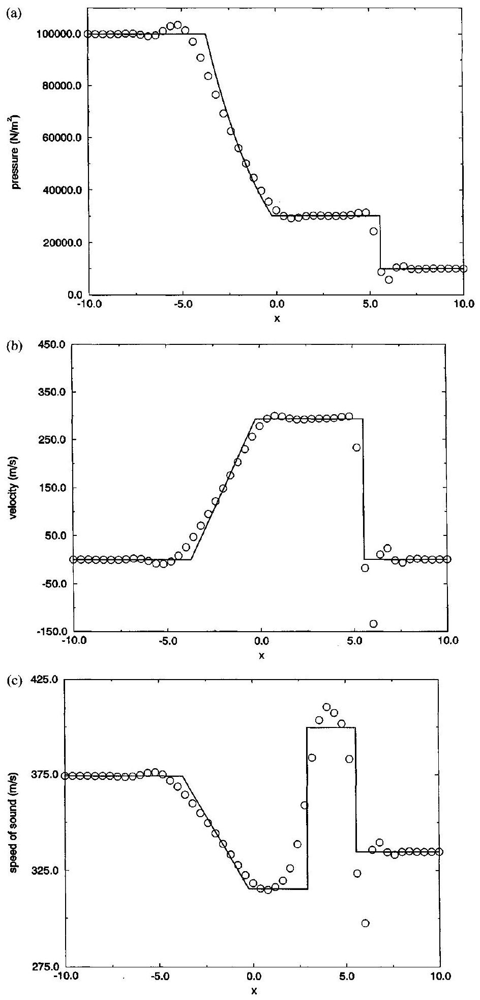
Figure 18.15 Beam-Warming second-order upwind method based on Steger-Warming flux vector splitting for Test Case 1.

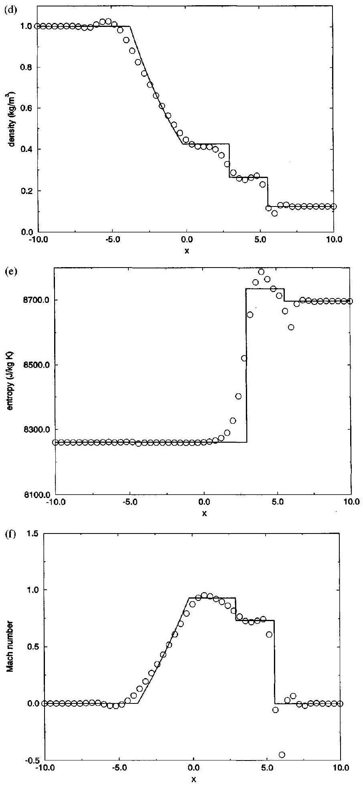
Figure 18.15 (cont.)

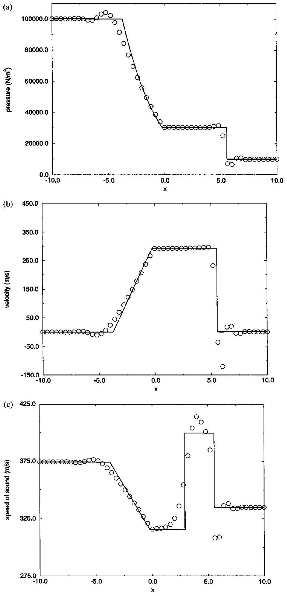
Figure 18.16 Beam-Warming second-order upwind method based on Van Leer flux vector splitting for Test Case 1.

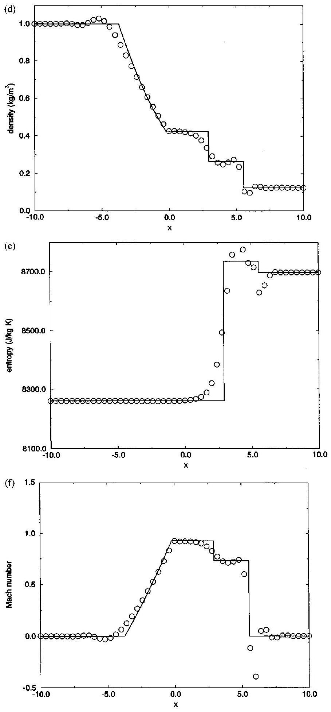
Figure 18.16 (cont.)

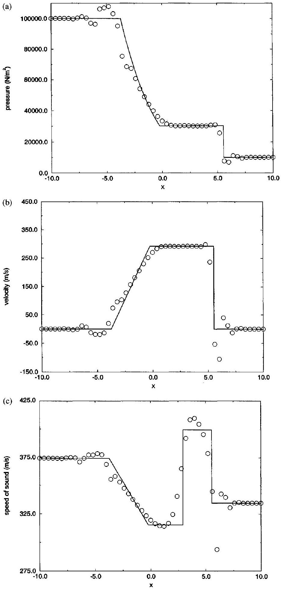
Figure 18.17 Beam-Warming second-order upwind method based on Zha-Bilgen flux vector splitting for Test Case 1.

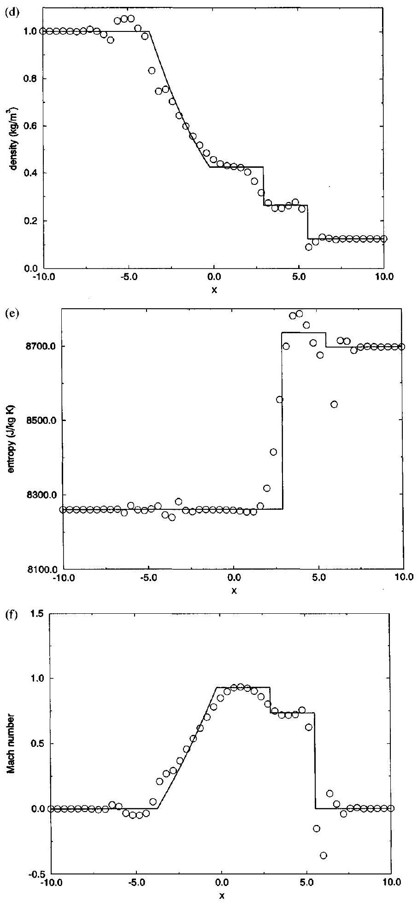
Figure 18.17 (cont.)

viscosity in this case, the initial conditions were presmoothed in a very simple manner, by replacing the three center points in the jump discontinuity by a straight line connecting the left and right states. Even then, artificial viscosity and presmoothing were still not enough to coax the Steger-Warming flux splitting to complete the calculation. However, both the Van Leer and Zha-Bilgen flux splittings were fine. In fact, the results of both splittings are so similar that we shall only bother plotting the results for the Beam-Warming second-order upwind method using Van Leer flux vector splitting, which is Figure 18.18.

### 18.3 Wave Approach II: Reconstruction-Evolution

This section describes first-order upwind reconstruction-evolution methods for the Euler equations. Reconstruction-evolution was introduced in Section 13.6 and further developed in Section 17.3. Suppose the reconstruction is piecewise-constant. Then each cell edge gives rise to a Riemann problem, as illustrated in Figure 18.19. Then the exact evolution of the piecewise-constant reconstruction yields

$$
\hat{\mathbf{f}}_{i+1 / 2}^{n}=\frac{1}{\Delta t} \int_{t^{n}}^{t^{n+1}} \mathbf{f}\left(\mathbf{u}_{\text {RIEMANN }}\left(x_{i+1 / 2}, t\right)\right) d t
$$

Since the solution to the Riemann problem is self-similar, $\mathbf{u}_{\text {RIEMANN }}\left(x_{i+1 / 2}, t\right)$ is constant for all time. Then

$$
\text { - } \quad \hat{\mathbf{f}}_{i+1 / 2}^{n}=\mathbf{f}\left(\mathbf{u}_{\text {RIEMANN }}\left(x_{i+1 / 2}, t\right)\right) \text {, }
$$

where $\mathbf{f}\left(\mathbf{u}_{\text {RIEMANN }}\left(x_{i+1 / 2}, t\right)\right)$ is found using any exact or approximate Riemann solver, such as those seen in Sections 5.1, 5.3, and 5.4, where $t$ can be any arbitrary time greater than $t^{n}$.

Equation (18.49) assumes that waves from different cell edges do not interact or, at least, that any interactions do not affect the solution at the cell edges. If $\lambda \rho(A) \leq 1$, then waves travel at most one grid cell per time step - then waves can interact, but the interactions cannot reach the cell edges during a single time step. Unlike scalar conservation laws, which require a compressive sonic point for waves to interact for $0 \leq \lambda a \leq 1$, waves in the subsonic Euler equations interact routinely for $1 / 2<\lambda \rho(A) \leq 1$, since there are both left- and rightrunning waves regardless of sonic points. Notice that the CFL condition for first-order upwind methods is $\lambda \rho(A) \leq 1$. In conclusion, the CFL condition $\lambda \rho(A) \leq 1$ completely ensures the physical legitimacy of all first-order upwind methods given by Equation (18.49). By the way, wave interactions may accelerate the waves. In fact, the Riemann problems at each cell edge routinely generate new and faster waves than those found in the initial conditions. Then the solution may satisfy $\lambda \rho(A) \leq 1$ at the beginning of the time step but not at the end of the time step. Since the CFL number is usually determined at the beginning of the time step, it is usually wise to leave a safety margin. For example, requiring $\lambda \rho(A) \leq 0.95$ at the beginning of the time step allows wave interactions to increase the wave velocities by up to $5 \%$ without violating the CFL condition.

If the wave speeds are always positive, as in right-running supersonic flow, the waves originating from cell edge $x_{i+1 / 2}$ always travel to the right, and then Equation (18.49) always yields $\hat{f}_{i+1 / 2}^{n}=\mathbf{f}\left(\mathbf{u}_{i}^{n}\right)$, which is FTBS. Similarly, if the wave speeds are always negative, as

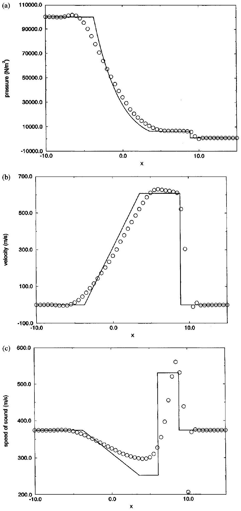
Figure 18.18 Beam-Warming second-order upwind method based on Van Leer flux vector splitting with artificial viscosity for Test Case 2.

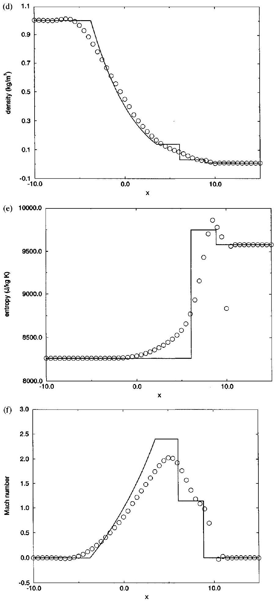
Figure 18.18 (cont.)

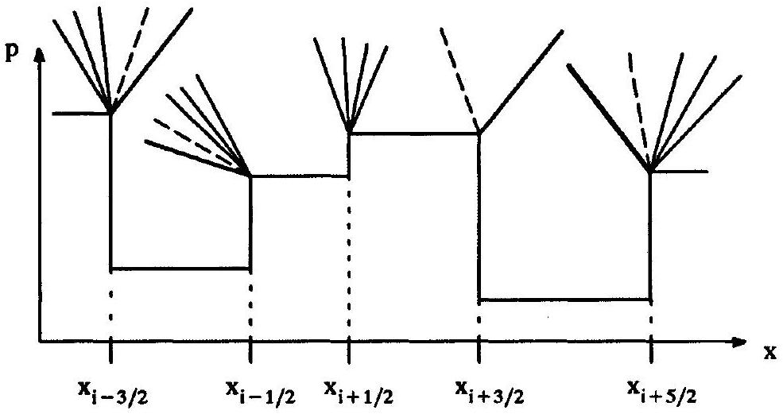
Figure 18.19 Each cell edge in a piecewise-constant reconstruction gives rise to a Riemann problem.

in left-running supersonic flow, the waves originating from cell edge $x_{i+1 / 2}$ always travel to the left, and then Equation (18.49) always yields $\hat{\mathbf{f}}_{i+1 / 2}^{n}=\mathbf{f}\left(\mathbf{u}_{i+1}^{n}\right)$, which is FTFS. This is true for any reasonable real or approximate Riemann solver used in Equation (18.49). In other words, all first-order upwind methods given by Equation (18.49) are the same-either FTBS or FTFS-for supersonic flows. Notice that the same thing is true of the first-order upwind methods based on flux vector splitting, as seen in Subsection 18.2.5.

As usual, most of the properties of first-order upwind methods for scalar conservation laws carry over to first-order upwind methods for the Euler equations. For example, firstorder upwind methods for the Euler equations have excellent shock-capturing abilities, for much the same reasons as first-order upwind methods for scalar conservation laws, as described in Section 17.3. For another example, first-order upwind methods for the Euler equations may experience difficulties at expansive sonic points, just like first-order upwind methods for scalar conservation laws. In particular, depending on the sonic point treatment, first-order upwind methods for the Euler equations may allow large expansion shocks at expansive sonic points. In short, anything that can happen in first-order upwind methods for scalar conservation laws can also happen in first-order upwind methods for the Euler equations. However, the reverse is not necessarily true - some things can happen in first-order upwind methods for the Euler equations that could never happen in first-order upwind methods for scalar conservation laws. For example, whereas the Riemann problem for scalar conservation laws is monotonicity preserving, the Riemann problem for the Euler equations is not. This lack of monotonicity preservation may undercut some of the nonlinear stability properties of the method. For example, unlike scalar first-order upwind methods, vector first-order upwind methods sometimes produce spurious oscillations, especially at steady and slowly moving shocks. These oscillations were first observed by Colella and Woodward (1984). They were further described by Ben-Artzi and Falcowitz (1984), Roberts (1990), Lin (1995), Jin and Liu (1996), and others. Since steady and slowly moving shocks span compressive sonic points, first-order upwind reconstruction-evolution methods for the Euler equations may have problems at both expansive and compressive sonic points, whereas first-order upwind reconstruction-evolution methods for scalar conservation laws only have problems at expansive sonic points.

Oscillations produced at slowly moving shocks have adverse consequences for steady shock capturing. To elaborate, a common way to capture steady-state solutions is to run an unsteady method for a large number of time steps, until the solution converges to steady state. Then, as steady state is approached, shocks will move more and more slowly until attaining their final steady-state positions; however, first-order upwind reconstruction-evolution methods for the Euler equations may generate spurious oscillations at slowly moving shocks, which substantially hamper convergence to steady state. Thus, in this regard, upwind methods based on Riemann solvers may perform worse than centered methods at steady or slowly moving shocks. The exact Riemann solver and Roe's approximate Riemann solver may produce such oscillations. In contrast, Osher's approximate Riemann solver and onewave approximate Riemann solvers do not. See Quirk (1994) and Donat and Marquina (1996) for a discussion of this and other problems experienced by numerical methods based on Riemann solvers.

### 18.3.1 Godunov's First-Order Upwind Method

Consider the exact solution to the Riemann problem for the Euler equations, as discussed in Section 5.1. In the results of Section 5.1, replace $\mathbf{u}_{L}$ by $\mathbf{u}_{i}^{n}$, replace $\mathbf{u}_{R}$ by $\mathbf{u}_{i+1}^{n}$, replace $t=0$ by $t=t^{n}$, and replace $x=0$ by $x=x_{i+1 / 2}$. Then the vector version of Godunov's method can be summarized as follows:

$$
\hat{\mathbf{f}}_{i+1 / 2}^{n}=\mathbf{f}\left(\mathbf{u}_{\text {RIEMANN }}\left(x_{i+1 / 2}, t\right)\right),
$$

where $\mathbf{u}_{\text {RIEMANN }}\left(x_{i+1 / 2}, t\right)$ is the exact solution to the Riemann problem for the Euler equations. Unfortunately, because there is no explicit expression for the solution of the Riemann problem for the Euler equations, there is no explicit expression for $\hat{f}_{i+1 / 2}^{n}$. The performance of Godunov's first-order upwind method is illustrated using the two standard test cases defined in Section 18.0. The results for Test Case 1 are shown in Figure 18.20 and the results for Test Case 2 are shown in Figure 18.21.

### 18.3.2 Roe's First-Order Upwind Method

Consider Roe's approximate Riemann solver for the Euler equations, as discussed in Section 5.3. In the results of Section 5.3, replace $\mathbf{u}_{L}$ by $\mathbf{u}_{i}^{n}$, replace $\mathbf{u}_{R}$ by $\mathbf{u}_{i+1}^{n}$, replace $A_{R L}$ by $A_{i+1 / 2}^{n}$, replace $t=0$ by $t=t^{n}$, and replace $x=0$ by $x=x_{i+1 / 2}$. Then the vector version Roe's method can be summarized as follows:

$$
\hat{\mathbf{f}}_{i+1 / 2}^{n}=\mathbf{f}\left(\mathbf{u}_{\text {RIEMANN }}\left(x_{i+1 / 2}, t\right)\right) .
$$

Unlike Godunov's first-order upwind method, there are some nice analytical expressions for the conservative numerical flux of Roe's first-order upwind method. Assume that $A_{i+1 / 2}^{n}$ has characteristic values ( $\left.\lambda_{i+1 / 2}^{n}\right)_{j}$, right characteristic vectors $\left(\mathbf{r}_{i+1 / 2}^{n}\right)_{j}$, and left characteristic vectors $\left(\mathbf{l}_{i+1 / 2}^{n}\right)_{j}$. Also let $\left(\Delta v_{i+1 / 2}^{n}\right)_{j}=\left(\mathbf{l}_{i+1 / 2}^{n}\right)_{j} \cdot\left(\mathbf{u}_{i+1}^{n}-\mathbf{u}_{i}\right)$. Section 5.3 provides the full details on how to compute $\left(\lambda_{i+1 / 2}^{n}\right)_{j},\left(\mathbf{r}_{i+1 / 2}^{n}\right)_{j},\left(\mathbf{l}_{i+1 / 2}^{n}\right)_{j}$, and $\left(\Delta v_{i+1 / 2}^{n}\right)_{j}$. By Equation (5.56),

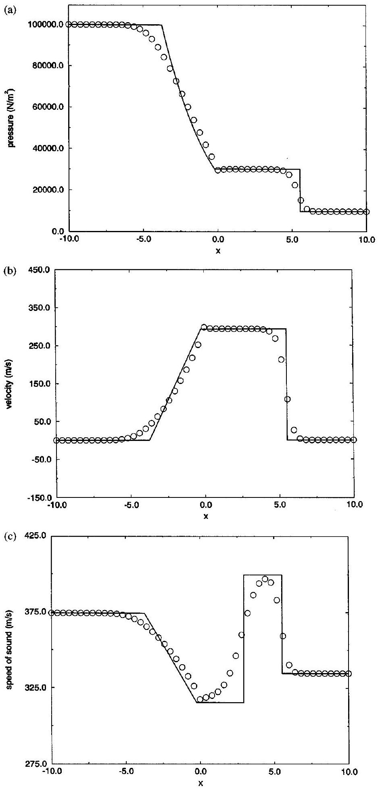
Figure 18.20 Godunov's first-order upwind method for Test Case 1.

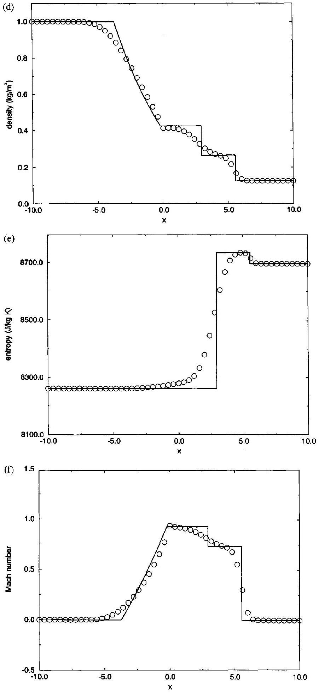
Figure 18.20 (cont.)

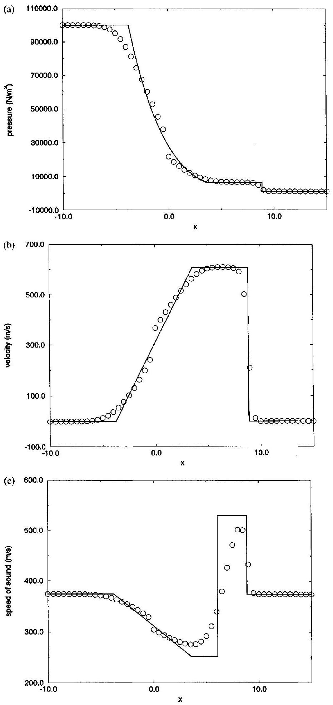
Figure 18.21 Godunov's first-order upwind method for Test Case 2.

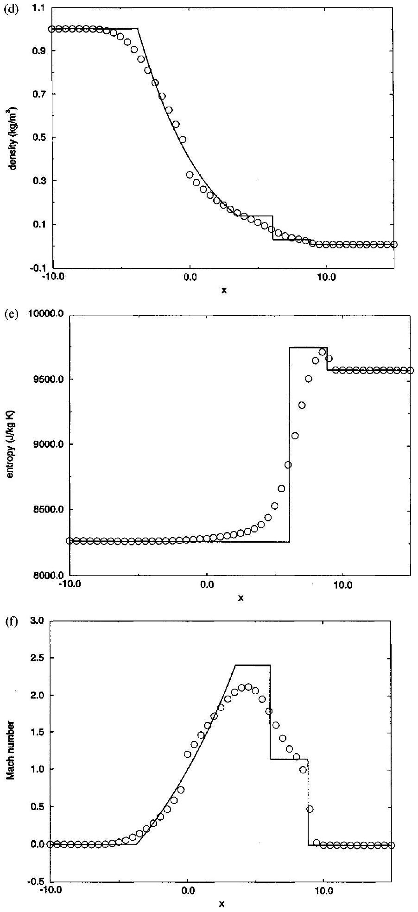
Figure 18.21 (cont.)

the conservative numerical flux of Roe's method can be written in three different ways:

$$
\begin{aligned}
\quad \hat{\mathbf{f}}_{i+1 / 2}^{n} & =\mathbf{f}\left(\mathbf{u}_{i}^{n}\right)+\sum_{j=1}^{3}\left(\mathbf{r}_{i+1 / 2}^{n}\right)_{j} \min \left[0,\left(\lambda_{i+1 / 2}^{n}\right)_{j}\right]\left(\Delta v_{i+1 / 2}^{n}\right)_{j} \\
\quad \hat{\mathbf{f}}_{i+1 / 2}^{n} & =\mathbf{f}\left(\mathbf{u}_{i+1}^{n}\right)-\sum_{j=1}^{3}\left(\mathbf{r}_{i+1 / 2}^{n}\right)_{j} \max \left[0,\left(\lambda_{i+1 / 2}^{n}\right)_{j}\right]\left(\Delta v_{i+1 / 2}^{n}\right)_{j} \\
\quad \hat{\mathbf{f}}_{i+1 / 2}^{n} & =\frac{1}{2}\left(\mathbf{f}\left(\mathbf{u}_{i+1}^{n}\right)+\mathbf{f}\left(\mathbf{u}_{i}^{n}\right)\right)-\frac{1}{2} \sum_{j=1}^{3}\left(\mathbf{r}_{i+1 / 2}^{n}\right)_{j}\left|\lambda_{i+1 / 2}^{n}\right|_{j}\left(\Delta v_{i+1 / 2}^{n}\right)_{j}
\end{aligned}
$$

Equivalently, Equation (5.27) yields the following matrix expressions:

$$
\begin{array}{ll} 
& \hat{\mathbf{f}}_{i+1 / 2}^{n}=\mathbf{f}\left(\mathbf{u}_{i}^{n}\right)+A_{i+1 / 2}^{-}\left(\mathbf{u}_{i+1}^{n}-\mathbf{u}_{i}^{n}\right), \\
& \hat{\mathbf{f}}_{i+1 / 2}^{n}=\mathbf{f}\left(\mathbf{u}_{i+1}^{n}\right)-A_{i+1 / 2}^{+}\left(\mathbf{u}_{i+1}^{n}-\mathbf{u}_{i}^{n}\right), \\
& \hat{\mathbf{f}}_{i+1 / 2}^{n}=\frac{1}{2}\left(\mathbf{f}\left(\mathbf{u}_{i+1}^{n}\right)+\mathbf{f}\left(\mathbf{u}_{i}^{n}\right)\right)-\frac{1}{2}\left|A_{i+1 / 2}^{n}\right|\left(\mathbf{u}_{i+1}^{n}-\mathbf{u}_{i}^{n}\right),
\end{array}
$$

where $A_{i+1 / 2}^{ \pm}$and $\left|A_{i+1 / 2}^{n}\right|$ are defined by Equations (5.22), (5.23), and (5.24). Despite the seeming differences, the last six equations are all identical. The first three expressions are the best for computations, while the last three expressions are the best for analysis. Notice that Equation (18.51c) is FTCS plus second-order artificial viscosity, where the coefficient of artificial viscosity is $\epsilon_{i+1 / 2}^{n}=\left|A_{i+1 / 2}^{n}\right|$.

From Chapter 5, recall that the Roe-average matrix $A_{i+1 / 2}^{n}$ must satisfy

$$
\mathbf{f}\left(\mathbf{u}_{i+1}^{n}\right)-\mathbf{f}\left(\mathbf{u}_{i}^{n}\right)=A_{i+1 / 2}^{n}\left(\mathbf{u}_{i+1}^{n}-\mathbf{u}_{i}^{n}\right) .
$$

Also recall that

$$
\begin{aligned}
& A_{i+1 / 2}^{+}+A_{i+1 / 2}^{-}=A_{i+1 / 2}^{n} \\
& A_{i+1 / 2}^{+}-A_{i+1 / 2}^{-}=\left|A_{i+1 / 2}^{n}\right|
\end{aligned}
$$

Then Equation (18.52) becomes

$$
\mathbf{f}\left(\mathbf{u}_{i+1}^{n}\right)-\mathbf{f}\left(\mathbf{u}_{i}^{n}\right)=\left(A_{i+1 / 2}^{+}+A_{i+1 / 2}^{-}\right)\left(\mathbf{u}_{i+1}^{n}-\mathbf{u}_{i}^{n}\right) .
$$

Then Roe's first-order upwind method splits the flux difference $\mathbf{f}\left(\mathbf{u}_{i+1}^{n}\right)-\mathbf{f}\left(\mathbf{u}_{i}^{n}\right)$ into positive and negative parts $A_{i+1 / 2}^{ \pm}\left(\mathbf{u}_{i+1}^{n}-\mathbf{u}_{i}^{n}\right)$. As a result, Roe's first-order upwind method is sometimes called a flux difference splitting method. In fact, there are infinitely many solutions for $A_{i+1 / 2}^{n}$ in Equation (18.52) in addition to the Roe-average matrix, as discussed in Chapter 5. For each one of these solutions, there are infinitely many matrix splittings $A_{i+1 / 2}^{ \pm}$besides the ones seen in Equations (5.22) and (5.23). In other words, there are infinitely many flux difference splitting methods. The term "flux difference splitting" stresses the parallels with flux vector splitting; unfortunately, these two terms are also easily confused, and the reader should take care to distinguish between them. To help the reader keep separate flux difference splitting and flux vector splitting, the terms "difference" and "vector" will be italicized in the following two paragraphs.

Let us compare flux difference splitting with flux vector splitting. Notice that the flux difference splitting method seen in Equation (18.51c) can be written as

$$
\hat{\mathbf{f}}_{i+1 / 2}^{n}=\frac{1}{2}\left(f\left(\mathbf{u}_{i+1}^{n}\right)+f\left(\mathbf{u}_{i}^{n}\right)\right)-\frac{1}{2}\left(A_{i+1 / 2}^{+}-A_{i+1 / 2}^{-}\right)\left(\mathbf{u}_{i+1}^{n}-\mathbf{u}_{i}^{n}\right),
$$

which is identical to the flux vector splitting method seen in Equation (18.40) except, of course, that the matrices $A_{i+1 / 2}^{ \pm}$may be defined in completely different ways. In particular, in flux difference splitting, the matrices $A_{i+1 / 2}^{ \pm}$are defined by Equations (18.53) and (5.25). By contrast, in flux vector splitting, the matrices $A_{i+1 / 2}^{ \pm}$are defined as follows:

$$
\begin{aligned}
& \mathbf{f}^{+}\left(\mathbf{u}_{i+1}^{n}\right)-\mathbf{f}^{+}\left(\mathbf{u}_{i}^{n}\right)=A_{i+1 / 2}^{+}\left(\mathbf{u}_{i+1}^{n}-\mathbf{u}_{i}^{n}\right), \\
& \mathbf{f}^{-}\left(\mathbf{u}_{i+1}^{n}\right)-\mathbf{f}^{-}\left(\mathbf{u}_{i}^{n}\right)=A_{i+1 / 2}^{-}\left(\mathbf{u}_{i+1}^{n}-\mathbf{u}_{i}^{n}\right) .
\end{aligned}
$$

Notice that all of the solutions of the flux vector splitting equation (18.41) are also solutions of the flux difference splitting equation (18.53) assuming that $A_{i+1 / 2}^{+}+A_{i+1 / 2}^{-}=A_{i+1 / 2}^{n}$. To see this, simply add Equations (18.41a) and (18.41b) to obtain Equation (18.53), using the fact that $\mathbf{f}^{+}+\mathbf{f}^{-}=\mathbf{f}$. Unfortunately, the reverse is not true - the solutions of the flux difference splitting equation (18.53) are not necessarily solutions of the flux vector splitting equation (18.41). Thus, given $A_{i+1 / 2}^{ \pm}$from Equation (18.53), there may or may not be any flux functions $\mathbf{f}^{ \pm}$that satisfy Equation (18.41). In particular, there is no flux vector splitting method corresponding to Roe's flux difference splitting method. In conclusion, for the firstorder upwind methods described in this chapter, flux vector splitting is a subset of flux difference splitting. All first-order upwind flux vector splitting methods can be considered as first-order upwind flux difference splitting methods but not vice versa, and, in particular, Roe's first-order upwind method is a flux difference splitting method but not a flux vector splitting method.

Flux vector splitting methods are naturally more efficient than flux difference splitting methods, since they involve only vectors rather than matrices. Although flux vector splitting methods can be written in matrix forms, such as Equation (18.41), they are most naturally written in purely vector forms. On the other hand, in general, flux difference splitting methods naturally involve matrices, or at least the sort of sums required in matrix-vector products such as those seen as in Equation (18.50). Since flux vector splitting uses vectors while flux difference splitting uses matrices, flux vector splitting is naturally less costly than flux difference splitting, much like MacCormack's method is less costly than the original Lax-Wendroff method, as discussed in Section 18.1.2. Of course, neither flux vector splitting nor flux difference splitting is any where near as cheap as "flux approach" methods such as Lax-Friedrichs and Lax-Wendroff methods, except possibly for very simple flux vector splitting methods such as those based on Zha-Bilgen splitting.

Roe's first-order upwind method yields results almost identical to those of Godunov's first-order upwind method on the standard test cases defined in Section 18.0. This is a bit surprising, given the often huge differences between the solutions yielded by Roe's approximate Riemann solver and the exact Riemann solver, as seen in Chapter 5. Once again, large nonphysical deviations can have little effect, or even positive effects, on numerical results. Since the results are so similar to Godunov's method, we shall not bother to plot them, and the reader is referred instead to Figures 18.20 and 18.21.

### 18.3.3 Harten's First-Order Upwind Method

Subsection 17.3.3 derived Harten's first-order upwind method for scalar conservation laws using a locally quadratic approximation to the flux function. Alternatively, Harten's first-order upwind method for scalar conservation laws may be formally derived by replacing $\left|a_{i+1 / 2}^{n}\right|$ with $\psi\left(a_{i+1 / 2}^{n}\right)$ in Roe's first-order upwind method for scalar conservation laws, where

- $\psi(x)= \begin{cases}\frac{x^{2}+\delta^{2}}{2 \delta} & |x|<\delta, \\ |x| & |x| \geq \delta,\end{cases}$
assuming that $\delta_{i+1 / 2}^{n}=\delta=$ const. Similarly, Harten's first-order upwind method for the Euler equations is formally derived by replacing $\left|\lambda_{i+1 / 2}^{n}\right|$ by $\psi\left(\lambda_{i+1 / 2}^{n}\right)$ in Equation (18.50c). Thus Harten's first-order upwind method for the Euler equations is

$$
\quad \hat{\mathbf{f}}_{i+1 / 2}^{n}=\frac{1}{2}\left(\mathbf{f}\left(\mathbf{u}_{i+1}^{n}\right)+\mathbf{f}\left(\mathbf{u}_{i}^{n}\right)\right)-\frac{1}{2} \sum_{j=1}^{3}\left(\mathbf{r}_{i+1 / 2}^{n}\right)_{j} \psi\left(\lambda_{i+1 / 2}^{n}\right)_{j}\left(\Delta v_{i+1 / 2}^{n}\right)_{j} \text {, }
$$

where $\left(\lambda_{i+1 / 2}^{n}\right)_{j},\left(\mathbf{r}_{i+1 / 2}^{n}\right)_{j}$, and $\left(\Delta v_{i+1 / 2}^{n}\right)_{j}$ are exactly the same as in Roe's first-order upwind method for the Euler equations. Harten's first-order upwind method is also called Harten's entropy fixed version of Roe's first-order upwind method. Like Roe's first-order upwind method, Harten's first-order upwind method is a flux difference splitting method, as described in the last subsection. The performance of Harten's first-order upwind method is illustrated using the two standard test cases defined in Section 18.0. The results for Test Case 1 are essentially identical to those of Godunov's and Roe's first-order upwind methods; see Figure 18.20. The results for Test Case 2 are shown in Figure 18.22. After some trial and error, the value $\delta=200 \mathrm{~m} / \mathrm{s}$ was found to be the minimum value which adequately eliminated the expansion shock seen in Godunov's and Roe's first-order upwind methods. Although 200 may seem like a large number, remember that terms like "large" and "small" are relative, and 200 is a moderately small number compared with the wave speeds and other flow properties found in Test Case 2; for example, the wave speeds in the exact solution run well over $1,000 \mathrm{~m} / \mathrm{s}$. Notice that Harten's entropy fix only affects the sonic point in Test Case 2, while the rest of the solution is left essentially untouched. Overall, Harten's first-order upwind method delivers the best results of any method in this chapter.

### 18.3.4 First-Order Upwind Method Based on One-Wave Solver

Although cheaper than Godunov's first-order upwind method, Roe's and Harten's first-order upwind methods are still relatively expensive. So consider the linear one-wave solver discussed in Section 5.4. In the results of Section 5.4, replace $\mathbf{u}_{L}$ by $\mathbf{u}_{i}^{n}$, replace $\mathbf{u}_{R}$ by $\mathbf{u}_{i+1}^{n}$, replace $A_{R L}$ by $A_{i+1 / 2}^{n}$, replace $t=0$ by $t=t^{n}$, and replace $x=0$ by $x=x_{i+1 / 2}$. In artificial viscosity form, the resulting method is as follows:

$$
\hat{\mathbf{f}}_{i+1 / 2}^{n}=\frac{1}{2}\left(\mathbf{f}\left(\mathbf{u}_{i+1}^{n}\right)+\mathbf{f}\left(\mathbf{u}_{i}^{n}\right)\right)-\frac{1}{2} \rho\left(A_{i+1 / 2}^{n}\right)\left(\mathbf{u}_{i+1}^{n}-\mathbf{u}_{i}^{n}\right),
$$

where $A_{i+1 / 2}^{n}$ is any average Jacobian matrix and $\rho\left(A_{i+1 / 2}^{n}\right)$ is the spectral radius of $A_{i+1 / 2}^{n}$. The spectral radius is the largest characteristic value of $A_{i+1 / 2}^{n}$ in absolute value (i.e., the larger of $u_{i+1 / 2}^{n}+a_{i+1 / 2}^{n}$ and $u_{i+1 / 2}^{n}-a_{i+1 / 2}^{n}$ in absolute value). Comparing Equation (18.57)

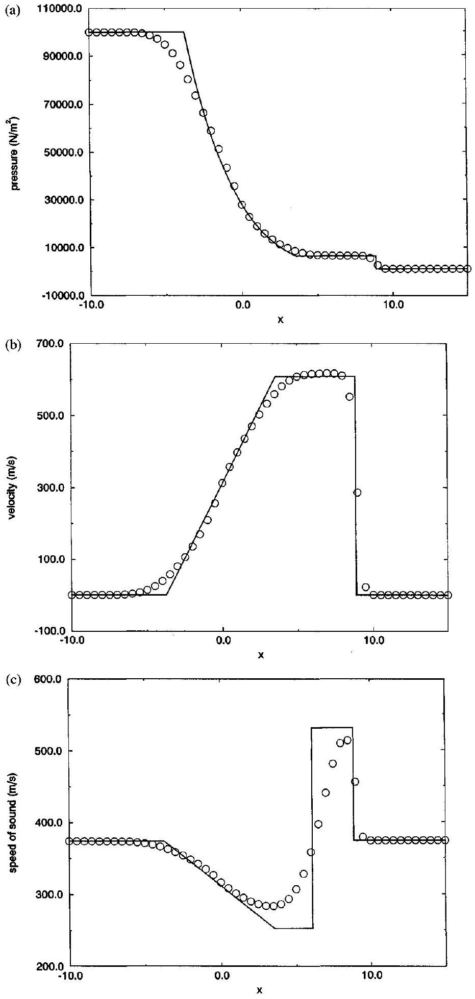
Figure 18.22 Harten's first-order upwind method for Test Case 2.

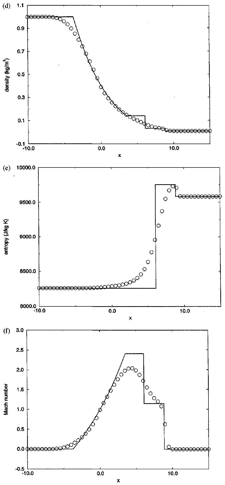
Figure 18.22 (cont.)

with Equation (18.51c), we see that the matrix coefficient of artificial viscosity $\left|A_{i+1 / 2}^{n}\right|$ has been traded for the scalar coefficient of artificial viscosity $\rho\left(A_{i+1 / 2}^{n}\right)$. As usual, there are many possible definitions for $A_{i+1 / 2}^{n}$. For example,

$$
A_{i+1 / 2}^{n}=A\left(\frac{\mathbf{u}_{i+1}^{n}+\mathbf{u}_{i}^{n}}{2}\right) .
$$

For another example,

$$
A_{i+1 / 2}^{n}=\frac{A\left(\mathbf{u}_{i+1}^{n}\right)+A\left(\mathbf{u}_{i}^{n}\right)}{2} .
$$

A third possibility is the Roe-average Jacobian matrix $A_{i+1 / 2}^{n}$ described in Section 5.3.
The differences between Equation (18.57) and Equation (18.51c) are much like the differences between the one-wave linear solver and Roe's three-wave linear solver, as described in Chapter 5. For one interesting perspective, consider a linear system of equations, as described in Section 5.2. Then Roe's first-order upwind method can be written in terms of characteristic variables $v_{j}$ as follows:

$$
v_{j, i}^{n+1}=v_{j, i}^{n}-\frac{\lambda}{2} a_{j}\left(v_{j, i+1}^{n}-v_{j, i-1}^{n}\right)+\frac{\lambda}{2}\left|a_{j}\right|\left(v_{j, i+1}^{n}-2 v_{j, i}^{n}+v_{j, i-1}^{n}\right),
$$

which is in the form of central differences plus second-order artificial viscosity. Similarly, the first-order upwind method based on the one-wave linear solver can be written in terms of the characteristic variables $v_{j}$ as follows:
$v_{j, i}^{n+1}=v_{j, i}^{n}-\frac{\lambda}{2} a_{j}\left(v_{j, i+1}^{n}-v_{j, i-1}^{n}\right)+\frac{\lambda}{2} \max \left(\left|a_{1}\right|,\left|a_{2}\right|,\left|a_{3}\right|\right)\left(v_{j, i+1}^{n}-2 v_{j, i}^{n}+v_{j, i-1}^{n}\right)$,
which is again in the form of central differences plus second-order artificial viscosity. Then, in the one-wave method, the characteristic with the largest wave speed is properly treated, whereas the other two characteristics variables have too much artificial viscosity, as measured relative to Roe's first-order upwind method. Put another way, the matrix coefficient of artificial viscosity $|A|$ treats each characteristic differently, according to its wave speed, whereas the scalar coefficient of artificial viscosity $\rho(A)$ treats every characteristic the same, like the "worst case" or fastest characteristic.

The performance of the first-order upwind method based on the one-wave solver is illustrated using the two standard test cases defined in Section 18.0. The results for Test Case 1 are shown in Figure 18.23 and the results for Test Case 2 are shown in Figure 18.24. These results were generated using definition (18.58) for $A_{i+1 / 2}^{n}$. The Roe-average matrix yields nearly identical results, while definition (18.59) yields noticeably worse results. In some ways, the first-order upwind reconstruction-evolution method based on the one-wave solver yields surprisingly good results, given how cheap it is. There are absolutely no oscillations, overshoots, undershoots, or expansion shocks. Unfortunately, there is an excessive amount of smearing and dissipation relative to, say, Roe's first-order upwind method, which is certainly not surprising in light of the discussion of the preceding paragraph.

### 18.3.5 Second- and Higher-Order Accurate Methods

Up until now, this section has concerned only first-order accurate reconstructionevolution methods. This subsection introduces higher-order accurate reconstruction-evol-

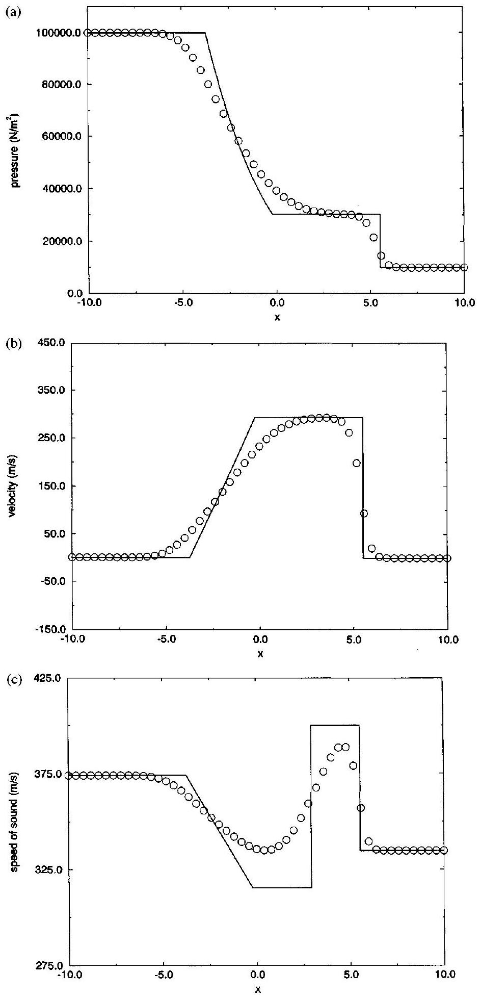
Figure 18.23 First-order upwind reconstruction-evolution method based on the one-wave linear Riemann solver for Test Case 1.

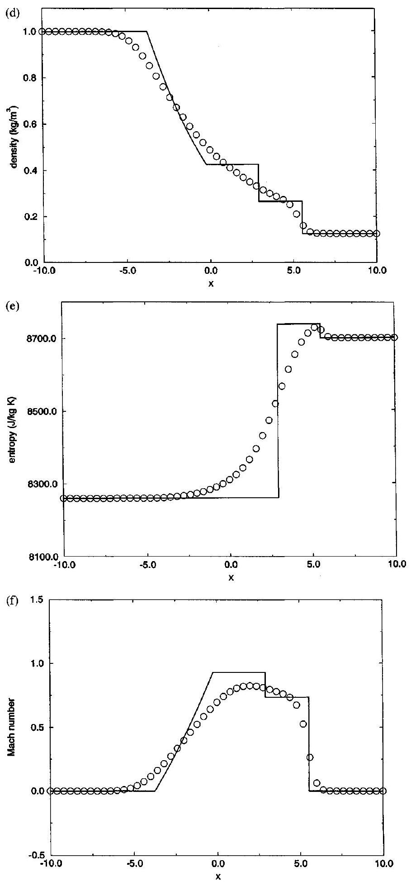
Figure 18.23 (cont.)

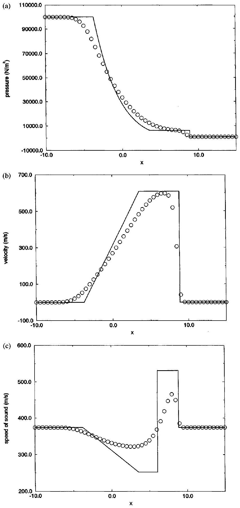
Figure 18.24 First-order upwind reconstruction-evolution method based on the one-wave linear Riemann solver for Test Case 1.

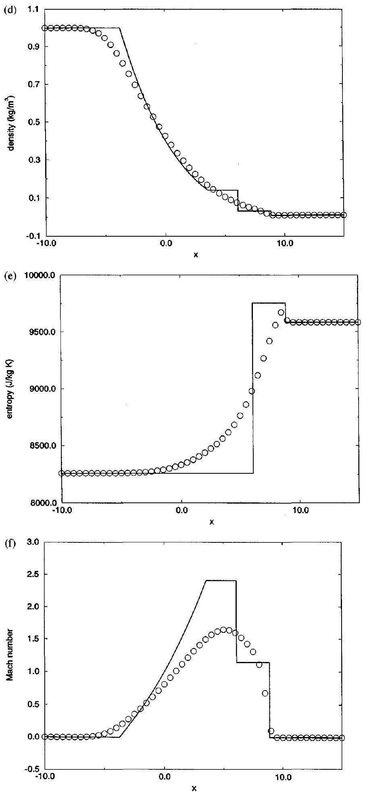
Figure 18.24 (cont.)

ution methods. This section is only an introduction - specific methods will have to wait until Part V, and especially Chapter 23. To begin with, consider higher-order accurate methods based on the exact Riemann solver, that is, higher-order accurate versions of Godunov's method. The spatial reconstruction is relatively straightforward: Use any piecewise-linear, piecewise-quadratic, or higher-order piecewise-polynomial reconstruction, such as those discussed in Chapter 9. Now consider the temporal evolution. Recall that

$$
\hat{\mathbf{f}}_{i+1 / 2}^{n} \approx \frac{1}{\Delta t} \int_{t^{n}}^{t^{n+1}} \mathbf{f}\left(\mathbf{u}\left(x_{i+1 / 2}, t\right)\right) d t
$$

As the first step, approximate the time-integral average using any of the numerical integration formulae seen in Section 10.2. For example,

$$
\frac{1}{\Delta t} \int_{t^{n}}^{t^{n+1}} \mathbf{f}\left(\mathbf{u}\left(x_{i+1 / 2}, t\right)\right) d t=\mathbf{f}\left(\mathbf{u}\left(x_{i+1 / 2}, t^{n+1 / 2}\right)\right)+O\left(\Delta t^{2}\right)
$$

For another example,

$$
\frac{1}{\Delta t} \int_{t^{n}}^{t^{n+1}} \mathbf{f}\left(\mathbf{u}\left(x_{i+1 / 2}, t\right)\right) d t=\frac{1}{2} \mathbf{f}\left(\mathbf{u}\left(x_{i+1 / 2}, t^{n+1}\right)\right)+\frac{1}{2} \mathbf{f}\left(\mathbf{u}\left(x_{i+1 / 2}, t^{n}\right)\right)+O\left(\Delta t^{2}\right)
$$

As the second step, find a Taylor series about $t=t^{n}$. For example,

$$
\mathbf{f}\left(\mathbf{u}\left(x_{i+1 / 2}, t\right)\right)=\mathbf{f}\left(\mathbf{u}\left(x_{i+1 / 2}, t^{n}\right)\right)+\frac{\partial \mathbf{f}}{\partial t}\left(\mathbf{u}\left(x_{i+1 / 2}, t^{n}\right)\right)\left(t-t^{n}\right)+O\left(t-t^{n}\right)^{2} .
$$

As the third step, exchange time derivatives in the Taylor series for space derivatives using Cauchy-Kowalewski. For example, by conservation of momentum, the time derivative of the momentum flux can be written as

$$
\frac{\partial}{\partial t}(\rho u)=-\rho u \frac{\partial u}{\partial x}+u \frac{\partial}{\partial x}(\rho u)-\frac{\partial p}{\partial x} .
$$

As the fourth step, differentiate the spatial reconstruction at time level $n$ to approximate the spatial derivatives at $\left(x_{i+1 / 2}, t^{n}\right)$. In general, the reconstruction and/or its derivatives contain jump discontinuities at the cell edges $x=x_{i+1 / 2}$. Let $\mathbf{u}_{i+1 / 2, L}(t)$ and $\mathbf{u}_{i+1 / 2, R}(t)$ be the leftand right-hand limits of the approximation to $u\left(x_{i+1 / 2}, t\right)$ found in the preceding four steps. As the fifth and final step, average $\mathbf{u}_{i+1 / 2, L}(t)$ and $\mathbf{u}_{i+1 / 2, R}(t)$. In particular, use $\mathbf{u}_{i+1 / 2, L}(t)$ and $\mathbf{u}_{i+1 / 2, R}(t)$ as the left- and right-hand states, respectively, in the exact solution to the Riemann problem. Although other averages could be used besides the Riemann solver, only the Riemann solver average yields the exact solution in the case of piecewise-constant reconstructions. Because this procedure is based on Taylor series and differential forms of the Euler equations, it does not apply at shocks. In fact, at shocks, it is absolutely vital to eliminate all of the higher-order terms and return to first-order piecewise-constant reconstruction, since the higher-order terms computed using the preceding procedure will actually decrease rather than increase accuracy. For specific examples of this technique, see Chapter 23 and especially Section 23.5.

Now consider higher-order accurate methods based on locally linearized approximate Riemann solvers such as, for example, Roe's approximate Riemann solver or the linearized one-wave solver. To help introduce this idea, consider a linear system of equations:

$$
\frac{\partial \mathbf{u}}{\partial t}+A \frac{\partial \mathbf{u}}{\partial x}=0
$$

where the matrix $A$ is constant. Assume that $A=Q \Lambda Q^{-1}$, where $Q$ is a matrix whose columns are right characteristic vectors, $Q^{-1}$ is a matrix whose rows are left characteristic vectors, and $\Lambda$ is a diagonal matrix of characteristic values. Define the characteristic variables as $\mathbf{v}=Q^{-1} \mathbf{u}$. In characteristic form, the linearized governing equations can be written as

$$
\frac{\partial \mathbf{v}}{\partial t}+\Lambda \frac{\partial \mathbf{v}}{\partial x}=0
$$

This is a set of independent linear advection equations. Each equation in the system has the following form:

$$
\frac{\partial v_{j}}{\partial t}+\lambda_{j} \frac{\partial v_{j}}{\partial x}=0
$$

Consider any conservative numerical approximation to the linear advection equation

$$
\left(v_{i}^{n+1}\right)_{j}=\left(v_{i}^{n}\right)_{j}-\lambda\left[\left(\hat{f}_{i+1 / 2}^{n}\right)_{j}-\left(\hat{f}_{i-1 / 2}^{n}\right)_{j}\right]
$$

where

$$
\begin{aligned}
\left(\hat{f}_{i+1 / 2}^{n}\right)_{j} & =\hat{f}_{j}\left[\left(v_{i-K_{1}+1}^{n}\right)_{j}, \ldots,\left(v_{i-K_{2}}^{n}\right)_{j}\right] \\
& =\hat{f}_{j}\left[\left(Q^{-1} \mathbf{u}_{i-K_{1}+1}^{n}\right)_{j}, \ldots,\left(Q^{-1} \mathbf{u}_{i-K_{2}}^{n}\right)_{j}\right]
\end{aligned}
$$

Equivalently, in vector form, we have

$$
\mathbf{v}_{i}^{n+1}=\mathbf{v}_{i}^{n}-\lambda\left(\hat{\mathbf{f}}_{i+1 / 2}^{n}-\hat{\mathbf{f}}_{i-1 / 2}^{n}\right),
$$

where

$$
\hat{\mathbf{f}}_{i+1 / 2}^{n}=\hat{\mathbf{f}}\left[Q^{-1} \mathbf{u}_{i-K_{1}+1}^{n}, \ldots, Q^{-1} \mathbf{u}_{i-K_{2}}\right] .
$$

Multiply the vector characteristic form by $Q$ to recover the conserved variables

$$
\begin{aligned}
& \mathbf{u}_{i}^{n+1}=\mathbf{u}_{i}^{n}-\lambda\left(Q \hat{\mathbf{f}}_{i+1 / 2}^{n}-Q \hat{\mathbf{f}}_{i-1 / 2}^{n}\right) \\
& Q \hat{\mathbf{f}}_{i+1 / 2}^{n}=Q \hat{\mathbf{f}}\left[Q^{-1} \mathbf{u}_{i-K_{1}+1}^{n}, \ldots, Q^{-1} \mathbf{u}_{i-K_{2}}\right] .
\end{aligned}
$$

Now suppose that the true governing equations are nonlinear but that they have been replaced by locally linearized governing equations such as the following:

$$
\frac{\partial \mathbf{u}}{\partial t}+A_{i+1 / 2} \frac{\partial \mathbf{u}}{\partial x}=0 .
$$

As before, multiply by $Q_{i+1 / 2}^{-1}$ to transform to locally linearized characteristics, apply any scalar method to each locally linearized characteristic equation, and multiply by $Q_{i+1 / 2}$ to transform back to conservation form. Unfortunately, in most cases, things are not quite this simple: Rather than staying with one single locally linearized Jacobian matrix $Q_{i+1 / 2}$, the locally linearized Jacobian matrix changes with position. Specifically,

$$
\mathbf{u}_{i}^{n+1}=\mathbf{u}_{i}^{n}-\lambda\left(Q_{i+1 / 2} \hat{\mathbf{f}}_{i+1 / 2}^{n}-Q_{i-1 / 2} \hat{\mathbf{f}}_{i-1 / 2}^{n}\right),
$$

where the spatial index on $Q$ matches that of $\hat{\mathbf{f}}$. By choosing the index on $Q$ appropriately, terms such as $f\left(u_{i}^{n}\right)$ in the scalar method become $\mathbf{f}\left(\mathbf{u}_{i}^{n}\right)$ in the vector method. Also, factors such as $a_{i+1 / 2}^{n}\left(u_{i+1}^{n}-u_{i}^{n}\right)$ in the scalar method become

$$
\begin{aligned}
Q_{i+1 / 2} \Lambda_{i+1 / 2}\left(\mathbf{v}_{i+1}^{n}-\mathbf{v}_{i}^{n}\right) & =Q_{i+1 / 2} \Lambda_{i+1 / 2} Q_{i+1 / 2}^{-1}\left(\mathbf{u}_{i+1}^{n}-\mathbf{u}_{i}^{n}\right) \\
& =A_{i+1 / 2}^{n}\left(\mathbf{u}_{i+1}^{n}-\mathbf{u}_{i}^{n}\right)
\end{aligned}
$$

in the vector method. For more specifics on this technique see, for example, Subsections 20.5.2 and 21.3.2. This all becomes extremely simple in the case of the linearized one-wave solvers, where $Q_{i+1 / 2}=Q_{i+1 / 2}^{-1}=I$. For example, any factors such as $a_{i+1 / 2}^{n}\left(u_{i+1 / 2}^{n}-u_{i}^{n}\right)$ in the scalar method become $\rho\left(A_{i+1 / 2}^{n}\right)\left(\mathbf{u}_{i+1}^{n}-\mathbf{u}_{i}^{n}\right)$ in the vector method. For more specifics on this technique see, for example, Subsections 20.4.2 and 22.3.2.

## References

Ben-Artzi, M., and Falcovitz, J. 1984. "A Second-Order Godunov-Type Scheme for Compressible Fluid Dynamics," Journal of Computational Physics, 55: 1-32.
Colella, P., and Woodward, P. R. 1984. "The Piecewise Parabolic Method (PPM) for Gas-Dynamical Simulations," Journal of Computational Physics, 54: 174-201.
Donat, R., and Marquina, A. 1996. "Capturing Shock Reflections: An Improved Flux Formula," Journal of Computational Physics, 125: 42-58.
Hirsch, C. 1990. Numerical Computation of Internal and External Flows. Volume 2: Computational Methods for Inviscid and Viscous Flows, Chichester: Wiley.
Jin, S., and Liu, J.-G. 1996. "The Effects of Numerical Viscosities. I. Slowly Moving Shocks," Journal of Computational Physics, 126: 373-389.
Lin, H.-C. 1995. "Dissipation Additions to Flux-Difference Splitting," Journal of Computational Physics, 117: 20-27.
Liou, M.-S., and Steffen, C. J. 1993. "A New Flux Splitting Scheme," Journal of Computational Physics, 107: 23-39.
Liou, M.-S., Van Leer, B., and Shuen, J.-S. 1990. "Splitting of Inviscid Fluxes for Real Gases," Journal of Computational Physics, 87: 1-24.
MacCormack, R. W. 1969. "The Effect of Viscosity in Hypervelocity Impact Cratering," AIAA Paper 69-0354 (unpublished).
Quirk, J. J. 1994. "A Contribution to the Great Riemann Solver Debate," International Journal for Numerical Methods in Fluids, 18: 555-574.
Radespiel, R., and Kroll, N. 1995. "Accurate Flux Vector Splitting for Shocks and Shear Layers," Journal of Computational Physics, 121: 66-78.
Roberts, T. W. 1990. "The Behavior of Flux Difference Splitting Schemes Near Slowly Moving Shock Waves," Journal of Computational Physics, 90: 141-160.
Roe, P. L. 1981. "Approximate Riemann Solvers, Parameter Vectors, and Difference Schemes," Journal of Computational Physics, 43: 357-372.
Shuen, J.-S., Liou, M.-S., and Van Leer, B. 1990. "Inviscid Flux-Splitting Algorithms for Real Gases with Non-Equilibrium Chemistry," Journal of Computational Physics, 90: 371-395.
Sod, G. A. 1978. "A Survey of Several Finite-Differences Methods for Systems of Nonlinear Hyperbolic Conservation Laws," Journal of Computational Physics, 27: 1-31.
Steger, J. L., and Warming, R. F. 1981. "Flux Vector Splitting of the Inviscid Gasdynamic Equations with Applications to Finite-Difference Methods," Journal of Computational Physics, 40: 263-293.
Van Leer, B. 1982. "Flux-Vector Splitting for the Euler Equations." In Lecture Notes in Physics, Volume 170, Eighth International Conference of Numerical Methods in Fluid Dynamics, ed. E. Krause, pp. 507-512, Berlin: Springer-Verlag.
Zha, G.-C., and Bilgen, E. 1993. "Numerical Solutions of Euler Equations by Using a New Flux Vector Splitting Scheme," International Journal for Numerical Methods in Fluids, 17: 115-144.

## Problems

18.1 From the last chapter, recall that steady-state solutions of the Lax-Wendroff and BeamWarming second-order upwind methods both depend on the time step $\Delta t$.
(a) Do the steady-state solutions of the two-step Richtmyer method for the Euler equations depend on $\Delta t$ ?
(b) Do the steady-state solutions of two-step MacCormack's method for the Euler equations depend on $\Delta t$ ?
(c) Do the steady-state solutions of two-step Beam-Warming second-order upwind method for the Euler equations depend on $\Delta t$ ?
18.2 (a) Find an expression for the conservative numerical flux of the two-step MacCormack's method.
(b) Find an expression for the conservative numerical flux of the two-step Richtmyer method.
(c) Find an expression for the conservative numerical flux of the two-step Beam-Warming method.
18.3 (a) Show that all of the Lax-Wendroff methods seen in Subsection 18.1.2 are equivalent when applied to linear systems of equations. In other words, show that the original Lax-Wendroff method, Equation (18.2), the Richtmyer method, Equation (18.3), and both versions of MacCormack's method, Equations (18.4) and (18.5), are the same when $\mathbf{f}=A \mathbf{u}$ where $A=$ const.
(b) Show that one-step and two-step Beam-Warming second-order upwind methods seen in Subsection 18.2.6 are equivalent when applied to linear systems of equations. In other words, show that Equations (18.44) and (18.48) are the same when $\mathbf{f}=A \mathbf{u}$ where $A=$ const .
18.4 In Section 18.1, the Lax-Friedrichs and Lax-Wendroff methods were extended from scalar conservation laws to the Euler equations using the flux approach. However, we could just as well have used a wave approach or, more specifically, flux vector splitting, since techniques like flux vector splitting can be used for both upwind or centered methods. Let $\mathbf{f}^{+}+\mathbf{f}^{-}=\mathbf{f}$ be any flux vector splitting. Define $A_{i+1 / 2}^{ \pm}$as follows:
$\mathbf{f}^{+}\left(u_{i+1}^{n}\right)-\mathbf{f}^{+}\left(u_{i}^{n}\right)=A_{i+1 / 2}^{+}\left(u_{i+1}^{n}-u_{i}^{n}\right)$,
$\mathbf{f}^{-}\left(u_{i+1}^{n}\right)-\mathbf{f}^{-}\left(u_{i}^{n}\right)=A_{i+1 / 2}^{-}\left(u_{i+1}^{n}-u_{i}^{n}\right)$.
Then write $\mathbf{f}^{+}+\mathbf{f}^{-}$wherever $f$ appears in the method for the scalar conservation law, and write $A_{i+1 / 2}^{+}+A_{i+1 / 2}^{-}$wherever $a_{i+1 / 2}^{n}$ appears in the method for the scalar conservation law.
(a) Find a version of the Lax-Friedrichs method for the Euler equations using flux vector splitting. When is this version of the Lax-Friedrichs method equivalent to the "flux approach" version given by Equation (18.1)?
(b) Find a version of the Lax-Wendroff method for the Euler equations using flux vector splitting. When is this version of the Lax-Wendroff method equivalent to the "flux approach" version given by Equation (18.2)?
18.5 (a) Write the Steger-Warming flux vector splitting $\mathbf{f}^{ \pm}$in terms of the conserved quantities per unit volume $\mathbf{u}=\left(\rho, \rho u, \rho e_{\mathrm{T}}\right)^{T}$.
(b) Use the expression from part (a) to find $d \mathbf{f}^{ \pm} / d \mathbf{u}$.
(c) Does the Steger-Warming flux vector splitting satisfy condition (13.7)? In other words, is $d \mathbf{f}^{+} / d \mathbf{u} \geq 0$ and $d \mathbf{f}^{-} / d \mathbf{u} \leq 0$ ?
18.6 (a) Prove that Van Leer's flux vector splitting satisfies $d \mathbf{f}^{+} / d \mathbf{u} \geq 0$ and $d \mathbf{f}^{-} / d \mathbf{u} \leq 0$.
(b) Does the Liou-Steffen flux vector splitting satisfy $d \mathbf{f}^{+} / d \mathbf{u} \geq 0$ and $d \mathbf{f}^{-} / d \mathbf{u} \leq 0$ ?
(c) Does the Zha-Bilgen flux vector splitting satisfy $d \mathbf{f}^{+} / d \mathbf{u} \geq 0$ and $d \mathbf{f}^{-} / d \mathbf{u} \leq 0$ ?
18.7 (a) Convert the Van Leer flux vector splitting to a wave speed splitting using Equation (18.18). In other words, prove Equation (18.31).
(b) Convert the Zha-Bilgen flux vector splitting to a wave speed splitting using Equation (18.18).
18.8 As mentioned in Section 18.2, Radespiel and Kroll (1995) suggested an adaptive combination of Van Leer and Liou-Steffen first-order upwind methods, with the Liou-Steffen first-order upwind method splitting used in smooth regions and Van Leer flux first-order upwind method used near shocks. Briefly explain why this might be a good idea.
18.9 This problem concerns forms of flux split first-order upwind methods that are something like artificial viscosity forms. Recall that for any $x$ :
$\max (0, x)=\frac{x+|x|}{2}, \quad \min (0, x)=\frac{x-|x|}{2}$.
In each case, after finding the desired expression, state whether there would be any advantage to using the expression in practical calculations.
(a) Write the Liou-Steffen first-order upwind method as follows:

$$
\begin{aligned}
\hat{\mathbf{f}}_{i+1 / 2}^{n}= & \frac{\boldsymbol{M}_{i}^{+}+\boldsymbol{M}_{i+1}^{-}}{2}\left(\left[\begin{array}{c}
\rho_{i+1}^{n} a_{i+1}^{n} \\
\rho_{i+1}^{n} u_{i+1}^{n} a_{i+1}^{n} \\
\rho_{i+1}^{n}\left(h_{\mathrm{T}}\right)_{i+1}^{n} a_{i+1}^{n}
\end{array}\right]+\left[\begin{array}{c}
\rho_{i}^{n} a_{i}^{n} \\
\rho_{i}^{n} u_{i}^{n} a_{i}^{n} \\
\rho_{i}^{n}\left(h_{\mathrm{T}}\right)_{i}^{n} a_{i}^{n}
\end{array}\right]\right)-\frac{\left|\boldsymbol{M}_{i}^{+}+\boldsymbol{M}_{i+1}^{+}\right|}{2} \\
& \times\left(\left[\begin{array}{c}
\rho_{i+1}^{n} a_{i+1}^{n} \\
\rho_{i+1}^{n} u_{i+1}^{n} a_{i+1}^{n} \\
\rho_{i+1}^{n}\left(h_{\mathrm{T}}\right)_{i+1}^{n} a_{i+1}^{n}
\end{array}\right]-\left[\begin{array}{c}
\rho_{i}^{n} a_{i}^{n} \\
\rho_{i}^{n} u_{i}^{n} a_{i}^{n} \\
\rho_{i}^{n}\left(h_{\mathrm{T}}\right)_{i}^{n} a_{i}^{n}
\end{array}\right]\right)+\left(p_{i}^{+}+p_{i+1}^{-}\right)\left[\begin{array}{l}
0 \\
1 \\
0
\end{array}\right]
\end{aligned}
$$

(b) Write the Zha-Bilgen first-order upwind method as follows:

$$
\begin{aligned}
\hat{\mathbf{f}}_{i+1 / 2}^{n}= & \frac{1}{2}\left(\mathbf{f}\left(\mathbf{u}_{i+1}^{n}\right)+\mathbf{f}\left(\mathbf{u}_{i}^{n}\right)\right)-\frac{1}{2}\left(\left|\mathbf{u}_{i+1}^{n}\right|\left[\begin{array}{c}
\rho_{i+1}^{n} \\
\rho_{i+1}^{n} u_{i+1}^{n} \\
\rho_{i+1}^{n}\left(e_{\mathrm{T}}\right)_{i+1}^{n}
\end{array}\right]-\left|u_{i}^{n}\right|\left[\begin{array}{c}
\rho_{i}^{n} \\
\rho_{i}^{n} u_{i}^{n} \\
\rho_{i}^{n}\left(e_{\mathrm{T}}\right)_{i}^{n}
\end{array}\right]\right) \\
& -\frac{1}{2}\left(\left[\begin{array}{c}
0 \\
p_{i+1}^{n} M_{i+1}^{n} \\
p_{i+1}^{n} a_{i+1}^{n}
\end{array}\right]-\left[\begin{array}{c}
0 \\
p_{i}^{n} M_{i}^{n} \\
p_{i}^{n} a_{i}^{n}
\end{array}\right]\right) .
\end{aligned}
$$

18.10 Consider Harten's "entropy fix" given by Equation (18.56). Show that an equivalent expression for the function $\psi$ is
$\psi(x)=\max \left[|x|, \min \left(\delta, \frac{x^{2}+\delta^{2}}{2 \delta}\right)\right]$.
What advantages might this expression have in practical programming terms, if any?

