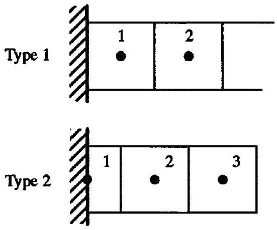
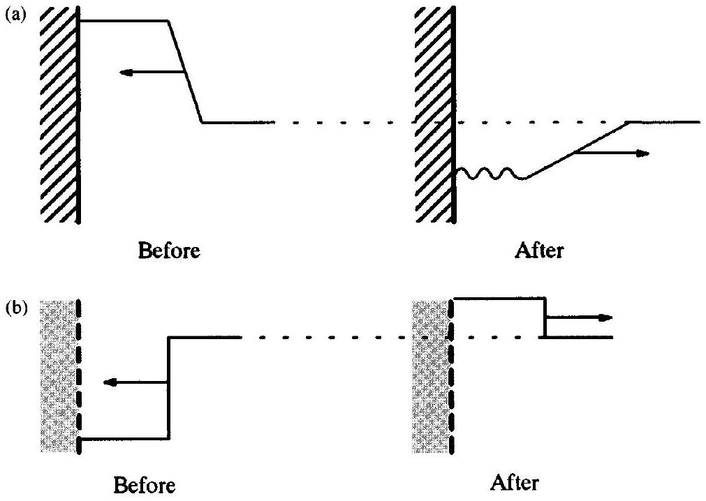
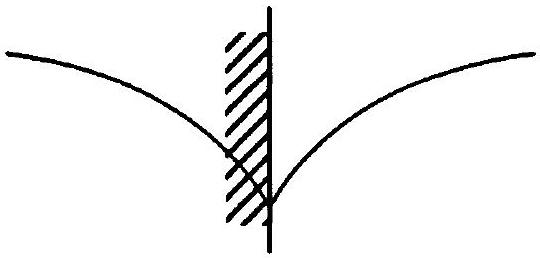
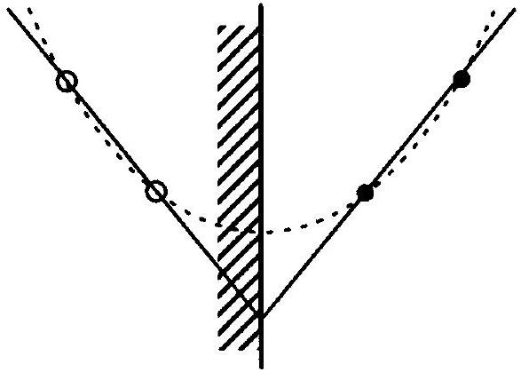
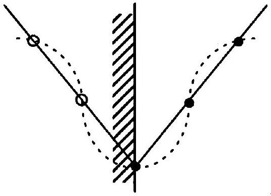
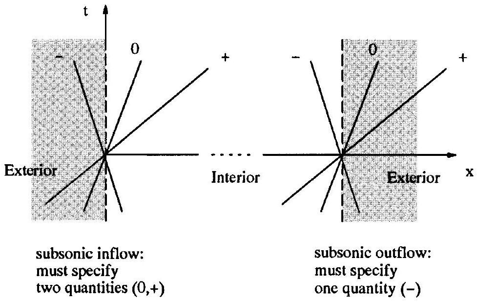

## Boundary Treatments

### 19.0 Introduction

This chapter concerns boundary treatments. Before now, the book has avoided boundary treatments by using either infinite boundaries or periodic boundaries, but one cannot remain innocent forever. Boundary conditions and governing equations have equal importance, despite the fact that most sources, including this one, spend most of their time focused on the governing equations. For the same governing equations, boundary conditions distinguish flow over a plane from flow over a train from flow over a space shuttle from any other sort of flow. In practice, numerical boundary treatments often consume a large percentage of computational gasdynamics codes, both in terms of the number of lines of code and in terms of the development effort.

This chapter concerns two types of boundaries - solid and far-field boundaries. Solid boundaries are also known as surface, wall, rigid, or impermeable boundaries; naturally enough, solid boundaries occur at the surfaces of solid objects. This chapter considers only stationary solid boundaries. Far-field boundaries are also known as open, artificial, permeable, or remote boundaries. Far-field boundaries limit the computational domain to a reasonable finite size; the true boundaries may be extremely far away, or even infinitely far away, at least conceptually. In general, when the physical domain is very large or infinite, then the farther away the numerical far-field boundary is, the more accurate but also the more costly the numerical approximation will be. Far-field boundaries are divided into inflow boundaries, where fluid enters the computational domain, and outflow boundaries, where fluid exits the computational domain. In multidimensions, far-field boundaries may also be streamlines, across which fluid neither exits nor enters. Solid boundaries are purely physical whereas far-field boundaries are purely numerical. Solid boundaries reflect existing waves whereas far-field boundaries both absorb existing waves and emit new ones. There are other types of boundaries, including permeable or porous boundaries, but these will not be discussed here.

Because numerical boundary treatments are so much of an art, even more so than the interior, there is often no way to predict in advance when the numerical results will be especially sensitive to boundary treatments and, if so, which boundary treatments will yield the best results. Some computer codes include several different far-field boundary treatments, including boundary treatments based on constant, linear, and quadratic extrapolation. Then, if the code exhibits mysterious instabilities, or a drop in accuracy, or a failure to converge as $t \rightarrow \infty$ or as $\Delta x \rightarrow 0$ and $\Delta t \rightarrow 0$, the user can easily switch to different far-field boundary treatments, sometimes with dramatic improvements.

There are two basic types of grids, depending on the alignment between the grid and the boundaries, as illustrated in Figure 19.1. In type 1 grids, the boundary is aligned with a cell edge; type 1 grids are the most common type of grid for finite-volume methods. In type 2 grids, the boundary is aligned with a cell center; type 2 grids are the most common type of grid for finite-difference methods.

Figure 19.1 The two basic types of grid alignments.

Near boundaries of either sort, numerical methods usually require values from outside the computational domain. For example, recall that the Lax-Wendroff method uses a centered three-point stencil. Then the Lax-Wendroff method at point 1 in Figure 19.1 requires the value of the solution at the nonexistent point 0 . There are two ways of dealing with this problem: Either change the method or change the computational domain. In other words, the interior method may be changed to a special boundary method, which is completely or partially biased away from the boundary, such as FTFS at a left-hand boundary, and thus does not require points from outside the computational domain; alternatively, the computational domain may be changed, by introducing cells outside of the computational domain, called ghost cells. Either approach, or a combination of the two, combined with the physical boundary conditions constitutes a numerical boundary treatment. Note the distinction between numerical boundary treatments and physical boundary conditions. Boundary conditions, which include the no-penetration boundary condition and, in viscous flows, the no-slip boundary condition, only partially specify boundary flows. For example, the no-penetration condition requires $u=0$ at stationary solid boundaries, so that fluid neither enters nor exits through the solid, but leaves all other flow properties free. Boundary treatments reconstruct and model the flow properties at the boundary using both boundary conditions and the interior flow. Unfortunately, many sources use the terms "boundary treatments" and "boundary conditions" synonymously.

As you might expect, boundary treatments affect the accuracy, order of accuracy, and stability of numerical methods at the boundaries. Figure 19.2 illustrates two examples of instability and inaccuracy at boundaries caused by faulty boundary treatments. However, besides the boundaries, boundary treatments may also profoundly affect the accuracy, order of accuracy, and stability of numerical methods in the interior. Section 19.1 briefly discusses the effects of boundary treatments on local and global stability. As far as order of accuracy, a rather remarkable result, due to Gustafsson (1975), says that the formal order of accuracy in the interior may be higher than the formal order of accuracy on the boundaries. More specifically, zeroth-order accurate boundary treatments allow first-order accuracy in the interior; first-order accurate boundary treatments allow second-order accuracy in the interior; and so forth. Gustafsson's result seems less surprising in light of the fact that order of accuracy can drop to first order or less near shocks, contacts, and other trouble spots in the interior and yet rebound to any order of accuracy elsewhere. Unfortunately, in many applications, the boundary is the primary reason for the calculation. For example, the lift of an airfoil is

Figure 19.2 Some typical local problems caused by faulty boundary treatments. (a) Small spurious oscillations in the wake of an expansion wave reflected from a solid boundary. (b) Small spurious reflection of a shock wave from a far-field boundary.

completely determined by the pressure on the solid surface of the airfoil. In this case, it is of little comfort knowing that a low accuracy on the solid surfaces rebounds in the interior. Furthermore, at least in some cases, recent work appears to show that any waves passing through a low order-of-accuracy region, either through a shock or a low order-of-accuracy boundary treatment, retain the low order of accuracy permanently; for example, Casper and Carpenter (1995) found that numerical results downstream of a sound-shock interaction in unsteady flow achieved only first-order accuracy for small enough $\Delta x$.

This chapter mainly concerns boundary treatments for unsteady explicit numerical methods. In many cases, steady-state flows are computed in the limit as time goes to infinity, in which case, of course, unsteady boundary treatments also work for steady-state flows. However, for steady-state flows, the far-field boundary treatments are especially critical, since unsteady waves exiting the far-field constitute a major mechanism for convergence to steady state - the numerical method "blows out" the unsteadiness through the far-field boundaries - and any reflections from the far-field boundaries may slow or even prevent steady-state convergence. In the worst case, unsteady waves bounce back and forth across the numerical domain, unable to leave, creating standing waves that prevent full convergence. For a discussion of steady-state boundary treatments, see Rudy and Strikwerda (1980, 1981), Jameson, Schmidt, and Turkel (1981), Bayliss and Turkel (1982), Mazaheri and Roe (1991), Saxer and Giles (1991), Karni (1991), and Ferm (1995).

The same boundary treatments can be used for explicit and implicit numerical methods. However, the choice of boundary treatments greatly impacts on the structure of the implicit equations and thus the cost of solving the implicit equations. For example, depending on the method, assuming periodic boundaries might yield a periodic tridiagonal system of equations, as in Example 11.4, whereas other types of boundaries yield much more complicated systems of implicit equations, depending on the boundary treatment. For a discussion
of boundary treatments for implicit methods, see Yee, Beam, and Warming (1982), Pulliam (1982), and Chakravarthy (1983).

To keep things simple, this chapter considers only formally zero-, first-, and second-order accurate boundary treatments. Then there is no need to distinguish boundary treatments for finite-difference and finite-volume methods, since finite-difference and finite-volume methods are the same to within second-order accuracy, at least in one dimension, as discussed in Chapter 11. This chapter will not include numerical results, but readers are encouraged to experiment for themselves, using any of the boundary treatments found in this chapter with any of the numerical methods for the Euler equations found in the last chapter. One nice test case replaces the infinite boundaries in the Riemann problem by a solid wall on the low-pressure side and a far-field boundary on the high-pressure side. To get a sense of the exact solution, it may help to read a discussion of one-dimensional wave reflections, as found in any gasdynamics text; see, for example, Figure 45 in Courant and Friedrichs (1948) and the associated discussion.

### 19.1 Stability

This section very briefly discusses the effects of boundary treatments on stability. However stable and successful a numerical method might be with infinite or periodic boundaries, improper solid and far-field boundary treatments may destabilize the method either locally or globally and may even cause the entire numerical method to blow up. For example, some numerical methods exhibit small oscillations near solid boundaries, depending on the solid boundary treatment and the solution near the solid boundaries, even when the solution is completely nonoscillatory and stable elsewhere.

With regard to linear stability, remember that ordinary von Neumann analysis does not apply except at periodic boundaries. Kreiss (1966, 1968, 1970) and Gustafsson, Kreiss, and Sundstrom (1972) proposed a modification of von Neumann analysis to determine the effects of boundary treatments on linear stability. For somewhat more modern information on Kreiss stability analysis and related approaches, see Gottlieb and Turkel (1978); Beam, Warming, and Yee (1982); and Higdon (1986). As an alternative to Kreiss' variant on von Neumann analysis, Section 15.2 of this book describes matrix stability analysis. Among other uses, matrix stability analysis can determine the effects of boundary treatments on linear stability; for more information see, for example, Appendix A of Roe (1989) and Gustafsson (1982).

With regard to nonlinear stability analysis, recall that the CFL condition is necessary for nonlinear stability. The CFL condition requires that the numerical domain of dependence contain the true domain of dependence, as seen in Chapter 12. At solid boundaries, the true domain of dependence is entirely to the right of a left-hand wall and entirely to the left of a right-hand wall. Similarly, the numerical domain of dependence must be entirely to the right of a left-hand wall and entirely to the left of a right-hand wall. Thus the CFL condition is automatically satisfied at solid boundaries. By contrast, if any waves enter through farfield boundaries, the CFL condition is automatically violated at far-field boundaries! To see this, notice that if any waves enter the far-field boundary, then the physical domain of dependence lies partly or fully outside of the numerical domain. But the numerical domain of dependence is always, of course, completely contained within the numerical domain, so that the numerical domain of dependence cannot contain the physical domain of dependence. As the only possible response, to satisfy the CFL condition, the numerical method must
somehow know something about any waves entering through the far-field boundaries, as discussed later in Section 19.3. The amount and type of outside information specified at the far-field boundaries determine whether the exact problem is well-posed and whether the numerical approximation is stable and accurate. Recall that stability requires wellposed problems, and well-posed problems require proper boundary and initial conditions. The Kreiss papers cited above discuss conditions for well-posed problems. Also see the discussion of well-posed problems in Sections 3.1 and 3.2.

Besides the CFL condition, most of the nonlinear stability theory studied in Chapter 16 does not apply at boundaries, especially solid boundaries. The nonlinear stability conditions of Chapter 16 derive from specific behaviors of extrema in the solution. Unfortunately, solid boundaries change the behavior of extrema in the solution. For example, a maximum may reflect from a solid boundary as a minimum and vice versa, as seen in Figure 19.2. Except for some of the weaker conditions such as TVD, TVB, and ENO, the nonlinear stability conditions of Chapter 16 will not allow such behaviors and thus do not apply at solid boundaries. As a rare example of a nonlinear stability analysis at boundaries, see Shu (1987).

### 19.2 Solid Boundaries

Physically, solid surfaces in inviscid one-dimensional flow have but one property: $u=0$ on stationary solid surfaces. This is known as the no-penetration boundary condition. Then, in a numerical method, a solid boundary treatment should enforce the no-penetration boundary condition without restricting the flow in any other way. For ease of presentation, this section and the next will only consider left-hand solid surfaces, positioned at $x=x_{L}$. The extension to right-hand boundaries should be obvious.

The method of images is a well-known technique for solving linear equations, such as Laplace's equation, in the presence of solid boundaries. A closely related technique applies to the Euler equations. In particular, a solid surface may be replaced by an image or ghost flow. The only restriction on the ghost flow is that it must ensure the no-penetration boundary condition $u\left(x_{L}, t\right)=0$ along the interface between the real and ghost flows. If the no-penetration boundary condition holds on the boundary between the real and ghost flows, the real flow neither knows nor cares what happens beyond the boundary. The best technique for constructing a ghost flow is reflection or imaging. In reflection, scalar quantities reflect symmetrically onto the ghost region, whereas vector quantities such as velocity reflect with a change in sign, just as if the solid surface were a mirror. Thus, in terms of primitive variables, the solid surface is replaced by a ghost flow where

$$
\begin{aligned}
& \rho\left(x_{L}-x, t\right)=\rho\left(x_{L}+x, t\right), \\
& u\left(x_{L}-x, t\right)=-u\left(x_{L}+x, t\right), \\
& p\left(x_{L}-x, t\right)=p\left(x_{L}+x, t\right) .
\end{aligned}
$$

Since zero is the only number that equals its own negative, Equation (19.1b) implies $u\left(x_{L}, t\right)=0$. In other words, Equation (19.1b) ensures the no-penetration boundary condition, assuming only that the velocity is continuous. Except for the no-penetration boundary condition, Equation (19.1) does not affect the true flow in any way - in fact, Equation (19.1) ensures the no-penetration boundary condition, nothing more and nothing less, just as it should. Although Equation (19.1) does not restrict the physical flow, it certainly restricts the ghost flow. In particular, it ensures that the density, velocity, and pressure are continuous

Figure 19.3 Typical cusped flow variable plotted across the boundary between real and ghost flows.

across the boundary between the real and ghost flows. While all this is not absolutely necessary, jump discontinuities at the boundary would cause numerical problems, much like shocks and contacts in the interior do.

Before proceeding, let us make three observations. First, the ghost flow has been defined in terms of primitive variables. However, it could just as well have been defined in terms of conservative variables, characteristic variables, or any other set of variables. For example, reflecting the conservative variables yields

$$
\begin{aligned}
& \rho\left(x_{L}-x, t\right)=\rho\left(x_{L}+x, t\right), \\
& \rho u\left(x_{L}-x, t\right)=-\rho u\left(x_{L}+x, t\right), \\
& \rho e_{\mathrm{T}}\left(x_{L}-x, t\right)=\rho e_{\mathrm{T}}\left(x_{L}+x, t\right),
\end{aligned}
$$

which is entirely equivalent to Equation (19.1). Second, although simple reflection ensures the no-penetration boundary condition and continuity across the boundary, other ghost flows might just as well accomplish the same thing; however, to date, no other means of constructing ghost flows have caught on. Third, although the flow properties are continuous across the boundary between the real and ghost flows, the first derivatives of the flow properties are not. In particular, flow variables may be cusped across the boundary, as illustrated in Figure (19.3). The solid boundary is a characteristic - a stationary solid boundary that moves with the characteristic speed $u=0$ - both before and after the introduction of the ghost flow. This explains how cusping can occur at the boundary between real and ghost flows; in general, jump discontinuities in the first derivative, such as cusps, may occur across characteristic surfaces, as mentioned in Chapter 3.

Every inviscid flow may be described entirely in terms of waves and characteristics, as seen in Chapter 3. Then, as one common interpretation of ghost flows based on reflection, every wave in the real flow has an equal and opposite wave in the ghost flow. For example, a shock wave located 10 meters to the right of a solid wall traveling at $-50 \mathrm{~m} / \mathrm{s}$ has a ghost shock 10 meters to the left of the wall traveling at $50 \mathrm{~m} / \mathrm{s}$. Eventually, the real shock meets the ghost shock, producing the same result in the real flow as if the real shock reflected from the real solid wall. By the way, in this example, notice that the shock reflection problem is identical to the shock intersection problem, which is, in turn, identical to the Riemann problem, as discussed in Chapter 5.

Although widely used, Moretti (1969) roundly condemned ghost cell reflection techniques early on, making them seem like a guilty pleasure. For example, at the start of their paper, Dadone and Grossman (1994) say "the pioneering work of Moretti focused on this issue [solid boundary treatments] and described the inadequacies of reflection techniques. . . ." Despite this recognition of Moretti's criticism, Dadone and Grossman's paper goes on to consider reflection techniques exclusively. Let us consider Moretti's specific
criticisms - Moretti claimed that reflection conditions (19.1a) and (19.1c) for $\rho$ and $p$ imply that the first derivatives of $\rho$ and $p$ are zero across the boundary and, as Moretti says, "these are redundant conditions and are physically wrong." Moretti's criticism consists of two distinct parts: first, he claims that the derivatives of $\rho$ and $p$ do not equal zero in the true flow; and, second, he claims that reflection makes the derivatives of $\rho$ and $p$ equal to zero in the numerical approximation. Let us examine these two claims more closely. First, as it turns out, in one-dimensional flow, the first spatial derivative of pressure actually is zero at the wall. To prove this, by Equation (2.35) the conservation of momentum in primitive variable form is as follows:

$$
\frac{\partial u}{\partial t}+u \frac{\partial u}{\partial x}+\frac{1}{\rho} \frac{\partial p}{\partial x}=0
$$

But $u\left(x_{L}, t\right)=0$ for all $t$, and thus $\frac{\partial u}{\partial t}\left(x_{L}, t\right)=0$ at solid boundaries. Then conservation of momentum becomes

$$
\frac{\partial p}{\partial x}\left(x_{L}, t\right)=0
$$

and the spatial derivative of pressure is zero at solid boundaries, as promised. If the entropy is constant near the wall, as in homentropic flow, then all other flow properties, including density and internal energy, will also have zero spatial derivatives at the wall. However, if the entropy is not constant near the wall, then the derivatives of density and other flow properties need not be zero at the wall. In multidimensions, the pressure derivative normal to the wall is proportional to the wall's curvature, and the normal derivatives of other flow properties will also be nonzero. Thus, in general, Moretti is correct in saying that the first derivatives of $\rho$ and $p$ are nonzero at solid boundaries, especially for multidimensional flows. This brings, us to the second prong of Moretti's criticism: Does reflection wrongly impose zero derivatives on $\rho$ and $p$ at the boundaries? If the density is symmetric about the boundary, then the first derivative of density must be antisymmetric. In other words, the symmetry condition

$$
\rho\left(x_{L}-x, t\right)=\rho\left(x_{L}+x, t\right)
$$

implies the following antisymmetry condition:

$$
\frac{\partial \rho}{\partial x}\left(x_{L}-x, t\right)=-\frac{\partial \rho}{\partial x}\left(x_{L}+x, t\right) .
$$

In particular,

$$
\frac{\partial \rho}{\partial x}\left(x_{L}, t\right)=-\frac{\partial \rho}{\partial x}\left(x_{L}, t\right)
$$

If $\partial \rho / \partial x$ is continuous then this implies that

$$
\frac{\partial \rho}{\partial x}\left(x_{L}, t\right)=0,
$$

in agreement with Moretti. However, this conclusion assumes that $\partial \rho / \partial x$ is continuous. But, as seen in Figure 19.3, $\partial \rho / \partial x$ is not necessarily continuous, but instead generally contains a jump discontinuity at the wall. Then, contrary to Moretti's assertion, first spatial derivatives can have any value near the boundary, including but not limited to zero. Therefore, contrary
to Moretti's assertion, reflection places absolutely no restrictions on the physical flow except, of course, for the no-penetration boundary condition, exactly as it should.

The ghost flow technique simply rephrases the true problem, which still leaves open the question of how to approximate the true problem. Consider an explicit numerical method whose stencil contains $K_{1}$ points to the left. Then the numerical method requires at least $K_{1}$ ghost cells at each left-hand solid boundary. In other words, although the ghost flow is semi-infinite in the true problem, the numerical approximation only requires a relatively small number of ghost cells. For example, suppose $K_{1}=2$. For type 1 grids, the numerical approximations in the required ghost cells are defined as follows:

$$
\begin{array}{ll}
\rho_{0}^{n}=\rho_{1}^{n}, & \rho_{-1}^{n}=\rho_{2}^{n}, \\
u_{0}^{n}=-u_{1}^{n}, & u_{-1}^{n}=-u_{2}^{n}, \\
p_{0}^{n}=p_{1}^{n}, & p_{-1}^{n}=p_{2}^{n} .
\end{array}
$$

Similarly, for type 2 grids, the numerical approximations in the required ghost cells are defined as follows:

$$
\begin{array}{ll}
\rho_{0}^{n}=\rho_{2}^{n}, & \rho_{-1}^{n}=\rho_{3}^{n}, \\
u_{0}^{n}=-u_{2}^{n}, & u_{-1}^{n}=-u_{3}^{n}, \\
p_{0}^{n}=p_{2}^{n}, & p_{-1}^{n}=p_{3}^{n} .
\end{array}
$$

Although the true derivatives may be nonzero near solid walls, certain numerical approximations might say otherwise. For example, on a type 1 grid, a first-order forward-space approximation says

$$
\frac{\partial \rho}{\partial x} \approx \frac{\rho_{1}^{n}-\rho_{0}^{n}}{\Delta x}=0 .
$$

Similarly, a third-order accurate approximation says

$$
\frac{\partial \rho}{\partial x} \approx \frac{\rho_{2}^{n}-3 \rho_{1}^{n}+3 \rho_{0}^{n}-\rho_{-1}^{n}}{\Delta x}=0,
$$

which is illustrated in Figure 19.4. In Figure 19.4, the reader should recall the relationships between numerical differentiation and interpolation, as described in Chapter 10. Specifically, the spatial derivative of the density is approximately equal to the spatial derivative of the interpolation polynomial passing through the density samples, which, in Figure 19.4,

Figure 19.4 Interpolation across boundary yields zero numerical derivative at boundary.

Figure 19.5 Interpolation across boundary cusp may experience spurious oscillations.

equals zero at the boundary or, in other words, the slope of the interpolation polynomial is zero at the boundary. To the extent that a numerical method senses the cusp at the boundary, the cusp may cause numerical problems, just like any jump in the first derivative, especially spurious overshoots and oscillations, such as those seen in Figure 19.5. Of course, oscillations and instabilities caused by boundary cusps may be combatted in exactly the same way as oscillations and instabilities caused by shocks, contacts, and the corners at the heads and tails of expansion fans, using the solution-sensitive techniques introduced in Section 13.3 and developed intensively in Part V.

Although numerical methods must use points on both sides of the boundary, any post processing of the final results at the boundaries need not. For example, in analyzing the final results, one could use only the black dots in Figures 19.4 and 19.5, resulting in much improved approximations for the flow variables and their derivatives at the wall. Two common sorts of postprocessing include (1) plotting and (2) averaging the pressure over a solid surface to determine lift. It is an especially good idea to extrapolate from the interior to the solid boundaries when the interior solution has a greater accuracy or order of accuracy than the solid boundary solution. For more details, see Dadone and Grossman (1994).

To summarize, the ghost cell technique based on reflection has the following advantages:

- Simple and elegant.
- No need to alter the method near boundaries, saving the expense and complication of determining whether the method is near a boundary and, if so, changing the method accordingly.

The ghost cell technique based on reflection has the following disadvantages:

- Cusping. Jumps in the first derivatives at the boundaries may lower the accuracy and order of accuracy at the boundaries, depending on the numerical method and the type of grid. This is not a huge issue in one dimension, since pressure and velocity are constant across the boundary, and density and other flow properties are often constant or nearly constant. However, it is a potentially serious issue in multidimensions, where pressure and density are rarely constant.
- Extra storage. The ghost cells require extra storage. The extra storage is slight in one dimension but significant in multidimensions.
- Quality of boundary treatment determined by interior method. The ghost cell technique uses the ordinary interior method at the boundary. Unfortunately, the interior method is usually not specifically designed for boundaries, and thus it
may not perform well at boundaries. In particular, the interior method may not accurately enforce the no-penetration boundary condition, or it may be unusually sensitive to cusping. The only way around this problem is to specially modify the method at solid boundaries, but this sacrifices some of the simplicity of the ghost cell approach. If the numerical method accurately enforces the no-penetration boundary condition, then it should ensure

$$
\hat{\mathbf{f}}_{1 / 2}^{n}=\left[\begin{array}{c}
0 \\
p_{1 / 2}^{n} \\
0
\end{array}\right]
$$

at type 1 boundaries and

$$
\mathbf{u}_{1}^{n}=\left[\begin{array}{c}
\rho_{1}^{n} \\
0 \\
\rho e_{\mathrm{T}, 1}^{n}
\end{array}\right]
$$

at type 2 boundaries, as discussed below.
Now let us examine the alternative to the ghost cell technique. The ghost cell technique alters the boundaries, creating additional imaginary cells as required. The alternative is to alter the method, so that it no longer requires values outside of the boundaries. More specifically, in the altered method, the conservative numerical fluxes $\hat{\mathbf{f}}_{1 / 2}^{n}, \hat{\mathbf{f}}_{3 / 2}^{n}, \hat{\mathbf{f}}_{5 / 2}^{n}, \ldots$ should only depend on $\mathbf{u}_{1}^{n}, \mathbf{u}_{2}^{n}, \mathbf{u}_{3}^{n}, \ldots$. For example, $\mathbf{f}_{1 / 2}^{n}$ might be FTFS:

$$
\hat{\mathbf{f}}_{1 / 2}^{n}=\mathbf{f}\left(\mathbf{u}_{1}^{n}\right)
$$

whereas $\mathbf{f}_{3 / 2}^{n}$ might be the Lax-Wendroff method:

$$
\hat{\mathbf{f}}_{3 / 2}^{n}=\frac{1}{2}\left(\mathbf{f}\left(\mathbf{u}_{2}^{n}\right)+\mathbf{f}\left(\mathbf{u}_{1}^{n}\right)\right)-\frac{\lambda}{2} A_{3 / 2}^{n}\left(\mathbf{f}\left(\mathbf{u}_{2}^{n}\right)-\mathbf{f}\left(\mathbf{u}_{1}^{n}\right)\right) .
$$

Then

$$
\mathbf{u}_{1}^{n+1}=\mathbf{u}_{1}^{n}-\lambda\left(\hat{\mathbf{f}}_{3 / 2}^{n}-\hat{\mathbf{f}}_{1 / 2}^{n}\right)
$$

does not require points from outside the physical domain. The further the method is from the left-hand boundary, the further the stencil can extend to the left, until the standard interior method can be used once again. One possible concern is that the numerical boundary method is often a downwind method. For instance, in the preceding example, FTFS is downwind when the wave speeds are positive. In the interior of the flow, downwind methods such as FTFS ordinarily cause enormous instability, since they violate the CFL condition. However, at solid boundaries, such downwind methods do not violate the CFL condition, as explained in Section 19.1, and thus do not necessarily cause instability. Clearly, intuition developed in the interior may prove false at solid boundaries.

Unfortunately, altering or replacing the interior method near the solid boundaries does not, in and of itself, ensure the no-penetration boundary condition. For example, using FTFS to compute $\hat{\mathbf{f}}_{1 / 2}^{n}$ will not effectively ensure the no-penetration boundary condition. Of course, this is nothing new - as mentioned before, the ghost cell approach also may not effectively enforce the no-penetration boundary condition. Thus, in either approach, it sometimes makes sense to explicitly and exactly enforce the no-penetration boundary condition. The remainder of this section is devoted to some possible strategies.

First, consider a type 1 grid. For finite-volume methods:

$$
\hat{\mathbf{f}}_{1 / 2}^{n} \approx \frac{1}{\Delta t} \int_{t^{n}}^{t^{n+1}} \mathbf{f}\left(\mathbf{u}\left(x_{1 / 2}, t\right)\right) d t
$$

as seen in Chapter 11. Since finite-volume methods are the same as finite-difference methods to within second-order accuracy, the conservative numerical flux of finite-difference methods should also satisfy this same equation, to within second-order accuracy. By the no-penetration boundary condition, $u=0$ at $x_{1 / 2}=x_{L}$ for a stationary solid boundary. As seen in Equation (2.19), all of the elements in the flux vector $\mathbf{f}$ include a factor of $u$, except for the pressure in the second element. Then

$$
\mathbf{f}\left(\mathbf{u}\left(x_{1 / 2}, t\right)\right)=\left[\begin{array}{c}
0 \\
p\left(x_{1 / 2}, t\right) \\
0
\end{array}\right]
$$

Thus, to approximate $\hat{f}_{1 / 2}^{n}$ while enforcing the no-penetration boundary condition, on a type 1 grid, approximate the pressure at the wall, and set all of the other flux terms to zero. The simplest option for determining the pressure at the wall is pressure extrapolation. For example,

$$
p\left(x_{1 / 2}, t\right) \approx p_{1}^{n}+O\left(\Delta x^{2}\right)+O\left(t-t^{n}\right) .
$$

In general, this constant extrapolation is only first-order accurate in space. However, for one-dimensional flows, the first derivative of pressure is zero at solid boundaries, by Equation (19.2), making constant extrapolation formally second-order accurate in space. As another example, linear extrapolation yields

$$
p\left(x_{1 / 2}, t\right) \approx \frac{3}{2} p_{1}^{n}-\frac{1}{2} p_{2}^{n}+O\left(\Delta x^{2}\right)+O\left(t-t^{n}\right) .
$$

The usual accuracy trade-offs between shocks and smooth flows apply to these pressure extrapolation formulae. For completely smooth flows, linear extrapolation should be superior to constant extrapolation, at least after setting aside stability considerations; however, as a shock nears the wall, constant extrapolation may become superior to linear extrapolation.

Now consider type 2 grids, where the cell center rather than the cell edge is aligned with the solid boundary - then one must consider the solution $\mathbf{u}\left(x_{1}, t\right)=\mathbf{u}\left(x_{L}, t\right)$ rather than the flux $\mathbf{f}\left(\mathbf{u}\left(x_{1 / 2}, t\right)\right)=\mathbf{f}\left(\mathbf{u}\left(x_{L}, t\right)\right)$. By the no-penetration boundary condition, the velocity is zero at $x_{1}=x_{L}$. Then $\mathbf{u}_{1}^{n}$ must have the following form:

$$
\mathbf{u}_{1}^{n}=\left[\begin{array}{c}
\rho_{1}^{n} \\
0 \\
\rho e_{\mathrm{T}, 1}^{n}
\end{array}\right]
$$

for all $n$. How can the second element of $\mathbf{u}_{1}^{n}$ be kept equal to zero? For a conservative method, the second element of $\mathbf{u}_{1}^{n}$ changes as follows:

$$
\left(\mathbf{u}_{1}^{n+1}\right)_{2}=\left(\mathbf{u}_{1}^{n}\right)_{2}-\lambda\left[\left(\mathbf{f}_{3 / 2}^{n}\right)_{2}-\left(\mathbf{f}_{1 / 2}^{n}\right)_{2}\right] .
$$

But then $\left(\mathbf{u}_{1}^{n+1}\right)_{2}=\left(\mathbf{u}_{1}^{n}\right)_{2}=0$ implies

$$
\left(\hat{\mathbf{f}}_{1 / 2}^{n}\right)_{2}=\left(\hat{\mathbf{f}}_{3 / 2}^{n}\right)_{2} .
$$

In other words, the second element of the conservative numerical flux vector $\hat{\mathbf{f}}_{1 / 2}^{n}$ must be equal to the second element of the conservative numerical flux vector $\hat{\mathbf{f}}_{3 / 2}^{n}$ to avoid changing the second element of $\mathbf{u}_{1}^{n}$ from its proper value of zero. So long as this is true, the no-penetration boundary condition is exactly true on a type 2 grid. Enforcing the nopenetration boundary condition on type 2 grids is an essentially trivial task compared with type 1 grids. Also, type 2 grids have a solution sample placed right on the solid boundary, as opposed to type 1 grids, where the closest sample is one-half cell away, giving type 2 grids a natural accuracy advantage over type 1 grids on solid surfaces. Both of these observations favor type 2 grids at solid boundaries; however, other factors may conspire to favor type 1 grids in practice, especially when using ghost cell techniques.

Before ending this section, let us say a few words about shock reflections from solid walls. Donat and Marquina (1996) document some of the common problems found in this situation. First, many numerical methods exhibit a spike near the wall in the wake of reflected shocks, whose size depends only slightly on parameters such as the CFL number. For example, in one instance, Roe's first-order upwind method, usually one of the least oscillatory methods, exhibits a $10 \%$ spike near the solid wall during shock reflection. Unfortunately, higherorder methods based on Roe's first-order upwind method tend to create even greater spikes. In the boundary spike, the density is too low, while the temperature and specific internal energy are too high. Because the temperature is too high, this spiking problem is sometimes called overheating. Besides overheating during shock reflection, as a second problem, Donat and Marquina (1996) report that some numerical methods do not capture the shock speed correctly near the wall; however, unlike overheating, this problem sometimes stems from incorrect conservation enforcement near the wall. In particular, some boundary treatments may not properly enforce the no-penetration condition, but may instead allow spurious flux to pass through the wall. Notice that a stationary solid wall is always a sonic point of the 0 -characteristic family. Donat and Marquina (1996) show that adding extra dissipation to the 0-characteristic family improves shock reflection; furthermore, they show that adding extra artificial viscosity near sonic points, at the wall or elsewhere, has other beneficial effects, including reducing spurious expansion shocks and reducing the spurious oscillations often found in the wake of slowly moving shocks in methods such as Roe's first-order upwind method. As a word of caution, other nonsmooth waves including expansion waves, with kinks at their heads and tails, may suffer from problems much like shocks during reflection. However, if you think shocks and other nonsmooth waves cause difficulties at solid boundaries, just wait until you see what they do at far-field boundaries. In fact, most far-field boundaries will not pass shocks as they should but will largely reflect them.

### 19.3 Far-Field Boundaries

We now turn to the tricky topic of far-field boundary treatments. Stationary solid boundaries should simply reflect waves from the interior; they should neither emit nor absorb waves. By contrast, far-field boundaries should allow waves to travel freely in and out. Thus far-field boundary treatments must specify incoming waves and prevent reflections of outgoing waves. Of course, the interior has no information about incoming waves. Although outgoing waves may influence incoming waves to some extent, incoming waves basically carry information from the exterior. Thus far-field boundary treatments must be told about the exterior. Unfortunately, there is usually only sketchy information about the exterior solution - truly complete information would require explicitly modeling the exterior, or at
least some part of the exterior, meaning that part or all of the exterior, in this sense, becomes part of the interior or, in other words, part of the computational domain. Unfortunately, costs increase proportionally to the size of the interior. Thus, far-field boundaries impose a tradeoff between efficiency and accuracy; the smaller the interior and the larger the exterior, the lower the costs, and the less accurate the information about the exterior; the larger the interior and the smaller the exterior, the higher the costs, and the more accurate the information about the exterior. In general, even with a very large interior, and a very small exterior, there is still uncertainty about the far-field flow, and thus every numerical approximation has to tolerate at least some ambiguity about the far field. This ambiguity makes far-field boundaries much more difficult to deal with than solid boundaries. Indeed, for every research paper concerning solid boundary treatments, there are half a dozen or more concerning farfield boundary treatments, especially subsonic far-field boundary treatments. If the exterior flow is not known exactly, then the trick is to feed the far-field boundaries the right type and amount of perhaps slightly wrong exterior information. This must be done in such a way as not to blatantly contradict other information, such as information about the interior flow determined by the interior numerical method, which is itself probably slightly wrong, or information about the exterior flow given at other far-field boundaries.

There are three steps in designing a far-field boundary treatment:

- First, decide how many flow variables to specify - zero, one, two, or three.
- Second, decide which flow variables to specify.
- Third, decide what values to assign to the chosen flow variables, e.g., steady uniform free-stream values. This is the hardest step.

This section considers each step in turn, starting with the first. Not every far-field boundary requires complete information about the exterior flow. For example, a supersonic outflow boundary requires absolutely no information about the exterior flow, since no information about the exterior can propagate upstream to influence the interior. In general, the amount of information required is given by the following table:

| Number of   quantities required   at a supersonic   inflow boundary | Number of   quantities required   at a subsonic   inflow boundary | Number of   quantities required   at a subsonic   outflow boundary | Number of   quantities required   at a supersonic   outflow boundary |
| :---: | :---: | :---: | :---: |
| 3 | 2 | 1 | 0 |

One example is illustrated in Figure 19.6. Notice that the characteristics are drawn as straight lines, as opposed to curves, which is consistent with steady uniform flow (far-field flow is often approximately steady and uniform, as discussed later). If you are absolutely sure that your information is correct, you could specify the entire flow in the far field, rather than just the part of the flow required by the table. However, even if your information is $100 \%$ correct, it may conflict with the slightly incorrect information found in the interior, as determined by the numerical approximation, leading to numerical problems. In other words, ignoring the above table leads to duplicative information at best, and contradictory information at worst, which possibly leads to numerically ill-posed problems and instability.

Figure 19.6 An illustration of the number of flow quantities required at far-field boundaries.

The above table specifies the number of flow properties required at far-field boundaries. However, the table does not say exactly which flow properties to specify at far-field boundaries. One can specify primitive variables, characteristic variables, conservative variables, or some combination thereof. The information carried by an incoming characteristic is, of course, a characteristic variable. From this point of view, characteristic variables are the most natural variables to specify at far-field boundaries. However, in general, characteristic variables are defined only by differential equations, which lack analytical solutions, entropy being the primary exception. Furthermore, in trying to numerically model experimental results (i.e., real life) it is difficult or impossible to directly measure most characteristic variables in the far field or elsewhere. Instead, in general, characteristic variables must be inferred from directly measurable variables. As the reader will recall from Chapter 2, the primitive variables - density, velocity, and pressure - are directly measurable. Thus, from this point of view, primitive variables are the most natural variables to specify at far-field boundaries and, indeed, in most cases, far-field boundary conditions are stated in terms of primitive variables. For example, at a subsonic outflow, the single specified variable would typically be pressure, such as the easily measured atmospheric pressure, rather than the characteristic variable $v_{-}$.

In general, primitive variables or other types of variables may be used instead of characteristic variables provided that the specified variables uniquely determine the incoming characteristic variables, when combined with interior flow information, but do not in any way restrict or specify the outgoing characteristic variable. The problem is underspecified unless the given variables specify incoming characteristic variables, and the problem is overspecified if the given variables determine outgoing characteristic variables. In fact, underor overspecification makes the problem ill-posed, which is a classic cause of instability, as discussed several times now in this book, starting with Section 3.1.

Let us discuss how to choose variables to avoid under- and overspecification at farfield boundaries. As an example, consider a subsonic inflow from the left. There are two incoming characteristics, which require specification of two characteristic variables or, alternatively, two primitive variables. Recall that the characteristic variables ( $v_{0}, v_{+}, v_{-}$)
and the primitive variables ( $\rho, u, p$ ) are related by the following differential equations:

$$
\begin{aligned}
& d v_{0}=d \rho-\frac{d p}{a^{2}} \\
& d v_{+}=d u+\frac{d p}{\rho a} \\
& d v_{-}=d u-\frac{d p}{\rho a}
\end{aligned}
$$

The characteristic variables to be specified are ( $d v_{0}, d v_{+}$). Notice that specifying a single primitive variable such as $d p$ would lead to underspecification, while specifying all three primitive variables ( $d \rho, d u, d p$ ) would lead to overspecification; therefore, the only possibility is to specify two primitive variables. The possible primitive variable pairs are ( $d \rho, d u$ ), ( $d \rho, d p$ ), and ( $d u, d p$ ). The pair ( $d u, d p$ ) partially specifies all three characteristic variables, since $d \rho$ appears in the expression for $d v_{0}$ and $d u$ appears in the expressions for $d v_{+}$ and $d v_{-}$, but the pair ( $d \rho, d u$ ) does not fully specify any of the characteristic variables. However, remember that $d v_{-}$is known from the interior flow, and then ( $d \rho, d u, d v_{-}$) completely specifies ( $d v_{0}, d v_{+}$) as required. Similarly, ( $d \rho, d p$ ) fully specifies $d v_{0}$, and partially specifies $d v_{+}$and $d v_{-}$; however, again, $d v_{-}$is known from the interior flow, and ( $d \rho, d p, d v_{-}$) completely specifies ( $d v_{0}, d v_{+}$) as required. The ringer is ( $d u, d p$ ), which partially specifies $d v_{0}$ and completely specifies $d v_{+}$and $d v_{-}$. But specification of $d v_{-}$is wrong, since this should be determined by the interior flow. To summarize, for subsonic inflow, one can specify density and pressure, or density and velocity, but not pressure and velocity. While this is just one example, there is no potential for conflict when all, none, or only one variable must be specified. In one-dimensional flow, subsonic inflow is the only case with a potential for conflict, since it is the only case where two characteristic variables must be specified. Supersonic far-field boundaries require either all or nothing - they either require everything about the far-field flow or nothing about the far-field flow. Since all or nothing cannot cause conflict, supersonic boundaries are relatively simple - it does not matter which set of variables you choose to specify. Thus most papers on far-field boundary treatments concern subsonic flows, whether they say so explicitly or not.

The differential equations seen above somewhat cloud the relationships between characteristic variables and other variables. Of course, one can certainly specify $d v_{-}$(a typical choice is $d v_{-}=0$ which corresponds to $v_{-}=$const.), but it feels better to talk about $v_{-}$ and its relationships to $p$ and $u$, rather than $d v_{-}$and its relationships to $d p$ and $d u$. In fact, in certain cases, one can dispense with the differential equations entirely. For example, for homentropic flow, the simple wave relationships are as follows:

$$
\begin{aligned}
& s=\text { const. } \\
& v_{+}=u+\frac{2 a}{\gamma-1} \\
& v_{-}=u-\frac{2 a}{\gamma-1}
\end{aligned}
$$

as seen in Section 3.4, where $a^{2}=\gamma p / \rho$ and $s=c_{v} \ln p-c_{p} \ln \rho+$ const. Besides the benefit of algebraic relations, constant entropy means that there is only one variable to specify at the boundaries. Unfortunately, although the flow often enters the domain homentropically,
unsteady shocks and other nonisentropic flow regimes may cause the entropy to vary, so that the flow exits the computational domain nonhomentropically. In other words, homentropic flow approximations may work better at inflow than at outflow boundaries.

We have now seen how to choose which variables to specify at the inflow and outflow to avoid duplication or conflict at the inflow or outflow. The only other worry, as far as choosing which variables to specify in the far field, is that the inflow conditions may duplicate or contradict information given at the outflow or, vice versa, the outflow conditions may duplicate or contradict information given at the inflow. For instance, suppose the inflow and outflow both have the same subsonic conditions and that the density and pressure are specified at inflow. Then velocity should be specified at the outflow; if the density or pressure were specified at the outflow, this would constitute a repetition of the information given at the inflow, and there would only be a total of two conditions specified between the inflow and outflow, rather than the required three. This issue was discussed by Wornum and Hafez (1984).

Once we have decided on a set of variables, we must still decide what values to give them. This is the trickiest part. In most cases, the only given information is the free-stream flow. Free-stream flow properties are generally known from experimental measurements, or they can be approximated by the values found in standard tables, such as tables of the standard atmosphere. By definition, the free-stream flow is the flow infinitely far away from any solid bodies, such as airfoils or solid walls. Put another way, the free-stream flow is the flow that would occur if all of the solid bodies disturbing the flow were removed. In some cases, the free-stream flow changes with time or space. However, for simplicity, this section will assume that the free-stream flow is both temporally steady and spatially uniform. Conceptually, the free stream is attained infinitely far away from the disturbing solid bodies; thus, in standard notation, the free-stream flow properties are given as $p_{\infty}, \rho_{\infty}, a_{\infty}$, and so on. Of course, the numerical far-field field boundary is not at infinity, but at some finite location. Then the free-stream and far-field flow properties are generally different. However, if the far-field boundary is far enough away, then the far-field properties may approximately equal the free-stream properties. For example, if you wish to specify pressure and density at a far-field subsonic inlet, and the far-field subsonic inlet is far enough away, then you might set the far-field subsonic inlet pressure and density equal to the free-stream pressure and density.

Although it is an almost universal practice, if only by necessity, fixing far-field values equal to free-stream values raises many serious objections. Indeed, any outgoing waves violate the assumption that the free-stream conditions approximately equal the far-field conditions. For example, suppose that an expansion fan passes through the far field; the expansion fan changes the values of the far-field pressure, density, velocity, and so forth, so that they no longer equal their free-stream values. In this case, you should certainly not set the far-field pressure, density, velocity, and so forth equal to the free-stream pressure, density, velocity, and so forth.

What are the practical ramifications of mistakenly fixing the far-field flow conditions equal to the free-stream flow conditions? Well, most importantly, any outgoing waves will partially reflect from the far field, especially shock waves, as seen in Figure 19.2. Videos can dramatically illustrate the effects of reflections from far-field boundary treatments. For example, Mazaheri and Roe (1991) made a video showing outgoing waves continuously and spuriously reflecting from numerical far-field boundaries.

As another difficulty, an accumulation of very small errors over a very large far-field surface may result in large overall errors in certain crucial integrated quantities. Specifically, as the far field is moved farther and farther away, the far-field flow approaches free-stream flow; however, in multidimensions, the size of the far field also increases, so that an integral or sum of flow properties across the far field may not decrease as the far-field location increases. For example, as seen in any fluid dynamics or gasdynamics text, circulation is the line integral of the component of velocity parallel to a two-dimensional closed curve. For subsonic inviscid flow over an airfoil, the circulation around the airfoil should have the same value, regardless of the curve chosen to measure the circulation, provided only that the curve encircles but does not intersect the airfoil. In the limit as the far field becomes infinitely far away from the airfoil, the circulation measured across the far field equals an infinitesimal difference from the free-stream integrated over an infinite curve, yielding a finite nonzero quantity. By setting the values on the far-field surface exactly equal to free-stream values, this balance is completely thrown off, resulting in a zero value for the circulation. This may result in incorrect numerical values for the airfoil lift, which is intimately related to circulation by results such as the Kutta-Joukowski theorem, as explained in Thomas and Salas (1986) and Roe (1989).

Under ordinary circumstances, one must chose extremely distant far-field boundaries to justify fixing far-field flow conditions equal to free-stream conditions. If the far-field boundaries are drawn far enough away, then outgoing waves will be heavily dissipated by artificial viscosity by the time they reach the far field. Rather than rely on artificial viscosity, it is also possible to construct special wave-absorbing buffer zones to damp outgoing waves before they can reach the far field. However, as mentioned before, any waves that actually reach the far-field boundaries may cause difficulties. In airfoil simulations, Thomas and Salas (1986) estimate that the far field should be 50 chord lengths ( 50 times the length of the airfoil) away to achieve acceptable results for airfoil lift. Such distant far-field boundaries require either very large cells between the main region of interest and the far field or a very large number of cells. Very large cells in the far field require an abrupt increase in cell sizes as the far field is approached, and abrupt changes may dramatically decrease overall accuracy and possibly lead to spurious reflections from the zones where cell sizes change. On the other hand, very large numbers of more uniformly sized cells require extra expense, most of which is wasted calculating nearly uniform flows distant from the flow region of interest. In short, assuming that far-field flow properties equal free-stream flow properties may create an unacceptable trade-off between accuracy and efficiency.

Fortunately, there are several alternatives to assuming that primitive or conservative variables equal their free-stream values at far-field boundaries. As a group, these alternatives are commonly known as nonreflecting boundary treatments. They have also been called radiation, absorbing, silent, transmitting, transparent, and one-way boundary treatments.

Many nonreflecting boundary treatments are based on linearized approximations to the Euler equations. Thus, as an aside, let us briefly discuss the linearized Euler equations. Suppose that the far-field flow is nearly but not exactly equal to the steady uniform freestream flow, which is usually the case, assuming that the far-field boundary is chosen sufficiently far enough away. Then one can linearize the Euler equations at the far-field boundaries about the steady uniform free-stream flow. Of course, it is also possible to linearize the Euler equations about the steady uniform free-stream flow in the interior, but only if the interior does not differ much from the free stream, which assumes thin or slender solid bodies, at the very least. Fortunately, if the far-field boundaries are drawn far enough
a way from the main solid bodies, it is appropriate to linearize the governing equations in the far field even when it is not appropriate to linearize the governing equations in the interior. Thus, at the far-field boundaries, assume the following:

$$
\begin{aligned}
& \rho=\rho_{\infty}+\rho^{\prime} \\
& u=u_{\infty}+u^{\prime} \\
& p=p_{\infty}+p^{\prime}
\end{aligned}
$$

where ( $\rho_{\infty}, u_{\infty}, p_{\infty}$ ) are steady uniform free-stream values and ( $\rho^{\prime}, u^{\prime}, p^{\prime}$ ) are small perturbations from the steady uniform free stream. After substituting Equation (19.7) into the Euler equations, keep any single primed quantities, but drop any terms that are products of primed quantities, on the assumption that a small quantity is much larger than a small quantity times a small quantity. This yields the following approximate system of linear partial differential equations:

$$
\frac{\partial \mathbf{w}}{\partial t}+C_{\infty} \frac{\partial \mathbf{w}}{\partial x}=0
$$

where:

$$
C_{\infty}=\left[\begin{array}{ccc}
u_{\infty} & \rho_{\infty} & 0 \\
0 & u_{\infty} & \frac{1}{\rho_{\infty}} \\
0 & \rho_{\infty} a_{\infty}^{2} & u_{\infty}
\end{array}\right]
$$

In the far field, the Euler equations and, for that matter, the Navier-Stokes equations approximately equal the linearized Euler equations. So now let us discuss nonreflecting boundary treatments for the linearized Euler equations. The two basic approaches are as follows: (1) Model the outgoing waves to prevent their reflection using some sort of asymptotic analysis or, (2) set the characteristic variables or their derivatives equal to constants. Let us briefly consider the wave modeling approach first; although this section will discuss wave models, it will not discuss the details of how to discretize these waves models, nor how to integrate the discretized far-field wave models with the interior method. The outgoing waves typically satisfy a governing differential equation, separate from that satisfied by incoming waves or by the total combination of incoming and outgoing waves. In other words, although the outgoing waves satisfy the linearized Euler equations, they also satisfy a governing differential equation that differs from the linearized Euler equations. In many cases, the governing differential equation for outgoing waves has an exact analytical solution, giving a general functional form for the outgoing waves; some people choose to use the governing equation and some people choose to use the general functional form for the outgoing waves. As one simple approach, for subsonic inflow, Bayliss and Turkel (1982) transform the linearized Euler equations into the wave equation for pressure; this then allows them to exploit the extensive base of mathematical and numerical techniques for modeling waves in the wave equation. Notice that a single equation, in this case a single wave equation for pressure, is enough for subsonic inlets, which only allows a single outgoing family of waves.

Bayliss and Turkel (1982) and Engquist and Majda (1977) discuss various ways of modeling the outgoing waves in the wave equation. In the far field, to a first approximation, outgoing waves are often planar and one dimensional. From Section 3.0, recall that the
solutions of the one-dimensional wave equation for pressure have the following form:

$$
p=p_{1}(x-a t)+p_{2}(x+a t)
$$

This solution is a superposition of two wave solutions - right-running waves with wavefronts $x-a t=$ const. and left-running waves with wavefronts $x+a t=$ const. At at a left-hand boundary, the outgoing waves are the left-running waves. In other words, a functional form for the outgoing waves is

$$
p(x+a t) .
$$

Alternatively, in addition to the wave equation, the outgoing waves also satisfy the following linear advection equation:

$$
\frac{\partial p}{\partial t}-a \frac{\partial p}{\partial x}=0
$$

For two-dimensional flows, many times, the outgoing waves are approximately cylindrical in the far field. In this case, a functional form for the outgoing waves is

$$
\frac{p(r-a t)}{\sqrt{r}} .
$$

Alternatively, the outgoing waves satisfy the following differential equation:

$$
\frac{\partial p}{\partial t}+a \frac{\partial p}{\partial r}+\frac{a}{2 r} p=0
$$

Similarly, in three-dimensional flows, many times, the outgoing waves are approximately spherical in the far field; the expressions in this case are omitted. In general, the waves in the far field are neither exactly planar, cylindrical, nor spherical. In this case, the planar, cylindrical, and spherical approximations are just the first terms in a longer series approximating the outgoing waves in the far field. The details are complicated, so see Bayliss and Turkel (1982) and Engquist and Majda (1977). The governing differential equations for the outgoing waves, such as Equations (19.11) and (19.13), are sometimes said to annihilate outgoing waves. Notice that Equations (19.10) and (19.11) are mathematically equivalent; similarly, Equations (19.12) and (19.13) are mathematically equivalent. Despite their mathematical equivalence, the governing equations and their analytical solutions may yield different numerical results, depending on how they are discretized and used in the numerical approximation.

In one dimension, as an alternative to the mathematical models of outgoing waves in the far field, consider instead the characteristics of the linearized Euler equations. Applying a characteristic analysis to Equations (19.8) and (19.9), much like the ones seen in Chapter 3, we find that the characteristic variables of the linearized Euler equations are related to the primitive variables as follows:

$$
\begin{aligned}
& d v_{0}=d \rho-\frac{d p}{a_{\infty}^{2}} \\
& d v_{+}=d u+\frac{d p}{\rho_{\infty} a_{\infty}} \\
& d v_{-}=d u-\frac{d p}{\rho_{\infty} a_{\infty}}
\end{aligned}
$$

These differential equations have the following analytic solutions:

$$
\begin{aligned}
& v_{0}=\rho-\frac{p}{a_{\infty}^{2}} \\
& v_{+}=u+\frac{p}{\rho_{\infty} a_{\infty}} \\
& v_{-}=u-\frac{p}{\rho_{\infty} a_{\infty}}
\end{aligned}
$$

Then, for example, Giles (1990) suggests letting $d v_{0}=d v_{+}=0\left(v_{0}=\right.$ const., $v_{+}=$const.) at a subsonic inflow and $d v_{-}=0$ ( $v_{-}=$const.) at a subsonic outflow. Although this works fine in one dimension, multidimensional flows require multidimensional characteristics which, as seen in Chapter 24, are distinctly complicated. From one point of view, far-field wave modeling via the wave equation as discussed in the previous paragraph models the truly multidimensional characteristics in the far field, and for less effort than the direct characteristic approach seen in this paragraph.

The linearized one-dimensional Euler equations have an interesting property: The characteristic families are completely independent. In the ordinary Euler equations, nonsimple waves or shock waves exiting the domain affect all three families of characteristics. In particular, when a wave exits or enters the numerical domain, the incoming characteristic variables must differ from their free-stream cousins. However, the one-dimensional linearized Euler equations do not allow nonsimple waves or shock waves - in essence, they allow only simple waves. For example, consider a subsonic inlet. In the linearized Euler equations, any wave exiting the subsonic inlet affects only the "-" outgoing characteristic and does not affect the incoming " 0 " or " + " characteristics. Thus, even when waves reach the far field, the incoming characteristic variables retain their free-stream values. Although the linearized Euler equations can legitimately assume that incoming far-field flow properties equal their free-stream values, you risk spurious reflections if you exploit this particular property in models of the true nonlinear Euler equations. For more on nonreflecting boundary treatments for the linearized Euler equations see, for example, Roe (1989), Giles (1990), Kroener (1991), and Hu (1995); also see Jameson, Schmidt, and Turkel (1981), who linearize the Euler equations at each time step about the numerical approximation from the previous time step, rather than about the free stream as in most other approaches.

Linearization still requires reasonably distant far-field boundaries. So let us consider truly nonlinear approaches. Some of the approaches used for the linearized Euler equations again apply, with modifications, to the true nonlinear Euler equations. For example, Hagstrom and Hariharan (1988) derive far-field outgoing wave models for the Euler equations using a complicated asymptotic analysis, not totally unlike the earlier linear analysis of Bayliss and Turkel (1982). For another example, arguably the simplest alternative, one can exploit flow constants, primarily characteristic variables, much as in Equation (19.14). For example, entropy is constant along pathlines, except across shocks. In the simplest cases, the entropy is constant everywhere, and not just along pathlines, which corresponds to homentropic flow. Most flow properties approach their free-stream values only gradually and exactly equal their free-stream values only at infinity; then setting such properties equal to their freestream values at finite far-field boundaries potentially leads to significant errors, including reflections of outgoing waves, as described earlier. Contrast this with variables such as entropy, which are exactly constant, at least along certain special curves, regardless of where the far-field boundary is drawn, provided only that no shocks pass through the far field. Then
setting entropy equal to its free-stream value along far-field boundaries is exactly correct and cannot cause reflections. Regarding far-field boundary treatments, Roe (1989) has said that entropy specification "is perhaps the only widespread current practice that is truly unobjectionable." Of course, it is also possible to specify other characteristic variables or flow constants besides entropy at the far-field boundary.

Instead of simply setting the characteristic variables equal to constant values in the far field, consider the following differential equation:

$$
\frac{\partial v_{i}}{\partial t}\left(x_{L}, t\right)=0
$$

which is a trivial consequence of assuming $v_{i}\left(x_{L}, t\right)=$ const. or $d v_{i}\left(x_{L}, t\right)=0$. The difference between $v_{i}\left(x_{L}, t\right)=$ const. and Equation (19.15) is much like the difference between Equations (19.10) and (19.11) or between Equations (19.12) and (19.13). Equation (19.15) was first suggested by Hedstrom (1979). Concerning Hedstrom's condition, Thompson (1987) said: "As the only nonlinear [non-reflecting boundary] condition, Hedstrom's is by far the most useful for time dependent problems."

We have now examined far-field boundary treatments for the linearized Euler equations and for the full nonlinear Euler equations. The homentropic Euler equations are intermediate between the linear and full nonlinear Euler equations. Consider first-order upwind methods based on real or approximate Riemann solvers, such as Godunov's first-order upwind method, as discussed in Section 18.3. For such methods, it makes sense to treat the far-field boundary as a Riemann problem. Osher's approximate Riemann solver, mentioned in Section 5.5, replaces the true Riemann problem by an approximate homentropic Riemann problem or, more specifically, it replaces the the true shock by a simple wave, so that the approximate solution to the Riemann problem consists of a series of simple waves. Osher and Chakravarthy (1983) discuss the use of Osher's approximate Riemann solver for far-field boundary treatments, while focusing on first-order upwind methods based on real or approximate Riemann solvers. Atkins and Casper (1994) discuss far-field boundary treatments based on homentropic simple wave approximations to the Riemann problem in a completely general context.

Do not forget the main goal of the preceding procedures: They all aim to decide on appropriate values for the flow in the far field, at or just outside the edges of the numerical domain. After deciding which quantities to specify at inflow and outflow, and what values to assign to each quantity, the rest is fairly easy. As with solid boundaries, far-field boundary treatments either modify the domain or the method. The simplest option is to modify the domain using ghost cells. In this case, the term "ghost" is a bit misleading, since the ghost cells actually cover real physical flow, not an imaginary flow, albeit a part of the flow that the numerical approximation is trying hard to ignore. Of course, unlike solid boundaries, the values in the far-field ghost cells are not set by reflection. Instead, the specified far-field flow properties, such as incoming characteristic variables, are combined with interior flow properties, such as outgoing characteristic variables, to form a complete set of flow properties for the ghost cells. In order to easily relate characteristic variables to other variables, a linearized or homentropic (simple wave) approach is often used, as described above. As the above discussion implies, in general, the ghost cell properties may differ slightly from the steady uniform free-stream values; although the far-field boundary is sometimes assumed to have uniform free-stream values for certain flow properties, simple-mindedly enforcing
this assumption may destabilize the calculation, since it overspecifies the problem, as mentioned above. After setting the ghost cell values, the numerical method proceeds as usual in the far field, using ghost cell values as needed. The alternative to ghost cells is to use an uncentered method near the boundaries; care must be taken to ensure that the uncentered method incorporates the required far-field values.

Hayder and Turkel (1995) compare a number of subsonic far-field boundary treatments, including those suggested by Bayliss and Turkel (1982), Hagstrom and Hariharan (1988), Roe (1989), and Giles (1990). In their particular problem, Hayder and Turkel (1995) prefer the treatments suggested by Hagstrom and Hariharan (1988) and Giles (1990).

## References

Atkins, H., and Casper, J. 1994. "Nonreflective Boundary Conditions for High-Order Methods," AIAA Journal, 32: 512-518.
Bayliss, A., and Turkel, E. 1982. "Far-field Boundary Conditions for Compressible Flows," Journal of Computational Physics, 48: 182-199.
Beam, H. C., Warming, R. F., and Yee, H. C. 1982. "Stability Analysis of Numerical Boundary Conditions and Implicit Finite Difference Approximations for Hyperbolic Equations," Journal of Computational Physics, 48: 200-222.
Casper, J., and Carpenter, M. H. 1995. "Computational Considerations for the Simulation of Shock-Induced Sound," NASA Technical Memorandum 110222 (unpublished). To appear in the SIAM Journal on Scientific and Statistical Computing.
Chakravarthy, S. R. 1983. "Euler Equations-Implicit Schemes and Boundary Conditions," AIAA Journal, 21: 699-705.
Courant, R., and Friedrichs, K. O. 1948. Supersonic Flow and Shock Waves, New York: Springer-Verlag.
Dadone, A., and Grossman, B. 1994. "Surface Boundary Conditions for the Numerical Solution of the Euler Equations," AIAA Journal, 32: 285.
Donat, R., and Marquina, A. 1996. "Capturing Shock Reflections: An Improved Flux Formula," Journal of Computational Physics, 125: 42-58.
Engquist, B., and Majda, A. 1977. "Absorbing Boundary Conditions for the Numerical Simulation of Waves," Mathematics of Computation, 31: 629-651.
Ferm, L. 1995. "Non-Reflecting Boundary Conditions for the Steady Euler Equations," Journal of Computational Physics, 122: 307-316.
Giles, M. B. 1990. "Nonreflecting Boundary Conditions for Euler Equation Calculations," AIAA Journal, 28: 2050-2058.
Givoli, D. 1991. "Non-Reflecting Boundary Conditions," Journal of Computational Physics, 94: 1-29.
Gottlieb, D., and Turkel, E. 1978. "Boundary Conditions for Multistep Finite-Difference Methods for Time-Dependent Equations," Journal of Computational Physics, 26: 181-196.
Grinstein, F. F. 1994. "Open Boundary Conditions in the Simulation of Subsonic Turbulent Shear Flows," Journal of Computational Physics, 115: 43-55.
Gustafsson, B. 1975. "The Convergence Rate for Difference Approximations to Mixed Initial Boundary Value Problems," Mathematics of Computation, 29: 396-406.
Gustafsson, B. 1982. "The Choice of Numerical Boundaries for Hyperbolic Systems," Journal of Computational Physics, 48: 270-283.

Gustafsson, B., Kreiss, H.-O., and Sundstrom, A. 1972. "Stability Theory of Difference Approximations for Mixed Initial Boundary Value Problems II," Mathematics of Computation 26: 649-686.
Hagstrom, T., and Hariharan, S. I. 1988. "Accurate Boundary Conditions for Exterior Problems in Gas Dynamics," Mathematics of Computation, 51: 581-597.
Hayder, M. E., and Turkel, E. 1995. "Nonreflecting Boundary Conditions for Jet Flow Computations," AIAA Journal, 33: 2264-2270.
Hedstrom, G. W. 1979. "Nonreflecting Boundary Conditions for Nonlinear Hyperbolic Systems," Journal of Computational Physics, 30: 222-237.
Higdon, R. L. 1986. "Initial Boundary Value Problems for Linear Hyperbolic Systems," SIAM Review, 28: 177-217.
Hu, F. Q. 1995. "On Absorbing Boundary Conditions for Linearized Euler Equations By a Perfectly Matched Layer," ICASE Report Number 95-70 (unpublished).
Jameson, A., Schmidt, W., and Turkel, E. 1981. "Numerical Solutions of the Euler Equations by Finite Volume Methods Using Runge-Kutta Time-Stepping Schemes," AIAA Paper 81-1259 (unpublished).
Karni, S. 1991. "Accelerated Convergence to Steady State by Gradual Far-Field Damping," AIAA Paper 91-1604 (unpublished).
Kreiss, H.-O. 1966. "Difference Approximations for the Initial-Boundary Value Problem for Hyperbolic Differential Equations." In Numerical Solutions of Nonlinear Differential Equations, ed. D. Greenspan, pp. 141-166, Englewood Cliffs, NJ: Prentice-Hall.
Kreiss, H.-O. 1968. "Stability Theory for Difference Approximations of Mixed Initial Boundary Value Problems," Mathematics of Computation, 22: 703-714.
Kreiss, H.-O. 1970. "Initial Boundary Value Problems for Hyperbolic Systems," Communications on Pure and Applied Mathematics, 23: 277-298.
Kroener, D. 1991. "Absorbing Boundary Conditions for the Linearized Euler Equations in 2-D," Mathematics of Computation, 57: 153.
Mazaheri, K., and Roe, P. L. 1991. "New Light on Numerical Boundary Conditions," AIAA Paper 91-1600 (unpublished).
Moretti, G. 1969. "Importance of Boundary Conditions in the Numerical Treatment of Hyperbolic Equations," High Speed Computing in Fluid Dynamics, The Physics of Fluid Supplement II, 12: 13-20.
Osher, S., and Chakravarthy, S. 1983. "Upwind Schemes and Boundary Conditions with Applications to Euler Equations in General Geometries," Journal of Computational Physics, 50: 447-481.
Pulliam, T. H. 1982. "Characteristic Boundary Conditions for the Euler Equations." In Numerical Boundary Condition Procedures, NASA Conference Publication 2201 (unpublished).
Roe, P. L. 1989. "Remote Boundary Conditions for Unsteady Multidimensional Aerodynamic Computations," Computers and Fluids, 17: 221-231.
Rudy, D. H., and Strikwerda, J. C. 1980. "A Nonreflecting Outflow Boundary Condition for Subsonic Navier-Stokes Calculations," Journal of Computational Physics, 36: 55-70.
Rudy, D. H., and Strikwerda, J. C. 1981. "Boundary Conditions for Subsonic Compressible Navier-Stokes Calculations," Computers and Fluids, 9: 327.
Saxer, A. P., and Giles, M. B. 1991. "Quasi-3D Non-Reflecting Boundary Conditions for Euler Equations Calculations," AIAA Paper 91-1603 (unpublished).
Shu, C.-W. 1987. "TVB Boundary Treatment for Numerical Solutions of Conservation Laws," Mathematics of Computation, 49: 123-134.

Thomas, J. L., and Salas, M. D. 1986. "Far-Field Boundary Conditions for Transonic Lifting Solutions to the Euler Equations," AIAA Journal, 24: 1074-1080.
Thompson, K. W. 1987. "Time Dependent Boundary Conditions for Hyperbolic Systems," Journal of Computational Physics, 68: 1-24.
Wornum, S. F., and Hafez, M. 1984. "A Rule for Selecting Analytical Boundary Conditions for the Conservative Quasi-One-Dimensional Nozzle Flow Equations," AIAA Paper 84-0431 (unpublished).
Yee, H. C., Beam, R. M., and Warming, R. F. 1982. "Boundary Approximations for Implicit Schemes for One-Dimensional Inviscid Equations of Gasdynamics," AIAA Journal, 20: 1203-1211.

## Problems

19.1 (a) Consider Godunov's first-order upwind method, as described in Section 18.3. Suppose Godunov's first-order upwind method is used with a type 1 grid. Also suppose that the solid boundary treatment is based on ghost cells and reflection. How will Godunov's first-order upwind method behave at the solid boundaries? Will it enforce the nopenetration boundary condition exactly?
(b) Repeat part (a), replacing Godunov's method by MacCormack's method, as described in Section 18.1.
(c) Repeat parts (a) and (b) replacing a type 1 grid by a type 2 grid.
19.2 Discuss briefly some of the issues involved when a shock wave reaches a far-field boundary. Specifically consider what happens when the shock changes the flow from sub- to supersonic or vice versa. Why do shocks cause more troubles at far-field boundaries than at solid boundaries?
19.3 Section 19.3 described how to avoid conflicts between primitive variables specified in the far field. Now suppose you wish to specify conservative rather than primitive variables in the far field. Using an analysis similar to that found in Section 19.3, explain how to avoid conflicts.
19.4 Prove Equations (19.8) and (19.9). If you have never seen a small perturbation analysis before, you may wish to look in a gasdynamics text or, for that matter, some other type of text for examples. If you look carefully, you may even be able to find a book with the required proof; in this case, make sure to put the proof in your own words.

