## Flux Averaging I: Flux-Limited Methods

### 20.0 Introduction

To keep things simple to begin with, this introduction concerns only flux-limited methods for scalar conservation laws. Flux-limited methods for the Euler equations are discussed later in the chapter; see Subsections 20.2.6, 20.4.2, and 20.5.2. Intuitively, fluxlimited methods are adaptive linear combinations of two first-generation methods. More specifically, away from sonic points, flux-limited methods for scalar conservation laws are defined as follows:

$$
u_{i}^{n+1}=u_{i}^{n}-\lambda\left(\hat{f}_{i+1 / 2}^{n}-\hat{f}_{i-1 / 2}^{n}\right),
$$

where

$$
\hat{f}_{i+1 / 2}^{n}=\hat{f}_{i+1 / 2}^{(1)}+\phi_{i+1 / 2}^{n}\left(\hat{f}_{i+1 / 2}^{(2)}-\hat{f}_{i+1 / 2}^{(1)}\right)
$$

and where $\hat{f}_{i+1 / 2}^{(1)}$ and $\hat{f}_{i+1 / 2}^{(2)}$ are the conservative numerical fluxes of two first-generation methods with complementary properties, such as Roe's first-order upwind method and the Lax-Wendroff method, and where the adaptive parameter $\phi_{i+1 / 2}^{n}$ controlling the linear combination is called a flux limiter. By tradition, flux-limited methods often bump the spatial index on the flux limiter up or down by one half, depending on wind direction. In particular, if $a>0$

$$
\hat{f}_{i+1 / 2}^{n}=\hat{f}_{i+1 / 2}^{(1)}+\phi_{i}^{n}\left(\hat{f}_{i+1 / 2}^{(2)}-\hat{f}_{i+1 / 2}^{(1)}\right)
$$

and if $a<0$ then

$$
\hat{f}_{i+1 / 2}^{n}=\hat{f}_{i+1 / 2}^{(1)}+\phi_{i+1}^{n}\left(\hat{f}_{i+1 / 2}^{(2)}-\hat{f}_{i+1 / 2}^{(1)}\right) .
$$

The reader should view Equations (20.1) and (20.2) as starting points for discussion, rather than as "fixed in stone" definitions of flux-limited methods. Many flux-limited methods use different notations, masking their common heritage. However, Equations (20.1) and (20.2) make a useful reference touchstone and clearly express the basic idea behind all flux-limited methods.

After choosing the two first-generation methods, one must choose the flux limiter $\phi$. But how? As one possible approach, flux-limited methods might use one first-generation method near shocks and a different first-generation method in smooth regions, which then raises the question of how to distinguish shocks from smooth regions. Large first differences such as $u_{i+1}^{n}-u_{i}^{n}$ often indicate shocks, but terms like "large" and "small" are relative - they only make sense when judged against some standard. In flux-limited methods, by tradition, the reference for a "large" or "small" first difference is a neighboring first difference. In
particular, two possible relative measures are the following ratios of solution differences:

$$
\begin{aligned}
& r_{i}^{+}=\frac{u_{i}^{n}-u_{i-1}^{n}}{u_{i+1}^{n}-u_{i}^{n}} \\
& r_{i}^{-}=\frac{u_{i+1}^{n}-u_{i}^{n}}{u_{i}^{n}-u_{i-1}^{n}}
\end{aligned}
$$

Notice that $r_{i}^{+}=1 / r_{i}^{-}$. The ratios of solution differences have the following properties:

- $r_{i}^{ \pm} \geq 0$ if the solution is monotone increasing ( $u_{i-1}^{n} \leq u_{i}^{n} \leq u_{i+1}^{n}$ ) or monotone decreasing ( $u_{i-1}^{n} \geq u_{i}^{n} \geq u_{i+1}^{n}$ ).
- $r_{i}^{ \pm} \leq 0$ if the solution has a maximum ( $u_{i-1}^{n} \leq u_{i}^{n}, u_{i+1}^{n} \leq u_{i}^{n}$ ) or a minimum $\left(u_{i-1}^{n} \geq u_{i}^{n}, u_{i+1}^{n} \geq u_{i}^{n}\right)$.
- $\left|r_{i}^{+}\right|$is large and $\left|r_{i}^{-}\right|$is small if the solution differences decrease dramatically from left to right $\left(\left|u_{i}^{n}-u_{i-1}^{n}\right| \gg\left|u_{i+1}-u_{i}^{n}\right|\right)$ or if $u_{i+1}^{n} \approx u_{i}^{n}$. In fact, in this latter case, to prevent numerical overflow, you may wish to let $r_{i}^{+}=\operatorname{sign}\left(u_{i+1}^{n}-u_{i}^{n}\right)\left(u_{i}^{n}-u_{i-1}^{n}\right) / \delta$ for $\left|u_{i+1}^{n}-u_{i}^{n}\right|<\delta$.
- $\left|r_{i}^{+}\right|$is small and $\left|r_{i}^{-}\right|$is large if the solution differences increase dramatically from left to right $\left(\left|u_{i}^{n}-u_{i-1}^{n}\right| \ll\left|u_{i+1}-u_{i}^{n}\right|\right)$ or if $u_{i-1}^{n} \approx u_{i}^{n}$. In fact, in this latter case, to prevent numerical overflow, you may wish to let $r_{i}^{-}=\left(u_{i}^{n}-u_{i-1}^{n}\right)\left(u_{i+1}^{n}-u_{i}^{n}\right) / \delta$ for $\left|u_{i}^{n}-u_{i-1}^{n}\right|<\delta$.
Large increases or decreases in the solution differences, as indicated by very large or very small ratios $\left|r_{i}^{ \pm}\right|$, sometimes signal shocks, but not always. For example, if $u_{i+1}^{n}-u_{i}^{n}=0$ and $u_{i}^{n}-u_{i-1}^{n} \neq 0$ then $\left|r_{i}^{+}\right|=\infty$ regardless of whether the solution is smooth or shocked. In fact, $r_{i}^{ \pm}$may assume any value, large or small, either at shocks or in smooth regions. Because there is only limited information contained in solution samples, no completely reliable way to distinguish shocks from smooth regions exists; this is discussed further in Section 22.0. Consequently, flux-limited methods do not even attempt to identify shocks. Instead, by tradition, flux-limited methods regulate maxima and minima, whether or not they are associated with shocks, using the nonlinear stability conditions described in Chapter 16.

As an alternative to solution differences, consider shock indicators based on flux-differences $\hat{f}_{i+1 / 2}^{(2)}-\hat{f}_{i+1 / 2}^{(1)}$. In smooth flow regions, the flux-difference should be small. For example, if $\hat{f}_{i+1 / 2}^{(1)}$ and $\hat{f}_{i+1 / 2}^{(2)}$ are both second-order accurate methods in smooth regions, then $\hat{f}_{i+1 / 2}^{(2)}-\hat{f}_{i+1 / 2}^{(1)}=O\left(\Delta x^{2}\right)$ in smooth regions. For another example, if $\hat{f}_{i+1 / 2}^{(1)}$ is a firstorder accurate method in smooth regions, and $\hat{f}_{i+1 / 2}^{(2)}$ is any method with first- or high-order accuracy in smooth regions, then $\hat{f}_{i+1 / 2}^{(2)}-\hat{f}_{i+1 / 2}^{(1)}=O(\Delta x)$ in smooth regions. Near shocks, both the accuracy and the order of accuracy of $\hat{f}_{i+1 / 2}^{(1)}$ and $\hat{f}_{i+1 / 2}^{(2)}$ typically drop. Then, near shocks, $\hat{f}_{i+1 / 2}^{(2)}-\hat{f}_{i+1 / 2}^{(1)}$ will be large where, as before, "large" is a relative term. Like solution differences, by tradition, large flux differences are judged relative to neighboring flux differences. In particular, two possible relative measures are the following ratios of flux differences:

$$
\begin{aligned}
& r_{i}^{+}=\frac{\hat{f}_{i-1 / 2}^{(2)}-\hat{f}_{i-1 / 2}^{(1)}}{\hat{f}_{i+1 / 2}^{(2)}-\hat{f}_{i+1 / 2}^{(1)}} \\
& r_{i}^{-}=\frac{\hat{f}_{i+1 / 2}^{(2)}-\hat{f}_{i+1 / 2}^{(1)}}{\hat{f}_{i-1 / 2}^{(2)}-\hat{f}_{i-1 / 2}^{(1)}}
\end{aligned}
$$

Notice that $r_{i}^{+}=1 / r_{i}^{-}$. By tradition, ratios of solution differences and ratios of the flux differences both use the same notation $r_{i}^{ \pm}$. As with the ratio of solution differences, very large or very small ratios of flux differences are often, but certainly not always, caused by shocks. However, rather than attempting to exploit this interesting but unreliable observation, most flux-limited methods regulate maxima and minima, whether or not they are associated with shocks, using nonlinear stability conditions, as mentioned before.

As it turns out, the ratios of solution differences and the ratios of flux differences are closely related. Written in terms of artificial viscosity, as defined in Chapter 14, $\hat{f}_{i+1 / 2}^{(1)}$ and $\hat{f}_{i+1 / 2}^{(2)}$ and are as follows:

$$
\begin{aligned}
& \hat{f}_{i+1 / 2}^{(1)}=\frac{1}{2}\left(f\left(u_{i+1}^{n}\right)+f\left(u_{i}^{n}\right)\right)-\frac{1}{2} \epsilon_{i+1 / 2}^{(1)}\left(u_{i+1}^{n}-u_{i}^{n}\right), \\
& \hat{f}_{i+1 / 2}^{(2)}=\frac{1}{2}\left(f\left(u_{i+1}^{n}\right)+f\left(u_{i}^{n}\right)\right)-\frac{1}{2} \epsilon_{i+1 / 2}^{(2)}\left(u_{i+1}^{n}-u_{i}^{n}\right) .
\end{aligned}
$$

Then

$$
\hat{f}_{i+1 / 2}^{(2)}-\hat{f}_{i+1 / 2}^{(1)}=\frac{1}{2}\left(\epsilon_{i+1 / 2}^{(1)}-\epsilon_{i+1 / 2}^{(2)}\right)\left(u_{i+1}^{n}-u_{i}^{n}\right) .
$$

Then the ratios of flux-differences are

$$
\begin{aligned}
& r_{i}^{+}=\frac{\left(\epsilon_{i-1 / 2}^{(1)}-\epsilon_{i-1 / 2}^{(2)}\right)\left(u_{i}^{n}-u_{i-1}^{n}\right)}{\left(\epsilon_{i+1 / 2}^{(1)}-\epsilon_{i+1 / 2}^{(2)}\right)\left(u_{i+1}^{n}-u_{i}^{n}\right)} \\
& r_{i}^{-}=\frac{\left(\epsilon_{i+1 / 2}^{(1)}-\epsilon_{i+1 / 2}^{(2)}\right)\left(u_{i+1}^{n}-u_{i}^{n}\right)}{\left(\epsilon_{i-1 / 2}^{(1)}-\epsilon_{i-1 / 2}^{(2)}\right)\left(u_{i}^{n}-u_{i-1}^{n}\right)}
\end{aligned}
$$

These equations say that ratios of flux-differences equal ratios of artificial viscosity differences times ratios of solution differences. If $\epsilon_{i+1 / 2}^{(1)}-\epsilon_{i+1 / 2}^{(2)}=$ const. then ratios of fluxdifferences equal ratios of solution differences. In other words, if $\epsilon_{i+1 / 2}^{(1)}-\epsilon_{i+1 / 2}^{(2)}=$ const. then Equation (20.3) equals (20.5), and Equation (20.4) equals (20.6). However, in most cases, $\epsilon_{i+1 / 2}^{(1)}-\epsilon_{i+1 / 2}^{(2)} \neq$ const., except possibly when the numerical method is applied to the linear advection equation.

If $\epsilon_{i+1 / 2}^{(1)} \geq \epsilon_{i+1 / 2}^{(2)}$, then Equations (20.5) and (20.6) preserve two of the most important properties of Equations (20.3) and (20.4). Specifically, if $\epsilon_{i+1 / 2}^{(1)} \geq \epsilon_{i+1 / 2}^{(2)}$ then $r_{i}^{ \pm} \geq 0$ if the solution is monotone increasing or decreasing, and $r_{i}^{ \pm} \leq 0$ if the solution has a maximum or a minimum. If $\epsilon_{i+1 / 2}^{(1)} \geq \epsilon_{i+1 / 2}^{(2)}$ then

$$
\hat{f}_{i+1 / 2}^{(2)}-\hat{f}_{i+1 / 2}^{(1)}=\frac{1}{2}\left(\epsilon_{i+1 / 2}^{(1)}-\epsilon_{i+1 / 2}^{(2)}\right)\left(u_{i+1}^{n}-u_{i}^{n}\right)
$$

is called antidissipative flux. Also,

$$
\frac{1}{2} \phi_{i+1 / 2}^{n}\left(\hat{f}_{i+1 / 2}^{(2)}-\hat{f}_{i+1 / 2}^{(1)}\right)=\frac{1}{2} \phi_{i+1 / 2}^{n}\left(\epsilon_{i+1 / 2}^{(1)}-\epsilon_{i+1 / 2}^{(2)}\right)\left(u_{i+1}^{n}-u_{i}^{n}\right)
$$

is called limited antidissipative flux or, sometimes, adaptive artificial viscosity. Then, in one interpretation, Equation (20.1) equals an overly dissipative method $\hat{f}_{i+1 / 2}^{(1)}$ plus a limited amount of antidissipative flux $\phi_{i+1 / 2}^{n}\left(\hat{f}_{i+1 / 2}^{(2)}-\hat{f}_{i+1 / 2}^{(1)}\right)$. Intuitively, antidissipation should be small at shocks and large in smooth regions, although flux-limited methods usually choose the antidissipation using more concrete approaches, such as nonlinear stability, as mentioned several times now. It should be noted that the term "antidissipative flux" originates with fluxcorrected methods, as described in Chapter 21, while the term "adaptive artificial viscosity" originates with self-adjusting hybrid methods, as described in Chapter 22; however, the strong links among flux-limited methods, flux-corrected methods, and self-adjusting hybrid methods allow terminology developed for one sort of flux-averaged method to migrate naturally to other sorts of flux-averaged methods.

As one final possible condition on the flux limiter, suppose that $0 \leq \phi_{i+1 / 2}^{n} \leq 1$. Then, according to Equation (20.1), $\hat{f}_{i+1 / 2}^{n}$ is a linear average, or linear interpolation, or convex linear combination of $\hat{f}_{i+1 / 2}^{(1)}$ and $\hat{f}_{i+1 / 2}^{(2)}$. Convex linear combinations have the following property:

$$
\min \left(\hat{f}_{i+1 / 2}^{(1)}, \hat{f}_{i+1 / 2}^{(2)}\right) \leq \hat{f}_{i+1 / 2}^{n} \leq \max \left(\hat{f}_{i+1 / 2}^{(1)}, \hat{f}_{i+1 / 2}^{(2)}\right) .
$$

Hence, for convex linear combinations, $\hat{f}_{i+1 / 2}^{n}$ is always somewhere between $\hat{f}_{i+1 / 2}^{(1)}$ and $\hat{f}_{i+1 / 2}^{(2)}$. This may or may not make sense, depending on the choice of $\hat{f}_{i+1 / 2}^{(1)}$ and $\hat{f}_{i+1 / 2}^{(2)}$. In particular, if $\hat{f}_{i+1 / 2}^{(1)}$ and $\hat{f}_{i+1 / 2}^{(2)}$ are close together, then it might make sense to extrapolate to outside fluxes. In contrast, if $\hat{f}_{i+1 / 2}^{(1)}$ and $\hat{f}_{i+1 / 2}^{(2)}$ are highly separated, spanning a range of desirable methods, then it makes sense to interpolate between $\hat{f}_{i+1 / 2}^{(1)}$ and $\hat{f}_{i+1 / 2}^{(2)}$. By tradition, flux-limited methods ignore convexity. Instead, the flux limiter is chosen to ensure nonlinear stability conditions such as positivity or the upwind range condition, as discussed in Chapter 16, regardless of convexity.

One way to obtain a flux limiter is to rewrite an existing method in a flux-limited form. Specifically, if an existing method has a conservative numerical flux $\hat{f}_{i+1 / 2}^{n}$, then one can solve for the flux limiter $\phi_{i+1 / 2}^{n}$ in the following equation:

$$
\hat{f}_{i+1 / 2}^{n}=\hat{f}_{i+1 / 2}^{(1)}+\phi_{i+1 / 2}^{n}\left(\hat{f}_{i+1 / 2}^{(2)}-\hat{f}_{i+1 / 2}^{(1)}\right) .
$$

Of course, the solution is trivial:

$$
\phi_{i+1 / 2}^{n}=\frac{\hat{f}_{i+1 / 2}^{n}-\hat{f}_{i+1 / 2}^{(1)}}{\hat{f}_{i+1 / 2}^{(1)}-\hat{f}_{i+1 / 2}^{(2)}}
$$

The only problem occurs if $\hat{f}_{i+1 / 2}^{(1)}-\hat{f}_{i+1 / 2}^{(2)}=0$. In this case, if $\hat{f}_{i+1 / 2}^{n}=\hat{f}_{i+1 / 2}^{(1)}=\hat{f}_{i+1 / 2}^{(2)}$ then $\phi_{i+1 / 2}^{n}$ may have any arbitrary finite value. Otherwise, if $\hat{f}_{i+1 / 2}^{n} \neq \hat{f}_{i+1 / 2}^{(1)}=\hat{f}_{i+1 / 2}^{(2)}$, then either the flux limiter must equal infinity or $\hat{f}_{i+1 / 2}^{(1)}$ and $\hat{f}_{i+1 / 2}^{(2)}$ must be altered. In any event, numerical methods can be written in any number of flux-limited forms, depending on the choice of $\hat{f}_{i+1 / 2}^{(1)}$ and $\hat{f}_{i+1 / 2}^{(2)}$. Writing an established method in a flux-limited form is not much of an accomplishment, since it rarely provides new insights into existing methods, unlike conservation form, wave speed split forms, or artificial viscosity form. The fluxlimited form is useful only to the extent that it inspires new methods.

This chapter describes five flux-limited methods. Van Leer's flux-limited method for the linear advection equation was proposed in 1974 in the second of a series of five papers ambitiously entitled "Towards the Ultimate Conservative Difference Scheme." Unfortunately, at the time, Van Leer was unable to extend his approach to nonlinear scalar conservation laws or to the Euler equations. Thus Van Leer abandoned his flux-limited approach in the last two entries in the "Ultimate" series, opting instead for the reconstruction-evolution method seen in Section 23.1. Ten years later, Sweby (1984) proposed a popular class of flux-limited methods heavily based on Van Leer's flux-limited method and on later work by Roe (1981, 1982) and Roe and Baines (1982). Sweby used techniques and concepts developed in the intermediate ten years, not available earlier to Van Leer, plus his own novel techniques to extend flux-limited methods to nonlinear scalar conservation laws and to the Euler equations. Sweby's flux-limited method sparked an immediate firestorm of new flux-limited methods, including several by the mathematician-engineer team of Osher and Chakravarthy, as discussed in Section 20.3. Although Sweby allowed any number of first-order upwind methods for $\hat{f}_{i+1 / 2}^{(1)}$, he fixed $\hat{f}_{i+1 / 2}^{(2)}$ equal to the Lax-Wendroff method. Chakravarthy and Osher (1985) removed this restriction to obtain a broad class of flux-limited methods, including flux-limited versions of the Lax-Wendroff method, the Beam-Warming secondorder upwind method, and Fromm's method. In an unpublished NASA-ICASE report, Roe (1984) suggested a class of flux-limited methods, designed as efficient simplifications of Sweby's flux-limited method. Roe's ideas were developed and published by Davis (1987) and Yee (1987). Dr. Roe played a major behind-the-scenes role in developing most of the third-generation flux-limited methods, although his failure to publish his results in ordinary journals has limited recognition of his accomplishments in this regard.

All of the flux-limited methods seen in this chapter are commonly called TVD methods, except for Van Leer's. Although Van Leer's flux-limited method is not commonly called a TVD method, this is only because it preceded the invention of the term TVD by almost ten years. In the literature, the term "TVD" refers to a wide range of modern methods, including various sorts of flux-limited methods, as well as other types of flux-averaged methods. You might think that TVD methods would focus on the TVD stability condition, as defined in Section 16.2. But, in fact, TVD methods almost always enforce a variety of stronger nonlinear stability conditions including range diminishing (Section 16.3), positivity (Section 16.4), the upwind range condition (Section 16.5), or other nonlinear stability conditions that imply TVD. In practice, the term "TVD method" refers to numerical methods that (1) involve solution sensitivity, (2) use the solution sensitivity to enforce some sort of nonlinear stability condition, at least for certain model problems, (3) limit the order of accuracy at extrema, usually to between first- and second-order, and (4) came after the invention of the term TVD, circa 1983.

Unlike the standard literature, this book does not identify numerical methods by their purported nonlinear stability properties. Instead, it identifies numerical methods according to their authors and their basic approaches. Then, for example, instead of saying "Sweby's TVD method," this book says "Sweby's flux-limited method."

### 20.1 Van Leer's Flux-Limited Method

This section concerns Van Leer's flux-limited method for solving the linear advection equation with $a>0$. Fromm's method, seen in Section 17.5, demonstrated the benefits of blending the Lax-Wendroff and the Beam-Warming second-order upwind methods for
the linear advection equation - namely, dispersive errors partially cancel. If the fixed average used in Fromm's method was successful, a solution-sensitive average should be even more successful. Consider the linear advection equation with $a>0$. The Lax-Wendroff method for the linear advection equation is

$$
\begin{aligned}
& u_{i}^{n+1}=u_{i}^{n}-\lambda\left(\hat{f}_{i+1 / 2}^{\mathrm{L}-\mathrm{W}}-\hat{f}_{i-1 / 2}^{\mathrm{L}-\mathrm{W}}\right) \\
& \hat{f}_{i+1 / 2}^{\mathrm{L}-\mathrm{W}}=a u_{i}^{n}+\frac{1}{2} a(1-\lambda a)\left(u_{i+1}^{n}-u_{i}^{n}\right)
\end{aligned}
$$

The Beam-Warming second-order upwind method for the linear advection equation with $a>0$ is

$$
\begin{aligned}
& u_{i}^{n+1}=u_{i}^{n}-\lambda\left(\hat{f}_{i+1 / 2}^{\mathrm{B}-\mathrm{W}}-\hat{f}_{i-1 / 2}^{\mathrm{B}-\mathrm{W}}\right) \\
& \hat{f}_{i+1 / 2}^{\mathrm{B}-\mathrm{W}}=a u_{i}^{n}+\frac{1}{2} a(1-\lambda a)\left(u_{i}^{n}-u_{i-1}^{n}\right)
\end{aligned}
$$

Then Van Leer's flux-limited method for the linear advection equation with $a>0$ is

$$
u_{i}^{n+1}=u_{i}^{n}-\lambda\left(\hat{f}_{i+1 / 2}^{n}-\hat{f}_{i-1 / 2}^{n}\right),
$$

where

$$
\hat{f}_{i+1 / 2}^{n}=\frac{1+\eta_{i}^{n}}{2} \hat{f}_{i+1 / 2}^{\mathrm{L}-\mathrm{W}}+\frac{1-\eta_{i}^{n}}{2} \hat{f}_{i+1 / 2}^{\mathrm{B}-\mathrm{W}}
$$

or

$$
\begin{aligned}
u_{i}^{n+1}= & u_{i}^{n}-\lambda a\left(u_{i}^{n}-u_{i-1}^{n}\right)-\frac{\lambda a}{4}(1-\lambda a)\left[\left(1+\eta_{i}^{n}\right)\left(u_{i+1}^{n}-2 u_{i}^{n}+u_{i-1}^{n}\right)\right. \\
& \left.+\left(1-\eta_{i-1}^{n}\right)\left(u_{i}^{n}-2 u_{i-1}^{n}+u_{i-2}^{n}\right)\right]
\end{aligned}
$$

Notice that Van Leer's flux-limited method uses a different notation for linear combinations than this book has used so far. Although the notation may differ, the substance is the same. The next section will describe the connection between the two linear combination notations. Van Leer's flux-limited method equals the Lax-Wendroff method for $\eta_{i}^{n}=1$, the BeamWarming second-order upwind method for $\eta_{i}^{n}=-1$, Fromm's method for $\eta_{i}^{n}=0$, and FTBS for $\eta_{i}^{n}=\left(r_{i}^{+}+1\right) /\left(r_{i}^{+}-1\right)$, where

$$
r_{i}^{+}=\frac{u_{i}^{n}-u_{i-1}^{n}}{u_{i+1}^{n}-u_{i}^{n}}
$$

The reader can certainly find other relationships between Van Leer's flux-limited method and first-generation methods. As one of the more interesting methods encompassed by Equation (22.10), consider $\eta_{i}^{n}=1 / 3$ :

$$
\begin{aligned}
u_{i}^{n+1}= & u_{i}^{n}-\lambda a\left(u_{i}^{n}-u_{i-1}^{n}\right)-\frac{\lambda a}{4}(1-\lambda a)\left[\frac{4}{3}\left(u_{i+1}^{n}-2 u_{i}^{n}+u_{i-1}^{n}\right)\right. \\
& \left.+\frac{2}{3}\left(u_{i}^{n}-2 u_{i-1}^{n}+u_{i-2}^{n}\right)\right]
\end{aligned}
$$

As the reader can show, this method is third-order accurate, as opposed to second-order accurate methods such as the Lax-Wendroff and Beam-Warming second-order upwind methods.

To restrict the flux limiter, consider the upwind range condition. Van Leer obtained the following sufficient conditions:

$$
\begin{aligned}
& \left|\left(1+\eta_{i}^{n}\right)\left(\frac{1}{r_{i}^{+}}-1\right)\right| \leq 2, \\
& \left|\left(1-\eta_{i}^{n}\right)\left(1-r_{i}^{+}\right)\right| \leq 2
\end{aligned}
$$

for all $i$. The following section proves these results, albeit using different notation. Recall that $r_{i}^{+} \leq 0$ at maxima and minima. As the reader can easily show, Equation (20.12) has the following unique solution for $r_{i}^{+} \leq 0$ :

$$
\eta_{i}^{n}=\frac{r_{i}^{+}+1}{r_{i}^{+}-1}
$$

which corresponds to FTBS. Fortunately, condition (20.12) allows considerably more breathing room in monotone regions, when $r_{i}^{+}>0$. In particular, condition (20.12) allows second-order and third-order accurate choices for $\eta_{i}^{n}$ away from extrema. Van Leer suggested the following solution of Equation (20.12):

$$
\eta_{i}^{n}=\eta\left(r_{i}^{+}\right)=\frac{\left|r_{i}^{+}\right|-1}{\left|r_{i}^{+}\right|+1}
$$

or, equivalently,

$$
\eta_{i}^{n}=-\frac{\left|u_{i+1}^{n}-u_{i}^{n}\right|-\left|u_{i}^{n}-u_{i-1}^{n}\right|}{\left|u_{i+1}^{n}-u_{i}^{n}\right|+\left|u_{i}^{n}-u_{i-1}^{n}\right|} .
$$

This flux limiter obtains second-order accuracy in monotone regions and between first- and second-order accuracy at extrema. Although condition (20.12) certainly allows other flux limiters, Van Leer's flux-limited method traditionally uses flux limiter (20.13) exclusively.

Condition (20.12) implies $\hat{f}_{i+1 / 2}^{n}=\hat{f}_{i+1 / 2}^{\text {FTBS }}$ when $u_{i}^{n}$ is an extremum. However, although FTBS is first-order accurate, this does not imply that the method is first-order accurate at extrema! Remember that

$$
u_{i}^{n+1}=u_{i}^{n}-\lambda\left(\hat{f}_{i+1 / 2}^{n}-\hat{f}_{i-1 / 2}^{n}\right) .
$$

Then $u_{i}^{n+1}$ is first-order accurate if both $\hat{f}_{i+1 / 2}^{n}=\hat{f}_{i+1 / 2}^{\text {FTBS }}$ and $\hat{f}_{i-1 / 2}^{n}=\hat{f}_{i-1 / 2}^{\text {FTBS }}$. With condition (20.12), this is true only if both $u_{i}^{n}$ and $u_{i-1}^{n}$ are extrema, which is indicative of $2 \Delta x$-waves or, in other words, odd-even oscillations. As discussed in Section 8.2,2 $\Delta x$-waves violate the Nyquist sampling theorem, and thus they contain no useful information about the exact solution. By condition (20.12), Van Leer's flux-limited method uses pure FTBS on $2 \Delta x$ waves, which damps them, and rightly so. Otherwise, Van Leer's flux-limited method uses a combination of FTBS and a higher-order accurate method at extrema. In other words, $\hat{f}_{i+1 / 2}^{n}=\hat{f}_{i+1 / 2}^{\mathrm{FTBS}}$ and $\hat{f}_{i-1 / 2}^{n} \neq \hat{f}_{i-1 / 2}^{\mathrm{FTBS}}$ provided that $u_{i}^{n}$ is separated from other extrema by at least one grid point. In practice, Van Leer's flux-limited method achieves an order of accuracy somewhere between one and two at extrema; this loss of accuracy is usually attributed to clipping, as discussed in Section 16.3.

Van Leer's method qualifies as second generation for the following reasons: (1) It is solution sensitive and (2) it concerns only the linear advection equation and not the Euler equations. The rest of the numerical methods in this chapter are third-generation methods.

### 20.2 Sweby's Flux-Limited Method (TVD)

This section concerns Sweby's flux-limited method. Sweby's method averages Roe's first-order upwind method, or some other first-order upwind method, and the LaxWendroff method. It draws heavily on Van Leer's flux-limited method, and also on work done by Roe (1981, 1982, 1985, 1986), Roe and Baines (1982, 1984), and Roe and Pike (1984). Because of the seminal contributions of Van Leer and Roe, perhaps this book should use the term "the Sweby-Roe-Van Leer flux-limited method," but we will instead adopt the shorter and more widely recognized term "Sweby's flux-limited method."

### 20.2.1 The Linear Advection Equation with $\boldsymbol{a}>\mathbf{0}$

Consider the linear advection equation with $a>0$. FTBS and the Lax-Wendroff method have a number of complementary properties that make them natural mates. In particular, FTBS does well near jump discontinuities, whereas the Lax-Wendroff method does well in smooth regions. FTBS for the linear advection equation is

$$
\begin{aligned}
& u_{i}^{n+1}=u_{i}^{n}-\lambda\left(\hat{f}_{i+1 / 2}^{\mathrm{FTBS}}-\hat{f}_{i-1 / 2}^{\mathrm{FTBS}}\right), \\
& \hat{f}_{i+1 / 2}^{\mathrm{FTBS}}=a u_{i}^{n} .
\end{aligned}
$$

The Lax-Wendroff method for the linear advection equation is

$$
\begin{aligned}
& u_{i}^{n+1}=u_{i}^{n}-\lambda\left(\hat{f}_{i+1 / 2}^{\mathrm{L}-\mathrm{W}}-\hat{f}_{i-1 / 2}^{\mathrm{L}-\mathrm{W}}\right) \\
& \hat{f}_{i+1 / 2}^{\mathrm{L}-\mathrm{W}}=a u_{i}^{n}+\frac{1}{2} a(1-\lambda a)\left(u_{i+1}^{n}-u_{i}^{n}\right)
\end{aligned}
$$

Then Sweby's flux-limited method for the linear advection equation with $a>0$ is

$$
u_{i}^{n+1}=u_{i}^{n}-\lambda\left(\hat{f}_{i+1 / 2}^{n}-\hat{f}_{i-1 / 2}^{n}\right),
$$

where

$$
\hat{f}_{i+1 / 2}^{n}=\hat{f}_{i+1 / 2}^{\mathrm{FTBS}}+\phi_{i}^{n}\left(\hat{f}_{i+1 / 2}^{\mathrm{L}-\mathrm{W}}-\hat{f}_{i+1 / 2}^{\mathrm{FTBS}}\right)
$$

or

$$
\hat{f}_{i+1 / 2}^{n}=a u_{i}^{n}+\frac{1}{2} a(1-\lambda a) \phi_{i}^{n}\left(u_{i+1}^{n}-u_{i}^{n}\right)
$$

Alternatively,

$$
u_{i}^{n+1}=u_{i}^{n}-\lambda a\left(u_{i}^{n}-u_{i-1}^{n}\right)-\frac{\lambda a}{2}(1-\lambda a)\left[\phi_{i}^{n}\left(u_{i+1}^{n}-u_{i}^{n}\right)-\phi_{i-1}^{n}\left(u_{i}^{n}-u_{i-1}^{n}\right)\right] .
$$

Despite the seeming differences, Sweby's flux-limited method for the linear advection equation is exactly the same as Van Leer's flux-limited method for the linear advection equation described in the last section. Specifically, setting Equation (20.9) equal to Equation (20.14), we find that the Sweby and Van Leer flux limiters are related as follows:

$$
\phi_{i}^{n}=\frac{1}{2}\left[1+r_{i}^{+}+\eta_{i}^{n}\left(1-r_{i}^{+}\right)\right],
$$

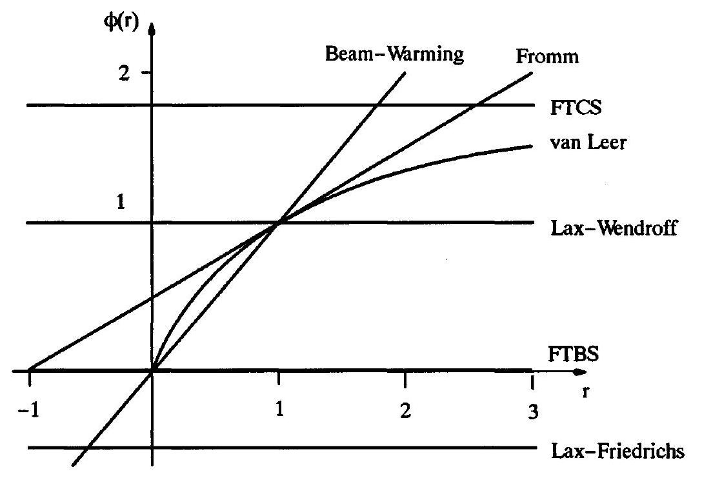
Figure 20.1 The relationships between Sweby's flux-limited method and common simple methods.

where as usual

$$
r_{i}^{+}=\frac{u_{i}^{n}-u_{i-1}^{n}}{u_{i+1}^{n}-u_{i}^{n}}
$$

For example, if $\eta_{i}^{n}=\left(\left|r_{i}^{+}\right|-1\right) /\left(\left|r_{i}^{+}\right|+1\right)$, as in Equation (20.13), then $\phi_{i}^{n}=2 r_{i}^{+} /\left(1+r_{i}^{+}\right)$ for $r_{i}^{+} \geq 0$ and $\phi_{i}^{n}=0$ for $r_{i}^{+}<0$.

Notice that Sweby's flux-limited method equals the Lax-Wendroff method when $\phi_{i}^{n}=1$, FTBS when $\phi_{i}^{n}=0$, FTCS when $\phi_{i}^{n}=1 /(1-\lambda a)$, the Lax-Friedrichs method when $\phi_{i}^{n}= -1 / \lambda a$, the Beam-Warming second-order upwind method when $\phi_{i}^{n}=r_{i}^{+}$, and Fromm's method when $\phi_{i}^{n}=\left(r_{i}^{+}+1\right) / 2$. The reader can certainly find other relationships between Sweby's flux-limited method and first-generation methods. Figure 20.1 illustrates the relationships between Sweby's flux-limited method and some popular first-generation methods.

If $0 \leq \phi_{i}^{n} \leq 1$, then $\hat{f}_{i+1 / 2}^{n}$ is a convex linear combination of $\hat{f}_{i+1 / 2}^{\text {FTBS }}$ and $\hat{f}_{i+1 / 2}^{\mathrm{L}-\mathrm{W}}$, in which case $\hat{f}_{i+1 / 2}^{n}$ lies between $\hat{f}_{i+1 / 2}^{\mathrm{FTBS}}$ and $\hat{f}_{i+1 / 2}^{\mathrm{L}-\mathrm{W}}$. As with Van Leer's flux-limited method, Sweby's flux-limited method may reasonably allow both convex and nonconvex linear combinations or, in other words, Sweby's flux-limited method may reasonably allow both flux interpolation and flux extrapolation.

As in the last section, the flux limiters in Sweby's flux-limited method are restricted by the upwind range condition. By Equation (16.16a), Sweby's flux-limited method obeys the upwind range condition with $0 \leq \lambda a \leq 1$ if and only if it can be written in wave speed split form

$$
u_{i}^{n+1}=u_{i}^{n}+C_{i+1 / 2}^{+}\left(u_{i+1}^{n}-u_{i}^{n}\right)-C_{i-1 / 2}^{-}\left(u_{i}^{n}-u_{i-1}^{n}\right)
$$

such that

$$
0 \leq C_{i+1 / 2}^{-} \leq 1, \quad C_{i+1 / 2}^{+}=0
$$

for all $i$. Subtract $u_{i}^{n}$ from Equation (20.15) and divide by $-\left(u_{i}^{n}-u_{i-1}^{n}\right)$ to find

$$
\begin{aligned}
& C_{i+1 / 2}^{+}=0 \\
& C_{i-1 / 2}^{-}=\lambda a+\frac{\lambda a}{2}(1-\lambda a)\left[\frac{\phi_{i}^{n}}{r_{i}^{+}}-\phi_{i-1}^{n}\right]
\end{aligned}
$$

Apply the upwind range condition $0 \leq C_{i-1 / 2}^{-} \leq 1$, subtract $\lambda a$, and divide by $\lambda a(1-\lambda a) / 2$ to find

$$
-\frac{2}{1-\lambda a} \leq \frac{\phi_{i}^{n}}{r_{i}^{+}}-\phi_{i-1}^{n} \leq \frac{2}{\lambda a}
$$

For $0 \leq \lambda a \leq 1$, a sufficient condition for Equation (20.17) is as follows:

$$
-2 \leq \frac{\phi_{i}^{n}}{r_{i}^{+}}-\phi_{i-1}^{n} \leq 2
$$

A sufficient condition for Equation (20.18) is as follows:

$$
\begin{aligned}
& 0 \leq \phi_{i}^{n}+K \leq 2 \\
& 0 \leq \frac{\phi_{i}^{n}}{r_{i}^{+}}+K \leq 2
\end{aligned}
$$

for all $i$ and for any constant $K$. Notice that condition (20.19) requires $\phi=0$ for $r_{i}^{+}=0$ regardless of $K$. Sweby's original paper only described the case $K=0$ (some years later, Roe (1989) suggested the more general condition (20.19)). We have now obtained a range of three nonlinear stability conditions for Sweby's flux-limited method - Equations (20.17), (20.18), and (20.19). Equation (20.17) is the most complicated but places the least restrictions on the flux limiter; Equation (20.19) is the least complicated but places the most restrictions on the flux limiter; while Equation (20.18) is somewhere in between. Unfortunately, in practice, Equations (20.17) and (20.18) are too complicated to deal with, and only Equation (20.19) is used. Incidentally, as the reader can show using Equation (20.16), Equations (20.19) and (20.12) are identical except for notation.

With $K=0$, condition (20.19) becomes

$$
\begin{aligned}
& 0 \leq \phi_{i}^{n} \leq 2 \\
& 0 \leq \frac{\phi_{i}^{n}}{r_{i}^{+}} \leq 2
\end{aligned}
$$

or, equivalently,

$$
\begin{array}{ll}
0 \leq \phi_{i}^{n} \leq \min \left(2,2 r_{i}^{+}\right) & r_{i}^{+}>0 \\
\phi_{i}^{n}=0 & r_{i}^{+} \leq 0
\end{array}
$$

These bounds are plotted in Figure 20.2. The union of the darkly and lightly shaded regions in Figure 20.2 indicate methods that satisfy condition (20.20); thus everything between the bold lines in Figure 20.2 satisfies condition (20.20). Also, the darkly shaded regions in Figure 20.2 indicate methods that satisfy condition (20.20) and that also lie between the Lax-Wendroff method and the Beam-Warming second-order upwind method and thus

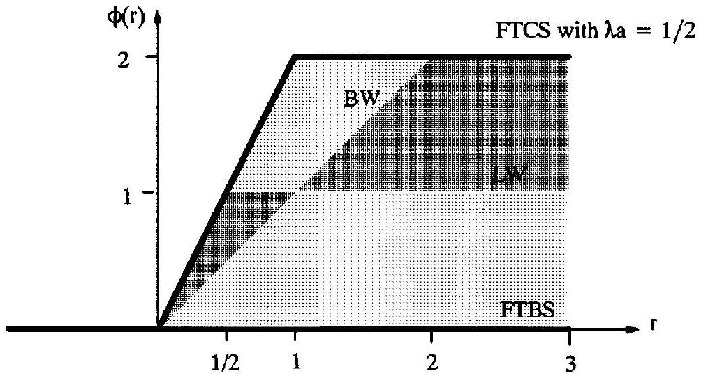
Figure 20.2 Flux limiters allowed by condition (20.20).

obtain second-order accuracy. Of course, flux limiters may stray slightly outside of the darkly shaded regions and still obtain second-order accuracy, provided that they remain close to the Lax-Wendroff or Beam-Warming methods. Notice that flux limiters allowed by Equation (20.20) may violate the convexity condition $0 \leq \phi_{i}^{n} \leq 1$. Also notice that Equation (20.20b) implies that $\hat{f}_{i+1 / 2}^{n}=\hat{f}_{i+1 / 2}^{\text {FTBS }}$ when $u_{i}^{n}$ is an extremum. Although FTBS is only first-order accurate, this does not imply that Sweby's flux-limited methods is firstorder accurate at extrema. As explained in the last section, Sweby's flux-limited method is between first-and second-order accurate at extrema, provided that the extrema are separated by at least one point. In other words, Sweby's flux-limited method suffers typical clipping errors at extrema.

Condition (20.20) only allows the flux limiter $\phi_{i}^{n}=0$ when $r_{i}^{+} \leq 0$. Fortunately, condition (20.20) allows considerably more flexibility when $r_{i}^{+}>0$. For example, condition (20.20) allows the Beam-Warming second-order upwind method for $0<r_{i}^{+} \leq 2$, Fromm's method for $1 / 4 \leq r_{i}^{+} \leq 3$, and the Lax-Wendroff method for $r_{i}^{+} \geq 1 / 2$. In fact, Sweby's fluxlimited method may use any of these three methods at shocks, or a range of other methods, provided that shocks remain monotone increasing or monotone decreasing and do not develop spurious extrema. Of course, the Beam-Warming second-order upwind method, Fromm's method, and the Lax-Wendroff method ordinarily produce oscillations at shocks, but Sweby's flux-limited method switches to FTBS or other methods as needed to prevent this.

One flux limiter allowed by condition (20.20) is the minmod flux limiter:

$$
\phi(r)=\min \bmod (1, b r),
$$

where $1 \leq b=$ const. $\leq 2$. The minimum modulus or minmod function returns the argument closest to zero if all of its arguments have the same sign, and it returns zero if any two of its arguments have different signs. Notice that

$$
\min \bmod (1, b r)= \begin{cases}1 & b r \geq 1, \\ b r & 0 \leq b r<1, \\ 0 & b r<0 .\end{cases}
$$

See Equation (9.19) for the general definition of minmod. A common variation on the minmod limiter is as follows:

$$
\phi(r)=\operatorname{minmod}(b, r)
$$

where again $1 \leq b=$ const. $\leq 2$. Unless specifically told otherwise, the reader should assume that $b=1$, in which case both variations on the minmod limiter are the same. When $b=1$, the minmod limiter represents the lower boundary of the darkly shaded region seen in Figure 20.2. Thus the minmod limiter switches between FTBS, the Beam-Warming secondorder upwind method, and the Lax-Wendroff method. Put yet another way, remembering that Sweby's flux-limited method was derived by averaging FTBS and the Lax-Wendroff method, the minmod limiter brings Sweby's flux-limited method as close as possible to FTBS and as far as possible from the Lax-Wendroff method while still ensuring secondorder accuracy and nonlinear stability according to condition (20.20).

Another flux limiter allowed by condition (20.20) is the superbee limiter:
$\phi(r)=\max (0, \min (2 r, 1), \min (r, 2))= \begin{cases}0 & r \leq 0, \\ 2 r & 0 \leq r \leq \frac{1}{2}, \\ 1 & \frac{1}{2} \leq r \leq 1, \\ r & 1 \leq r \leq 2, \\ 2 & r \geq 2,\end{cases}$
as described in Roe and Pike (1984) and Roe (1985). The superbee limiter represents the upper boundary of the darkly shaded region seen in Figure 20.2. The superbee limiter thus brings Sweby's flux-limited method as close as possible to the Lax-Wendroff method and as far as possible from FTBS while still ensuring second-order accuracy and nonlinear stability according to condition (20.20). In his original papers, Roe used the notation $B$ instead of $\phi$ for the flux limiter; then "super-B" or "superbee" refers to the fact that the flux limiter lies above all of the other possible flux limiters, in the same sense that a superscript lies above the main line of text.

A third possible flux limiter is the Van Leer limiter:

$$
\phi(r)= \begin{cases}\frac{2 r}{1+r} & r \geq 0, \\ 0 & r<0 .\end{cases}
$$

Using the Van Leer limiter, Sweby's flux-limited method equals Van Leer's flux-limited method seen in the last section. Unlike the minmod and superbee limiters, Van Leer's flux limiter is a completely smooth function of $r$ for $r \geq 0$.

With $K=1$, condition (20.19) becomes

$$
\begin{aligned}
& \left|\phi_{i}^{n}\right| \leq 1, \\
& \left|\frac{\phi_{i}^{n}}{r_{i}^{+}}\right| \leq 1
\end{aligned}
$$

or, equivalently,

$$
\begin{array}{ll}
\left|\phi_{i}^{n}\right| \leq 1 & \text { for }\left|r_{i}^{+}\right| \geq 1, \\
\left|\phi_{i}^{n}\right| \leq\left|r_{i}^{n}\right| & \text { for }\left|r_{i}^{+}\right|<1 .
\end{array}
$$

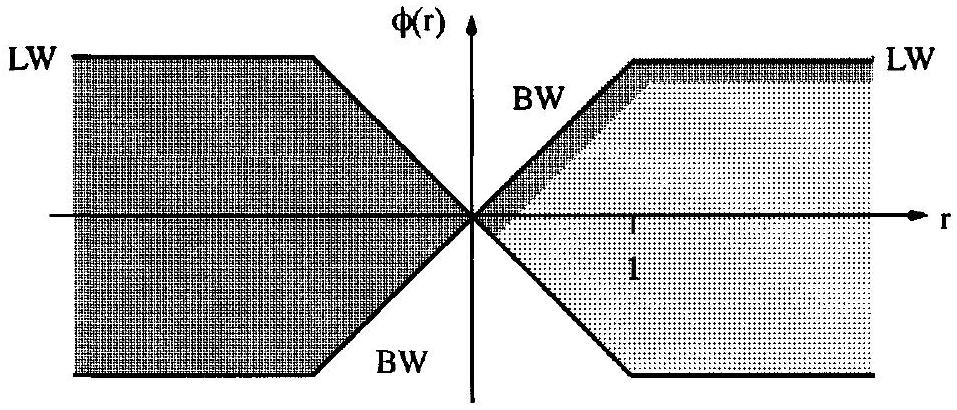
Figure 20.3 Flux limiters allowed by condition (20.25).

These bounds are plotted in Figure 20.3. The union of the darkly and lightly shaded regions in Figure 20.3 indicates methods that satisfy condition (20.25), while the darkly shaded regions indicate methods that lie close to or between the Lax-Wendroff or Beam-Warming methods and thus obtain second-order accuracy. Whereas the earlier condition given by Equation (20.20) allowed a wide range of stable second-order accurate methods for $r_{i}^{+} \geq 0$, the present condition given by Equation (20.25) allows second-order accurate methods only at the very edges of the stable region. On the positive side, whereas condition (20.20) allows only first-order accurate FTBS for $r_{i}^{+}<0$, condition (20.25) allows a broad range of methods for $r_{i}^{+}<0$, all of which are second-order accurate. Unfortunately, most of the flux limiters allowed by condition (20.20) switch abruptly between different methods at extrema, which reduces the order of accuracy at extrema. In fact, in practice, the flux limiters allowed by Equation (20.25) still experience clipping errors just as large as those allowed by Equation (20.20), with the order of accuracy at extrema clocking in at something between one and two. One flux limiter allowed by condition (20.25) is the symmetric minmod limiter:

$$
\phi(r)=\min (b|r|, 1)
$$

for $0<b \leq 1$. The symmetric minmod limiter is symmetric about the $\phi$ axis. Notice that the symmetric minmod limiter is the same as the minmod limiter given by Equation (20.21) for $r \geq 0$. If $b=1$ the symmetric minmod limiter represents the upper boundary of the shaded region seen in Figure 20.3. Thus the symmetric minmod limiter brings Sweby's flux-limited method as close as possible to the Lax-Wendroff method and as far as possible from FTBS while still ensuring second-order accuracy and nonlinear stability according to condition (20.25).

There are, of course, many other possible flux limiters besides the minmod, symmetric minmod, superbee, Van Leer, and the other flux limiters seen above. For a taste of just how complicated and sophisticated flux limiters can get, see, for example, Jeng and Payne (1995). For the most part, the flux limiters do not radically affect the solution of Sweby's flux-limited method - one is a little better here, another is a little better there, but on average all of the flux limiters are roughly in the same ballpark, provided that they stay anywhere near the nonlinear stability range allowed by condition (20.19). For steady-state solutions, continuously differentiable flux limiters usually enhance the rate of convergence to steady state, which eliminates all of the flux limiters seen in this section except possibly for Van Leer's flux limiter. One response is to form smoothed versions of the flux limiters in this section by, for example, fitting polynomials to the flux limiter. However, even then, the flux
limiters developed here may not work as well as other flux limiters specifically tailored for steady flows.

### 20.2.2 The Linear Advection Equation with $a<0$

So far, the methods in this chapter have concerned the linear advection equation with $a>0$. Now consider the linear advection equation with $a<0$. FTFS for the linear advection equation is

$$
\begin{aligned}
& u_{i}^{n+1}=u_{i}^{n}-\lambda\left(\hat{f}_{i+1 / 2}^{\mathrm{FTFS}}-\hat{f}_{i-1 / 2}^{\mathrm{FTFS}}\right) \\
& \hat{f}_{i+1 / 2}^{\mathrm{FTFS}}=a u_{i+1}^{n} .
\end{aligned}
$$

The Lax-Wendroff method for the linear advection equation is

$$
\begin{aligned}
& u_{i}^{n+1}=u_{i}^{n}-\lambda\left(\hat{f}_{i+1 / 2}^{\mathrm{L}-\mathrm{W}}-\hat{f}_{i-1 / 2}^{\mathrm{L}-\mathrm{W}}\right), \\
& \hat{f}_{i+1 / 2}^{\mathrm{L}-\mathrm{W}}=a u_{i+1}^{n}-\frac{1}{2} a(1+\lambda a)\left(u_{i+1}^{n}-u_{i}^{n}\right) .
\end{aligned}
$$

Then Sweby's flux-limited method for the linear advection equation with $a<0$ is

$$
u_{i}^{n+1}=u_{i}^{n}-\lambda\left(\hat{f}_{i+1 / 2}^{n}-\hat{f}_{i-1 / 2}^{n}\right),
$$

where

$$
\hat{f}_{i+1 / 2}^{n}=\hat{f}_{i+1 / 2}^{\mathrm{FTFS}}+\phi_{i+1}^{n}\left(\hat{f}_{i+1 / 2}^{\mathrm{L}-\mathrm{W}}-\hat{f}_{i+1 / 2}^{\mathrm{FTFS}}\right)
$$

or

$$
\hat{f}_{i+1 / 2}^{n}=a u_{i+1}^{n}-\frac{1}{2} a(1+\lambda a) \phi_{i+1}^{n}\left(u_{i+1}^{n}-u_{i}^{n}\right) .
$$

Equivalently,

$$
u_{i}^{n+1}=u_{i}^{n}-\lambda a\left(u_{i+1}^{n}-u_{i}^{n}\right)-\frac{\lambda a}{2}(1+\lambda a)\left[\phi_{i+1}^{n}\left(u_{i+1}^{n}-u_{i}^{n}\right)-\phi_{i}^{n}\left(u_{i}^{n}-u_{i-1}^{n}\right)\right] .
$$

Notice that Sweby's flux-limited method equals the Lax-Wendroff method when $\phi_{i+1}^{n}=1$, FTFS when $\phi_{i+1}^{n}=0$, FTCS when $\phi_{i+1}^{n}=1 /(1+\lambda a)$, the Lax-Friedrichs method when $\phi_{i+1}^{n}=1 / \lambda a$, the Beam-Warming second-order upwind method when $\phi_{i+1}^{n}=r_{i+1}^{-}$, and Fromm's method when $\phi_{i+1}^{n}=\left(r_{i+1}^{-}+1\right) / 2$, where

$$
r_{i+1}^{-}=\frac{u_{i+2}^{n}-u_{i+1}^{n}}{u_{i+1}^{n}-u_{i}^{n}}
$$

Notice that Sweby's flux-limited method still has all of the same relationships to firstgeneration methods as in the last subsection, after swapping $r^{+}$for $r^{-}$.

Following the same approach as in the last subsection, we find that Sweby's flux-limited method obeys the upwind range condition for $-1 \leq \lambda a \leq 0$ if

$$
\begin{aligned}
& 0 \leq \phi_{i}^{n}+K \leq 2, \\
& 0 \leq \frac{\phi_{i}^{n}}{r_{i}^{-}}+K \leq 2
\end{aligned}
$$

for all $i$ and for any constant $K$, which is essentially the same as Equation (20.19). The nonlinear stability conditions found in this subsection are thus identical to those found in the last subsection, after replacing $r^{+}$by $r^{-}$. In fact, this subsection used $r^{-}$instead of $r^{+}$ specifically so that the nonlinear stability analysis would yield the same results. Then the same flux limiters apply; see Equations (20.21)-(20.24) and (20.26).

### 20.2.3 Nonlinear Scalar Conservation Laws with $\boldsymbol{a}(\boldsymbol{u})>\mathbf{0}$

So far this chapter has concerned only the linear advection equation. This subsection concerns nonlinear scalar conservation laws with $a(u)>0$. FTBS is

$$
\begin{aligned}
& u_{i}^{n+1}=u_{i}^{n}-\lambda\left(\hat{f}_{i+1 / 2}^{\mathrm{FTBS}}-\hat{f}_{i-1 / 2}^{\mathrm{FTBS}}\right), \\
& \hat{f}_{i+1 / 2}^{\mathrm{FBS}}=f\left(u_{i}^{n}\right),
\end{aligned}
$$

and the Lax-Wendroff method is

$$
\begin{aligned}
& u_{i}^{n+1}=u_{i}^{n}-\lambda\left(\hat{f}_{i+1 / 2}^{\mathrm{L}-\mathrm{W}}-\hat{f}_{i-1 / 2}^{\mathrm{L}-\mathrm{W}}\right) \\
& \hat{f}_{i+1 / 2}^{\mathrm{L}-\mathrm{W}}=f\left(u_{i}^{n}\right)+\frac{1}{2} a_{i+1 / 2}^{n}\left(1-\lambda a_{i+1 / 2}^{n}\right)\left(u_{i+1}^{n}-u_{i}^{n}\right)
\end{aligned}
$$

where as usual

$$
a_{i+1 / 2}^{n}= \begin{cases}\frac{f\left(u_{i+1}^{n}\right)-f\left(u_{i}^{n}\right)}{u_{i+1}^{n}-u_{i}^{n}} & u_{i+1}^{n} \neq u_{i}^{n} \\ f^{\prime}\left(u_{i}^{n}\right) & u_{i+1}^{n}=u_{i}^{n}\end{cases}
$$

Assuming that $\phi_{i}^{n}=\phi\left(r_{i}^{+}\right)$, Sweby's flux-limited method for $a(u)>0$ is

$$
u_{i}^{n+1}=u_{i}^{n}-\lambda\left(\hat{f}_{i+1 / 2}^{n}-\hat{f}_{i-1 / 2}^{n}\right)
$$

where

$$
\hat{f}_{i+1 / 2}^{n}=\hat{f}_{i+1 / 2}^{\mathrm{FTBS}}+\phi\left(r_{i}^{+}\right)\left(\hat{f}_{i+1 / 2}^{\mathrm{L}-\mathrm{W}}-\hat{f}_{i+1 / 2}^{\mathrm{FTBS}}\right)
$$

or

$$
\hat{f}_{i+1 / 2}^{n}=f\left(u_{i}^{n}\right)+\frac{1}{2} a_{i+1 / 2}^{n}\left(1-\lambda a_{i+1 / 2}^{n}\right) \phi\left(r_{i}^{+}\right)\left(u_{i+1}^{n}-u_{i}^{n}\right)
$$

and where

$$
r_{i}^{+}=\frac{\hat{f}_{i-1 / 2}^{\mathrm{L}-\mathrm{W}}-\hat{f}_{i-1 / 2}^{\mathrm{FTBS}}}{\hat{f}_{i+1 / 2}^{\mathrm{L}-\mathrm{W}}-\hat{f}_{i+1 / 2}^{\mathrm{FTBS}}}
$$

or, equivalently,

$$
r_{i}^{+}=\frac{a_{i-1 / 2}^{n}\left(1-\lambda a_{i-1 / 2}^{n}\right)\left(u_{i}^{n}-u_{i-1}^{n}\right)}{a_{i+1 / 2}^{n}\left(1-\lambda a_{i+1 / 2}^{n}\right)\left(u_{i+1}^{n}-u_{i}^{n}\right)}
$$

For the linear advection equation, definitions (20.5) and (20.32) are exactly the same as definition (20.3). Definition (20.5) and the equivalent definition (20.32) preserve most of the connections between Sweby's flux-limited method and the first-generation numerical methods, as seen in earlier subsections. Specifically, Sweby's flux-limited method equals the Lax-Wendroff method when $\phi\left(r_{i}^{+}\right)=1$, FTBS when $\phi\left(r_{i}^{+}\right)=0$, the Beam-Warming
second-order upwind method when $\phi\left(r_{i}^{+}\right)=r_{i}^{+}$, and Fromm's method when $\phi\left(r_{i}^{+}\right)= \left(r_{i}^{+}+1\right) / 2$. Most importantly, definitions (20.5) and (20.32) preserve the nonlinear stability conditions found in Subsection 20.2.1. In particular, the minmod, superbee, Van Leer, and symmetric minmod flux limiters still ensure the upwind range condition. To prove this, notice that the upwind range condition seen in Equation (16.16a) or Equation (16.17a) implies

$$
0 \leq \lambda a_{i+1 / 2}^{n}+\frac{\lambda a_{i+1 / 2}^{n}}{2}\left(1-\lambda a_{i+1 / 2}^{n}\right)\left[\frac{\phi\left(r_{i}^{+}\right)}{r_{i}^{+}}-\phi\left(r_{i-1}^{+}\right)\right] \leq 1 .
$$

Subtract $\lambda a_{i+1 / 2}^{n}$ and divide by $\lambda a_{i+1 / 2}^{n}\left(1-\lambda a_{i+1 / 2}^{n}\right) / 2$ to find

$$
-\frac{2}{1-\lambda a_{i+1 / 2}^{n}} \leq \frac{\phi\left(r_{i}^{+}\right)}{r_{i}^{+}}-\phi\left(r_{i-1}^{+}\right) \leq \frac{2}{\lambda a_{i+1 / 2}^{n}} .
$$

For $0 \leq \lambda a_{i+1 / 2}^{n} \leq 1$, a sufficient condition for Equation (20.33) is as follows:

$$
-2 \leq \frac{\phi\left(r_{i}^{+}\right)}{r_{i}^{+}}-\phi\left(r_{i-1}^{+}\right) \leq 2,
$$

which is exactly the same as condition (20.18) found in Subsection 20.2.1. Then the rest of the analysis seen in Subsection 20.2.1 applies again here. Then, just as before, the minmod, superbee, Van Leer, and symmetric minmod limiters ensure the upwind range condition; see Equations (20.21)-(20.24) and (20.26).

From Equation (20.31), notice that Sweby's flux-limited method uses a limited antidissipative flux, as defined in the chapter introduction. In other words, $\epsilon_{i+1 / 2}^{\text {FTBS }} \geq \epsilon_{i+1 / 2}^{\mathrm{L}-\mathrm{W}}$ or, equivalently, $a_{i+1 / 2}\left(1-\lambda a_{i+1 / 2}^{n}\right) \geq 0$ for $0 \leq \lambda a_{i+1 / 2} \leq 1$. Then $r_{i}^{ \pm} \leq 0$ at extrema, just as in the preceding subsections. Among other things, this implies that Sweby's flux-limited method for nonlinear scalar conservation laws has between first- and second-order accuracy at extrema, due to clipping, just as in the preceding subsections.

### 20.2.4 Nonlinear Scalar Conservation Laws with $\boldsymbol{a}(\boldsymbol{u})<\mathbf{0}$

This subsection concerns nonlinear scalar conservation laws with $a(u)<0$. FTFS is

$$
\begin{aligned}
& u_{i}^{n+1}=u_{i}^{n}-\lambda\left(\hat{f}_{i+1 / 2}^{\mathrm{FTFS}}-\hat{f}_{i-1 / 2}^{\mathrm{FTFS}}\right), \\
& \hat{f}_{i+1 / 2}^{\mathrm{FTFS}}=f\left(u_{i+1}^{n}\right),
\end{aligned}
$$

and the Lax-Wendroff method is

$$
\begin{aligned}
& u_{i}^{n+1}=u_{i}^{n}-\lambda\left(\hat{f}_{i+1 / 2}^{\mathrm{L}-\mathrm{W}}-\hat{f}_{i-1 / 2}^{\mathrm{L}-\mathrm{W}}\right), \\
& \hat{f}_{i+1 / 2}^{\mathrm{L}-\mathrm{W}}=f\left(u_{i+1}^{n}\right)-\frac{1}{2} a_{i+1 / 2}^{n}\left(1+\lambda a_{i+1 / 2}^{n}\right)\left(u_{i+1}^{n}-u_{i}^{n}\right) .
\end{aligned}
$$

Assuming $\phi_{i+1}^{n}=\phi\left(r_{i+1}^{-}\right)$, Sweby's flux-limited method for $a(u)<0$ is

$$
u_{i}^{n+1}=u_{i}^{n}-\lambda\left(\hat{f}_{i+1 / 2}^{n}-\hat{f}_{i-1 / 2}^{n}\right),
$$

where

$$
\hat{f}_{i+1 / 2}^{n}=\hat{f}_{i+1 / 2}^{\mathrm{FTFS}}+\phi\left(r_{i+1}^{-}\right)\left(\hat{f}_{i+1 / 2}^{\mathrm{L}-\mathrm{W}}-\hat{f}_{i+1 / 2}^{\mathrm{FTFS}}\right)
$$

or

$$
\hat{f}_{i+1 / 2}^{n}=f\left(u_{i+1}^{n}\right)-\frac{1}{2} a_{i+1 / 2}^{n}\left(1+\lambda a_{i+1 / 2}^{n}\right) \phi\left(r_{i+1}^{-}\right)\left(u_{i+1}^{n}-u_{i}^{n}\right)
$$

and where

$$
r_{i+1}^{-}=\frac{\hat{f}_{i+3 / 2}^{\mathrm{L}-\mathrm{W}}-\hat{f}_{i+3 / 2}^{\mathrm{FTFS}}}{\hat{f}_{i+1 / 2}^{\mathrm{L}-\mathrm{W}}-\hat{f}_{i+1 / 2}^{\mathrm{FFFS}}}
$$

or, equivalently

$$
r_{i+1}^{-}=\frac{a_{i+3 / 2}^{n}\left(1+\lambda a_{i+3 / 2}^{n}\right)\left(u_{i+2}^{n}-u_{i+1}^{n}\right)}{a_{i+1 / 2}^{n}\left(1+\lambda a_{i+1 / 2}^{n}\right)\left(u_{i+1}^{n}-u_{i}^{n}\right)}
$$

For the linear advection equation, definitions (20.6) and (20.37) are exactly the same as definition (20.4). Definitions (20.6) and (20.37) preserve most of the connections between Sweby's flux-limited method and other numerical methods, as seen in earlier subsections. Specifically, Sweby's flux-limited method equals the Lax-Wendroff method when $\phi\left(r_{i+1}^{-}\right)=1$, FTFS when $\phi\left(r_{i+1}^{-}\right)=0$, the Beam-Warming second-order upwind method when $\phi\left(r_{i+1}^{-}\right)=r_{i+1}^{-}$, and Fromm's method when $\phi\left(r_{i+1}^{-}\right)=\left(r_{i+1}^{-}+1 / 2\right)$. Most importantly, definitions (20.6) and (20.37) preserve the nonlinear stability conditions found in Subsection 20.2.2. In particular, the minmod, superbee, Van Leer, and symmetric minmod limiters still ensure the upwind range condition; see Equations (20.21)-(20.24) and (20.26). The proof is left as an exercise for the reader.

### 20.2.5 Nonlinear Scalar Conservation Laws at Sonic Points

To obtain a method that works regardless of the sign of of the wave speed, Sweby used wave speed splitting. However, instead of splitting the physical wave speed, as in Section 13.5, Sweby split the numerical wave speed. See, in particular, Example 13.11 for a brief introduction to wave speed splitting. As usual, define the average numerical wave speed $a_{i+1 / 2}^{n}$ as follows:

$$
a_{i+1 / 2}^{n}= \begin{cases}\frac{f\left(u_{i+1}^{n}\right)-f\left(u_{i}^{n}\right)}{u_{i+1}^{n}-u_{i}^{n}} & u_{i+1}^{n} \neq u_{i}^{n}, \\ f^{\prime}\left(u_{i}^{n}\right) & u_{i+1}^{n}=u_{i}^{n} .\end{cases}
$$

This average numerical wave speed can be split as follows:

$$
a_{i+1 / 2}^{n}=a_{i+1 / 2}^{+}+a_{i+1 / 2}^{-}
$$

where

$$
a_{i+1 / 2}^{+} \geq 0, \quad a_{i+1 / 2}^{-} \leq 0 .
$$

For example, one possible wave speed splitting is

$$
a_{i+1 / 2}^{+}=\max \left(0, a_{i+1 / 2}^{n}\right), \quad a_{i+1 / 2}^{-}=\min \left(0, a_{i+1 / 2}^{n}\right)
$$

However, this allows expansion shocks at expansive sonic points, as proven later in this subsection. So instead consider

$$
a_{i+1 / 2}^{+}=\frac{f\left(u_{i+1}^{n}\right)-\hat{f}_{i+1 / 2}^{(1)}}{u_{i+1}^{n}-u_{i}^{n}}, \quad a_{i+1 / 2}^{-}=\frac{\hat{f}_{i+1 / 2}^{(1)}-f\left(u_{i}^{n}\right)}{u_{i+1}^{n}-u_{i}^{n}},
$$

where $\hat{f}_{i+1 / 2}^{(1)}$ is the conservative numerical flux of any first-order upwind method seen in Section 17.3. Notice that Equation (20.41) equals Equation (20.40) if $\hat{f}_{i+1 / 2}^{(1)}=\hat{f}_{i+1 / 2}^{R O E}$. In fact, Roe's first-upwind method, Godunov's first-order upwind method, Harten's first-order upwind method, and all of the other first-order upwind methods seen in Section 17.3 differ only at sonic points. Then Equation (20.41) deviates from Equation (20.40) only at sonic points.

Recall the standard artificial viscosity form:

$$
\hat{f}_{i+1 / 2}^{(1)}=\frac{1}{2}\left(f\left(u_{i+1}^{n}\right)+f\left(u_{i}^{n}\right)\right)-\frac{1}{2} \epsilon_{i+1 / 2}^{(1)}\left(u_{i+1}^{n}-u_{i}^{n}\right) .
$$

Then Equation (20.41) can be written in terms of artificial viscosity as follows:

$$
a_{i+1 / 2}^{+}=\frac{1}{2}\left(a_{i+1 / 2}^{n}+\epsilon_{i+1 / 2}^{(1)}\right), \quad a_{i+1 / 2}^{-}=\frac{1}{2}\left(a_{i+1 / 2}^{n}-\epsilon_{i+1 / 2}^{(1)}\right) .
$$

Then the wave speed splitting condition (20.39) is equivalent to

$$
\epsilon_{i+1 / 2}^{(1)} \geq \epsilon_{i+1 / 2}^{\mathrm{ROE}}=\left|a_{i+1 / 2}^{n}\right|
$$

Such methods were discussed earlier, in Example 16.6.
For any numerical wave speed splitting seen above, Sweby's flux-limited method is

$$
u_{i}^{n+1}=u_{i}^{n}-\lambda\left(\hat{f}_{i+1 / 2}^{n}-\hat{f}_{i-1 / 2}^{n}\right),
$$

where

$$
\begin{aligned}
\hat{f}_{i+1 / 2}^{n}= & \hat{f}_{i+1 / 2}^{(1)}+\frac{1}{2}\left[a_{i+1 / 2}^{+}\left(1-\lambda a_{i+1 / 2}^{+}\right) \phi\left(r_{i}^{+}\right)\right. \\
& \left.-a_{i+1 / 2}^{-}\left(1+\lambda a_{i+1 / 2}^{-}\right) \phi\left(r_{i+1}^{-}\right)\right]\left(u_{i+1}^{n}-u_{i}^{n}\right)
\end{aligned}
$$

and where

$$
\begin{aligned}
\quad r_{i}^{+} & =\frac{a_{i-1 / 2}^{+}\left(1-\lambda a_{i-1 / 2}^{+}\right)\left(u_{i}^{n}-u_{i-1}^{n}\right)}{a_{i+1 / 2}^{+}\left(1-\lambda a_{i+1 / 2}^{+}\right)\left(u_{i+1}^{n}-u_{i}^{n}\right)} \\
\quad r_{i}^{-} & =\frac{a_{i+1 / 2}^{-}\left(1+\lambda a_{i+1 / 2}^{-}\right)\left(u_{i+1}^{n}-u_{i}^{n}\right)}{a_{i-1 / 2}^{-}\left(1+\lambda a_{i-1 / 2}^{-}\right)\left(u_{i}^{n}-u_{i-1}^{n}\right)}
\end{aligned}
$$

In the preceding expressions, notice that either the positive or negative parts drop out, except possibly at sonic points, making the method exactly the same as in the previous two subsections. Then the nonlinear stability analysis from previous subsections carries over to this subsection, except possibly at sonic points. In other words, flux limiters such as minmod and superbee ensure the upwind range condition, except possibly at sonic points; see Equations (20.21)-(20.24) and (20.26).

To help understand the effects of the numerical wave speed splitting on sonic points consider, for example, the case $\phi(r)=1$. When $\phi(r)=1$, Equation (20.44) can be rewritten as

$$
\hat{f}_{i+1 / 2}^{n}=\hat{f}_{i+1 / 2}^{\mathrm{L}-\mathrm{W}}+\lambda a_{i+1 / 2}^{+} a_{i+1 / 2}^{-}\left(u_{i+1}^{n}-u_{i}^{n}\right)
$$

or

$$
\hat{f}_{i+1 / 2}^{n}=\hat{f}_{i+1 / 2}^{\mathrm{L}-\mathrm{W}}-\frac{\lambda}{2} \epsilon_{i+1 / 2}^{n}\left(u_{i+1}^{n}-u_{i}^{n}\right),
$$

where

$$
\epsilon_{i+1 / 2}^{n}=-2 a_{i+1 / 2}^{+} a_{i+1 / 2}^{-}
$$

Thus, when $\phi(r)=1$, Sweby's flux-limited method equals the Lax-Wendroff method plus se-cond-order artificial viscosity. The coefficient of artificial viscosity $\epsilon_{i+1 / 2}^{n}=-2 a_{i+1 / 2}^{+} a_{i+1 / 2}^{-}$ is zero except possibly at sonic points, and thus Sweby's flux-limited method equals the Lax-Wendroff method when $\phi(r)=1$, except possibly at sonic points. At sonic points, the artificial viscosity is dissipative (i.e., it has a coefficient greater than zero) and thus the artificial viscosity tends to have a stabilizing effect. Recall that the Lax-Wendroff method has insufficient artificial viscosity at expansive sonic points - it allows large $O(1)$ expansion shocks as discussed in Section 17.2 - so that the additional artificial viscosity at sonic points is welcome. However, if $a_{i+1 / 2}^{ \pm}$are defined by Equation (20.40), then $a_{i+1 / 2}^{+} a_{i+1 / 2}^{-}=0$ everywhere, including sonic points, and the artificial viscosity at the sonic points drops out, which is not so good.

The behavior of Sweby's flux-limited method with the minmod flux limiter is illustrated using the five standard test cases defined in Section 17.0.

Test Case 1 As seen in Figure 20.4, the sinusoid is well captured, although clipping has eroded the peaks by some $25 \%$. On this test case, Sweby's flux-limited method is far better than a first-order accurate method such as FTBS but worse than a uniformly second-order accurate method such as the Lax-Wendroff method.

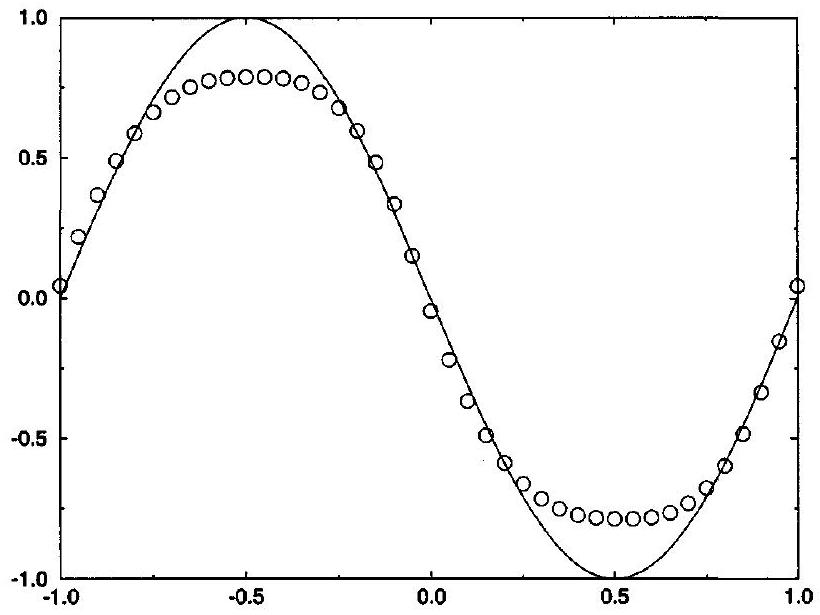
Figure 20.4 Sweby's flux-limited method with the minmod flux limiter for Test Case 1.

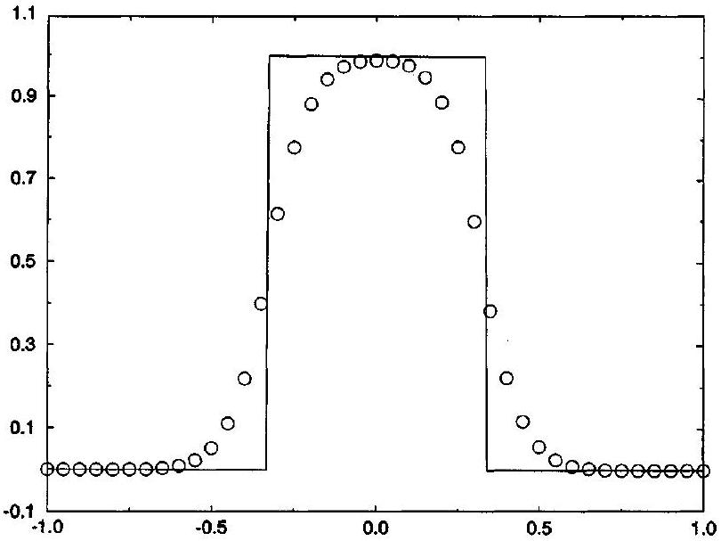
Figure 20.5 Sweby's flux-limited method with the minmod flux limiter for Test Case 2.

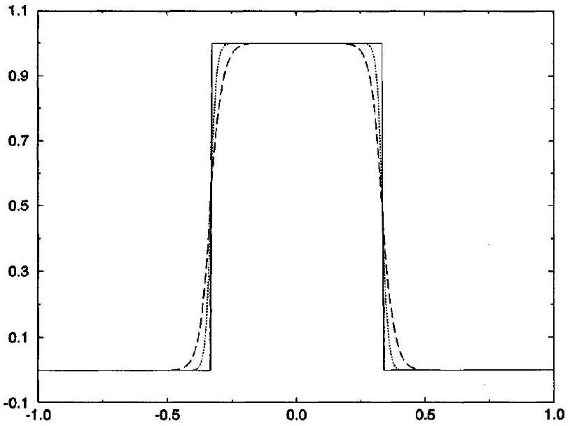
Figure 20.6 Sweby's flux-limited method with the minmod flux limiter for Test Case 3.

Test Case 2 As seen in Figure 20.5, Sweby's flux-limited method captures the square wave without spurious oscillations and overshoots, and without excessive dissipation. On this test case Sweby's flux-limited method is far better than any of the first-generation methods seen in Chapter 17. As the reader will recall, first-order accurate methods such as FTBS capture the square wave without spurious oscillations and overshoots, but with far more smearing and dissipation; in contrast, second-order accurate methods such as the Lax-Wendroff or the Beam-Warming second-order upwind method have large oscillations and overshoots, albeit with less smearing and dissipation.

Test Case 3 In Figure 20.6, the dotted line represents Sweby's flux-limited approximation to $u(x, 4)$, the long dashed line represents Sweby's flux-limited approximation to $u(x, 40)$, and the solid line represents the exact solution for $u(x, 4)$ or $u(x, 40)$. Again, these results are better than anything seen previously.

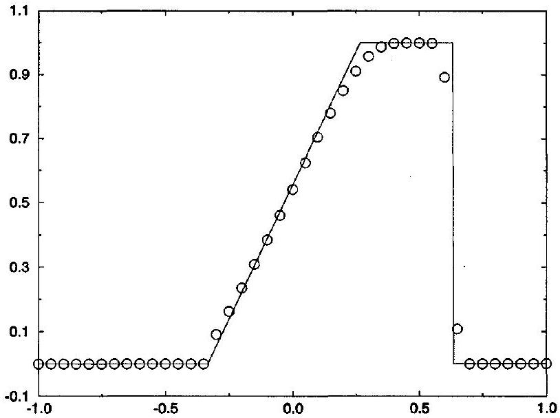
Figure 20.7 Sweby's flux-limited method with the minmod flux limiter for Test Case 4.

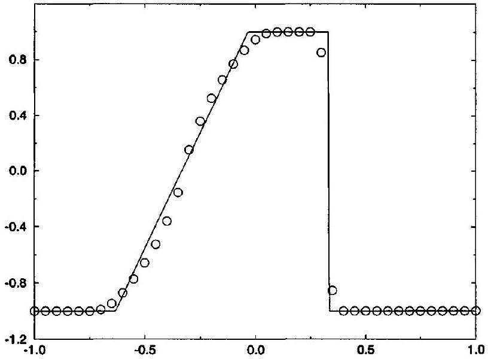
Figure 20.8 Sweby's flux-limited method with the minmod flux limiter for Test Case 5.

Test Case 4 As seen in Figure 20.7, Sweby's flux-limited method captures the shock extremely well, with only two transition points. The expansion fan is also well captured with only a slight rounding-off of the right-hand corner.

Test Case 5 If Sweby's flux-limited method uses Roe's first-order upwind method, it will fail to alter the initial conditions in any way, just like Roe's first-order upwind method. So instead use Harten's first-order upwind method as discussed in Subsection 17.3.3 with $\delta=0.4$. As seen in Figure 20.8, Sweby's flux-limited method captures the shock with only two transition points, and it captures the expansion fan with only a small jump near the sonic point (which could be eliminated by increasing $\delta$ ) and some slight rounding of the corners.

To get a sense of the effects of the flux limiter, let us rerun Test Cases 1 through 5 using the Van Leer and superbee flux limiters in place of the minmod flux limiter. Remember

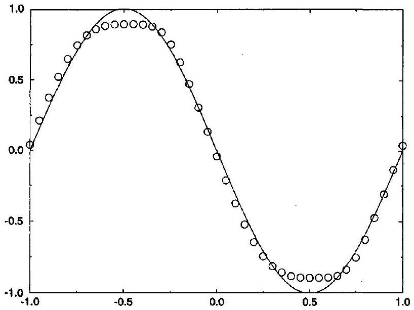
Figure 20.9 Sweby's flux-limited method with the Van Leer flux limiter for Test Case 1.

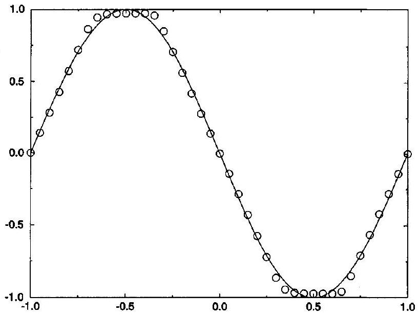
Figure 20.10 Sweby's flux-limited method with the superbee flux limiter for Test Case 1.

that the minmod flux limiter is the smallest flux limiter allowed by condition (20.20), the superbee flux limiter is the greatest flux limiter allowed by condition (20.20), and the Van Leer limiter is somewhere in between. For Test Case 1, comparing Figures 20.4, 20.9, and 20.10, we see that the flux limiter mainly affects the size and flatness of the sinusoidal peaks - the minmod flux limiter gives the lowest and roundest peaks, the superbee limiter gives the largest and flattest peaks, and the Van Leer flux limiter is somewhere in between. For Test Case 2 Figures 20.5, 20.11, and 20.12 indicate that the flux limiter mainly affects the contact smearing - the minmod limiter gives the most smearing, the superbee limiter gives the least smearing (only four transition points), and the Van Leer limiter is somewhere in between. Although not shown, the results for Test Case 3 are similar to those of Test Case 2. Although again not shown, the flux limiter has little effect on Test Cases 4 and 5; about the only difference between the superbee flux limiter and the minmod flux limiter is a very slight improvement in the rounding in the corners of the expansion fan.

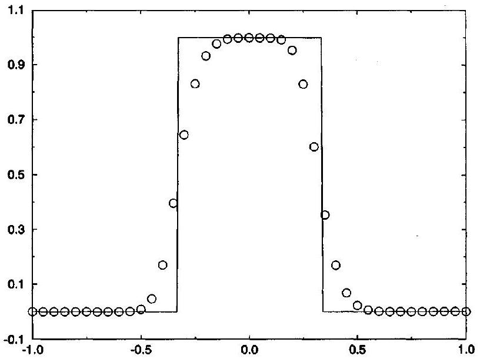
Figure 20.11 Sweby's flux-limited method with the Van Leer flux limiter for Test Case 2.

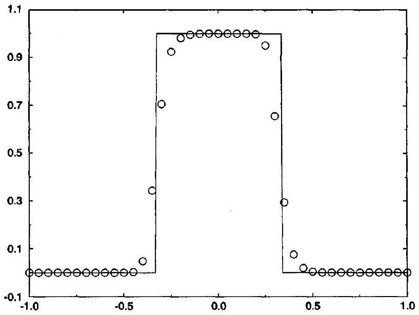
Figure 20.12 Sweby's flux-limited method with the superbee flux limiter for Test Case 2.

The standard test cases seem to favor the superbee flux limiter. However, do not be misled. In many cases, the superbee limiter tends to increase solution slopes. In fact, Roe (1985) says that "superbee was devised empirically whilst following up a suggestion by Woodward and Colella [see Section 23.2] concerning a rather elaborate discontinuity-sharpening algorithm. I was trying to implant their idea in my own method to give it a simpler expression." Because of this steepening effect, the superbee limiter performs well on discontinuous solutions but often performs poorly on smooth solutions, sometimes even turning smooth solutions into a series of steps. Thus, to avoid both the overdissipation caused by minmod and oversteepening caused by superbee, an intermediate flux limiter such as the Van Leer flux limiter is one of the better options. This conclusion is somewhat surprising, given that the Van Leer flux limiter predates all of the other flux limiters seen in this section by some ten years.

People sometimes worry too much about the flux limiter. As the above tests show, even the worst flux limiter is often pretty good, and you can hardly go too wrong with something in between the extremes, such as Van Leer's flux limiter.

### 20.2.6 The Euler Equations

Roe $(1982,1986)$ suggested the following version of Sweby's flux-limited method for the Euler equations, based on Roe's first-order upwind method for the Euler equations, as seen in Subsection 18.3.2:

$$
\mathbf{u}_{i}^{n+1}=\mathbf{u}_{i}^{n}-\lambda\left(\hat{\mathbf{f}}_{i+1 / 2}^{n}-\hat{\mathbf{f}}_{i-1 / 2}^{n}\right),
$$

where

$$
\begin{aligned}
\hat{\mathbf{f}}_{i+1 / 2}^{n}= & \hat{\mathbf{f}}_{i+1 / 2}^{(1)}+\frac{1}{2} \sum_{j=1}^{3}\left(\mathbf{r}_{i+1 / 2}^{n}\right)_{j}\left(\lambda_{i+1 / 2}^{+}\right)_{j}\left[1-\frac{\Delta t}{\Delta x}\left(\lambda_{i+1 / 2}^{+}\right)_{j}\right] \phi\left(r_{i}^{+}\right)_{j}\left(\Delta v_{i+1 / 2}^{n}\right)_{j} \\
& -\frac{1}{2} \sum_{j=1}^{3}\left(\mathbf{r}_{i+1 / 2}^{n}\right)_{j}\left(\lambda_{i+1 / 2}^{-}\right)_{j}\left[1+\frac{\Delta t}{\Delta x}\left(\lambda_{i+1 / 2}^{-}\right)_{j}\right] \phi\left(r_{i+1}^{-}\right)_{j}\left(\Delta v_{i+1 / 2}^{n}\right)_{j}
\end{aligned}
$$

and where $\hat{\mathbf{f}}_{i+1 / 2}^{(1)}$ is the conservative numerical flux of any of the first-order upwind methods seen in Section 18.3, $\phi$ is any flux limiter seen in previous subsections, and

$$
\begin{aligned}
\left(r_{i}^{+}\right)_{j} & =\frac{\left(\Delta v_{i-1 / 2}^{n}\right)_{j}}{\left(\Delta v_{i+1 / 2}^{n}\right)_{j}} \\
\left(r_{i}^{-}\right)_{j} & =\frac{\left(\Delta v_{i+1 / 2}^{n}\right)_{j}}{\left(\Delta v_{i-1 / 2}^{n}\right)_{j}}
\end{aligned}
$$

More complicated definitions for $\left(r_{i}^{ \pm}\right)_{j}$ may also be used much as in previous subsections. See the description of Roe's approximate Riemann solver in Section 5.3 and Roe's firstorder upwind method in Subsection 18.3.2 for the full details on $\left(\lambda_{i+1 / 2}^{ \pm}\right)_{j},\left(\mathbf{r}_{i+1 / 2}^{n}\right)_{j}$, and $\left(\Delta v_{i+1 / 2}^{n}\right)_{j}$. Do not confuse the right characteristic vectors $\left(\mathbf{r}_{i+1 / 2}^{n}\right)_{j}$ with the ratios $\left(r_{i}^{ \pm}\right)_{j}$. Also, do not confuse the characteristic values $\left(\lambda_{i+1 / 2}^{ \pm}\right)_{j}$ with $\lambda=\Delta t / \Delta x$. For an intuitive introduction to the ideas used here, the reader may wish to review Subsection 18.3.5. The basic idea, more or less, is to replace the characteristic values appearing in Roe's first-order upwind method, while leaving the characteristic vectors alone.

### 20.3 Chakravarthy-Osher Flux-Limited Methods (TVD)

This section concerns a series of semidiscrete flux-limited methods developed by Osher and Chakravarthy. To prepare for this section, the reader may wish to briefly review the method of lines, introduced in Subsection 11.2.1. In the method of lines, space is discretized to obtain a semidiscrete approximation, and then time is discretized to obtain a fully discrete approximation. This section deals only with the first step - spatial discretization - and does not consider time discretization. In the original series of papers, Chakravarthy and Osher suggested several different time discretizations, but they never firmly committed themselves.

Certainly, the original papers focus heavily on semidiscrete approximations, as opposed to any specific fully discrete scheme, and thus this section does the same.

Although not in "ready to use" form, semidiscrete approximations are interesting for several reasons. Most importantly, semidiscrete approximations lead to modular approximations wherein the same semidiscrete approximation can be paired with numerous different time discretizations, leading to a range of fully discrete approximations. Then, with semidiscrete approximations, the user has a great deal of flexibility and control over the performance and properties of the final fully discrete method. For example, one-time discretization may be best for unsteady solutions, where time accuracy is of the essence, while another is best for steady-state solutions obtained as the large-time limit of unsteady solutions, where time accuracy is irrelevant and the rate of convergence to steady state is all that matters. Specifically, for unsteady calculations, a Cauchy-Kowalewski time discretizations often yields the best results. However, with Cauchy-Kowalewski time discretizations, steady-state solutions depend on the time step $\Delta t$. Then, for steady-state solutions, something like a Runge-Kutta time discretization will generally yield better results. Besides allowing the user to switch easily between different time-stepping methods, the modularity inherent in semidiscrete approximations also simplifies various sorts of analyses, especially nonlinear stability analyses.

Since this section concerns only semidiscrete approximations, it will not include numerical results; see the original Osher and Chakravarthy papers cited below for numerical results. Also see Section 21.4 for numerical results using a closely related method. For simplicity, this section concerns only scalar conservation laws. While not discussed here, Osher and Chakravarthy suggested semidiscrete methods for the Euler equations, mostly based on Osher's approximate Riemann solver, but also sometimes based on Roe's approximate Riemann solver or flux vector splitting. See the original papers cited below for details.

Like most flux-limited methods, the semidiscrete flux-limited methods proposed by Osher and Chakravarthy combine two first-generation methods. This requires semidiscrete versions of first-generation methods, such as those seen in Chapter 17. As illustrated in the following examples, to convert a fully discrete method to a semidiscrete method, drop any terms that depend on the time step $\Delta t$ or $\lambda=\Delta t / \Delta x$ from the conservative numerical flux.

Example 20.1 Find a semidiscrete version of the Lax-Wendroff method.
Solution As seen in Section 17.2, the fully discrete Lax-Wendroff method is

$$
\begin{aligned}
& u_{i}^{n+1}=u_{i}^{n}-\lambda\left(\hat{f}_{i+1 / 2}^{\mathrm{L}-\mathrm{W}}-\hat{f}_{i-1 / 2}^{\mathrm{L}-\mathrm{W}}\right) \\
& \hat{f}_{i+1 / 2}^{\mathrm{L}-\mathrm{W}}=\frac{1}{2}\left(f\left(u_{i+1}^{n}\right)+f\left(u_{i}^{n}\right)\right)-\frac{1}{2} \lambda\left(a_{i+1 / 2}^{n}\right)^{2}\left(u_{i+1}^{n}-u_{i}^{n}\right) .
\end{aligned}
$$

Dropping the second time-dependent term in the conservative numerical flux, the semidiscrete Lax-Wendroff method becomes

$$
\begin{aligned}
& \frac{d u_{i}}{d t}=-\frac{\hat{f}_{s, i+1 / 2}^{\mathrm{L}-\mathrm{W}}-\hat{f}_{s, i-1 / 2}^{\mathrm{L}-\mathrm{W}}}{\Delta x} \\
& \hat{f}_{s, i+1 / 2}^{\mathrm{L}-\mathrm{W}}=\frac{1}{2}\left(f\left(u_{i+1}^{n}\right)+f\left(u_{i}^{n}\right)\right)
\end{aligned}
$$

Example 20.2 Find the semidiscrete version of FTCS.
Solution The fully discrete FTCS scheme is

$$
\begin{aligned}
& u_{i}^{n+1}=u_{i}^{n}-\lambda\left(\hat{f}_{i+1 / 2}^{\mathrm{FTCS}}-\hat{f}_{i-1 / 2}^{\mathrm{FTCS}}\right), \\
& \hat{f}_{i+1 / 2}^{\mathrm{FTCS}}=\frac{1}{2}\left(f\left(u_{i+1}^{n}\right)+f\left(u_{i}^{n}\right)\right) .
\end{aligned}
$$

The conservative numerical flux does not involve the time step, and thus there is no need to change anything. Then the semidiscrete FTCS scheme is

$$
\begin{aligned}
& \frac{d u_{i}}{d t}=-\frac{\hat{f}_{s, i+1 / 2}^{\mathrm{FTCS}}-\hat{f}_{s, i-1 / 2}^{\mathrm{FTCS}}}{\Delta x} \\
& \hat{f}_{s, i+1 / 2}^{\mathrm{FTCS}}=\frac{1}{2}\left(f\left(u_{i+1}^{n}\right)+f\left(u_{i}^{n}\right)\right)
\end{aligned}
$$

Comparing with the previous example, notice that

$$
\hat{f}_{s, i+1 / 2}^{\mathrm{FTCS}}=\hat{f}_{s, i+1 / 2}^{\mathrm{L}-\mathrm{W}}
$$

In other words, the semidiscrete Lax-Wendroff method is the same as the semidiscrete FTCS method. In this sense, the fully discrete Lax-Wendroff and FTCS methods differ only in their time discretization; the Lax-Wendroff method uses a Cauchy-Kowalewski time discretization, whereas FTCS uses a forward-Euler time discretization. Of course, FTCS is highly unstable, whereas the Lax-Wendroff method is not, which just goes to show how critical the time discretization is.

Example 20.3 Find a semidiscrete version of the Beam-Warming second-order upwind method.

Solution As seen in Section 17.4, the fully discrete Beam-Warming secondorder upwind method for $a(u)>0$ is

$$
\begin{aligned}
& u_{i}^{n+1}=u_{i}^{n}-\lambda\left(\hat{f}_{i+1 / 2}^{\mathrm{B}-\mathrm{W}}-\hat{f}_{i-1 / 2}^{\mathrm{B}-\mathrm{W}}\right) \\
& \hat{f}_{i+1 / 2}^{\mathrm{B}-\mathrm{W}}=\frac{1}{2}\left(3 f\left(u_{i}^{n}\right)+f\left(u_{i-1}^{n}\right)\right)-\frac{\lambda}{2}\left(a_{i-1 / 2}^{n}\right)^{2}\left(u_{i}^{n}-u_{i-1}^{n}\right)
\end{aligned}
$$

Dropping the second time-dependent term in the conservative numerical flux, the semidiscrete Beam-Warming second-order upwind method for $a(u)>0$ becomes

$$
\begin{aligned}
& \frac{d u_{i}}{d t}=-\frac{\hat{f}_{s, i+1 / 2}^{\mathrm{B}-\mathrm{W}}-\hat{f}_{s, i-1 / 2}^{\mathrm{B}-\mathrm{W}}}{\Delta x} \\
& \hat{f}_{s, i+1 / 2}^{\mathrm{B}-\mathrm{W}}=\frac{1}{2}\left(3 f\left(u_{i}^{n}\right)-f\left(u_{i-1}^{n}\right)\right)
\end{aligned}
$$

The Beam-Warming second-order upwind method for $a(u)<0$ is similar except that

$$
\hat{f}_{s, i+1 / 2}^{\mathrm{B}-\mathrm{W}}=\frac{1}{2}\left(3 f\left(u_{i+1}^{n}\right)-f\left(u_{i+2}^{n}\right)\right) .
$$

### 20.3.1 A Second-Order Accurate Method: A Semidiscrete Version of Sweby's Flux-Limited Method

Sweby communicated his ideas to Osher and Chakravarthy before official publication. Then, building on Sweby's results, Osher and Chakravarthy (1984) devised a semidiscrete version of Sweby's flux-limited method, published in the same issue of the same journal, immediately following Sweby's paper. Their original paper is mainly devoted to heavily theoretical analyses of the semidiscrete version of Sweby's flux-limited method; in particular, Osher and Chakravarthy prove that the semidiscrete version of Sweby's fluxlimited method converges to the correct entropy-condition-satisfying solution as $\Delta x \rightarrow 0$. A lesser known and unpublished companion paper, Chakravarthy and Osher (1983), concerns more practical details, especially those related to the Euler equations.

Recall that Sweby's flux-limited method uses any first-order upwind method:

$$
\begin{aligned}
& u_{i}^{n+1}=u_{i}^{n}-\lambda\left(\hat{f}_{i+1 / 2}^{(1)}-\hat{f}_{i-1 / 2}^{(1)}\right) \\
& \hat{f}_{i+1 / 2}^{(1)}=\frac{1}{2}\left(f\left(u_{i+1}^{n}\right)+f\left(u_{i}^{n}\right)\right)-\frac{1}{2} \epsilon_{i+1 / 2}^{(1)}\left(u_{i+1}^{n}-u_{i}^{n}\right)
\end{aligned}
$$

where

$$
\epsilon_{i+1 / 2}^{(1)} \geq \epsilon_{i+1 / 2}^{\mathrm{ROE}}=\left|a_{i+1 / 2}^{n}\right| .
$$

Assuming that $\epsilon_{i+1 / 2}^{(1)}$ does not depend on $\Delta t$ or $\lambda$, the semidiscrete version of Sweby's flux-limited method may use any semidiscrete first-order upwind method as follows:

$$
\begin{aligned}
& \frac{d u_{i}}{d t}=-\frac{\hat{f}_{s, i+1 / 2}^{(1)}-\hat{f}_{s, i-1 / 2}^{(1)}}{\Delta x}, \\
& \hat{f}_{s, i+1 / 2}^{(1)}=\hat{f}_{i+1 / 2}^{(1)}=\frac{1}{2}\left(f\left(u_{i+1}^{n}\right)+f\left(u_{i}^{n}\right)\right)-\frac{1}{2} \epsilon_{i+1 / 2}^{(1)}\left(u_{i+1}^{n}-u_{i}^{n}\right),
\end{aligned}
$$

where

$$
\epsilon_{i+1 / 2}^{(1)} \geq \epsilon_{i+1 / 2}^{\mathrm{ROE}}=\left|a_{i+1 / 2}^{n}\right|
$$

In addition to the first-order upwind method, Sweby's flux-limited method uses the LaxWendroff method. Then the semidiscrete version of Sweby's flux-limited method uses the semidiscrete version of the Lax-Wendroff method, seen in Example 20.1. Finally, Sweby's flux-limited method uses the following ratios:

$$
\begin{aligned}
& r_{i}^{+}=\frac{\hat{f}_{i-1 / 2}^{\mathrm{L}-\mathrm{W}}-\hat{f}_{i-1 / 2}^{\mathrm{FTBS}}}{\hat{f}_{i+1 / 2}^{\mathrm{L}-\mathrm{W}}-\hat{f}_{i+1 / 2}^{\mathrm{FBS}}}=\frac{a_{i-1 / 2}^{+}\left(1-\lambda a_{i-1 / 2}^{+}\right)\left(u_{i}^{n}-u_{i-1}^{n}\right)}{a_{i+1 / 2}^{+}\left(1-\lambda a_{i+1 / 2}^{+}\right)\left(u_{i+1}^{n}-u_{i}^{n}\right)} \\
& r_{i}^{-}=\frac{\hat{f}_{i+1 / 2}^{\mathrm{L}-\mathrm{W}}-\hat{f}_{i+1 / 2}^{\mathrm{FFBS}}}{\hat{f}_{i-1 / 2}^{\mathrm{L}-\mathrm{W}}-\hat{f}_{i-1 / 2}^{\mathrm{FTFS}}}=\frac{a_{i+1 / 2}^{-}\left(1+\lambda a_{i+1 / 2}^{-}\right)\left(u_{i+1}^{n}-u_{i}^{n}\right)}{a_{i-1 / 2}^{-}\left(1+\lambda a_{i-1 / 2}^{-}\right)\left(u_{i}^{n}-u_{i-1}^{n}\right)} .
\end{aligned}
$$

Then the semidiscrete version of Sweby's flux-limited method uses the following ratios:

$$
\begin{aligned}
& r_{i}^{+}=\frac{\hat{f}_{s, i-1 / 2}^{\mathrm{L}-\mathrm{W}}-\hat{f}_{s, i-1 / 2}^{\mathrm{FTBS}}}{\hat{f}_{s, i+1 / 2}^{\mathrm{L}-\mathrm{W}}-\hat{f}_{s, i+1 / 2}^{\mathrm{FTBS}}}=\frac{a_{i-1 / 2}^{+}\left(u_{i}^{n}-u_{i-1}^{n}\right)}{a_{i+1 / 2}^{+}\left(u_{i+1}^{n}-u_{i}^{n}\right)} \\
& r_{i}^{-}=\frac{\hat{f}_{s, i+1 / 2}^{\mathrm{L}-\mathrm{W}}-\hat{f}_{s, i+1 / 2}^{\mathrm{FTFS}}}{\hat{f}_{s, i-1 / 2}^{\mathrm{L}-\mathrm{W}}-\hat{f}_{s, i-1 / 2}^{\mathrm{FTFS}}}=\frac{a_{i+1 / 2}^{-}\left(u_{i+1}^{n}-u_{i}^{n}\right)}{a_{i-1 / 2}^{-}\left(u_{i}^{n}-u_{i-1}^{n}\right)}
\end{aligned}
$$

These new expressions eliminate Lax-Wendroff-type terms such as $1 \pm \lambda a_{i+1 / 2}^{ \pm}$, which depend on the time step through $\lambda=\Delta t / \Delta x$.

Combine the semidiscrete first-order upwind method and the semidiscrete Lax-Wendroff method, just as in the last section, to obtain the following final result:

$$
\frac{d u_{i}}{d t}=-\frac{\hat{f}_{s, i+1 / 2}-\hat{f}_{s, i-1 / 2}}{\Delta x}
$$

where

$$
\hat{f}_{s, i+1 / 2}=\hat{f}_{s, i+1 / 2}^{(1)}+\frac{1}{2}\left[a_{i+1 / 2}^{+} \phi\left(r_{i}^{+}\right)-a_{i+1 / 2}^{-} \phi\left(r_{i+1}^{-}\right)\right]\left(u_{i+1}^{n}-u_{i}^{n}\right)
$$

and where $\phi$ is defined just as in the last section; see Equations (20.21)-(20.24) and (20.26).
Equation (20.53) is written in terms of wave speed splitting. However, it is more naturally written in terms of flux splitting, using the notation of Section 13.4. In particular, by Equation (20.41),

$$
\begin{aligned}
& a_{i+1 / 2}^{+}\left(u_{i+1}^{n}-u_{i}^{n}\right)=f\left(u_{i+1}^{n}\right)-\hat{f}_{i+1 / 2}^{(1)} \equiv \Delta f_{i+1 / 2}^{+} \\
& a_{i+1 / 2}^{-}\left(u_{i+1}^{n}-u_{i}^{n}\right)=\hat{f}_{i+1 / 2}^{(1)}-f\left(u_{i}^{n}\right) \equiv \Delta f_{i+1 / 2}^{-}
\end{aligned}
$$

Then Equation (20.53) becomes

$$
\hat{f}_{s, i+1 / 2}=\hat{f}_{s, i+1 / 2}^{(1)}+\frac{1}{2} \phi\left(r_{i}^{+}\right) \Delta f_{i+1 / 2}^{+}-\frac{1}{2} \phi\left(r_{i+1}^{-}\right) \Delta f_{i+1 / 2}^{-}
$$

where

$$
r_{i}^{+}=\frac{\Delta f_{i-1 / 2}^{+}}{\Delta f_{i+1 / 2}^{+}}, \quad r_{i}^{-}=\frac{\Delta f_{i+1 / 2}^{-}}{\Delta f_{i-1 / 2}^{-}}
$$

For example, using the minmod limiter $\phi(r)=\min \bmod (1, b r)$ this expression becomes

$$
\begin{aligned}
\hat{f}_{s, i+1 / 2}= & \hat{f}_{s, i+1 / 2}^{(1)}+\frac{1}{2} \operatorname{minmod}\left[1, b \frac{\Delta f_{i-1 / 2}^{+}}{\Delta f_{i+1 / 2}^{+}}\right] \Delta f_{i+1 / 2}^{+} \\
& -\frac{1}{2} \operatorname{minmod}\left[1, b \frac{\Delta f_{i+3 / 2}^{-}}{\Delta f_{i+1 / 2}^{-}}\right] \Delta f_{i+1 / 2}^{-} .
\end{aligned}
$$

But

$$
z \min \bmod (x, y)=\min \bmod (z x, z y)
$$

as the reader can easily show. Then

$$
\begin{aligned}
\hat{f}_{s, i+1 / 2}= & \hat{f}_{s, i+1 / 2}^{(1)}+\frac{1}{2} \min \bmod \left(\Delta f_{i+1 / 2}^{+}, b \Delta f_{i-1 / 2}^{+}\right) \\
& -\frac{1}{2} \min \bmod \left[\Delta f_{i+1 / 2}^{-}, b \Delta f_{i+3 / 2}^{-}\right]
\end{aligned}
$$

### 20.3.2 Another Second-Order Accurate Method

Sweby's flux-limited method combines the Lax-Wendroff method and a first-order upwind method. Using the identical approach, this section derives a flux-limited combination of the Beam-Warming second-order upwind method and a first-order upwind method. The semidiscrete Beam-Warming second-order upwind method was found in Example 20.3 and can be written as follows:

$$
\frac{d u_{i}}{d t}=-\frac{\hat{f}_{s, i+1 / 2}^{\mathrm{B}-\mathrm{W}}-\hat{f}_{s, i-1 / 2}^{\mathrm{B}-\mathrm{W}}}{\Delta x}
$$

where for $a(u)>0$

$$
\hat{f}_{s, i+1 / 2}^{\mathrm{B}-\mathrm{W}}=f\left(u_{i}^{n}\right)+\frac{1}{2} a_{i-1 / 2}^{n}\left(u_{i}^{n}-u_{i-1}^{n}\right)
$$

and for $a(u)>0$

$$
\hat{f}_{s, i+1 / 2}^{\mathrm{B}-\mathrm{W}}=f\left(u_{i+1}^{n}\right)-\frac{1}{2} a_{i+3 / 2}^{n}\left(u_{i+2}^{n}-u_{i+1}^{n}\right)
$$

Let

$$
\begin{aligned}
& r_{i}^{+}=\frac{\hat{f}_{s, i+1 / 2}^{\mathrm{B}-\mathrm{W}}-\hat{f}_{s, i+1 / 2}^{\mathrm{FTBS}}}{\hat{f}_{s, i+3 / 2}^{\mathrm{B}-\mathrm{W}}-\hat{f}_{s, i+3 / 2}^{\mathrm{FTBS}}}=\frac{a_{i-1 / 2}^{+}\left(u_{i}^{n}-u_{i-1}^{n}\right)}{a_{i+1 / 2}^{+}\left(u_{i+1}^{n}-u_{i}^{n}\right)} \\
& r_{i}^{-}=\frac{\hat{f}_{s, i-1 / 2}^{\mathrm{B}-\mathrm{W}}-\hat{f}_{s, i-1 / 2}^{\mathrm{FTFS}}}{\hat{f}_{s, i-3 / 2}^{\mathrm{B}-\mathrm{W}}-\hat{f}_{s, i-3 / 2}^{\mathrm{FTFS}}}=\frac{a_{i+1 / 2}^{-}\left(u_{i+1}^{n}-u_{i}^{n}\right)}{a_{i-1 / 2}^{-}\left(u_{i}^{n}-u_{i-1}^{n}\right)}
\end{aligned}
$$

where the indexing has been adjusted slightly from the standard so that Equations (20.56) and (20.57) are exactly the same as Equations (20.51) and (20.52). Then, proceeding just as for Sweby's flux-limited method, a flux-limited combination of the semidiscrete BeamWarming second-order upwind method and a first-order upwind method yields

$$
\frac{d u_{i}}{d t}=-\frac{\hat{f}_{s, i+1 / 2}-\hat{f}_{s, i-1 / 2}}{\Delta x}
$$

where

$$
\begin{aligned}
\hat{f}_{s, i+1 / 2}= & \hat{f}_{s, i+1 / 2}^{(1)}+\frac{1}{2} a_{i-1 / 2}^{+} \phi\left(\frac{1}{r_{i}^{+}}\right)\left(u_{i}^{n}-u_{i-1}^{n}\right) \\
& -\frac{1}{2} a_{i+3 / 2}^{-} \phi\left(\frac{1}{r_{i+1}^{-}}\right)\left(u_{i+2}^{n}-u_{i+1}^{n}\right)
\end{aligned}
$$

and where $\phi$ is defined as in the last section; see Equations (20.21)-(20.24) and (20.26).

Equation (20.58) is written in terms of wave speed splitting. However, it is more naturally written in terms of flux splitting, using the notation of Section 13.4. In particular, by Equation (20.41)

$$
\begin{aligned}
a_{i+1 / 2}^{+}\left(u_{i+1}^{n}-u_{i}^{n}\right) & =f\left(u_{i+1}^{n}\right)-\hat{f}_{i+1 / 2}^{(1)} \equiv \Delta f_{i+1 / 2}^{+}, \\
a_{i+1 / 2}^{-}\left(u_{i+1}^{n}-u_{i}^{n}\right) & =\hat{f}_{i+1 / 2}^{(1)}-f\left(u_{i}^{n}\right)-\equiv \Delta f_{i+1 / 2}^{-} .
\end{aligned}
$$

Then Equation (20.58) becomes

$$
\hat{f}_{s, i+1 / 2}=\hat{f}_{s, i+1 / 2}^{(1)}+\frac{1}{2} \phi\left(\frac{1}{r_{i}^{+}}\right) \Delta f_{i-1 / 2}^{+}-\frac{1}{2} \phi\left(\frac{1}{r_{i+1}^{-}}\right) \Delta f_{i+3 / 2}^{-}
$$

where

$$
r_{i}^{+}=\frac{\Delta f_{i-1 / 2}^{+}}{\Delta f_{i+1 / 2}^{+}}, \quad r_{i}^{-}=\frac{\Delta f_{i+1 / 2}^{-}}{\Delta f_{i-1 / 2}^{-}}
$$

For example, using the minmod limiter $\phi(r)=\min \bmod (1, b r)$ this expression becomes

$$
\begin{aligned}
\hat{f}_{s, i+1 / 2}= & \hat{f}_{s, i+1 / 2}^{(1)}+\frac{1}{2} \operatorname{minmod}\left[1, b \frac{\Delta f_{i+1 / 2}^{+}}{\Delta f_{i-1 / 2}^{+}}\right] \Delta f_{i-1 / 2}^{+} \\
& -\frac{1}{2} \operatorname{minmod}\left[1, b \frac{\Delta f_{i+1 / 2}^{-}}{\Delta f_{i+3 / 2}^{-}}\right] \Delta f_{i+3 / 2}^{-}
\end{aligned}
$$

or

$$
\begin{aligned}
\hat{f}_{s, i+1 / 2}= & \hat{f}_{s, i+1 / 2}^{(1)}+\frac{1}{2} \min \bmod \left(\Delta f_{i-1 / 2}^{+}, b \Delta f_{i+1 / 2}^{+}\right) \\
& -\frac{1}{2} \min \bmod \left(\Delta f_{i+3 / 2}^{-}, b \Delta f_{i+1 / 2}^{-}\right)
\end{aligned}
$$

Notice that the method in this subsection is identical to the method from the last subsection if $b=1$, that is, Equations (20.55) and (20.60) are identical if $b=1$.

### 20.3.3 Second- and Third-Order Accurate Methods

This subsection concerns a class of flux-limited methods first proposed by Chakravarthy and Osher (1985). As in Van Leer's flux-limited method, seen in Section 20.1, the starting point is a linear combination of the Lax-Wendroff method and Beam-Warming second-order upwind methods:

$$
\frac{d u_{i}}{d t}=-\frac{\hat{f}_{s, i+1 / 2}-\hat{f}_{s, i-1 / 2}}{\Delta x}
$$

where

$$
\hat{f}_{s, i+1 / 2}=\frac{1+\eta}{2} \hat{f}_{s, i+1 / 2}^{\mathrm{L}-\mathrm{W}}+\frac{1-\eta}{2} \hat{f}_{s, i+1 / 2}^{\mathrm{B}-\mathrm{W}}
$$

Then for $a(u)>0$

$$
\hat{f}_{s, i+1 / 2}=f\left(u_{i}^{n}\right)+\frac{1+\eta}{4} a_{i+1 / 2}^{n}\left(u_{i+1}^{n}-u_{i}^{n}\right)+\frac{1-\eta}{4} a_{i-1 / 2}^{n}\left(u_{i}^{n}-u_{i-1}^{n}\right)
$$

and for $a(u)<0$

$$
\hat{f}_{s, i+1 / 2}=f\left(u_{i+1}^{n}\right)-\frac{1+\eta}{4} a_{i+1 / 2}^{n}\left(u_{i+1}^{n}-u_{i}^{n}\right)-\frac{1-\eta}{4} a_{i+3 / 2}^{n}\left(u_{i+2}^{n}-u_{i+1}^{n}\right) .
$$

Notice that this method is a semidiscrete version of the Lax-Wendroff method if $\eta=1$, a semidiscrete version of the Beam-Warming second-order upwind method if $\eta=-1$, and a semidiscrete version of Fromm's method for $\eta=0$. Also, $\eta=1 / 3$ is a third-order accurate method.

To find a method that works regardless of the wind direction, use numerical wave speed splitting as in Sweby's flux-limited method; see Subsection 20.2.5. That is, define $a_{i+1 / 2}^{ \pm}$ as in Equations (20.41) and (20.42). Then a semidiscrete method that works regardless of wind direction is

$$
\frac{d u_{i}}{d t}=-\frac{\hat{f}_{s, i+1 / 2}-\hat{f}_{s, i-1 / 2}}{\Delta x}
$$

where

$$
\begin{aligned}
\hat{f}_{s, i+1 / 2}= & f_{i+1 / 2}^{(1)}+\frac{1+\eta}{4} a_{i+1 / 2}^{+}\left(u_{i+1}^{n}-u_{i}^{n}\right)+\frac{1-\eta}{4} a_{i-1 / 2}^{+}\left(u_{i}^{n}-u_{i-1}^{n}\right) \\
& -\frac{1+\eta}{4} a_{i+1 / 2}^{-}\left(u_{i+1}^{n}-u_{i}^{n}\right)-\frac{1-\eta}{4} a_{i+3 / 2}^{-}\left(u_{i+2}^{n}-u_{i+1}^{n}\right)
\end{aligned}
$$

which is the desired class of methods. This expression uses wave speed splitting. However, a better and equivalent expression uses flux splitting. In particular,

$$
\begin{aligned}
& a_{i+1 / 2}^{+}\left(u_{i+1}^{n}-u_{i}^{n}\right)=f\left(u_{i+1}^{n}\right)-\hat{f}_{i+1 / 2}^{(1)} \equiv \Delta f_{i+1 / 2}^{+} \\
& a_{i+1 / 2}^{-}\left(u_{i+1}^{n}-u_{i}^{n}\right)=\hat{f}_{i+1 / 2}^{(1)}-f\left(u_{i}^{n}\right)-\equiv \Delta f_{i+1 / 2}^{-}
\end{aligned}
$$

imply

$$
\begin{aligned}
\hat{f}_{s, i+1 / 2}= & f_{i+1 / 2}^{(1)}+\frac{1+\eta}{4} \Delta f_{i+1 / 2}^{+}+\frac{1-\eta}{4} \Delta f_{i-1 / 2}^{+} \\
& -\frac{1+\eta}{4} \Delta f_{i+1 / 2}^{-}-\frac{1-\eta}{4} \Delta f_{i+3 / 2}^{-}
\end{aligned}
$$

In Section 20.1, Van Leer's flux-limited method adjusted the linear combination parameter $\eta$. However, this section takes a different approach, using a fixed $\eta$ to form a linear combination of the flux-limited Lax-Wendroff method found in Subsection 20.3.1 and the flux-limited Beam-Warming second-order upwind method found in Subsection 20.3.2. In particular, a linear combination of Equations (20.53) and (20.58) yields

$$
\begin{aligned}
\hat{f}_{s, i+1 / 2}= & \hat{f}_{s, i+1 / 2}^{(1)}+\frac{1+\eta}{4}\left[a_{i+1 / 2}^{+} \phi\left(r_{i}^{+}\right)-a_{i+1 / 2}^{-} \phi\left(r_{i+1}^{-}\right)\right]\left(u_{i+1}^{n}-u_{i}^{n}\right) \\
& +\frac{1-\eta}{4}\left[a_{i-1 / 2}^{+} \phi\left(\frac{1}{r_{i}^{+}}\right)\left(u_{i}^{n}-u_{i-1}^{n}\right)-a_{i+3 / 2}^{-} \phi\left(\frac{1}{r_{i+1}^{-}}\right)\left(u_{i+2}^{n}-u_{i+1}^{n}\right)\right]
\end{aligned}
$$

where

$$
r_{i}^{+}=\frac{a_{i-1 / 2}^{+}\left(u_{i}^{n}-u_{i-1}^{n}\right)}{a_{i+1 / 2}^{+}\left(u_{i+1}^{n}-u_{i}^{n}\right)}, \quad r_{i}^{-}=\frac{a_{i+1 / 2}^{-}\left(u_{i+1}^{n}-u_{i}^{n}\right)}{a_{i-1 / 2}^{-}\left(u_{i}^{n}-u_{i-1}^{n}\right)}
$$

Equation (20.63) represents an entire family of flux-limited methods, depending on the choice of $\eta$ and $\phi$. For example, if $\eta=1$, Equation (20.63) gives a flux-limited version of the Lax-Wendroff method; if $\eta=-1$, Equation (20.63) gives a flux-limited version of the Beam-Warming second-order upwind method.

If $\phi(r)=\operatorname{minmod}(1, b r)$, then a linear combination of Equations (20.55) and (20.60) yields

$$
\begin{aligned}
\hat{f}_{s, i+1 / 2}= & f_{i+1 / 2}^{(1)}+\frac{1+\eta}{4} \min \bmod \left(\Delta f_{i+1 / 2}^{+}, b \Delta f_{i-1 / 2}^{+}\right) \\
& +\frac{1-\eta}{4} \min \bmod \left(\Delta f_{i-1 / 2}^{+}, b \Delta f_{i+1 / 2}^{+}\right) \\
& -\frac{1-\eta}{4} \min \bmod \left(\Delta f_{i+3 / 2}^{-}, b \Delta f_{i+1 / 2}^{-}\right) \\
& -\frac{1+\eta}{4} \min \bmod \left(\Delta f_{i+1 / 2}^{-}, b \Delta f_{i+3 / 2}^{-}\right)
\end{aligned}
$$

where the constant parameter $b$ should satisfy the following:

$$
1 \leq b \leq \frac{3-\eta}{1-\eta}
$$

For example, if $\eta=1$ then $1 \leq b<\infty$ and if $\eta=-1$ then $1 \leq b \leq 2$. Notice that if $b=1$, then Equation (20.64) does not depend on $\eta$. Specifically, for $b=1$, Equation (20.64) becomes

$$
\begin{aligned}
\hat{f}_{s, i+1 / 2}= & f_{i+1 / 2}^{(1)}+\frac{1}{2} \min \bmod \left(\Delta f_{i+1 / 2}^{+}, \Delta f_{i-1 / 2}^{+}\right) \\
& -\frac{1}{2} \min \bmod \left(\Delta f_{i+3 / 2}^{-}, \Delta f_{i+1 / 2}^{-}\right)
\end{aligned}
$$

Equation (20.64) is the expression that appeared in Chakravarthy and Osher (1985). In this book, the term Chakravarthy-Osher flux-limited method refers specifically to Equation (20.66). A more common term in the literature is the "Chakravarthy-Osher TVD method" or the "Osher-Chakravarthy TVD method," although the reader needs to be alert, since these may potentially refer to any of the methods seen in this section.

### 20.3.4 Higher-Order Accurate Methods

Osher and Chakravarthy (1986) generalized the class of second-order flux-limited methods seen in the last subsection to classes of higher-order flux-limited methods, including methods with up to seventh-order accuracy. Unfortunately, whatever their order of accuracy in smooth monotone regions, these higher-order accurate flux-limited methods obtain only between first- and second-order accuracy at extrema, due to clipping. Chakravarthy and Osher's higher-order accurate methods are complicated enough that even a brief description would require many tedious pages of discussion. Furthermore, Chakravarthy and Osher's class of higher-order TVD methods has been largely superceded by Shu and Osher's class of higher-order ENO methods described in Section 21.4. Thus, although the higher-order Chakravarthy and Osher methods certainly merit a mention, the details are omitted, and the reader should consult the original paper.

### 20.4 Davis-Roe Flux-Limited Method (TVD)

### 20.4.1 Scalar Conservation Laws

Roe (1984) suggested an efficient variation on Sweby's flux-limited method which he called a "TVD Lax-Wendroff" method. Building on Roe's work, Davis (1987) suggested the following flux-limited method:

$$
u_{i}^{n+1}=u_{i}^{n}-\lambda\left(\hat{f}_{i+1 / 2}^{n}-\hat{f}_{i-1 / 2}^{n}\right),
$$

where

$$
\text { - } \quad \hat{f}_{i+1 / 2}^{n}=\hat{f}_{i+1 / 2}^{\mathrm{ROE}}+\frac{1}{2}\left|a_{i+1 / 2}^{n}\right|\left(1-\lambda\left|a_{i+1 / 2}^{n}\right|\right)\left[\phi\left(r_{i}^{+}\right)+\phi\left(r_{i+1}^{-}\right)-1\right]\left(u_{i+1}^{n}-u_{i}^{n}\right)
$$

or, equivalently,

$$
\hat{f}_{i+1 / 2}^{n}=\hat{f}_{i+1 / 2}^{\mathrm{L}-\mathrm{W}}+\frac{1}{2}\left|a_{i+1 / 2}^{n}\right|\left(1-\lambda\left|a_{i+1 / 2}^{n}\right|\right)\left[\phi\left(r_{i}^{+}\right)+\phi\left(r_{i+1}^{-}\right)-2\right]\left(u_{i+1}^{n}-u_{i}^{n}\right),
$$

where

$$
\begin{aligned}
& r_{i}^{+}=\frac{u_{i}^{n}-u_{i-1}^{n}}{u_{i+1}^{n}-u_{i}^{n}} \\
& r_{i}^{-}=\frac{u_{i+1}^{n}-u_{i}^{n}}{u_{i}^{n}-u_{i-1}^{n}}
\end{aligned}
$$

This method is called the Davis-Roe flux-limited method. Equation (20.67a) is the same as Equation (20.31) for $a>0$, except that $\phi_{i}^{n}$ is replaced by $\phi\left(r_{i}^{+}\right)+\phi\left(r_{i+1}^{-}\right)-1$; also, Equation (20.67a) is the same as Equation (20.36) for $a<0$, except that $\phi_{i+1}^{n}$ is replaced by $\phi\left(r_{i}^{+}\right)+\phi\left(r_{i+1}^{-}\right)-1$. The title of Davis' original paper - "A Simplified TVD Finite Difference Scheme via Artificial Viscosity"- plays up the fact that the Davis-Roe method is simpler than Sweby's flux-limited method, which it certainly is, and also that it uses artificial viscosity, although every flux-limited method uses adaptive artificial viscosity, if you care to view it that way, as mentioned in the chapter introduction.

Davis uses the simple definitions (20.3) and (20.4) for $r_{i}^{ \pm}$, rather than the more complicated definitions (20.5) and (20.6) used by Sweby in Section 20.2. In Sweby's flux-limited method, the more complicated definitions simplify enforcement of the upwind range condition and, secondarily, establish ties to methods such as the Beam-Warming second-order upwind method and Fromm's method. Davis does not attempt to rigorously enforce the upwind range condition (he makes do with the positivity condition) and does not attempt to connect his method to the Beam-Warming second-order upwind method, Fromm's method, or other such methods. Thus, with his more limited sights as far as nonlinear stability, and his more ambitious sights as far as efficiency, Davis uses the simpler definitions for $r_{i}^{ \pm}$. In the original paper, Davis (1987) suggested the following flux limiter:

$$
\phi(r)=\operatorname{minmod}(1,2 r),
$$

which is the same as limiter (20.21) with $b=2$. Certainly, the Davis-Roe method allows other flux limiters, although this one seems to outperform most others. In an appendix
to the original paper, Davis (1987) proves that the Davis-Roe flux-limited method using the flux limiter (20.68) satisfies the positivity condition seen in Section 16.4 provided that $\lambda|a(u)| \leq 1$. The proof is complicated and not terribly significant, and it is thus omitted.

The behavior of the Davis-Roe flux-limited method is illustrated using the five standard test cases defined in Section 17.0.

Test Case 1 As seen in Figure 20.13, the sinusoid is well captured, although clipping has eroded the peaks by some $15 \%$, and the peaks exhibit some asymmetric cusping.

Test Case 2 As seen in Figure 20.14, the Davis-Roe flux-limited method captures the square wave without spurious oscillations and overshoots, and without excessive dissipation. Although the results are comparable with those of Sweby's flux-limited method

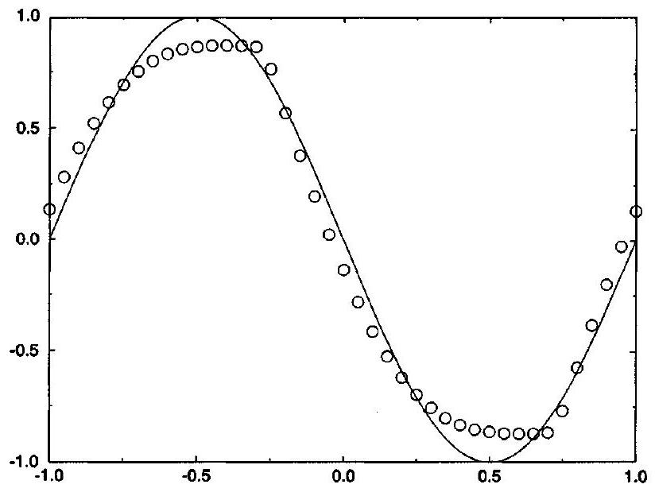
Figure 20.13 Davis-Roe flux-limited method for Test Case 1.

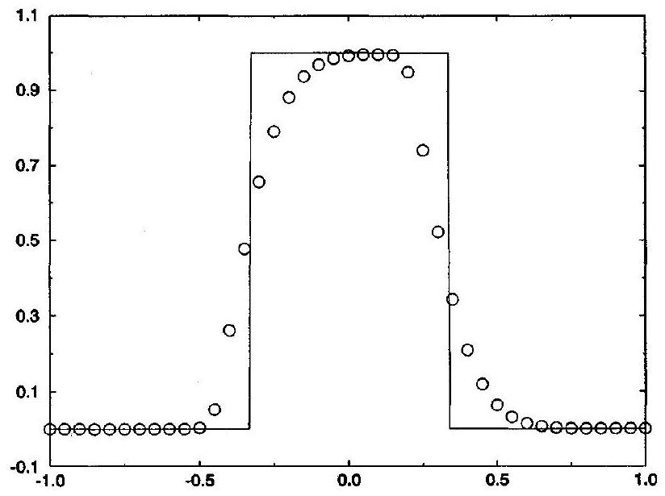
Figure 20.14 Davis-Roe flux-limited method for Test Case 2.

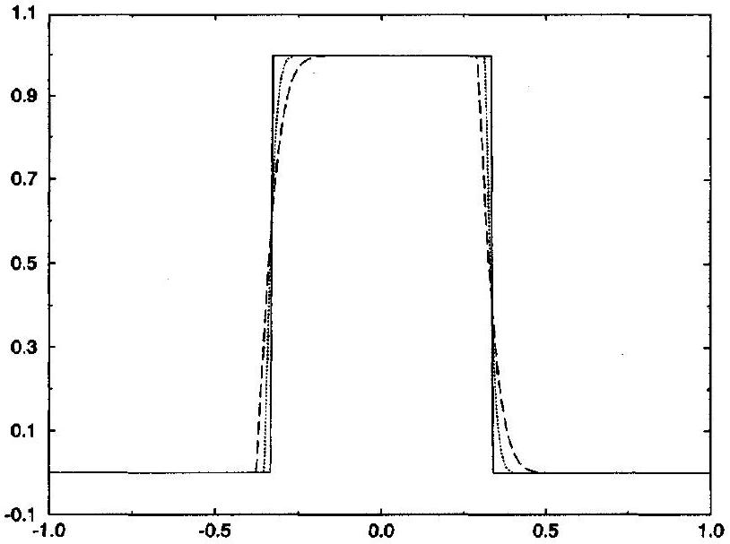
Figure 20.15 Davis-Roe flux-limited method for Test Case 3.

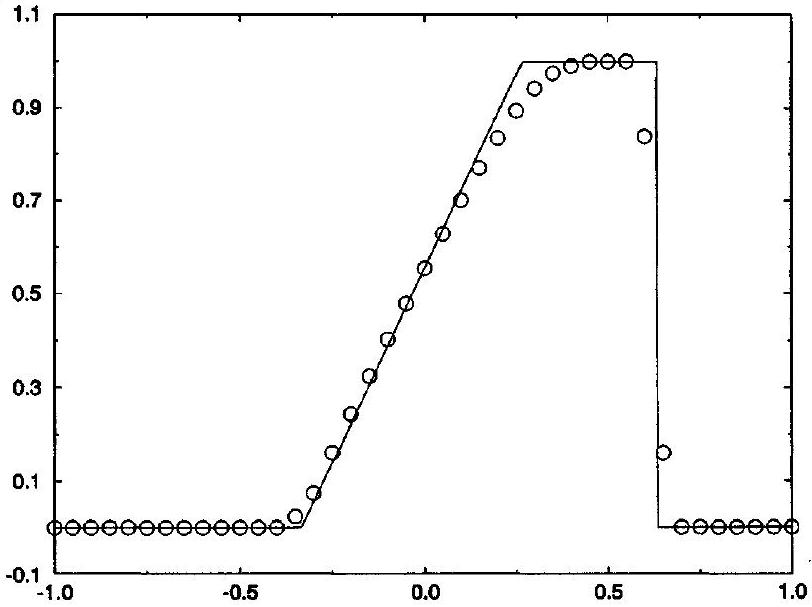
Figure 20.16 Davis-Roe flux-limited method for Test Case 4.

with the minmod limiter, as seen in Figure 20.5, the Davis-Roe flux-limited method exhibits some asymmetric cusping whereas Sweby's flux-limited method does not.

Test Case 3 In Figure 20.15, the dotted line represents the Davis-Roe fluxlimited approximation to $u(x, 4)$, the long dashed line represents the Davis-Roe flux-limited approximation to $u(x, 40)$, and the solid line represents the exact solution for $u(x, 4)$ or $u(x, 40)$. Again, these results are comparable to those of Sweby's flux-limited method, as seen in Figure 20.6, and are better than anything seen in Chapter 17.

Test Case 4 As seen in Figure 20.16, the Davis-Roe flux-limited method captures the shock extremely well, with only two transition points. The expansion fan is also well captured with only a slight rounding of the corners.

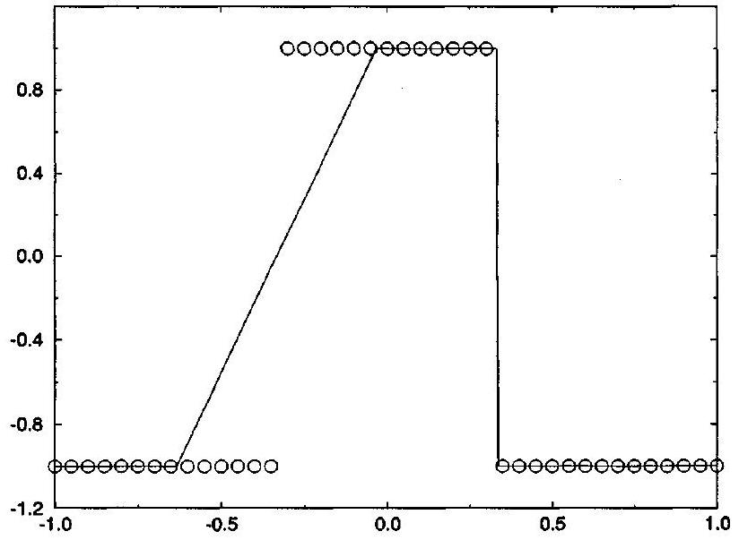
Figure 20.17 Davis-Roe flux-limited method for Test Case 5.

Test Case 5 As seen in Figure 20.17, the Davis-Roe flux-limited method completely fails to alter the initial conditions, which is fine at the shock but disastrous at the expansion. Clearly, the Davis-Roe flux-limited method requires an "entropy fix" at expansive sonic points. In place of Equation (20.67b), Davis suggested

$$
\hat{f}_{i+1 / 2}^{n}=\hat{f}_{i+1 / 2}^{\mathrm{L}-\mathrm{W}}+\frac{1}{2} \max \left[\frac{1}{4}, a_{i+1 / 2}\left(1-\lambda a_{i+1 / 2}^{n}\right)\right]\left(\phi\left(r_{i}^{+}\right)+\phi\left(r_{i+1}^{-}\right)-2\right)\left(u_{i+1}^{n}-u_{i}^{n}\right) .
$$

This certainly prevents the correction to the Lax-Wendroff method from dropping to zero at sonic points. The next section will consider another approach.

### 20.4.2 The Euler Equations

Now consider the Euler equations. The Davis-Roe flux-limited method for scalar conservation laws is extended to the Euler equations using the approximate one-wave linearized Riemann solver described in Section 5.4 and Subsection 18.3.4. The resulting method is as follows:

$$
\mathbf{u}_{i}^{n+1}=\mathbf{u}_{i}^{n}-\lambda\left(\hat{\mathbf{f}}_{i+1 / 2}^{n}-\hat{\mathbf{f}}_{i-1 / 2}^{n}\right),
$$

where

$$
\hat{\mathbf{f}}_{i+1 / 2}^{n}=\hat{\mathbf{f}}_{i+1 / 2}^{\mathrm{L}-\mathrm{W}}+\frac{1}{2} \rho\left(A_{i+1 / 2}^{n}\right)\left(1-\lambda \rho\left(A_{i+1 / 2}^{n}\right)\right)\left(\phi\left(r_{i}^{+}\right)+\phi\left(r_{i+1}^{-}\right)-2\right)\left(\mathbf{u}_{i+1}^{n}-\mathbf{u}_{i}^{n}\right)
$$

and

$$
r_{i}^{+}=\left(\mathbf{u}_{i}^{n}-\mathbf{u}_{i-1}^{n}\right) \cdot \frac{\mathbf{u}_{i+1}^{n}-\mathbf{u}_{i}^{n}}{\left\|\mathbf{u}_{i+1}^{n}-\mathbf{u}_{i}^{n}\right\|}
$$

and

$$
r_{i}^{-}=\left(\mathbf{u}_{i+1}^{n}-\mathbf{u}_{i}^{n}\right) \cdot \frac{\mathbf{u}_{i}^{n}-\mathbf{u}_{i-1}^{n}}{\left\|\mathbf{u}_{i}^{n}-\mathbf{u}_{i-1}^{n}\right\|}
$$

As usual, $A_{i+1 / 2}^{n}$ is some average Jacobian matrix, $\rho\left(A_{i+1 / 2}^{n}\right)$ is the largest characteristic value of $A_{i+1 / 2}^{n}$ in absolute value, and $\|\cdot\|$ is some vector norm, as discussed in Section 6.1. The one-wave Riemann solver could be replaced by other Riemann solvers, such as Roe's approximate Riemann solver, but only at the expense of the simplicity and efficiency Davis sought to maximize. In pursuit of this same goal, Davis replaced the one-step Lax-Wendroff method seen above by the more efficient two-step MacCormack method; see the original paper for details, and also see Subsection 18.1.2 for a discussion of MacCormack's method versus the original Lax-Wendroff method. Many older engineering codes are based on MacCormack's method. The beauty of the Davis-Roe flux-limited method is that old codes based on MacCormack's method can be easily and efficiently converted to the Davis-Roe flux-limited method. In the literature, the one-step version of the Davis-Roe flux-limited method is often called a "TVD Lax-Wendroff" method while the two-step version is often called a "TVD MacCormack" method. However, as usual, this book will identify the method by author (Davis and Roe) and by general type (flux-limited) rather than by any purported nonlinear stability properties or by any of the specific methods used in the flux-limited combination.

### 20.5 Yee-Roe Flux-Limited Method (TVD)

### 20.5.1 Scalar Conservation Laws

In 1987, Yee suggested some generalizations and modifications to the Davis-Roe flux-limited scheme. To go from the Davis-Roe flux-limited method to the Yee-Roe fluxlimited method requires three modifications. First, as a simple notational change, replace the factor $\phi\left(r_{i}^{+}\right)+\phi\left(r_{i+1}^{-}\right)-1$ seen in Equation (20.67) by

$$
\phi_{i+1 / 2}^{n}=\phi\left(r_{i}^{+}, r_{i+1}^{-}\right)
$$

where $r_{i}^{ \pm}$are defined just as before:

$$
\begin{aligned}
& r_{i}^{+}=\frac{u_{i}^{n}-u_{i-1}^{n}}{u_{i+1}^{n}-u_{i}^{n}} \\
& r_{i}^{-}=\frac{u_{i+1}^{n}-u_{i}^{n}}{u_{i}^{n}-u_{i-1}^{n}}
\end{aligned}
$$

Second, replace the Lax-Wendroff method by FTCS. Although this replacement adversely affects stability and accuracy, steady-state solutions no longer depend on the time step, unlike the Davis-Roe flux-limited method, and it may be possible to partially accommodate the replacement by properly choosing the flux limiter. With these two modifications, the method is now

$$
u_{i}^{n+1}=u_{i}^{n}-\lambda\left(\hat{f}_{i+1 / 2}^{n}-\hat{f}_{i-1 / 2}^{n}\right),
$$

where

$$
\hat{f}_{i+1 / 2}^{n}=\hat{f}_{i+1 / 2}^{\mathrm{ROE}}+\frac{1}{2}\left|a_{i+1 / 2}^{n}\right| \phi_{i+1 / 2}^{n}\left(u_{i+1}^{n}-u_{i}^{n}\right)
$$

or, equivalently,

$$
\hat{f}_{i+1 / 2}^{n}=\hat{f}_{i+1 / 2}^{\mathrm{FTCS}}+\frac{1}{2}\left|a_{i+1 / 2}^{n}\right|\left(\phi_{i+1 / 2}^{n}-1\right)\left(u_{i+1}^{n}-u_{i}^{n}\right) .
$$

Remember that the Davis-Roe method requires an "entropy fix" at expansive sonic points. Then, as the third and final modification, to prevent the flux-limited correction to FTCS seen in Equation (20.74b) from dropping to zero at sonic points, replace $\left|a_{i+1 / 2}^{n}\right|$ by $\psi\left(a_{i+1 / 2}^{n}\right)$, where

$$
\psi(x)= \begin{cases}\frac{x^{2}+\delta^{2}}{2 \delta} & |x|<\delta, \\ |x| & |x|>\delta,\end{cases}
$$

as in Harten's first-order upwind method; see Subsections 17.3.3 and 18.3.3. As usual, this modification affects the method only at sonic points. Then, with all three modifications, the explicit Yee-Roe flux-limited method is

$$
u_{i}^{n+1}=u_{i}^{n}-\lambda\left(\hat{f}_{i+1 / 2}^{n}-\hat{f}_{i-1 / 2}^{n}\right),
$$

where

$$
\text { - } \quad \hat{f}_{i+1 / 2}^{n}=\hat{f}_{i+1 / 2}^{\mathrm{FTCS}}+\frac{1}{2} \psi\left(a_{i+1 / 2}^{n}\right)\left(\phi_{i+1 / 2}^{n}-1\right)\left(u_{i+1}^{n}-u_{i}^{n}\right) .
$$

As an alternative to the forward-Euler time discretization, consider the backward-time or implicit Euler time discretization:

$$
u_{i}^{n+1}=u_{i}^{n}-\lambda\left(\hat{f}_{i+1 / 2}^{n+1}-\hat{f}_{i-1 / 2}^{n+1}\right),
$$

where $\hat{f}_{i+1 / 2}^{n+1}$ is defined by Equation (20.75) just as before. Forming a convex linear combination of the implicit and explicit Euler methods yields the following implicit method:

$$
u_{i}^{n+1}=u_{i}^{n}-\lambda \theta\left(\hat{f}_{i+1 / 2}^{n+1}-\hat{f}_{i-1 / 2}^{n+1}\right)-\lambda(1-\theta)\left(\hat{f}_{i+1 / 2}^{n}-\hat{f}_{i-1 / 2}^{n}\right),
$$

where $0 \leq \theta \leq 1$, and where $\hat{f}_{i+1 / 2}^{n}$ and $\hat{f}_{i+1 / 2}^{n+1}$ are defined by Equation (20.75) just as before. Unfortunately, in general, each time step in the implicit method requires the solution to a nonlinear system of equations, which is prohibitively expensive. However,

$$
\begin{aligned}
\hat{f}_{i+1 / 2}^{n+1}-\hat{f}_{i-1 / 2}^{n+1}= & \frac{1}{2}\left(f\left(u_{i+1}^{n+1}\right)-f\left(u_{i-1}^{n+1}\right)\right) \\
& +\frac{1}{2} \psi\left(a_{i+1 / 2}^{n+1}\right)\left(\phi_{i+1 / 2}^{n+1}-1\right)\left(u_{i+1}^{n+1}-u_{i}^{n+1}\right) \\
& -\frac{1}{2} \psi\left(a_{i-1 / 2}^{n+1}\right)\left(\phi_{i-1 / 2}^{n+1}-1\right)\left(u_{i}^{n+1}-u_{i-1}^{n+1}\right)
\end{aligned}
$$

In this last equation, linearize the right-hand side about time level $n$ using Taylor series to find

$$
\begin{aligned}
\hat{f}_{i+1 / 2}^{n+1}-\hat{f}_{i-1 / 2}^{n+1} \approx & \frac{1}{2}\left(a\left(u_{i+1}^{n}\right) u_{i+1}^{n+1}-a\left(u_{i-1}^{n}\right) u_{i-1}^{n+1}\right) \\
& +\frac{1}{2} \psi\left(a_{i+1 / 2}^{n}\right)\left(\phi_{i+1 / 2}^{n}-1\right)\left(u_{i+1}^{n+1}-u_{i}^{n+1}\right) \\
& -\frac{1}{2} \psi\left(a_{i-1 / 2}^{n}\right)\left(\phi_{i-1 / 2}^{n}-1\right)\left(u_{i}^{n+1}-u_{i-1}^{n+1}\right)
\end{aligned}
$$

So consider the following linearized implicit Yee-Roe flux-limited method:

$$
\begin{aligned}
u_{i}^{n+1}= & u_{i}^{n}-\frac{\lambda \theta}{2}\left[a\left(u_{i+1}^{n}\right) u_{i+1}^{n+1}-a\left(u_{i-1}^{n}\right) u_{i-1}^{n+1}+\psi\left(a_{i+1 / 2}^{n}\right)\left(\phi_{i+1 / 2}^{n}-1\right)\left(u_{i+1}^{n+1}-u_{i}^{n+1}\right)\right. \\
& \left.-\psi\left(a_{i-1 / 2}^{n}\right)\left(\phi_{i-1 / 2}^{n}-1\right)\left(u_{i}^{n+1}-u_{i-1}^{n+1}\right)\right]-\lambda(1-\theta)\left(\hat{f}_{i+1 / 2}^{n}-\hat{f}_{i-1 / 2}^{n}\right)
\end{aligned}
$$

or, equivalently,

$$
\begin{aligned}
& \quad \frac{\lambda \theta}{2}\left[a\left(u_{i+1}^{n}\right)+\psi\left(a_{i+1 / 2}^{n}\right)\left(\phi_{i+1 / 2}^{n}-1\right)\right]\left(u_{i+1}^{n+1}-u_{i+1}^{n}\right) \\
& \quad+\left\{1-\frac{\lambda \theta}{2}\left[\psi\left(a_{i+1 / 2}^{n}\right)\left(\phi_{i+1 / 2}^{n}-1\right)+\psi\left(a_{i-1 / 2}^{n}\right)\left(\phi_{i-1 / 2}^{n}-1\right)\right]\right\}\left(u_{i}^{n+1}-u_{i}^{n}\right) \\
& \quad+\frac{\lambda \theta}{2}\left[-a\left(u_{i-1}^{n}\right)+\psi\left(a_{i-1 / 2}^{n}\right)\left(\phi_{i-1 / 2}^{n}-1\right)\right]\left(u_{i-1}^{n+1}-u_{i-1}^{n}\right) \\
& \quad=-\lambda\left(\hat{f}_{i+1 / 2}^{n}-\hat{f}_{i-1 / 2}^{n}\right)
\end{aligned}
$$

This last expression requires the solution of a periodic tridiagonal linear system of equations, which is relatively cheap, as discussed in Example 11.4. For more details and variations on the Yee-Roe flux-limited method, see Yee $(1987,1989)$ and Yee, Klopfer, and Montagné (1990).

In the original paper, Yee (1987) suggested five possible flux limiters. Of these five, subsequent experience recommends the following three:

$$
\begin{aligned}
\phi\left(r_{i}^{+}, r_{i+1}^{-}\right) & =\operatorname{minmod}\left(1, r_{i}^{+}, r_{i+1}^{-}\right) \\
\phi\left(r_{i}^{+}, r_{i+1}^{-}\right) & =\operatorname{minmod}\left(2,2 r_{i}^{+}, 2 r_{i+1}^{-}, \frac{1}{2}\left(r_{i}^{+}+r_{i+1}^{-}\right)\right) \\
\phi\left(r_{i}^{+}, r_{i+1}^{-}\right) & =\operatorname{minmod}\left(1, r_{i}^{+}\right)+\operatorname{minmod}\left(1, r_{i+1}^{-}\right)-1
\end{aligned}
$$

Other researchers suggested other possible flux limiters for the Yee-Roe method; for example, Wang and Richards (1991) suggest limiters specifically intended for steady viscous flows.

With flux limiter (20.78), Equation (20.75) can be written as follows:

$$
\begin{aligned}
\hat{f}_{i+1 / 2}^{n}= & \frac{1}{2}\left(f\left(u_{i+1}^{n}\right)+f\left(u_{i}^{n}\right)\right)+\frac{1}{2} \psi\left(a_{i+1 / 2}^{n}\right) \\
& \times\left[\min \bmod \left(u_{i}^{n}-u_{i-1}^{n}, u_{i+1}^{n}-u_{i}^{n}, u_{i+2}^{n}-u_{i+1}^{n}\right)-\left(u_{i+1}^{n}-u_{i}^{n}\right)\right] .
\end{aligned}
$$

Division is the most expensive arithmetic operation; furthermore, since there is always the possibility of division by zero, division is the least reliable arithmetic operation, and it should never be used except as part of an "if-then-else" statement to test for small or zero divisors. Compared to previous expressions, Equation (20.81) eliminates the divisions and tests required to form $r_{i}^{ \pm}$.

Turning to the five standard numerical test cases, dropping the Lax-Wendroff terms seems to force a few unhappy trade-offs between smooth and discontinuous solutions. While the results are still more than acceptable, they are omitted for reasons of space.

### 20.5.2 The Euler Equations

Yee (1987) suggested explicit and implicit methods for the Euler equations. For simplicity, this book will consider only the explicit version. The explicit Yee-Roe method for the Euler equations is based on Harten's first-order upwind method for the Euler equations, as seen in Equation (18.56) of Subsection 18.3.3:

$$
\begin{aligned}
& \mathbf{u}_{i}^{n+1}=\mathbf{u}_{i}^{n}-\lambda\left(\hat{\mathbf{f}}_{i+1 / 2}^{n}-\hat{\mathbf{f}}_{i-1 / 2}^{n}\right) \\
& \hat{\mathbf{f}}_{i+1 / 2}^{n}=\frac{1}{2}\left(\mathbf{f}\left(\mathbf{u}_{i+1}^{n}\right)+\mathbf{f}\left(\mathbf{u}_{i}^{n}\right)\right)-\frac{1}{2} \sum_{j=1}^{3}\left(\mathbf{r}_{i+1 / 2}^{n}\right)_{j} \psi\left(a_{i+1 / 2}^{n}\right)_{j}\left(\Delta v_{i+1 / 2}^{n}\right)_{j},
\end{aligned}
$$

where

$$
\begin{aligned}
& \psi(x)=\left\{\begin{array}{ll}
\frac{x^{2}+\delta^{2}}{2 \delta} & |x|<\delta \\
|x| & |x|>\delta
\end{array},\right. \\
& \left(a_{i+1 / 2}^{n}\right)_{j}=\left|\lambda_{i+1 / 2}^{n}\right|_{j}\left[1-\left(\phi_{i+1 / 2}^{n}\right)_{j}\right], \\
& \left(\phi_{i+1 / 2}^{n}\right)_{j}=\phi\left(\left(r_{i}^{+}\right)_{j},\left(r_{i+1}^{-}\right)_{j}\right),
\end{aligned}
$$

and

$$
\begin{aligned}
\left(r_{i}^{+}\right)_{j} & =\frac{\left|\lambda_{i-1 / 2}^{n}\right|_{j}\left(\Delta v_{i-1 / 2}^{n}\right)_{j}}{\left|\lambda_{i+1 / 2}^{n}\right|_{j}\left(\Delta v_{i+1 / 2}^{n}\right)_{j}} \\
\left(r_{i}^{-}\right)_{j} & =\frac{\left|\lambda_{i+1 / 2}^{n}\right|_{j}\left(\Delta v_{i+1 / 2}^{n}\right)_{j}}{\left|\lambda_{i-1 / 2}^{n}\right|_{j}\left(\Delta v_{i-1 / 2}^{n}\right)_{j}}
\end{aligned}
$$

See the description of Roe's approximate Riemann solver in Section 5.3 and Roe's firstorder upwind method in Subsection 18.3.2 for the full details on $\left(\lambda_{i+1 / 2}^{n}\right)_{j},\left(\mathbf{r}_{i+1 / 2}^{n}\right)_{j}$, and $\left(\Delta v_{i+1 / 2}^{n}\right)_{j}$. Do not confuse the right characteristic vectors $\left(\mathbf{r}_{i+1 / 2}^{n}\right)_{j}$ with the ratios $\left(r_{i}^{ \pm}\right)_{j}$. Also, do not confuse the characteristic values $\left(\lambda_{i+1 / 2}^{ \pm}\right)_{j}$ with the ratio $\lambda=\Delta t / \Delta x$. For an intuitive introduction to the ideas used here, the reader may wish to review Subsection 18.3.5. The basic idea, more or less, is to replace the characteristic values appearing in Harten's first-order upwind method, while leaving the characteristic vectors alone.

## References

Chakravarthy, S. R., and Osher, S. 1983. "High Resolution Applications of the Osher Upwind Scheme for the Euler Equations," AIAA Paper 83-1943 (unpublished).
Chakravarthy, S. R., and Osher, S. 1985. "Computing with High-Resolution Upwind Schemes for Hyperbolic Equations." In Large-Scale Computations in Fluid Mechanics, Lectures in Applied Mathematics, Volume 22 Part 2, eds. B. E. Engquist, S. Osher, and R. C. J. Somerville, pp. 57-86, Providence, RI: American Mathematical Society.
Davis, S. F. 1987. "A Simplified TVD Finite Difference Scheme via Artificial Viscosity," SIAM Journal on Scientific and Statistical Computing, 8: 1-18.
Jeng, Y. N., and Payne, U. J. 1995. "An Adaptive TVD Limiter." Journal of Computational Physics, 118: 229-241.

Osher, S., and Chakravarthy, S. 1984. "High Resolution Schemes and Entropy Conditions," SIAM Journal on Numerical Analysis, 21: 955-984.
Osher, S., and Chakravarthy, S. R. 1986. "Very High Order Accurate TVD Schemes." In Oscillation Theory, Computation, and Methods of Compensated Compactness, The IMA Volumes in Mathematics and Its Applications, Volume 2, eds. C. Dafermos, J. L. Erikson, D. Kinderlehrer, and M. Slemrod, pp. 229-271, New York: Springer-Verlag.

Roe, P. L. 1981. "Numerical Methods for the Linear Wave Equation," Royal Aircraft Establishment Technical Report 81047 (unpublished).
Roe, P. L. 1982. "Fluctuations and Signals - A Framework for Numerical Evolution Problems." In Numerical Methods for Fluid Dynamics, eds. K. W. Morton and M. J. Baines, pp. 219-257, London: Academic Press.
Roe, P. L. 1984. "Generalized Formulations of TVD Lax-Wendroff Schemes," ICASE Report Number 84-20 (unpublished).
Roe, P. L. 1985. "Some Contributions to the Modelling of Discontinuous Flows." In Large-Scale Computations in Fluid Mechanics, Lectures in Applied Mathematics, Volume 22 Part 2, eds. B. E. Engquist, S. Osher, and R. C. J. Somerville, pp. 57-86, Providence, RI: American Mathematical Society.
Roe, P. L. 1986. "Characteristic-Based Schemes for the Euler Equations," Annual Review of Fluid Mechanics, 18: 337-365.
Roe, P. L. 1989. "A Survey of Upwind Differencing Techniques." In 11th International Conference on Numerical Methods in Fluid Dynamics, Lecture Notes in Physics Volume 323, eds. D. L. Dwoyer, M. Y. Hussaini, and R. G. Voigt, pp. 69-78, Berlin: Springer-Verlag.

Roe, P. L., and Baines, M. J. 1982. "Algorithms for Advection and Shock Problems." In Proceedings of the Fourth GAMM-Conference on Numerical Methods in Fluid Mechanics, Notes on Numerical Fluid Mechanics, Volume 5, ed. H. Viviand, pp. 281-290, Braunschweig, Germany: Vieweg.
Roe, P. L. and Baines, M. J. 1984. "Asymptotic Behavior of Some Non-Linear Schemes for Linear Advection." In Proceedings of the Fifth GAMM-Conference on Numerical Methods in Fluid Mechanics, Notes on Numerical Fluid Mechanics, Volume 7, eds. M. Pandolfi and R. Piva, pp. 283-290, Braunschweig: Vieweg.

Roe, P. L., and Pike, J. 1984. "Efficient Construction and Utilization of Approximate Riemann Solutions." In Computing Methods in Applied Sciences and Engineering, VI, eds. R. Glowinski and J.-L. Lions, pp. 499-518, Amsterdam: North-Holland.

Sweby, P. K. 1984. "High Resolution Schemes Using Flux Limiters for Hyperbolic Conservation Laws," SIAM Journal on Numerical Analysis, 21: 995-1011.
Van Leer, B. 1974. "Towards the Ultimate Conservative Difference Scheme. II. Monotonicity and Conservation Combined in a Second-Order Scheme," Journal of Computational Physics, 14: 361-370.
Wang, Z., and Richards, B. E. 1991. "High Resolution Schemes for Steady Flow Computations," Journal of Computational Physics, 97: 53-72.
Yee, H. C. 1987. "Construction of Explicit and Implicit Symmetric TVD Schemes and Their Applications," Journal of Computational Physics, 68: 151-179.
Yee, H. C. 1989. "A Class of High-Resolution Explicit and Implicit Shock Capturing Methods," NASA Technical Memorandum 101088 (unpublished).
Yee, H. C., Klopfer, G. H., and Montagné J.-L. 1990. "High-Resolution Shock-Capturing Schemes for Inviscid and Viscous Hypersonic Flows," Journal of Computational Physics, 88: 31-61.

## Problems

20.1 For Sweby's flux-limited method, consider the two possible variations on the minmod limiter:
$\phi(r)=\min \bmod (1, b r)$,
$\phi(r)=\operatorname{minmod}(b, r)$.
Plot each of these limiters as a function of $r$ for several different values of $b$. Explain briefly why $b$ should be between 1 and 2 .
20.2 (a) Using Equations (20.11) and (20.16), show that Sweby's flux-limited method for the linear advection equation with $a>0$ is third-order accurate when

$$
\phi(r)=\frac{2+r}{3} .
$$

(b) Plot the flux limiter found in part (a) as a function of $r$. For comparison, your sketch should also include other flux limiters such as those seen in Figures 20.1 and 20.2.
(c) Does the flux limiter found in part (a) ever satisfy the upwind range condition for Sweby's flux-limited method, as seen in Equation (20.19)? If so, then when?
20.3 The van Albada flux limiter is often used in Sweby's flux-limited method. The van Albada flux limiter is defined as follows:
$\phi(r)=\frac{r+r^{2}}{1+r^{2}}$.
(a) Plot the van Albada limiter as a function of $r$. For comparison, your sketch should also include other flux limiters such as those seen in Figures 20.1 and 20.2.
(b) Does the van Albada flux limiter satisfy the upwind range condition for Sweby's fluxlimited method, as seen in Equations such as (20.18) or (20.19)?
(c) Does the van Albada flux limiter cause clipping error at extrema? In other words, is $\phi(r)$ small or zero when $r<0$, or does $\phi$ change abruptly at extrema? You may wish to back your answer up with numerical results.
(d) Write a code that approximates solutions to scalar conservation laws using Sweby's flux-limited method with the van Albada flux limiter. Use your code to solve the five standard test cases for scalar conservation laws. How do your results compare with those found using the minmod limiter, seen in Figures 20.4 to 20.8?
20.4 For Sweby's flux-limited method for the linear advection equation, Roe suggested the following hyperbee limiter:
$\phi(r)= \begin{cases}\frac{2 r}{\lambda a(1-\lambda a)} \frac{\lambda a(1-r)+r\left(1-r^{-\lambda a}\right)}{(1-r)^{2}} & r \geq 0, \\ 0 & r<0 .\end{cases}$
For those readers who know something about hypergeometric functions, this flux limiter can be written as a hypergeometric function, which explains the term "hyperbee."
(a) Show that this flux limiter yields the exact solution if the solution varies geometrically. In other words, show that this flux limiter yields the exact solution if $r_{i}^{+}=$const. and $r_{i}^{-}=$const. for all $i$.
(b) Plot the hyperbee limiter as a function of $r$ for several different values of $\lambda a$. For comparison, your sketch should also include other flux limiters such as those seen in Figures 20.1 and 20.2.
(c) Unlike all of the flux limiters seen in the main text, the hyperbee flux limit depends on the CFL number $\lambda a$. Does this make sense? Explain briefly.
20.5 (a) As an alternative to Equation (20.20), show that Sweby's flux-limited method for the linear advection equation satisfies the upwind range condition if

$$
\begin{aligned}
& 0 \leq \phi(r) \leq \frac{2}{|\lambda a|} \\
& 0 \leq \phi(r) \leq \frac{2}{1-|\lambda a|}
\end{aligned}
$$

(b) The superbee limiter is the upper limit for flux limiters allowed by Equation (20.20). Similarly, find the flux limiter that is the upper bound for flux limiters allowed by the condition found in part (a). Roe and Baines call this the ultrabee limiter.
20.6 Often, flux limiters in Sweby's flux-limited methods are required to have the following symmetry property:

$$
\frac{\phi(r)}{r}=\phi\left(\frac{1}{r}\right) .
$$

Explain briefly why this property might be desirable. For one thing, think in terms of solution symmetry: should the flux limiter treat an upslope the same as a downslope, or a solution the same as its mirror image? Also, discuss how this property allows Sweby's flux-limited method to be written in terms of flux differences rather than ratios of flux differences, saving the troubles associated with division in the ratios of flux differences. Which of the following limiters have the symmetry property?
(a) The minmod limiter defined by Equation (20.21) or (20.22).
(b) The superbee limiter given by Equation (20.23).
(c) The Van Leer limiter given by Equation (20.24).
(d) The symmetric minmod limiter given by Equation (20.26).
(e) The van Albada limiter found in Problem 20.3.
20.7 (a) Equation (20.55) expresses the semidiscrete version of Sweby's flux-limited method with the minmod flux limiter in terms of flux splitting. Find an expression like Equation (20.55), but use the superbee flux limiter seen in Equation (20.23) in place of the minmod flux limiter.
(b) Find an expression like Equation (20.60), but use the superbee flux limiter seen in Equation (20.23) in place of the minmod flux limiter.
(c) Find an expression like Equation (20.64), but use the superbee flux limiter seen in Equation (20.23) in place of the minmod flux limiter.
20.8 Section 20.5 omitted any sort of stability analysis for the Yee-Roe flux-limited method. In fact, the usual sorts of nonlinear stability conditions are difficult to enforce using the simple definitions for $r_{i}^{ \pm}$seen in Equations (20.3) and (20.4), as used in the standard Yee-Roe flux-limited method. However, there is an alternate version of the Yee-Roe flux-limited method that employs more complicated definitions of $r_{i}^{ \pm}$and is much more amenable to nonlinear stability analysis. In particular, let

$$
\begin{aligned}
& r_{i}^{+}=\frac{\left|a_{i-1 / 2}^{+}\right|\left(u_{i}^{n}-u_{i-1}^{n}\right)}{\left|a_{i+1 / 2}^{+}\right|\left(u_{i+1}^{n}-u_{i}^{n}\right)} \\
& r_{i}^{-}=\frac{\left|a_{i+1 / 2}^{-}\right|\left(u_{i+1}^{n}-u_{i}^{n}\right)}{\left|a_{i-1 / 2}^{-}\right|\left(u_{i}^{n}-u_{i-1}^{n}\right)}
\end{aligned}
$$

(a) Briefly discuss the logic behind these definitions for $r_{i}^{ \pm}$. In particular, why do these definitions omit terms such as $1 \pm \lambda a_{i+1 / 2}^{ \pm}$seen in Equations (20.45) and (20.46)?
(b) Use the definitions for $r_{i}^{ \pm}$given in part (a). Assume that $\psi(x)=|x|$. Also assume that $0 \leq \lambda a(u) \leq 2 / 3$. Then show that the explicit Yee-Roe flux-limited method satisfies the upwind range condition if and only if

$$
0 \leq \lambda a_{i-1 / 2}\left(1+\frac{1}{2} \frac{\phi_{i+1 / 2}}{r_{i}^{+}}-\frac{1}{2} \phi_{i-1 / 2}\right) \leq 1 .
$$

(c) Starting with the result of part (b), show that the explicit Yee-Roe flux-limited method satisfies the upwind range condition for $0 \leq \lambda a(u) \leq 2 / 3$ if

$$
-2 \leq \frac{\phi_{i+1 / 2}^{n}}{r_{i}^{+}}-\phi_{i-1 / 2}^{n} \leq 1 .
$$

(d) Starting with the result of part (c), show that the explicit Yee-Roe flux-limited method satisfies the upwind range condition for $0 \leq \lambda a(u) \leq 2 / 3$ if

$$
0 \leq \phi_{i-1 / 2}^{n} \leq 2,
$$

$$
0 \leq \frac{\phi_{i+1 / 2}^{n}}{r_{i}^{+}} \leq 1
$$

(e) Using an approach similar to that in parts (b)-(d), show that the explicit Yee-Roe flux-limited method satisfies the upwind range condition for $-2 / 3 \leq \lambda a_{i+1 / 2}^{n} \leq 0$ if
$0 \leq \phi_{i+1 / 2}^{n} \leq 2$,

$$
0 \leq \frac{\phi_{i-1 / 2}^{n}}{r_{i}^{-}} \leq 1
$$

How does this compare with the result of part (d)? Can we use the same flux limiters for left- and right-running waves?
20.9 Section 20.3 derived semidiscrete methods by adaptively combining two first-generation semidiscrete methods. However, one can take a more fundamental approach. To begin with, recall reconstruction via the primitive function, as described in Section 9.3. In particular, recall that reconstruction via the primitive function finds a polynomial approximation to $f(x)$ given cell-integral averages $\bar{f}_{i}$. Consider any flux splitting $f(u)=f^{+}(u)+f^{-}(u)$. From Subsection 13.4.2, recall that

$$
\hat{f}_{s, i+1 / 2}^{n}=\hat{f}_{s}^{+}\left(x_{i+1 / 2}\right)+\hat{f}_{s}^{-}\left(x_{i+1 / 2}\right)
$$

where $\hat{f}_{i+1 / 2}^{ \pm}\left(x_{i+1 / 2}\right)$ is found from $f^{ \pm}\left(u_{i}^{n}\right), f^{ \pm}\left(u_{i-1}^{n}\right), f^{ \pm}\left(u_{i+1}^{n}\right)$, and so forth using reconstruction via the primitive function. In other words, treat $f^{ \pm}\left(u_{i}^{n}\right), f^{ \pm}\left(u_{i-1}^{n}\right), f^{ \pm}\left(u_{i+1}^{n}\right)$, and so forth like cell-integral averages of $\hat{f}^{ \pm}(x)$.
(a) Using the results of Example 9.6, especially Equations (9.33) and (9.34), show that some possible linear approximations are

$$
\begin{aligned}
& \hat{f}_{s}^{+}\left(x_{i+1 / 2}\right)=f^{+}\left(u_{i}^{n}\right)+\frac{1}{2}\left(f^{+}\left(u_{i+1}^{n}\right)-f^{+}\left(u_{i}^{n}\right)\right), \\
& \hat{f}_{s}^{+}\left(x_{i+1 / 2}\right)=f^{+}\left(u_{i}^{n}\right)+\frac{1}{2}\left(f^{+}\left(u_{i}^{n}\right)-f^{+}\left(u_{i-1}^{n}\right)\right)
\end{aligned}
$$

and

$$
\begin{aligned}
& \hat{f}_{s}^{-}\left(x_{i+1 / 2}\right)=f^{-}\left(u_{i+1}^{n}\right)-\frac{1}{2}\left(f^{-}\left(u_{i+1}^{n}\right)-f^{-}\left(u_{i}^{n}\right)\right) . \\
& \hat{f}_{s}^{-}\left(x_{i+1 / 2}\right)=f^{-}\left(u_{i+1}^{n}\right)-\frac{1}{2}\left(f^{-}\left(u_{i}^{n}\right)-f^{-}\left(u_{i-1}^{n}\right)\right) .
\end{aligned}
$$

These approximations yield second-order accuracy.
(b) Using the results of Example 9.7, especially Equations (9.36) and (9.37), show that two possible quadratic approximations are

$$
\begin{aligned}
& \hat{f}^{+}\left(x_{i+1 / 2}\right)=f^{+}\left(u_{i}^{n}\right)+\frac{1}{6}\left(f^{+}\left(u_{i}^{n}\right)-f^{+}\left(u_{i-1}^{n}\right)\right)+\frac{1}{3}\left(f^{+}\left(u_{i+1}^{n}\right)-f^{+}\left(u_{i}^{n}\right)\right), \\
& \hat{f}^{-}\left(x_{i+1 / 2}\right)=f^{-}\left(u_{i+1}^{n}\right)-\frac{1}{6}\left(f^{-}\left(u_{i+2}^{n}\right)-f^{-}\left(u_{i+1}^{n}\right)\right)-\frac{1}{3}\left(f^{-}\left(u_{i+1}^{n}\right)-f^{-}\left(u_{i}^{n}\right)\right) .
\end{aligned}
$$

These approximations yield third-order accuracy.
(c) Notice that the results of parts (a) and (b) both involve first differences. Form a linear combination of first differences as follows:

$$
\begin{aligned}
\hat{f}^{+}\left(x_{i+1 / 2}\right)= & f^{+}\left(u_{i}^{n}\right)+\frac{1+\eta}{4}\left(f^{+}\left(u_{i+1}^{n}\right)-f^{+}\left(u_{i}^{n}\right)\right)+\frac{1-\eta}{4}\left(f^{+}\left(u_{i}^{n}\right)-f^{+}\left(u_{i-1}^{n}\right)\right), \\
\hat{f}^{-}\left(x_{i+1 / 2}\right)= & f^{-}\left(u_{i+1}^{n}\right)-\frac{1+\eta}{4}\left(f^{-}\left(u_{i+1}^{n}\right)-f^{-}\left(u_{i}^{n}\right)\right) \\
& +\frac{1-\eta}{4}\left(f^{-}\left(u_{i+2}^{n}\right)-f^{-}\left(u_{i+1}^{n}\right)\right) .
\end{aligned}
$$

Show that the results of part (a) are recovered for $\eta= \pm 1$ and that the results of part (b) are recovered for $\eta=1 / 3$. Thus this class includes both second- and third-order accurate approximations.
(d) Suppose that $f^{+}\left(u_{i+1}\right)-f^{+}\left(u_{i}^{n}\right) \geq 0$. A sensible constraint is that $\hat{f}^{+}\left(x_{i+1 / 2}\right)$ should lie between $f^{+}\left(u_{i}^{n}\right)$ and $f^{+}\left(u_{i+1}^{n}\right)$. Using the expression in part (c), show that this is true if

$$
f^{+}\left(u_{i}^{n}\right)-f^{+}\left(u_{i-1}^{n}\right) \leq \frac{3-\eta}{1-\eta}\left(f^{+}\left(u_{i+1}^{n}\right)-f^{-}\left(u_{i}^{n}\right)\right) .
$$

This and similar results justify condition (20.65).
(e) Using the results of part (c), argue that the following is an appropriate expression:

$$
\begin{aligned}
\hat{f}_{s, i+1 / 2}= & f_{i+1 / 2}^{(1)}+\frac{1+\eta}{4} \Delta f_{i+1 / 2}^{+}+\frac{1-\eta}{4} \Delta f_{i-1 / 2}^{+} \\
& -\frac{1+\eta}{4} \Delta f_{i+1 / 2}^{-}\left(u_{i+1}^{n}-u_{i}^{n}\right)-\frac{1-\eta}{4} \Delta f_{i+3 / 2}^{-}\left(u_{i+2}^{n}-u_{i+1}^{n}\right),
\end{aligned}
$$

which is the same as Equation (20.62). This expression can then be flux limited just as before, either by adjusting $\eta$ or by adjusting the split fluxes $\Delta f_{i+1 / 2}^{ \pm}$. This approach will be developed more systematically in Section 21.4.

