## Flux Averaging II: Flux-Corrected Methods

### 21.0 Introduction

This chapter concerns flux-corrected methods. To keep things simple, this introductory section concerns only flux-corrected methods for scalar conservation laws. Fluxcorrected methods for the Euler equations are discussed later in the chapter; see Subsection 21.3.2. Intuitively, flux-corrected methods "correct" inaccurate or unstable methods. More specifically, as first seen in Section 13.3, flux-corrected methods for scalar conservation laws are defined as follows:

$$
\hat{f}_{i+1 / 2}^{n}=\hat{f}_{i+1 / 2}^{(1)}+\hat{f}_{i+1 / 2}^{(\mathrm{C})}=\hat{f}_{i+1 / 2}^{(1)}+\operatorname{diff}_{i+1 / 2}^{n}\left(\hat{f}_{i+1 / 2}^{(1)}, \hat{f}_{i+1 / 2}^{(2)}\right),
$$

where the flux $\hat{f}_{i+1 / 2}^{(\mathrm{C})}$ is called the corrective numerical flux, diff ${ }_{i+1 / 2}^{n}$ is called a differencing function, and $\hat{f}_{i+1 / 2}^{(1)}$ and $\hat{f}_{i+1 / 2}^{(2)}$ are any two methods with complementary properties, such as Roe's first-order upwind method and the Lax-Wendroff method. Flux correction attempts to "correct" $\hat{f}_{i+1 / 2}^{(1)}$ to make it more like $\hat{f}_{i+1 / 2}^{(2)}$, with the amount of correction varying between full correction and no correction, depending on the solution. In general, the corrective numerical flux $\hat{f}_{i+1 / 2}^{(\mathrm{C})}$ depends on solution differences and/or flux differences such as $u_{i+1}^{n}-u_{i}^{n}, f\left(u_{i+1}^{n}\right)-f\left(u_{i}^{n}\right)$, and $\hat{f}_{i+1 / 2}^{(2)}-\hat{f}_{i+1 / 2}^{(1)}$. Readers should view Equation (21.1) as a starting point for discussion rather than as a "fixed in stone" definition of flux-corrected methods. Although all flux-corrected methods have common elements - notational, philosophical, and practical - many flux-corrected methods differ substantially from Equation (21.1).

Flux-corrected methods are closely related to the flux-limited methods seen in the last chapter. Flux-limited methods average two methods, whereas flux-corrected methods alter one method to make it more like another method; however, these two approaches are really the same, both in practice and theory. To see this, think about combinations of ordinary real numbers - there is no real difference between averaging $x$ and $y$ to get $(x+y) / 2$ and altering $x$ to get $x-(x-y) / 2$. To make the point absolutely clear, compare the startingpoint definition of flux-limited methods, Equation (20.1), with the starting-point definition of flux-corrected methods, Equation (21.1). In particular, the flux-corrected definition (21.1) can be rewritten to match the flux-limited definition (20.1) as follows:

$$
\hat{f}_{i+1 / 2}^{n}=\hat{f}_{i+1 / 2}^{(1)}+\phi_{i+1 / 2}^{n}\left(\hat{f}_{i+1 / 2}^{(2)}-\hat{f}_{i+1 / 2}^{(1)}\right)
$$

where

$$
\phi_{i+1 / 2}^{n}\left(\hat{f}_{i+1 / 2}^{(2)}-\hat{f}_{i+1 / 2}^{(1)}\right)=\hat{f}_{i+1 / 2}^{(\mathrm{C})}=\operatorname{diff}_{i+1 / 2}^{n}\left(\hat{f}_{i+1 / 2}^{(1)}, \hat{f}_{i+1 / 2}^{(2)}\right)
$$

As one traditional distinction, flux-corrected methods rely on solution or flux differences, whereas flux-limited methods rely on ratios of solution or flux differences. But this distinction is hardly fundamental, since many flux-limited methods can be rewritten in terms of differences, while many flux-corrected methods can be rewritten in terms of ratios of
differences. For example, in the last chapter, equations such as (20.55), (20.60), (20.64), $(20,66)$, and $(20.81)$ are flux-limited methods written in flux-corrected forms, at least in the sense that they all depend on solution or flux differences rather than on ratios of solution or flux differences. By the same token, in this chapter, equations such as (21.5), (21.8b), and (21.13b) are flux-corrected methods written in flux-limited forms. As another traditional distinction, the flux limiter in flux-limited methods depends on a single argument, e.g., $\phi_{i+1 / 2}^{n}=\phi\left(r_{i}^{+}\right)$; by contrast, when written in terms of flux limiters as in Equation (21.2), flux-corrected methods may depend on multiple arguments, e.g., $\phi_{i+1 / 2}^{n}=\phi\left(r_{i}^{+}, r_{i+1}^{-}\right)$. However, again, this distinction is more traditional than fundamental. Since flux limiting and flux correction are so closely related, it is common to see mixed metaphors such as "flux limited correction" or "limited flux correction."

This chapter describes four flux-corrected methods. In 1973, Boris and Book proposed a two-step flux-corrected blend of a first-order upwind method and the Lax-Wendroff method, which they called Flux-Corrected Transport (FCT). FCT used an unusual firstorder upwind method, an early example of a reconstruction-evolution method. In 1979, Zalesak generalized flux-corrected transport to combine any two methods, provided that one method always has more second-order artificial viscosity than the other or, in other words, provided that the flux correction is antidissipative (recall the definition of antidissipative flux from Section 20.0). In 1983, Harten proposed a flux-corrected blend of Roe's first-order upwind method and the Lax-Wendroff method. Harten's flux-corrected method differs from traditional flux-corrected methods by correcting the physical flux rather than the numerical flux. Despite this fundamental difference, Harten's flux-corrected method still has many connections with and similarities to traditional flux-corrected methods.

In 1988, Shu and Osher proposed a numerical method based on the method of lines: the spatial discretization uses piecewise-polynomial ENO reconstruction and reconstruction via the primitive function; the time discretization uses Runge-Kutta methods. Despite its inclusion in this chapter, Shu and Osher's method is arguably not a flux-corrected method or, more precisely, it is not derived like a traditional flux-corrected method. Indeed, the Shu-Osher method can be seen as representing a new category of method distinct from flux-limited, flux-corrected, self-adjusting hybrid, or reconstruction-evolution methods. As introduced in Subsection 13.4.2, this category is sometimes called flux reconstructed. Given that the Shu-Osher method is one of the only methods of its kind, it does not warrant a separate chapter. Furthermore, the Shu-Osher method still qualifies as a flux-averaged method, and all flux-averaged methods are closely related, at least on the most fundamental level, as argued in Section 13.3. Judging by the final result, the Shu-Osher method clearly belongs in this chapter on flux correction, as reasoned in Section 21.4, certainly more so than in any of the other chapters on flux averaging. The title of the original paper - "An Efficient Implementation of Essentially Non-Oscillatory Shock Capturing Schemes" - gives the impression that the Shu-Osher method is closely related to the essentially nonoscillatory methods discussed in Section 23.5. However, the title is misleading in that the primary connection between the two types of methods is the use of ENO reconstruction, as described in Chapter 9. To summarize, the Shu-Osher flux-reconstructed method is much more closely related to flux-averaged methods, especially flux-corrected methods, than to solution-averaged or solution-reconstructed methods like the original ENO methods.

The numerical methods in this chapter go by various names, including FCT, TVD, and ENO. The acronym FCT is essentially synonymous with flux correction, although it usually implies a two-step method. As described in Section 20.0, the acronym TVD refers to any
method that (1) involves solution sensitivity; (2) uses the solution sensitivity to enforce some sort of nonlinear stability condition that implies the TVD condition, such as the upwind range condition, at least for model problems; (3) limits the order of accuracy at extrema, usually to between first and second order; and (4) came after the invention of the term TVD (that is, came after the early 1980s). Similarly, the acronym ENO refers to any method that (1) involves solution sensitivity; (2) uses piecewise-polynomial ENO reconstructions of the sort described in Chapter 9, either to reconstruct the solution or to reconstruct the flux; (3) retains full order of accuracy at extrema; and (4) came after the invention of the term ENO (that is, came after the mid-1980s). Unlike TVD methods, ENO methods rarely attempt to rigorously enforce any sort of nonlinear stability condition, not even the ENO stability condition seen in Section 16.7.

The Boris and Book flux-corrected method, and Zalesak's generalizations thereof, are generally not called TVD. However, in the original paper, Boris and Book (1973) introduced a number of advanced nonlinear stability conditions, such as the range diminishing condition (see Section 16.3) and the upwind range condition (see Section 16.5) that do imply TVD. Unfortunately, the Boris-Book flux-corrected method sometimes fails to ensure either of these nonlinear stability conditions, especially for large CFL numbers. However, in practice, the Boris-Book flux-corrected method exhibits more than adequate nonlinear stability, at least for small CFL numbers - it certainly ensures the TVD condition - and, in general, shares enough other qualities with TVD methods that it could fairly be called TVD except for the fact that it preceded the invention of the term by some ten years.

In the literature, Harten's flux-corrected method is almost always called a TVD method. In fact, Harten's original 1983 paper introduced both TVD (see Section 16.2) and positivity (see Section 16.4), and refined the range diminishing condition (see Section 16.3), all by way of motivating his flux-corrected method. However, as usual, the TVD label is potentially misleading for two reasons. First, Harten's TVD method has much stronger nonlinear stability properties than TVD stability. In particular, Harten's flux-corrected method retains all of the nonlinear stability properties of Harten's first-order upwind method seen in Subsections 17.3.3 and 18.3.3, including the upwind range condition. Second, except for its nonlinear stability properties and the general use of flux averaging, Harten's TVD method has little in common with other so-called TVD methods, such as Sweby's TVD method seen in Section 20.2 or the Yee-Roe TVD method seen in Section 20.5. Thus, even though Harten's TVD method and other TVD methods may have some of the same nonlinear stability properties, these properties are achieved in very different ways and, indeed, in basic construction, Harten's TVD method has relatively little in common with most other TVD methods.

### 21.1 Boris-Book Flux-Corrected Method (FCT)

This section concerns the Boris-Book flux-corrected method, discovered in 1973, commonly called Flux Corrected Transport (FCT) or, less often, SHarp And Smooth Transport Algorithm (SHASTA); not coincidentally, Shasta was the name of a soft drink popular at the time. Like all flux-averaged methods, FCT is an adaptive blend of two simpler methods, in this case a first-order upwind method and the Lax-Wendroff method. This section concerns only scalar conservation laws. Boris and Book's original paper described a version of their flux-corrected method for the Euler equations. However, Boris and Book applied the scalar method to the conservative form of the Euler equations rather than to
the characteristic form of the Euler equations. Keep in mind that scalar conservation laws model characteristic equations, not conservative equations, as discussed in Chapter 4. In particular, only the characteristic equations share the nonlinear stability properties of scalar conservation laws, such as the upwind range condition, and even then not at jump intersections, solid boundaries, and so forth; see Section 16.12. Applying scalar numerical methods, which enforce scalar nonlinear stability conditions, to the conserved variables of the Euler equations can result in excessive and unnatural errors. On the positive side, this approach does reduce cost and complication compared to most methods based on Riemann solvers or flux vector splitting.

On many scores, the Boris-Book flux-corrected method counts as a second-generation method; certainly its lack of multiwave modeling for the Euler equations and its 1973 origin date it as second generation. However, having said this, the Boris-Book flux-corrected method is probably the most sophisticated of the second-generation methods, both in terms of the nonlinear stability theory used to motivate it and in terms of what it actually does. In fact, the Boris-Book flux-corrected method is the only second-generation method still commonly used today. For a relatively recent summary of the Boris-Book flux-corrected transport method see, for example, Chapter 8 of Oran and Boris (1989). Perhaps the BorisBook flux-corrected method counts as a "two-and-a-half" generation method.

In their original paper, Boris and Book construct an unusual first-order reconstructionevolution method as the foundation for FCT. Boris and Book's first-order upwind method uses two grids: an ordinary grid, sometimes called an Eulerian grid, with fixed cells $\left[x_{i-1 / 2}, x_{i+1 / 2}\right]$; and a grid that moves with the flow, sometimes called a Lagrangean grid. The Lagrangean cells start each time step equal to $\left[x_{i}, x_{i+1}\right]$, where $\left(x_{i+1 / 2}+x_{i-1 / 2}\right) / 2=x_{i}$, and end each time step equal to $\left[x_{i}+a\left(\bar{u}_{i}^{n}\right) \Delta t, x_{i+1}+a\left(\bar{u}_{i+1}^{n}\right) \Delta t\right]$. Thus, the Lagrangian cells start each time step staggered with respect to the Eulerian cells, after which the cell edges follow approximate characteristic lines in the $x-t$ plane. The reconstruction at the beginning of each time step is

$$
u\left(x, t^{n}\right) \approx \bar{u}_{i}^{n}+\frac{\bar{u}_{i+1}^{n}-\bar{u}_{i}^{n}}{\Delta x}\left(x-x_{i}\right)
$$

for $x_{i} \leq x \leq x_{i+1}$. This reconstruction is continuous, piecewise-linear, and second-order accurate. During the time evolution, the solution is required to stay piecewise-linear across each Lagrangean cell. For conservation, the trapezoidal area under the linear reconstruction in each Lagrangean cell must remain constant. At the end of the time step, the piecewiselinear and piecewise-continuous time-evolved solution is integral averaged over each fixed cell $\left[x_{i-1 / 2}, x_{i+1 / 2}\right]$ to obtain $\bar{u}_{i}^{n+1}$. After a long derivation, which the motivated reader is certainly free to attempt as an exercise, in conservation form, the final result is as follows:

$$
\begin{gathered}
u_{i}^{n+1}=u_{i}^{n}-\left(\lambda \hat{f}_{i+1 / 2}^{n}-\lambda \hat{f}_{i-1 / 2}^{n}\right), \\
\lambda \hat{f}_{i+1 / 2}^{n}=-\frac{1}{2}\left[\frac{\lambda a\left(u_{i}\right)-\frac{1}{2}}{1+\lambda\left(a\left(u_{i+1}\right)-a\left(u_{i}\right)\right)}\right]^{2} u_{i+1}^{n}+\frac{1}{2}\left[\frac{\lambda a\left(u_{i+1}\right)+\frac{1}{2}}{1+\lambda\left(a\left(u_{i+1}\right)-a\left(u_{i}\right)\right)}\right]^{2} u_{i}^{n} .
\end{gathered}
$$

This is the original Boris-Book first-order upwind method.
Despite its use of reconstruction-evolution, an unusually advanced technique at the time, the original Boris-Book first-order upwind method has several practical problems. First, it only makes sense for $\lambda|a| \leq 1 / 2$, so that at least part of each Lagrangean cell always stays within one Eulerian cell, which is unusually restrictive. Second, except for the linear
advection equation, the conservative numerical flux is not consistent with the physical flux (see Problem 11.7). Third, the original Boris-Book first-order upwind method is not competitive with subsequent first-order upwind methods. For example, Roe's first-order upwind method is less expensive, less complicated, and more accurate, except possibly at expansive sonic points. For all of these reasons, the original Boris-Book first-order upwind method is mainly of historical interest.

For the purposes of this discussion, we shall substitute a simpler first-order upwind method for the original Boris-Book first-order upwind method. In particular, consider the following method:

$$
u_{i}^{n+1}=u_{i}^{n}-\left(\lambda \hat{f}_{i+1 / 2}^{\mathrm{B}-\mathrm{B}}-\lambda \hat{f}_{i-1 / 2}^{\mathrm{B}-\mathrm{B}}\right)
$$

where

$$
\lambda \hat{f}_{i+1 / 2}^{\mathrm{B}-\mathrm{B}}=\lambda \hat{f}_{i+1 / 2}^{\mathrm{L}-\mathrm{W}}-\frac{1}{8}\left(u_{i+1}^{n}-u_{i}^{n}\right)
$$

or, equivalently,

$$
\lambda \hat{f}_{i+1 / 2}^{\mathrm{B}-\mathrm{B}}=\frac{\lambda}{2}\left(f\left(u_{i+1}^{n}\right)+f\left(u_{i}^{n}\right)\right)-\frac{1}{2}\left(\left(\lambda a_{i+1 / 2}^{n}\right)^{2}+\frac{1}{4}\right)\left(u_{i+1}^{n}-u_{i}^{n}\right) .
$$

Hence this method equals the Lax-Wendroff method (see Section 17.2) plus constantcoefficient second-order artificial viscosity. This method, called the modified Boris-Book first-order upwind method, can also be written as follows:

$$
\lambda \hat{f}_{i+1 / 2}^{\mathrm{B}-\mathrm{B}}=\lambda f\left(u_{i+1}^{n}\right)-\frac{1}{2}\left(\lambda a_{i+1 / 2}^{n}+\frac{1}{2}\right)^{2}\left(u_{i+1}^{n}-u_{i}^{n}\right)
$$

or

$$
\lambda \hat{f}_{i+1 / 2}^{\mathrm{B}-\mathrm{B}}=\lambda f\left(u_{i}^{n}\right)-\frac{1}{2}\left(\lambda a_{i+1 / 2}^{n}-\frac{1}{2}\right)^{2}\left(u_{i+1}^{n}-u_{i}^{n}\right) .
$$

The factors $\left(\lambda a_{i+1 / 2}^{n} \pm 1 / 2\right)^{2}$ in these last two expressions strongly resemble the factors $\left(\lambda a\left(u_{i}^{n}\right)-1 / 2\right)^{2}$ and $\left(\lambda a\left(u_{i+1}^{n}\right)+1 / 2\right)^{2}$ seen in the original Boris-Book first-order upwind method. In fact, for the linear advection equation, the modified Boris-Book first-order upwind method equals the original Boris-Book first-order upwind method.

The coefficient of second-order artifical viscosity for the modified Boris-Book first-order upwind method is

$$
\lambda \epsilon_{i+1 / 2}^{\mathrm{B}-\mathrm{B}}=\lambda \epsilon_{i+1 / 2}^{\mathrm{L}-\mathrm{W}}+\frac{1}{4}=\left(\lambda a_{i+1 / 2}^{n}\right)^{2}+\frac{1}{4} .
$$

This coefficient of artificial viscosity is illustrated in Figure 21.1. As seen in Figure 21.1, the modified Boris-Book first-order upwind method satisfies the linear stability condition $(\lambda a)^{2} \leq \lambda \epsilon \leq 1$ found in Example 15.4 and the nonlinear stability condition $\left|\lambda a_{i+1 / 2}^{n}\right| \leq \lambda \epsilon_{i+1 / 2}^{n} \leq 1$ found in Example 16.6 provided that $\lambda\left|a_{i+1 / 2}^{n}\right| \leq \sqrt{3} / 2 \approx 0.866$. Although this is not quite as good as the limit $\lambda|a| \leq 1$ for Roe's or Godunov's first-order upwind methods, this limit is certainly an improvement over $\lambda|a| \leq 1 / 2$ for the original Boris-Book first-order upwind method. Although the modified Boris-Book first-order upwind method was derived by adding artificial viscosity to the Lax-Wendroff method, it ends up closer to Roe's firstorder upwind method than to the Lax-Wendroff method. In fact, as seen in Figure 21.1 and

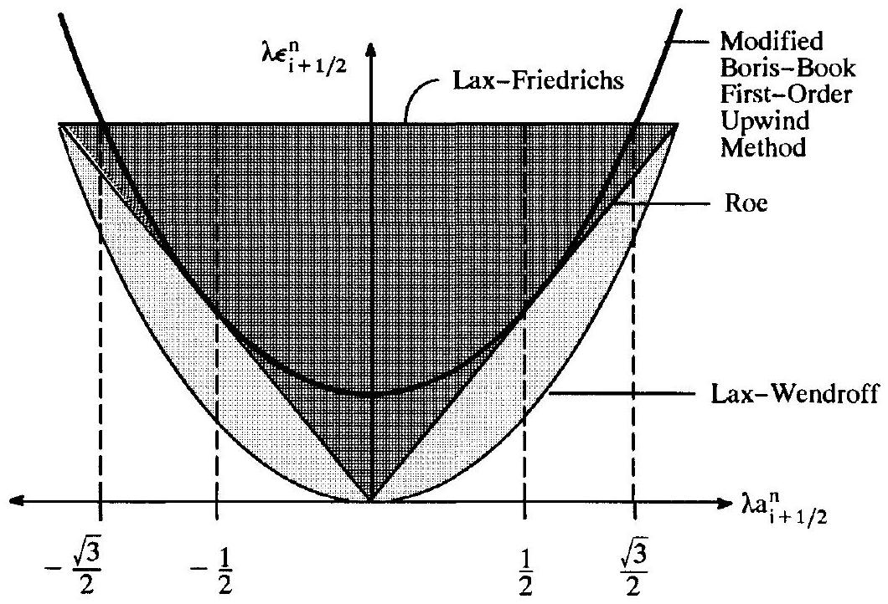
Figure 21.1 The artificial viscosity of the modified Boris-Book first-order upwind method compared with the other simple methods.

in numerical tests, the only major differences between the modified Boris-Book first-order upwind method and Roe's first-order upwind method occur at low CFL numbers $\lambda a_{i+1 / 2}^{n}$, where the modified Boris-Book first-order upwind method has a good deal more artificial viscosity than Roe's first-order upwind method. The increased artificial viscosity at low CFL numbers improves expansive sonic point capturing, degrades compressive sonic point capturing such as those found in steady or slowly moving shocks, and makes the modified Boris-Book first-order upwind method extremely dissipative at low CFL numbers, relative to Roe's first-order upwind method. According to extensive numerical tests, the modified Boris-Book first-order upwind method has the same nonlinear stability properties as Roe's first-order upwind method, including the range diminishing property described in Section 16.3 , except possibly for CFL numbers near the upper bound $\sqrt{3} / 2 \approx 0.866$. In other words, for low enough CFL numbers, the modified Boris-Book first-order upwind method does not allow maxima to increase, does not allow minima to decrease, and does not allow new extrema, a nonlinear stability condition originally suggested by Boris and Book (1973).

With the modified Boris-Book first-order upwind method under our belts, we are now ready to describe the Boris-Book flux-corrected method. Whereas the original Boris-Book flux-corrected method is a two-step predictor-corrector method, this section will begin by describing a one-step version. The one-step version helps to introduce the two-step version and, furthermore, helps to expose the connections between one-step flux-corrected methods and the one-step flux-limited methods seen in the last chapter. Consider the Lax-Wendroff method:

$$
\begin{aligned}
& u_{i}^{n+1}=u_{i}^{n}-\left(\lambda \hat{f}_{i+1 / 2}^{\mathrm{L}-\mathrm{W}}-\lambda \hat{f}_{i-1 / 2}^{\mathrm{L}-\mathrm{W}}\right) \\
& \lambda \hat{f}_{i+1 / 2}^{\mathrm{L}-\mathrm{W}}=\frac{\lambda}{2}\left(f\left(u_{i+1}^{n}\right)+f\left(u_{i}^{n}\right)\right)-\frac{1}{2}\left(\lambda a_{i+1 / 2}^{n}\right)^{2}\left(u_{i+1}^{n}-u_{i}^{n}\right) .
\end{aligned}
$$

Also consider the modified Boris-Book first-order upwind method:

$$
\begin{aligned}
& u_{i}^{n+1}=u_{i}^{n}-\left(\lambda \hat{f}_{i+1 / 2}^{\mathrm{B}-\mathrm{B}}-\lambda \hat{f}_{i-1 / 2}^{\mathrm{B}-\mathrm{B}}\right) \\
& \lambda \hat{f}_{i+1 / 2}^{\mathrm{B}-\mathrm{B}}=\frac{\lambda}{2}\left(f\left(u_{i+1}^{n}\right)+f\left(u_{i}^{n}\right)\right)-\frac{1}{2}\left(\left(\lambda a_{i+1 / 2}^{n}\right)^{2}+\frac{1}{4}\right)\left(u_{i+1}^{n}-u_{i}^{n}\right)
\end{aligned}
$$

Combining the Lax-Wendroff method and the Boris-Book first-order upwind method, the one-step Boris-Book flux-corrected method is as follows:

$$
\begin{aligned}
& u_{i}^{n+1}=u_{i}^{n}-\left(\lambda \hat{f}_{i+1 / 2}^{n}-\lambda \hat{f}_{i-1 / 2}^{n}\right), \\
& \lambda \hat{f}_{i+1 / 2}^{n}=\lambda \hat{f}_{i+1 / 2}^{\mathrm{B}-\mathrm{B}}+\lambda \hat{f}_{i+1 / 2}^{(\mathrm{C})},
\end{aligned}
$$

where $\hat{f}_{i+1 / 2}^{(\mathrm{C})}$ is the corrective numerical flux. The corrective flux can be written as

$$
\lambda \hat{f}_{i+1 / 2}^{(\mathrm{C})}=\operatorname{diff}_{i+1 / 2}^{n}\left(\lambda \hat{f}_{i+1 / 2}^{\mathrm{B}-\mathrm{B}}, \lambda \hat{f}_{i+1 / 2}^{\mathrm{L}-\mathrm{W}}\right)
$$

where diff $_{i+1 / 2}^{n}$ is any differencing function. Alternatively, if you prefer, the corrective flux can be written in terms of a flux limiter $\phi_{i+1 / 2}^{n}$ rather than a differencing function as follows:

$$
\lambda \hat{f}_{i+1 / 2}^{(\mathrm{C})}=\phi_{i+1 / 2}^{n}\left(\lambda \hat{f}_{i+1 / 2}^{\mathrm{L}-\mathrm{W}}-\lambda \hat{f}_{i+1 / 2}^{\mathrm{B}-\mathrm{B}}\right)
$$

or, equivalently,

$$
\lambda \hat{f}_{i+1 / 2}^{(\mathrm{C})}=\frac{1}{8} \phi_{i+1 / 2}^{n}\left(u_{i+1}^{n}-u_{i}^{n}\right) .
$$

To choose the flux correction, consider two conditions. As the first condition, $\lambda \hat{f}_{i+1 / 2}^{n}$ must remain between $\lambda \hat{f}_{i+1 / 2}^{\mathrm{B}-\mathrm{B}}$ and $\lambda \hat{f}_{i+1 / 2}^{\mathrm{L}-\mathrm{W}}$. That is, let us require that

$$
\min \left(\lambda \hat{f}_{i+1 / 2}^{\mathrm{B}-\mathrm{B}}, \lambda \hat{f}_{i+1 / 2}^{\mathrm{L}-\mathrm{W}}\right) \leq \lambda \hat{f}_{i+1 / 2}^{n} \leq \max \left(\lambda \hat{f}_{i+1 / 2}^{\mathrm{B}-\mathrm{B}}, \lambda \hat{f}_{i+1 / 2}^{\mathrm{L}-\mathrm{W}}\right)
$$

or

$$
\min \left(\lambda \hat{f}_{i+1 / 2}^{\mathrm{B}-\mathrm{B}}, \lambda \hat{f}_{i+1 / 2}^{\mathrm{L}-\mathrm{W}}\right) \leq \lambda \hat{f}_{i+1 / 2}^{\mathrm{B}-\mathrm{B}}+\lambda \hat{f}_{i+1 / 2}^{(\mathrm{C})} \leq \max \left(\lambda \hat{f}_{i+1 / 2}^{\mathrm{B}-\mathrm{B}}, \lambda \hat{f}_{i+1 / 2}^{\mathrm{L}-\mathrm{W}}\right)
$$

or

$$
\min \left(0, \lambda \hat{f}_{i+1 / 2}^{\mathrm{L}-\mathrm{W}}-\lambda \hat{f}_{i+1 / 2}^{\mathrm{B}-\mathrm{B}}\right) \leq \lambda \hat{f}_{i+1 / 2}^{(\mathrm{C})} \leq \max \left(0, \lambda \hat{f}_{i+1 / 2}^{\mathrm{L}-\mathrm{W}}-\lambda \hat{f}_{i+1 / 2}^{\mathrm{B}-\mathrm{B}}\right)
$$

or

$$
\min \left(0, \frac{1}{8}\left(u_{i+1}^{n}-u_{i}^{n}\right)\right) \leq \lambda \hat{f}_{i+1 / 2}^{(\mathrm{C})} \leq \max \left(0, \frac{1}{8}\left(u_{i+1}^{n}-u_{i}^{n}\right)\right) .
$$

Equivalently, referring to Equation (21.2), let us require that

$$
0 \leq \phi_{i+1 / 2}^{n} \leq 1
$$

Thus, when written in flux-limited form, $\lambda \hat{f}_{i+1 / 2}^{n}$ is a convex linear combination of $\lambda \hat{f}_{i+1 / 2}^{\mathrm{B}-\mathrm{B}}$ and $\lambda \hat{f}_{i+1 / 2}^{\mathrm{L}-\mathrm{W}}$.

As the second condition, let us require that $\lambda \hat{f}_{i+1 / 2}^{n} \approx \lambda \hat{f}_{i+1 / 2}^{\mathrm{B}-\mathrm{B}}$ near maxima and minima, and let us require that $\lambda \hat{f}_{i+1 / 2}^{n} \approx \lambda \hat{f}_{i+1 / 2}^{\mathrm{L}-\mathrm{W}}$ otherwise. In other words, flux-corrected methods focus on spurious oscillations and extrema rather than on the shocks that typically cause
spurious oscillations and extrema, just like the flux-limited methods seen in the last chapter. Written in terms of the corrective flux, the second condition is

$$
\lambda \hat{f}_{i+1 / 2}^{(\mathrm{C})} \approx \begin{cases}0 & \text { near extrema, } \\ \lambda \hat{f}_{i+1 / 2}^{\mathrm{L}-\mathrm{W}}-\lambda \hat{f}_{i+1 / 2}^{\mathrm{B}-\mathrm{B}}=\frac{1}{8}\left(u_{i+1}^{n}-u_{i}^{n}\right) & \text { otherwise. }\end{cases}
$$

Similarly, written in terms of flux limiters, the second condition is

$$
\phi_{i+1 / 2}^{n} \approx \begin{cases}0 & \text { near maxima and minima, } \\ 1 & \text { otherwise. }\end{cases}
$$

A simple flux correction that satisfies conditions (21.6) and (21.7) is as follows:

$$
\lambda \hat{f}_{i+1 / 2}^{(\mathrm{C})}=\operatorname{minmod}\left(u_{i}^{n}-u_{i-1}^{n}, \frac{1}{8}\left(u_{i+1}^{n}-u_{i}^{n}\right), u_{i+2}^{n}-u_{i+1}^{n}\right),
$$

where the minmod function equals the argument with the least absolute value if all of the arguments have the same sign and equals zero otherwise. Equivalently,

$$
\phi_{i+1 / 2}^{n}=\operatorname{minmod}\left(8 r_{i}^{+}, 1, \frac{8}{r_{i+1}^{+}}\right)
$$

where

$$
r_{i}^{+}=\frac{u_{i}^{n}-u_{i-1}^{n}}{u_{i+1}^{n}-u_{i}^{n}}
$$

and where the following property of the minmod function has been used:

$$
c \min \bmod \left(x_{1}, \ldots, x_{n}\right)=\min \bmod \left(c x_{1}, \ldots, c x_{n}\right)
$$

for any $c$.
Let us prove that Equation (21.8) satisfies conditions (21.6) and (21.7). The minmod function has the following property:

$$
\begin{array}{ll}
0 \leq \operatorname{minmod}\left(x_{1}, \ldots, x_{n}\right) \leq x_{i} & \text { if } x_{i}>0 \\
x_{i} \leq \operatorname{minmod}\left(x_{1}, \ldots, x_{n}\right) \leq 0 & \text { if } x_{i}<0
\end{array}
$$

for all $i$, which immediately proves that Equation (21.8) satisfies condition (21.6). Also, the minmod function equals zero if any two arguments have opposite signs, which immediately proves that Equation (21.8) satisfies the first half of condition (21.7). Finally, if all of its arguments have the same sign, the minmod function chooses the argument with the least absolute value, which immediately proves that Equation (21.8) satisfies the second half of condition (21.7), unless the first differences of the solution change by a factor greater than eight or, more specifically, unless $\left|u_{i+1}^{n}-u_{i}^{n}\right|>8\left|u_{i}^{n}-u_{i-1}^{n}\right|$ or $\left|u_{i+1}^{n}-u_{i}^{n}\right|> 8\left|u_{i+2}^{n}-u_{i+1}^{n}\right|$; in this case, Equation (21.8) satisfies the first half of condition (21.7). As discussed in Section 20.0, large changes in first differences are associated with shocks, which may cause the Lax-Wendroff method to oscillate. To help prevent this, when the first differences change rapidly enough, Equation (21.8) blends the Lax-Wendroff method with the modified Boris-Book first-order upwind method. This completes the description of the one-step Boris-Book flux-corrected method.

As briefly mentioned in the last chapter, flux-limited methods may be either one step or two steps. For example, in the Davis-Roe flux-limited method, the one-step Lax-Wendroff method may be replaced by the two-step MacCormack's method, as mentioned in Section 20.4. By a similar token, the one-step Boris-Book flux-corrected method also has a two-step version. Like the Davis-Roe flux-limited method, a two-step version may result from replacing the one-step Lax-Wendroff method by the two-step MacCormack's method. However, flux-corrected methods usually use a different two-step approach with the first step being a first-order upwind method and the second step a second-order flux correction. Specifically, the two-step Boris-Book flux-corrected method has the following predictor:

$$
\text { - } \quad \bar{u}_{i}=u_{i}^{n}-\lambda\left(\hat{f}_{i+1 / 2}^{\mathrm{B}-\mathrm{B}}-\hat{f}_{i-1 / 2}^{\mathrm{B}-\mathrm{B}}\right)
$$

and the following corrector:

$$
\text { - } \quad u_{i}^{n+1}=\bar{u}_{i}-\lambda\left(\hat{f}_{i+1 / 2}^{(\mathrm{C})}-\hat{f}_{i-1 / 2}^{(\mathrm{C})}\right) \text {. }
$$

The corrective flux is

$$
-\quad \lambda \hat{f}_{i+1 / 2}^{(\mathrm{C})}=\operatorname{minmod}\left(\bar{u}_{i}-\bar{u}_{i-1}, \frac{1}{8}\left(\bar{u}_{i+1}-\bar{u}_{i}\right), \bar{u}_{i+2}-\bar{u}_{i+1}\right)
$$

or, equivalently,

$$
\lambda \hat{f}_{i+1 / 2}^{(\mathrm{C})}=\frac{\lambda}{8} \phi_{i+1 / 2}^{n}\left(\bar{u}_{i+1}^{n}-\bar{u}_{i}^{n}\right),
$$

where

$$
\phi_{i+1 / 2}^{n}=\operatorname{minmod}\left(1,8 \bar{r}_{i}^{n}, \frac{8}{\bar{r}_{i+1}^{n}}\right)
$$

and where

$$
\bar{r}_{i}^{+}=\frac{\bar{u}_{i}^{n}-\bar{u}_{i-1}^{n}}{\bar{u}_{i+1}^{n}-\bar{u}_{i}^{n}}
$$

Notice that Equation (21.13) is exactly the same as Equation (21.8), except that the predicted solution $\bar{u}_{i}^{n}$ replaces $u_{i}^{n}$. This book will use the term "flux corrected" for both one-step and two-step methods. Boris and Book called their two-step method a flux-corrected transport (FCT) method so that, by tradition, the term "transport" signals a two-step rather than a one-step flux-corrected method.

In this section, the flux correction was derived more intuitively than rigorously, more in the freer spirit of the self-adjusting hybrid methods seen in the next chapter rather than the cautious spirit of the flux-limited methods seen in the last chapter. However, like any fluxaveraged method, flux-corrected methods can be designed to rigorously satisfy nonlinear stability conditions. In fact, in the original paper, Boris and Book (1973) first proposed the range diminishing condition discussed in Section 16.3. More specifically, Boris and Book state that the "crucial factor" is that the corrector "should generate no new maxima or minima in the solution, nor should it accentuate the existing extrema." Boris and Book also proposed the upwind range condition discussed in Section 16.5, stating that a method should not "push the solution value at any grid point beyond the solution value at neighboring points." They claimed that "by means of a few trials, the reader can readily convince himself" that their flux-corrected transport method satisfies the upwind range condition. However, numerical
results contradict this assertion: Both the one-step and the two-step versions of the BorisBook flux-corrected method may exhibit spurious overshoots and oscillations, especially for large CFL numbers. No oscillations were observed in the results given in the original paper, since Boris and Book used only small CFL numbers, such as $\lambda a=0.2$.

One advantage that two-step flux correction has over one-step flux correction is that it can be used even for equations whose exact solutions oscillate. In particular, suppose that the first-order method allows new oscillations, just like the governing equations, but does not allow false oscillations. Then the second-order flux correction should not create any new oscillations, nor allow oscillations in the predicted solution to increase, which means that the second-order flux correction may be designed in the usual way, using the criteria of Chapter 16. This was observed by Boris and Book (1973) in the original paper (see Figure 5 and the associated discussion). Outside of the rarefied realm of scalar conservation laws and the one-dimensional Euler equations, many governing equations routinely create large oscillations. Thus two-step flux correction has excellent potential for broader applications, provided that you can somehow find a nonoscillatory but otherwise inaccurate method to use for a predictor.

In the original paper, and in two sequels to the original paper, Boris and Book (1973, 1975, 1976) described numerous variants on flux-corrected transport, as well as various implementation details. Unlike most of the methods suggested in the 1970s, flux-corrected transport has survived surprisingly intact. This is a tribute to FCT's forward-looking concepts and techniques, which form a surprising percentage of the foundations of modern computational gasdynamics.

The behavior of the Boris-Book two-step flux-corrected method is illustrated using the five standard test cases defined in Section 17.0. Unfortunately, although it does not blow up, the Boris-Book two-step flux-corrected method behaves badly for the usual value $\lambda=0.8$ and, in particular, the solutions contain large spurious overshoots and oscillations and excessive dissipation. Thus, to give the method a fair hearing, all of the following calculations use $\lambda=0.6$.

Test Case 1 As seen in Figure 21.2, the Boris-Book two-step flux-corrected method captures the sinusoid with only modest clipping.

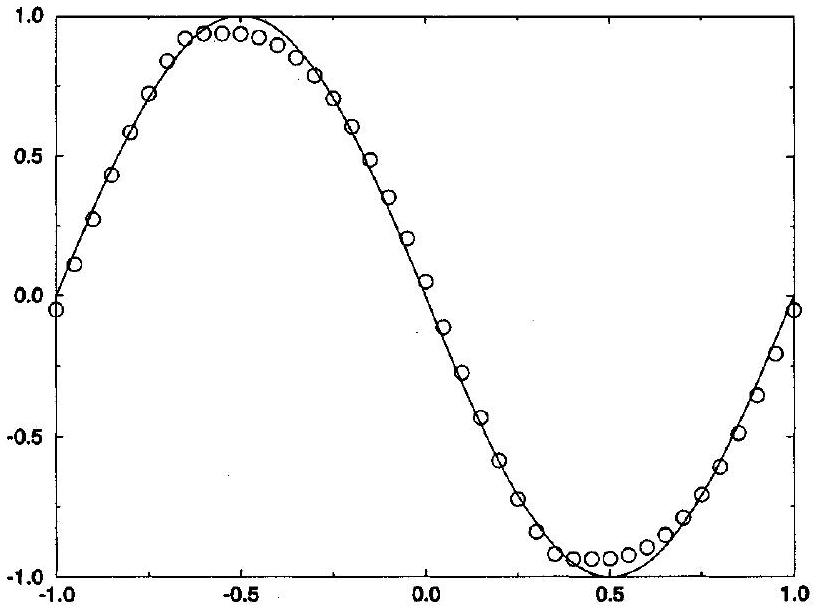
Figure 21.2 Boris-Book two-step flux-corrected method for Test Case 1.

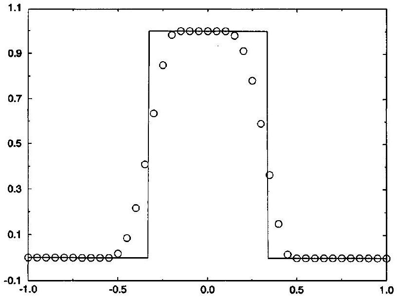
Figure 21.3 Boris-Book two-step flux-corrected method for Test Case 2.

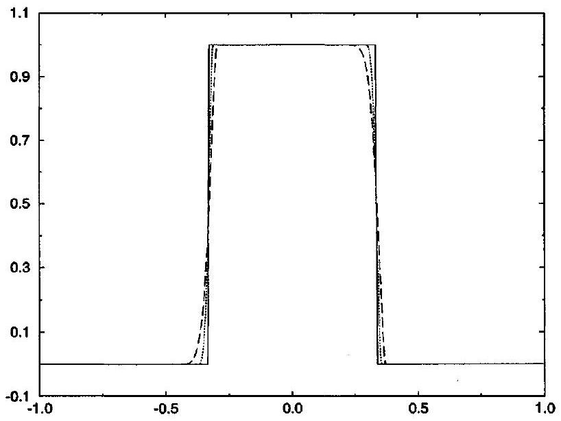
Figure 21.4 Boris-Book two-step flux-corrected method for Test Case 3.

Test Case 2 As seen in Figure 21.3, the Boris-Book two-step flux-corrected method captures the square wave extremely well, with only moderate smearing, and no spurious oscillations and overshoots. The only method seen so far that could better this performance is Sweby's flux-limited method with the superbee flux limiter which, by design, has an unfair advantage in this test case; see Section 20.2.

Test Case 3 In Figure 21.4, the dotted line represents the Boris-Book two-step flux-corrected approximation to $u(x, 4)$, the long dashed line represents the Boris-Book two-step flux-corrected approximation to $u(x, 40)$, and the solid line represents the exact solution for $u(x, 4)$ or $u(x, 40)$.

Test Case 4 The results, seen in Figure 21.5, are about as good as any seen so far.

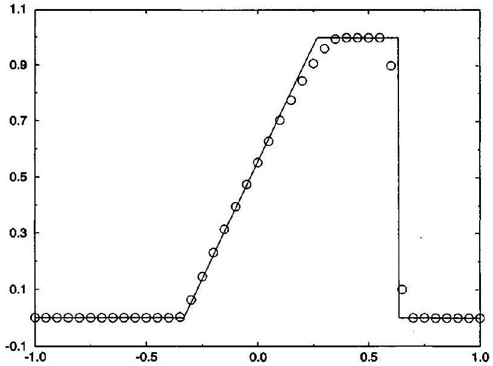
Figure 21.5 Boris-Book two-step flux-corrected method for Test Case 4.

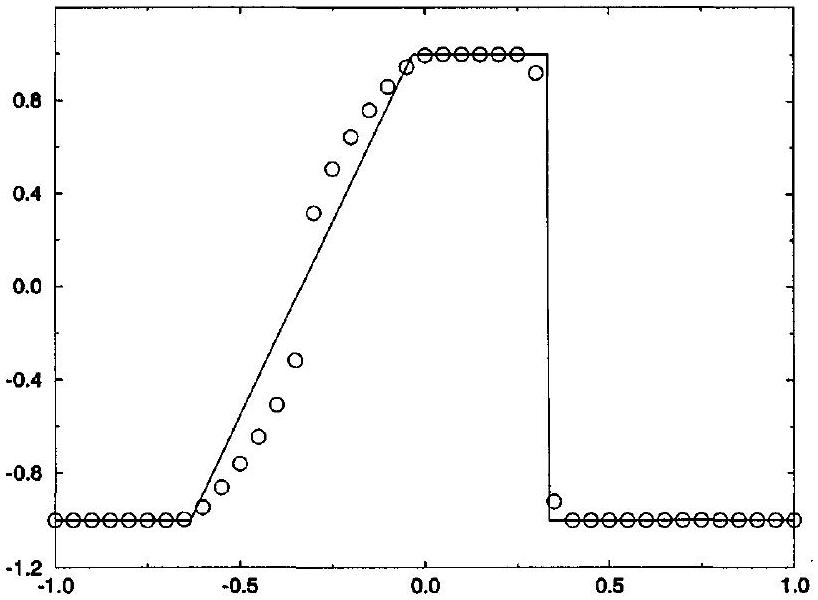
Figure 21.6 Boris-Book two-step flux-corrected method for Test Case 5.

Test Case 5 As seen in Figure 21.6, the solution jumps across the expansive sonic point.

### 21.2 Zalesak's Flux-Corrected Methods (FCT)

Zalesak (1979) generalized the two-step Boris-Book flux-corrected transport method. Like the previous section, this section only concerns scalar conservation laws. Zalesak's original paper is more a philosophical treatise than a proposal for any specific new methods. The paper suggests numerous possible avenues for development, some of which have been hotly pursued, and some of which have lapsed into obscurity. Most importantly, Zalesak described generalized flux-corrected methods, in which the first- and second-order accurate methods can be anything you like. Although it makes a nice mate for the Lax-Wendroff method, and performs relatively well at expansive sonic points, the modified Boris-Book
first-order upwind method is arguably otherwise inferior to most competing first-order upwind methods such as Roe's first-order upwind method. So consider any first-order accurate method:

$$
\lambda \hat{f}_{i+1 / 2}^{(1)}=\frac{\lambda}{2}\left(f\left(u_{i+1}^{n}\right)+f\left(u_{i}^{n}\right)\right)-\frac{1}{2} \lambda \epsilon_{i+1 / 2}^{(1)}\left(u_{i+1}^{n}-u_{i}^{n}\right)
$$

and any second-order accurate method:

$$
\lambda \hat{f}_{i+1 / 2}^{(2)}=\frac{\lambda}{2}\left(f\left(u_{i+1}^{n}\right)+f\left(u_{i}^{n}\right)\right)-\frac{1}{2} \lambda \epsilon_{i+1 / 2}^{(2)}\left(u_{i+1}^{n}-u_{i}^{n}\right) .
$$

The only restriction on $\hat{f}_{i+1 / 2}^{(1)}$ and $\hat{f}_{i+1 / 2}^{(2)}$ is as follows:

$$
\operatorname{sign}\left(\lambda \hat{f}_{i+1 / 2}^{(2)}-\lambda \hat{f}_{i+1 / 2}^{(1)}\right)=\operatorname{sign}\left(u_{i+1}^{n}-u_{i}^{n}\right)
$$

or

$$
\operatorname{sign}\left[\left(\epsilon_{i+1 / 2}^{(1)}-\epsilon_{i+1 / 2}^{(2)}\right)\left(u_{i+1}^{n}-u_{i}^{n}\right)\right]=\operatorname{sign}\left(u_{i+1}^{n}-u_{i}^{n}\right)
$$

or

$$
\epsilon_{i+1 / 2}^{(1)} \geq \epsilon_{i+1 / 2}^{(2)}
$$

Then the flux difference $\lambda \hat{f}_{i+1 / 2}^{(2)}-\lambda \hat{f}_{i+1 / 2}^{(1)}$ is called antidissipative. Then Zalesak's generalized flux-corrected transport methods have the following predictor:

$$
-\quad \bar{u}_{i}=u_{i}^{n}-\lambda\left(\hat{f}_{i+1 / 2}^{(1)}-\hat{f}_{i-1 / 2}^{(1)}\right)
$$

and the following corrector:

$$
\text { - } \quad u_{i}^{n+1}=\bar{u}_{i}-\lambda\left(\hat{f}_{i+1 / 2}^{(\mathrm{C})}-\hat{f}_{i-1 / 2}^{(\mathrm{C})}\right) \text {. }
$$

The corrective or antidissipative flux is

$$
\lambda \quad \lambda \hat{f}_{i+1 / 2}^{(\mathrm{C})}=\operatorname{minmod}\left(\bar{u}_{i}-\bar{u}_{i-1}, \lambda \hat{f}_{i+1 / 2}^{(2)}-\lambda \hat{f}_{i-1 / 2}^{(1)}, \bar{u}_{i+2}-\bar{u}_{i+1}\right) \text {, }
$$

where $\lambda \hat{f}_{i+1 / 2}^{(2)}-\lambda \hat{f}_{i+1 / 2}^{(1)}$ is usually taken as a function of the corrected solution $\bar{u}_{i}$. Compared to the Boris-Book flux-corrected method seen in the last section, Zalesak replaced $\hat{f}_{i+1 / 2}^{(1)}$ and $\hat{f}_{i+1 / 2}^{(2)}$ but not the averaging function minmod (for an even more general fluxcorrected transport method, another function may replace minmod in Equation (21.20)). By tradition, flux-corrected transport methods use a wide variety of different component methods $\lambda \hat{f}_{i+1 / 2}^{(2)}$ and $\lambda \hat{f}_{i+1 / 2}^{(1)}$ but use relatively few other averages besides minmod. By contrast, flux-limiting methods and self-adjusting hybrid methods traditionally use a wide variety of different averages - see Equations such as (20.21)-(20.24) and (20.26) - but use relatively few different component methods. Notice that Zalesak's flux-corrected transport method becomes the Boris-Book flux-corrected transport method if $\lambda \hat{f}_{i+1 / 2}^{(1)}=\lambda \hat{f}_{i+1 / 2}^{\mathrm{B}-\mathrm{B}}$ and $\lambda \hat{f}_{i+1 / 2}^{(2)}=\lambda \hat{f}_{i+1 / 2}^{\mathrm{L}-\mathrm{W}}$.

Zalesak's generalized flux-corrected transport method satisfies:

$$
\min \left(\hat{f}_{i+1 / 2}^{(1)}, \hat{f}_{i+1 / 2}^{(2)}\right) \leq \hat{f}_{i+1 / 2}^{n} \leq \max \left(\hat{f}_{i+1 / 2}^{(1)}, \hat{f}_{i+1 / 2}^{(2)}\right),
$$

which follows immediately from Equation (21.11). Also, $\hat{f}_{i+1 / 2}^{(\mathrm{C})}=0$ near extrema in the predicted solution. To prove this, by Equation (21.18a), remember that $\lambda \hat{f}_{i+1 / 2}^{(2)}-\lambda \hat{f}_{i+1 / 2}^{(1)}$
has the same sign as $\bar{u}_{i+1}^{n}-\bar{u}_{i}^{n}$. Then the arguments of the minmod function in Equation (21.20) have opposite signs if $\bar{u}_{i}^{n}$ or $\bar{u}_{i+1}^{n}$ are extrema. But the minmod function equals zero if any of its arguments have opposite signs. Finally, $\hat{f}_{i+1 / 2}^{(\mathrm{C})}=\hat{f}_{i+1 / 2}^{(2)}-\hat{f}_{i+1 / 2}^{(1)}$ away from extrema unless the first differences of the solution change by greater than a factor of $1 /\left(\lambda \epsilon_{i+1 / 2}^{(1)}-\lambda \epsilon_{i+1 / 2}^{(2)}\right)$.

As far as nonlinear stability goes, Zalesak showed that his method satisfies the following weak nonlinear stability condition:

$$
\min \left(\bar{u}_{i-1}, \bar{u}_{i}, \bar{u}_{i+1}\right) \leq u_{i}^{n+1} \leq \max \left(\bar{u}_{i-1}, \bar{u}_{i}, \bar{u}_{i+1}\right) .
$$

This condition allows more oscillations than flux-corrected methods generally display, and thus perhaps understates their performance.

### 21.3 Harten's Flux-Corrected Method (TVD)

### 21.3.1 Scalar Conservation Laws

This section concerns another approach to flux correction. In this section, instead of correcting the numerical flux $\hat{f}_{i+1 / 2}^{n}$ we shall correct the physical flux $f(u)$. From Section 15.3 , recall that a numerical approximation does not solve the true governing equation: It solves a modified equation, which equals the true governing equation plus additional terms. Then applying a numerical approximation to the wrong governing equation may yield a better answer than applying a numerical approximation to the right governing equation, provided that the "wrong" governing equation is cunningly constructed, so as to reduce or eliminate terms in the modified equation. It's just reverse psychology. From Section 17.3, recall Roe's first-order upwind method:

$$
u_{i}^{n+1}=u_{i}^{n}-\lambda\left(\hat{f}_{i+1 / 2}^{\mathrm{ROE}}-\hat{f}_{i-1 / 2}^{\mathrm{ROE}}\right),
$$

where

$$
\hat{f}_{i+1 / 2}^{\mathrm{ROE}}=\frac{1}{2}\left(f\left(u_{i+1}^{n}\right)+f\left(u_{i}^{n}\right)\right)-\frac{1}{2}\left|a_{i+1 / 2}^{n}\right|\left(u_{i+1}^{n}-u_{i}^{n}\right)
$$

or, equivalently,

$$
\hat{f}_{i+1 / 2}^{\mathrm{ROE}}=\frac{1}{2}\left(f\left(u_{i+1}^{n}\right)+f\left(u_{i}^{n}\right)-\left|\frac{f\left(u_{i+1}^{n}\right)-f\left(u_{i}^{n}\right)}{u_{i+1}^{n}-u_{i}^{n}}\right|\left(u_{i+1}^{n}-u_{i}^{n}\right)\right),
$$

where this last expression requires the usual modification when $u_{i+1}^{n}-u_{i}^{n}=0$. Roe's firstorder upwind method has a number of extremely desirable nonlinear stability properties, such as the upwind range condition, as discussed in Section 17.3. Naturally enough, Roe's first-order upwind method retains its nonlinear stability properties regardless of the fluxfunction. In particular, Roe's first-order upwind method retains its nonlinear stability properties if $f\left(u_{i}^{n}\right)$ is replaced by some new flux function $g_{i}^{n}$ as follows:

$$
\begin{aligned}
& u_{i}^{n+1}=u_{i}^{n}-\lambda\left(\hat{g}_{i+1 / 2}^{n}-\hat{g}_{i-1 / 2}^{n}\right), \\
& \hat{g}_{i+1 / 2}^{n}=\frac{1}{2}\left(g_{i+1}^{n}+g_{i}^{n}-\left|\frac{g_{i+1}^{n}-g_{i}^{n}}{u_{i+1}^{n}-u_{i}^{n}}\right|\left(u_{i+1}^{n}-u_{i}^{n}\right)\right) .
\end{aligned}
$$

Although replacing $f\left(u_{i}^{n}\right)$ by $g_{i}^{n}$ does not affect nonlinear stability, it certainly affects accuracy, either for better or for worse. Suppose that

$$
\quad g_{i}^{n}=f\left(u_{i}^{n}\right)+f_{i}^{(\mathrm{C})} \text {. }
$$

Then $f_{i}^{(\mathrm{C})}$ is called a physical flux correction, as opposed to the numerical flux corrections $\hat{f}_{i+1 / 2}^{(\mathrm{C})}$ seen in the last two sections. Physical and numerical flux corrections differ by when they apply their correction - before or after discretization - and by how easily they allow you to enforce accuracy and stability conditions. With numerical flux correction, it is easy to enforce higher-order accuracy but hard to enforce nonlinear stability conditions such as the upwind range condition. By contrast, with physical flux correction, it is easy to enforce nonlinear stability but hard to enforce higher-order accuracy. This last point helps to explain why, unlike the Boris-Book flux-corrected method, Harten's flux-corrected method has never been generalized to use other first-generation methods besides the Lax-Wendroff method or to use other averages besides minmod. In 1981, Harten suggested the following physical flux correction:

$$
\quad f_{i}^{(\mathrm{C})}=\operatorname{minmod}\left(\hat{f}_{i+1 / 2}^{\mathrm{L}-\mathrm{W}}-\hat{f}_{i+1 / 2}^{\mathrm{ROE}}, \hat{f}_{i-1 / 2}^{\mathrm{L}-\mathrm{W}}-\hat{f}_{i-1 / 2}^{\mathrm{ROE}}\right) .
$$

Equations (21.23), (21.24), and (21.25) collectively constitute Harten's flux-corrected method. By the way, to avoid expansive sonic point problems, Harten's first-order upwind method, described in Subsection 17.3.3, may replace Roe's first-order upwind method in all of the preceding equations. In fact, Harten (1983) contains the first description of Harten's firstorder upwind method; the original paper calls it an entropy-fixed version of Roe's first-order upwind method, designed to improve expansive sonic point capturing.

Harten's flux-corrected method is second-order accurate except at extrema, where it is between first- and second-order accurate. More specifically,

$$
\hat{g}_{i+1 / 2}^{n}=f_{i+1 / 2}^{\mathrm{ROE}}
$$

if $u_{i}^{n}$ is an extremum and

$$
\hat{g}_{i+1 / 2}^{n}=f_{i+1 / 2}^{\mathrm{L}-\mathrm{W}}+O\left(\Delta x^{2}\right)
$$

if $u_{i}^{n}$ is not an extremum.
To prove Equation (21.26), first notice that

$$
\hat{f}_{i+1 / 2}^{\mathrm{L}-\mathrm{W}}-\hat{f}_{i+1 / 2}^{\mathrm{ROE}}=\frac{1}{2}\left(\left|a_{i+1 / 2}^{n}\right|-\lambda\left(a_{i+1 / 2}\right)^{2}\right)\left(u_{i+1}^{n}-u_{i}^{n}\right) .
$$

Then

$$
\operatorname{sign}\left(\hat{f}_{i+1 / 2}^{\mathrm{L}-\mathrm{W}}-\hat{f}_{i+1 / 2}^{\mathrm{ROE}}\right)=\operatorname{sign}\left(u_{i+1}^{n}-u_{i}^{n}\right)
$$

for $\lambda\left|a_{i+1 / 2}^{n}\right| \leq 1$. If $u_{i}^{n}$ is an extremum, then $u_{i+1}^{n}-u_{i}^{n}$ and $u_{i}^{n}-u_{i-1}^{n}$ have opposite signs. Then $\hat{f}_{i+1 / 2}^{\mathrm{L}-\mathrm{W}}-\hat{f}_{i+1 / 2}^{\mathrm{ROE}}$ and $\hat{f}_{i-1 / 2}^{\mathrm{L}-\mathrm{W}}-\hat{f}_{i-1 / 2}^{\mathrm{ROE}}$ have opposite signs. Consequently, the minmod average of $\hat{f}_{i+1 / 2}^{\mathrm{L}-\mathrm{W}}-\hat{f}_{i+1 / 2}^{\mathrm{ROE}}$ and $\hat{f}_{i-1 / 2}^{\mathrm{L}-\mathrm{W}}-\hat{f}_{i-1 / 2}^{\mathrm{ROE}}$ equals zero. Then $f_{i}^{(\mathrm{C})}=0, g_{i}^{n}=f\left(u_{i}^{n}\right)$, and $\hat{g}_{i+1 / 2}^{n}=\hat{f}_{i+1 / 2}^{\mathrm{ROE}}$, which proves Equation (21.26). The proof of Equation (21.27) is omitted; although not difficult, the proof is long and tedious.

In the original paper, Harten (1983) proposed the TVD condition discussed in Section 16.2 and the positivity condition proposed in Section 16.4. Harten also clarified the range diminishing condition proposed earlier by Boris and Book (1973) and seen in Section
16.3. However, in light of the above explanation, it is clear that Harten's nonlinear stability theory is completely unnecessary to justify Harten's flux-corrected method. Harten's fluxcorrected method naturally inherits all of the stability properties of one of the most stable classes of methods: first-order upwind methods such as Roe's first-order upwind method and Harten's first-order upwind method.

After devising the original explicit method, Harten (1984) suggested an implicit method, much like the implicit Yee-Roe flux-limited method seen in Section 20.5. See Yee, Warming, and Harten (1982, 1985a, 1985b, 1985c), Yee and Harten (1987), and Yee (1986, 1989) for implementation details, variations, and interesting numerical examples. Yee (1989) provides an especially nice review of Harten's implicit and explicit flux-corrected method, as well as a number of other flux-averaged methods.

Let us now briefly discuss artificial compression and its relationship to antidissipative physical flux correction. Among all the common flux limiters used in Sweby's method, seen in Section 20.2, the superbee limiter is the largest. In other words, the superbee limiter results in the largest correction to the first-order upwind method. Put yet another way, the superbee limiter adds the most antidissipation to the first-order upwind method. Not coincidentally, among all the common flux limiters, Roe's superbee limiter results in the most compressive approximations. Thus, since the superbee limiter reduces dissipation as much as possible, Sweby's flux-limited method with the superbee limiter captures expansion fans with less smearing than other limiters and in this sense provides compression at contacts, which do not naturally generate their own compression, unlike shocks. By a similar token, in Harten's flux-corrected method, increasing the flux correction $\left|f_{i}^{(\mathrm{C})}\right|$ increases compression, decreases dissipation, increases antidissipation (or however you want to put it), and thus reduces smearing at contacts. In particular, Yee, Warming, and Harten (1985a) suggest replacing Equation (21.25) by

$$
f_{i}^{(\mathrm{C})}=\left(1+\omega \theta_{i}^{n}\right) \min \bmod \left(\hat{f}_{i+1 / 2}^{\mathrm{L}-\mathrm{W}}-\hat{f}_{i+1 / 2}^{\mathrm{ROE}}, \hat{f}_{i-1 / 2}^{\mathrm{L}-\mathrm{W}}-\hat{f}_{i-1 / 2}^{\mathrm{ROE}}\right),
$$

where $\omega \geq 0$ is a user-adjustable parameter and where

$$
\theta_{i}^{n}=\frac{\left|u_{i+1}^{n}-2 u_{i}^{n}+u_{i-1}^{n}\right|}{\left|u_{i+1}^{n}-u_{i}^{n}\right|+\left|u_{i}^{n}-u_{i-1}^{n}\right|}
$$

is called a shock switch; the next chapter describes shock switches in great detail. Equations (21.28) and (21.29) are called artificial compression. Since $1+\omega \theta_{i}^{n} \geq 1$, artificial compression seen in Equation (21.28) always increases the size of antidissipative flux correction $\left|f_{i}^{(\mathrm{C})}\right|$ relative to Equation (21.25). Artificial compression requires extreme caution. While it can steepen contact discontinuities and shocks, which is good, it can also steepen smooth solution regions, which is bad. For example, without proper care, artificial compression may cause or strengthen spurious expansion shocks. Yee, Warming, and Harten (1985a) suggest $\omega=0$ (no artificial compression) in expansions and $\omega=2$ elsewhere. Artificial compression is discussed again in Section 22.2.

The behavior of Harten's flux-corrected method is illustrated using the five standard test cases defined in Section 17.0. The first four test cases use Roe's first-order upwind method. The fifth test case uses Harten's first-order upwind method with $\delta=0.5$.

Test Case 1 As seen in Figure 21.7, Harten's flux-corrected method captures the sinusoid well, albeit with somewhat above-average clipping at the extrema.

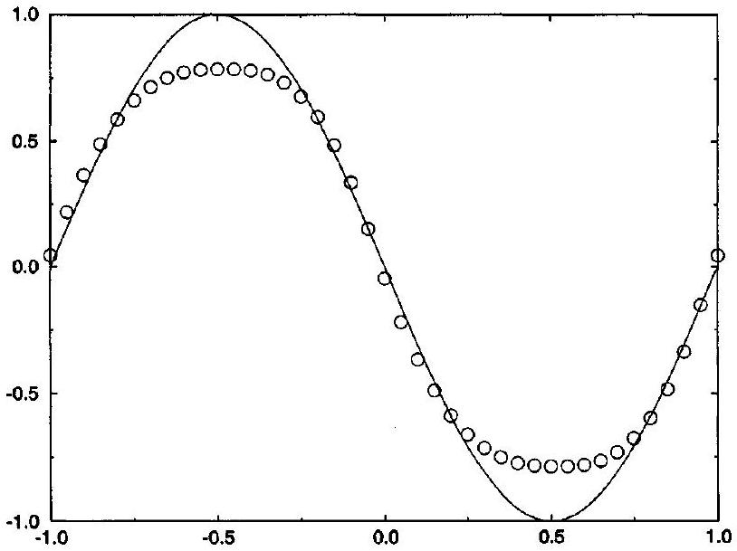
Figure 21.7 Harten's flux-corrected method for Test Case 1.

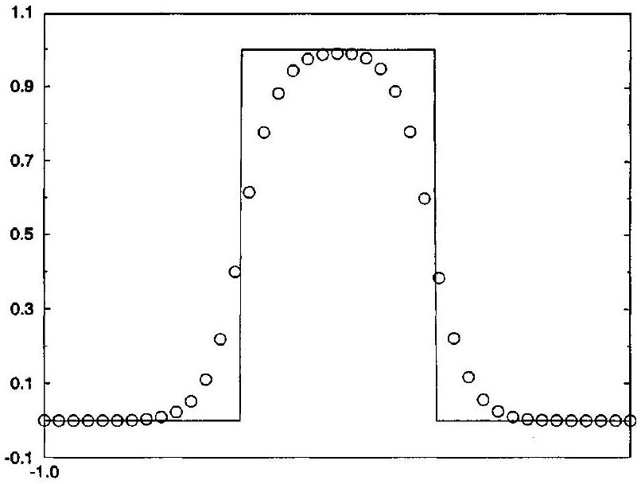
Figure 21.8 Harten's flux-corrected method for Test Case 2.

Test Case 2 As seen in Figure 21.8, Harten's flux-corrected method captures the square wave with a fairly typical amount of smearing, but with no overshoots or oscillations. The smearing can be reduced or eliminated by using artificial compression, as seen in Equations (21.28) and (21.29).

Test Case 3 In Figure 21.9, the dotted line represents Harten's flux-corrected approximation to $u(x, 4)$, the long dashed line represents Harten's flux-corrected approximation to $u(x, 40)$, and the solid line represents the exact solution for $u(x, 4)$ or $u(x, 40)$.

Test Case 4 As seen in Figure 21.10, the results are fine, if not extraordinary relative to methods seen earlier.

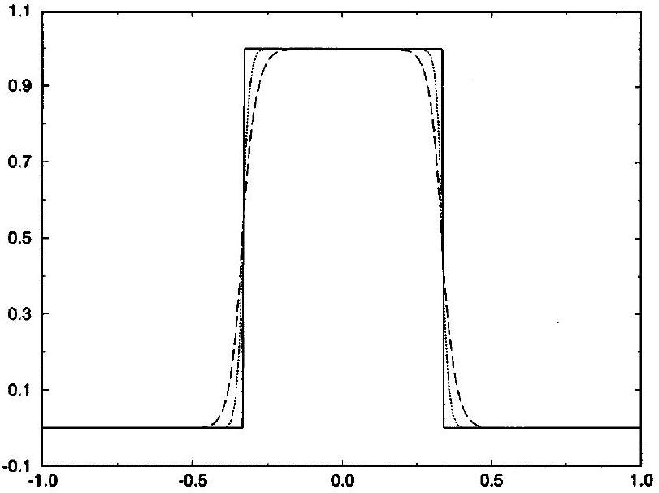
Figure 21.9 Harten's flux-corrected method for Test Case 3.

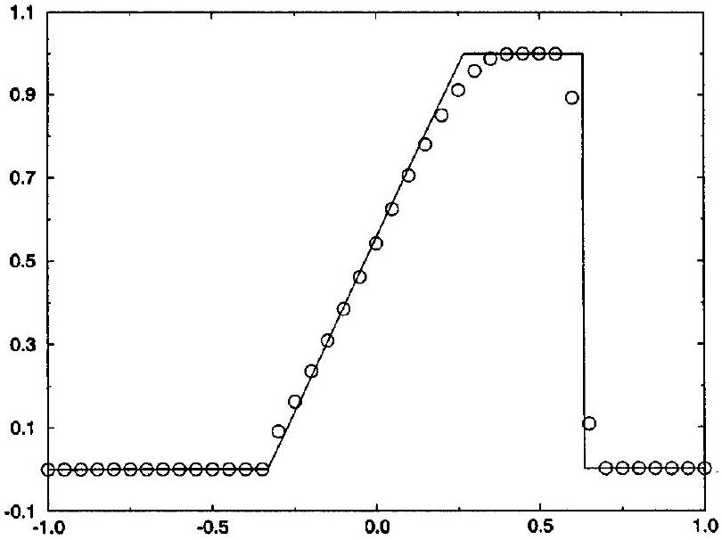
Figure 21.10 Harten's flux-corrected method for Test Case 4.

Test Case 5 As seen in Figure 21.11, the solution is fine except for a small jump near the expansive sonic point, which could be eliminated by increasing $\delta$.

### 21.3.2 The Euler Equations

Let $A_{i+1 / 2}^{n}$ be the Roe-average Jacobian matrix where $A_{i+1 / 2}^{n}=Q_{i+1 / 2} \Lambda_{i+1 / 2} Q_{i+1 / 2}^{-1}$. Let the columns of $Q_{i+1 / 2}$ be $\mathbf{r}_{i+1 / 2}^{n}$ and let the rows of $Q_{i+1 / 2}^{-1}$ be $\mathbf{l}_{i+1 / 2}^{n}$. Harten's flux-corrected method for the Euler equations is

$$
\mathbf{u}_{i}^{n+1}=\mathbf{u}_{i}^{n}-\lambda\left(\hat{\mathbf{g}}_{i+1 / 2}^{n}-\hat{\mathbf{g}}_{i-1 / 2}^{n}\right),
$$

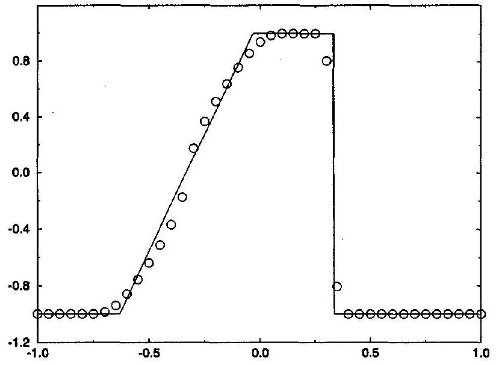
Figure 21.11 Harten's flux-corrected method for Test Case 5.

where

$$
\begin{aligned}
\hat{\mathbf{g}}_{i+1 / 2}^{n}= & \frac{1}{2}\left(\mathbf{f}\left(\mathbf{u}_{i+1}^{n}\right)+\mathbf{f}\left(\mathbf{u}_{i}^{n}\right)\right)+\frac{1}{2} \sum_{j=1}^{3}\left(\mathbf{r}_{i+1 / 2}^{n}\right)_{j}\left[\left(\mathbf{f}_{i+1}^{(\mathrm{C})}\right)_{j}+\left(\mathbf{f}_{i}^{(\mathrm{C})}\right)_{j}\right. \\
& \left.-\left|\lambda_{i+1 / 2}^{n}+\lambda_{i+1 / 2}^{(\mathrm{C})}\right|_{j}\left(\Delta v_{i+1 / 2}^{n}\right)_{j}\right]
\end{aligned}
$$

or, equivalently,

$$
\begin{aligned}
\hat{\mathbf{g}}_{i+1 / 2}^{n}= & \frac{1}{2}\left(\mathbf{f}\left(\mathbf{u}_{i+1}^{n}\right)+\mathbf{f}\left(\mathbf{u}_{i}^{n}\right)\right)+\frac{1}{2} Q_{i+1 / 2}\left(\mathbf{f}_{i+1}^{(\mathrm{C})}+\mathbf{f}_{i}^{(\mathrm{C})}\right) \\
& -\frac{1}{2}\left|A_{i+1 / 2}^{n}+A_{i+1 / 2}^{(\mathrm{C})}\right|\left(\mathbf{u}_{i+1}^{n}-\mathbf{u}_{i}^{n}\right),
\end{aligned}
$$

where the corrective flux Jacobian matrix is $A_{i+1 / 2}^{(\mathrm{C})}=Q_{i+1 / 2} \Lambda_{i+1 / 2}^{(\mathrm{C})} Q_{i+1 / 2}^{-1}$ and where $\Lambda_{i+1 / 2}^{(\mathrm{C})}$ is a diagonal matrix of corrective wave speeds $\lambda_{i+1 / 2}^{(\mathrm{C})}$. The corrective fluxes appearing in Equation (21.30) are as follows:

$$
\begin{aligned}
\left(\mathbf{f}_{i}^{(\mathrm{C})}\right)_{j}= & \operatorname{minmod}\left[\frac{1}{2}\left(\left|\lambda_{i+1 / 2}^{n}\right|_{j}-\frac{\Delta t}{\Delta x}\left(\lambda_{i+1 / 2}^{n}\right)_{j}^{2}\right)\left(\Delta v_{i+1 / 2}^{n}\right)_{j}\right. \\
& \left.\frac{1}{2}\left(\left|\lambda_{i-1 / 2}^{n}\right|_{j}-\frac{\Delta t}{\Delta x}\left(\lambda_{i-1 / 2}^{n}\right)_{j}^{2}\right)\left(\Delta v_{i-1 / 2}^{n}\right)_{j}\right]
\end{aligned}
$$

or, equivalently,

$$
\mathbf{f}_{i}^{(\mathrm{C})}=\min \bmod \left[Q_{i+1 / 2}^{-1}\left(\hat{\mathbf{f}}_{i+1 / 2}^{\mathrm{L}-\mathrm{W}}-\hat{\mathbf{f}}_{i+1 / 2}^{\mathrm{ROE}}\right), Q_{i-1 / 2}^{-1}\left(\hat{\mathbf{f}}_{i-1 / 2}^{\mathrm{L}-\mathrm{W}}-\hat{\mathbf{f}}_{i-1 / 2}^{\mathrm{ROE}}\right)\right],
$$

where

$$
\begin{aligned}
\hat{\mathbf{f}}_{i+1 / 2}^{\mathrm{L}-\mathrm{W}}-\hat{\mathbf{f}}_{i+1 / 2}^{\mathrm{ROE}} & =\frac{1}{2}\left(\left|A_{i+1 / 2}^{n}\right|-\frac{\Delta t}{\Delta x}\left(A_{i+1 / 2}^{n}\right)^{2}\right)\left(\mathbf{u}_{i+1}^{n}-\mathbf{u}_{i}^{n}\right) \\
& =\frac{1}{2} Q_{i+1 / 2}\left(\left|\Lambda_{i+1 / 2}^{n}\right|-\frac{\Delta t}{\Delta x}\left(\Lambda_{i+1 / 2}^{n}\right)^{2}\right) Q_{i+1 / 2}^{-1} \Delta u_{i+1 / 2}^{n} \\
& =\frac{1}{2} Q_{i+1 / 2}\left(\left|\Lambda_{i+1 / 2}^{n}\right|-\frac{\Delta t}{\Delta x}\left(\Lambda_{i+1 / 2}^{n}\right)^{2}\right) \Delta v_{i+1 / 2}^{n} .
\end{aligned}
$$

Finally, the corrected wave speeds defined in terms of the corrected fluxes are

$$
\left(\lambda_{i+1 / 2}^{(\mathrm{C})}\right)_{j}=\frac{\left(\mathbf{f}_{i+1}^{(\mathrm{C})}\right)_{j}-\left(\mathbf{f}_{i}^{(\mathrm{C})}\right)_{j}}{\left(\Delta v_{i+1 / 2}^{n}\right)_{j}} .
$$

At this point, the reader may find it helpful to compare the vector and scalar versions of Harten's flux-corrected method; that is, compare Equation (21.31) with Equation (21.25). In the case of scalar conservation laws, $Q_{i+1 / 2}=1$ and all the above vector expressions become the same as the earlier scalar expressions. For an intuitive introduction to the ideas used here, the reader may wish to review Subsection 18.3.5. The basic idea is to exploit the local-linearity of the approximate flux function; replace the characteristic values in Harten's first-order upwind method while leaving the characteristic vectors alone.

### 21.4 Shu-Osher Methods (ENO)

The methods seen so far in this chapter have all been fully discrete. This section concerns semidiscrete Shu-Osher flux methods similar to the semidiscrete Chakravarthy-Osher flux-limited methods seen in Section 20.3. Semidiscrete approximations were introduced in Subsection 11.2.1. In particular, recall that conservative semidiscrete approximations are defined as follows:

$$
\frac{d u_{i}^{n}}{d t}=-\frac{\hat{f}_{s, i+1 / 2}^{n}-\hat{f}_{s, i-1 / 2}^{n}}{\Delta x} .
$$

While Section 20.3 combined two preexisting first-generation semidiscrete methods, this section uses a different and more fundamental approach, called flux reconstruction, introduced in Subsection 13.4.2 and first discovered by Shu and Osher (1988, 1989). Despite the different approach, the final result is not all that different - the methods found in this section can still be viewed as solution-sensitive combinations of first-generation methods, very much like the methods found in Section 20.3 and other places. For example, with constant $\Delta x$ and second-order accuracy, the Shu-Osher method is

$$
\hat{f}_{s, i+1 / 2}=\hat{f}_{s, i+1 / 2}^{(1)}+\frac{1}{2} m\left(\Delta f_{i+1 / 2}^{+}, \Delta f_{i-1 / 2}^{+}\right)-\frac{1}{2} m\left(\Delta f_{i+3 / 2}^{-}, \Delta f_{i+1 / 2}^{-}\right),
$$

where $m$ chooses the argument closest to zero, as seen in Equation (9.6). Compare this to Equation (20.66): The two equations are identical except that Equation (20.66) uses the minmod average instead of $m$. Thus, in practice, the methods seen in this section differ from earlier methods mainly in the choice of average.

One major advantage of the approach used in this section, as compared with previous approaches, is that it naturally and easily allows nonconstant $\Delta x$. Most other methods in
this book were developed only for constant $\Delta x$ and require coordinate transformations from unevenly spaced to evenly spaced grids before use. Another major advantage of the approach in this section is that it naturally and easily extends to any arbitrary order of accuracy. Finally, like all semidiscrete approximations, the methods in this section allow the user to experiment with different time discretizations, to choose the best one for the application at hand; this is especially important to optimize the method to simulate steady versus unsteady solutions. Given the utterly general approach used in this section - methods with any order of accuracy that work for any unevenly spaced grid - it should come as no surprise that this section is denser than earlier sections, which usually concerned only one method with one fixed order of accuracy for evenly spaced grids. Certainly, before even attempting this section, the reader should review ENO reconstruction as seen in Chapter 9.

As seen in Subsection 13.4.2, suppose that $\hat{f}_{s, i+1 / 2}^{n}=\hat{f}_{s}^{n}\left(x_{i+1 / 2}\right)$. In other words, imagine that the semidiscrete conservative fluxes depend directly on $x$ rather than on $u(x, t)$. Then, in one interpretation, $f\left(u_{i}^{n}\right)$ is a cell-integral average of $\hat{f}_{s}^{n}(x)$. In other words:

$$
f\left(u_{i}^{n}\right)=\frac{1}{\Delta x} \int_{x_{i-1 / 2}}^{x_{i+1 / 2}} \hat{f}_{s}(y) d y
$$

as described in Subsection 13.4.2. Then the function $\hat{f}_{s}^{n}(x)$ may be reconstructed from its cell-integral averages $f\left(u_{i}^{n}\right)$ using reconstruction via the primitive function, as described in Section 9.3. In particular, define the primitive function $\hat{F}_{s}^{n}(x)$ of $\hat{f}_{s}^{n}(x)$ as follows:

$$
\hat{F}_{s}^{n}(x)=\int_{x_{1 / 2}}^{x} \hat{f}_{s}^{n}(y) d y, \quad \hat{f}_{s}^{n}(x)=\frac{d \hat{F}_{s}^{n}}{d x}
$$

Then

$$
\hat{F}_{s}^{n}\left(x_{i+1 / 2}\right)=\int_{x_{1 / 2}}^{x_{i+1 / 2}} \hat{f}_{s}^{n}(y) d y=\sum_{j=1}^{i} \int_{x_{j-1 / 2}}^{x_{j+1 / 2}} \hat{f}_{s}^{n}(y) d y=\sum_{j=1}^{i} \Delta x_{j} f\left(u_{j}^{n}\right)
$$

Thus the partial sums of $f\left(u_{i}^{n}\right)$ are samples of the primitive function $\hat{F}_{s}^{n}(x)$. Section 9.3 gives a detailed algorithm for piecewise-polynomial reconstruction via the primitive function. However, this algorithm has two major drawbacks in the present application. Namely,

- The reconstruction $\hat{f}_{s}^{n}(x)$ is discontinuous at the cell edges $x=x_{i+1 / 2}$. But this application must evaluate the reconstruction $\hat{f}_{s}^{n}(x)$ at the cell edges $x=x_{i+1 / 2}$, since $\hat{f}_{s, i+1 / 2}^{n}=\hat{f}_{s}^{n}\left(x_{i+1 / 2}\right)$. Thus, for this application, we shall modify reconstruction via the primitive function to use the staggered cells $\left[x_{i}, x_{i+1}\right]$ rather than the true cells $\left[x_{i-1 / 2}, x_{i+1 / 2}\right]$. The resulting reconstruction is discontinuous for $x=x_{i}$ but continuous for $x=x_{i+1 / 2}$.
- The reconstruction chooses points based solely on the size of flux differences such as $f\left(u_{i+1}^{n}\right)-f\left(u_{i}^{n}\right)$ and $f\left(u_{i+1}^{n}\right)-2 f\left(u_{i}^{n}\right)+f\left(u_{i-1}^{n}\right)$. However, this can easily lead to completely downwind approximations, which violate the CFL condition. Thus, in this application, we shall modify reconstruction via the primitive function so that it always uses at least one upwind point. Although the flux reconstruction may still have a downwind bias, the CFL condition allows this provided that the flux reconstruction depends on at least one upwind point, as discussed in Chapters 12 and 13.

For the time being, assume that $d f / d u>0$ or $d f / d u<0$ (i.e., assume that there are no sonic points). Then the modified algorithm for reconstruction via the primitive function is as follows:

Step 1 Find the Newton divided differences of $\hat{F}_{s}^{n}\left(x_{i+1 / 2}\right)$. For example,

$$
\begin{aligned}
\hat{f}_{s}^{n}\left[x_{i-1 / 2}, x_{i+1 / 2}\right] & =\frac{\hat{F}_{s}^{n}\left(x_{i+1 / 2}\right)-\hat{F}_{s}^{n}\left(x_{i-1 / 2}\right)}{x_{i+1 / 2}-x_{i-1 / 2}} \\
& =\frac{\sum_{j=0}^{i} \Delta x_{j} f\left(u_{j}^{n}\right)-\sum_{j=0}^{i-1} \Delta x_{j} f\left(u_{j}^{n}\right)}{\Delta x_{i}}=\frac{\Delta x_{i} f\left(u_{i}^{n}\right)}{\Delta x_{i}}=f\left(u_{i}^{n}\right) .
\end{aligned}
$$

For another example,

$$
\begin{aligned}
\hat{F}_{s}^{n}\left[x_{i-1 / 2}, x_{i+1 / 2}, x_{i+3 / 2}\right] & =\frac{\hat{F}_{s}^{n}\left[x_{i+1 / 2}, x_{i+3 / 2}\right]-\hat{F}_{s}^{n}\left[x_{i-1 / 2}, x_{i+1 / 2}\right]}{x_{i+3 / 2}-x_{i-1 / 2}} \\
& =\frac{f\left(u_{i+1}^{n}\right)-f\left(u_{i}^{n}\right)}{x_{i+3 / 2}-x_{i-1 / 2}}=\frac{f\left(u_{i+1}^{n}\right)-f\left(u_{i}^{n}\right)}{\Delta x_{i+1}+\Delta x_{i}}
\end{aligned}
$$

Notice that it is not necessary to form the sums $F_{s}^{n}\left(x_{i+1 / 2}\right)=\sum_{j=1}^{i} \Delta x_{j} f\left(u_{j}^{n}\right)$, since they are never needed in formulae such as the preceding two.

Step 2 Choose the interpolation points for each staggered cell $\left[x_{i}, x_{i+1}\right]$. For cell $\left[x_{i}, x_{i+1}\right]$, start with the left-hand endpoint $l_{0}(i+1 / 2)=i+1 / 2$. Also, to ensure that $\hat{f}_{s, i+1 / 2}^{n}$ depends on at least one upwind point, let

$$
l_{1}\left(i+\frac{1}{2}\right)= \begin{cases}i-\frac{1}{2} & \frac{d f}{d u}>0 \\ i+\frac{1}{2} & \frac{d f}{d u}<0\end{cases}
$$

Then all other interpolation points are chosen recursively as follows:

$$
l_{m+1}\left(i+\frac{1}{2}\right)= \begin{cases}l_{m}\left(i+\frac{1}{2}\right) & \left|\hat{F}_{s}^{n}\left[x_{l_{m}\left(i+\frac{1}{2}\right)}, \ldots, x_{l_{m}\left(i+\frac{1}{2}\right)+m+1}\right]\right| \\ & \leq\left|\hat{F}_{s}^{n}\left[x_{l_{m}\left(i+\frac{1}{2}\right)-1}, \ldots, x_{l_{m}\left(i+\frac{1}{2}\right)+m}\right]\right| \\ l_{m}\left(i+\frac{1}{2}\right)-1 & \left|\hat{F}_{s}^{n}\left[x_{l_{m}\left(i+\frac{1}{2}\right)}, \ldots, x_{l_{m}\left(i+\frac{1}{2}\right)+m+1}\right]\right| \\ & >\left|\hat{F}_{s}^{n}\left[x_{l_{m}\left(i+\frac{1}{2}\right)-1}, \ldots, x_{l_{m}\left(i+\frac{1}{2}\right)+m}\right]\right|\end{cases}
$$

for $m=1, \ldots, N$. Although the notation here is a bit awkward, the principle is simple: At each iteration, choose a sample point from the left or right, whichever yields the least Newton divided difference in absolute value.

Step 3 Find the Taylor series form of the interpolation polynomial in each staggered cell $\left[x_{i}, x_{i+1}\right]$, where the Taylor series is taken about $x_{i+1 / 2}$. Then the reconstruction
$\hat{P}_{N+1, i+1 / 2}$ on staggered cell $\left[x_{i}, x_{i+1}\right]$ is

$$
\hat{P}_{N+1, i+\frac{1}{2}}(x)=\sum_{j=0}^{N+1} a_{j}\left(x-x_{i+\frac{1}{2}}\right)^{j}
$$

where

$$
a_{j}=\sum_{k=0}^{N-j+1} d_{k j} \hat{F}_{s}^{n}\left[x_{l_{N+1}\left(i+\frac{1}{2}\right)}, \ldots, x_{l_{N+1}\left(i+\frac{1}{2}\right)+j+k}\right]
$$

and

$$
\begin{aligned}
d_{0 j} & =1 \\
d_{k 0} & =\left(x_{i+\frac{1}{2}}-x_{I_{N+1}\left(i+\frac{1}{2}\right)+k-1}\right) d_{k-1,0} \\
d_{k j} & =d_{k, j-1}+\left(x_{i+\frac{1}{2}}-x_{l_{N+1}\left(i+\frac{1}{2}\right)+k+j-1}\right) d_{k-1, j}
\end{aligned}
$$

Step4 Since $\hat{f}_{s}^{n}(x)=d \hat{F}_{s}^{n} / d x$ and $\hat{F}_{s}^{n}(x) \approx \hat{P}_{N+1}(x)$, an $N$ th-order polynomial approximating $\hat{f}(x)$ is $\hat{p}_{N}(x)=d \hat{P}_{N+1}(x) / d x$. In particular, the reconstruction on the staggered cell $\left[x_{i}, x_{i+1}\right]$ is as follows:

$$
\hat{p}_{N, i+1 / 2}(x)=\sum_{j=1}^{N+1} j a_{j}\left(x-x_{i+\frac{1}{2}}\right)^{j-1}
$$

For our purposes, the above algorithm does too much. Notice that

$$
\hat{f}_{s, i+1 / 2}^{n}=\hat{f}_{s}^{n}\left(x_{i+1 / 2}\right)=\hat{p}_{N+1, i+1 / 2}\left(x_{i+1 / 2}\right)=a_{1}
$$

or

$$
\quad \hat{f}_{s, i+1 / 2}^{n}=\sum_{k=0}^{N} d_{k 1} \hat{F}_{s}^{n}\left[x_{l_{N+1}\left(i+\frac{1}{2}\right)}, \ldots, x_{l_{N+1}\left(i+\frac{1}{2}\right)+k+1}\right] \text {, }
$$

where

$$
d_{k 1}=\left(x_{i+\frac{1}{2}}-x_{l_{N+1}\left(i+\frac{1}{2}\right)+k-1}\right) d_{k-1,0}+\left(x_{i+\frac{1}{2}}-x_{l_{N+1}\left(i+\frac{1}{2}\right)+k}\right) d_{k-1,1}
$$

Thus, in this application, there is absolutely no need to find the coefficients $a_{2}, \ldots, a_{N+1}$.

Example 21.1 Suppose that $N=0$. Then

$$
\hat{f}_{s, i+1 / 2}^{n}=\hat{F}_{s}^{n}\left[x_{l_{i}\left(i+\frac{1}{2}\right)}, x_{l_{1}\left(i+\frac{1}{2}\right)+1}\right]
$$

where

$$
l_{1}\left(i+\frac{1}{2}\right)= \begin{cases}i-\frac{1}{2} & \frac{d f}{d u}>0 \\ i+\frac{1}{2} & \frac{d f}{d u}<0\end{cases}
$$

The required Newton divided differences are

$$
\begin{aligned}
\hat{F}_{s}^{n}\left[x_{i-1 / 2}, x_{i+1 / 2}\right] & =f\left(u_{i}^{n}\right) \\
\hat{F}_{s}^{n}\left[x_{i+1 / 2}, x_{i+3 / 2}\right] & =f\left(u_{i+1}^{n}\right)
\end{aligned}
$$

Then

$$
\quad \hat{f}_{s, i+1 / 2}^{n}= \begin{cases}f\left(u_{i}^{n}\right) & \frac{d f}{d u}>0 \\ f\left(u_{i+1}^{n}\right) & \frac{d f}{d u}<0\end{cases}
$$

which is a semidiscrete first-order upwind method, similar to the fully discrete first-order upwind methods seen many times before in this book, starting in Chapter 13. From one point of view, the Shu-Osher flux-corrected method always starts with Equation (21.35) and then, optionally, adds higher-order flux corrections, as seen in the next example.

Example 21.2 Suppose that $N=1$. Then

$$
\begin{aligned}
\hat{f}_{s, i+1 / 2}^{n}= & \hat{F}_{s}^{n}\left[x_{l_{2}\left(i+\frac{1}{2}\right)}, x_{l_{2}\left(i+\frac{1}{2}\right)+1}\right] \\
& +\left(2 x_{i+\frac{1}{2}}-x_{l_{2}\left(i+\frac{1}{2}\right)}-x_{l_{2}\left(i+\frac{1}{2}\right)+1}\right) \hat{F}_{s}^{n}\left[x_{l_{2}\left(i+\frac{1}{2}\right)}, x_{l_{2}\left(i+\frac{1}{2}\right)+1}, x_{l_{2}\left(i+\frac{1}{2}\right)+2}\right]
\end{aligned}
$$

A short calculation using the definition of the Newton divided differences, and using the fact that $l_{2}=l_{1}$ or $l_{2}=l_{1}-1$, yields the following equivalent expression:

$$
\begin{aligned}
\hat{f}_{s, i+1 / 2}^{n}= & \hat{F}_{s}^{n}\left[x_{l_{1}\left(i+\frac{1}{2}\right)}, x_{l_{1}\left(i+\frac{1}{2}\right)+1}\right] \\
& +\left(2 x_{i+\frac{1}{2}}-x_{l_{1}\left(i+\frac{1}{2}\right)}-x_{l_{1}\left(i+\frac{1}{2}\right)+1}\right) \hat{F}_{s}^{n}\left[x_{l_{2}\left(i+\frac{1}{2}\right)}, x_{l_{2}\left(i+\frac{1}{2}\right)+1}, x_{l_{2}\left(i+\frac{1}{2}\right)+2}\right]
\end{aligned}
$$

To understand the relationship between the preceding two expressions, the reader may find it helpful to compare Equations (9.16) and (9.17). To continue, remember that

$$
l_{1}\left(i+\frac{1}{2}\right)= \begin{cases}i-\frac{1}{2} & \frac{d f}{d u}>0 \\ i+\frac{1}{2} & \frac{d f}{d u}<0\end{cases}
$$

If $\left|\hat{F}_{s}^{n}\left[x_{l_{1}\left(i+\frac{1}{2}\right)}, x_{l_{1}\left(i+\frac{1}{2}\right)+1}, x_{l_{1}\left(i+\frac{1}{2}\right)+2}\right]\right| \leq\left|\hat{F}_{s}^{n}\left[x_{l_{1}\left(i+\frac{1}{2}\right)-1}, x_{l_{1}\left(i+\frac{1}{2}\right)}, x_{l_{1}\left(i+\frac{1}{2}\right)+1}\right]\right|$ then

$$
l_{2}\left(i+\frac{1}{2}\right)=l_{1}\left(i+\frac{1}{2}\right)
$$

If $\left|\hat{F}_{s}^{n}\left[x_{l_{1}\left(i+\frac{1}{2}\right)}, x_{l_{1}\left(i+\frac{1}{2}\right)+1}, x_{l_{1}\left(i+\frac{1}{2}\right)+2}\right]\right|>\left|\hat{F}_{s}^{n}\left[x_{l_{1}\left(i+\frac{1}{2}\right)-1}, x_{l_{1}\left(i+\frac{1}{2}\right)}, x_{l_{1}\left(i+\frac{1}{2}\right)+1}\right]\right|$ then

$$
l_{2}\left(i+\frac{1}{2}\right)=l_{1}\left(i+\frac{1}{2}\right)-1
$$

In other words, if $d f / d u>0$ then $l_{2}(i+1 / 2)$ equals $i-1 / 2$ or $i-3 / 2$. Similarly, if $d f / d u<0$ then $l_{2}(i+1 / 2)$ equals $i-1 / 2$ or $i+1 / 2$. Finally, the required Newton divided differences are as follows:

$$
\begin{aligned}
& \hat{F}_{s}^{n}\left[x_{i-1 / 2}, x_{i+1 / 2}\right]=f\left(u_{i}^{n}\right) \\
& \hat{F}_{s}^{n}\left[x_{i+1 / 2}, x_{i+3 / 2}\right]=f\left(u_{i+1}^{n}\right) \\
& \hat{F}_{s}^{n}\left[x_{i-3 / 2}, x_{i-1 / 2}, x_{i+1 / 2}\right]=\frac{f\left(u_{i}^{n}\right)-f\left(u_{i-1}^{n}\right)}{\Delta x_{i}+\Delta x_{i-1}} \\
& \hat{F}_{s}^{n}\left[x_{i-1 / 2}, x_{i+1 / 2}, x_{i+3 / 2}\right]=\frac{f\left(u_{i+1}^{n}\right)-f\left(u_{i}^{n}\right)}{\Delta x_{i+1}+\Delta x_{i}} \\
& \hat{F}_{s}^{n}\left[x_{i+1 / 2}, x_{i+3 / 2}, x_{i+5 / 2}\right]=\frac{f\left(u_{i+2}^{n}\right)-f\left(u_{i+1}^{n}\right)}{\Delta x_{i+2}+\Delta x_{i+1}}
\end{aligned}
$$

For $d f / d u>0$, the final result can be written as

$$
\quad \hat{f}_{s, i+1 / 2}^{n}=f\left(u_{i}^{n}\right)+\Delta x_{i} m\left(\frac{f\left(u_{i+1}^{n}\right)-f\left(u_{i}^{n}\right)}{\Delta x_{i+1}+\Delta x_{i}}, \frac{f\left(u_{i}^{n}\right)-f\left(u_{i-1}^{n}\right)}{\Delta x_{i}+\Delta x_{i-1}}\right)
$$

Similarly, if $d f / d u<0$, the final result can be written as

$$
\quad \hat{f}_{s, i+1 / 2}^{n}=f\left(u_{i+1}^{n}\right)-\Delta x_{i+1} m\left(\frac{f\left(u_{i+1}^{n}\right)-f\left(u_{i}^{n}\right)}{\Delta x_{i+1}+\Delta x_{i}}, \frac{f\left(u_{i+2}^{n}\right)-f\left(u_{i+1}^{n}\right)}{\Delta x_{i+2}+\Delta x_{i+1}}\right),
$$

where

$$
m(x, y)=\left\{\begin{array}{ll}
x & |x| \leq|y| \\
y & |x|>|y|
\end{array},\right.
$$

as in Equation (9.6). Notice that the preceding expressions take the form of a first-order upwind method, such as that found in the preceding example, plus second-order corrections. Thus, although the Shu-Osher method does not follow the traditional flux-corrected philosophy - it follows more of a "flux-reconstruction" than a "flux-correction" philosophy - the final result is very much in the flux-corrected tradition, if you care to view it that way.

Now suppose that $\Delta x=$ const. Then for $d f / d u>0$ :

$$
\hat{f}_{s, i+1 / 2}^{n}= \begin{cases}\frac{f\left(u_{i+1}^{n}\right)+f\left(u_{i}^{n}\right)}{2} & \left|f\left(u_{i+1}^{n}\right)-f\left(u_{i}^{n}\right)\right| \leq\left|f\left(u_{i}^{n}\right)-f\left(u_{i-1}^{n}\right)\right|, \\ \frac{3 f\left(u_{i}^{n}\right)-f\left(u_{i-1}^{n}\right)}{2} & \left|f\left(u_{i+1}^{n}\right)-f\left(u_{i}^{n}\right)\right|>\left|f\left(u_{i}^{n}\right)-f\left(u_{i-1}^{n}\right)\right|\end{cases}
$$

and for $d f / d u<0$ :

$$
\hat{f}_{s, i+1 / 2}^{n}= \begin{cases}\frac{f\left(u_{i+1}^{n}\right)+f\left(u_{i}^{n}\right)}{2} & \left|f\left(u_{i+1}^{n}\right)-f\left(u_{i}^{n}\right)\right| \leq\left|f\left(u_{i+2}^{n}\right)-f\left(u_{i+1}\right)\right|, \\ \frac{3 f\left(u_{i+1}^{n}\right)-f\left(u_{i+2}^{n}\right)}{2} & \left|f\left(u_{i+1}^{n}\right)-f\left(u_{i}^{n}\right)\right|>\left|f\left(u_{i+2}^{n}\right)-f\left(u_{i+1}\right)\right| .\end{cases}
$$

Thus this method chooses between the semidiscrete Lax-Wendroff method seen in Example 20.1 and the semidiscrete Beam-Warming second-order upwind method seen in Example 20.3, depending on the size of the flux differences. Notice that Example 9.6 gave similar results. For example, evaluated at $x=x_{i+1 / 2}$, Equations (9.33) and (9.34) found in Example 9.6 yield all of the preceding expressions. In fact, this example and Example 9.6 differ not in the range of expressions they offer, but only in how they choose between those expressions.

So far, this section has assumed that there are no sonic points. Now suppose that the flux function can have sonic points, that is, suppose that the sign of the flux derivative can change. Then use flux splitting, as introduced in Section 13.4:

$$
\begin{aligned}
& f(u)=f^{+}(u)+f^{-}(u), \\
& \frac{d f^{+}}{d u} \geq 0, \quad \frac{d f^{-}}{d u} \leq 0 .
\end{aligned}
$$

Substitute either $f^{+}$or $f^{-}$for $f$ in the above algorithm to find $\hat{f}_{s}^{+}(x)$ from $f^{+}\left(u_{i}^{n}\right)$ and to find $\hat{f}_{s}^{-}(x)$ from $f^{-}\left(u_{i}^{n}\right)$. Then

$$
\hat{f}_{s, i+1 / 2}^{n}=\hat{f}_{s}^{+}\left(x_{i+1 / 2}\right)+\hat{f}_{s}^{-}\left(x_{i+1 / 2}\right)
$$

For example, one possible "physical" flux splitting is as follows:

$$
\begin{aligned}
& f^{+}(u)= \begin{cases}f(u) & f^{\prime}(u) \geq 0 \\
0 & f^{\prime}(u)<0\end{cases} \\
& f^{-}(u)= \begin{cases}0 & f^{\prime}(u) \geq 0 \\
f(u) & f^{\prime}(u)<0\end{cases}
\end{aligned}
$$

This works well except near expansive sonic points. Near sonic points, a better flux splitting is

$$
\begin{aligned}
f^{+}(u) & =\frac{1}{2}\left(f(u)+\alpha_{i+1 / 2}^{n} u\right), \\
f^{-}(u) & =\frac{1}{2}\left(f(u)-\alpha_{i+1 / 2}^{n} u\right) .
\end{aligned}
$$

In this last splitting, to ensure $d f^{+} / d u \geq 0$ and $d f^{-} / d u \leq 0$, let us require that

$$
\alpha_{i+1 / 2}^{n} \geq \max \left|f^{\prime}(u)\right|
$$

assuming that $\alpha_{i+1 / 2}^{n}$ does not depend on $u$. For example, assuming that $\lambda_{i} \max \left|f^{\prime}\left(u_{i}^{n}\right)\right| \leq 1$, some possibilities are as follows:

$$
\begin{aligned}
\alpha_{i+1 / 2} & =1 \\
\alpha_{i+1 / 2} & =\frac{1}{\min \left(\lambda_{i}, \lambda_{i+1}\right)} \\
\alpha_{i+1 / 2}^{n} & =\max \left[\left|f^{\prime}\left(u_{i+1}^{n}\right)\right|, f^{\prime}\left(\left|u_{i}^{n}\right|\right)\right] .
\end{aligned}
$$

The second choice is a bit strange, given that the flux splitting then depends on $\Delta t$ via $\lambda_{i}=\Delta t / \Delta x_{i}$; then the semidiscrete method depends on $\Delta t$ even though, of course, it does not discretize time. However, to actually use the method, time must be discretized
eventually, after which the second choice is no longer so strange. Flux splitting (21.37) is the cheapest possible flux splitting; flux splitting (21.38) is the next cheapest, given that it adds and subtracts a linear function to or from $f(u)$. Other possible flux splittings add and subtract quadratics, cubics, or other more expensive functions, increasing costs without really improving sonic point capturing. Perhaps the ideal flux splitting uses (21.38) near sonic points and (21.37) elsewhere.

Example 21.3 Suppose that $N=0$. Use the results of Example 21.1 and Equation (21.36) to find

$$
\text { - } \quad \hat{f}_{s, i+1 / 2}^{n}=f^{+}\left(u_{i}^{n}\right)+f^{-}\left(u_{i+1}^{n}\right) .
$$

Flux spitting (21.37) yields

$$
\hat{f}_{s, i+1 / 2}=\left\{\begin{array}{lll}
f\left(u_{i}^{n}\right) & f^{\prime}\left(u_{i}^{n}\right) \geq 0, & f^{\prime}\left(u_{i+1}^{n}\right) \geq 0, \\
f\left(u_{i+1}^{n}\right) & f^{\prime}\left(u_{i}^{n}\right)<0, & f^{\prime}\left(u_{i+1}^{n}\right)<0, \\
0 & f^{\prime}\left(u_{i}^{n}\right)<0, & f^{\prime}\left(u_{i+1}^{n}\right) \geq 0, \\
f\left(u_{i+1}^{n}\right)+f\left(u_{i}^{n}\right) & f^{\prime}\left(u_{i}^{n}\right) \geq 0, & f^{\prime}\left(u_{i+1}^{n}\right)<0,
\end{array}\right.
$$

which is just a semidiscrete first-order upwind method with a simple sonic point treatment, much like Roe's first-order upwind method, as seen in Equation (17.23). Flux splitting (21.38) yields

$$
\text { - } \quad \hat{f}_{s, i+1 / 2}^{n}=\frac{1}{2}\left(f\left(u_{i+1}^{n}\right)+f\left(u_{i}^{n}\right)\right)-\frac{1}{2} \alpha_{i+1 / 2}^{n}\left(u_{i+1}^{n}-u_{i}^{n}\right) \text {, }
$$

which is just central differences plus second-order artificial viscosity, as discussed in Chapter 14. For example, if $\Delta x=$ const., then Equations (21.38) and (21.44) yield a semidiscrete version of the first-order Lax-Friedrichs method, albeit a semidiscrete method that strangely depends on $\Delta t$ via $\lambda_{i}=\Delta t / \Delta x_{i}$; the fully discrete version of the Lax-Friedrichs method was discussed in Section 17.1. More generally, any conservative numerical method can be written as central differences plus second-order artificial viscosity. Depending on the choice of $\alpha_{i+1 / 2}^{n}$, Equation (21.44) may or may not be an upwind method; for example, the Lax-Friedrichs method is centered. In this case, flux splitting does not necessarily introduce upwinding, as you would ordinarily expect, but instead introduces artificial viscosity, which has a desirable stabilizing effect.

Example 21.4 Suppose that $N=1$. Use the results of Example 21.2 and Equation (21.36) to find

$$
\begin{aligned}
\hat{f}_{s, i+1 / 2}= & f^{+}\left(u_{i}^{n}\right)+f^{-}\left(u_{i+1}^{n}\right) \\
& +\Delta x_{i} m\left(\frac{f^{+}\left(u_{i+1}^{n}\right)-f^{+}\left(u_{i}^{n}\right)}{\Delta x_{i+1}+\Delta x_{i}}, \frac{f^{+}\left(u_{i}^{n}\right)-f^{+}\left(u_{i-1}^{n}\right)}{\Delta x_{i}+\Delta x_{i-1}}\right) \\
& -\Delta x_{i+1} m\left(\frac{f^{-}\left(u_{i+1}^{n}\right)-f^{-}\left(u_{i}^{n}\right)}{\Delta x_{i+1}+\Delta x_{i}}, \frac{f^{-}\left(u_{i+2}^{n}\right)-f^{-}\left(u_{i+1}^{n}\right)}{\Delta x_{i+2}+\Delta x_{i+1}}\right)
\end{aligned}
$$

For example, flux splitting (21.38) yields

$$
\begin{aligned}
\hat{f}_{s, i+1 / 2}^{n}= & \frac{1}{2}\left(f\left(u_{i+1}^{n}\right)+f\left(u_{i}^{n}\right)\right)-\frac{1}{2} \alpha_{i+1 / 2}\left(u_{i+1}^{n}-u_{i}^{n}\right) \\
& +\frac{1}{2} \Delta x_{i} m\left[\frac{f\left(u_{i+1}^{n}\right)-f\left(u_{i}^{n}\right)+\alpha_{i+1 / 2}\left(u_{i+1}^{n}-u_{i}^{n}\right)}{\Delta x_{i+1}+\Delta x_{i}}\right. \\
& \left.\frac{f\left(u_{i}^{n}\right)-f\left(u_{i-1}^{n}\right)+\alpha_{i+1 / 2}^{n}\left(u_{i}^{n}-u_{i-1}^{n}\right)}{\Delta x_{i}+\Delta x_{i-1}}\right] \\
& -\frac{1}{2} \Delta x_{i+1} m\left[\frac{f\left(u_{i+1}^{n}\right)-f\left(u_{i}^{n}\right)-\alpha_{i+1 / 2}\left(u_{i-1}^{n}-u_{i}^{n}\right)}{\Delta x_{i+1}+\Delta x_{i}}\right. \\
& \left.\frac{f\left(u_{i+2}^{n}\right)-f\left(u_{i+1}^{n}\right)-\alpha_{i+1 / 2}^{n}\left(u_{i+2}^{n}-u_{i+1}^{n}\right)}{\Delta x_{i+2}+\Delta x_{i+1}}\right]
\end{aligned}
$$

For constant $\Delta x$, this last expression chooses between four possible results, two centered and two uncentered. The two uncentered expressions are

$$
\begin{aligned}
\hat{f}_{s, i+1 / 2}= & \frac{1}{2}\left(3 f\left(u_{i+1}^{n}\right)-f\left(u_{i+2}^{n}\right)\right)+\frac{1}{4}\left(f\left(u_{i+2}^{n}\right)-2 f\left(u_{i+1}^{n}\right)+f\left(u_{i}^{n}\right)\right) \\
& +\frac{\alpha_{i+1 / 2}^{n}}{4}\left(u_{i+2}^{n}-2 u_{i+1}^{n}+u_{i}^{n}\right) \\
\hat{f}_{s, i+1 / 2}^{n}= & \frac{1}{2}\left(3 f\left(u_{i}^{n}\right)-f\left(u_{i-1}^{n}\right)\right)+\frac{1}{4}\left(f\left(u_{i+1}^{n}\right)-2 f\left(u_{i}^{n}\right)+f\left(u_{i-1}^{n}\right)\right) \\
& -\frac{\alpha_{i+1 / 2}^{n}}{4}\left(u_{i+1}^{n}-2 u_{i}^{n}+u_{i-1}^{n}\right)
\end{aligned}
$$

which are second-order upwind and second-order downwind methods plus third-order artificial dispersion. The two centered expressions are

$$
\begin{aligned}
\hat{f}_{s, i+1 / 2}^{n}= & \frac{1}{2}\left(f\left(u_{i+1}^{n}\right)+f\left(u_{i}^{n}\right)\right) \\
\hat{f}_{s, i+1 / 2}^{n}= & \frac{1}{2}\left[\frac{3 f\left(u_{i+1}^{n}\right)-f\left(u_{i+2}^{n}\right)}{2}+\frac{3 f\left(u_{i}^{n}\right)-f\left(u_{i-1}^{n}\right)}{2}\right] \\
& +\frac{\alpha_{i+1 / 2}}{4}\left(u_{i+2}^{n}-3 u_{i+1}^{n}+3 u_{i}^{n}-u_{i-1}^{n}\right)
\end{aligned}
$$

The first equation is straight central differences. The second equation is an average of second-order upwind and second-order downwind plus fourth-order artificial viscosity. Equation (21.45) is very similar to the semidiscrete Chakravarthy-Osher flux-limited methods seen the last chapter. In particular, changing notation to match that used in the last chapter, let

$$
\begin{aligned}
& \hat{f}_{s, i+1 / 2}^{(1)}=f^{+}\left(u_{i}^{n}\right)+f^{-}\left(u_{i+1}^{n}\right) \\
& \Delta \hat{f}_{i+1 / 2}^{+}=f\left(u_{i+1}^{n}\right)-\hat{f}_{s, i+1 / 2}^{(1)}=f^{+}\left(u_{i+1}^{n}\right)-f^{+}\left(u_{i}^{n}\right) \\
& \Delta \hat{f}_{i+1 / 2}^{-}=\hat{f}_{s, i+1 / 2}^{(1)}-f\left(u_{i}^{n}\right)=f^{-}\left(u_{i+1}^{n}\right)-f^{-}\left(u_{i}^{n}\right)
\end{aligned}
$$

Also, assume that $\Delta x=$ const., since all of the results in the last chapter assume $\Delta x=$ const. Then Equation (21.45) becomes

$$
\hat{f}_{s, i+1 / 2}=\hat{f}_{s, i+1 / 2}^{(1)}+\frac{1}{2} m\left(\Delta f_{i+1 / 2}^{+}, \Delta f_{i-1 / 2}^{+}\right)-\frac{1}{2} m\left(\Delta f_{i+3 / 2}^{-}, \Delta f_{i+1 / 2}^{-}\right) .
$$

Replacing $m$ by minmod, Equation (21.47) matches Equation (20.66) exactly. In the literature, Equation (20.66) is called a TVD method whereas Equation (21.47) is called an ENO method. Notice that $m=m i n m o d$ except at extrema, where $m \neq 0$ and $\min \bmod =0$. Then, from this perspective, the only difference between TVD and ENO methods lies in how they behave at extrema: TVD methods use minmod and thus use first-order accurate methods at extrema, whereas ENO methods use $m$ and thus retain their full order of accuracy at extrema. To carry the same idea a little further, suppose that $m$ is replaced by $m c$, where

$$
m c(x, y)=\min \bmod \left(x, y+M \Delta x^{2} \operatorname{sign}(x)\right)
$$

for any $x$ and $y$, and where $M$ is a user-adjustable constant. Then the Shu-Osher ENO method agrees with the TVB method proposed by Shu (1987). Notice that adding a secondorder term to the second argument in the minmod function reduces or eliminates secondorder clipping error at extrema. In summary, from this perspective, the main difference between TVD methods, ENO methods, and TVB methods is the averaging function, most particularly what the averaging function does at extrema.

So far this section has only considered semidiscrete approximations. For time discretizations, Shu and Osher (1988) recommend Runge-Kutta methods, as seen in Section 10.3. Shu and Osher choose the Runge-Kutta coefficients using a TVD nonlinear stability analysis. For second-order accurate two-stage Runge-Kutta methods, Shu and Osher's nonlinear stability analysis yields the improved Euler method seen in Equation (10.35b). Namely,

$$
\begin{aligned}
& u_{i}^{(1)}=u_{i}^{n}+R\left(u_{i-K_{1}}^{n}, \ldots, u_{i+K_{2}}^{n}\right) \\
& u_{i}^{n+1}=u_{i}^{n}+\frac{1}{2} R\left(u_{i-K_{1}}^{n}, \ldots, u_{i+K_{2}}^{n}\right)+\frac{1}{2} R\left(u_{i-K_{1}}^{(1)}, \ldots, u_{i+K_{2}}^{(1)}\right)
\end{aligned}
$$

where
$R\left(u_{i-K_{1}}^{n}, \ldots, u_{i+K_{2}}^{n}\right)=-\lambda_{i}\left[\hat{f}_{s}\left(u_{i-K_{1}+1}^{n}, \ldots, u_{i+K_{2}}^{n}\right)-\hat{f}_{s}\left(u_{i-K_{1}}^{n}, \ldots, u_{i+K_{2}-1}^{n}\right)\right]$.
For higher-stage higher-order accurate Runge-Kutta methods, Shu and Osher's nonlinear stability analysis yields more exotic Runge-Kutta methods. For example, for third-order accuracy, Shu and Osher suggest

$$
\begin{aligned}
u_{i}^{(1)}= & u_{i}^{n}+R\left(u_{i-K_{1}}^{n}, \ldots, u_{i+K_{2}}^{n}\right) \\
u_{i}^{(2)}= & u_{i}^{n}+\frac{1}{4} R\left(u_{i-K_{1}}^{n}, \ldots, u_{i+K_{2}}^{n}\right)+\frac{1}{4} R\left(u_{i-K_{1}}^{(1)}, \ldots, u_{i+K_{2}}^{(1)}\right) \\
u_{i}^{n+1}= & u_{i}^{n}+\frac{1}{6} R\left(u_{i-K_{1}}^{n}, \ldots, u_{i+K_{2}}^{n}\right)+\frac{1}{6} R\left(u_{i-K_{1}}^{(1)}, \ldots, u_{i+K_{2}}^{(1)}\right) \\
& +\frac{2}{3} R\left(u_{i-K_{1}}^{(2)}, \ldots, u_{i+K_{2}}^{(2)}\right)
\end{aligned}
$$

Compare this with classic third-order Runge-Kutta methods such as Heun's third-order method:

$$
\begin{aligned}
& u_{i}^{(1)}=u_{i}^{n}+\frac{1}{3} R\left(u_{i-K_{1}}^{n}, \ldots, u_{i+K_{2}}^{n}\right), \\
& u_{i}^{(2)}=u_{i}^{n}+\frac{2}{3} R\left(u_{i-K_{1}}^{(1)}, \ldots, u_{i+K_{2}}^{(1)}\right), \\
& u_{i}^{n+1}=u_{i}^{n}+\frac{1}{4} R\left(u_{i-K_{1}}^{n}, \ldots, u_{i+K_{2}}^{n}\right)+\frac{3}{4} R\left(u_{i-K_{1}}^{(2)}, \ldots, u_{i+K_{2}}^{(2)}\right) .
\end{aligned}
$$

Heun's third-order method is cheaper than Shu and Osher's Runge-Kutta method and usually yields similar results. In fact, a careful analysis of exactly what Shu and Osher's nonlinear stability analysis accomplishes, as well as extensive numerical tests, shows that one should not expect any dramatic differences between most classic Runge-Kutta methods and Shu-Osher Runge-Kutta methods. Using any of the above second- and third-order Runge-Kutta methods, the Shu-Osher method remains stable, in the sense that it does not blow up for $|\lambda a(u)| \leq 1$. Higher-order Runge-Kutta methods may require somewhat lower bounds on the CFL number.

The behavior of the Shu-Osher flux-corrected method is illustrated using the five standard test cases defined in Section 17.0. In the first four test cases, no flux splitting is required, and no flux splitting is used. In Test Case 5, with flux splitting (21.37), the Shu-Osher flux-corrected method does not alter the initial conditions in any way (i.e., it allows a large steady expansion shock). Thus, in Test Case 5, the Shu-Osher flux-corrected method uses flux splitting (21.38) with coefficient (21.41). Second-order accurate results are found using the improved Euler method, and third-order accurate results are found using the Shu-Osher third-order Runge-Kutta method.

Test Case 1 As seen in Figure 21.12, the second-order accurate Shu-Osher fluxcorrected method dissipates the sinusoid to a fraction of its proper size, and it heavily distorts

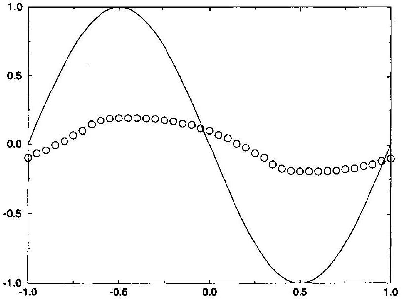
Figure 21.12 Second-order accurate Shu-Osher flux-corrected method for Test Case 1.

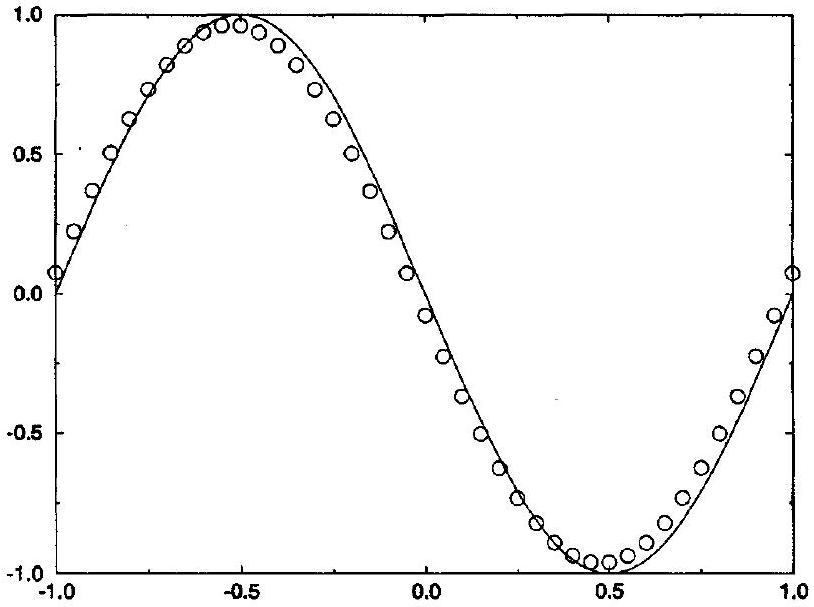
Figure 21.13 Third-order accurate Shu-Osher flux-corrected method for Test Case 1.

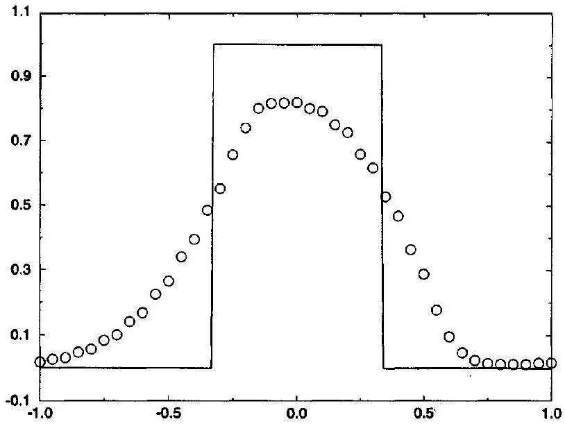
Figure 21.14 Second-order accurate Shu-Osher flux-corrected method for Test Case 2.

its shape as well. However, as seen in Figure 21.13, the third-order accurate Shu-Osher flux-corrected method captures the sinusoid with only a slight lagging phase error, without any clipping or other significant errors. In this test case, the third-order accurate Shu-Osher flux-corrected method performs better than any other method seen so far in Part V; its performance is comparable to a first-generation second-order accurate method such as the Lax-Wendroff method seen in Section 17.2.

Test Case 2 As seen in Figures 21.14 and 21.15, the Shu-Osher flux-corrected method dissipates and smears the square wave more than most of the other methods seen so far in Part V. As you might expect by the fact that contact smearing decreases with order

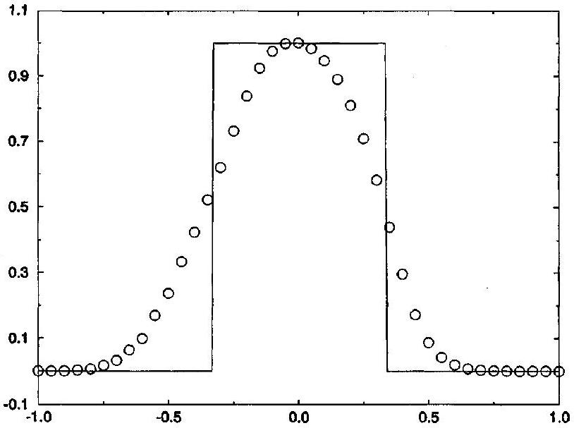
Figure 21.15 Third-order accurate Shu-Osher flux-corrected method for Test Case 2.

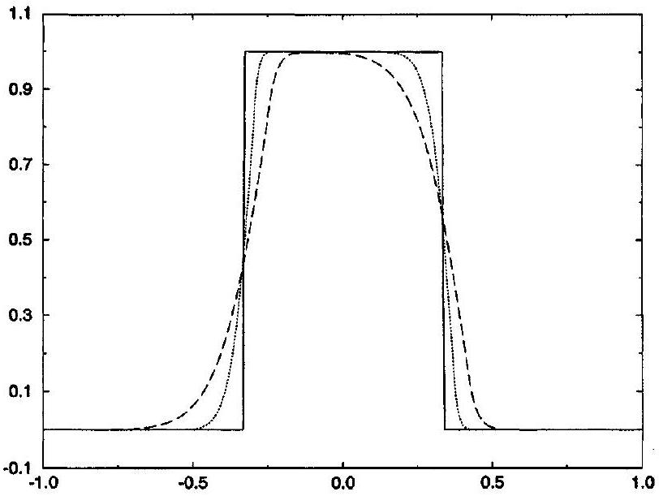
Figure 21.16 Second-order accurate Shu-Osher flux-corrected method for Test Case 3.

of accuracy, the third-order accurate method is substantially better than the second-order accurate method. Both solutions are completely free of spurious overshoots and oscillations.

Test Case 3 In Figures 21.16 and 21.17, the dotted lines represent the Shu-Osher flux-corrected approximations to $u(x, 4)$, the long dashed lines represent the Shu-Osher flux-corrected approximations to $u(x, 40)$, and the solid lines represent the exact solution for $u(x, 4)$ or $u(x, 40)$.

Test Case 4 The second- and third-order accurate results are shown in Figures 21.18 and 21.19 , respectively. The results are nearly identical although, predictably, the

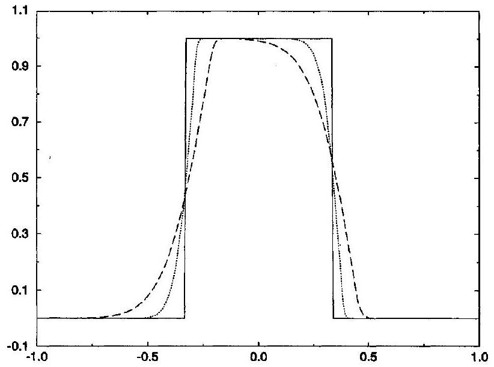
Figure 21.17 Third-order accurate Shu-Osher flux-corrected method for Test Case 3.

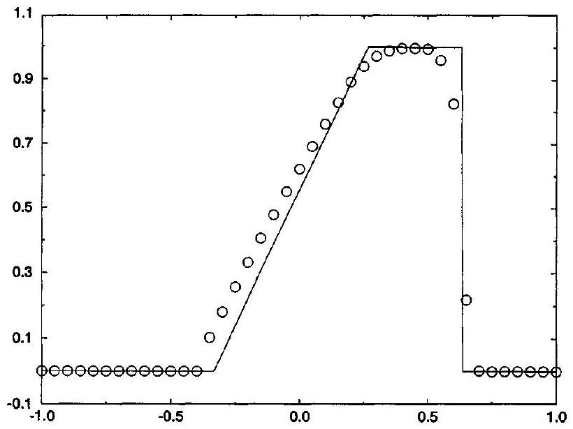
Figure 21.18 Second-order accurate Shu-Osher flux corrected method for Test Case 4.

third-order accurate method is just slightly better than the second-order accurate method. Both solutions display a bit of bulging on the expansion fan.

Test Case 5 The second- and third-order accurate results are shown in Figures 21.20 and 21.21, respectively. The results are nearly identical although, predictably, the third-order accurate method is just slightly better than the second-order accurate method. Both solutions are completely smooth across the expansive sonic point.

The results of Test Case 1 and Test Case 2 strongly favor the third-order accurate method over the second-order accurate method. Fourth- and higher-order accurate methods may also be used, but the upper bound on the CFL number tends to drop, and the increased order of

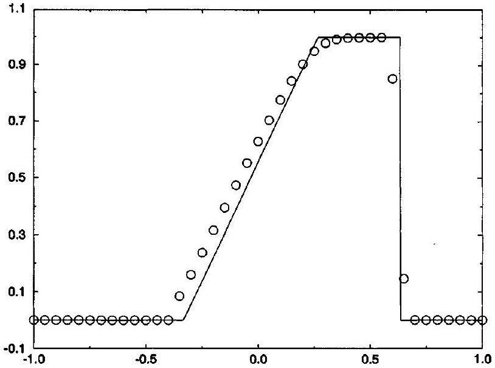
Figure 21.19 Third-order accurate Shu-Osher flux-corrected method for Test Case 4.

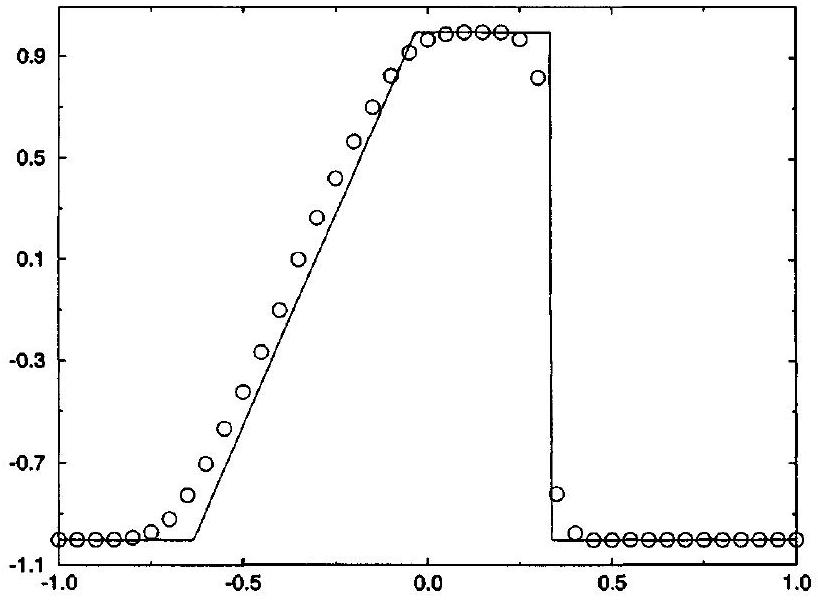
Figure 21.20 Second-order accurate Shu-Osher flux-corrected method for Test Case 5.

accuracy may not justify the increased complication and expense except on exceedingly fine grids. In general, in practice, numerical results usually favor second- or third-order accurate methods, as opposed to higher-order accurate methods, at least in the presence of shocks and contacts, and assuming reasonably simple flow structures in smooth regions. In this particular case, the third-order accurate method is favored over the second-order accurate method, partly because the second-order accurate method falls a bit short. Although the Shu-Osher flux corrected method does not exhibit any spurious overshoots or oscillations in the above test cases, it is not too hard to find other cases where it does overshoot or oscillate, although usually only in quite small amounts; this is simply the price one pays for eliminating clipping errors at extrema.

This section has described a version of the Shu-Osher method based on the ENO reconstructions of Sections 9.1 and 9.3. Researchers have proposed many variations on the type

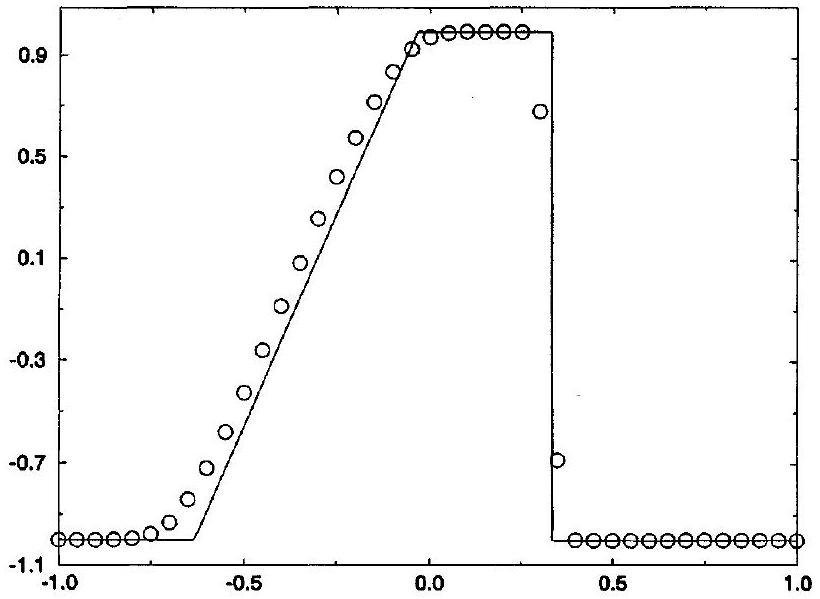
Figure 21.21 Third-order accurate Shu-Osher flux-corrected method for Test Case 5.

of ENO reconstruction used in the Shu-Osher methods, including methods based on the WENO reconstructions described in Section 9.2; see Liu, Osher, and Chan (1994) or Jiang and Shu (1996).

## References

Boris, J. P., and Book, D. L. 1973. "Flux-Corrected Transport I. SHASTA, a Fluid Transport Algorithm that Works," Journal of Computational Physics, 11: 38-69.
Boris, J. P., and Book, D. L. 1976. "Flux-Corrected Transport. III. Minimal-Error FCT Algorithms," Journal of Computational Physics, 20: 397-431.
Boris, J. P., Book, D. L., and Hain, K. 1975. "Flux-Corrected Transport. II. Generalizations of the Method," Journal of Computational Physics, 18: 248-283.
Harten, A. 1983. "High Resolution Schemes for Hyperbolic Conservation Laws," Journal of Computational Physics, 49: 357-393.
Harten, A. 1984. "On a Class of High Resolution Total-Variation-Stable Finite-Difference Schemes," SIAM Journal on Numerical Analysis, 21: 1-22.
Jiang, G.-S., and Shu, C.-W. 1996. "Efficient Implementation of Weighted ENO Schemes," Journal of Computational Physics, 126: 202-228.
Liu, X.-D., Osher, S., and Chan, T. 1994. "Weighted Essentially Nonoscillatory Schemes," Journal of Computational Physics, 115: 200-212.
Oran, E. S., and Boris, J. P. 1989. Numerical Simulation of Reactive Flow. New York: Elsevier.
Shu, C.-W., 1987. "TVB Uniformly High-Order Schemes for Conservation Laws," Mathematics of Computation, 49: 105-121.
Shu, C.-W., and Osher, S. 1988. "Efficient Implementation of Essentially Nonoscillatory Shock-Capturing Schemes," Journal of Computational Physics, 77: 439-471.
Shu, C.-W., and Osher, S. 1989. "Efficient Implementation of Essentially Nonoscillatory Shock-Capturing Schemes, II," Journal of Computational Physics, 88: 32-78.
Yee, H. C. 1986. "Linearized Form of Implicit TVD Schemes for the Multidimensional Euler and Navier-Stokes Equations," Computers and Mathematics with Applications, 12A: 413-432.

Yee, H. C. 1989. "A Class of High-Resolution Explicit and Implicit Shock Capturing Methods," NASA Technical Memorandum 101088 (unpublished).
Yee, H. C., and Harten, A. 1987. "Implicit TVD Schemes for Hyperbolic Conservation Laws in Curvilinear Coordinates," AIAA Journal, 25: 266-274.
Yee, H. C., Warming, R. F., and Harten, A. 1982. "A High-Resolution Numerical Technique for Inviscid Gas-Dynamic Problems with Weak Solutions." In Eighth International Conference on Numerical Methods in Fluid Dynamics: Lecture Notes in Physics, Volume 170, ed. E. Krause, pp. 546-552. Berlin: Springer-Verlag.
Yee, H. C., Warming, R. F., and Harten, A. 1985a. "Implicit Total Variation Diminishing (TVD) Schemes for Steady-State Calculations," Journal of Computational Physics, 57: 327-360.
Yee, H. C., Warming, R. F., and Harten, A. 1985b. "Application of TVD Schemes for the Euler Equations of Gas Dynamics." In Large-Scale Computations in Fluid Mechanics, Lectures in Applied Mathematics, Volume 22, Part 2, eds. B. E. Engquist, S. Osher, and R. C. J. Somerville, pp. 357-377, Providence, RI: American Mathematical Society.
Yee, H. C., Warming, R. F., and Harten, A. 1985c. "On a Class of TVD Schemes for Gas Dynamic Calculations." In Numerical Methods for the Euler Equations of Fluid Dynamics, eds. F. Angrand, A. Dervieux, J. A. Desideri, and R. Glowinski, pp. 84-107. Philadelphia: SIAM.
Zalesak, S. T. 1979. "Fully Multidimensional Flux-Corrected Transport Algorithms for Fluids," Journal of Computational Physics, 31: 335-362.

## Problems

21.1 This problem concerns flux reconstruction methods and their relationship to reconstruction via the primitive function.
(a) Suppose the flux function is $f(u)=u$ and suppose the solution at $t=t^{0}$ is $u\left(x, t^{0}\right)= -\sin \pi x$. Assume that $\Delta x$ is constant. Show that

$$
\hat{f}_{s}^{0}(x)=-\frac{\sin \pi x}{(\sin \pi \Delta x / 2)(\pi \Delta x / 2)}
$$

In other words, prove that

$$
f\left(u\left(x, t^{0}\right)\right)=\frac{1}{\Delta x} \int_{x+\Delta x / 2}^{x+\Delta x / 2} \hat{f}_{s}^{0}(y) d y
$$

for all $x$.
(b) Suppose the flux function is $f(u)=u^{2} / 2$ and suppose the solution is $u\left(x, t^{0}\right)=-\sin \pi x$. Assume that $\Delta x$ is constant. Show that

$$
\hat{f}_{s}^{0}(x)=\frac{1}{4}\left[1-\frac{\cos 2 \pi x}{(\sin \pi \Delta x)(\pi \Delta x)}\right]
$$

21.2 Suppose that the flux function for a scalar conservation law is $f(u)=\sin u$.
(a) Find all of the sonic points of $f$. Which ones are compressive and which ones are expansive?
(b) Sketch the split fluxes $f^{ \pm}(u)$ found using the linear splitting, Equation (21.38). Choose an appropriate value for $\alpha$. What is the lower limit for $\alpha$ ? What happens if $\alpha$ is smaller than this lower limit? Is there any upper limit on $\alpha$ ?
(c) Sketch the split fluxes $f^{ \pm}(u)$ found using Equation (21.37).
(d) What are the relative advantages and disadvantages of the splittings found in parts (b) and (c)? In particular, discuss the continuity of the split fluxes, the physicality of the split fluxes, and the existence of annoying user-adjustable parameters.
(e) Repeat parts (a)-(d), substituting $f(u)=a u$ where $a=$ const.
(f) Repeat parts (a)-(d), substituting $f(u)=u^{2} / 2$.
21.3 Find the CFL condition for the Shu-Osher method for $N=1, \ldots, 4$. Remember that the CFL condition is based strictly on the stencil (i.e., the points chosen by the ENO flux reconstruction). Also remember that the CFL condition is necessary but not sufficient for stability, so that a method may blow up or exhibit less drastic instabilities even when it satisfies the CFL condition. To prevent blow up, the CFL number must be substantially lower than what the CFL condition would indicate. In particular, compare the CFL condition with the following stability conditions given by Shu and Osher: $|\lambda a(u)| \leq 1$ for second- and third-order accuracy; $|\lambda a(u)| \leq 2 / 3$ for fourth-order accuracy; and $|\lambda a(u)| \leq 7 / 30$ for fifth-order accuracy. Intuitively, why is there such a difference between the CFL condition and these stability conditions?

