## Flux Averaging III: Self-Adjusting Hybrid Methods

### 22.0 Introduction

This chapter concerns self-adjusting hybrid methods. To keep things simple, this introductory section concerns only self-adjusting hybrids for scalar conservation laws. Self-adjusting hybrid methods for the Euler equations are discussed later in the chapter; see Subsection 22.3.2. Consider two first-generation methods with complementary properties, such as Roe's first-order upwind method and the Lax-Wendroff method. Suppose that the two methods have conservative numerical fluxes $\hat{f}_{i+1 / 2}^{(1)}$ and $\hat{f}_{i+1 / 2}^{(2)}$. Self-adjusting hybrids use convex linear combinations as follows:

$$
\hat{f}_{i+1 / 2}^{n}=\theta_{i+1 / 2}^{n} \hat{f}_{i+1 / 2}^{(1)}+\left(1-\theta_{i+1 / 2}^{n}\right) \hat{f}_{i+1 / 2}^{(2)},
$$

where the parameter $\theta_{i+1 / 2}^{n}$ is called a shock switch. The reader should view Equation (22.1) as a starting point for discussion, rather than as a "fixed in stone" definition of self-adjusting hybrids, since many self-adjusting hybrids deviate somewhat from this standard.

The governing principle of shock switch design is as follows: the shock switch should be close to one near shocks and close to zero in smooth regions. Then, as the name implies, shock switches distinguish shocks from smooth regions, switching on at shocks and switching off in smooth regions. Unfortunately, by this criterion, it is impossible to design a perfect shock switch - as illustrated in Figure 22.1, the same samples can represent both smooth and shocked solutions. This stems from the fact that any sampling contains only limited information about the solution, especially solutions with jump discontinuities, as discussed in Chapter 8. Then any shock switch will sometimes yield false positives or false negatives, either of which adversely affects the self-adjusting hybrid's success.

As seen in Equations (8.5) and (8.6), large divided differences signal large or discontinuous derivatives. Thus, the shock switch is usually a function of first- or second-divided differences. For example, let

$$
\theta_{i+1 / 2}^{n}=\max \left(\theta_{i}^{n}, \theta_{i+1}^{n}\right),
$$

where

$$
\theta_{i}^{n}=\frac{u_{i+1}^{n}-2 u_{i}^{n}+u_{i-1}^{n}}{\Delta x^{2}} .
$$

To ensure $\theta_{i+1 / 2}^{n} \geq 0$, take the absolute value of the second-divided differences as follows:

$$
\theta_{i}^{n}=\frac{\left|u_{i+1}^{n}-2 u_{i}^{n}+u_{i-1}^{n}\right|}{\Delta x^{2}} .
$$

To ensure $\theta_{i+1 / 2}^{n} \leq 1$, divide by a normalization factor. For example, by the triangle inequality

$$
\frac{\left|\left(u_{i+1}-u_{i}^{n}\right)-\left(u_{i}^{n}-u_{i-1}^{n}\right)\right|}{\Delta x^{2}} \leq \frac{\left|u_{i+1}-u_{i}^{n}\right|+\left|u_{i}^{n}-u_{i-1}^{n}\right|}{\Delta x^{2}} .
$$

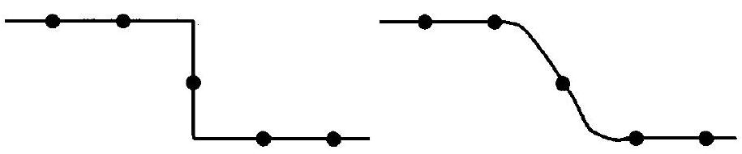
Figure 22.1 The same samples may represent both smooth and discontinuous functions.

Then let

$$
\text { - } \quad \theta_{i}^{n}=\frac{\left|u_{i+1}^{n}-2 u_{i}^{n}+u_{i-1}^{n}\right|}{\left|u_{i+1}^{n}-u_{i}^{n}\right|+\left|u_{i}^{n}-u_{i-1}^{n}\right|} .
$$

This chapter considers three self-adjusting hybrid methods. In 1972, Harten and Zwas proposed a self-adjusting hybrid of the Lax-Friedrichs and Lax-Wendroff methods. In 1978, Harten proposed a self-adjusting hybrid of a first-order upwind method and the LaxWendroff method. In 1981, Jameson, Schmidt, and Turkel proposed a self-adjusting hybrid combination of a semidiscrete first-order upwind method and a semidiscrete version of FTCS plus fourth-order artificial viscosity.

Besides the three self-adjusting hybrid methods described in the preceding paragraph, this chapter also considers four shock switches. Harten and Zwas suggested the first shock switch in 1972. Unfortunately, this shock switch involves solution-sensitive user-adjustable parameters, meaning the user has to constantly reset the parameters for every different solution. MacCormack and Baldwin suggested a far better shock switch in 1975. In 1978, Harten suggested a third shock switch which results in excellent nonlinear stability, albeit at the expense of extremum clipping. Finally, in 1992, Swanson and Turkel suggested a relatively complicated and sophisticated shock switch, which combines the MacCormackBaldwin shock switch with the shock switch seen in Equation (22.2).

The starting-point definition of flux-limited methods seen in Equation (20.1) closely resembles the starting-point definition of self-adjusting hybrids seen in Equation (22.1). In fact, they are identical if $\theta_{i+1 / 2}^{n}=1-\phi_{i+1 / 2}^{n}$. Despite their similar starting-points, selfadjusting hybrids traditionally deviate from flux-limited methods in terms of sonic point treatments, stability treatments, convexity, and in other ways. For example, self-adjusting hybrid methods traditionally require convex linear combinations ( $0 \leq \theta_{i+1 / 2}^{n} \leq 1$ ) whereas flux-limited methods traditionally do not. For another example, self-adjusting hybrid methods traditionally do not enforce nonlinear stability conditions, whereas flux-limited methods traditionally do. As a result, self-adjusting hybrid methods usually avoid clipping, unlike flux-limited methods, but also allow more spurious overshoots and oscillations.

### 22.1 Harten-Zwas Self-Adjusting Hybrid Method

Harten and Zwas (1972a, 1972b) suggested a self-adjusting hybrid of the LaxFriedrichs and Lax-Wendroff methods. As seen in Section 17.1, the Lax-Friedrichs method is as follows:

$$
\begin{aligned}
& u_{i+1}^{n}=u_{i}^{n}-\lambda\left(\hat{f}_{i+1 / 2}^{\mathrm{L}-\mathrm{F}}-\hat{f}_{i-1 / 2}^{\mathrm{L}-\mathrm{F}}\right) \\
& \hat{f}_{i+1 / 2}^{\mathrm{L}-\mathrm{F}}=\frac{1}{2}\left(f\left(u_{i+1}^{n}\right)+f\left(u_{i}^{n}\right)\right)-\frac{1}{2 \lambda}\left(u_{i+1}^{n}-u_{i}^{n}\right) .
\end{aligned}
$$

Also, as seen in Section 17.2, the Lax-Wendroff method is as follows:

$$
\begin{aligned}
& u_{i+1}^{n}=u_{i}^{n}-\lambda\left(\hat{f}_{i+1 / 2}^{\mathrm{L}-\mathrm{W}}-\hat{f}_{i-1 / 2}^{\mathrm{L}-\mathrm{W}}\right) \\
& \hat{f}_{i+1 / 2}^{\mathrm{L}-\mathrm{W}}=\frac{1}{2}\left(f\left(u_{i+1}^{n}\right)+f\left(u_{i}^{n}\right)\right)-\frac{1}{2} \lambda\left(a_{i+1 / 2}^{n}\right)^{2}\left(u_{i+1}^{n}-u_{i}^{n}\right)
\end{aligned}
$$

Then the Harten-Zwas self-adjusting hybrid method is as follows:

$$
u_{i+1}^{n}=u_{i}^{n}-\lambda\left(\hat{f}_{i+1 / 2}^{n}-\hat{f}_{i-1 / 2}^{n}\right),
$$

where

$$
\hat{f}_{i+1 / 2}^{n}=\theta_{i+1 / 2}^{n} \hat{f}_{i+1 / 2}^{\mathrm{L}-\mathrm{F}}+\left(1-\theta_{i+1 / 2}^{n}\right) \hat{f}_{i+1 / 2}^{\mathrm{L}-\mathrm{W}}
$$

or

$$
\begin{aligned}
\hat{f}_{i+1 / 2}^{n}= & \frac{1}{2}\left(f\left(u_{i+1}^{n}\right)+f\left(u_{i}^{n}\right)\right) \\
& -\frac{1}{2 \lambda}\left[\left(1-\left(\lambda a_{i+1 / 2}^{n}\right)^{2}\right) \theta_{i+1 / 2}^{n}+\left(\lambda a_{i+1 / 2}^{n}\right)^{2}\right]\left(u_{i+1}^{n}-u_{i}^{n}\right)
\end{aligned}
$$

Notice that the Harten-Zwas self-adjusting hybrid method equals the Lax-Friedrichs method for $\theta_{i+1 / 2}^{n}=1$, the Lax-Wendroff method for $\theta_{i+1 / 2}^{n}=0$, and Roe's first-order upwind method for $\theta_{i+1 / 2}^{n}=\left|\lambda a_{i+1 / 2}^{n}\right| /\left(1+\left|\lambda a_{i+1 / 2}^{n}\right|\right)$. The reader can certainly find other relationships between the Harten-Zwas self-adjusting hybrid and earlier methods. Notice that the coefficient of artificial viscosity of the Harten-Zwas self-adjusting hybrid method is as follows:

$$
\epsilon_{i+1 / 2}^{n}=\frac{1}{\lambda}\left[\left(1-\left(\lambda a_{i+1 / 2}^{n}\right)^{2}\right) \theta_{i+1 / 2}^{n}+\left(\lambda a_{i+1 / 2}^{n}\right)^{2}\right]
$$

which is sometimes called self-adjusting or adaptive artificial viscosity.
If $0 \leq \theta_{i+1 / 2}^{n} \leq 1$ then $\hat{f}_{i+1 / 2}^{n}$ is a convex linear combination of $\hat{f}_{i+1 / 2}^{\mathrm{L}-\mathrm{F}}$ and $\hat{f}_{i+1 / 2}^{\mathrm{L}-\mathrm{W}}$. As usual, convexity ensures that $\hat{f}_{i+1 / 2}^{n}$ is somewhere between $\hat{f}_{i+1 / 2}^{\mathrm{L}-\mathrm{F}}$ and $\hat{f}_{i+1 / 2}^{\mathrm{L}-\mathrm{W}}$. The Lax-Friedrichs method and the Lax-Wendroff methods are both extreme methods: the Lax-Friedrichs method has too much artificial viscosity and even small increases may cause instability, whereas the Lax-Wendroff method has too little artificial viscosity and even small decreases may cause instability. Thus, it makes good sense to keep the hybrid somewhere between the Lax-Friedrichs and Lax-Wendroff methods. In other words, it makes good sense to enforce the convexity condition $0 \leq \theta_{i+1 / 2}^{n} \leq 1$.

The Harten-Zwas self-adjusting hybrid works on the principle of error cancellation. Whereas the Van Leer flux-limited method seen in Section 20.1 cancels dispersive errors, the Harten-Zwas self-adjusting hybrid cancels dissipative errors. Because of error cancellation, the hybrid combination of Lax-Friedrichs and Lax-Wendroff may perform better than either method separately; in particular, the Lax-Friedrichs and Lax-Wendroff methods typically both experience spurious oscillations and overshoots near jump discontinuities, while the hybrid need not.

How does one choose the shock switch? The Lax-Wendroff method performs well in smooth regions, and thus the hybrid should lean heavily on the Lax-Wendroff method in smooth regions. Therefore, $\theta_{i+1 / 2}^{n} \approx 0$ in smooth regions. Near shocks, the best choice lies somewhere nearly halfway between the Lax-Wendroff and Lax-Friedrichs methods. So $\theta_{i+1 / 2}^{n} \approx 1 / 2$ near shocks. Finally, the shock switch should satisfy the convexity condition
$0 \leq \theta_{i+1 / 2}^{n} \leq 1$. Based on these observations, Harten and Zwas suggested the following shock switch:

$$
\theta_{i+1 / 2}^{n}=\kappa\left[\frac{\left|u_{i+1}^{n}-u_{i}^{n}\right|}{\max _{j}\left|u_{j+1}^{n}-u_{j}^{n}\right|}\right]^{m},
$$

where $\kappa$ and $m$ are user-adjustable parameters. This shock switch clearly satisfies the convexity condition $0 \leq \theta_{i+1 / 2}^{n} \leq 1$ for all $0 \leq \kappa \leq 1$ and $m \geq 1$. Notice that

$$
\frac{\left|u_{i+1}^{n}-u_{i}^{n}\right|}{\max _{j}\left|u_{j+1}^{n}-u_{j}^{n}\right|}= \begin{cases}1 & \text { for the largest jump }, \\ <1 & \text { for other jumps }, \\ O(\Delta x) & \text { for smooth regions. }\end{cases}
$$

Unfortunately, this implies that the best choice of $\kappa$ and $m$ depends on the solution. In particular, if $\kappa$ and $m$ are chosen to optimize the performance at the largest jump in the solution, then the method underdamps the smaller jumps. Conversely, if $\kappa$ and $m$ are chosen to optimize the performance at the smallest jump in the solution, then the method overdamps the larger jumps. Such solution sensitivity disqualifies the Harten-Zwas shock switch for most practical computations. This section omits numerical results, which would only serve to illustrate the poor performance of the Harten-Zwas shock switch.

### 22.2 Harten's Self-Adjusting Hybrid Method

Working without Zwas, Harten (1978) suggested another self-adjusting hybrid. Harten's hybrid differs from the Harten-Zwas hybrid in two respects. First, Harten replaced the Lax-Friedrichs method with a first-order upwind method. Specifically, Harten used the modified Boris-Book first-order upwind method, seen in Section 21.1. However, to modernize and improve the results, this section substitutes the class of first-order upwind methods seen in Section 17.3. Then Harten's self-adjusting hybrid method is as follows:

$$
u_{i+1}^{n}=u_{i}^{n}-\lambda\left(\hat{f}_{i+1 / 2}^{n}-\hat{f}_{i-1 / 2}^{n}\right),
$$

where

$$
\hat{f}_{i+1 / 2}^{n}=\theta_{i+1 / 2}^{n} \hat{f}_{i+1 / 2}^{(1)}+\left(1-\theta_{i+1 / 2}^{n}\right) \hat{f}_{i+1 / 2}^{\mathrm{L}-\mathrm{W}},
$$

and where $\hat{f}_{i+1 / 2}^{(1)}$ is the conservative numerical flux of any of the first-order upwind methods seen in Section 17.3 and $\hat{f}_{i+1 / 2}^{\mathrm{L}-\mathrm{W}}$ is the conservative numerical flux of the Lax-Wendroff method seen in Section 17.2.

As the second and more important modification to the Harten-Zwas self-adjusting hybrid method, Harten substituted a much improved shock switch. The Lax-Wendroff method performs well in smooth regions, which argues for a bias towards the Lax-Wendroff method in smooth regions. Thus $\theta_{i+1 / 2}^{n} \approx 0$ in smooth regions. On the other hand, firstorder upwind methods perform well at shocks, which argues for a tilt towards the first-order upwind method at shocks. So $\theta_{i+1 / 2}^{n} \approx 1$ near shocks. Finally, the shock switch should satisfy the convexity condition $0 \leq \theta_{i+1 / 2}^{n} \leq 1$. Harten suggested the following shock switch to satisfy these criteria:

$$
\theta_{i+1 / 2}^{n}=\max \left(\theta_{i}^{n}, \theta_{i+1}^{n}\right),
$$

where

$$
\theta_{i}^{n}=\kappa\left|\frac{\left|u_{i+1}^{n}-u_{i}^{n}\right|-\left|u_{i}^{n}-u_{i-1}^{n}\right|}{\left|u_{i+1}^{n}-u_{i}^{n}\right|+\left|u_{i}^{n}-u_{i-1}^{n}\right|}\right|^{m}
$$

or

$$
\theta_{i}^{n}= \begin{cases}\kappa\left|\frac{\left|u_{i+1}^{n}-u_{i}^{n}\right|-\left|u_{i}^{n}-u_{i-1}^{n}\right|}{\left|u_{i+1}^{n}-u_{i}^{n}\right|+\left|u_{i}^{n}-u_{i-1}^{n}\right|}\right|^{m} & \left|u_{i+1}^{n}-u_{i}^{n}\right|+\left|u_{i}^{n}-u_{i-1}^{n}\right|>\delta, \\ 0 & \left|u_{i+1}^{n}-u_{i}^{n}\right|+\left|u_{i}^{n}-u_{i-1}^{n}\right| \leq \delta .\end{cases}
$$

Unlike the first expression, the second expression prevents small or zero denominators; the two expressions are otherwise identical. As before, $\kappa, m$, and $\delta$ are user-adjustable parameters. By the triangle inequality,

$$
\left|\left|u_{i+1}^{n}-u_{i}^{n}\right|-\left|u_{i}^{n}-u_{i-1}^{n}\right|\right| \leq\left|u_{i+1}^{n}-u_{i}^{n}\right|+\left|u_{i}^{n}-u_{i-1}^{n}\right| .
$$

Thus Harten's shock switch satisfies the convexity condition $0 \leq \theta_{i+1 / 2}^{n} \leq 1$ for all $0 \leq \kappa \leq 1$ and $m \geq 1$. Notice that, much like the flux limiters of Chapter 20, Harten's shock switch can be written as a function of $r_{i}^{+}=\left(u_{i}^{n}-u_{i-1}^{n}\right) /\left(u_{i+1}^{n}-u_{i}^{n}\right)$ as follows:

$$
\theta_{i}^{n}=\kappa\left|\frac{1-\left|r_{i}^{+}\right|}{1+\left|r_{i}^{+}\right|}\right|^{m}
$$

Notice that $\theta_{i}^{n}$ is near zero only if $\left|r_{i}^{+}\right|$is near one, and notice that $\theta_{i+1 / 2}^{n}=\max \left(\theta_{i}^{n}, \theta_{i+1}^{n}\right)$ is even larger than $\theta_{i}^{n}$. Thus, much of the time, the self-adjusting hybrid will use a substantial amount of the first-order upwinding, even in completely smooth regions. On the positive side, the parameters $\kappa$ and $m$ are not very solution sensitive, unlike the analogous parameters in the Harten-Zwas shock switch. Instead, the same values should work reasonably well for a broad range of different solutions. Hence, for the most part, $\kappa$ and $m$ are "set and forget" parameters.

The behavior of Harten's self-adjusting hybrid method is illustrated using the five standard test cases defined in Section 17.0. In all test cases, $\kappa=1, \delta=0.01$, and $m=1$. The first four test cases use Roe's first-order upwind method, whereas the last test case uses Harten's first-order upwind method with $\delta=0.6$, where now $\delta$ refers to the small parameter in Harten's first-order upwind method seen in Subsection 17.3.3 rather than to the small parameter in Harten's shock switch.

Test Case 1 As seen in Figure 22.2, Harten's self-adjusting hybrid method captures the sinusoid with only modest clipping. This clipping may be reduced or completely eliminated with different settings of the user-adjustable parameters, but only at the expense of the performance in other test cases.

Test Case 2 As seen in Figure 22.3, Harten's self-adjusting hybrid method captures the square wave without spurious overshoots or oscillations, and with a typical amount of smearing.

Test Case 3 In Figure 22.4, the dotted line represents Harten's self-adjusting hybrid approximation to $u(x, 4)$, the long dashed line represents Harten's self-adjusting hybrid approximation to $u(x, 40)$, and the solid line represents the exact solution for $u(x, 4)$ or $u(x, 40)$. Harten's self-adjusting hybrid is the first method in Part V to exhibit oscillations or overshoots in Test Case 3. On the positive side, the solution exhibits an unusually low amount of smearing.

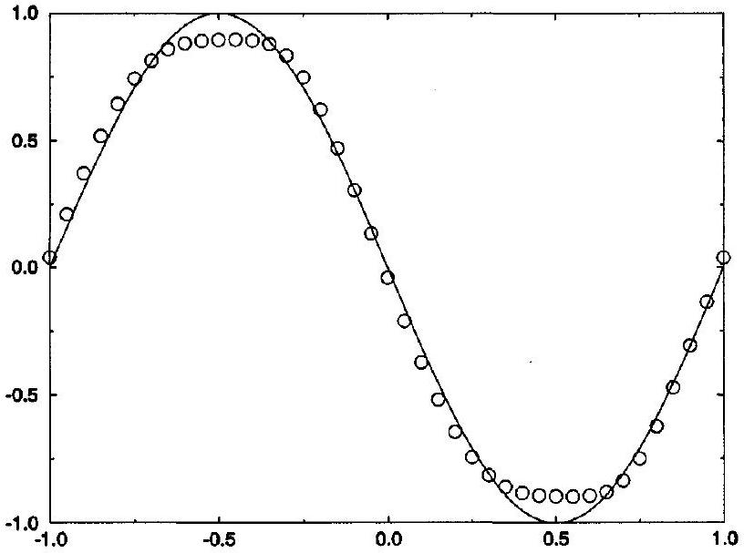
Figure 22.2 Harten's self-adjusting hybrid method for Test Case 1.

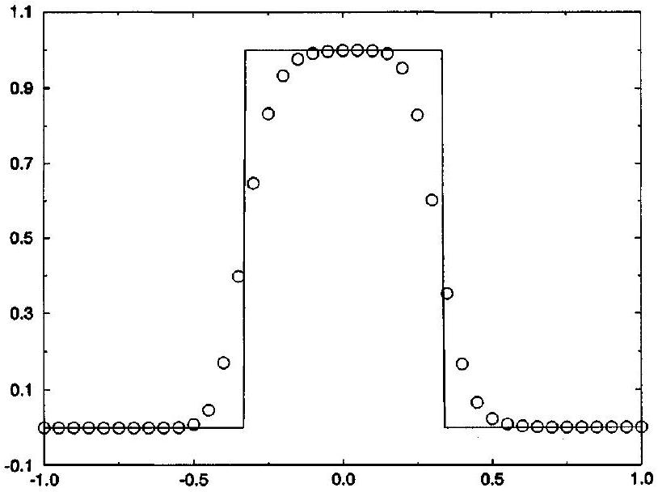
Figure 22.3 Harten's self-adjusting hybrid method for Test Case 2.

Test Case 4 The results seen in Figure 22.5 are about as good as any seen so far.

Test Case 5 As seen in Figure 22.6, the solution is excellent except for a small jump across the expansive sonic point, which could be eliminated by increasing the parameter $\delta$ in Harten's first-order upwind method.

To reduce the contact smearing seen in Test Cases 2 and 3, Harten (1978) suggested physical flux correction, much as in Section 21.3. In particular let

$$
g_{i}^{n}=f\left(u_{i}^{n}\right)+f_{i}^{(\mathrm{C})} .
$$

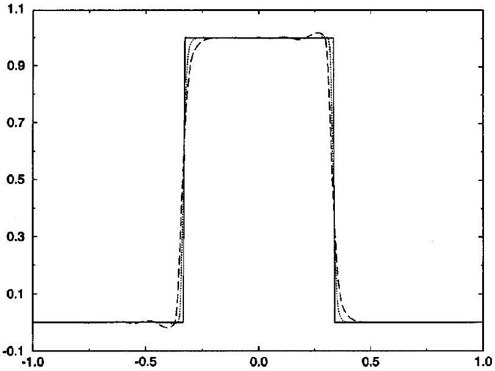
Figure 22.4 Harten's self-adjusting hybrid method for Test Case 3.

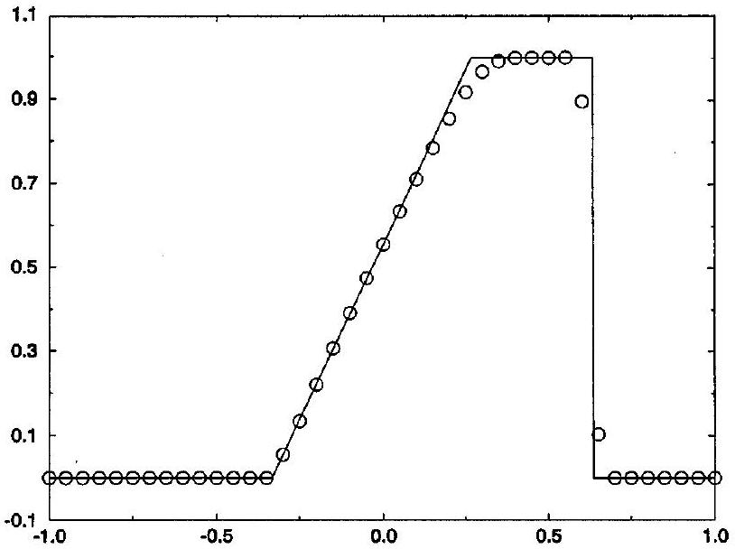
Figure 22.5 Harten's self-adjusting hybrid method for Test Case 4.

Then apply any numerical method, such as Harten's self-adjusting hybrid method, to $g_{i}^{n}$ rather than to $f\left(u_{i}^{n}\right)$. That is, approximate

$$
\frac{\partial u}{\partial t}+\frac{\partial g}{\partial x}=\frac{\partial u}{\partial t}+\frac{\partial}{\partial x}\left(f+f^{(\mathrm{C})}\right)=0 .
$$

The flux correction $f_{i}^{(\mathrm{C})}$ should add compression or, equivalently, reduce artificial dissipation or, put yet another way, increase artificial antidissipation. Recall that Section 14.2 described the relationship between artificial viscosity and flux correction. Specifically, artificial viscosity forms write the flux correction as a product of a coefficient $\epsilon_{i+1 / 2}^{n}$ and a first difference $u_{i+1}^{n}-u_{i}^{n}$ as follows:

$$
-\frac{1}{2} \epsilon_{i+1 / 2}^{n}\left(u_{i+1}^{n}-u_{i}^{n}\right) .
$$

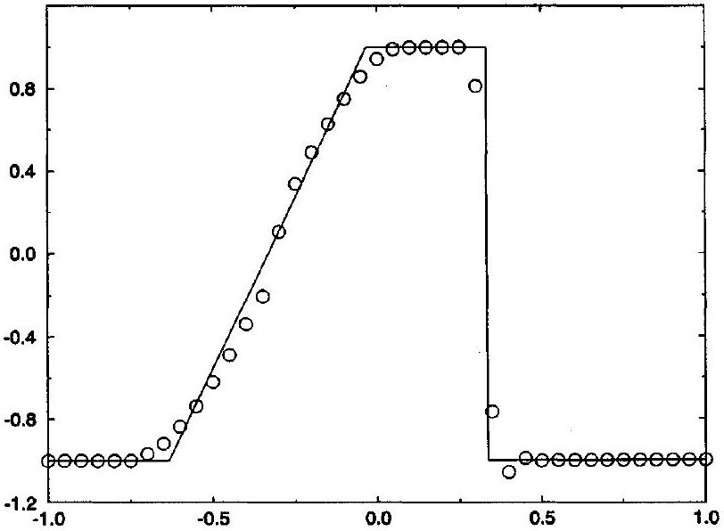
Figure 22.6 Harten's self-adjusting hybrid method for Test Case 5.

Artificial viscosity tends to be dissipative if $\epsilon_{i+1 / 2}^{n}>0$ and antidissipative if $\epsilon_{i+1 / 2}^{n}<0$. Then, to ensure an antidissipative effect, $f_{i}^{\text {(C) }}$ should be proportional to first differences such as $u_{i+1}^{n}-u_{i}^{n}$ and $u_{i}^{n}-u_{i-1}^{n}$ and have the same sign as the first differences.

A two-step predictor-corrector approximation of Equation (22.9) yields

$$
\begin{aligned}
& \bar{u}_{i}=u_{i}^{n}-\lambda\left[\hat{f}\left(u_{i-K_{1}}^{n}, \ldots, u_{i+K_{2}-1}^{n}\right)-\hat{f}\left(u_{i-K_{1}+1}^{n}, \ldots, u_{i+K_{2}}^{n}\right)\right], \\
& u_{i}^{n+1}=\bar{u}_{i}-\lambda\left[\hat{f}^{(\mathrm{C})}\left(\bar{u}_{i-K_{1}}, \ldots, \bar{u}_{i+K_{2}-1}\right)-\hat{f}^{(\mathrm{C})}\left(\bar{u}_{i-K_{1}+1}, \ldots, \bar{u}_{i+K_{2}}\right)\right] .
\end{aligned}
$$

Thus the predictor is the original method, and the corrector introduces artificial compression. Harten (1978) suggests using Roe's first-order upwind method for the artificial compression. The compressive corrector is then

$$
\begin{aligned}
& u_{i}^{n+1}=\bar{u}_{i}-\lambda\left(\hat{f}_{i+1 / 2}^{(\mathrm{C})}-\hat{f}_{i-1 / 2}^{(\mathrm{C})}\right), \\
& \hat{f}_{i+1 / 2}^{(\mathrm{C})}=\frac{1}{2}\left[f_{i+1}^{(\mathrm{C})}+f_{i}^{(\mathrm{C})}-\left|\frac{f_{i+1}^{(\mathrm{C})}-f_{i}^{(\mathrm{C})}}{\bar{u}_{i+1}-\bar{u}_{i}}\right|\left(\bar{u}_{i+1}-\bar{u}_{i}\right)\right],
\end{aligned}
$$

where

$$
f_{i}^{(\mathrm{C})}=\operatorname{minmod}\left(\bar{u}_{i+1}-\bar{u}_{i}, \bar{u}_{i}-\bar{u}_{i-1}\right) .
$$

Figures 22.7 and 22.8 show the results of using artificial compression in Harten's selfadjusting hybrid method in Test Cases 1 and 2. These results show both the power and peril of artificial compression: it turns everything into square waves. Then the square wave is captured nearly perfectly, but the sine wave also looks like a square wave. Clearly, one cannot just leave the artificial compression going full blast all the time. Harten suggests replacing Equation (22.10) by the following:

$$
u_{i}^{n+1}=\bar{u}_{i}-\lambda\left(\theta_{i+1 / 2}^{n} \hat{f}_{i+1 / 2}^{(\mathrm{C})}-\theta_{i-1 / 2}^{n} \hat{f}_{i-1 / 2}^{(\mathrm{C})}\right),
$$

where $\theta_{i+1 / 2}^{n}$ is any shock switch. For a more modern take on artificial compression, see Section 21.3.

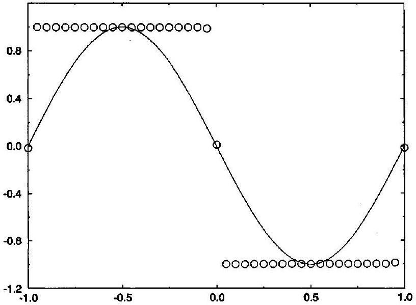
Figure 22.7 Harten's self-adjusting hybrid method with artificial compression for Test Case 1.

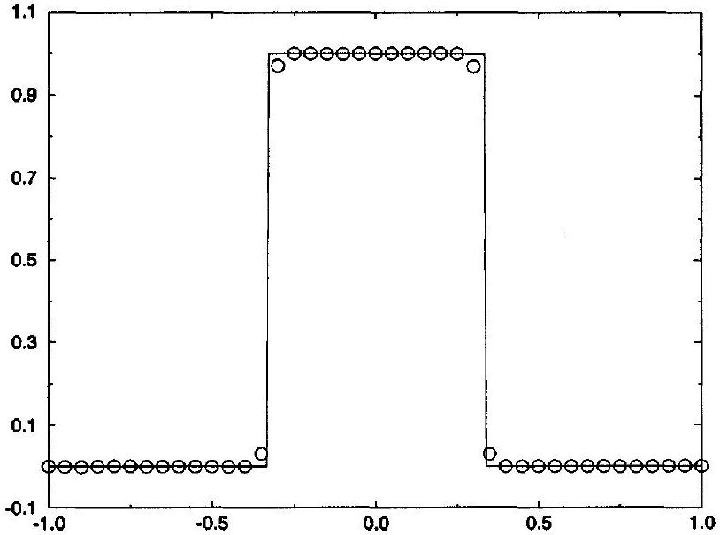
Figure 22.8 Harten's self-adjusting hybrid method with artificial compression for Test Case 2.

Artificial compression is a tricky thing. From the chapter introduction, remember that every shock switch occasionally yields false positives or false negatives. When shock switches are used to adjust the average of two methods, false positives and false negatives are relatively benign, usually causing only a modest and local loss of accuracy. However, when shock switches are used to control artificial compression, false positives or false negatives may be disastrous. Since the amount of artificial compression depends entirely on the shock switch, artificial compression might fire off in the wrong places, causing overly steep solutions at best and spurious jump discontinuities at worst. Also, artificial compression may fail to act where it should, allowing contact smearing to progress unimpeded, with the artificial compression becoming increasingly less likely to wake up and act as the smearing builds.

The only way to avoid these problems is to tweak the user-adjustable parameters in the artificial compression and the shock switch for each individual solution to eliminate false positives and false negatives on a case by case basis.

The term "artificial compression" is potentially misleading: it seems to imply that "artificial compression" adds compression, much like "artificial viscosity" adds viscosity. However, in fact, artificial compression does not so much add compression as subtract viscosity. As one way to view it, artificial compression reduces the local artificial viscosity to make the method locally less stable. Decreased stability allows the solution to change rapidly, jumping up quickly at contacts. It's rather like a high-performance jet fighter - for maximum maneuverability, jet fighters are often purposely made unstable. Given that the jet already has a natural tendency to tip, the jet can maneuver quickly. Of course, for the jet or for artificial compression, the instability is potentially disastrous and must be kept under strict computer control.

For history buffs, Harten (1978) contains most of the elements found in the later and more famous Harten (1983), discussed earlier in Section 21.3. In particular, like Harten (1983), Harten (1978) contains a substantial discussion of nonlinear stability theory, including monotonicity preservation (see Section 16.1), monotone schemes (see Section 16.9), and an early form of the positivity condition (see Section 16.4). Also, Harten (1978) shows an appreciation for entropy conditions and the possible existence of entropy-conditionviolating expansion shocks, which later motivated Harten's first-order upwind method in Harten (1983), as seen in Subsection 18.3.3. Finally, and most importantly, Harten (1978) applies Roe's first-order upwind method to a physical flux correction, exactly as in Harten (1983), albeit only for the artificial compression part and not, as in the later paper, for the method as a whole. Thus, in a very real sense, Harten (1978) was a dry run for Harten (1983).

Harten's self-adjusting hybrid method is a little more sophisticated than most secondgeneration methods, such as the Harten-Zwas self-adjusting hybrid method seen in the last section, but still not up to the standard of third-generation methods, such as Jameson's selfadjusting hybrid method seen in the next section. Harten's self-adjusting hybrid method should be counted as second generation or, at best, "two and a half" generation.

### 22.3 Jameson's Self-Adjusting Hybrid Method

This section concerns a semidiscrete self-adjusting hybrid method proposed by Jameson, Schmidt, and Turkel (1981) and Jameson (1982). Among other things, Jameson's method helped to popularize semidiscrete methods; see Sections 20.3 and 21.4 for descriptions of later semidiscrete methods.

### 22.3.1 Scalar Conservation Laws

A semidiscrete version of Roe's first-order upwind method is as follows:

$$
\begin{aligned}
& \frac{\partial u_{i}^{n}}{\partial t}=-\frac{\hat{f}_{s, i+1 / 2}^{(1)}-\hat{f}_{s, i-1 / 2}^{(1)}}{\Delta x}, \\
& \hat{f}_{s, i+1 / 2}^{(1)}=\frac{1}{2}\left(f\left(u_{i+1}^{n}\right)+f\left(u_{i}^{n}\right)\right)-\frac{1}{2}\left|a_{i+1 / 2}^{n}\right|\left(u_{i+1}^{n}-u_{i}^{n}\right) .
\end{aligned}
$$

The fully discrete version of Roe's first-order upwind method was described in Section 17.3.2. Also consider the following semidiscrete second-order accurate method:

$$
\begin{aligned}
& \frac{\partial u_{i}^{n}}{\partial t}=-\frac{\hat{f}_{s, i+1 / 2}^{(2)}-\hat{f}_{s, i-1 / 2}^{(2)}}{\Delta x} \\
& \hat{f}_{s, i+1 / 2}^{(2)}=\frac{1}{2}\left(f\left(u_{i+1}^{n}\right)+\left(u_{i}^{n}\right)\right)+\frac{1}{2} \delta\left|a_{i+1 / 2}^{n}\right|\left(u_{i+2}^{n}-3 u_{i+1}^{n}+3 u_{i}^{n}-u_{i-1}^{n}\right)
\end{aligned}
$$

where $\delta>0$ is a user-adjustable parameter. This method is a semidiscrete version of FTCS plus fourth-order artificial viscosity. Then a semidiscrete self-adjusting hybrid of $\hat{f}_{i+1 / 2}^{(1)}$ and $\hat{f}_{i+1 / 2}^{(2)}$ is as follows:

$$
\frac{\partial u_{i}^{n}}{\partial t}=-\frac{\hat{f}_{s, i+1 / 2}^{n}-\hat{f}_{s, i-1 / 2}^{n}}{\Delta x}
$$

where

$$
\hat{f}_{s, i+1 / 2}^{n}=\theta_{i+1 / 2}^{n} \hat{f}_{s, i+1 / 2}^{(1)}+\left(1-\theta_{i+1 / 2}^{n}\right) \hat{f}_{s, i+1 / 2}^{(2)}
$$

or

$$
\begin{aligned}
\hat{f}_{s, i+1 / 2}^{n}= & \frac{1}{2}\left(f\left(u_{i+1}^{n}\right)+f\left(u_{i}^{n}\right)\right)-\frac{1}{2}\left|a_{i+1 / 2}^{n}\right|\left[\theta_{i+1 / 2}^{n}\left(u_{i+1}^{n}-u_{i}^{n}\right)\right. \\
& \left.-\delta\left(1-\theta_{i+1 / 2}^{n}\right)\left(u_{i+1}^{n}-3 u_{i+1}^{n}+3 u_{i}^{n}-u_{i-1}^{n}\right)\right] .
\end{aligned}
$$

The hybrid should be heavily biased towards $\hat{f}_{i+1 / 2}^{(1)}$ near shocks and heavily biased towards $\hat{f}_{i+1 / 2}^{(2)}$ in smooth regions. In other words, the shock switch should be near zero in smooth regions and near one at shocks. Unfortunately, in practice, even small amounts of the fourth-order artificial viscosity found in $\hat{f}_{i+1 / 2}^{(2)}$ may destabilize the hybrid near shocks. Since it is extremely difficult to design a shock switch that is exactly zero near shocks, the coefficient of $\hat{f}_{i+1 / 2}^{(2)}$ is modified to equal to zero when $\left|\theta_{i+1 / 2}\right|>\delta$ where, for convenience, $\delta>0$ is the same small user-adjustable parameter that appears in $\hat{f}_{i+1 / 2}^{(2)}$. Then Jameson's self-adjusting hybrid method, also known as the Jameson-Schmidt-Turkel (JST) self-adjusting hybrid method, is as follows:

$$
\frac{\partial u_{i}^{n}}{\partial t}=-\frac{\hat{f}_{s, i+1 / 2}^{n}-\hat{f}_{s, i-1 / 2}^{n}}{\Delta x}
$$

where

$$
\hat{f}_{s, i+1 / 2}^{n}=\theta_{i+1 / 2}^{n} \hat{f}_{s, i+1 / 2}^{(1)}+\max \left(0,1-\frac{1}{\delta} \theta_{i+1 / 2}^{n}\right) \hat{f}_{s, i+1 / 2}^{(2)}
$$

or with a final slight modification

$$
\begin{aligned}
\hat{f}_{s, i+1 / 2}^{n}= & \frac{1}{2}\left(f\left(u_{i+1}^{n}\right)+f\left(u_{i}^{n}\right)\right)-\frac{1}{2}\left|a_{i+1 / 2}^{n}\right|\left[\theta_{i+1 / 2}^{n}\left(u_{i+1}^{n}-u_{i}^{n}\right)\right. \\
& \left.-\delta \max \left(0,1-\frac{1}{\delta} \theta_{i+1 / 2}^{n}\right)\left(u_{i+2}^{n}-3 u_{i+1}^{n}+3 u_{i}^{n}-u_{i-1}^{n}\right)\right]
\end{aligned}
$$

In its original formulation, Jameson's self-adjusting hybrid method uses a shock switch first suggested by MacCormack and Baldwin (1975). The MacCormack-Baldwin shock
switch is

$$
\theta_{i+1 / 2}^{n}=\max \left(\theta_{i}^{n}, \theta_{i+1}^{n}\right),
$$

where

$$
\quad \theta_{i}^{n}=\kappa \frac{\left|u_{i+1}^{n}-2 u_{i}^{n}+u_{i-1}^{n}\right|}{\left|u_{i+1}^{n}\right|+2\left|u_{i}^{n}\right|+\left|u_{i-1}^{n}\right|}
$$

or

$$
\theta_{i}^{n}= \begin{cases}\kappa \frac{\left|u_{i+1}^{n}-2 u_{i}^{n}+u_{i-1}^{n}\right|}{\left|u_{i+1}^{n}\right|+2\left|u_{i}^{n}\right|+\left|u_{i-1}^{n}\right|} & \left|u_{i+1}^{n}\right|+2\left|u_{i}^{n}\right|+\left|u_{i-1}^{n}\right|>\delta^{\prime}, \\ 0 & \left|u_{i+1}^{n}\right|+2\left|u_{i}^{n}\right|+\left|u_{i-1}^{n}\right| \leq \delta^{\prime},\end{cases}
$$

where the second expression prevents zero denominators. As usual, $\kappa$ and $\delta^{\prime}$ are useradjustable parameters. By the triangle inequality,

$$
\left|u_{i+1}^{n}-2 u_{i}^{n}+u_{i-1}^{n}\right| \leq\left|u_{i+1}^{n}\right|+2\left|u_{i}^{n}\right|+\left|u_{i-1}^{n}\right| .
$$

Thus the MacCormack-Baldwin shock switch satisfies the convexity condition $0 \leq \theta_{i+1 / 2}^{n} \leq$ 1 for all $0 \leq \kappa \leq 1$. Notice that

$$
\frac{\left|u_{i+1}^{n}-2 u_{i}^{n}+u_{i-1}^{n}\right|}{\left|u_{i+1}\right|+2\left|u_{i}^{n}\right|+\left|u_{i-1}^{n}\right|}= \begin{cases}O(1) & \text { for jumps } \\ O\left(\Delta x^{2}\right) & \text { for smooth regions. }\end{cases}
$$

Suppose that $\kappa=1$. Then $\theta_{i+1 / 2}^{n} \approx 1$ at shocks and $\theta_{i+1 / 2}^{n} \approx 0$ in smooth regions, as desired. Like the analogous parameters in Harten's shock switch, seen in the last section, the parameters $\kappa$ and $\delta$ in the MacCormack-Baldwin shock switch are not solution sensitive: They can be set once and forgotten or, in other words, need not be reoptimized for every solution.

When people first see Jameson's self-adjusting hybrid method and the MacCormackBaldwin shock switch, they tend to worry too much about the user-adjustable parameters such as $\kappa$ and $\delta$. Certainly, it is asking a lot of a user to choose such parameters without simple guidelines. Although Jameson's flux-limited method works reasonably well for a range of different parameters, the existence of user-adjustable parameters makes even experienced users uncomfortable. Flux-limited methods are sometimes touted as a superior alternative in this regard, since they traditionally less often involve user-adjustable parameters. However, remember that some flux limiters do involve user-adjustable parameters, including the minmod limiter seen in Equations (20.21) and (20.22) and the symmetric minmod limiter seen in Equation (20.26). Furthermore, in traditional flux-limited methods, the user is often asked to choose between different flux limiters - in this sense, the flux limiter function is itself a "user-adjustable parameter."

Intuitively, flux limiters and shock switches, and any user-adjustable parameters in flux limiters and shock switches, specify an average. Unfortunately, there is never one "right" average, not even in simple situations, and certainly not here. A proper method should be relatively insensitive to the choice of average, so that the code designer can choose an averaging function that works well for a wide variety of different solutions, which the user can then leave well enough alone.

Swanson and Turkel (1992) suggested another shock switch for use in Jameson's method. Variations of the Swanson-Turkel shock switch were subsequently suggested by Jorgenson and Turkel (1993) and Tatsumi, Martinelli, and Jameson (1995). In particular, one of the more successful variants of the Swanson-Turkel shock switch is as follows:

$$
\begin{aligned}
& \theta_{i+1 / 2}^{n}=\max \left(\theta_{i}^{n}, \theta_{i+1}^{n}\right), \\
& \theta_{i}^{n}=\left|\frac{u_{i+1}-2 u_{i}^{n}+u_{i-1}^{n}}{(1-\omega)\left(\left|u_{i+1}^{n}-u_{i}^{n}\right|+\left|u_{i}^{n}-u_{i-1}^{n}\right|\right)+\omega\left(\left|u_{i+1}^{n}\right|+2\left|u_{i}^{n}\right|+\left|u_{i-1}^{n}\right|\right)+\delta}\right|,
\end{aligned}
$$

where $\omega$ and $\delta$ are user-adjustable parameters and where, as its only purpose, the small parameter $\delta$ prevents zero denominators. Notice that the numerator of the Swanson-Turkel shock switch is the same as the numerator of the MacCormack-Baldwin shock switch (22.15b) and is also the same as the numerator of shock switch (22.2). As far as the denominator goes, for $\delta=0$ and $0 \leq \omega \leq 1$, the denominator of the Swanson-Turkel shock switch equals a convex linear combination of the denominator of the MacCormack-Baldwin shock switch (22.15b) and the denominator of shock switch (22.2). By the triangle inequality and assuming that $0 \leq \omega \leq 1$ and $\delta \geq 0$,

$$
\begin{aligned}
\mid u_{i+1}^{n} & -2 u_{i}^{n}+u_{i-1}^{n} \mid \\
& =\left|(1-\omega)\left(u_{i+1}^{n}-2 u_{i}^{n}+u_{i-1}^{n}\right)+\omega\left(u_{i+1}^{n}-2 u_{i}^{n}+u_{i-1}^{n}\right)\right| \\
& \leq(1-\omega)\left|u_{i+1}^{n}-2 u_{i}^{n}+u_{i-1}^{n}\right|+\omega\left|u_{i+1}^{n}-2 u_{i}^{n}+u_{i-1}^{n}\right| \\
& =(1-\omega)\left|\left(u_{i+1}^{n}-u_{i}^{n}\right)-\left(u_{i}^{n}-u_{i-1}^{n}\right)\right|+\omega\left|u_{i+1}^{n}-2 u_{i}^{n}+u_{i-1}^{n}\right| \\
& \leq(1-\omega)\left(\left|u_{i+1}^{n}-u_{i}^{n}\right|+\left|u_{i}^{n}-u_{i-1}^{n}\right|\right)+\omega\left(\left|u_{i+1}^{n}\right|+2\left|u_{i}^{n}\right|+\left|u_{i-1}^{n}\right|\right) \\
& \leq(1-\omega)\left(\left|u_{i+1}^{n}-u_{i}^{n}\right|+\left|u_{i}^{n}-u_{i-1}^{n}\right|\right)+\omega\left(\left|u_{i+1}^{n}\right|+2\left|u_{i}^{n}\right|+\left|u_{i-1}^{n}\right|\right)+\delta .
\end{aligned}
$$

Thus the Swanson-Turkel shock switch satisfies the convexity condition $0 \leq \theta_{i+1 / 2}^{n} \leq 1$ for all $0 \leq \omega \leq 1$ and $\delta \geq 0$. It can be shown that

$$
\theta_{i}= \begin{cases}O(1) & \text { for jumps } \\ O\left(\Delta x^{2}\right) & \text { for smooth regions }\end{cases}
$$

provided that $\omega$ is not too close to zero. In the original paper, Swanson and Turkel (1992) suggested $\omega=1 / 2$. Later, Jorgenson and Turkel (1993) suggested the following solutionsensitive choice for $\omega$ :

$$
\omega_{i}=\left[\frac{\min \left(\left|u_{i-2}^{n}\right|,\left|u_{i-1}^{n}\right|,\left|u_{i}^{n}\right|,\left|u_{i+1}^{n}\right|,\left|u_{i+2}^{n}\right|\right)}{\max \left(\left|u_{i-2}^{n}\right|,\left|u_{i-1}^{n}\right|,\left|u_{i}^{n}\right|,\left|u_{i+1}^{n}\right|,\left|u_{i+2}^{n}\right|\right)}\right]^{m}
$$

where $m$ is a user-adjustable parameter. This causes the Swanson-Turkel shock switch to vary adaptively between the MacCormack-Baldwin shock switch and the shock switch seen in Equation (22.2), depending on the solution. According to Swanson and Turkel (1992), the Swanson-Turkel switch tends to be closer to one near shocks, especially for small $\omega$, as compared with the MacCormack-Baldwin shock switch.

For time discretization, Jameson, Schmidt, and Turkel (1981) suggested Runge-Kutta methods, as discussed in Section 10.3. For example, one possibility is the improved Euler
method seen in Equation (10.35b):

$$
\begin{aligned}
& u_{i}^{(1)}=u_{i}^{n}+R\left(u_{i-K_{1}}^{n}, \ldots, u_{i+K_{2}}^{n}\right) \\
& u_{i}^{n+1}=u_{i}^{n}+\frac{1}{2} R\left(u_{i-K_{1}}^{n}, \cdots, u_{i+K_{2}}^{n}\right)+\frac{1}{2} R\left(u_{i-K_{1}}^{(1)}, \ldots, u_{i+K_{2}}^{(1)}\right),
\end{aligned}
$$

where
$R\left(u_{i-K_{1}}^{n}, \ldots, u_{i+K_{2}}^{n}\right)=-\lambda_{i}\left[\hat{f}_{s}\left(u_{i-K_{1}+1}^{n}, \ldots, u_{i+K_{2}}^{n}\right)-\hat{f}_{s}\left(u_{i-K_{1}}^{n}, \ldots, u_{i+K_{2}-1}^{n}\right)\right]$.
Numerical results using this time-stepping scheme indicate that Jameson's method with $\kappa=1 / 2$ and $\delta=1 / 4$ does not blow up for $\lambda|a(u)| \leq 1.1$. Similarly, numerical results indicate that Jameson's method with $\kappa=1 / 2$ and $\delta=1 / 4$ does not blow up for $\lambda|a(u)| \leq$ 1.3; however, although reducing $\kappa$ increases the upper bound on the CFL number, the method is more prone to spurious overshoots and oscillations.

As another possible time-stepping scheme, Jameson, Schmidt, and Turkel (1981) suggest the well-known four-stage Runge-Kutta method seen in Example 10.4. Numerical results indicate that Jameson's method with $\kappa=1$ and $\delta=1 / 4$ does not blow up for $\lambda|a(u)| \leq 1.4$. Similarly, numerical results indicate that Jameson's method with $\kappa=1 / 2$ and $\delta=1 / 4$ does not blow up for $\lambda|a(u)| \leq 2.3$; however, as before, although reducing $\kappa$ increases the upper bound on the CFL number, the method is more prone to spurious overshoots and oscillations. Notice that the stability bound on the CFL number increases with the number of stages in the Runge-Kutta method, unlike the Shu-Osher method seen in Section 21.4, whose upper bound instead decreases. From one point of view, Jameson's method uses wider stencils to increase order of accuracy, whereas the Shu-Osher method uses wider stencils to increase stability.

Jameson, Schmidt, and Turkel (1981) judge stability using linear stability analysis, as described in Chapter 15. Suppose that $\kappa=\delta=0$; then the spatial discretization is straight central differences, without any inherently nonlinear self-adjusting terms. Then linear stability analysis applies. For example, with the four-stage Runge-Kutta method seen in Example 10.4, von Neumann analysis yields $\lambda|a(u)| \leq 2 \sqrt{2} \approx 2.82$, which is confirmed by numerical results. Unfortunately, linear stability analysis does not apply when $\kappa \neq 0$ or $\delta \neq 0$, given the inherent nonlinearity of self-adjusting hybrid methods, unless $\theta_{i+1 / 2}^{n}$ is frozen. For more on linear stability analysis and Jameson's self-adjusting hybrid method, see Problems 15.6 and 15.7.

A popular alternative to explicit Runge-Kutta time discretization is linearized implicit time discretization, much like that seen in Section 20.5. Start with the following implicit time discretization:

$$
u_{i}^{n+1}=u_{i}^{n}-\beta\left(\hat{f}_{s, i+1 / 2}^{n+1}-\hat{f}_{s, i-1 / 2}^{n+1}\right)-(1-\beta)\left(\hat{f}_{s, i+1 / 2}^{n}-\hat{f}_{s, i-1 / 2}^{n}\right),
$$

where $\hat{f}_{s, i+1 / 2}$ is just as in Equation (22.14). This expression uses $\beta$ for the implicit parameter in the convex linear combination, instead of the more common notation $\theta$, so as not to cause confusion with the shock switch. This expression requires the solution of a nonlinear implicit system of equations, which is too expensive for practical computations. To obtain a linear implicit system of equations, write the equation in terms of $u_{i}^{n+1}-u_{i}^{n}$ and freeze the coefficients of $u_{i}^{n+1}-u_{i}^{n}$ at time level $n$, which represents a linear Taylor
series approximation. The result is

$$
\begin{aligned}
u_{i}^{n+1} & -u_{i}^{n}+\frac{\beta}{2}\left[a\left(u_{i+1}^{n}\right)\left(u_{i+1}^{n+1}-u_{i+1}^{n}\right)-a\left(u_{i-1}^{n}\right)\left(u_{i-1}^{n+1}-u_{i-1}^{n}\right)\right] \\
& -\frac{\beta}{2}\left|a_{i+1 / 2}^{n}\right| \theta_{i+1 / 2}^{n}\left[\left(u_{i+1}^{n+1}-u_{i+1}^{n}\right)-\left(u_{i}^{n+1}-u_{i}^{n}\right)\right] \\
& +\frac{\beta}{2}\left|a_{i-1 / 2}^{n}\right| \theta_{i-1 / 2}^{n}\left[\left(u_{i}^{n+1}-u_{i}^{n}\right)-\left(u_{i-1}^{n+1}-u_{i-1}^{n}\right)\right] \\
& +\frac{\beta}{2} \delta\left|a_{i+1 / 2}^{n}\right| \max \left(0,1-\frac{1}{\delta} \theta_{i+1 / 2}^{n}\right)\left[\left(u_{i+2}^{n+1}-u_{i+2}^{n}\right)\right. \\
& \left.-3\left(u_{i+1}^{n+1}-u_{i+1}^{n}\right)+3\left(u_{i}^{n+1}-u_{i}^{n}\right)-\left(u_{i-1}^{n+1}-u_{i-1}^{n}\right)\right] \\
& -\frac{\beta}{2} \delta\left|a_{i-1 / 2}^{n}\right| \max \left(0,1-\frac{1}{\delta} \theta_{i-1 / 2}^{n}\right)\left[\left(u_{i+1}^{n+1}-u_{i+1}^{n}\right)\right. \\
& \left.-3\left(u_{i}^{n+1}-u_{i}^{n}\right)+3\left(u_{i-1}^{n+1}-u_{i-1}^{n}\right)-\left(u_{i-2}^{n+1}-u_{i-2}^{n}\right)\right] \\
= & -\lambda\left(\hat{f}_{s, i+1 / 2}^{n}-\hat{f}_{s, i-1 / 2}^{n}\right)
\end{aligned}
$$

Notice that this is a linear pentadiagonal system of equations, which is relatively cheap to solve, although not quite as cheap as the linear tridiagonal system of equations found in Section 20.5. To further enhance efficiency, the coefficients of artificial viscosity on the left-hand side can be locally frozen as follows:

$$
\begin{aligned}
u_{i}^{n+1} & -u_{i}^{n}+\frac{\beta}{2}\left[a\left(u_{i+1}^{n}\right)\left(u_{i+1}^{n+1}-u_{i+1}^{n}\right)-a\left(u_{i-1}^{n}\right)\left(u_{i-1}^{n+1}-u_{i-1}^{n}\right)\right] \\
& -\frac{1}{2} \epsilon_{i}^{(2)}\left[\left(u_{i+1}^{n+1}-u_{i+1}^{n}\right)-2\left(u_{i}^{n+1}-u_{i}^{n}\right)+\left(u_{i-1}^{n+1}-u_{i-1}^{n}\right)\right] \\
& +\frac{1}{2} \epsilon_{i}^{(4)}\left[\left(u_{i+2}^{n+1}-u_{i+2}^{n}\right)-4\left(u_{i+1}^{n+1}-u_{i+1}^{n}\right)\right. \\
& \left.+6\left(u_{i}^{n+1}-u_{i}^{n}\right)-4\left(u_{i-1}^{n+1}-u_{i-1}^{n}\right)+\left(u_{i-2}^{n+1}-u_{i-2}^{n}\right)\right] \\
= & -\lambda\left(\hat{f}_{s, i+1 / 2}^{n}-\hat{f}_{s, i-1 / 2}^{n}\right)
\end{aligned}
$$

For example, the implicit coefficients of artificial viscosity might be

$$
\begin{aligned}
\epsilon_{i}^{(2)} & =\beta \theta_{i}^{n}\left|a\left(u_{i}^{n}\right)\right| \\
\epsilon_{i}^{(4)} & =\beta \delta \max \left(0,1-\frac{1}{\delta} \theta_{i}^{n}\right)\left|a\left(u_{i}^{n}\right)\right|
\end{aligned}
$$

To enhance efficiency even further, one or both of the implicit coefficients of artificial viscosity may be set equal to zero. For example, if $\epsilon_{i}^{(2)}=\epsilon_{i}^{(4)}=0$, then the linear system of equations is diagonal. For another example, if $\epsilon_{i}^{(4)}=0$ and $\epsilon_{i}^{(2)} \neq 0$, then the linear system of equations is tridiagonal. Playing such games with the implicit part of the approximation reduces the cost per time step and cannot harm the accuracy of steady-state solutions; unfortunately, it may reduce the upper bound on the CFL number and time step. For more details and further variations on implicit time discretization see, for example, Jameson and Yoon (1986) and Caughey (1988).

The behavior of Jameson's self-adjusting hybrid method is illustrated using the five standard test cases defined in Section 17.0. All five test cases use improved Euler time stepping;

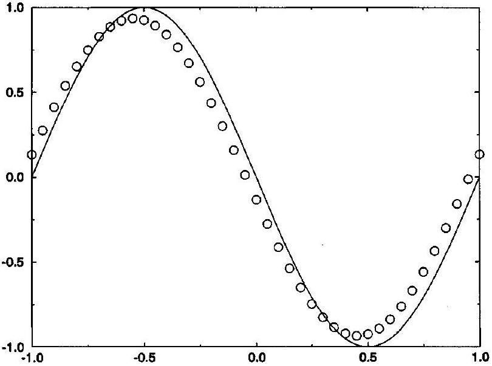
Figure 22.9 Jameson's self-adjusting hybrid method for Test Case 1.

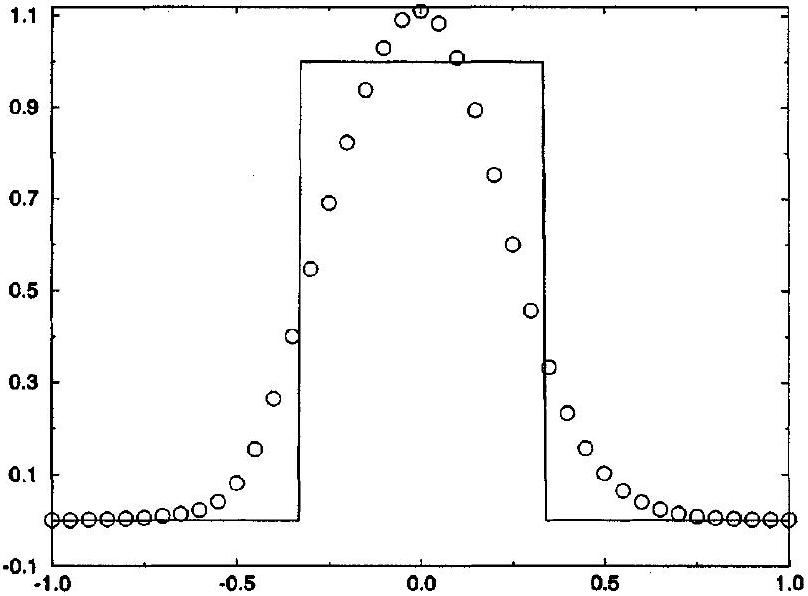
Figure 22.10 Jameson's self-adjusting hybrid method for Test Case 2.

other Runge-Kutta methods seem to yield similar or slightly worse results. Also, all test cases use the MacCormack-Baldwin shock switch with $\kappa=1, \delta=0.25$, and $\delta^{\prime}=10^{-5}$.

Test Case 1 As seen in Figure 22.9, Jameson's self-adjusting hybrid method captures the sinusoid without clipping, with only a modest lagging phase error and a modest uniform dissipation error. The only method seen so far in Part V that can equal this performance is the third-order Shu-Osher method found in Section 21.4.

Test Case 2 As seen in Figure 22.10, Jameson's self-adjusting hybrid method captures the square wave without spurious oscillations, but with substantial smearing, and with a $10 \%$ overshoot at the center. This performance could be improved by tweaking the user-adjustable parameters in the MacCormack-Baldwin shock switch or by using another shock switch such as Harten's shock switch, but only at the expense of the excellent performance seen in Test Case 1.

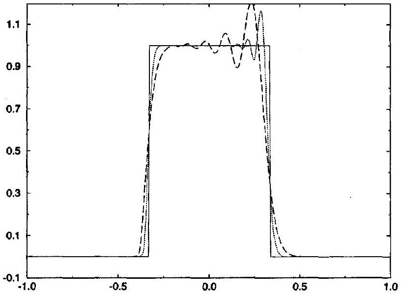
Figure 22.11 Jameson's self-adjusting hybrid method for Test Case 3.

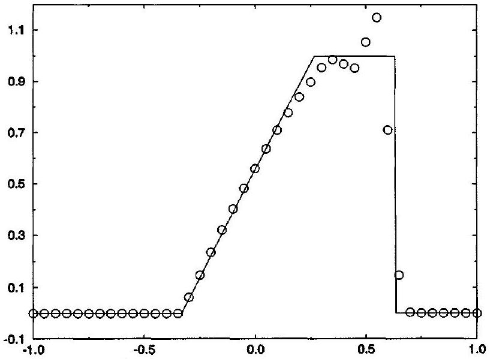
Figure 22.12 Jameson's self-adjusting hybrid method for Test Case 4.

Test Case 3 In Figure 22.11, the dotted line represents Jameson's self-adjusting hybrid approximation to $u(x, 4)$, the long dashed line represents Jameson's self-adjusting hybrid approximation to $u(x, 40)$, and the solid line represents the exact solution for $u(x, 4)$ or $u(x, 40)$. Whereas Harten's self-adjusting hybrid seen in the last section allows minor oscillations in Test Case 3, Jameson's self-adjusting hybrid allows major oscillations. This performance could be improved by tweaking the user-adjustable parameters in the MacCormack-Baldwin shock switch or by using another shock switch such as Harten's shock switch, but only at the expense of the excellent performance seen in Test Case 1.

Test Case 4 As seen in Figure 22.12, Jameson's self-adjusting hybrid works well except for a 15\% overshoot behind the shock.

Test Case 5 As seen in Figure 22.13, Jameson's method fails to alter the initial conditions in any way, which leads to a large expansion shock. This problem is easily

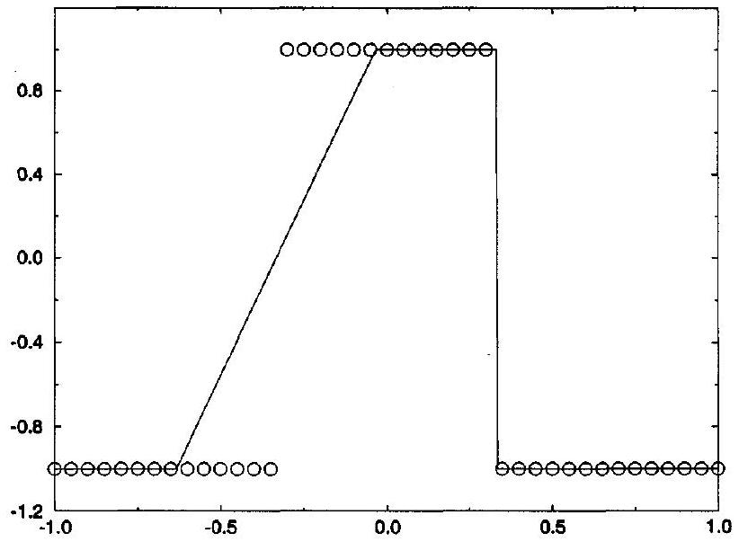
Figure 22.13 Jameson's self-adjusting hybrid method for Test Case 5.

overcome by replacing $\left|a_{i+1 / 2}^{n}\right|$ in Equation (22.14) by $\psi\left(a_{i+1 / 2}^{n}\right)$ as defined in Subsection 18.3.3 or, in other words, by replacing Roe's first-order upwind method by Harten's first-order upwind method.

### 22.3.2 The Euler Equations

This subsection concerns Jameson's self-adjusting hybrid method for the Euler equations. Consider the first-order upwind method based on the one-wave approximate Riemann solver, as described in Section 18.3.4. A semidiscrete version of this first-order upwind method is as follows:

$$
\begin{aligned}
& \frac{\partial \mathbf{u}_{i}^{n}}{\partial t}=-\frac{\hat{\mathbf{f}}_{s, i+1 / 2}^{(1)}-\hat{\mathbf{f}}_{s, i-1 / 2}^{(1)}}{\Delta x}, \\
& \hat{\mathbf{f}}_{s, i+1 / 2}^{(1)}=\frac{1}{2}\left(\mathbf{f}\left(\mathbf{u}_{i+1}^{n}\right)+\mathbf{f}\left(\mathbf{u}_{i}^{n}\right)\right)-\frac{1}{2} \rho\left(A_{i+1 / 2}^{n}\right)\left(\mathbf{u}_{i+1}^{n}-\mathbf{u}_{i}^{n}\right) .
\end{aligned}
$$

Also let

$$
\begin{aligned}
& \frac{\partial \mathbf{u}_{i}^{n}}{\partial t}=-\frac{\hat{\mathbf{f}}_{s, i+1 / 2}^{(2)}-\hat{\mathbf{f}}_{s, i-1 / 2}^{(2)}}{\Delta x}, \\
& \hat{\mathbf{f}}_{s, i+1 / 2}^{(2)}=\frac{1}{2}\left(\mathbf{f}\left(\mathbf{u}_{i+1}^{n}\right)+\mathbf{f}\left(\mathbf{u}_{i}^{n}\right)\right)+\frac{1}{2} \delta \rho\left(A_{i+1 / 2}^{n}\right)\left(\mathbf{u}_{i+2}^{n}-3 \mathbf{u}_{i+1}+3 \mathbf{u}_{i}^{n}-\mathbf{u}_{i-1}^{n}\right) .
\end{aligned}
$$

In both of these methods, $A_{i+1 / 2}^{n}$ is some average flux Jacobian matrix and $\rho\left(A_{i+1 / 2}^{n}\right)$ is the largest characteristic value of $A_{i+1 / 2}^{n}$ in absolute value. Then Jameson's semidiscrete self-adjusting hybrid method for the Euler equations is

$$
\hat{\mathbf{f}}_{s, i+1 / 2}^{n}=\theta_{i+1 / 2}^{n} \hat{\mathbf{f}}_{s, i+1 / 2}^{(1)}+\max \left(0,1-\frac{1}{\delta} \theta_{i+1 / 2}^{n}\right) \hat{\mathbf{f}}_{s, i+1 / 2}^{(2)}
$$

or with a slight modification

$$
\begin{aligned}
\hat{\mathbf{f}}_{s, i+1 / 2}^{n}= & \frac{1}{2}\left(\mathbf{f}\left(\mathbf{u}_{i+1}^{n}\right)+\mathbf{f}\left(\mathbf{u}_{i}^{n}\right)\right)-\frac{1}{2} \rho\left(A_{i+1 / 2}^{n}\right)\left[\theta_{i+1 / 2}^{n}\left(\mathbf{u}_{i+1}^{n}-\mathbf{u}_{i}^{n}\right)\right. \\
& \left.-\delta \max \left(0,1-\frac{1}{\delta} \theta_{i+1 / 2}^{n}\right)\left(\mathbf{u}_{i+2}^{n}-3 \mathbf{u}_{i+1}^{n}+3 \mathbf{u}_{i}^{n}-\mathbf{u}_{i-1}^{n}\right)\right]
\end{aligned}
$$

where

$$
\begin{aligned}
& \theta_{i+1 / 2}^{n}=\max \left(\theta_{i}^{n}, \theta_{i+1}^{n}\right) \\
& \theta_{i}^{n}=\kappa \frac{\left|p_{i+1}^{n}-2 p_{i}^{n}+p_{i-1}^{n}\right|}{p_{i+1}^{n}+2 p_{i}^{n}+p_{i-1}^{n}}
\end{aligned}
$$

Of course, the MacCormack-Baldwin shock switch can be replaced by the Swanson-Turkel shock switch or some other shock switch. Notice that there is no need to worry about zero or negative values in the denominators of the shock switch, since pressure is always strictly greater than zero. Numerical tests have shown that pressure makes for an excellent shock switch. Unfortunately, pressure is constant across contacts, so that any shock switch based on pressure will not act at contacts. Of course, pressure can be replaced by entropy, density, temperature, or some other flow property.

Although Jameson's self-adjusting hybrid method can be used for unsteady flows, it was originally designed primarily for steady-state flows. Unlike many methods, such as the Lax-Wendroff methods seen in Subsection 18.1.2, or any of the second- and thirdgeneration methods based on the Lax-Wendroff methods, the steady-state solutions of Jameson's method do not depend on $\Delta t$. Some common features designed to accelerate the convergence to steady state are described below. In each case, these features trade time accuracy for larger stable CFL numbers and, in various other ways, trade time accuracy for faster convergence to steady state.

## Local Time Stepping

Each grid cell is run at the same CFL number. This implies that the time step is different in different cells - the larger the cell the larger the time step.

## Enthalpy Damping

Instead of solving the true Euler equations, solve the following modified system of equations:

$$
\frac{\partial}{\partial t}\left[\begin{array}{c}
\rho \\
\rho u \\
\rho e_{\mathrm{T}}
\end{array}\right]+\frac{\partial}{\partial x}\left[\begin{array}{c}
\rho u \\
\rho u^{2}+p \\
\rho u h_{\mathrm{T}}
\end{array}\right]+\alpha\left(h_{\mathrm{T}}-h_{\mathrm{T}, \infty}\right)\left[\begin{array}{c}
\rho \\
\rho u \\
h_{\mathrm{T}}
\end{array}\right]=0
$$

where $\alpha$ is a user-adjustable parameter, $h_{\mathrm{T}}$ is the total enthalpy, and $h_{\mathrm{T}, \infty}$ is the total enthalpy in the uniform free stream, far away from any obstacles in the flow. In Equation (22.20), the first two terms comprise the one-dimensional Euler equations; the third term is the enthalpy damping term. If the free-stream flow is uniform, then the total enthalpy in the steady-state solution will also be uniform. In other words, $h_{\mathrm{T}}=h_{\mathrm{T}, \infty}$ for steady-state flow. Thus enthalpy damping terms do not affect steady-state solutions. Enthalpy damping tends to accelerate convergence to steady state, as explained by Jameson, Schmidt, and Turkel
(1981) and Jameson (1982) by analogy with the potential flow equations. Increasing ordinary second- and fourth-order artificial viscosity, by increasing $\kappa$ and $\delta$, increases the rate of convergence to steady state but also increases smearing in the steady-state solution. As one way to think about it, enthalpy damping acts much like artificial viscosity - it certainly increases the rate of convergence to steady state - but without affecting the steady-state solution.

## Optimize $\kappa$ and $\delta$

The parameters $\kappa$ and $\delta$ in the MacCormack-Baldwin shock switch influence not only the rate of convergence, by affecting the largest permissible CFL number and time step, but also the accuracy of the final converged solution. Taking both of these factors into account, the traditional choice is $\kappa=1 / 2$ and $\delta=1 / 128$. Both of these parameters should be substantially larger for unsteady flows. Remember that reducing $\kappa$ and $\delta$ tends to increase the largest permissible CFL number, as judged by whether or not the method blows up, but also tends to increase the amount of spurious overshoot and oscillation. However, the bulk of the spurious overshoots and oscillations is unsteady rather than steady and thus does not appear in the steady-state solution; thus steady-state solutions usually benefit from lower values of $\kappa$ and $\delta$ and the resulting larger time steps.

It is awkward to use one setting for the user-adjustable parameters in steady flows and a different setting for unsteady flows. Unfortunately, a similar situation exists in most flux-averaged methods. For example, in flux-limited methods, some flux limiters work much better for steady-state solutions than for unsteady solutions or, at least, one choice of parameters in the flux limiter works better for steady-state solutions than for unsteady solutions. Of course, it is not absolutely necessary to tweak things differently for steady and unsteady solutions, but it usually makes the final method more accurate and efficient.

## Implicit Residual Smoothing

Ordinarily, when the time step grows too large, it violates stability constraints and/or the CFL condition, resulting in extremely large spurious oscillations. However, suppose that a filtering procedure removes or reduces the spurious oscillations after every time step. For example, consider the following implicit residual smoothing procedure. In the first step, compute the residual $R_{i}^{n}$ :

$$
R_{i}^{n}=\frac{\hat{f}_{R, i+1 / 2}^{n}-\hat{f}_{R, i-1 / 2}^{n}}{\Delta x} .
$$

This could be considered a predictor. In the second step, solve for the smoothed residual $R_{i}^{\prime}$ in the following implicit equation:

$$
-\epsilon R_{i+1}^{\prime}+(1+2 \epsilon) R_{i}^{\prime}-\epsilon R_{i-1}^{\prime}=R_{i}^{n},
$$

where $\epsilon$ is a user-adjustable parameter. This could be considered a corrector. Equation (22.21) amounts to a linear tridiagonal system of equations, which is relatively inexpensive to solve, as seen in Example 11.4. In the third and final step, let the new and improved semidiscrete approximation be

$$
\frac{d u}{d t}\left(x_{i}, t^{n}\right)=R_{i}^{\prime} .
$$

As it turns out, implicit residual smoothing can stabilize any CFL number, provided that $\epsilon$ is large enough. In particular, $\epsilon$ should increase proportional to the square of the CFL number. Implicit residual smoothing introduces a degree of implicitness into an otherwise explicit method, and reaps the reward of the large CFL numbers typically associated with implicit methods, but without costing as much as most implicit methods. See Jameson and Baker (1983) or Jameson (1983) for a further description of implicit residual smoothing.

## Grid Sequencing

Define a sequence of grids from coarse to fine. The steady-state solution is found on the coarsest grid. The results from the coarsest grid are interpolated to the next finer grid and the solution is again converged to steady state. The results from the finer grid are interpolated to the next finer grid and converged to steady state. This process continues until the steadystate solution is found on the final and finest grid. The idea here is that large time steps may be used on the coarse grid. Thus the solution will converge quickly on the coarse grid, capturing the long wavelength components of the solution. Each finer grid will have smaller times steps and will capture finer details of the flow. Hopefully, initial conditions interpolated from a converged solution on a coarser grid will converge quicker than arbitrary initial conditions. Grid sequencing is a natural companion to multigrid, as described next.

## Multigrid

Define a sequence of grids from coarse to fine. A few time steps are taken on the coarsest grid and the results are interpolated to a finer grid. A few more time steps are taken on the finer grid, and the results are interpolated to a still finer grid. This process repeats, so that the grids continually get finer and finer. So far, multigrid is like grid sequencing, except that no attempt is made to reach steady state on any of the grids. However, in multigrid, at some stage the process reverses itself, so that the fine grid results are converted back to a coarser grid and a few time steps are taken on the coarser grid, after which the results are either interpolated back to the fine grid or are converted to an even coarser grid. The sequence of grids is typically specified by diagrams such as those seen in Figure 22.14. In Figure 22.14, the upper dots represent the coarser grids, the lower dots represent the finer grids, $N$ is the number of grid points, and $n$ is the number of time steps. The letters $V$ or the $W$ represent a single multigrid cycle, which repeats itself indefinitely, until steady steady is achieved. In this explanation, the multigrid initially goes from coarser to finer for consistency with the earlier grid sequencing explanation; however, in the standard treatment, multigrid always initially goes from finer to coarser.

Remember that steady state occurs when all unsteady waves exit the far-field boundaries, or are eliminated by dissipation, as mentioned in Chapter 19. Then, as the primary motivation behind multigrid, the rate of convergence to steady state is limited by the slowest waves,

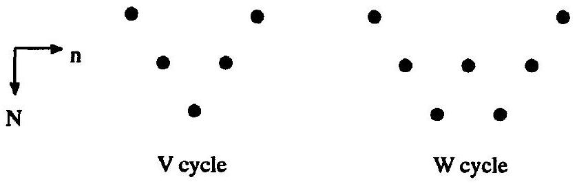
Figure 22.14 Two possible multigrid cycles.

while the CFL number and time step are limited by the fastest waves. The fastest waves may travel an entire grid cell during a single time step and quickly exit the computational domain through the far-field boundaries. However, the slowest waves move only a fraction of a cell during one time step and may take a very long time to exit the domain through the far field. On coarser grids, the time step can be larger, and slowly moving long-wavelength unsteadiness will reach the far field in fewer time steps. For one of the first descriptions of multigrid in Jameson's self-adjusting hybrid method see, for example, Jameson (1983). For later descriptions see, for example, Jameson (1989) and the references cited therein. For more on the multigrid method in general, see Briggs (1987) and McCormick (1987).

## Multistage Time Stepping

Runge-Kutta methods often allow many more degrees of freedom than can be usefully exploited, especially when the temporal order of accuracy constraints are dropped, as in steady-state flows, where time accuracy is irrelevant. But suppose that the $i$ th stage only depends on the ( $i-1$ )th stage, and not on any earlier stages. This is called a multistage scheme. An $m$-stage multistage scheme is defined as follows:

$$
\begin{aligned}
& u_{i}^{(0)}=u_{i}^{n}, \\
& u_{i}^{(1)}=u_{i}^{(0)}-\alpha_{1} \Delta t R_{i}^{(0)}, \\
& u_{i}^{(2)}=u_{i}^{(0)}-\alpha_{2} \Delta t R^{(1)}, \\
& \quad \vdots \\
& u_{i}^{(m-1)}=u_{i}^{(0)}-\alpha_{m-1} \Delta t R_{i}^{(m-2)}, \\
& u_{i}^{(m)}=u_{i}^{(0)}-\Delta t R_{i}^{(m-1)}, \\
& u_{i}^{n+1}=u_{i}^{(m)},
\end{aligned}
$$

where the $\alpha_{i}$ are the multistage coefficients. Multistage methods are a subset of Runge-Kutta methods, as seen in Section 10.3, where the Butcher array is diagonal rather than triangular. As their main advantage, multistage methods require less storage than general Runge-Kutta methods. Specifically, most $m$-stage Runge-Kutta methods must store $m$ residuals at a time, whereas an $m$-stage multistage method need only store one residual at a time.

## Implicit Time Stepping

Explicit Runge-Kutta and multistage time-stepping schemes limit the CFL numbers. In contrast, the implicit time-stepping methods discussed above permit very large CFL numbers and thus very large time steps. Although, in theory, the steady-state convergence rate should always increase as the time step increases, there is always a finite optimum time step in practice, depending on how many liberties are taken in linearizing and simplifying the implicit part of the approximation - the solution will converge more slowly if the time step is either less than or greater than the optimum. Although implicit methods are generally more efficient than explicit Runge-Kutta methods, they are usually not dramatically more efficient, and the coding is more complex and may require significantly more computer memory.

## Frozen Dissipation

Recall that the residual can be written as central differences plus an adaptive blend of second- and fourth-order artificial viscosity, much as in Equation (22.18). Evaluating the
artificial viscosity is expensive, certainly more expensive than evaluating central differences. Thus, for added savings, it is common to freeze the artificial viscosity terms after some specified stage in a Runge-Kutta or multistage time-stepping method; only the central difference portion is updated in subsequent stages. See Jameson, Schmidt, and Turkel (1981) or Jameson (1982) for details.

When all of the above features are combined, Jameson's method is very efficient indeed, and highly robust, provided that the solution does not contain overly strong shocks.

Some of the above techniques, originally developed for steady-state calculations, extend to unsteady calculations. For issues specifically related to unsteady flows, see, for example, Venkatakrishnan and Jameson (1988) and Jameson (1991). Since its inception, there have been innumerable papers written on Jameson's self-adjusting hybrid method, probably more than on any other method seen in Part V; see the references cited below, such as Holmes and Tong (1985) or the many papers by Jameson, for selected examples.

## References

Briggs, W. L. 1987. A Multigrid Tutorial, Philadelphia: SIAM.
Caughey, D. A. 1988. "Diagonal Implicit Multigrid Algorithm for the Euler Equations," AIAA Journal, 26: 841-851.
Harten, A. 1978. "The Artificial Compression Method for Computation of Shocks and Contact Discontinuities: III. Self-Adjusting Hybrid Schemes," Mathematics of Computation, 32: 363-389.
Harten, A. 1983. "High Resolution Schemes for Hyperbolic Conservation Laws," Journal of Computational Physics, 49: 357-393.
Harten, A., and Zwas, G. 1972a. "Self-Adjusting Hybrid Schemes for Shock Computations," Journal of Computational Physics, 9: 568-583.
Harten, A., and Zwas, G. 1972b. "Switched Numerical Shuman Filters for Shock Calculations," Journal of Engineering Mathematics, 6: 207-216.
Holmes, D. G., and Tong, S. S. 1985. "A Three-Dimensional Euler Solver for Turbomachinery Blade Rows," Transactions of the ASME, 107: 258-264.
Jameson, A. 1982. "Steady-State Solution of the Euler Equations for Transonic Flow." In Transonic, Shock, and Multidimensional Flows: Advances in Scientific Computing, ed. R. E. Meyer, New York: Academic Press.
Jameson, A. 1983. "The Evolution of Computational Methods in Aerodynamics," Transactions of the ASME, 50: 1052-1070.
Jameson, A. 1989. "Computational Aerodynamics for Aircraft Design," Science, 245: 361-371.
Jameson, A. 1991. "Time Dependent Calculations Using Multigrid, with Applications to Unsteady Flows Past Airfoils and Wings," AIAA Paper 91-1596 (unpublished).
Jameson, A. 1995. "Positive Schemes for Shock Modelling for Compressible Flow," International Journal for Numerical Methods in Fluids, 20: 743-776.
Jameson, A., and Baker, T. J. 1983. "Solution of the Euler Equations for Complex Configurations," AIAA Paper 83-1929 (unpublished).
Jameson, A., Schmidt, W., and Turkel, E. 1981. "Numerical Solutions of the Euler Equations by Finite Volume Methods Using Runge-Kutta Time-Stepping Schemes," AIAA Paper 81-1259 (unpublished).
Jameson, A., and Yoon, S. 1986. "Multigrid Solution of the Euler Equations Using Implicit Schemes," AIAA Journal, 24: 1737-1743.

Jorgenson, P., and Turkel, E. 1993. "Central Difference TVD Schemes for Time Dependent and Steady State Problems," Journal of Computational Physics, 107: 297-308.
MacCormack, R. W., and Baldwin, B. S. 1975. "A Numerical Method for Solving the NavierStokes Equations with Application to Shock Boundary Layer Interactions," AIAA Paper 75-0001 (unpublished).
McCormick, S. F., ed. 1987. Multigrid Methods, Philadelphia: SIAM.
Swanson, R. C., and Turkel, E. 1992. "On Central-Difference and Upwind Schemes," Journal of Computational Physics, 101: 292-306.
Tatsumi, S., Martinelli, L., and Jameson, A. 1995. "Flux-Limited Schemes for the Compressible Navier-Stokes Equations," AIAA Journal, 33: 252-261.
Venkatakrishnan, V., and Jameson, A. 1988. "Computation of Unsteady Transonic Flows by Solution of the Euler Equations," AIAA Journal, 26: 974-981.

