## 1

## review of fundamental principles

1-1 PRINCIPAL NOTATION FOR CHAPTER 1 ..... 2
1-2 INTRODUCTION ..... 4
1-3 DIMENSIONS AND UNITS ..... 4
(a) Dimensions ..... 4
(b) Systems of units ..... 5
(c) Principle of dimensional homogeneity ..... 8
1-4 THE CONTINUUM POSTULATE ..... 8
(a) Classification of the forces acting on a body of fluid ..... 8
(b) Density at a point in a continuum ..... 9
(c) Velocity at a point in a body of fluid ..... 10
(d) Stress at a point ..... 11
(e) The continuum postulate applied to a gas ..... 12
(f) The Knudsen number ..... 13
1-5 PERFECT SUBSTANCES ..... 15
(a) The perfect solid ..... 16
(b) The perfect fluid ..... 16
(c) The perfect liquid ..... 17
(d) The perfect gas ..... 17
1-6 REAL FLUIDS ..... 18
(a) General comments on perfect and real fluids ..... 18
(b) Viscosity ..... 20
(c) Viscosity data for gases ..... 22
1-7 THE SIMPLE THERMODYNAMIC SYSTEM ..... 23
(a) Properties of the simple thermodynamic system ..... 23
(b) Change of state for a simple thermodynamic system ..... 26
1-8 REVERSIBLE AND IRREVERSIBLE PROCESSES ..... 27
1-9 WORK ..... 28
1-10 HEAT ..... 30
1-11 THE FIRST LAW OF THERMODYNAMICS ..... 30
(a) Mathematical statement of the first law of thermodynamics ..... 30
(b) Stored energy ..... 30
(c) Internal energy ..... 31
(d) Flow work ..... 31
(e) Enthalpy ..... 32
(f) Specific heats ..... 32
1-12 THE SECOND LAW OF THERMODYNAMICS AND ENTROPY ..... 33
1-13 NEWTON'S LAWS OF MOTION ..... 35
(a) Mathematical expressions of Newton's laws of motion ..... 36
(b) Momentum of a particle ..... 36
(c) Momentum of a system of particles ..... 37
1-14 KINETIC THEORY AND THE PERFECT GAS ..... 37
(a) Basic considerations of the kinetic theory ..... 37
(b) Pressure intensity ..... 38
(c) Temperature ..... 39
(d) Avogadro's number and Boltzmann's constant ..... 39
(e) Specific heats ..... 40
(f) Viscosity ..... 40
(g) Thermal conductivity ..... 41
(h) Diffusion ..... 41
1-15 THERMODYNAMIC PROPERTIES OF THE PERFECT GAS ..... 41
(a) Thermal equation of state ..... 41
(b) Caloric equation of state ..... 43
(c) Specific heat relationships ..... 43
(d) Enthalpy change ..... 44
(e) Entropy change ..... 45
(f) Process equations ..... 46
(g) Entropy-enthalpy diagram ..... 46
(h) Mixtures of thermally perfect gases ..... 48
1-16 IMPERFECT GASES AND GAS TABLES ..... 53
(a) Specific heat data ..... 54
(b) Gas tables ..... 57
1-17 THE ACOUSTIC SPEED AND THE MACH NUMBER ..... 63
(a) The acoustic speed ..... 63
(b) The Mach number ..... 64
1-18 PROPERTIES OF THE ATMOSPHERE ..... 65

## 1-1 PRINCIPAL NOTATION FOR CHAPTER 1

$a$ acoustic speed.
a acceleration.
$A$ area.
$c_{p} \quad$ specific heat at constant pressure.
$\bar{c}_{p} \quad=\bar{m} c_{p}$, molar specific heat at constant pressure.
$c_{v} \quad$ specific heat at constant volume.
$\bar{c}_{v}=\bar{m} c_{v}$, molar specific heat at constant volume.
$C_{i} \quad=m_{i} / m$, mass fraction of species $i$.
$e \quad$ specific stored energy.
$E$ stored energy.
F force.
$F$ the dimension force.
$g$ local acceleration due to gravity.
$g_{c}$ factor of proportionality defined by Newton's second law.
$g_{o}$ standard acceleration due to gravity (at sea level, $45^{\circ}$ latitude, in a vacuum) $= 9.80665 \mathrm{~m} / \mathrm{s}^{2}\left(32.1740 \mathrm{ft} / \mathrm{sec}^{2}\right)$.
$h$ specific enthalpy.
$k$ Boltzmann's constant, $1.38054 \cdot 10^{-23} \mathrm{~J} / \mathrm{K}$.
$K=-v(d p / d v)$, bulk modulus.
$\mathrm{Kn}=L / \lambda$, Knudsen number.
$L$ characteristic length, or the dimension length.
$m$ mass.
$\bar{m}$ molecular weight.
$M=V / a$, Mach number, or the dimension mass.
M momentum.
n unit normal vector.
$N$ moles.
$N_{A}$ Avogadro's number, $6.02252 \cdot 10^{23}$ molecules $/ \mathrm{mol}$.
$N_{i}$ moles of species $i$.
$p$ static pressure.
$Q$ heat.
$R=\bar{R} / \bar{m}$, gas constant for a specific gas.
$\bar{R}$ universal gas constant, $8314.3 \mathrm{~J} / \mathrm{kmol}-\mathrm{K}$.
$\operatorname{Re}=L V \rho / \mu$, Reynolds number.
$s$ specific entropy.
$S$ entropy.
$t$ absolute temperature, or time.
t unit tangential vector.
$T$ the dimension time.
$u \quad$ specific internal energy.
$U \quad$ internal energy.
$v$ specific volume.
$\mathscr{V}$ volume.
$V$ velocity magnitude.
V velocity.
$W$ work.
$X_{i}=N_{i} / N$, mole fraction of species $i$.

## Greek Letters

$\gamma=c_{p} / c_{v}$, specific heat ratio.
$\Theta \quad$ the dimension temperature.
$\kappa \quad$ thermal conductivity.
$\lambda$ mean free path of gas molecules.
$\mu \quad$ absolute or dynamic viscosity.
$v \quad=\mu / \rho$, kinematic viscosity.
$\rho$ density.
$\sigma$ stress.
$\tau$ shear stress.
$\phi \quad=\int_{t_{0}}^{t} c_{p} \frac{d t}{t}$.

## 4 REVIEW OF FUNDAMENTAL PRINCIPLES

## Subscripts

$i \quad$ denotes species $i$.

## Other

- denotes molar basis.


## 1-2 INTRODUCTION

Gas dynamics is the science concerned with the causes and effects arising from the motion of compressible fluids, particularly gases, and is a branch of the more general science of fluid dynamics. Gas dynamics brings together concepts and principles from several branches of science, including mechanics, thermodynamics, aerodynamics, and chemical kinetics. Nuclear, electrical, and magnetic effects generally are not considered part of the science of gas dynamics.

This chapter reviews the fundamental concepts and principles underlying the theoretical basis for the analytical methods of gas dynamics. As in the case of any problem in fluid dynamics, the analysis of a gas dynamic problem is based on the interrelations between the following four fundamental physical laws.

1. The law of the conservation of mass.
2. Newton's second law of motion.
3. The first law of thermodynamics.
4. The second law of thermodynamics.

These laws are independent of either the properties of the flowing fluid or the particular flow process under consideration. The law of the conservation of mass is self-explanatory. The underlying concepts of the other three laws, as applied to a system of fixed mass, are reviewed briefly in this chapter.

In applying the above fundamental laws to a flowing fluid, the properties of the fluid must be considered. Consequently, brief reviews of the continuum concept and of the elastic and thermodynamic properties of perfect substances are presented in this chapter. Furthermore, because of its major importance to gas dynamics, the properties of the perfect gas are discussed in some detail.

## 1-3 DIMENSIONS AND UNITS ${ }^{\mathbf{1}-\mathbf{4}}$

Dimensions are the names employed for characterizing physical quantities. The physical quantities of interest in gas dynamics are force $F$, mass $M$, length $L$, time $T$, and temperature $\Theta$. Units are the names given to certain magnitudes of a dimension chosen as a standard of measurement. For example, the dimension length may be measured in units of meters. The basic units of measurement are arbitrary but, once chosen, they must be employed in a consistent manner. The present section is concerned with several of the inherent characteristics of dimensions and units.

## 1-3(a) Dimensions

Two kinds of quantities enter quite generally into engineering measurements: dimensional quantities and dimensionless quantities. A dimensional quantity has its magnitude expressed in terms of one or more basic units of measurement; for example, a length of so many meters, a velocity of so many meters per second, or an acceleration of so many meters per second per second, etc. On the other hand, a dimensionless quantity has no dimensional category whatsoever and is, therefore, a pure number.

A dimensionless quantity may be a coefficient, such as the discharge coefficient for an orifice plate, the ratio of two similar dimensional quantities, or the product of several dimensional quantities arranged to give a dimensionless result. The numerical magnitude of a dimensionless quantity is independent of the size of the fundamental units employed for evaluating it, provided that a consistent set of units is employed.

The choice of either the principal dimensions or the size of the basic units for expressing the magnitude of a physical measurement is arbitrary. It is based entirely on convenience. In general, the principal dimensions may be any mutually independent set that is convenient to use. Experience has demonstrated, however, that in the field of fluid mechanics, four principal dimensions suffice. They are length $L$, time $T$, either mass $M$ or force $F$, and temperature $\Theta$. The magnitude of any physical measurement in the field of fluid mechanics is expressible in terms of units having the foregoing principal dimensions.

Mass and force are related by Newton's second law of motion; that is, force $\propto$ mass × acceleration. In dimensional form, Newton's second law of motion is $F \propto M L / T^{2}$. If mass $M$ is taken as the primary dimension, then the dimensions of force $F$ are $M L / T^{2}$. If force $F$ is chosen as the primary dimension, then the dimensions of mass $M$ are $F T^{2} / L$. Thus, in any system of dimensions, either mass $M$ or force $F$ may be chosen as the primary dimension; the other quantity is then a secondary or derived dimension.

## 1-3(b) Systems of Units

Like the selection of the primary dimensions, the selection of the basic units of measurement, hereafter termed the basic units for brevity, is arbitrary, being based solely on convenience. Evidence of this is the large number of different units employed in engineering and physics for the four dimensions $M, L, T$, and $F$. There is, however, a restriction imposed by Newton's second law of motion, termed the condition for consistency, that must be satisfied by a system of basic units. Consistency requires that the basic units must satisfy numerically the following relationship: 1 unit force $=$ 1 unit mass $\times 1$ unit acceleration.

Prior to 1971, several systems of units were widely used in the United States. They were (1) the English Engineering (EE) system, (2) the English Absolute (EA) system, (3) the English Gravitational (EG) system, and (4) the Metric system. In 1971 the U.S. Bureau of Standards recommended that the United States adopt and convert to a modified Metric system called the Standard International system (the SI system). Table 1.1 presents the basic units of the aforementioned five systems of units, and the recommended symbol for each unit.

Table 1.1 Basic Units in Several Systems of Units
| Quantity | System of Units |  |  |  |  |
| :--- | :--- | :--- | :--- | :--- | :--- |
|  | English Engineering (EE) | English Absolute (EA) | English Gravitational (EG) | Metric System (Metric) | International System (SI) |
| Length | foot (ft) | foot (ft) | foot (ft) | centimeter (cm) | meter (m) |
| Mass | pound (lbm) | pound (lbm) | slug (slug) | gram (g) | kilogram (kg) |
| Time | second (sec) | second (sec) | second (sec) | second (s) | second (s) |
| Force | pound (lbf) | poundal (pdl) | pound (lbf) | dyne (dyne) | newton (N) |
| Temperature | rankine (R) | rankine (R) | rankine (R) | kelvin (K) | kelvin (K) |


A brief history of measurement systems, including the new SI system, is given in Reference 4. The standard for each unit of measurement in the SI system was adopted by the General Conference of Weights and Measures in 1960. The standard for the unit of mass is the kilogram (kg), a cylinder of platinum-iridium alloy kept at the International Bureau of Weights and Measures in Paris. Of all the standard units, the mass unit is the only basic unit still defined by an artifact. The standard for the unit of length is the meter ( m ), which is defined as $1,650,763.73$ wavelengths, in vacuum, of the radiation corresponding to the transition between the levels $2 p_{10}$ and $5 d_{5}$ of the krypton-86 atom. The standard for the unit of time, the second (s), is defined as the time interval required for $9,192,631,770$ cycles of radiation corresponding to the transition between the two hyperfine levels of the ground state of the cesium-133 atom. The degree kelvin $(\mathrm{K})$, the standard for the unit of temperature, is defined as $1 / 273.16$ of the thermodynamic temperature of the triple point of water. The newton ( N ) is the standard for the unit of force in the SI system. Its magnitude is defined as the force required to accelerate a mass of 1 kg at the rate of $1 \mathrm{~m} / \mathrm{s}^{2}$. The mole (mol) is the standard for the amount of substance of a system. The mole contains as many elementary entities as there are atoms in 0.012 kilogram of carbon-12. When the mole is used, the elementary entities must be specified and may be atoms, molecules, ions, electrons, other particles, or specified groups of such particles. The standard for the unit of measure of a plane angle is the radian (rad), which is defined as the angle with its vertex at the center of a circle and subtended by an arc equal in length to the radius.

During the period that the SI system is being adopted in the United States, there will be at least five different consistent systems of basic units being employed. The relationships between them (and other systems of units) are readily determinable by applying the consistency condition to them.

1. The EE system.

1 pound force $(1 \mathrm{lbf})=1$ pound mass $(1 \mathrm{lbm}) \times 32.1740 \mathrm{ft} / \mathrm{sec}^{2}$
2. The EA system.

1 poundal force ( 1 pdl $)=1$ pound mass $(1 \mathrm{lbm}) \times 1 \mathrm{ft} / \mathrm{sec}^{2}$
3. The EG system.

1 pound force ( 1 lbf ) $=1$ slug mass ( 1 slug) $\times 1 \mathrm{ft} / \mathrm{sec}^{2}$
4. The Metric system.

1 dyne force $(1$ dyne $)=1$ gram mass $(1 \mathrm{~g}) \times 1 \mathrm{~cm} / \mathrm{s}^{2}$
5. The SI system.

1 newton force $(1 \mathrm{~N})=1$ kilogram mass $(1 \mathrm{~kg}) \times 1 \mathrm{~m} / \mathrm{s}^{2}$
Table C.1* presents the dimensional formulas for several of the physical quantities of interest in gas dynamics. Also included in Table C. 1 are the units of the physical quantities in the English Engineering (EE), English Absolute (EA), English Gravitational (EG), and Standard International (SI) systems of units.

Table C. 2 presents the values of some of the universal physical constants that are pertinent to fluid mechanics.

In Section 1-3(a), it is pointed out that Newton's second law of motion states that

$$
\mathbf{F} \propto m \mathbf{a}
$$

To convert the above proportionality into an equation, a factor of proportionality, denoted by $1 / g_{\boldsymbol{c}}$, is introduced into the above relationship. Thus

$$
\mathbf{F}=\frac{1}{g_{c}} m \mathbf{a}
$$

[^0]From equation 1.1, $g_{c}=m \mathbf{a} / \mathbf{F}$. The magnitude and units of $g_{c}$ depend on the units employed for $m$, $\mathbf{a}$, and $\mathbf{F}$. Table 1.2 presents the values of $g_{c}$ for several systems of units that are commonly employed in gas dynamics.

Table 1.2 The Factor of Proportionality $g_{c}$ for Several Systems of Units
| System of Units | Length | Time | Mass | Force | Factor of Proportionality $g_{c}$ |
| :--- | :--- | :--- | :--- | :--- | :--- |
| EE | ft | sec | lbm | lbf | $32.1740 \mathrm{lbm}-\mathrm{ft} / \mathrm{lbf}-\mathrm{sec}^{2}$ |
| EA | ft | sec | lbm | pdl | $1.0 \mathrm{lbm}-\mathrm{ft} / \mathrm{pdl}-\mathrm{sec}^{2}$ |
| EG | ft | sec | slug | lbf | 1.0 slug-ft/lbf-sec ${ }^{2}$ |
| SI | m | s | kg | N | $1.0 \mathrm{~kg}-\mathrm{m} / \mathrm{N}-\mathrm{s}^{2}$ |
| Metric | cm | s | g | dyne | $1.0 \mathrm{~g}-\mathrm{cm} /$ dyne- $\mathrm{s}^{2}$ |


The factor $g_{c}$ is not a physical quantity but merely a conversion factor similar to $1 \mathrm{~m}=100 \mathrm{~cm}, 1 \mathrm{~N}-\mathrm{m}=1 \mathrm{~J}, 1 \mathrm{~kg}=1000 \mathrm{~g}$, and so forth. For a consistent set of units, the numerical value of $g_{c}=1$ and may, therefore, be omitted from equation 1.1, to yield

$$
\mathbf{F}=m \mathbf{a}
$$

Since $g_{c}$ is not a physical quantity, it will be omitted from the equations of this book. Remember, however, that when making numerical calculations, the appropriate values of $g_{c}$ and other factors of proportionality must be determined and employed.

The conversion factors for the units of many of the physical parameters pertinent to gas dynamics are presented on the inside covers of this book.

Example 1.1. A body of mass 5 kg is given an acceleration of $10 \mathrm{~m} / \mathrm{s}^{2}$. Calculate the external force acting on the body in these units: (a) newtons, (b) dynes, (c) pounds force, and (d) poundals.

## Solution

(a) $F=m a=(5 \mathrm{~kg})\left(10 \frac{\mathrm{~m}}{\mathrm{~s}^{2}}\right)\left(\frac{\mathrm{N}-8^{2}}{\mathrm{~m}-\mathrm{kg}}\right)=50 \mathrm{~N}$
(b) $F=m a=(5 \mathrm{~kg})\left(10 \frac{\mathrm{~m}}{8^{2}}\right)\left(\frac{\mathrm{N}-8^{2}}{\mathrm{~m}-\mathrm{kg}}\right)\left(\frac{10^{5} \text { dyne }}{\mathrm{N}}\right)=5 \cdot 10^{6}$ dyne
(c) $F=m a=(5 \mathrm{~kg})\left(10 \frac{\mathrm{~m}}{8^{2}}\right)\left(\frac{\mathrm{N}-8^{2}}{\mathrm{~m}-\mathrm{kg}}\right)\left(0.224809 \frac{\mathrm{lbf}}{\mathrm{N}}\right)=1.124 \mathrm{lbf}$
(d) $F=m a=(5 \mathrm{~kg})\left(10 \frac{\mathrm{~m}}{8^{2}}\right)\left(\frac{\mathrm{N}-\mathrm{g}^{2}}{\mathrm{~m}-\mathrm{kg}}\right)\left(0.224809 \frac{\mathrm{lbr}}{\mathrm{N}}\right)\left(32.174 \frac{\mathrm{pdl}}{\mathrm{lbf}}\right)=36.165 \mathrm{pdl}$

In this example, the units of each physical quantity are written in the equation together with its numerical value. By so doing, the units of the resulting quantity appear explicitly, and it is immediately obvious whether or not a conversion factor such as $g_{c}$ is required. The technique of including the units in the equations when making numerical computations is highly recommended. The required conversion factors, if any, then suggest themselves automatically in terms of the units of the original physical quantities and the desired units of the calculated physical quantity.

## 8 REVIEW OF FUNDAMENTAL PRINCIPLES

Despite the foregoing strong recommendation, that practice, because of space limitations, is not followed in the illustrative examples presented in this book. All of the examples were, however, originally worked in the recommended manner to assure that the desired units were obtained in the answers.

## 1-3(c) Principle of Dimensional Homogeneity

An important principle pertaining to the mathematical relationships between physical quantities is that of dimensional homogeneity, which states that all of the terms of an equation expressing an actual physical relationship between physical variables must have the same dimensions. Thus, the units employed in evaluating each term in an equation may be quite different as long as the dimensions of each term are the same. However, when the terms of a dimensionally homogeneous equation are to be combined, each term must be expressed in the same units. At that time, the conversion factors are introduced into the numerical computations.

## 1-4 THE CONTINUUM POSTULATE ${ }^{5,6}$

From a microscopic viewpoint a material substance is composed of discrete particles; that is, molecules or atoms. In dealing with fluids, liquid or gaseous, it is assumed quite generally that the detailed molecular structure of the fluid may be replaced by a continuum that makes it possible to deal with a fluid on a macroscopic scale. The continuum postulate assumes that every differential element of a body of fluid contains a tremendous number of molecules and that the average statistical properties of the molecules contained in an elementary volume represent the macroscopic properties of the fluid in the region of that elementary volume. Consequently, the continuum model is a satisfactory one only for those situations where the characteristic dimensions of the body of fluid under consideration, or of a material body within the fluid, are very large when compared with the average molecular distance between the molecules comprising the fluid. In other words, the continuum postulate is satisfied if an infinitesimal change in the volume of the fluid influences an exceedingly large number of molecules.

Before defining some of the properties of a fluid based on the continuum postulate, it is helpful to review briefly the forces that may act on a body of fluid. Such forces deform or strain it. If the forces are substantially invariant with time, they are termed static forces; otherwise they are termed dynamic forces.

## 1-4(a) Classification of the Forces Acting on a Body of Fluid

The external forces that act on a body of fluid may be segregated into two groups: (1) surface forces, and (2) body forces. A surface force may have any orientation with respect to the surface of the body of the fluid and may be decomposed into a normal force acting perpendicular to the surface and a tangential, or shearing, force acting parallel to the surface. A body force is one that is distributed over the entire volume of a body of material; for example, the forces caused by gravitational attraction, magnetic and electrostatic fields, and the like.

The force per unit area acting on a body (dimensions $F / L^{2}$ ) is termed a stress. If the force is normal to the area, the stress is called a normal stress. If a normal stress acts in the direction for bringing the particles comprising the body in closer contact with each other, it is termed a compressive stress. If it acts in the direction that tends to cause separation of the particles, it is known as a tensile stress.

## 1-4(b) Density at a Point in a Continuum

The smallest elementary volume $\delta \mathscr{V}$, comprising an elementary mass of fluid that contains a sufficiently large number of molecules for satisfying the continuum postulate, is termed a fluid particle; let $\delta \mathscr{V}^{\prime}$ denote that limiting volume.

Figure 1.1 illustrates schematically a large mass of fluid enclosed by a volume $\mathscr{V}$. Let $P(x, y, z)$ denote an arbitrary point inside of $\mathscr{V}$. Assume that the point $P$ is surrounded by an elementary volume $\delta \mathscr{V}$ that contains the elementary mass of fluid $\delta m$. Let $\bar{\rho}$ denote the average density of the mass enclosed by $\delta \mathscr{V}$. Then

$$
\bar{\rho} \equiv \frac{\delta m}{\delta \mathscr{V}}
$$

Now let $\delta \mathscr{V}$ shrink about the point $P(x, y, z)$, and plot the ratio $\delta m / \delta \mathscr{V}$, as is done qualitatively in Fig. 1.2. It is seen that as $\delta \mathscr{V}$ shrinks, the curve presenting $\delta m / \delta \mathscr{V}$ as a function of $\delta \mathscr{V}$ exhibits the following characteristics.

1. $\delta m / \delta \mathscr{V}$ approaches an asymptotic value; that is, the material becomes more homogeneous.

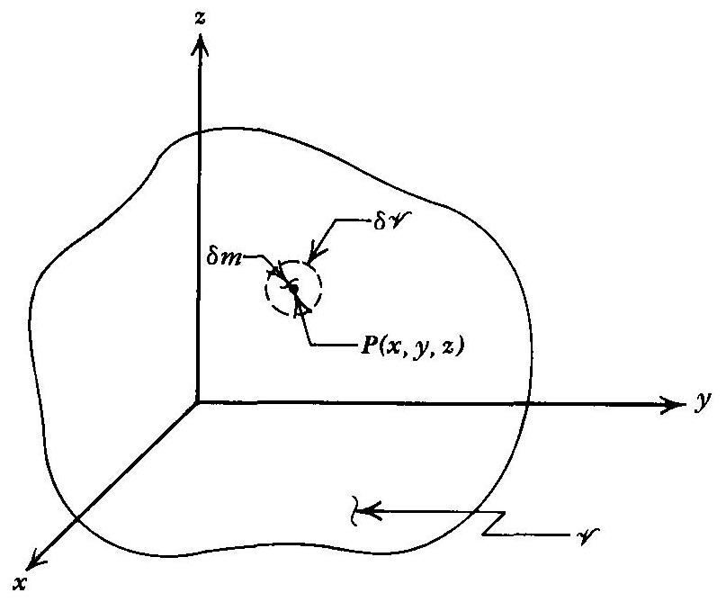
Figure 1.1 Elementary volume in a continuum.

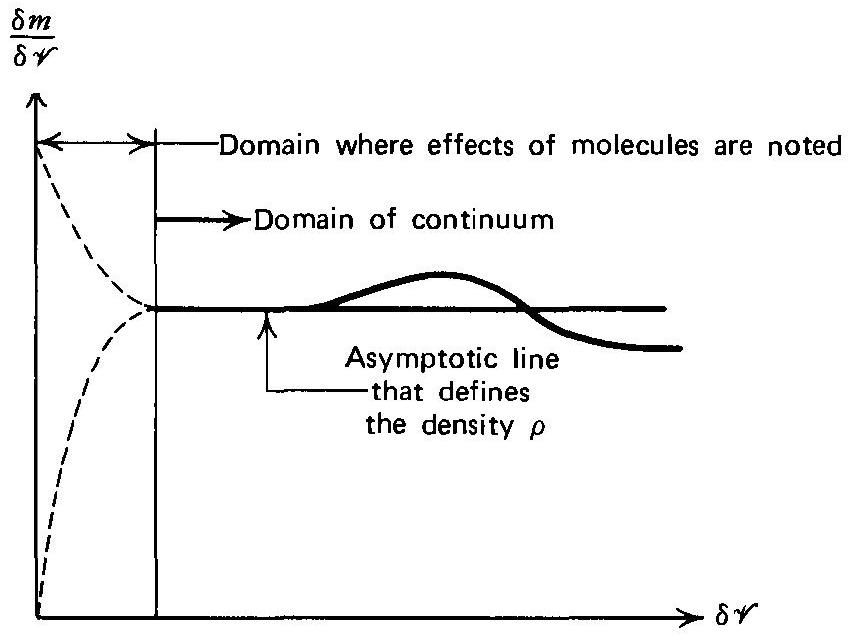
Figure 1.2 Determination of the density at a point in a continuum.

2. After $\delta \mathscr{V}$ becomes smaller than some minimum value where it contains only a few molecules, the value of $\delta m / \delta \mathscr{V}$ fluctuates widely as one or more molecules either enter or leave $\delta \mathscr{V}$. Consequently, the magnitude of $\delta m / \delta \mathscr{V}$ becomes indeterminate.

Introducing the limiting volume $\delta \mathscr{V}^{\prime}$, then the density of the fluid at the point $P$, denoted by $\rho$, is given by

$$
\rho \equiv \operatorname{Limit}_{\delta \mathscr{V} \rightarrow \delta \mathscr{V}} \frac{\delta m}{\delta \mathscr{V}}
$$

## 1-4(c) Velocity at a Point in a Body of Fluid

Let $\mathbf{V}$ denote the average value of the velocity of the fluid instantaneously contained in the limiting volume $\delta \mathscr{V}^{\prime}$ surrounding an arbitrary point $P(x, y, z)$. In general,

$$
\mathbf{V}=\mathbf{V}(x, y, z, t)
$$

Refer to Fig. 1.3. Let $\mathbf{r}$ denote the radius vector to the point $P$ at any instant of time $t$. Then

$$
\mathbf{V}=\mathbf{V}(\mathbf{r}, t)
$$

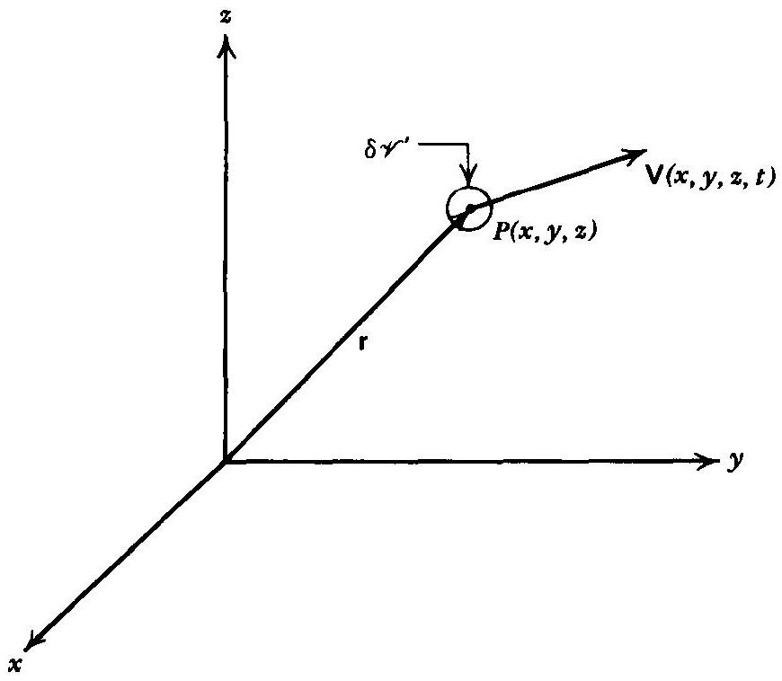
Figure 1.3 Velocity at a point in a flowing fluid.

The flow is called unsteady if $\mathbf{V}$ varies with time $t$, and it is termed steady if $\mathbf{V}$ is invariant with $t$. In the latter case,

$$
\mathbf{V}=\mathbf{V}(\mathbf{r})=\mathbf{V}(x, y, z)
$$

It should be noted that the velocity at the point $P(x, y, z)$ is independent of the instantaneous velocity of the molecule of the fluid particle closest to point $P$. $\mathbf{V}$ is the velocity of the center of mass of the fluid particle, enclosed by $\delta \mathscr{V}^{\prime}$, at the instant that it coincides with the point $P$. By definition,

$$
\mathbf{V} \equiv \frac{\sum_{i=1}^{N} m_{i} \mathbf{V}_{i}}{\sum_{i=1}^{N} m_{i}}=\frac{\text { total momentum contained in } \delta \mathscr{V}^{\prime}}{\text { total mass inside } \delta \mathscr{V}^{\prime}}
$$

where $N$ denotes the number of particles inside $\delta \mathscr{V}^{\prime}$, and $\mathbf{V}_{i}$ denotes the velocity of the $i$ th particle, $m_{i}$ denotes its mass, and $m_{i} \mathbf{V}_{i}$ denotes its momentum.

## 1-4(d) Stress at a Point

Figure 1.4a illustrates a solid body, assumed to be a continuum, in equilibrium under the action of several external forces, $\mathbf{F}_{1}, \mathbf{F}_{2}, \mathbf{F}_{3}, \mathbf{F}_{4}, \mathbf{F}_{5}$, and $\mathbf{F}_{6}$. Because of the actions of those external forces, internal forces are transmitted through the material composing the body; the expression internal force as employed here does not refer to the individual forces between molecules, but to their combined effect.

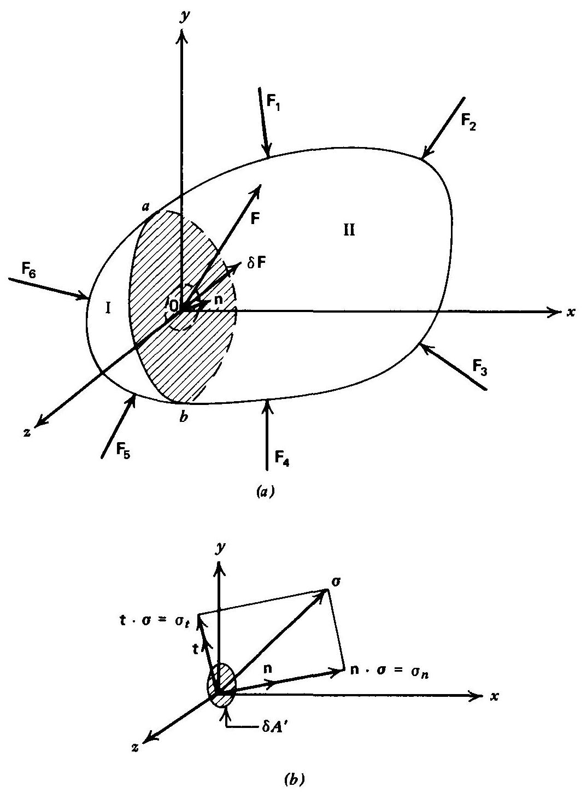
Figure 1.4 Stress at a point in a continuum. (a) Forces acting on a body. (b) Stress at a point.

Assume that the material of the body is divided into two parts, labeled I and II, by an imaginary plane $a b$ that passes through point $O$, and let point $O$ be the origin of the Cartesian coordinate axes $x, y, z$. Part I of the body is assumed to be in equilibrium under the combined actions of the external forces $\mathbf{F}_{5}$ and $\mathbf{F}_{6}$ and the internal forces distributed over the area $A$ of the plane $a b$, caused by the action of the material of Part II on that of Part I. It is convenient to express the magnitude of an internal force in terms of the stress (force per unit area) it produces on the area over which

## 12 REVIEW OF FUNDAMENTAL PRINCIPLES

it acts. Let the stress be denoted by $\boldsymbol{\sigma}$. In the general case the stress is not distributed uniformly over the area $A$ of plane $a b$ (see Fig. 1.4a). Let $\mathbf{F}$ denote the resultant force acting over the area $A$. Then the stress $\boldsymbol{\sigma}$ at the arbitrary point $O$ in plane $a b$ is defined by

$$
\boldsymbol{\sigma}=\operatorname{Limit}_{\delta A \rightarrow \delta A^{\prime}} \frac{\delta \mathbf{F}}{\delta A}
$$

where $\delta A^{\prime}$ is an area comparable in size to the volume $\delta \mathscr{V}^{\prime}$.
The stress $\boldsymbol{\sigma}$, illustrated in Fig. 1.4b, is a vector having the same direction as the resultant force $\delta \mathbf{F}$, and it is ordinarily inclined with respect to the unit normal vector $\mathbf{n}$, which indicates the direction of the surface $\delta A$. By convention, the outwardly drawn normal points in the positive direction, and vice versa. The stress $\sigma$ can be resolved into two mutually perpendicular components, a normal stress parallel to $\mathbf{n}$, and a tangential or shearing stress perpendicular to $\mathbf{n}$; that is, it is in the direction of the unit tangential vector $\mathbf{t}$. Hence, the stress $\boldsymbol{\sigma}$ is defined by the following vector equation.

$$
\boldsymbol{\sigma}=\mathbf{n} \sigma_{n}+\mathbf{t} \sigma_{t}
$$

## 1-4(e) The Continuum Postulate Applied to a Gas

In the case where a body of gas is at a low pressure (e.g., atmospheric air at high altitudes), the gas density may be so low that the applicability of the continuum postulate may be open to question. It is, therefore, essential that analytical criteria be available for determining the limitations to the application of the continuum postulate. To do that some of the results obtained from the microscopic viewpoint of the structure of a gas are considered briefly (see also Section 1-14).

According to the kinetic theory, a gas may be conceived as being composed of a very large number of molecules (e.g., Avogadro's number $N_{A}=6.02252 \cdot 10^{23}$ molecules $/ \mathrm{mol}$ ). The gas molecules move with extremely rapid random motions, but the motion of each molecule is greatly impeded by collisions with the tremendous number of neighboring molecules and the walls of the containing vessel. The collision process is assumed to be elastic and to take a very short time; it also conserves energy and momentum. Because of the collisions, two extreme conditions are possible. Some molecules may transfer their kinetic energies to other molecules and attain velocities that are practically zero, while other molecules may attain very high velocities. The remainder of the molecules will attain velocities (kinetic energies) between the aforementioned two extremes. Functions representing the equilibrium velocity distribution for the molecules have been derived by Maxwell and by Boltzmann, by applying the methods of statistical mechanics. ${ }^{7-10}$

Under normal conditions of pressure and temperature a gas molecule moves only a short linear distance, called the molecular free path, before it collides with another gas molecule. Consequently, the time interval between consecutive collisions is likewise very short. The average value of the free path for an assemblage of molecules is termed the mean free path, denoted by $\lambda$, and several of the transport properties of a gas are related to $\lambda$; for example, its viscosity, thermal conductivity, and diffusion coefficient. In general, for a given number of molecules per unit volume, $\lambda$ will be larger for small molecules than for large molecules; the probability of a collision decreases with a reduction in the size (diameter) of the molecule.

For the elastic collisions of molecules having a Maxwellian velocity distribution, ${ }^{10}$ the mean free path $\lambda$ is given by

$$
\lambda=\frac{1}{\sqrt{2}\left(\pi N d^{2}\right)} \text { (meters) }
$$

where $N$ is the number of molecules per cubic meter and $d$ is the effective molecular diameter in meters. If $m$ denotes the mass of a molecule and $\rho$ the density of the gaseous continuum, then

$$
\lambda=\frac{m}{\sqrt{2}\left(\rho \pi d^{2}\right)}
$$

In general, all of the quantities for calculating the mean free path are readily obtainable except the molecular diameter $d$. The latter is generally calculated from the application of the kinetic theory to the calculation of the transport properties of the gas, such as its viscosity, heat conductivity, and self-diffusion.

Table 1.3 presents typical approximate values of the molecular diameters for several gases at standard temperature and pressure (STP); that is, at $p=1 \mathrm{~atm}$ and $t=298.15 \mathrm{~K}$. It is evident from Table 1.3 that $\lambda$ at STP is an extremely small distance.

Table 1.3 Molecular Diameter $d$ and Mean Free Path $\lambda$ (at STP) for Several Gases
| Gas | $d, \mathrm{~m} \cdot 10^{-10}$ | $\lambda, \mathrm{m} \cdot 10^{-8}$ | Gas | $d, \mathrm{~m} \cdot 10^{-10}$ | $\lambda, \mathrm{m} \cdot 10^{-8}$ |
| :--- | :--- | :--- | :--- | :--- | :--- |
| Argon (A) | 2.90 | 10.9 | Oxygen ( $\mathrm{O}_{2}$ ) | 2.95 | 10.5 |
| Helium (He) | 2.00 | 22.9 | Carbon dioxide ( $\mathrm{CO}_{2}$ ) | 3.30 | 8.39 |
| Nitrogen ( $\mathrm{N}_{2}$ ) | 3.50 | 7.46 | Ammonia ( $\mathrm{NH}_{3}$ ) | 3.00 | 10.2 |


## 1-4(f) The Knudsen Number

For a gas to satisfy the continuum postulate, the molecular mean free path must be small compared to a significant characteristic linear dimension $L$ pertinent to the flow field. By definition, the ratio $\lambda / L$ is termed the Knudsen number, and is denoted by Kn. Thus, ${ }^{11}$

$$
\mathrm{Kn} \equiv \lambda / L
$$

The Knudsen number Kn can be related to the Reynolds number $\operatorname{Re}=L V \rho / \mu$ and the Mach number $M=V / a$, where $a$ is the acoustic speed in the gas. Employing the specific heat ratio for the gas, $\gamma=c_{p} / c_{v}$, it can be shown that ${ }^{11}$

$$
\mathrm{Kn}=1.26 \sqrt{\gamma}(M / \mathrm{Re})
$$

For small values of the Reynolds number $\operatorname{Re}$, the characteristic length $L$ may ordinarily be assumed to be either a dimension of a body immersed in the flowing gas or a dimension of the flow passage. For large values of $\operatorname{Re}($ i.e., $\operatorname{Re} \gg 1)$, a more significant characteristic length is the thickness $\delta$ of the layer of fluid adjacent to the solid walls where viscous effects are important; this layer of fluid is termed the boundary layer (see Section 5-10). The variables $L, \operatorname{Re}$, and $\delta$ are related generally, as indicated below. ${ }^{11}$

$$
\delta / L \cong \sqrt{1 / \operatorname{Re}} \quad \operatorname{Re} \gg 1
$$

Equation 1.15 is not applicable to hypersonic flows ( $M>7$, approximately). For large values of $\mathrm{Re}, \mathrm{Kn}$ is, therefore, given by

$$
\mathrm{Kn} \cong M / \sqrt{\operatorname{Re}}
$$

The continuum postulate is applicable to those flows for which the appropriate Knudsen number is less than approximately 0.01 . Accordingly, a gas may be assumed
to be a continuum if

$$
\begin{array}{lll}
\mathrm{Kn} \cong M / \operatorname{Re}<0.01 & \text { and } & \operatorname{Re} \cong 1 \\
\mathrm{Kn} \cong M / \sqrt{\operatorname{Re}}<0.01 & \text { and } & \operatorname{Re} \gg 1
\end{array}
$$

When $\mathrm{Kn}>0.01$, the gas should be treated as an assemblage of discrete particles. Table 1.4 presents a classification of the flow regimes of a gas based on the value of the Knudsen number.

Table 1.4 Flow Regimes Based on the Knudsen Number
| $\mathrm{Kn}=\lambda / L$ | Flow Regime |
| :---: | :--- |
|  | $\mathrm{Kn}<0.01$ |
| $0.01<\mathrm{Kn}<0.1$ | Continuum |
| $0.1<\mathrm{Kn}<3.0$ | Slip flow |
| $3.0<\mathrm{Kn}$ | Transition regime |


Based on Reference 11.

Example 1.2. An electric-arc heated wind tunnel is constructed as illustrated schematically in Fig. 1.5. A model 0.0254 m high and 0.1524 m long is placed in the tunnel and tested at a Mach number of 7. At that Mach number, $V=1743 \mathrm{~m} / \mathrm{s}$, $\rho=0.0182 \mathrm{~kg} / \mathrm{m}^{3}, t=154 \mathrm{~K}$, and $p=833 \mathrm{~N} / \mathrm{m}^{2}$. A pitot probe made of hvpodermic tubing having an outside diameter of $7.62 \cdot 10^{-5} \mathrm{~m}$, for measuring the free-stream stagnation pressure, is placed at the front of the model. Determine whether or not rarefied flow effects should be expected.

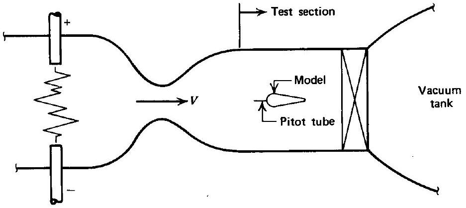
Figure 1.5 Sketch for Example 1.2.

## Solution

For the model itself, the characteristic dimension of concern is the boundary layer thickness $\delta$ on the model. The Reynolds number based on the model length is

$$
\operatorname{Re}=\frac{L V \rho}{\mu}=\frac{(0.1524)(1743)(0.0182)}{\left(12.2 \cdot 10^{-6}\right)}=3.963 \cdot 10^{5}
$$

where $\mu=12.2 \cdot 10^{-6} \mathrm{~kg} / \mathrm{m}-\mathrm{s}$ at $t=154 \mathrm{~K}$. Thus, the appropriate value of Kn
for the model is

$$
\mathrm{Kn}=\frac{M}{\sqrt{\mathrm{Re}}}=\frac{7}{\left(3.963 \cdot 10^{5}\right)^{1 / 2}}=0.0111
$$

For this value of Kn , rarefied flow effects would probably not be important.
For the probe the appropriate characteristic dimension is the probe diameter, because boundary layer effects are not present at the probe inlet. Thus

$$
\operatorname{Re}=\frac{D V \rho}{\mu}=\frac{\left(7.62 \cdot 10^{-5}\right)(1743)(0.0182)}{\left(12.2 \cdot 10^{-6}\right)}=198.14
$$

The appropriate value of Kn for the probe is

$$
\mathrm{Kn}=\frac{M}{\mathrm{Re}}=\frac{7}{198.14}=0.03533
$$

Rarefied flow effects should be investigated for the probe.

## 1-5 PERFECT SUBSTANCES

In general, engineering problems are concerned with material substances that are subjected to certain physical and chemical processes. Exact mathematical descriptions of the substance and of the processes involved either lead to unsolvable equations or to ones that cannot be dealt with conveniently. To make the problem amenable to mathematical analysis, the actual substance is generally replaced by a perfect substance that behaves in accordance with certain simple laws, and the actual processes are replaced by ones that have a more or less simple mathematical description.

A perfect substance is, of course, a fictitious one, but its consideration leads to important information giving a first approximation, at least, to the behavior of a real substance. The equations derived for the behavior of the perfect substance can be made applicable to a real substance by modifying them with experimentally determined correction coefficients.

A perfect substance is one that is homogeneous in its composition, and isotropic. By virtue of its homogeneity, its chemical composition and physical condition are uniform throughout its entire mass. Because of its isotropicity, its elastic properties are identical at all points and in all directions; the stresses developed in the perfect substance depend only on the magnitude of the strains. A perfect substance is frequently termed a simple system, and possesses the following two fundamental characteristics.

1. Its elastic properties are completely specified by two elastic moduli: (a) the shear or rigidity modulus $N$, and (b) the bulk modulus $K$.
2. Its thermodynamic state is completely defined by its macroscopic properties, also called thermodynamic coordinates, only two of which are independent.

It will be assumed in all subsequent discussions, unless the contrary is stated explicitly, that any infinitesimal change in the dimensions of a perfect substance, such as a volumetric change $d \mathscr{V}$, involves such a large number of molecules that the substance may be considered to be a continuum.

Figure 1.6 illustrates a unit cube of perfect substance subjected to a shearing stress $\tau$. By definition, the shear modulus $N$ is given by

$$
N \equiv \frac{\text { shearing stress }}{\text { shearing strain }}=\frac{\tau}{\Delta L / L}=\frac{\tau}{\tan \alpha} \cong \frac{\tau}{\alpha}
$$

since for the small values of the angle $\alpha$ involved, $\tan \alpha \cong \alpha$.

The definition of the bulk modulus $K$ is obtained by considering a cube of material subjected to a uniform hydrostatic pressure $p$, as illustrated in Fig. 1.7. If the hydrostatic pressure is increased from $p$ to $p+\Delta p$, the volume of the cube diminishes

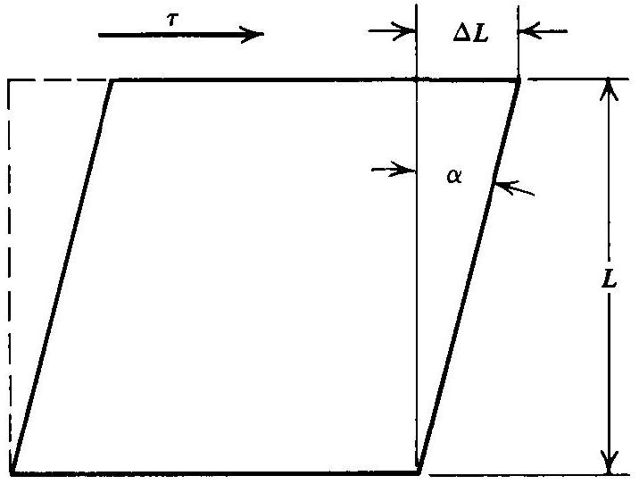
Figure 1.6 Deformation of a unit cube because of a tangential stress.

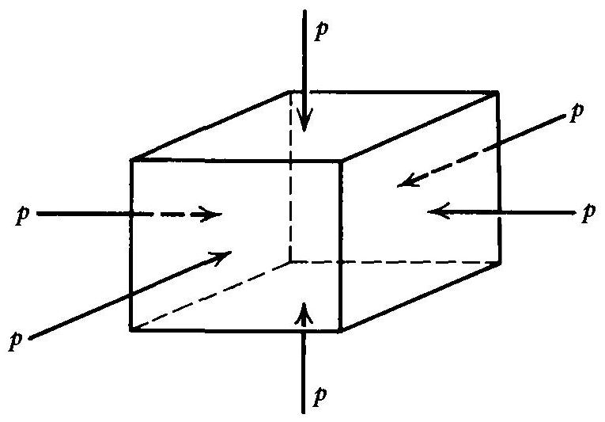
Figure 1.7 Unit cube of a material subjected to a uniform hydrostatic pressure.

from $\mathscr{V}$ to $\mathscr{V}-\Delta \mathscr{V}$. The unit volumetric strain is accordingly $-\Delta \mathscr{V} / \mathscr{V}$, the negative sign indicating that the volume decreases as the pressure increases. By definition, noting that $\Delta \mathscr{V} / \mathscr{V}=\Delta v / v$

$$
K \equiv \operatorname{limit}_{(\Delta p \rightarrow 0)}\left(-\frac{\Delta p}{\Delta v / v}\right)=-v \frac{d p}{d v}
$$

The reciprocal of the bulk modulus is termed the compressibility, and is denoted by $\kappa$. Thus,

$$
\kappa=\frac{1}{K}=-\frac{1}{v}\left(\frac{d v}{d p}\right)
$$

When the compression is conducted under isothermal conditions, then $K=K_{t}=$ the isothermal bulk modulus and, when the compression is a reversible adiabatic process, then $K=K_{s}=$ the isentropic bulk modulus.

## 1-5(a) The Perfect Solid

A perfect substance possessing both bulk elasticity ( $K \neq 0$ ) and rigidity ( $N \neq 0$ ) is by definition a perfect solid. When a perfect solid is stressed, the external forces acting on it are balanced by the internal forces arising from the elastic strains produced. Since a perfect solid can resist shear (tangential) strains, the resultant stress on an arbitrary elementary plane either within or on the solid can have any direction with respect to that plane. Furthermore, a perfect solid obeys Hooke's law: the stress is proportional to the strain.

## 1-5(b) The Perfect Fluid

From an elasticity viewpoint a perfect substance possessing bulk elasticity ( $K \neq 0$ ) but no rigidity ( $N=0$ ) is defined as a perfect fluid. Since the perfect fluid cannot resist a tangential stress no matter how small it may be, the only forces it can resist are normal forces (i.e., pressure forces). Consequently, the direction of the stress acting
on an elementary plane drawn in the perfect fluid is always normal to that plane. Hence, the magnitude of the pressure at an arbitrary point in a perfect fluid is independent of the orientation of a plane drawn through that point.
Because $N=0$, a perfect fluid possesses the following three characteristics.

1. It can transmit only pressure forces.
2. It is frictionless, because it cannot transmit tangential (shearing) forces.
3. The pressure at a point is the same in all directions.

Perfect fluids may be subdivided into perfect liquids and perfect gases.

## 1-5(c) The Perfect Liquid

An incompressible perfect fluid is called a perfect liquid. For such a substance,

$$
K=-v\left(\frac{\partial p}{\partial v}\right)=\infty
$$

It follows from equation 1.21 that for a perfect liquid $\kappa=1 / K=0$. No real liquid is truly incompressible, but the numerical values of $K$ for most real liquids are sufficiently large to justify assuming that they are incompressible, especially when the pressure changes involved are small. Moreover, for compressions over a small range of temperature, the value of $K$ may be assumed to remain constant at the value prior to the compression.

## 1-5(d) The Perfect Gas

From the viewpoint of its elastic moduli, a perfect gas may be defined as a perfect fluid ( $N=0$ ) having an isothermal bulk modulus $K_{t}$ that is equal to its static pressure $p$. Hence, for a perfect gas,

$$
K_{t}=-v\left(\frac{\partial p}{\partial v}\right)_{t}=p
$$

The molecules of a perfect gas exert no intermolecular forces; their only interactions arise from instantaneous elastic collisions (see Section 1-14). From thermodynamics, it is shown that for an isentropic change of state, $p$ and $v$ for a perfect gas are related by $p v^{\gamma}=$ constant (see equation 1.127). Hence, for a perfect gas, the isentropic bulk modulus $K_{s}$ is given by

$$
K_{s}=-v\left(\frac{\partial p}{\partial v}\right)_{s}=\gamma p
$$

In equation 1.23, the specfic heat ratio $\gamma=c_{p} / c_{v}$ is assumed to be a constant.
For a perfect gas, the ratio $K_{s} / K_{t}$ is given by

$$
K_{s} / K_{t}=\gamma p / p=\gamma=c_{p} / c_{v}=\text { constant }
$$

Hence, $y$ is the ratio of the slopes of the isentropic and isothermal processes, for the perfect gas, drawn on the $p v$ plane.

Summarizing, a perfect gas is a homogeneous compressible medium having the following properties: $K_{t}=p, K_{s}=\gamma p, \gamma=$ constant, and $N=0$. It is shown in Section 1-15, where the thermodynamic properties of gases are discussed, that the relation between $p, v$, and $t$ for a perfect ga isgiven by equation 1.99, which is known as the thermal equation of state.

## 1-6 REAL FLUIDS

The perfect fluid discussed in Section 1-5(b) is an idealization, because all real fluids possess a finite shear modulus. The general characteristics of real fluids are discussed in this section.

## 1-6(a) General Comments on Perfect and Real Fluids

Real fluids differ from the fictitious perfect fluid in that they are not frictionless. Shear stresses arise whenever there is relative motion between the fluid particles, and the shear stresses persist as long as such motion prevails. Since the shear stresses arise only when there is relative motion, a real fluid at rest behaves exactly as the perfect fluid, that is, when at rest, a real fluid cannot sustain a tangential stress.

Because the perfect fluid is frictionless, a body immersed therein cannot create a resistance or drag, a force component acting in the same direction as the fluid velocity, even when there is relative motion between the body and the fluid. The only forces that can occur in a perfect liquid, for example, in steady flow with the velocity $V$, are (1) inertia forces that depend on $\rho V^{2} / 2$, and (2) the static pressure forces that depend on the pressure intensity $p$. It is shown in any text on fluid mechanics that, when a perfect liquid having a density $\rho$ is in steady flow, the aforementioned two types of forces are related by the Bernoulli equation

$$
d p+\rho d\left(\frac{V^{2}}{2}\right)=0
$$

Equation 1.25 shows that a change in the inertia force along a streamline is balanced by a change in the static pressure intensity.

Consider the case where a body, such as the infinitely long cylinder illustrated in Fig. 1.8, is immersed in a perfect liquid. The streamline pattern formed around the cylinder by the fluid flowing past it is symmetrical around the vertical plane $\mathrm{O}-\mathrm{O}$. Because of the symmetry of the streamline pattern, the forces acting on the left-hand half of the cylinder are exactly balanced by those acting on the right-hand half. Consequently, as stated above, there is no drag force or hydrodynamic resistance created by the cylinder.

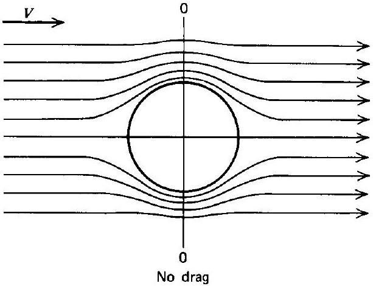
Figure 1.8 Symmetrical streamline pattern around an infinitely long cylinder immersed in a flowing perfect fluid.

In a real liquid, however, because of its viscosity [see Section 1-6(b)], viscous forces are present in addition to the inertia and static pressure forces. The viscous forces manifest themselves as shearing stresses between the adjacent streamlines. Because of those shearing stresses, a body such as a cylinder immersed in a real liquid experiences a resistance or drag force. In general, the total drag force may be subdivided into two different types of drags.

1. The form or pressure drag caused by the pressure force acting on the front (upstream side) of the body being larger than that acting on its rear.
2. The skin friction drag caused by shear stresses in the fluid adjacent to the surface of the immersed body.
Figure 1.9 illustrates schematically the conditions prevailing when a real liquid flows past a cylinder immersed within it. The fluid flows toward the cylinder with the uniform velocity $V$, but some of the streamlines are brought to stagnation by the front portion of the cylinder, thereby producing the pressure force $F_{p}$, tending to move the cylinder to the right. Some of the streamlines will be unable to follow the contour of the cylinder, so that the flow separates from it at some point, such as point $s$ in Fig. 1.9. Behind the cylinder a low velocity or separation region is formed,

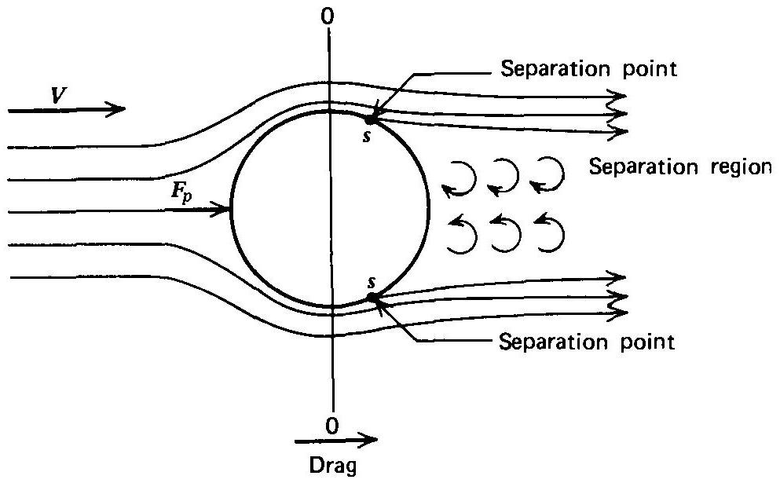
Figure 1.9 Streamline pattern and eddy formation for an infinitely long cylinder immersed in a flowing real fluid.

and in this region the static pressure intensity does not differ markedly from that at the separation point $s$. If the speed of the fluid is increased, the separation point $s$ moves upstream, and the pressure intensity at the separation point decreases, as does the pressure intensity in the separation region. Consequently, there arises a difference in the pressure forces acting on the front and back of the cylinder, and the resultant of those pressure forces constitutes the form drag. The separation point is usually defined as the point, on the (solid) surface, where a streamline that is very close to the surface leaves the surface.

The shear stresses giving rise to the skin friction are confined to the boundary layer adjacent to the cylinder, being caused by the steep velocity gradient $d V / d n$ in that thin layer. Outside of the boundary layer the velocity gradient is comparatively negligible, so that the flow outside of the boundary layer may be assumed to be nonviscous, that is, comparable to the flow of a perfect fluid. It is the behavior of the boundary layer that causes all flow separations with the attendant increase in

## 20 REVIEW OF FUNDAMENTAL PRINCIPLES

drag. Moreover, the boundary layer plays a predominant role in the transfer of heat by forced convection where relative motion between a fluid and a solid surface is involved.

## 1-6(b) Viscosity

The property of a real fluid known as its dynamic or absolute viscosity, hereafter called viscosity for brevity, is the source of all fluid friction. A real fluid, by virtue of its viscosity, can sustain a shearing stress when in motion, whereas the perfect fluid cannot. Consequently, in formulating the equations of motion for a real fluid, its viscosity must be taken into account. Unfortunately the equations of motion for a viscous fluid are amenable to mathematical analysis in only a few special cases.

The definition of viscosity is based on the ability of a real fluid to distort or deform when it is subjected to a tangential (shearing) force and thereby resist the shearing stresses imposed on it. Thus, consider the steady parallel flow of a real fluid past a solid surface, as illustrated in Fig. 1.10. At different normal distances from the surface, the velocities of the fluid will be different, giving rise to a velocity profile such as that illustrated schematically in Fig. 1.10. It appears that the fluid layer in contact with the solid surface adheres to it and consequently assumes the same velocity as the surface. The fluid velocity increases to the main stream velocity as one proceeds along the line $O-O^{\prime}$ normal to the surface.

Consider two parallel surfaces $Y$ and $Z$ a distance $n$ apart, and assume that the space between them is occupied by a homogeneous viscous fluid as illustrated in Fig. 1.11. Let the tangential force $F_{t}$ be applied to surface $Y$ and cause it to move with

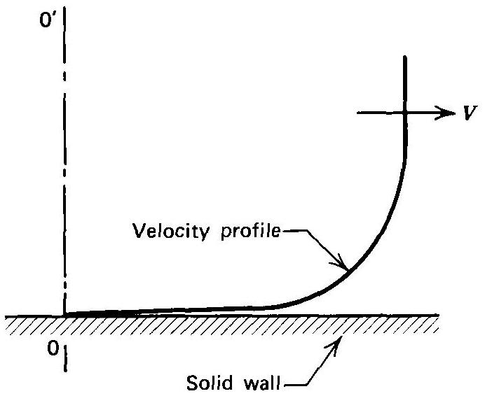
Figure 1.10 Effect of the viscosity of a flowing fluid on its velocity profile.

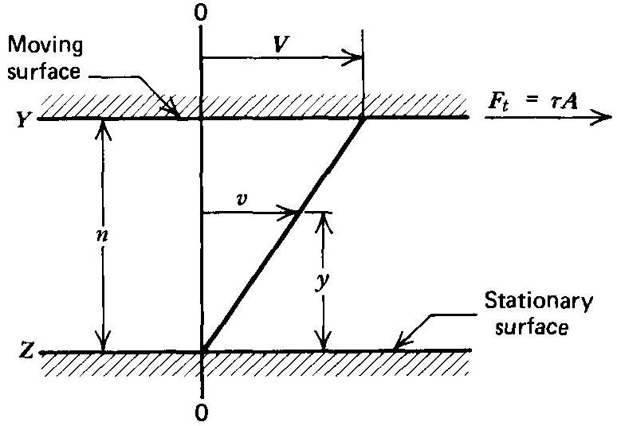
Figure 1.11 Shear in a viscous fluid.

the constant velocity $V$, while surface $Z$ is held stationary. The fluid in contact with surface $Y$, owing to its viscosity, will assume the velocity $V$ while that in contact with surface $Z$ will have zero velocity with respect to surface $Z$. The layers of fluid between surfaces $Z$ and $Y$, as first pointed out by Newton, will assume velocities that are proportional to their respective perpendicular distances from surface $Z$. The rate of shear $V / n$ is, therefore, constant throughout the homogeneous fluid. Accordingly, for a Newtonian fluid the relative velocity $v$ of a fluid layer located at a distance $y$ from surface $Z$ is

$$
v=y \frac{V}{n}
$$

If $A$ is the area of surface $Y$, then the shear stress on that surface is given by

$$
\tau=\frac{F_{t}}{A}
$$

To maintain the surface $Y$ at the constant relative velocity $V$, the shear stress $\tau$ must be opposed by an equal and opposite stress arising from the internal resistance of the fluid opposing the shear stress distorting it. The viscosity of the fluid is defined as the ratio of the shear stress to the rate of shear and is denoted by $\mu$. Hence, by definition,

$$
\mu \equiv \frac{\text { shear stress }}{\text { rate of shear }}=\frac{\tau}{V / n}
$$

or, in differential form,

$$
\tau=\mu \frac{d v}{d n}
$$

A fluid that obeys equation 1.28 b is termed a Newtonian fluid.
The dimensions and units of viscosity in the $M L T$ system are $M / L T$ (e.g., $\mathrm{kg} / \mathrm{m}-\mathrm{s}$ ), and in the $F L T$ system they are $F T / L^{2}$ (e.g., N -s $/ \mathrm{m}^{2}$ ). Much of the physical data pertaining to the viscosity of fluids are stated in centipoises, where 100 centipoises $=$ 1 poise $=1 \mathrm{~g} / \mathrm{cm}-\mathrm{s}=0.1 \mathrm{~N}-\mathrm{s} / \mathrm{m}^{2}$.

In general, the viscosities of fluids depend primarily on the temperature and only slightly on the pressure. For liquids the viscosity decreases with increasing temperature, while the reverse is the case for gases. The independence of the viscosity of a gas from its pressure holds only in the range where the gas is far removed from its critical pressure.

It follows from equation 1.28 b that the shear stress in a real fluid depends on the viscosity $\mu$ and the normal velocity gradient $d v / d n$. In the case of fluids of small viscosity, such as water and air, large shearing stresses can occur only in those regions of the fluid where the normal velocity gradient is considerable. Experience has shown that large velocity gradients occur close to a solid surface past which the fluid flows. At the wall the fluid velocity relative to it is zero, whereas in a small distance normal to the wall the velocity increases to practically the main stream velocity as illustrated schematically in Fig. 1.10. L. Prandtl (1904) applied the term boundary layer to the thin layer wherein the velocity gradient $d v / d n$ is large. As mentioned earlier, outside of the boundary layer the normal velocity gradients are so small that the effects of viscosity may be neglected; that is, the fluid flowing outside of the boundary layer may be assumed to be a perfect fluid.

The viscosity $\mu$ is a measure of the shearing stress $\tau$ in a flowing fluid. In most fluid flow problems it is the ratio of the shearing force to the inertial force that is of prime importance. The inertia force is proportional to the density of the fluid $\rho$ and the velocity squared. The ratio $\mu / \rho$ for a fluid is called its kinematic viscosity and is denoted by $v$. Thus

$$
v=\text { kinematic viscosity }=\mu / \rho \quad\left(L^{2} / T\right)
$$

In metric units, the unit of $v$ is the stoke, $1 \mathrm{~cm}^{2} / \mathrm{s}$, but it is more customary to use the centistoke, 0.01 stoke, which is $10^{-6} \mathrm{~m}^{2} / \mathrm{s}$.

Example 1.3. The 5.08 cm diameter shaft illustrated in Fig. 1.12 is rotated centrally at an angular velocity $n=4000 \mathrm{rev} / \mathrm{min}$ in a bearing having a clearance $C=$ 0.00508 cm . The viscosity of the lubricating oil is 0.186 poise, and its specific gravity is 0.92 under the operating conditions. The bearing is 7.62 cm long. Neglecting end effects and assuming that the bearing is lightly loaded so that the only resistance to
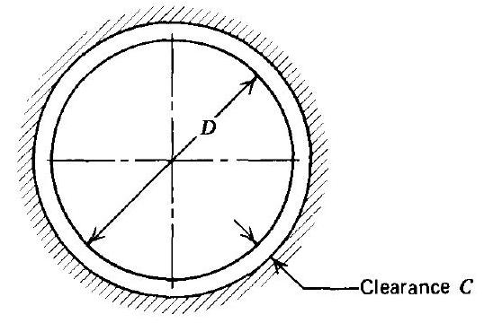

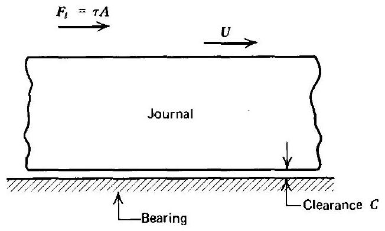
Figure 1.12 Sketch for Example 1.3.

motion is due to the viscosity of the lubricant, calculate the friction torque and the power consumed in friction. Refer to Fig. 1.12.

## Solution

The viscosity of the oil $\mu$ is

$$
\mu=0.186(0.1)=0.0186 \mathrm{~N}-\mathrm{s} / \mathrm{m}^{2}
$$

The peripheral velocity of the journal, $U=\pi D n$, equals the maximum velocity of the oil in the clearance. The tangential stress in the oil $\tau$ is given by

$$
\tau=\mu \frac{U}{C}=\frac{\pi \mu D n}{C}
$$

The tangential force acting on the journal $F_{t}$ is

$$
F_{t}=\tau A=\frac{\pi^{2} L \mu n D^{2}}{C}=\frac{\pi^{2}(7.62 / 100)(0.0186)(4000 / 60)(5.08 / 100)^{2}}{(0.00508 / 100)}=43.37 \mathrm{~N}
$$

The friction torque acting on the journal $\mathscr{T}_{f}$ is

$$
\mathscr{T}_{f}=\frac{F_{t} D}{2}=\frac{47.37(5.08 / 100)}{2}=1.203 \mathrm{~m}-\mathrm{N}
$$

The friction power $\mathscr{P}_{f}$ is

$$
\mathscr{P}_{f}=2 \pi n \mathscr{T}_{f}=2 \pi(4000 / 60)(1.203)=503.9 \text { watts }(0.675 \mathrm{hp})
$$

## 1-6(c) Viscosity Data for Gases

The older published experimental data on the viscosity of gases as well as more recent experimental work have been reviewed critically by Watson. ${ }^{12}$ A correlation
equation was derived that gives a satisfactory representation of the reassessed experimental data over the temperature range 270 to 2200 K . That correlating equation is as follows.

$$
\mu=\frac{\sqrt{t}}{A_{0}+\frac{A_{1}}{t}+\frac{A_{2}}{t^{2}}+\frac{A_{3}}{t^{3}}+\frac{A_{4}}{t^{4}}} \quad \mathrm{~N}-\mathrm{s} / \mathrm{m}^{2} \cdot 10^{-6}
$$

where the viscosity $\mu$ is in $\mathrm{N}-\mathrm{s} / \mathrm{m}^{2} \cdot 10^{-6}$, the temperature $t$ is in K , and the coefficients $A_{0}, A_{1}$, etc., have the values presented in Table 1.5 for the different gases listed therein.

$$
\mu=\frac{\sqrt{t}}{A_{0}+\frac{A_{1}}{t}+\frac{A_{2}}{t^{2}}+\frac{A_{3}}{t^{3}}+\frac{A_{4}}{t^{4}}} \quad \mathrm{~N}-\mathrm{s} / \mathrm{m}^{2} 10^{-6}(t \text { in } \mathrm{K})
$$

Table 1.5 Values of the Coefficients in the Viscosity Equation for Several Gases
| Gas | $A_{0}$ | $A_{1} \cdot 10^{-2}$ | $A_{2} \cdot 10^{-4}$ | $A_{3} \cdot 10^{-6}$ | $A_{4} \cdot 10^{-8}$ |
| :--- | :--- | :--- | :--- | :--- | :--- |
| Air | 0.552795 | 2.810892 | -13.508340 | 39.353086 | -41.419387 |
| $\mathrm{O}_{2}$ | 0.476823 | 2.785625 | -15.410077 | 51.909942 | -63.049470 |
| $\mathrm{N}_{2}$ | 0.579561 | 2.847486 | -13.232490 | 37.106107 | -37.549675 |
| $\mathrm{CO}_{2}$ | 0.624736 | 1.402570 | 0.553161 | 0.0 | 0.0 |
| $\mathrm{H}_{2}$ | 1.074552 | 6.569139 | -19.639020 | 22.851072 | 0.0 |
| $\mathrm{CH}_{4}$ | 0.867788 | 3.783913 | -14.473411 | 42.547274 | -44.474225 |


Reproduced from Reference 12.
According to Reference 12, the values of $\mu$ for air calculated by equation 1.30, in conjunction with Table 1.5, have the following accuracies: from $t=270$ to 600 K within 0.25 percent; from $t=610$ to 1600 K within 1 percent; and from $t=1610$ to 2200 K within 2 percent.

Although equation 1.30 and Table 1.5 are based on measurements of viscosity $\mu$ at or below atmospheric pressure, the calculated results for air are accurate to within 1 percent at pressures up to $1.2 \cdot 10^{6} \mathrm{~N} / \mathrm{m}^{2}$ at 300 K and $2.2 \cdot 10^{6} \mathrm{~N} / \mathrm{m}^{2}$ at 500 K . Further increases in temperature reduce the effect of the air pressure on its viscosity.

Figure 1.13 presents the viscosities of some common gases as functions of the gas temperature; $\mu$ in $\mathrm{N}-\mathrm{s} / \mathrm{m}^{2} \cdot 10^{-6}$ is plotted as a function of $t$.

## 1-7 THE SIMPLE THERMODYNAMIC SYSTEM

The simple thermodynamic system is one for which the equilibrium state is determined by specifying the values of any two independent thermodynamic properties. The inherent characteristics of the simple thermodynamic system are discussed in this section.

## 1-7(a) Properties of the Simple Thermodynamic System

In thermodynamics attention is focused on either a restricted region of space or a finite portion of matter, which is assumed to be separated from all other space or matter by an imaginary bounding surface called a control surface. No consideration is given to the molecular structure of the matter so enclosed. The region or matter

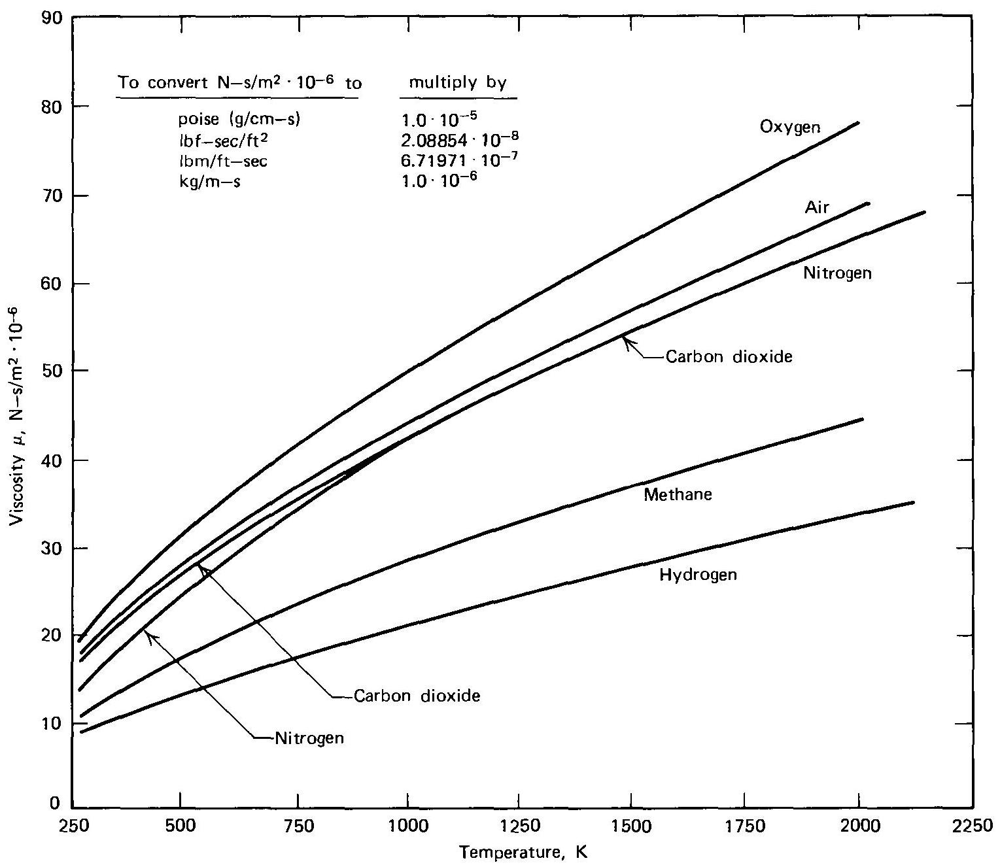
Figure 1.13 Viscosities of some common gases as functions of temperature (based on Reference 12).

surrounded by the control surface is termed the system, and everything external to it is called either the surroundings or the environment. In general, the behavior of the system and its interactions with the environment are described in terms of readily observable or measurable characteristics called either the properties or the coordinates of the system. A property is, in general, a quantity having a value that depends only on the state of a system. Since thermodynamics is concerned only with the macroscopic behavior of a system when it passes from one equilibrium state to another, the properties selected are those giving a suitable macroscopic description of the changes produced in the characteristics of the system after it has passed from one equilibrium state to another.

The equilibrium state of a system may be described by specifying the magnitudes of its corresponding independent properties or their equivalents. Hence, the state of a system is expressed in the form of a functional relationship between one of its dependent properties and the pertinent independent properties. In the case of a simple system, one that is free of the effects of relativity, nuclear, capillarity, electric, magnetic, or gravitational effects and shearing stresses, the state is fully specified by any two independent properties. In general, a thermodynamic system is assumed to be a simple system (see Section 1-15). Thus, if $z$ is a dependent property of a simple system defined by the independent properties $x$ and $y$, then

$$
z=f(x, y)
$$

The functional relationship between properties of the type symbolized by equation 1.31 is termed an equation of state, and its actual form is determined by experiment. An equation of state presents the equilibrium conditions connecting the dependent property $z$ and the independent properties $x$ and $y$. In general, the thermodynamic properties $x$ and $y$ are scalars, but they may be either intensive, independent of the mass involved, or extensive, dependent on the mass involved.

If the values of the properties $x$ and $y$ are changed by the small amounts $d x$ and $d y$, then the dependent property $z$ will change by the small amount $d z$, where the operator $d$ denotes an exact differential. An expression for $d z$ is obtained by the partial differentation of equation 1.31. Thus

$$
d z=\left(\frac{\partial f}{\partial x}\right)_{y} d x+\left(\frac{\partial f}{\partial y}\right)_{x} d y=M d x+N d y
$$

If equation 1.32 has a solution, it must be possible to derive the total differential $d z$ by differentiating some function of the independent variables (properties) $x$ and $y$. In those cases where the aforementioned procedure is possible, the quantity $d z$ is called an exact or perfect differential. In general, if the functions $M$ and $N$ are selected arbitrarily, $d z$ will not be an exact differential. Hereafter, when a differential, such as $d z$, is inexact, it will be written as $\delta z$, signifying that the differential is not the result of differentiating an actual function of the independent variables.

If a functional relationship $z=f(x, y)$ exists for a simple system, and if the function and its partial derivatives ( $M=\partial f / \partial x$ and $N=\partial f / \partial y$ ) are continuous throughout the region of the $x y$ plane under consideration, then, for the linear differential expression $M d x+N d y$ to be exact, it must satisfy the reciprocal relationship

$$
\frac{\partial M}{\partial y}=\frac{\partial N}{\partial x}
$$

It is shown in the calculus that, if equation 1.33 is satisfied, then

$$
\int_{C}(M d x+N d y)=\int_{a, b}^{x, y}(M d x+N d y)=f(x, y)-f(a, b)
$$

where $(a, b)$ and $(x, y)$ are the initial and final points for the integration along curve $C$. Equation 1.34 shows that for an exact differential expression the value of the line integral $\int_{C}(M d x+N d y)$ depends only on the initial and final coordinates of the path $C$. Hence, the line integral of an exact differential expression is independent of the paths (curves) connecting the end points of the integration.

If the line integral of a differential expression has the aforementioned property, then the function from which the differential expression is formed is called either a state or a point function. A corollary to the foregoing is that for a point function the line integral has the same value for all curves (paths) connecting the same end points.

Consider now the special case where the initial and final points of the path for the line integral of an exact differential expression have identical coordinates. The path is then a closed curve, such as a complete thermodynamic cycle. In that case,

$$
\oint_{C}(M d x+N d y)=0
$$

Hence, the line integral of an exact differential expression taken over a closed curve (complete cycle) is zero; the only limitation is that there are no singular points, such as sources or sinks, within the region bounded by the closed curve and that the partial derivatives $\partial M / \partial y$ and $\partial N / \partial x$ are continuous.

The properties of the exact linear differential expression may be summarized as follows.

1. Its line integral between two end points is independent of the curve (path) connecting them.
2. Its line integral around a closed curve (complete cycle) vanishes.
3. Its second partial derivatives satisfy the reciprocal relationship $\partial M / \partial y=\partial N / \partial x$.
4. If the line integral of a linear differential expression taken over an arbitrarily selected closed curve vanishes, then the expression is an exact differential.
5. If a linear differential expression satisfies any one of the conditions $1,2,3$, or 4 above, it satisfies all of them.

In thermodynamics, a function that satisfies the above requirements is said to be a property of the system.

## 1-7(b) Change of State for a Simple Thermodynamic System

The equilibrium state of a simple thermodynamic system is completely defined by any two independent thermodynamic properties. Hence, each property may be taken to be a function of any two independent properties. Thus a thermodynamic property satisfies the requirements for a point function, as discussed in Section 1-7(a).

Let the properties selected for describing the state of a simple thermodynamic system be its absolute pressure $p$, its specific volume $v$, and its absolute temperature $t$; actually any three properties may be employed for defining its equilibrium state. Accordingly, its equation of state, expressed in terms of $p, v$ and $t$, is given by any one of the following functional relationships. Thus,

$$
p=p(v, t), \quad v=v(p, t), \quad t=t(p, v)
$$

If there is a change from one equilibrium state to another, then

$$
\begin{aligned}
d p & =\left(\frac{\partial p}{\partial v}\right)_{t} d v+\left(\frac{\partial p}{\partial t}\right)_{v} d t \\
d v & =\left(\frac{\partial v}{\partial p}\right)_{t} d p+\left(\frac{\partial v}{\partial t}\right)_{p} d t \\
d t & =\left(\frac{\partial t}{\partial p}\right)_{v} d p+\left(\frac{\partial t}{\partial v}\right)_{p} d v
\end{aligned}
$$

For the total differentials $d p, d v$, and $d t$ to be exact, the reciprocal relationship (equation 1.33) must be satisfied, and the corresponding line integral for the pertinent differential expression taken around a closed curve must vanish.

As an example, consider the equation of state

$$
v=v(p, t)=\text { constant }
$$

In that case, $d v=0$, and equation 1.37(b) becomes

$$
d v=\left(\frac{\partial v}{\partial p}\right)_{t} d p_{v}+\left(\frac{\partial v}{\partial t}\right)_{p} d t_{v}=0
$$

where the subscripts $v$ attached to $d p$ and $d t$ denote that $v$ remains constant during the indicated changes. Rearrangement of equation 1.39 yields

$$
\left(\frac{\partial p}{\partial t}\right)_{v}=-\frac{(\partial v / \partial t)_{p}}{(\partial v / \partial p)_{t}}
$$

or

$$
\left(\frac{\partial p}{\partial t}\right)_{v}\left(\frac{\partial v}{\partial p}\right)_{t}\left(\frac{\partial t}{\partial v}\right)_{p}=-1
$$

The partial derivatives $(\partial p / \partial t)_{v}$ and $(\partial v / \partial t)_{p}$ are related to the thermometric coefficients of the system. Thus,

$$
\beta_{v}=\frac{1}{p}\left(\frac{\partial p}{\partial t}\right)_{v}=\text { coefficient of pressure change at constant volume }
$$

and

$$
\beta_{p}=\frac{1}{v}\left(\frac{\partial v}{\partial t}\right)_{p}=\begin{aligned}
& \text { coefficient of volume change at constant } \\
& \text { pressure (dilatation coefficient) }
\end{aligned}
$$

In general, the coefficients $\beta_{v}$ and $\beta_{p}$ are functions of the temperature. If the changes in temperature are small, it may be assumed that $\beta_{v}$ and $\beta_{p}$ are constants.

## 1-8 REVERSIBLE AND IRREVERSIBLE PROCESSES

A reversible process is defined as one that is in a state of equilibrium at all points in its path so that any infinitesimal change in the influence producing the change will cause the process to proceed in the direction of that change. When heat is added to a system, the influence causing the system to change its state is the temperature difference applied to the equilibrium state. Consequently, if an arbitrarily small temperature difference produces either an expansion or a compression, depending on its sign, and the corresponding absolute values of the mechanical effects produced for the same quantities of heat transferred from or to the system are equal to each other, then the process is reversible.

It is apparent from this that a process involving friction cannot be reversible because a finite amount of work equal to the work required for overcoming the friction must always be supplied before the direction of the process can be reversed. It is generally assumed that the work expended in overcoming friction is instantly converted into heat. Since friction invariably accompanies the flow of real fluids, real flow processes are always irreversible. As a matter of fact, all natural or spontaneous processes are irreversible. They tend to proceed in a given direction toward equilibrium and never reverse themselves unless work is done, at the expense of some other system, to reverse them.

Consider the following examples of natural processes. First, consider a closed volume containing an inert gas that has different flow velocities in different parts of the volume. Because of the irreversible process of viscous momentum flux, the variations in the velocity are eventually reduced to zero over the entire volume. Second, consider a closed region containing a material having variations in temperature; these variations are finally eliminated by the irreversible process of heat conduction. Third, consider a closed volume containing two different species of inert gases nonuniformly distributed so that there are variations in the concentrations of the species; these variations are eliminated in time by the irreversible process of mass diffusion. Irreversible processes, such as the three discussed here, are characterized by involving the flux of some property and thus require a finite time interval to establish the state of equilibrium. Reversible processes are characterized by the absence of fluxes and thus require infinite time for their completion; that is, they are infinitely slow processes.

It will be recalled from elementary thermodynamics that the definition of temperature is based on the concept of thermal equilibrium. Thus, bodies are at the same temperature when they are in thermal equilibrium with each other. Since the temperature $t$ is one of the coordinates of the simple system, the above definition of temperature restricts the thermodynamic study of the system to its equilibrium states. Moreover, the processes causing the system to change its state must take place at an infinitely slow rate so that in all of its intermediate states the system may be assumed to be in equilibrium. Actual processes do not satisfy the above requirement, even if they could be frictionless, because they complete themselves in a finite time. In general, the more rapid an actual process, the greater is its degree of irreversibility and the poorer is its efficiency from a thermodynamic standpoint.

The reversible processes of thermodynamics are, therefore, imaginary frictionless processes that take infinite time to complete themselves. Such processes are, however, the most efficient for accomplishing changes of state. Although they depart considerably from real processes, they are of great value because they furnish a basis for judging the efficiency of actual processes. Furthermore, the results obtained by assuming reversible processes, which processes can be dealt with mathematically, can be made applicable to real processes by introducing modifications based on experience.

## 1-9 WORK

In thermodynamics, work is defined as energy in transit across the boundaries of a system where the sole effect external to the system could have been the raising or lowering of a weight.

Classical thermodynamics is based primarily on the concept of a closed system, which signifies that mass can neither enter nor leave the system. The latter is an identifiable collection of matter that can change both its shape and volume. Figure 1.14 illustrates a simple closed system enclosed in an impermeable control surface $A$. Assume that there is no friction, and let $p$ denote the uniform hydrostatic pressure exerted by the system on $A$. Let it be further assumed that $p$ is larger than $p_{0}$, the

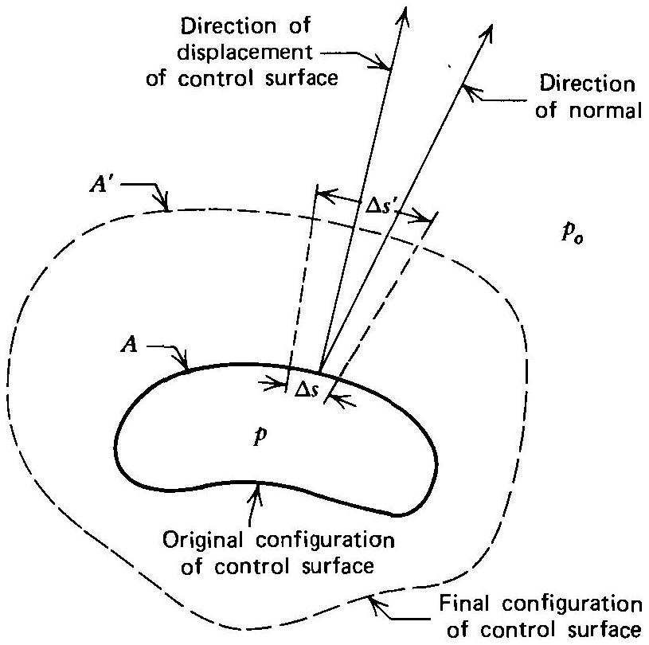
Figure 1.14 Work caused by the displacement of the boundaries of a system.

hydrostatic pressure exerted by the environment on $A$, by the differential amount $d p$. Because of the pressure difference $d p$, the control surface $A$ will be displaced and distorted to some new configuration $A^{\prime}$. The work performed by the system as a whole in displacing from $A$ to $A^{\prime}$ is called moving boundary work. Because there is no friction, the displacement of the system boundaries is a reversible process; that is, the work performed is reversible.

For the reversible displacement of the control surface $A$, assumed here, the static pressure $p$ of the system may be plotted as a function of its volume $\mathscr{V}$, in the manner illustrated in Fig. 1.15. The result is the curve 12, which relates $p$ and $\mathscr{V}$ for the change from the equilibrium state 1 to the equilibrium state 2 .
Let $W_{R}$ denote the work done by a system that undergoes a reversible change of state, from state 1 to state 2 . Then

$$
W_{R}=\int_{1}^{2} p d \mathscr{V}
$$

The subscript $R$ attached to $W$ denotes that the change of state is a reversible process. Hereafter, the subscript $R$ will be omitted, and it should be understood that $W= \int p d \mathscr{V}$ applies only to a reversible change of state.

Equation 1.44 is the expression for the moving boundary work done by a closed system against its environment. The general convention is to regard work done by the system on its surroundings as positive work, and vice versa. The representation of work on the $p \mathscr{V}$ plane, as in Fig. 1.15, leads to the following rule for distinguishing positive work from negative work. If the area $\int p d \mathscr{V}$ lies to the right of an observer moving in the direction of the process, the work is positive, and vice versa.
In the case where the path is a closed curve, such as that illustrated in Fig. 1.16, the net work is the difference between the positive work and the negative work. It is given by the area enclosed by the curves (paths) forming the closed curve (cycle). If the expression $p d \mathscr{V}$ were an exact differential expression, its line integral around the closed curve of Fig. 1.16 would vanish instead of being equal to the enclosed area [see Section 1-7(a)]. Hence, the differential $\delta W=p d \mathscr{V}$ is inexact. The work depends on the process or path, that is, on the functional relationship between $p$ and $\mathscr{V}$.
Equation 1.44 is applicable to either a system or its working substance, provided there is no friction. In the case where the friction is confined to the components of a machine, but the working fluid is frictionless, equation 1.44 may be applied only to the fluid.

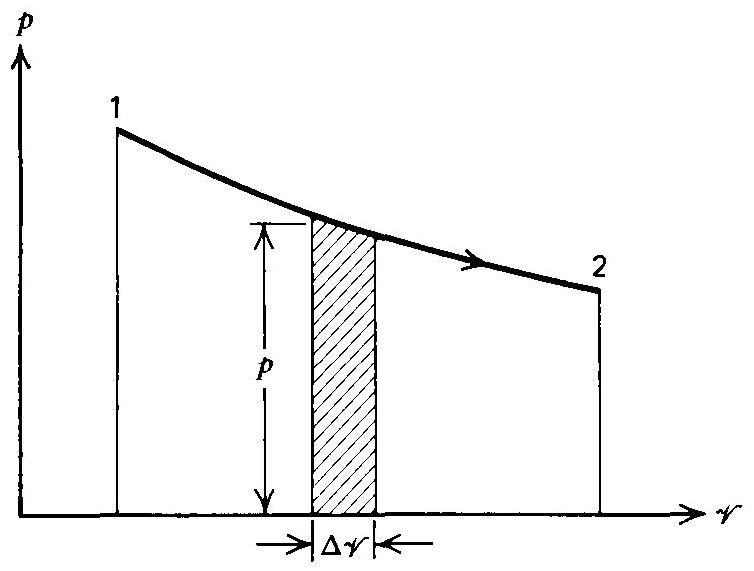
Figure 1.15 Determination of work for a process plotted on the $p \mathscr{V}$ plane.

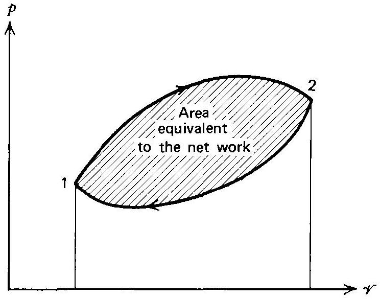
Figure 1.16 Work for a cyclic process.

## 1-10 HEAT

Experience has shown that energy may be transferred across the boundaries of a system in the absence of macroscopic changes in the system. For example, when a system at a given temperature is brought into contact with its surroundings at a different temperature, energy flows from the higher temperature region to the lower temperature region, unaccompanied by any macroscopic changes in the system. This energy transfer process is termed heat. Hence, heat is defined as energy in transit across the boundaries of a system caused by a temperature difference between the system and its surroundings.

By convention, the heat transferred to a system is defined as positive heat, and that transferred from a system is defined as negative heat. A process that permits heat transfer is termed a diabatic process, while one that does not permit heat transfer is termed an adiabatic process.

Heat, like work, depends on the process or path. Consequently, heat is not a property. Its differential is written as $\delta Q$ to indicate that the differential is inexact.

## 1-11 THE FIRST LAW OF THERMODYNAMICS

The first law of thermodynamics is based entirely on experience, and its validity is based on the fact that no phenomenon has been uncovered that contradicts it. Its simplest statement is that heat and work are mutually interconvertible and that the ratio of conversion is a fixed quantity termed the mechanical equivalent of heat, denoted by $\mathbf{J}$ (note that the symbol $\mathbf{J}$ is also used to denote the unit of energy the joule). The first law gives no information regarding the amount of heat transferred to a system that can be converted into work (or vice versa). It merely states that when a system converts heat into work, the ratio of the amount of heat so converted to the amount of work produced (and vice versa) is a constant denoted by J .

## 1-11(a) Mathematical Statement of the First Law of Thermodynamics

Consider a closed system of mass $m$ that is subjected to a series of processes involving the transfer of heat and the performance of work. Assume that the series of processes form a complete cycle. Let $\delta Q$ denote the heat transferred to or from the system and $\delta W$ the corresponding amount of work performed during the cycle. Then, experience shows that

$$
\oint(\delta Q-\delta W)=0
$$

Equation 1.45 is the basic mathematical statement of the first law of thermodynamics.

## 1-11(b) Stored Energy

It follows from Section 1-7(a) that because the line integral of the differential expression in equation 1.45 vanishes for a closed curve, the quantity ( $\delta Q-\delta W$ ) defines a property of a closed system. Let $E$, termed the stored energy, denote the property defined by equation 1.45 . Hence,

$$
d E=\delta Q-\delta W
$$

The stored energy $E$ comprises all of the forms of energy that can be stored in the system. Both $\delta Q$ and $\delta W$ are not storable; they are energies in transit. In general, $E$ may include the following kinds of stored energy: thermal energy (internal energy
$U)$; kinetic energy ( $m V^{2} / 2$ ); potential energy caused by the effect of gravity ( $m g z$ ); electrostatic, chemical, nuclear, and other forms of energy. For most of the situations encountered in fluid mechanics, one need consider only the first three of the aforementioned forms of energy. Hence, let

$$
E=U+m \frac{V^{2}}{2}+m g z
$$

On a unit mass basis, the stored energy $E$ is denoted by $e$, where

$$
e=\frac{E}{m}=u+\frac{V^{2}}{2}+g z
$$

where $u$ is the internal energy per unit mass. On a unit mass basis, equation 1.46 becomes

$$
d e=\delta Q-\delta W
$$

where $\delta Q$ and $\delta W$ are also determined on a unit mass basis.
Equations 1.46 and 1.48 apply to both reversible and irreversible processes. In an irreversible process the energy $\delta E_{f}$ is expended in overcoming dissipative effects such as friction, turbulence, etc. Such forms of energy are completely converted into the random molecular motions of the molecules. Moreover, the mechanical work $\delta W$ will be smaller than $p d \mathscr{V}$ (see equation 1.44). Hence, when energy dissipating effects are involved, equations 1.46 and 1.48 become

$$
d E=\delta Q-\delta E_{f}-p d \mathscr{V} \quad \text { and } \quad d e=\delta Q-\delta e_{f}-p d v
$$

## 1-11(c) Internal Energy

Energy can be stored in the atoms and molecules of a system because of their motions. That form of energy is termed internal energy $U$ (it is also called thermal energy), and comprises the kinetic energies of translation, vibration, and rotation of the particles, and the electronic energy caused by the state of the particle electron cloud. Consider a closed system of mass $m$ having no kinetic and potential energies. Let $\delta Q$ denote the heat transferred to the system and $\delta W$ the corresponding work performed during a change of state. Then, from equation 1.49, the resulting change in the internal energy of the system is given by
$d U=\delta Q-\delta W=\delta Q-\delta U_{f}-p d \mathscr{V} \quad$ and $\quad d u=\delta Q-\delta u_{f}-p d v$
where $\delta U_{f}$ denotes the increase in the internal energy caused by the dissipative effects of friction.

## 1-11(d) Flow Work

Figure 1.17 illustrates a system of fixed mass $m$ enclosed by a fixed boundary $A$. Adjacent to $A$ is a small mass $\delta m$. Assume that the mass $\delta m$ is forced across $A$ and joins the system mass $m$. Let the pressure of the surroundings, denoted by $p$, force $\delta m$ into the system. The work performed by the surroundings on the combined system, comprising $m$ and $\delta m$, by moving $\delta m$ the distance $d x$ into the original system, is called the flow work $\delta W_{\text {flow }}$. It is given by

$$
\delta W_{\text {flow }}=F d x=(p d A) d x=p d \mathscr{V}=p v \delta m
$$

where $v=d \mathscr{V} / \delta m$. Physically, $p d \mathscr{V}$ is the work required to compress the volume $d \mathscr{V}$ into a region where the pressure is $p$. The value of $p d \mathscr{V}$ is negative when mass is forced

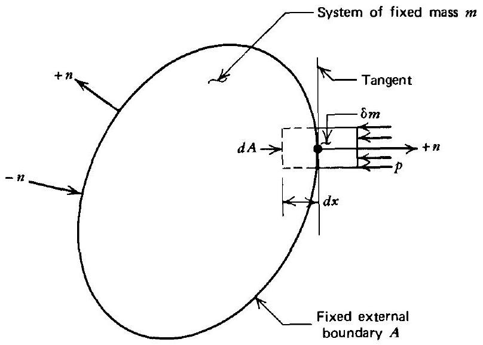
Figure 1.17 Flow work because of mass crossing the boundary of a system.

into the system (see Fig. 1.17), and positive when mass is forced out of the system. On a unit mass basis, equation 1.51 becomes

$$
\delta W_{\text {flow }}=p v
$$

## 1-11(e) Enthalpy

By definition, the enthaply per unit of mass of a substance, denoted by $h$, is

$$
h \equiv u+p v
$$

Like the specific internal energy $u$, both $h$ and $p v$ are thermodynamic properties per unit mass. Differentiating equation 1.53 yields

$$
d h=d u+(p d v+v d p)
$$

From equation 1.50, a change in the specific internal energy is given by

$$
d u=\delta Q-\delta u_{f}-p d v
$$

Combining equations 1.50 and 1.54 yields

$$
d h=\delta Q-\delta u_{f}+v d p
$$

For a reversible process, $\delta u_{f}=0$, and equation 1.55 reduces to

$$
\delta Q_{R}=d h-v d p
$$

where the subscript $R$ denotes that $Q$ is transferred in a reversible manner. If the process is adiabatic and reversible, that is, isentropic, then

$$
d h-v d p=d h-\frac{1}{\rho} d p=0
$$

## 1-11(f) Specific Heats

In general, the specific heat of a substance, denoted by $c$, is defined by

$$
c \equiv \frac{\delta Q}{d t}
$$

Since $\delta Q$ is an inexact differential, the value of $c$ depends on how the heat transfer process is conducted. Of particular interest are the specific heats $c_{v}$ and $c_{p}$, corresponding to constant-volume and constant-pressure heating, respectively. It can be readily shown that ${ }^{13}$

$$
\begin{aligned}
c_{v} & =\left(\frac{\partial u}{\partial t}\right)_{v} \\
c_{p} & =\left(\frac{\partial h}{\partial t}\right)_{p}
\end{aligned}
$$

The name specific heat implies a heating process to attain the change in the thermodynamic state. The specific heats $c_{v}$ and $c_{p}$ defined by equations 1.59 and 1.60 are partial dervatives of thermodynamic properties, and thus are themselves thermodynamic properties, which are independent of the actual process taking place. The term specific heat is thus a misnomer when applied to such partial derivatives. Because general usuage has firmly established the name specific heat for $c_{v}$ and $c_{p}$, that terminology will be adhered to in this book.

## 1-12 THE SECOND LAW OF THERMODYNAMICS AND ENTROPY

Even in a reversible process it is not possible to transform all of the heat added to a system into useful work. Experience has demonstrated that the transformation of heat into work is inevitably accompanied by a degradation of a portion of the energy supplied into a form that is less useful. For example, the thermal energy associated with a gas cannot be converted entirely into mechanical work by permitting it to expand; this is because the thermal energy associated with the random movements of the gas molecules is not subject to complete control. As already mentioned, the First Law is not concerned with the quantity of heat that can be converted into work and gives no information regarding that matter. The First Law is concerned only with the portion of the heat that is converted into work. It is the Second Law that is concerned with the quantity of heat that can be converted into useful work. Like the First Law, the Second Law is based entirely on experience.

According to the Second Law, every natural system, if left undisturbed, will change spontaneously and approach a state of equilibrium or rest, and the process is irreversible. As the change or process moves the system toward the equilibrium state, the system loses capability for spontaneous change. The property associated with the capability of a system for spontaneous change, is called its entropy s.

For a closed system that undergoes a cyclic change where the heat per unit mass $\delta Q_{R}$ is received reversibly at the absolute temperature $t$, we may write ${ }^{13}$

$$
\oint \frac{\delta Q_{R}}{t}=0
$$

Equation 1.61 is of the same form as equation 1.35 , which defines a property of a simple system. Hence, $\delta Q_{R} / t$ defines a thermodynamic property of the system, termed the entropy by Clausius (1850). If $s$ denotes the entropy per unit mass for a system then, by definition,

$$
d s \equiv \frac{\delta Q_{R}}{t}
$$

Equation 1.61 shows that the change in entropy between two given states is the same for all processes connecting them. Hence, the entropy change for an irreversible process can be measured by the value of $\int \delta Q / t$ for any arbitrarily selected reversible processes connecting the same initial and final states.

For a closed system that experiences a reversible change ( $\delta u_{f}=0$ ) from one equilibrium state to another, equation 1.50 reduces to

$$
\delta Q_{R}=d u+p d v
$$

Substituting for $\delta Q_{R}$ from equation 1.62 into equation 1.63, we obtain

$$
t d s=d u+p d v
$$

Substituting for $d u$ from equation 1.54 into equation 1.64 gives

$$
t d s=d h-v d p=d h-\frac{1}{\rho} d p
$$

Although equations 1.64 and 1.65 are derived for reversible processes, they are also valid for irreversible processes because they involve only thermodynamic properties; that is, they involve only exact differentials having integrated values that are independent of the process.

Combining equation 1.50, expressed on a unit mass basis, with equation 1.64 gives the following equation for both reversible and irreversible processes.

$$
d s=\frac{d u+p d v}{t}=\frac{\delta Q-\delta u_{f}}{t}
$$

Thus, the entropy change during a process change from state 1 to state 2 is given by

$$
s_{2}-s_{1}=\int_{1}^{2} \frac{d u+p d v}{t}
$$

where the integration between state 1 and state 2 is performed along any arbitrarily selected reversible process or processes connecting the states 1 and 2 .

It follows from equation 1.66 that for a reversible process, $\delta u_{f}=0$ and $\delta Q=t d s$, whereas for an irreversible process, $\delta u_{f}>0$ and $\delta Q<t d s$. In the case where $\delta Q=0$, the process is said to be adiabatic. When $\delta u_{f}=0$, the process is reversible. In the special case where $\delta Q=\delta u_{f}=0$, the process is said to be isentropic, a reversible adiabatic process, and $d s=0$. Consequently,

$$
d s \geqq \frac{\delta Q}{t}
$$

where the equality applies to reversible processes and the inequality applies to irreversible (natural) processes.

Example 1.4. Air is compressed from the initial state where $t_{1}=288.9 \mathrm{~K}$ and $p_{1}=1.38 \cdot 10^{5} \mathrm{~N} / \mathrm{m}^{2}$ to a new state where $t_{2}=566.7 \mathrm{~K}$ and $p_{2}=4.14 \cdot 10^{5} \mathrm{~N} / \mathrm{m}^{2}$. Calculate the change in the entropy of the gas for the following cases: (a) a reversible adiabatic compression from $p_{1}$ to $p_{2}$ followed by a reversible isobaric heating to the final temperature $t_{2}$, and (b) an irreversible process between the same states where the work expended in overcoming friction is equivalent to $232,600 \mathrm{~J} / \mathrm{kg}$ and the heat caused by friction remains in the gas. These two processes are illustrated in Fig. 1.18. Assume $\gamma=1.40$.

## Solution

(a) If the air is assumed to be a perfect gas (see Section 1-15) then, for an isentropic compression (see Fig. 1.18),

$$
t_{3}^{\prime}=t_{1}\left(\frac{p_{3}}{p_{1}}\right)^{(\gamma-1) / \gamma}=t_{1}\left(\frac{p_{2}}{p_{1}}\right)^{(\gamma-1) / \gamma}=288.9\left(\frac{4.14}{1.38}\right)^{0.28571}=395.4 \mathrm{~K}
$$

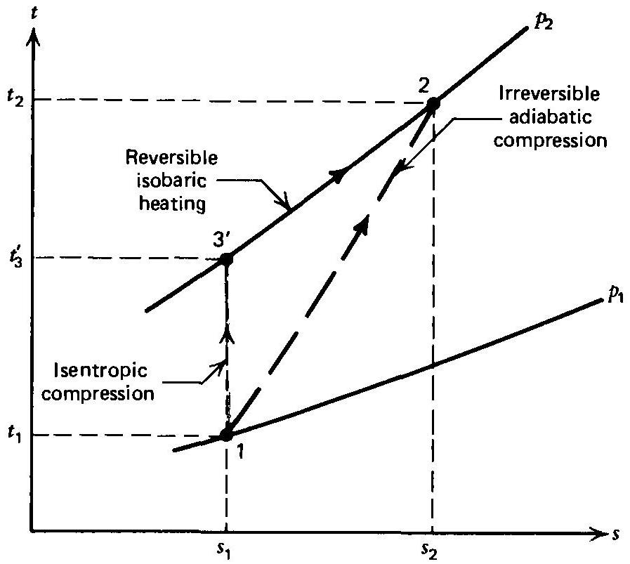
Figure 1.18 Sketch for Example 1.4.

From equation 1.65 , for an isobaric process ( $d p=0$ )

$$
d s=\frac{d h}{t}
$$

From Section 1-15(d), for a perfect gas, $d h=c_{p} d t$, where $c_{p}=1004 \mathrm{~J} / \mathrm{kg}-\mathrm{K}$ for air. Thus,

$$
\begin{aligned}
& s_{2}-s_{1}=s_{2}-s_{3}^{\prime}=\int_{3}^{2} \frac{c_{p} d t}{t}=c_{p} \ln \left(\frac{t_{2}}{t_{3}^{\prime}}\right) \\
& s_{2}-s_{1}=1004 \ln \left(\frac{566.7}{395.4}\right)=361.4 \mathrm{~J} / \mathrm{kg}-\mathrm{K}(0.0864 \mathrm{Btu} / \mathrm{lbm}-\mathrm{R})
\end{aligned}
$$

(b) For the irreversible process the entropy change $d s$ is not given by $\delta Q / t$. The reversible process in part a, however, connects the same state points as the irreversible process. Since entropy is a property, the reversible process and the irreversible process have the same entropy change.

## 1-13 NEWTON'S LAWS OF MOTION

Before presenting Newton's three laws of motion, the reference frame to which they are to be referred will be specified. The laws have their simplest and customary form when they are referred to either a primary inertial coordinate system, which comprises a set of rigid axes fixed relative to the average position of fixed stars, or to a secondary inertial coordinate system, which comprises a set of axes that moves with a constant velocity and no rotation relative to the primary inertial system (see Reference 14).

If the motion of a system of particles is referred to either inertial system, Newton's laws can be written as follows.

1. Every particle persists in its state of rest or uniform motion in a straight line except insofar as it may be compelled by force to change that state.
2. The rate of change of momentum (quantity of motion) is proportional to the force applied to the body, and it takes place in the direction of the line of action of the force.
3. To every action there is an equal and opposite reaction.

According to Einstein, the mass $m$ is given by

$$
m=\frac{m_{o}}{\left[1-\left(\frac{V}{c}\right)^{2}\right]^{1 / 2}}
$$

where $m_{o}$ is the mass of the body at rest, $V$ is the velocity of the body, and $c$ is the speed of light. For all fluid mechanic applications in this book, the fluid mass $m$ will be assumed to be equal to its rest mass $m_{o}$.

## 1-13(a) Mathematical Expressions of Newton's Laws of Motion

Let $\mathbf{M}=m \mathbf{V}$ denote the momentum of a particle or a body. By Newton's second law of motion,

$$
\mathbf{F}=\frac{d(m \mathbf{V})}{d t}=\frac{d \mathbf{M}}{d t}=\dot{\mathbf{M}}
$$

Equation 1.70 shows that the external force vector $\mathbf{F}$ is equal to the derivative with respect to time of the momentum vector $\mathbf{M}$. From equation 1.70 , it follows that the component of $\mathbf{F}$ acting in an arbitrary direction, for example, the $x$ direction, denoted by $X$, is

$$
X=\frac{d M_{x}}{d t}=m \frac{d V_{x}}{d t}=m a_{x}
$$

where $a_{x}$ denotes the acceleration of the mass $m$ in the $x$ direction.
Newton's third law, customarily termed the reaction principle, implies that if body $A$ exerts the force $\mathbf{F}_{A B}$ on body $B$, then body $B$ exerts the equal and opposite force $\mathbf{F}_{B A}$ on body $A$. Hence,

$$
\mathbf{F}_{A B}+\mathbf{F}_{B A}=0
$$

## 1-13(b) Momentum of a Particle

Consider a particle of mass $m$, and let $x, y$, and $z$ be its Cartesian coordinates. At a given time $t$ let $\mathbf{V}$ denote its velocity vector. The components of $\mathbf{V}$ referred to the three coordinate axes will be denoted by $u, v$, and $w$, respectively. If $X, Y$, and $Z$ denote the components of the external force $\mathbf{F}$ acting on the particle, then

$$
\begin{aligned}
X & =\frac{d}{d t}(m u)=\frac{d}{d t}(m \dot{x}) \\
Y & =\frac{d}{d t}(m v)=\frac{d}{d t}(m \dot{y}) \\
Z & =\frac{d}{d t}(m w)=\frac{d}{d t}(m \dot{z})
\end{aligned}
$$

where $\dot{x}=d x / d t, \dot{y}=d y / d t$, and $\dot{z}=d z / d t$. If the mass of the particle is constant, invariant with time, then

$$
\begin{aligned}
X & =m \dot{u}=m \ddot{x} \\
Y & =m \dot{v}=m \ddot{y} \\
Z & =m \dot{w}=m \ddot{z}
\end{aligned}
$$

where $\ddot{x}=\dot{u}=d^{2} x / d t^{2}$, etc.

Let a denote the corresponding acceleration vector. Then

$$
\mathbf{a}=\mathbf{i} \ddot{x}+\mathbf{j} \ddot{y}+\mathbf{k} \ddot{z}
$$

Hence,

$$
\mathbf{F}=m \mathbf{a}
$$

Equation 1.78 shows that if the mass $m$ is constant, $\mathbf{F}=m \mathbf{a}$.

## 1-13(c) Momentum of a System of Particles

Equation 1.70 is based on the dynamics of a single particle. In most engineering problems the interest is in a system comprising such a large number of particles that it may be assumed to be a continuum. In that case, in addition to the external forces acting on the particles, there are internal forces because of the actions and reactions between the particles. By Newton's Third Law, each pair of particles satisfies equation 1.72 , so that the net effect of the internal forces in a body is zero. For an arbitrary system of particles having the masses $m_{1}, m_{2}, \ldots, m_{n}$ with the corresponding velocities $\mathbf{V}_{1}, \mathbf{V}_{2}, \ldots, \mathbf{V}_{n}$, the external force acting on the $j$ th particle is $\mathbf{F}_{j}$ and its corresponding change in momentum is $m_{j}\left(d \mathbf{V}_{j} / d t\right)$. Hence, for the system of particles, the net external force, denoted by $\mathbf{F}$, acting on the assemblage of particles is

$$
\mathbf{F}=\sum_{j=1}^{n} \mathbf{F}_{j}=\sum_{j=1}^{n} \frac{d}{d t}\left(m_{j} \mathbf{V}_{j}\right)
$$

or

$$
\mathbf{F}=\frac{d \mathbf{M}}{d t}=\frac{d}{d t}(m \mathbf{V})=\dot{\mathbf{M}}
$$

Equation 1.80 shows that if a mass of fluid composed of a large number of particles is contained within a control surface $A$ at the instant of time $t$, the rate of change in the momentum for that mass of fluid is $d \mathbf{M} / d t$, which is equal to the net external force $\mathbf{F}$ acting on that mass of fluid. As noted earlier, the velocity and acceleration terms in equation 1.80 must be measured in an inertial frame of reference.

## 1-14 KINETIC THEORY AND THE PERFECT GAS

The macroscopic viewpoint of classical thermodynamics as applied to gases, when harmonized with the microscopic viewpoint of the kinetic theory of gases, gives an insight into some of the important characteristics of the perfect gas that cannot be obtained from thermodynamic considerations alone.

## 1-14(a) Basic Considerations of the Kinetic Theory

One of the aims of the kinetic theory of gases is the interpretation of the thermal equation of state for the perfect gas (see equation 1.99). According to that theory, which is based on the molecular structure of matter, a gas may be conceived as being composed of a very large number of molecules that move with extremely rapid random motions. For example, at standard conditions the number of molecules in a cubic centimeter of air is approximately $2.705 \cdot 10^{19}$. Although the molecular velocities are extremely large (e.g., the average velocity of the hydrogen molecule under standard conditions is $1840 \mathrm{~m} / \mathrm{s}$ approximately), the motion of each molecule is greatly impeded by collisions with the tremendous number of neighboring molecules. Consequently, as pointed out in Section 1-4(e), the molecular mean free path $\lambda$ is very small.

According to equation $1.11, \lambda$ is given by

$$
\lambda=\frac{1}{\sqrt{2}\left(\pi N d^{2}\right)} \text { (meters) }
$$

where $N$ is the number of molecules per cubic meter and $d$ is the effective diameter of the molecule in meters.

Because of the large number of collisions with the neighboring molecules, each gas molecule follows an extremely torturous path. For that reason, the diffusion of a gas, the movement of gas molecules through neighboring gas molecules, is inherently a rather slow process.

A gas molecule will have different independent motions, called degrees of freedom, depending on its structure. In general, it may have translational motions and rotational motions, and the atoms of a polyatomic molecule may vibrate with respect to each other. A monatomic molecule has 3 degrees of translational freedom only; a rigid diatomic molecule has 5 degrees of freedom, 3 of translation and 2 of rotation about two axes at right angles to the long axis of the molecule. If the atoms of a diatomic molecule can vibrate with respect to each other, the degrees of freedom are increased to 7 because of the vibrational degrees of freedom. A nonlinear triatomic molecule will have at least 6 degrees of freedom, 3 for translation and 3 for rotation about three mutually perpendicular axes and, if the atoms vibrate, 3 for vibration, or 9 degrees of freedom in all. ${ }^{7,8}$

For the perfect gas it is assumed that the only degrees of freedom are the 3 for translation (same as for a monatomic gas). It is further assumed that the molecules are perfectly elastic and that the only interactions between the molecules are the collisions; that is, there are no attractive forces.

The kinetic theory is based on applying the laws of Newtonian mechanics to the molecules, but because of the large number of molecules involved it becomes a mathematical necessity to apply statistical methods to the system with the consequence that the results obtained are the averaged values of the properties of the gas.

The effective diameter of a molecule $d$ exerts a predominating influence on the transport properties of the gas. Physically speaking, if two molecules approach each other and the distance between their centers is smaller than $d$, then the molecules must collide. The collision is accompanied by changes in the original directions and speeds of the colliding molecules. If the molecules are deformable, then the effective diameter $d$ will be smaller for molecules experiencing high-speed collisions than it is for those experiencing low-speed collisions. Consequently, the effective diameter of a molecule will be a function of the speed of the collision.

The rms velocity $\sqrt{\bar{C}^{2}}$ is different from the mean velocity $\bar{c}$. They are related by

$$
\bar{c}=\left(\frac{8 \overline{C^{2}}}{3 \pi}\right)^{1 / 2}=0.921 \sqrt{\overline{C^{2}}}
$$

In this section, results derived from the kinetic theory for such thermodynamic properties of a gas as temperature, pressure, internal energy, etc., are presented. In addition, the results for the transport properties viscosity, thermal conductivity, and diffusion of a perfect gas are discussed.

## 1-14(b) Pressure Intensity

Consider a mass of gas enclosed in a container having the volume $\mathscr{V}$. If $N$ is the number of molecules in the volume $\mathscr{V}$, and $m$ is the mass of each molecule, then the
density of the gas $\rho$ is given by

$$
\rho=\frac{N m}{\mathscr{V}}
$$

According to the kinetic theory, the pressure intensity $p$ acting on the walls of the container is due to the impacts of the gas molecules on those walls. Let $\overline{C^{2}}$ denote the mean of the square of the velocities of the particles. It can be shown that ${ }^{7}$

$$
p \mathscr{V}=\frac{2}{3}\left(\frac{1}{2} N m \overline{C^{2}}\right)=\frac{2}{3}(K E)_{t r}
$$

Hence, in view of equation 1.83 , the pressure intensity $p$ is given by

$$
p=\frac{2}{3}\left(\frac{1}{2} \rho \overline{C^{2}}\right)
$$

Equation 1.85 shows that the pressure intensity $p$ is directly proportional to the kinetic energy of translation per unit volume of the gas.

## 1-14(c) Temperature

According to the kinetic theory, the absolute temperature $t$ of a perfect gas is proportional to the translational kinetic energy $(K E)_{t r}$ associated with the random motions of the gas particles, which is

$$
(K E)_{t r}=\frac{1}{2} N m \overline{C^{2}} \propto t
$$

It follows from equation 1.86 that, for a given mass of gas, the velocity term $\sqrt{\overline{C^{2}}}$ increases with the temperature of the gas. It should be noted that $(K E)_{t r}$ constitutes the internal energy of the gas. Hence, if the temperature is fixed, then the internal energy of the gas is fixed.

It is shown in Section 1-15(a) that (see equation 1.99)

$$
p \mathscr{V}=m R t
$$

Combining equations 1.84 and 1.99 yields

$$
m R t=\frac{2}{3}(K E)_{t r}
$$

## 1-14(d) Avogadro's Number and Boltzmann's Constant

According to Avogadro, equal volumes of all gases, when held at the same temperature $t$ and pressure $p$, contain the same number of molecules. The mole ${ }^{3}$ is defined as the amount of a substance that contains as many elementary entities as there are carbon atoms in 0.012 kg of carbon 12. That number, denoted by $N_{A}$, is called Avogadro's number. It has been shown experimentally that $N_{A}=6.02252 \cdot 10^{23}$ particles $/ \mathrm{mol}$.

The universal gas constant $\bar{R}$, defined in Section 1-15(a), and Avogadro's number $N_{A}$ are both universal constants. Their ratio is likewise a universal constant, termed Boltzmann's constant, which is denoted by $k$. Hence

$$
k \equiv \frac{\bar{R}}{N_{A}}=1.38054 \cdot 10^{-23} \mathrm{~J} / \mathrm{K}=\text { Boltzmann's constant }
$$

Boltzmann's constant $k$ is the gas constant for a single molecule of a gas. If $z$ denotes

## 40 REVIEW OF FUNDAMENTAL PRINCIPLES

the molecular density, the number of molecules per unit volume, then equation 1.99 becomes

$$
p=z k t
$$

## 1-14(e) Specific Heats

According to the kinetic theory, the heat $\delta Q$ required to raise the temperature of a gas by an amount $d t$ is stored in the gas in the form of the kinetic energy of its molecules. For a monatomic gas the kinetic energy is obtained from equation 1.87 ; thus, on a molar basis,

$$
(\overline{K E})_{t r}=\frac{3}{2} \bar{R} t
$$

Let $\bar{c}_{v}=\bar{m} c_{v}=$ the molar heat capacity of the gas at constant volume. Since $\bar{c}_{v}$ is the increase in the internal kinetic energy per mole of gas per unit change in temperature, it follows from equations 1.58 and 1.90 that

$$
\bar{m} \delta Q=\bar{m} c_{v} d t=c_{v} d t=\frac{3}{2} \bar{R} d t
$$

and

$$
\bar{c}_{v}=\frac{3}{2} \bar{R}=\frac{3}{2}(8314.3)=12,471 \mathrm{~J} / \mathrm{kmol}-\mathrm{K}
$$

Equation 1.92 indicates that for a perfect gas the specific heat is independent of $p$ and $t$, and gives values of $\bar{c}_{v}$ in good agreement with the measurements for monatomic gases. Polyatomic gases have values of $\bar{c}_{v}$ larger than those given by equation 1.92. The difference is attributed to the neglect of the energy required for supporting the rotational and vibrational motions of the polyatomic molecule.

According to Maxwell's equipartition law, ${ }^{9,10}$ the kinetic energy of a gas molecule is equally divided among all of its degrees of freedom $f$. Hence, since the monatomic molecule has 3 degrees of freedom (translation in 3 directions), the energy per mole of gas is $\bar{c}_{v} t=3 / 2 \bar{R} t$. Consequently, for a rigid diatomic molecule with $f=5$ ( 3 translational and 2 rotational degrees of freedom), $\bar{c}_{v}=5 / 2 \bar{R}=20,785 \mathrm{~J} / \mathrm{kmol}-\mathrm{K}$, a value in much better agreement with measurements. For a rigid polyatomic molecule with $f=6$ ( 3 translational and 3 rotational degrees of freedom), $\bar{c}_{v}=6 / 2 \bar{R}$. For nonrigid molecules, there are additional degrees of freedom because of the vibration of the atoms; the latter phenomenon becomes more and more important as the gas temperature increases.

## 1-14(f) Viscosity

It is pointed out in Section 1-4(e) that the kinetic theory relates the mean free path of the gas molecules to such molecular transport properties of the gas as its viscosity, heat conductivity and diffusion coefficient.

The viscosity of a gas arises from the transport of the momentum of the gas molecules. It can be shown that for a perfect gas the viscosity $\mu$ is given by ${ }^{9}$

$$
\mu=\frac{1}{2} \rho \lambda \bar{c}
$$

If the gas density $\rho$ decreases, the mean free path $\lambda$ increases in such a manner that the product $\rho \lambda$ tends to remain constant. The viscosity $\mu$ is, therefore, proportional to
$\bar{c}$, which depends entirely on the gas temperature $t$. Consequently, for a perfect gas, the viscosity $\mu$ depends only on $t$ and increases with $t$.

## 1-14(g) Thermal Conductivity

The thermal conductivity in a gas arises from spatial differences in its temperature. The latter cause the molecules to transport the mean energy of their random and internal motions. According to the kinetic theory, the thermal conductivity of a gas, denoted by $\kappa$, is given by ${ }^{9}$

$$
\kappa=\frac{5}{4} \rho \bar{c} \lambda c_{v} \cong \frac{5}{2} \mu c_{v}
$$

A parameter that is important in the study of viscous heat transfer problems is the Prandtl number $\operatorname{Pr}$, defined by

$$
\operatorname{Pr} \equiv c_{p} \mu / \kappa
$$

Combining equations 1.93, 1.94, and 1.95 gives

$$
\operatorname{Pr}=\frac{2}{5} \frac{c_{p}}{c_{v}}=\frac{2}{5} \gamma
$$

Equation 1.96 applies strictly to a monatomic gas ( $\gamma=5 / 3$ ). A better approximation is the Eucken relationship, which is given by ${ }^{9}$

$$
\operatorname{Pr}=\frac{4 \gamma}{9 \gamma-5}
$$

Equation 1.97 gives the same result as 1.96 for a monatomic gas and is a good approximation for other gases at ordinary temperatures.

## 1-14(h) Diffusion

Diffusion in a gas mixture arises from gradients in the concentrations of the individual species comprising the mixture. According to the kinetic theory, the coefficient of self-diffusion of a gas, denoted by $D$, is given by

$$
D=\beta_{D} \bar{c} \lambda
$$

where $\beta_{D}$ is a parameter that depends on the intermolecular model. Equation 1.98 may also be employed for the diffusion of gases that are nearly identical. For nonsimilar gases, a much more complicated relationship applies.

## 1-15 THERMODYNAMIC PROPERTIES OF THE PERFECT GAS

The thermodynamic state of a perfect gas is described in terms of the following properties; $p, v, t, u, h$, and $s$.

## 1-15(a) Thermal Equation of State

It has been demonstrated experimentally that for a homogeneous system, composed of a single chemical species of gas of molecular weight $\bar{m}$, the pressure $p$, specific volume $v$, and temperature $t$ are related by ${ }^{13}$

$$
R \equiv \underset{p \rightarrow 0}{\operatorname{Limit}}\left(\frac{p v}{t}\right)=\text { the gas constant }
$$

The gas constant $R$ depends only on the kind of gas involved. For real gases, $R$ varies with the gas pressure and temperature because of the volume occupied by the gas molecules and the presence of intermolecular forces. A gas for which $R$ is a constant, or very nearly so, is termed a thermally perfect gas. For such a gas

$$
p v=R t, \quad p=\rho R t, \quad p \mathscr{V}=m R t
$$

Equation 1.99 is known as the thermal equation of state for a perfect gas.
The dimensionless ratio $p v / R t$ is termed the compressibility factor, which is denoted by $Z$. Hence,

$$
Z \equiv \frac{p v}{R t}=\frac{p}{\rho R t}
$$

The compressibility factor $Z$ is, in general, a function of two independent properties of a simple thermodynamic system. Usually $Z$ is plotted as a function of $p / p_{c r}$ for different constant values of $t / t_{c r}$, where $p_{c r}$ denotes the critical pressure and $t_{c r}$ is the critical temperature.* For values of $t / t_{c r}>2$ or $p / p_{c r}<0.05$ approximately, the curve of $Z$ versus $p / p_{c r}$ is practically a horizontal line having the value $Z=1$. Consequently, for pressures that are low relative to $p_{c r}$ and temperatures that are high compared with $t_{c r}$, it may be assumed that $\mathrm{Z} \approx 1$; that is, the gas behaves in accordance with equation 1.99. Because a gas is thermally perfect does not imply that its specific heats $c_{p}$ and $c_{v}$ are constant [see Section 1-15(b)].

The mass unit known as the mole ${ }^{3}$, denoted by mol, is defined as the amount of a substance that contains as many elementary entities as there are atoms in 0.012 kg of carbon-12. That number of elementary entities is Avogadro's number $N_{A}$, discussed in Section 1-14(d). The molecular weight $\bar{m}$ is the measure of the mass of a mole of a substance. Thus, the units of molecular weight are (mass per mole), for example, $\mathrm{kg} / \mathrm{kmol}, \mathrm{g} / \mathrm{mol}$, etc. If the number of moles of a substance in a volume $\mathscr{V}$ is denoted by $N$, and the corresponding mass is denoted by $m$, then

$$
m=\bar{m} N
$$

It has been shown empirically that the gas constant $R$ is related to a universal gas constant $\bar{R}$ and the molecular weight $\bar{m}$ of the gas as follows.

$$
R=\frac{\bar{R}}{\bar{m}}
$$

Thus, equation 1.99 may be transformed to read

$$
p v=\left(\frac{\bar{R}}{\bar{m}}\right) t, \quad p=\rho\left(\frac{\bar{R}}{\bar{m}}\right) t, \quad p^{\mathscr{V}}=m\left(\frac{\bar{R}}{\bar{m}}\right) t
$$

The values of $\bar{R}$ for different systems of units of measurement are presented on the inside cover of this book. The thermodynamic properties for several common gases are presented in Table C.3.

Substituting $m=\bar{m} N$ into equation 1.100 yields

$$
p \mathscr{V}=N \bar{R} t
$$

Equation 1.101 expresses the thermal equation of state for a thermally perfect gas in terms of the number of moles $N$ in the volume $\mathscr{V}$. Equation 1.101 is generally employed by chemists and physicists in preference to equation 1.99.

[^1]
## 1-15(b) Caloric Equation of State

The following functional relationship, known as the caloric equation of state, may be written for the internal energy of any gas. Thus

$$
u=u(t, v)
$$

Differentiating the above expression yields

$$
d u=\left(\frac{\partial u}{\partial t}\right)_{v} d t+\left(\frac{\partial u}{\partial v}\right)_{t} d v
$$

It can be shown that, ${ }^{13}$ in the case of a thermally perfect gas,

$$
\left(\frac{\partial u}{\partial v}\right)_{t}=0
$$

Hence, it follows from the above equations that the internal energy $u$ of a thermally perfect gas depends only on its temperature, a conclusion in harmony with the kinetic theory of gases [see Section 1-14(c)]. Accordingly, for a thermally perfect gas,

$$
u=u(t)
$$

Combining equations 1.59 and 1.102 , gives for a thermally perfect gas,

$$
d u=c_{v} d t
$$

Integrating equation 1.103, we obtain

$$
u-u_{o}=\int_{t_{o}}^{t} c_{v}(t) d t
$$

where $t_{o}$ is an arbitrary reference temperature where $u=u_{o}$. If $c_{v}$ is constant, equation 1.104 becomes

$$
u-u_{o}=c_{v}\left(t-t_{o}\right)
$$

If $t_{o}$ and $u_{o}$ are chosen as zero, equation 1.105 becomes

$$
u=c_{v} t
$$

A gas having a constant value of $c_{v}$ is termed a calorically perfect gas, and equation 1.106 is one form of the caloric equation of state for such a gas. In the remainder of this book, only a gas that is both thermally and calorically perfect will be termed a perfect gas, without qualification. Otherwise the gas will be called an imperfect gas.

## 1-15(c) Specific Heat Relationships

For a thermally perfect gas, the First Law yields for a reversible process,

$$
\delta Q=c_{v} d t+p d v
$$

Differentiation of the thermal equation of state $p v=R t$ gives

$$
p d v+v d p=R d t
$$

Combining equation 1.107 and equation 1.108 yields

$$
\frac{\delta Q}{d t}=c_{v}+R-v \frac{d p}{d t}
$$

For the case where $\delta Q$ is added isobarically ( $d p=0$ ), we obtain

$$
\left(\frac{\delta Q}{\delta t}\right)_{p}=c_{p}=c_{v}+R
$$

Let $\gamma=c_{p} / c_{v}$ denote the specific heat ratio for the gas; then it follows from equation 1.110 that

$$
c_{v}=R /(\gamma-1)
$$

and

$$
c_{p}=\gamma R /(\gamma-1)
$$

Substituting $\gamma=c_{p} / c_{v}$ into equation 1.110 gives

$$
\gamma=1+\frac{R}{c_{v}}=1+\frac{\bar{R}}{\bar{c}_{v}}=1+\frac{2}{f}=\frac{f+2}{f}
$$

where $f$ is the number of degrees of freedom in the molecules, as discussed in Section $1-14$ (e). For a monatomic gas, $f=3$, for a rigid diatomic gas, $f=5$, and for a rigid polyatomic gas, $f=6$. Thus, according to the kinetic theory,

1. For monatomic gases $\gamma=5 / 3=1.67$.
2. For diatomic gases $\gamma=7 / 5=1.40$.
3. For polyatomic gases $\gamma=8 / 6=1.33$.

The above results are accurate for monatomic gases, less accurate for diatomic gases, and least accurate for polyatomic gases.

## 1-15(d) Enthalpy Change

The thermodynamic property enthalpy $h$ is defined in Section 1-11(e). A differential change in enthalpy $d h$ is given by equation 1.54. For a thermally perfect gas, since $d u=c_{v} d t$ and $c_{p}=c_{v}+R$, equation 1.54 transforms to

$$
d h=c_{v} d t+d(p v)=\left(c_{v}+R\right) d t=c_{p} d t
$$

Equation 1.114, when integrated, yields

$$
h-h_{o}=\int_{t_{o}}^{t} c_{p}(t) d t
$$

For a calorically perfect gas, $c_{v}$ is constant [see Section 1-15(b)]. Consequently, from equation $1.110, c_{p}$ is also constant, and equation 1.115 becomes

$$
h-h_{o}=c_{p}\left(t-t_{o}\right)
$$

where $t_{o}$ is an arbitrary reference temperature where $h=h_{o}$. If $t_{o}$ and $h_{o}$ are chosen as zero, equation 1.116 becomes

$$
h=c_{p} t
$$

Equation 1.117 is a useful form of the caloric equation of state for a perfect gas.
Example 1.5. The enthalpy of air, assumed to be a perfect gas, is measured above 300 K as the datum. If its value at 400 K is $h=100.83 \mathrm{~kJ} / \mathrm{kg}-\mathrm{K}$, calculate the average value of $c_{p}$.

## Solution

$$
\begin{aligned}
h_{2}-h_{1} & =c_{p}\left(t_{2}-t_{1}\right) \\
c_{p}=\frac{h_{2}-h_{1}}{t_{2}-t_{1}} & =\frac{100.83}{400-300}=1.0083 \mathrm{~kJ} / \mathrm{kg}-\mathrm{K}(0.2408 \mathrm{Btu} / \mathrm{lbm}-\mathrm{R})
\end{aligned}
$$

## 1-15(e) Entropy Change

The entropy change for a reversible process is given by equations $1.62,1.64$, and 1.65 . For a thermally perfect gas, $p v=R t, d u=c_{v} d t$, and $d h=c_{p} d t$. Substituting for $d u$ and $p$ into equation 1.64 , we obtain

$$
d s=c_{v} \frac{d t}{t}+R \frac{d v}{v}
$$

Substituting for $d h$ and $v$ in equation 1.65 yields

$$
d s=c_{p} \frac{d t}{t}-R \frac{d p}{p}
$$

Integration of equation 1.119 yields

$$
s=\int c_{p} \frac{d t}{t}-R \ln p+\mathrm{constant}
$$

For a perfect gas, $c_{p}=$ constant, so that equation 1.120 integrates to

$$
s=c_{p} \ln t-R \ln p+\mathrm{constant}
$$

Equation 1.121 may be transformed to read

$$
s=c_{p} \ln \left[\frac{t}{p^{R / c_{p}}}\right]+\text { constant }=c_{p} \ln \left[\frac{t}{p^{(\gamma-1) / \gamma}}\right]+\text { constant }
$$

For an isentropic change of state, $d s=0$ and, from equations 1.112 and 1.119, it follows that

$$
c_{p} \frac{d t}{t}=\left(\frac{\gamma R}{\gamma-1}\right) \frac{d t}{t}=R \frac{d p}{p}
$$

from which

$$
\frac{d t}{t}=\frac{\gamma-1}{\gamma}\left(\frac{d p}{p}\right)
$$

For a perfect gas, $\gamma$ is constant, so that integration of equation 1.124 yields

$$
\ln t=\left(\frac{\gamma-1}{\gamma}\right) \ln p+\mathrm{constant}
$$

Hence

$$
t p^{-(\gamma-1) / \gamma}=\mathrm{constant}
$$

Furthermore, for a perfect gas, $p v=R t$, so that equation 1.126 may be transformed to read

$$
p v^{\gamma}=p \rho^{-\gamma}=\text { constant }
$$

Hence, if a perfect gas undergoes an isentropic change of state, then its pressure and temperature are related by equation 1.126, and its pressure and volume are related by equation 1.127. To indicate that a state is arrived at by an isentropic change of state, the supercript prime (') will be hereafter attached to the property attained by that change of state. Hence, for an isentropic change of state from state 1 to state $2^{\prime}$

$$
\frac{t_{2}^{\prime}}{t_{1}}\left(\frac{p_{2}^{\prime}}{p_{1}}\right)^{(\gamma-1) / \gamma}
$$

## 1-15(f) Process Equations

Processes by which a gas can pass from one state to another are, in the abstract at least, infinite in number. In general, the following specific processes are of the greatest significance in engineering.

1. The isothermal change $(d t=0)$.
2. The adiabatic change ( $\delta Q=0$ ).
3. The isobaric change ( $d p=0$ ).
4. The isovolumic change $(d v=0)$.
5. The isentropic change $(d s=0)$.

It will be recalled from elementary thermodynamics that all of the above changes of state may be regarded as special cases of the general so-called polytropic change $p v^{n}=$ constant. Thus,

$$
\begin{aligned}
& n=1 \text { corresponds to } d t=0 \\
& n=0 \text { corresponds to } d p=0 \\
& n=\infty \text { corresponds to } d v=0 \\
& n=\gamma \text { corresponds to } \mathrm{ds}=0
\end{aligned}
$$

Flow processes that take place rapidly, such as the flow of gases through the exhaust nozzle of a rocket motor or turbojet engine, the nozzles of a turbine, the blade passages of an axial compressor or turbine, air inlet ducts, and diffusers, are substantially adiabatic ( $\delta Q=0$ ) because of the extremely short time interval available for the transfer of heat. Such processes, however, are never isentropic ( $d s=0$ ) because they are invariably irreversible, since they are accompanied by internal friction, turbulence, wall friction, and eddies, all of which cause energy losses that increase the entropy of the fluid stream. Consequently, in discussing the flow of gases through a nozzle, turbine, or compressor, it is tacitly assumed as a first approximation that the changes of state are reversible adiabatics, that is, isentropics, and the resulting equations are then modified to take into account the effects of irreversibility.

## 1-15(g) Entropy-Enthalpy Diagram

Most gas dynamic processes may be illustrated graphically by plotting the process on an entropy-enthalpy diagram, generally called a Mollier diagram. For a perfect gas, however, $h, u$ and $t$ are all directly proportional. Hence, any of the three may be employed in constructing the entropy-enthalpy diagram. The general characteristics of the entropy-enthalpy diagram for a perfect gas are developed in the present section.

Integrating equation 1.118 between a general state and a reference state denoted by the subscript o yields

$$
s(v, t)=c_{v} \ln \left(t / t_{o}\right)+R \ln \left(v / v_{o}\right)
$$

where the constant of integration is chosen to be zero. Lines of constant specific volume $v$ on the $t s$ plane may be determined by means of equation 1.129 by employing constant values of $v$ as a parameter. Then

$$
t=t_{o}\left(v_{o} / v\right)^{\gamma-1} e^{s / c_{v}}=\operatorname{constant} v^{-(\gamma-1)} e^{s / c_{v}}
$$

Equation 1.130 shows that curves of $v=1 / \rho=$ constant, termed $v$-lines or $\rho$-lines, are exponential curves on the $t s$ plane.

Integrating equation 1.119, yields

$$
s(p, t)=c_{p} \ln \left(t / t_{o}\right)-R \ln \left(p / p_{o}\right)
$$

where the constant of integration is chosen to be zero. Curves of constant pressure, called either $p$-lines or isobars, are thus given by

$$
t=t_{o}\left(p / p_{o}\right)^{(\gamma-1) / \gamma} e^{s / c_{p}}=\text { constant } p^{(\gamma-1) / \gamma} e^{s / c_{p}}
$$

Figure 1.19 presents curves, calculated from equations 1.130 and 1.132 , for air, assumed to be a perfect gas having $\gamma=1.40$ and $R=287.04 \mathrm{~J} / \mathrm{kg}-\mathrm{K}$. The ordinate is the air temperature $t$ and the abcissa is the dimensionless entropy $s / R$. The figure

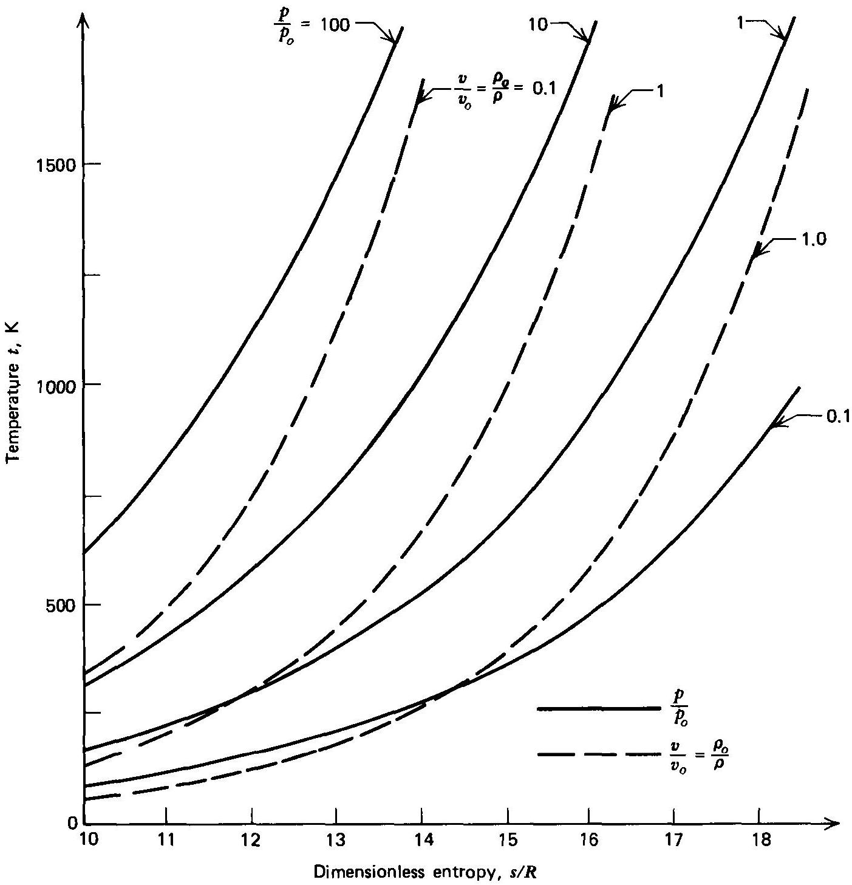
Figure 1.19 Characteristics of the isovolumic ( $v=$ constant) and the isobaric
$(p=\mathrm{constant)}$ lines in the $t s$ plane (also $h s$ and $u s$ planes for a perfect gas).

presents three curves of constant volume ratio $v / v_{o}=\rho_{o} / \rho$, and four curves of constant pressure ratio $p / p_{o}$. It follows from equations 1.130 and 1.132 that, as stated earlier, both sets of curves are exponential. The curves of constant $v / v_{o}$ are steeper than those for constant $p / p_{o}$; this is because $c_{p}>c_{v}$, so that $\exp \left(s / c_{v}\right)>\exp \left(s / c_{p}\right)$. At constant values of $s$, the values of $p$ increase with $t$, while the values of $v=1 / \rho$ decrease.

The reference conditions for the curves of Fig. 1.19 are $t_{o}=294.4 \mathrm{~K}$ and $p_{o}=1 \mathrm{~atm}$. Since the reference value for $s / R$ is arbitrary, it was chosen as $s_{o} / \mathrm{R}=12$ so that a convenient range of values is obtained for $s / R$.

## 1-15(h) Mixtures of Thermally Perfect Gases

Consider a mixture composed of several perfect gases that do not interact chemically, as for example atmospheric air. Assume that the constituent gases, hereafter termed the species, are in thermal equilibrium with each other. Accordingly, each of the species is at the mixture temperature $t$. The thermodynamic properties of such a gas mixture are determined in this section.

The conditions specified above satisfy the requirements for Dalton's law to be applicable; that is, each species behaves as if all the others were absent, so that the static pressure of the gas mixture, denoted by $p$, is equal to the sum of the partial pressures $p_{i}$ of each of the species. The partial pressure $p_{i}$ is defined as the pressure that each species would exert if it occupied the entire mixture volume $\mathscr{V}$ by itself at the mixture temperature $t$. For $n$ constituents, it follows that

$$
p=\sum_{i=1}^{n} p_{i}
$$

A mixture of thermally perfect gases also satisfies Amagat's law; that is, the volume of the gas mixture, denoted by $\mathscr{V}$, is equal to the sum of the partial volumes $\mathscr{V}_{i}$ of each of the species. The partial volume $\mathscr{V}_{i}$ is defined as the volume that each species would occupy by itself at the pressure $p$ and temperature $t$ of the mixture. Thus

$$
\mathscr{V}=\sum_{i=1}^{n} \mathscr{V}_{i}
$$

Let $m$ denote the mass of the gas mixture. Then

$$
m=\sum_{i=1}^{n} m_{i}=m_{1}+m_{2}+\cdots+m_{n}
$$

Let $v$ denote the specific volume of the gas mixture, and let $\rho$ denote its density. Then

$$
v=\frac{1}{\rho}=\frac{\mathscr{V}}{m}
$$

By definition, the partial specific volume $v_{i}$ and the partial density $\rho_{i}$ of species $i$, are given by

$$
v_{i}=\frac{1}{\rho_{i}} \equiv \frac{\mathscr{V}}{m_{i}}
$$

For the $i$ th species of the mixture, having the molecular weight $\bar{m}_{i}$, the partial pressure $p_{i}$ is obtained from equation 1.99. Thus,

$$
p_{i}=\rho_{i} R_{i} t=\left(\frac{m_{i}}{\mathscr{V}}\right)\left(\frac{\bar{R}}{\bar{m}_{i}}\right) t=\frac{\bar{R} t}{\mathscr{V}}\left(\frac{m_{i}}{\bar{m}_{i}}\right)
$$

By definition, the mass fraction $C_{i}$ is given by

$$
C_{i} \equiv \frac{m_{i}}{m}=\frac{\rho_{i}}{\rho}
$$

Substituting for $m_{i}$ from equation 1.135 into equation 1.134 gives

$$
p_{i}=\frac{\bar{R} t}{\mathscr{V}}\left(\frac{C_{i} m}{\bar{m}_{i}}\right)=\frac{m t}{\mathscr{V}}\left(\frac{C_{i} \bar{R}}{\bar{m}_{i}}\right)=\frac{m t}{\mathscr{V}}\left(C_{i} R_{i}\right)
$$

where $R_{i}=\bar{R} / \bar{m}_{i}$.

The pressure $p$ of the gas mixture, for brevity termed the mixture pressure, is obtained by substituting equation 1.136 into equation 1.133. Thus,

$$
p=\frac{m t}{\mathscr{V}} \sum_{i=1}^{n} C_{i} R_{i}=\rho t \sum_{i=1}^{n} C_{i} R_{i}
$$

where $\rho$ is the density of the gas mixture. Equation 1.137 may be put in the form of the thermal equation of state for a perfect gas. Thus,

$$
p=\rho R t
$$

where $R$ is the effective gas constant for the gas mixture and, in view of equation 1.137, is given by

$$
R=\sum_{i=1}^{n} C_{i} R_{i}=\frac{\bar{R}}{\bar{m}}
$$

where $\bar{m}$ is the effective molecular weight of the gas mixture. Hence, a mixture of inert thermally perfect gases behaves as a thermally perfect gas having the effective molecular weight $\bar{m}$ defined by equation 1.138 .

For a mixture of chemically reacting thermally perfect gases, the definitions and results presented above are still valid. The effective gas constant $R$ in that case, however, is not a constant, since each of the mass fractions $C_{i}$ changes.

The thermal equation of state for a perfect gas, on a molar basis, is given by equation 1.101, which is repeated below.

$$
p \mathscr{V}=N \bar{R} t
$$

Let $N_{i}$ denote the number of moles of the $i$ th species present in the mixture. Then, for species $i$, equation 1.101 becomes

$$
p_{i} \mathscr{V}=N_{i} \bar{R} t
$$

Combining the above equation and equation 1.101 gives

$$
\frac{p_{i}}{p}=\frac{N_{i}}{N}=X_{i}
$$

where $X_{i}$ is the mole fraction of the $i$ th species, and

$$
N=\sum_{i=1}^{n} N_{i}
$$

In terms of the partial volume $\mathscr{V}_{i}$, equation 1.101 may be written as

$$
p \mathscr{V}_{i}=N_{i} \bar{R} t
$$

Combining the above equation with equation 1.101 yields

$$
X_{i}=\frac{\mathscr{V}_{i}}{\mathscr{V}}=\frac{N_{i}}{N}
$$

Equation 1.139 relates the partial pressure $p_{i}$ and the mixture pressure $p$ to the mole fraction $X_{i}$, and equation 1.140 relates the partial volume $\mathscr{V}_{i}$ and the mixture volume $\mathscr{V}$ to the mole fraction $X_{i}$.

The effective molecular weight of the mixture $\bar{m}=m / N$ may be related to the mole fractions $X_{i}$ as follows.

$$
m=\sum_{i=1}^{n} m_{i}=\sum_{i=1}^{n} \bar{m}_{i} N_{i}=\sum_{i=1}^{n} \bar{m}_{i}\left(X_{i} N\right)
$$

Solving the above expression for $\bar{m}$, we obtain

$$
\bar{m}=\frac{m}{N}=\sum_{i=1}^{n} X_{i} \bar{m}_{i}
$$

The mole fraction $X_{i}$ may be related to the mass fraction $C_{i}$ as follows.

$$
m_{i}=C_{i} m=\bar{m}_{i} N_{i}=\bar{m}_{i}\left(X_{i} N\right)=\bar{m}_{i}\left(\frac{X_{i} m}{\bar{m}}\right)
$$

Solving the above expression for $X_{i}$ yields

$$
X_{i}=\frac{C_{i} \bar{m}}{\bar{m}_{i}}
$$

The internal energy and the enthalpy of the gas mixture are determined by summing over all of the species. On a mass basis, for each species $i$,

$$
u_{i}=\int_{t_{o}}^{t} c_{v i} d t+u_{i o} \quad \text { and } \quad h_{i}=\int_{t_{o}}^{t} c_{p i} d t+h_{i o}
$$

Summing over the $n$ species gives

$$
u=\sum_{i=1}^{n} C_{i} u_{i} \quad \text { and } \quad h=\sum_{i=1}^{n} C_{i} h_{i}
$$

Alternately, the internal energy and the enthalpy of the gas mixture may be determined from the specific heats $c_{v}$ and $c_{p}$ for the mixture. Thus,

$$
c_{v}=\sum_{i=1}^{n} C_{i} c_{v i} \quad \text { and } \quad c_{p}=\sum_{i=1}^{n} C_{i} c_{p i}
$$

The internal energy and the enthalpy of the gas mixture are obtained by integrating equations 1.144. Thus,

$$
u=\int_{t_{o}}^{t} c_{v} d t+u_{o} \quad \text { and } \quad h=\int_{t_{o}}^{t} c_{p} d t+h_{o}
$$

If all of the species in the mixture are perfect gases, then every $c_{v i}$ and $c_{p i}$ is a constant, and if $u_{o}=h_{o}=0$ when $t=t_{o}$, then equations 1.145 become

$$
u=c_{v} t \quad \text { and } \quad h=c_{p} t
$$

Equations 1.146 are identical to equations 1.106 and 1.117 for a pure perfect gas. The specific heat ratio $\gamma=c_{p} / c_{v}$ for a mixture of perfect gases may be determined from the values of $c_{p}$ and $c_{v}$ obtained from equations 1.144.

On a molar basis, equations 1.142 through 1.146 become:

$$
\begin{aligned}
\bar{u}_{i}=\int_{t_{o}}^{t} \bar{c}_{v i} d t+\bar{u}_{i o} & \text { and } & \overline{h_{i}} & =\int_{t_{o}}^{t} \bar{c}_{p i} d t+\bar{h}_{i o} \\
\bar{u}=\sum_{i=1}^{n} X_{i} \bar{u}_{i} & \text { and } & \bar{h} & =\sum_{i=1}^{n} X_{i} \bar{h}_{i} \\
\bar{c}_{v}=\sum_{i=1}^{n} X_{i} \bar{c}_{v i} & \text { and } & \bar{c}_{p} & =\sum_{i=1}^{n} X_{i} \bar{c}_{p i} \\
\bar{u}=\int_{t_{o}}^{t} \bar{c}_{v} d t+\bar{u}_{o} & \text { and } & \bar{h} & =\int_{t_{o}}^{t} \bar{c}_{p} d t+\bar{h}_{o} \\
\bar{u}=\bar{c}_{v} t & \text { and } & \bar{h} & =\bar{c}_{p} t
\end{aligned}
$$

The entropy of a mixture of perfect gases may be determined in two steps. First, each species is subjected to a change of state from a reference pressure and temperature of $p_{o}$ and $t_{o}$, respectively, to the pressure $p$ and temperature $t$ of the mixture, but each species occupies a volume equal to its partial volume $\mathscr{V}_{i}$ in the mixture. Second, each species is expanded adiabatically to fill the entire volume $\mathscr{V}$ of the mixture, at a pressure equal to its pressure $p_{i}$ in the mixture. For a perfect gas, that expansion process is isothermal, since

$$
p \mathscr{V}_{i}=p\left(X_{i} \mathscr{V}\right)=\left(X_{i} p\right) \mathscr{V}=p_{i} \mathscr{V}=m R t
$$

The entropy change of a pure substance is given by equation 1.119. Thus,

$$
d s=c_{p} \frac{d t}{t}-R \frac{d p}{p}
$$

Integrating equation 1.148 for the first step discussed above, we obtain

$$
s=\int_{t_{o}}^{t} c_{p} \frac{d t}{t}-R \ln \frac{p}{p_{o}}=\phi-R \ln p
$$

where $s_{o}=0, p_{o}=1 \mathrm{~atm}$, and $\phi$ is defined as

$$
\phi \equiv \int_{t_{o}}^{t} c_{p} \frac{d t}{t}
$$

On a molar basis, $\bar{s}=\bar{m} s$. Thus,

$$
\bar{s}=\bar{\phi}-\bar{R} \ln p
$$

For a mixture of $n$ species,

$$
S=\sum_{i=1}^{n} N_{i} \bar{S}_{i}=\sum_{i=1}^{n} N_{i} \bar{\phi}_{i}-N \bar{R} \ln p
$$

Equation 1.152 determines the entropy of the mixture when the individual species are at the pressure $p$ and temperature $t$ of the mixture.

For the second step, $t=$ constant, and equation 1.148 gives

$$
d s=-R \frac{d p}{p}
$$

Integrating equation 1.153 between the limits $p=p$ and $p=p_{i}$, we obtain for species $i$,

$$
\Delta s_{i, \text { mixing }}=-R \ln \frac{p_{i}}{p}=-R \ln X_{i}
$$

For a mixture of $n$ species, on a molar basis,

$$
\Delta S_{\text {mixing }}=\sum_{i=1}^{n} N_{i} \Delta \bar{s}_{i, \text { mixing }}=-N \bar{R} \sum_{i=1}^{n} X_{i} \ln X_{i}
$$

The entropy of the mixture may be obtained by adding equations 1.152 and 1.155 . Thus,

$$
S=\sum_{i=1}^{n} N_{i} \bar{\phi}_{i}-N \bar{R} \ln p-N \bar{R} \sum_{i=1}^{n} X_{i} \ln X_{i}
$$

On a mass basis, equation 1.156 becomes

$$
s=\sum_{i=1}^{n} C_{i} \phi_{i}-R \ln p-R \sum_{i=1}^{n} X_{i} \ln X_{i}
$$

On a molar basis, we obtain,

$$
\bar{s}=\sum_{i=1}^{n} X_{i} \bar{\phi}_{i}-\bar{R} \ln p-\bar{R} \sum_{i=1}^{n} X_{i} \ln X_{i}
$$

Example 1.6. The composition of dry air, by volume, is given in Table 1.10. The properties of air are described adequately by considering it to consist of only $\mathrm{N}_{2}$, $\mathrm{O}_{2}$, and A . Thus, the volume percentages in Table 1.10 may be adjusted to neglect the other species. For that idealized model of the composition of air, compute the following properties at a pressure of $1 \mathrm{~atm}\left(1.0133 \cdot 10^{5} \mathrm{~N} / \mathrm{m}^{2}\right)$ and a temperature of 298.15 K : (a) the partial pressures and densities of the three gases; (b) the mixture pressure and density; (c) the mass fractions of the individual species; (d) the gas constant and molecular weight of the mixture; and (e) its specific heats and specific heat ratio. Use the thermodynamic properties presented in Table C.3.

## Solution

The composition of air by volume, as obtained from Table 1.10 and corrected to consider only $\mathrm{N}_{2}, \mathrm{O}_{2}$, and A , is presented in the following table. The molecular weights, specific heats, and specific heat ratios obtained from Table C. 3 are also tabulated.

| Species | Percent by Volume, Table 1.10 | Percent by Volume, Corrected | $\bar{m}$ | $c_{p}$, J/kg-K | $\gamma$ | $c_{v}=c_{p} / \gamma$, J/kg-K | $R=\bar{R} / \bar{m}_{i}$, J/kg-K |
| :--- | :--- | :--- | :--- | :--- | :--- | :--- | :--- |
| $\mathrm{N}_{2}$ | 78.084 | 78.11 | 28.013 | 1038.3 | 1.400 | 741.64 | 296.80 |
| $\mathrm{O}_{2}$ | 20.9476 | 20.96 | 32.000 | 916.90 | 1.395 | 657.28 | 259.82 |
| A | 0.934 | 0.93 | 39.944 | 524.61 | 1.658 | 316.41 | 208.15 |

(a) From equations 1.139 and 1.140,

$$
\begin{aligned}
p_{i} & =X_{i} p=p\left(\frac{\mathscr{V}_{i}}{\mathscr{V}}\right) \\
p_{\mathrm{N}_{2}} & =0.7811\left(1.0133 \cdot 10^{5}\right)=79,149 \mathrm{~N} / \mathrm{m}^{2} \\
p_{\mathrm{O}_{2}} & =0.2096\left(1.0133 \cdot 10^{5}\right)=21,238 \mathrm{~N} / \mathrm{m}^{2} \\
p_{\mathrm{A}} & =0.0093\left(1.0133 \cdot 10^{5}\right)=942 \mathrm{~N} / \mathrm{m}^{2}
\end{aligned}
$$

From equation 1.134

$$
\begin{aligned}
\rho_{i} & =\frac{p_{i}}{R_{i} t}=\frac{p_{i} \bar{m}_{i}}{\bar{R} t} \\
\rho_{\mathrm{N}_{2}} & =\frac{(79,149)(28.013)}{(8314.3)(298.15)}=0.89442 \mathrm{~kg} / \mathrm{m}^{3}
\end{aligned}
$$

$$
\begin{aligned}
\rho_{\mathrm{O}_{2}} & =\frac{(21,238)(32.000)}{(8314.3)(298.15)}=0.27417 \mathrm{~kg} / \mathrm{m}^{3} \\
\rho_{\mathrm{A}} & =\frac{(942)(39.944)}{(8314.3)(298.15)}=0.01518 \mathrm{~kg} / \mathrm{m}^{3}
\end{aligned}
$$

(b) $p=\sum p_{i}=79,149+21,238+942=101,329 \mathrm{~N} / \mathrm{m}^{2}$
$\rho=\sum \rho_{i}=0.89442+0.27417+0.01518=1.18377 \mathrm{~kg} / \mathrm{m}^{3}$
(c) $\quad C_{i}=\frac{m_{i}}{m}=\frac{\rho_{i}}{\rho}$

$$
\begin{aligned}
C_{\mathrm{N}_{2}} & =\frac{0.89442}{1.18377}=0.7556 \\
C_{\mathrm{O}_{2}} & =\frac{0.27417}{1.18377}=0.2316 \\
C_{\mathrm{A}} & =\frac{0.01518}{1.18377}=0.0128
\end{aligned}
$$

(d) From equation 1.138,

$$
\begin{aligned}
R & =\sum C_{i} R_{i}=0.7556(296.80)+0.2316(259.82)+0.0128(208.15) \\
& =287.09 \mathrm{~J} / \mathrm{kg}-\mathrm{K} \\
\bar{m} & =\frac{\bar{R}}{R}=\frac{8314.3}{287.09}=28.96
\end{aligned}
$$

(e) From equation 1.144,

$$
\begin{aligned}
c_{p} & =\sum C_{i} c_{p i}=0.7556(1038.3)+0.2316(916.90)+0.0128(524.61) \\
& =1003.6 \mathrm{~J} / \mathrm{kg}-\mathrm{K} \\
c_{v} & =\sum C_{i} c_{v i}=0.7556(741.64)+0.2316(657.28)+0.0128(316.41) \\
& =716.6 \mathrm{~J} / \mathrm{kg}-\mathrm{K} \\
\gamma & =\frac{c_{p}}{c_{v}}=\frac{1003.6}{716.6}=1.4005
\end{aligned}
$$

## 1-16 IMPERFECT GASES AND GAS TABLES

For a thermally perfect gas the ratio $p v / R t=1$ for all pressures and temperatures [see Section 1-15(a)]. For most real gases the compressibility factor $Z=p v / R t \neq 1$. When $Z$ is plotted as a function of $p$, with the temperature as a parameter, it is seen that, except at low pressures, there is considerable deviation from the value unity. ${ }^{13}$ Several equations such as the van der Waals, Beattie-Bridgman, and polynomial equations have been proposed for the equation of state of an imperfect gas. ${ }^{15}$ In general, those equations are either too inaccurate or too complicated for general use. Moreover, as pointed out in Section 1-15(a), the equation $p v=R t$ gives accurate results for all gases when the pressure is low, and it gives satisfactory accuracy when the pressure is a large fraction of the critical pressure, provided that the temperature greatly exceeds the critical temperature. Consequently, for calculating $p, v$, and $t$ relationships for many imperfect gases of practical interest, the thermal equation of state $p v=R t$ is satisfactory for most engineering purposes.

For imperfect gases, however, the specific heats $c_{p}$ and $c_{v}$ vary significantly with the gas temperature and, to a much smaller extent, with the pressure.

## 1-16(a) Specific Heat Data

Air is an important fluid in many practical engineering applications. It is important, therefore, to have accurate data on its thermodynamic properties. Measurements demonstrate that the effect of temperature on $c_{p}$ for air is appreciable, but the influence of pressure is of much less significance. ${ }^{16,17}$

Figure 1.20 presents the specific heat $c_{p}$ for air as a function of the temperature for several different constant pressures ranging from $p=0$ to $p=1034 \cdot 10^{5} \mathrm{~N} / \mathrm{m}^{2}$. The curves show that, except at very low temperatures, the effect of increasing the pressure from $p=0$ to more than $68.95 \cdot 10^{5} \mathrm{~N} / \mathrm{m}^{2}$ is less than 1 percent at $t=$ 1000 K . At the higher temperatures, above 1500 K , increasing the pressure from $p=0$ to $p>689.5 \cdot 10^{5} \mathrm{~N} / \mathrm{m}^{2}$ has little influence on the values of $c_{p}$.

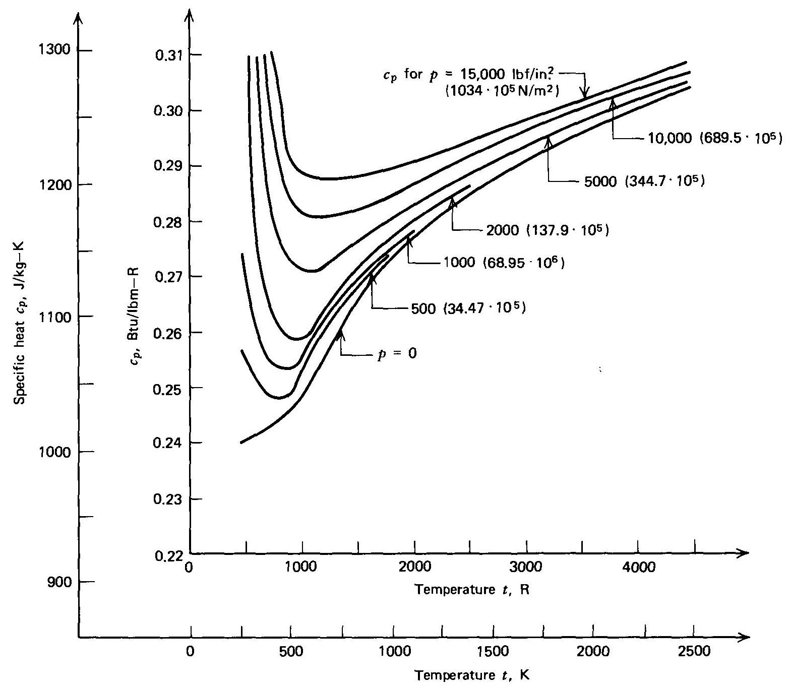
Figure 1.20 Specific heat $c_{p}$ for air as a function of temperature with pressure as a parameter (based on Reference 16).

Figure 1.21 presents the specific heat ratio $\gamma$ for air as a function of $t$, with the pressure $p$ as a parameter. The curves show, as one would expect, that the effect of pressure on $\gamma$ is significant only at low temperatures.

Because of the relatively small influence of pressure on $c_{p}$ for air, it is generally assumed that the instantaneous values of $c_{p}$ are defined by the curve for zero pressure ( $p=0$ ). Moreover, that conclusion is reasonably correct for most gases. Conse-

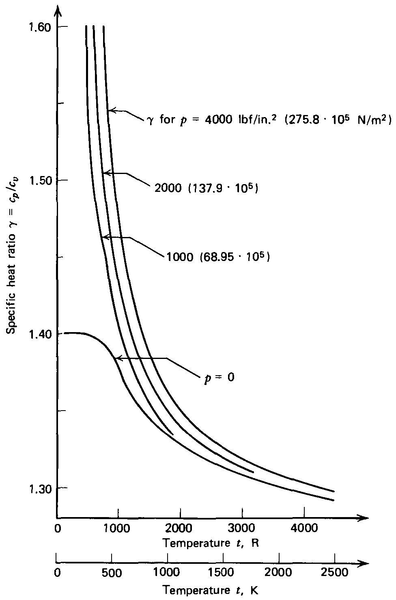
Figure 1.21 Specific heat ratio $\gamma$ for air as a function of temperature with pressure as a parameter (based on Reference 16).

quently, the equations for correlating the experimental data on $c_{p}$ and $\gamma$ for gases assume quite generally that $c_{p}$ is a function of the gas temperature alone. ${ }^{18-20}$

Several equations have been proposed for correlating the empirical $c_{p}$ data for different gases as functions of the gas temperature $t$. Equations having polynomial, and also exponential, forms are available. The correlating equations presented in this book are based on polynomials of the following form:

$$
c_{p}=\left(a+b t+c t^{2}+d t^{3}+e t^{4}\right) R
$$

where $c_{p}$ has the same units as $R$. Table 1.6 presents values of the coefficients $a, b, \ldots$ for several pure gases. ${ }^{21}$ The specific heat data in Reference 21 were obtained by a least squares curve fit of the data in Reference 20. The curve fits were obtained for two adjoining temperature intervals, the low temperature interval extending from 300 to 1000 K , and the high temperature interval extending from 1000 to 5000 K . The data are constrained to be equal at 1000 K . Curve fits for 483 substances are presented in Reference 21. Also presented in Table 1.6 are values of the properties $h_{o}$ and $\phi_{o}$, which are defined by equations 1.160 and 1.166 , respectively.

Table 1.6 Values of the Coefficients in the Equation for the Specific Heat at Constant Pressure $c_{p}$ for Several Gases
| $c_{p}=\left(a+b t+c t^{2}+d t^{3}+e t^{4}\right) R, t$ is in $\mathrm{K}, c_{p}$ has the units of $R$ |  |  |  |  |  |  |  |  |
| :--- | :--- | :--- | :--- | :--- | :--- | :--- | :--- | :--- |
| Gas | $a$ | $b \cdot 10^{3}$ | $c \cdot 10^{6}$ | $d \cdot 10^{9}$ | $e \cdot 10^{12}$ | $h_{o} \cdot 10^{-3}$ | $\phi_{o}$ | Temperature Range, K |
| $\mathrm{O}_{2}$ | 3.62560 | -1.87822 | 7.05545 | -6.76351 | 2.15560 | -1.04752 | 4.30528 | 300-1000 |
|  | 3.62195 | 0.736183 | -0.196522 | 0.0362016 | -0.00289456 | -1.20198 | 3.61510 | 1000-5000 |
| $\mathrm{N}_{2}$ | 3.67483 | -1.20815 | 2.32401 | -0.632176 | -0.225773 | -1.06116 | 2.35804 | 300-1000 |
|  | 2.89632 | 1.51549 | -0.572353 | 0.0998074 | -0.00652236 | -0.905862 | 6.16151 | 1000-5000 |
| CO | 3.71009 | -1.61910 | 3.69236 | -2.03197 | 0.239533 | -14.3563 | 2.95554 | 300-1000 |
|  | 2.98407 | 1.48914 | -0.578997 | 0.103646 | -0.00693536 | -14.2452 | 6.34792 | 1000-5000 |
| $\mathrm{CO}_{2}$ | 2.40078 | 8.73510 | -6.60709 | 2.00219 | 0.000632740 | -48.3775 | 9.69515 | 300-1000 |
|  | 4.46080 | 3.09817 | -1.23926 | 0.227413 | -0.0155260 | -48.9614 | -0.986360 | 1000-5000 |
| A | 2.50000 |  |  |  |  | -0.745375 | 4.36600 | 300-1000 |
|  | 2.50000 |  |  |  |  | -0.745375 | 4.36600 | 1000-5000 |
| $\mathrm{H}_{2}$ | 3.05745 | 2.67652 | -5.80992 | 5.52104 | -1.81227 | -0.988905 | -2.29971 | 300-1000 |
|  | 3.10019 | 0.511195 | 0.0526442 | -0.0349100 | 0.00369453 | -0.877380 | -1.96294 | 1000-5000 |
| $\mathrm{H}_{2} \mathrm{O}$ | 4.07013 | -1.10845 | 4.15212 | -2.96374 | 0.807021 | -30.2797 | -0.322700 | 300-1000 |
|  | 2.71676 | 2.94514 | -0.802243 | 0.102267 | -0.00484721 | -29.9058 | 6.63057 | 1000-5000 |
| $\mathrm{CH}_{4}$ | 3.82619 | -3.97946 | 24.5583 | -22.7329 | 6.96270 | -10.1450 | 0.866901 | 300-1000 |
|  | 1.50271 | 10.4168 | -3.91815 | 0.677779 | -0.0442837 | -9.97871 | 10.7071 | 1000-5000 |
| $\mathrm{C}_{2} \mathrm{H}_{4}$ | 1.42568 | 11.3831 | 7.98900 | -16.2537 | 6.74913 | 5.33708 | 14.6218 | 300-1000 |
|  | 3.45522 | 11.4918 | -4.36518 | 0.761551 | -0.0501232 | 4.47731 | 2.69879 | 1000-5000 |


Example 1.7. Consider the composition of dry air, by volume, to be that tabulated below.

| Species | Chemical <br> Formula | Molecular <br> Weight | Composition, <br> Percent by Volume |
| :--- | :---: | :---: | :---: |
| Nitrogen | $\mathrm{N}_{2}$ | 28.016 | 78.11 |
| Oxygen | $\mathrm{O}_{2}$ | 32.000 | 20.96 |
| Argon | A | 39.94 | 0.93 |

Employ the specific heat data presented in Table 1.6 and determine the specific heat at constant pressure of air as a function of temperature.

## Solution

For air, equation 1.144 on a molar basis, gives

$$
\bar{c}_{p}=\sum_{i=1}^{3} X_{i} \bar{c}_{p i}=X_{\mathrm{N}_{2}} \bar{c}_{p, \mathrm{~N}_{2}}+X_{\mathrm{O}_{2}} \bar{c}_{p, \mathrm{O}_{2}}+X_{\mathrm{A}} \bar{c}_{p, \mathrm{~A}}
$$

Introducing the values presented in Table 1.6 yields

| Gas | $X_{i} a_{i}$ | $X_{i} b_{i} \cdot 10^{3}$ | $X_{i} c_{i} \cdot 10^{6}$ | $X_{i} d_{i} \cdot 10^{9}$ | $X_{i} e_{i} \cdot 10^{12}$ | Temperature Range, K |
| :--- | :--- | :--- | :--- | :--- | :--- | :--- |
| $\mathrm{N}_{2}$ | 2.87041 | -0.943686 | 1.81528 | -0.493793 | -0.176351 | 300-1000 |
| $\mathrm{O}_{2}$ | 0.759926 | -0.393675 | 1.47882 | -1.41763 | 0.451813 | 300-1000 |
| A | 0.023250 |  |  |  |  | 300-1000 |
| Air | 3.65359 | -1.33736 | 3.29421 | -1.91142 | 0.275462 | 300-1000 |
| $\mathrm{N}_{2}$ | 2.26232 | 1.18375 | -0.447065 | 0.0779596 | -0.00509462 | 1000-5000 |
| $\mathrm{O}_{2}$ | 0.759161 | 0.154304 | -0.041191 | 0.00758786 | -0.00060670 | 1000-5000 |
| A | 0.023250 |  |  |  |  | 1000-5000 |
| Air | 3.04473 | 1.33805 | -0.488256 | 0.0855475 | -0.00570132 | 1000-5000 |

From the above table, in the range 300 to 1000 K

$$
\bar{c}_{p}=\left(3.65359-\frac{1.33736 t}{10^{3}}+\frac{3.29421 t^{2}}{10^{6}}-\frac{1.91142 t^{3}}{10^{9}}+\frac{0.275462 t^{4}}{10^{12}}\right) \bar{R}
$$

and in the range 1000 to 5000 K

$$
\bar{c}_{p}=\left(3.04473+\frac{1.33805 t}{10^{3}}-\frac{0.488256 t^{2}}{10^{6}}+\frac{0.0855475 t^{3}}{10^{9}}-\frac{0.00570132 t^{4}}{10^{12}}\right) \bar{R}
$$

where, in both equations, $t$ is in K . The units of $\bar{R}$ determine the units of $\bar{c}_{p}$. On a unit mass basis, $c_{p}=\bar{c}_{p} / \bar{m}$. Values of $\bar{R}$ in different units are presented on the inside cover of this book.

## 1-16(b) Gas Tables

For making the thermodynamic analyses pertinent to high-temperature gas dynamic processes, the equations for the specific heats of gases presented in Table 1.6 are too cumbersome for general use. Considerable labor is saved by employing tabulated values of the pertinent thermodynamic properties of the gases, as is done for air in Table C.4.

It is shown in Sections 1-15(b) and 1-15(d) that for a thermally perfect gas $d u= c_{v} d t$ and $d h=c_{p} d t$. Consequently, the values of $u$ and $h$ for a real gas may be tabulated as functions of temperature if the instantaneous values of $c_{v}$ and $c_{p}$ are employed in calculating $u$ and $h$. Substituting equation 1.158 into equation 1.115 gives

$$
h=h_{o} R+\int_{t_{o}}^{t}\left(a+b t+c t^{2}+d t^{3}+e t^{4}\right) R d t
$$

where $h=h_{o} R$ at $t=t_{o}$. Values of $h_{o}$, including the energy of formation [see Section 14-3(a)], are presented in Table 1.6. Integrating equation 1.159 yields

$$
h=\left(h_{o}+a t+\frac{b t^{2}}{2}+\frac{c t^{3}}{3}+\frac{d t^{4}}{4}+\frac{e t^{5}}{5}\right) R
$$

From equations 1.53 and 1.99, we obtain

$$
u=h-p v=h-R t
$$

When the values of $h_{o}, a, b$, etc., presented in Table 1.6 are substituted into equations 1.160 and 1.161, $h$ and $u$ are determinable. Table C. 4 presents the values of $u$ and $h$, accounting for variable $c_{v}$ and $c_{p}$, for air at one atmosphere pressure as a function of temperature. Tables for several other gases are presented in Reference 22.

The entropy change $d s$ for a perfect gas is given by equation 1.119 and is repeated here for convenience. Thus,

$$
d s=c_{p} \frac{d t}{t}-R \frac{d p}{p}
$$

Equation 1.162 may be applied to a real gas by expressing $c_{p}$ as a function of temperature. It is apparent from equation 1.162 that the entropy of a gas depends on both its temperature and its pressure. Consequently, the compilation of a table of entropy values requires calculating them at different temperatures for several values of constant pressure. If $t_{o}$ and $p_{o}$ are the base temperature and pressure, respectively, for the entropy table, where $s=0$, then

$$
s \cdot=\int_{t_{o}}^{t} c_{p} \frac{d t}{t}-R \ln \frac{p}{p_{o}}=\phi-R \ln \frac{p}{p_{o}}
$$

where $s_{o}=0$ and the parameter $\phi$ is defined by

$$
\phi \equiv \int_{t_{o}}^{t} c_{p} \frac{d t}{t}
$$

and is a function only of the gas temperature. Substituting equation 1.158 into equation 1.164 gives

$$
\phi=\phi_{o} R+\int_{t_{o}}^{t}\left(\frac{a}{t}+b+c t+d t^{2}+e t^{3}\right) R d t
$$

Integrating equation 1.165 yields

$$
\phi=\left(\phi_{o}+a \ln t+b t+\frac{c t^{2}}{2}+\frac{d t^{3}}{3}+\frac{e t^{4}}{4}\right) R
$$

where $\phi=\phi_{o} R$ at $t=t_{o}$. Values of $\phi_{o}$ are presented in Table 1.6. Table C. 4 presents values of $\phi$ for air.

A change in entropy is calculated from the tabulated values of $\phi$ by means of equation 1.163 . Thus,

$$
s_{2}-s_{1}=\phi_{2}-\phi_{1}-R \ln \left(\frac{p_{2}}{p_{1}}\right)
$$

For an isentropic process $(d s=0)$, equation 1.162 reduces to

$$
\frac{d p}{p}=\frac{c_{p}}{R} \frac{d t}{t}
$$

Employing the subscript $o$ to denote the base condition for the table, then, for an isentropic process,

$$
\ln \left(\frac{p}{p_{o}}\right)=\ln p_{r}=\frac{1}{R} \int_{t_{o}}^{t} c_{p} \frac{d t}{t}=\frac{\phi}{R}
$$

The pressure ratio $p_{r}=p / p_{o}$ is termed the relative pressure and is seen to be a singlevalued function of the temperature $t$. Solving equation 1.169 for $p_{r}$ gives

$$
p_{r}=e^{\phi / R}
$$

For an isentropic change of state between the temperatures $t_{1}$ and $t_{2}$, the pressure ratio $p_{2} / p_{1}$ is given by

$$
\frac{p_{2}}{p_{1}}=\frac{\left(p_{2} / p_{o}\right)}{\left(p_{1} / p_{o}\right)}=\frac{p_{r 2}}{p_{r 1}}
$$

Thus, only the ratios of the relative pressures are of significance. Hence, equation 1.170 may be written as

$$
p_{r}=\frac{e^{\phi / R}}{\left(p_{r}\right)_{\mathrm{ref}}}=e^{\left(\phi-\phi_{\mathrm{ref}}\right) / R}
$$

where $\left(p_{r}\right)_{\text {ref }}$ is chosen so that a convenient range of $p_{r}$ is obtained in the table. Values of $p_{r}$ for air are presented in Table C.4, where $\left(p_{r}\right)_{\mathrm{ref}}$ is defined at $t=298.15 \mathrm{~K}$.

The relative volume $v_{r}$ is defined as

$$
v_{r}=\frac{v}{v_{o}}=\frac{p_{o}}{p} \frac{t}{t_{o}}=\frac{1}{p_{r}} \frac{t}{t_{o}}
$$

The relative volume $v_{r}$ is a single-valued function of the temperature $t$. For an isentropic change of state,

$$
\frac{v_{2}}{v_{1}}=\frac{\left(v_{2} / v_{o}\right)}{\left(v_{1} / v_{o}\right)}=\frac{v_{r 2}}{v_{r 1}}
$$

Thus, only the ratios of the relative volumes are of significance. Hence, equation 1.173 may be rewritten as

$$
v_{r}=\frac{R t}{p_{r}}
$$

Equation 1.175 was employed by Keenan and Kaye. ${ }^{22}$ The above definition of $v_{r}$ satisfies equation 1.173 except for a constant, which is acceptable for use in equation 1.174. Coincidentally, it has the feature that $v_{r}$ is the specific volume when $p_{r}$ is the pressure.

Table C. 4 presents the thermodynamic properties of air in SI units and also in EE units.

From equation 1.110,

$$
c_{v}=c_{p}-R
$$

The specific heat ratio $\gamma$ is defined as

$$
\gamma=\frac{c_{p}}{c_{v}}
$$

For a perfect gas, the speed of sound is given by equation 1.181. Thus,

$$
a=(\gamma R t)^{1 / 2}
$$

Values of $c_{p}, c_{v}, \gamma$, and $a$ for air are tabulated as functions of temperature in Table C.4.
A FORTRAN computer program is presented below for determining the thermodynamic properties of a thermally perfect gas with variable specific heats, based on the equations developed in this section. The program has the capability of considering a mixture of such gases consisting of up to nine species. The input variables are presented in Table 1.7. Values of $h_{o}$ and $\phi_{o}$ from Reference 21 are presented in Table
1.6. Table 1.8 presents the input data deck that was employed in the calculations for Table C.4. The first card in the data deck is employed for identifying information and may contain up to 54 characters. The table may have up to 15 different temperature increments, as specified by the variables $\mathrm{M}(\mathrm{J})$ and $\mathrm{DT}(\mathrm{J}), \mathrm{J}=1, \ldots, 15$, where $\mathrm{M}(\mathrm{J})$ specifies the number of entries in each section of the table and DT(J) specifies the corresponding temperature increment.

Table 1.7 Input Variables for the Thermodynamic Properties Program
| NX | Number of species, 1 to 9. |
| :--- | :--- |
| X(J) | Mole fractions of up to nine species. |
| W(J) | Molecular weights of up to nine species. |
| IUNITS | $=1$ specifies EE units, = 2 specifies modified SI units employing calories instead of Joules, and $=3$ specifies SI units. |
| MASS | $=1$ specifies mass basis, $=2$ specifies molar basis. |
| M(J) | Number of temperature entries for each temperature increment, up to 15 . |
| DT(J) | Temperature increments, $\mathbf{K}$ or $\mathbf{R}$, up to 15 . |
| TI | Initial temperature, K or R. |
| TM | Temperature at which the two $\bar{c}_{p}$ curve fits meet, K . |
| A(I,J,K) | Coefficients in equation 1.158. $I=1, \ldots, 5$ denotes the coefficients $a, b$, etc., $\mathrm{J}=1, \ldots, 9$ denotes up to nine species, and $\mathrm{K}=1,2$ denotes the low and high temperature range, respectively. Values of $\mathrm{A}(\mathrm{I}, \mathrm{J}, \mathrm{K})$ must be compatible with $t$ in K . |
| HI(J,K) | Value of $h_{0}$ in equation 1.160. J denotes the species, and K denotes the temperature range. |
| SI(J,K) | Value of $\phi_{0}$ in equation 1.166. $\mathbf{J}$ denotes the species, and $\mathbf{K}$ denotes the temperature range. |
| HBASE | The reference value of $h$ corresponding to $t_{\text {ref }}$. |


Table 1.8 Input data deck for Table C. 4

```
AIR (K, KJ, KG, M, S)
$DATA NX=4, IUNITS=3, MASS=1, TI=50,0, TM=1000.0, TREF=277,77778,
HBASE=279.0158,
M(1)=191, 100, 20, 0, DT(1)=5.0, 10.0, 50,0,
A(1,1,1)=3.67483E+00, -1.20815E-03, 2.32401E-06, -6.32176E-10, -2.25773E-13,
A(1,1,2)=2.89632E+00, 1.51549E-03, -5.72353E-07, 9.98074E-11, -6.52236E-15,
A(1,2,1)=3.62560E+00,-1.87A22E-03, 7.05545E-06, -6,76351E-09, 2.15560E-12,
A(1,2,2)=3,62195E+00, 7.36183E-04, -1.96522E-07, 3.62016E-11, -2.89456E-15,
A(1,3,1)=2,50000E+00, 0.00000E+00, 0.00000E+00, 0.00000E+00, 0.00000E+00,
A(1,3,2)=2.50000E+00, 0.00000E+00, 0.00000E+00, 0.00000E+00, 0.00000E+00,
A(1,4,1)=2,4007BE+00, 8.73510E-03, -6.60709E-06, 2.00219E-09, 6.32740E-16,
A(1,4,2)=4,46080E+00, 3.09B17E-03, -1.23926E-06, 2.27413E-10, -1.55260E-14,
HI(1,1)=-1.06116E+03, HI(1,2)=-9.05862E+02,
HI(2,1)=-1.04752E+03.
HI(3,1)=-7.45375E+02, HI(3,2)=-7,45375E+02,
HI(4,1)=-4.83775E+04, HI(4,2)=-4.89614E+04,
SI(1,1)=2.35804E+00, SI(1,2)=6.16151E+00, X(1)=0.780863,W(1)=28.016,
SI(2.1)=4.30528E+00, SI(2.2)=3.61510E+00, X(2)=0.209482, W(2)=32.000,
SI(3,1)=4.36600E+00, SI(3,2)=4.36600E+00, X(3)=0.009340, W(3)=39.950,
SI(4,1)=9.69515E+00, SI(4,2)=-9.86360E-01, X(4)=0.000314,W(4)=44.010 s
```

A modified version of subroutine THERMO for the calculation of $\bar{c}_{p}, \bar{h}$, and $\bar{\phi}$, on a molar basis, in both SI and EE units, is presented in Section 14-3. Table D.1, Volume 2, presents the values of $\bar{c}_{p}, \bar{h}$, and $\bar{\phi}$ for 13 substances, calculated by the modified version of subroutine THERMO.

Example 1.8. Air is compressed from 1 atm pressure and 300 K to 3 atm pressure. Calculate the compression work (a) if the compression is isentropic, and (b) if the isentropic compression efficiency $\eta_{c}=0.80$. (c) Calculate the entropy change corresponding to part b. Assume $R=287.04 \mathrm{~J} / \mathrm{kg}-\mathrm{K}$.

```
        SUBROUTINE THERMO
C THERMODYNAMIC PROPERTY DATA FOR A THERMALLY PERFECT GAS
        DIMENSION A(5,9,2),HI(9,2),SI(9,2),X(9),W(9),GAS(9),M(15),DT(15)
        NAMELIST /DATA/NX,X,W,TUNITS,MASS,TI,TM,TKEF,M,DT,A,HI,SI,HBASE
        CPF(J,K)=X(J)*(A(1,J,K)+A(2,J,K)*T+A(3,J,K)*T**2+A(4,J,K)*T**3+
    1A(5,J,K)*T**4)*R
        HF(J,K)=X(J)*(HI(J,K)+A(1,J,K)*T+A(2,J,K)*T**2/2,0+A(3,J,K)*T**3/
    13.0+A(4.J.K)*T**4/4.0+A(b.J.K)*T**5/5.0)*R*GT
        SF(J,K)=X(J)*(SI(J,K)+A(1,J,K)*ALOG(T)+A(2,J,K)*T+A(3,J,K)*T**2/
    12.0+A(4,J,K)*T**3/3.0+A(5,J,K)*T**4/4,0)*R
C READ INPUT DATA AND INITIALIZE PARAMETERS
    10 READ (5.1000) GAS $ WRITE (6.2000) GAS $ READ (5.DATA) $ WW=0.0
        CPREF=0.0 $ HREF=0.0 $ SREF=0.0 $ DO 20 J=1.NX $ WW=WW+X(J)*W(J)
    20 CONTINUE $ IF (MASS.EQ.1) GM =WW $ IF (MASS.EQ.2) GM =1.0
        II=TI-DT(1) $A=1 $L=0 $N=1 $GD=1.0 $GT=1.8 $GO TO(30,40,40),IUNITS
    30 R=1.98586/GM $ GC=32.174 $ GJ=778.16 $ GL=144.0 $ GO TO 60
    40 R=8.31434/GM $ GC=1.0 $ GU=1000.0 $ GL=1.0 $ GT=1.0 $ GD=1.0
        IF (IUNITS.EG.3) GO TO 60 $ R=R/4.184 $ GJ=GU*4.184
    60 DO 70 J=1.NX $ T=298.15 $ CPREF=CPREF+CPF(J,K) $ SREF=SREF+SF(J,K)
        HI(J,1)=HI(J,1)+(0.0-HF(J,1))/(X(J)*R*GT) $ T=1000.0
        HI(U,2)=HI(U,2)+(HF(J,1)-HF(U,2))/(X(J)*R*GT)
        T=TREF/GT $ HREF=HREF+HF(J,K)
    7O CONTINUE $ DELH=(HREF-HBASE)/GD
C CALCULATE THEKMOUYNAMIC PROPERTIES
    SO NT=M(N) $ DO 100 I=1.NT $ T=(YI+FLOAT(I)*UT(N))/GT $ CP=0.0 $H=0.0
        S = 0.0 $ IF (T.GT.TM) K=2 $ LO 90 J=1,NX $ CP=CP+CPF(J,K)
        H=H+HF(J,K)/GU $ IF (T.NE.0.0) S=S+SF(J,K)
    90 CONTINUE $ T=T*GT $ H=H-DELH $ U=H-R*T/GD $ P=EXP((S-SREF)/R)
        V=GU*R*T/P/GL $CV=CP-R $G=CP/CV $ C=SQRT(G*GC*R*T*GJ*GM/WW) $L=L+1
        WRITE (6.2010) T.H.U.S.P.V.CP.CV.G.C $ IF (L.LT.55) GO TO 100
        WRITE (6.2000) GAS $ L=0
    100 CONTINUE $ N=N+1 S TI=T $ IF((N.EQ.15).OR.(M(N).EQ.O)) GO TO 10
        GO TO 80
1000 FORMAT (9A6)
2000 FORMAT (1H1,25X,28HTHERMODYNAMIC PROPERTIES OF ,9A6//8X,1HT,7X,
        11HH,9X,1HU,8X,1HS,9X,2HPR,9X,2HVR,8X,2HCP,6X,2HCV,7X,1HG,9X,
        21HA/1H )
2010 FORMAT (F10.0,2F10.3,F9.4,E15.5,E13.5,F7.4,F8.4,F9.4,F10.2)
        END
```


## Solution

(a) From Table C.4, for $t_{1}=300 \mathrm{~K}, h_{1}=301.329 \mathrm{~kJ} / \mathrm{kg}, p_{r 1}=1.0219$, and $\phi_{1}= 6.7035 \mathrm{~kJ} / \mathrm{kg}-\mathrm{K}$. Thus,

$$
p_{r 2}=3 p_{r 1}=3(1.0219)=3.0657
$$

Entering Table C. 4 at $p_{r 2}=3.0657$, we obtain

$$
\begin{aligned}
t_{2}^{\prime} & =410.12 \mathrm{~K} \quad h_{2}^{\prime}=412.418 \mathrm{~kJ} / \mathrm{kg} \\
\Delta h_{c}^{\prime} & =h_{2}^{\prime}-h_{1}=412.418-301.329=111.089 \mathrm{~kJ} / \mathrm{kg}(47.760 \mathrm{Btu} / \mathrm{lbm})
\end{aligned}
$$

(b) For an isentropic compression efficiency $\eta_{\mathrm{c}}=0.8$

$$
\Delta h_{c}=\frac{\Delta h_{c}^{\prime}}{\eta_{c}}=\frac{111.089}{0.8}=138.861 \mathrm{~kJ} / \mathrm{kg}(59.700 \mathrm{Btu} / \mathrm{lbm})
$$

Hence,

$$
h_{2}=h_{1}+\Delta h_{c}=301.329+138.861=440.190 \mathrm{~kJ} / \mathrm{kg}
$$

Entering Table C. 4 at $h_{2}=440.190 \mathrm{~kJ} / \mathrm{kg}$, gives $t_{2}=437.43 \mathrm{~K}$.
(c) From equation 1.167,

$$
\Delta s=\phi_{2}-\phi_{1}-R \ln \frac{p_{2}}{p_{1}}
$$

From Table C.4, for $t_{2}=437.43 \mathrm{~K}, \phi_{2}=7.0844 \mathrm{~kJ} / \mathrm{kg}-\mathrm{K}$. Hence,

$$
\Delta s=(7.0844-6.7035)-0.28704 \ln (3.0)=0.0655 \mathrm{~kJ} / \mathrm{kg}-\mathrm{K}(0.01564 \mathrm{Btu} / \mathrm{lbm}-\mathrm{R})
$$

The entropy change may also be computed from the values of $\phi_{2}$ and $\phi_{2}^{\prime}$, the latter being the value of $\phi$ for an isentropic change of state. From part $\mathrm{c}, t_{2}=437.43 \mathrm{~K}$ and $\phi_{2}=7.0844 \mathrm{~kJ} / \mathrm{kg}-\mathrm{K}$. From part a, for the isentropic compression, $t_{2}^{\prime}=410.12 \mathrm{~K}$, and from Table C.4, $\phi_{2}^{\prime}=7.0189 \mathrm{~kJ} / \mathrm{kg}-\mathrm{K}$. Hence,

$$
\Delta s=\phi_{2}-\phi_{2}^{\prime}=7.0844-7.0189=0.0655 \mathrm{~kJ} / \mathrm{kg}-\mathrm{K}(0.01564 \mathrm{Btu} / \mathrm{lbm}-\mathrm{R})
$$

Example 1.9. Carbon dioxide is compressed isentropically from an initial pressure and temperature of 1 atm and 300 K , respectively, to a final pressure of 50 atm . Calculate the final temperature and the compression work (a) assuming that the specific heats of carbon dioxide are constant, and (b) accounting for the variation of the specific heats with temperature.

## Solution

(a) From Table C.3, $\bar{m}=44.010, c_{p}=845.73 \mathrm{~J} / \mathrm{kg}-\mathrm{K}$, and $\gamma=1.288$. From equation 1.128 ,

$$
\begin{aligned}
t_{2}^{\prime} & =t_{1}\left(\frac{p_{2}^{\prime}}{p_{1}}\right)^{(\gamma-1) / \gamma}=300\left(\frac{50}{1}\right)^{(1.288-1.0) / 1.288}=719.5 \mathrm{~K} \\
\Delta h_{c}^{\prime} & =h_{2}^{\prime}-h_{1}=c_{p}\left(t_{2}^{\prime}-t_{1}\right)=845.73(719.5-300)=354.8 \mathrm{~kJ} / \mathrm{kg}
\end{aligned}
$$

(b) From Table D.1.B, Volume 2, for $t_{1}=300 \mathrm{~K}, \bar{h}_{1}=69 \mathrm{~kJ} / \mathrm{kmol}$, and $\bar{\phi}_{1}= 213.927 \mathrm{~kJ} / \mathrm{kmol}-\mathrm{K}$. From equation 1.167, for $s_{2}-s_{1}=0$, we obtain

$$
\bar{\phi}_{2}=\bar{\phi}_{1}+\bar{R} \ln \left(\frac{p_{2}}{p_{1}}\right)=213.927+8.3143 \ln \left(\frac{50}{1}\right)=246.453 \mathrm{~kJ} / \mathrm{kmol}-\mathrm{K}
$$

From Table D.1.B, Volume 2, for $\bar{\phi}_{2}=246.453 \mathrm{~kJ} / \mathrm{kmol}-\mathrm{K}$,

$$
\begin{aligned}
t_{2}^{\prime} & =643.7 \mathrm{~K} \quad \text { and } \quad \bar{h}_{2}^{\prime}=15,029 \mathrm{~kJ} / \mathrm{kmol} \\
\Delta h_{c}^{\prime} & =\frac{\bar{h}_{2}^{\prime}-h_{1}}{\bar{m}}=\frac{15,029-69}{44.010}=339.9 \mathrm{~kJ} / \mathrm{kg}
\end{aligned}
$$

Example 1.10. A $15-\mathrm{m}^{3}$ tank contains air at $p_{1}=5.0 \cdot 10^{5} \mathrm{~N} / \mathrm{m}^{2}$ and $t_{1}=500 \mathrm{~K}$. The air is discharged into the atmosphere through a nozzle until the mass of air contained in the tank is reduced to one half of its original value. Assuming that the process is adiabatic and frictionless, calculate the pressure and temperature of the air remaining in the tank. Take into account the variation of the specific heat of air with temperature.

## Solution

The process is assumed to be isentropic. From Table C.4, for $t_{1}=500 \mathrm{~K}, v_{r 1}=23,124$ and $p_{r 1}=6.2062$. Since the final mass of the gas in the tank is one half of the original mass, the final specific volume $v_{2}=2 v_{1}$. Hence,

$$
v_{r 2}=2 v_{r 1}=2(23,124)=46,248
$$

From Table C.4, for $v_{r 2}=46,248, p_{r 2}=2.3655$ and $t_{2}=381.05 \mathrm{~K}(685.9 \mathrm{R})$. Hence, the final pressure $p_{2}$ is:

$$
p_{2}=p_{1}\left(\frac{p_{r 2}}{p_{r 1}}\right)=5.0 \cdot 10^{5}\left(\frac{2.3655}{6.2062}\right)=1.9058 \cdot 10^{5} \mathrm{~N} / \mathrm{m}^{2}\left(27.64 \mathrm{lbf} / \mathrm{in} .^{2}\right)
$$

## 1-17 THE ACOUSTIC SPEED AND THE MACH NUMBER

For a compressible flow, the speed of propagation of small disturbances, called the acoustic speed, and the ratio of the flow velocity to the acoustic speed, called the Mach number, are important properties of the flow process. Those properties are defined and discussed in this section.

## 1-17(a) The Acoustic Speed

The acoustic speed, also called the sonic speed, is the speed with which a sound wave, or a small pressure disturbance, is propagated in a fluid medium. When the fluid may be considered to be a continuum, it can be shown (see any text on elementary physics) that the acoustic speed, denoted by $a$, is given by

$$
a=\left(\frac{\mathrm{K}_{s}}{\rho}\right)^{1 / 2}
$$

where the isentropic bulk modulus $K_{s}=-v(d p / d v)_{s}$, the density $\rho=1 / v$, and $d \rho / \rho=-d v / v$. Hence, equation 1.179 may be written in the form

$$
a^{2}=\left(\frac{\partial p}{\partial \rho}\right)_{s}
$$

It is pointed out in Section 1-5(d) that, if a fluid is compressible, the magnitude of $K$ will depend on the manner in which the compression is executed. If the attention is focused on the main body of compressible fluid, the fluid external to the boundary layer, and the fluid is assumed to be a perfect gas, and if the compression process is isentropic, then $K_{s}=\gamma p$ where $\gamma=c_{p} / c_{v}$. Introducing $K_{s}=\gamma p$ into equation 1.179 gives the following expression for the acoustic speed in a perfect gas. Thus

$$
a=\left(\frac{\gamma p}{\rho}\right)^{1 / 2}=(\gamma p v)^{1 / 2}=(\gamma R t)^{1 / 2}
$$

The speed at which a sound wave or small pressure disturbance travels in a fluid depends on its wave length. The pressure wave creates a disturbance in the fluid that imparts directional energy to the fluid particles in the immediate vicinity of the disturbance. By colliding with the contiguous particles, the energized particles impart directional energy to them and, by that process, the disturbance is propagated throughout the body of fluid. Briefly, the collisions between the fluid particles constitute the mechanism by which the pressure wave propagates itself and gives direction to the motion of the fluid particles. Since the speed of propagation of a small pressure disturbance (sound wave) is of the same order of magnitude as the mean translational speed of the fluid particles, the transmission of a small pressure disturbance is influenced by the molecular density of the fluid.

If the molecular density is large, so that the mean free path of the molecules is very small, a small pressure disturbance is propagated in the medium with small energy loss. The foregoing would apply to the propagation of a disturbance in air at standard sea level, for example, where $1 \mathrm{~m}^{3}$ of standard sea-level air contains $2.705 \cdot 10^{24}$ molecules and the corresponding value for the molecular mean free path is $7.37 \cdot 10^{-8} \mathrm{~m}$. At increasing altitudes, the molecular density of atmospheric air decreases and, at extreme altitudes, as for example in the ionosphere, it is vanishingly small.

At the high altitudes where the molecular density is very small, the molecular mean free path may be so large that it is equal to or longer than the wave length of the sound wave. If that is the case, a large number of air molecules can move, in a distance equal to 1 wavelength, from the high-pressure region of the sound wave to its lowpressure region without colliding with other particles. Because the temperatures and pressures in the high- and low-pressure regions of a wave are different, the transport of molecules from a high-pressure region of the wave to a low-pressure region without collisions tends to equalize the pressures and temperatures in the wave. The net effect is a dissipation of the energy of the wave, causing it to become damped. Since the length of the mean free path $\lambda$ governs the propagation of sound waves, it is the criterion that distinguishes the realm of fluid mechanics (continuum) from that of free particle flow.

The importance of the acoustic speed in the flow of compressible fluids, jet propulsion, and supersonic flight arises from the fact that the phenomena occurring when the relative velocity between a fluid and a body is large can be related to the acoustic speed. Section 3-8(b) discusses briefly the phenomena associated with the speed of propagation of small pressure disturbances in a compressible fluid. Section 3-8(a) presents a rigorous derivation of equation 1.180.

## 1-17(b) The Mach Number

Where there is a large relative speed between a body and the compressible fluid surrounding it, the compressibility of the fluid, the variation of its density with speed, influences the properties of the flow field. The ratio of the local speed of the fluid $V$, to its acoustic speed $a$, called the local Mach number $M=V / a$, is a dimensionless criterion of the flow phenomena. For a perfect gas $a=(\gamma R t)^{1 / 2}$, so that

$$
M=\frac{V}{a}=\frac{V}{(\gamma R t)^{1 / 2}}
$$

or

$$
M^{2}=\frac{V^{2}}{a^{2}}=\frac{V^{2}}{\gamma R t}=\frac{\text { directed kinetic energy }}{\text { random kinetic energy }}
$$

The physical significance of the Mach number can be readily grasped by considering equation 1.183. The velocity $V$ measures the directed motion of the gas particles, and $V^{2}$ measures the kinetic energy of the directed flow. The acoustic velocity $a$ for a given gas is proportional to $\sqrt{t}$, which is proportional to the random velocity of the gas particles (see equation 1.86). Hence, $a^{2}$ is a measure of the kinetic energy associated with the random motions of the gas molecules. Consequently, $M^{2}=V^{2} / a^{2}$, for a given set of conditions, may be regarded as a measure of the ratio of the kinetic energy of directed fluid flow to the kinetic energy of random molecular motion.

Example 1.11. A gas flows through a passage with a speed of $800 \mathrm{~m} / \mathrm{s}$. Its local static temperature is 1800 K , its specific heat ratio $\gamma=1.25$, and the gas constant $R=322.8 \mathrm{~J} / \mathrm{kg}-\mathrm{K}$. Calculate the local sonic velocity and the Mach number.

## Solution

From equation 1.181,

$$
a=(\gamma R t)^{1 / 2}=[1.25(322.8)(1800)]^{1 / 2}=852.2 \mathrm{~m} / \mathrm{s}(2796.0 \mathrm{ft} / \mathrm{sec})
$$

From equation 1.182,

$$
M=\frac{V}{a}=\frac{800}{852.2}=0.9387
$$

## 1-18 PROPERTIES OF THE ATMOSPHERE

Atmospheric air is one of the important gas mixtures pertinent to the science of gas dynamics. It is of value, therefore, to discuss some of its properties.

The atmospheric density $\rho$ is a function of both the pressure and temperature of the atmospheric air, while the viscosity depends only on the atmospheric temperature. Since the pressure and temperature of atmospheric air are, however, functions of the altitude above the surface of Earth, it has become the common practice to express the physical properties of atmospheric air as functions of the altitude rather than of its pressure and temperature. Since the pressure and temperature of the atmosphere at a given altitude change somewhat with the latitude, season, time of day, and weather, it has become necessary in the interests of standardization and convenience to adopt the so-called International Standard Atmosphere as a standard of reference. Based on that standard, which has been adopted by practically all major countries, the National Aeronautics and Space Administration (NASA) has developed a series of empirical equations for defining the temperature, pressure, and density of atmospheric air as functions of the altitude. ${ }^{23}$ Table 1.9 presents the basic characteristics of the standard atmosphere, and Table 1.10 presents its chemical composition. Table C. 5 presents the properties of the atmosphere as a function of geometric altitude. It should be noted that the reliability of the tabulated properties of the atmosphere for altitudes exceeding $20,000 \mathrm{~m}$ has not been completely established.

Table 1.9 Basic Characteristics of the Sea Level U.S. Standard Atmosphere ${ }^{23}$
|  |  | SI Units | $E E$ Units |
| :--- | :--- | :--- | :--- |
| Temperature | $t_{o}$ | 288.16 K | 59 F |
| Pressure | $p_{o}$ | $1.01325 \cdot 10^{5} \mathrm{~N} / \mathrm{m}^{2}$ | $2116.22 \mathrm{lbf} / \mathrm{ft}^{2}$ |
| Density | $\rho_{o}$ | $1.225 \mathrm{~kg} / \mathrm{m}^{3}$ | $0.076474 \mathrm{lbm} / \mathrm{ft}^{3}$ |
| Gas constant | $R$ | $287.04 \mathrm{~J} / \mathrm{kg}-\mathrm{K}$ | $53.35 \mathrm{ft}-\mathrm{lbf} / \mathrm{lbm}-\mathrm{R}$ |
| Specific heat ratio | $\gamma=c_{p} / c_{v}$ | 1.40 | 1.40 |
| Acoustic speed | $a_{o}$ | $340.29 \mathrm{~m} / \mathrm{s}$ | $1116.4 \mathrm{ft} / \mathrm{sec}$ |
| Viscosity | $\mu_{o}$ | $1.7894 \cdot 10^{-5} \mathrm{~kg} / \mathrm{m}-\mathrm{s}$ | $1.2024 \cdot 10^{-5} \mathrm{lbm} / \mathrm{ft}$-sec |
| Kinematic viscosity | $v_{o}=\mu_{o} / \rho_{o}$ | $1.4607 \cdot 10^{-5} \mathrm{~m}^{2} / \mathrm{s}$ | $1.5723 \cdot 10^{-4} \mathrm{ft}^{2} / \mathrm{sec}$ |
| Mean free path of air molecule | $\lambda_{o}$ | $6.6328 \cdot 10^{-8} \mathrm{~m}$ | $2.1761 \cdot 10^{-7} \mathrm{ft}$ |
| Molecular weight | $\bar{m}_{o}$ | 28.9644 | 28.9644 |


Table 1.10 Composition of Clean Dry Atmospheric Air Near Sea Level ${ }^{23}$
| Constituent | Percent by Volume |
| :--- | :---: |
| Nitrogen | 78.084 |
| Oxygen | 20.9476 |
| Argon | 0.934 |
| Carbon dioxide | 0.0314 |
| Hydrogen | 0.00005 |
| Neon | 0.001818 |
| Krypton | 0.000114 |
| Xenon | 0.0000087 |
| Helium | 0.000524 |
| Methane | 0.0002 |
| Nitrous oxide | 0.00005 |


For convenience the atmosphere surrounding Earth may be divided into four gaseous layers having markedly different characteristics. Each layer approximates a spherical shell of different thickness, but there is no sharply dividing bounding surface separating one layer from the next. Instead, the characteristics of one layer gradually merge into those of the next layer. The characteristics of each of the four layers are, however, distinctly different. In the order of their distances from the surface of Earth, the layers are called the troposphere, the stratosphere, the ionosphere, and the exosphere. All of the layers have the common characteristic that, as one moves farther and farther from the surface of Earth, the density of the gas in each layer continues to diminish and, at extreme altitudes, it approaches zero.

The characteristics of atmospheric air are subject to wide variations from sea level to extreme altitudes. At the lower altitudes, the frequency of molecular collisions is very large, and the air behaves as a continuum (see Section 1-4). As the altitude is increased, the mean free path increases, and the frequency of molecular collisions diminishes; and, at the extreme altitudes, the air is no longer a continuum. Consequently, a body moving through the lower regions of the atmosphere collides with a large number of air molecules, some of which rebound and collide with other molecules, and some of which are deflected into the path of the moving body to repeat the process. At altitudes above $150,000 \mathrm{~m}$, it may be assumed that the atmosphere is practically free space, signifying that in such regions there can be no aerodynamic resistance to flight, nor can there be any lift.

Analyses of the problems of high-speed flight indicate that, where the atmospheric density is substantial, the drag becomes large at very high speeds, and surface heating arises owing to frictional effects in the boundary layer. These limitations are removed if the flight is conducted at altitudes several kilometers above the surface of Earth. The propulsion engines for accomplishing such flights cannot, however, be airconsuming engines. Currently, rocket jet propulsion is the only conceivable means for conducting such flights.

## REFERENCES

1. P. W. Bridgman, Dimensional Analysis, Yale University Press, New Haven, 1922.
2. E. Buckingham, "Model Experiments and Forms of Empirical Equations," Transactions of the American Society of Mechanical Engineers, Vol. 37, 1915.
3. E. A. Mechtly, "The International System of Units," NASA SP-7012, Second Edition, National Aeronautics and Space Administration, 1973.
4. "Brief History of Measurement Systems," NBS SP 304A, National Bureau of Standards, October 1972.
5. H. Rouse, Advanced Mechanics of Fluids, Chap. 2, Wiley, New York, 1959.
6. V. L. Streeter, Handbook of Fluid Mechanics, Section 2 by A. H. Shapiro, McGraw-Hill, New York, 1961.
7. L. B. Loeb, The Nature of a Gas, Wiley, New York, 1931.
8. R. L. Sproull, Modern Physics, Wiley, New York, 1956.
9. W. G. Vincenti and C. H. Kruger, Introduction to Physical Gas Dynamics, Chap. 2, Wiley, New York, 1965.
10. J. F. Clarke and M. McChesney, The Dynamics of Real Gases, Chapter 2, Butterworths, London, 1964.
11. S. A. Schaaf and P. L. Chambre, Fundamentals of Gas Dynamics, edited by H. Emmons, pp. 687-692, Princeton University Press, Princeton, N.J., 1958.
12. J. T. R. Watson, "Viscosity of Gases in Metric Units," National Engineering Laboratory, Edinburgh, Her Majesty's Stationary Office, 1972.
13. G. N. Hatsopoulos and J. H. Keenan, Principles of General Thermodynamics, Wiley, New York, 1964.
14. L. Page, Introduction to Theoretical Physics, D. Van Nostrand, Princeton, N.J., 1959.
15. K. K. Kelly, U.S. Bureau of Mines, Bulletins 476, 1949; 477, 1950; and 584, 1960.
16. F. O. Ellenwood, N. Kulik, and N. R. Gay, "The Specific Heats of Certain Gases over Wide Ranges of Pressures and Temperatures," Bulletin 30, Cornell University Engineering Experiment Station, October 1942.
17. A. A. Vasserman, Y. Z. Kazavchinskii, and V. A. Robinovich, "Thermophysical Properties of Air and Air Components," TT70-50095, National Technical Information Service, Springfield, Va., 1970.
18. T. P. Thinh, J. L. Duran, R. S. Ramalho, and S. Kaliaguine, "Equations Improve $C_{p}^{*}$ Predictions," Hydrocarbon Processing, pp. 98-103, January 1971.
19. P. E. Liley and W. R. Gambill, "Physical and Chemical Data," Chemical Engineers Handbook, Fifth Edition, edited by R. H. Perry and C. H. Chilton, Section 3, McGraw Hill, New York, 1973.
20. D. R. Stull, et al., JANAF Thermochemical Tables, Second Edition, NSRDS-NBS 37, National Standard Reference Data Series, National Bureau of Standards, June 1971.
21. S. Gordon and B. J. McBride, "Computer Program for Calculation of Complex Chemical Equilibrium Compositions, Rocket Performance, Incident and Reflected Shocks, and Chapman-Jouguet Detonations," NASA SP-273, National Aeronautics and Space Administration, 1971.
22. J. H. Keenan and J. Kaye, Gas Tables, Wiley, New York, 1945.
23. "U.S. Standard Atmosphere, 1962," Superintendent of Documents, U.S. Government Printing Office, Washington, D.C., December 1962.

## PROBLEMS

1. The mass of a body at sea level, at the equator, is $10,000 \mathrm{~kg}$. The acceleration because of gravity at sea level is given by

$$
g_{o}=9.8066-0.0259 \cos 2 \theta \mathrm{~m} / \mathrm{s}^{2}
$$

where $\theta$ is the latitude in degrees. Calculate the weight of the body at sea level (a) at $45^{\circ}$ latitude, (b) at the North Pole.
2. Derive an equation relating the weight of a body at any altitude $z$ to its weight $W_{o}$ at sea level. Plot a curve of $g / g_{o}$, where $g$ is the local gravitational acceleration and $g_{o}$ is its sea-level value, as a function of the altitude $z$. At the equator the diameter of Earth ( $2 R$ ) is $12,756 \mathrm{~km}$.
3. Calculate the mean free path $\lambda$ for the gases considered in Table 1.3 (a) at 10 atm and 298 K , (b) at 0.1 atm and 298 K , and (c) at 1 atm and 596 K .
4. Most solid propellants for rocket motor applications contain finely powdered aluminum as a fuel additive, which results in $\mathrm{Al}_{2} \mathrm{O}_{3}$ appearing in the combustion products. At the temperatures occurring in typical solid propellant rocket motors, $\mathrm{Al}_{2} \mathrm{O}_{3}$ exists in the liquid phase as very small spherical particles. Those particles are accelerated by the drag force exerted on them by the accelerating gas. Determine whether or not rarefied gas-flow effects should be expected during the expansion process in the propulsive nozzle. Assume that the mean particle diameter $D_{p}=1$ micron ( $10^{-6} \mathrm{~m}$ ), and that the gas properties at a point near the exit of the propulsive nozzle are $V=3000 \mathrm{~m} / \mathrm{s}, p=0.35 \cdot 10^{5} \mathrm{~N} / \mathrm{m}^{2}, t=980 \mathrm{~K}, \gamma=1.30$, $R=430 \mathrm{~J} / \mathrm{kg}-\mathrm{K}$, and $\mu=3.0 \cdot 10^{-5} \mathrm{~kg}-\mathrm{m} / \mathrm{s}$. The particle velocity $V_{p}=2000 \mathrm{~m} / \mathrm{s}$.
5. A cubic meter of water originally at 293 K and a static pressure of $1.013 \cdot 10^{5} \mathrm{~N} / \mathrm{m}^{2}$ is subjected to a pressure of $4826 \cdot 10^{5} \mathrm{~N} / \mathrm{m}^{2}$. Assuming that the walls of the container are not deformed and that there is no change in the temperature of the water, calculate the final volume of the water.
6. The viscosity $\mu$, in $\mathrm{N}-\mathrm{s} / \mathrm{m}^{2}$, of air as a function of the temperature r in K is given by equation 1.30. Calculate the viscosity $\mu$ of air, in $\mathrm{N}-\mathrm{s} / \mathrm{m}^{2}$, and the kinematic viscosity $v$ of air, in $\mathrm{m}^{2} / \mathrm{s}$, as a function of the altitude $z$ for the range $z=0$ to $30,000 \mathrm{~km}$. Plot the results.
7. A variable force $F$, in N , acts on a particle moving along the curve $y=2 x$, in m . The $x$ and $y$ components of $F$ are given by

$$
X=x^{2}+2 x y \quad \text { and } \quad Y=10 x^{2}-2 y
$$

Calculate (a) the work required to move the particle from the point where $x=1 \mathrm{~m}$ to that where $x=2 \mathrm{~m}$, (b) the magnitude of $F$ at the point where $x=2 \mathrm{~m}$.
8. The circulation $\Gamma$ is the line integral of the tangential velocity along a given path. Find the circulation about the rectangle enclosed by the lines $x= \pm 2, y= \pm 1$ for a two-dimensional flow having the velocity components

$$
u=x-y \quad \text { and } \quad v=x^{2}-y
$$

where $u$ and $v$ are the components, in $\mathrm{m} / \mathrm{s}$, in the $x$ and $y$ directions, respectively, in m .
9. Calculate the circulation around a circular path of radius $R$ about the center of a free vortex ( $V R=$ constant).
10. Air is allowed to expand from an intial state $A$ (where $p_{A}=2.068 \cdot 10^{5} \mathrm{~N} / \mathrm{m}^{2}$ and $t_{A}=333 \mathrm{~K}$ ) to state $B$ (where $p_{B}=1.034 \cdot 10^{5} \mathrm{~N} / \mathrm{m}^{2}$ and $t_{B}=305 \mathrm{~K}$ ). Calculate the change in the specific entropy of the air, and show that the change in entropy is the same for (a) an isobaric process from $A$ to some intermediate state $C$ followed by an isovolumic change from $C$ to $B$, and (b) an isothermal change from $A$ to some intermediate state $D$ followed by an isentropic change from $D$ to $B$.
11. The specific heat at constant pressure of a body is determined by heating it internally with an electric coil connected to a 12 V source of electricity. When the current flowing through the coil is 2 A , the temperature of the mass of the body plus coil increases by 30 K in 2 min . If the mass of the system is 0.25 kg (includes mass of the coil) and the specific heat of the coil and the body are identical, calculate the mean specific heat of the body.
12. The specific heat of air at constant pressure, in the range 300 to 1000 K , is given by equation (b) in Example 1.7. How many joules are required to heat 5 kg of air at constant pressure from 300 K to 350 K ? (Check the answer by means of Table C.4).
13. During a process, 9000 J of heat leaves the system and enters the surroundings, which are at a temperature of 300 K . (a) If the change in the entropy of the system is $-30.0 \mathrm{~J} / \mathrm{kg}-\mathrm{K}$, is the process reversible, irreversible, or impossible? (b) If the change in the entropy of the system is $-20 \mathrm{~J} / \mathrm{kg}-\mathrm{K}$ is the process reversible, irreversible, or impossible? (c) If the change in the entropy of the system is $-40.0 \mathrm{~J} / \mathrm{kg}-\mathrm{K}$, is the process reversible, irreversible, or impossible?
14. A body with a mass of 500 kg moves so that its component velocities in the directions of the $x, y, z$ coordinate axes are $V_{x}=150 \mathrm{~m} / \mathrm{s}, V_{y}=200 \mathrm{~m} / \mathrm{s}$, and $V_{z}=250 \mathrm{~m} / \mathrm{s}$. Calculate the components of its momentum in the directions of the coordinate axes and its total momentum, in $\mathrm{kg}-\mathrm{m} / \mathrm{s}$.
15. An object with a mass of 50 kg has a velocity of $20 \mathrm{~m} / \mathrm{s}$ in the positive direction of the $y$ axis. It collides with a body having a mass of 75 kg and moving with a velocity of $30 \mathrm{~m} / \mathrm{s}$ in the negative direction of the $y$ axis. What are the velocities of the bodies after impact, assuming a perfectly elastic collision?
16. Air is compressed isentropically in a centrifugal compressor from a pressure of $1.0 \cdot 10^{5} \mathrm{~N} / \mathrm{m}^{2}$ to a pressure of $6.0 \cdot 10^{5} \mathrm{~N} / \mathrm{m}^{2}$. The initial temperature is 290.0 K . Using Table C.4, calculate (a) the change in temperature, (b) the change in internal energy, (c) the work imparted to the air, neglecting the velocity change, and (d) the average value of the specific heat $c_{p}$ for the compression process.
17. Air is expanded in an insulated cylinder equipped with a frictionless piston. The initial temperature of the air is 1400 K . The original volume is $1 / 10$ the final volume. Using Table C.4, calculate (a) the change in temperature, (b) the work removed from the gas, and (c) the pressure ratio.
18. The isentropic efficiency of the compressor of a turbojet engine is 0.86 . The pressure ratio is 5.2 and the unit is being operated at $10,000-\mathrm{m}$ altitude. (a) Calculate the work per kg for compressing the air (neglect the velocity change). (b) What is the exit temperature?
19. The isentropic efficiency of the turbine of a turbojet engine is 0.90 . The pressure ratio of the turbine is 3.0 . The inlet temperature to the turbine is 1000 K , and the unit is operated at $10,000-\mathrm{m}$ altitude. (a) Will this turbine drive the compressor and auxiliaries of the turbojet of Problem 18? (Neglect velocity change.) (b) What is the temperature of the gas leaving the turbine?
20. A gas-turbine cycle consists of an isentropic compression from 295 K and 1 atm pressure to 5 atm pressure, an isobaric heating from the compressor outlet conditions to 1000 K , and an isentropic expansion to atmospheric pressure. Use Table C.4, and calculate (a) the compressor work, in $\mathrm{J} / \mathrm{kg}$, (b) the heat added in isobaric heating, in $\mathrm{J} / \mathrm{kg}$, (c) the turbine work, in $\mathrm{J} / \mathrm{kg}$, (d) the net work (turbine work - compressor work), (e) the thermal efficiency (net work/heat added). (f) Compare the answer of part e with the thermal efficiency calculated assuming $c_{p}=1.0043 \mathrm{~J} / \mathrm{kg}-\mathrm{K}$ and $\gamma=1.4$ throughout the cycle.
21. Calculate the enthalpy change for a compressor with an isentropic efficiency of 0.83 , a pressure ratio of 5.2, and an inlet temperature of 265 K (a) by using Table C.4, and (b) by using $c_{p}= 1.0036 \mathrm{~J} / \mathrm{kg}-\mathrm{K}$ and $\gamma=1.40$.
22. Calculate the enthalpy change for a turbine operating on heated air with an isentropic efficiency of 0.88 , a pressure ratio of 2.3 , and an inlet temperature of 1090 K (a) by using Table C.4, (b) by using $c_{p}$ and $\gamma$ at 1090 K from Table C.4, and (c) by using an average value of $c_{p}$ and $\gamma$ from Table C.4.
23. An airplane is flying at an altitude of $10,000 \mathrm{~m}$ at a velocity of $270 \mathrm{~km} / \mathrm{hr}$. Calculate the Mach number of the airplane relative to the air.
24. Example A. 1 in Appendix A illustrates the determination of a second-order interpolating polynomial for $c_{p}$ versus $t$ for $\mathrm{N}_{2}$ in the temperature range 1000 to 5000 K . Determine the corresponding equations for (a) $\mathrm{N}_{2}$ from 300 to 1000 K , (b) $\mathrm{O}_{2}$ from 300 to 1000 K , and (c) $\mathrm{O}_{2}$ from 1000 to 5000 K .
25. In illustrative Example 1.7, two fourth-order interpolating polynomials for $c_{p}$ versus $t$ for air for the temperature ranges 300 to 1000 K and 1000 to 5000 K are determined. Determine two second-order interpolating polynomials for air for the aforementioned temperature ranges, employing the results obtained in Problem 24.


[^0]:    * Tables labeled C.1, C.2, etc., are in Appendix C.

[^1]:    * $t_{c r}$ is the temperature above which a gas cannot be liquefied no matter how large a pressure is applied;
    $p_{c r}$ is the minimum pressure for liquefying a gas at the temperature $t_{c r}$.

