## 2 <br> governing equations for compressible fluid flow

2-1 PRINCIPAL NOTATION FOR CHAPTER 2 ..... 70
2-2 INTRODUCTION ..... 72
2-3 MATHEMATICAL DESCRIPTION OF A CONTINUUM ..... 73
(a) System, control volume, and control surface ..... 73
(b) Extensive and intensive properties ..... 74
(c) The property field ..... 75
(d) The system or Lagrangian approach ..... 75
(e) The control volume or Eulerian approach ..... 76
(f) The substantial derivative ..... 77
2-4 RELATIONSHIP BETWEEN THE SYSTEM AND THE CONTROL VOLUME APPROACHES ..... 79
2-5 CONSERVATION OF MASS ..... 84
2-6 NEWTON'S SECOND LAW OF MOTION ..... 87
(a) The net external force acting on a body of fluid ..... 88
(b) The momentum equation for a control volume ..... 89
(c) Differential form of the momentum equation ..... 89
2-7 THE FIRST LAW OF THERMODYNAMICS ..... 92
(a) Heat transfer to a control volume ..... 94
(b) Work done by a control volume ..... 94
(c) The energy equation for a control volume ..... 95
(d) Differential form of the energy equation ..... 96
2-8 THE SECOND LAW OF THERMODYNAMICS ..... 98
2-9 SUMMARY ..... 99
2-1 PRINCIPAL NOTATION FOR CHAPTER 2

B vector body force per unit mass.
dA vector differential area.
$e \quad$ specific stored energy.
$E$ total stored energy of a system.

F vector force.
$g$ acceleration caused by gravity.
$h$ specific enthalpy.
$\mathbf{i , j , k}$ unit vectors in $x, y$, and $z$ directions, respectively.
$m$ mass of a system.
$\dot{m}$ mass rate of flow.
M vector momentum of a system.
$n$ general intensive property.
$\mathbf{n}_{i} \quad$ unit normal vector in $i$ direction.
$N$ general extensive property.
$p$ absolute static pressure.
$Q$ heat.
$s$ specific entropy.
$S$ total entropy of a system.
$u \quad$ specific internal energy, or $x$-component of velocity.
$v$ specific volume, or $y$-component of velocity.
$V=\left(u^{2}+v^{2}+w^{2}\right)^{1 / 2}$, magnitude of velocity.
V velocity vector.
$\mathscr{V}$ control volume.
$w \quad z$-component of velocity.
$W$ work.

## Greek letters

$\alpha \quad$ angle between $\mathbf{V}$ and $d \mathbf{A}$.
$\rho$ density.

## Other

$\delta$ inexact differential.

- vector del or nabla operator.
$\frac{\partial}{\partial()}$ partial derivative with respect to ().
$\begin{array}{ll}\frac{D}{D t} & \begin{array}{l}\text { substantial derivative; that is, differentiation following the motion of a fluid } \\ \text { particle. }\end{array}\end{array}$
Vector Operators in Cartesian Coordinates
$\mathbf{A}=\mathbf{i} A_{x}+\mathbf{j} A_{y}+\mathbf{k} A_{z}$
$\mathbf{A} \cdot \mathbf{B}=A_{x} B_{x}+A_{y} B_{y}+A_{z} B_{z}$
$\mathbf{A} \times \mathbf{B}=\mathbf{i}\left(A_{y} B_{z}-B_{y} A_{z}\right)+\mathbf{j}\left(A_{z} B_{x}-A_{x} B_{z}\right)+\mathbf{k}\left(A_{x} B_{y}-A_{y} B_{x}\right)$
$\nabla=\mathbf{i} \frac{\partial}{\partial x}+\mathbf{j} \frac{\partial}{\partial y}+\mathbf{k} \frac{\partial}{\partial z}$
$\nabla \phi=\operatorname{grad} \phi=\mathbf{i} \frac{\partial \phi}{\partial x}+\mathbf{j} \frac{\partial \phi}{\partial y}+\mathbf{k} \frac{\partial \phi}{\partial z}$
$\nabla \cdot \mathbf{A}=\operatorname{div} \mathbf{A}=\frac{\partial A_{x}}{\partial x}+\frac{\partial A_{y}}{\partial y}+\frac{\partial A_{z}}{\partial z}$
$\nabla \times \mathbf{A}=\operatorname{curl} \mathbf{A}=\mathbf{i}\left(\frac{\partial A_{z}}{\partial y}-\frac{\partial A_{y}}{\partial z}\right)+\mathbf{j}\left(\frac{\partial A_{x}}{\partial z}-\frac{\partial A_{z}}{\partial x}\right)+\mathbf{k}\left(\frac{\partial A_{y}}{\partial x}-\frac{\partial A_{x}}{\partial y}\right)$
$\frac{D()}{D t}=\frac{\partial()}{\partial t}+u \frac{\partial()}{\partial x}+v \frac{\partial()}{\partial y}+w \frac{\partial()}{\partial z}$
$\mathbf{i} \cdot \mathbf{j}=\mathbf{i} \cdot \mathbf{k}=\mathbf{j} \cdot \mathbf{k}=0$
$\mathbf{i} \cdot \mathbf{i}=\mathbf{j} \cdot \mathbf{j}=\mathbf{k} \cdot \mathbf{k}=1$

```
$\mathbf{i} \times \mathbf{i}=\mathbf{j} \times \mathbf{j}=\mathbf{k} \times \mathbf{k}=0$
$\mathbf{i} \times \mathbf{j}=\mathbf{k}, \mathbf{j} \times \mathbf{k}=\mathbf{i}, \mathbf{k} \times \mathbf{i}=\mathbf{j}$
```

Vector Identities

$$
\begin{aligned}
& \nabla(a b)=a \nabla b+b \nabla a \\
& \nabla \cdot(\phi \mathbf{A})=\phi \nabla \cdot \mathbf{A}+\nabla \phi \cdot \mathbf{A} \\
& \nabla \times(\phi \mathbf{A})=\phi \nabla \times \mathbf{A}+\nabla \phi \times \mathbf{A} \\
& \nabla \cdot(\mathbf{A} \times \mathbf{B})=(\nabla \times \mathbf{A}) \cdot \mathbf{B}-(\nabla \times \mathbf{B}) \cdot \mathbf{A} \\
& \nabla \times(\mathbf{A} \times \mathbf{B})=(\mathbf{B} \cdot \nabla) \mathbf{A}-\mathbf{B}(\nabla \cdot \mathbf{A})+\mathbf{A}(\nabla \cdot \mathbf{B})-(\mathbf{A} \cdot \nabla) \mathbf{B} \\
& (\mathbf{A} \cdot \nabla) \mathbf{A}=\nabla\left(\frac{A^{2}}{2}\right)-\mathbf{A} \times(\nabla \times \mathbf{A}) \\
& \nabla \cdot(\nabla \times \mathbf{A})=\operatorname{div} \operatorname{curl} \mathbf{A}=0 \\
& \nabla \times(\nabla \phi)=\operatorname{curl} \operatorname{grad} \phi=0 \\
& \nabla \times(\nabla \times \mathbf{A})=\nabla(\nabla \cdot \mathbf{A})-\nabla^{2} \mathbf{A} \\
& \frac{D()}{D t}=\frac{\partial()}{\partial t}+(\mathbf{V} \cdot \nabla)()
\end{aligned}
$$

Vector Calculus
Stokes' theorem

$$
\oint_{C} B \cdot d \mathbf{l}=\int_{A}(\nabla \times \boldsymbol{B}) \cdot d \boldsymbol{A}
$$

Divergence theorem

$$
\int_{A} \mathbf{B} \cdot d \mathbf{A}=\int_{\mathscr{V}}(\nabla \cdot \mathbf{B}) d \mathscr{V}
$$

## 2-2 INTRODUCTION

The analysis of a physical situation involving the flow of a fluid is based on determining, for the specific situation at hand, the forms taken by the equations expressing the following physical laws.

1. The law of the conservation of mass (the continuity equation).
2. Newton's second law of motion (the momentum equation).
3. The first law of thermodynamics, which expresses the principle of the conservation of energy (the energy equation).
4. The second law of thermodynamics (the entropy equation).
5. The thermodynamic properties of the fluid, from tables of its properties, empirical equations, or an idealized model, such as the equation $p v=R t$ for a thermally perfect gas.

The mathematical expressions corresponding to principles 1 to 5 are then combined so that relationships are obtained between the variables that are pertinent to the specific problem being analyzed. In many cases, it is unnecessary to derive the equations representing all of the principles listed above.

This chapter is concerned primarily with deriving the general forms of the equations for each of the first four principles for the case where a fluid flows through a rigid, nonaccelerating (i.e., inertial) control volume. In this book it will be assumed, unless the contrary is stated explicitly, that the fluid being studied satisfies the continuum postulate discussed in Section 1-4. The aforementioned general equations, which are hereafter termed the governing equations, are derived first in their integral forms, which are applicable to any type of flow situation, and then in their corresponding differential forms for the case of the adiabatic flow of an inviscid compressible fluid.

The equations derived in Chapter 2 are fundamental to the analytical techniques developed in the remainder of this book. ${ }^{1-9,17,18}$

## 2-3 MATHEMATICAL DESCRIPTION OF A CONTINUUM

Before deriving the governing equations for the flow of a fluid, it is useful to formalize in mathematical terms concepts such as system, control volume, control surface, extensive and intensive properties, property field, Lagrangian and Eulerian descriptions of flow, and the substantial derivative; some of those concepts are discussed to a limited extent in Chapter 1.

## 2-3(a) System, Control Volume, and Control Surface

The basic laws governing flow processes are related to a fixed identifiable assemblage of matter that is termed a system. Mass neither enters nor leaves a system. Everything external to the system is called either the surroundings or the environment. Figure 2.1 illustrates a system moving through space.

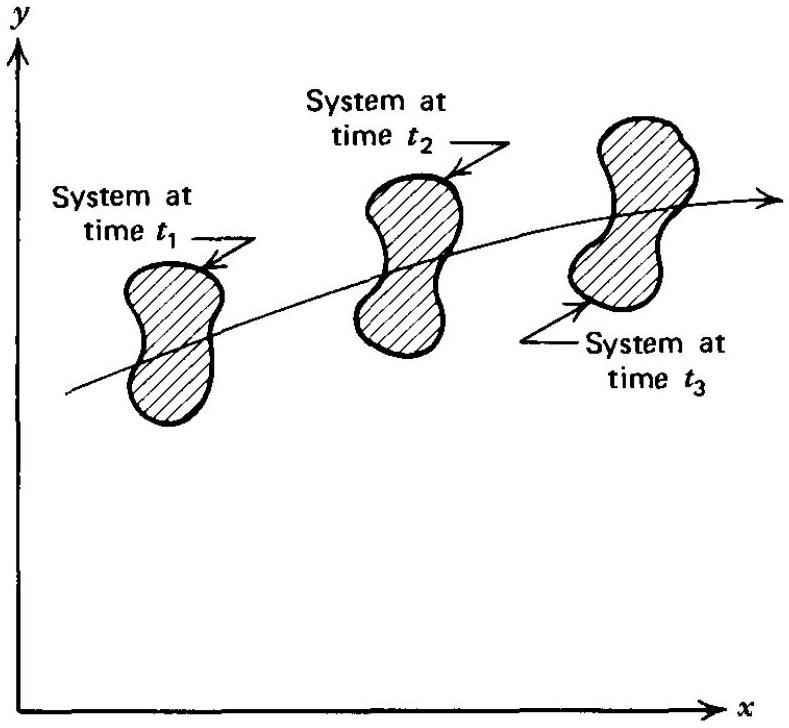
Figure 2.1 A system moving through space.

- A control volume is defined as an imaginary fixed volume through which a fluid may flow. In general, the control volume may change its shape and its position in space. In this book, however, only rigid control volumes are considered, and if the control volume is moving, it is assumed to move at a constant velocity (i.e., with respect to an inertial frame of reference, see Section 1-13); no accelerating, or noninertial, control volumes are considered.

A control surface is the imaginary permeable surface completely enclosing a control volume. Figure $2.2 a$ illustrates the concepts of system, control volume, and control surface when the control volume is isolated in a body of flowing fluid. Mass can flow across the control surface $A$ except where $A$ is parallel to the fluid velocity vector $\mathbf{V}$. Figure 2.2b illustrates the case where the control surface is in contact with one or more solid boundaries; no fluid can be transported across the latter boundaries. Fluid may flow, of course, across portions of the control surface $A$ that are either not in contact with solid boundaries or parallel to the fluid velocity vector $\mathbf{V}$.

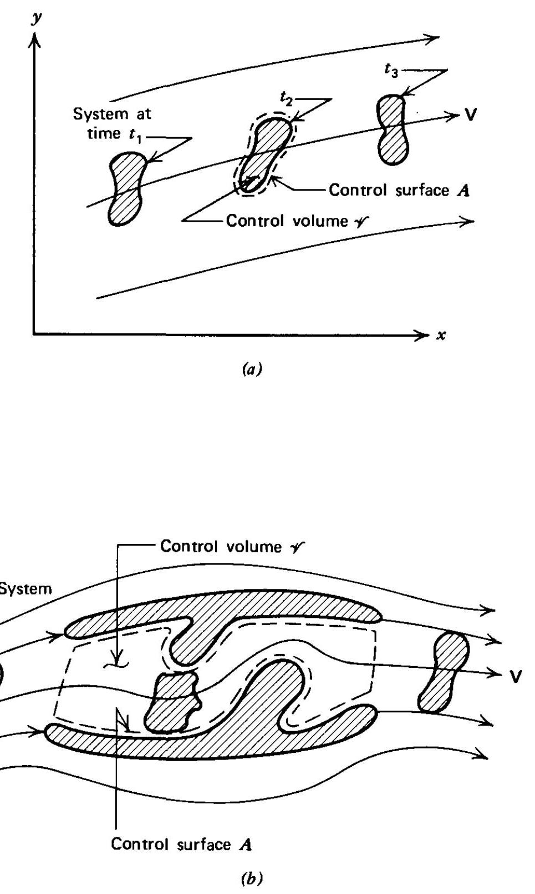
Figure 2.2 The relationship between a system, control surface, and control volume. (a) System, control surface, and control volume in a flowing fluid with no solid boundaries. (b) System, control surface, and control volume in the presence of solid boundaries.

## 2-3(b) Extensive and Intensive Properties

An extensive property is one that depends on the quantity of mass under consideration. For example, the volume of a system, the mass of a system, and the momentum of a system. In this book, as far as is possible, extensive properties are denoted by capital letters; for example, $U$ for internal energy, $S$ for entropy, etc. An exception is mass, which is denoted by $m$ even though it is an extensive property. A general extensive property is denoted by the symbol $N$.

An intensive property is one having a value that is independent of the amount of mass under consideration. There are two types of intensive properties. First, those like pressure and temperature, which are not explicitly dependent on the amount of mass involved, but have magnitudes that are representative of the overall state of the system. Second, there are intensive properties that are the specific values of extensive properties; for example, specific internal energy $u$ (internal energy per unit mass), specific entropy $s$ (entropy per unit mass), and specific enthalpy $h$ (enthalpy
per unit mass). The second type of intensive property is generally denoted by lower case letters. A general intensive property is denoted by the symbol n.

For a material substance that satisfies the continuum postulate (see Section 1-4), $n$ is defined by

$$
n \equiv \lim _{\Delta m \rightarrow 0} \frac{\Delta N}{\Delta m}=\frac{d N}{d m}
$$

Hence, the value of the general extensive property $N$ for a system is given by

$$
N=\int_{\text {System }} n d m
$$

Since density is defined by $\rho=d m / d \mathscr{V}$ [see Section 1-4(b)], equation 2.2 transforms to

$$
N=\int_{\mathscr{V}} n \rho d \mathscr{V}
$$

where the integration is performed over the volume $\mathscr{V}$ occupied by the system.
The corresponding values of $N$ and $n$ are presented below for the following properties associated with a flowing fluid; mass, momentum, stored energy, and entropy.

$$
\begin{array}{ll}
\text { mass }=m=\int_{\mathscr{V}} \rho d \mathscr{V} & (n=1) \\
\text { momentum }=\mathbf{M}=\int_{\mathscr{V}} \mathbf{V} \rho d \mathscr{V} & (n=\mathbf{V}) \\
\text { stored energy }=E=\int_{\mathscr{V}} e \rho d \mathscr{V} & \left(n=e=u+\frac{V^{2}}{2}+g z\right) \\
\text { entropy }=S=\int_{\mathscr{V}} s \rho d \mathscr{V} & (n=s)
\end{array}
$$

The above relationships are utilized later in deriving the governing equations for the flow of a fluid through a control volume.

## 2-3(c) The Property Field

To simplify the specification of the fluid properties, the concept of a property field is employed. In rigid body dynamics, the properties of each particle or body are specified as a function of time. Such an approach is impractical in fluid mechanics because of the tremendously large number of individual particles moving relative to one another in a mass of flowing fluid. Consequently, the properties of a flowing fluid, hereafter termed the flow properties, are described in terms of a position in space, thereby establishing a property field. The properties of the space are assumed to be those of the fluid flowing through that space. Obviously, a position in space itself has no properties because it is merely a geometrical point. Nevertheless, the artificial concept of a property field is a helpful one, which enables us to develop the mathematical techniques for describing the flow of a fluid. Consequently, instead of employing equations such as $\mathbf{V}_{i}=\mathbf{V}_{i}(t)$ for the velocity of an arbitrary fluid particle $i$, the concept of a property field makes it possible to assign a value of $\mathbf{V}=\mathbf{V}(x, y, z, t)$ to every spatial location in the flow region under consideration. Thus, $\mathbf{V}$ is considered to be a function of $(x, y, z, t)$ rather than of the fluid particles.

## 2-3(d) The System or Lagrangian Approach

One approach to studying the flow of a fluid is to consider one fluid particle at a time and follow its path through the flow field, as is illustrated schematically for a
single particle in Fig. 2.3. In that approach, a fluid particle is an aggregation of discrete particles of fixed identity that satisfies the continuum postulate (see Section 1-4). The approach based on following the paths of the individual particles of the fluid is termed either the system or the Lagrangian approach. In most cases, however, the Lagrangian approach is not very useful because of the difficulties entailed in keeping track of the tremendously large number of particles comprising a body of fluid. Because the basic laws governing the flow of a fluid are valid, however, only for a system having a fixed mass, the Lagrangian approach must be employed for obtaining the forms of the governing equations that are valid for fixed positions in space (i.e., for control volumes).

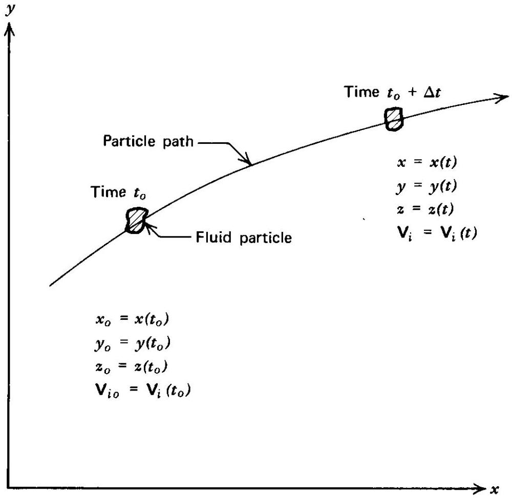
Figure 2.3 The system or Lagrangian approach to the study of fluid motion.

## 2-3(e) The Control Volume or Eulerian Approach

The difficult problems associated with the Lagrangian approach for analyzing the flow of a fluid have been indicated. An alternate approach, termed the Eulerian approach, is based on concentrating the attention on a fixed volume in space and determining the properties of the fluid instantaneously occupying that volume, as illustrated in Fig. 2.4. The Eulerian approach eliminates the need for identifying any particular fluid particle.

The properties of the flow field are completely described in terms of the field description. For example, $\mathbf{V}(x, y, z, t)$ defines the velocity at the point $P(x, y, z)$ of the fluid particle that is at that location at time $t$. Since we do not follow the individual particles as a function of time, the properties of the individual particles are not obtained explicitly. Once the velocity field $\mathbf{V}(x, y, z, t)$ is known, however, the trajectories of the individual particles can be traced through the known velocity field, thereby making the properties of the individual particles determinable. In most flow situations, however, detailed information on the individual particles is not required, so that the Eulerian description of the flow is entirely adequate; the Eulerian approach is the one employed in this book.

Because the basic laws are expressed, however, in a frame of reference for a system, a relationship is needed between the Eulerian and Lagrangian approaches that will enable expressing the basic laws in terms of the variables applicable to a control volume (see Section 2-4).

## 2-3(f) The Substantial Derivative

Since the governing equations for the flow of a fluid, hereafter for brevity called fluid flow, are valid for a system, the time derivative of the properties of a fluid particle must be expressed in terms of the field description of the flow properties. The time derivative of a flow property is known as its substantial derivative; it is also called either the material or the particle derivative, and is denoted by $D() / D t$, where ( ) denotes the property under consideration. The differentiation process itself is commonly termed either differentiation by pursuit or differentiation along a particle path.

Figure 2.5 is an illustration of the process in a Cartesian Lagrangian space. Let $N$ denote an arbitrary extensive property; in a field representation $N$ is specified by

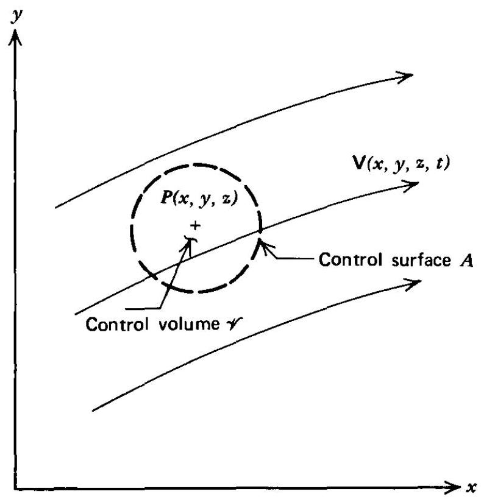
Figure 2.4 The control volume or Eulerian approach to the study of fluid motion.

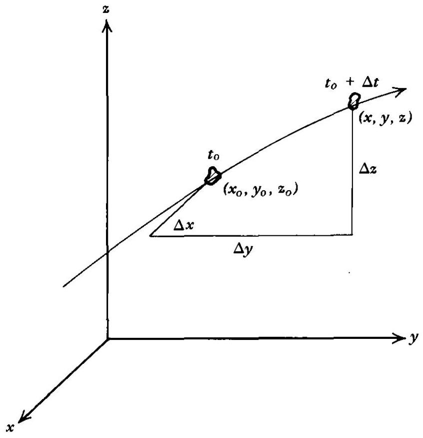
Figure 2.5 Lagrangian space.

$N(x, y, z, t)$. In Lagrangian space, however, the coordinates of a fluid particle $(x, y, z)$ are also functions of time, so that

$$
x=x(t) \quad y=y(t) \quad z=z(t)
$$

The change in $N$ during the increment of time $\Delta t$ may be approximated by the first-order terms of a Taylor series. Thus,

$$
\begin{aligned}
\Delta N_{\text {System }} & =N\left(t_{o}+\Delta t\right)-N\left(t_{o}\right) \\
& =\left(\frac{\partial N}{\partial x}\right)_{t_{o}} \Delta x+\left(\frac{\partial N}{\partial y}\right)_{t_{o}} \Delta y+\left(\frac{\partial N}{\partial z}\right)_{t_{o}} \Delta z+\left(\frac{\partial N}{\partial t}\right)_{t_{\mathrm{o}}} \Delta t
\end{aligned}
$$

The instantaneous time rate of change of $N$ for the system at time $t_{o}$ may be obtained
by dividing equation 2.9 by $\Delta t$ and taking the limit as $\Delta t$ approaches zero. Thus,

$$
\left(\frac{d N}{d t}\right)_{\text {System at } t_{o}}=\lim _{\Delta t \rightarrow 0} \frac{N\left(t_{o}+\Delta t\right)-N\left(t_{o}\right)}{\Delta t}
$$

In Lagrangian space, since $x=x(t)$ for the system,

$$
\lim _{\Delta t \rightarrow 0}\left(\frac{\Delta x}{\Delta t}\right)_{\text {System }}=\left(\frac{d x}{d t}\right)_{\text {System }}=u\left(t_{o}\right)
$$

where $u\left(t_{o}\right)$ is the particle velocity in the $x$ direction at the time $t_{o}$. By applying similar considerations to the second and third terms of equation 2.9, we obtain $v\left(t_{o}\right)$ and $w\left(t_{o}\right)$, where $v\left(t_{o}\right)$ and $w\left(t_{o}\right)$ denote the velocities parallel to the $y$ and $z$ axes, respectively. Thus, equation 2.10 transforms to

$$
\left(\frac{d N}{d t}\right)_{\text {System at } t_{o}}=\left[\left(\frac{\partial N}{\partial t}\right)+u\left(\frac{\partial N}{\partial x}\right)+v\left(\frac{\partial N}{\partial y}\right)+w\left(\frac{\partial N}{\partial z}\right)\right]
$$

The derivative expressed by equation 2.12 is the substantial derivative of the arbitrary extensive property $N$ and, as pointed out earlier, is denoted by the special symbol $D() / D t$. Thus,

$$
\frac{D N}{D t} \equiv\left(\frac{d N}{d t}\right)_{\text {System at } t_{0}}
$$

The first term in equation 2.12 arises from any unsteady flow effects that may be present and is termed the local change. The last three terms each arise from a change in the position of the fluid particle in the flow field and are called the convective change. The substantial derivative of a flow property, therefore, relates the instantaneous rate of change of that flow property to derivatives of the property field. Since the property field may be employed directly in an Eulerian description of a flow, the substantial derivative, therefore, relates the Lagrangian and Eulerian descriptions of fluid flow.

The substantial derivative may be considered to be an operator of the following form.

$$
\frac{D()}{D t}=\frac{\partial()}{\partial t}+u \frac{\partial()}{\partial x}+v \frac{\partial()}{\partial y}+w \frac{\partial()}{\partial z}
$$

In vector notation, the substantial derivative is

$$
\frac{D()}{D t}=\frac{\partial()}{\partial t}+(\mathbf{V} \cdot \nabla)()
$$

where the order of $\mathbf{V}$ and $\nabla$ in the expansion of the above dot or scalar product must be preserved. The operator ∇ , which is called either del or nabla, is defined in Cartesian coordinates by

$$
\nabla \equiv \mathbf{i} \frac{\partial}{\partial x}+\mathbf{j} \frac{\partial}{\partial y}+\mathbf{k} \frac{\partial}{\partial z}
$$

Example 2.1. An Eulerian description of an unsteady two-dimensional velocity field in Cartesian coordinates is given by

$$
\mathbf{V}(x, y, t)=\mathbf{i} e^{x t}+\mathbf{j} e^{y t}
$$

Determine the acceleration of the particle at location $(1,2)$ at time $t=2$.

## Solution

The acceleration of a particle is the time rate of change of the velocity of the particle, which is the substantial derivative of the velocity. Thus,

$$
\mathbf{a}_{p}=\frac{D \mathbf{V}}{D t}=\frac{\partial \mathbf{V}}{\partial t}+(\mathbf{V} \cdot \nabla) \mathbf{V}
$$

For a two-dimensional flow in a Cartesian coordinate system $\mathbf{V}=\mathbf{i} u+\mathbf{j} v$. Then,

$$
\begin{aligned}
\frac{\partial \mathbf{V}}{\partial t} & =\frac{\partial}{\partial t}(\mathbf{i} u+\mathbf{j} v)=\mathbf{i} \frac{\partial u}{\partial t}+\mathbf{j} \frac{\partial v}{\partial t} \\
(\mathbf{V} \cdot \nabla) \mathbf{V} & =u \frac{\partial \mathbf{V}}{\partial x}+v \frac{\partial \mathbf{V}}{\partial y} \\
(\mathbf{V} \cdot \nabla) \mathbf{V} & =u \frac{\partial}{\partial x}(\mathbf{i} u+\mathbf{j} v)+v \frac{\partial}{\partial y}(\mathbf{i} u+\mathbf{j} v) \\
(\mathbf{V} \cdot \nabla) \mathbf{V} & =\mathbf{i} u \frac{\partial u}{\partial x}+\mathbf{j} u \frac{\partial v}{\partial x}+\mathbf{i} v \frac{\partial u}{\partial y}+\mathbf{j} v \frac{\partial v}{\partial y}
\end{aligned}
$$

Adding equations (b) and (e) and rearranging gives

$$
\mathbf{a}_{p}=\mathbf{i}\left(u \frac{\partial u}{\partial x}+v \frac{\partial u}{\partial y}+\frac{\partial u}{\partial t}\right)+\mathbf{j}\left(u \frac{\partial v}{\partial x}+v \frac{\partial v}{\partial y}+\frac{\partial v}{\partial t}\right)
$$

Substituting $u=e^{x t}$ and $v=e^{y t}$ into equation (f) yields

$$
\begin{aligned}
& \mathbf{a}_{p}=\mathbf{i}\left[e^{x t} t e^{x t}+e^{y t}(0)+x e^{x t}\right]+\mathbf{j}\left[e^{x t}(0)+e^{y t} t e^{y t}+y e^{y t}\right] \\
& \mathbf{a}_{p}=\mathbf{i} e^{x t}\left(t e^{x t}+x\right)+\mathbf{j} e^{y t}\left(t e^{y t}+y\right)
\end{aligned}
$$

Substituting the values $x=1, y=2$, and $t=2$ into equation (g) gives

$$
\begin{aligned}
& \mathbf{a}_{p}=\mathbf{i} e^{(1)(2)}\left[2 e^{(1)(2)}+1\right]+\mathbf{j} e^{(2)(2)}\left[2 e^{(2)(2)}+2\right] \\
& \mathbf{a}_{p}=\mathbf{i} e^{2}\left(2 e^{2}+1\right)+\mathbf{j} 2 e^{4}\left(e^{4}+1\right)
\end{aligned}
$$

## 2-4 RELATIONSHIP BETWEEN THE SYSTEM AND THE CONTROL VOLUME APPROACHES

The discussion in the present section is concerned with determining how the time rate of change of an arbitrary extensive fluid property $N$ for a system may be expressed as the variation of that property for a control volume. Figure 2.6 illustrates diagrammatically an arbitrary velocity field $\mathbf{V}(x, y, z, t)$ measured with respect to the $x, y, z$ coordinate system. The control volume is denoted by $\mathscr{V}$ and the corresponding control surface by $A$. A system of finite size is illustrated at the times $t$ and $t+\Delta t$; the streamline pattern is that applicable to the instantaneous time $t$. The control volume is assumed to be fixed in $x, y, z$ space. The system and the control volume occupy the identical space at the time $t$, the two regions denoted by I and II. At the later time $t+\Delta t$, the system occupies the regions II and III.

The time rate of change of the extensive property $N$ for the system is determined by applying the following limiting process.

$$
\left(\frac{d N}{d t}\right)_{\text {System }}=\lim _{\Delta t \rightarrow 0}\left(\frac{\Delta N}{\Delta t}\right)_{\text {System }}=\left\{\begin{array}{l}
\text { Time rate of } \\
\text { change of } N \text { for } \\
\text { the System at } t
\end{array}\right\}=\left\{\begin{array}{l}
\text { Time rate of change of } \\
N \text { for the mass in the } \\
\text { control volume at } t
\end{array}\right\}
$$

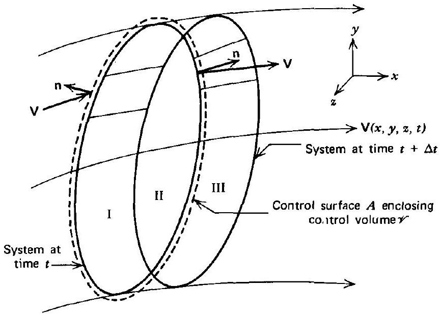
Figure 2.6 The relationship between a system and a control volume.

As pointed out in Section 2-3(f), a derivative of the type presented in equation 2.16 is a total derivative following a fluid particle and is consequently the substantial derivative of $N$. Hence, by introducing the operator $D() / D t$ (see equation 2.13), we may write

$$
\frac{D N}{D t}=\left(\frac{d N}{d t}\right)_{\text {System }}
$$

Application of equation 2.16 yields

$$
\frac{D N}{D t}=\lim _{\Delta t \rightarrow 0}\left\{\frac{N_{t+\Delta t}-N_{t}}{\Delta t}\right\}_{\text {System }}
$$

The terms in equation 2.18 are given by the following expressions, where $d N= n \rho d \mathscr{V}$. Thus,

$$
\begin{gathered}
\left(N_{t+\Delta t}\right)_{\text {System }}=\left(N_{\mathrm{II}}+N_{\mathrm{III}}\right)_{t+\Delta t}=\left(\int_{\mathrm{II}} n \rho d \mathscr{V}+\int_{\mathrm{III}} n \rho d \mathscr{V}\right)_{t+\Delta t} \\
\left(N_{t}\right)_{\text {System }}=\left(N_{\mathrm{I}}+N_{\mathrm{II}}\right)_{t}=\left(\int_{\mathrm{I}} n \rho d \mathscr{V}+\int_{\mathrm{II}} n \rho d \mathscr{V}\right)_{t}
\end{gathered}
$$

Combining equations 2.18 to 2.20 , and noting that the limit of the sum is equal to the sum of the limits, the following expression is obtained.

$$
\begin{aligned}
\frac{D N}{D t} & =\lim _{\Delta t \rightarrow 0} \frac{\left[\left(\int_{\mathrm{II}} n \rho d \mathscr{V}\right)_{t+\Delta t}-\left(\int_{\mathrm{II}} n \rho d \mathscr{V}\right)_{t}\right]}{\Delta t} \\
& +\lim _{\Delta t \rightarrow 0} \frac{\left(\int_{\mathrm{III}} n \rho d \mathscr{V}\right)_{t+\Delta t}}{\Delta t}-\lim _{\Delta t \rightarrow 0} \frac{\left(\int_{\mathrm{I}} n \rho d \mathscr{V}\right)_{t}}{\Delta t}
\end{aligned}
$$

In the limit, as $\Delta t$ approaches zero, region II becomes identical to the control volume $\mathscr{V}$, and the first term on the right-hand side of equation 2.21 becomes

$$
\frac{\partial}{\partial t} \int_{\mathscr{V}} n \rho d \mathscr{V}
$$

The value of the second term on the right-hand side of equation 2.21 is determined by noting that the integrand is the amount of the extensive property $N$ that entered
region III during the time $\Delta t$. It is, therefore, the amount of $N$ that left the control volume during the time $\Delta t$. Thus,

$$
\left(n \rho d \mathscr{V}_{\text {III }}\right)_{t+\Delta t}=\left(\Delta N_{\text {III }}\right)_{t+\Delta t}
$$

Dividing equation 2.23 by $\Delta t$ and taking the limit, as $\Delta t$ approaches zero, yields the instantaneous rate at which $N$ leaves the control volume.

$$
\lim _{\Delta t \rightarrow 0} \frac{\left(\Delta N_{\text {III }}\right)_{t+\Delta t}}{\Delta t}=\left(\frac{d N}{d t}\right)_{\text {out }}=\text { Rate of efflux of } N
$$

Since $d N=n d m$, the rate of efflux of $N$ may be expressed as the product of the mass flow rate out $d \dot{m}_{\text {out }}$, and $n$, the specific value of the general extensive property $N$. Hence,

$$
\left(\frac{d N}{d t}\right)_{\mathrm{out}}=n d \dot{m}_{\mathrm{out}}
$$

The mass rate of flow out of the control volume $\mathscr{V}$ may be expressed in terms of $\rho, \mathbf{V}$, and the differential area $d A$. Consider a differential portion of the control surface $d A$, as illustrated in Fig. 2.7. The flow of mass through the differential area $d A$ is given by

$$
d \dot{m}=\rho V \cos \alpha d A
$$

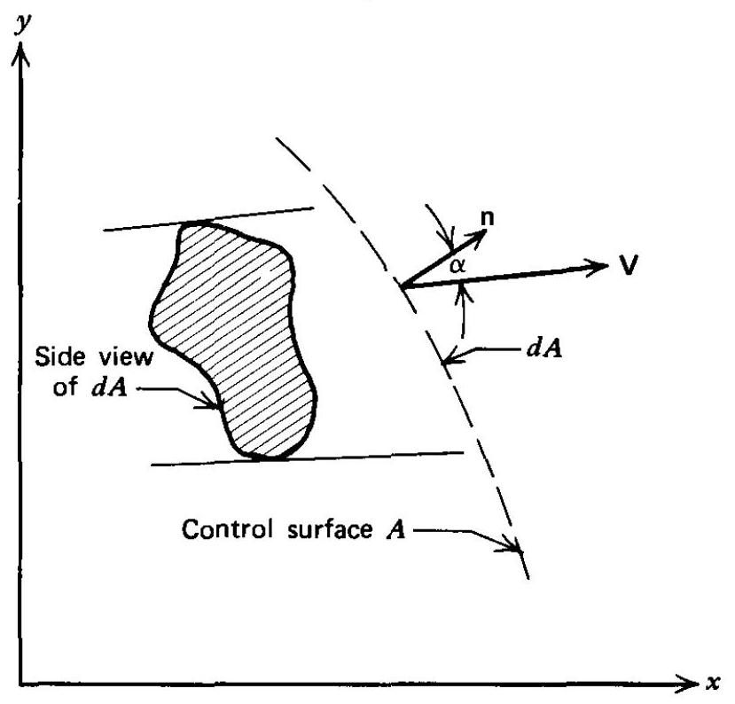
Figure 2.7 Mass flow out of a control volume.

Expressing $d A$ as a vector in the direction of the normal to the surface (using the convention that the outward normal points in the positive direction), equation 2.26 may be rewritten as

$$
d \dot{m}=\rho \mathbf{V} \cdot d \mathbf{A}
$$

where $d \mathbf{A}=\mathbf{n} d A$, and $\mathbf{n}$ denotes the unit normal in the direction of the outward normal to the control surface. Combining equations 2.25 and 2.27 yields

$$
\left(\frac{d N}{d t}\right)_{\text {out }}=n \rho \mathbf{V} \cdot d \mathbf{A}_{\text {out }}
$$

In the limit as $\Delta t$ approaches zero, the second term on the right-hand side of equation 2.21 becomes

$$
\int_{A_{\mathrm{out}}}\left(\frac{d N}{d t}\right)_{\mathrm{out}}=\int_{A_{\mathrm{out}}} n \rho \mathbf{V} \cdot d \mathbf{A}_{\mathrm{out}}
$$

Equation 2.29 converts the original volume integral over region III into a surface integral over that portion of the control surface where mass flows out of the control volume.

The value of the third term on the right-hand side of equation 2.21 is obtained in an analogous manner; that is, by noting that the integrand is the amount of $N$ that entered the control volume during the time $\Delta t$. Figure 2.8 illustrates a differential

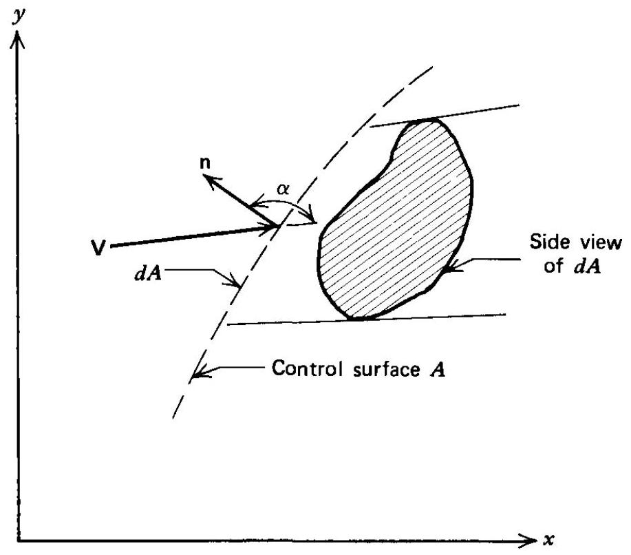
Figure 2.8 Mass flow into a control volume.

portion of the control surface through which mass, and consequently $N$, is flowing into the control volume. Note that for fluid entering the control volume, the angle $\alpha$ will always be greater than 90 deg and less than 270 deg; consequently, $\cos \alpha$ is always negative. Hence, the mass flow rate crossing the differential area $d A$ is given by

$$
d \dot{m}=-\rho V \cos \alpha d A=-\rho \mathbf{V} \cdot d \mathbf{A}
$$

where, as before, $d \mathbf{A}=\mathbf{n} d A$. The negative sign appears because, as pointed out above, $\cos \alpha$ is always negative; the mass flow rate, of course, is always a positive quantity.

By employing the procedure utilized for determining the value of the second term in equation 2.21, we obtain for the third term of that equation

$$
-\int_{A_{\mathrm{in}}}\left(\frac{d N}{d t}\right)_{\mathrm{in}}=\int_{A_{\mathrm{in}}} n \rho \mathbf{V} \cdot d \mathbf{A}_{\mathrm{in}}
$$

Note that the negative sign preceding the third term in equation 2.21 combines with the negative sign of equation 2.30. As a result, a positive expression is obtained in equation 2.31. Furthermore, it should be noted that the original volume integral over region II has been transformed into a surface integral that applies to that portion of the control surface across which mass flows into the control volume.

Combining equations 2.29 and 2.31 gives

$$
\int_{A_{\mathrm{out}}}\left(\frac{d N}{d t}\right)_{\mathrm{out}}-\int_{A_{\mathrm{in}}}\left(\frac{d N}{d t}\right)_{\mathrm{in}}=\int_{A} n \rho \mathbf{V} \cdot d \mathbf{A}
$$

In equation 2.32 , the subscript $A$ attached to the integral sign denotes that the integral is to be extended over the entire control surface $A$. For mass efflux, the scalar product of $\mathbf{V}$ and $d \mathbf{A}$ yields a positive contribution to $D N / D t$, while for mass influx it yields a negative contribution, which is in agreement with the signs in equation 2.21. The single term on the right-hand side of equation 2.32 accounts, therefore, for both the second and third terms on the right-hand side of equation 2.21.

The foregoing shows that the results of the limiting process indicated in equation 2.21 are given by the terms in equation 2.22 and 2.32. Hence,

$$
\frac{D N}{D t}=\frac{\partial}{\partial t} \int_{\mathscr{V}} n \rho d \mathscr{V}+\int_{A} n \rho \mathbf{V} \cdot d \mathbf{A}
$$

Hence, the instantaneous time rate of change for any extensive property $N$ for a system, at time $t$, has been expressed in terms of two effects: one relative to the control volume, and the other relative to its control surface. The first term expresses the time rate of change of $N$ inside the control volume at the time $t$, and the second term expresses the net rate of flow of $N$ across the control surface $A$ at the same instant of time. Equation 2.33 is the desired relationship between the system and control volume approaches to fluid flow problems. For an inertial control volume of fixed shape, the time derivative may be taken inside the integral, yielding

$$
\frac{D N}{D t}=\int_{\mathscr{V}} \frac{\partial(n \rho)}{\partial t} d \mathscr{V}+\int_{A} n \rho \mathbf{V} \cdot d \mathbf{A}
$$

A useful alternate form of equation 2.34 may be obtained in terms of volume integrals entirely, by employing the divergence theorem. From vector analysis (see Section 2-1), for any vector $\mathbf{A}$

$$
\int_{A} \mathbf{B} \cdot d \mathbf{A}=\int_{\mathscr{V}} \nabla \cdot \mathbf{B} d \mathscr{V}
$$

If $\mathbf{B}$ is chosen to be $(n \rho \mathbf{V})$, then

$$
\int_{A}(n \rho \mathbf{V}) \cdot d \mathbf{A}=\int_{\mathscr{V}} \nabla \cdot(n \rho \mathbf{V}) d \mathscr{V}
$$

Combining equations 2.34 and 2.36 yields

$$
\frac{D N}{D t}=\int_{\mathscr{V}}\left[\frac{\partial(n \rho)}{\partial t}+\nabla \cdot(n \rho \mathbf{V})\right] d \mathscr{V}
$$

Once the extensive property $N$ has been specified (i.e., mass, momentum, energy, or entropy), its specific value $n$ can be determined. The integrand of the second term in equation 2.37 may be expanded further by employing the following vector identity. Let $\phi$ be any scalar and $\mathbf{A}$ any vector; then, from Section 2-1,

$$
\nabla \cdot(\phi \mathbf{A})=\phi(\nabla \cdot \mathbf{A})+\mathbf{A} \cdot(\nabla \phi)
$$

Another useful concept is that of the instantaneous time rate of change of $N$ for a system of differential size. If the control volume $\mathscr{V}$ is shrunk to differential size $d \mathscr{V}$, then the limiting value of the integral in equation 2.37 is the integrand itself. Dividing that result by $d \mathscr{V}$ yields an expression for the time rate of change of $N$ per unit
volume. Thus,

$$
\frac{D N / D t}{d \mathscr{V}}=\frac{\partial(n \rho)}{\partial t}+\nabla \cdot(n \rho \mathbf{V})=(n \rho)_{t}+\nabla \cdot(n \rho \mathbf{V})
$$

where $(n \rho)_{t}=\partial(n \rho) / \partial t$. The concept embodied in equation 2.39 is often employed for obtaining a differential equation from a corresponding integral equation, such as equation 2.37.

In summary, equation 2.34 expresses the time rate of change of any extensive property $N$ of a system in terms of the properties of a control volume. Equation 2.34 will be employed for expressing the basic equations of mechanics and thermodynamics for systems as equations that are valid for control volumes.

## 2-5 CONSERVATION OF MASS

The law of the conservation of mass for a system states that, in the absence of nuclear and relativity effects, the mass of a system is a constant. Thus,

$$
(\text { mass })_{\text {System }}=\text { constant }
$$

Let the extensive property $N$ denote the mass of a system; that is, $N=$ mass. Accordingly, equation 2.40 gives

$$
\frac{D N}{D t}=\frac{D(\text { mass })}{D t}=0
$$

The mass contained inside the control volume $\mathscr{V}$ is given by $N=$ mass $=\int_{\mathscr{V}} \rho d \mathscr{V}$; the corresponding intensive property is $n=1$. From equation 2.34, it follows that $D N / D t=0$ is given by

$$
\int_{\mathscr{V}} \frac{\partial \rho}{\partial t} d \mathscr{V}+\int_{A} \rho \mathbf{V} \cdot d A=0
$$

Equation 2.42 is the integral form of the law of the conservation of mass. It is valid for a control volume, and is frequently called the continuity equation. The only restrictions on that equation are that the continuum postulate is valid, and that nuclear and relatively effects are absent. For steady flows, the first term is zero.

In words, the basic principle expressed by equation 2.42 is that the rate at which (fluid) mass accumulates inside an inertial control volume $\mathscr{V}$ of fixed size is equal to the difference between the rate at which mass enters and leaves $\mathscr{V}$ by crossing the control surface $A$, which encloses $\mathscr{V}$.

A differential form for the continuity equation, valid for control volumes, is required in the study of multidimensional flows. Two procedures are available for obtaining the pertinent differential equations from the integral equations. Both approaches are illustrated in deriving the equation for the law of the conservation of mass. The remaining basic laws are obtained in their differential form by applying the first of the two approaches.

The first approach employs the divergence theorem (see equation 2.35). The latter is employed for converting a surface integral into a volume integral. The limiting value of the volume integral is then obtained as $\mathscr{V}$ approaches zero; the technique is employed in deriving equation 2.39. For $N=$ mass, $n=1$, and $D N / D t=0$. Equation 2.39 becomes

$$
\rho_{t}+\nabla \cdot(\rho \mathbf{V})=0
$$

where $\rho_{t} \equiv(\partial \rho / \partial t)^{*}$.

[^0]Equation 2.43 is the desired differential form of the continuity equation that is valid for a control volume. The corresponding equation for any coordinate system may be obtained by applying the operator $\nabla$ for that system. For steady flows, $\rho_{t}=0$.

The second approach, which will be employed here only for the purpose of illustrating the technique, is based on applying the integral equation to a control volume of differential size. Figure 2.9 illustrates a differential control volume in a Cartesian

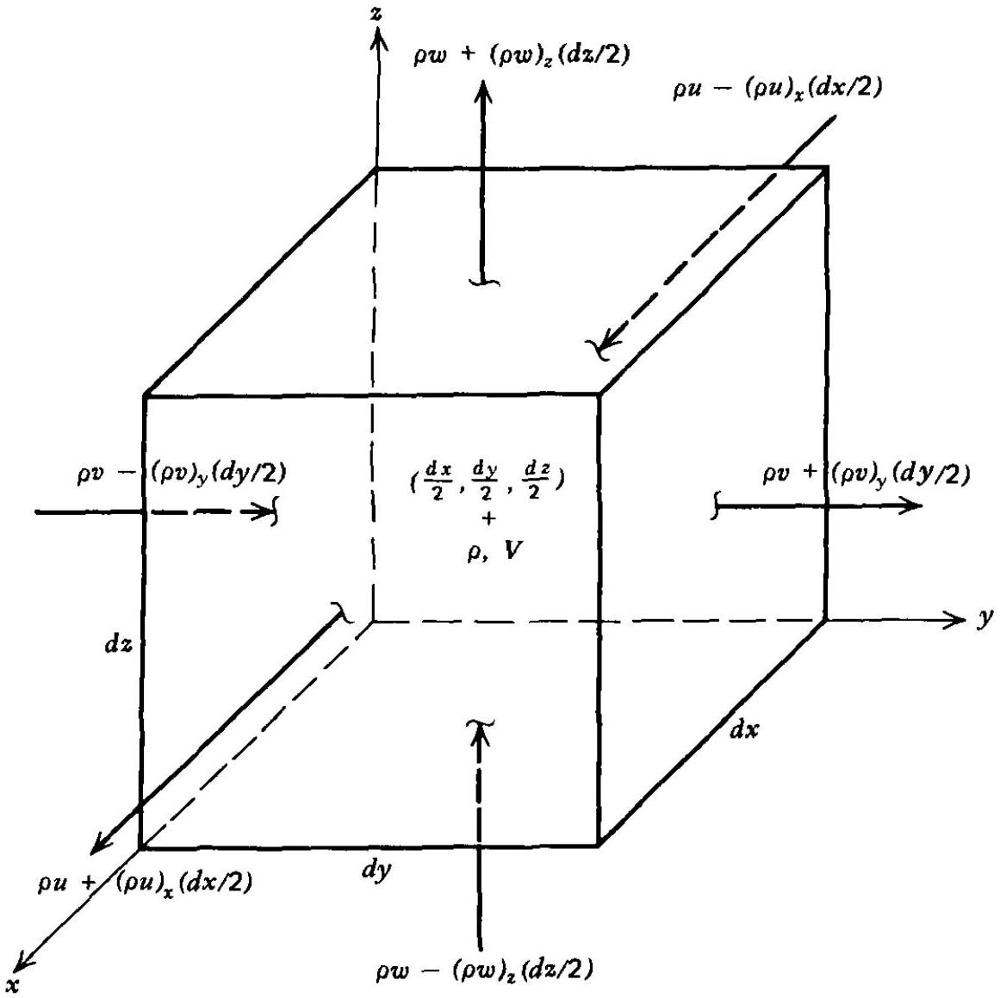
Figure 2.9 Differential control volume for deriving the continuity equation.

coordinate system. Let $\rho$ and $\mathbf{V}$ denote the properties at the center of the differential control volume that has the coordinates ( $d x / 2, d y / 2, d z / 2$ ). For the differential control volume, it may be assumed (to a first-order approximation) that the properties of the fluid are constant over each of its six faces. On its back face, that facing the negative $x$ direction, the density is $\rho-\rho_{x}(d x / 2)$, and on the front face it is $\rho+\rho_{x}(d x / 2)$. Similar expressions may be written for the products ( $\rho u$ ), ( $\rho v$ ), and ( $\rho w$ ), where $u, v$, and $w$ are the Cartesian components of the velocity $\mathbf{V}$. Hence, on the back face, the value of $(\rho u)$ is $(\rho u)-(\rho u)_{x}(d x / 2)$, and on the front face it is $(\rho u)+(\rho u)_{x}(d x / 2)$. The mass flow entering the back face is, from equation 2.42,

$$
\int_{A} \rho \mathbf{V} \cdot d \mathbf{A}=\left[\rho u-(\rho u)_{x}\left(\frac{d x}{2}\right)\right] d y d z
$$

Similar expressions may be written for the other five faces. The appropriate expressions are indicated in Fig. 2.9. The unsteady term in equation 2.42 is simply $\rho_{t}(d x d y d z)$. Combining those results and dividing by ( $d x d y d z$ ) yields

$$
\rho_{t}+(\rho u)_{x}+(\rho v)_{y}+(\rho w)_{z}=0
$$

Equation 2.45 is the differential form of the continuity equation for a Cartesian coordinate system. Results for other coordinate systems may be obtained in a similar manner.

In vector notation, equation 2.45 becomes

$$
\rho_{t}+\nabla \cdot(\rho \mathbf{V})=0
$$

which is identical to equation 2.43 . The alternate approach, as to be expected, yields the same result as that obtained by the first approach. Because it is more involved than the latter, it will not be employed hereafter. It should be pointed out, however, that in those cases where transport phenomena (i.e., viscosity, conductivity, and diffusion) must be considered, the alternate approach may prove to be the more straightforward (see Section 5-9).

Example 2.2. Air flows out of a tank through a rectangular outlet duct, as illustrated in Fig. 2.10. The combined volume of the tank and the outlet duct is denoted by $\mathscr{V}$.

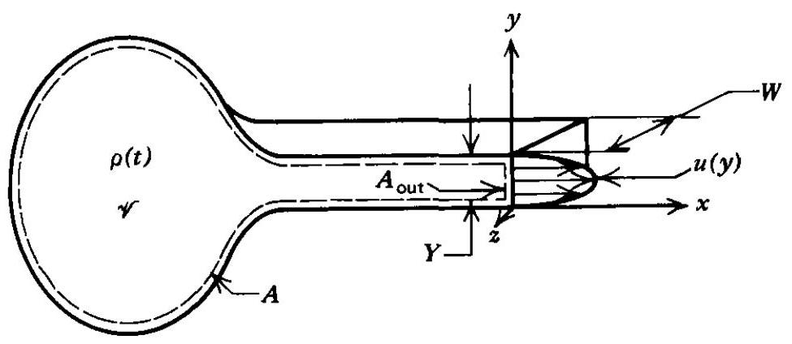
Figure 2.10 Sketch for Example 2.2.

If the height of the outlet duct $Y$ is small compared to the width $W$, then the velocity profile at the outlet section is given by

$$
u(y)=\left(4 U / Y^{2}\right)\left(y Y-y^{2}\right)
$$

where $U$ is the maximum velocity. Assume that the flow rate is so small that the density of the air throughout the tank and outlet duct may be considered to be uniform (i.e., $\rho \neq \rho(x, y, z)$ ). (a) Develop expressions for the instantaneous mass flow rate at the outlet and for the time rate of change of the density of the air in the tank and outlet duct. (b) A specific tank and outlet duct has a combined volume of $0.283 \mathrm{~m}^{3}$, an outlet duct height $Y=0.00254 \mathrm{~m}$, and an outlet duct width $W=0.3048 \mathrm{~m}$. Calculate $\dot{m}_{\text {out }}$ and $\partial \rho / \partial t$ at an instant when the pressure $p=1.379 \cdot 10^{5} \mathrm{~N} / \mathrm{m}^{2}$, the temperature $t=277.8 \mathrm{~K}$, and the outlet maximum velocity $U=30.48 \mathrm{~m} / \mathrm{s}$. The gas constant for air is $287.04 \mathrm{~J} / \mathrm{kg}-\mathrm{K}$.

## Solution

(a) Define the inside walls of the tank and outlet duct and the outlet area itself as the control surface $A$. The control volume $\mathscr{V}$ comprises the volume of the tank plus the volume of the outlet duct. The continuity equation for this control volume is obtained from equation 2.42 . Thus,

$$
\int_{\mathscr{V}} \frac{\partial \rho}{\partial t} d \mathscr{V}+\int_{A_{\mathrm{out}}} \rho \mathbf{V} \cdot d \mathbf{A}=0
$$

where $A_{\text {out }}$ denotes that portion of the total control surface $A$ across which mass flows.

The instantaneous mass flow rate out of the control volume $\mathscr{V}$ is obtained from the second term in equation (a).

$$
\dot{m}_{\mathrm{out}}=\int_{A_{\mathrm{out}}} \rho \mathbf{V} \cdot d \mathbf{A}=\int_{A_{\mathrm{out}}} d \dot{m}_{\mathrm{out}}
$$

The time rate of change of the density of the air in the tank is obtained from the first term in equation (a). If $\rho$ is uniform over the control volume, then $\partial \rho / \partial t$ is not a function of $x, y, z$. The first term in equation (a) becomes

$$
\int_{\mathscr{V}} \frac{\partial \rho}{\partial t} d \mathscr{V}=\frac{\partial \rho}{\partial t} \mathscr{V}
$$

Combining equations (a), (b), and (c), gives

$$
\frac{\partial \rho}{\partial t} \mathscr{V}+\dot{m}_{\mathrm{out}}=0
$$

To determine $\dot{m}_{\text {out }}$, note that

$$
\begin{aligned}
\mathbf{V} & =\mathbf{i}\left(\frac{4 U}{Y^{2}}\right)\left(y Y-y^{2}\right) \\
d \mathbf{A} & =\mathbf{i}(d z d y)
\end{aligned}
$$

so that equation (b) becomes

$$
\begin{aligned}
& \dot{m}_{\mathrm{out}}=\rho \int_{0}^{Y} \int_{0}^{W}\left(\frac{4 U}{Y^{2}}\right)\left(y Y-y^{2}\right) d z d y \\
& \dot{m}_{\mathrm{out}}=\left.\rho W\left(\frac{4 U}{Y^{2}}\right)\left(Y y^{2} / 2-y^{3} / 3\right)\right|_{0} ^{Y}=\frac{2 \rho U W Y}{3}
\end{aligned}
$$

Substituting equation (h) into equation (d) gives

$$
\frac{\partial \rho}{\partial t}=-\frac{2 \rho U W Y}{3 \mathscr{V}}
$$

(b) The instantaneous density of the air in the control volume is calculated by applying the thermal equation of state for a perfect gas [equation 1.99, Section 1-15(a)].

$$
\rho=\frac{p}{R t}=\frac{1.379 \cdot 10^{5}}{287.04(277.8)}=1.729 \mathrm{~kg} / \mathrm{m}^{3}
$$

From equation (h),

$$
\dot{m}_{\text {out }}=\frac{2 \rho U W Y}{3}=\frac{2(1.729)(30.48)(0.3048)(0.00254)}{3}=0.0272 \mathrm{~kg} / \mathrm{s}(0.0600 \mathrm{lbm} / \mathrm{sec})
$$

From equation (d),

$$
\frac{\partial \rho}{\partial t}=-\frac{\dot{m}_{\mathrm{out}}}{\mathscr{V}}=-\frac{0.0272}{0.283}=-0.0961 \mathrm{~kg} / \mathrm{m}^{3}-\mathrm{s}\left(-0.00600 \mathrm{lbm} / \mathrm{ft}^{3}-\mathrm{sec}\right)
$$

## 2-6 NEWTON'S SECOND LAW OF MOTION

The equation obtained by applying Newton's second law of motion to the fluid flowing through a control volume is called the momentum equation. From Section

1-13(c), equation 1.80, Newton's second law of motion for a system of particles is

$$
\mathbf{F}_{\text {external }}=\frac{d \mathbf{M}}{d t}
$$

The derivative in equation 2.47 is a derivative following a system of fluid particles. Consequently, it is the substantial derivative, and equation 2.47 may be rewritten as follows.

$$
\mathbf{F}_{\text {external }}=\frac{D \mathbf{M}}{D t}
$$

In terms of the general properties $N$ and $n, N=\mathbf{M}=\int_{\mathscr{V}} \mathbf{V} \rho d \mathscr{V}$ and $n=\mathbf{V}$. Substituting these results into equation 2.34 yields

$$
\mathbf{F}_{\text {external }}=\int_{\mathscr{V}}(\rho \mathbf{V})_{t} d \mathscr{V}+\int_{A} \mathbf{V}(\rho \mathbf{V} \cdot d \mathbf{A})
$$

where the subscript $t$ denotes partial differentiation with respect to time $t$. To complete the transformation from the system approach to the control volume approach, the external forces acting on the system must be expressed in terms of the forces acting upon the control volume.

## 2-6(a) The Net External Force Acting on a Body of Fluid

It is pointed out in Section 1-4(a) that the external forces acting on a body of fluid may be divided into body forces $\mathbf{F}_{\boldsymbol{B}}$ and surface forces $\mathbf{F}_{\boldsymbol{S}}$.

$$
\mathbf{F}_{\text {external }}=\mathbf{F}_{B}+\mathbf{F}_{S}
$$

Body forces are those that act on the entire mass of the fluid; they are frequently called forces at a distance. The most common body force is gravitational attraction; other important examples are electrical and magnetic forces on a charged fluid. In general, $\mathbf{F}_{\boldsymbol{B}}$ may be written as

$$
\mathbf{F}_{B}=\int_{\mathscr{V}} \mathbf{B} \rho d \mathscr{V}
$$

where $\mathbf{B}$ denotes the body force per unit mass.
Surface forces are those forces that act on the boundaries of the system by virtue of their contact with the surroundings. Surface forces may be subdivided into normal forces $\mathbf{F}_{n}$ and tangential forces $\mathbf{F}_{t}$, where $\mathbf{F}_{S}=\mathbf{F}_{n}+\mathbf{F}_{t}$. In the case of the flow of an inviscid fluid, the normal forces are caused by pressure. Thus,

$$
\mathbf{F}_{n}=-\int_{A} p d \mathbf{A}
$$

The negative sign is introduced in equation 2.52 because pressure is a compressive stress acting in the inward direction on a surface and, for the surface element $d \mathbf{A}$ the positive normal acts in the outward direction. For an inviscid flow $\mathbf{F}_{t}=0$ because there are no shear forces. For a viscous flow the normal force has components caused by the viscous shear stresses. Detailed expressions for the normal and tangential forces acting on a viscous fluid are developed in Section 5-9. The interested reader is also referred to the many excellent works in the literature dealing with the flow of viscous fluids. ${ }^{10-13}$ Accordingly, $\mathbf{F}_{t}$ will be denoted by $\mathbf{F}_{\text {shear }}$ to denote its origin and will be retained in that general form when analyzing one-dimensional flows.

## 2-6(b) The Momentum Equation for a Control Volume

Combining all of the forces discussed above yields the following expression for the net external force $\mathbf{F}_{\text {external }}$ acting on a system. Thus,

$$
\mathbf{F}_{\text {external }}=\int_{\mathscr{V}} \mathbf{B} \rho d \mathscr{V}-\int_{A} p d \mathbf{A}+\mathbf{F}_{\text {shear }}
$$

Substituting equation 2.53 into equation 2.49 yields the momentum equation. Thus,

$$
\int_{\mathscr{V}} \mathbf{B} \rho d \mathscr{V}-\int_{A} p d \mathbf{A}+\mathbf{F}_{\text {shear }}=\int_{\mathscr{V}}(\rho \mathbf{V})_{t} d \mathscr{V}+\int_{A} \mathbf{V}(\rho \mathbf{V} \cdot d \mathbf{A})
$$

Equation 2.54 is a vector relationship having three components; each component is an independent relationship corresponding to one of the directions of the three mutually orthogonal coordinate axes.

To obtain a general form for the component equations, consider the $x_{i}$ direction denoted by the unit vector $\mathbf{n}_{i}$ (e.g., in Cartesian coordinates, $x_{i}=x, y$, or $z$ and $\mathbf{n}_{i}=\mathbf{i}, \mathbf{j}$, or $\mathbf{k}$ ). Denote the corresponding velocity components by $u_{i}$. To obtain the component of equation 2.54 in the $x_{i}$ direction, the $x_{i}$ direction component of each term is determined by forming the scalar product of $\mathbf{n}_{i}$ and equation 2.54. Thus,

$$
\int_{\mathscr{V}} B_{i} \rho d \mathscr{V}-\int_{A} p \mathbf{n}_{i} \cdot d \mathbf{A}+\mathbf{n}_{i} \cdot \mathbf{F}_{\text {shear }}=\int_{\mathscr{V}}\left(\rho u_{i}\right)_{t} d \mathscr{V}+\int_{A} u_{i}(\rho \mathbf{V} \cdot d \mathbf{A})
$$

For steady flow, the first integral on the right-hand side of equation 2.55 is zero.
In many applications it is neither possible nor necessary to determine in detail the external surface forces due to pressure and shear. The only force of interest may be the net resultant surface force. Examples are the thrust developed by a jet propulsion engine (rocket, turbojet, or ramjet), the total force exerted on a body immersed in a fluid stream, and the net force required for holding in place a duct in which a fluid is flowing. In such cases, it is more convenient to retain the surface forces in the general form $\mathbf{F}_{\text {surface }}$, which is the sum of all external forces acting on the surface of the control volume. Hence, we obtain the following expression for the momentum equation.

$$
\mathbf{F}_{\text {surface }}+\int_{\mathscr{V}} \mathbf{B} \rho d \mathscr{V}=\int_{\mathscr{V}}(\rho \mathbf{V})_{t} d \mathscr{V}+\int_{A} \mathbf{V}(\rho \mathbf{V} \cdot d \mathbf{A})
$$

Equation 2.56 may be employed for calculating the net resultant surface force acting on the surface of a control volume, provided that the momentum change inside the control volume and the momentum flux crossing the control surface can be determined. No detailed knowledge is required of the distributions of either the pressure or the shear stress.

## 2-6(c) Differential Form of the Momentum Equation

Before the differential form of the momentum equation can be derived, a decision must be made concerning the shear stresses. If they are to be retained, it is essential that they be related to the properties of the flow field. The resulting differential equations are known as the Navier-Stokes equations (see References 10-13, and Section 5-9). For an inviscid fluid, $\mathbf{F}_{\text {shear }}=0$.

The surface integrals in equation 2.55 are converted into volume integrals by applying the divergence theorem (see equation 2.35). The pressure term becomes

$$
-\int_{A} p \mathbf{n}_{i} \cdot d \mathbf{A}=-\int_{\mathscr{V}} \frac{\partial p}{\partial x_{i}} d \mathscr{V}
$$

The momentum flux term becomes

$$
\int_{A} u_{i}(\rho \mathbf{V} \cdot d \mathbf{A})=\int_{\mathscr{V}} \nabla \cdot\left(\rho u_{i} \mathbf{V}\right) d \mathscr{V}
$$

Substituting the above results into equation 2.55 and considering a control volume of differential size yields the following result.

$$
\rho B_{i}-\frac{\partial p}{\partial x_{i}}=\left(\rho u_{i}\right)_{t}+\nabla \cdot\left(\rho u_{i} \mathbf{V}\right)
$$

The right-hand side (RHS) of equation 2.59 is simplified by expanding the terms as follows.

$$
(\mathrm{RHS})=\rho\left(u_{i}\right)_{t}+u_{i}\left[\rho_{t}+\nabla \cdot(\rho \mathbf{V})\right]+\rho(\mathbf{V} \cdot \nabla) u_{i}
$$

The expression inside the square brackets is identically equal to zero, since it expresses the law of the conservation of mass, equation 2.46 . Hence, equation 2.60 reduces to

$$
(\mathrm{RHS})=\rho\left[\left(u_{i}\right)_{t}+(\mathbf{V} \cdot \nabla) u_{i}\right]=\rho \frac{D u_{i}}{D t}
$$

Substituting equation 2.61 into 2.59 yields

$$
\rho \frac{D u_{i}}{D t}+\frac{\partial p}{\partial x_{i}}-\rho B_{i}=0
$$

Equation 2.62 is the component form of the differential form of the momentum equation.

By summing the component equations vectorially, the following vector equation is obtained.

$$
\rho \frac{D \mathbf{V}}{D t}+\nabla p-\rho \mathbf{B}=0
$$

Equation 2.63 is known as Euler's equation of motion. It is valid for inviscid flow. For steady flow, $\left(u_{i}\right)_{t}=0$, and the first term becomes $\rho(D \mathbf{V} / D t)=\rho(\mathbf{V} \cdot \nabla) \mathbf{V}$.

Example 2.3. A small model rocket is illustrated in Fig. 2.11. The rocket is propelled by a jet of water that is forced out of the nozzle by a volume of compressed air inside the rocket. The velocity of the water surface inside the rocket has been measured, and is given by $V_{c}=V_{o}-k t$. The inside cross-sectional area of the water chamber is $A_{c}$, and the exit area of the converging nozzle is $A_{e}=A_{c} / 2$. The initial mass of the rocket is $M_{o}$, and the density $\rho$ of the water is constant. Determine an expression for the restraining force $R$ required to hold the rocket stationary. Note that the rocket thrust is equal in magnitude to $R$ and acts in the opposite direction.

## Solution

Several simplifying assumptions must be made before the problem can be solved. It is assumed that the momentum of the compressed air and the frictionless piston are negligible, that the velocities $V_{c}$ and $V_{e}$ are uniform over their respective cross sections, and that the pressure of the jet $p_{e}$ at the nozzle exit cross section is uniform and equal to the atmospheric pressure. First, it is necessary to determine $V_{e}(t)$. For that purpose, define control volume $\mathscr{V}_{1}$, as illustrated in Fig. 2.11. Applying the continuity equation, equation 2.42 , to $\mathscr{V}_{1}$ yields

$$
\int_{\mathscr{V}_{1}}\left(\frac{\partial \rho}{\partial t}\right)^{0} d \mathscr{V}+\int_{A_{1}} \rho \mathbf{V} \cdot d \mathbf{A}=0
$$

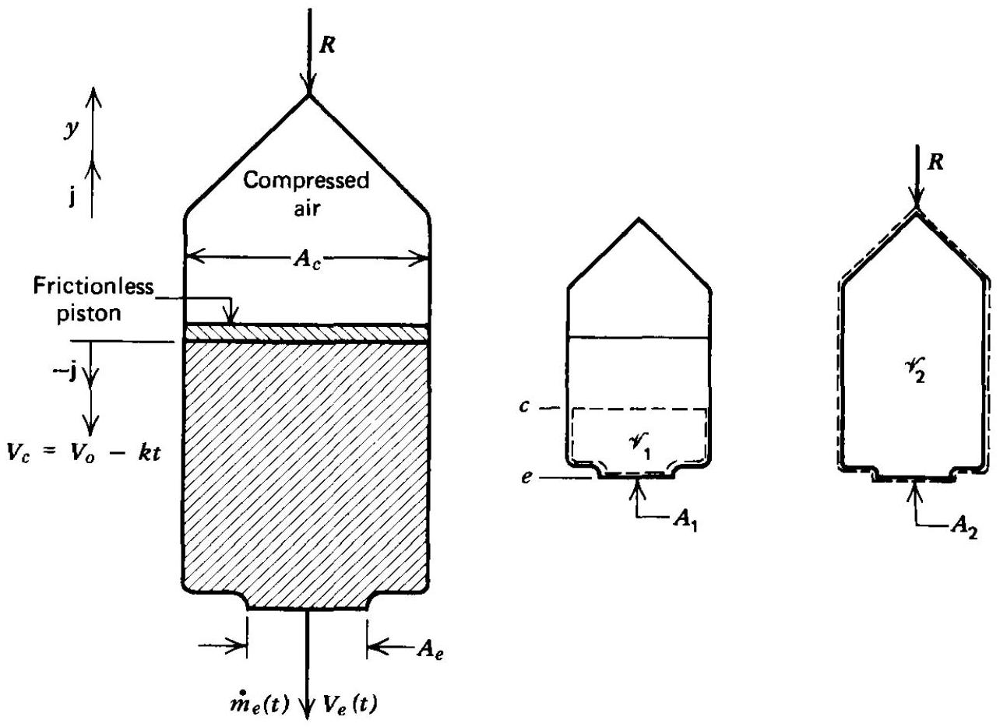
Figure 2.11 Sketch for Example 2.3.

$$
\begin{array}{cccc}
\mathbf{V}_{e} & =-\mathbf{j} V_{e} & \text { and } & d \mathbf{A}_{e} \\
\mathbf{V}_{c} & =-\mathbf{j} V_{c} & \text { and } & d \mathbf{A}_{c} \\
\text { 㖏 } & =\mathbf{j} d A_{c}
\end{array}
$$

Substituting these values into equation (a) and simplifying yields

$$
\begin{gathered}
\rho A_{e} V_{e}-\rho A_{c} V_{c}=0 \\
V_{e}=\frac{A_{c} V_{c}}{A_{e}}=2\left(V_{o}-k t\right)
\end{gathered}
$$

The instantaneous mass of the rocket may be determined from control volume $\mathscr{V}_{2}$, illustrated in Fig. 2.11, for which equation 2.42 becomes

$$
\int_{\mathscr{V}_{2}} \frac{\partial \rho}{\partial t} d \mathscr{V}+\int_{A_{2}} \rho \mathbf{V} \cdot d \mathbf{A}=0
$$

The first term in equation (f) may be written as

$$
\int_{\mathscr{V}_{2}} \frac{\partial \rho}{\partial t} d \mathscr{V}=\frac{\partial}{\partial t}(\rho \mathscr{V})=\frac{\partial M(t)}{\partial t}
$$

where $M(t)$ is the total mass of water, air, and solid rocket hardware in control volume $\mathscr{V}_{2}$. The second term in equation (f) is simply

$$
\int_{A_{2}} \rho \mathbf{V} \cdot d \mathbf{A}=\int_{A_{e}} \rho\left(-\mathbf{j} V_{e}\right) \cdot\left(-\mathbf{j} d A_{e}\right)=\rho V_{e} A_{e}=2 \rho A_{e}\left(V_{o}-k t\right)
$$

Substituting equations (g) and (h) into (f) yields

$$
\partial M / \partial t+2 \rho A_{e}\left(V_{o}-k t\right)=0
$$

Equation (i) may be integrated to yield

$$
\int_{M_{o}}^{M} d M=-\int_{0}^{t} 2 \rho A_{e}\left(V_{o}-k t\right) d t
$$

from which

$$
M(t)=M_{o}-2 \rho A_{e}\left(V_{o} t-\frac{k t^{2}}{2}\right)
$$

The reaction force on the rocket may now be determined by applying the momentum equation, equation 2.56 , to control volume $\mathscr{V}_{2}$. Thus,

$$
\mathbf{F}_{\text {surface }}+\int_{\mathscr{V}_{2}} \mathbf{B} \rho d \mathscr{V}=\int_{\mathscr{V}_{2}}(\rho \mathbf{V})_{t} d \mathscr{V}+\int_{A_{2}} \mathbf{V}(\rho \mathbf{V} \cdot d \mathbf{A})
$$

The only surface force acting on $A_{2}$ is $(-R)$. The body force caused by gravity is $-M g$, and the velocity of the water inside the control volume is $\left(-\mathbf{j} V_{c}\right)$. Hence, equation (1) becomes

$$
-R-M g=\frac{\partial}{\partial t}\left(-V_{c} M\right)-\rho A_{e} V_{e}^{2}
$$

The third term in equation (m) may be written as

$$
\frac{\partial}{\partial t}\left(-V_{c} M\right)=-M \frac{\partial V_{c}}{\partial t}-V_{c} \frac{\partial M}{\partial t}
$$

Substituting equation (i) and $V_{c}=\left(V_{o}-k t\right)$ into equation (n) yields

$$
\frac{\partial}{\partial t}\left(-V_{c} M\right)=k M+2 \rho A_{e}\left(V_{o}-k t\right)^{2}
$$

Substituting equations (k) and (o) into equation (m) and solving for $R$ yields

$$
R=-(g+k)\left[M_{o}-2 \rho A_{e}\left(V_{o} t-\frac{k t^{2}}{2}\right)\right]+2 \rho A_{e}\left(V_{o}-k t\right)^{2}
$$

The above example is a good illustration of the application of the momentum equation to an unsteady flow problem. It demonstrates vividly that to obtain a solution, careful attention must be given to the assumptions and approximations required.

## 2-7 THE FIRST LAW OF THERMODYNAMICS

It is shown in Section 1-11(b) that for a unit mass of a continuum, the first law of thermodynamics may be written in the form (see equation 1.48)

$$
d e=\delta Q-\delta W
$$

where de comprises the change in all of the forms of stored energy associated with the fluid. For a flowing fluid, the stored energy per unit mass will be assumed to be limited to thermal, kinetic, and potential energies. Consequently, the stored energy per unit mass of fluid is

$$
e=u+\frac{V^{2}}{2}+g z
$$

For a system having the total mass $m$, the total stored energy is $E=m e$, and equation 2.64 becomes

$$
d E=\delta Q-\delta W
$$

where $\delta Q$ and $\delta W$ apply to the entire system. To be mathematically unambiguous, it might be preferable to employ other symbols for $Q$ and $W$ in equation 2.64 to denote that they are intensive properties. Nevertheless, the convention adopted here is to employ $Q$ and $W$ in the energy equation for representing the heat and work
terms, respectively, regardless of whether they are based on a unit mass or the total mass of the system. When $Q$ and $W$ are to be determined on a rate basis (i.e., per unit time), the symbols $\dot{Q}$ and $\dot{W}$ will be employed. Any disadvantages arising from the lack of precision in the meaning of the symbols $Q$ and $W$ is more than offset by not having to define different symbols for the many different conditions under which $Q$ and $W$ may have to be determined. In a specific application, the basis for the terms $Q$ and $W$ is clearly defined by the symbol for the stored energy term. To illustrate, when $e$ is employed, $Q$ and $W$ refer to a unit mass basis; when $E$ is employed, $Q$ and $W$ apply to the entire mass of the system; when $d e / d t$ is employed, $\dot{Q}$ and $\dot{W}$ are rates per unit mass; and when $d E / d t$ is employed, $\dot{Q}$ and $\dot{W}$ are rates for the entire mass of the system.

Figure 2.12 illustrates the physical model for the control volume employed for developing the expression for the first law of thermodynamics for a control volume. The figure indicates schematically shaft work, shear work, heat transfer, and the flux

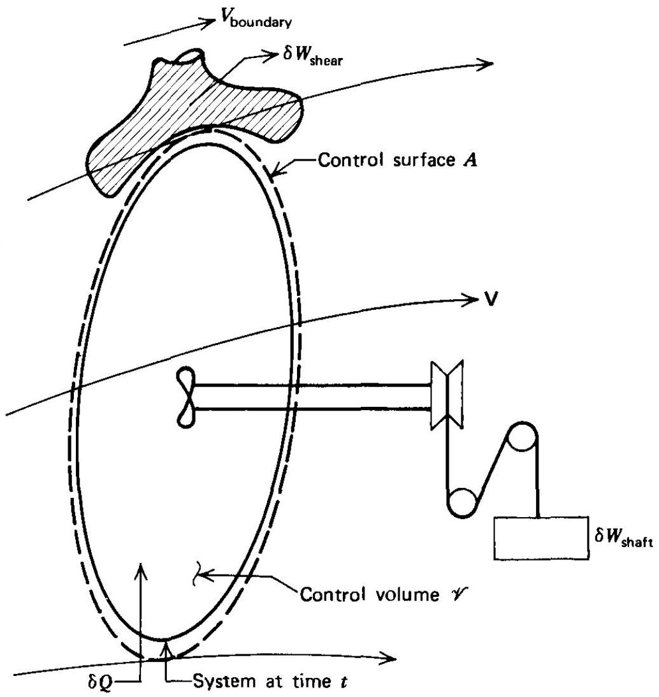
Figure 2.12 Control volume for deriving the first law of thermodynamics for a flowing fluid.

of mass across the boundaries of the control volume. Equation 2.66 is valid for a fluid particle, but it may be transformed into a rate equation for a system by dividing by $d t$. Thus,

$$
\frac{d E}{d t}=\delta \dot{Q}-\delta \dot{W}
$$

Equation 2.67 expresses the time rate of change of $E$ following a fluid particle and is, therefore, a substantial derivative. Hence,

$$
\frac{D E}{D t}=\delta \dot{Q}-\delta \dot{W}
$$

In the present case, $N=E=\int_{\mathscr{V}}\left(u+V^{2} / 2+g z\right) \rho d \mathscr{V}$ and $n=e=u+V^{2} / 2+ g z$. Substituting for $N$ and $n$ into equation 2.34, yields

$$
\frac{D E}{D t}=\int_{\mathscr{V}} \frac{\partial}{\partial t}\left[\rho\left(u+\frac{V^{2}}{2}+g z\right)\right] d \mathscr{V}+\int_{A}\left[\rho\left(u+\frac{V^{2}}{2}+g z\right)\right](\rho \mathbf{V} \cdot d \mathbf{A})
$$

To complete the transformation of the first law of thermodynamics for the system to a control volume, the heat and work terms must be expressed in terms of the flow properties pertinent to the control volume.

## 2-7(a) Heat Transfer to a Control Volume

The amount of heat transferred to a control volume, denoted by $\delta Q$, is the amount of heat transferred to the mass instantaneously occupying the control volume. Heat transferred to a system is considered positive. In general, the heat transfer may be caused by conduction, convection, and/or radiation. Thus,

$$
Q=\text { conduction }+ \text { convection }+ \text { radiation }
$$

To express $\delta Q$ explicitly in terms of the flow properties of the control volume, the different heat transfer processes and the flow properties must be related to each other, as is done in References 10 and 14 for conduction and convection and in Reference 15 for heat transfer by radiation. In this book the details of the heat transfer processes are not considered; the effect of heat transfer is, however, retained in the general form $\delta Q$. By so doing, the general influence of heat transfer is included in the governing equations and may be considered in solving one-dimensional problems.

## 2-7(b) Work Done by a Control Volume

The work done by a control volume on the surroundings is defined as positive work and is of two main types. First, there is shaft work, denoted by $W_{\text {shaft }}$; that is, the work done by a rotating shaft crossing the boundaries of the system. Examples of shaft work are the works done to operate compressors, hoists, and other machines. Second, there is the work done by the surface forces where a fluid crosses the boundaries of a control volume, or where the boundary of a control volume is moving; the former is called flow work [see Section 1-11(d)]. The surface forces, as shown earlier, can be resolved into normal forces due to pressure stresses and tangential forces due to shear stresses. Expressions for the work done by shear stresses will not be developed further herein; for a detailed discussion of shear work, see Reference 10. Instead, the work done by shear stresses will be denoted by $W_{\text {shear }}$ and retained in that general form in the appropriate equations.

The work done by the pressure stresses may be either the work done in pushing mass out of the control volume (positive work), or the work received when the surroundings push mass into the control volume (negative work).

Figure 2.13 illustrates the determination of the flow work because of normal stresses. The normal force acting on the infinitesimal vector area $d \mathbf{A}$ is given by

$$
d \mathbf{F}_{n}=p d \mathbf{A}
$$

The differential force $d \mathbf{F}_{n}$ given by equation 2.71 is the force exerted by the fluid inside the control volume on the surroundings and is, therefore, a positive term. The rate of doing work is obtained by multiplying the component of $d \mathbf{F}_{n}$ in the direction of the velocity $\mathbf{V}$ by the magnitude of the latter. Thus,

$$
\begin{aligned}
& \delta \dot{W}_{n}=d F_{n} V \cos \alpha=d \mathbf{F}_{n} \cdot \mathbf{V} \\
& \delta \dot{W}_{n}=p \mathbf{V} \cdot d \mathbf{A}=p v(\rho \mathbf{V} \cdot d \mathbf{A})
\end{aligned}
$$

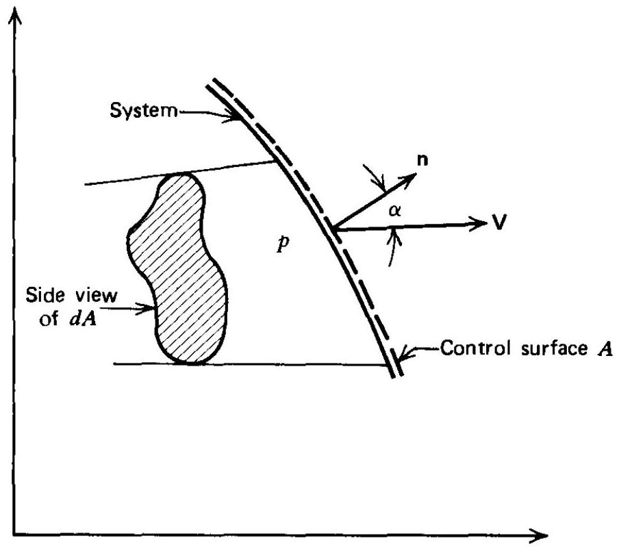
Figure 2.13 Flow work done by normal forces when mass crosses a control surface.

Since $(\rho \mathbf{V} \cdot d \mathbf{A})$ is positive for mass leaving the control volume and negative for mass entering, the work $\delta W_{n}$ done by pressure forces is likewise positive for mass flowing out of the control volume and negative for mass flowing into it, which is in accordance with the convention that the work done by the system is positive, and vice versa. In summary, the system does work when it pushes mass out of the control volume, across the control surface, and vice versa.

The total work done by the normal forces is obtained by integrating $\delta \dot{W}_{n}$ over the entire control surface $A$. Thus,

$$
\dot{W}_{n}=\int_{A} \delta \dot{W}_{n}=\int_{A} p v(\rho \mathbf{V} \cdot d \mathbf{A})
$$

Equation 2.74 includes both positive and negative work. The sign of the work is determined by that of the scalar product $\mathbf{V} \cdot d \mathbf{A}$.

The total rate at which work is done by the fluid that is instantaneously occupying the control volume is given by

$$
\dot{W}=\dot{W}_{\text {shaft }}+\dot{W}_{\text {shear }}+\int_{A} p v(\rho \mathbf{V} \cdot d \mathbf{A})
$$

## 2-7(c) The Energy Equation for a Control Volume

Equations 2.68, 2.69, 2.70, and 2.75, when combined, yield the equation representing the first law of thermodynamics for a control volume; it is called the energy equation. Thus,

$$
\begin{aligned}
\dot{W}_{\text {shaft }}+\dot{W}_{\text {shear }}-\dot{Q}+\int_{\mathscr{V}} \frac{\partial}{\partial t} & {\left[\rho\left(u+\frac{V^{2}}{2}+g z\right)\right] d \mathscr{V} } \\
& +\int_{A}\left(h+\frac{V^{2}}{2}+g z\right)(\rho \mathbf{V} \cdot d \mathbf{A})=0
\end{aligned}
$$

Note that the flow work caused by pressure stresses, $\int_{A} p v(\rho \mathbf{V} \cdot d \mathbf{A})$, is combined with the specific internal energy $u$ in the stored energy term in equation 2.69 to yield the expression $(u+p v)$. By definition [see Section 1-11(e)] the latter is the specific enthalpy $h$. Since the internal energy $u$ and the flow work $p v$ always occur in combination in the surface integral, it is convenient to employ the specific enthalpy $h$ of
the fluid, as in equation 2.76. It should be recalled, however, that the first integral specifies the unsteady stored energy term. Since the latter does not contain a flow work term, the internal energy $u$ appears in that integral.

## 2-7(d) Differential Form of the Energy Equation

The differential form of the energy equation is obtained from equation 2.76 by converting the surface integrals into volume integrals and then applying the result to a control volume of differential size. The result is

$$
\begin{aligned}
\delta \dot{W}_{\text {shaft }}+\delta \dot{W}_{\text {shear }}-\delta \dot{Q}+\frac{\partial}{\partial t} & {\left[\rho\left(u+\frac{V^{2}}{2}+g z\right)\right] } \\
& +\nabla \cdot\left[\left(h+\frac{V^{2}}{2}+g z\right) \rho \mathbf{V}\right]=0
\end{aligned}
$$

By adding $\pm[\rho(p v)]_{t}$ to the unsteady flow term in equation 2.77, that term becomes

$$
\frac{\partial}{\partial t}\left[\rho\left(h+\frac{V^{2}}{2}+g z\right)\right]-p_{t}
$$

where $p_{t}=\partial p / \partial t$. Expanding both the unsteady flow term and the energy flux term in equation 2.77, as in the derivation of the differential momentum equation (see equation 2.60), an expression comprising the product of the specific stored energy terms $\left(h+V^{2} / 2+g z\right)$ and the continuity equation is obtained, and that product may be discarded. The final form for the energy equation (equation 2.77) is

$$
\delta \dot{W}_{\text {shaft }}+\delta \dot{W}_{\text {shear }}-\delta \dot{Q}+\rho \frac{D}{D t}\left(h+\frac{V^{2}}{2}+g z\right)-p_{t}=0
$$

For steady flow, $D / D t=(\mathbf{V} \cdot \nabla)$, and $p_{t}=0$. The shaft work, shear work, and heat transfer terms in equation 2.79 only indicate that those processes may be present. Their calculation, however, requires deriving the appropriate equations for expressing the work and heat transfer processes in terms of the flow properties and their gradients.

Example 2.4. Air enters the compressor of a stationary gas turbine power plant with a static temperature of 300 K and an average velocity of $150 \mathrm{~m} / \mathrm{s}$. It is discharged from the compressor with an average velocity of $50 \mathrm{~m} / \mathrm{s}$. The compressor receives $100,000 \mathrm{~J} / \mathrm{kg}$ of work from the turbine, and the heat loss to the surroundings is $10,000 \mathrm{~J} / \mathrm{kg}$. Assuming steady flow, calculate the enthalpy and temperature of the air leaving the compressor, taking into account the variation of the specific heat of the air with temperature.

## Solution

From Table C.4, for $t_{1}=300 \mathrm{~K}, h_{1}=301,329 \mathrm{~J} / \mathrm{kg}$. For steady flow in the absence of shear work and gravitational effects, equation 2.76 reduces to

$$
\dot{W}_{\text {shaft }}-\dot{Q}+\int_{A}\left(h+\frac{V^{2}}{2}\right) \rho \mathbf{V} \cdot d \mathbf{A}=0
$$

Assuming uniform flow at the entrance 1 and the exit 2, equation (a) becomes

$$
\dot{W}_{\text {shaft }}-\dot{Q}+\dot{m}\left(h_{2}+\frac{V_{2}^{2}}{2}-h_{1}-\frac{V_{1}^{2}}{2}\right)=0
$$

Dividing equation (b) by $\dot{m}$ and solving for $h_{2}$ gives

$$
\begin{aligned}
& h_{2}=Q-W_{\text {shaft }}+h_{1}+\frac{V_{1}^{2}-V_{2}^{2}}{2} \\
& h_{2}=(-10,000)-(-100,000)+301,329+\frac{(150)^{2}-(50)^{2}}{2} \\
& h_{2}=401,329 \mathrm{~J} / \mathrm{kg}(172.54 \mathrm{Btu} / \mathrm{lbm})
\end{aligned}
$$

From Table C.4, for $h_{2}=401,329 \mathrm{~J} / \mathrm{kg}, t_{2}=399.18 \mathrm{~K}(718.53 \mathrm{R})$.
Example 2.5. Consider the tank and outlet duct described in Example 2.2. Assume that the mass discharge rate is small enough so that all of the properties inside of the tank and outlet duct may be considered to be uniform (i.e., not functions of $x, y$, and $z$ ), and that heat is transferred to the tank at the rate of $1055 \mathrm{~J} / \mathrm{s}$. Determine the instantaneous rate of change of the internal energy of the air in the tank (i.e., $\partial u / \partial t)$ for the conditions specified in Example 2.2.

## Solution

Define the inside of the tank and outlet duct as the control volume $\mathscr{V}$. There is no work, and the effects of body forces are negligible. For the low speeds involved, the kinetic energy may also be neglected. Thus, equation 2.76 becomes

$$
-\dot{Q}+\int_{\mathscr{V}} \frac{\partial}{\partial t}(u \rho) d \mathscr{V}+\int_{A_{\mathrm{out}}} h(\rho \mathbf{V} \cdot d \mathbf{A})=0
$$

The unsteady term in equation (a) may be written as

$$
\begin{aligned}
& \frac{\partial E}{\partial t}=\int_{\mathscr{V}} \frac{\partial}{\partial t}(u \rho) d \mathscr{V}=\frac{\partial}{\partial t} \int_{\mathscr{V}} u \rho d \mathscr{V}=\frac{\partial}{\partial t}(u \rho \mathscr{V}) \\
& \frac{\partial E}{\partial t}=u \mathscr{V} \frac{\partial \rho}{\partial t}+\rho \mathscr{V} \frac{\partial u}{\partial t}
\end{aligned}
$$

where $\partial \rho / \partial t=-\dot{m}_{\text {out }} / \mathscr{V}$ from equation (d) of Example 2.2. Hence,

$$
\frac{\partial E}{\partial t}=-u \dot{m}_{\mathrm{out}}+\rho \mathscr{V} \frac{\partial u}{\partial t}
$$

The energy flux term in equation (a) may be written as

$$
\dot{E}_{\mathrm{out}}=\int_{A_{\mathrm{out}}} h(\rho \mathbf{V} \cdot d \mathbf{A})=h \int_{A_{\mathrm{out}}} d \dot{m}_{\mathrm{out}}=h \dot{m}_{\mathrm{out}}
$$

Combining equations (a), (d), and (e), gives

$$
-\dot{Q}-u \dot{m}_{\mathrm{out}}+\rho \mathscr{V} \frac{\partial u}{\partial t}+h \dot{m}_{\mathrm{out}}=0
$$

For a perfect gas, $u=c_{v} T$ and $h=c_{p} T$, where $T$ denotes the static temperature in this problem to distinguish it from the time $t$. Solving equation (f) for $\partial u / \partial t$ gives

$$
\begin{gathered}
\rho \mathscr{V} \frac{\partial u}{\partial t}=\dot{Q}-\dot{m}_{\mathrm{out}}(h-u)=\dot{Q}-\dot{m}_{\mathrm{out}} T\left(c_{p}-c_{v}\right) \\
\frac{\partial u}{\partial t}=\frac{\dot{Q}-\dot{m}_{\mathrm{out}} R T}{\rho \mathscr{V}}
\end{gathered}
$$

where $\left(c_{p}-c_{v}\right)=R$ for a perfect gas.

Equation (h) is the desired relationship between $\partial u / \partial t$ and the other flow properties. From Example 2.2, $\mathscr{V}=0.283 \mathrm{~m}^{3}, \dot{m}_{\text {out }}=0.0272 \mathrm{~kg} / \mathrm{s}, \rho=1.729 \mathrm{~kg} / \mathrm{m}^{3}$, and $T=$ 277.8 K . Substituting those values into equation (h), we obtain

$$
\frac{\partial u}{\partial t}=\frac{1055-(0.0272)(287.04)(277.8)}{(1.729)(0.283)}=-2277 \mathrm{~J} / \mathrm{kg}(-0.979 \mathrm{Btu} / \mathrm{lbm})
$$

## 2-8 THE SECOND LAW OF THERMODYNAMICS

In Section 1-12 the second law of thermodynamics (i.e., the entropy equation) is developed for a system (equation 1.68). Thus,

$$
d s \geqq \frac{\delta Q}{t}
$$

where the equality applies to reversible processes and the inequality to irreversible (natural) processes.

As in the development of the energy equation in Section 2-7, the symbol $Q$ will be employed for heat transfer on a general basis, regardless of the exact mechanism of the heat transfer. Obviously, the basis for determining $Q$ must correspond to that for determining the entropy change.

For a system of mass $m$, the total entropy of the system is $S=m s$, and equation 1.68 becomes

$$
d S \geqq \frac{\delta Q}{t}
$$

Since equation 2.80 is valid for a fluid particle, the time rate of change in the entropy $S$ of the system is given by the substantial derivative of $S$. Hence,

$$
\frac{D S}{D t} \geqq \frac{\delta \dot{Q}}{t}
$$

In terms of the properties $N$ and $n, N=S=\int_{\mathscr{V}} s \rho d \mathscr{V}$, and $n=s$. Substituting. $n=s$ into equation 2.34 , yields

$$
\int_{\mathscr{V}}(s \rho)_{t} d \mathscr{V}+\int_{A} s(\rho \mathbf{V} \cdot d \mathbf{A}) \geqq \frac{\dot{Q}}{t}
$$

where $(s \rho)_{t}=\partial(s \rho) / \partial t$, and $\dot{Q}=\int_{v} \delta \dot{Q}$. Equation 2.82, called the entropy equation, is the integral form of the second law of thermodynamics for a control volume.

The differential form of the entropy equation is obtained by converting the surface integral to a volume integral, by means of the divergence theorem (equation 2.35), and applying the result to a control volume of differential size. Thus,

$$
(s \rho)_{t}+\nabla \cdot(s \rho \mathbf{V}) \geqq \frac{\delta \dot{Q}}{t}
$$

Expanding equation 2.83 and discarding the term containing the continuity equation yields

$$
\rho \frac{D s}{D t} \geqq \frac{\delta \dot{Q}}{t}
$$

For steady flow, equation 2.84 becomes

$$
\rho(\mathbf{V} \cdot \nabla) s \geqq \frac{\delta \dot{Q}}{t}
$$

As pointed out in deriving the energy equation, the heat transfer $Q$ in equation 2.84 must be expressed in terms of the flow properties. Equation 2.84 is suitable, however, for determining the overall effect of heat transfer.

## 2-9 SUMMARY

In this chapter the equations expressing the laws governing the flow of a fluid are derived for a control volume in integral and in differential forms. For convenience of reference, those equations are presented in Tables 2.1 and 2.2, respectively.

The integral forms of the governing equations are employed in the studies of onedimensional flows. They are presented in Table 2.1.

Table 2.1 Integral forms of the governing equations for fluid flow

## Continuity equation

$$
\int_{\mathscr{V}} \rho_{t} d \mathscr{V}+\int_{A} \rho \mathbf{V} \cdot d \mathbf{A}=0
$$

Momentum equation

$$
\int_{\mathscr{V}} \mathbf{B} \rho d \mathscr{V}-\int_{A} p d \mathbf{A}+\mathbf{F}_{\text {shear }}=\int_{\mathscr{V}}(\rho \mathbf{V})_{t} d \mathscr{V}+\int_{A} \mathbf{V}(\rho \mathbf{V} \cdot d \mathbf{A})
$$

Energy equation

$$
\begin{aligned}
\dot{W}_{\text {shaft }}+\dot{W}_{\text {shear }}-\dot{Q}+\int_{\mathscr{K}} \frac{\partial}{\partial t}\left[\rho\left(u+\frac{V^{2}}{2}+g z\right)\right] & d \mathscr{V} \\
& +\int_{A}\left(h+\frac{V^{2}}{2}+g z\right)(\rho \mathbf{V} \cdot d \mathbf{A})=0
\end{aligned}
$$

Entropy equation

$$
\int_{\mathscr{V}}(s \rho)_{t} d \mathscr{V}+\int_{A} s(\rho \mathbf{V} \cdot d \mathbf{A}) \geqq \frac{\dot{Q}}{t}
$$

The differential forms of the governing equations are derived with $\mathbf{F}_{\text {shear }}, W_{\text {shear }}$, $W_{\text {shaft }}$, and $Q$ retained in functional form. Consequently, the influence of the latter processes may be considered in a qualitative manner only. Those processes must either be omitted or expressed in terms of the fluid flow properties and their gradients before solving the pertinent differential equations. The differential forms of the governing equations are employed in the study of multidimensional flows. They are presented in Table 2.2.

## Table 2.2 Differential forms of the governing equations for fluid flow

## Continuity equation

$$
\rho_{t}+\nabla \cdot(\rho \mathbf{V})=0
$$

Momentum equation

$$
\rho \frac{D \mathbf{V}}{D t}+\nabla p-\rho \mathbf{B}-d \mathbf{F}_{\text {shear }}=0
$$

Energy equation

$$
\delta \dot{W}_{\text {shafi }}+\delta \dot{W}_{\text {shear }}-\delta \dot{Q}+\rho \frac{D}{D t}\left(h+\frac{V^{2}}{2}+g z\right)-p_{\mathrm{t}}=0
$$

Entropy equation

$$
\rho \frac{D s}{D t} \geqq \frac{\delta \dot{Q}}{t}
$$

A useful collection of the differential forms of the governing equations (including viscous stresses) is presented in Reference 16. The basic differential equations are presented there in the following coordinate systems: Cartesian tensor, vector, orthogonal curvilinear, Cartesian (rectangular), cylindrical, and spherical.

## REFERENCES

1. M. J. Zucrow, Aircraft and Missile Propulsion, Vol. 1, Wiley, New York, 1958.
2. A. H. Shapiro, The Dynamics and Thermodynamics of Compressible Fluid Flow, Vol. 1, Ronald Press, New York, 1953.
3. K. Oswatitsch, Gas Dynamics, Academic Press, New York, 1956.
4. R. von Mises, Mathematical Theory of Compressible Fluid Flow, Academic Press, New York, 1958.
5. I. H. Shames, Mechanics of Fluids, McGraw-Hill, New York, 1962.
6. R. W. Fox and A. H. McDonald, Introduction to Fluid Mechanics, Wiley, New York, 1973.
7. H. W. Liepmann and A. Roshko, Elements of Gas Dynamics, Wiley, New York, 1957.
8. J. A. Owczarek, Fundamentals of Gas Dynamics, International Textbook Co., Scranton, Pa., 1964.
9. R. Aris, Vector, Tensors, and the Basic Equations of Fluid Mechanics, Prentice-Hall, Englewood Cliffs, N.J., 1962.
10. H. Schlichting, Boundary Layer Theory, Sixth Edition, McGraw-Hill, New York, 1968.
11. S. I. Pai, Viscous Flow Theory, I. Laminar Flow, Van Nostrand, Princeton, N.J., 1956.
12. L. Prandtl and O. J. Tietjens, Fundamentals of Hydro- and Aeromechanics, McGraw-Hill, New York, 1934.
13. J. W. Daily and D. R. F. Harleman, Fluid Dynamics, Addison-Wesley, Reading, Mass., 1966.
14. E. R. G. Eckert and R. M. Drake, Heat and Mass Transfer, McGraw-Hill, New York, 1959.
15. W. G. Vincenti and C. H. Kruger, Introduction to Physical Gas Dynamics, McGraw-Hill, New York, 1965.
16. W. F. Hughes and E. W. Gaylord, Basic Equations of Engineering Science, Schaum Publishing Co., New York, 1964.
17. L. Milne-Thompson, Theoretical Hydrodynamics, Macmillan, New York, 1950.
18. Handbook of Supersonic Aerodynamics, NAVORD Report 1488, Vol. 1, U.S. Government Printing Office, April 1950.

## PROBLEMS

1. A fluid particle in steady flow has the vector velocity $\mathbf{V}$. It is found that $\mathbf{V}$ depends only on the position of the particle in space, and its magnitude is given by the functional relationship

$$
V=2 x^{2} y+3 y z-4 x z^{2}
$$

where $x, y$, and $z$ are distances measured along the coordinate axes. Calculate (a) the value of $V$ at point $1,2,3$, and (b) the values of $\partial V / \partial x, \partial V / \partial y$, and $\partial V / \partial z$ at the same point.
2. In a two-dimensional flow the scalar component of the velocity vector $\mathbf{V}$ in the direction of the $x$ axis is denoted by $u$, and the component along the $y$ axis by $v$. The components $u$ and $v$ are defined by $u=y^{2}-x^{2}$, and $v=2 x y$. Calculate at the point $(2,2)$ (a) the magnitude $V$ of the velocity vector, (b) the angle $\theta$ made by V with the $x$ axis, and (c) the acceleration of the fluid particles as they pass that point.
3. By definition a streamline is a curve such that its tangent at each point has the same direction as the velocity vector $\mathbf{V}$. If $u$ and $v$ are defined by the relationships given in Problem 2, derive the differential equation for the streamlines. Solve the differential equation, plot the streamlines in the region bounded by $x=-10$ to $10, y=-10$ to 10 , and discuss the results.
4. Figure 2.14 illustrates a tank of volume $\mathscr{V}$ containing a liquid having an initial density denoted by $\rho_{i}$. A second liquid having a density denoted by $\rho$ enters the tank steadily with the mass flow rate $\dot{m}$, and mixes thoroughly with the fluid in the tank. The liquid level in the tank is maintained constant by allowing flow out of the side of the tank. Assume that $\rho_{i}>\rho$. Derive

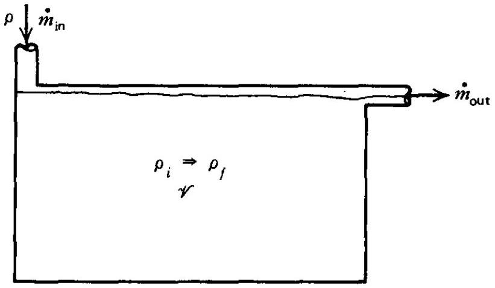
Figure 2.14 Sketch for Problem 2.4

an expression for (a) the time rate of change of the density of the liquid in the tank, and (b) the time required for the density in the tank to reach the value $\rho_{f}<\rho_{i}$.
5. An incompressible inviscid fluid flows steadily through a converging conical flow passage having an inlet diameter $D_{o}$ and a wall semiangle $\alpha$, where the distance $x$ is measured from the inlet. The mass flow rate is $\dot{m}$ and the density is $\rho$. Assume that body forces are negligible, and that the flow is uniform at each cross section. Derive an expression for the acceleration of the fluid particles as a function of $x$.
6. Figure 2.15 illustrates a cylindrical tank from which water flows through a well-rounded circular orifice at the bottom of the tank. Determine an expression for the height $h$ of the water column in terms of $A_{1}, A_{2}, h_{o}, g$, and the time $t$. Assume that $A_{1} \gg A_{2}$.
7. A flat plate oriented perpendicularly to a horizontal jet of water is moved toward the jet at a velocity $V=6.0 \mathrm{~m} / \mathrm{s}$. The water jet strikes the plate and flows vertically from the surface of the plate. The mass flow rate of the jet from a stationary nozzle is $50 \mathrm{~kg} / \mathrm{s}$, and the velocity of the jet is $15.0 \mathrm{~m} / \mathrm{s}$. Determine the force that must be applied to the plate to maintain it at a constant velocity.
8. Figure 2.16 illustrates a reducing elbow. Water at the pressure $p_{1}=14.80 \cdot 10^{5} \mathrm{~N} / \mathrm{m}^{2}$ enters the elbow with a uniform velocity $V_{1}=6.0 \mathrm{~m} / \mathrm{s}$ normal to the inlet area. The direction of the discharge is rotated 90 deg from that of the inlet. The inlet diameter $D_{1}=0.30 \mathrm{~m}$ and that of the exit $D_{2}=0.15 \mathrm{~m}$. The pressure of the water at the exit section $p_{2}=12.00 \cdot 10^{5} \mathrm{~N} / \mathrm{m}^{2}$, and the atmospheric pressure $p_{o}=1.0135 \cdot 10^{5} \mathrm{~N} / \mathrm{m}^{2}$. Assume that the flow is uniform at the exit section. Calculate (a) the force exerted by the pipe on the water, (b) the force exerted by the water on the pipe, and (c) the force required to hold the pipe stationary.
9. A rocket motor is fired statically on a thrust stand. The mass flow rate of propellants $\dot{m}= 9.0 \mathrm{~kg} / \mathrm{s}$, the average jet velocity at the nozzle exit plane $V_{e}=2500 \mathrm{~m} / \mathrm{s}$, and the static pressure acting on the exit plane is equal to the pressure of the surrounding atmosphere. Determine the force transmitted to the thrust stand by the rocket motor.

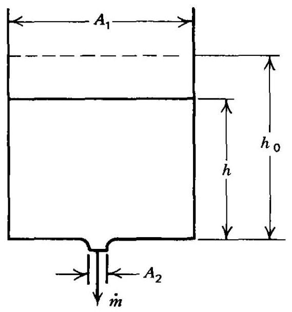
Figure 2.15 Sketch for Problem 2.6.

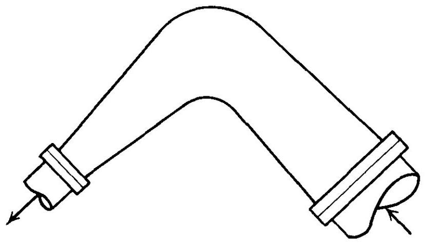
Figure 2.16 Sketch for Problem 2.8.


[^0]:    *The convention of denoting partial derivatives by subscripts will be employed when there can be no confusion with other notation.

