## 3

## general features of the steady one-dimensional flow of a compressible fluid

3-1 PRINCIPAL NOTATION FOR CHAPTER 3 ..... 103
3-2 INTRODUCTION ..... 104
3-3 THE ONE-DIMENSIONAL FLOW CONCEPT ..... 105
3-4 CONSERVATION OF MASS FOR STEADY ONE-DIMENSIONAL FLOW ..... 109
3-5 DYNAMICS OF STEADY ONE-DIMENSIONAL FLOW ..... 110
(a) Frictionless flow ..... 110
(b) Frictionless flow of an incompressible fluid ..... 112
(c) Adiabatic frictionless flow of a compressible fluid ..... 112
(d) Flow with friction ..... 113
(e) Incompressible flow with friction ..... 114
(f) Compressible flow of a perfect gas in the presence of friction ..... 114
(g) External forces acting on a flowing fluid ..... 115
3-6 THERMODYNAMICS OF STEADY ONE-DIMENSIONAL FLOW ..... 120
(a) Flow with work and heat transfer ..... 120
(b) Adiabatic flow with no external work ..... 122
(c) Isentropic flow ..... 122
(d) Adiabatic flow of a perfect gas ..... 123
(e) Isentropic discharge speed for a perfect gas ..... 124
3-7 THE SECOND LAW OF THERMODYNAMICS FOR STEADY ONE- DIMENSIONAL FLOW ..... 125
3-8 SOME GENERAL EFFECTS OF COMPRESSIBILITY ON FLUID FLOW ..... 125
(a) Speed of propagation of small disturbances ..... 125
(b) Pressure disturbances in a compressible fluid ..... 128
(c) Compressibility factor ..... 131
3-9 STAGNATION (OR TOTAL) CONDITIONS ..... 132
(a) Stagnation enthalpy ..... 134
(b) Stagnation temperature ..... 134
(c) Stagnation pressure ..... 136
(d) Stagnation density ..... 137
(e) Stagnation acoustic speed ..... 137
(f) Entropy change in terms of stagnation properties ..... 138
3-10 CHARACTERISTIC SPEEDS OF GAS DYNAMICS ..... 139
(a) Maximum isentropic speed ..... 139
(b) Critical speed of sound ..... 140
(c) Thermodynamic properties corresponding to $a^{*}$ ..... 141
(d) Relationships between the characteristic speeds ..... 141
(e) Dimensionless velocity $M^{*}$ ..... 142
3-11 THE CONTINUITY RELATIONSHIPS FOR A PERFECT GAS ..... 144
(a) The continuity equation for a perfect gas ..... 144
(b) Critical flow area ..... 145
(c) Effect of compressibility on the mass flow rate ..... 147
(d) Condition for maximum isentropic mass rate of flow ..... 148
3-12 STREAM THRUST AND THE IMPULSE FUNCTION ..... 150
3-13 DYNAMIC PRESSURE AND THE PRESSURE COEFFICIENT ..... 151
(a) Dynamic pressure ..... 151
(b) The pressure coefficient ..... 152
3-14 SUMMARY ..... 153

## 3-1 PRINCIPAL NOTATION FOR CHAPTER 3

$a \quad$ speed of sound.
$a_{o} \quad$ stagnation speed of sound.
$a^{*} \quad$ critical (i.e., sonic) speed of sound.
$A$ flow cross-sectional area.
$c_{p} \quad$ specific heat at constant pressure.
$c_{v} \quad$ specific heat at constant volume.
$D$ drag force.
$\mathscr{D}$ hydraulic diameter.
f friction factor in the Fanning equation
F vector force.
$\mathscr{F} \quad=p A+\dot{m} V$, stream thrust, and impulse function.
$g \quad$ acceleration due to gravity.
$G \quad=\dot{m} / A$, mass flux.
$h$ static specific enthalpy.
$H$ stagnation specific enthalpy.
$m$ mass.
$\dot{m}$ mass flow rate.
$\bar{m}$ molecular weight.
M Mach number.
$M^{*} \quad=V / a^{*}$, dimensionless velocity.
$p \quad$ absolute static pressure.
$P \quad$ stagnation pressure.
$q \quad=\rho V^{2} / 2$, dynamic pressure.
$Q$ heat.
$R \quad$ gas constant.
$\bar{R} \quad$ universal gas constant.
$s$ specific entropy.
$t \quad$ absolute static temperature.
$T \quad$ stagnation temperature.
$u \quad$ static specific internal energy.
$V \quad$ velocity magnitude.
V vector velocity.
$V_{\text {max }}^{\prime}$ maximum isentropic speed.
$\mathscr{V}$ volume of a control volume.
$W$ work.
$x$ displacement along flow path.
$z \quad$ position in a gravitational field.

## Greek Letters

$\alpha \quad=\sin ^{-1}(1 / M)$, Mach angle.
$\gamma \quad=c_{p} / c_{v}$, specific heat ratio.
$\rho \quad$ static density.
$\rho_{0} \quad$ stagnation density.
Superscripts
' denotes that the state is reached by an isentropic process.

* $\quad$ critical condition, where $M=1$.

## 3-2 INTRODUCTION

In Chapter 2, the governing equations for the flow of a fluid are developed in both integral and differential form for a control volume (see Tables 2.1 and 2.2). Those equations are a highly nonlinear set of equations in three space variables and time, and their general solutions are practically nonexistent. Consequently, they must be simplified before they may be employed for obtaining useful results.

Thus, as a first approximation, it is assumed that (1) the flow is steady, (2) the fluid properties are uniform at each location where mass crosses the control surface, and (3) the effects of body forces are negligible.

Assumption (1) signifies that at each cross section of a flow passage, the magnitudes of the flow properties are invariant with time. In reality, steady flow exists only if the fluid particles move along streamlines. Because of the turbulence and eddies that accompany most of the practical cases of fluid flow, a practical flow is not steady in a strict sense, even though no variations in the rate of flow are detectable with the most refined measuring instruments. If the measured rate of flow of a fluid is constant, it may be imagined that fixed streamlines can be drawn in the fluid in such a manner that they are tangent to the average direction of the flow. The actual fluid motion may thereby be conceived to be composed of a steady motion along the aforementioned streamlines with irregular random disturbances of velocity superimposed on
them, the net effect of the disturbances on the mass rate of flow of the main fluid being zero.

Assumption (2) signifies that the area of the cross section of a flow passage is either constant or changes so gradually that at each cross section the fluid properties change appreciably only in the flow direction under consideration. In all other directions the changes in the flow properties take place so slowly that they may be ignored. Such flows are called one-dimensional flows.

Assumption (3) is justified for the flow of gases where the effects of body forces are usually insignificant,

The results obtained under the aforementioned three assumptions are quite accurate for many internal flows (i.e., flows inside of solid boundaries), and the results are useful qualitatively for understanding external flows.

In this chapter, the governing equations are developed, subject to the aforementioned three assumptions, in a form applicable to the flow of any fluid. ${ }^{1-6}$ In general, the solution of those equations must be obtained by either graphical or numerical techniques. A fourth assumption is introduced that the working fluid behaves thermodynamically in accordance with both the thermal and caloric equations of state for a perfect gas (see Section 1-15). The results obtained from the governing equations derived by applying the aforementioned four assumptions may be modified, if necessary, so that any deviations from the simplifying assumptions may be taken into account.

The developments of this chapter show that the local static properties of a flowing fluid $p, \rho$, and $t$, when expressed as ratios of their corresponding local stagnation values $P, \rho_{o}$, and $T$, depend only on the local Mach number $M$. Consequently, for a compressible fluid, each flow variable may be considered to be a function of the Mach number $M$. Consequently, if the Mach number $M$ is either known, or calculable at some point in a flow field, then the ratios $p / P, \rho / \rho_{o}$, and $t / T$ at that point are known, and vice versa.

## 3-3 THE ONE-DIMENSIONAL FLOW CONCEPT

The governing equations for analyzing fluid flow involve four independent variables: three space dimensions and time. Furthermore, because of the mathematical difficulties encountered in deriving general solutions of those equations, simplifying assumptions are introduced, more often than not, to obtain a physical model that is more amenable to mathematical analysis. The most important and most commonly employed approximation is that the flow is one-dimensional; that is, that all of the fluid properties are uniform over every cross section of the flow passage.

Figure 3.1a illustrates diagrammatically three different velocity profiles for a fluid flowing in a circular duct diameter $D=2 R$. They correspond to a one-dimensional flow, which has a uniform velocity profile, a fully developed turbulent flow (with the Reynolds number $\operatorname{Re}=D V \rho / \mu$, ranging from $10^{4}$ to $10^{5}$ ), and a fully developed laminar flow.

The equation for the laminar velocity profile illustrated in Fig. 3.1a is an exact solution of the Navier-Stokes equations (see equation 5.172), and is

$$
u=u_{\max }\left(1-\frac{y^{2}}{R^{2}}\right)
$$

The velocity profile for the fully developed turbulent flow is based on experiment. From the vast amount of experimental data that has been accumulated on the

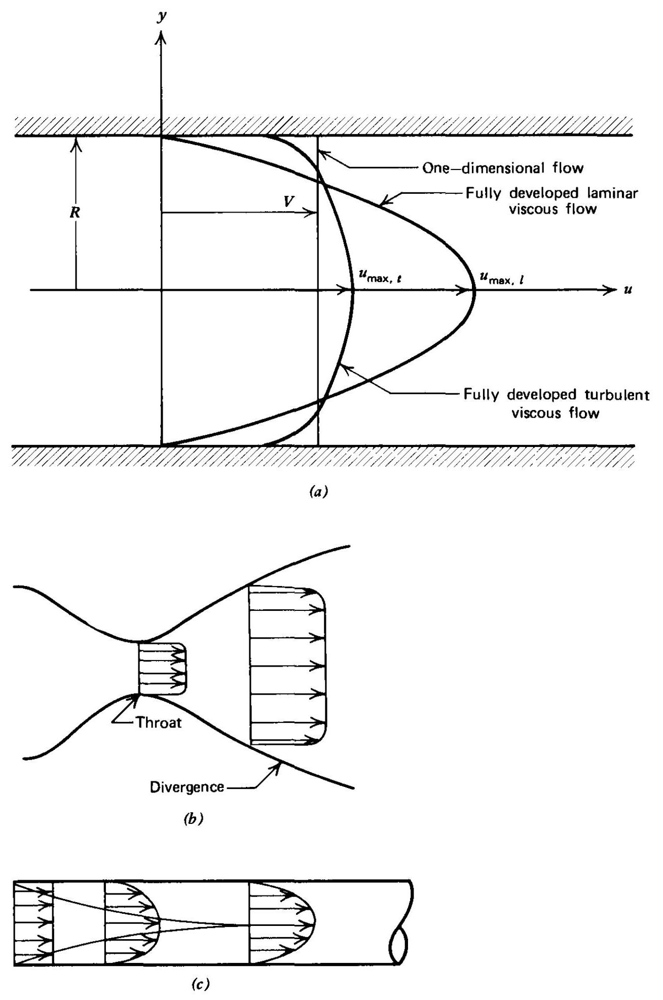
Figure 3.1. Velocity profiles in several typical flow passages. (a) A comparison of one-dimensional, laminar, and turbulent velocity profiles in a round pipe. (b) Flow in a converging-diverging nozzle. (c) Developing flow in the entrance region of a pipe.

velocity profiles for the turbulent flow of fluids in pipes, the following empirical equation has been derived. ${ }^{7,8}$

$$
u=u_{\max }\left(1-\frac{y}{R}\right)^{1 / n}
$$

Equation 3.2 is known as the power law equation (see Section 5-10). In that equation the value of $n$ is determined by experiment. The following table presents $n$ as a function of the Reynolds number Re.

Exponent $n$ for Power Law Velocity Profiles
| $\operatorname{Re}=\frac{D V \rho}{\mu}$ | $4 \cdot 10^{3}$ | $2.3 \cdot 10^{4}$ | $1.1 \cdot 10^{5}$ | $1.1 \cdot 10^{6}$ | $2 \cdot 10^{6}$ | $3.2 \cdot 10^{6}$ |
| :--- | :--- | :--- | :--- | :--- | :--- | :--- |
| $n$ | $6 \cdot 0$ | 6.6 | 7.0 | 8.8 | 10 | 10 |

Figure 3.1b illustrates schematically the velocity profiles in the throat and divergence of a converging-diverging nozzle. Thé bulk of the flow is inviscid, the viscous effects being confined to the thin boundary layer near the wall. Figure 3.1c illustrates the development of the velocity profile in the entrance region of a pipe.

From the foregoing few examples, it is apparent that different configurations are possible for the velocity profile of a flowing medium. Whether or not the assumption of one-dimensional flow is justified in a particular case depends on how significantly the actual velocity profile differs from the uniform velocity profile of one-dimensional flow (see Fig. 3.1a).

In a one-dimensional flow, because of its uniform velocity profile (see Fig. 3.1a), the flow properties are calculated so that they represent, as closely as possible, the actual overall values of the mass flow rate, momentum, and kinetic energy corresponding to the actual flow. If the velocity profile of the actual flow deviates appreciably from the uniform velocity profile of the corresponding one-dimensional flow, the calculated values of the flow properties will be in error. For most practical turbulent flows, however, the error is ordinarily within the desired accuracy tolerance.

For a fully developed turbulent flow in a pipe, having a velocity profile similar to that illustrated in Fig. 3.1a, the one-dimensional approximation is quite accurate. It is also quite accurate for the flows in the throats of converging and convergingdiverging nozzles, and in the divergence of the latter nozzles (see Fig. 3.1b). The approximation is also satisfactory for the flow in diffusers where the bulk of the flow remains outside of the boundary layer adjacent to the walls. The one-dimensional assumption may lead to significant errors in laminar flows, flows inside passages having complicated shapes, and in ducts with developing flows, such as that illustrated in Fig. 3.1c.

The one-dimensional flow concept as employed in gas dynamics is an approximation only as far as the flow model is concerned, but not insofar as the governingflow equations are concerned. Once the approximation of uniform flow properties at each cross section is made, the integral forms of the governing equations (see Table 2.1) can be applied to the simplified flow model. The exact differential forms of the governing equations (see Table 2.2) are derived from the integral equations without any restrictions being placed on the flow model. Consequently, the aforementioned differential equations are invalid for the subject one-dimensional (i.e., a uniform flow) model. A new set of differential equations are, therefore, derived in this section for the steady one-dimensional flow model by employing the integral forms of the governing equations presented in Table 2.1.

The one-dimensional flow approximation is exact for the flow through an infinitesimal stream tube. Thus, many of the general features that characterize large-scale, one-dimensional flows are also present along the streamlines of a multidimensional flow. In general, the one-dimensional approximation is reasonable if the rate of change of the so-called flow driving potential is small in the direction of flow. The following flow driving potentials are considered in this book: area change, wall friction, heat transfer, and mass addition. Furthermore, the radius of curvature of the flow passage should be large, and the profiles of the flow properties should remain
similar at each flow cross section. Accordingly, it is to be expected that the onedimensional flow model will be poor for flow passages such as pipe elbows, and in a duct wherein a transition from laminar to turbulent flow occurs. It should be noted that the one-dimensional flow model considers changes only in the average or bulk values of the flow properties in the direction of flow; it disregards completely the variations in the flow properties in the direction normal to the streamlines.

Example 3.1. Consider the incompressible flow of a fluid in a pipe for three different cases, all having the same mass flow rate $\dot{m}$ : (1) one-dimensional flow, (2) fully developed laminar flow, and (3) fully developed turbulent flow. Refer to Fig. 3.1a. The laminar velocity profile is given by equation 3.1. Thus,

$$
u=u_{\max }\left(1-\frac{y^{2}}{R^{2}}\right)
$$

where $R$ is the inside radius of the pipe, and $u_{\text {max }}$ denotes the centerline velocity. For Reynolds numbers in the neighborhood of $10^{5}$, the turbulent velocity profile is well approximated by equation 3.2. Thus,

$$
u=u_{\max }\left(1-\frac{y}{R}\right)^{1 / 7}
$$

Assume that all three velocity profiles yield the same mass flow rate $\dot{m}$. Determine $u_{\text {max }}$ for both the laminar and turbulent flows in terms of the one-dimensional velocity $V$, and calculate the ratios of the actual to the one-dimensional flow momentum and kinetic energy for each velocity profile.

## Solution

For the one-dimensional flow case (subscript 1-D):

$$
\begin{aligned}
& \dot{m}_{1-D}=\int_{A} \rho \mathbf{V} \cdot d \mathbf{A}=\int_{0}^{R} \rho u(2 \pi y d y)=2 \pi \rho \int_{0}^{R} u y d y=\pi \rho R^{2} V \\
& \dot{M}_{1-D}=\text { Momentum }=\int_{A} \mathbf{V}(\rho \mathbf{V} \cdot d \mathbf{A})=2 \pi \rho \int_{0}^{R} u^{2} y d y=\pi \rho R^{2} V^{2} \\
& \dot{E}_{1-D}=\text { Kinetic energy }=\int_{A} \frac{V^{2}}{2}(\rho \mathbf{V} \cdot d \mathbf{A})=2 \pi \rho \int_{0}^{R} \frac{u^{3}}{2} y d y=\frac{\pi}{2} \rho R^{2} V^{3}
\end{aligned}
$$

(a) For the laminar flow case (subscript $l$ ):

$$
\dot{m}_{l}=2 \pi \rho \int_{0}^{R} u_{\max }\left(1-\frac{y^{2}}{R^{2}}\right) y d y=\frac{\pi}{2} \rho R^{2} u_{\max }
$$

Combining equations (c) and (f) yields

$$
u_{\max }=2 \mathrm{~V}
$$

The calculation of the momentum and kinetic energy yields

$$
\begin{aligned}
\dot{M}_{l} & =2 \pi \rho \int_{0}^{R} u_{\max }^{2}\left(1-\frac{y^{2}}{R^{2}}\right)^{2} y d y=\frac{\pi}{3} \rho R^{2} u_{\max }^{2} \\
\dot{E}_{l} & =2 \pi \rho \int_{0}^{R} \frac{u_{\max }^{3}}{2}\left(1-\frac{y^{2}}{R^{2}}\right)^{3} y d y=\frac{\pi}{8} \rho R^{2} u_{\max }^{3}
\end{aligned}
$$

Combining equations (d) and (h) yields

$$
\frac{\dot{M}_{l}}{\dot{M}_{1-D}}=\frac{4}{3}
$$

Combining equations (e) and (i) yields

$$
\frac{\dot{E}_{l}}{\dot{E}_{1-D}}=2
$$

(b) For the turbulent flow case (subscript $t$ ):

$$
\dot{m}_{i}=2 \pi \rho \int_{0}^{R} u_{\max }\left(1-\frac{y}{R}\right)^{1 / 7} y d y=\frac{49 \pi}{60} \rho R^{2} u_{\max }
$$

Combining equations (c) and (1) yields

$$
u_{\max }=\left(\frac{60}{49}\right) V
$$

For the momentum and the kinetic energy of the fluid in the case of a turbulent flow:

$$
\begin{aligned}
\dot{M}_{t} & =2 \pi \rho \int_{0}^{R} u_{\max }^{2}\left(1-\frac{y}{R}\right)^{2 / 7} y d y=\frac{49 \pi}{12} \rho R^{2} u_{\max }^{2} \\
\dot{E}_{t} & =2 \pi \rho \int_{0}^{R} \frac{u_{\max }^{3}}{2}\left(1-\frac{y}{R}\right)^{3 / 7} y d y=\frac{49 \pi}{170} R^{2} u_{\max }^{3}
\end{aligned}
$$

From equations (d) and (n) the ratio $\dot{M}_{t} / \dot{M}_{1-D}$ is

$$
\frac{\dot{M}_{t}}{\dot{M}_{1-D}}=1.020
$$

Combining equations (e) and (o), the ratio $\dot{E}_{t} / \dot{E}_{1-D}$ is

$$
\frac{\dot{E}_{t}}{\dot{E}_{1-D}}=1.058
$$

Equations (p) and (q) indicate that the one-dimensional flow model may be appropriate for fully developed turbulent pipe flow, but equations (j) and (k) indicate that it may lead to considerable error for a fully developed laminar flow.

## 3-4 CONSERVATION OF MASS FOR STEADY ONE-DIMENSIONAL FLOW

In this section, the equation governing the conservation of mass is derived for a steady one-dimensional flow. The resultant equation is called the continuity equation. From Table 2.1, the integral form of the law of the conservation of mass is given by equation 2.86. Thus,

$$
\int_{\mathscr{V}} \rho_{t} d \mathscr{V}+\int_{A} \rho \mathbf{V} \cdot d \mathbf{A}=0
$$

For steady flows, the first term in equation 2.86 is zero.
Refer to Fig. 3.2, which illustrates the flow through a stream tube. Let $\mathbf{A}_{1}$ and $\mathbf{A}_{2}$ denote the inlet and exit areas, $\mathbf{V}_{1}$ and $\mathbf{V}_{2}$ the mean velocities over the areas $\mathbf{A}_{1}$ and $\mathbf{A}_{2}$, and $\rho_{1}$ and $\rho_{2}$ the corresponding values of the density of the fluid. Applying equation 2.86 to $\mathbf{A}_{1}$ and $\mathbf{A}_{2}$ yields

$$
\int_{\mathbf{A}_{2}} \rho \mathbf{V} \cdot d \mathbf{A}+\int_{\mathbf{A}_{1}} \rho \mathbf{V} \cdot d \mathbf{A}=0
$$

Integrating equation 3.3 gives the following equation for the mass rate of flow through the stream tube.

$$
\dot{m}=\rho_{1} A_{1} V_{1}=\rho_{2} A_{2} V_{2}=\rho A V=\text { constant }
$$

Equation 3.4 applies to the steady one-dimensional flow of any fluid.

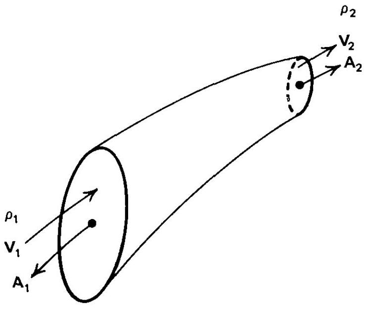
Figure 3.2. Steady flow through a stream tube.

## 3-5 DYNAMICS OF STEADY ONE-DIMENSIONAL FLOW

The momentum equation for a steady one-dimensional flow is derived below. Inviscid flows are considered first. The results are then extended to account for the effects of friction. Finally, a method is presented for determining the external forces acting on a flowing fluid.

## 3-5(a) Frictionless Flow

The integral form of the momentum equation for the $x_{i}$ direction (i.e., equation 2.55) is repeated and renumbered below.

$$
\int_{\mathscr{V}} B_{i} \rho d \mathscr{V}-\int_{A} p \mathbf{n}_{i} \cdot d \mathbf{A}+\mathbf{n}_{i} \cdot \mathbf{F}_{\text {shear }}=\int_{\mathscr{V}}\left(\rho u_{i}\right)_{t} d \mathscr{V}+\int_{A} u_{i}(\rho \mathbf{V} \cdot d \mathbf{A})
$$

Figure 3.3 illustrates a portion of a frictionless one-dimensional flow passage through which fluid flows in the $x$ direction. For a steady frictionless flow, $\left(\rho u_{i}\right)_{t}=\mathbf{F}_{\text {shear }}=0$, and equation 3.5 reduces to

$$
\int_{\mathscr{V}} B_{i} \rho d \mathscr{V}-\int_{A} p \mathbf{n}_{i} \cdot d \mathbf{A}=\int_{A} u_{i}(\rho \mathbf{V} \cdot d \mathbf{A})
$$

Hereafter, a flow in which there are no shear forces will be termed an inviscid flow.
For the flow model illustrated in Fig. 3.3, $\mathbf{n}_{i}= \pm \mathbf{i}, u_{i}=V$, and $\mathbf{V}=\mathbf{i} V$. On the face where mass leaves the control volume, $d \mathbf{A}=\mathbf{i} d A$, and on the face where mass enters, $d \mathbf{A}=-\mathbf{i} d A$. The only body force considered is that caused by gravitational attraction, so that $\mathbf{B}=\mathbf{g}$, which, by convention, is assumed to act in the negative $z$ direction, $-\mathbf{k}$, where the $z$ axis makes the angle $\beta$ with the $x$ axis. Thus, the component of the body force in the $x$ direction is $-\mathbf{i} \rho A g d z$; note that in Fig. 3.3 the $z$ axis is not orthogonal to the $x$ axis. For the assumed one-dimensional flow, each of the variables $p, \rho$, and $V$ is uniform over any arbitrary cross-sectional area. For the element of differential volume of length $d x$, the surfaces over which equation 3.6 must be integrated are the inlet area $A$, the exit area $A+d A$, and the stream tube boundary area $(d A / \sin \alpha)$, where $\alpha$ is the angle made by the passage boundary with respect to the $x$ axis.

A few comments on the conventions employed in analyzing control volumes of differential size are in order. By convention, all of the flow properties on the surfaces across which mass enters will be assigned the nominal values $p, \rho, V, V^{2} / 2, p A$, etc., and it will be assumed that positive changes in these properties occur in the direction of flow. Thus, at the exit area, the properties are $p+d p, \rho+d \rho, V+d V, V^{2} / 2+ d\left(V^{2} / 2\right), p A+d(p A)$, etc. In addition, positive changes in the driving potentials are

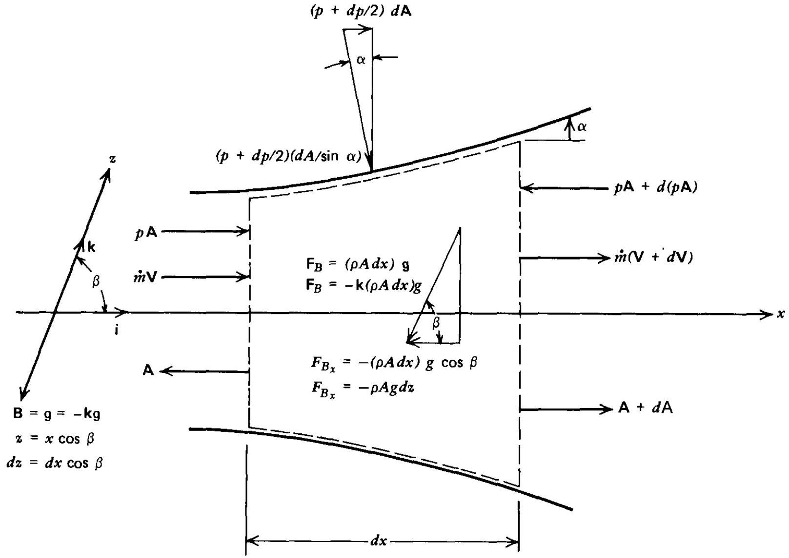
Figure 3.3. Forces acting on a differential element of a stream tube in a frictionless flow.

assumed. Hence, the inlet area is $A$ and the exit area is $A+d A$. In a specific flow situation, any or all of the property changes may turn out to be negative. If, however, a consistent convention is employed in developing the governing equations, the results obtained will be consistent. The convention discussed above will be followed throughout this book.

Returning to equation 3.6, assign the properties $p A$ and $\dot{m} V$ to the inlet area $A$, and $p A+d(p A)$ and $\dot{m}(V+d V)$ to the exit area $A+d A$. On the stream tube boundary the average static pressure intensity is $p+d p / 2$, which acts on the area $d A / \sin \alpha$. However, only the component of that force acting in the direction of flow is desired. Consequently, the total force acting on the boundary surface of the stream tube is given by $(p+d p / 2) d A$. Hence, equation 3.6 becomes

$$
-\rho A g d z+p A+\left(p+\frac{d p}{2}\right) d A-p A-d(p A)=\dot{m}(V+d V)-\dot{m} V
$$

Equation 3.7 is simplified by canceling like terms and neglecting the higher-order terms. The result is

$$
-\rho A g d z-A d p=\dot{m} d V
$$

Substituting $\dot{m}=\rho A V$, from equation 3.4, into equation 3.8 gives

$$
d p+\rho V d V+\rho g d z=0
$$

Equation 3.9 is the well-known Bernoulli equation.
The integrated form of equation 3.9 is

$$
\int \frac{d p}{\rho}+\frac{V^{2}}{2}+g z=\mathrm{constant} \quad \text { (i.e., the Bernoulli constant) }
$$

Equation 3.10 is valid for steady one-dimensional frictionless flow, and holds only along a given streamline. The Bernoulli constant will have, in general, different constant values along the different streamlines in a multidimensional flow. In the case where the flow field is uniform, as in the assumed one-dimensional flow, the Bernoulli constant has the same value over the entire flow field. To complete the integration of equation 3.10, the relationship between the density of the fluid $\rho$ and its static pressure p must be known.

Equations 3.9 and 3.10 are forms of the momentum equation for the steady onedimensional flow of an inviscid fluid. In Section 3-6, the energy equation is developed for a steady one-dimensional flow in the absence of heat and work. One form of that energy equation is equation 3.40 , which is identical to equation 3.9 . Hence, the momentum and energy equations for the steady one-dimensional adiabatic flow of an inviscid fluid are equivalent. That fact does not mean that the two equations are not independent. It merely signifies that both equations yield the same result, and that they are satisfied by the same expression.

## 3-5(b) Frictionless Flow of an Incompressible Fluid

If the steady inviscid flow of an incompressible liquid is considered, or gases under conditions where the changes in density are negligible (e.g., low-speed subsonic gas flows) then, because $\rho=$ constant, the integration of equation 3.10 yields

$$
\frac{p}{\rho}+\frac{V^{2}}{2}+g z=\text { constant }
$$

Equation 3.11 is the integrated form of Bernoulli's equation for the steady frictionless flow of an incompressible fluid.

## 3-5(c) Adiabatic Frictionless Flow of a Compressible Fluid

When the flowing medium is a compressible fluid, it is desirable, as stated in Section 3-2, to express the properties of the flow in terms of its Mach number $M=V / a$. Rewriting equation 3.9, we obtain

$$
\frac{d p}{d \rho} \frac{d \rho}{\rho}+V d V+g d z=0
$$

For the special case of an adiabatic frictionless flow, the entropy remains constant (see Section 1-12). Consequently, from equation 1.180,

$$
a^{2}=\left(\frac{\partial p}{\partial \rho}\right)_{s}=\frac{d p}{d \rho}
$$

For most flow processes involving gases, the body forces are negligible, so that $g d z \approx 0$. Combining equations (a) and (b) and introducing $g d z=0$, we obtain

$$
\frac{d \rho}{\rho}+M^{2} \frac{d V}{V}=0
$$

Equation 3.12 is an alternate form of Bernoulli's equation for the steady onedimensional adiabatic frictionless (i.e., isentropic) flow of a compressible fluid.

It may be assumed, according to Prandtl, that all of the frictional effects are confined to the boundary layer where the velocity gradient is large. Hence, the equations derived in Sections 3-5(a), 3-5(b), and 3-5(c) apply to the region of a flow field that is located outside of the boundary layer; in that particular region the fluid flow may be assumed to be an inviscid flow.

## 3-5(d) Flow with Friction

Consider the steady one-dimensional flow of a fluid through a passage having solid boundaries such as that illustrated in Fig. 3.4. Let $\delta F_{\mathrm{f}}$ denote the $x$ component of the wall friction force acting on the fluid element, and let $\delta D$ denote the $x$ component of the internal drag forces caused by obstructions, such as screens and struts, submerged in the fluid. The forces $\delta F_{\mathrm{f}}$ and $\delta D$ oppose the motion of the fluid and thus

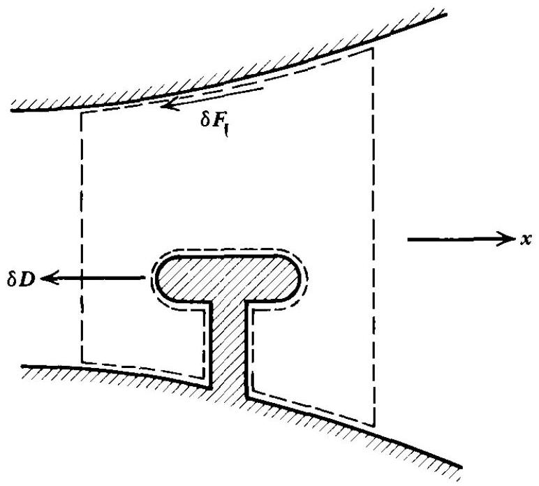
Figure 3.4. Additional forces acting on an element of a stream tube due to friction and internal obstructions.

act in the same direction as the pressure force $A d p$ [see Section 3-5(a)]. Hence, for the flow with friction illustrated in Fig. 3.4, the net external force acting in the $x$ direction is given by

$$
-\left(\rho g A d z+A d p+\delta F_{\mathrm{i}}+\delta D\right)
$$

Substituting from equation 3.13 into equation 3.8 and introducing $\dot{m}=\rho A V$, we obtain

$$
A d p+\rho A V d V+\rho g A d z+\delta F_{i}+\delta D=0
$$

The wall friction force $\delta F_{\mathrm{f}}$ may be expressed in terms of the hydraulic characteristics of the flow passage and an experimental friction coefficient $\mathfrak{f}$, which is defined later by equation 3.16. Let ( $W P$ ) denote the average value of the wetted perimeter for the flow passage. The length of the fluid element is $d x$, so that the surface wetted by the fluid element is $(W P) d x$. If $n$ denotes the hydraulic radius for the flow passage and $\mathscr{D}$ denotes the corresponding hydraulic diameter then, by definition,

$$
m=\frac{\mathscr{D}}{4}=\frac{\text { flow area }}{\text { wetted perimeter }}=\frac{A}{(W P)}
$$

The definition of $\mathscr{D}$ is chosen so that it is equal to the diameter for a flow passage having a circular cross section.

The friction coefficient $\mathfrak{f}$ is defined by the Fanning equation. Thus,

$$
\mathfrak{f} \equiv \frac{\text { tangential force }}{\frac{1}{2} \rho V^{2}(\text { wetted area })}=\frac{\delta F_{\mathrm{f}}}{\frac{1}{2} \rho V^{2}(W P) d x}=\frac{\tau}{\frac{1}{2} \rho V^{2}}
$$

where $\tau$ is the shear stress at the wall. Hence,

$$
\delta F_{\mathfrak{f}}=\mathfrak{f} \frac{\rho V^{2}}{2}(W P) d x=\frac{\rho V^{2}}{2}\left(\frac{4 \mathfrak{f} d x}{\mathscr{D}}\right) A
$$

The friction coefficient $\mathfrak{f}$ defined by equation 3.16 is the Fanning friction coefficient. Darcy defined a friction factor $\tilde{\mathrm{f}}^{\prime}$ by the equation

$$
\mathfrak{f}^{\prime} \equiv \frac{4 \tau}{\frac{1}{2} \rho V^{2}}=4 \mathfrak{f}
$$

Hence, the Darcy friction factor $\tilde{\mathrm{f}}^{\prime}$ is four times the Fanning friction coefficient $\tilde{\mathrm{f}}$.
Substituting for $\delta F_{\mathrm{f}}$ from equation 3.17 into equation 3.14 and dividing by $A$ gives the following equation.

$$
d p+\rho V d V+\rho g d z+\frac{\rho V^{2}}{2}\left(\frac{4 \tilde{f} d x}{\mathscr{D}}\right)+\frac{\delta D}{A}=0
$$

Equation 3.19 is the differential equation for the motion of a fluid in the presence of wall friction and obstructions. The equation cannot be integrated without additional knowledge relating $p, \rho, V, \mathfrak{f}$, and $\mathscr{D}$.

## 3-5(e) Incompressible Flow with Friction

In the case of the flow of an incompressible liquid, or gas at low speeds where density changes are negligible, the density $\rho=$ constant. Moreover, if there are no obstructions in the flow passage, then the drag term $\delta D=0$. For those conditions, the integration of equation 3.19 gives

$$
\frac{p_{2}}{\rho}+\frac{V_{2}^{2}}{2}+g z_{2}+\int_{1}^{2} \frac{V^{2}}{2}\left(\frac{4 f d x}{\mathscr{D}}\right)=\frac{p_{1}}{\rho}+\frac{V_{1}^{2}}{2}+g z_{1}=\text { constant }
$$

The integral term in equation 3.20 represents a loss because of the effects of wall friction. All of the parameters in the integrand of that term are positive, so that the value of the loss because of such frictional effects increases as the length $x$ of the flow passage increases. To integrate the aforementioned term, the relationship between $V, \mathfrak{f}, \mathscr{D}$, and $x$ must be known. In general, the integral term cannot be determined without employing empirical data. The determination of the aforementioned frictional term is discussed in Section 5-4, which deals with flow in constant area ducts.

## 3-5(f) Compressible Flow of a Perfect Gas in the Presence of Friction

In the special case where the flowing fluid is a perfect gas, equation 3.19 can be expressed in terms of the flow Mach number $M$. Multiplying throughout by $1 / p$, noting that $\gamma p / \rho=a^{2}$, and neglecting body forces, we obtain

$$
\frac{d p}{p}+\frac{\rho \gamma}{p \gamma} \frac{V^{2}}{V^{2}} d\left(\frac{V^{2}}{2}\right)+\frac{\rho \gamma}{p \gamma} \frac{V^{2}}{2}\left(\frac{4 \tilde{f} d x}{\mathscr{D}}\right)+\frac{\delta D}{A p}=0
$$

Hence,

$$
\frac{d p}{p}+\frac{\gamma M^{2}}{2} \frac{d V^{2}}{V^{2}}+\frac{\gamma M^{2}}{2}\left(\frac{4 \tilde{f} d x}{\mathscr{D}}\right)+\frac{\delta D}{A p}=0
$$

Since $V^{2}=M^{2} a^{2}$ and $d a^{2} / a^{2}=d t / t$, the second term in equation 3.22 becomes

$$
\frac{\gamma M^{2}}{2} \frac{d V^{2}}{V^{2}}=\frac{\gamma}{2} d M^{2}+\frac{\gamma M^{2}}{2} \frac{d t}{t}
$$

Substituting equation 3.23 into equation 3.22 yields

$$
\frac{d p}{p}+\frac{\gamma}{2} d M^{2}+\frac{\gamma M^{2}}{2} \frac{d t}{t}+\frac{\gamma M^{2}}{2}\left(\frac{4 \mathrm{f} d x}{\mathscr{D}}\right)+\frac{\delta D}{A p}=0
$$

Equation 3.24 is a form of the momentum equation for the flow of a perfect gas in the presence of friction; its integration is presented in Section 5.5.

## 3-5(g) External Forces Acting on a Flowing Fluid

Consider a fluid flowing through the passage illustrated in Fig. 3.5a. If there are no obstructions within the fluid, and the effects of body forces are neglected, then the only forces acting on the fluid are: (1) the pressure forces acting over the inlet and

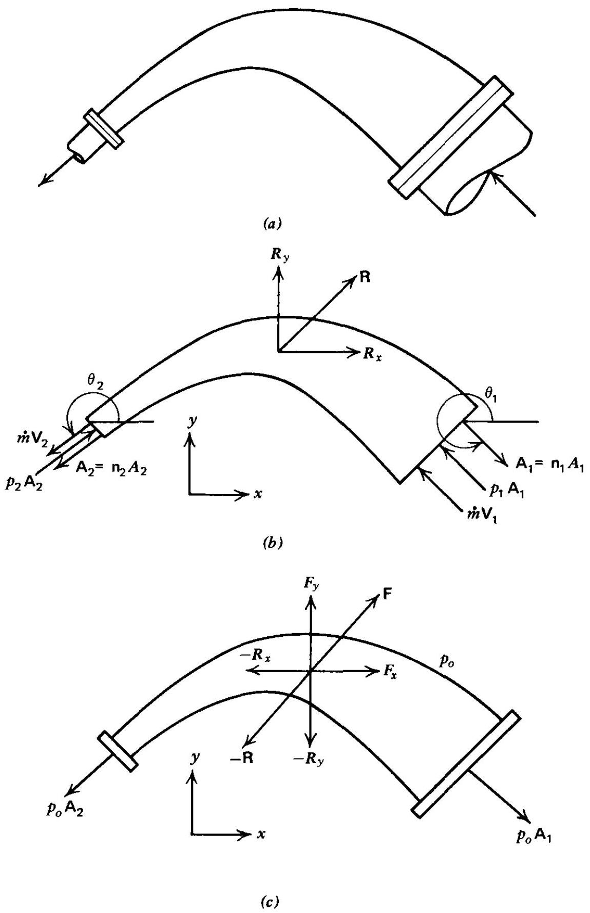
Figure 3.5. Determination of the forces acting on a conduit and the fluid inside of it. (a) Flow of a fluid through a conduit. (b) Free-body diagram of the fluid inside the conduit. (c) Free-body diagram for the conduit.

exit areas $A_{1}$ and $A_{2}$, and (2) the reaction force $\mathbf{R}$ exerted by the inner surface of the conduit on the fluid.

Figure 3.5b is a free-body diagram of the fluid within the conduit. Note that a coordinate system has been specified, and a direction of action for the resultant force $\mathbf{R}$ has been chosen. The components $R_{x}$ and $R_{y}$ are arbitrarily chosen in the positive directions. The choice of the assumed direction is immaterial because, if the direction is chosen incorrectly, the numerical results for $R_{x}$ and $R_{y}$ will then be negative.

The momentum equation for the flow situation illustrated in Fig. 3.5a is given by equation 2.56, which becomes

$$
\mathbf{F}_{\text {Surface }}=\int_{A} \mathbf{V}(\rho \mathbf{V} \cdot d \mathbf{A})
$$

There are two choices available for expressing the pressure forces. The first assumes that all of the normal forces act in the direction of the outward normal, and then considers pressure as a negative stress. The second makes use of the knowledge that all pressure forces are compressive; that is, the pressure forces in the free-body diagram act inwardly, as indicated in Fig. 3.5b. The second technique is recommended, and is followed throughout this book.

Thus, the external forces on the fluid are:

$$
-p_{1}\left(\mathbf{n}_{1} A_{1}\right)-p_{2}\left(\mathbf{n}_{2} A_{2}\right)+\mathbf{R}
$$

where $\mathbf{n}_{1}$ and $\mathbf{n}_{2}$ are the respective unit normals to $A_{1}$ and $A_{2}$. The change in momentum of the fluid is

$$
\dot{m}\left(\mathbf{n}_{2} V_{2}\right)-\dot{m}\left(-\mathbf{n}_{1} V_{1}\right)
$$

Note that the direction of $\mathbf{V}_{1}$ is ( $-\mathbf{n}_{1}$ ). Substituting equations (a) and (b) into equation 3.25 and solving for $\mathbf{R}$ yields

$$
\mathbf{R}=\mathbf{n}_{2}\left(p_{2} A_{2}+\dot{m} V_{2}\right)+\mathbf{n}_{1}\left(p_{1} A_{1}+\dot{m} V_{1}\right)
$$

Equation 3.26 gives the force exerted by the conduit on the fluid. Reversing the direction of $\mathbf{R}$ gives the force exerted by the fluid on the conduit.

Since $\dot{m} V$ has the dimensions of force (i.e., $M L / T^{2}$ ), it is frequently called the stream effective force, and the sum ( $p A+\dot{m} V$ ) is often termed the stream thrust. Let $\mathscr{F}$ denote the stream thrust; then

$$
\mathscr{F} \equiv p A+\dot{m} V
$$

Equation 3.26 shows that the net external force $\mathbf{R}$ acting on a fluid is the vector sum of the stream thrusts at the exit and inlet cross-sectional areas. Thus,

$$
\mathbf{R}=\mathbf{n}_{2} \mathscr{F}_{2}+\mathbf{n}_{1} \mathscr{F}_{1}
$$

Figure 3.5c illustrates a free-body diagram of the solid walls of the flow passage. The forces on the passage are the internal force $\mathbf{R}$ acting in the reversed direction, the external restraining force $\mathbf{F}$, if present, and the unbalanced ambient pressure forces acting on the back of the projected areas of the inlet and exit cross sections. The latter forces act along the same lines as the pressure forces within the fluid in Fig. 3.5b, but in the opposite directions. Summing the forces, we obtain

$$
\mathbf{F}-\mathbf{R}+\mathbf{n}_{2} p_{o} A_{2}+\mathbf{n}_{1} p_{o} A_{1}=0
$$

Substituting for $\mathbf{R}$ from equation 3.28 gives

$$
\mathbf{F}=\mathbf{n}_{2}\left(\mathscr{F}_{2}-p_{o} A_{2}\right)+\mathbf{n}_{1}\left(\mathscr{F}_{1}-p_{o} A_{1}\right)
$$

If $\mathscr{F}^{\prime}$ is defined by

$$
\mathscr{F}^{\prime} \equiv \mathscr{F}-p_{o} A=\left(p-p_{o}\right) A+\dot{m} V
$$

then equation 3.29 becomes

$$
\mathbf{F}=\mathbf{n}_{2} \mathscr{F}_{2}^{\prime}+\mathbf{n}_{1} \mathscr{F}_{1}^{\prime}
$$

In other words, when a conduit is immersed in a uniform ambient pressure field, the net force required to hold the conduit stationary is calculated in the same manner as the net internal force of the conduit acting on the fluid, except that absolute pressures are replaced by gage pressures.

Example 3.2. Water at a static pressure of $14.80 \cdot 10^{5} \mathrm{~N} / \mathrm{m}^{2}$ enters a reducing section of pipe with an average velocity of $6.096 \mathrm{~m} / \mathrm{s}$ normal to the entrance section (see Fig. 3.6). The entrance and exit diameters of the pipe are 0.3048 m and 0.1524 m , respectively. The direction of discharge is 90 deg to that at the entrance, and the static pressure of the water in the exit section is $12.05 \cdot 10^{5} \mathrm{~N} / \mathrm{m}^{2}$. The atmospheric pressure surrounding the pipe is $1.013 \cdot 10^{5} \mathrm{~N} / \mathrm{m}^{2}$, and the water density is $999.55 \mathrm{~kg} / \mathrm{m}^{3}$. Calculate the force exerted by the water on the pipe section.

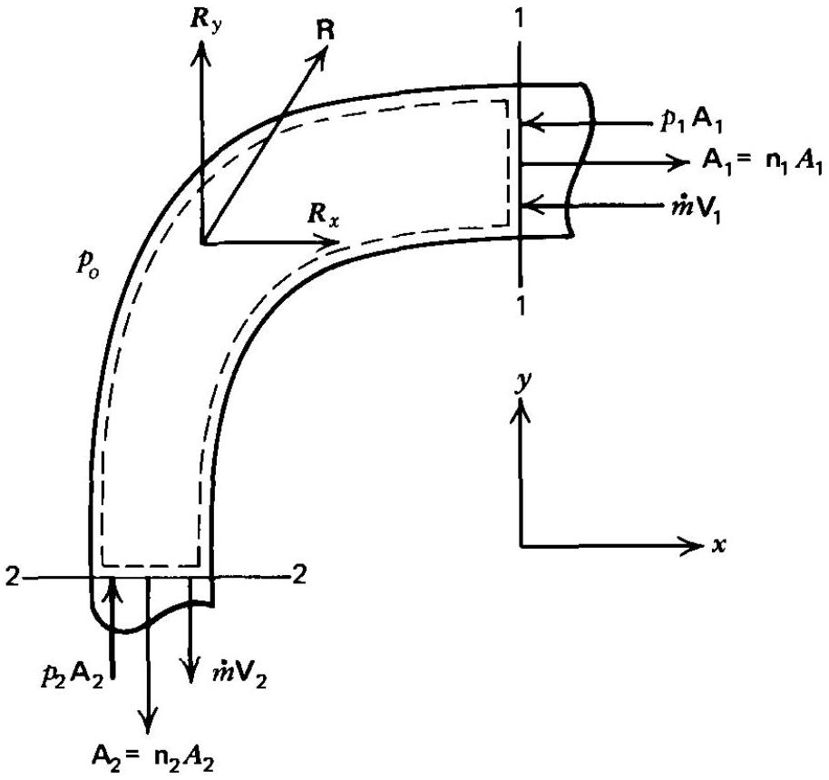
Figure 3.6. Physical model for Example 3.2.

## Solution

$$
\begin{aligned}
& A_{1}=\frac{\pi D_{1}^{2}}{4}=\frac{\pi(0.3048)^{2}}{4}=0.07297 \mathrm{~m}^{2} \\
& A_{2}=\frac{\pi D_{2}^{2}}{4}=\frac{\pi(0.1524)^{2}}{4}=0.01824 \mathrm{~m}^{2}
\end{aligned}
$$

For steady one-dimensional flow:

$$
\begin{aligned}
& \dot{m}=\rho_{1} A_{1} V_{1}=\rho_{2} A_{2} V_{2} \\
& V_{2}=\frac{V_{1} A_{1}}{A_{2}}=\frac{6.096(0.07297)}{(0.01824)}=24.385 \mathrm{~m} / \mathrm{s} \\
& \dot{m}=\rho_{1} A_{1} V_{1}=999.55(0.07297)(6.096)=444.62 \mathrm{~kg} / \mathrm{s}(980.2 \mathrm{lbm} / \mathrm{sec})
\end{aligned}
$$

The units normals $\mathbf{n}_{1}$ and $\mathbf{n}_{2}$ are given by

$$
\mathbf{n}_{1}=(+1) \mathbf{i}+(0) \mathbf{j}=\mathbf{i} \quad \text { and } \quad \mathbf{n}_{2}=(0) \mathbf{i}+(-1) \mathbf{j}=-\mathbf{j}
$$

From equation 3.27,

$$
\begin{aligned}
& \mathscr{F}_{1}=p_{1} A_{1}+\dot{m} V_{1}=\left(14.80 \cdot 10^{5}\right)(0.07297)+444.62(6.096)=110,706 \mathrm{~N} \\
& \mathscr{F}_{2}=p_{2} A_{2}+\dot{m} V_{2}=\left(12.05 \cdot 10^{5}\right)(0.01824)+444.62(24.385)=32,821 \mathrm{~N}
\end{aligned}
$$

From equation 3.28 , the components $R_{x}$ and $R_{y}$ of the force exerted on the fluid by the pipe are obtained as follows.

$$
\begin{aligned}
\mathbf{R} & =\mathbf{i} R_{x}+\mathbf{j} R_{y}=\mathbf{n}_{2} \mathscr{F}_{2}+\mathbf{n}_{1} \mathscr{F}_{1}=-\mathbf{j} \mathscr{F}_{2}+\mathbf{i} \mathscr{F}_{1} \\
R_{x} & =\mathscr{F}_{1}=110,706 \mathrm{~N}(24,890 \mathrm{lbf}) \\
R_{y} & =-\mathscr{F}_{2}=-32,821 \mathrm{~N}(-7,378 \mathrm{lbf})
\end{aligned}
$$

The component forces exerted by the fluid on the pipe have the same magnitudes as $R_{x}$ and $R_{y}$, but they act in the opposite direction. The corresponding forces required to hold the elbow stationary are calculated in the same manner as $R_{x}$ and $R_{y}$ with the exception that $\mathscr{F}_{1}$ and $\mathscr{F}_{2}$ are based on gage pressures. Thus,
$F_{x}=\left(\mathscr{F}_{1}-p_{o} A_{1}\right)=\left[110,706-1.013 \cdot 10^{5}(0.07297)\right]=103,314 \mathrm{~N}(23,226 \mathrm{lbf})$
$F_{y}=-\left(\mathscr{F}_{2}-p_{o} A_{2}\right)=-\left[32,821-1.013 \cdot 10^{5}(0.01824)\right]=-30,973 \mathrm{~N}(-6960 \mathrm{lbf})$
Example 3.3. Derive an equation for the net static thrust $\mathbf{F}$ produced by the rocket engine of a rocket-propelled vehicle when the system is operated under static conditions in the atmosphere.

## Solution

The selection of the control volume is arbitrary. It is selected so that it will make the solution of the problem convenient. Accordingly, consider the control volume illustrated in Fig. 3.7a.

The restraining force $\mathbf{F}^{\prime}$ applied by the thrust stand (not shown) is equal in magnitude to the net thrust $\mathbf{F}$, and acts in the opposite direction. Thus, $\mathbf{F}^{\prime}=-\mathbf{F}$. The force $\mathbf{R}$ exerted by all of the fluids inside of the rocket engine on the control surface is the internally generated thrust. It is transmitted to the walls of the rocket engine through the pressure and shear forces acting on those walls. A simple force balance yields the result $\mathbf{F}^{\prime}=\mathbf{i} p_{o} A-\mathbf{R}$, and thus $\mathbf{F}=\mathbf{R}-\mathbf{i} p_{o} A$. The calculation of the internal pressure and shear forces, however, is extremely difficult.

An alternate method for determining the internally generated thrust $\mathbf{R}$ is to replace all internal forces by the net resultant force exerted by the walls of the engine upon the fluid, $-\mathbf{R}$, and then apply the momentum equation to the fluid occupying the control volume shown in Fig. 3.7b. Thus, equation 3.25 yields

$$
\begin{gathered}
-\mathbf{R}+\mathbf{i} p A=\rho(-\mathbf{i} V) \cdot(-\mathbf{i} A)(-\mathbf{i} V)=-\mathbf{i} \rho A V^{2}=-\mathbf{i} \dot{m} V \\
\mathbf{R}=\mathbf{i}(\dot{m} V+p A)
\end{gathered}
$$

The net thrust $\mathbf{F}$ on the vehicle is then given by

$$
\mathbf{F}=\mathbf{R}-\mathbf{i} p_{o} A=\mathbf{i}\left[\dot{m} V+\left(p-p_{o}\right) A\right]
$$

Consider the same problem when an annular surface of area $A_{b}$ surrounds the exit section of the exhaust nozzle at the base of the missile. The area $A_{b}$ is called the base area, and the external pressure $p_{b}$ acting on it is called the base pressure. That situation is illustrated in Fig. 3.7c. In this case, the net restraining force $\mathbf{F}^{\prime}$ is found directly

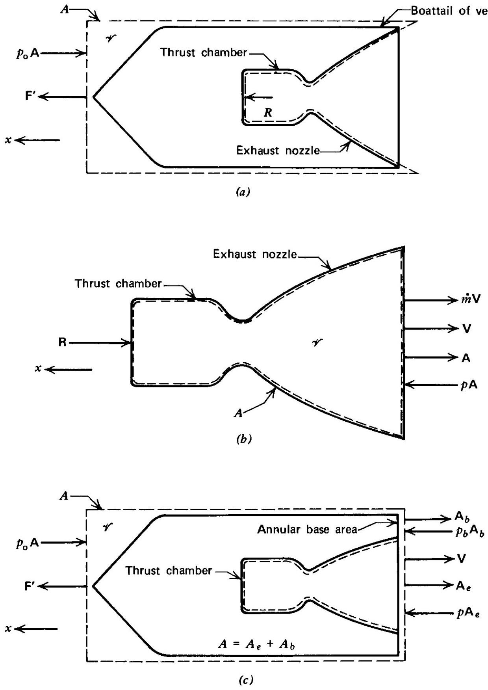
Figure 3.7. Control volumes for Example 3.3. (a) Control volume for relating the net thrust and the internally generated thrust. (b) Control volume for determining the internally generated thrust. (c) Control volume for determining the net thrust, including base thrust.

from equation 3.25. Thus,

$$
\begin{gathered}
\mathbf{F}^{\prime}-p_{o} \mathbf{A}+p \mathbf{A}_{e}+p_{b} \mathbf{A}_{b}=-\mathbf{i} \dot{m} V \\
\mathbf{F}=-\mathbf{F}^{\prime}=\mathbf{i}\left[\dot{m} V+\left(p-p_{o}\right) A_{e}+\left(p_{b}-p_{o}\right) A_{b}\right]
\end{gathered}
$$

This approach eliminates the intermediate step required by the first approach to find $\mathbf{R}$.

When a base region is present, an additional term appears in the thrust equation, the base thrust given by $\left(p_{b}-p_{o}\right) A_{b}$. Frequently the base thrust is called the base drag, since $p_{b}$ is generally much lower than $p_{o}$, and the term $\left(p_{b}-p_{o}\right) A_{b}$ yields a negative contribution to the thrust acting on the propelled vehicle. The base region is a very complicated flow region because the flow from the nozzle separates from the wall at the nozzle lip. A highly viscous recirculation region develops over the
base area. The base pressure $p_{b}$ is actually an average value over the base area and must be determined empirically. In general, the magnitude of the base pressure depends on the velocity of the vehicle relative to the ambient air, the ratio of the diameter of the exhaust jet to the base diameter of the vehicle, the nozzle pressure ratio $p_{e} / p_{o}$, the Reynolds number for the vehicle, the condition of the boundary layer on the boattail, and other factors. The phenomena that determine the base pressure are so complex that it has not been possible to derive any purely analytic expression for evaluating it. The subject of base drag is discussed in References 9 to 12.

Under static testing conditions the pressure $p_{b}$ is ordinarily not materially different from $p_{o}$, so the term $\left(p_{b}-p_{o}\right) A_{b} \approx 0$. In flight, however, because of the relative speed of the vehicle with respect to the ambient atmospheric air, $p_{b}$ may be much smaller than $p_{o}$. The base drag may be reduced by shaping the boattail of the vehicle; that is, the cylindrical aft portion of the vehicle that is reduced in diameter as it approaches the base (rear end) of the vehicle. When the rocket engine is operating and the vehicle is in flight, the presence of the jet ejected through the exit section $A_{e}$ of the nozzle is effective in reducing the total base area so that it is limited to the annular base area $A_{b}$. However, when the rocket engine completes its operating period, called the powered flight, there is no exhaust jet and the base pressure acts on the entire base area of the vehicle, which includes the area inside of the rocket motor. Accordingly, careful attention must be given to the design of the nozzle-base-boattail combination so that the total thrust acting on the aft end of the vehicle is as large as possible.

## 3-6 THERMODYNAMICS OF STEADY ONE-DIMENSIONAL FLOW

The concepts of steady one-dimensional flow discussed in Section 3-3 will now be applied to the energy equation.

## 3-6(a) Flow with Work and Heat Transfer

The integral form of the energy equation is presented in Table 2.1, equation 2.88, which is repeated and renumbered below.

$$
\begin{aligned}
\dot{W}_{\text {shaft }}+\dot{W}_{\text {shear }}-\dot{Q}+\int_{\mathscr{X}} \frac{\partial}{\partial t} & {\left[\rho\left(u+\frac{V^{2}}{2}+g z\right)\right] d \mathscr{V} } \\
& +\int_{A}\left(h+\frac{V^{2}}{2}+g z\right)(\rho \mathbf{V} \cdot d \mathbf{A})=0
\end{aligned}
$$

Figure 3.8 illustrates the steady one-dimensional flow model to which equation 3.32 will be applied. The shear and shaft works are combined into a single term and simply called work $W$. As explained in Section 2-7, the basis for determining the work and heat terms is assumed to agree with that for determining the remaining energy terms. Accordingly, the single set of symbols $W$ and $Q$ will be employed for representing work and heat, respectively.

Applying equation 3.32 to the flow model presented in Fig. 3.8 yields

$$
\delta \dot{W}-\delta \dot{Q}+\left[h+d h+\frac{V^{2}}{2}+d\left(\frac{V^{2}}{2}\right)+g z+g d z\right] \dot{m}-\left[h+\frac{V^{2}}{2}+g z\right] \dot{m}=0
$$

Cancelling terms and dividing by $\dot{m}$, we obtain

$$
\delta W-\delta Q+d h+d\left(\frac{V^{2}}{2}\right)+g d z=0
$$

Equation 3.33 is the differential form of the energy equation for a steady onedimensional flow.

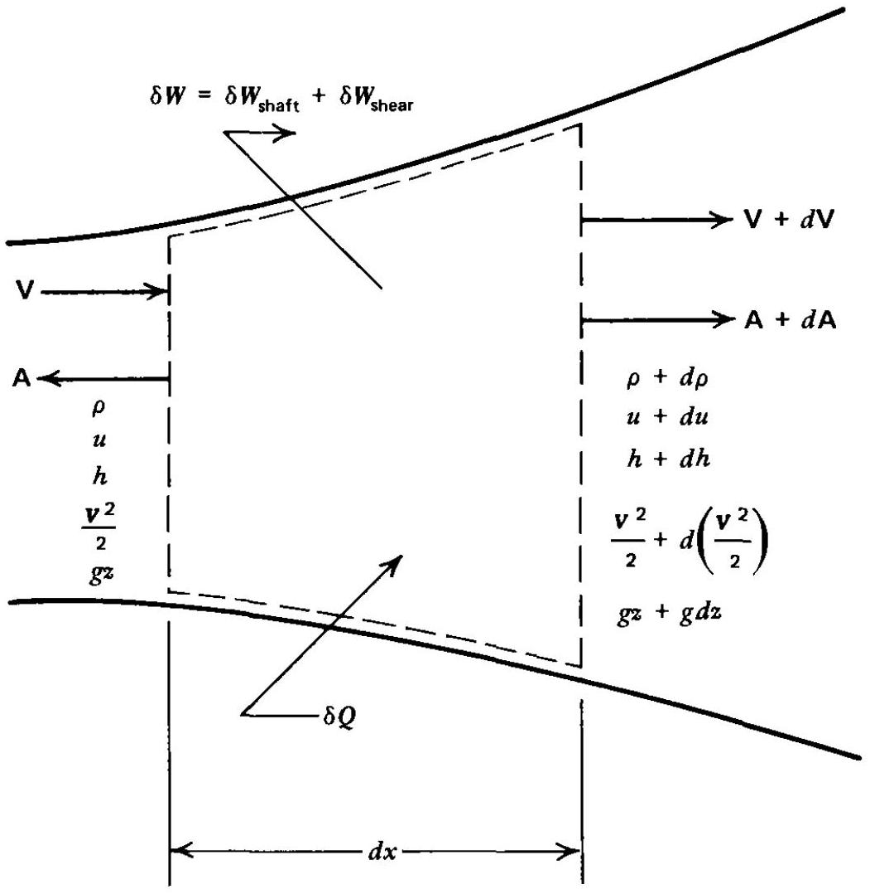
Figure 3.8. Energy balance for a fluid element of a stream tube.

Equation 3.32 may also be applied to a control volume of finite size such as that illustrated in Fig. 3.9. In that case, equation 3.32 becomes

$$
\dot{W}-\dot{Q}+\int_{A_{2}}\left(h+\frac{V^{2}}{2}+g z\right) \rho V d A-\int_{A_{1}}\left(h+\frac{V^{2}}{2}+g z\right) \rho V d A=0
$$

where $Q$ denotes the heat added to the fluid flowing between stations 1 and 2 , and $W$ corresponds to the work performed. Let the subscripts 1 and 2 denote the values of the variables $h, V$, and $z$, at $A_{1}$ and $A_{2}$ respectively. The steady one-dimensional energy equation is obtained from equation 3.34 by evaluating the integrals and dividing throughout by $\rho A V$. The result is

$$
Q+h_{1}+\frac{V_{1}^{2}}{2}+g z_{1}=W+h_{2}+\frac{V_{2}^{2}}{2}+g z_{2} \quad \text { (for the flow of any fluid) }
$$

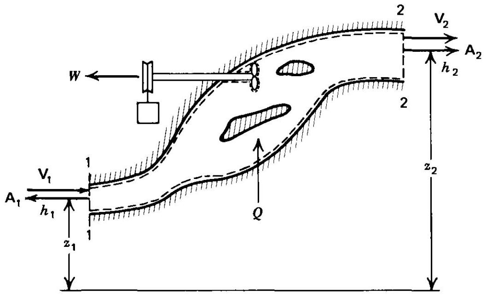
Figure 3.9. Energy balance for a control volume of finite size.

For fluids of small density, such as gases, the potential energy term $g\left(z_{2}-z_{1}\right)$ is negligible compared to the other terms and may be neglected. Hence, the energy equation for the steady one-dimensional flow of a gas is

$$
Q+h_{1}+\frac{V_{1}^{2}}{2}=W+h_{2}+\frac{V_{2}^{2}}{2} \quad \text { (for gas flow) }
$$

Example 3.4. Heated air enters a turbine with a static temperature of 1000 K and a velocity of $60.0 \mathrm{~m} / \mathrm{s}$. It is discharged from the turbine with a velocity of $120.0 \mathrm{~m} / \mathrm{s}$. The turbine delivers $175,000 \mathrm{~J} / \mathrm{kg}$ of shaft work to a generator, and the heat loss to the surroundings is $25,000 \mathrm{~J} / \mathrm{kg}$. Assuming steady one-dimensional flow, calculate the enthalpy and temperature of the air leaving the turbine, taking into account the variation of the specific heat of air with temperature.

## Solution

From Table C.4, $h_{1}=1047.248 \mathrm{~kJ} / \mathrm{kg}$. From the problem statement, $Q=-25.000 \mathrm{kJ} / \mathrm{kg}$ and $W=175.000 \mathrm{~kJ} / \mathrm{kg}$. Substituting those values into equation 3.36 yields

$$
\begin{aligned}
& h_{2}=-25.000-175.000+1047.248-\frac{(120.0)^{2}-(60.0)^{2}}{2(1000)} \\
& h_{2}=841.848 \mathrm{~kJ} / \mathrm{kg}(361.94 \mathrm{Btu} / \mathrm{lbm})
\end{aligned}
$$

From Table C.4, for $h_{2}=841.848 \mathrm{~kJ} / \mathrm{kg}, t_{2}=817.03 \mathrm{~K}(1470.6 \mathrm{R})$.

## 3-6(b) Adiabatic Flow with No External Work

In many flow passages such as diffusers, ducts, and nozzles, the working fluid flows under substantially adiabatic conditions and does no external work. For such flow passages $\delta Q=\delta W=0$, and equation 3.33 reduces to

$$
d h+d\left(\frac{V^{2}}{2}\right)+g d z=0
$$

Since equation 3.33 applies to steady flow with or without friction, equation 3.37 also applies to steady adiabatic flow (with no external work) with or without friction. Unless stated to the contrary, the phrase steady adiabatic flow will henceforth refer to adiabatic flow with no external work. Integrating equation 3.37 between states 1 and 2 gives the integrated form of the energy equation for steady adiabatic flow.
Thus,

$$
h_{1}+\frac{V_{1}^{2}}{2}+g z_{1}=h_{2}+\frac{V_{2}^{2}}{2}+g z_{2}=h+\frac{V^{2}}{2}+g z=\text { constant }
$$

Since $\left(h+V^{2} / 2+g z\right)$ is the total energy associated with a flowing fluid, it follows from equation 3.38 that for a fluid in steady adiabatic flow, the total energy of the fluid is constant at all points in its flow path; such a flow is termed an isoenergetic flow.

## 3-6(c) Isentropic Flow

For isentropic changes of state, we obtain the following relationship from equation 1.65 , which relates changes in entropy, enthalpy, and pressure. Thus,

$$
t d s=d h-v d p=d h-\frac{d p}{\rho}=0
$$

Substituting for $d h$ in equation 3.37 from equation 3.39 gives

$$
\frac{d p}{\rho}+d\left(\frac{V^{2}}{2}\right)+g d z=0
$$

Equation 3.40 is a form of the energy equation, per unit mass of fluid, for a steady one-dimensional isentropic flow; the equivalence of equation 3.40 and equation 3.9 is discussed in Section 3-5(a).

In equation 3.40, the term $d p / \rho$ represents the change in pressure energy, $d\left(V^{2} / 2\right)$ is the change in kinetic energy, and $g d z$ is the change in potential energy. The equation shows that the total energy per unit mass of the flowing fluid remains constant, and that the only changes possible are those between the pressure and the kinetic and potential energies. To complete the integration of equation 3.40, the relationship between the density $\rho$ and the pressure $p$ must be known.

For an adiabatic flow ( $\delta Q=\delta W=0$ ), the flow field outside of the boundary layer may be assumed to be isentropic $(d s=0)$. The assumption of isentropicity is valid for both subsonic and supersonic flows in the inviscid portions of the flow field for adiabatic flow expansions. It should be noted that for an adiabatic flow compression, the flow may be assumed to be isentropic provided that the flow is subsonic throughout. If, however, a supersonic flow is being compressed, the flow must be examined closely to ascertain that the assumption of isentropicity is permissible, because of the possibility of the occurrence of compression shock wave phenomena. Such phenomena increase the entropy of the flowing fluid, thereby invalidating the assumption that $d s=0$. Shock wave phenomena are discussed in Chapter 7.

## 3-6(d) Adiabatic Flow of a Perfect Gas

If the flowing fluid is a perfect gas, $d h=c_{p} d t$, and the effects of body forces may be neglected; that is, $g d z=0$. Then equation 3.37 becomes

$$
c_{p} d t+d\left(\frac{V^{2}}{2}\right)=0
$$

Assume that $c_{p}$ is not a function of $t$. Integrating equation 3.41 between states 1 and 2 then yields

$$
c_{p} t_{1}+\frac{V_{1}^{2}}{2}=c_{p} t_{2}+\frac{V_{2}^{2}}{2}=c_{p} t+\frac{V^{2}}{2}=\text { constant } \quad\left(c_{p}=\text { constant }\right)
$$

In equation 3.42 the kinetic energy terms $V_{1}{ }^{2} / 2$ and $V_{2}{ }^{2} / 2$ represent the energy associated with the directed motion of the gas molecules, while the terms $c_{p} t_{1}$ and $c_{p} t_{2}$ measure the energy associated with their random motions (see Section 1-17). Consequently, the energy equation for steady adiabatic flow may be regarded as a statement relating the interchangeability of the energy associated with the fluid molecules from random into directed motion.

Since the Mach number $M$ is a measure of the aforementioned energy ratio, it is convenient to express equation 3.42 in terms of the Mach number. For a perfect gas, $c_{p}=\gamma R /(\gamma-1)$ and $a^{2}=\gamma R t$. Substituting for $c_{p}$ and $a^{2}$ into equation 3.42 yields

$$
\frac{V_{1}^{2}}{2}+\frac{a_{1}^{2}}{\gamma-1}=\frac{V_{2}^{2}}{2}+\frac{a_{2}^{2}}{\gamma-1}=\frac{V^{2}}{2}+\frac{a^{2}}{\gamma-1}=\mathrm{constant}
$$

Introducing $M=V / a$ into equation 3.43 and rearranging gives

$$
\begin{aligned}
a_{1}^{2}\left(1+\frac{\gamma-1}{2} M_{1}^{2}\right) & =a_{2}^{2}\left(1+\frac{\gamma-1}{2} M_{2}^{2}\right) \\
& =a^{2}\left(1+\frac{\gamma-1}{2} M^{2}\right)=\mathrm{constant}
\end{aligned}
$$

Recalling that $a^{2}=\gamma R t$, equation 3.44 becomes

$$
\begin{aligned}
t_{1}\left(1+\frac{\gamma-1}{2} M_{1}^{2}\right) & =t_{2}\left(1+\frac{\gamma-1}{2} M_{2}^{2}\right) \\
& =t\left(1+\frac{\gamma-1}{2} M^{2}\right)=\mathrm{constant}
\end{aligned}
$$

Equations 3.41 to 3.45 are different forms of the energy equation for the adiabatic flow of a perfect gas; they are directly applicable, of course, only when it may be assumed that $c_{p}$ is a constant independent of the gas temperature.

## 3-6(e) Isentropic Discharge Speed for a Perfect Gas

Consider the case where a perfect gas is expanded in a frictionless nozzle under adiabatic conditions, and it is desired to determine the speed attained by the gas. Since the aforementioned process is adiabatic, equation 3.42 may be applied directly. Let point 1 denote the conditions in the supply reservoir where $V_{1} \approx 0, t_{1}=T$, and $p_{1}=P$. Let point 2 denote any other point in the isentropic flow where $V_{2}=V^{\prime}$, $t_{2}=t^{\prime}$, and $p_{2}=p^{\prime}$. Solving for $V^{\prime}$, the isentropic discharge speed, from equation 3.42 , gives

$$
V^{\prime}=\left[2 c_{p} T\left(1-\frac{t^{\prime}}{T}\right)\right]^{1 / 2}
$$

For a perfect gas, $c_{p}=\gamma R /(\gamma-1)$. For an isentropic change of state of a perfect gas, equation 1.128 gives

$$
\frac{t^{\prime}}{T}=\left(\frac{p^{\prime}}{P}\right)^{(\gamma-1) / \gamma}
$$

Substituting for $c_{p}$ and $t^{\prime} / T$ into equation 3.46 yields

$$
V^{\prime}=\left\{\frac{2 \gamma R T}{\gamma-1}\left[1-\left(\frac{p^{\prime}}{P}\right)^{(\gamma-1) / \gamma}\right]\right\}^{1 / 2}
$$

Equation 3.48 was derived independently by both St. Venant and Wantzel (1839) and is known as the St. Venant-Wantzel equation. It gives the maximum speed attainable by a perfect gas that expands isentropically from an infinite reservoir where $V=0, p=P$, and $t=T$, to the static pressure $p=p^{\prime}$. In a real nozzle, because of friction, the speed obtained by expanding a real gas is always smaller than $V^{\prime}$.

Since $R=\bar{R} / \bar{m}$, where $\bar{R}$ is the universal gas constant and $\bar{m}$ is the molecular weight of the gas, equation 3.48 may be expressed in terms of $\bar{m}$. Thus,

$$
V^{\prime}=\left\{\frac{2 \gamma}{\gamma-1} \frac{\bar{R} T}{\bar{m}}\left[1-\left(\frac{p^{\prime}}{P}\right)^{(\gamma-1) / \gamma}\right]\right\}^{1 / 2}
$$

Equation 3.49 shows that, for given values of the expansion ratio $p^{\prime} / P$ and the specific heat ratio $\gamma$, the isentropic discharge speed depends directly on $\sqrt{T / \bar{m}}$.

Equations 3.48 and 3.49 apply for expansions from a stagnation pressure $P$ where $V=0$ to a static pressure $p^{\prime}$ when body forces are negligible.

## 3-7 THE SECOND LAW OF THERMODYNAMICS FOR STEADY ONE-DIMENSIONAL FLOW

From Table 2.1, equation 2.89, the second law of thermodynamics, or the entropy equation, for a control volume is

$$
\int_{\mathscr{V}}(s \rho)_{t} d \mathscr{V}+\int_{A} s(\rho \mathbf{V} \cdot d \mathbf{A}) \geqq \dot{Q} / t
$$

The steady one-dimensional flow model illustrated in Fig. 3.8 may be employed for obtaining the applicable form of equation 3.50. Proceding in a manner analogous to that employed in deriving the steady one-dimensional forms for the continuity, momentum, and energy equations, the following result is obtained.

$$
d s \geqq \delta Q / t
$$

To apply equation 3.51 to a control volume of finite size, an explicit expression must be derived for $\delta Q$ in terms of the thermodynamic properties of the flowing fluid for the particular heat transfer process that is pertinent to the situation (i.e., conduction, convection, or radiation).

In the absence of heat transfer, equation 3.51 reduces to the important statement

$$
d s \geqq 0
$$

Equation 3.52 states that, in the absence of heat transfer, the entropy of a fluid flowing through a control volume must either increase or remain constant.

Generally, equations 3.51 and 3.52 are applied only qualitatively: for determining either the direction of a process or whether a given process is physically possible. The actual magnitude of the entropy change is quite often of no particular interest.

## 3-8 SOME GENERAL EFFECTS OF COMPRESSIBILITY ON FLUID FLOW

In the preceding sections of this chapter, the governing equations are derived for the steady one-dimensional flow of a fluid. In this section, several general effects caused by the compressibility of a flowing fluid are considered.

## 3-8(a) Speed of Propagation of Small Disturbances

In Section 1-17(a) it is stated without proof that a small disturbance is propagated with the speed of sound $a$, which is given by equation 1.180. Thus,

$$
a^{2}=\left(\frac{\partial p}{\partial \rho}\right)_{s}
$$

The equations derived in the preceding sections of Chapter 3 will now be employed for demonstrating that small pressure disturbances are propagated with the speed $a$.

Figure 3.10a illustrates schematically the one-dimensional propagation of a plane-fronted small pressure disturbance. Let $d p$ denote the infinitesimal amplitude of the disturbance, which is, of course, accompanied by infinitesimal changes in the other flow properties of the fluid, denoted by $d \rho, d t$, etc. As a consequence of the

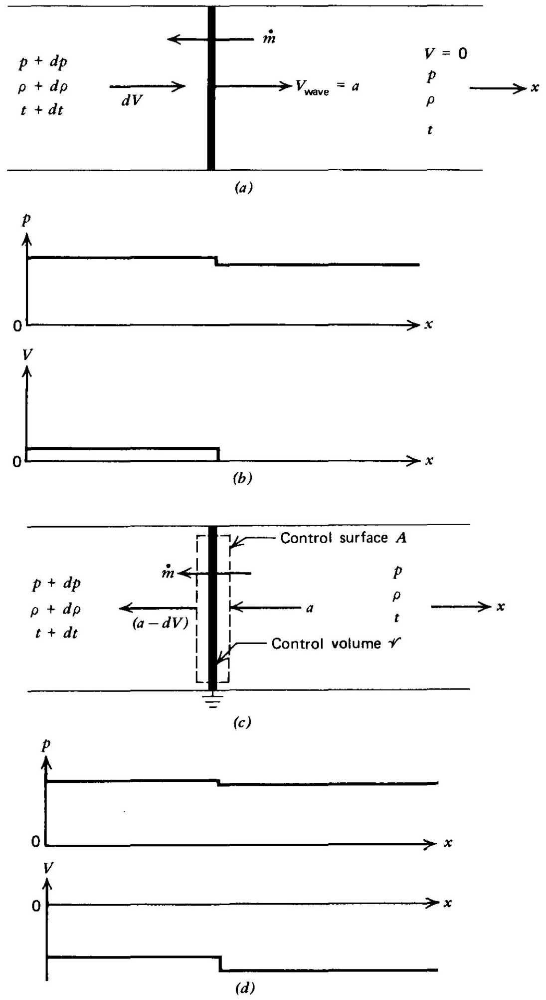
Figure 3.10. Propagation of a small pressure disturbance. (a) Moving pressure wave of small amplitude. (b) Distributions of static pressure and fluid velocity. (c) Stationary pressure wave. (d) Distributions of static pressure and fluid velocity.

passage of the pressure wave through the fluid, an infinitesimal velocity change $d V$ is imparted to the fluid in the direction of propagation for the wave. Figure $3.10 b$ illustrates the distributions of the pressure and velocity in the fluid, for the process illustrated in Fig. 3.10a. The latter is, in effect, an unsteady one-dimensional flow that cannot be analyzed by the steady flow equations developed in this chapter. To obviate the effects caused by the flow being unsteady to a stationary observer, the coordinate system must be transformed by assuming that the observer moves
at the same speed as the pressure wave. Hence, from the viewpoint of the moving observer, the process appears as a steady flow of fluid moving past the moving observer; that is, the situation illustrated schematically in Fig. 3.10c. Mathematically, the transformation is effected by subtracting the wave velocity, denoted by $a$, from all of the velocities in Fig. 3.10a. It is a dynamic transformation because only the dynamical properties of the fluid are affected (the fluid velocity, the stagnation pressure, the stagnation temperature, etc.). The static thermodynamic properties of the fluid are unaffected by the transformation. Furthermore, note that the positive direction for the coordinate system remains unchanged. If desired, a new coordinate system may be defined with its positive direction pointing toward the left, but the results are unaffected by such a change. Figure $3.10 d$ illustrates, for the transformed wave, the distributions of the properties of the fluid. Note that the direction of the velocities $a$ and ( $a-d V$ ) are to the left in Fig. 3.10c.

The latter figure also illustrates a stationary control volume $\mathscr{V}$ surrounding the wave; the actual width of the control volume is immaterial, but it must include the wave. From Table 2.1, for $\mathbf{B}=\mathbf{F}_{\text {shear }}=\partial \mathbf{V} / \partial t=0$, the momentum equation for the control volume $\mathscr{V}$ becomes

$$
-\int_{A} p d \mathbf{A}=\int_{A} \mathbf{V}(\rho \mathbf{V} \cdot d \mathbf{A})
$$

Figure 3.11 illustrates in detail the pressure forces and the momentum fluxes pertinent to the control volume $\mathscr{V}$. Applying equation 3.54 to that control volume, we obtain

$$
-p A+(p+d p) A=\dot{m}[-(a-d V)]-\dot{m}(-a)
$$

An important point arises in applying equation 3.54 to obtain equation 3.55. The momentum flux term in equation 3.54 is given by $\int_{A} \mathbf{V}(\rho \mathbf{V} \cdot d \mathbf{A})$. As discussed

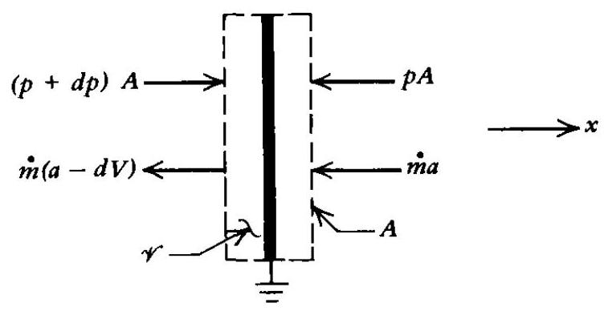
Figure 3.11. Control volume for determining the speed of sound.

in Section 2-4, the term ( $\rho \mathbf{V} \cdot d \mathbf{A}$ ) is inherently positive for the mass leaving a control volume and negative for the mass entering it. In addition to that sign convention, the velocity $\mathbf{V}$ itself must agree with the sign convention established by the assumed coordinate system. In the subject problem, this results in the negative signs being associated with the velocities in equation 3.55.

Simplifying equation 3.55 yields

$$
d p=\dot{m} \frac{d V}{A}=(\rho A a) \frac{d V}{A}=\rho a d V
$$

From the continuity equation,

$$
\rho A a=(\rho+d \rho) A(a-d V)
$$

Neglecting higher-order terms, simplifying, and solving for $d V$, we obtain

$$
d V=a \frac{d \rho}{\rho}
$$

Combining equations 3.56 and 3.58 and solving for $a^{2}$ yields

$$
a^{2}=\frac{d p}{d \rho}=\left(\frac{\partial p}{\partial \rho}\right)_{s}
$$

The subscript $s$, denoting an isentropic process, is attached because the model postulated by Fig. 3.11 applies to an adiabatic inviscid flow with no external work or body forces; that is, an isentropic process. Equation 3.59 is, therefore, the speed with which small disturbances are propagated in a compressible fluid.

## 3-8(b) Pressure Disturbances in a Compressible Fluid

The basic difference in the phenomena associated with subsonic and supersonic speeds may be demonstrated qualitatively in the following manner. Consider the propagation of a spherical sound wave emanating from the stationary point source 0 , as illustrated in Fig. 3.12. Assume that the fluid surrounding the point source 0 is at rest before the creation of the small pressure disturbance, so that point 0 is the source from which sound waves are propagated in all directions with the constant sonic or acoustic speed a. Each sound wave, therefore, moves with the speed $a$ and, in the same time interval $\Delta t$, each wave advances an equal radial distance $r=a \Delta t$.

Now consider the case where a body moves with the uniform subsonic speed $V$ in an isothermal homogeneous fluid, as illustrated in Fig. 3.13. Assume that the pressure disturbances created by the moving body are small, so that they may be treated as sound waves. As each point of the body contacts previously undisturbed fluid, it becomes a source from which pressure disturbances are propagated through the fluid with the local sonic speed $a$. Since the pressure disturbances have been assumed to be small, it may be assumed that the sonic speed $a$ remains constant. Let the instant when point $P$ on the body is at $A$ (see Fig. 3.13) be the starting point of the discussion. The pressure disturbance created by point $P$ will traverse the distance $a \Delta t$ from the starting point $A$ in the time interval $\Delta t$. During the same time interval $\Delta t$,

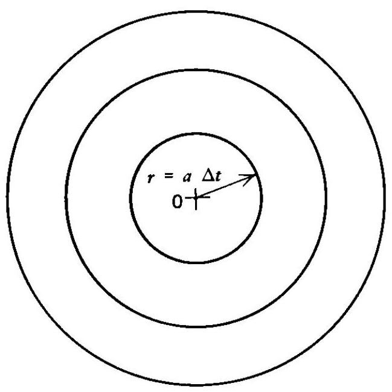
Figure 3.12. Propagation of sound waves from a stationary point source.

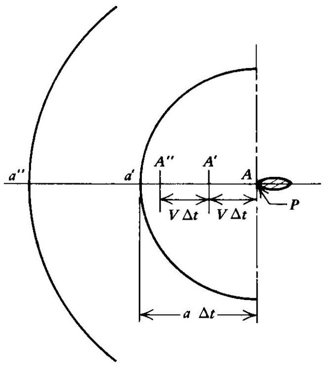
Figure 3.13. Pressure disturbances produced by a body moving with subsonic speed.

the point $P$ moves the distance $A A^{\prime}=V \Delta t$. In a second time interval $\Delta t$, point $P$ moves to $A^{\prime \prime}$; that is, the distance $A^{\prime} A^{\prime \prime}=V \Delta t$. The initial disturbance created by point $P$ at the starting point $A$, in the second time interval $\Delta t$, moves the distance $a^{\prime} a^{\prime \prime}=a \Delta t$. Since the acoustic speed $a$ is always larger than $V$, the speed of the body, the wave front produced by the moving body is always ahead of the latter. The net result is that the body always moves into a fluid that has already undergone changes because of the motion of the body. Consequently, if a body moves in a compressible fluid with subsonic speed, the fluid ahead of the body may be said to become aware of the presence of the body because the latter propagates disturbance signals ahead of itself. Moreover, when a body moves with subsonic speeds, the disturbances it creates are said to "clear away" from it.

Consider next the case where a body moves with the sonic speed $a$; that is, $V=a$, as illustrated in Fig. 3.14. During any time interval $\Delta t$, the front of the pressure disturbance moves the same distance $a \Delta t$ as the point $V \Delta t$ that created the disturbance. Consequently, all of the disturbances created by the body coalesce at the point $P$ on the body, and they are all contained in the half-plane to the right of the body. This coalescense of waves creates some extremely complicated flow patterns in the sonic and transonic flow regimes.

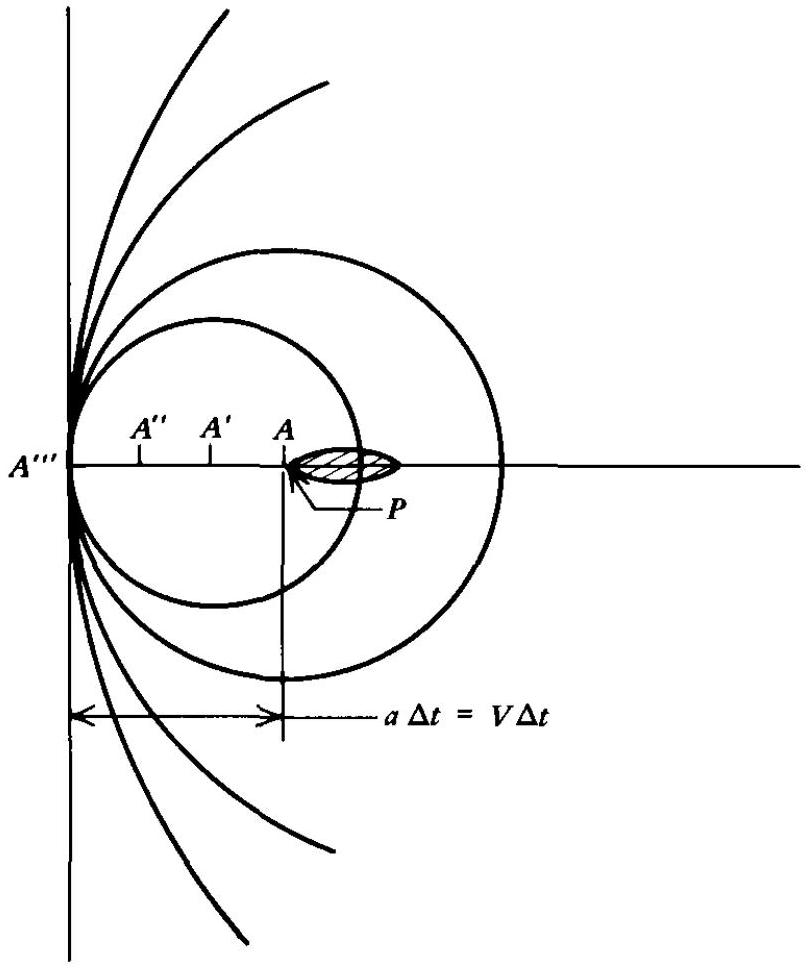
Figure 3.14. Pressure disturbances produced by a body moving at the sonic speed.

Now consider the case where the body moves with the uniform speed $V$ greater than the sonic speed $a$, as illustrated in Fig. 3.15. In the time interval $\Delta t$ the front of the pressure disturbance created by a point $P$ on the body is a spherical surface of radius $a \Delta t$. The point $P$ on the body, in the interval $\Delta t$, moves from $A$ to the position $A^{\prime \prime \prime \prime}$, where $A A^{\prime \prime \prime \prime}=V \Delta t$. Since $V>a$, the wave front of the disturbance created by the body lags behind the point on the body that created the disturbance, and the disturbance wave front cannot overtake the moving body. Consequently, in all of its successive positions $A^{\prime}, A^{\prime \prime}$, etc., the moving body is ahead of the disturbance wave fronts it has produced. In fact, the body, in moving along its flight path, must

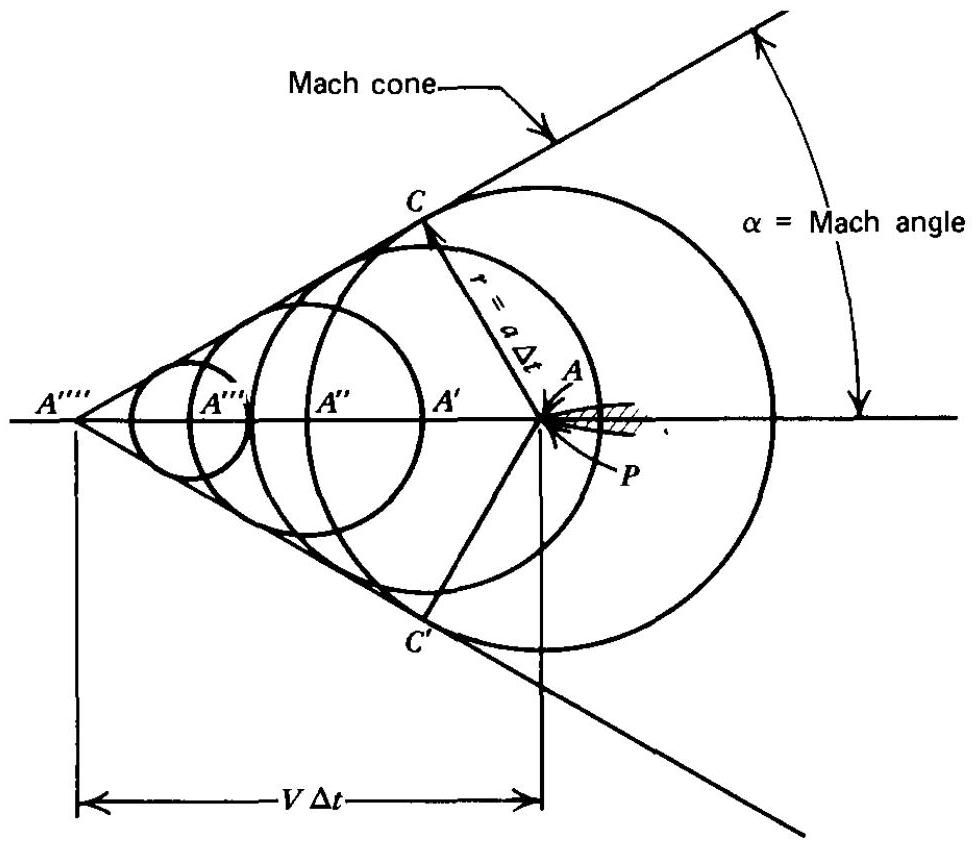
Figure 3.15. Pressure disturbances produced by a body moving with supersonic speed.

pass through every wave front emanating from the successive positions it occupied in moving along the path. The different disturbance wave fronts are enveloped by a conical surface, called a Mach cone, and the half-angle of the cone, denoted by $\alpha$, is called the Mach angle. From the geometry it is seen that

$$
\sin \alpha=\frac{A C}{A A^{\prime \prime \prime \prime}}=\frac{a}{V} \frac{\Delta t}{\Delta t}=\frac{a}{V}=\frac{1}{M}
$$

The foregoing discussion shows that, when a body moves with supersonic speed, all of the disturbances in the flow are confined to the Mach cone. In the regions external to the Mach cone, the fluid medium is unaffected by the moving body. The conical separating surface, therefore, forms a wave front, termed a Mach wave, which is an extremely weak compression shock wave. The foregoing considerations are based on small disturbances that are transmitted with the speed of sound waves. For more intense disturbances the phenomena are analogous but more complicated.

The Mach cone is actually a three-dimensional conoid in space, as is illustrated schematically in Fig. 3.16. Only in the case where a disturbance moves into a uniform region is the Mach conoid a right circular cone.

Example 3.5. A supersonic aircraft flies horizontally at 1500 m altitude with a constant velocity of $750 \mathrm{~m} / \mathrm{s}$. The aircraft passes directly over a stationary ground observer. How much time elapses after it has passed over the observer before the latter hears the aircraft? Assume that the average speed of sound is $335 \mathrm{~m} / \mathrm{s}$ and that the airplane creates a small disturbance that may be treated as a sound wave.

## Solution

The physical situation is illustrated in Fig. 3.17. The observer at point $D$ will first hear the sound wave generated by the airplane when it was at point $C$. During the time interval required for the sound wave to travel from point $C$ to point $D$, the airplane travels from point $C$ to point $A$. The Mach angle $\alpha$ is

$$
\alpha=\sin ^{-1}\left(\frac{1}{M}\right)=\sin ^{-1}\left(\frac{a}{V}\right)=\sin ^{-1}\left(\frac{335}{750}\right)=26.53 \mathrm{deg}
$$

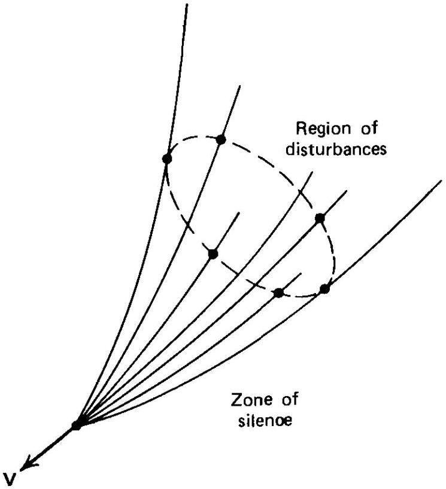
Figure 3.16. The Mach conoid created by a nonuniform disturbance moving into a nonuniform region.

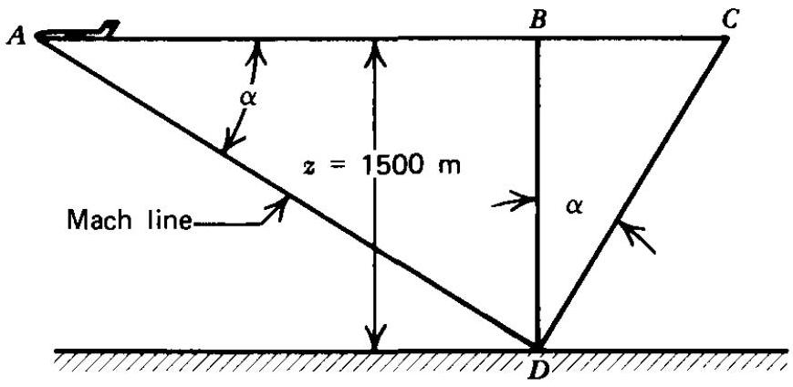
Figure 3.17. Sketch for Example 3.5.

The distance from point $B$ to point $A$ is

$$
B A=\frac{B D}{\tan \alpha}=\frac{1500}{\tan (26.53)}=3004.6 \mathrm{~m}
$$

The time interval required for the airplane to travel from point $B$ to point $A$ is

$$
\Delta t=\frac{B A}{V}=\frac{3004.6}{750}=4.006 \mathrm{~s}
$$

## 3-8(c) Compressibility Factor

The compressibility of a fluid influences many of its thermodynamic and dynamic properties, especially its stagnation pressure $P$ (i.e., the pressure attained by an isentropic deceleration to $V=0$ ). The pressure increase caused by the deceleration is called the dynamic pressure $q$ [see Section 3-13(a)]. From equation 3.11, for the incompressible flow of an inviscid gas (neglecting body forces), the dynamic pressure $q_{\text {inc }}$ is given by

$$
q_{\mathrm{inc}}=P-p=\frac{1}{2} \rho V^{2}
$$

When a compressible fluid is brought to rest isentropically, the stagnation pressure $P$ is higher than in the equivalent incompressible case. The equation for the stagnation
pressure of a perfect gas is derived in Section 3.9 (see equation 3.76). Thus,

$$
\frac{P}{p}=\left(1+\frac{\gamma-1}{2} M^{2}\right)^{\gamma /(\gamma-1)}
$$

where $M$ is the local Mach number. Hence, the dynamic pressure $q$ for a compressible fluid is given by

$$
q_{\mathrm{comp}}=P-p=p\left[\left(1+\frac{\gamma-1}{2} M^{2}\right)^{\gamma /(\gamma-1)}-1\right]
$$

For small values of the Mach number, the quantity in parentheses may be expanded by the binomial theorem. Thus,

$$
q_{\mathrm{comp}}=p\left(1+\frac{\gamma M^{2}}{2}+\frac{\gamma M^{4}}{8}+\cdots-1\right)
$$

Taking $\gamma M^{2} / 2$ outside of the brackets, and noting that $\gamma p M^{2} / 2=\rho V^{2} / 2$, equation 3.64 becomes

$$
q_{\mathrm{comp}}=P-p=\frac{\rho V^{2}}{2}\left(1+\frac{M^{2}}{4}+\frac{M^{4}}{40}+\frac{M^{6}}{1600}+\cdots\right)
$$

By definition, the compressibility factor, denoted by $\mathscr{F}_{c}$, is given by

$$
\mathscr{F}_{c} \equiv \frac{P-p}{\frac{1}{2} \rho V^{2}}
$$

For incompressible flows, $\mathscr{F}_{c}=1.0$. Substituting from equation 3.65 into equation 3.66 gives, for compressible flow,

$$
\mathscr{F}_{c}=\left(1+\frac{M^{2}}{4}+\frac{M^{4}}{40}+\frac{M^{6}}{1600}+\cdots\right)
$$

Equation 3.67 applies where $M$ is small. The assumption of incompressibility introduces significant errors when the Mach number exceeds approximately 0.3 to 0.4 .

## 3-9 STAGNATION (OR TOTAL) CONDITIONS

The concept of stagnation conditions (sometimes called total conditions) is extremely useful in that it defines a convenient reference state for a flowing fluid. The stagnation state is defined as that state where the flow velocity is zero. Accordingly, a static fluid is in its stagnation state. The latter state for a flowing fluid is defined as the state attained by the fluid when it is decelerated to zero speed. Alternately, it can be defined as the static state from which a fluid must be accelerated from an infinite reservoir in order to attain the actual state for a given flow. These two equivalent definitions are illustrated schematically in Fig. 3.18. Obviously, the nature of the flow process during the deceleration (or acceleration) of the fluid determines its final state. To obtain a unique final state, restrictions must be placed on the deceleration process.

By definition, the stagnation energy state is the state attained by the fluid when it is decelerated to zero speed by an adiabatic (with no external work) deceleration. With the aforementioned restriction, the stagnation internal energy and enthalpy of the fluid are uniquely determined. By further restricting the deceleration process to an isentropic process (i.e., one that is both adiabatic and frictionless), a unique stagnation temperature, pressure, and density are determined. Figure 3.19 illustrates the stagnation conditions on the Mollier diagram; that is, the $h s$ plane.

The concept of the stagnation state as a reference state is independent of the type of fluid being considered. It is also independent of the processes taking place in the

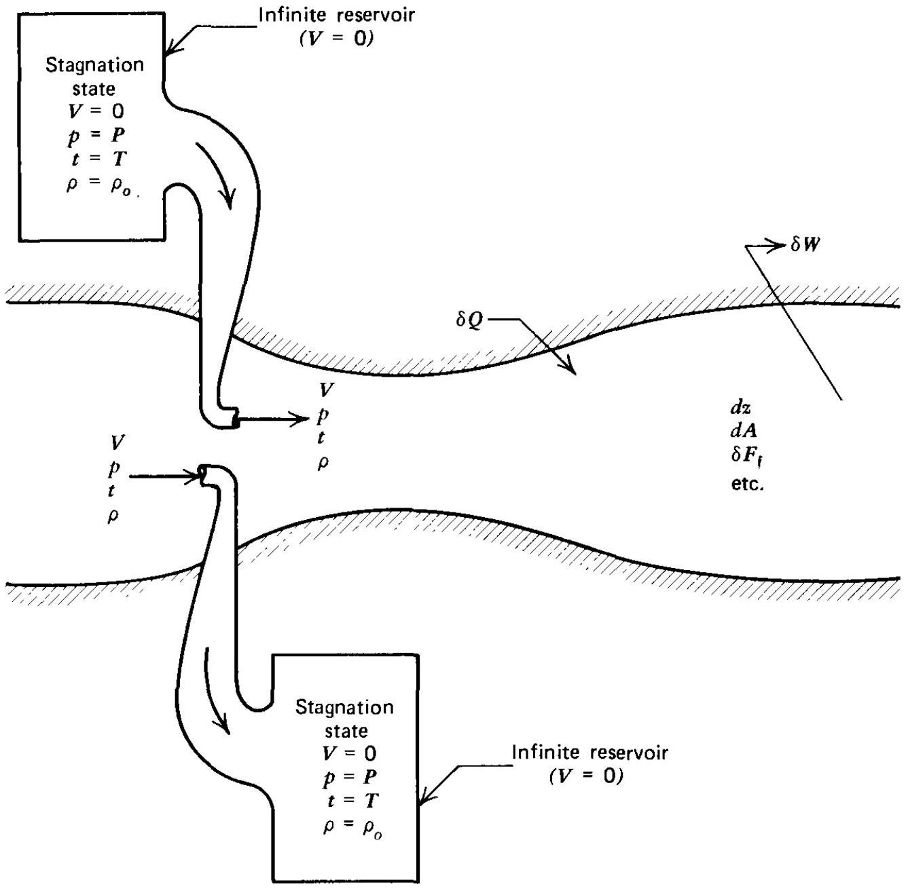
Figure 3.18. Stagnation conditions.

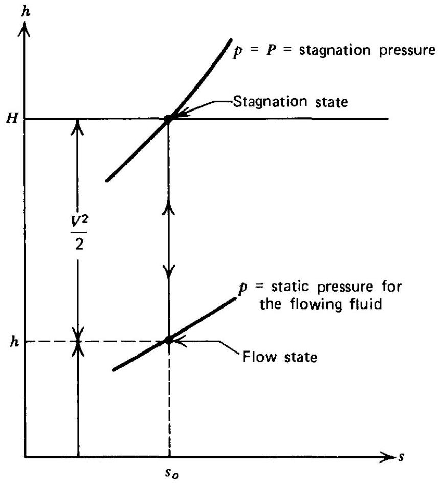
Figure 3.19. Stagnation state on the Mollier diagram.

actual flow under investigation. Thus, the actual flow process may involve work, heat, body forces, friction, etc., along the flow path. Nevertheless, at every point along the actual flow path, there is a local stagnation state that is defined by the imaginary deceleration process discussed above. Consequently, the stagnation conditions are point functions that may be defined at every point in any flow process for any fluid. Obviously the stagnation conditions may vary from one point to another in an actual flow. Usually the changes in the stagnation properties of a given flow process may be related to the flow driving potential of the actual flow process; that is, work, heat, area change, friction, etc. Consequently, the concept of the stagnation condition is extremely useful in analyzing the flow of a compressible fluid.

## 3-9(a) Stagnation Enthalpy

For a steady adiabatic flow ( $\delta Q=\delta W=g d z=0$ ), equation 3.38 reduces to

$$
h_{1}+\frac{V_{1}^{2}}{2}=h_{2}+\frac{V_{2}^{2}}{2}
$$

Equation 3.38 applies to both isentropic and irreversible adiabatic processes. Consider the case where the fluid is decelerated adiabatically to zero speed from the initial speed $V_{1}$. In that case $V_{2}=0$; the corresponding value of $h_{2}$ is called the stagnation, or total, enthalpy. Let $H$ denote the stagnation enthalpy; then

$$
H \equiv\left(h_{2}\right)_{V_{2}=0}=h+\frac{V^{2}}{2}
$$

Hence, the stagnation enthalpy at any point in any flow field is the sum of the static enthalpy and the kinetic energy at that point, as is illustrated in Fig. 3.19.

## 3-9(b) Stagnation Temperature

The stagnation temperature is the temperature where the speed of the fluid is zero. When the working fluid is a perfect gas, the energy equation for adiabatic flow can be written in the form of equation 3.45. Consider now the special case where a perfect gas is decelerated isentropically so that its final speed, and hence its Mach number, is zero. The corresponding value of the final temperature is termed either the stagnation or the total temperature and is denoted by $T$. Hence, from equation 3.45,

$$
T=\left(t_{2}\right)_{V_{2}=0}=t\left(1+\frac{\gamma-1}{2} M^{2}\right)
$$

Values of the ratio $t / T$ as a function of the Mach number $M$ for several different values of $\gamma$ are presented in Table C.6.

For a perfect gas, $h=c_{p} t$. Substituting that expression into equation 3.68 and solving for $T$ yields

$$
T=\frac{H}{c_{p}}=t+\frac{V^{2}}{2 c_{p}}
$$

The ratio $V^{2} / 2 c_{p}$ is frequently termed the impact temperature rise and is denoted by $\Delta t_{\text {imp }}$. Hence,

$$
\Delta t_{\mathrm{imp}} \equiv \frac{V^{2}}{2 c_{p}}=\frac{\gamma-1}{\gamma} \frac{V^{2}}{2 R}
$$

In terms of $\Delta t_{\mathrm{imp}}$, the stagnation temperature $T$ is given by

$$
T=t+\Delta t_{\mathrm{imp}}
$$

The preceding discussion shows that the stagnation temperature $T$ corresponds to the static temperature that the gas will attain when it is decelerated isentropically to zero speed. As indicated earlier in Section 3-9, it may also be regarded as the static temperature at which the gas must be held in an infinite reservoir from which it is accelerated isentropically (with $\delta W=0$ ) to the values of $V$ and $t$ for an actual flow. For any given values of $V$ and $t$, therefore, a corresponding value of $T$ can always be computed for the flow.

Note that the definition of the stagnation temperature specified an isentropic deceleration. For a perfect gas, $T=H / c_{p}$, so that any deceleration process that attains a unique value for $H$ will also attain a unique value for $T$. As discussed in Section 3-9(a), the only restriction required for defining a unique value for $H$ is that the deceleration process be adiabatic. Thus, for a perfect gas, the stagnation temperature is actually attained by any adiabatic deceleration process. However, for other fluids for which $t=f(h, s)$, the restriction is required that the deceleration process be isentropic so that a unique stagnation temperature will be defined.

If the actual flow process is adiabatic, then equation 3.45, which is repeated and renumbered here for convenience, is applicable. Thus,

$$
t_{1}\left(1+\frac{\gamma-1}{2} M_{1}^{2}\right)=t_{2}\left(1+\frac{\gamma-1}{2} M_{2}^{2}\right)=\text { constant }=T
$$

Equation 3.73 indicates that for an adiabatic flow process involving a perfect gas, the stagnation temperature $T$ remains constant.

An expression for the relative change in stagnation temperature $d T / T$ may be obtained by logarithmic differentiation of equation 3.69. Thus,

$$
\frac{d T}{T}=\frac{d t}{t}+\frac{\frac{\gamma-1}{2} M^{2}}{1+\frac{\gamma-1}{2} M^{2}} \frac{d M^{2}}{M^{2}}
$$

Example 3.6. An airplane flies at a constant speed of $900 \mathrm{~km} / \mathrm{hr}$ at $10,000 \mathrm{~m}$ altitude. A pressure traverse shows that the air is brought to rest at a particular location on the fuselage. Calculate the temperature of the air in the stagnation region and the temperature rise caused by impact. Assume air is a perfect gas and $\gamma=1.4$.

## Solution

From Table C.5, at $10,000 \mathrm{~m}$ altitude, $t=223.25 \mathrm{~K}$ and $a=299.53 \mathrm{~m} / \mathrm{s}$. Therefore,

$$
M=\frac{(900)(1000)}{(3600)(299.53)}=0.8346
$$

In the stagnation region, the stagnation temperature is $T$. From equation 3.69

$$
T=223.25\left[1+\left(\frac{1.4-1}{2}\right)(0.8346)^{2}\right]=254.35 \mathrm{~K}
$$

The impact temperature rise is found from equation 3.72. Thus,

$$
\Delta t_{\mathrm{imp}}=254.35-223.25=31.1 \mathrm{~K} \quad(56.0 \mathrm{R})
$$

## 3-9(c) Stagnation Pressure

It is pointed out in Section 3-9(b) that the stagnation temperature $T$ corresponds to the static temperature in an infinite reservoir from which the gas is accelerated isentropically to its actual speed $V$. The static pressure corresponding to the stagnation temperature $T$ is called either the stagnation or the total pressure and is denoted by $P$. Since the flow process is isentropic, for a perfect gas the stagnation pressure $P$ and the stagnation temperature $T$ are related by equation 1.128 . Thus,

$$
\frac{P}{p}=\left(\frac{T}{t}\right)^{\gamma /(\gamma-1)}
$$

Substituting for $T / t$ from equation 3.69 into equation 3.75 gives the following relationship between $p, P$, and $M$.

$$
\frac{P}{p}=\left(1+\frac{\gamma-1}{2} M^{2}\right)^{\gamma /(\gamma-1)}
$$

Because equation 3.75 is employed in deriving equation 3.76, the latter equation likewise applies only to isentropic flow processes, and to a point in a field of flow. Values of the pressure ratio $p / P$ as a function of the Mach number $M$, for different values of $\gamma$, are presented in Table C.6.

The static pressure ratio corresponding to the isentropic flow of a perfect gas from the initial Mach number $M_{1}$ to the final Mach number $M_{2}$ is given by

$$
\frac{p_{2}}{p_{1}}=\frac{\left(p_{2} / P\right)_{M_{2}}}{\left(p_{1} / P\right)_{M_{1}}}
$$

In equation 3.77, the numerator is calculated for the condition $M=M_{2}$ and the denominator for the condition $M=M_{1}$

As indicated in the foregoing, for any flow, its stagnation pressure at any point in the flow field can always be calculated by assuming that the flow is decelerated isentropically from the values of $p$ and $M$, at the point in question, to zero velocity where $p=P$.

An expression for the relative change in stagnation pressure $d P / P$ may be obtained from equation 3.76 by logarithmic differentiation. Thus,

$$
\frac{d P}{P}=\frac{d p}{p}+\frac{\gamma M^{2} / 2}{1+\frac{\gamma-1}{2} M^{2}} \frac{d M^{2}}{M^{2}}
$$

Example 3.7. Air at atmospheric pressure $1.0133 \cdot 10^{5} \mathrm{~N} / \mathrm{m}^{2}$ and a temperature of 300 K flows into an ideal diffuser. The entrance speed is $180.0 \mathrm{~m} / \mathrm{s}$. Calculate the maximum pressure (ram pressure) that can be achieved if the air is diffused to zero speed. Assume $\gamma=1.40$ and $R=287.04 \mathrm{~J} / \mathrm{kg}-\mathrm{K}$ for air.

## Solution

$$
\begin{aligned}
a & =(\gamma R t)^{1 / 2}=[1.40(287.04)(300)]^{1 / 2}=347.21 \mathrm{~m} / \mathrm{s} \\
M & =\frac{V}{a}=\frac{180.0}{347.21}=0.5184
\end{aligned}
$$

The maximum pressure that can be achieved is the isentropic stagnation pressure.

Thus, from equation 3.76,

$$
\begin{aligned}
& \frac{P}{p}=\left(1+\frac{\gamma-1}{2} M^{2}\right)^{\gamma /(\gamma-1)}=\left[1+0.20(0.5184)^{2}\right]^{3.50}=(1.05375)^{3.50}=1.20111 \\
& P=(1.0133) 10^{5}(1.20111)=1.2171 \cdot 10^{5} \mathrm{~N} / \mathrm{m}^{2}\left(17.65 \mathrm{lbf} / \mathrm{in}^{2} .\right)
\end{aligned}
$$

Example 3.8. Air flows through an adiabatic frictionless passage. At station 1, the Mach number $M_{1}=0.9$, and the static pressure is $p_{1}=4.15 \cdot 10^{5} \mathrm{~N} / \mathrm{m}^{2}$. At station 2, the Mach number $M_{2}=0.2$. Calculate the change in the static pressure between stations 1 and 2 .

## Solution

The flow is isentropic, so that Table C. 6 applies. Thus, at $M_{1}=0.9, p_{1} / P=0.59126$, and at $M_{2}=0.2, p_{2} / P=0.97250$. From equation 3.77

$$
\begin{aligned}
p_{2} / p_{1} & =\frac{\left(p_{2} / P\right)}{\left(p_{1} / P\right)}=\frac{0.97250}{0.59126}=1.6448 \\
p_{2} & =\left(4.15 \cdot 10^{5}\right)(1.6448)=6.826 \cdot 10^{5} \mathrm{~N} / \mathrm{m}^{2} \\
p_{2}-p_{1} & =(6.826-4.15) 10^{5}=2.676 \cdot 10^{5} \mathrm{~N} / \mathrm{m}^{2}\left(38.81 \mathrm{lbf} / \mathrm{in} .^{2}\right)
\end{aligned}
$$

## 3-9(d) Stagnation Density

The stagnation or total density, denoted by $\rho_{o}$, is the density corresponding to the stagnation temperature and pressure. From the thermal equation of state for a perfect gas,

$$
\rho_{o}=P / R T
$$

Substituting equations 3.69 and 3.76 into equation 3.79 yields

$$
\frac{\rho_{o}}{\rho}=\left(1+\frac{\gamma-1}{2} M^{2}\right)^{1 /(\gamma-1)}
$$

Values of the ratio $\rho / \rho_{o}$ as a function of the Mach number $M$, for different values of $\gamma$, are presented in Table C.6.

## 3-9(e) Stagnation Acoustic Speed

It is possible to define a stagnation or total acoustic speed $a_{0}$ corresponding to the stagnation state for the gas. Thus,

$$
a_{o}^{2}=\gamma R T
$$

The stagnation acoustic speed $a_{0}$ is a characteristic of the state of the gas and remains constant for an adiabatic flow. The local acoustic speed $a$ is related to the stagnation acoustic speed $a_{o}$ by the relationship

$$
\left(\frac{a}{a_{o}}\right)^{2}=\frac{t}{T}=\left(1+\frac{\gamma-1}{2} M^{2}\right)^{-1}
$$

The energy equation for adiabatic flow, expressed in terms of the stagnation temperature $T$, is given by equation 3.42. Thus,

$$
\frac{V^{2}}{2}+c_{p} t=c_{p} T=\text { constant }
$$

Substituting for $t$ and $T$ in terms of $a$ and $a_{o}$ into equation 3.83 gives the energy equation for adiabatic flow in terms of $a, a_{o}$, and $V$. Thus,

$$
\frac{V^{2}}{2}+\frac{a^{2}}{\gamma-1}=\frac{a_{o}^{2}}{\gamma-1}
$$

## 3-9(f) Entropy Change in Terms of Stagnation Properties

The entropy change for a perfect gas that changes its state under static conditions may be obtained by differentiating equation 1.122. Thus,

$$
d s=c_{p} d\left\{\ln \left[\frac{t}{p^{(\gamma-1) / \gamma}}\right]\right\}
$$

By definition, the entropy of a fluid in a static state is equal to the stagnation entropy corresponding to that state. The static entropy change between two states is equal, therefore, to the stagnation entropy change between those two states, as illustrated in Fig. 3.20. Equation 1.122 may, therefore, be applied between any two stagnation

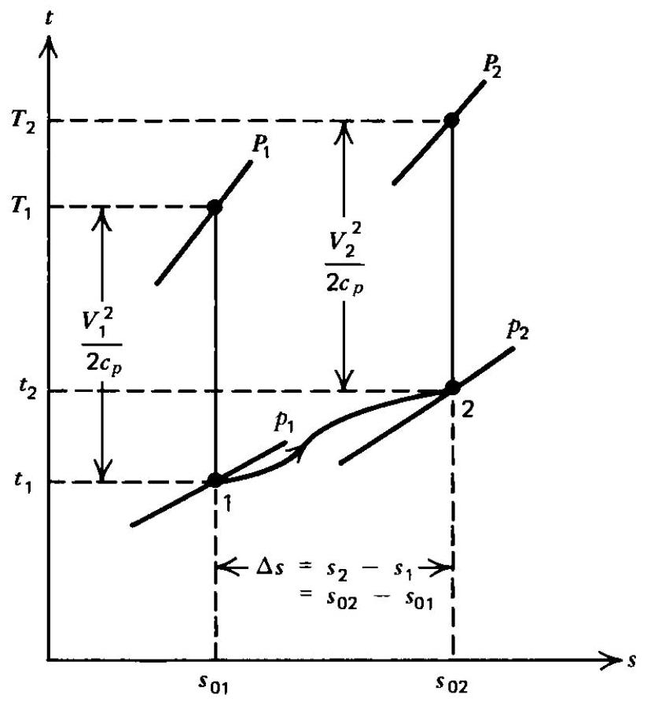
Figure 3.20. Entropy change for a process in terms of stagnation properties.

states. Hence,

$$
d s=d s_{o}=c_{p} d\left\{\ln \left[\frac{T}{P^{(\gamma-1) / \gamma}}\right]\right\}
$$

Rewriting equation 3.85 gives

$$
\frac{d s}{c_{p}}=\frac{d T}{T}-\frac{\gamma-1}{\gamma} \frac{d P}{P}
$$

For a calorically perfect gas ( $c_{p}=$ constant), equation 3.86 can be integrated between states 1 and 2.

$$
\Delta s=s_{2}-s_{1}=c_{p} \ln \left(\frac{T_{2}}{T_{1}}\right)-R \ln \left(\frac{P_{2}}{P_{1}}\right)
$$

For a steady adiabatic flow, the stagnation temperature $T$ remains constant. In that case, equation 3.87 relates the entropy change to the change in stagnation pressure.

$$
\Delta s=s_{2}-s_{1}=-R \ln \left(\frac{P_{2}}{P_{1}}\right)
$$

For a frictionless adiabatic process the entropy of a flowing fluid remains constant. From equation 3.88, it follows that for an isentropic change of state for a perfect gas, the stagnation pressure $P$ likewise rema ins constant. If friction is involved, then according to the second law of thermodynamics, as expressed by equation 3.52, the entropy of the gas must increase. Since $\Delta s>0$, equation 3.88 requires that $P_{2}<P_{1}$. Hence, the stagnation pressure decreases in the presence of friction. The decrease in stagnation pressure of the gas may be regarded, therefore, as a measure of the increase in its specific entropy; that is, of the irreversibility of a steady adiabatic flow process. The relationship between the stagnation pressure ratio and the entropy change for a steady adiabatic flow is obtained directly from equation 3.88 . The result is

$$
\frac{P_{2}}{P_{1}}=\exp \left(-\frac{\Delta s}{R}\right)
$$

It will be shown later that, if heat is transferred to a flowing gas, or if external work is involved, there cannot be a conservation of stagnation pressure. Heat transfer and work cause the stagnation pressure to change even when the process is reversible. If the heat transfer or work is irreversible, then the stagnation pressure change is greater than it is for a corresponding reversible process.

## 3-10 CHARACTERISTIC SPEEDS OF GAS DYNAMICS

In the analysis of gas dynamic processes, there are several different characteristic speeds that are representative of the overall properties of the flow. In this section, those characteristic speeds are derived, and their applications to the analysis of compressible flows are discussed.

## 3-10(a) Maximum Isentropic Speed

The isentropic speed $V^{\prime}$ attained by a gas in expanding isentropically is given by equation 3.48. The speed $V^{\prime}$ attains its maximum value when the final pressure $p$ is zero; that is, when the gas expands into a vacuum. Let $V_{\text {max }}^{\prime}$ denote the isentropic speed in that special case. Then

$$
V_{\max }^{\prime}=\left(\frac{2 \gamma R T}{\gamma-1}\right)^{1 / 2}=a_{o}\left(\frac{2}{\gamma-1}\right)^{1 / 2}
$$

The speed $V_{\text {max }}^{\prime}$, termed the maximum isentropic speed, represents the speed corresponding to the complete transformation of the kinetic energy associated with the random motions of the gas molecules into directed kinetic energy. The static temperature corresponding to that condition is zero, and a real gas would, of course, liquefy before that speed is attained.

It should be realized that the speed $V_{\text {max }}^{\prime}$ applies to the flow of a gas out of an infinite reservoir. It does not apply to the motion of a body in a gas, such as a missile in the air of the atmosphere. In the latter case, the limitation on the maximum attainable speed is the thrust available for propelling the vehicle. On the other hand, if a body is at rest and the air moves toward it with the speed $V$, the air cannot accelerate locally
around the body to a speed exceeding $V_{\text {max }}^{\prime}$. The maximum isentropic speed is a fictitious speed unattainable even by an isentropic flow. It is of significance, however, because it has a definite value for a given set of flow conditions. The speed $V_{\text {max }}^{\prime}$ may, therefore, be regarded as a characteristic of the flow.

A useful relationship between $V_{\text {max }}^{\prime}, a$, and $V$ is obtained by combining equations 3.84 and 3.90. Thus,

$$
\frac{V^{2}}{2}+\frac{a^{2}}{\gamma-1}=\frac{V_{\max }^{\prime 2}}{2}
$$

## 3-10(b) Critical Speed of Sound

Equation 3.44, derived in Section 3-6(d), for a perfect gas, is repeated below and renumbered for convenience. Thus,

$$
a_{1}^{2}\left(1+\frac{\gamma-1}{2} M_{1}^{2}\right)=a_{2}^{2}\left(1+\frac{\gamma-1}{2} M_{2}^{2}\right)=\text { constant }
$$

Assume that a gas initially in subsonic flow ( $M_{1}<1$ ) is expanded adiabatically as it flows in a frictionless passage (stream tube), as illustrated in Fig. 3.21. As the gas expands isentropically, its speed increases and its static temperature falls. At some location the speed $V_{2}$ attains the same magnitude as the local acoustic speed $a_{2}$. The corresponding value for the local Mach number will accordingly be $M_{2}=1$.

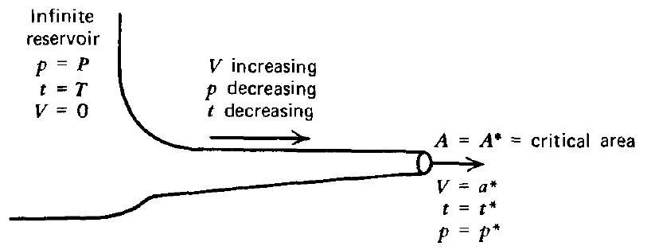
Figure 3.21. Isentropic expansion of a gas to the critical condition.

By definition, let $a_{2}=a^{*}$ when $V_{2}=a_{2}$. The acoustic speed $a^{*}$ is called the critical speed of sound and is a characteristic speed for the flow. The value of $a^{*}$ may be obtained from equation 3.92 by substituting into it the values $a_{2}=a^{*}$ and $M_{2}=1$. Thus, dropping the subscript 1 from the left-hand side, equation 3.92 becomes

$$
a^{2}\left(1+\frac{\gamma-1}{2} M^{2}\right)=\frac{\gamma+1}{2} a^{* 2}
$$

Substituting for $M^{2}=V^{2} \cdot a^{2}$ into equation 3.93, the energy equation in terms of $V$, $a$, and $a^{*}$ is

$$
\frac{V^{2}}{2}+\frac{a^{2}}{\gamma-1}=\frac{(\gamma+1) a^{* 2}}{2(\gamma-1)}
$$

From equations 3.84 and 3.94, it follows that the stagnation acoustic speed $a_{o}$ is related to the critical speed of sound $a^{*}$ by the following equation. Thus,

$$
a_{o}^{2}=\frac{\gamma+1}{2} a^{* 2}
$$

## 3-10(c) Thermodynamic Properties Corresponding to $a^{*}$

The critical temperature $t^{*}$ may be determined from equation 3.69 by setting $t=t^{*}$ and $M=1$. Thus, $t^{*}$ is given by

$$
t^{*}=\frac{2}{\gamma+1} T
$$

The critical pressure $p^{*}$ and the critical density $\rho^{*}$ are readily obtained by applying the thermal equation of state for a perfect gas, $p=\rho R t$, and the relationships for an isentropic change of state to the critical and the stagnation conditions for the gas. Thus,

$$
\begin{aligned}
& \frac{p^{*}}{P}=\left(\frac{t^{*}}{T}\right)^{\gamma /(\gamma-1)}=\left(\frac{2}{\gamma+1}\right)^{\gamma /(\gamma-1)} \\
& \frac{\rho^{*}}{\rho_{o}}=\left(\frac{p^{*}}{P}\right)^{1 / \gamma}=\left(\frac{2}{\gamma+1}\right)^{1 /(\gamma-1)}
\end{aligned}
$$

Figure 3.22 presents the ratios $t^{*} / T, p^{*} / P$, and $\rho^{*} / \rho_{o}$ as functions of $\gamma$.

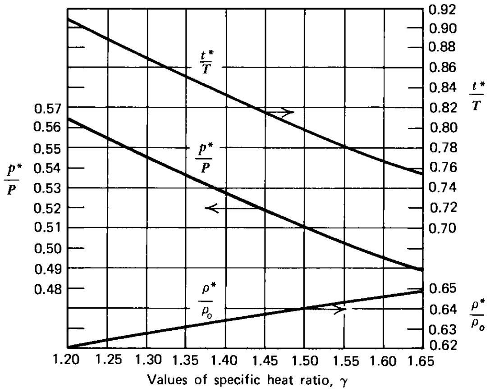
Figure 3.22. Values of the ratios $t^{*} / T, p^{*} / P$, and $\rho^{*} / \rho_{o}$ as functions of the specific heat ratio $\gamma$.

## 3-10(d) Relationships between the Characteristic Speeds

The critical speed of sound $a^{*}$, like the stagnation acoustic speed $a_{o}$, is a characteristic speed for the flow. The maximum isentropic speed $V_{\text {max }}^{\prime}$ is also related to $a^{*}$ and $a_{o}$. From equation 3.90,

$$
V_{\max }^{\prime 2}=\frac{2}{\gamma-1} a_{o}^{2}
$$

Substituting for $a_{o}$ from equation 3.95 gives

$$
V_{\max }^{\prime 2}=\frac{\gamma+1}{\gamma-1} a^{* 2}
$$

It follows from equations 3.95, 3.99, and 3.100 that, for gases having $\gamma=1.4$, $a^{*}=0.91287 a_{0}, a_{0}=1.0954 a^{*}$, and $V_{\text {max }}^{\prime}=2.2361 a_{0}=2.4495 a^{*}$.
Example 3.9. Air, assumed to be a perfect gas with $\gamma=1.4$, flows through a frictionless passage. The speed of the air increases in the direction of flow. At station 1, the static temperature is 333.3 K , the static pressure is $2.0684 \cdot 10^{5} \mathrm{~N} / \mathrm{m}^{2}$, and the mean speed is $152.4 \mathrm{~m} / \mathrm{s}$. At station 2 the local Mach number is unity. Calculate the values of the following at station 2: (a) the static temperature, (b) the mean speed of the air, (c) the static pressure, and (d) the density of the air.

## Solution

From equation 1.181, $a_{1}=\left(\gamma R t_{1}\right)^{1 / 2}$. For air $R=287.04 \mathrm{~J} / \mathrm{kg}-\mathrm{K}$. Hence,

$$
\begin{aligned}
a_{1} & =[1.4(287.04)(333.3)]^{1 / 2}=366.0 \mathrm{~m} / \mathrm{s} \\
M_{1} & =\frac{V_{1}}{a_{1}}=\frac{152.4}{366.0}=0.4164
\end{aligned}
$$

From equation 3.69,

$$
T=333.3\left[1+0.2(0.4164)^{2}\right]=344.9 \mathrm{~K}
$$

From equation 3.75 ,

$$
P=p_{1}\left(\frac{T}{t_{1}}\right)^{\gamma /(\gamma-1)}=(2.0684) 10^{5}\left(\frac{344.9}{333.3}\right)^{3.5}=2.3305 \cdot 10^{5} \mathrm{~N} / \mathrm{m}^{2}
$$

At the location where $M_{2}=1, t_{2}=t^{*}, V_{2}=a^{*}, p_{2}=p^{*}$, and $\rho_{2}=\rho^{*}$. Thus,
(a) $t_{2}=t^{*}=\left(\frac{2}{\gamma+1}\right) T=0.83333(344.9)=287.4 \mathrm{~K}$
(b) $V_{2}=a^{*}=\left(\gamma R t^{*}\right)^{1 / 2}=[1.4(287.04)(287.4)]^{1 / 2}=339.9 \mathrm{~m} / \mathrm{s}$
(c) $p_{2}=p^{*}=P\left(\frac{2}{\gamma+1}\right)^{\gamma /(\gamma-1)}=(2.3305) 10^{5}(0.52828)=1.2312 \cdot 10^{5} \mathrm{~N} / \mathrm{m}^{2}$
(d) $\rho_{2}=\rho^{*}=\frac{p^{*}}{R t^{*}}=\frac{(1.2312) 10^{5}}{(287.04)(287.4)}=1.4924 \mathrm{~kg} / \mathrm{m}^{3}$

## 3-10(e) Dimensionless Velocity $\boldsymbol{M}^{*}$

The Mach number $M=V / a$, when employed as a flow characteristic, suffers from the disadvantage that it is not directly proportional to the velocity of the fluid because $a$ is a variable. For that reason the so-called dimensionless velocity $M^{*}$ is found to be a useful parameter. It is defined by

$$
M^{*} \equiv \frac{V}{a^{*}}
$$

The dimensionless velocity $M^{*}$ is related to the local Mach number $M$ by

$$
M^{* 2}=\left(\frac{V}{a^{*}}\right)^{2}\left(\frac{a}{a}\right)^{2}=M^{2}\left(\frac{a}{a^{*}}\right)^{2}
$$

Writing the energy equation in the form of equation 3.94 and dividing throughout by $a^{* 2} / 2$ gives

$$
\left(\frac{V}{a^{*}}\right)^{2}+\frac{2}{\gamma-1}\left(\frac{a}{a^{*}}\right)^{2}=\frac{\gamma+1}{\gamma-1}
$$

Introducing the definitions for $M$ and $M^{*}$ into equation 3.103 yields

$$
\frac{\gamma-1}{2} M^{* 2}+\left(\frac{M^{*}}{M}\right)^{2}=\frac{\gamma+1}{2}
$$

Solving equation 3.104 for $M^{* 2}$ gives

$$
M^{* 2}=\frac{(\gamma+1) M^{2}}{2+(\gamma-1) M^{2}}
$$

Solving equation 3.104 for $M^{2}$ yields

$$
M^{2}=\frac{\frac{2}{\gamma+1} M^{* 2}}{1-\frac{\gamma-1}{\gamma+1} M^{* 2}}
$$

Values of $M^{*}$ as a function of $M$, for different values of $\gamma$, are presented in Table C.6.
It is apparent from equation 3.105 that, if $M=0$, then $M^{*}=0$, and that, when $M=1, M^{*}=1$. As $M$ approaches infinity, however, $M^{*}$ approaches the finite value

$$
\lim _{M \rightarrow \infty} M^{*}=\left(\frac{\gamma+1}{\gamma-1}\right)^{1 / 2}
$$

Another useful dimensionless velocity is given by the ratio $V / a_{o}$. From the definition $M^{*}=V / a^{*}$ and equation 3.95,

$$
\frac{V}{a_{o}}=\frac{V}{a^{*}} \frac{a^{*}}{a_{o}}=M^{*} \frac{a^{*}}{a_{o}}=\left(\frac{2}{\gamma+1}\right)^{1 / 2} M^{*}
$$

Substituting equation 3.105 into equation 3.108 gives

$$
\left(\frac{V}{a_{o}}\right)^{2}=\frac{M^{2}}{1+\frac{\gamma-1}{2} M^{2}}
$$

Useful alternate forms of the stagnation property ratios in terms of the dimensionless velocity $M^{*}$ may be obtained from equation 3.84. Thus,

$$
\frac{t}{T}=\left(\frac{a}{a_{o}}\right)^{2}=1-\frac{\gamma-1}{2}\left(\frac{V}{a_{o}}\right)^{2}
$$

Substituting equation 3.108 into equation 3.110 gives

$$
\frac{t}{T}=\left(1-\frac{\gamma-1}{\gamma+1} M^{* 2}\right)
$$

The ratios $p / P$ and $\rho / \rho_{o}$ in terms of $M^{*}$ may be found by combining equations 3.111, 3.75 , and 3.79 . Thus,

$$
\begin{aligned}
& \frac{p}{P}=\left(1-\frac{\gamma-1}{\gamma+1} M^{* 2}\right)^{\gamma /(\gamma-1)} \\
& \frac{\rho}{\rho_{o}}=\left(1-\frac{\gamma-1}{\gamma+1} M^{* 2}\right)^{1 /(\gamma-1)}
\end{aligned}
$$

The stagnation property ratios may also be expressed in terms of the ratio $V / a_{o}$ by combining equations $3.110,3.75$, and 3.79 .

## 3-11 THE CONTINUITY RELATIONSHIPS FOR A PERFECT GAS

In Section 3-4, the continuity equation for steady one-dimensional flow is derived (see equation 3.4); it is repreated here for convenience.

$$
\dot{m}=\rho A V=\text { constant }
$$

In this section, several alternate forms of the continuity equation for the flow of a perfect gas are derived.

## 3-11(a) The Continuity Equation for a Perfect Gas

For a perfect gas, $p=\rho R t$, and the continuity equation may be transformed to read

$$
\dot{m}=\rho A V=p A V / R t=\mathrm{constant}
$$

Substituting $a=\sqrt{\gamma \bar{R} \bar{t}}$ and $M=V / a$ into equation 3.114 yields

$$
\dot{m}=\frac{A p V}{R t}=\frac{A p V}{(\gamma R t)^{1 / 2}}\left(\frac{\gamma}{R t}\right)^{1 / 2}=A p M\left(\frac{\gamma}{R t}\right)^{1 / 2}=\mathrm{constant}
$$

Equation 3.115 is the continuity equation for a perfect gas expressed in terms of the Mach number $M$ for a flow crossing the area $A$.

The actual flow at cross section $A$ may be conceived to have originated in an infinite reservoir, where $p=P$ and $t=T$, from which the gas expanded isentropically to the actual values $V, p$, and $t$. From equation 3.69, it follows that

$$
t=T\left(1+\frac{\gamma-1}{2} M^{2}\right)^{-1}
$$

Hence, in terms of the stagnation temperature $T$, equation 3.115 becomes

$$
\dot{m}=A p M\left[\frac{\gamma}{R T}\left(1+\frac{\gamma-1}{2} M^{2}\right)\right]^{1 / 2}=\text { constant }
$$

From equation 3.76, it follows that

$$
p=P\left(1+\frac{\gamma-1}{2} M^{2}\right)^{-\gamma /(\gamma-1)}
$$

Hence, the continuity equation expressed in terms of the stagnation pressure $P$ for the actual flow becomes

$$
\dot{m}=A M P\left(\frac{\gamma}{R T}\right)^{1 / 2}\left(1+\frac{\gamma-1}{2} M^{2}\right)^{-(\gamma+1) / 2(\gamma-1)}=\text { constant }
$$

Equation 3.119 applies to each section of a flow passage, provided there is no change in the mass flow rate. In the special case where it can be assumed that $\gamma$ and $R$ remain constant at all flow cross-sectional areas, then for any cross-sectional area $A$, equation 3.119 can be written in the form

$$
\frac{A M P / \sqrt{T}}{\left(1+\frac{\gamma-1}{2} M^{2}\right)^{(\gamma+1) / 2(\gamma-1)}}=\text { constant }
$$

## 3-11(b) Critical Flow Area

Consider now the problem of establishing the magnitude of the flow area of the passage illustrated in Fig. 3.21, where the velocity is equal to the critical speed of sound $a^{*}$. The flow area where $V=a^{*}$ is denoted by $A^{*}$ and is called the critical flow area. Applying the continuity equation between the two areas $A$ and $A^{*}$ gives

$$
\rho A V=\rho^{*} A^{*} a^{*}=\mathrm{constant}
$$

The area ratio $A / A^{*}$ is, accordingly,

$$
\frac{A}{A^{*}}=\frac{\rho^{*} a^{*}}{\rho V}=\frac{\rho^{*} \sqrt{\gamma R t^{*}}}{\rho V}
$$

Substituting for $t^{*}, \rho^{*}, \rho$, and $V$ from equations $3.96,3.98,3.80$, and 3.48 , respectively, into equation 3.122 , gives the following equation for isentropic flow.

$$
\frac{A}{A^{*}}=\left\{\left(\frac{\gamma-1}{2}\right) \frac{\left(\frac{2}{\gamma+1}\right)^{(\gamma+1) /(\gamma-1)}}{\left(\frac{p}{P}\right)^{2 / \gamma}\left[1-\left(\frac{p}{P}\right)^{(\gamma-1) / \gamma}\right]}\right\}^{1 / 2} \quad(\text { isentropic flow })
$$

Equation 3.123 presents the critical area ratio $A / A^{*}$ that causes an isentropic flow to attain a speed equal to the critical speed of sound $a^{*}$. The critical area ratio depends on the expansion ratio $p / P$ and the specific heat ratio $\gamma$. Figure 3.23 presents $A / A^{*}$ as a function of the expansion ratio $p / P$ for gases having $\gamma=1.4$.

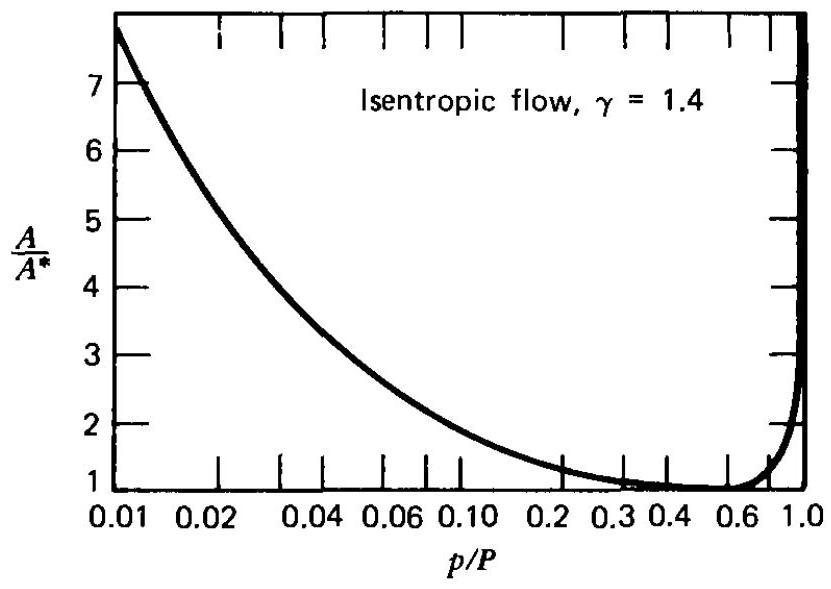
Figure 3.23. Critical area ratio $A / A^{*}$ as a function of expansion ratio $p / P$ for $\gamma=1.40$.

The critical area ratio may be expressed as a function of the flow Mach number $M$ by eliminating the pressure ratio $p / P$ from equation 3.123 by means of equation 3.76. The result is

$$
\frac{A}{A^{*}}=\frac{1}{M}\left[\left(\frac{2}{\gamma+1}\right)\left(1+\frac{\gamma-1}{2} M^{2}\right)\right]^{(\gamma+1) / 2(\gamma-1)}
$$

Values of $A / A^{*}$ as a function of the Mach number $M$, for different values of $\gamma$, are presented in Table C.6.

It is demonstrated in Section 3-11(d) that, when the gas speed is equal to $a^{*}$, the passage discharges the maximum mass rate of flow, $\dot{m}_{\max }=\dot{m}^{*}$, called the critical
mass flow. When the mass flow rate is $\dot{m}^{*}$, the minimum flow area of the passage is the critical area $A^{*}$.

It follows from equations 3.119 and 3.124 that equation 3.119 may be transformed to read

$$
\dot{m}=P A\left(\frac{\gamma}{R T}\right)^{1 / 2}\left(\frac{2}{\gamma+1}\right)^{(\gamma+1) / 2(\gamma-1)}\left(\frac{1}{A / A^{*}}\right)
$$

The advantage of equation 3.125 is that Table C.6, which lists the values of $A / A^{*}$ for steady one-dimensional isentropic flow, may be employed for determining the flow Mach number $M$ directly.

Applying equation 3.119 at the critical condition, where $M=1$, yields

$$
\dot{m}^{*}=P A^{*}\left(\frac{\gamma}{R T}\right)^{1 / 2}\left(\frac{2}{\gamma+1}\right)^{(\gamma+1) / 2(\gamma-1)}
$$

Equation 3.126 may be rewritten in the form

$$
\dot{m}^{*}=\frac{P A^{*}}{\sqrt{\gamma R T}} \gamma\left(\frac{2}{\gamma+1}\right)^{(\gamma+1) / 2(\gamma-1)}=\frac{\Gamma P A^{*}}{a_{o}}
$$

where $a_{o}$ is the stagnation speed of sound and $\Gamma$ is defined as

$$
\Gamma \equiv \gamma\left(\frac{2}{\gamma+1}\right)^{(\gamma+1) / 2(\gamma-1)}
$$

Values of $\Gamma$ are presented in Table C.15. Equation 3.127 demonstrates the functional dependence of the critical mass flow rate $\dot{m}^{*}$ on the other flow parameters. Thus, in functional form,

$$
\dot{m}^{*}=f\left(P, A^{*}, 1 / \sqrt{ } R, 1 / \sqrt{T}, \Gamma\right)
$$

Example 3.10. At a certain station in a converging flow passage the mass rate of flow of air is $11.34 \mathrm{~kg} / \mathrm{s}$, the stagnation temperature is 500 K , the stagnation pressure is $2.068 \cdot 10^{5} \mathrm{~N} / \mathrm{m}^{2}$, the cross-sectional area is $0.03716 \mathrm{~m}^{2}$, and the flow is subsonic. Determine the Mach number at that station.

## Solution

For air, $\gamma=1.4$ and $R=287.04 \mathrm{~J} / \mathrm{kg}-\mathrm{K}$. Equation 3.125 reduces to

$$
\begin{aligned}
\dot{m} & =\frac{P A}{24.743 \sqrt{T}} \frac{1}{\left(A / A^{*}\right)} \\
\frac{A}{A^{*}} & =\frac{\left(2.068 \cdot 10^{5}\right)(0.03716)}{24.743 \sqrt{500(11.34)}}=1.225
\end{aligned}
$$

From Table C.6, for $A / A^{*}=1.225$, the Mach number is 0.571 .
Example 3.11. A perfect gas flows through a conduit under isothermal conditions. At section 1 , the area is $A_{1}$, the Mach number is $M_{1}=0.4$, and the static pressure is $2.068410^{5} \mathrm{~N} / \mathrm{m}^{2}$. Further downstream where the area is $0.8 A_{1}$, the static pressure is $1.3790 \cdot 10^{5} \mathrm{~N} / \mathrm{m}^{2}$. Calculate the Mach number at section 2 .

## Solution

From equation 3.115,

$$
A_{1} p_{1} M_{1}\left(\frac{\gamma}{R t_{1}}\right)^{1 / 2}=A_{2} p_{2} M_{2}\left(\frac{\gamma}{R t_{2}}\right)^{1 / 2}
$$

Since $t_{1}=t_{2}$ and $A_{2}=0.8 A_{1}$, the above equation reduces to

$$
p_{1} M_{1}=0.8 p_{2} M_{2}
$$

Solving for $M_{2}$ gives

$$
M_{2}=\frac{p_{1} M_{1}}{0.8 p_{2}}=\frac{2.0684(0.4)}{(0.8)(1.3790)}=0.750
$$

Example 3.12. An ideal air diffuser is to reduce the Mach number of the air entering it from $M_{1}=0.8$ to $M_{2}=0.2$. Determine its area ratio.

## Solution

From Table C.6, at $M_{1}=0.8, A_{1} / A^{*}=1.0382$, and at $M_{2}=0.2, A_{2} / A^{*}=2.9635$. Hence, the area ratio $A_{2} / A_{1}$ is found to be

$$
\frac{A_{2}}{A_{1}}=\frac{\left(A_{2} / A^{*}\right)}{\left(A_{1} / A^{*}\right)}=\frac{2.9635}{1.0382}=2.854
$$

Example 3.13. A perfect gas flows through a duct with a velocity of $182.88 \mathrm{~m} / \mathrm{s}$. The mass flow rate is $9.072 \mathrm{~kg} / \mathrm{s}$. The area of the duct is $0.0516 \mathrm{~m}^{2}$, and the flow Mach number is $M=0.5$. Calculate the static pressure of the air. Assume $\gamma=1.4$ and $R=287.04 \mathrm{~J} / \mathrm{kg}-\mathrm{K}$.

## Solution

First, a relationship between $T, M$, and $V$ must be developed. Thus,

$$
\frac{V}{a_{o}}=\frac{V}{(\gamma R T)^{1 / 2}}=\frac{V}{(\gamma R t)^{1 / 2}}\left(\frac{t}{T}\right)^{1 / 2}=\frac{V}{a}\left(\frac{t}{T}\right)^{1 / 2}=M\left(\frac{t}{T}\right)^{1 / 2}=\frac{M}{\left(1+\frac{\gamma-1}{2} M^{2}\right)^{1 / 2}}
$$

Solving for $T$ gives

$$
T=\frac{V^{2}\left(1+\frac{\gamma-1}{2} M^{2}\right)}{\gamma R M^{2}}=\frac{(182.88)^{2}\left[1+0.2(0.5)^{2}\right]}{1.4(287.04)(0.5)^{2}}=349.6 \mathrm{~K}
$$

From equation 3.117,

$$
\begin{aligned}
p & =\frac{\dot{m} \sqrt{R T}}{A M\left[\gamma\left(1+\frac{\gamma-1}{2} M^{2}\right)\right]^{1 / 2}}=\frac{9.072[287.04(349.6)]^{1 / 2}}{0.0516(0.5)\left\{1.4\left[1+0.2(0.5)^{2}\right]\right\}^{1 / 2}} \\
p & =0.9184 \quad 10^{5} \mathrm{~N} / \mathrm{m}^{2}\left(13.32 \mathrm{lbf} / \mathrm{in}^{2}\right)
\end{aligned}
$$

## 3-11(c) Effect of Compressibility on the Mass Flow Rate

The fact that the density of a compressible fluid changes with its flow speed introduces considerations not present in the case of incompressible fluids. It is of interest to investigate the effect of the compressibility of the flowing fluid on its mass rate of flow $\dot{m}$ through a converging-diverging passage, such as that illustrated in Fig. 3.24. To do this, it will be assumed that the flow is isentropic, and use will be made of the continuity equation (equation 3.4), rewritten in the following form,

$$
G=\dot{m} / A=\rho V
$$

where $G$ is the mass flux (mass flow rate per unit area). The magnitudes of $\rho$ and $V$ depend on the expansion ratio governing the flow process. There are two extreme

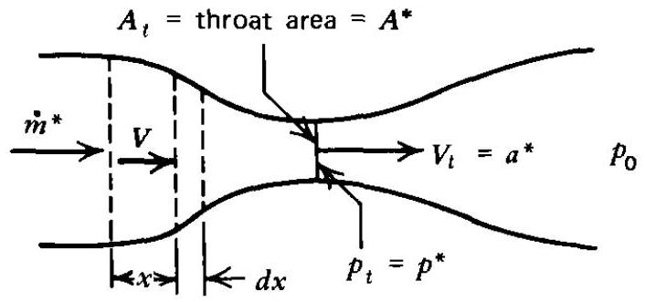
Figure 3.24. Isentropic flow through a convergingdiverging passage through which the maximum mass flow rate $\dot{m}^{*}$ is flowing.

operating conditions: (1) when the expansion ratio for the passage is $p / P=1$, and (2) when $p / P=0$. When $p / P=1$, the fluid is at rest (stagnation), so that $\rho=\rho_{0}$ and $V=0$, so that $\rho V=0$. On the other hand, when $p / P=0$, the back pressure into which the gas expands is $p=0$. In that case the specific volume of the gas after expansion is infinite, so that $\rho=1 / v=0$, and the fluid speed is the maximum isentropic speed $V_{\text {max }}^{\prime}$ (see equation 3.90), and again $\rho V=\rho V_{\text {max }}^{\prime}=0$. Hence, for both limiting cases, the product $\rho V=0$.

It follows from the foregoing that the mass flux $G$ is zero when the back pressure $p$ is equal to the initial pressure $P$, and also when $p=0$. Between those two values of the expansion ratio the curve representing $G$ as a function of $p / P$ must have at least one maximum point. Investigations show that there is only one maximum point between the values $p / P=1$ and $p / P=0$. The maximum value of $G$ is attained at a particular value of $p / P$, called the critical expansion ratio.

## 3-11(d) Condition for Maximum Isentropic Mass Rate of Flow

It is of interest to determine the speed that is attained by a gas when the isentropic mass rate of flow reaches its maximum value $\dot{m}_{\text {max }}^{\prime}$. For that purpose, consider the one-dimensional converging-diverging flow passage illustrated in Fig. 3.24 and assume that the flow is isentropic. Let $A$ denote the cross-sectional area normal to the flow, $A_{t}$ its smallest value (throat), and $x$ the distance from the entrance cross section $A_{1}$ to any cross section $A$. The criterion for determining the condition when $\dot{m}_{\text {max }}^{\prime}$ is reached is the maximum value of the mass flux $G^{\prime}$. Thus, when $\dot{m}^{\prime}=\dot{m}_{\text {max }}^{\prime}$, $G^{\prime}=G_{\text {max }}^{\prime}$. Obviously, $G^{\prime}$ attains its largest value at the throat section of the con-verging-diverging passage; the curve of flow area $A$ as a function of the length $x$ has a minimum point at the throat section, signifying that at the throat section $d A / d x=0$.

Assume now that the converging-diverging passage passes the flow $\dot{m}_{\text {max }}^{\prime}$. Then, by continuity,

$$
\dot{m}_{\max }^{\prime}=A \rho^{\prime} V^{\prime}=\mathrm{constant}
$$

Logarithmic differentiation of equation 3.131 and division by $d x$ gives

$$
\frac{1}{A} \frac{d A}{d x}+\frac{1}{V^{\prime}} \frac{d V^{\prime}}{d x}+\frac{1}{\rho^{\prime}} \frac{d \rho^{\prime}}{d x}=0
$$

For the throat, since $d A / d x=0$, equation 3.132 reduces to

$$
\frac{d V_{t}^{\prime}}{d x}=-\frac{V_{t}^{\prime}}{\rho_{t}^{\prime}} \frac{d \rho_{t}^{\prime}}{d x}
$$

where the subscript $t$ denotes that the properties are evaluated at the throat. Since the flow has been assumed to be isentropic, the dynamic equation for frictionless
flow (equation 3.9 with $g d z=0$ ) is applicable. Let $V=V_{t}^{\prime}$ and $d p=d p_{t}^{\prime}$; then rewriting equation 3.9 , dividing throughout by $d x$, and rearranging the result gives

$$
\frac{d V_{t}^{\prime}}{d x}=-\frac{1}{\rho_{t}^{\prime} V_{t}^{\prime}} \frac{d p_{t}^{\prime}}{d x}
$$

Equating equations 3.133 and 3.134 and solving for $V_{t}^{\prime}$, yields

$$
\left(V_{t}^{\prime}\right)^{2}=\left(\frac{d p^{\prime}}{d \rho^{\prime}}\right)_{t}=a^{2}=a^{* 2}
$$

Since the flow is isentropic, $\left(d p^{\prime} / d \rho^{\prime}\right)_{t}$ is identical to the isentropic derivative $(\partial p / \partial \rho)_{s}= a^{2}$.

Equation 3.135 shows that, when a converging-diverging passage passes the isentropic flow $\dot{m}_{\text {max }}^{\prime}$, the speed of the fluid in the throat section is equal to the local speed of sound; that is, $V_{t}^{\prime}=a^{*}$. Hence, for the isentropic flow in a converging-diverging passage, it follows that, when $\dot{m}=\dot{m}_{\text {max }}^{\prime}, V_{t}^{\prime}=a^{*}$, so that $M_{t}^{*}=V_{t}^{\prime} / a^{*}=1$. The throat area $A_{t}$ is then equal to the critical area $A^{*}$, and the properties of the gas are $p^{*}, t^{*}$, and $\rho^{*}$; the latter parameters are determined by the appropriate equations presented in Section 3-10(c). The mass flow rate at the critical flow condition is given by equation 3.127. Thus,

$$
\dot{m}_{\max }^{\prime}=\dot{m}^{*}=\frac{\Gamma P A^{*}}{\sqrt{\gamma R T}}=\frac{\Gamma P A^{*}}{a_{0}}
$$

Example 3.14. A gas flows one-dimensionally and adiabatically in a frictionless variable area duct. At station $1, M_{1}=2.5, t_{1}=311.11 \mathrm{~K}, p_{1}=0.5068 \cdot 10^{5} \mathrm{~N} / \mathrm{m}^{2}$, and $A=0.09293 \mathrm{~m}^{2}$. At the locations where $M_{2}=2.5,1.2$, and 1.0 , find (a) the static pressure, (b) the static temperature, (c) the gas density, (d) the gas velocity, and (e) the area. Assume $\gamma=1.4$ and $R=287.04 \mathrm{~J} / \mathrm{kg}-\mathrm{K}$.

## Solution

From Table C.6.

| $\bar{M}$ | $p / P$ | $t / T$ | $\rho / \rho_{0}$ | $A / A^{*}$ | $M^{*}=V / a^{*}$ |
| :--- | ---: | ---: | ---: | ---: | ---: |
| $\overline{2.5}$ | 0.05853 | 0.44444 | 0.13169 | 2.6367 | 1.82574 |
| 1.2 | 0.41238 | 0.77640 | 0.53114 | 1.0304 | 1.15828 |
| 1.0 | 0.52828 | 0.83333 | 0.63394 | 1.0000 | 1.00000 |

The reference conditions for this isentropic flow may be determined from the initial conditions and the property ratios at $M=2.5$. Thus,

$$
\begin{aligned}
P & =\frac{p_{1}}{0.05853}=\frac{(0.5068) 10^{5}}{0.05853}=8.658 \cdot 10^{5} \mathrm{~N} / \mathrm{m}^{2} \\
T & =\frac{t_{1}}{0.44444}=\frac{311.11}{0.44444}=700.0 \mathrm{~K} \\
\rho_{o} & =\frac{P}{R T}=\frac{(8.658) 10^{5}}{(287.04)(700.00)}=4.3091 \mathrm{~kg} / \mathrm{m}^{3}
\end{aligned}
$$

$$
\begin{aligned}
A^{*} & =\frac{A_{1}}{\left(A_{1} / A^{*}\right)}=\frac{0.09293}{2.6367}=0.0352448 \mathrm{~m}^{3} \\
a_{1} & =[1.4(287.04)(311.11)]^{1 / 2}=353.58 \mathrm{~m} / \mathrm{s} \\
V_{1} & =M_{1} a_{1}=2.5(353.58)=883.96 \mathrm{~m} / \mathrm{s} \\
a^{*} & =\frac{V_{1}}{M_{1}^{*}}=\frac{833.96}{1.82574}=484.17 \mathrm{~m} / \mathrm{s}
\end{aligned}
$$

The properties at the other two stations may be calculated from the reference conditions and the property ratios. The results are presented in the following table.

| $M$ | $p, \mathrm{~N} / \mathrm{m}^{2} \cdot 10^{5}$ | $t, \mathrm{~K}$ | $\rho, \mathrm{~kg} / \mathrm{m}^{3}$ | $V, \mathrm{~m} / \mathrm{s}$ | $A, \mathrm{~m}^{2}$ |
| :--- | :---: | ---: | ---: | ---: | ---: |
| 2.5 | 0.5068 | 311.11 | 0.56753 | 883.92 | 0.09293 |
| 1.2 | 3.5706 | 543.48 | 2.28872 | 560.80 | 0.03632 |
| 1.0 | 4.5741 | 583.33 | 2.73179 | 484.17 | 0.03524 |

## 3-12 STREAM THRUST AND THE IMPULSE FUNCTION

It is pointed out in Section 3-5(g) that the sum ( $p A+\dot{m} V$ ) for a flowing fluid is termed the stream thrust. For problems involving the calculation of the reaction force caused by the one-dimensional flow of a fluid in a duct, it is convenient to regard that sum as a single function, termed the impulse function, which is denoted by $\mathscr{F}$. Thus,

$$
\mathscr{F} \equiv p A+\dot{m} V=p A+\rho A V^{2}=p A\left(1+\frac{\rho V^{2}}{p}\right)
$$

where $p$ is the absolute static pressure acting over the cross section $A$.
Consider the internal flow between the inlet (section 1) and the exit (section 2) of a passage such as a nozzle or a diffuser. For a one-dimensional flow in the positive $x$ direction, $\mathbf{n}_{1}=-\mathbf{i}$ and $\mathbf{n}_{2}=\mathbf{i}$. From equation 3.28, the net force $F_{\text {fluid }}$ applied to the fluid by the internal walls of the passage in the $x$ direction is

$$
F_{\text {fluid }}=\Delta \mathscr{F}=\mathscr{F}_{2}-\mathscr{F}_{1}
$$

The reaction force exerted by the fluid on the internal walls of the passage is $F_{\text {int }}= -F_{\text {fluid }}$. From equation 3.29, the external restraining force $F_{\text {ext }}$ acting on the duct is

$$
F_{\mathrm{ext}}=\left(\mathscr{F}_{2}-p_{o} A_{2}\right)-\left(\mathscr{F}_{1}-p_{o} A_{1}\right)
$$

For a perfect gas it is convenient to express $\mathscr{F}$ in terms of the flow Mach number $M$. Noting that $\gamma p / \rho=a^{2}$, equation 3.137 transforms to

$$
\mathscr{F}=p A\left(1+\gamma M^{2}\right)
$$

The value of $\mathscr{F}$ when $M=1$ is denoted by $\mathscr{F}^{*}$. The ratio $\mathscr{F} / \mathscr{F}^{*}$ is given by

$$
\frac{\mathscr{F}^{*}}{\mathscr{F}^{*}}=\frac{p}{P} \frac{P}{p^{*}} \frac{A}{A^{*}}\left(\frac{1+\gamma M^{2}}{\gamma+1}\right)
$$

To simplify equation 3.140 further, the ratios $p / P, P / p^{*}$, and $A / A^{*}$ must be related to the Mach number $M$ for the flow. Those relationships depend on the driving potentials (area change, friction, heat transfer, etc.) acting on the flow. For example,
for isentropic flow with area change, the aforementioned ratios are given by equations 3.76, 3.97, and 3.124. Substituting those equations into equation 3.140, we obtain

$$
\frac{\mathscr{F}^{*}}{\mathscr{F}^{*}}=\frac{1+\gamma M^{2}}{M\left[2(\gamma+1)\left(1+\frac{\gamma-1}{2} M^{2}\right)\right]^{1 / 2}}
$$

Equation 3.141 is applicable to steady one-dimensional isentropic flow. The ratio $\mathscr{F} / \mathscr{F}^{*}$ for isentropic flow is tabulated as a function of the Mach number $M$ for several values of $\gamma$ in Table C.6.

## 3-13 DYNAMIC PRESSURE AND THE PRESSURE COEFFICIENT

In problems involving the interaction of a fluid with a solid body, such as an airfoil, it is useful to present the results in terms of nondimensional coefficients. Three of the more important nondimensional coefficients in common use are the pressure coefficient $C_{p}$, the lift coefficient $C_{L}$, and the drag coefficient $C_{D}$. Those parameters are defined in the present section.

## 3-13(a) Dynamic Pressure

Consider first the flow of an inviscid incompressible fluid when the force caused by gravitational attraction is negligible. Then, equation 3.11 reduces to

$$
p+\frac{1}{2} \rho V^{2}=\text { constant }
$$

Equation 3.142 shows that the fluid motion depends on the relative magnitudes of the pressure force, which is proportional to $p$, and the inertia force, which is proportional to $\rho V^{2} / 2$, acting on the fluid particle. The inertia force is a dynamic force, and the term $\rho V^{2} / 2$ is termed the dynamic pressure $q_{\text {inc }}$. Thus, by definition,

$$
q_{\mathrm{inc}} \equiv \frac{1}{2} \rho V^{2}=\text { the dynamic pressure for incompressible flow }
$$

and equation 3.142 may be rewritten as

$$
p+q_{\text {inc }}=\text { constant }
$$

If a fluid flowing at a pressure $p$ and a velocity $V$ is brought to rest, then, as stated earlier, the pressure at the rest state is called the stagnation pressure $P$. Thus, equation 3.144 gives

$$
p+q_{\text {inc }}=P=\text { constant }
$$

Equation 3.145 shows that the dynamic pressure $q_{\text {inc }}$ is equal to the increase in static pressure that occurs when an inviscid incompressible fluid is brought to rest.

For an inviscid compressible flow in the absence of body forces, equation 3.10 becomes

$$
\int \frac{d p}{\rho}+\frac{V^{2}}{2}=\text { constant }
$$

To complete the integration of equation 3.146, the relationship between pressure $p$ and density $\rho$ must be specified. That integration is performed in Section 3-9(c) for isentropic flow (see equation 3.76). Equation 3.146 may be put in the same form as
equation 3.145 , but the dynamic pressure $q_{\text {comp }}$ for a compressible fluid is larger than the dynamic pressure $q_{\text {inc }}$ for an incompressible fluid. In fact, the ratio $q_{\text {comp }} / q_{\text {inc }}$ is identical to the compressibility factor $\mathscr{F}_{c}$ defined by equation 3.66.

## 3-13(b) The Pressure Coefficient

If $\rho_{\infty}$ is the density of an undisturbed flowing medium, and $V_{\infty}$ is the corresponding free-stream velocity, then the pressure coefficient $C_{p}$ is defined by

$$
C_{p} \equiv \frac{p-p_{\infty}}{q_{\infty}}
$$

where $q_{\infty}$ is the free-stream dynamic pressure. Equation 3.147 is simply a convenient means of nondimensionalizing the pressure $p$ in terms of the properties of the free stream. In that form, the results are independent of the actual magnitudes of $p, \rho$, and $V$, and depend only on the relative magnitudes of the pressure and inertia forces.

For an incompressible flow, equation 3.147 becomes

$$
C_{p}=\frac{p-p_{\infty}}{q_{\mathrm{inc}}}=\frac{p-p_{\infty}}{\frac{1}{2} \rho_{\infty} V_{\infty}^{2}}
$$

while, for a compressible flow,

$$
C_{p}=\frac{p-p_{\infty}}{q_{\mathrm{comp}}}=\frac{p-p_{\infty}}{P_{\infty}-p_{\infty}}
$$

It is conventional practice to employ the pressure coefficient defined by equation 3.148 even for compressible flows. Little or no use is made of the definition presented in equation 3.149. Since $q_{\text {inc }}<q_{\text {comp }}$, the value of $C_{p}$ based on equation 3.148 may exceed unity for a compressible flow.

In a like manner, the lift and drag coefficients $C_{L}$ and $C_{D}$, respectively, for a body, such as an airfoil, immersed in a flowing medium, are defined by

$$
C_{L} \equiv \frac{L / A}{\frac{1}{2} \rho_{\infty} V_{\infty}^{2}}
$$

and

$$
C_{D} \equiv \frac{D / A}{\frac{1}{2} \rho_{\infty} V_{\infty}^{2}}
$$

where $L$ is the lift force, $D$ is the drag force, and $A$ is some characteristic area associated with the body. Both $C_{L}$ and $C_{D}$ are based on the incompressible dynamic pressure $q_{\text {inc }}$, although analogous expressions could have been obtained in terms of $q_{\text {comp }}$. Equations 3.150 and 3.151 are the definitions in common usage.

For a perfect gas, the pressure coefficient $C_{p}$ may be expressed in terms of the free-stream Mach number $M_{\infty}$ and the velocity ratio ( $V / V_{\infty}$ ) as follows. From equation 3.147,

$$
C_{p}=\frac{p-p_{\infty}}{\frac{1}{2} \rho_{\infty} V_{\infty}^{2}}=\frac{2\left(p-p_{\infty}\right)}{\gamma p_{\infty} M_{\infty}^{2}}=\frac{2}{\gamma M_{\infty}^{2}}\left(\frac{p}{p_{\infty}}-1\right)
$$

where $a_{\infty}{ }^{2}=\gamma p_{\infty} / \rho_{\infty}$ and $M_{\infty}=V_{\infty} / a_{\infty}$. For $p / p_{\infty}$ we may write

$$
\frac{p}{p_{\infty}}=\frac{p}{P} \frac{P}{p_{\infty}}
$$

For an isentropic flow the ratios $p / P$ and $p_{\infty} / P$ may be determined by means of equation 3.76. Hence,

$$
\frac{p}{p_{\infty}}=\left[\frac{2+(\gamma-1) M_{\infty}^{2}}{2+(\gamma-1) M^{2}}\right]^{\gamma /(\gamma-1)}
$$

where $M=V / a$ and $M_{\infty}=V_{\infty} / a_{\infty}$. Substituting equation 3.154 into equation 3.152 yields

$$
C_{p}=\frac{2}{\gamma M_{\infty}^{2}}\left\{\left[\frac{2+(\gamma-1) M_{\infty}^{2}}{2+(\gamma-1) M^{2}}\right]^{\gamma /(\gamma-1)}-1\right\}
$$

It is desirable to express $C_{p}$ in terms of $M_{\infty}{ }^{2}$ and $\left(V / V_{\infty}\right)^{2}$. To do this use is made of equation 3.43, which is a form of the energy equation. Thus,

$$
\frac{V^{2}}{2}+\frac{a^{2}}{\gamma-1}=\frac{V_{\infty}^{2}}{2}+\frac{a_{\infty}^{2}}{\gamma-1}
$$

Combining equation 3.156 with equation 3.155 , we obtain

$$
C_{p}=\frac{2}{\gamma M_{\infty}^{2}}\left\{\left[1+\frac{\gamma-1}{2} M_{\infty}^{2}\left(1-\frac{V^{2}}{V_{\infty}^{2}}\right)\right]^{\gamma /(\gamma-1)}-1\right\}
$$

Equation 3.157 shows that the local value of $C_{p}$ at a given point in a flowing fluid depends strongly on the free-stream Mach number $M_{\infty}$.

## 3-14 SUMMARY

In this chapter the governing equations are derived for the steady one-dimensional (or uniform) flow of any type of fluid. The forms taken by those equations for special flow conditions, such as flow with and without friction, flow with and without work and heat transfer, and flow with and without body forces are derived herein. The principal forms of all of the aforementioned equations are assembled in Table 3.1, for convenience of reference.

Some of the general effects of the propagation of a small pressure disturbance in a compressible fluid are discussed in Section 3-8. It is shown that a small pressure disturbance is propagated in a stationary body of compressible fluid with the acoustic speed $a$. The disturbance waves "clear away" from a disturbance source if it moves with a subsonic speed ( $M<1$ ). If a small disturbance source moves, however, with a supersonic speed ( $M>1$ ) into a stationary compressible fluid, the disturbance source must cross each disturbance wave propagated by it. A Mach cone becomes attached to the source and the half-angle of the cone $\alpha$ is given by $\sin \alpha=1 / M$.

It is shown in Section 3-9 that the stagnation state for a fluid (the state where $V=0$ ) is a convenient reference state, which is independent of the type of fluid and the actual flow being studied. Consequently, a local stagnation state may be defined at each point in the actual flow field. In the special case where the flowing fluid is a perfect gas, the ratios $t / T, p / P$, and $\rho / \rho_{o}$ for a given perfect gas are functions only of the local Mach number $M$. Table 3.2 presents, for ready reference, the governing equations for the steady one-dimensional flow of a perfect gas. Table 3.3 presents the equations for the stagnation properties $H, T, P$, and $\rho_{o}$.

It is shown in Section 3-10 that when the flowing fluid is a perfect gas, there are certain characteristic speeds associated with a steady one-dimensional flow (subject to the restrictions of absence of work, heat transfer, and body forces). Such flows are quite generally termed adiabatic flows. If there is the additional restriction that the

Table 3.1 Governing Equations for the Steady One-Dimensional Flow of a Fluid

## Continuity equation

$$
\dot{m}=\rho A V
$$

## Momentum equation

(1) Frictionless flow

$$
\frac{d p}{\rho}+V d V+g d z=0
$$

(2) Flow with friction

$$
d p+\rho V d V+\rho g d z+\frac{\rho V^{2}}{2}\left(\frac{4 \mathrm{f} d x}{\mathscr{D}}\right)+\frac{\delta D}{A}=0
$$

## Energy equation

(1) Flow with work and heat transfer

$$
\begin{gathered}
\delta W-\delta Q+d h+d\left(\frac{V^{2}}{2}\right)+g d z=0 \\
Q+h_{1}+\frac{V_{1}^{2}}{2}+g z_{1}=W+h_{2}+\frac{V_{2}^{2}}{2}+g z_{2}
\end{gathered}
$$

(2) Flow without work and heat transfer (adiabatic flow)

$$
\begin{aligned}
& d h+d\left(\frac{V^{2}}{2}\right)+g d z=0 \\
& h+\frac{V^{2}}{2}+g z=\text { constant }
\end{aligned}
$$

## Entropy equation

(1) Flow with heat transfer

$$
d s \geqq \frac{\delta Q}{t}
$$

(2) Adiabatic flow

$$
d s \geqq 0
$$

flow is frictionless, then the flow is termed an isentropic flow, since $d s=0$. Isentropic flow is discussed in detail in Chapter 4. Table 3.4 presents the equations for the aforementioned characteristic speeds and the relationships between them.

Section 3-11 discusses the effect of the compressibility of the flowing fluid on the continuity equation, the flow area, and the mass flow rate. In addition, it discusses the concepts of the critical speed of sound $a^{*}$, the critical flow area $A^{*}$ (where $V=a^{*}$ ), and the critical mass flow rate $\dot{m}^{*}$. It is shown that the ratio $A / A^{*}$, for a given gas, is a function only of the local Mach number $M$. The equations for $\dot{m}^{*}$ and $A / A^{*}$ are presented in Table 3.2, for a perfect gas. The critical properties for a perfect gas are presented in Table 3.5.

Section 3-11(c) discusses the effect of the compressibility of a flowing fluid on its mass flow rate and demonstrates that for an isentropic flow of a perfect gas, $A^{*}=A_{t}$, where $A_{t}$ is the area of the throat (smallest flow area) of the flow passage. Moreover, when the velocity crossing $A_{t}$ is $V=a^{*}$, the mass flow rate through the flow passage is a maximum and is equal to $\dot{m}^{*}$.

Table 3.2 Governing Equations for the Steady One-Dimensional Flow of a Perfect Gas

## Continuity equation

(1) Mass flow rate

$$
\begin{aligned}
& \dot{m}=\rho A V=\frac{A p V}{R t}=A p M\left(\frac{\gamma}{R t}\right)^{1 / 2}=A p M\left[\frac{\gamma}{R T}\left(1+\frac{\gamma-1}{2} M^{2}\right)\right]^{1 / 2} \\
& \dot{m}=A M P\left(\frac{\gamma}{R T}\right)^{1 / 2}\left(1+\frac{\gamma-1}{2} M^{2}\right)^{-(\gamma+1) / 2(\gamma-1)}
\end{aligned}
$$

(2) Critical mass flow rate

$$
\dot{m}^{*}=\frac{\Gamma P A^{*}}{(\gamma R T)^{1 / 2}}=\frac{\Gamma P A^{*}}{a_{o}} \quad \text { where } \quad \Gamma=\gamma\left(\frac{2}{\gamma+1}\right)^{(\gamma+1) / 2(\gamma-1)}
$$

(3) Critical flow area ratio

$$
\frac{A^{*}}{A^{*}}=\frac{1}{M}\left[\frac{2}{\gamma+1}\left(1+\frac{\gamma-1}{2} M^{2}\right)\right]^{(\gamma+1) / 2(\gamma-1)}
$$

## Momentum (or dynamic) equation

(1) Flow with friction and submerged bodies

$$
\frac{d p}{p}+\frac{\gamma}{2} d M^{2}+\frac{\gamma M^{2}}{2} \frac{d t}{t}+\frac{\gamma M^{2}}{2}\left(\frac{4 \tilde{f} d x}{\mathscr{D}}\right)+\frac{\delta D}{A p}=0
$$

(2) Frictionless flow (no body forces)

$$
\frac{d \rho}{\rho}+M^{2} \frac{d V}{V}=0
$$

## Energy equation

(1) Flow with work and heat transfer

$$
\begin{gathered}
\delta W-\delta Q+c_{p} d t+d\left(\frac{V^{2}}{2}\right)+g d z=0 \\
W-Q+c_{p}\left(t_{2}-t_{1}\right)+\frac{V_{2}^{2}-V_{1}^{2}}{2}+g\left(z_{2}-z_{1}\right)=0
\end{gathered}
$$

(2) No external work, heat transfer, or body forces

$$
\begin{gathered}
c_{p} d t+d\left(\frac{V^{2}}{2}\right)=c_{p} d T=d H=0 \\
c_{p} t+\frac{V^{2}}{2}=c_{p} T=H
\end{gathered}
$$

## Entropy equation

(1) In terms of static properties

$$
\begin{aligned}
& \frac{d s}{c_{p}}=d\left\{\ln \left[\frac{t}{p^{(\gamma-1) / \gamma}}\right]\right\}=\frac{d t}{t}-\frac{\gamma-1}{\gamma} \frac{d p}{p} \\
& \Delta s=s_{2}-s_{1}=c_{p} \ln \left(\frac{t_{2}}{t_{1}}\right)-R \ln \left(\frac{p_{2}}{p_{1}}\right)=c_{p} \ln \left[\frac{t_{2} / t_{1}}{\left(p_{2} / p_{1}\right)^{(\gamma-1) / \gamma}}\right]
\end{aligned}
$$

(2) In terms of stagnation properties

$$
\begin{aligned}
& \frac{d s}{c_{p}}=d\left\{\ln \left[\frac{T}{P^{(\gamma-1) / \gamma}}\right]\right\}=\frac{d T}{T}-\frac{\gamma-1}{\gamma} \frac{d P}{P} \\
& \Delta s=s_{2}-s_{1}=c_{p} \ln \left(\frac{T_{2}}{T_{1}}\right)-R \ln \left(\frac{P_{2}}{P_{1}}\right)=c_{p} \ln \left[\frac{T_{2} / T_{1}}{\left(P_{2} / P_{1}\right)^{(\gamma-1) / \gamma}}\right]
\end{aligned}
$$

Table 3.3 Stagnation Properties for a Perfect Gas
(1) Stagnation enthalpy

$$
H=h+\frac{V^{2}}{2}
$$

(2) Stagnation temperature

$$
T=\frac{H}{c_{p}}=t+\frac{V^{2}}{2 c_{p}}=t\left(1+\frac{\gamma-1}{2} M^{2}\right)
$$

(3) Stagnation pressure

$$
P=p\left(\frac{T}{t}\right)^{\gamma /(\gamma-1)}=p\left(1+\frac{\gamma-1}{2} M^{2}\right)^{\gamma /(\gamma-1)}
$$

(4) Stagnation density

$$
\rho_{o}=\frac{P}{R T}=\rho\left(1+\frac{\gamma-1}{2} M^{2}\right)^{1 /(\gamma-1)}
$$

Table 3.4 Characteristic Speeds for the Steady One-Dimensional Flow of a Perfect Gas

## Isentropic speeds

(1) Isentropic discharge speed (St. Venant-Wantzel equation)

$$
V^{\prime}=\left\{\frac{2 \gamma R T}{\gamma-1}\left[1-\left(\frac{p^{\prime}}{P}\right)^{(\gamma-1) / \gamma}\right]\right\}^{1 / 2}
$$

(2) Maximum isentropic speed

$$
\left(V_{\max }^{\prime}\right)^{2}=\frac{2 \gamma R T}{\gamma-1}=\frac{2}{\gamma-1} a_{o}^{2}=V^{2}+\frac{2}{\gamma-1} a^{2}
$$

## Acoustic speeds

(1) Stagnation acoustic speed

$$
a_{o}^{2}=\gamma R T=a^{2}\left(\frac{T}{t}\right)=a^{2}\left(1+\frac{\gamma-1}{2} M^{2}\right)=a^{2}+\frac{\gamma-1}{2} V^{2}
$$

(2) Critical speed of sound

$$
a^{* 2}=\gamma R t^{*}=\frac{2 \gamma R T}{\gamma+1}=\frac{2}{\gamma+1} a_{o}^{2}=\frac{2}{\gamma+1} a^{2}\left(1+\frac{\gamma-1}{2} M^{2}\right)
$$

(3) Relationships between the characteristic speeds

$$
\left(V_{\max }^{\prime}\right)^{2}=\frac{2}{\gamma-1} a_{o}^{2}=\frac{\gamma+1}{\gamma-1} a^{* 2}
$$

## Dimensionless velocities

(1) Dimensionless velocity ( $M^{*}=V / a^{*}$ )

$$
M^{* 2}=\frac{(\gamma+1) M^{2}}{2+(\gamma-1) M^{2}} \quad \text { or } \quad M^{2}=\frac{\frac{2}{\gamma+1} M^{* 2}}{1-\frac{\gamma-1}{\gamma+1} M^{* 2}}
$$

(2) Dimensionless velocity ( $V / a_{o}$ )

$$
\frac{V}{a_{o}}=\left(\frac{2}{\gamma+1}\right)^{1 / 2} M^{*}=\left(\frac{M^{2}}{1+\frac{\gamma-1}{2} M^{2}}\right)^{1 / 2}
$$

Table 3.5 Critical Properties for a Perfect Gas
(1) Critical temperature

$$
t^{*}=\left(\frac{2}{\gamma+1}\right) T
$$

(2) Critical pressure

$$
p^{*}=\left(\frac{2}{\gamma+1}\right)^{\gamma /(\gamma-1)} P
$$

(3) Critical density

$$
\rho^{*}=\left(\frac{2}{\gamma+1}\right)^{1 /(\gamma-1)} \rho_{o}
$$

In Section 3-12, the impulse function $\mathscr{F}$ is defined, and it is shown that, for the steady one-dimensional flow of a given perfect gas, the ratio $\mathscr{F} \mathscr{F}^{*}$ is a function only of the local Mach number.

Table C. 6 presents the ratios $t / T, p / P, \rho / \rho_{o}, \mathscr{F} / \mathscr{F}^{*}$, and $A / A^{*}$ as functions of $M$, for different values of the specific heat ratio $\gamma$.

## REFERENCES

I. M. J. Zucrow, Aircraft and Missile Propulsion, Vol. I, Wiley, New York, 1958.
2. A. H. Shapiro, The Dynamics and Thermodynamics of Compressible Fluid Flow, Vol. 1, Ronald Press, New York, 1953.
3. K. Oswatitsch, Gas Dynamics, Academic Press, New York, 1956.
4. R. von Mises, Mathematical Theory of Compressible Fluid Flow, Academic Press, New York, 1958.
5. H. W. Liepmann and A. Roshko, Elements of Gas Dynamics, Wiley, New York, 1973.
6. J. A. Owczarek, Fundamentals of Gas Dynamics, International Textbook Co., Scranton, Pa., 1964.
7. H. Schlichting, Boundary Layer Theory, Sixth Edition, McGraw-Hill, New York, 1968.
8. J. W. Daily and D. R. F. Harleman, Fluid Dynamics, Addison-Wesley, Reading, Mass., 1966.
9. E. A. Bonney, M. J. Zucrow, and C. W. Besserer, Aerodynamics, Propulsion, Structures, and Design Practice, Principles of Guided Missile Design, edited by G. Merrill, p. 123, D. Van Nostrand, New York, 1956.
10. H. Korst, R. H. Page, and M. E. Childs, "A Theory of Base Pressures", in Transonic and Supersonic Flow, ME TN 392-2, University of Illinois, May 1962.
11. T. J. Mueller, "Determination of the Turbulent Base Pressure in Supersonic Axisymmetric Flow," Journal of Spacecraft and Rockets, Vol. 5, No. 1, pp. 101-107, January 1968.
12. W. P. Sule and T. J. Mueller, "Truncated Plug Nozzle Flowfield and Base Pressure Characteristics", Journal of Spacecraft and Rockets, Vol. 10, No. 11, pp. 689-695, November 1973.

## PROBLEMS

1. The applicability of the one-dimensional flow concept is investigated in illustrative Example 3.1, where the ratios of the actual to the one-dimensional values of the flow momentum and kinetic energy are determined for the fully developed turbulent flow in a pipe when the power law exponent $n=7$. Calculate the aforementioned ratios for the values of $n$ presented in the table in Section 3-3. Plot the values of those ratios as a function of Reynolds number.
2. A liquid having the density $\rho$ flows through a conduit. At section 1 the area is $A_{1}$, and at section 2 it is $A_{2} \neq A_{1}$. The pressure at $A_{1}$ is $p_{1}$ and at $A_{2}$ it is $p_{2}$. The mass rate of flow of liquid is $\dot{m}$. Show that

$$
\dot{m}=A_{1} A_{2}\left[\frac{2 \rho\left(p_{1}-p_{2}\right)}{A_{1}^{2}-A_{2}^{2}}\right]^{1 / 2}
$$

3. Consider the vane illustrated in Fig. 3.25. Assume that the fluid impinging on the vane is incompressible and frictionless, and that the vane is stationary. Determine an expression for the components $F_{x}$ and $F_{y}$ of the reaction force $\mathbf{F}$. Calculate $\mathbf{F}$ when $\dot{m}=22.68 \mathrm{~kg} / \mathrm{s}, V_{1}= 9.144 \mathrm{~m} / \mathrm{s}$, and $\theta=150 \mathrm{deg}$.

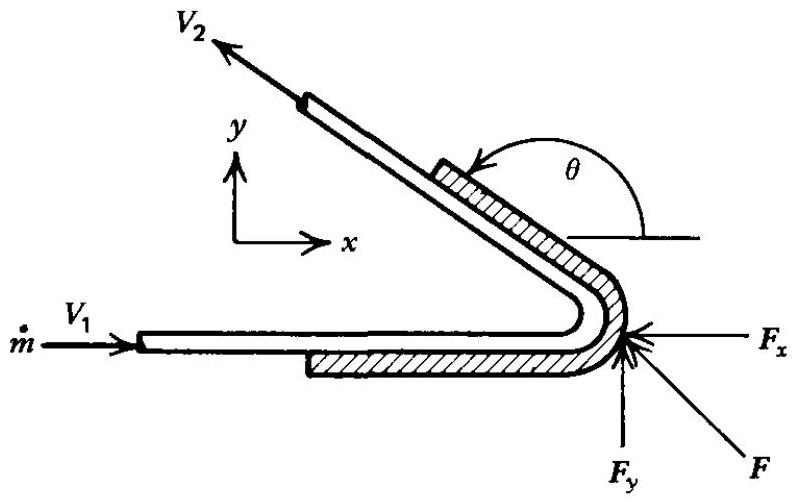
Figure 3.25. Sketch for Problem 3.3.

4. Water enters the elbow illustrated in Fig. 3.26 at a static pressure of $27.58 \cdot 10^{5} \mathrm{~N} / \mathrm{m}^{2}$ with a volume flow rate of $5.663 \mathrm{~m}^{3} / \mathrm{s}$. The inlet and outlet areas are $0.1858 \mathrm{~m}^{2}$ and $0.0929 \mathrm{~m}^{2}$, respectively. The atmospheric pressure $p_{o}=1 \mathrm{~atm}$. Assume that friction and body forces are negligible. Calculate (a) $V_{1}, V_{2}$, and $p_{2}$, (b) the force exerted by the elbow on the fluid, (c) the force exerted by the fluid on the elbow, and (d) the force required to hold the elbow stationary.

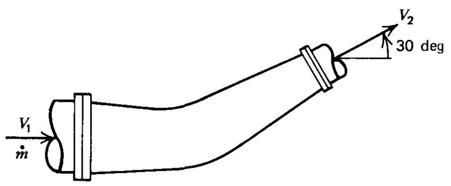
Figure 3.26. Sketch for Problem 3.4.

5. Water flows through a frictionless converging conduit. The cross section in the conduit where the pressure is $5.171 \cdot 10^{5} \mathrm{~N} / \mathrm{m}^{2}$ and the velocity is $15.24 \mathrm{~m} / \mathrm{s}$ is 15.24 m below the entrance to the conduit. At a cross section located 137.2 m below the entrance of the conduit, the static pressure of the water is $14.824 \cdot 10^{5} \mathrm{~N} / \mathrm{m}^{2}$. Calculate the velocity at the cross section where the pressure is $14.824 \cdot 10^{5} \mathrm{~N} / \mathrm{m}^{2}$ by (a) the dynamic equation, and (b) the energy equation. Assume that the density of the water is $1000 \mathrm{~kg} / \mathrm{m}^{3}$ and that there is no heat transfer.
6. A cylindrical water supply tank is 10.668 m high and 1.829 m in diameter, and the top is open to the atmosphere. The water level in the tank is at 7.62 m . The horizontal discharge pipe is 0.3048 m in diameter and 21.336 m long, and the center line of the pipe is 1.524 m above the bottom of the tank. At the end of the pipe is a converging nozzle with an outlet area of $0.03716 \mathrm{~m}^{2}$. How long will it take to lower the water level to 3.048 m ? Assume no friction or losses. Plot the discharge rate as a function of time for the period under discussion.
7. Water at a static pressure of $14.82 \cdot 10^{5} \mathrm{~N} / \mathrm{m}^{2}$ enters a 90 deg reducing elbow with a velocity of $6.096 \mathrm{~m} / \mathrm{s}$. The diameters of the entrance and the exit sections are 0.3048 m and 0.1524 m , respectively. Calculate the $x$ and $y$ components of the reaction force acting on the elbow, and make a sketch of the elbow indicating therein the momentum and force vectors.
8. A Pitot tube is inserted in a pipe through which air is flowing. The stagnation gage pressure reading is 0.100 m of water, and the static gage pressure reading is 0.020 m of water. The
atmospheric pressure is 1 atm , and the static temperature is 300 K . Calculate (a) the dynamic pressure, and (b) the air velocity.
9. Air at 300 K and 1 atm is compressed adiabatically to a pressure and temperature of 5 atm and 490 K , respectively. Employing Table C.4, determine (a) the change in entropy of the gas, and (b) the efficiency of the compressor. The velocity of the air entering and leaving the compressor is negligible.
10. A diffuser of a turbojet engine operating at $10,000 \mathrm{~m}$ altitude passes a mass flow rate of $25 \mathrm{~kg} / \mathrm{s}$. The inlet velocity is $200 \mathrm{~m} / \mathrm{s}$, the inlet static pressure is $0.35 \cdot 10^{5} \mathrm{~N} / \mathrm{m}^{2}$, and the inlet static temperature is 230 K . The exit area of the diffuser is $0.5 \mathrm{~m}^{2}$. Assuming frictionless flow, calculate the reaction force acting on the diffuser.
11. Show that for the adiabatic flow of a perfect gas

$$
\begin{aligned}
\frac{t}{T} & =1-\frac{\gamma-1}{2}\left(\frac{V}{a_{o}}\right)^{2} \\
\frac{t}{T} & =1-\frac{\gamma-1}{\gamma+1}\left(\frac{V}{a^{*}}\right)^{2}
\end{aligned}
$$

12. An airplane has a velocity of $1931.2 \mathrm{~km} / \mathrm{hr}$ at sea level. Calculate the stagnation temperature of the air (a) assuming that $c_{p}$ and $\gamma$ are constant at their initial values, (b) based on an average value of $c_{p}$ and $\gamma$, and (c) accounting for the variation of $c_{p}$ with temperature.
13. Superheated steam at $82.74 \cdot 10^{5} \mathrm{~N} / \mathrm{m}^{2}$ and 811.1 K flows in a 0.1524 m diameter horizontal pipe with a speed of $91.44 \mathrm{~m} / \mathrm{s}$. Determine its stagnation temperature and stagnation pressure.
14. A stream of air has a velocity of $250 \mathrm{~m} / \mathrm{s}$, a static temperature $t=300 \mathrm{~K}$, and a static pressure $p=1 \mathrm{~atm}$. Calculate the dynamic pressure (a) assuming that the air is incompressible, and (b) accounting for the effects of the compressibility of the air.
15. Air flows in a duct at a static temperature $t=300 \mathrm{~K}$ and a static pressure $p=3.50 \cdot 10^{5} \mathrm{~N} / \mathrm{m}^{2}$. Calculate the stagnation temperature, pressure, and density assuming that (a) $c_{p}$ is constant at its initial value, (b) an appropriate average value of $c_{p}$ is employed, and (c) $c_{p}$ is a function of temperature (employ Table C.4).
16. An airplane flies at an altitude of $15,000 \mathrm{~m}$ with a velocity of $800 \mathrm{~km} / \mathrm{hr}$. Calculate (a) the maximum possible temperature on the airplane skin, (b) the maximum possible pressure intensity on the airplane body, (c) the critical velocity of the air relative to the airplane, and (d) the maximum possible velocity of the air relative to the airplane.
17. A perfect gas having $c_{p}=1017.4 \mathrm{~J} / \mathrm{kg}-\mathrm{K}$ and $\bar{m}=28.97$ flows adiabatically in a converging passage with a mass flow rate $\dot{m}=29.188 \mathrm{~kg} / \mathrm{s}$. At a particular cross section, $M=0.6$, $T=550 \mathrm{~K}$, and $P=2.0 \cdot 10^{5} \mathrm{~N} / \mathrm{m}^{2}$. Calculate the area of the cross-section of the passage at that point.
18. Air having the stagnation conditions $T=300 \mathrm{~K}$ and $P=35.0 \cdot 10^{5} \mathrm{~N} / \mathrm{m}^{2}$ is available in a large storage tank. A converging nozzle is attached to the outlet of the tank to deliver a mass flow rate of $5.0 \mathrm{~kg} / \mathrm{s}$. What is the throat area of the nozzle?
19. A stream of air flowing in a duct has $p=1.40 \cdot 10^{5} \mathrm{~N} / \mathrm{m}^{2}, \dot{m}=0.25 \mathrm{~kg} / \mathrm{s}$, and $M=0.6$, at a section where the flow area $A=6.50 \mathrm{~cm}^{2}$. Calculate the stagnation temperature of the air (a) assuming that $c_{p}$ is constant and (b) accounting for the variation of $c_{p}$ with temperature.
