## 4

## steady one-dimensional isentropic flow with area change

4-1 PRINCIPAL NOTATION FOR CHAPTER 4 ..... 161
4-2 INTRODUCTION ..... 161
4-3 STEADY ONE-DIMENSIONAL ISENTROPIC FLOW WITH AREA CHANGE ..... 162
(a) Governing equations ..... 162
(b) The isentropic process ..... 163
(c) Effect of area change on flow properties ..... 166
(d) Limiting conditions (choking) ..... 168
(e) The downstream physical boundary conditions ..... 170
4-4 STEADY ONE-DIMENSIONAL ISENTROPIC FLOW OF A PERFECT GAS ..... 172
(a) Governing equations for the isentropic flow of a perfect gas ..... 172
(b) Isentropic flow tables for a perfect gas ..... 174
(c) Effect of area change on the flow properties of a perfect gas ..... 178
4-5 STEADY ONE-DIMENSIONAL ISENTROPIC FLOW OF IMPERFECT GASES ..... 181
4-ο THE CONVERGING NOZZLE ..... 187
(a) Isentropic throat speed ..... 187
(b) Isentropic mass rate of flow ..... 189
(c) Effect of decreasing the back pressure with constant inlet pressure ..... 191
(d) Effect of increasing the inlet pressure with constant back pressure ..... 192
(e) Nondimensional mass flow rate ..... 193
(f) Multidimensional flow effects ..... 194
4-7 THE CONVERGING-DIVERGING OR DE LAVAL NOZZLE ..... 196
(a) Isentropic discharge properties ..... 197
(b) Area ratio for complete expansion (optimum area ratio) ..... 200
(c) Effect of varying the back pressure on a converging-diverging nozzle ..... 204
(d) Underexpansion in converging-diverging nozzles ..... 206
(e) Overexpansion in converging-diverging nozzles ..... 206
(f) Multidimensional flow effects ..... 208
4-8 LOSSES IN NOZZLES ..... 210
(a) Stagnation pressure ratio for nonisentropic flow in nozzles ..... 210
(b) Velocity coefficient and kinetic energy efficiency ..... 212
(c) Nozzle discharge coefficient ..... 218
4-9 SOURCE AND SINK FLOWS ..... 219
4-10 JET PROPULSION ENGINES ..... 223
(a) Air-breathing engines ..... 224
(b) Rocket engines ..... 227
(c) Performance of propulsive nozzles ..... 229
(d) Thrust reduction caused by flow divergence in propulsive nozzles ..... 232
(e) Design of propulsive nozzles for maximum thrust ..... 235
4-11 SUMMARY ..... 236

## 4-1 PRINCIPAL NOTATION FOR CHAPTER 4

The notation presented in Section 3-1 applies to the discussions of this chapter. The additional notation required for this chapter are listed below.
$C_{D}=\dot{m} / \dot{m}_{1-D, \text { isentropic }}$, discharge coefficient.
$C_{F}=F / P A_{t}$, thrust coefficient.
$F$ thrust of a propulsive nozzle.
$I_{s p} \quad=F / \dot{m}$, specific impulse.
$p_{o}$ ambient (back) pressure.

## Greek Letters

$\Gamma=\psi^{*}=\gamma\left(\frac{2}{\gamma+1}\right)^{(\gamma+1) / 2(\gamma-1)}$
$\varepsilon \quad=A_{e} / A_{t}$, nozzle area ratio.
$\psi \quad$ flow factor, defined by equation 4.75.
$\psi^{*} \quad=\Gamma$, critical value of $\psi$.
Subscripts
$e \quad$ nozzle exit.
$p$ planar flow.
$s$ source flow.
$t$ nozzle throat.

## Superscripts

' denotes state attained by an isentropic process.

* denotes critical (sonic) condition.


## 4-2 INTRODUCTION

In Chapter 3, the basic equations governing steady one-dimensional flow are developed, and several important concepts such as the stagnation conditions, the continuity relationships, etc., are introduced. Although the equations presented in

Chapter 3 are simpler than the original equations developed in Chapter 2, nevertheless, they are too complicated to permit obtaining general closed form solutions, because they involve several independent driving potentials; for example, area change, heat transfer, friction, and body forces. In many cases of practical interest, one of the driving potentials may predominate, so that the others may be neglected entirely, thereby permitting even further simplifications of the governing equations.

This chapter considers steady one-dimensional flows wherein friction, heat transfer, and body forces are negligible, that is, adiabatic and frictionless flows. Such flows may be assumed to be isentropic, and the sole driving potential responsible for the variations in the flow properties is area change, that is, the changes in the area of the flow passage. The equations and concepts developed in this chapter are of great practical value in analyzing many real flow situations. Moreover, the accuracy obtainable by applying the steady one-dimensional isentropic analysis is quite satisfactory for many engineering problems, especially when the results are modified by means of appropriate experimental correction coefficients.

## 4-3 STEADY ONE-DIMENSIONAL

## ISENTROPIC FLOW WITH AREA CHANGE

In this section, the equations governing the steady one-dimensional isentropic flow of a fluid in a variable area passage are derived. Figure 4.1 illustrates schematically the flow model for isentropic flow with area change. The equations governing this flow model are derived from the general one-dimensional flow equations derived in Chapter 3, by simplifying them where it is appropriate.

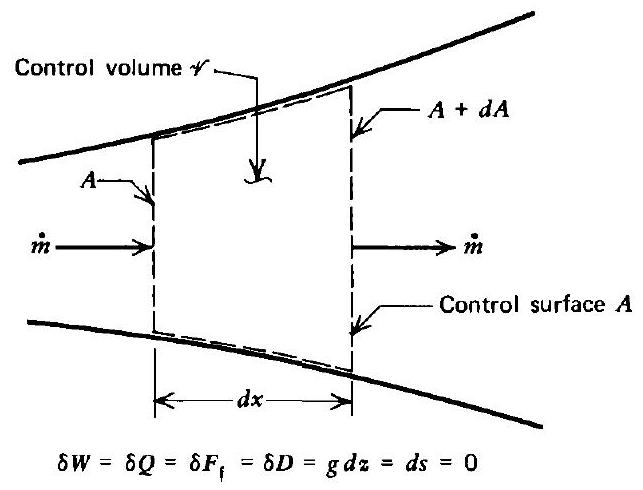
Figure 4.1. Flow model for steady one-dimensional isentropic flow with area change.

## 4-3(a) Governing Equations

From Table 3.1, the following governing equations are obtained for a steady onedimensional isentropic flow, in the absence of body forces; that is, a flow for which $\delta F_{\mathrm{f}}=\delta D=\delta Q=\delta W=g d z=0$.
Continuity equation

$$
\dot{m}=\rho A V=\text { constant }
$$

Momentum or dynamic equation

$$
d p+\rho V d V=0
$$

Energy equation

$$
h+\frac{V^{2}}{2}=\text { constant }=H
$$

Entropy equation

$$
s=\text { constant }
$$

Equations 4.1 to 4.4 are the basic equations governing the isentropic flow of a compressible fluid in a variable area passage. There are no restrictions on the thermodynamic properties of the working fluid. All that is required is that its equations of state be known in some form: graphical, tabular, or algebraic. When the equations of state are known in either graphical or tabular form, numerical methods are required for solving the flow equations; that is, no general closed form solutions can be obtained (see Section 4-5). When the equations of state are specified in algebraic form, however, general closed form solutions may be possible. Such solutions are developed in Section 4-4 for a perfect gas. Similar results have been obtained for gases having other algebraic equations of state. ${ }^{1-3}$

## 4-3(b) The Isentropic Process

In general, for a given flow process, the initial flow properties and the mass flow rate are known. Those data establish a point, such as point 1 , on the $h s$ plane, called the Mollier diagram, which is illustrated schematically in Fig. 4.2. The locus of all other points along the isentropic flow path, termed the isentropic locus, is specified by the condition that the entropy remains constant: that is, $s=s_{1}=$ constant. It is seen in Fig. 4.2 that the isentropic locus for all of the possible thermodynamic states for the flowing fluid is a vertical line passing through point 1. From equation 4.3, it follows that for the flowing fluid, the sum of the static enthalpy $h$ and the kinetic

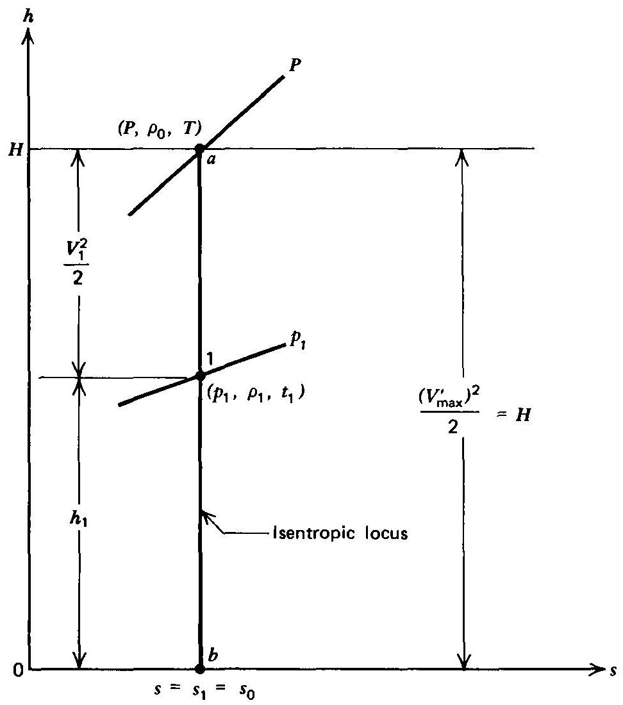
Figure 4.2. Isentropic process on the Mollier diagram.

energy $V^{2} / 2$ is a constant, which is equal to the stagnation enthalpy $H$. Consequently, the upper limit for the enthalpy $h$ for the fluid experiencing an isentropic flow process occurs at point $a$ (see Fig. 4.2) where the flow velocity is zero, so that $h=H$. The lower enthalpy limit of the isentropic process occurs at point $b$, where the enthalpy $h=0$, and the flow velocity is, accordingly, the maximum isentropic speed $V_{\max }^{\prime}$ [see Section 3-10(a)].

Because the isentropic flow process is restricted to a vertical line on the Mollier diagram, the unique stagnation state, denoted by point $a$ in Fig. 4.2, is attained by decelerating the flow from any point on the isentropic locus. Consequently, for a given isentropic flow, the stagnation properties $H, P, \rho_{0}, T$, and $s_{0}$ are constants. Figure 4.2 illustrates the aforementioned intrinsic features of an isentropic flow. The driving potential causing the changes in state, along the isentropic locus, is area change; that is, a variation in the cross-sectional area of the flow passage.

The isentropic process illustrated in Fig. 4.2 is an approximation to a real flow process, which always involves friction. From Table 3.1, the differential form of the energy equation (equation 3.163) is valid for both frictionless and frictional flows. The equation does not indicate explicitly, however, the effect of friction on the flow process. The effect of friction appears in the integration of equation 3.163. Consider a given initial condition denoted by 1 . If the flow is adiabatic and frictionless, then the flow process is isentropic, and the upper limit of integration is denoted by $2^{\prime}$. Conversely, if the process involves friction, then the upper limit of integration is denoted by 2 . Hence, for an isentropic flow, involving no body forces, we obtain

$$
\int_{h_{1}}^{h_{2}^{\prime}} d h=-\int_{V_{1}}^{V_{2}^{\prime}} V d V \quad \text { (isentropic flow) }
$$

The corresponding relationship for flow with friction is

$$
\int_{h_{1}}^{h_{2}} d h=-\int_{V_{1}}^{V_{2}} V d V \quad \text { (adiabatic flow with friction) }
$$

For identical values of the initial and final static pressures $p_{1}$ and $p_{2}$, respectively, the magnitudes of $h_{2}^{\prime}$ and $h_{2}$ are different, and so are those for $V_{2}^{\prime}$ and $V_{2}$. In all cases, either flow expansion or flow compression, $h_{2}>h_{2}^{\prime}$, and $V_{2}<V_{2}^{\prime}$. Figure 4.3 compares adiabatic flows with no work or body forces, with and without friction. Figure $4.3 a$ applies to a flow expansion (nozzle action), and Fig. $4.3 b$ applies to a flow compression (diffuser action).

For an adiabatic flow expansion in the presence of friction, the specific enthalpy change is denoted by $\Delta h_{e}$ and, without friction (isentropic flow), it is denoted by $\Delta h_{e}^{\prime}$. Hence,

$$
\Delta h_{e}^{\prime}=h_{1}-h_{2}^{\prime}=\frac{\left(V_{2}^{\prime}\right)^{2}-V_{1}^{2}}{2} \quad \text { (isentropic) }
$$

and

$$
\Delta h_{e}=h_{1}-h_{2}=\frac{V_{2}^{2}-V_{1}^{2}}{2} \quad \text { (adiabatic flow with friction) }
$$

Similarly, for an adiabatic flow compression with no work or body forces, we obtain

$$
\Delta h_{c}^{\prime}=h_{2}^{\prime}-h_{1}=\frac{V_{1}^{2}-\left(V_{2}^{\prime}\right)^{2}}{2} \quad \text { (isentropic) }
$$

and

$$
\Delta h_{c}=h_{2}-h_{1}=\frac{V_{1}^{2}-V_{2}^{2}}{2} \quad \text { (adiabatic flow with friction) }
$$

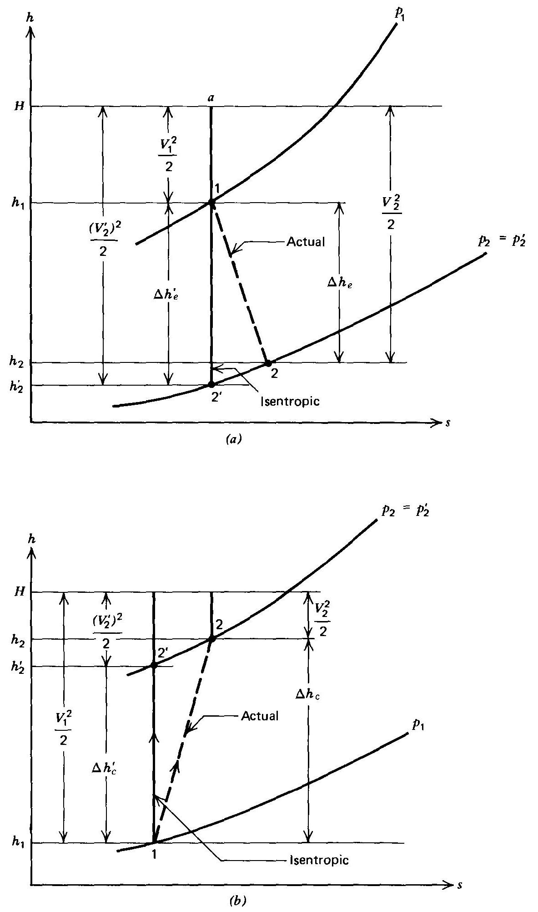
Figure 4.3. Comparison of expansion and compression processes on the Mollier diagram. (a) Expansion process ( $V_{2}^{\prime}>V_{2}, h_{2}>h_{2}^{\prime}$ ), (b) Compression process ( $V_{2}^{\prime}>V_{2}, h_{2}>h_{2}^{\prime}$ ).

The difference between the specific enthalpy changes for an adiabatic flow with friction and the corresponding isentropic flow must be equal to the heat equivalent $\delta Q_{i}$ of the energy expended in overcoming the friction. Hence, for nozzle action or flow expansion,

$$
h_{1}-h_{2}=h_{1}-h_{2}^{\prime}-{ }_{1}\left(E_{i}\right)_{2}=\Delta h_{e}^{\prime}-\delta Q_{i}
$$

Similarly, for diffuser action or flow compression,

$$
h_{2}-h_{1}=h_{2}^{\prime}-h_{1}+{ }_{1}\left(E_{\mathrm{f}}\right)_{2}=\Delta h_{c}^{\prime}+\delta Q_{\mathrm{f}}
$$

The preceding equations apply to any fluid.

## 4-3(c) Effect of Area Change on Flow Properties

It is desirable to determine the manner in which the area of a flow passage must change to achieve (1) an expansion of the flowing fluid, and (2) a compression of the flowing fluid, for the cases where the entering flow is (1) subsonic ( $M<1$ ), and (2) supersonic ( $M>1$ ). As a first approximation, it will be assumed that the flow is steady one-dimensional and isentropic.

The desired relationships between a change in the flow area $d A$ and the corresponding changes in the velocity and the pressure, denoted by $d V$ and $d p$, respectively, are obtained by combining the differential forms of the appropriate governing equations. Logarithmic differentiation of the continuity equation, equation 4.1 , yields

$$
\frac{d \rho}{\rho}+\frac{d A}{A}+\frac{d V}{V}=0
$$

The momentum equation, equation 4.2, may be rewritten as

$$
\frac{d p}{\rho}+V^{2} \frac{d V}{V}=0
$$

The speed of sound is given by equation 1.180. Thus,

$$
a^{2}=\left(\frac{\partial p}{\partial \rho}\right)_{s}
$$

Since the entire flow process under consideration is isentropic, the partial derivatives at constant entropy in equation 1.180 may be written as total derivatives, and equation 1.180 may be rewritten as

$$
d p=a^{2} d \rho
$$

Substituting for $d \rho$ from equation 4.15 into equation 4.13 gives

$$
\frac{d p}{\rho a^{2}}+\frac{d A}{A}+\frac{d V}{V}=0
$$

Substituting for $d p$ from equation 4.14 into equation 4.16 yields

$$
-\frac{V^{2}}{a^{2}} \frac{d V}{V}+\frac{d A}{A}+\frac{d V}{V}=0
$$

Introducing $M=V / a$ into equation 4.17 and rearranging gives

$$
\frac{d A}{A}=\left(M^{2}-1\right) \frac{d V}{V}
$$

Equation 4.18 is the desired relationship between $d A$ and $d V$.
The corresponding relationship involving $d A$ and $d p$ is obtained by substituting for $d V / V$, from equation 4.14, into equation 4.18. Thus,

$$
\frac{d A}{A}=-\left(M^{2}-1\right) \frac{d p}{\rho V^{2}}
$$

Rearranging equation 4.19 gives

$$
\frac{d A}{A}=\left(1-M^{2}\right)\left(\frac{p}{\rho V^{2}}\right) \frac{d p}{p}
$$

By means of equations 4.18 and 4.20, the manner in which the flow area must change to accomplish either nozzle action or diffuser action may be readily determined. Equations 4.18 and 4.20 apply to the isentropic flow of any fluid. It should be noted, however, that the qualitative results obtained in the following discussion apply also to irreversible adiabatic flow.

Consider the area change required when a flow passage is to be employed for expanding (accelerating) a flowing compressible fluid; that is, the passage is to be a nozzle. For such a passage the velocity must increase in the direction of flow ( $d V$ positive) and simultaneously the pressure must fall ( $d p$ negative). Hence, for nozzle action, $d V / V$ must be positive and $d p / p$ negative in the direction of flow. If a compressible fluid enters a passage with a subsonic velocity ( $M<1$ ) then, for $d V / V$ to be positive and $d p / p$ to be negative, equations 4.18 and 4.20 show that the area term $d A / A$ must be negative; that is, the passage must converge. Conversely, if the compressible fluid enters a passage with a supersonic velocity ( $M>1$ ) then, to produce nozzle action, the term $d A / A$ must have a positive value; that is, the passage must diverge in the direction of flow. These conclusions are illustrated schematically in Fig. 4.4a.

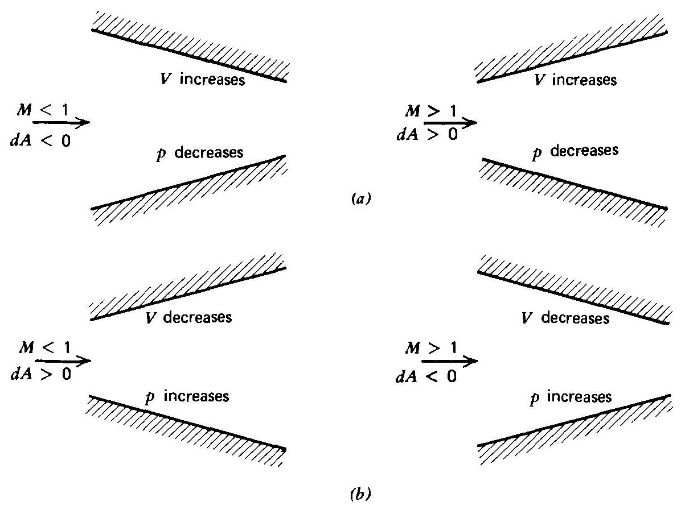
Figure 4.4. Effect of area change on steady one-dimensional isentropic compressible flow. (a) Nozzle flow. (b) Diffuser flow.

Consider now the case where a flowing compressible fluid is to be compressed (decelerated); that is, the flow passage is to be a diffuser. In this case the pressure must increase ( $d p$ positive) and the velocity decrease ( $d V$ negative) in the direction of flow. If the velocity is subsonic ( $M<1$ ), it follows from equations 4.18 and 4.20 that $d A / A$ must be positive. Flow compression (diffusion) of a subsonic compressible
fluid, therefore, requires a diverging passage. Conversely, if the flow is supersonic $(M>1)$, to obtain diffusion, the area term $d A / A$ must be negative; that is, the passage must converge. Figure $4.4 b$ illustrates the foregoing conclusions.

## 4-3(d) Limiting Conditions (Choking)

In Section 4-3(c) the area changes required to achieve nozzle and diffuser actions are determined. No limitation is placed on the magnitude of the effective area change. In this section, the limiting conditions on the area change for achieving nozzle and diffuser actions are determined.

First, it is necessary to obtain a relationship between the changes in velocity $V$ and changes in the Mach number $M$. From Fig. 4.2, it is seen that for an isentropic process, as $V$ increases, $h$ (and, therefore, $t$ ) decreases. For all compressible fluids, the speed of sound $a$ decreases as $t$ decreases, and vice versa. Therefore, for an isentropic flow process, as $V$ increases, $a$ decreases, and the ratio $M=V / a$ increases, and vice versa. Hence, $V$ and $M$ change in the same direction.

The information presented in Fig. 4.4 is expressed in quantitative form in Table 4.1. The limiting conditions for isentropic flow with area change may be determined from the information presented in Table 4.1.

Table 4.1 Relationship between $d A$ and $d M$ for Steady One-Dimensional Isentropic Flow
| $d A$ | $M$ |  |
| :---: | :---: | :---: |
|  | Less Than 1.0 | Greater Than 1.0 |
| $d A<0$ | $d M>0$ | $d M<0$ |
| $d A>0$ | $d M<0$ | $d M>0$ |


Consider the diverging flow passage illustrated in Fig. 4.5a. If $M_{1}$ is subsonic and $d A>0$, then $M$ decreases and $M_{2}<M_{1}$. Conversely, if $M_{1}$ is supersonic and $d A>0, M$ increases and $M_{2}>M_{1}$. A diverging passage, therefore, decelerates a subsonic flow toward zero velocity and accelerates a supersonic flow toward the maximum isentropic speed.

Now refer to the converging passage illustrated in Fig. 4.5b. If $M_{1}$ is less than 1.0 and $d A<0$, then $M$ increases, and $M_{2}>M_{1}$. Conversely, if $M_{1}$ is supersonic and $d A<0, M$ decreases, and $M_{2}<M_{1}$. Consequently, a converging passage accelerates a subsonic flow toward the sonic speed, and decelerates a supersonic flow toward the sonic speed.

Suppose now that the Mach number $M$ reaches 1.0, either by accelerating a subsonic flow in a converging passage or by decelerating a supersonic flow in a converging passage, as illustrated in Fig. 4.5b. Can such a sonic flow continue in a converging duct, as illustrated in Fig. 4.6a, and still satisfy the governing equations for steady one-dimensional isentropic flow? If we assume that $M$ decreases so that $M_{2}$ becomes less than 1.0, Table 4.1 shows that $d M>0$, which contradicts the assumption that $M$ decreases. Conversely, if we assume that $M$ increases so that $M_{2}$ becomes larger than 1.0, Table 4.1 shows that $d M<0$, which contradicts the assumption that $M$ increases. Consequently, a sonic flow cannot enter a converging

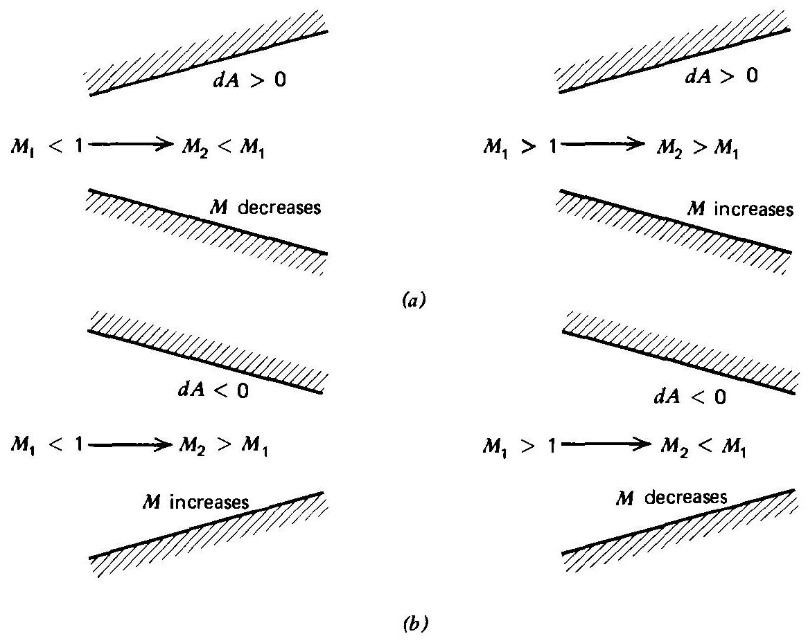
Figure 4.5. Effect of area change on Mach number. (a) Diverging passage. (b) Converging passage.

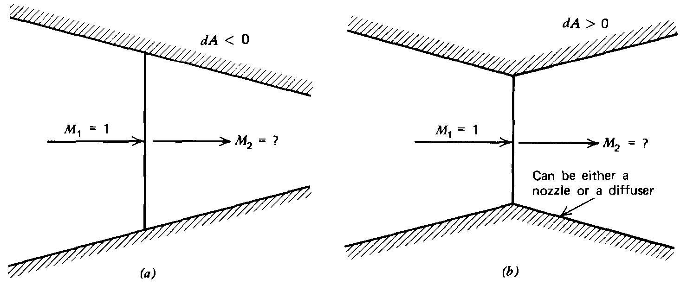
Figure 4.6. Choking conditions in steady one-dimensional isentropic compressible flow. (a) Sonic flow entering a converging passage. (b) Sonic flow entering a diverging passage.

passage and still satisfy the governing equations for steady one-dimensional isentropic flow. The aforementioned contradictions arise from a phenomenon known as choking. We conclude from the foregoing analysis that for a flow in a converging passage, the Mach number continuously changes toward the value $M=1$ for either a subsonic or a supersonic flow; that is, there is a limiting Mach number for a flow in a converging passage, and its value is $M=1$. When the Mach number $M=1$, no further decreases in area are possible without violating the governing equations for steady one-dimensional isentropic flow, and the flow is said to be choked.

The other possibility to be examined is illustrated in Fig. 4.6b. Can a sonic flow enter a diverging passage and remain isentropic? If we assume that $M$ decreases so that $M_{2}$ is less than 1.0, Table 4.1 shows that $d M<0$, which is in agreement with the assumption that $M$ decreases. Conversely, if we assume that $M$ increases so
that $M_{2}$ becomes larger than 1.0, Table 4.1 shows that $d M>0$, which is in agreement with the assumption that $M$ increases. Accordingly, a sonic flow may enter a continuously diverging passage and keep satisfying the governing equations for steady one-dimensional isentropic flow. The Mach number in the diverging passage may be either subsonic or supersonic. Which of those two possibilities actually occurs (i.e., subsonic or supersonic flow) depends on the downstream physical boundary condition at the exit section of the flow passage. The downstream boundary conditions are discussed in Section 4-3(e).

The preceding analysis shows that a flow passage that continuously accelerates a gas from an initially subsonic flow to a supersonic flow must comprise a converging section followed by a diverging section; that is, it must have the general form illustrated schematically in Fig. 4.7. When the mass rate of flow through such a passage attains its maximum value ( $\dot{m}=\dot{m}_{\text {max }}^{\prime}=\dot{m}^{*}$ ), the throat area is termed the critical area $A^{*}$, and the velocity of the fluid in the throat, termed the throat velocity, is $V_{t}^{\prime}=a^{*}$ [see Section 3-11(b) and Fig. 3.24].

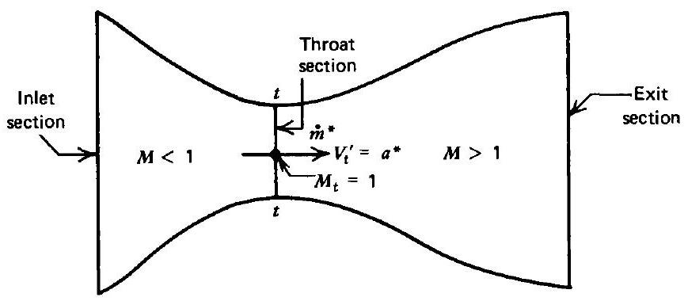
Figure 4.7. Flow passage for attaining supersonic velocity.

If a diffusion process is to start from a supersonic velocity and end with a subsonic velocity, the flow passage must first converge and then diverge. If a diffusion begins and ends with supersonic velocities, the flow passage must converge continuously.

Summarizing, a converging-diverging passage, known as a De Laval nozzle, can produce the following flow phenomena. If the entering velocity is subsonic, the velocity continues to increase and the pressure continues to decrease up to the throat section. If the velocity in the throat is the critical speed of sound $a^{*}$, either a flow expansion with supersonic velocities or a diffusion with subsonic velocities is possible in its diverging portion. Which of these two flow phenomena will occur depends on the static pressure at the exit section of the converging-diverging passage.

## 4-3(e) The Downstream Physical Boundary Conditions

Up to this point, no account has been taken of the conditions at the exit cross section of the flow passage. It is mentioned in the preceding section that the downstream conditions determine whether a sonic flow accelerates or decelerates in a diverging passage. The application of those boundary conditions is discussed here.

Figure 4.8 illustrates the conditions that may occur at the exit from a flow passage when the design Mach number $M_{e}$ is subsonic (i.e., $M_{e} \leqq 1.0$ ), and Fig. 4.9 illustrates the conditions that may exist at the exit from the flow passage when the design Mach number $M_{e}$ is supersonic (i.e., $M_{e} \geqq 1.0$ ). Figure $4.8 a$ illustrates the internal flow conditions immediately upstream to the exit section of the passage; the Mach number

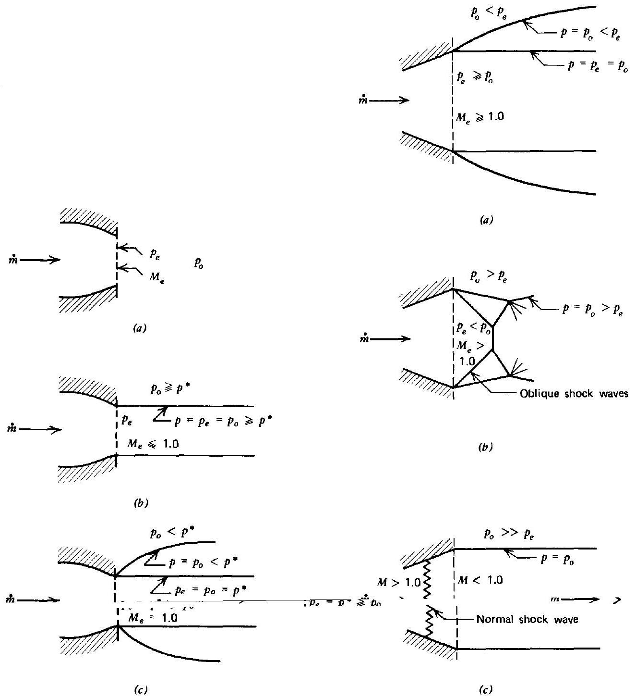
Figure 4.8. Conditions at the exit of a flow passage when $M_{e} \leqq 1.0$. (a) Flow model. (b) $M_{e} \leqq 1.0$ and $p_{e}=p_{e}$. (c) $M_{e}=1.0$ and $p_{e} \geqq p_{o}$.

Figure 4.9. Conditions at the exit of a flow passage when $M_{e} \geqq 1.0$. (a) $M_{e} \geqq 1.0$ and $p_{e} \geqq p_{o}$. (b) $M_{e}>1$ and $p_{o}>p_{e}$. (c) $M_{e}>1$ and $p_{o} \gg p_{e}$.
is $M_{e}$ and the corresponding pressure is $p_{e}$. The pressure of the ambient medium into which the fluid flows, termed the back pressure or the ambient pressure, is denoted by $p_{o}$. Obviously, to maintain mechanical equilibrium between the discharging fluid and the surrounding medium, the pressure in the fluid stream must equalize with the ambient pressure. The requirement that the pressures must equalize determines the downstream physical boundary condition that must be satisfied by the internal flow.

Figure $4.8 b$ illustrates the situation where the flow in the exit plane is subsonic. In that case, the presence of the ambient pressure $p_{o}$ is communicated to the fluid
in the exit plane, because small pressure disturbances travel at the sonic speed (see Section 1-17). Consequently, $p_{e}$ equals $p_{o}$, and the fluid flows into the ambient region as a parallel jet. That flow pattern is characteristic of all subsonic flows, up to and including the sonic condition. Once the sonic condition is reached, the maximum mass flow rate is obtained, and the flow in the exit plane becomes independent of the back pressure $p_{o}$. The foregoing applies only if $p_{o}>p^{*}$ or $p_{o}=p^{*}$, where $p^{*}$ denotes the critical (sonic) pressure.

If $p^{*}>p_{o}$, the expansion from $p_{e}=p^{*}$ to $p_{o}$ takes place outside of the flow passage, as illustrated schematically in Fig. 4.8c. Figures $4.8 b$ and 4.8c demonstrate that the downstream physical boundary condition for an initially subsonic flow is either $p_{e}=p_{o}$ and $M_{e}<1$, or $M_{e}=1$ and $p_{e}=p^{*}>p_{o}$. Equation 3.192 shows that the critical pressure $p^{*}$ is a function of the specific heat ratio $\gamma$ and the stagnation pressure $P$. Consequently, it is readily determinable whether $p_{e}=p_{o}$ and $M_{e}=1$ (i.e., $p_{o}>p^{*}$ ) or $M_{e}=1$ and $p_{e}=p^{*}$ (i.e., $p_{o} \leqq p^{*}$ ).

When the flow in the passage is supersonic, the exit boundary conditions change, because the flow velocity exceeds the propagation speed of small pressure waves and the fluid arriving at the exit plane is unaware of the ambient pressure. Consequently, if $p_{e} \geqq p_{o}$, the expansion from $p_{e}$ to $p_{o}$ occurs outside of the flow passage, as illustrated in Fig. 4.9a, for a diverging passage. However, if $p_{o}>p_{e}$, the sudden compression of the fluid flowing out of the passage results in a discontinuous pressure increase known as a shock wave (see Chapter 7). If $p_{o}$ is only slightly larger than $p_{e}$, as illustrated in Fig. 4.9b, the shock waves are attached to the divergence of the nozzle in the vicinity of its exit plane. If $p_{o}$ is much larger than $p_{e}$, as illustrated in Fig. 4.9c, then the shock wave system moves up into the flow passage, and may eventually become a normal shock wave. In all cases where the flow is supersonic anywhere in the flow passage, the mass flow rate equals that for a choked flow; the latter condition makes it possible to determine the flow properties at the minimum area, or throat, of the flow passage. Should $p_{o}$ increase to a sufficiently large value, then the normal shock wave will move through the minimum area, unchoking the flow, and the flow in the entire passage will become subsonic.

The downstream physical boundary conditions discussed above are developed here for steady one-dimensional isentropic flow in a variable area passage. Identical conditions are applicable, however, to other types of flow (e.g., frictional flows, and flows with heat transfer). Accordingly, the effects of the boundary conditions discussed above are quite general, and they are applied where applicable in the discussions of steady one-dimensional nonisentropic flows.

## 4-4 STEADY ONE-DIMENSIONAL ISENTROPIC FLOW OF A PERFECT GAS

The general features of the steady one-dimensional isentropic flow of a compressible fluid are presented in Section 4-3. The present section is concerned with the steady one-dimensional isentropic flow of a perfect gas.

## 4-4(a) Governing Equations for the Isentropic Flow of a Perfect Gas

For a perfect gas, the equations of state are given by equations 1.99 and 1.117. Thus,

$$
p=\rho R t
$$

and

$$
h=c_{p} t
$$

where $h$ is measured above $t=0$. When a perfect gas undergoes an isentropic change of state [see Section 1-15(e)], then

$$
t p^{-(\gamma-1) / \gamma}=\mathrm{constant}
$$

and

$$
p \rho^{-\gamma}=\text { constant }
$$

Combining equations 4.1 to 4.4 with equations 4.21 to 4.24 yields a set of closed form algebraic equations that completely specifies the steady one-dimensional isentropic flow for a perfect gas. The results are developed in Chapter 3 (Sections 3-9 through 3-12) and are summarized here.

In Section 3-9, the stagnation conditions $T, P$, and $\rho_{o}$ are defined as the final state of the perfect gas after an isentropic deceleration to zero velocity from the local flow conditions. Thus, $T, P$, and $\rho_{o}$ are local properties that are calculable at each point in a flow field and may, in general, vary along the flow path. It is shown in Section 4-3(b) that for an isentropic flow, the stagnation properties remain constant throughout the flow process. Accordingly, the equations that relate $T, P$, and $\rho_{o}$ to the local Mach number $M$ are valid throughout the flow process, with $T, P$, and $\rho_{o}$ having constant values. From Table 3.3, we obtain the following:

$$
\begin{aligned}
& T=t\left(1+\frac{\gamma-1}{2} M^{2}\right)=\mathrm{constant} \\
& P=p\left(1+\frac{\gamma-1}{2} M^{2}\right)^{\gamma /(\gamma-1)}=\mathrm{constant} \\
& \rho_{o}=\rho\left(1+\frac{\gamma-1}{2} M^{2}\right)^{1 /(\gamma-1)}=\mathrm{constant}
\end{aligned}
$$

By means of equations 4.25 to 4.27 , we may determine the values of the static properties $t, p$, and $\rho$ corresponding to the flow Mach number $M$, for a given value of $\gamma$. Table C. 6 presents the ratios $t / T, p / P$, and $\rho / \rho_{o}$ as functions of the Mach number $M$, for different values of $\gamma$.

From Table 3.4, the isentropic discharge speed $V^{\prime}$ attained by expanding a perfect gas isentropically from the stagnation state is

$$
V^{\prime}=\left\{\frac{2 \gamma R T}{\gamma-1}\left[1-\left(\frac{p^{\prime}}{P}\right)^{(\gamma-1) / \gamma}\right]\right\}^{1 / 2}
$$

The speed of sound in a perfect gas is given by $a^{2}=\gamma R t$, and the Mach number by $M=V / a$.

From Table 3.2, the critical flow area ratio $A / A^{*}$ is given by

$$
\frac{A}{A^{*}}=\frac{1}{M}\left[\frac{2}{\gamma+1}\left(1+\frac{\gamma-1}{2} M^{2}\right)\right]^{(\gamma+1) / 2(\gamma-1)}
$$

Values of $A / A^{*}$ as a function of $M$, for different values of $\gamma$, are tabulated in Table C.6.
Several forms of the continuity equation are developed in Section 3-11(a). All of the forms presented there are, of course, valid for isentropic flow. Because $T$ and $P$ remain constant for such a flow, the following equation for the mass flow rate $\dot{m}$ is especially convenient in dealing with a steady one-dimensional isentropic flow of a perfect gas (see equation 3.167, Table 3.2).

$$
\dot{m}=A M P\left(\frac{\gamma}{R T}\right)^{1 / 2}\left(1+\frac{\gamma-1}{2} M^{2}\right)^{-(\gamma+1) / 2(\gamma-1)}
$$

Two additional flow functions of interest in studying the steady one-dimensional isentropic flow of a perfect gas are the dimensionless velocity $M^{*}$, and the impulse function ratio $\mathscr{F} / \mathscr{F}^{*}$. From Table 3.4 and equation 3.141, respectively,

$$
M^{*}=\left[\frac{(\gamma+1) M^{2}}{2+(\gamma-1) M^{2}}\right]^{1 / 2}
$$

and

$$
\frac{\mathscr{F}^{*}}{\mathscr{F}^{*}}=\frac{1+\gamma M^{2}}{M\left[2(\gamma+1)\left(1+\frac{\gamma-1}{2} M^{2}\right)\right]^{1 / 2}}
$$

Values of $M^{*}$ and $\mathscr{F} / \mathscr{F}^{*}$ are tabulated as functions of $M$, for different values of $\gamma$, in Table C.6.
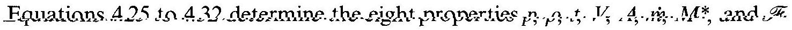 as functions of the Mach number $M$.

An alternative form of the energy equation that is valid for the flow of a perfect gas is obtained by combining equations 4.3 and 4.22 . Thus,

$$
c_{p} t+\frac{V^{2}}{2}=\text { constant }=c_{p} T
$$

For a choked flow, the Mach number $M=1$, and the values of $t, p$ and $\rho$ are their respective critical values, which are denoted by $t^{*}, p^{*}$, and $\rho^{*}$. From Table 3.5,

$$
\begin{aligned}
t^{*} & =\left(\frac{2}{\gamma+1}\right) T \\
p^{*} & =\left(\frac{2}{\gamma+1}\right)^{\gamma /(\gamma-1)} P \\
\rho^{*} & =\left(\frac{2}{\gamma+1}\right)^{1 /(\gamma-1)} \rho_{o}
\end{aligned}
$$

The critical velocity $V^{*}=a^{*}$ is given by

$$
V^{*}=a^{*}=\left(\gamma R t^{*}\right)^{1 / 2}=\left(\frac{2 \gamma R T}{\gamma+1}\right)^{1 / 2}=a_{o}\left(\frac{2}{\gamma+1}\right)^{1 / 2}
$$

where $a_{o}=(\gamma R T)^{1 / 2}$ is the stagnation speed of sound. The critical mass flow rate $\dot{m}^{*}$ is obtained from equation 4.30. Thus,

$$
\dot{m}^{*}=\frac{\Gamma A^{*} P}{(\gamma R T)^{1 / 2}}=\frac{\Gamma A^{*} P}{a_{o}}
$$

where

$$
\Gamma=\gamma\left(\frac{2}{\gamma+1}\right)^{(\gamma+1) / 2(\gamma-1)}
$$

Values of $\Gamma$ as a function of the specific heat ratio $y$ are presented in Table C.15.

## 4-4(b) Isentropic Flow Tables for a Perfect Gas

Equations are presented in Section 4-4(a) for the flow property ratios in a steady one-dimensional isentropic flow as a function of the local flow Mach number $M$ for a given value of the specific heat ratio $\gamma$. Those equations are summarized in Table 4.2.

Table 4.2 Property Ratios for the Steady One-Dimensional Isentropic Flow of a Perfect Gas

$$
\begin{aligned}
\frac{T}{t} & =\left(1+\frac{\gamma-1}{2} M^{2}\right) \\
\frac{P}{p} & =\left(1+\frac{\gamma-1}{2} M^{2}\right)^{\gamma /(\gamma-1)} \\
\frac{\rho_{o}}{\rho} & =\left(1+\frac{\gamma-1}{2} M^{2}\right)^{1 /(\gamma-1)} \\
\frac{A}{A^{*}} & =\frac{1}{M}\left[\left(\frac{2}{\gamma+1}\right)\left(1+\frac{\gamma-1}{2} M^{2}\right)\right]^{(\gamma+1) / 2(\gamma-1)} \\
M^{*} & =\left[\frac{(\gamma+1) M^{2}}{2+(\gamma-1) M^{2}}\right]^{1 / 2} \\
\frac{\mathscr{F}}{\mathscr{F}^{*}} & =\frac{1+\gamma M^{2}}{M\left[2(\gamma+1)\left(1+\frac{\gamma-1}{2} M^{2}\right)\right]^{1 / 2}}
\end{aligned}
$$

Values of the isentropic flow property ratios are tabulated as functions of the Mach number $M$ in Table C.6, for different values of the specific heat ratio $\gamma$. It is recommended that Table C. 6 be employed, whenever possible, in solving steady onedimensional isentropic flow problems. Table 4.3 summarizes the general form of Table C. 6 and also presents the limiting values of the property ratios.

Table 4.3 Limiting Values of the Property Ratios for the Steady One-Dimensional Isentropic Flow of a Perfect Gas
| M | $M^{*}$ | $t / T$ | $p / P$ | $\rho / \rho_{o}$ | $\mathscr{F} / \mathscr{F}^{*}$ | $A / A^{*}$ |
| :--- | :--- | :--- | :--- | :--- | :--- | :--- |
| 0 | 0 | 1 | 1 | 1 | $\infty$ | $\infty$ |
| 1 | 1 | $\left(\frac{2}{\gamma+1}\right)$ | $\left(\frac{2}{\gamma+1}\right)^{\gamma /(\gamma-1)}$ | $\left(\frac{2}{\gamma+1}\right)^{1 /(\gamma-1)}$ | 1 | 1 |
| $\infty$ | $\left(\frac{\gamma+1}{\gamma-1}\right)^{1 / 2}$ | 0 | 0 | 0 | $\frac{\gamma}{\left(\gamma^{2}-1\right)^{1 / 2}}$ | $\infty$ |


In most cases the initial conditions at the inlet cross section of the flow passage are specified. Employing those conditions, the corresponding values of $t / T, p / P$, etc., may be read directly from Table C.6. The reference conditions $T, P, \rho_{o}, A^{*}$, and $F^{*}$ may then be calculated.

One condition at the exit cross section of the flow passage must be known, so that Table C. 6 may be employed for determining the property ratios, and hence the flow properties, at the exit cross section. Many problems of practical interest are not that straight-forward, but an approach of the same general nature is applicable.

A FORTRAN computer program, subroutine ISEN, for calculating the flow property ratios for steady one-dimensional isentropic flow is presented below. The input

```
    SUBROUTINE ISEN
C ISENTROPIC FLON PROPERTY RATIOS FOR A PERFECT GAS
    REAL M,MS $ DIMENSION J(9),DM(9) $ DATA INF/6H INFIN/
    NAMELIST /DATA/ G,J,DM $ READ (5,DATA)
    G1=(G-1.0)/2.0 $ G2=2.0/(G+1.0) $ G3=G/(G-1.0) $ G4=2.0*(G+1.0)
    G5=(G+1.0)/(2.0*(G-1.0)) $ G6=G2**G5
    M=0.0 $ MS=0.0 $ T=1.0 $ P=1.0 $ R=1.0 $ I=1 $ L=0
    HRITE (6,2000) G $ WRITE (6,2010) M,MS,T,P,R,INF,INF,INF
C CALCULATE PROPERTY RATIOS
    N=J(I) $ DO 50 K=1,N $ M=M+DM(I) $ C=1.0+G1*M**2 $ MS=M/SQRT(G2*C)
    T=1.0/C $ P=T**G3 $ R=P/T $ F=(1.0+G*M** 2)/(M*SQRT(G4*C))
    A=G6*C**G5/M $ PA=P*A $ WRITE (6,2020) M,MS,T,P,R,F,PA,A $ L=L+1
    IF (L.LT.50) GO TO 50 $ WRITE (6,2000) G $ L=0
    CONTINUE $ I=I+1 $ IF((I.EQ.10).OR.(J(I).EQ.O)) 6O TO 60 $GO TO 40
    MS =SQRT((G+1.0)/(G-1.0)) $T=0.0 $P=0.0 $R=0.0 $ F=G/SQRT(G**2-1.0)
    PA=0.0 $ WRITE (6,2030) INF,MS,T,P,R,F,PA,INF $ RETURN
2000 FORMAT (1H1,28X,42HISENTROPIC FLOW WITH AREA CHANGE, GAMMA =,F5.2
    1//14X,1HM,5X,2HM*,9X,4HT/TO,9X,4HP/PO,9X,4HR/RO,9X,4HF/F*,6X,
    212H(P/PO)(A/A*),4X,4HA/A*/)
2010 FORMAT (1H ,F15.2,F9.5,2X,3E13.5,1X,A6,2(7X,A6))
2020 FORMAT (1H ,F 15.2,F9.5,2X,6E13.5)
2030 FORMAT (10X,A6,F9.5,2X,5E13.5,1X,A6)
    END
```

to the program comprises the specific heat ratio $\gamma$, denoted by G, the number of entries in each section of the table, denoted by $\mathrm{J}(1)$, $\mathrm{J}(2)$, etc., and the Mach number increment DM(1), DM(2), etc., in each section of the table corresponding to the values of $J(1)$, $\mathrm{J}(2)$, etc. The results presented in Table C. 6 for $\gamma=1.4$ are obtained by the following specifications.

```
G=1.4, J(1)=200, J(2),=50, J(3)=30, J(4)=8,J(5)=10, J(6)=0,
DM(1)=0.01, DM(2)=0.02, DM(3)=0.1, DM(4)=0.5, DM(5)=1.0
```

Example 4.1. Air at a stagnation temperature and pressure of 288.9 K and $6.895 \cdot 10^{5} \mathrm{~N} / \mathrm{m}^{2}$, respectively, flows from a reservoir through a converging nozzle that exhausts into the atmosphere where the pressure is $1.014 \cdot 10^{5} \mathrm{~N} / \mathrm{m}^{2}$. Calculate (a) the pressure in the nozzle exit plane, (b) the minimum stagnation pressure for which the flow remains choked, and (c) the exit plane pressure if the stagnation pressure is reduced to $1.724 \cdot 10^{5} \mathrm{~N} / \mathrm{m}^{2}$.

## Solution

(a) From Table C.6, the critical pressure ratio for sonic conditions at the nozzle exit is $p^{*} / P=0.52828$. If the nozzle is choked, then

$$
p_{2}=p^{*}=(0.52828)\left(6.895 \cdot 10^{5}\right)=3.642 \cdot 10^{5} \mathrm{~N} / \mathrm{m}^{2}\left(52.83 \mathrm{lbf} / \mathrm{in} .^{2}\right)
$$

Since $p_{2}>p_{\text {atm }}$, the flow is choked, so that the pressure in the exit plane is $p_{2}=p^{*}$. (b) The minimum stagnation pressure for choked flow occurs when $p_{2}=p^{*}=p_{\text {atm }}$. Thus,

$$
P_{\min }=\frac{p^{*}}{0.52828}=\frac{p_{\mathrm{atm}}}{0.52828}=\frac{1.014 \cdot 10^{5}}{0.52828}=1.919 \cdot 10^{5} \mathrm{~N} / \mathrm{m}^{2}\left(27.83 \mathrm{lbf} / \mathrm{in} .^{2}\right)
$$

(c) For a stagnation pressure of $1.724 \cdot 10^{5} \mathrm{~N} / \mathrm{m}^{2}$,

$$
p^{*}=(0.52828)(1.724) 10^{5}=0.9106 \cdot 10^{5} \mathrm{~N} / \mathrm{m}^{2}\left(13.21 \mathrm{lbf} / \mathrm{in} .^{2}\right)
$$

Since $p^{*}<p_{\text {atm }}$, the flow will not be choked, and $p_{2}=p_{\text {atm }}=1.014 \cdot 10^{5} \mathrm{~N} / \mathrm{m}^{2}$ ( $14.7 \mathrm{lbf} / \mathrm{in} .^{2}$ ).

Example 4.2. A spaceship cabin may be considered to be a rigid pressurized vessel, which contains the atmosphere required to support the life of its occupants. A puncture in the cabin when it is in vacuum space must be detected quickly, so that the cabin occupants can seal the puncture or switch to their individual life support systems. The time interval that elapses before a dangerously low pressure is reached is a critical quantity for designing the warning devices and countermeasure systems. Derive an equation giving an estimate for the pressure $P$ after puncture as a function of the time $t$, the initial pressure $P_{i}$, the initial temperature $T_{i}$, the area $A$ of the puncture, and the volume $\mathscr{V}$ of the cabin. Consider the atmosphere of the cabin to be a perfect gas (see Reference 4). If the cabin atmosphere is air at an initial temperature of 300 K , determine the ratio $P / P_{i}$ as a function of time with the ratio $(A / \mathscr{V})$ as a parameter. Assume that for air, $\gamma=1.4$ and $R=287.04 \mathrm{~J} / \mathrm{kg}-\mathrm{K}$.

## Solution

Assume that the puncture can be treated as a converging flow passage with a minimum area $A$, that the depressurization of the cabin is isentropic, that the flow through the puncture is isentropic, and that the flow is quasi-steady (i.e., it consists of a series of steady states, each originating from the local stagnation conditions in the cabin). Since the ambient pressure is a vacuum, the flow through the puncture will be choked, and the area $A$ of the puncture may be considered to be the critical flow area. These assumptions will yield the maximum mass flow rate, and thus the minimum time after puncture to reach a given pressure.

For a choked isentropic flow, equation 4.38 yields

$$
\dot{m}^{*}=\frac{d m}{d t}=\frac{\Gamma A P}{(\gamma R T)^{1 / 2}}
$$

where $P$ and $T$ are the stagnation pressure and temperature, respectively, in the cabin at the time $t$ after it is punctured. For an isentropic depressurization of the cabin, equation 4.23 yields

$$
\frac{T}{T_{i}}=\left(\frac{P}{P_{i}}\right)^{(\gamma-1) / \gamma}
$$

Substituting equation (b) into equation (a) gives

$$
\frac{d m}{d t}=\frac{\Gamma A P}{\left(\gamma R T_{i}\right)^{1 / 2}}\left(\frac{P_{i}}{P}\right)^{(\gamma-1) / 2 \gamma}
$$

From equation 4.21 , the mass $m_{c}$ of gas in the cabin at any time is

$$
m_{c}=\frac{P \mathscr{V}}{R T}
$$

since $P$ and $T$ are also the static pressure and temperature, respectively, in the cabin. Substituting equation (b) into equation (d) gives

$$
m_{c}=\frac{\mathscr{\mathscr { V } P _ { i } ^ { ( \gamma - 1 ) / \gamma }}}{R T_{i}} P^{1 / \gamma}
$$

Differentiating equation (e) with respect to time $t$, we obtain

$$
\frac{d m_{c}}{d t}=\frac{\mathscr{V} P_{i}^{(\gamma-1) / \gamma}}{\gamma R T_{i}} P^{(1-\gamma) / \gamma} \frac{d P}{d t}
$$

The rate of decrease of mass in the cabin is equal to the rate of mass flow out of the puncture. Thus,

$$
-\frac{d m_{c}}{d t}=\frac{d m}{d t}
$$

Substituting equations (c) and (f) into equation (g) yields

$$
-\frac{\mathscr{V} P_{i}^{(\gamma-1) / \gamma}}{\gamma R T_{i}} P^{(1-\gamma) / \gamma} \frac{d P}{d t}=\frac{\Gamma A P}{\left(\gamma R T_{i}\right)^{1 / 2}}\left(\frac{P_{i}}{P}\right)^{(\gamma-1) / 2 \gamma}
$$

Equation (h) may be simplified to

$$
-P^{(1-3 \gamma) / 2 \gamma} d P=\Gamma\left(\gamma R T_{i}\right)^{1 / 2}\left(\frac{A}{\mathscr{V}}\right) P_{i}^{(1-\gamma) / 2 \gamma} d t
$$

Integrate equation (i) between the limits $P=P_{i}$ when time $t=0$ and $P=P$ when $t=t$. The result is

$$
-\left.\frac{2 \gamma}{(\gamma-1)} P^{(\gamma-1) / 2 \gamma}\right|_{P_{i}} ^{P}=\left.\Gamma\left(\gamma R T_{i}\right)^{1 / 2}\left(\frac{A}{\mathscr{V}}\right) P_{i}^{(1-\gamma) / 2 \gamma} t\right|_{0} ^{t}
$$

Simplifying equation (j), and solving for $P / P_{i}$, gives

$$
\frac{P}{P_{i}}=\frac{1}{\left[1+\left(\frac{\gamma-1}{2 \gamma}\right)\left(\gamma R T_{i}\right)^{1 / 2} \Gamma(A / \mathscr{V}) t\right]^{2 \gamma /(\gamma-1)}}
$$

For air at 300 K ,

$$
\begin{gathered}
\left(\gamma R T_{i}\right)^{1 / 2}=[1.4(287.04)(300)]^{1 / 2}=347.21 \mathrm{~m} / \mathrm{s} \\
\Gamma=\gamma\left(\frac{2}{\gamma+1}\right)^{(\gamma+1) / 2(\gamma-1)}=1.4\left(\frac{2}{1.4+1}\right)^{(1.4+1) / 2(1.4-1)}=1.4(0.83333)^{3.0}=0.81018
\end{gathered}
$$

Equation ( $k$ ) becomes

$$
\begin{aligned}
& \frac{P}{P_{i}}=\frac{1}{[1+(0.14286)(347.21)(0.81018)(A / \mathscr{V}) t]^{2(1.4) /(1.4-1)}} \\
& \frac{P}{P_{i}}=\frac{1}{[1+40.19(A / \mathscr{V}) t]^{7.0}}
\end{aligned}
$$

## 4-4(c) Effect of Area Change on the Flow Properties of a Perfect Gas

The influence of area change $d A / A$ on the corresponding changes in the dependent variables $d M / M, d p / p, d t / t$, etc., may be determined by expressing all of the governing equations in differential form, and then solving for the change in each dependent
variable as a function of $d A / A$. Differentiating equation 4.1 logarithmically yields

$$
\frac{d \rho}{\rho}+\frac{d A}{A}+\frac{d V}{V}=0
$$

Rearranging equation 4.2 gives

$$
\frac{d p}{p}+\frac{\rho V}{p} d V=\frac{d p}{p}+\gamma M^{2} \frac{d V}{V}=0
$$

Differentiating equation 4.33 and rearranging the result yields

$$
\frac{d t}{t}+\frac{V d V}{c_{p} t}=\frac{d t}{t}+(\gamma-1) M^{2} \frac{d V}{V}=0
$$

Differentiating equation 4.21 logarithmically gives

$$
\frac{d p}{p}-\frac{d \rho}{\rho}-\frac{d t}{t}=0
$$

Logarithmic differentiation of $a^{2}=\gamma R t$, the equation for the speed of sound in a perfect gas, yields

$$
\frac{d a}{a}-\frac{1}{2} \frac{d t}{t}=0
$$

From the definition of the Mach number, $M=V / a$,

$$
\frac{d M}{M}-\frac{d V}{V}+\frac{d a}{a}=0
$$

Differentiating equation 3.139 , which defines the impulse function $\mathscr{F}$, yields

$$
\frac{d \mathscr{F}}{\mathscr{F}}-\frac{d p}{p}-\frac{d A}{A}-\frac{2 \gamma M^{2}}{1+\gamma M^{2}} \frac{d M}{M}=0
$$

Equations 4.40 to 4.46 comprise a set of seven first-order ordinary differential equations relating the seven dependent variables $d p / p, d t / t, d \rho / \rho, d V / V, d a / a, d M / M$, and $d \mathscr{F} / \mathscr{F}$, and the independent variable $d A / A$. Those seven equations are linear in the derivatives of the flow properties. Hence, if any one of the eight property changes is specified, the remaining seven are determinable in terms of the one specified change by solving the seven equations simultaneously. Choosing the area change $d A / A$ as the independent variable, equations 4.40 to 4.46 may be put into matrix form as follows.

$$
\left[\begin{array}{rrrllll}
0 & 0 & 1 & 1 & 0 & 0 & 0 \\
1 & 0 & 0 & \gamma M^{2} & 0 & 0 & 0 \\
0 & 1 & 0 & (\gamma-1) M^{2} & 0 & 0 & 0 \\
1 & -1 & -1 & 0 & 0 & 0 & 0 \\
0 & -\frac{1}{2} & 0 & 0 & 1 & 0 & 0 \\
0 & 0 & 0 & -1 & 1 & 1 & 0 \\
-1 & 0 & 0 & 0 & 0 & -\frac{2 \gamma M^{2}}{1+\gamma M^{2}} & 1
\end{array}\right]\left[\begin{array}{l}
d p / p \\
d t / t \\
d \rho / \rho \\
d V / V \\
d a / a \\
d M / M \\
d \mathscr{F} / \mathscr{F}
\end{array}\right]=\left[\begin{array}{c}
-\frac{d A}{A} \\
0 \\
0 \\
0 \\
0 \\
0 \\
\frac{d A}{A}
\end{array}\right]
$$

Equation 4.47, when expressed in matrix notation, becomes

$$
A x=b
$$

where $A$ is the $7 \times 7$ coefficient matrix, $x$ is the column matrix containing the property changes, and $b$ is the column matrix containing the nonhomogeneous terms.

The seven property changes may be expressed in terms of the area change $d A / A$ by applying Cramer's rule (see Appendix A-3) to solve the seven linear nonhomogeneous equations. Cramer's rule states that

$$
x_{j}=\frac{\operatorname{det}\left(A^{(j)}\right)}{\operatorname{det}(A)} \quad(j=1,2, \ldots, 7)
$$

where $\operatorname{det}(A)$ is the value of the determinant of the coefficient matrix in equation 4.47 and $\operatorname{det}\left(A^{(j)}\right)$ is the value of the determinant of the matrix we get on replacing the $j$ th column of $A$ by the column matrix $b$. The value of $\operatorname{det}(A)$ is

$$
\operatorname{det}(A)=1-M^{2}
$$

To illustrate the procedure, solve for $d M / M$. Thus,

$$
\left(1-M^{2}\right) \frac{d M}{M}=\left|\begin{array}{rrlllcr}
0 & 0 & 1 & 1 & 0 & -\frac{d A}{A} & 0 \\
1 & 0 & 0 & \gamma M^{2} & 0 & 0 & 0 \\
0 & 1 & 0 & (\gamma-1) M^{2} & 0 & 0 & 0 \\
1 & -1 & -1 & 0 & 0 & 0 & 0 \\
0 & -\frac{1}{2} & 0 & 0 & 1 & 0 & 0 \\
0 & 0 & 0 & -1 & 1 & 0 & 0 \\
-1 & 0 & 0 & 0 & 0 & \frac{d A}{A} & 1
\end{array}\right|
$$

Solving equation 4.49 for $d M / M$ yields

$$
\frac{d M}{M}=-\frac{1+\frac{\gamma-1}{2} M^{2}}{1-M^{2}} \frac{d A}{A}
$$

The six remaining property changes are obtained in a similar manner. The results are presented in Table 4.4. The coefficients of $d A / A$ are known as influence coefficients, since each coefficient of $d A / A$ is the partial derivative of a particular flow property with respect to the driving potential $d A / A$.

Equation 4.54 is the same as equation 4.18 and, on substituting $a^{2}=\gamma p / \rho$, equation 4.51 becomes the same as equation 4.20. Equation 4.50 expresses in equation form the relationships between $d A$ and $d M$ that are exhibited in Table 4.1.

Equations 4.50 to 4.56 illustrate two intrinsic features of isentropic flows: (1) the effects caused by increasing area ( $d A>0$ ) are opposite to the effects caused by decreasing area $(d A<0)$, and (2) except for the change in the impulse function $d \mathscr{F}$, the changes for all of the flow properties are of opposite sign for a subsonic flow ( $M<1$ ) and a supersonic flow ( $M>1$ ). The second result is due to the term ( $1-M^{2}$ ) in the denominator of equations 4.50 to 4.55 , which is positive for subsonic flows and negative for supersonic flows.

Table 4.5 summarizes the effects of area change on the flow properties for the steady one-dimensional isentropic flow of a perfect gas. It should be noted that the general study of the influence of area change on an isentropic flow is not restricted to a specific compressible fluid, but is based on the general features of the Mollier diagram for an isentropic process pertinent to any fluid [see Section 4-3(c)].

Table 4.4 Influence Coefficients for Steady One-Dimensional Isentropic Flow with Simple Area Change (Perfect Gas)

$$
\begin{aligned}
\frac{d M}{M} & =-\frac{1+\frac{\gamma-1}{2} M^{2}}{1-M^{2}} \frac{d A}{A} \\
\frac{d p}{p} & =\frac{\gamma M^{2}}{1-M^{2}} \frac{d A}{A} \\
\frac{d \rho}{\rho} & =\frac{M^{2}}{1-M^{2}} \frac{d A}{A} \\
\frac{d t}{t} & =\frac{(\gamma-1) M^{2}}{1-M^{2}} \frac{d A}{A} \\
\frac{d V}{V} & =\frac{-1}{1-M^{2}} \frac{d A}{A} \\
\frac{d a}{a} & =\frac{(\gamma-1) M^{2}}{2\left(1-M^{2}\right)} \frac{d A}{A} \\
\frac{d \mathscr{F}}{\mathscr{F}} & =\frac{1}{1+\gamma M^{2}} \frac{d A}{A}
\end{aligned}
$$

Table 4.5 Effect of Simple Area Change on the Flow Properties for a Perfect Gas (Steady One-Dimensional Isentropic Flow)
| Property Ratio | $d A<0$ |  | $d A>0$ |  |
| :--- | :--- | :--- | :--- | :--- |
|  | $M<1$ | $M>1$ | $M<1$ | $M>1$ |
| $d M / M$ | $+$ | - | - | $+$ |
| $d p / p$ | - | + | + | - |
| $d t / t$ | - | + | + | - |
| $d \rho / \rho$ | - | + | + | - |
| $d V / V$ | + | - | - | $+$ |
| $d a / a$ | - | + | + | - |
| $d \mathscr{F} / \mathscr{F}$ | - | - | + | $+$ |


## 4-5 STEADY ONE-DIMENSIONAL ISENTROPIC FLOW OF IMPERFECT GASES

The essential features of the steady one-dimensional isentropic flow of a perfect gas are discussed in Section 4-4. The present section is concerned with the steady onedimensional isentropic flow of imperfect gases.

The term imperfect gas denotes a compressible fluid having a behavior that deviates from that for a perfect gas. The deviations are termed imperfect gas effects, and arise from the following.

1. Variations in the specific heats because of the activation of vibrational and electronic modes of energy stored in the gas molecules.
2. Variations in the gas constant of a single species because of the intermolecular forces and the effects of the molecular volume.
3. Variations in the molecular weight of a gas mixture because of chemical reactions.

The basic equations of Section 4-3(a), equations 4.1 to 4.4, are independent of the type of fluid being considered. As mentioned in Section 4-3(a), the equations of state for an imperfect gas may be in algebraic, tabular, or graphical form. In the following discussion, a generalized model of an imperfect gas is considered; that is, its equations of state are specified in general functional form only. Thus,

$$
\begin{aligned}
t & =t(p, s) \\
\rho & =\rho(p, s) \\
h & =h(p, s) \\
a & =a(p, s)
\end{aligned}
$$

For an isentropic process,

$$
s=\text { constant }
$$

If the equations of state are known, the analysis is independent of the source causing the imperfect gas effects.

In Section 3-5(a), it is shown that for a steady one-dimensional isentropic flow, the momentum equation and the energy equation are equivalent. Thus, only one of those equations may be employed. Because the energy equation is an algebraic equation, whereas the momentum equation is a differential equation, the energy equation is employed in the subsequent analysis.

The continuity and energy equations for a steady one-dimensional isentropic flow are equations 4.1 and 4.3, respectively. They are repeated here for convenience.

$$
\begin{gathered}
\dot{m}=\rho A V \\
h+\frac{V^{2}}{2}=H
\end{gathered}
$$

Equations 4.57 to 4.63 comprise a system of seven equations involving the variables $t, p, s, \rho, h, a$, and $V$, and the flow area $A$. When the flow properties are given at area $A$ in an isentropic flow passage (i.e., $H, \dot{m}, A, t_{1}, p_{1}, s=s_{1}=s_{2}, \rho_{1}, h_{1}, a_{1}$, and $V_{1}$ ), the aforementioned system of equations may be solved for the corresponding flow properties $t_{2}, p_{2}, \rho_{2}, h_{2}, a_{2}$, and $V_{2}$ at specified values of the flow area $A_{2}$. In general, those equations must be solved numerically.

Various numerical methods may be employed for solving systems of nonlinear equations. An extremely rapid method is one based on assuming an initial predicted value of the solution, and then substituting that predicted solution into the nonlinear equations, thereby obtaining the first calculated solution. The latter solution value is then chosen as the second predicted solution, which is then substituted into the nonlinear equations to give a second calculated solution. Those two sets of predicted and calculated solutions are then employed in conjunction with the secant method [see Appendix A-4(b)] to determine a third predicted solution. The latter solution is then substituted into the nonlinear equations to furnish a third calculated solution. The secant method may be applied repetitively until the predicted and calculated solutions agree to within an acceptable tolerance.

The form of the numerical algorithm employed in the analysis depends on the data that are provided and the desired results. Two typical problems are discussed here.

Problem a. Consider the problem of determining the critical properties $p^{*}, t^{*}$, etc., and the critical mass flux $G^{*}$ corresponding to a given set of stagnation conditions. The following sequence of steps leads to the solution.

1. Specify the equations of state, and the stagnation properties $T, P$, etc.
2. Assume a value for the critical pressure $p^{*}$. To obtain the first predicted value of
$p^{*}$, the results obtained by assuming that the gas is a perfect gas may be employed. The second predicted value of $p^{*}$ is obtained from the results of the first calculation, and subsequent values of $p^{*}$ are obtained by the secant method.
3. Determine the values of $t^{*}, \rho^{*}, h^{*}$, and $a^{*}$ from the equations of state.
4. Determine $V^{*}$ from equation 4.63, and calculate $M^{*}=V^{*} / a^{*}$.
5. Check to see if $M$ is within the desired tolerance for $M=1.0$.
6. If not, steps 2, 3, and 4 must be repeated to attain convergence.
7. When convergence is attained, $G^{*}$ is determined from equation 4.62. The calculation of $G^{*}$ completes the solution.

Problem b. Consider the problem where the stagnation conditions and mass flow rate are known, and one condition (e.g., $M_{2}, A_{2}, p_{2}$, etc.) is specified in the flow passage. The remaining flow properties are to be determined. The solution is obtained by utilizing the following sequence of steps.

1. Specify the equations of state, the stagnation properties $T, P$, etc., and the one final condition.
2. Assume a value for the pressure $p$. For the first predicted value of $p$, employ the results of a perfect gas analysis. The second predicted value of $p$ is obtained from the results of the first calculation, and subsequent values of $p$ are obtained by applying the secant method.
3. Determine the values of $t, \rho, h$, and $a$ from the equations of state.
4. Determine $V$ from equation 4.63, and the flow area $A$ from equation 4.62. Calculate $M=V / a$.
5. Check to see if the calculated value of the one specified property is within the desired tolerance for the specified value of that property.
6. If not, steps 2, 3, and 4 must be repeated to achieve convergence.
7. When convergence is achieved, the solution is complete.

The numerical algorithms discussed above are simple to apply, and converge rapidly. By employing such methods, imperfect gas effects in steady isentropic flow may be taken into account.

Example 4.3. A blow-down wind tunnel employs a pebble bed heater for raising the stagnation temperature of air to 2000 K before it enters the wind tunnel. The stagnation pressure is $35 \cdot 10^{5} \mathrm{~N} / \mathrm{m}^{2}$. Determine the critical mass flux $G^{*}$ (i.e., $\dot{m}^{*} / A^{*}= \rho^{*} V^{*}$ ) corresponding to these stagnation conditions. Assume that the air behaves as a thermally perfect gas with $R=287.04 \mathrm{~J} / \mathrm{kg}-\mathrm{K}$, but take into account the variation of the specific heats of air with temperature.

## Solution

If dissociation is neglected, the only imperfect gas effect of significance is the variation of the specific heats of the air with temperature. Table C. 4 may, therefore, be employed for the equations of state relating $t, h$, and $p$. For a thermally perfect gas,

$$
p=\rho R t
$$

and

$$
a=(\gamma R t)^{1 / 2}
$$

where the specific heat ratio $\gamma$ is a function of temperature. For air, values of $\gamma$ as a function of temperature are presented in Table C.4. The numerical method discussed under Problem a in Section 4.5 will be employed.

1. Initial conditions. The equations of state are specified by equations (a) and (b), and Table C.4. The stagnation temperature $T=2000 \mathrm{~K}$, and the stagnation pressure
$P=35 \cdot 10^{5} \mathrm{~N} / \mathrm{m}^{2}$. From Table C.4, for $T=2000 \mathrm{~K}, H=2252.414 \mathrm{~kJ} / \mathrm{kg}$ and $P_{r}=1520.8$.
2. Assume a value for $p^{*}$. As a first trial, calculate $p^{*}$ for a perfect gas. From Table C.4, at $T=2000 \mathrm{~K}, \gamma=1.2975$. Thus, assume $\gamma=1.30$. From Table C.6, for $M=1.0$, $p^{*} / P=0.54573$. Thus,

$$
p^{*}=(0.54573)(35) 10^{5}=19.101 \cdot 10^{5} \mathrm{~N} / \mathrm{m}^{2}
$$

The first predicted value for $p^{*}=19.101 \cdot 10^{5} \mathrm{~N} / \mathrm{m}^{2}$. The remaining critical properties are determined for comparison with the imperfect gas solution. From Table C.6, $t^{*} / T=0.86957$. Thus,

$$
t^{*}=(0.86957)(2000)=1739.1 \mathrm{~K}
$$

From equation (a),

$$
\rho^{*}=\frac{p^{*}}{R t^{*}}=\frac{(19.101) 10^{5}}{(287.04)(1739.1)}=3.8263 \mathrm{~kg} / \mathrm{m}^{3}
$$

From equation (b),

$$
a^{*}=V^{*}=\left(\gamma R t^{*}\right)^{1 / 2}=[1.3(287.04)(1739.1)]^{1 / 2}=805.57 \mathrm{~m} / \mathrm{s}
$$

The critical mass flux is thus

$$
G^{*}=\frac{\dot{m}^{*}}{A^{*}}=\rho^{*} V^{*}=(3.8263)(805.57)=3082.4 \mathrm{~kg} / \mathrm{s}-\mathrm{m}^{2}
$$

3. Calculation of $t^{*}, h^{*}$, and $a^{*}$.

$$
p_{r}^{*}=\frac{p^{*}}{P} P_{r}=\frac{(19.101)(1520.8)}{35}=829.97
$$

From Table C.4, for $p_{r}^{*}=829.97, t^{*}=1738.9 \mathrm{~K}, h^{*}=1927.921 \mathrm{~kJ} / \mathrm{kg}$, and $\gamma=$ 1.3036. From equation (b),

$$
a^{*}=\left(\gamma R t^{*}\right)^{1 / 2}=[1.3036(287.04)(1738.9)]^{1 / 2}=806.64 \mathrm{~m} / \mathrm{s}
$$

4. Determine $V^{*}$ and $M^{*}$. From equation 4.63,

$$
\begin{gathered}
V^{*}=\left[2\left(H-h^{*}\right)\right]^{1 / 2}=[2(2252.414-1927.921)(1000)]^{1 / 2}=805.60 \mathrm{~m} / \mathrm{s} \\
M^{*}=\frac{V^{*}}{a^{*}}=\frac{805.60}{806.64}=0.99871
\end{gathered}
$$

5. Convergence check. The calculated value of $M^{*}$ differs from 1.0 by -0.13 percent. For most engineering purposes, that agreement is satisfactory. Nevertheless, a second trial is made for the purpose of illustrating the procedure.
6. Repetition of steps 2,3,and 4. A second predicted value $p_{2}^{*}$ may be estimated from the first predicted value of $p_{1}^{*}$ and the pressure ratio for a perfect gas, obtained from Table C.6, for attaining $M_{2}=1.0$ from $M_{1}=0.99871$. Thus, for $\gamma=1.30$,

$$
\begin{aligned}
& \frac{p_{2}^{*}}{p_{1}^{*}}=\frac{(p / P) \text { for } M_{2}=1.0}{(p / P) \text { for } M_{1}=0.99871}=\frac{0.54573}{0.54653}=0.99854 \\
& p_{2}^{*}=0.99854(19.101) 10^{5}=19.073 \cdot 10^{5} \mathrm{~N} / \mathrm{m}^{2} \\
& p_{r}^{*}=\frac{(19.073)(1520.8)}{35}=828.75
\end{aligned}
$$

From Table C.4, $t^{*}=1738.3 \mathrm{~K}, h^{*}=1927.181 \mathrm{~kJ} / \mathrm{kg}$, and $\gamma=1.3036$.

$$
\begin{aligned}
a^{*} & =[1.3036(287.04)(1738.3)]^{1 / 2}=806.50 \mathrm{~m} / \mathrm{s} \\
V^{*} & =[2(2252.414-1927.181)(1000)]^{1 / 2}=806.52 \mathrm{~m} / \mathrm{s} \\
M^{*} & =\frac{806.52}{806.50}=1.00002
\end{aligned}
$$

The last value of $M^{*}$ is close enough to 1.0 .
7. Calculate $G^{*}$. From equation (a),

$$
\rho^{*}=\frac{p^{*}}{R t^{*}}=\frac{(19.073) 10^{5}}{(287.04)(1738.3)}=3.8225 \mathrm{~kg} / \mathrm{m}^{3}
$$

From equation 4.62,

$$
G^{*}=\frac{m^{*}}{A^{*}}=\rho^{*} V^{*}=(3.8225)(806.52)=3082.9 \mathrm{~kg} / \mathrm{s}-\mathrm{m}^{2}
$$

The results for the imperfect gas are compared with those for the perfect gas in the following table.

| Property | Perfect Gas | Imperfect Gas | Error, Percent |
| :--- | :---: | :---: | :---: |
| $p^{*}, \mathrm{~N} / \mathrm{m}^{2} \cdot 10^{5}$ | 19.101 | 19.073 | 0.15 |
| $t^{*}, \mathrm{~K}$ | 1739.1 | 1738.3 | 0.05 |
| $\rho^{*}, \mathrm{~kg} / \mathrm{m}^{3}$ | 3.8263 | 3.8225 | 0.10 |
| $V^{*}, \mathrm{~m} / \mathrm{s}$ | 805.57 | 806.52 | -0.12 |
| $G^{*}, \mathrm{~kg} / \mathrm{s}-\mathrm{m}^{2}$ | 3082.4 | 3082.9 | -0.02 |

It is evident from the table that the errors caused by neglecting the imperfect gas effects in this problem are insignificant for most engineering work. Hence, for Example 4.3, the solution for the perfect gas is adequate.

Example 4.4. The area ratio $A / A^{*}$ of the expansion section of the blow-down wind tunnel described in Example 4.3 is to be chosen so that air can be provided to a test section with a Mach number of 6.0 . Determine the required area ratio, assuming air to be a thermally perfect gas, but take into account the variation of the specific heats of air with temperature.

## Solution

The problem is of the type discussed under Problem b in Section 4-5, with the Mach number specified. The numerical method discussed under Problem b is employed. 1. Initial conditions. The equations of state are specified by equations (a) and (b) in Example 4.3 and Table C.4. The stagnation temperature $T=2000 \mathrm{~K}$ and the stagnation pressure $P=35 \cdot 10^{5} \mathrm{~N} / \mathrm{m}^{2}$. From Table C.4, $H=2252.414 \mathrm{~kJ} / \mathrm{kg}$ and $P_{r}=1520.8$.
2. Assume a value for $p$. To obtain the first predicted value for $p$, calculate $p$ at a Mach number $M=6.0$, for a perfect gas. Assume $\gamma=1.40$. From Table C.6, $p / P=0.00063336$. Thus,

$$
p=(0.00063336)(35) 10^{5}=2216.8 \mathrm{~N} / \mathrm{m}^{2}
$$

The first predicted value for $p=2216.8 \mathrm{~N} / \mathrm{m}^{2}$. The remaining properties at the exit cross section of the nozzle are calculated for comparison with the imperfect gas solution. From Table C.6, $t / T=0.12195$. Thus,

$$
t=(0.12195)(2000)=243.90 \mathrm{~K}
$$

From equation (a), Example 4.3,

$$
\rho=\frac{p}{R t}=\frac{2216.8}{(287.04)(243.90)}=0.031664 \mathrm{~kg} / \mathrm{m}^{3}
$$

From equation (b), Example 4.3,

$$
\begin{aligned}
a & =(\gamma R t)^{1 / 2}=[1.4(287.04)(243.90)]^{1 / 2}=313.07 \mathrm{~m} / \mathrm{s} \\
V & =M a=6.0(313.07)=1878.4 \mathrm{~m} / \mathrm{s} \\
G & =\frac{\dot{m}}{A}=\rho V=(0.031664)(1878.4)=59.478 \mathrm{~kg} / \mathrm{s}-\mathrm{m}^{2}
\end{aligned}
$$

From Table C.6, for $M=6$ and $\gamma=1.40, A / A^{*}=53.180$.
3. Calculate $t, h$, and $a$.

$$
p_{r}=\frac{p}{P} P_{r}=\frac{(0.022168)(1520.8)}{35}=0.96323
$$

From Table C.4, for $p_{r}=0.96323, t=294.97 \mathrm{~K}, h=296.281 \mathrm{~kJ} / \mathrm{kg}$ and $\gamma=1.4002$. From equation (b), Example 4.3,

$$
a=(\gamma R t)^{1 / 2}=[1.4002(287.04)(294.97)]^{1 / 2}=344.31 \mathrm{~m} / \mathrm{s}
$$

4. Determine $V$ and $M$. From equation 4.63,

$$
\begin{gathered}
V=[2(H-h)]^{1 / 2}=[2(2252.414-296.281)(1000)]^{1 / 2}=1977.9 \mathrm{~m} / \mathrm{s} \\
M=\frac{V}{a}=\frac{1977.9}{344.31}=5.7445
\end{gathered}
$$

5. Convergence check. The calculated value of $M$ differs from the specified value of $M=6.0$ by -4.25 percent. Thus, a second trial is warranted.
6. Repetition of steps 2,3,and 4. A second predicted value for $p_{2}$ can be estimated from the first predicted value $p_{1}$ and the perfect gas pressure ratio (obtained from Table C.6) required to attain $M_{2}=6.0$ from $M_{1}=5.7445$. Thus, for $\gamma=1.40$,

$$
\begin{aligned}
\frac{p_{2}}{p_{1}} & =\frac{(p / P) \text { for } M_{2}=6.0}{(p / P) \text { for } M_{1}=5.7445}=\frac{0.00063336}{0.00082766}=0.76524 \\
p_{2} & =(0.76524)(2216.8)=1696.4 \mathrm{~N} / \mathrm{m}^{2} \\
p_{r} & =\frac{(0.016964)(1520.8)}{35}=0.73711
\end{aligned}
$$

From Table C.4, $t=273.23 \mathrm{~K}, h=274.445 \mathrm{~kJ} / \mathrm{kg}$, and $\gamma=1.4005$.

$$
\begin{aligned}
a & =[1.4005(287.04)(273.23)]^{1 / 2}=331.42 \mathrm{~K} \\
V & =[2(2252.414-274.445)(1000)]^{1 / 2}=1989.0 \mathrm{~m} / \mathrm{s} \\
M & =\frac{1989.0}{331.42}=6.0014
\end{aligned}
$$

The calculated value of $M$ differs from the specified value of $M=6.0$ by 0.02 percent, which is close enough.
7. Calculate $A / A^{*}$. From equation (a), Example 4.3,

$$
\begin{aligned}
\rho & =\frac{p}{R t}=\frac{1696.4}{(287.04)(273.23)}=0.021630 \mathrm{~kg} / \mathrm{m}^{3} \\
G & =\frac{\dot{m}}{A}=\rho V=(0.021630)(1989.0)=43.022 \mathrm{~kg} / \mathrm{s}-\mathrm{m}^{2}
\end{aligned}
$$

From equation 4.62,

$$
\frac{A}{A^{*}}=\frac{\dot{m} / \rho V}{\dot{m}^{*} / \rho^{*} V^{*}}=\frac{\rho^{*} V^{*}}{\rho V}=\frac{G^{*}}{G}
$$

where $\dot{m}=\dot{m}^{*}$, since the flow is choked. From Example $4.3, G^{*}=3082.9 \mathrm{~kg} / \mathrm{s}-\mathrm{m}^{2}$. Thus,

$$
\frac{A}{A^{*}}=\frac{3082.9}{43.022}=71.659
$$

The following table compares the results for the imperfect gas with those for the perfect gas.

| Property | Perfect Gas | Imperfect Gas | Error, Percent |
| :--- | :--- | :--- | :--- |
| $p, \mathrm{~N} / \mathrm{m}^{2}$ | 2216.8 | 1696.4 | 30.68 |
| $t, \mathrm{~K}$ | 243.90 | 273.23 | -10.73 |
| $\rho, \mathrm{kg} / \mathrm{m}^{3}$ | 0.031664 | 0.021630 | 46.39 |
| $V, \mathrm{~m} / \mathrm{s}$ | 1878.4 | 1989.0 | -5.56 |
| $G, \mathrm{~kg} / \mathrm{s}-\mathrm{m}^{2}$ | 59.478 | 43.022 | 38.25 |
| $\frac{A}{A^{*}}$ | 53.180 | 71.659 | -25.79 |

It is obvious that the large errors incurred by assuming that the flowing fluid is a perfect gas are unacceptable for the design of the wind tunnel. Example 4.4 demonstrates vividly that imperfect gas effects must be taken into account if the flow is a high-energy, high-Mach number flow.

## 4-6 THE CONVERGING NOZZLE

Figure 4.10 illustrates schematically the case where a compressible fluid, after flowing through a conduit, is discharged through a converging nozzle into a region having the ambient static pressure $p_{o}$, called the back pressure. The cross-sectional areas immediately upstream from the nozzle and in the exit plane, or throat, of the nozzle, are denoted by $A_{1}$ and $A_{t}$, respectively.

## 4-6(a) Isentropic Throat Speed

It will be assumed unless stated to the contrary that the flow is a steady one-dimensional isentropic flow. Hence, the velocity of the fluid crossing the plane of the throat $A_{t}$, called the isentropic throat speed $V_{t}^{\prime}$, is given by

$$
V_{t}^{\prime}=\left[2\left(H-h_{t}^{\prime}\right)\right]^{1 / 2}
$$

where $H=h_{1}+V_{1}^{2} / 2$ is the stagnation enthalpy.

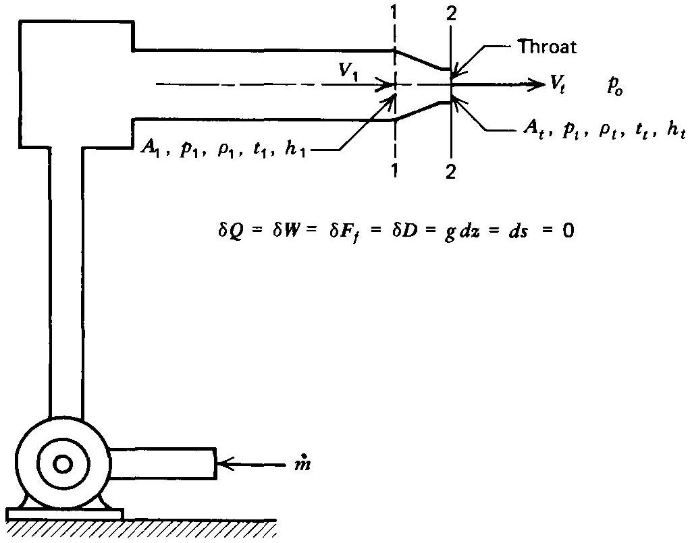
Figure 4.10. Steady isentropic flow through a converging nozzle.

In the special case where the fluid is a perfect gas, the isentropic throat speed $V_{t}^{\prime}$ is (see equation 4.28)

$$
V_{t}^{\prime}=\left\{\frac{2 \gamma R T}{\gamma-1}\left[1-\left(\frac{p_{t}^{\prime}}{P}\right)^{(\gamma-1) / \gamma}\right]\right\}^{1 / 2}=a_{o}\left\{\frac{2}{\gamma-1}\left[1-\left(\frac{p_{t}^{\prime}}{P}\right)^{(\gamma-1) / \gamma}\right]\right\}^{1 / 2}
$$

where $a_{o}$ is the stagnation acoustic speed. The Mach number for the flow in the throat section $A_{t}$ is

$$
M_{t}^{\prime}=\frac{V_{t}^{\prime}}{a_{t}^{\prime}}=\frac{a_{o}}{a_{t}^{\prime}}\left\{\frac{2}{\gamma-1}\left[1-\left(\frac{p_{t}^{\prime}}{P}\right)^{(\gamma-1) / \gamma}\right]\right\}^{1 / 2}
$$

For the isentropic flow of a perfect gas,

$$
\frac{a_{o}}{a_{t}^{\prime}}=\left(\frac{T}{t_{t}^{\prime}}\right)^{1 / 2}=\left(\frac{P}{p_{t}^{\prime}}\right)^{(\gamma-1) / 2 \gamma}
$$

Substituting for $a_{o} / a_{t}^{\prime}$ into equation 4.66 gives

$$
M_{t}^{\prime}=\left\{\frac{2}{\gamma-1}\left[\left(\frac{P}{p_{t}^{\prime}}\right)^{(\gamma-1) / \gamma}-1\right]\right\}^{1 / 2}
$$

If the back pressure $p_{o}$ into which the converging nozzle discharges is decreased while the stagnation pressure $P$ at the entrance to the nozzle is held constant, the static pressure in the throat of the nozzle $p_{t}^{\prime}$ remains equal to $p_{o}$ until $p_{t}^{\prime}=p_{o}=p^{*}$, the critical pressure. Thereafter, further reduction of $p_{o}$ has no influence on the static pressure in the throat; the latter remains constant at the value $p_{t}^{\prime}=p^{*}$. Moreover, when the critical pressure $p^{*}$ prevails in the throat, the isentropic throat speed $V_{t}^{\prime}$ is equal to $a^{*}$, the critical speed of sound, and the mass flow rate is the maximum or critical mass flow rate $\dot{m}^{*}$.

Reducing the back pressure $p_{o}$ below $p^{*}$ causes a rarefaction wave to be propagated from the outside toward the nozzle to stimulate an increase in the rate of discharge. The wave is propagated into the jet with the absolute local sonic speed, which is $a^{*}$, so that the speed of the wave relative to the jet is $\left(a^{*}-a^{*}\right)=0$. Consequently, the static pressure in the throat of the converging nozzle is unaffected by the reduction
in the back pressure. The critical expansion ratio $r=p^{*} / P$ for the nozzle does not decrease to the actual value of $p_{o} / P$ but remains constant at the value $p^{*} / P$, no matter how much the back pressure $p_{o}$ is reduced, or the inlet pressure $P$ is increased; if $P$ is increased, $p^{*}$ also increases, but the ratio $p^{*} / P$ remains fixed. The Mach number in the throat section of the converging nozzle remains constant, therefore, at the value unity, and the mass flow rate remains at the critical value $\dot{m}^{*}$ corresponding to the stagnation pressure $P$ and the stagnation temperature $T$. The preceding discussion applies not only to converging nozzles, but also to the throat section of a convergingdiverging nozzle.

The maximum discharge speed attainable by a gas expanding isentropically in a converging nozzle is the throat speed corresponding to the critical expansion ratio $p^{*} / P$ and the value of the stagnation temperature $T$. Let $\left(V_{t}^{\prime}\right)_{\text {max }}$ denote the maximum isentropic throat speed. When $\left(V_{t}^{\prime}\right)_{\text {max }}$ occurs, the pressure ratio $p_{t}^{\prime} / P$ is given by equation 3.192, which is repeated here for convenience. Thus,

$$
\frac{p_{t}^{\prime}}{P}=\frac{p^{*}}{P}=\left(\frac{2}{\gamma+1}\right)^{\gamma /(\gamma-1)}
$$

where $p^{*} / P$ is the critical expansion ratio. Substituting equation 4.69 into equation 4.65 and simplifying gives

$$
\left(V_{t}^{\prime}\right)_{\max }=a^{*}=\left(\frac{2 \gamma R T}{\gamma+1}\right)^{1 / 2}=a_{o}\left(\frac{2}{\gamma+1}\right)^{1 / 2}
$$

When any form of nozzle, converging or converging-diverging, operates with the critical speed of sound $a^{*}$ in its throat, the nozzle is said to operate with complete nozzling, and the flow is said to be choked. The corresponding critical mass rate of flow $\dot{m}^{*}$ is also termed the choking mass flow rate.

## 4-6(b) Isentropic Mass Rate of Flow

The mass rate of flow for either a converging nozzle or a converging-diverging nozzle is obtained by applying the continuity equation to the throat area $A_{t}$. Assuming steady one-dimensional isentropic flow, and letting $\dot{m}^{\prime}$ denote the corresponding isentropic mass flow rate then, from equation 4.1,

$$
\dot{m}^{\prime}=A_{t} \rho_{t}^{\prime} V_{t}^{\prime}
$$

Substituting for $V_{t}^{\prime}$ from equation 4.64 gives

$$
\dot{m}^{\prime}=A_{t} \rho_{t}^{\prime}\left[2\left(H-h_{t}^{\prime}\right)\right]^{1 / 2}
$$

In the special case where the fluid is a perfect gas, the density $\rho_{t}^{\prime}$ is obtained from equations 4.21 and 4.24. Thus,

$$
\rho_{t}^{\prime}=\rho_{o}\left(\frac{p_{t}^{\prime}}{P}\right)^{1 / \gamma}=\left(\frac{P}{R T}\right)\left(\frac{p_{t}^{\prime}}{P}\right)^{1 / \gamma}
$$

Substituting equations 4.65 and 4.73 into equation 4.71 and rearranging yields

$$
\dot{m}^{\prime}=\frac{P A_{t}}{\sqrt{\gamma R T}}\left\{\frac{2 \gamma^{2}}{\gamma-1}\left(\frac{p_{t}^{\prime}}{P}\right)^{2 / \gamma}\left[1-\left(\frac{p_{t}^{\prime}}{P}\right)^{(\gamma-1) / \gamma}\right]\right\}^{1 / 2}
$$

Examination of equation 4.74 shows that for fixed entrance conditions the mass flow rate $\dot{m}^{\prime}$ depends only on the expression enclosed by the brackets. That expression
is termed the flow factor and is denoted by $\psi$. Hence,

$$
\psi \equiv\left\{\frac{2 \gamma^{2}}{\gamma-1}\left(\frac{p_{t}^{\prime}}{P}\right)^{2 / \gamma}\left[1-\left(\frac{p_{t}^{\prime}}{P}\right)^{(\gamma-1) / \gamma}\right]\right\}^{1 / 2}
$$

Figure 4.11 presents values of $\psi$ as a function of $p_{t}^{\prime} / P$ for different values of $\gamma$. Although values of $\psi$ can be calculated for values of $p_{t}^{\prime} / P<p^{*} / P$, those values of $\psi$ have no physical significance because the mass flow rate remains constant at the critical value $\dot{m}^{*}$ for all back pressures less than $p^{*}$.
In terms of the flow factor $\psi$, equation 4.74 becomes

$$
\dot{m}^{\prime}=\frac{\psi P A_{t}}{\sqrt{\gamma R T}}=\frac{\psi P A_{t}}{a_{o}}
$$

It is evident from equation 4.76 that for a fixed value of the entrance stagnation pressure $P$, and a fixed value of the expansion ratio $r=p_{t}^{\prime} / P$ (i.e., $\psi=$ constant), the isentropic mass rate of flow $\dot{m}^{\prime}$ for a specific gas depends only on the stagnation temperature $T$. Raising $T$ decreases the value of $\dot{m}^{\prime}$, and vice versa.

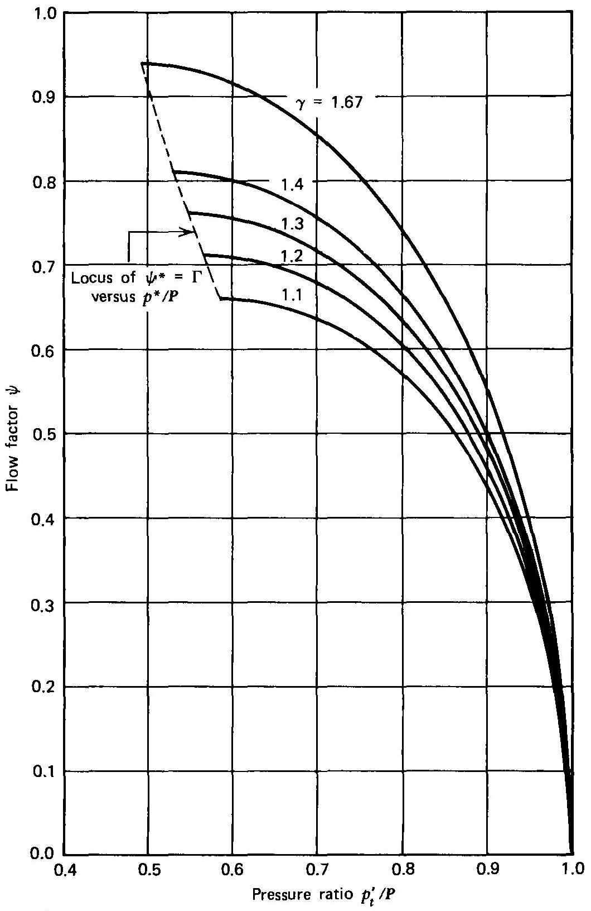
Figure 4.11. Flow factor $\psi$ as a function of the pressure ratio $p_{t}^{\prime} / P$.

The maximum value of $\dot{m}^{\prime}$ for the assumed isentropic conditions occurs when the throat speed $V_{t}^{\prime}=a^{*}$. When that condition prevails, the flow factor $\psi=\psi^{*}$; the equation for $\psi^{*}$ is obtained by substituting for $p^{*} / P$ from equation 4.69 into equation 4.75. Hence,

$$
\psi^{*}=\left[\frac{2 \gamma^{2}}{\gamma+1}\left(\frac{2}{\gamma+1}\right)^{2 /(\gamma-1)}\right]^{1 / 2}=\gamma\left(\frac{2}{\gamma+1}\right)^{(\gamma+1) / 2(\gamma-1)}=\Gamma
$$

where $\Gamma$ is defined by equation 4.39. For air, $\gamma=1.4$, and $\psi^{*}=\Gamma$ is

$$
\psi^{*}=\Gamma=1.4\left(\frac{2}{2.4}\right)^{3.0}=0.81019
$$

Values of $\psi^{*}=\Gamma$, as a function of $\gamma$, are tabulated in Table C.15. The critical mass flow rate $\dot{m}^{*}$ is accordingly given by

$$
\dot{m}^{*}=\frac{\psi^{*} P A_{t}}{\sqrt{\gamma R T}}=\frac{\psi^{*} P A_{t}}{a_{o}}=\frac{\Gamma P A_{t}}{a_{o}}
$$

For air, $R=287.04 \mathrm{~J} / \mathrm{kg}-\mathrm{K}$, and equation 4.79 may be written as

$$
\frac{\dot{m}^{*} \sqrt{T}}{P A_{t}}=0.040416 \text { (0.53175 in EE units) }
$$

The conditions at the throat of a converging-diverging nozzle are governed by the same relationships as those for the throat of a converging nozzle. Consequently, the equations derived in the present section for the isentropic mass flow rate apply not only to the flow in a converging nozzle but also to the flow in a converging-diverging nozzle.

## 4-6(c) Effect of Decreasing the Back Pressure with Constant Inlet Pressure

The foregoing demonstrates that the value of $\dot{m}^{\prime}$ obtained from equation 4.76 and the plot of $\psi$ versus $p_{t}^{\prime} / P$ in Fig. 4.11, for the range $p_{t}^{\prime} / P=1$ to zero, is correct until the expansion ratio $p_{e}^{\prime} / P$ is reduced to the critical expansion ratio. Thereafter, because disturbances beyond the throat can no longer be propagated upstream, the flow behaves as if no further reduction in the back pressure had occurred; the flow has no way of becoming aware of the reduction in pressure. Consequently, when the back pressure is equal to or less than the critical pressure, the nozzle discharges the same mass flow rate, the critical mass flow rate $\dot{m}^{*}=\dot{m}_{\text {max }}^{\prime}$. This fact was known to St. Venant and Wantzel (1839) and was explained both theoretically and experimentally by Grashof (1875) and Zeuner (1900).

Experiments show that the shape of the jet discharging from a converging nozzle is different, depending on whether the back pressure is above or below the critical pressure. When the back pressure is equal to or above the critical pressure ( $p_{o} \geqq p^{*}$ ), the jet issues as a cylindrical parallel stream, its surface being gradually retarded by the surrounding gas, so that a mixing zone is produced in which the velocity of the jet finally drops to that of the surroundings, as illustrated in Fig. 4.12.

When the back pressure is less than the critical pressure ( $p_{o}<p^{*}$ ), the jet expands as it discharges from the nozzle, as indicated in Fig. 4.13. In that case, the pressure of the gas in the jet leaving the nozzle is the critical pressure $p^{*}$, which is larger than the back pressure. The sudden reduction in pressure causes the gaseous jet to expand in an explosive fashion. The gas particles are accelerated radially and, owing to their inertia, they are displaced from their equilibrium positions, thereby creating a pressure reduction in the core of the jet that causes the particles to reverse the

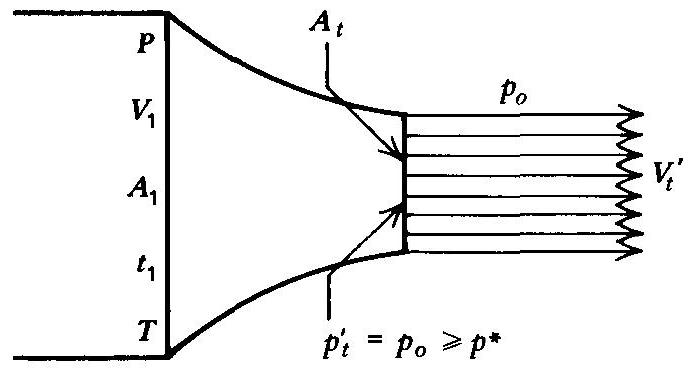
Figure 4.12. Shape of the jet discharged from a converging nozzle with subcritical operation ( $p_{t}^{\prime}= p_{o} \geqq p^{*}$ ).

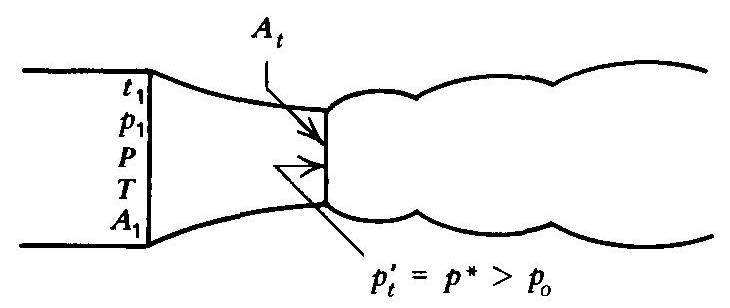
Figure 4.13. Shape of the jet discharged from a converging nozzle with supercritical operation $\left(p_{t}^{\prime}=p^{*}>p_{o}\right)$.

directions of their motions. The above phenomenon is periodic. As a result, the jet becomes thinner in some sections and thicker in others. Standing waves are observed that are associated with loud noise and with a decrease in the available energy of the gas.

## 4-6(d) Effect of Increasing the Inlet Pressure with Constant Back Pressure

Consider the case where the flow through a nozzle is isentropic and the back pressure $p_{o}$ is held constant while the inlet stagnation pressure $P$ is varied. As $P$ is increased above $p_{o}$, the flow is initially subsonic and $p_{t}^{\prime}=p_{o}$. The mass flow rate increases in accordance with equation 4.76. At some value of $P$ the throat pressure is such that $p_{t}^{\prime} / P=p^{*} / P$. Thereafter, increasing $P$ has no influence on that ratio; the latter remains constant for all values of $P$ larger than

$$
P=\left(\frac{\gamma+1}{2}\right)^{\gamma /(\gamma-1)} p_{o}
$$

For air, with $\gamma=1.4$, the critical expansion ratio is 0.52828 , so that the throat pressure is given by 0.52828 P .

The speed of the gas flowing in the throat section of a choked nozzle is given by equation 4.70 ; thus,

$$
V_{t}^{\prime}=a^{*}=\left(\frac{2 \gamma R T}{\gamma+1}\right)^{1 / 2}=a_{o}\left(\frac{2}{\gamma+1}\right)^{1 / 2}
$$

It is seen from equation 4.82 that for a given gas, $V_{t}^{\prime}$ depends only on $T$; it is independent of $P$. Consequently, after the critical condition is attained in the throat, increasing $P$ has no effect on $V_{t}^{\prime}=a^{*}$. Since the static pressure in the throat section of a choked nozzle is given by equation 4.69 , then

$$
p_{t}^{\prime}=p^{*}=\left(\frac{2}{\gamma+1}\right)^{\gamma /(\gamma-1)} P
$$

Equation 4.83 shows that, for a given gas, $p_{t}^{\prime}=p^{*}$ increases linearly with $P$. Furthermore, if $T$ is held constant, the density of the gas in the throat is $\rho_{t}^{\prime}=\rho^{*}=p^{*} / R t^{*}$, which increases linearly with $P$ because $t^{*}=2 T /(\gamma+1)$ remains constant. Because of the increased value of $\rho_{t}^{\prime}=\rho^{*}$ with increasing $P$, the mass flow rate $\dot{m}^{*}$ likewise increases linearly with $P$.

When the critical conditions prevail in the nozzle, the volumetric flow rate is $\dot{Q}^{*}$, which is given by

$$
\dot{Q}^{*}=\frac{\dot{m}^{*}}{\rho^{*}}=A_{t} a^{*}=A_{t}\left(\frac{2}{\gamma+1}\right)^{1 / 2}(\gamma R T)^{1 / 2}
$$

All of the terms except $\sqrt{T}$, for a given gas, remain constant, indicating that $\dot{Q}^{*}$ is independent of the initial pressure. If $T$ is held constant, $\dot{Q}^{*}$ remains constant. Increasing $P$ so that $P / p_{o}$ exceeds the critical value, assuming that the back pressure $p_{o}$ is constant, has no effect on $\dot{Q}^{*}$, but $\dot{m}^{*}$ increases linearly with $P$; the increase in $\dot{m}^{*}$ is due to the increased density $\rho^{*}$ for the fluid crossing the throat.

## 4-6(e) Nondimensional Mass Flow Rate

For many engineering purposes, particularly for a gas turbine engine, it is common to express the mass rate of flow in a nondimensional form so that the mass flow rate may be referred to arbitrarily selected standard, or reference, conditions.

The continuity equation for a perfect gas in terms of the local Mach number and stagnation values of pressure and temperature is given by equation 4.76.

$$
\frac{\dot{m} \sqrt{\gamma R T}}{P A_{t}}=\psi
$$

where $\psi$ is the flow factor defined by equation 4.75 . Equation 4.85 is applicable to both converging and converging-diverging nozzles, and the parameter $\dot{m} \sqrt{\gamma R T} / P A_{t}$ is termed the nondimensional mass flow rate. In the case where the operation of the nozzle is supercritical (i.e., the flow is choked), $\dot{m}=\dot{m}^{*}, A_{t}=A^{*}$, and $M_{t}=1$. Under choking conditions, equation 4.85 becomes

$$
\frac{\dot{m}^{*} \sqrt{\gamma R T}}{P A_{t}}=\psi^{*}
$$

where $\psi^{*}$ is defined by equation 4.78.
Let $T$ and $P$ denote the actual stagnation temperature and pressure, respectively, at the entrance to the nozzle, $T_{\text {std }}$ the standard (or reference) temperature, and $P_{\text {std }}$ the standard (or reference) pressure. By definition,

$$
\theta \equiv \frac{T}{T_{\text {std }}} \quad \text { and } \quad \delta \equiv \frac{P}{P_{\text {std }}}
$$

In terms of the parameters $\theta$ and $\delta$, the standard (or reference) mass flow rate is given by

$$
\dot{m}_{\mathrm{std}}=\frac{\dot{m} \sqrt{\theta}}{\delta}
$$

The standard (or reference) critical mass flow rate is accordingly given by

$$
\dot{m}_{\mathrm{std}}^{*}=\frac{\dot{m}^{*} \sqrt{\theta}}{\delta}
$$

Example 4.5. Air enters a converging nozzle with a static pressure of $2.00 \cdot 10^{5} \mathrm{~N} / \mathrm{m}^{2}$, a static temperature of 300 K , and a Mach number 0.2. It discharges into the atmosphere where the pressure is $1.0135 \cdot 10^{5} \mathrm{~N} / \mathrm{m}^{2}$. The nozzle throat area $A_{t}$ is $0.0040 \mathrm{~m}^{2}$. Calculate (a) the mass rate of flow under the actual operating conditions, and (b) the standard mass rate of flow. Assume $T_{\text {std }}=298.15 \mathrm{~K}$ and $P_{\text {std }}=1.0133 \cdot 10^{5} \mathrm{~N} / \mathrm{m}^{2}$. Assume that the flow is isentropic, and $\gamma=1.40$.

## Solution

(a) Determine the stagnation conditions and nozzle pressure ratio. From equations 4.24 and 4.25,

$$
\begin{aligned}
T & =t_{1}\left(1+\frac{\gamma-1}{2} M_{1}^{2}\right)=\left[1+0.2(0.2)^{2}\right](300.0)=302.4 \mathrm{~K} \\
P & =p_{1}\left(\frac{T}{t_{1}}\right)^{\gamma /(\gamma-1)}=(2.00) 10^{5}\left(\frac{302.4}{300}\right)^{3.5}=2.0566 \cdot 10^{5} \mathrm{~N} / \mathrm{m}^{2} \\
\frac{p_{o}}{P} & =\frac{1.0133}{2.0566}=0.4927<0.5283(\text { flow is supercritical })
\end{aligned}
$$

From equation 4.80,

$$
\frac{\dot{m}^{*} \sqrt{T}}{P A^{*}}=\frac{\dot{m}^{*} \sqrt{302.4}}{\left(2.0566 \cdot 10^{5}\right)(0.0040)}=0.040416
$$

Hence,

$$
\dot{m}^{*}=\frac{(0.040416)\left(2.0566 \cdot 10^{5}\right)(0.0040)}{\sqrt{302.4}}=1.912 \mathrm{~kg} / \mathrm{s}(4.215 \mathrm{lbm} / \mathrm{sec})
$$

(b) From equations 4.87

$$
\sqrt{\theta}=\left(\frac{T}{T_{\mathrm{std}}}\right)^{1 / 2}=\left(\frac{302.4}{298.15}\right)^{1 / 2}=1.0071 \quad \text { and } \quad \delta=\frac{P}{P_{\mathrm{std}}}=\frac{2.0566}{1.0133}=2.0296
$$

From equation 4.89,

$$
\dot{m}_{\mathrm{std}}^{*}=\frac{\dot{m}^{*} \sqrt{\theta}}{\delta}=\frac{(1.912)(1.0071)}{2.0296}=0.9488 \mathrm{~kg} / \mathrm{s}(2.0916 \mathrm{lbm} / \mathrm{sec})
$$

## 4-6(f) Multidimensional Flow Effects

The preceding discussion of the converging nozzle, being based on the assumption of one-dimensional flow, assumes that the flow properties are uniform across every plane perpendicular to the mean flow direction. In an actual converging nozzle of cylindrical cross section, the assumption of one-dimensional flow may not be valid, especially if the wall of the nozzle makes a large angle with the axis (or meridional plane for a rectangular cross section) of the nozzle.

A practical example of such a nozzle is the converging propulsive nozzle of a subsonic turbojet engine [see Section 4-9(a)]. In the interest of reducing its length and, accordingly, its weight, the wall angle of the nozzle may be quite large. Consequently, the flow through the nozzle deviates from the assumed one-dimensional flow; that is, the surfaces of constant flow properties are not planes perpendicular to the nozzle axis.

Furthermore, the inward radial momentum of the fluid causes the formation of a vena contracta downstream from the exit plane of the nozzle; the vena contracta is
often called the aerodynamic throat of the nozzle. Moreover, the area of the vena contracta may be considerably smaller than the nozzle exit area. The combination of the nonuniform flow and the vena contracta reduces the mass flow rate to a value smaller than that for a one-dimensional flow. The shape of the vena contracta, because it is located external to the nozzle, is influenced by the conditions in the surrounding atmosphere even at pressure ratios considerably larger than the onedimensional choking pressure ratio $P / p^{*}$.

Figure 4.14, based on theoretical calculations by Thornock and Brown ${ }^{5}$, presents $y / y_{t}$, the normalized radial coordinate, as a function of $x / y_{t}$, the normalized axial coordinate, with the Mach number as a parameter, for a converging conical nozzle having a cone semiangle $\alpha=40 \mathrm{deg}$. The Mach number curves are for the case where the nozzle operates with a pressure ratio $P / p_{o}=4.0$. It is customary in the gas turbine industry to employ the pressure ratio $P / p$ instead of the expansion ratio

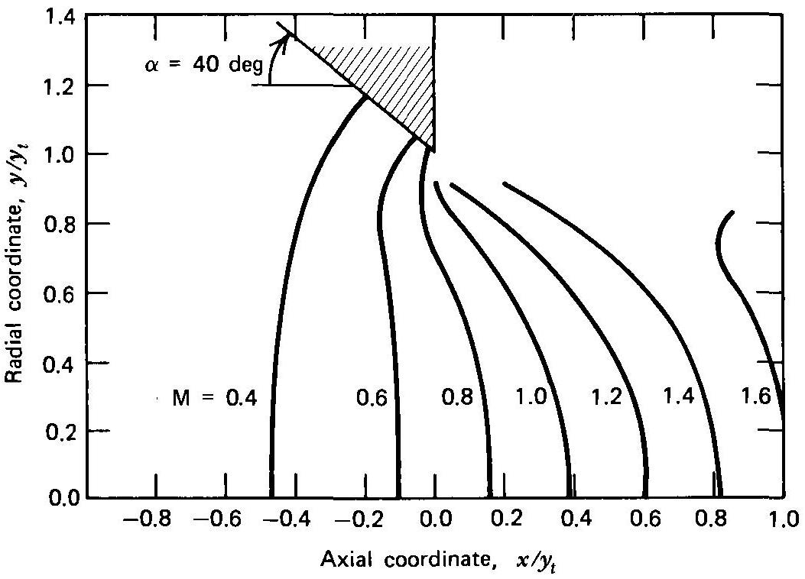
Figure 4.14. Lines of constant Mach number for a 40 degree converging nozzle at a pressure ratio of 4.0 (taken from Reference 5).

$p / P$. Thus, the choking pressure ratio for air, from equation 4.81 , is 1.893 . Figure 4.15 presents $y / y_{t}$ as a function of $x / y_{t}$, and illustrates a plot of experimental values of the sonic lines for a conical nozzle, having a 25 degree semiangle, at various pressure ratios. Figure 4.15 indicates that the measured values of the location of the sonic line are not independent of the back pressure until a pressure ratio of 4.0 is attained. The deviation in the location of the sonic line from that corresponding to the onedimensional location is large. The nozzle does not operate truly choked until the pressure ratio equals 4.0.

The effect of flow nonuniformity on the nozzle mass flow rate is accounted for by a discharge coefficient $C_{D}$, defined by

$$
C_{D} \equiv \frac{\dot{m}_{\text {actual }}}{\dot{m}_{\text {one-dimensional, isentropic }}}
$$

Figure 4.16 presents the measured values of the discharge coefficient $C_{D}$, defined by equation 4.90 , as a function of nozzle pressure ratio $P / p_{o}$ for three conical converging nozzles, having cone semiangles of 15,25 , and 40 deg . In all cases, $C_{D}$ increases with the pressure ratio up to the pressure ratio for a choked mass flow rate. Even with

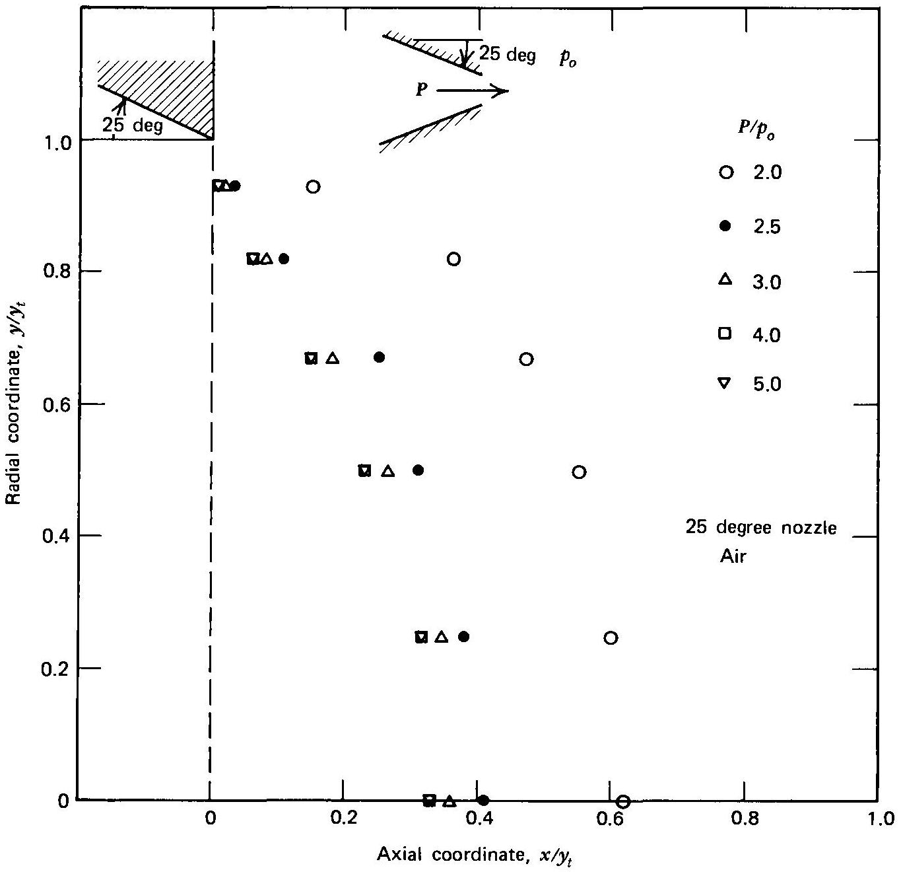
Figure 4.15. Experimental sonic lines at various pressure ratios for a 25 degree converging nozzle (taken from Reference 5).

choked flow, $C_{D}$ may be significantly smaller than unity due to the adverse effects of multidimensional flow. An approximate locus of the choking condition is indicated in the figure by the broken line. It is seen from the experimental data plotted in Fig. 4.16, that the adverse effects of multidimensional flow in a conical converging nozzle are more pronounced for the nozzles having the larger cone angles, which is to be expected.

It is apparent from the foregoing that the assumption of one-dimensional flow for a conical converging nozzle having a large cone semiangle $\alpha$ may lead to serious errors. Nevertheless, the assumption of one-dimensional flow for such nozzles gives the correct trends qualitatively and, when combined with experimentally determined correction factors, such as the discharge coefficient $C_{D}$, makes it possible to obtain accurate quantitative results.

## 4-7 THE CONVERGING-DIVERGING OR DE LAVAL NOZZLE

It is shown in Section 4-6 that, if a nozzle ends at the throat (converging nozzle), the maximum isentropic speed attainable is $V_{t}^{\prime}=a^{*}$. In the present section, it is shown that velocities exceeding $a^{*}$ may be obtained in the divergence of a convergingdiverging or De Laval nozzle.

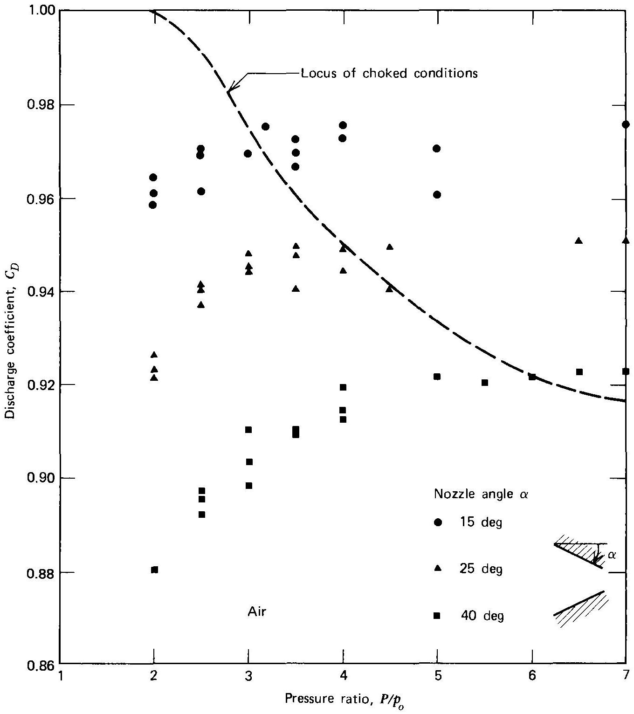
Figure 4.16. Experimental discharge coefficients for conical converging nozzles (taken from Reference 5).

## 4-7(a) Isentropic Discharge Properties

Consider the isentropic expansion illustrated schematically on the $h$ plane in Fig. 4.17. With a converging nozzle the maximum amount of enthalpy that can be transformed into jet kinetic energy is limited to the enthalpy change between points 1 and * illustrated in the figure.

It was shown by the Swedish engineer De Laval that the enthalpy change corresponding to an isentropic expansion from $p^{*}$ to $p_{o}$ could be converted into exit kinetic energy if a correctly designed diverging section is added to the converging nozzle, as illustrated in Fig. 4.18.

The phenomena that take place in a De Laval type of nozzle are explainable by the equations derived in Sections 4-3 and 4-4. The speed of the compressible fluid $V_{e}^{\prime}$ at the exit plane, called the isentropic discharge speed, is given by equation 4.3.

$$
V_{e}^{\prime}=\left[2\left(H-h_{e}^{\prime}\right)\right]^{1 / 2}
$$

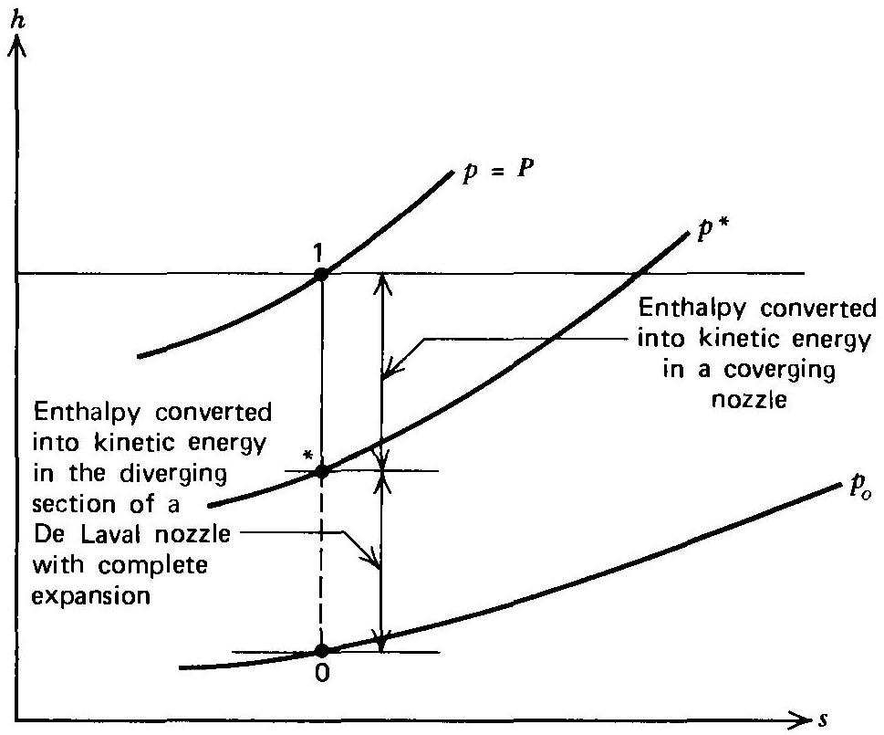
Figure 4.17. Enthalpy that is converted into kinetic energy by the isentropic expansion from the critical pressure $p^{*}$ in the throat to the back pressure $p_{o}$.

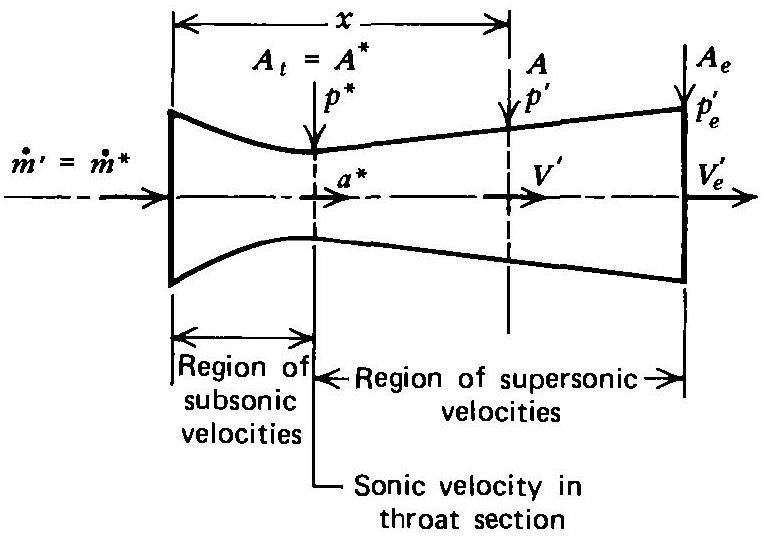
Figure 4.18. De Laval nozzle passing the maximum isentropic mass flow rate $\dot{m}^{*}$.

In the special case where the fluid is a perfect gas, the isentropic discharge speed is given by equation 4.28.

$$
\begin{aligned}
& V_{e}^{\prime}=\left\{\frac{2 \gamma R T}{\gamma-1}\left[1-\left(\frac{p_{e}^{\prime}}{P}\right)^{(\gamma-1) / \gamma}\right]\right\}^{1 / 2} \\
& V_{e}^{\prime}=a_{o}\left\{\frac{2}{\gamma-1}\left[1-\left(\frac{p_{e}^{\prime}}{P}\right)^{(\gamma-1) / \gamma}\right]\right\}^{1 / 2}=V_{\max }^{\prime}\left[1-\left(\frac{p_{e}^{\prime}}{P}\right)^{(\gamma-1) / \gamma}\right]^{1 / 2}
\end{aligned}
$$

where $a_{o}$ is the stagnation acoustic speed and $V_{\text {max }}^{\prime}$ is the maximum isentropic speed. The exit Mach number $M_{e}^{\prime}$ is

$$
M_{e}^{\prime}=\frac{V_{e}^{\prime}}{a_{e}^{\prime}}=\frac{a_{o}}{a_{e}^{\prime}}\left\{\frac{2}{\gamma-1}\left[1-\left(\frac{p_{e}^{\prime}}{P}\right)^{(\gamma-1) / \gamma}\right]\right\}^{1 / 2}
$$

For the isentropic flow of a perfect gas,

$$
\frac{a_{o}}{a_{e}^{\prime}}=\left(\frac{T}{t_{e}^{\prime}}\right)^{1 / 2}=\left(\frac{P}{p_{e}^{\prime}}\right)^{(\gamma-1) / 2 \gamma}
$$

Substituting equation 4.95 into 4.94 yields

$$
M_{e}^{\prime}=\left\{\frac{2}{\gamma-1}\left[\left(\frac{P}{p_{e}^{\prime}}\right)^{(\gamma-1) / \gamma}-1\right]\right\}^{1 / 2}
$$

As pointed out in Section 4-6(b), if the mass flow rate $\dot{m}^{\prime}$ in a De Laval nozzle is choked, then the mass flow rate is the critical mass flow rate $\dot{m}^{*}$. From equation 4.1,

$$
\dot{m}^{\prime}=\dot{m}^{*}=\rho^{*} A_{t} a^{*}=\rho^{\prime} A V^{\prime}=\rho_{e}^{\prime} A_{e} V_{e}^{\prime}
$$

Figure 4.19 presents the ratios $V_{e}^{\prime} / V_{\text {max }}^{\prime}, \rho_{e}^{\prime} / \rho_{o}, t_{e}^{\prime} / T$, and $\left(\dot{m}^{*} / A_{e}\right) / G^{*}=G_{e} / G^{*}= \rho_{e}^{\prime} V_{e}^{\prime} / \rho^{*} a^{*}$ as functions of the expansion ratio $r=p_{e}^{\prime} / P$, for gases having a specific heat ratio $\gamma=1.4$. For values of $p_{e}^{\prime} / P$ larger than $p^{*} / P$, the results are identical to those for a converging nozzle, except for $\left(\dot{m}^{*} / A_{e}\right) / G^{*}$, since $\dot{m}^{\prime}$ does not equal $\dot{m}^{*}$ until $p_{t}^{\prime}=p^{*}$.

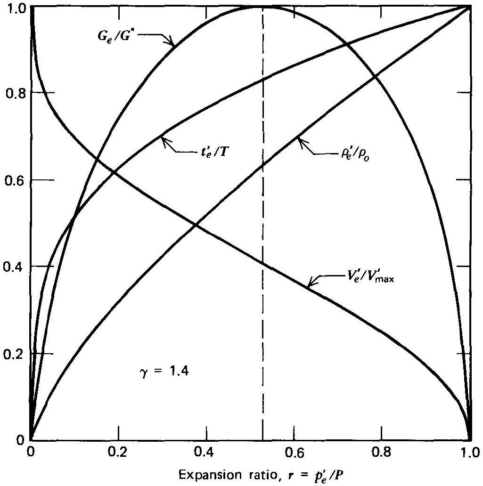
Figure 4.19. Ratios $V_{e}^{\prime} / V_{\text {max }}^{\prime}, \rho_{e}^{\prime} / \rho_{o}, t_{e}^{\prime} / T$, and $G_{e}^{\prime} / G^{*}$ as functions of the expansion ratio $r=p_{e}^{\prime} / P$ for gases having $\gamma=1.4$.

The continuity equation for a De Laval nozzle, equation 4.97, may be expressed in terms of the expansion ratio $r=p^{\prime} / P$. For a perfect gas, combining equations 4.21 and 4.24 gives

$$
\rho^{\prime}=\rho_{o}\left(\frac{p^{\prime}}{P}\right)^{1 / \gamma}=\left(\frac{P}{R T}\right)\left(\frac{p^{\prime}}{P}\right)^{1 / \gamma}
$$

Substituting equations 4.92 and 4.98 into equation 4.97 and simplifying yields

$$
\dot{m}^{\prime}=\frac{\psi P A}{\sqrt{\gamma R T}}
$$

where

$$
\psi=\left\{\frac{2 \gamma^{2}}{\gamma-1}\left(\frac{p^{\prime}}{P}\right)^{2 / \gamma}\left[1-\left(\frac{p^{\prime}}{P}\right)^{(\gamma-1) / \gamma}\right]\right\}^{1 / 2}
$$

Applying equation 4.99 at the throat $A_{t}$ gives

$$
\dot{m}^{*}=\frac{\psi^{*} P A_{t}}{\sqrt{\gamma R T}}
$$

where $\psi^{*}$ is defined by equation 4.77 . Equations 4.99 to 4.101 are identical to equations 4.76, 4.75, and 4.79, respectively, which apply to the converging nozzle [see Section 4-6(b)].
Example 4.6. Air at a stagnation pressure of $10.0 \cdot 10^{5} \mathrm{~N} / \mathrm{m}^{2}$ and a stagnation temperature of 300 R is discharged through an isentropic De Laval nozzle. The air is expanded completely to the surrounding atmosphere that has a pressure of $1.0133 \cdot 10^{5} \mathrm{~N} / \mathrm{m}^{2}$. Assuming that $\gamma=1.4$ and $R=287.04 \mathrm{~J} / \mathrm{kg}-\mathrm{K}$ for the air, calculate the isentropic discharge speed.

## Solution

From equation 4.92

$$
\begin{aligned}
& V_{e}^{\prime}=\left\{\frac{2(1.4)(287.04)(300)}{0.4}\left[1-\left(\frac{1.0133}{10.0}\right)^{0.28571}\right]\right\}^{1 / 2} \\
& V_{e}^{\prime}=[602,784(0.48009)]^{1 / 2}=537.95 \mathrm{~m} / \mathrm{s}(1764.9 \mathrm{ft} / \mathrm{sec})
\end{aligned}
$$

## 4-7(b) Area Ratio for Complete Expansion (Optimum Area Ratio)

For a De Laval nozzle, the expansion ratio $r=p_{e}^{\prime} / P$ depends on the nozzle area ratio $\varepsilon=A_{e} / A_{t}$. Hence, for a given gas, the exit pressure $p_{e}^{\prime}$ is determined by the stagnation pressure $P$ and the nozzle geometry. When the flowing fluid leaves the nozzle, its pressure must make an adjustment to the ambient pressure $p_{o}$, as discussed in Section 4-3(e). A nozzle for which $p_{e}^{\prime}=p_{o}$, so that no adjustment to the ambient pressure is required, is said to operate with either optimum, or complete expansion. The corresponding area ratio $\varepsilon$ is termed either the area ratio for complete expansion or the optimum area ratio.

Refer to Fig. 4.18. It is desirable to relate the optimum area ratio $A / A^{*}$ to the pressure ratio $p^{\prime} / P$ and the Mach number $M$. When the throat of an isentropic converging-diverging nozzle is choked, it passes the critical mass flow rate $\dot{m}^{\prime}=\dot{m}^{*}$. From equations 4.99 and 4.101, it follows that

$$
\frac{A}{A^{*}}=\frac{\psi^{*}}{\psi}=\frac{\rho^{*} a^{*}}{\rho^{\prime} V^{\prime}}
$$

Substituting for $\psi$ and $\psi^{*}$ from equations 4.100 and 4.77 , respectively, into the above equation yields

$$
\frac{A}{A_{t}}=\frac{A}{A^{*}}=\frac{\left(\frac{2}{\gamma+1}\right)^{1 /(\gamma-1)}\left(\frac{\gamma-1}{\gamma+1}\right)^{1 / 2}}{\left(\frac{p^{\prime}}{P}\right)^{1 / \gamma}\left[1-\left(\frac{p^{\prime}}{P}\right)^{(\gamma-1) / \gamma}\right]^{1 / 2}}
$$

Equation 4.102 specifies the area ratio $A / A_{t}=A / A^{*}$ for expanding the gas isentropically, from the stagnation conditions $P$ and $T$ to the static pressure $p^{\prime}$, when the nozzle mass flow rate is $\dot{m}^{\prime}=\dot{m}^{*}$. Figure 4.20 presents the area ratio $A / A^{*}=A / A_{t}$ as a function of $P / p^{\prime}$ for different values of $\gamma$; the curves are for the condition $\dot{m}^{\prime}=\dot{m}^{*}$.

For some purposes it is more convenient to express the area ratio at any section in terms of the local flow Mach number $M$. This may be done by applying the results

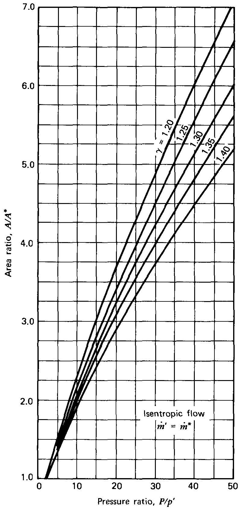
Figure 4.20. Nozzle area ratio for complete expansion for various values of the specific heat ratio.

of Section 4-4(a). Thus, equation 4.29 gives

$$
\frac{A}{A_{t}}=\frac{A}{A^{*}}=\frac{1}{M}\left[\left(\frac{2}{\gamma+1}\right)\left(1+\frac{\gamma-1}{2} M^{2}\right)\right]^{(\gamma+1) / 2(\gamma-1)}
$$

The velocity ratio $V^{\prime} / a^{*}$, denoted by $M^{*}$, is obtained by dividing equation 4.92 by $a^{*}=[2 \gamma R T /(\gamma+1)]^{1 / 2}$. The result is

$$
M^{*}=\frac{V^{\prime}}{a^{*}}=\left\{\frac{\gamma+1}{\gamma-1}\left[1-\left(\frac{p^{\prime}}{P}\right)^{(\gamma-1) / \gamma}\right]\right\}^{1 / 2}
$$

Figure 4.21 presents $V^{\prime} / a^{*}$ as a function of $P / p^{\prime}$ for different values of $\gamma$.
When $\dot{m}^{\prime}<\dot{m}^{*}$, the throat area $A_{t}>A^{*}$, the throat Mach number $M_{t}$ is less than unity, and the flow is subsonic throughout the converging-diverging nozzle. The static pressure of the fluid decreases from the entrance to the throat, where it reaches its smallest value, and then increases in the diverging section.

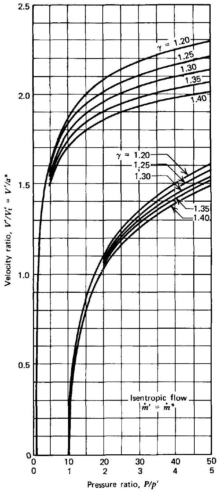
Figure 4.21. Ratio of exit velocity to throat velocity for different values of the specific heat ratio.

In the particular case where the area $A$ coincides with the exit section of the nozzle ( $A=A_{e}$ ), the ratio $A_{e} / A^{*}$ is determined from equations 4.102 and 4.29 by setting $p^{\prime}=p_{e}^{\prime}$ and $M=M_{e}$. Similarily, the velocity ratio $V_{e}^{\prime} / a^{*}$ is obtained from equation 4.103 by setting $p^{\prime}=p_{e}^{\prime}$.

The maximum value for the isentropic discharge speed $V_{e}^{\prime}$ is obtained when $p_{e}^{\prime}=p_{o}$, a condition that is obtained by designing the nozzle so that $A_{e} / A^{*}$ gives $p_{e}^{\prime}=p_{o}$. Such a nozzle, as stated earlier, has the optimum area ratio or the area ratio for complete expansion, which is obtained from equation 4.102 by setting $p^{\prime}=p_{o}$. Figure 4.20 presents the area ratio $A / A^{*}$ for a given value of $P / p^{\prime}$; by setting $p^{\prime}=p_{o}$, the optimum area ratio $A_{e} / A^{*}$ may be read directly from the curve for the pertinent value of $\gamma$.

When the exit area $A_{e}$ is selected so that $p_{e}^{\prime}=p_{o}$, all of the available enthalpy of the flowing fluid is transformed into jet kinetic energy. It follows, therefore, that
for the isentropic flow in a converging-diverging nozzle having the optimum area ratio, the exit velocity $V_{e}^{\prime}$ is given by

$$
V_{e}^{\prime}=\left[2\left(H-h_{e}^{\prime}\right)\right]^{1 / 2} \quad\left(\text { for optimum } A_{e} / A_{t}\right)
$$

The condition when the back pressure $p_{o}$ is reduced to zero is of academic interest. In that case, $V_{e}^{\prime}$ is the maximum isentropic speed which, from equation 3.188, Table 3.4, is given by

$$
\left(V_{e}^{\prime}\right)_{\max }=V_{\max }^{\prime}=a^{*}\left(\frac{\gamma+1}{\gamma-1}\right)^{1 / 2}=a_{o}\left(\frac{2}{\gamma-1}\right)^{1 / 2}\left(\text { for } p_{o}=0\right)
$$

Example 4.7. A converging-diverging nozzle discharges air into a receiver where the static pressure is $1.034 \cdot 10^{5} \mathrm{~N} / \mathrm{m}^{2}$. The nozzle passes the maximum mass flow rate, and the static pressure and temperature in the constant-area duct to which the nozzle is attached are $p_{1}=6.895 \cdot 10^{5} \mathrm{~N} / \mathrm{m}^{2}$ and $t_{1}=444.4 \mathrm{~K}$; the duct area is $0.0929 \mathrm{~m}^{2}$. The Mach number for the air flowing through the duct is $M_{1}=0.3$. Assuming isentropic flow and $\gamma=1.4$, calculate (a) the stagnation properties of the fluid ( $T, P, \rho_{o}$, and $a_{o}$ ), (b) the mass rate of flow through the nozzle, (c) the values of $t, p, \rho$, and $V$ for the throat section, (d) the area of the throat section, and (e) the area of the exit section $A_{e}$ that gives complete expansion of the air, and the corresponding values of $p, \rho, V, M$, and $t$. For air, $\gamma=1.4$ and $R=287.04 \mathrm{~J} / \mathrm{kg}-\mathrm{K}$.

## Solution

(a) $a_{1}=\left(\gamma R t_{1}\right)^{1 / 2}=[1.4(287.04)(444.4)]^{1 / 2}=422.6 \mathrm{~m} / \mathrm{s}$

$$
\begin{aligned}
V_{1} & =M_{1} a_{1}=(0.3)(422.6)=126.8 \mathrm{~m} / \mathrm{s} \\
\rho_{1} & =\frac{p_{1}}{R t_{1}}=\frac{(6.895) 10^{5}}{287.04(444.4)}=5.405 \mathrm{~kg} / \mathrm{m}^{3} \\
T & =t_{1}\left(1+\frac{\gamma-1}{2} M_{1}^{2}\right)=444.4(1.018)=452.4 \mathrm{~K}(814.3 \mathrm{R}) \\
P & =p_{1}\left(1+\frac{\gamma-1}{2} M_{1}^{2}\right)^{\gamma /(\gamma-1)}=6.895 \cdot 10^{5}(1.0644) \\
& =7.339 \cdot 10^{5} \mathrm{~N} / \mathrm{m}^{2}\left(106.45 \mathrm{lbf} / \mathrm{in}^{2}\right) \\
\rho_{o} & =\frac{P}{R T}=\frac{(7.339) 10^{5}}{287.04(452.4)}=5.652 \mathrm{~kg} / \mathrm{m}^{3}\left(0.3529 \mathrm{lbm} / \mathrm{ft}^{3}\right) \\
a_{o} & =(\gamma R T)^{1 / 2}=[1.4(287.04)(452.4)]^{1 / 2}=426.4 \mathrm{~m} / \mathrm{s}(1398.9 \mathrm{ft} / \mathrm{sec})
\end{aligned}
$$

(b) By continuity,

$$
\dot{m}^{\prime}=\rho_{1} A_{1} V_{1}=\dot{m}^{*}=5.405(0.0929)(126.8)=63.67 \mathrm{~kg} / \mathrm{s}(140.4 \mathrm{lbm} / \mathrm{sec})
$$

(c) Since $\dot{m}^{\prime}=\dot{m}^{*}$, critical conditions prevail in the throat. From equation 4.34,

$$
t_{t}^{\prime}=t^{*}=\left(\frac{2}{\gamma+1}\right) T=(0.83333)(452.4)=377.0 \mathrm{~K}(678.6 \mathrm{R})
$$

From equation 4.35,

$$
\begin{aligned}
p_{t}^{\prime}=p^{*}=\left(\frac{2}{\gamma+1}\right)^{\gamma /(\gamma-1)} P & =(0.52828)\left(7.339 \cdot 10^{5}\right) \\
& =3.877 \quad 10^{5} \mathrm{~N} / \mathrm{m}^{2}\left(56.23 \mathrm{lbf} / \mathrm{in}^{2}\right)
\end{aligned}
$$

From equation 4.36,

$$
\rho_{t}^{\prime}=\rho^{*}=\left(\frac{2}{\gamma+1}\right)^{1 /(\gamma-1)} \rho_{o}=(0.63394)(5.652)=3.583 \mathrm{~kg} / \mathrm{m}^{3}\left(0.2237 \mathrm{lbm} / \mathrm{ft}^{3}\right)
$$

From equation 4.37,

$$
V_{t}^{\prime}=a^{*}=\left(\frac{2}{\gamma+1}\right)^{1 / 2} a_{o}=(0.91287)(426.4)=389.2 \mathrm{~m} / \mathrm{s}(1277.0 \mathrm{ft} / \mathrm{sec})
$$

(d) From equation 4.79, since $\dot{m}^{\prime}=\dot{m}^{*}$ and $A_{t}=A^{*}$,

$$
A^{*}=\frac{\dot{m}^{*} a_{o}}{\psi^{*} P}=\frac{(63.67)(426.4)}{(0.81019)(7.339) 10^{5}}=0.04566 \mathrm{~m}^{2}\left(70.77 \mathrm{in}^{2}\right)
$$

(e) For complete expansion, $p_{e}^{\prime}=p_{o}=1.034 \cdot 10^{5} \mathrm{~N} / \mathrm{m}^{2}$. Then,

$$
\left(\frac{p_{o}}{P}\right)^{(\gamma-1) / \gamma}=\left(\frac{1.034}{7.339}\right)^{0.2857}=0.5713
$$

From equation 4.103,

$$
M_{e}^{*}=\frac{V_{e}^{\prime}}{a^{*}}=\left\{\left(\frac{2.4}{0.4}\right)[1-(0.5713)]\right\}^{1 / 2}=1.6038
$$

Hence,

$$
\begin{aligned}
V_{e}^{\prime} & =M_{e}^{*} a^{*}=1.6038(389.2)=624.2 \mathrm{~m} / \mathrm{s}(2047.9 \mathrm{ft} / \mathrm{sec}) \\
t_{e}^{\prime} & =t^{*}\left(\frac{p_{e}^{\prime}}{p^{*}}\right)^{(\gamma-1) / \gamma}=377.0\left(\frac{1.034}{3.877}\right)^{0.2857}=258.4 \mathrm{~K}(465.2 \mathrm{R}) \\
a_{e}^{\prime} & =\left(\gamma R t_{e}^{\prime}\right)^{1 / 2}=[1.4(287.04)(258.4)]^{1 / 2}=322.2 \mathrm{~m} / \mathrm{s}(1057.2 \mathrm{ft} / \mathrm{sec}) \\
M_{e}^{\prime} & =\frac{V_{e}^{\prime}}{a_{e}^{\prime}}=\frac{624.2}{322.2}=1.937 \\
\rho_{e}^{\prime} & =\frac{p_{e}^{\prime}}{R t_{e}^{\prime}}=\frac{(1.034) 10^{5}}{287.04(258.4)}=1.394 \mathrm{~kg} / \mathrm{m}^{3}\left(0.08705 \mathrm{lbm} / \mathrm{ft}^{3}\right)
\end{aligned}
$$

From equation 4.29,

$$
\frac{A_{e}}{A_{t}}=\frac{A_{e}}{A^{*}}=\frac{1}{1.937}\left\{\left(\frac{2}{2.4}\right)\left[1+0.2(1.937)^{2}\right]\right\}^{3.0}=1.6023
$$

Hence,

$$
A_{e}=1.6023(0.04566)=0.07316 \mathrm{~m}^{2}\left(113.4 \mathrm{in} .^{2}\right)
$$

## 4-7(c) Effect of Varying the Back Pressure on a Converging-Diverging Nozzle

Figure 4.22 presents the expansion ratio $p_{e}^{\prime} / P$ and the exit Mach number $M_{e}^{\prime}$ as functions of the area ratio $A_{e} / A^{*}$ for a converging-diverging nozzle that passes the maximum isentropic mass flow rate $\dot{m}^{*}$. It is apparent from the figure that to each value of $A_{e} / A^{*}$ there correspond two values of $M_{e}^{\prime}$, one being subsonic and the other supersonic. Which of the two values of $M_{e}^{\prime}$ occurs depends on the back pressure $p_{o}$ [see Section 4-3(e)].

When the isentropic mass flow rate $\dot{m}^{\prime}$ for a converging-diverging nozzle is such that $\dot{m}^{\prime}<\dot{m}^{*}$, the flow is subsonic throughout the nozzle. Only a small range of exit pressures is attainable with a subsonic isentropic flow, and that range of exit

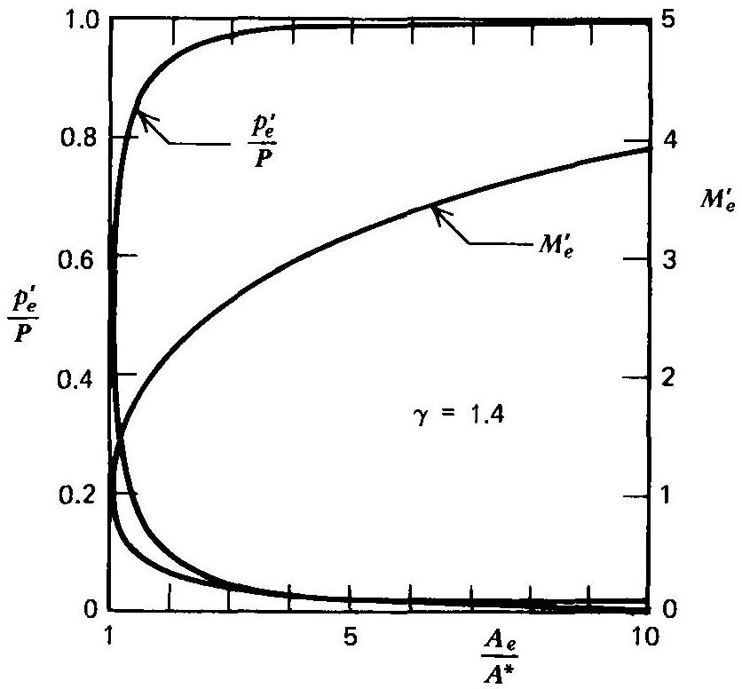
Figure 4.22. Expansion ratio $p_{e}^{\prime} / P$ and exit Mach number $M_{e}^{\prime}$ as functions of $A_{e} / A^{*}$ for a convergingdiverging nozzle passing the maximum isentropic mass flow rate $\dot{m}^{*}$.

pressures is indicated schematically in Fig. 4.23. The nozzle, in that case, operates in much the same manner as it would if the fluid flowing through it were incompressible, the divergent section of the nozzle acting as a diffuser, since $M<1$ (see equation 4.19).

Consider now the case where the nozzle operates under steady isentropic flow conditions but passes the mass flow rate $\dot{m}^{*}$. Figure 4.23 shows that only two different values of exit pressure $p_{e}^{\prime}$ are possible if the flow is to be isentropic. The gas expands

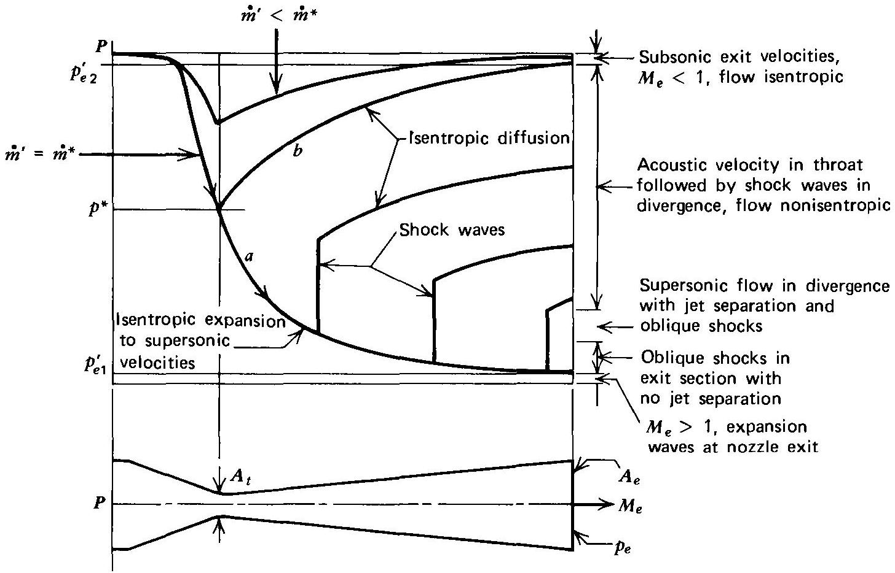
Figure 4.23. Pressure distribution in a converging-diverging nozzle under different operating conditions.

isentropically to $p^{*}$ in the throat and may either continue its isentropic expansion along curve $a$ to the exit pressure $p_{e 1}^{\prime}$ or it may be diffused isentropically along curve $b$ to the exit pressure $p_{e 2}^{\prime}$. If the gas expands along curve $a$, the Mach number of the gas crossing the exit area $A_{e}$ is supersonic whereas, if the gas is compressed along curve $b$, then $M_{e}<1$. None of the values of exit pressure between $p_{e 1}^{\prime}$ and $p_{e 2}^{\prime}$ (in Fig. 4.23) are attainable if the flow is isentropic.

A given nozzle has a fixed value for its area ratio $A_{e} / A^{*}$; the latter is given by equation 4.29 , which is repeated here for convenience. Thus, for an isentropic flow,

$$
\frac{A_{e}}{A^{*}}=\frac{1}{M_{e}}\left[\left(\frac{2}{\gamma+1}\right)\left(1+\frac{\gamma-1}{2} M_{e}^{2}\right)\right]^{(\gamma+1) / 2(\gamma-1)}
$$

If the nozzle is operated with the inlet stagnation pressure $P$ held constant, the exit area $A_{e}$ will give complete expansion of the gas only when $p_{e}^{\prime}=p_{o}$; that is, for only one value of the back pressure $p_{o}$. As described in Section 4-3, when $p_{e}^{\prime}>p_{o}$, the expansion of the fluid from $p_{e}^{\prime}$ to $p_{o}$ takes place beyond the exit section of the nozzle in the free jet. A fixed-area nozzle operating with $p_{e}^{\prime}>p_{o}$ is said to operate with underexpansion. Conversely, if the nozzle operates with $p_{e}^{\prime}<p_{o}$, the nozzle is said to operate with overexpansion. The phenomena of overexpansion and underexpansion occur in propulsive nozzles when the back pressure is either higher or lower, respectively, than the value assumed in designing the nozzle.

## 4-7(d) Underexpansion in Converging-Diverging Nozzles

As stated earlier, when a nozzle passes the maximum mass flow rate $\dot{m}^{*}$ and expands the gas completely to the back pressure ( $p_{e}^{\prime}=p_{o}$ ), the velocities in the divergence are supersonic throughout. Consequently, reducing $p_{o}$ (so that $p_{o}<p_{e}^{\prime}$ ) has no effect on the flow conditions inside the nozzle, because a small pressure change is propagated only with the sonic velocity. Beyond the exit section of the nozzle, the supersonic jet expands in much the same manner as does a jet emerging from a converging nozzle operating with a supercritical pressure ratio (see Fig. 4.13). Because the gas is not expanded completely inside the nozzle, the kinetic energy associated with the jet crossing the exit section $A_{e}$ is smaller than that corresponding to the complete isentropic expansion of the gas from $P$ to $p_{o}$. Consequently, if the nozzle is utilized as a thrust-producing element, the thrust obtained when it is operated with underexpansion will be reduced from that corresponding to complete expansion.

## 4-7(e) Overexpansion in Converging-Diverging Nozzles

When a fixed-area converging-diverging nozzle is employed as a thrust-producing element, there is a reduction of thrust when it is operated with overexpansion. Under such conditions the gases may expand inside the nozzle to a pressure below the atmospheric back pressure, and they are then compressed to the back pressure through a series of shock waves. This problem has been discussed by several investigators, but a complete understanding of the flow process under different operating conditions is still lacking. ${ }^{6,7}$

Assume that a converging-diverging nozzle having a fixed area ratio $A_{e} / A_{t}$ is operated with complete expansion so that $p_{e}^{\prime}=p_{o}$ and the flow in the diverging section is supersonic. Now let the back pressure $p_{o}$ be raised so that $p_{o}>p_{e}^{\prime}$. The increase in the back pressure cannot propagate itself into the fluid jet because the latter emerges with a supersonic speed. It can, however, propagate itself upstream through the boundary layer surrounding the jet since, within the boundary layer,
the fluid velocities vary from a supersonic value at its interface with the main core of fluid to zero at the wall of the nozzle (see Section 5-10). Consequently, inside the boundary layer there are regions where the gas velocities are subsonic. A pressure wave can, therefore, start at the exit edge of the nozzle and be transmitted upstream through the regions of the boundary layer where the flow is subsonic. If $p_{o}$ is only slightly larger than $p_{e}^{\prime}$, oblique shock waves are formed at the corner of the exit section, and the pressure at the wall of the nozzle increases sharply from the exit pressure $p_{e}^{\prime}$ to $p_{0}$. The range of back pressures giving operation with oblique shocks formed in the exit section is indicated qualitatively in Fig. 4.23. If the back pressure $p_{o}$ is raised further, the jet detaches itself from the divergent section in the manner illustrated schematically in Fig. 4.24. The overexpanded gas is compressed to the back pressure $p_{o}$ by flowing through the oblique shock waves. The separation of the jet takes place in a more or less regular manner, as illustrated in the latter figure. The static pressure of the gas at the point where separation occurs is called the separation pressure and is denoted by $p_{s}$. Proper regulation of the separation of the jet is desirable in rocket motors, which must operate over an extremely large range of altitudes.

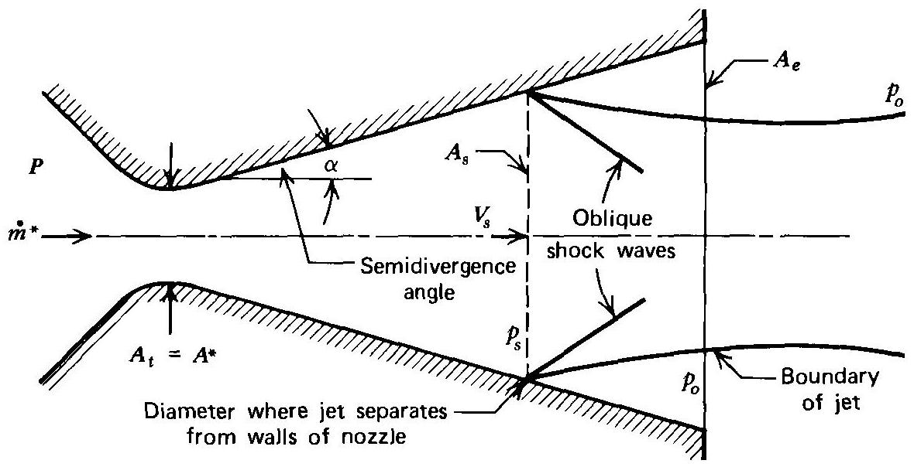
Figure 4.24. Converging-diverging nozzle operating with overexpansion and jet separation.

Figure 4.25 presents the results obtained by A. Stodola from experiments on the effect of back pressure on the static pressure along the axis of a converging-diverging nozzle. ${ }^{8}$ Figure 4.25 indicates that when the back pressure is correct, curve $M$, the static pressure along the nozzle axis was the lowest obtained in the experiments, and curve $M$ is the limiting condition for all of the measurements. As the back pressure was slightly increased, the pressure along the axis of the nozzle showed a sharp increase or shock wave close to the nozzle exit. Further increases in the back pressure intensified the shock wave and caused it to move further inside the nozzle; see curves $L$ to $E$. Curves such as $C, B$, and $A$ are typical for subsonic flow throughout the nozzle.

More recent experiments with overexpanded rocket motor nozzles indicate that the separation pressure $p_{s}$ is approximately $0.40 p_{o}$. As pointed out above, the flow separation phenomenon results from the action of the back pressure on the boundary layer, which flows in the direction of a positive pressure gradient. When momentum is removed from the boundary layer faster than it receives momentum from the main stream, the phenomenon of jet separation with its attendant shock waves

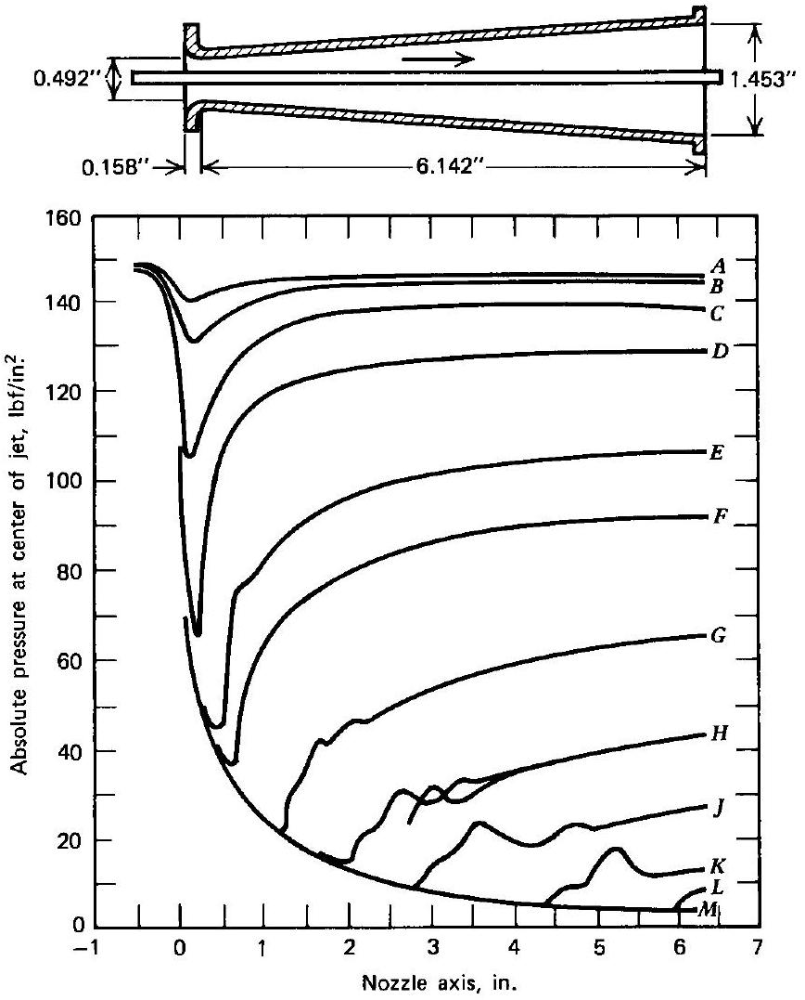
Figure 4.25. Effect of back pressure on the pressure along the axis of a De Laval nozzle (reproduced from Reference 8).

occurs. It is reasonable to assume, therefore, that for conical nozzles, the exact value of the separation pressure will be influenced by the character of the boundary layer and the semiangle $\alpha$ of the conical divergence. The reported experiments indicate that, for a given value of $\alpha$, the separation pressure ratio $p_{s} / p_{0}$ is a function of the nozzle pressure ratio $P / p_{o}$. Figure 4.26 presents a correlation of the results obtained by different experimenters with rocket motor nozzles having $\alpha=15$ deg, by plotting $\left(p_{o}-p_{s}\right) / P$ as a function of $P / p_{o}$. The figure shows that the results obtained by the different experimenters are in substantial agreement. ${ }^{7}$

Figure 4.27 illustrates diagrammatically the flow phenomena occuring in a converging-diverging nozzle when it is operated under different conditions of back pressure $p_{o}$.

## 4-7(f) Multidimensional Flow Effects

The analysis of the flow field for a converging-diverging nozzle presented in the preceding discussion assumes that the flow is one-dimensional. It is shown in Section 4-6(f) that the latter assumption may lead to significant errors in the case of converging nozzles. For converging-diverging nozzles, however, the one-dimensional flow model is generally quite accurate. Deviations from one-dimensional flow do occur, however, and they may be significant in some applications, as discussed in Chapters 12, 15, 16, and 17.

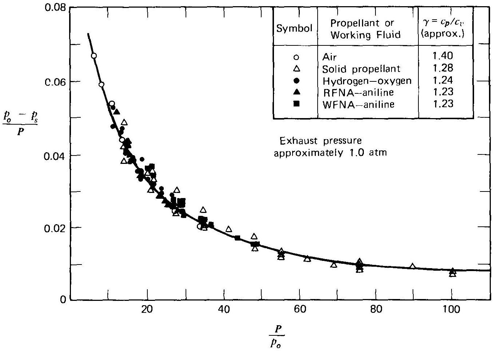
Figure 4.26. Correlation of data on flow separation in nozzles (taken from Reference 7).

$p_{e}^{\prime}$ denotes calculated exit pressure for isentropic flow

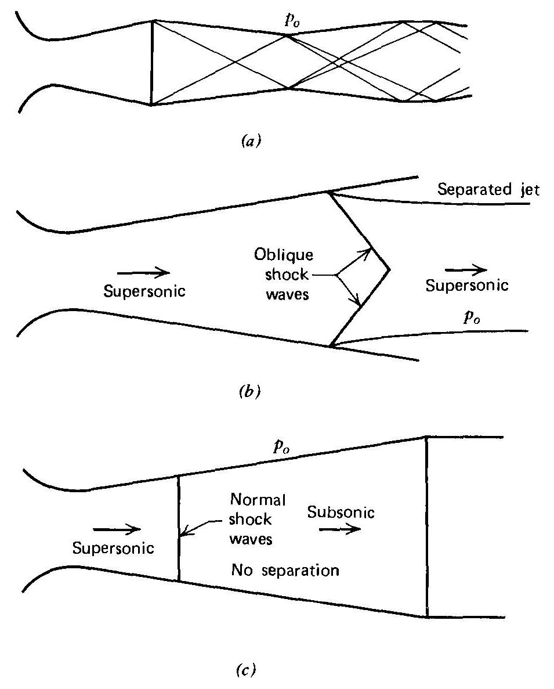
Figure 4.27. Effect of the back pressure $p_{o}$ on the jet discharged from a De Laval nozzle. (a) $p_{o}$ slightly greater than $p_{e}^{\prime}$. (b) $p_{o}$ sufficiently larger than $p_{e}^{\prime}$ to cause jet separation and oblique shock waves. (c) $p_{o}$ sufficiently larger than $p_{e}^{\prime}$ to cause strong normal shock wave in the nozzle divergence.

In summary, the one-dimensional analysis generally predicts the flow field in a converging-diverging nozzle with good accuracy. Multidimensional flow effects typically produce deviations of only a few percent from the one-dimensional flow results; this is a degree of error that is acceptable in many engineering applications. For those engineering applications that require a higher degree of accuracy, the one-dimensional approach may be inadequate for the final design, but it is quite useful for the preliminary design phase and for studying the trends resulting from making changes in the design variables and operating conditions.

## 4-8 LOSSES IN NOZZLES

The function of a nozzle in either a steam turbine or a gas turbine, or as the propulsive element of a jet propulsion engine, is to convert thermal energy into the maximum amount of jet kinetic energy corresponding to the nozzle inlet and exit operating conditions. Although it is reasonable to assume that the expansion of the fluid in a nozzle takes place adiabatically, the expansion process is never isentropic. Because of friction and turbulence, even a well-designed nozzle operates with energy losses. As a result, the jet kinetic energy developed by an actual nozzle is always smaller than that computed for an isentropic expansion between the same inlet pressure and back pressure that prevail in the operation of the actual nozzle.

The effect of friction on the operation of a nozzle may be taken into account by either of the following parameters.

1. The stagnation pressure ratio for the nozzle $P_{2} / P_{1}$.
2. The kinetic energy efficiency $\eta_{n}$, or velocity coefficient $\phi$, of the nozzle.

In general, the conditions at the inlet to the nozzle are either known or readily calculable and, in most cases, the problem is to determine the throat area required for passing a specified mass flow rate of fluid, and the flow properties in the nozzle exit plane.

## 4-8(a) Stagnation Pressure Ratio for Nonisentropic Flow in Nozzles

Because of friction, the isentropic area ratio, given by equation 4.29, must be modified if the nozzle is to pass the desired mass flow rate. The modification is made in the following manner. Between any two stations in the flow passage, denoted by the subscripts 1 and 2 , the continuity equation for perfect gases, equation 3.167 (Table 3.2) gives the following:

$$
\frac{p_{1} A_{1} M_{1}}{\sqrt{t_{1}}}=\frac{p_{2} A_{2} M_{2}}{\sqrt{t_{2}}}
$$

Hence, the actual area ratio for changing the flow from $M=M_{1}$ to $M=M_{2}$ is given by

$$
\frac{A_{2}}{A_{1}}=\frac{M_{1}}{M_{2}} \frac{p_{1}}{p_{2}}\left(\frac{t_{2}}{t_{1}}\right)^{1 / 2}
$$

Since the flow through the nozzle may be assumed to be adiabatic ( $\delta Q=0$, but $d s \neq 0$ ), $T_{1}=T_{2}=T$. Hence, from equation 4.25,

$$
\left(\frac{t_{2}}{t_{1}}\right)^{1 / 2}=\left(\frac{t_{2}}{T}\right)^{1 / 2}\left(\frac{T}{t_{1}}\right)^{1 / 2}=\left(\frac{1+\frac{\gamma-1}{2} M_{1}^{2}}{1+\frac{\gamma-1}{2} M_{2}^{2}}\right)^{1 / 2}
$$

The static pressure ratio $p_{1} / p_{2}$ may be written in the form

$$
\frac{p_{1}}{p_{2}}=\frac{p_{1}}{P_{1}} \frac{P_{2}}{p_{2}} \frac{P_{1}}{P_{2}}=\left(\frac{1+\frac{\gamma-1}{2} M_{2}^{2}}{1+\frac{\gamma-1}{2} M_{1}^{2}}\right)^{\gamma /(\gamma-1)} \quad\left(\frac{P_{1}}{P_{2}}\right)
$$

where $p_{1} / P_{1}$ and $p_{2} / P_{2}$ are obtained from equation 4.26. Substituting for $\left(t_{2} / t_{1}\right)^{1 / 2}$ and $p_{1} / p_{2}$ from equations (b) and (c) into equation (a) yields

$$
\frac{A_{2}}{A_{1}}=\frac{M_{1}}{M_{2}}\left(\frac{1+\frac{\gamma-1}{2} M_{2}^{2}}{1+\frac{\gamma-1}{2} M_{1}^{2}}\right)^{(\gamma+1) / 2(\gamma-1)}\left(\frac{P_{1}}{P_{2}}\right)
$$

From equation 4.29,

$$
\left(\frac{A^{\prime}}{A^{*}}\right)_{M}=\frac{1}{M}\left[\left(\frac{2}{\gamma+1}\right)\left(1+\frac{\gamma-1}{2} M^{2}\right)\right]^{(\gamma+1) / 2(\gamma-1)}
$$

where $\left(A^{\prime} / A^{*}\right)_{M}$ denotes the area ratio for an isentropic flow ( $s=$ constant) from the Mach number $M$ to $M=1$. Hence, equation (d) may be rewritten in the form

$$
\frac{A_{2}}{A_{1}}=\frac{P_{1}}{P_{2}}\left[\frac{\left(A^{\prime} / A^{*}\right)_{M_{2}}}{\left(A^{\prime} / A^{*}\right)_{M_{1}}}\right]=\frac{P_{1}}{P_{2}}\left(\frac{A_{2}^{\prime}}{A_{1}^{\prime}}\right)
$$

where $\left(A^{\prime} / A^{*}\right)_{M_{1}}$ and $\left(A^{\prime} / A^{*}\right)_{M_{2}}$ are the area ratios corresponding to isentropic flows from $M_{1}$ and $M_{2}$ to $M=1$, respectively, and $P_{1} / P_{2}$ is the actual ratio of the stagnation pressures at $A_{1}$ and $A_{2}$, respectively.

Equation 4.104 shows that, because of the decrease in the stagnation pressure (i.e., $P_{2}<P_{1}$ ), the area ratio of an actual nozzle must be larger than that for the corresponding isentropic nozzle.

The results derived above apply to any flow channel wherein the flow may be assumed adiabatic and one-dimensional.

In many cases, the flow may be considered isentropic up to the throat and nonisentropic thereafter. A case in point is when there is a shock wave system in the diverging portion of a De Laval nozzle. In that case, let $A_{1}=A_{t}$; then $M_{1}=M_{t}=1$, and equation 4.104 becomes

$$
\frac{A_{2}}{A_{t}}=\frac{P_{1}}{P_{2}}\left(\frac{A^{\prime}}{A^{*}}\right)_{M_{2}}
$$

To determine the effects of nonisentropicity in the flow for any actual nozzle, some experimental measurement of the flow properties in the exit plane is necessary. The easiest measurement to make is that of the static pressure $p_{2}$. Hence, it may be assumed that the ratio $p_{2} / P_{1}$ is generally known. The static pressure $p_{2}$ is related to the stagnation pressure $P_{2}$ by equation 4.26. Thus,

$$
P_{2}=p_{2}\left(1+\frac{\gamma-1}{2} M_{2}^{2}\right)^{\gamma /(\gamma-1)}
$$

Combining equations (e) and (f) yields

$$
\left(\frac{A_{2}}{A_{t}}\right)\left(\frac{p_{2}}{P_{1}}\right)=\left(\frac{p_{2}}{P_{2}}\right)\left(\frac{A^{\prime}}{A^{*}}\right)_{M_{2}}
$$

When $A_{2} / A_{t}$ and $p_{2} / P_{1}$ are known, the term $\left[\left(p_{2} / P_{2}\right)\left(A^{\prime} / A^{*}\right)_{M_{2}}\right]$ may be determined from equation 4.105. Since ( $p_{2} / P_{2}$ ) and ( $\left.A^{\prime} / A^{*}\right)_{M_{2}}$ are both functions of $M_{2}$ alone,
$M_{2}$ may be determined. To simplify such calculations, the function $\left[(p / P)\left(A / A^{*}\right)\right]$ for isentropic flow is tabulated in Table C.6, as a function of $M$, for several values of the specific heat ratio $\gamma$.
Example 4.8. Air flows through a frictionless converging-diverging nozzle. The area of the exit section $A_{e}$ is three times the area of the throat section $A_{t}$, and the ratio of the stagnation pressure at the entrance to the static pressure in the exit section $P_{1} / p_{2}=2.5$. Assume that air is a perfect gas with a constant specific heat ratio $\gamma=1.4$, and that the only loss is that due to a normal shock wave formed in the diverging portion of the nozzle. Calculate (a) the Mach number at the nozzle exit, and (b) the entropy increase.

## Solution

(a) From equation 4.105,

$$
\left(\frac{p_{2}}{P_{2}}\right)\left(\frac{A^{\prime}}{A^{*}}\right)_{M_{2}}=\left(\frac{A_{2}}{A_{t}}\right)\left(\frac{p_{2}}{P_{1}}\right)=\frac{3.0}{2.5}=1.20
$$

From Table C.6, for $\left[(p / P)\left(A / A^{*}\right)\right]=1.20, M_{2}=0.472$.
(b) From equation 3.179, Table 3.2, since $T_{1}=T_{2}$

$$
\Delta s=-R \ln \left(\frac{P_{2}}{P_{1}}\right)
$$

From Table C.6, for $M_{2}=0.472, p_{2} / P_{2}=0.85849$. Thus,

$$
\frac{P_{2}}{P_{1}}=\frac{P_{2}}{p_{2}} \frac{p_{2}}{P_{1}}=\frac{1}{(0.85849)(2.5)}=0.4659
$$

Hence,

$$
\Delta s=-287.04 \ln (0.4659)=219.2 \mathrm{~J} / \mathrm{kg}-\mathrm{K}(0.05236 \mathrm{Btu} / \mathrm{lbm}-\mathrm{R})
$$

## 4-8(b) Velocity Coefficient and Kinetic Energy Efficiency

Let $V_{e}$ denote the actual velocity of the gases crossing the exit area $A_{e}$ of a convergingdiverging nozzle, and $V_{e}^{\prime}$ the corresponding isentropic velocity. By definition, the velocity coefficient for the nozzle, denoted by $\phi$, is given by

$$
\phi \equiv \frac{V_{e}}{V_{e}^{\prime}}=\left(\frac{H-h_{e}}{H-h_{e}^{\prime}}\right)^{1 / 2}
$$

The kinetic energy efficiency for the nozzle, denoted by $\eta_{n}$, is defined by

$$
\eta_{n} \equiv \frac{V_{e}^{2} / 2}{\left(V_{e}^{\prime}\right)^{2} / 2}=\frac{H-h_{e}}{H-h_{e}^{\prime}}=\phi^{2}
$$

The characteristics of a nonisentropic nozzle flow process are developed in the following discussion in terms of the kinetic energy efficiency $\eta_{n}$.

Figure 4.28 illustrates schematically the thermodynamic model for the nonisentropic expansion process on the Mollier diagram (hs plane). A nonisentropic and a reference isentropic process are plotted in the figure. The expansions occur between the stagnation pressure $P$ and the static pressure $p_{e}$. For an adiabatic process, which is assumed here, the stagnation enthalpy $H$ remains constant. The energy equations for the adiabatic and the isentropic processes are

$$
H=h_{e}^{\prime}+\frac{\left(V_{e}^{\prime}\right)^{2}}{2}=h_{e}+\frac{V_{e}^{2}}{2}=\text { constant }
$$

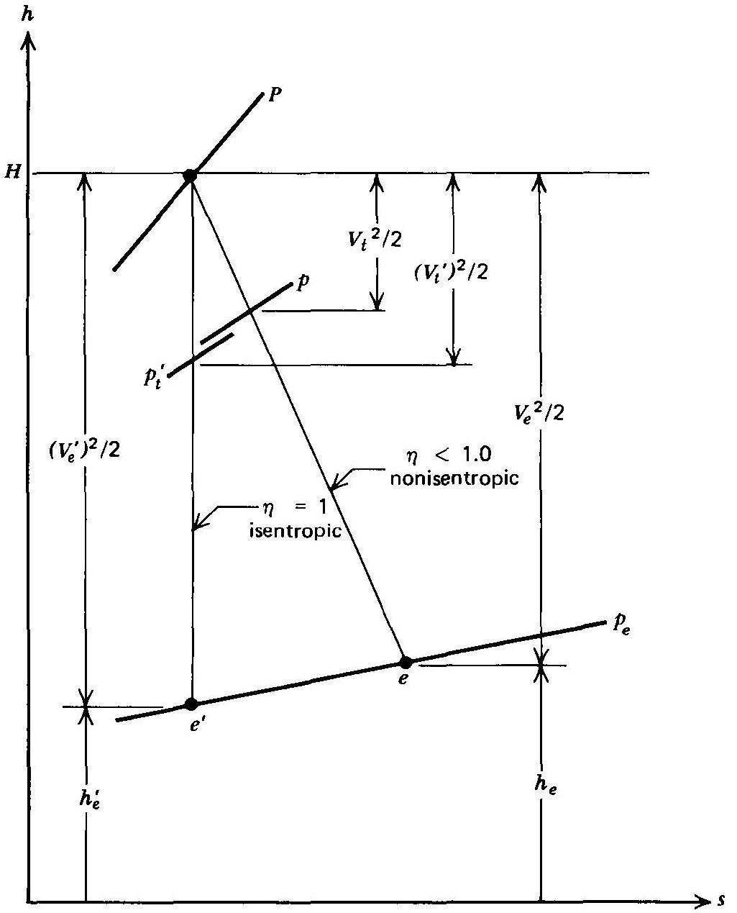
Figure 4.28. Mollier diagram for a nonisentropic expansion process.

The nonisentropic flow velocity $V_{e}$ is related to the isentropic flow velocity $V_{e}^{\prime}$ by the kinetic energy efficiency $\eta_{n}$ (defined by equation 4.107). The effects of the nonisentropicity on the flow are accounted for by $\eta_{n}$. It reduces the kinetic energy attainable by a compressible fluid that is expanded between given pressure levels. In practice, the value for $\eta_{n}$ is usually estimated from experience with similar flow passages; its value usually ranges from 0.930 to 0.996 . The kinetic energy efficiency may be related to the expansion ratio $r=p_{e} / P$ and the Mach number $M_{e}$ for a nonisentropic flow. Thus, from equation 4.107,

$$
\eta_{n}=\frac{V_{e}^{2} / 2}{\left(H-h_{e}^{\prime}\right)}=\frac{V_{e}^{2} / 2}{c_{p} T\left(1-t_{e}^{\prime} / T\right)}=\frac{\left(\frac{\gamma-1}{2}\right) V_{e}^{2}}{\gamma R T\left(1-t_{e}^{\prime} / T\right)}
$$

where, for a perfect gas, $h_{e}^{\prime}=c_{p} t_{e}^{\prime}, H=c_{p} T$, and $c_{p}=\gamma R /(\gamma-1)$. From equation 3.186, we obtain

$$
\gamma R T=a_{o}^{2}=a_{e}^{2}\left(1+\frac{\gamma-1}{2} M_{e}^{2}\right)
$$

Substituting equation (c) into equation (b) yields

$$
\eta_{n}=\frac{\left(\frac{\gamma-1}{2}\right) M_{e}^{2}}{\left(1+\frac{\gamma-1}{2} M_{e}^{2}\right)\left(1-t_{e}^{\prime} / T\right)}
$$

Expressing the temperature ratio $t_{e}^{\prime} / T$ in terms of the expansion ratio $r=p_{e} / P$, we obtain

$$
\frac{t_{e}^{\prime}}{T}=\left(\frac{p_{e}}{P}\right)^{(\gamma-1) / \gamma}=r^{(\gamma-1) / \gamma}
$$

Substituting equation (e) into equation (d) and solving for the expansion ratio $r$ yields

$$
r=\frac{p_{e}}{P}=\left[1-\frac{\left(\frac{\gamma-1}{2}\right) M_{e}^{2}}{\eta_{n}\left(1+\frac{\gamma-1}{2} M_{e}^{2}\right)}\right]^{\gamma /(\gamma-1)}
$$

Equation 4.25, when solved for the nonisentropic temperature ratio, yields

$$
\frac{T}{t_{e}}=1+\frac{\gamma-1}{2} M_{e}^{2}
$$

The Mach number at the throat $M_{t}$ and the mass flow rate for the nozzle $\dot{m}$ may be determined from the continuity equation (note that the symbol $t$ denotes the minimum area, which is not the sonic condition for a nonisentropic flow). From equations 4.1, 4.21, and 4.25, we obtain

$$
\dot{m}=\rho A V=\frac{p A V}{R t}=P A M\left(\frac{\gamma}{R T}\right)^{1 / 2}\left(1+\frac{\gamma-1}{2} M^{2}\right)^{1 / 2}\left(\frac{p}{P}\right)
$$

The flow in the nozzle is assumed to be choked. Hence, the throat conditions are determined by differentiating $\dot{m} / A$ with respect to $M$ and setting the result equal to zero. We obtain the following expression for $M_{t}$, the Mach number in the minimum area.

$$
M_{t}^{4}\left(\eta_{n}-1\right)+M_{t}^{2}\left[3 \eta_{n}-\left(\frac{3 \gamma-1}{\gamma-1}\right)\right](\gamma-1)^{-1}+2 \eta_{n}(\gamma-1)^{-2}=0
$$

Equation 4.110 is a simple quadratic equation for $M_{t}{ }^{2}$, which may be solved numerically. Figure 4.29 presents curves of $M_{t}$ as a function of $\eta_{n}$, for several constant values of $\gamma$. The curves show that $M_{t}$ decreases as $\eta_{n}$ decreases and is always less than unity for $\eta_{n}<1 . M_{t}$ decreases with increasing values of $\gamma$.

The effect of the nonisentropicity in the flow process on the mass flow rate may be expressed in terms of the mass flow efficiency factor $C_{\eta}$, which is defined by

$$
C_{\eta} \equiv \frac{\dot{m}_{\left(\eta_{n}<1\right)}}{\dot{m}_{\left(\eta_{n}=1\right)}}
$$

The isentropic mass flow rate $\dot{m}_{\left(\eta_{n}=1\right)}=\dot{m}^{*}$ is given by equation 4.38.

$$
\dot{m}_{\left(\eta_{n}=1\right)}=\dot{m}^{*}=\frac{\Gamma A_{t} P}{(\gamma R T)^{1 / 2}}
$$

At the minimum area $A_{t}$, the mass flow rate $\dot{m}_{\left(\eta_{n}\right)}$ may be determined from equation (f). Thus,

$$
\dot{m}_{\left(\eta_{n}\right)}=\frac{\gamma P A_{t} M_{t} r_{t}}{(\gamma R T)^{1 / 2}}\left(1+\frac{\gamma-1}{2} M_{t}^{2}\right)
$$

Substituting equations 4.38 and (h) into equation (g) gives

$$
C_{\eta}=\gamma \Gamma^{-1} M_{t} r_{t}\left(1+\frac{\gamma-1}{2} M_{t}^{2}\right)^{1 / 2}
$$

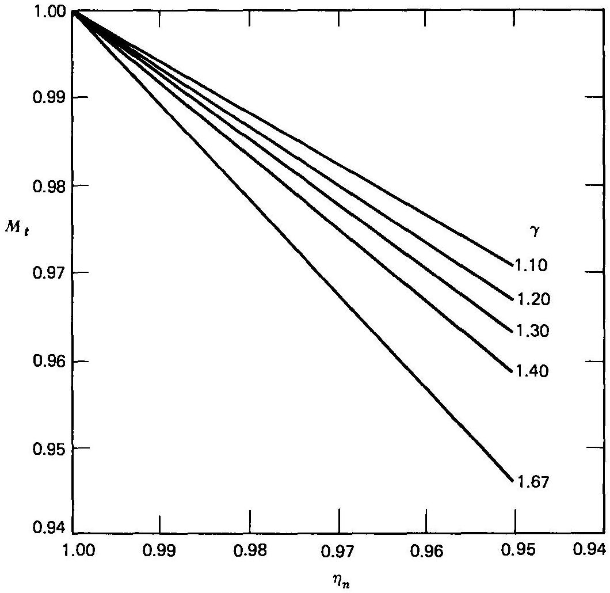
Figure 4.29. Mach number at the nozzle throat in nonisentropic flow (taken from Reference 9).

All of the terms in equation 4.111 are functions of $M_{t}$, which may be calculated from equation 4.110. Hence, $C_{\eta}$ is a function only of $y$ and $\eta_{\eta}$. Figure 4.30 presents $C_{\eta}$ as a function of $\eta_{n}$ for several values of $y$. The curves show that $C_{\eta}$ decreases with decreasing $\eta_{n}$ and increasing $\gamma$, and is equal to unity only when $\eta_{n}=1$.

The geometrical area ratio $\varepsilon=A_{e} / A_{t}$ for a De Laval nozzle may be related to the flow properties by applying the continuity equation [equation (f)] at the areas $A_{t}$

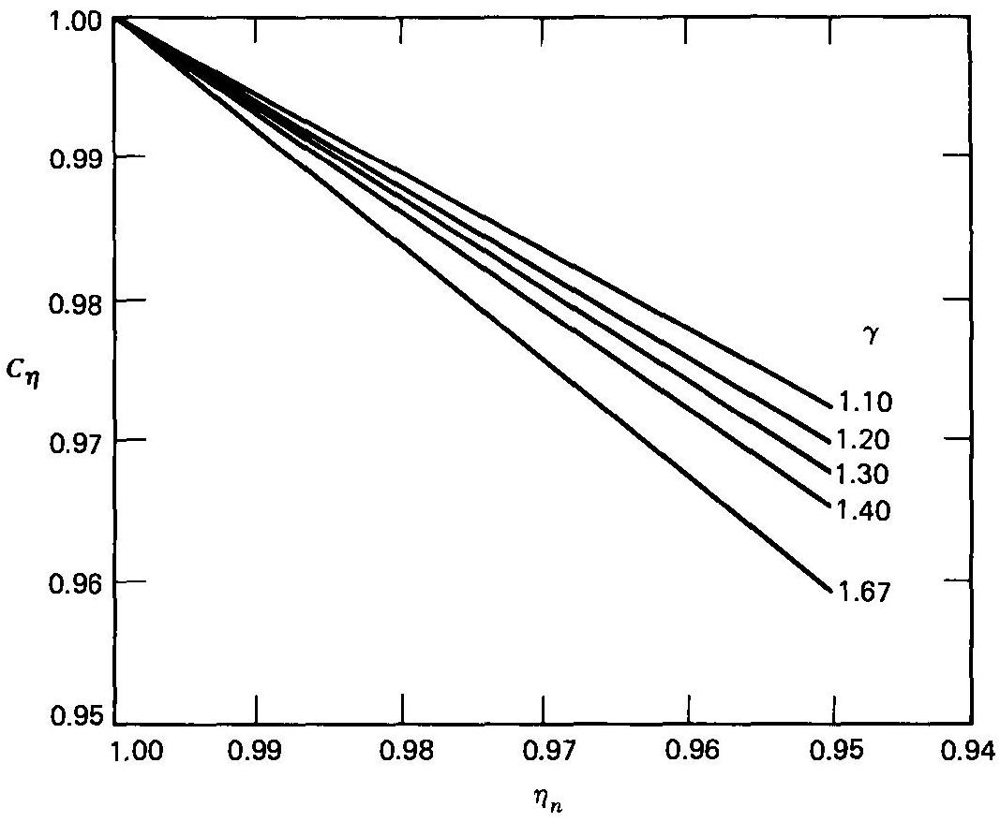
Figure 4.30. Mass flow efficiency factor $c_{\eta}$ for nonisentropic flow (taken from Reference 9).

and $A_{e}$, and solving for $\varepsilon$. Thus,

$$
\varepsilon=\frac{A_{e}}{A_{t}}=\frac{C_{\eta} \Gamma}{\gamma M r\left(1+\frac{\gamma-1}{2} M^{2}\right)^{1 / 2}}
$$

All of the terms in equation 4.112 are expressible in terms of either $M$ or $r$, and $M$ is related to $r$ by equation 4.108. An explicit relationship exists, therefore, between the area ratio $\varepsilon$ and the expansion ratio $r$, with $y$ and $\eta_{n}$ as parameters. Figure 4.31 presents $\Delta \varepsilon$, in percent, as a function of the expansion ratio $r=p / P$, with $\eta_{n}$ as a

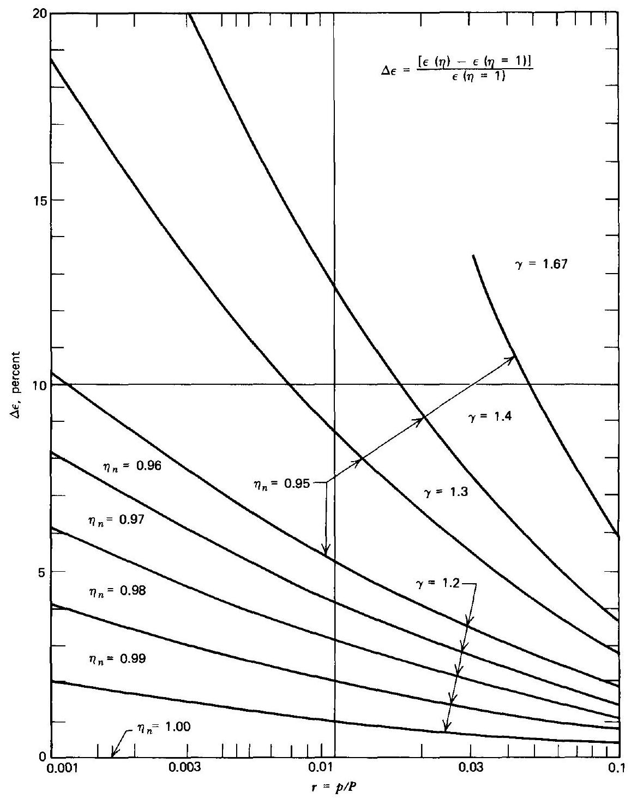
Figure 4.31. Area ratio increase for nonisentropic expansion (taken from Reference 9).

parameter, for different values of $\gamma$. The ordinate $\Delta \varepsilon$ is the required percentage increase in the area ratio from the corresponding isentropic area ratio $\varepsilon$, for expanding a nonisentropic flow to a given expansion ratio. The curves show that $\Delta \varepsilon$ increases with increasing $\gamma$ and decreasing $\eta_{n}$, and is most significant at the small expansion ratios.

Example 4.9. Air flows in a converging-diverging nozzle having a kinetic energy efficiency $\eta_{n}=0.95$. At the nozzle inlet, the stagnation pressure $P=7.0 \cdot 10^{5} \mathrm{~N} / \mathrm{m}^{2}$ and the stagnation temperature $T=500 \mathrm{~K}$. Calculate (a) the throat Mach number, (b) the throat pressure, (c) the throat temperature, (d) the throat density, (e) the throat velocity, (f) the nozzle mass flow rate per unit area, and (g) the corresponding isentropic flow values for comparison.

## Solution

(a) From equation 4.110,
$M_{t}{ }^{4}(0.95-1)+M_{t}{ }^{2}\left\{3(0.95)-\frac{[3(1.4)-1]}{(1.4-1)}\right\}(1.4-1)^{-1}+2(0.95)(1.4-1)^{-2}=0$
Solving the above expression for $M_{t}$ yields $M_{t}=0.95867$.
(b) From equation 4.108,

$$
\begin{aligned}
\frac{p_{t}}{P} & =\left\{1-\frac{(0.2)(0.95867)^{2}}{(0.95)\left[1+0.2(0.95867)^{2}\right]}\right\}^{3.5}=0.5355 \\
p_{t} & =(0.5355)(7.0) 10^{5}=3.749 \cdot 10^{5} \mathrm{~N} / \mathrm{m}^{2}\left(54.37 \mathrm{lbf} / \mathrm{in}^{2}\right)
\end{aligned}
$$

(c) From equation 4.109,

$$
\begin{aligned}
\frac{t_{t}}{T} & =\frac{1}{\left[1.0+(0.2)(0.9586)^{2}\right]}=0.8447 \\
t_{t} & =(0.8447)(500)=422.4 \mathrm{~K}(760.2 \mathrm{R})
\end{aligned}
$$

(d) $\rho_{t}=\frac{p_{t}}{R t_{t}}=\frac{(3.749) 10^{5}}{(287.04)(422.4)}=3.092 \mathrm{~kg} / \mathrm{m}^{3}\left(0.1931 \mathrm{lbm} / \mathrm{ft}^{3}\right)$
(e) $a_{t}=\left(\gamma R t_{t}\right)^{1 / 2}=[1.4(287.04)(422.4)]^{1 / 2}=412.0 \mathrm{~m} / \mathrm{s}$

$$
V_{t}=M_{t} a_{t}=(0.9586)(412.0)=394.9 \mathrm{~m} / \mathrm{s}(1295.7 \mathrm{ft} / \mathrm{sec})
$$

(f) $\frac{\dot{m}}{A_{t}}=\rho_{t} V_{t}=(3.092)(394.9)=1221 \mathrm{~kg} / \mathrm{s}-\mathrm{m}^{2}\left(250.2 \mathrm{lbm} / \mathrm{sec}-\mathrm{ft}^{2}\right)$
(g) For isentropic flow, $M_{t}=1.0$. From Table C.6, $t^{*} / T=0.83333$ and $p^{*} / P=$ 0.52828. Thus,

$$
\begin{aligned}
p^{*} & =(0.52828)(7.0) 10^{5}=3.698 \cdot 10^{5} \mathrm{~N} / \mathrm{m}^{2}\left(53.63 \mathrm{lbf} / \mathrm{in} .^{2}\right) \\
t^{*} & =(0.83333)(500)=416.7 \mathrm{~K}(750.0 \mathrm{R}) \\
\rho^{*} & =\frac{p^{*}}{R t^{*}}=\frac{(3.698) 10^{5}}{(287.04)(416.7)}=3.092 \mathrm{~kg} / \mathrm{m}^{3}\left(0.1931 \mathrm{lbm} / \mathrm{ft}^{3}\right) \\
V_{t} & =a^{*}=\left(\gamma R t^{*}\right)^{1 / 2}=[1.4(287.04)(416.7)]^{1 / 2}=409.2 \mathrm{~m} / \mathrm{s}(1342.5 \mathrm{ft} / \mathrm{sec}) \\
\frac{\dot{m}^{*}}{A_{t}} & =\rho^{*} a^{*}=(3.092)(409.2)=1265 \mathrm{~kg} / \mathrm{s}-\mathrm{m}^{2}\left(259.3 \mathrm{lbm} / \mathrm{sec}^{-} \mathrm{ft}^{2}\right)
\end{aligned}
$$

The following table presents a comparison of the flow properties for nonisentropic flow with those for the corresponding isentropic flow.

| Property | Isentropic | Nonisentropic | Change, Percent |
| :--- | :--- | :--- | :--- |
| $M_{t}$ | 1.0000 | 0.9586 | -4.32 |
| $p_{t}, 10^{5} \mathrm{~N} / \mathrm{m}^{2}$ | 3.698 | 3.749 | 1.36 |
| $t_{t}, \mathrm{~K}$ | 416.7 | 422.4 | 1.35 |
| $\rho_{t}, \mathrm{~kg} / \mathrm{m}^{3}$ | 3.092 | 3.092 | 0.00 |
| $V_{t}, \mathrm{~m} / \mathrm{s}$ | 409.2 | 394.9 | -3.62 |
| $\frac{\dot{m}}{A_{t}}, \mathrm{~kg} / \mathrm{s}-\mathrm{m}^{2}$ | 1265 | 1221 | -3.60 |

As a check, from Fig. 4.30, $C_{\eta}=0.965$. Thus,

$$
\frac{\dot{m}}{A_{t}}=C_{\eta}\left(\frac{\dot{m^{*}}}{A_{t}}\right)_{\mathrm{isen}}=(0.965)(1265)=1221 \mathrm{~kg} / \mathrm{s}-\mathrm{m}^{2}
$$

## 4-8(c) Nozzle Discharge Coefficient

The nozzle discharge coefficient $C_{D}$ is defined by equation 4.90, repeated below.

$$
\dot{m} \equiv C_{D} \dot{m}_{1-D}^{\prime}
$$

The following are the most important factors that reduce the actual mass flow rate below the isentropic value.

1. Nonisentropic flow effects.
2. Three-dimensional flow effects.
3. The blockage of the flow area caused by the boundary layer displacement thickness (see Section 5-10).

Item 1 is accounted for by $C_{\eta}$, the mass flow efficiency factor defined in Section 4-8(b). Item 2 is accounted for by a geometrical contraction factor $C_{c}$, defined by

$$
\dot{m}_{3-D}^{\prime}=C_{c} \dot{m}_{1-D}^{\prime}
$$

The factor $C_{c}$ is determined by calculating the isentropic three-dimensional mass flow rate through the nozzle throat $A_{t}$ by an appropriate method (see Section 15-5), and then dividing that result by the corresponding isentropic one-dimensional mass flow rate. Consequently, $C_{c}$ is a measure solely of the deviations from a onedimensional flow.

By definition, the boundary layer displacement thickness $\delta^{*}$ is the distance normal to the nozzle wall through which, in an inviscid calculation, there is effectively no mass flow rate of fluid because of the slow moving viscous fluid in the boundary layer adjacent to the wall (see Section 5-10). The net effect of the viscous boundary layer is to "block off" an annulus of the geometrical flow area of the throat. The amount of the blockage may be determined by analyzing the boundary layer. The "blockage effect" may be expressed by

$$
C_{b \ell}=\frac{A_{t}-\left(A \text { blocked by } \delta^{*}\right)}{A_{t}}
$$

Multiplying the three aforementioned factors together yields the nozzle discharge coefficient $C_{D}$. Thus,

$$
C_{D}=C_{\eta} C_{c} C_{b t}
$$

In general, the magnitude of the discharge coefficient $C_{D}$ is determined experimentally. The procedure discussed above, however, permits a detailed study of the role of the individual effects for an actual flow process.

## 4-9 SOURCE AND SINK FLOWS

The concept of one-dimensional flow is a useful approximation to many real flows. All real flows, however, generally violate the one-dimensional flow assumption unless the streamlines are straight and parallel. In the special case where the streamlines are straight but either diverge from or converge toward a unique source or sink point, the flow may be considered as behaving like a one-dimensional flow.

Figure 4.32 illustrates schematically the source and sink flow models in a converging-diverging nozzle. Point $A$ denotes the source (point) from which all of the streamlines in the diverging portion of the nozzle are assumed to originate, and point $B$ denotes the sink (point) into which all of the streamlines in the converging portion of the nozzle are assumed to terminate. The flow properties are assumed to be constant on each spherical surface having either a source or sink point as its center of curvature. Accordingly, the one-dimensional approximation may be applied to the flow surfaces of the source and sink.

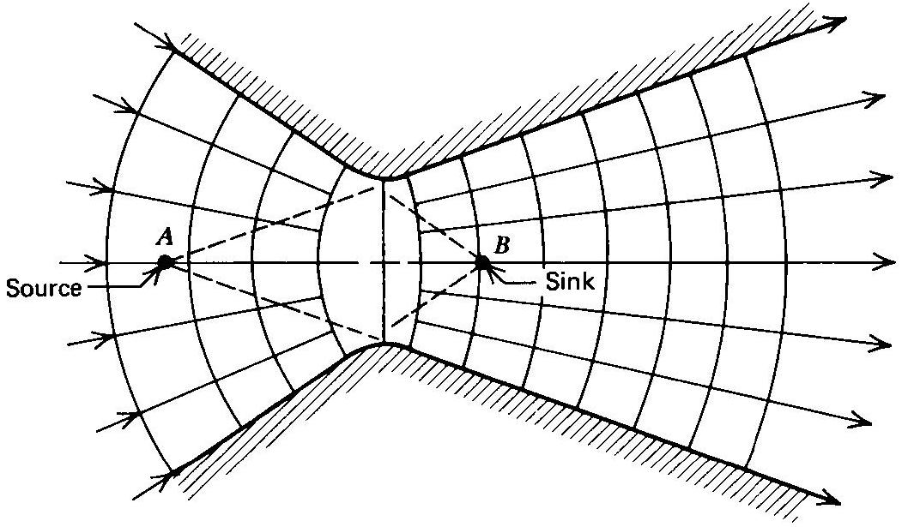
Figure 4.32. Source and sink flows in a converging-diverging conical nozzle.

The flow model described above has the obvious advantage that the streamlines are parallel to the solid boundaries; that is, at the passage walls. However, the model is inadequate in the throat region, and has no physical meaning as either the source or the sink point is approached. Consequently, the source or sink flow model must be restricted to regions of a flow passage where the streamlines are fairly straight and either diverge, or converge, uniformly toward a point. Those conditions are met to some extent in the convergence and divergence of a conical De Laval nozzle. When either the inlet contraction ratio, or the exit expansion ratio, is large, the streamlines have sufficient time to adjust themselves to the geometry of the sink and source flow. When the area ratios are small, however, the source and sink flow models may be no better, and possibly even less accurate, than the planar onedimensional flow model.

An extension of the source and sink flow concept discussed above is the concept of a distributed source or sink flow; that is, a flow in which the source and sink points move in such a manner that the velocity remains tangent to the wall, as the wall angle varies. Figure 4.33 illustrates the concept of a distributed sink model applied to a converging nozzle; the model reduces to the planar one-dimensional model when the wall has zero slope. The outer streamline remains parallel to the wall at all points. In many flow passages, especially when estimates of the multidimensional flow effects are required, the concept of the distributed source and sink flow is a useful one. Care must always be exercised, however, when interpreting the results obtained for a quasi-multidimensional flow solution to a truly multidimensional flow field.

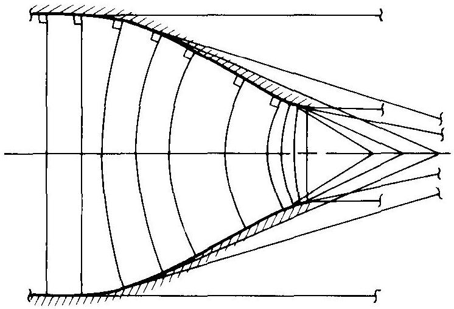
Figure 4.33. Distributed sink flow in a converging nozzle.

The mass flow rate in a source or sink flow must be specified before the onedimensional flow equations can be applied for obtaining the flow properties on the flow surfaces for the source or sink flow. If the nozzle is choked, it may be assumed that it passes the critical mass flow rate; the latter mass flow rate may be calculated by either the one-dimensional flow methods presented in Section 4-7, or by the multidimensional transonic flow methods discussed in Section 15-5. Once the mass flow rate has been established, the one-dimensional flow methods developed in this chapter may be employed for relating the areas of the source and sink flow surfaces to the flow properties on those surfaces.

The spherical flow area $A_{s}$ of a source or sink flow will now be related to the planar flow area $A_{p}$ and the wall angle $\alpha$ at each point in the flow passage. Figure 4.34 presents the pertinent geometric parameters; $\alpha$ denotes the angle of the wall, $R$ the distance to the source, $A_{p}$ the planar flow area, and $A_{s}$ the corresponding spherical flow area.

The area of the spherical surface $A_{s}$ is given by

$$
A_{s}=\int d A_{s}=\int_{0}^{\alpha} 2 \pi y R d \theta=2 \pi R^{2} \int_{0}^{\alpha} \sin \theta d \theta
$$

where $y=R \sin \theta$. Integrating the above equation gives

$$
4_{A_{n}}=-2_{z i} R_{N}^{2} \cos _{\alpha} \alpha_{10}^{\alpha}=2_{z} R_{N}^{2}(1,-20020)
$$

The area $A_{p}$ of the planar surface is

$$
A_{p}=\pi y_{w}^{2}=\pi R^{2} \sin ^{2} \alpha
$$

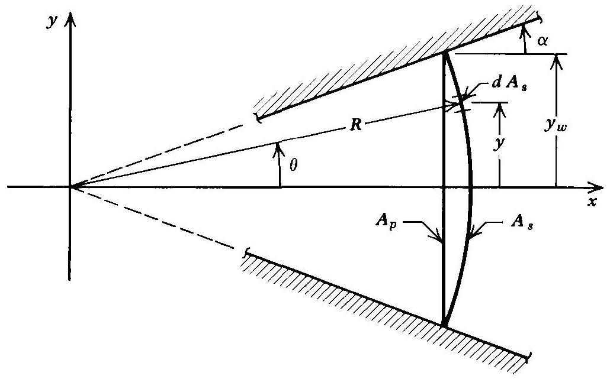
Figure 4.34. Relationship between planar flow area $A_{p}$, wall angle $\alpha$, and spherical flow area $A_{s}$.

The area ratio $A_{p} / A_{s}$ is

$$
\frac{A_{p}}{A_{s}}=\frac{\pi R^{2} \sin ^{2} \alpha}{2 \pi R^{2}(1-\cos \alpha)}=\frac{1-\cos ^{2} \alpha}{2(1-\cos \alpha)}=\frac{1+\cos \alpha}{2}
$$

Equation 4.113 relates $A_{p}, \alpha$, and $A_{s}$. If the wall shape $y=y(x)$ is specified, the spherical flow area $A_{s}$ may be determined from equation 4.113.

Example 4.10. A rocket engine is equipped with a conical propulsive nozzle that has a 15 deg half-angle and a throat radius $y_{t}=0.025 \mathrm{~m}$. The throat has a circular arc radius of curvature $\rho_{t}=0.0125 \mathrm{~m}$. The nozzle length $x_{e}=0.25 \mathrm{~m}$. Figure 4.35 illustrates the geometry. The working fluid is a perfect gas for which $\gamma=1.20$ and $R=320.0 \mathrm{~J} / \mathrm{kg}-\mathrm{K}$. The stagnation temperature $T=3000 \mathrm{~K}$ and the stagnation pressure $P=70.0 \cdot 10^{5} \mathrm{~N} / \mathrm{m}^{2}$. Calculate the flow properties at the exit section of the nozzle, based on (a) planar one-dimensional flow, and (b) source flow.

## Solution

Assume that in both cases the nozzle passes the critical mass flow rate $\dot{m}^{*}$ corresponding to the planar throat area $A_{t}$. Hence, in both cases, $A^{*}=A_{t}=\pi y_{t}{ }^{2}$. The

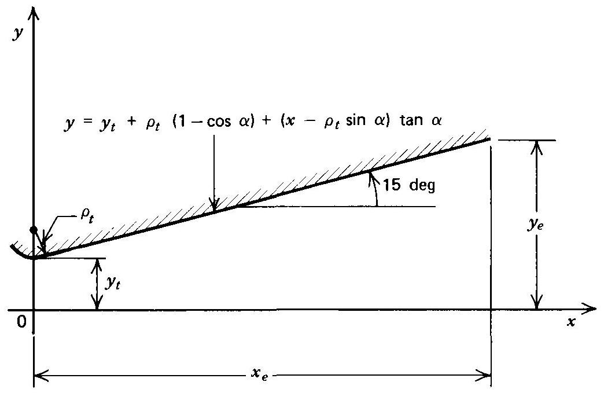
Figure 4.35. Nozzle contour for Example 4.10.

equation specifying the contour of the conical portion of the nozzle wall as a function of the nozzle length $x$ (see Fig. 4.35) is

$$
y=y_{t}+\rho_{t}(1-\cos \alpha)+\left(x-\rho_{t} \sin \alpha\right) \tan \alpha
$$

Thus, when $x_{e}=0.25 \mathrm{~m}$,
$y_{e}=0.025+(0.0125)[1-\cos (15)]+[0.25-(0.0125) \sin (15)] \tan (15)=0.091546 \mathrm{~m}$
(a) The planar area ratio $\varepsilon_{p}$ is given by

$$
\varepsilon_{p}=\frac{A_{p}}{A_{t}}=\frac{\pi y_{e}^{2}}{\pi y_{t}^{2}}=\frac{(0.091546)^{2}}{(0.025)^{2}}=13.40907
$$

The exit Mach number $M_{e p}$ based on the planar area ratio $\varepsilon_{p}$ may be determined from tables such as Table C.6, if available. In the absence of such tables, $M_{e p}$ may be determined by solving equation 4.29 by an iterative method, such as the NewtonRaphson method [see Appendix A 4(a) and Example A.3]. The result for $\gamma=1.20$ and $\varepsilon_{p}=13.40907$ is $M_{e p}=3.48216$. From equation 4.25,

$$
\begin{aligned}
\frac{T}{t_{e p}} & =1+\frac{\gamma-1}{2} M_{e p}^{2}=1+(0.1)(3.48216)^{2}=2.21254 \\
t_{e p} & =\frac{3000.0}{2.21254}=1355.91 \mathrm{~K} \\
a_{e p} & =\left(\gamma R t_{e p}\right)^{1 / 2}=[1.2(320.0)(1355.91)]^{1 / 2}=721.57 \mathrm{~m} / \mathrm{s} \\
V_{e p} & =M_{e p} a_{e p}=(3.48216)(721.57)=2512.62 \mathrm{~m} / \mathrm{s}
\end{aligned}
$$

From equation 4.26,

$$
\begin{aligned}
\frac{P}{p_{e p}} & =\left(1+\frac{\gamma-1}{2} M_{e p}^{2}\right)^{\gamma /(\gamma-1)}=\left(\frac{T}{t_{e p}}\right)^{\gamma /(\gamma-1)}=(2.21254)^{6.0}=117.313 \\
p_{e p} & =\frac{70.0 \cdot 10^{5}}{117.313}=59,669 \mathrm{~N} / \mathrm{m}^{2} \\
\rho_{e p} & =\frac{p_{e p}}{R t_{e p}}=\frac{59,669}{320.0(1355.91)}=0.137521 \mathrm{~kg} / \mathrm{m}^{3}
\end{aligned}
$$

(b) The spherical area ratio $\varepsilon_{s}$ is given by equation 4.113.

$$
\varepsilon_{s}=\frac{A_{s}}{A_{t}}=\frac{A_{s}}{A_{p}} \frac{A_{p}}{A_{t}}=\frac{2 \varepsilon_{p}}{(1+\cos \alpha)}=\frac{2(13.40907)}{[1+\cos (15)]}=13.64148
$$

$M_{e s}$ may also be determined by solving equation 4.29 by the Newton-Raphson method. For $\gamma=1.20$ and $\varepsilon_{s}=13.64148, M_{e s}=3.49406$. From equation 4.25,

$$
\begin{aligned}
\frac{T}{t_{e s}} & =1+0.1(3.49406)^{2}=2.22085 \\
t_{e s} & =\frac{3000.0}{2.22085}=1350.83 \mathrm{~K} \\
a_{e s} & =[1.2(320.0)(1350.83)]^{1 / 2}=720.22 \mathrm{~m} / \mathrm{s} \\
V_{e s} & =3.49406(720.22)=2516.49 \mathrm{~m} / \mathrm{s}
\end{aligned}
$$

$$
\begin{aligned}
\frac{P}{p_{e s}} & =(2.22085)^{6.0}=119.982 \\
p_{e s} & =\frac{70.0 \cdot 10^{5}}{119.982}=58,342 \mathrm{~N} / \mathrm{m}^{2} \\
\rho_{e s} & =\frac{58,342}{320.0(1350.83)}=0.134968 \mathrm{~kg} / \mathrm{m}^{3}
\end{aligned}
$$

## -4-10 JET PROPULSION ENGINES ${ }^{12-14}$

Experience has shown that all methods for propelling a body in a fluid medium are based on the reaction principle first formulated by Sir Isaac Newton (1642-1727). The reaction principle (see Section 1-13) states that to every action there is an equal and opposite reaction. Examples of the reaction principle are quite familiar. ${ }^{12}$ Thus, the screw propelling a ship, the propeller for moving an airplane, and jet propulsion are applications of the same basic principle. In these examples, the application of the reaction principle involves increasing the momentum of a mass of fluid in such a manner that the reaction to the time rate of increase in the momentum of the fluid produces a force, called the thrust, acting in the direction of motion for the body [see Section 2-6(b)]. The thrust is the result of increasing the fluid momentum in the direction opposite to that desired for the body.

The available means for propelling a body in a fluid medium differ only in the methods and mechanisms utilized for increasing the flow of momentum (momentum $f l u x)$ associated with the working fluid. For example, the conventional airplane propeller increases the momentum flux of the atmospheric air passing through the propeller disk circle, and the thrust it develops is equal to the increase in the momentum flux of the air moved by the propeller.

Jet propulsion differs from propeller propulsion in that it achieves the increase in the momentum flux of the working fluid by ejecting it as a high-speed jet from within the propelled body; in all of the other methods the working fluid passes around the propelled body. There is no restriction, at least in the abstract, on the character of the fluid jet ejected from within the jet-propelled body. It can be water, steam, heated air, the gases produced by chemical reactions, charged particles, and their combinations. The selection of the most appropriate fluid and the means for creating the high-speed jet is dictated by the requirements of the propulsion problem.

Although the jet propulsion principle may be applied with any type of fluid jet, there are limitations imposed on the choice of a suitable fluid when it is to be applied to the propulsion of bodies in the atmosphere. Experience indicates that two types of fluids are particularly suitable for that purpose.

1. There is the jet consisting of heated compressed atmospheric air, admixed with the products of the combustion produced by burning a chemical fuel in that air, the thermochemical energy of the fuel being utilized for increasing the temperature of the air to the desired value. Jet propulsion engines utilizing atmospheric air will be called air-breathing engines.
2. Another class of jet propulsion engines employs a jet of gases produced by the chemical reaction of a fuel and oxidizer, each of which is carried in the propelled body. No atmospheric air is used in forming the jet. The equipment wherein the chemical reaction takes place, including the exhaust nozzle, is called a rocket
motor. The complete apparatus, including the means for forcing the chemicals into the rocket motor, is called a rocket engine.

It is seen that chemical jet propulsion engines, to which the discussions are limited, may, therefore, be grouped into two broad classes: (1) air-breathing engines, which utilize or consume air from the atmosphere, and (2) rocket engines, which do not utilize atmospheric air.

From a general point of view all chemical jet propulsion engines comprise two main subassemblies: (1) a means or apparatus for generating high-pressure, hightemperature gas, called the hot gas generator, and (2) an exhaust nozzle, which is the propulsive element, for expanding the gas furnished it by the hot gas generator and for discharging the expanded gas to the surrounding atmosphere. The propulsive nozzle may be either of the converging or converging-diverging type, depending on the mission for the engine.

## 4-10(a) Air-Breathing Engines

Examples of air-breathing engines are the turbojet, turbofan, ramjet, and pulsejet engines. Zucrow ${ }^{12,13}$ discusses the general characteristics of each of those engines. In their operation, all of them induct air from the free stream through an inlet, burn fuel in it, thus increasing the stagnation enthalpy of the working fluid, and expel the heated air through a propulsive nozzle. The turbojet and turbofan engines also increase the stagnation pressure of the air by passing it through a compressor, which is driven by a gas turbine. The internal reaction force between the fluid and the solid boundaries of the engine is called the net thrust, and it is that force that propels the engine and the vehicle to which it is attached.
Every air-breathing engine has its own characteristic features. Engines operating at supersonic velocities have shock waves in the inlet. Turbofan engines bypass a portion of the inducted air around the combustion chamber. Turboprop engines deliver the bulk of their power to a propeller, and only a small part of their thrust is developed by jet propulsion. The model illustrated in Fig. 4.36 is intended to account for only the basic common features of air-breathing engines. In propulsion practice, more accurate flow models are employed for representing the specific engines.

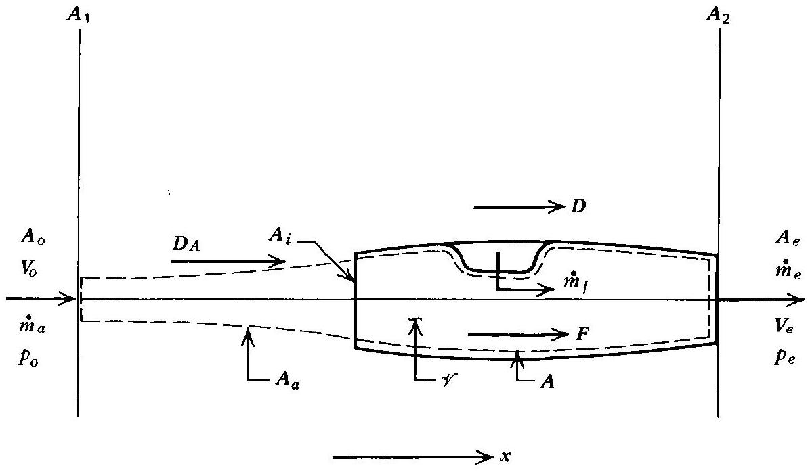
Figure 4.36. Determination of the thrust developed by an air-breathing jet propulsion engine.

For determining the net thrust developed by the air-breathing engine illustrated in Fig. 4.36, it is convenient to employ a relative system of coordinates, which assumes that the propulsion system is at rest, and the fluid flows toward it with a velocity $V_{o}$ relative to the propulsion system; that is, $V_{o}$ is equal to the velocity of the propulsion system in the actual case.

Since the interest is in the thrust $F$ developed in the direction of flight, the longitudinal axis of the engine is made coincident with the $x$ direction. Only the $x$ component of the rate of change in the momentum for the fluid momentarily within the control surface is pertinent to the problem at hand. Since the positioning of the control surface is arbitrary, it is convenient, therefore, to arrange it so that only the $x$ components of the momentum fluxes need be considered. The latter objective is accomplished by placing the propulsion system between the two planes $A_{1}$ and $A_{2}$, each of which is perpendicular to the streamlines and extends to infinity. All of the momentum changes in the $x$ direction then occur across and perpendicular to the planes $A_{1}$ and $A_{2}$.

For convenience, the plane $A_{1}$ is located far enough upstream from the propulsion system so that the static pressure $p_{o}$ acting on $A_{1}$ has the same value as it had before the propulsion system was introduced between $A_{1}$ and $A_{2}$. Plane $A_{2}$ is located at the nozzle exit plane.

To develop an equation for the net thrust $F$ created by the fluid flowing through the propulsion system, called the internal flow, it is convenient to choose the control volume $\mathscr{V}$ so that it includes only the fluid that passes through the engine, assumed here to be a single stream of fluid. Changes in the pressure and momentum of the external flow have no effect on the internal flow, but produce the external drag $D$.

When the free-stream capture area $A_{o}$ differs from the inlet area $A_{i}$, the free-stream streamlines curve as illustrated in the figure. The pressure forces acting along the curved portion $A_{a}$ of the control surface create an additional force component in the axial direction; that component is termed the additive drag and denoted by $D_{a}$.

$$
D_{a}=-\int_{A_{a}} p \mathbf{i} \cdot d \mathbf{A}
$$

The total force exerted by the internal surfaces of the engine on the fluid flowing through the engine is denoted by $F$. The reaction to that force is the force exerted by the fluid on the engine; that is, the net thrust.

Equation 2.56 may be employed for determining the surface forces acting on a control volume. Assuming steady flow and neglecting body forces, equation 2.56 becomes

$$
\mathbf{F}_{\mathrm{surface}}=\int_{A} \mathbf{V}(\rho \mathbf{V} \cdot d \mathbf{A})
$$

Equation (b), when applied to the configuration illustrated in Fig. 4.36, yields

$$
F+p_{o} A_{o}+D_{a}-p_{e} A_{e}=\dot{m}_{e} V_{e}-\dot{m}_{a} V_{o}
$$

Solving equation (c) for the internal reaction force $F$ gives

$$
F=\dot{m}_{e} V_{e}-\dot{m}_{a} V_{o}-D_{a}+p_{e} A_{e}-p_{o} A_{o}
$$

The net thrust is equal to $-F$. It is conventional, however, to neglect the negative sign, so that positive values are obtained for the net thrust even though it always acts in the direction opposite to the flow of the propulsive fluid through the engine.

Equation 4.114 is the desired equation for the net thrust of an air-breathing jet propulsion engine. It is common practice to assume that the engine operates in an ambient environment having the pressure $p_{o}$. All pressures in equation 4.114 are,
therefore, measured above $p_{o}$; the drag forces $D$ and $D_{a}$ are evaluated in an appropriate manner. In that case, equation 4.114 becomes

$$
F=\dot{m}_{e} V_{e}-\dot{m}_{a} V_{o}-D_{a}^{\prime}+\left(p_{e}-p_{o}\right) A_{e}
$$

In equation 4.115

$$
\begin{aligned}
\dot{m}_{e} V_{e} & =\text { the jet thrust }(\text { also called the gross thrust }) \\
\dot{m}_{a} V_{o} & =\text { the ram drag } \\
\left(p_{e}-p_{o}\right) A_{e} & =\text { the pressure thrust } \\
D_{a}^{\prime} & =\text { the additive drag }=-\int_{A_{a}}\left(p-p_{o}\right) \mathbf{i} \cdot d \mathbf{A}
\end{aligned}
$$

The sum of the jet thrust and the pressure thrust is the total thrust developed by the propulsive nozzle. Consequently, equation 4.115 may be written as

$$
F=F_{\text {nozzle }}-\dot{m}_{a} V_{o}-D_{a}^{\prime}
$$

where

$$
F_{\mathrm{nozzle}}=\dot{m}_{e} V_{e}+\left(p_{e}-p_{o}\right) A_{e}
$$

Air-breathing engines induct air at the rate $\dot{m}_{a}$ and burn fuel at the rate $\dot{m}_{f}$. Thus,

$$
\dot{m}_{e}=\dot{m}_{a}+\dot{m}_{f}
$$

For a simple turbojet burning a hydrocarbon fuel, $\dot{m}_{f}$ is generally between 2 to 5 percent of $\dot{m}_{a}$.

The thrust developed by a unit mass flow rate of air through an air-breathing propulsion system is termed either the air specific impulse, denoted by $I_{a}$, or the specific thrust. Hence,

$$
I_{a} \equiv \frac{F}{\dot{m}_{a}}
$$

Another performance parameter in general use is the thrust specific fuel consumption, denoted by TSFC, and defined as

$$
T S F C \equiv \frac{\dot{m}_{f}}{F}
$$

To determine $F, I_{a}$, and $T S F C, V_{e}$ and $p_{e}$ must be known. Those properties of the exhaust jet may be determined by applying the isentropic flow analysis developed in this chapter to the flow through the nozzle.

A propulsive nozzle develops its maximum thrust when the area ratio $\varepsilon=A_{e} / A_{t}$ is designed to yield optimum, or complete, expansion (i.e., $p_{e}=p_{o}$ ). Hence, at that design point, the pressure thrust is zero. Even at off-design conditions, the pressure thrust is only a small fraction of the net thrust. In many applications, the additive drag $D_{a}^{\prime}$ is also a small fraction of the net thrust. Also $\dot{m}_{a} \approx \dot{m}_{e}$, since $\dot{m}_{f}$ is only a few percent of $\dot{m}_{a}$. Consequently, equation 4.115 may be expressed as

$$
F \approx \dot{m}_{a}\left(V_{e}-V_{o}\right)
$$

Equation 4.122 shows that the net thrust $F$ is the difference between the jet thrust (which is the nozzle thrust) and the ram drag, both of which may be several times larger than the net thrust itself. Consequently, a change in the jet thrust is magnified several times in its effect on the net thrust, showing that great care must be exercised in the design of the propulsive nozzle.

Example 4.11. An airplane is propelled at a constant speed of $268.2 \mathrm{~m} / \mathrm{s}$ at $10,668 \mathrm{~m}$ altitude by a turbojet engine. The mass flow rate of air through the engine is 45.36 $\mathrm{kg} / \mathrm{s}$, and the fuel flow rate is $0.907 \mathrm{~kg} / \mathrm{s}$. The exhaust jet has a velocity of $609.6 \mathrm{~m} / \mathrm{s}$, and the static pressure in the nozzle exit plane is equal to that of the surrounding atmosphere. Assume that the additive drag is negligible. Calculate (a) the ram drag, (b) the jet thrust, (c) the net thrust, (d) the air specific impulse, and (e) the thrust specific fuel consumption.

## Solution

(a) From equation 4.116b,

$$
\dot{m}_{a} V_{o}=45.36(268.2)=12,166 \mathrm{~N}
$$

(b) From equation 4.116a,

$$
\dot{m}_{e} V_{e}=(45.36+0.91)(609.6)=28,206 \mathrm{~N}
$$

(c) From equation 4.115,

$$
F=\dot{m}_{e} V_{e}-\dot{m}_{a} V_{o}=28,206-12,166=16,040 \mathrm{~N}
$$

(d) From equation 4.120,

$$
I_{a}=\frac{F}{\dot{m}_{a}}=\frac{16,040}{45.36}=353.62 \mathrm{~N}-\mathrm{s} / \mathrm{kg}
$$

(e) From equation 4.121,

$$
T S F C=\frac{\dot{m}_{f}}{F}=\frac{(0.907)(3600)}{16,040}=0.2036 \mathrm{~kg} / \mathrm{hr}-\mathrm{N}
$$

## 4-10(b) Rocket Engines ${ }^{12-14}$

Rocket engines differ from air-breathing engines in that no air is inducted into the engine, and all of the mass ejected through the propulsive nozzle is carried within the rocket propelled vehicle. The basic features of a rocket engine are illustrated in Fig. 4.37. Rocket engines are broadly classified by the type of propellants burned. The major classes are liquid propellant engines, solid propellant engines, and hybrid rocket engines. Also included are nuclear rocket engines and electric arc jet engines. In a broader sense, electric propulsion engines are also rocket engines (i.e., the plasma jet and the ion engine).

To determine the thrust developed by the rocket engine illustrated in Fig. 4.37, assume that the engine is restrained from moving by the external force $F$. The thrust acting on the rocket engine is then equal to $-F$. Choose a control surface that

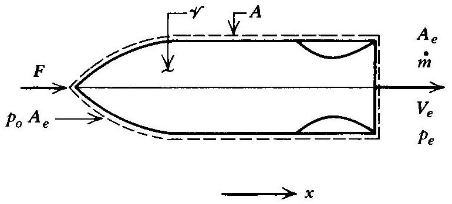
Figure 4.37. Determination of the thrust developed by a rocket jet propulsion engine.

completely encloses the rocket engine. Equation 2.56, when applied to the control volume illustrated in Fig. 4.37, yields

$$
F+p_{o} A_{e}-p_{e} A_{e}=\dot{m} V_{e}
$$

where $\dot{m}$ denotes the rate at which propellants are consumed. Solving equation (a) for the external restraining force $F$ gives

$$
F=\dot{m} V_{e}+\left(p_{e}-p_{o}\right) A_{e}
$$

The rocket engine thrust is then $-F$. As mentioned earlier, it is conventional to neglect the negative sign so that the thrust of the rocket engine always has a positive value, which is given by equation 4.122. In equation 4.122, $\dot{m} V_{e}$ is the jet thrust and $\left(p_{e}-p_{o}\right) A_{e}$ is the pressure thrust. The thrust developed by consuming a unit mass of the propellants in unit time is termed the specific impulse, denoted by $I_{s p}$. Thus,

$$
I_{s p} \equiv \frac{F}{\dot{m}}
$$

For a maximum thrust nozzle [see Section 4-10(e)], the pressure thrust is equal to zero. In that case, equation 4.122 becomes

$$
F=\dot{m} V_{e}
$$

To determine $F$ and $I_{s p}$, the terms $V_{e}$ and $p_{e}$ must be known.
Example 4.12. A liquid propellant rocket engine consumes liquid hydrogen and liquid oxygen as its propellants. The nozzle throat area is $0.09290 \mathrm{~m}^{2}$, and the nozzle area ratio is 20 . The propellant mass flow rate is $362.9 \mathrm{~kg} / \mathrm{s}$, the pressure in the nozzle exit plane is $p_{e}=0.4827 \cdot 10^{5} \mathrm{~N} / \mathrm{m}^{2}$, and the jet exit velocity is $3048 \mathrm{~m} / \mathrm{s}$. Calculate (a) the thrust developed by the rocket engine at sea level, (b) the thrust developed at an altitude of $30,000 \mathrm{~m}$, and (c) the specific impulse at both altitudes.

## Solution

The nozzle exit area is

$$
A_{e}=\varepsilon A_{t}=20(0.09290)=1.8580 \mathrm{~m}^{2}
$$

(a) At sea level, $p_{o}=1.0133 \cdot 10^{5} \mathrm{~N} / \mathrm{m}^{2}$. From equation 4.122,

$$
\begin{aligned}
F_{\text {sea level }} & =\dot{m} V_{e}+\left(p_{e}-p_{o}\right) A_{e} \\
& =362.9(3048)+(0.4827-1.0133)(1.8580) 10^{5}=1,007,500 \mathrm{~N}
\end{aligned}
$$

At sea level, the pressure thrust is negative due to overexpansion of the gases. Since $p_{e} / p_{o}=0.4827 / 1.0133=0.476$, the flow would probably not separate from the nozzle wall [see Section 4-7(e)].
(b) From Table C.5, at $30,000 \mathrm{~m}$ altitude, $p_{o}=1970 \mathrm{~N} / \mathrm{m}^{2}$. Since the flow inside of the nozzle is unaffected by a change in altitude, the jet thrust is the same as in part (a); only the pressure thrust changes. Thus,

$$
F_{30.000}=362.9(3048)+(0.4827-0.0197)(1.8580) 10^{5}=1,192,100 \mathrm{~N}
$$

Note that the pressure thrust is positive in this case, since the flow is underexpanded.
(c) From equation 4.123,

$$
\begin{aligned}
& I_{s p, \text { sea level }}=\frac{F_{\text {sea level }}}{\mathrm{m}}=\frac{1,007,500}{362.9}=2776 \mathrm{~N}-\mathrm{s} / \mathrm{kg}(283.1 \mathrm{lbf}-\mathrm{sec} / \mathrm{lbm}) \\
& I_{s p, 30.000}=\frac{1,192,100}{362.9}=3285 \mathrm{~N}-\mathrm{s} / \mathrm{kg}(335.4 \mathrm{lbf}-\mathrm{sec} / \mathrm{lbm})
\end{aligned}
$$

## 4-10(c) Performance of Propulsive Nozzles

It is shown in Sections 4-10(a) and 4-10(b) that the thrust-producing component of a jet propulsion engine is the exhaust nozzle. The net thrust developed by a propulsive nozzle depends on the mass flow rate of fluid through the nozzle, the exit jet velocity, the exit static pressure, the exit area, and the ambient pressure. Figure 4.38 illustrates schematically the essential features of a propulsive nozzle. Figure 4.38a applies to a converging nozzle, which is employed in low-pressure ratio applications typical of many air-breathing engines, and Fig. 4.38b applies to a converging-diverging nozzle, which is employed in high-pressure ratio applications that are typical of rocket engines. The characteristic behaviors of converging and converging-diverging nozzles are discussed in Sections 4-6 and 4-7, respectively.

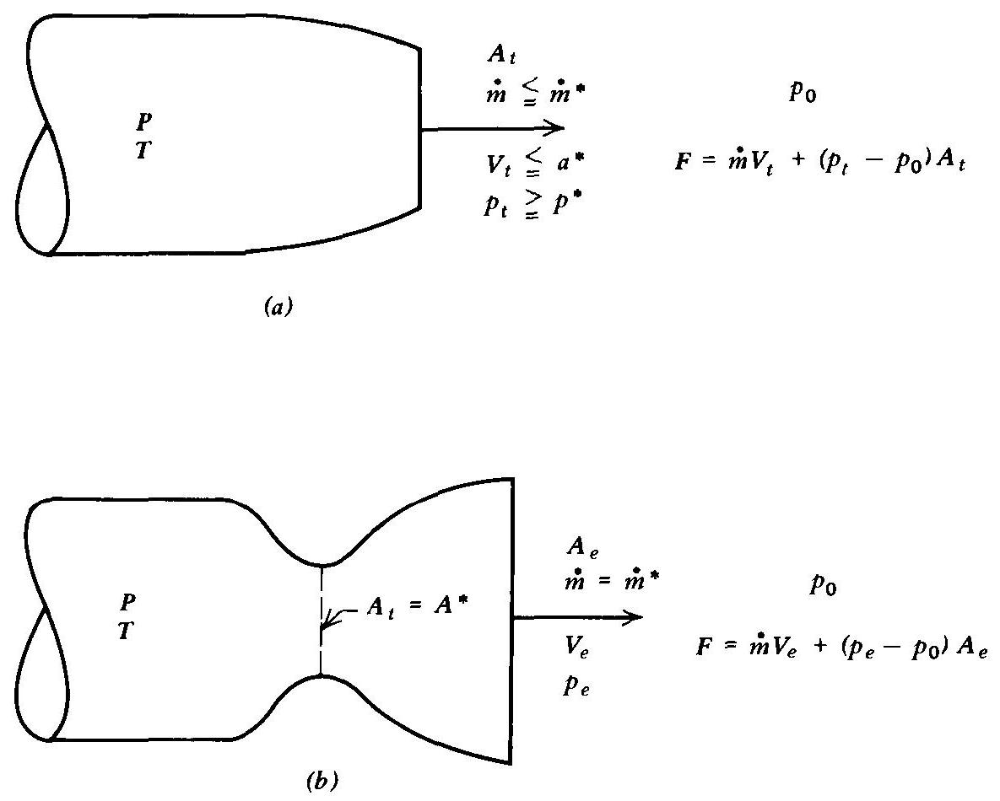
Figure 4.38. Essential features of propulsive nozzles. (a) Converging propulsive nozzle. (b) Converging-diverging propulsive nozzle.

Two performance criteria are commonly employed for correlating the performance of propulsive nozzles, for both air-breathing and rocket engines. They are the specific impulse (see equation 4.123)
$p_{e}-p_{o} /^{A_{e}}$

$$
\cdots \tilde{r}_{s p}=\frac{{ }^{E}}{\dot{m}}=v_{e}+\frac{}{\dot{m}}
$$

and the thrust coefficient, which is defined by

$$
C_{F} \equiv \frac{F}{P A_{t}}=\frac{\dot{m} V_{e}}{P A_{t}}+\left(\frac{p_{e}}{P}-\frac{p_{o}}{P}\right) \frac{A_{e}}{A_{t}}
$$

It is desirable to express $C_{F}$ for a converging-diverging nozzle in terms of $V_{e}^{\prime}$ and $\dot{m}^{*}$, because that type of nozzle is designed for operation with choked flow. Substituting from equations 4.101 and 4.93 , respectively, into equation 4.126 a, yields

$$
C_{F}=\frac{\psi^{*} P A_{t}}{a_{o} P A_{t}} a_{o}\left\{\frac{2}{\gamma-1}\left[1-r_{e}^{(\gamma-1) / \gamma}\right]\right\}^{1 / 2}+\left(r_{e}-r_{o}\right) \varepsilon_{e}
$$

where $r_{e}=p_{e} / P, r_{o}=p_{o} / P$, and $\varepsilon_{e}=A_{e} / A_{t}$. Substituting for $\psi^{*}$ from equation 4.77 into equation 4.126 b and simplifying yields

$$
C_{F}=\gamma\left\{\frac{2}{\gamma-1}\left(\frac{2}{\gamma+1}\right)^{(\gamma+1) /(\gamma-1)}\left[1-r_{e}^{(\gamma-1) / \gamma}\right]\right\}^{1 / 2}+\left(r_{e}-r_{o}\right) \varepsilon_{e}
$$

For a given gas, the expansion ratio $r_{e}$ depends only on the area ratio $\varepsilon_{e}$. Hence, the nozzle thrust coefficient depends only on the specific heat ratio $\gamma$, the pressure ratio $r_{o}$, and the area ratio $\varepsilon_{e}$.

Figure 4.39 presents $C_{F}$ as a function of $\varepsilon_{e}$ for gases with $\gamma=1.2$. It is evident from equation 4.126 c that the maximum thrust for a given area ratio occurs when $p_{o}=0$. It is also apparent that, for a given value of $r_{o}$, there is a unique area ratio $\varepsilon_{e}$ that yields the maximum thrust. The locus of the values of $\varepsilon_{e}$ for maximum thrust is indicated in Fig. 4.39. In Section 4-10(e), it is shown that the maximum thrust is achieved when $\varepsilon_{e}$ is chosen so that $p_{e}=p_{o}$ (i.e., when the pressure thrust is zero). Figure 4.39 also shows that the thrust curves are quite flat in the vicinity of the thrust maxima, so that some variation in the area ratio is possible without decreasing the thrust significantly. By selecting the area ratio so that it is slightly smaller than the optimum area ratio, the size and weight of the nozzle may be reduced with no substantial reduction in the thrust. If the area ratio exceeds the optimum area ratio, the exit pressure $p_{e}$ becomes lower than the back pressure $p_{o}$, so that flow separation eventually occurs in the divergence, and equation 4.126c is no longer valid. In Fig. 4.39, an approximate region of separation is illustrated schematically, between the limits where $p_{e}=0.4 p_{o}$ and $p_{e}=0.2 p_{o}$. The exact separation point, as well as the thrust developed after separation occurs, can be determined only by experiment.

The thrust coefficient $C_{F}$ may be expressed in terms of the exit Mach number $M_{e}$, by substituting for $r_{e}$ and $\varepsilon_{e}$ from equations 4.26 and 4.29 , respectively, into equation 4.126c. Thus

$$
C_{F}=(\gamma+1)\left(\frac{2}{\gamma+1}\right)^{\gamma /(\gamma-1)}\left\{\frac{\left(1+\gamma M_{e}^{2}\right)}{M_{e}\left[2(\gamma+1)\left(1+\frac{\gamma-1}{2} M_{e}^{2}\right)\right]^{1 / 2}}\right\}-r_{o} \varepsilon_{e}
$$

Comparing equation 4.126 d with equation 4.32, which defines the impulse function ratio $\mathscr{F} / \mathscr{F}^{*}$, it is seen that

$$
C_{F}=(\gamma+1)\left(\frac{2}{\gamma+1}\right)^{\gamma /(\gamma-1)}\left(\frac{\mathscr{F}}{\mathscr{F}^{*}}\right)-r_{o} \varepsilon_{e}
$$

Values of $\mathscr{F} / \mathscr{F}^{*}$ are presented in Table C.6, and values of $(\gamma+1)[2 /(\gamma+1)]^{\gamma /(\gamma-1)}$ are tabulated in Table C.15.

Several correction factors are employed for correcting the calculated values of the performance parameters for a converging-diverging propulsive nozzle, based on assuming one-dimensional isentropic flow, for the effects of multidimensional flow, nonisentropic flow, and deviations of the flowing fluid from perfect gas behavior. The principal correction factors in current use are:

$$
\begin{aligned}
C_{D} & =\frac{\dot{m}}{\dot{m}_{1-D, \text { isentropic }}} \\
\eta_{I} & =\frac{I_{s p}}{I_{s p, 1-D, \text { isentropic }}} \\
\eta_{F} & =\frac{F}{F_{1-D, \text { isentropic }}}
\end{aligned}
$$

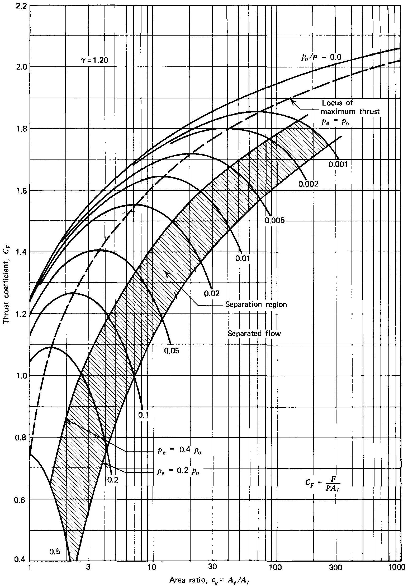
Figure 4.39. Thrust coefficient as a function of area ratio.

Substituting for $I_{s p}=F / \dot{m}$ from equations 4.127c and 4.127a, respectively, into equation 4.127 b, yields

$$
\eta_{F}=C_{D} \eta_{I}
$$

Equation 4.127 d is the relationship between the three correction factors. For example, a decrease in the mass flow rate because of multidimensional flow effects reduces the nozzle thrust directly. If the flow remains isentropic, however, the specific impulse is almost unaffected by a slight decrease in the mass flow rate. Accordingly, $\eta_{I}$ is essentially constant, so that $C_{D}$ and $\eta_{F}$ vary almost in direct proportion to each other. Even when nonisentropic flow effects cause $\eta_{I}$ to become a variable, $C_{D}, \eta_{I}$, and $\eta_{F}$ are related by equation 4.127 d .

## 4-10(d) Thrust Reduction Caused by Flow Divergence in Propulsive Nozzles

Figure 4.40 illustrates schematically a major cause of thrust reduction in a propulsive nozzle: the decrease in the axial momentum of the exhaust jet because of the radial divergence of the streamlines at the nozzle exit. The decrease in thrust, often termed thrust loss, is a multidimensional flow effect that is present whether or not the flow is isentropic. In an actual nozzle, the magnitudes of $V_{e}$ and $p_{e}$ vary over the exit plane, causing other multidimensional flow effects in addition to divergence of the velocity $V_{e}$. Section 16-4(a) presents a method for taking into account the effect of the multidimensional flow.

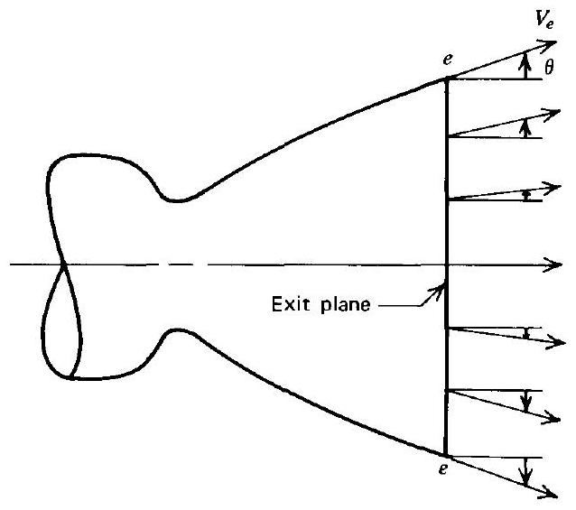
Figure 4.40. Divergence of the velocity vector at the exit plane of a propulsive nozzle.

A reasonably accurate estimate of the thrust loss because of flow divergence in a conical nozzle is obtained by assuming that the flow in the divergence is a source flow (see Section 4-9). Figure 4.41 illustrates schematically the source flow model for determining the aforementioned thrust loss for a conical nozzle. Section 4-9 discusses the method for determining the mass flow rate, exit surface velocity $V_{s}$, and exit surface pressure $p_{s}$ for a source flow.

The axial thrust developed on the differential area $d A_{s}$ is

$$
d F=d \dot{m} V_{s} \cos \theta+\left(p_{s}-p_{o}\right) d A_{s} \cos \theta
$$

Substituting $d \dot{m}=\rho_{s} V_{s} d A_{s}$ and $d A_{s}=2 \pi R^{2} \sin \theta d \theta$ [see equation (a), Section 4-9]

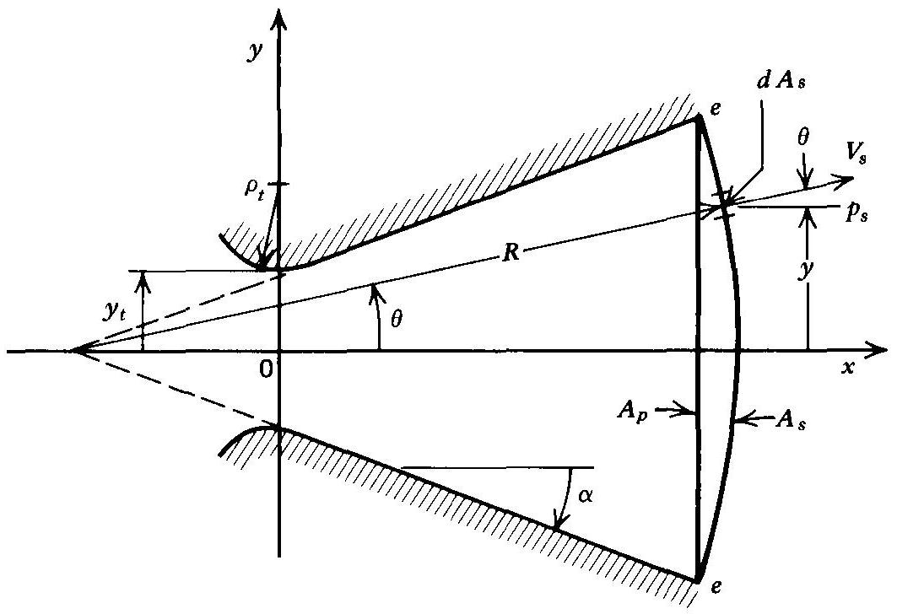
Figure 4.41. Model for the determination of the divergence loss in a conical nozzle.

into equation (a) and integrating yields

$$
F=2 \pi R^{2} \int_{0}^{\alpha}\left[\rho_{s} V_{s}^{2}+\left(p_{s}-p_{o}\right)\right] \cos \theta \sin \theta d \theta
$$

Since $\rho_{s}, V_{s}$, and $p_{s}$ are constant on the spherical surface $A_{s}$, equation (b) may be integrated; the result is

$$
F=\left.2 \pi R^{2}\left[\rho_{s} V_{s}^{2}+\left(p_{s}-p_{o}\right)\right] \frac{1}{2} \sin ^{2} \theta\right|_{0} ^{\alpha}=\pi R^{2} \sin ^{2} \alpha\left[\rho_{s} V_{s}^{2}+\left(p_{s}-p_{o}\right)\right]
$$

The area of the spherical surface is given by equation (b) in Section 4-9. Substituting that expression into equation 4.128a and simplifying yields

$$
F=\left(\frac{1+\cos \alpha}{2}\right) A_{s}\left[\rho_{s} V_{s}^{2}+\left(p_{s}-p_{o}\right)\right]
$$

Since $\dot{m}=\rho_{s} A_{s} V_{s}$, the term in brackets may be written as

$$
F_{s}=\dot{m} V_{s}+\left(p_{s}-p_{o}\right) A_{s}
$$

where $F_{s}$ is the one-dimensional thrust based on the source flow model. The divergence factor, denoted by $\lambda$, is defined by

$$
\lambda \equiv \frac{1+\cos \alpha}{2}
$$

In terms of $\lambda$ and $F_{s}$, equation 4.128b becomes

$$
F=\lambda F_{s}
$$

Hence, the divergence factor $\lambda$ corrects the one-dimensional source flow thrust $F_{s}$ to account for the loss caused by the radial divergence of the streamlines. Figure 4.42 presents the divergence factor $\lambda$ as a function of the cone angle $\alpha$. It is apparent that the divergence factor decreases rapidly, and hence the so-called thrust divergence loss increases rapidly, as the cone angle exceeds 15 deg .

Example 4.13. Calculate the thrust $F$, thrust efficiency $\eta_{F}$, and specific impulse efficiency $\eta_{I}$ of the conical nozzle described in Example 4.10, assuming (a) planar flow and (b) source flow. The ambient pressure is $p_{o}=0.0$.

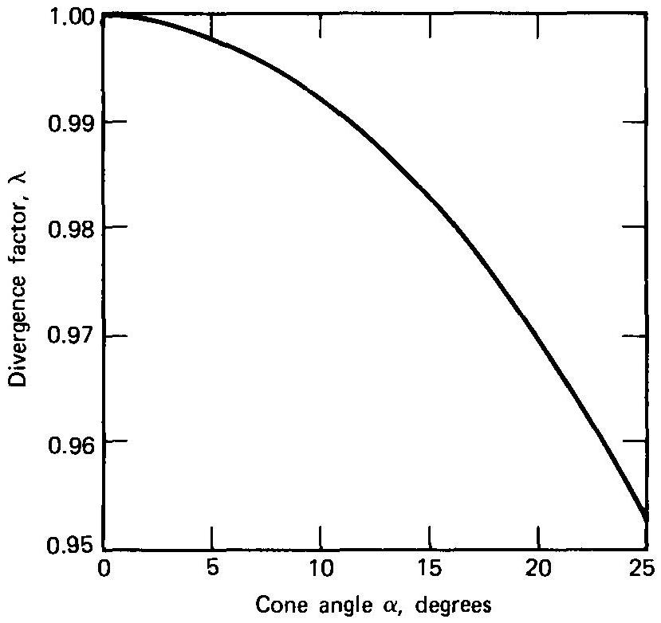
Figure 4.42. Divergence factor $\lambda$ for conical nozzles as a function of nozzle cone angle $\alpha$.

## Solution

The mass flow rate in the nozzle is the critical mass flow rate $\dot{m}^{*}$ corresponding to the planar throat area $A_{t}$. From Table C.6, for $M=1, t^{*} / T=0.90909$ and $p^{*} / P=$ 0.56447 . Thus,

$$
\begin{aligned}
t^{*} & =(0.90909)(3000.0)=2727.27 \mathrm{~K} \\
p^{*} & =(0.56447)(70.0) 10^{5}=39.5129 \cdot 10^{5} \mathrm{~N} / \mathrm{m}^{2} \\
\rho^{*} & =\frac{p^{*}}{R t^{*}}=\frac{(39.5129) 10^{5}}{320.0(2727.27)}=4.52752 \mathrm{~kg} / \mathrm{m}^{3} \\
a^{*} & =\left(\gamma R t^{*}\right)^{1 / 2}=[1.2(320.0)(2727.27)]^{1 / 2}=1023.36 \mathrm{~m} / \mathrm{s}
\end{aligned}
$$

The area $A_{t}$ of the planar throat of the nozzle is

$$
\begin{aligned}
A_{t} & =\pi y_{t}^{2}=\pi(0.025)^{2}=0.00196350 \mathrm{~m}^{2} \\
\dot{m}^{*} & =\rho^{*} A_{t} a^{*}=(4.52752)(0.00196350)(1023.36)=9.09745 \mathrm{~kg} / \mathrm{s}
\end{aligned}
$$

From Example 4.10,

$$
\begin{array}{cl}
\varepsilon_{p}=13.40907 & \varepsilon_{s}=13.64148 \\
V_{e p}=2512.62 \mathrm{~m} / \mathrm{s} & V_{e s}=2516.49 \mathrm{~m} / \mathrm{s} \\
p_{e p}=59,669 \mathrm{~N} / \mathrm{m}^{2} & p_{e s}=58,342 \mathrm{~N} / \mathrm{m}^{2} \\
A_{p}=\varepsilon_{p} A_{t}=13.40907(0.00196350)=0.026329 \mathrm{~m}^{2} \\
A_{s}=\varepsilon_{s} A_{t}=13.64148(0.00196350)=0.026785 \mathrm{~m}^{2}
\end{array}
$$

(a) From equation 4.122, for planar flow,

$$
F=\dot{m} V_{e p}+\left(p_{e p}-p_{o}\right) A_{p}=(9.09745)(2512.62)+(59,669)(0.026329)=24,429 \mathrm{~N}
$$

From equation 4.123,

$$
I_{s p}=\frac{F}{\dot{m}}=\frac{24,429}{9.09745}=2685.3 \mathrm{~N}-\mathrm{s} / \mathrm{kg}
$$

By definition, $\eta_{F}=\eta_{I}=1.0$ for planar isentropic flow.
(b) From equation 4.129, for source flow,

$$
F_{s}=\dot{m} V_{e s}+\left(p_{e s}-p_{o}\right) A_{s}=(9.09745)(2516.49)+(58,342)(0.026785)=24,456 \mathrm{~N}
$$

From equation 4.130,

$$
\lambda=\frac{1+\cos \alpha}{2}=\frac{1+\cos (15)}{2}=0.98296
$$

From equation 4.131,

$$
F=\lambda F_{s}=(0.98296)(24,456)=24,039 \mathrm{~N}
$$

From equation 4.123,

$$
I_{s p}=\frac{F}{\dot{m}}=\frac{24,039}{9.09745}=2642.4 \mathrm{~N}-\mathrm{s} / \mathrm{kg}
$$

From equations 4.127 b and 4.127 c we obtain

$$
\begin{aligned}
& \eta_{F}=\frac{F_{\text {source }}}{F_{\text {planar }}}=\frac{24,039}{24,429}=0.98404 \\
& \eta_{I}=\frac{I_{s p, \text { source }}}{I_{s p, \text { planar }}}=\frac{2642.4}{2685.3}=0.98404
\end{aligned}
$$

Since $C_{D}=1.0$ by assumption, equation 4.127 d shows that $\eta_{F}=\eta_{I}$, which is the case here.

Example 16.6 presents $C_{D}, F, \eta_{I}$, and $\eta_{F}$ based on a two-dimensional analysis. In that case, $\eta_{I}=0.9828$ and $\eta_{F}=0.9773$. The value of $\eta_{I}=0.9840$ determined by the source flow analysis presented here is in error by only 0.12 percent, while the value of $\eta_{I}=1.0000$ determined by the planar flow analysis is in error by 1.72 percent.

## 4-10(e) Design of Propulsive Nozzles for Maximum Thrust

The thrust developed by a propulsive nozzle is given by equation 4.118, which is repeated below.

$$
F=\dot{m} V_{e}+\left(p_{e}-p_{o}\right) A_{e}
$$

It is of interest to determine the nozzle exit area that yields maximum thrust. Differentiating equation 4.118 yields

$$
d F=\dot{m} d V_{e}+A_{e} d p_{e}+p_{e} d A_{e}-p_{o} d A_{e}
$$

Substituting $\dot{m}=\rho A V$ into equation (a) and rearranging gives

$$
d F=\left(d p_{e}+\rho_{e} V_{e} d V_{e}\right) A_{e}+\left(p_{e}-p_{o}\right) d A_{e}
$$

Substituting equation 4.2, Bernoulli's equation, into equation (b) and solving for $d F / d A_{e}$ gives

$$
\frac{d F}{d A_{e}}=p_{e}-p_{o}
$$

The maximum thrust is obtained when $d F / d A_{e}=0$. Thus,

$$
p_{e}=p_{o} \quad \text { (for maximum thrust) }
$$

Accordingly, the nozzle area ratio must be chosen so that the pressure ratio $p_{e} / P=p_{o} / P$.

The design criterion presented in equation 4.132 is based on planar flow. Scofield and Hoffman ${ }^{15}$ derived the design equation for maximizing the thrust of a conical nozzle, including the divergence factor $\lambda$. Their result shows that some underexpansion is desirable. Hoffman ${ }^{9}$ derived the design condition for nonisentropic flow in conical nozzles, and Byington and Hoffman ${ }^{16}$ derived the design equation for isentropic flow in conical nozzles when an annular base region exists between the nozzle exit lip and the vehicle airframe lip. In the cases mentioned, the possible thrust gains were in the range from 0 to 2 percent above the thrust obtained from a nozzle designed to make $p_{e}=p_{o}$.

Example 4.14. Calculate the altitude for which the nozzle presented in Example 4.12 becomes a maximum thrust nozzle.

## Solution

A maximum thrust nozzle, according to equation 4.132, is one designed so that $p_{e}=p_{o}$. Thus, the nozzle is a maximum thrust nozzle when $p_{o}=0.4827 \cdot 10^{5} \mathrm{~N} / \mathrm{m}^{2}$. From Table C.5, at $p_{o}=0.4827 \cdot 10^{5} \mathrm{~N} / \mathrm{m}^{2}$, the design altitude is found to be 5850 m $(19,190 \mathrm{ft})$.

## 4-11 SUMMARY

In this chapter the primary subject discussed is the steady one-dimensional isentropic flow of a compressible fluid, in the absence of body forces ( $g d z=0$ ). The driving potential for such a flow is the area change of the flow passage. On the Mollier diagram (i.e., the $h s$ plane), an isentropic flow is represented by a vertical line ( $s=$ constant), termed the isentropic locus for the flow (see Fig. 4.2). The possible states for the flowing fluid are restricted to the isentropic locus and, in all of its states, the stagnation properties of the flowing fluid are constant. The differential form of the energy equation for an isentropic flow (equation 4.3) has the same form as that for a nonisentropic adiabatic flow ( $\delta Q=0$, but $d s \neq 0$ ). Their integral forms are different, however, because of the heat equivalent of the energy expended in overcoming frictional effects ( $\delta Q_{f}$ ) in the case of nonisentropic adiabatic flow.

The effects produced on the flow Mach number by area change depend on whether the flow is initially subsonic ( $M<1$ ) or supersonic ( $M>1$ ), and whether the area of the flow passage decreases ( $d A<0$ ) or increases ( $d A>0$ ). If the initial flow is subsonic and $d A<0$, the velocity $V$ of the fluid increases in the direction of flow while its static pressure $p$ decreases. Conversely, if the initial flow is supersonic, then the velocity $V$ decreases and the static pressure $p$ increases in the flow direction. On the other hand, if the flow passage area increases ( $d A>0$ ) in the flow direction, then with an initially subsonic flow $(M<1), V$ decreases and $p$ increases as the fluid flows along the passage; the reverse effects are produced if the initial flow is supersonic ( $M>1$ ). The aforementioned effects are illustrated schematically in Figs. 4.4 and 4.5. A flow passage that causes the fluid velocity to increase and the static pressure to decrease is termed a nozzle, and one that causes the fluid velocity to decrease and the static pressure to increase is called a diffuser. Whether a converging passage is a nozzle or a diffuser depends on whether the initial flow is subsonic ( $M_{1}<1$ ) or supersonic ( $M_{1}>1$ ). The same remarks are applicable to diverging flow passages.

It is shown in Sections 4-3(c) and 4-3(d) that a converging passage ( $d A<0$ ) accelerates an initially subsonic flow to the sonic speed in the smallest area, called the throat, and decelerates an initially supersonic flow to the sonic speed in the
throat. When $M=1$ in the throat, the flow is said to be choked. A sonic flow cannot enter a converging passage and satisfy the conditions for a steady isentropic flow. A steady isentropic sonic flow may, however, enter a diverging flow passage and the flow remain steady and isentropic. The flow in the diverging passage may become either subsonic or supersonic, depending on the static pressure $p_{e}$ in the exit section of the diverging passage. Actually, there are only two values of the exit pressure that satisfy the conditions for an isentropic flow in the diverging passage; one corresponds to a flow expansion with a supersonic exit velocity; the other corresponds to a flow compression (diffusion) with a subsonic exit velocity.

A converging-diverging flow passage is known as a De Laval nozzle. When an isentropic flow in a converging-diverging flow passage passes its maximum mass flow rate $\dot{m}=\dot{m}_{\text {max }}^{\prime}=\dot{m}^{*}$, the throat is termed the critical area $A^{*}$ and the fluid velocity in the throat, termed the throat velocity, is $V_{t}^{\prime}=a^{*}$.

The effect of the back pressure $p_{o}$ of the surroundings into which either a converging or a converging-diverging nozzle discharges is discussed in Section 4-3(e). For a converging nozzle the exit velocity may vary from a subsonic value up to and including the sonic velocity in the exit plane. As long as the flow crossing the exit plane is subsonic, the exit pressure $p_{e}=p_{o}$, and the fluid discharges into the ambient region as a parallel jet until $p_{e}=p^{*}$. When $p_{e}=p^{*}>p_{o}$, there is an expansion of the fluid comprising the jet from $p^{*}$ to $p_{o}$ beyond the exit plane of the nozzle.

For an isentropic flow in a choked converging-diverging nozzle, the exit velocity $V_{e}^{\prime}$ exceeds the sonic speed in the nozzle exit plane (i.e., $M_{e}>1$ ). Consequently, if $p_{e}^{\prime} \geqq p_{o}$, the expansion from $p_{e}^{\prime}$ to $p_{o}$ occurs downstream from the exit plane of the nozzle. If $p_{e}^{\prime}<p_{o}$ by only a small amount, that is, the nozzle operates with slight overexpansion, oblique shock waves become attached to the inside of the divergence of the nozzle in the vicinity of its exit plane. Should $p_{e}^{\prime}$ be significantly less than $p_{o}$, the oblique shock wave system may move inside the nozzle and a normal shock wave may form. If $p_{o}$ becomes large enough, the normal shock wave will move into the throat, unchoking the flow, so that the flow in the divergence becomes subsonic throughout. The effects of the back pressure $p_{o}$ discussed above for nozzles are also applicable qualitatively to nonisentropic one-dimensional flows.

In the special case where the flowing fluid is a perfect gas, quantitative relationships are readily derived between the flow variables pertinent to steady one-dimensional isentropic flow with area change. Those relationships, expressed as property ratios that depend on the Mach number $M$ and the specific heat ratio $\gamma$, are presented in Table 4.2. Those property ratios are tabulated in Table C. 6 as functions of $M$ for different values of $\gamma$.

The differential equations relating the area change $d A / A$ to such changes in the flow variables as $d t / t, d p / p$, etc., for the steady one-dimensional isentropic flow of a perfect gas, are derived in Section 4-4(c), equations 4.50 to 4.56. The effect of area change on the flow properties is summarized in Table 4.5.

The equations for steady one-dimensional isentropic flow may be applied to an imperfect gas by employing a suitable numerical procedure. For a large number of flow situations, the perfect gas isentropic flow equations yield results that are sufficiently accurate without modification. For high-energy, high-Mach-number flows, however, imperfect gas effects must be accounted for if serious errors are to be avoided (see Section 4-5).

Table 4.6 presents the principal equations for the steady one-dimensional isentropic flow of a perfect gas in converging and converging-diverging nozzles. To apply those equations to real nozzles, they must be modified by applying appropriate experimentally determined correction factors; the latter are discussed in Section 4-8.

Table 4.6 Steady One-Dimensional Isentropic Flow of a Perfect Gas in Nozzles

## Converging nozzle

Isentropic throat velocity

$$
\begin{aligned}
V_{t}^{\prime} & =\left\{\frac{2 \gamma R T}{\gamma-1}\left[1-\left(\frac{p_{t}^{\prime}}{P}\right)^{(\gamma-1) / \gamma}\right]\right\}^{1 / 2} \\
\left(V_{t}^{\prime}\right)_{\max } & =a^{*}=a_{o}\left(\frac{2}{\gamma+1}\right)^{1 / 2}
\end{aligned}
$$

Isentropic mass flow rate

$$
\dot{m}^{\prime}=A_{t} \rho_{t}^{\prime} V_{t}^{\prime}=\frac{\psi P A_{t}}{\sqrt{\gamma} \bar{R} T}=\frac{\psi P A_{t}}{a_{o}}
$$

where

$$
\psi=\left\{\frac{2 \gamma^{2}}{\gamma-1}\left(\frac{p_{t}^{\prime}}{P}\right)^{2 / \gamma}\left[1-\left(\frac{p_{t}^{\prime}}{P}\right)^{(\gamma-1) / \gamma}\right]\right\}^{1 / 2}
$$

Maximum isentropic mass flow rate

$$
\dot{m}^{*}=\frac{\psi^{*} P A_{t}}{\sqrt{\gamma R T}}=\frac{\Gamma P A_{t}}{\sqrt{\gamma R T}}=\frac{\Gamma P A_{t}}{a_{o}}
$$

where

$$
\psi^{*}=\Gamma=\gamma\left(\frac{2}{\gamma+1}\right)^{(\gamma+1) / 2(\gamma-1)}
$$

Critical conditions in the throat

$$
\begin{aligned}
& p_{t}^{\prime}=p^{*}=\left(\frac{2}{\gamma+1}\right)^{\gamma /(\gamma-1)} P \\
& t_{t}^{\prime}=t^{*}=\left(\frac{2}{\gamma+1}\right) T \\
& \rho_{t}^{\prime}=\rho^{*}=\left(\frac{2}{\gamma+1}\right)^{1 /(\gamma-1)} \rho_{o}
\end{aligned}
$$

## Converging-diverging (or De Laval) nozzle

Isentropic throat velocity (see equations 4.133 and 4.134)
Maximum isentropic mass flow rate (see equations 4.137 and 4.138)
Properties in the exit plane ( $A_{e}$ )

$$
\begin{aligned}
V_{e}^{\prime} & =\left\{\frac{2 \gamma R T}{\gamma-1}\left[1-\left(\frac{p_{e}^{\prime}}{P}\right)^{(\gamma-1) / \gamma}\right]\right\}^{1 / 2} \\
M_{e}^{\prime} & =\left\{\frac{2}{\gamma-1}\left[\left(\frac{P}{p_{e}^{\prime}}\right)^{(\gamma-1) / \gamma}-1\right]\right\}^{1 / 2} \\
\frac{a_{e}}{a_{o}} & =\left(\frac{t_{e}^{\prime}}{T}\right)^{1 / 2}=\left(\frac{\rho_{e}^{\prime}}{\rho_{o}}\right)^{(\gamma-1) / 2}=\left(\frac{p_{e}^{\prime}}{P}\right)^{(\gamma-1) / 2 \gamma}
\end{aligned}
$$

Area ratio for complete expansion

$$
\begin{aligned}
& \frac{A}{A_{t}}=\frac{A}{A^{*}}=\frac{\psi^{*}}{\psi}=\frac{\left(\frac{2}{\gamma+1}\right)^{1 /(\gamma-1)}\left(\frac{\gamma-1}{\gamma+1}\right)^{1 / 2}}{\left(\frac{p^{\prime}}{P}\right)^{1 / \gamma}\left[1-\left(\frac{p^{\prime}}{P}\right)^{(\gamma-1) / \gamma}\right]^{1 / 2}} \\
& \frac{A}{A_{t}}=\frac{A}{A^{*}}=\frac{1}{M}\left[\left(\frac{2}{\gamma+1}\right)\left(1+\frac{\gamma-1}{2} M^{2}\right)\right]^{(\gamma+1) / 2(\gamma-1)}
\end{aligned}
$$

Nozzles are the propulsive components of all jet propulsion engines. Consequently, their characteristics as thrust-producing devices are of great practical interest. Accordingly, equations are derived for calculating the thrust $F$, the air-specific impulse $I_{a}$, and the thrust specific fuel consumption TSFC for air-breathing engines. For rocket engines, the equations are derived for calculating the thrust $F$, the specific impulse $I_{s p}$, and the thrust coefficient $C_{F}$. For convenience of reference, the aforementioned equations are assembled in Table 4.7.

Table 4.7 Performance Equations for Jet Propulsion Engines

## Air-breathing engines

Thrust

$$
F=\dot{m}_{e} V_{e}-\dot{m}_{a} V_{o}-D_{a}^{\prime}+\left(p_{e}-p_{o}\right) A_{e} \approx \dot{m}_{a}\left(V_{e}-V_{o}\right)
$$

Air specific impulse

$$
I_{a}=\frac{F}{\dot{m}_{a}}
$$

Thrust specific fuel consumption

$$
T S F C=\frac{\dot{m}_{f}}{F}
$$

## Rocket engines

Thrust

$$
F=\dot{m} V_{e}+\left(p_{e}-p_{o}\right) A_{e}
$$

Specific impulse

$$
I_{S P}=\frac{F}{\dot{m}}
$$

## REFERENCES

1. A. J. Eggers, "One-Dimensional Flows of an Imperfect Diatomic Gas," NACA Report 959, 1950.
2. H. S. Tsien, "One-Dimensional Flows of a Gas Characterized by van der Waal's Equation of State," Journal of Mathematics and Physics, Vol. XXV, No. 6, pp. 301-324, January 1947.
3. C. Donaldson, "Note on the Importance of Imperfect-Gas Effects and Variation of Heat Capacities on the Isentropic Flow of Gases," NACA RM No. L8J14, 1948.
4. S. T. Demetriades, "On the Decompression of a Punctured Pressurized Cabin in Vacuum Flight," Jet Propulsion, Vol. 24, No. 1, pp. 35-36, January-February 1954.
5. R. L. Thornock and E. F. Brown, "An Experimental Study of Compressible Flow Through Convergent-Conical Nozzles, Including a Comparison with Theoretical Results," Journal of Basic Engineering, Transactions ASME, Vol.94, Series D, No.4, pp.926-932, December 1972.
6. M. Summerfield, C. R. Foster, and W. G. Swan, "Flow Separation in Overexpanded Supersonic Exhaust Nozzles," Institute of Fluid Mechanics and Heat Transfer, Los Angeles, Calif., June 22, 1948. Reproduced in Jet Propulsion, p. 319, September-October 1954.
7. L. Green, "Flow Separation in Rocket Nozzles," Journal of the American Rocket Society, p. 34-35, January-February 1953.
8. A. Stodola, Steam and Gas Turbines, Vol. 1, McGraw-Hill, New York, 1927, p. 95.
9. J. D. Hoffman, "Approximate Analysis of Nonisentropic Flow in Conical Nozzles," Journal of Spacecraft and Rockets, Vol. 6, No. 11, pp. 1329-1334, November 1969.
10. R. P. Frazer, P. N. Rowe, and M. O. Coulter, "Efficiency of Supersonic Nozzles for Rockets and Some Unusual Designs," Inst. Mech. Engrs., London, reprint, 1957.
11. M. J. Zucrow, Aircraft and Missile Propulsion, Vol. 1, Chap. 4, Section 5, Wiley, New York, 1958.
12. M. J. Zucrow, Aircraft and Missile Propulsion, Vol. 1, Chap. 2, Wiley, New York, 1958.
13. M. J. Zucrow, Elements of Aircraft and Missile Propulsion, Engineering Design Handbook, U.S. Army Material Command, AMC 706-285, July 1969.
14. M. J. Zucrow, "Space Propulsion Engines: Their Characteristics and Problems," Science in Progress, Yale University Press, New Haven, pp. 240-278, 1964.
15. M. P. Scofield and J. D. Hoffman "Optimization of Conical Thrust Nozzles," Journal of Spacecraft and Rockets, Vol. 4, No. 11, pp. 1547-1549, November 1967.
16. C. M. Byington and J. D. Hoffman, "Effects of Base Pressure on Conical Thrust Nozzle Optimization," Journal of Spacecraft and Rockets. Vol. 7, No. 3, pp. 380-382, March 1970.

## PROBLEMS

1. Atmospheric air at standard sea level conditions is expanded until its velocity equals the critical speed of sound. Calculate the velocity of the air and its static temperature.
2. Air assumed to be a perfect gas flows into a frictionless passage. The speed of the air increases in the direction of the flow. At station 1 the static temperature is 450 K , the static pressure is $2.00 \cdot 10^{5} \mathrm{~N} / \mathrm{m}^{2}$, and the mean velocity is $200 \mathrm{~m} / \mathrm{s}$. At station 2 the velocity is equal to the speed of sound. Calculate (a) the static temperature, (b) the velocity, (c) the static pressure, and (d) the density of the air at station 2.
3. At a point in a stream tube where the area is $A$, the velocity of the air is $200 \mathrm{~m} / \mathrm{s}$, the temperature is 300 K , and the static pressure is $1.00 \cdot 10^{5} \mathrm{~N} / \mathrm{m}^{2}$. Further downstream the area is $A_{2}=0.8 \mathrm{~A}$. Calculate (a) for $A_{2}$ : (1) the stagnation pressure, (2) the static temperature, (3) the velocity, (4) the Mach number, and (5) $M^{*}$; (b) the minimum possible area for the stream tube, and (c) the quantities listed in (a) for that minimum area.
4. Air flows through an adiabatic frictionless passage. At station $1, M_{1}=0.9$ and $p_{1}=4.00 \cdot 10^{5} \mathrm{N} / \mathrm{m}^{2}$. At station 2 the velocity of the air corresponds to $M_{2}=0.2$. Calculate the change in static pressure between stations 1 and 2 .
5. Atmospheric air at a temperature of 300 K , moving with a Mach number of 3, is brought to rest isentropically. Calculate the values of $t / T, p / P$, and $\rho / \rho_{0}$ (a) assuming that $c_{p}$ remains constant, and (b) assuming that $c_{p}$ is a function of temperature.
6. A converging-diverging passage is to be designed to give the critical mass flow rate (i.e., the maximum mass flow rate). Assuming the flow process to be isentropic, and a contraction ratio for the passage of $A_{t} / A_{1}=0.7$, what value of the inlet Mach number $M_{1}$ will give the critical mass flow rate? Assume that the fluid is a perfect gas having $\gamma=1.4$.
7. Air flows through a small insulated tube in which two orifice plates are located in series, and in each the sonic velocity is maintained at its vena contracta. The static pressures measured in the vena contracta of each orifice plate are found to be as follows: static pressure downstream to first orifice plate $=3.50 \cdot 10^{5} \mathrm{~N} / \mathrm{m}^{2}$, static pressure downstream to second orifice plate $=2.75 \cdot 10^{5} \mathrm{~N} / \mathrm{m}^{2}$. The stagnation temperature of the air is 450 K . Assuming $\gamma=1.4$, find the effective area ratio of the two orifice plates.
8. Air flows through a duct with a velocity of $200 \mathrm{~m} / \mathrm{s}$. The mass flow rate is $9.0 \mathrm{~kg} / \mathrm{s}$. The area of the duct is $0.050 \mathrm{~m}^{2}$, and the initial Mach number is $M=0.50$. Calculate the static and stagnation pressures of the air.
9. Air, assumed to be a perfect gas with $\gamma=1.4$, enters a converging frictionless channel with $M=0.2$. The mass flow rate is $0.90 \mathrm{~kg} / \mathrm{s}$, and the static pressure is $1.40 \cdot 10^{5} \mathrm{~N} / \mathrm{m}^{2}$. The exit area of the channel is $0.090 \mathrm{~m}^{2}$ and the static pressure in the exit area is $1.00 \cdot 10^{5} \mathrm{~N} / \mathrm{m}^{2}$. It is desired to increase the mass flow rate to $3.60 \mathrm{~kg} / \mathrm{s}$, maintaining the exit pressure at $1.00 \cdot 10^{5} \mathrm{N} / \mathrm{m}^{2}$, without changing the temperature at the inlet section. How can this be accomplished?
10. A stream of air flowing in a duct is at a pressure of $1.40 \cdot 10^{5} \mathrm{~N} / \mathrm{m}^{2}$, its Mach number $M=0.6$, and its mass flow rate of $0.20 \mathrm{~kg} / \mathrm{s}$. The cross-sectional area of the duct is $6.0 \mathrm{~cm}^{2}$. Assuming no
friction and no heat transfer, (a) calculate the stagnation temperature of the air. (b) If the area of the duct is reduced so as to form a convergent nozzle, find the maximum percentage reduction of area which may be introduced without reducing the mass flow rate of the stream. (c) For the area reduction in part $b$, find the velocity and pressure at the minimum area.
11. Show that for the isentropic flow of a perfect gas:
(a) $\frac{p}{P}=\left[1-\frac{\gamma-1}{2}\left(\frac{V}{a_{0}}\right)^{2}\right]^{\gamma /(\gamma-1)}$
(b) $\frac{\rho}{\rho_{o}}=\left[1-\frac{\gamma-1}{2}\left(\frac{V}{a_{o}}\right)^{2}\right]^{1 /(\gamma-1)}$
(c) $\frac{p}{P}=\left[1-\frac{\gamma-1}{\gamma+1}\left(\frac{V}{a^{*}}\right)^{2}\right]^{\gamma /(\gamma-1)}$
(d) $\frac{\rho}{\rho_{o}}=\left[1-\frac{\gamma-1}{\gamma+1}\left(\frac{V}{a^{*}}\right)^{2}\right]^{1 /(\gamma-1)}$
12. Air at a pressure and temperature of $1.40 \cdot 10^{5} \mathrm{~N} / \mathrm{m}^{2}$ and 300 K , respectively, contained in a large vessel is to discharge through an ideal converging nozzle into a space at a pressure of $0.95 \cdot 10^{5} \mathrm{~N} / \mathrm{m}^{2}$. Find the mass flow rate if the nozzle is (a) convergent, (b) convergent-divergent with an expansion ratio of 1.25 , and (c) convergent-divergent with the optimum expansion ratio giving the maximum mass flow rate. In each case assume that the minimum crosssectional area of the nozzle is $0.00065 \mathrm{~m}^{2}$.
13. Air at a stagnation pressure of $7.0 \cdot 10^{5} \mathrm{~N} / \mathrm{m}^{2}$ and a stagnation temperature of 300 K expands through a frictionless convergent-divergent nozzle to the exhaust pressure of $5.0 \cdot 10^{5} \mathrm{~N} / \mathrm{m}^{2}$. The expansion ratio of the nozzle is 2.0 . Calculate (a) the exit velocity, and (b) the exit Mach number.
14. Air flows through a frictionless De Laval nozzle under adiabatic conditions. The static pressure at the inlet to the nozzle is $5.50 \cdot 10^{5} \mathrm{~N} / \mathrm{m}^{2}$, and the static pressure of the environment into which the air is discharged is $1.033 \cdot 10^{5} \mathrm{~N} / \mathrm{m}^{2}$. The static temperature of the air at the inlet section of the nozzle is 310 K . Assuming complete expansion of the air leaving the nozzle, calculate the local acoustic velocity (a) for the inlet section of the nozzle, (b) for the throat section of the nozzle, (c) for the exit section of the nozzle.
15. Air having $\gamma=1.4$ and $R=287.04 \mathrm{~J} / \mathrm{kg}-\mathrm{K}$ flows through a straight duct having an inside diameter of 0.30 m . The gas is discharged from the duct through a frictionless nozzle having an exit Mach number of 2.0. At the inlet section of the nozzle the static pressure and temperature of the air are $4.0 \cdot 10^{5} \mathrm{~N} / \mathrm{m}^{2}$ and 350 K , respectively, and its Mach number is 0.2 . Calculate (a) the area of the throat of the nozzle, (b) the pressure, density, temperature, and velocity of the gas in the throat, (c) the pressure, density, and velocity in the exit section, (d) the mass flow rate of air.
16. The thrust nozzle of a turbojet engine is convergent and has an exit area of $0.070 \mathrm{~m}^{2}$. The nozzle inlet stagnation temperature is $T_{1}=1000 \mathrm{~K}$, and the nozzle inlet stagnation pressure is $0.90 \cdot 10^{5} \mathrm{~N} / \mathrm{m}^{2}$. Find the following quantities, assuming that the nozzle is operating at an altitude of $12,000 \mathrm{~m}$, the gas is air with $\gamma=1.4$ and $c_{p}=1004.8 \mathrm{~J} / \mathrm{kg}-\mathrm{K}$, and the flow process is reversible and adiabatic: (a) the nozzle exit static temperature, (b) the nozzle exit velocity, (c) the nozzle exit static pressure, (d) the mass flow rate through the nozzle.
17. For the nozzle of Problem 16 assume that the gases are completely expanded to atmospheric pressure by a reversible adiabatic process. Find the following quantities: (a) the nozzle exit Mach number, (b) the area of the nozzle exit, (c) the static temperature at the nozzle exit, (d) the velocity at the nozzle exit, (e) the mass flow rate through the nozzle.
18. Consider the conical propulsive nozzle described in Example 4.10 and illustrated schematically in Fig. 4.35. For the same conditions specified in Example 4.10, calculate the flow properties for the following nozzle lengths: (a) 0.10 m , (b) 0.15 m , (c) 0.20 m , (d) 0.25 m , and (e) 0.30 m . Plot the results as a function of nozzle length.
19. A turbojet engine is mounted for a static test on a thrust stand. Air is brought into the engine through a duct mounted perpendicular to the axis of the engine. The average velocity of the air inducted by the engine is $250 \mathrm{~m} / \mathrm{s}$, the average velocity of the gas discharged by the propulsive nozzle is $590 \mathrm{~m} / \mathrm{s}$, the mass flow rate is $22.0 \mathrm{~kg} / \mathrm{s}$, and the pressure in the exit plane of the propulsive nozzle is atmospheric. Calculate the axial force transmitted from the engine to the thrust stand.
20. A rocket motor operates with a combustion pressure $P=70.0 \cdot 10^{5} \mathrm{~N} / \mathrm{m}^{2}$, a propellant consumption rate of $\dot{m}=45.0 \mathrm{~kg} / \mathrm{s}$, and a nozzle exit velocity $V_{e}=2450 \mathrm{~m} / \mathrm{s}$. The specific heat ratio of the combustion gases $\gamma=1.30$. The expansion ratio of the propulsive nozzle is 10 , and the throat area $A_{t}=0.020 \mathrm{~m}^{2}$. Calculate the specific impulse $I_{s p}$ at (a) sea level, and (b) $15,000 \mathrm{~m}$. (c) For what altitude does the nozzle yield optimum expansion? (d) Calculate the $I_{s p}$ at the altitude determined in part c .
