## 5 <br> steady <br> one-dimensional flow with friction

5-1 PRINCIPAL NOTATION FOR CHAPTER 5 ..... 244
5-2 INTRODUCTION ..... 244
5-3 THERMODYNAMICS OF STEADY ONE-DIMENSIONAL ADIABATIC FLOW WITH FRICTION IN A CONSTANT-AREA DUCT ..... 245
(a) Governing equations ..... 245
(b) The Fanno line ..... 247
(c) Limiting velocity for a Fanno line ..... 249
5-4 DYNAMICS OF STEADY ONE-DIMENSIONAL ADIABATIC FLOW WITH FRICTION IN A CONSTANT-AREA DUCT ..... 253
(a) The dynamic or momentum equation ..... 253
(b) The friction coefficient f ..... 255
5-5 THE FANNO LINE FOR PERFECT GASES ..... 258
(a) Fanno line equations for perfect gases ..... 258
(b) The friction parameter for a constant-area duct ..... 259
(c) Relationship between duct length and Mach number in a constant-area duct ..... 261
(d) Entropy change caused by friction in a constant-area duct ..... 262
(e) Effect of friction on the flow properties in a constant-area duct ..... 263
(f) Fanno line tables for a perfect gas ..... 263
5-6 THE FANNO LINE FOR IMPERFECT GASES ..... 270
5-7 STEADY ONE-DIMENSIONAL ISOTHERMAL FLOW WITH FRICTION IN A CONSTANT-AREA DUCT ..... 272
(a) Governing equations ..... 272
(b) Limiting conditions ..... 273
(c) Tables for the isothermal frictional flow of a perfect gas in a constant-area duct ..... 274
5-8 DIMENSIONAL ANALYSIS ..... 277
5-9 THE NAVIER-STOKES EQUATIONS ..... 280
(a) The momentum equation ..... 280
(b) Stresses acting on a differential control volume ..... 281
(c) The Navier-Stokes equations 284
(d) Hagen-Poiseuille flow 287

5-10 THE BOUNDARY LAYER 289
5-11 SUMMARY 295

## 5-1 PRINCIPAL NOTATION FOR CHAPTER 5

The notation employed in Chapter 3 (Section 3-1) applies to the present chapter. The additional notation pertinent to the discussion of flow with friction are listed below.
$D$ diameter of a circular duct (pipe).
$\mathscr{D}$ hydraulic diameter of a flow passage.
f Fanning friction coefficient.
$\mathfrak{f}^{\prime}=4 \mathfrak{f}$, Darcy friction coefficient.
$\overline{\mathfrak{f}}$ average value of the Fanning friction coefficient.
$L$ duct length.
$L^{*} \quad$ duct length required to choke a flow by frictional effects.
$n$ hydraulic radius.
$\operatorname{Re} \quad=\mathscr{D} \mathrm{V} \rho / \mu$, Reynolds number.
$4 \bar{f} L / \mathscr{D}$ friction parameter.
Greek Letters
$\varepsilon$ pipe surface roughness.
Subscripts
$L \quad$ limiting state (choking).
1 state before the action of friction.
2 state after the action of friction.

## 5-2 INTRODUCTION

The isentropic flow of a compressible fluid with area change is investigated in Chapter 4, under the conditions $\delta Q=\delta W=d s=g d z=\delta D=\delta F_{\mathrm{f}}=0$, the driving potential affecting the thermodynamic states of the fluid being the area change $d A$. In all real flow passages, however, wall friction is present. But, in many cases, the effects of wall friction are so small compared to those caused by area change that the assumption of frictionless flow is quite satisfactory. Nevertheless, there are many practical flow processes in which the flow area is constant and the major driving potential is wall friction. For such flows, $d A=\delta Q=\delta W=g d z=\delta D=0$, but $\delta F_{\mathrm{f}} \neq 0$. Such flow conditions exist, for example, in ducts that serve as fluid transmission lines. Flows that satisfy the above restrictions are termed simple frictional flows.

The analysis of a simple frictional flow is based on the following assumptions:

1. The area of the duct is constant $(d A=0)$.
2. The flow is steady and one-dimensional.
3. There is no work or heat transfer ( $\delta W=\delta Q=0$ ), body forces are negligible ( $g d z=0$ ), and there are no obstructions within the flow ( $\delta D=0$ ).
4. Wall friction is the sole driving potential for the flow.

Sections 5-3 to 5-6 are concerned with the analysis of adiabatic simple frictional flows. Section 5-7 presents an analysis of the special problem of isothermal simple
frictional flow. In analyzing simple frictional flows, the wall frictional force is related to the bulk flow properties through an empirically determined friction coefficient.

Actual flows are more complicated than the aforementioned simple frictional flow. The analysis of multidimensional frictional flow requires including the effect of friction in the momentum equations; the resulting momentum equations are known as the Navier-Stokes equations. The latter equations are introduced in Section 5-9. In many practical flows, it may be assumed that the effects of friction are confined to a thin layer near the solid boundaries, termed the boundary layer, and in the boundary layer the Navier-Stokes equations may be somewhat simplified. The boundary layer concept is discussed in Section 5-10.

## 5-3 THERMODYNAMICS OF STEADY ONE-DIMENSIONAL ADIABATIC FLOW WITH FRICTION IN A CONSTANT-AREA DUCT

Adiabatic flow in a constant-area duct may be studied conveniently by considering first the thermodynamics of the flowing compressible fluid. From that study, the locus of all of the possible thermodynamic states attainable by the fluid may be determined, and also the limiting conditions at choking. No information is, however, obtained regarding the effects of the driving potential, which in this case is wall friction. The dynamic effect of wall friction is determined by means of the momentum equation for the flow. This section deals with the thermodynamics of adiabatic flow with wall friction in a constant area duct. The dynamics of such a flow are considered in Section 5-4.

## 5-3(a) Governing Equations

For the steady one-dimensional flow of a fluid with $d A=\delta Q=\delta W=\delta D=g d z=$ 0 , Figure 5.1. illustrates the control surface surrounding an elementary control volume ( $A d x$ ) of the flowing fluid. The corresponding energy, continuity, and momentum or dynamic equations take the following forms (see Table 3.1).

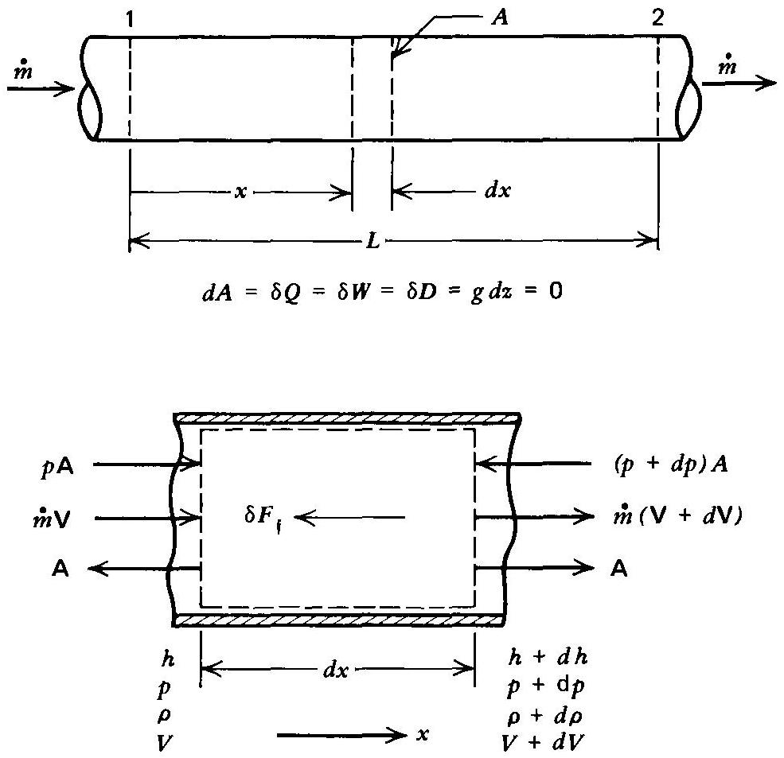
Figure 5.1. Steady one-dimensional adiabatic flow in a constant-area duct in the presence of wall friction (simple frictional flow).

(1) Energy equation

$$
d h+d\left(\frac{V^{2}}{2}\right)=0
$$

(2) Continuity equation

$$
G=\frac{\dot{m}}{A}=\rho V=\frac{V}{v}=\text { constant }
$$

(3) Momentum equation

$$
d p+\rho V d V+\frac{\rho V^{2}}{2}\left(\frac{4[d x}{\mathscr{D}}\right)=0
$$

Because the interest here is in determining the thermodynamic states of the fluid, only the energy and continuity equations need be considered. Rewriting the energy equation in its integrated form gives

$$
h+\frac{V^{2}}{2}=H=\text { constant }
$$

Substituting for $V$ from equation 5.2 into equation 5.4 yields

$$
h+\frac{G^{2} v^{2}}{2}=H=\mathrm{constant}
$$

Applying equation 5.5 between stations 1 and 2 of the constant-area duct yields

$$
h_{1}+\frac{G^{2} v_{1}^{2}}{2}=h_{2}+\frac{G^{2} v_{2}^{2}}{2}=H=\text { constant }
$$

Equation 5.6 relates the enthalpy $h$ and the specific volume $v$ of the fluid for specified values of the mass flux $G$. It gives no explicit information concerning the law of friction between the stations being investigated. The effect of friction, although not stated explicitly, manifests itself by the influence it exerts on the thermodynamic properties of the fluid. A curve of $h$ as a function $s$ for a constant value of $G$, for adiabatic flow with wall friction, is termed a Fanno line, and equation 5.5 is known as the Fanno line equation. ${ }^{1}$

The equations derived in this section are valid for any fluid, because no restrictions have been placed on the character of the equations of state for the fluid.

Example 5.1. Superheated steam at $1000 \mathrm{lbf} / \mathrm{in} .^{2}\left(68.95 \cdot 10^{5} \mathrm{~N} / \mathrm{m}^{2}\right)$ and 900 F ( 755.6 K ) enters a 10 in . ( 0.254 m ) ID pipe with a velocity of $500 \mathrm{ft} / \mathrm{sec}(152.4 \mathrm{~m} / \mathrm{s})$. Determine the locus of the possible thermodynamic states that satisfy the continuity and energy equations (i.e., the Fanno line).

## Solution

The thermodynamic properties of steam are taken from Thermodynamic Properties of Steam, Keenan and Keyes, Wiley, 1958. The initial steam properties are:

$$
\begin{aligned}
t_{1} & =900 \mathrm{~F}(755.6 \mathrm{~K}) \\
p_{1} & =1000 \mathrm{lbf} / \mathrm{in}^{2}\left(68.95 \cdot 10^{5} \mathrm{~N} / \mathrm{m}^{2}\right) \\
V_{1} & =500 \mathrm{ft} / \mathrm{sec}(152.4 \mathrm{~m} / \mathrm{s}) \\
v_{1} & =0.7604 \mathrm{ft}^{3} / \mathrm{lbm}\left(0.04747 \mathrm{~m}^{3} / \mathrm{kg}\right) \\
h_{1} & =1448.2 \mathrm{Btu} / \mathrm{lbm}(3,368,500 \mathrm{~J} / \mathrm{kg}) \\
s_{1} & =1.6121 \mathrm{Btu} / \mathrm{lbm}-\mathrm{R}(6749.5 \mathrm{~J} / \mathrm{kg}-\mathrm{K})
\end{aligned}
$$

The mass flux $G$ is

$$
G=\frac{V_{1}}{v_{1}}=\frac{500}{0.7604}=657.5 \mathrm{lbm} / \mathrm{sec}-\mathrm{ft}^{2} \quad\left(3209.3 \mathrm{~kg} / \mathrm{s}-\mathrm{m}^{2}\right)
$$

From equation 5.6,

$$
\begin{aligned}
H=h_{1}+\frac{G^{2} v_{1}^{2}}{2} & =1448.2+\frac{(657.5)^{2}(0.7604)^{2}}{2(32.174)(778.16)} \\
& =1453.2 \mathrm{Btu} / \mathrm{lbm} \quad(3,380,000 \mathrm{~J} / \mathrm{kg})
\end{aligned}
$$

Hence, the equation for the Fanno line is given by

$$
h=H-\frac{G^{2} v^{2}}{2}=1453.2-8.6335 v^{2} \quad\left(3,380,000-5,149,800 v^{2}\right)
$$

Assume selected values of $v$, as shown in Table 5.1, and by means of the Fanno line equation, calculate the value of $h$. Then, from the steam tables, determine the corresponding values of $s, t$, and $p$. The results are presented in Table 5.1. Figure 5.2 is a plot of the corresponding Fanno line on the hs plane.

Table 5.1 Steam Properties Based on the Fanno Line Equation (Example 5.1)
| $v, \mathrm{ft}^{3} / \mathrm{lbm}$ | $h, \mathrm{Btu} / \mathrm{lbm}$ | s, Btu/lbm-R | $t, F$ | $p, \mathrm{lbf} / \mathrm{in} .^{2}$ |
| :--- | :--- | :--- | :--- | :--- |
| 0.7604 | 1448.2 | 1.6121 | 900.0 | 1000.0 |
| 1.0 | 1444.6 | 1.6382 | 877.9 | 757.8 |
| 1.5 | 1433.8 | 1.6743 | 840.1 | 497.9 |
| 2.0 | 1418.7 | 1.6960 | 801.5 | 364.8 |
| 2.5 | 1399.2 | 1.7075 | 757.4 | 282.6 |
| 2.8 | 1385.5 | 1.7108 | 727.6 | 246.4 |
| 3.0 | 1375.5 | 1.7116 | 706.2 | 226.0 |
| 3.2 | 1364.8 | 1.7114 | 683.7 | 207.8 |
| 3.5 | 1347.4 | 1.7091 | 647.5 | 183.9 |
| 4.0 | 1315.1 | 1.7002 | 579.4 | 150.9 |
| 4.5 | 1278.4 | 1.6846 | 503.1 | 124.0 |
| 5.0 | 1237.4 | 1.6618 | 418.9 | 101.2 |
| 5.5 | 1192.0 | 1.6301 | 328.4 | 81.6 |
| $\mathrm{ft}^{3} / \mathrm{lbm} \times 0.06248=\mathrm{m}^{3} / \mathrm{kg}$ <br> $(t+459.6) / 1.8=\mathrm{K}$ |  |  |  |  |
|  | $\mathrm{Btu} / \mathrm{lbm} \times 2325.97=\mathrm{J} / \mathrm{kg}$ |  | $\mathrm{lbf} / \mathrm{in}^{2} \times 6894.76=\mathrm{N} / \mathrm{m}^{2}$ |  |
| Btu/lbm-R $\times 4186.8=\mathrm{J} / \mathrm{kg}-\mathrm{K}$ |  |  |  |  |


## 5-3(b) The Fanno Line

In general, the initial values of $h, v$, and $G$ are known and the stagnation enthalpy $H$ remains constant. To plot a Fanno line, a specific value is assigned to the mass flux $G$, and a series of values are assigned to the specific volume $v$. The values of enthalpy $h$ are then computed by means of equation 5.5. From the aforementioned values of $h$ and $v$, the corresponding values of $s$ are either taken from tabulated values of the thermodynamic properties of the fluid or calculated. The Fanno line is the locus of the possible thermodynamic states that are attainable by the fluid for the selected value of $G$.

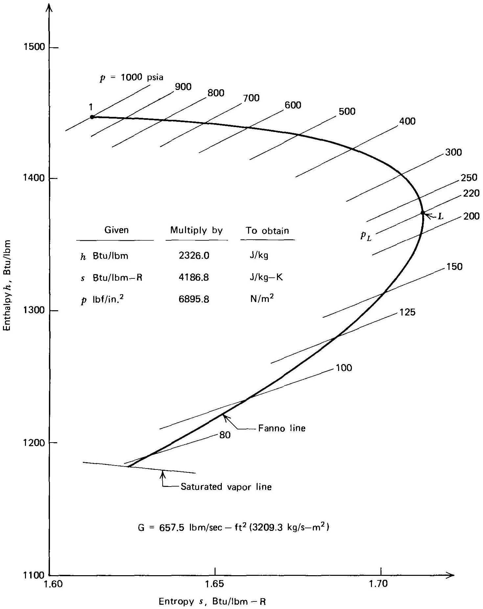
Figure 5.2. Fanno line for steam plotted on the $h s$ plane (Example 5.1).

Example 5.1 illustrates the method of computation for steam as the flowing fluid. Referring to Fig. 5.2, it is seen that the Fanno line gives no information regarding the distance the fluid must traverse to attain any of the thermodynamic states lying on the Fanno line. The length of constant-area passage, with no obstructions, required for attaining a state on the Fanno line depends on the entropy gradient $d s / d x$, which depends on the wall friction. The general shape of the Fanno line presented in Fig. 5.2 for steam is typical of the Fanno line for all compressible fluids.

Reference to Fig. 5.2 shows that, with $G$ held constant and starting at state 1, increasing the length of the constant-area duct causes the pressure and the enthalpy to decrease, but the flow velocity and the entropy to increase. At a particular value of the static pressure, denoted by $p=p_{L}$, the entropy reaches a maximum value.

From the shape of the curve it might be inferred that when the back pressure at the duct exit is reduced below $p_{L}$, the pressure and the entropy would continue to decrease. In view of the second law of thermodynamics, however, such a process is impossible. The foregoing indicates that thermodynamic states lying on the lower portion of the Fanno line, to the left of the maximum entropy state, cannot be reached by a flow expansion starting from state 1.

It is further concluded from the foregoing that, for an adiabatic flow in a constantarea duct in the presence of wall friction, with increasing flow velocity, the exit pressure for the duct cannot be reduced below the limiting static pressure $p_{L}$, no matter how small the back pressure is into which the duct discharges. When that condition is reached, the flow is said to be "choked." Moreover, since $p_{L}$ is a limiting value for the static pressure, there is also a limiting value to the maximum velocity attainable by the fluid in the exit section of the duct by reducing the back pressure at the duct exit. Let $V_{L}$ denote that limiting velocity, also called the choking velocity.

The lower portion of a Fanno line (see Fig. 5.2) lying to the left of the maximum entropy state, does, however, have physical significance. It represents the thermodynamic states that are attainable by a flow process starting at lower values of enthalpy and static pressure than the maximum entropy state. Such a process proceeds in the direction of higher static pressures; that is, it is a flow compression.

Each value assigned to $G$ gives rise to a separate Fanno line but, if the initial values of $h$ and $s$ are held constant at the values $h=h_{1}$ and $s=s_{1}$, then all of the Fanno lines intersect at the initial point ( $h_{1}, s_{1}$ ). Figure 5.3 illustrates, for air as the flowing fluid, three different Fanno lines corresponding to three different values of $G$ and the same initial conditions $\left(h_{1}, s_{1}\right)$.

A flow that originates at a fixed stagnation state may enter a constant-area duct at different static conditions, for example, after expansion through an isentropic nozzle, because the mass flux $G$ and the initial static properties ( $h_{1}, s_{1}$ ) are different for each nozzle exit condition. Figure 5.4 illustrates six such Fanno lines for air. Note that all six Fanno lines originate from an isentropic expansion from the same stagnation state.

## 5-3(c) Limiting Velocity for a Fanno Line

Consider an infinitesimal change of state that takes place in the neighborhood of the maximum entropy state; for example, state $L$ in Fig. 5.5. Let the subscript $L$ denote the state where the entropy is a maximum. For such an infinitesimal change of state, the corresponding change in enthalpy may be assumed to take place at constant entropy. Hence, for an infinitesimal change of state on a Fanno line in the neighborhood of the maximum entropy point, we may write equation 1.65 in the form

$$
t_{L} d s_{L}=d h_{L}-v_{L} d p_{L}=0
$$

At state $L$, equation 5.5, which defines the state of the fluid at any point on a Fanno line, becomes

$$
h_{L}+\frac{G^{2} v_{L}^{2}}{2}=H=\text { constant }
$$

Hence,

$$
d h_{L}+G^{2} v_{L} d v_{L}=0
$$

Solving equation 5.7 for $d h_{L}$ and substituting the result into equation 5.9 gives

$$
v_{L} d p_{L}+G^{2} v_{L} d v_{L}=0
$$

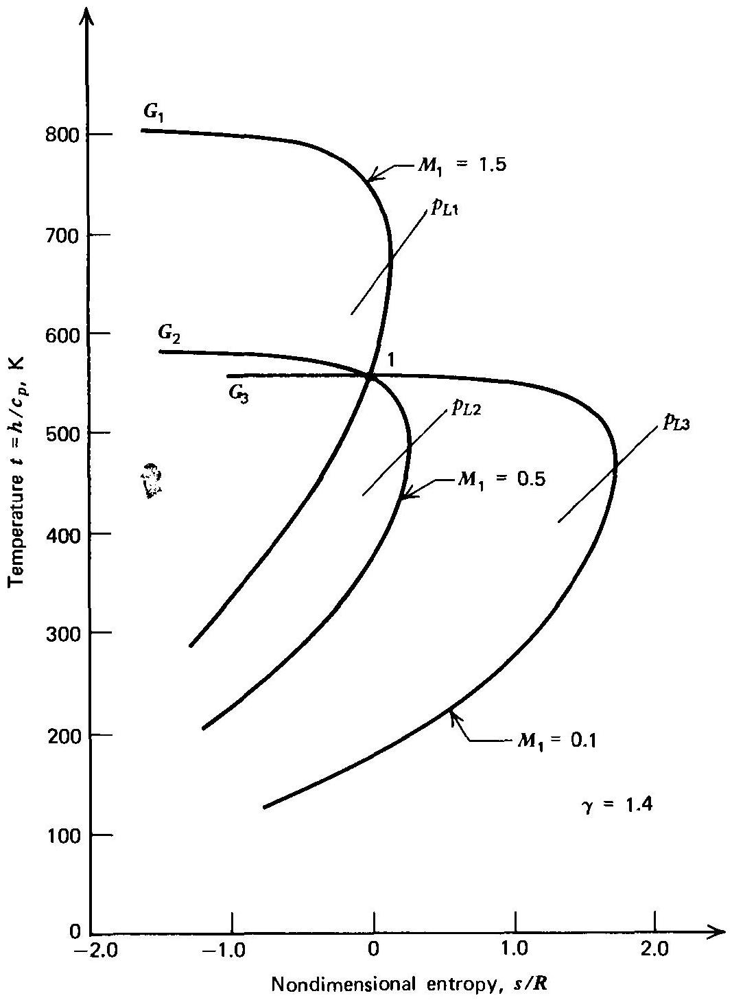
Figure 5.3. Fanno lines on the $t s$ plane for three different values of the mass flux $G$ and the same initial static conditions.

Noting that $v_{L}=1 / \rho_{L}, d v_{L}=-d \rho_{L} / \rho_{L}{ }^{2}$, and $G^{2}=V_{L}{ }^{2} \rho_{L}{ }^{2}$, equation 5.10 may be rewritten as

$$
\frac{d p}{\rho_{L}}-V_{L}^{2} \frac{d \rho_{L}}{\rho_{L}}=0
$$

Solving equation 5.11 for $V_{L}{ }^{2}$, and remembering that it is assumed that $s=$ constant gives

$$
V_{L}^{2}=\frac{d p_{L}}{d \rho_{L}}=\left(\frac{\partial p}{\partial \rho}\right)_{s}=a^{2}=(\text { local acoustic speed })^{2}=a^{* 2}
$$

Equation 5.12 shows that, in the case of the adiabatic flow of a compressible fluid in a constant-area duct in the presence of wall friction alone, the entropy of the fluid is at a maximum when its speed is equal to the local acoustic speed, and the Mach number $M_{L}=1.0$. Thus, for the upper portion of the Fanno line, $V<a^{*}$, and $M<1$. Conversely, for the lower portion of the Fanno line, $V>a^{*}$, and $M>1$. It follows, therefore, that if the initial velocity is subsonic, the effect of friction is to accelerate the flow to the local acoustic velocity as a limit. Conversely, if the initial velocity is supersonic, the effect of friction is to decelerate the flow to the local acoustic velocity as a limit. The Fanno line shows that for a subsonic flow, the pressure decreases and the velocity increases, while for a supersonic flow, the reverse occurs.

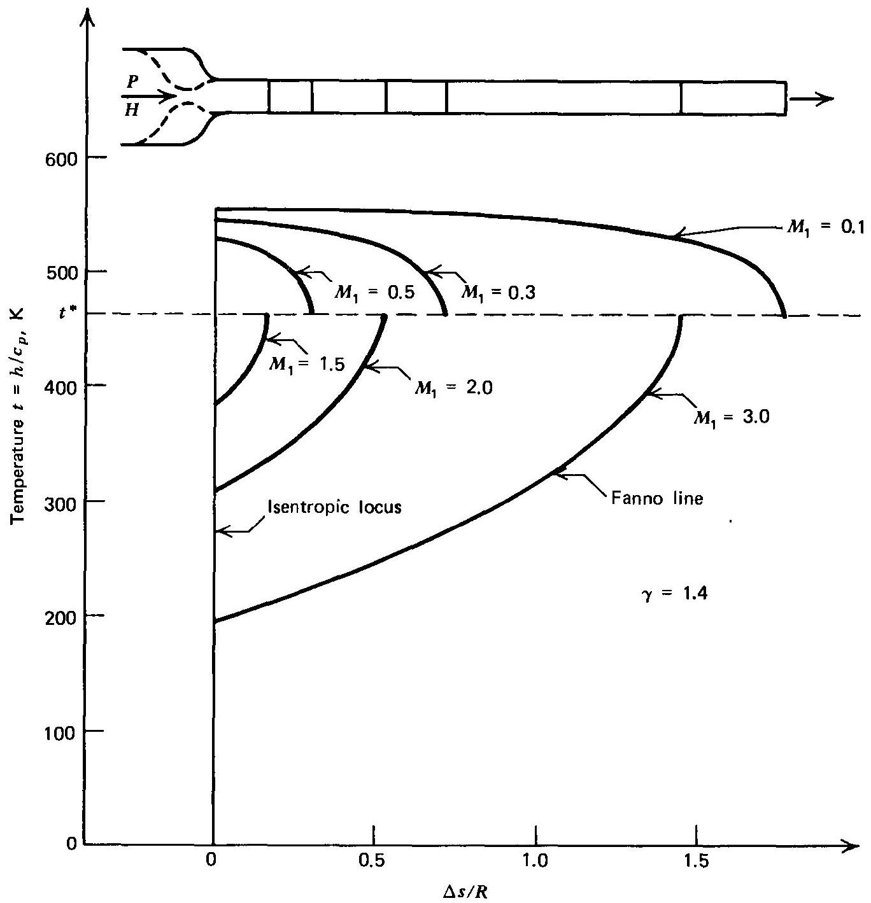
Figure 5.4. Fanno lines on the $t s$ plane for different values of the mass flux $G$ and the same initial stagnation conditions.

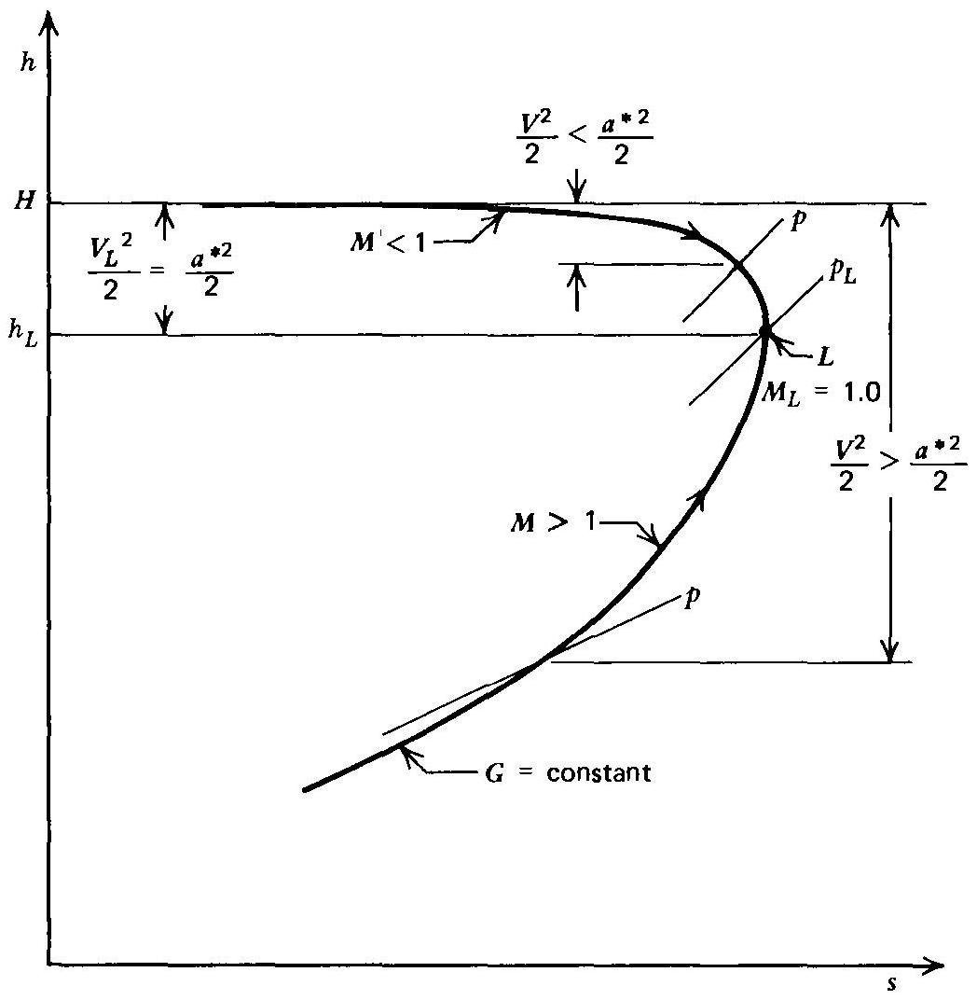
Figure 5.5. Limiting conditions at the maximum entropy point on a Fanno line.

It is of interest to consider the effects caused by increasing the resistance to flow because of increasing the length of the duct. Let it be assumed that in all cases the length of the constant-area duct and the mass flux are such that the velocity of the gas crossing the exit section is the local acoustic velocity.

Consider first the case where the duct operates with constant inlet conditions ( $p_{1}, V_{1}, h_{1}, s_{1}$ ) and with the limiting value of exit pressure $p=p_{L}$, corresponding to the limiting velocity $V_{L}=a^{*}$. In the exit section the thermodynamic properties of the fluid are denoted by $s_{L}, h_{L}$, and $v_{L}$. The entropy increase for the fluid between states 1 and $L$ is, accordingly, $s_{L}-s_{1}$ and remains constant if $G$ remains constant; that is, if $V_{1}$ remains constant. The corresponding Fanno line is curve $1-L 1$, in Fig. 5.6.

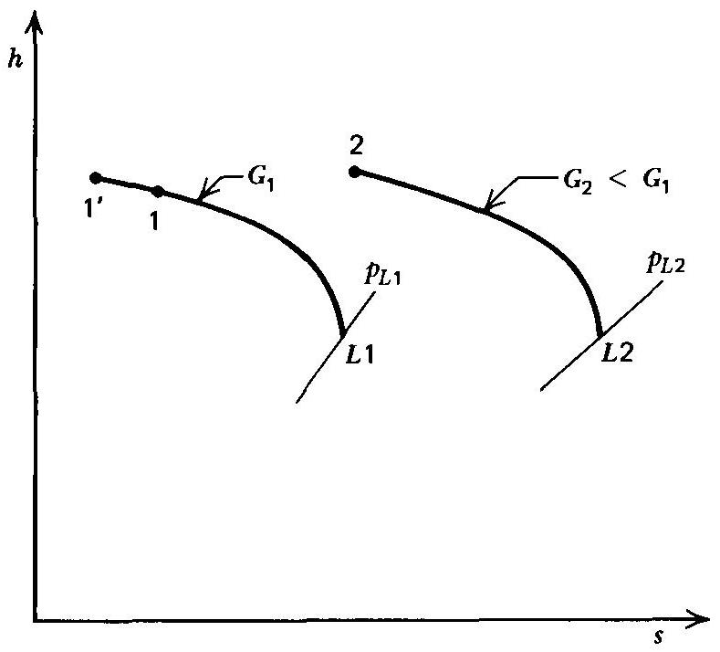
Figure 5.6. Effect of increasing the flow resistance on flow along a Fanno line.

Increasing the duct length increases the flow resistance, which is reflected in a larger value for the entropy change. Since $p_{1}$ and $p_{L}$ are fixed, however, the entropy change $s_{L}-s_{1}$ is also fixed. The preceding conditions cannot be satisfied by the original Fanno line. The added flow resistance causes $G$ to decrease with the result that the flow process lies on a different Fanno line having a smaller value of $G$, illustrated by curve 2-L2 in Fig. 5.6. If it is desired to maintain the original value of $G$, the initial conditions must be changed. The upstream pressure must be increased until the entropy at the new initial state differs from that for the original initial state by an amount equal to the increase in entropy caused by the added flow resistance. As illustrated in Fig. 5.6, the new initial state point, point 1', therefore, lies on the same Fanno line but to the left of the original initial state; that is, at the decreased value of initial entropy. The corresponding Fanno line is curve $1^{\prime}-L 1$.

Refer to Fig. 5.7 and consider the case where the initial conditions are held constant and the back pressure $p_{o}$ on the duct is gradually reduced. The flow velocity in the exit section increases until $V_{L}=a^{*}$ is reached, the corresponding exit pressure being $p_{L}=p_{o}=p^{*}$. Reducing $p_{o}$ below $p_{L}$ has no influence on the value of $G$, because the expansion waves generated by the decrease of the pressure $p_{o}$ travel only with the acoustic speed and, therefore, cannot propagate themselves upstream to the exit section where the exit velocity is sonic [see Section 4-6(c)]. If $p_{o}$ is reduced below $p_{L}$, the reduction in the static pressure of the fluid from $p_{L}$ to $p_{o}$ takes place

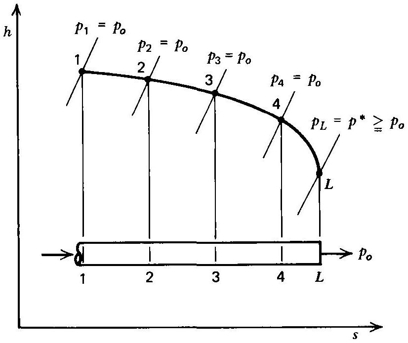
Figure 5.7. Effeci of decreasing the back pressure on flow along a Fanno line.

beyond the exit section where the limitation imposed by the constant duct area is no longer applicable.

The preceding discussions show that, for a flow having the characteristics $d A= \delta Q=\delta W=\delta D=g d z=0$ and $G=$ constant, there is a definite length of duct that causes the flow in the exit section to become choked; that length of duct is called the critical length of duct and is denoted by $L^{*}$. Hereafter, the values of the flow variables when the exit section of the duct operates with $M=1$ will be denoted by $a^{*}, p^{*}, \rho^{*}, s^{*}, t^{*}$, etc. The reader should be careful not to confuse the critical conditions for the Fanno line with those for isentropic flow.

## 5-4 DYNAMICS OF STEADY ONE-DIMENSIONAL ADIABATIC FLOW WITH FRICTION IN A CONSTANT-AREA DUCT

The thermodynamics of steady adiabatic flow with wall friction in a constant-area duct is investigated in Section 5-3. In this section, the dynamic equation for flow with wall friction is derived, and data for the wall friction coefficient $\mathfrak{f}$ are presented.

## 5-4(a) The Dynamic or Momentum Equation

Table 3.1 presents the general dynamic or momentum equation for the steady onedimensional flow of a fluid (equation 3.160). In the special case where wall friction is the sole driving potential for the flow, $\delta D / A=g d z=0$, and equation 3.160 reduces to

$$
d p+\rho V d V+\frac{\rho V^{2}}{2}\left(\frac{4 \tilde{f} d x}{\mathscr{D}}\right)=0
$$

It is convenient to express equation 5.13 in terms of the mass flux $G=\dot{m} / A$ by eliminating $V$ and $d V$ from that equation. Expressions for $V$ and $d V$ in terms of $G$ are readily derived from the continuity equation for steady flow. Thus, from equation 5.2,

$$
V=\frac{\dot{m}}{A} v=G v
$$

where

$$
G=\frac{\dot{m}}{A}
$$

and

$$
d G=-\dot{m} \frac{d A}{A^{2}}=-G \frac{d A}{A}
$$

Differentiating equation 5.14 and introducing equations 5.15 and 5.16 into the result yields

$$
d V=G d v+v d G=G\left(d v-v \frac{d A}{A}\right)
$$

Substituting from equations 5.14 and 5.17 into equation 5.13 and dividing throughout by the specific volume $v$ gives

$$
\frac{d p}{v}+G^{2}\left(\frac{d v}{v}-\frac{d A}{A}\right)+\frac{G^{2}}{2}\left(\frac{4 f d x}{\mathscr{D}}\right)=0
$$

Equation 5.18 is the desired general dynamic equation. To integrate equation 5.18, the relationships between $p, v, A, G$, and $\mathfrak{f}$ are needed.

For a duct having a constant cross-sectional area, which is assumed here, $d A=0$, and equation 5.18 reduces to

$$
\frac{d p}{v}+G^{2}\left(\frac{d v}{v}+\frac{1}{2} \frac{4 \mathfrak{f} d x}{\mathscr{D}}\right)=0
$$

If either a constant value of $\mathfrak{f}$, or the mean value of $\mathfrak{f}$, denoted by $\overline{\mathfrak{f}}$, is employed, then the integrated form of equation 5.19 for a constant-area duct may be written as

$$
\int_{1}^{2} \frac{d p}{v}+G^{2}\left(\ln \frac{v_{2}}{v_{1}}+\frac{1}{2} \frac{4 \overline{\mathrm{f}} L}{\mathscr{D}}\right)=0
$$

where

$$
L=\int_{1}^{2} d x=x_{2}-x_{1}
$$

and

$$
\overline{\mathrm{f}}=\frac{1}{L} \int_{x_{1}}^{x_{2}} f d x
$$

To complete the integration of equation 5.20, a relationship becween $p$ and $v$ is needed. The dynamic equation is integrated in Section 5-5(b) for a perfect gas, and a method for applying the equation to the flow of an imperfect gas is presented in Section 5-6.

It is pointed out in Section 3-5(d) that the friction coefficient $\mathfrak{f}$ is that employed in the Fanning equation for the decrease in the pressure of the fluid caused by the effect of friction in a duct of hydraulic diameter $\mathscr{D}$. If $d x$ is an infinitesimal length of the duct, and $d p_{\mathrm{f}}$ denotes the corresponding pressure drop, then

$$
d p_{\mathrm{f}}=\frac{\rho V^{2}}{2}\left(\frac{4 \mathrm{f} d x}{\mathscr{D}}\right)=\frac{G^{2} v}{2}\left(\frac{4 \mathrm{f} d x}{\mathscr{D}}\right)
$$

Hydraulic data pertaining to the decrease in the pressure of a fluid flowing in a pipe are frequently correlated in terms of the D'Arcy friction factor $\mathfrak{f}^{\prime}=4 \mathfrak{f}$. The D'Arcy equation is

$$
d p_{\mathrm{i}}=\frac{\rho V^{2}}{2}\left(\frac{\mathfrak{f}^{\prime} d x}{\mathscr{D}}\right)
$$

## 5-4(b) The Friction Coefficient $\boldsymbol{f}$

It may be shown by dimensional analysis (see Section 5-8) that the friction coefficient $\mathfrak{f}$ for a compressible fluid flowing in a duct is a function of the Reynolds number Re and the Mach number $M$. Experiments with steam and also with air indicate, however, that in the regime of well-developed turbulence, $f$ is practically independent of the Mach number. Hence, it may be assumed that $f$ depends only on the Reynolds number Re for both compressible and incompressible fluids. It also depends on the roughness of the pipe surface as demonstrated by Nikuradse, who conducted experiments with water on the flow through pipes having surfaces with measurable roughness produced by sand grains of diameter $\varepsilon$; the ratio $\varepsilon / D$ is termed the relative roughness. ${ }^{2}$

For small values of the Reynolds number (Re less than 2000, approximately), the flow in a pipe is entirely laminar and the friction coefficient is a function of Re alone (see equation 5.175).

If the flow is turbulent, $\operatorname{Re}>2000$ approximately, but $\varepsilon / D$ is very small, all of the experimental data for $\mathfrak{f}=f(\mathrm{Re})$ lie on a single curve. Such a wall surface is said to be of ultimate smoothness, and the flow is termed smooth pipe flow. For smooth pipe flow, von Karman gives the following equation. ${ }^{3}$

$$
\frac{1}{\sqrt{\mathfrak{f}^{\prime}}}=1.74-2 \log \left(\frac{18.6}{\operatorname{Re} \sqrt{\overline{\mathfrak{f}}^{\prime}}}\right)
$$

If the surface of the pipe is very rough, that is, large values for $\varepsilon / D$, and if $\operatorname{Re}$ also has large values, experiments show that $\mathfrak{f}^{\prime}$ is independent of Re. Such a surface is said to be wholly rough. For the flow in a rough pipe, Prandtl gives the following equation. ${ }^{4}$

$$
\frac{1}{\sqrt{\tilde{f}^{\prime}}}=1.74+2 \log (\varepsilon / D)
$$

Colebrook conducted experiments with clean commercial pipes in the turbulent flow regime between ultimate smooth and wholly rough pipe surfaces; in that regime $\mathfrak{f}^{\prime}$ depends on both $\operatorname{Re}$ and $\varepsilon / D$. He derived the following empirical equation for that regime. ${ }^{5}$

$$
\frac{1}{\sqrt{\mathfrak{f}^{\prime}}}=-2 \log \left(\frac{\varepsilon / D}{3.7}+\frac{2.51}{\operatorname{Re} \sqrt{\mathfrak{f}^{\prime}}}\right)
$$

Values of $\varepsilon$ for various surfaces are presented in Table 5.2.

Table 5.2 Values of the Roughness $\varepsilon$ for Clean Commercial Pipes
| Type of Pipe | Equivalent Sand Grain Diameter |  |
| :--- | :--- | :--- |
|  | $\varepsilon, \mathrm{ft}$ | $\varepsilon, \mathrm{m}$ |
| Asphalted cast iron | 0.0004 | 0.000122 |
| Cast iron | 0.00085 | 0.000259 |
| Commercial steel | 0.00015 | 0.0000457 |
| Concrete | 0.001 to 0.010 | 0.000305 to 0.00305 |
| Drawn tubing | 0.000005 | 0.00000152 |
| Galvanized iron | 0.0005 | 0.000152 |
| Riveted steel | 0.003 to 0.030 | 0.000914 to 0.00914 |


Glass, drawn brass, aluminum, lead: smooth.

[^0]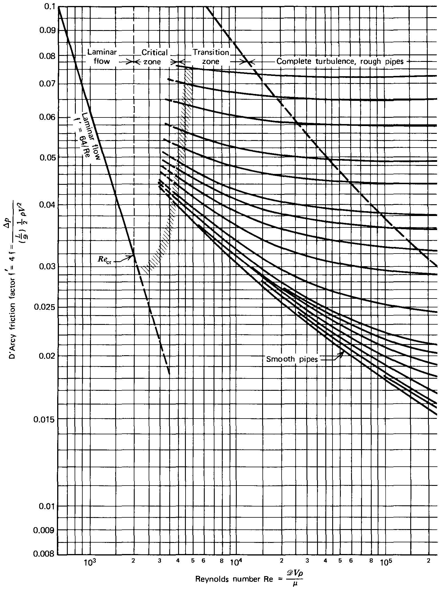

Figure 5.8 is the so-called Moody chart, which presents $\mathfrak{f}^{\prime}$ as a function of Re for several different constant values of $\varepsilon / D$, the relative roughness. ${ }^{6}$

Genereaux proposed the following relationship, in the range of $\mathrm{Re}=4 \cdot 10^{3}$ to $20 \cdot 10^{6}$, as being sufficiently accurate for most engineering work. ${ }^{7}$ Thus,

$$
\mathfrak{f}=0.04 \operatorname{Re}^{-0.16}
$$

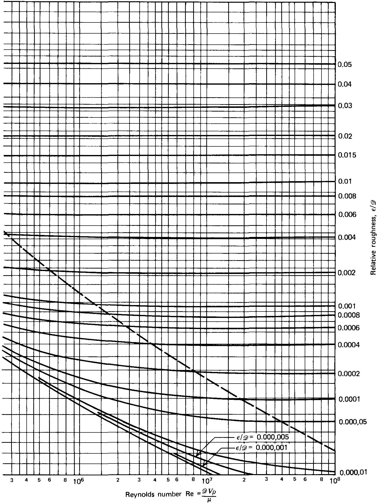
Figure 5.8. The D'Arcy friction coefficient for pipe flow as a function of the Reynolds number for constant values of the relative roughness $\varepsilon / \mathscr{D}$ (taken from Reference 6).

For compressible fluids in subsonic flow ( $M<1$ ), the value of $i$ varies from $\mathfrak{f}=0.005$ when $\operatorname{Re}=5 \cdot 10^{4}$ to $\mathfrak{f}=0.0039$ when $\operatorname{Re}=2 \cdot 10^{5}$. For that range of Reynolds numbers, little error is introduced by assuming that $\mathfrak{f}$ is constant at the value $\mathfrak{f}=0.005$.

Additional information on pipe flow with friction is presented in Section 5-10 and, for additional information on the friction coefficient, refer to the references at the end of this chapter.

## 5-5 THE FANNO LINE FOR PERFECT GASES

The discussions in Sections 5-3 and 5-4 apply to the steady one-dimensional adiabatic flow of any fluid flowing in a constant-area duct in the presence of wall friction. If the flowing fluid is a perfect gas, quantitative relationships may be derived in terms of the flow Mach number.

## 5-5(a) Fanno Line Equations for Perfect Gases

For a perfect gas the energy equation is given by equation 3.45 , which may be transformed to read

$$
\frac{t_{2}}{t_{1}}=\frac{1+\frac{\gamma-1}{2} M_{1}^{2}}{1+\frac{\gamma-1}{2} M_{2}^{2}}
$$

From the continuity equation for a perfect gas (see Table 3.2), we obtain the following for a duct of constant area.

$$
G=\frac{\dot{m}}{A}=p_{1} M_{1}\left(\frac{\gamma}{R t_{1}}\right)^{1 / 2}=p_{2} M_{2}\left(\frac{\gamma}{R t_{2}}\right)^{1 / 2}
$$

Assuming that the specific heat ratio $\gamma$ is constant, equation 5.30 may be rewritten in the form

$$
\frac{p_{2}}{p_{1}}=\frac{M_{1}}{M_{2}}\left(\frac{t_{2}}{t_{1}}\right)^{1 / 2}=\frac{M_{1}}{M_{2}}\left(\frac{1+\frac{\gamma-1}{2} M_{1}^{2}}{1+\frac{\gamma-1}{2} M_{2}^{2}}\right)^{1 / 2}
$$

The remaining thermodynamic properties for the gas are obtained by applying the thermal equation of state $p=\rho R t$ and the continuity equation $\rho V=$ constant. Thus,

$$
\frac{\rho_{2}}{\rho_{1}}=\frac{v_{1}}{v_{2}}=\frac{p_{2}}{p_{1}} \frac{t_{1}}{t_{2}}=\frac{V_{1}}{V_{2}}=\frac{M_{1}}{M_{2}}\left(\frac{1+\frac{\gamma-1}{2} M_{2}^{2}}{1+\frac{\gamma-1}{2} M_{1}^{2}}\right)^{1 / 2}
$$

The ratio of the stagnation pressures for two states on the same Fanno line is given by (see Table 3.3)

$$
\frac{P_{2}}{P_{1}}=\frac{p_{2}}{p_{1}}\left(\frac{1+\frac{\gamma-1}{2} M_{2}^{2}}{1+\frac{\gamma-1}{2} M_{1}^{2}}\right)^{\gamma /(\gamma-1)}=\frac{M_{1}}{M_{2}}\left(\frac{1+\frac{\gamma-1}{2} M_{2}^{2}}{1+\frac{\gamma-1}{2} M_{1}^{2}}\right)^{(\gamma+1) / 2(\gamma-1)}
$$

The entropy change as a function of the Mach number follows immediately from equations 3.88 and 5.33. Thus,

$$
\frac{s_{2}-s_{1}}{R}=\ln \frac{P_{1}}{P_{2}}=\ln \left[\frac{M_{2}}{M_{1}}\left(\frac{1+\frac{\gamma-1}{2} M_{1}^{2}}{1+\frac{\gamma-1}{2} M_{2}^{2}}\right)^{(\gamma+1) / 2(\gamma-1)}\right]
$$

The impulse function given by equation 3.139 , after noting that $A_{1}=A_{2}$, and substituting for $p_{2} / p_{1}$ from equation 5.31 , becomes

$$
\frac{\mathscr{F}_{2}}{\mathscr{F}_{1}}=\frac{p_{2}}{p_{1}} \frac{A_{2}}{A_{1}} \frac{\left(1+\gamma M_{2}^{2}\right)}{\left(1+\gamma M_{1}^{2}\right)}=\frac{M_{1}\left(1+\gamma M_{2}^{2}\right)}{M_{2}\left(1+\gamma M_{1}^{2}\right)}\left(\frac{1+\frac{\gamma-1}{2} M_{1}^{2}}{1+\frac{\gamma-1}{2} M_{2}^{2}}\right)^{1 / 2}
$$

## 5-5(b) The Friction Parameter for a Constant-Area Duct

From equation 3.170, Table 3.2, the momentum equation for the steady one-dimensional flow of a perfect gas (in the absence of obstructions or body forces) may be transformed to read as follows:

$$
\frac{d p}{p}+\gamma M^{2} \frac{d V}{V}+\frac{\gamma M^{2}}{2}\left(\frac{4 \mathrm{f} d x}{\mathscr{D}}\right)=0
$$

since (see equation 5.43)

$$
\frac{\gamma}{2} d M^{2}+\frac{\gamma M^{2}}{2} \frac{d t}{t}=\gamma M^{2} \frac{d V}{V}
$$

It is desirable to relate the friction parameter $4 f d x / \mathscr{D}$ to the flow Mach number $M$ so that the effect of friction on the flow Mach number may be studied conveniently. To accomplish that, $d p / p$ and $d V / V$ must be eliminated from equation 5.36. It is assumed that the area of the duct is constant $(d A=0)$.

To eliminate $d p / p$, the continuity equation for perfect gases, $\dot{m}=V A p / R t=$ constant, is differentiated logarithmically. Thus, for a constant-area duct,

$$
\frac{d p}{p}=\frac{d t}{t}-\frac{d V}{V}
$$

Combining equations 5.36 and 5.37 and rearranging gives

$$
\frac{\gamma M^{2}}{2}\left(\frac{4 f d x}{\mathscr{D}}\right)=\left(1-\gamma M^{2}\right) \frac{d V}{V}-\frac{d t}{t}
$$

For the adiabatic flow assumed here, the energy equation (see equation 3.41) may be employed for eliminating $d t / t$. Thus, for a perfect gas,

$$
c_{p} d t+V d V=\frac{\gamma R}{\gamma-1} d t+V d V=0
$$

Hence,

$$
\gamma R d t+(\gamma-1) V^{2} \frac{d V}{V}=0
$$

Dividing equation 5.40 by $a^{2}=\gamma R t$, introducing $M^{2}=V^{2} / a^{2}$, and rearranging gives

$$
\frac{d t}{t}=(1-\gamma) M^{2} \frac{d V}{V}
$$

The term $d V / V$ may be expressed in terms of $d M / M$ and $d t / t$. Thus,

$$
V^{2}=M^{2} a^{2}=M^{2}(\gamma R t)
$$

Hence,

$$
\frac{d V}{V}=\frac{d M}{M}+\frac{1}{2} \frac{d t}{t}
$$

Substituting for $d t / t$ from equation 5.41 into equation 5.43 and rearranging gives

$$
\frac{d V}{V}=\frac{d M}{M\left(1+\frac{\gamma-1}{2} M^{2}\right)}
$$

Substituting for $d V / V$ from equation 5.44 into equation 5.41 gives

$$
\frac{d t}{t}=\frac{(1-\gamma) M^{2}}{1+\frac{\gamma-1}{2} M^{2}} \frac{d M}{M}
$$

Substituting equations 5.44 and 5.45 into equation 5.38 and dividing by $M^{2}$ gives the desired relationship. Thus,

$$
\frac{4 \mathfrak{f} d x}{\mathscr{D}}=\frac{2\left(1-M^{2}\right) d M}{\gamma M^{3}\left(1+\frac{\gamma-1}{2} M^{2}\right)}
$$

Equation 5.46 relates the friction parameter $4 \mathfrak{f} d x / \mathscr{D}$ to the flow Mach number $M$ for adiabatic flow in a constant-area duct in the presence of wall friction alone. The changes in the state of the gas are due entirely to overcoming the shearing stresses in the boundary layer.

It is convenient for the purpose of calculation to integrate the right-hand side of equation 5.46 between the limits $M=M$ and $M=1$, the corresponding limits for the left-hand side being $x=0$ and $x=L^{*}$. Thus,

$$
\int_{0}^{L^{*}} \frac{4 \tilde{f} d x}{\mathscr{D}}=\left[-\frac{1}{\gamma M^{2}}-\frac{\gamma+1}{2 \gamma} \ln \left(\frac{M^{2}}{1+\frac{\gamma-1}{2} M^{2}}\right)\right]_{M=M}^{M=1}
$$

The result is,

$$
\frac{4 \overline{\mathfrak{f}} L^{*}}{\mathscr{D}}=\frac{1-M^{2}}{\gamma M^{2}}+\frac{\gamma+1}{2 \gamma} \ln \left(\frac{\frac{\gamma+1}{2} M^{2}}{1+\frac{\gamma-1}{2} M^{2}}\right)
$$

where $\overline{\mathrm{f}}$ is the mean value of $\overline{\mathrm{f}}$ for the length $L^{*}$ as defined by equation 5.22, and $L^{*}$ is the length of duct required to change the Mach number of the flow from $M=M$ to $M=1$. The friction parameter $4 \bar{f} L^{*} / \mathscr{D}$ is tabulated in Table C. 7 as a function of the Mach number $M$ for several values of the specific heat ratio $\gamma$.

## 5-5(c) Relationship between Duct Length and Mach Number in a Constant-Area Duct

It is desirable to relate the length of duct $L$ to the Mach numbers at the inlet and exit cross sections of the duct. Assume that the fluid is a perfect gas and that the change in the static pressure of the fluid is due entirely to wall friction, so that $d A= \delta Q=\delta W=g d z=\delta D=0$, and $G=$ constant.

Let $M_{1}$ and $M_{2}$ denote the values of $M$ at two arbitrary cross sections of a constantarea duct. From equation 5.48, it follows that the value of $4 \overline{\hat{f}} L / \mathscr{D}$ for accomplishing the Mach number change is given by

$$
\frac{4 \overline{\mathfrak{f}} L}{\mathscr{D}}=\left(\frac{4 \overline{\mathfrak{f}} L^{*}}{\mathscr{D}}\right)_{M_{1}}-\left(\frac{4 \overline{\mathfrak{f}} L^{*}}{\mathscr{D}}\right)_{M_{2}}
$$

where the subscripts denote the value of $M$ to be substituted into the right-hand side of equation 5.48. Hence,

$$
\frac{4 \overline{\mathfrak{f}} L}{\mathscr{D}}=\frac{1}{\gamma M_{1}^{2}}\left(\frac{M_{2}^{2}-M_{1}^{2}}{M_{2}^{2}}\right)+\frac{\gamma+1}{2 \gamma} \ln \left[\frac{M_{1}^{2}\left(1+\frac{\gamma-1}{2} M_{2}^{2}\right)}{M_{2}^{2}\left(1+\frac{\gamma-1}{2} M_{1}^{2}\right)}\right]
$$

By means of equation 5.50, the length $L$ of constant-area duct for accomplishing the Mach number change from $M_{1}$ to $M_{2}$ is readily calculated.

For some problems it is more convenient to relate $4 \bar{f} L / \mathscr{D}$ to $M_{1}$ and $V_{1} / V_{2}$ instead of to $M_{2}$. Thus, combining equations 5.32 and 5.50, we obtain

$$
\frac{4 \overline{\mathfrak{f}} L}{\mathscr{D}}=\frac{1}{\gamma M_{1}^{2}}\left(1+\frac{\gamma-1}{2} M_{1}^{2}\right)\left[1-\left(\frac{V_{1}}{V_{2}}\right)^{2}\right]+\frac{\gamma+1}{2 \gamma} \ln \left[\left(\frac{V_{1}}{V_{2}}\right)^{2}\right]
$$

For a perfect gas, the velocity ratio $V_{1} / V_{2}$ and the static-pressure ratio $p_{1} / p_{2}$ may be related to $M_{1}$, the initial Mach number for the flow. Thus,

$$
\left(h_{2}-h_{1}\right)=c_{p}\left(t_{2}-t_{1}\right)=\frac{\gamma}{\gamma-1}\left(R t_{2}-R t_{1}\right)=\frac{\gamma}{\gamma-1}\left(p_{2} v_{2}-p_{1} v_{1}\right)
$$

Substituting equation 5.52 into the Fanno line equation (see equation 5.6) gives

$$
\frac{\gamma}{\gamma-1} p_{2} v_{2}+\frac{G^{2} v_{2}^{2}}{2}=\frac{\gamma}{\gamma-1} p_{1} v_{1}+\frac{G^{2} v_{1}^{2}}{2}
$$

Solving for $p_{2} / p_{1}$ yields

$$
\frac{p_{2}}{p_{1}}=\frac{v_{1}}{v_{2}}\left[1+\left(\frac{\gamma-1}{2 \gamma p_{1} v_{1}}\right) G^{2}\left(v_{1}^{2}-v_{2}^{2}\right)\right]
$$

But, for the Fanno line, $G^{2}=\left(V_{1} / v_{1}\right)^{2}=\left(V_{2} / v_{2}\right)^{2}$. Substituting $G^{2}=\left(V_{1} / v_{1}\right)^{2}$ into equation 5.54 and noting that $V_{1}{ }^{2} / \gamma p_{1} v_{1}=M_{1}{ }^{2}$ yields

$$
\frac{p_{2}}{p_{1}}=\frac{v_{1}}{v_{2}}\left\{1+\frac{\gamma-1}{2} M_{1}^{2}\left[1-\left(\frac{v_{2}}{v_{1}}\right)^{2}\right]\right\}
$$

or

$$
\frac{p_{2}}{p_{1}}=\frac{V_{1}}{V_{2}}\left\{1+\frac{\gamma-1}{2} M_{1}^{2}\left[1-\left(\frac{V_{2}}{V_{1}}\right)^{2}\right]\right\}
$$

Equation 5.56 relates $p_{2} / p_{1}, V_{1} / V_{2}$, and $M_{1}$.

## 262 STEADY ONE-DIMENSIONAL FLOW WITH FRICTION

Example 5.2. Air flows in a 0.100 m ID duct under adiabatic conditions. Calculate the length of duct required to raise the Mach number of the air from $M_{1}=0.5$ to $M_{2}=0.9$ if the average value of the friction coefficient is $\overrightarrow{\mathrm{f}}=0.005$. Here $\mathscr{D}=D$.

## Solution

From equation 5.48, to increase $M$ from 0.5 to 1.0,

$$
\begin{aligned}
& \frac{4 \overline{\mathrm{f}} L_{1}^{*}}{\mathscr{D}}=\frac{1-(0.5)^{2}}{1.4(0.5)^{2}}+\frac{1.4+1}{2(1.4)} \ln \left[\frac{\frac{1.4+1}{2}(0.5)^{2}}{1+\frac{1.4-1}{2}(0.5)^{2}}\right] \\
& \frac{4 \overline{\mathrm{f}} L_{1}^{*}}{\mathscr{D}}=2.1429+(0.85714) \ln (0.28571)=1.0691
\end{aligned}
$$

To increase from $M=0.9$ to $M=1$,

$$
\begin{aligned}
\frac{4 \overline{\mathrm{f}} L_{2}^{*}}{\mathscr{D}} & =\frac{1-(0.9)^{2}}{1.4(0.9)^{2}}+(0.85714) \ln \left[\frac{\frac{1.4+1}{2}(0.9)^{2}}{1+\frac{1.4-1}{2}(0.9)^{2}}\right] \\
\frac{4 \overline{\mathrm{f}} L_{2}^{*}}{\mathscr{D}} & =0.1675+(0.85714) \ln (0.83649)=0.0145
\end{aligned}
$$

Hence, to accomplish the Mach number change from $M_{1}=0.5$ to $M_{2}=0.9$,

$$
\begin{aligned}
& \Delta L=L_{1}^{*}-L_{2}^{*}=\frac{\mathscr{D}}{4 \overline{\bar{f}}}(1.0691-0.0145)=1.0546 \frac{\mathscr{D}}{4 \overline{\bar{f}}} \\
& \Delta L=\frac{1.0546(0.100)}{4(0.005)}=5.273 \mathrm{~m}(17.30 \mathrm{ft})
\end{aligned}
$$

## 5-5(d) Entropy Change Caused by Friction in a Constant-Area Duct

The energy expended in overcoming friction by a gas flowing through a duct will, of course, increase its entropy as the gas flows downstream. The increase in entropy is given by equation 5.34 in terms of the Mach numbers $M_{1}$ and $M_{2}$ at the inlet and the outlet of the duct, respectively. If the duct inlet Mach number $M_{1}=M$, and the duct length is $L^{*}$, so that choking occurs and $M_{2}=1$, then $s_{1}=s$ and $s_{2}=s^{*}$, and equation 5.34 becomes

$$
\frac{s^{*}-s}{R}=\ln \left\{\frac{1}{M}\left[\frac{2}{\gamma+1}\left(1+\frac{\gamma-1}{2} M^{2}\right)\right]^{(\gamma+1) / 2(\gamma-1)}\right\}
$$

Equation 5.57 gives the increase in entropy caused by wall friction for an adiabatic flow that experiences a change in flow Mach number from $M=M$ to $M=1$.

The rate of change in the entropy of the flowing gas with Mach number is given by the derivative $d s / d M$. Hence, from equation 5.57,

$$
\left.\frac{d s}{d M}=\frac{R\left(1-M^{2}\right)}{M\left(1+\frac{\gamma}{2}-1\right.} M^{2}\right) ~
$$

Equations 5.57 and 5.58 may be employed for investigating the effect of changes
in the flow Mach number caused by wall friction on the entropy of a perfect gas flowing under adiabatic conditions in a constant-area duct. From equation 5.58, the entropy is a maximum when $d s / d M=0$; that is, when $M=1$. Since all natural processes, according to the second law of thermodynamics, tend to approach the state of maximum entropy, the foregoing indicates that, in the case of steady adiabatic flow with wall friction alone, the speed of the gas tends to approach its local acoustic speed. The latter conclusion applies when the initial velocity is either subsonic or supersonic. Hence, the effect of wall friction is to raise the Mach number for an initially subsonic flow to $M=1$ as a limit, and to decrease that for an initially supersonic flow to $M=1$ as a limit.

## 5-5(e) Effect of Friction on the Flow Properties in a Constant-Area Duct

By methods similar to those presented in Section 4-4(c), relationships may be derived for the flow variables $d M / M, d p / p, d \rho / \rho, d t / t, d V / V, d P / P, d \mathscr{F} / \mathscr{F}$, and $d s / R$, with the friction parameter $4 f d x / \mathscr{D}$ as the independent variable. The results are presented in Table 5.3. Table 5.4 summarizes the effect of wall friction on the flow properties for a perfect gas.

Table 5.3 Influence Coefficients for the Simple Frictional Flow of a Perfect Gas in a Constant-Area Duct

$$
\begin{aligned}
\frac{d M}{M} & =-\frac{\gamma M^{2}\left(1+\frac{\gamma-1}{2} M^{2}\right)}{2\left(1-M^{2}\right)}\left(\frac{4 \mathfrak{f} d x}{\mathscr{D}}\right) \\
\frac{d p}{p} & =-\frac{\gamma M^{2}\left[1+(\gamma-1) M^{2}\right]}{2\left(1-M^{2}\right)}\left(\frac{4 \mathfrak{f} d x}{\mathscr{D}}\right) \\
\frac{d \rho}{\rho} & =-\frac{\gamma M^{2}}{2\left(1-M^{2}\right)}\left(\frac{4 \mathfrak{f} d x}{\mathscr{D}}\right) \\
\frac{d t}{t} & =-\frac{\gamma(\gamma-1) M^{4}}{2\left(1-M^{2}\right)}\left(\frac{4 \mathfrak{f} d x}{\mathscr{D}}\right) \\
\frac{d V}{V} & =\frac{\gamma M^{2}}{2\left(1-M^{2}\right)}\left(\frac{4 \mathfrak{f} d x}{\mathscr{D}}\right) \\
\frac{d P}{P} & =-\frac{\gamma M^{2}}{2}\left(\frac{4 \mathfrak{f} d x}{\mathscr{D}}\right) \\
\frac{d \mathscr{F}}{\mathscr{F}} & =-\frac{\gamma M^{2}}{2\left(1+\gamma M^{2}\right)}\left(\frac{4 \mathfrak{f} d x}{\mathscr{D}}\right) \\
\frac{d s}{R} & =\frac{\gamma M^{2}}{2}\left(\frac{4 \mathfrak{f} d x}{\mathscr{D}}\right)
\end{aligned}
$$

## 5-5(f) Fanno Line Tables for a Perfect Gas

For calculation purposes it is convenient to employ the limiting condition, where $M=1$, as a reference state. The corresponding values of $p / p^{*}, t / t^{*}, P / P^{*}$, etc., are readily derived from the appropriate equations of Section 5-5(a) by inserting the value $M_{1}=1$. The resulting equations are presented in Table 5.5.

Table 5.4 Effect of Friction on the Flow Properties for a Perfect Gas in a Constant-Area Duct
| Property | $M<1$ | $M>1$ |
| :--- | :---: | :---: |
| $d p / p$ | - | + |
| $d t / t$ | - | + |
| $d \rho / \rho$ | - | + |
| $d P / P$ | - | - |
| $d V / V$ | + | - |
| $d M / M$ | + | - |
| $d \mathscr{F} / \mathscr{F}$ | - | - |
| $d s / c_{p}$ | + | + |


Table 5.5 Property Ratios for the Simple Frictional Flow of a Perfect Gas

$$
\begin{aligned}
\frac{p}{p^{*}} & =\frac{1}{M}\left[\left(\frac{2}{\gamma+1}\right)\left(1+\frac{\gamma-1}{2} M^{2}\right)\right]^{-1 / 2} \\
\frac{\rho}{\rho^{*}} & =\frac{V^{*}}{V}=\frac{v^{*}}{v}=\frac{1}{M}\left[\left(\frac{2}{\gamma+1}\right)\left(1+\frac{\gamma-1}{2} M^{2}\right)\right]^{1 / 2} \\
\frac{t}{t^{*}} & =\frac{a^{2}}{a^{* 2}}=\left[\left(\frac{2}{\gamma+1}\right)\left(1+\frac{\gamma-1}{2} M^{2}\right)\right]^{-1} \\
\frac{P}{P^{*}} & =\frac{1}{M}\left[\left(\frac{2}{\gamma+1}\right)\left(1+\frac{\gamma-1}{2} M^{2}\right)\right]^{(\gamma+1) / 2(\gamma-1)} \\
\frac{\mathscr{F}}{\mathscr{F}^{*}} & =\frac{1+\gamma M^{2}}{M}\left[2(\gamma+1)\left(1+\frac{\gamma-1}{2} M^{2}\right)\right]^{1 / 2} \\
\frac{s-s^{*}}{R} & =-\ln \left\{\frac{1}{M}\left[\left(\frac{2}{\gamma+1}\right)\left(1+\frac{\gamma-1}{2} M^{2}\right)\right]^{(\gamma+1) / 2(\gamma-1)}\right\} \\
\frac{4 \bar{F} L^{*}}{\mathscr{D}} & =\frac{1-M^{2}}{\gamma M^{2}}+\left(\frac{\gamma+1}{2 \gamma}\right) \ln \left\{M^{2}\left[\left(\frac{2}{\gamma+1}\right)\left(1+\frac{\gamma-1}{2} M^{2}\right)\right]^{-1}\right\}
\end{aligned}
$$

Values of the above property ratios, with the exception of $\left(s-s^{*}\right) / R$, are presented as a function of the Mach number $M$ in Table C. 7 for several values of $\gamma$. The general arrangement of Table C. 7 and the limiting values of the property ratios are presented in Table 5.6 For more details on the application of tables such as Table C.7, the discussion in Section 4-4(b) should be consulted. The discussion in Section 4-3(e), concerning the downstream physical boundary conditions at the exit of a nozzle, is also applicable to the exit of a constant-area duct.

A FORTRAN program, subroutine FANNO, is presented below for calculating the property ratios for a simple frictional flow. The input to this program is identical to that discussed in Section 4-4(b) for the program for the property ratios for isentropic flow. The results presented in Table C. 7 for $\gamma=1.4$ are obtained by the following specification.

Table 5.6 Limiting Values of the Property Ratios for the Simple Frictional Flow of a Perfect Gas
| $M$ | $M^{*}=\frac{V}{V^{*}}=\frac{\rho^{*}}{\rho}$ | $\frac{p}{p^{*}}$ | $\frac{P}{P^{*}}$ | $\frac{t}{t^{*}}$ | $\frac{\mathscr{F}}{\mathscr{F}^{*}}$ | $\frac{4 \bar{F} L^{*}}{\mathscr{D}}$ |  |
| :--- | :--- | :--- | :--- | :--- | :--- | :--- | :--- |
| 0 | 0 | $\infty$ | $\infty$ | $\frac{\gamma+1}{2}$ | $\infty$ | $\infty$ |  |
| 1 | 1 | 1 | 1 | 1 | 1 | 1 |  |
| $\infty$ | $\left(\frac{\gamma+1}{\gamma-1}\right)^{1 / 2}$ | 0 | $\infty$ | 0 |  | $\frac{\gamma}{\left(\gamma^{2}-1\right)^{1 / 2}}\left[-\frac{1}{\gamma}+\left(\frac{\gamma+1}{2 \gamma}\right) \ln \left(\frac{\gamma+1}{\gamma-1}\right)\right]$ |  |


```
G=1.4,J(1)=50,J(2)=50,J(3)=10,J(4)=20,J(5)=12,J(6)=5,J(7)=0,
DM(1)=0.01, DM(2)=0.02, DM(3)=0.05, DM(4)=0.1, DM(5)=0.5, DM(6)=1.0
        SUBKOUTINE FAINNO
C FANNO LINE PROPERTY RATIOS FOR A PERFECT GAS
        REAL M,MS $ DIMENSION d(9),DM(9) $ DATA INF/6H INFIN/
        NAMELIST /DATA/ G.J.DM $ READ (5,DATA)
        G1 =(G-1.0)/2.0 $ G2=2.0/(G+1.0) $ G3=1.0/G2
        G4 = 0.5*(G+1.0)/(G-1.0) $ G5=G2**G4 $ G6=2.0*(G+1.0) $ G7=G3/G
        M=0.0 $ MS=0.0 $ T=03 $ I=1 $ L=0
        WRITE (6,2000) G $ WRITE (6,2010) M,MS,T,INF,INF,INF,INF
C CALCULATE PROPERTY KATIOS
    40 N=J(I) $ DO 50 K=1,N $ M=M+DM(I) $ C=1.0+G1*M**2 $ MS=M/SQRT(G2*C)
        T=G3/C $ P=MS/M**2 $ PO=G5*C**G4/M $ F=(1.0+G*M**2)/(M*SQRT(G6*C))
        x =(1.0-M**2)/(G*M**2)+G7*ALOG(M**2*T)
        IF (ABS(X).LT.1.0E-12) X=0.0 $ WRITE (6,2020) M,MS,T,P,PO,F,X
        L=L+1 $ IF (L.LT.50) GO TO 50 $ WRITE (6,2000) G $ L=0
    50 CONTINUE $ I=I+1 $ IF((I.EQ.10).OR.(J(I).EQ.0)) GO TO 60 $GO TO 40
    60 MS=SQRT((G+1.0)/(G-1.0)) $ T=0.0 $ P=0.0 $ F=G/SQRT(G**2-1.0)
        X=G7*ALOG((G+1.0)/(G-1.0))-1.0/G
        WRITE (6,2030) INF,MS,T,P,INF,F,X $ RETURN
2000 FORMAT (1H1.19X,2OHFANNO LINE, GAMMA =,F5.2//4X,1HM,4X,7HM*,R*/R,
        14X,4HT/T*,9X,4HP/P*,9X,6HPO/PO*,7X,4HF/F*,9X,6H4FL*/D/)
2010 FORMAT (1H,F5,2,F10,5,E13,5,3X,A6,3(7X,A6))
2020 FORMAI (1H .F5.2,F10.5,5E13.5)
2030 FORMA1 (A6,F10.5,2E13.5,3X,A6,4X,2E13,5)
        END
```

Example 5.3. A gas for which $\gamma=1.4$ flows through a perfectly insulated constantarea duct under steady conditions. Inside the duct there is an obstruction for which the drag is given by $D=\frac{1}{2} \rho_{1} V_{1}{ }^{2} C_{D} A$, where $A$ is the cross-sectional area of the duct. The Mach number of the gas in the plane immediately upstream to the obstruction is $M=0.5$, and the drag coefficient for the obstruction is $C_{D}=1.0$. The static pressure immediately upstream to the obstruction is $2.0 \cdot 10^{5} \mathrm{~N} / \mathrm{m}^{2}$. (a) Derive the general equation for the pressure change caused by the obstruction. (b) Calculate the static pressure drop caused by the obstruction.

## Solution

(a) To obtain the general equation for the pressure change caused by the obstruction, the dynamic equation and the continuity equation for the steady flow of a perfect
gas in a constant-area duct are employed. Dynamic equation (see equation 3.170, Table 3.2)

$$
d p+p \frac{\gamma}{2} d M^{2}+p \frac{\gamma M^{2}}{2} \frac{d t}{t}+p \frac{\gamma M^{2}}{2}\left(\frac{4 \mathfrak{f} d x}{\mathscr{D}}\right)+\frac{\delta D}{A}=0
$$

For the case being considered,

$$
\frac{\gamma M^{2}}{2}\left(\frac{4 \mathfrak{f} d x}{\mathscr{D}}\right)=0
$$

Hence, the dynamic equation for the obstruction is

$$
d p+p \frac{\gamma}{2} d M^{2}+p \frac{\gamma M^{2}}{2} \frac{d t}{t}+\frac{\delta D}{A}=0
$$

Logarithmic differentiation of equation 3.167, Table 3.2, the continuity equation for perfect gases, yields

$$
\frac{1}{2} \frac{d t}{t}=\frac{d p}{p}+\frac{d M}{M}
$$

Combining equations (a) and (b) gives

$$
d p+\gamma d\left(p M^{2}\right)+\frac{\delta D}{A}=0
$$

Integrating, substituting for $D=\frac{1}{2} \rho_{1} V_{1}{ }^{2} C_{D} A=(\gamma / 2) p_{1} M_{1}{ }^{2} C_{D} A$, and solving for $p_{2} / p_{1}$ gives

$$
\frac{p_{2}}{p_{1}}=\frac{1+\gamma\left(1-\frac{C_{D}}{2}\right) M_{1}^{2}}{1+\gamma M_{2}^{2}}(\text { for the obstruction })
$$

For $\gamma=1.4, C_{D}=1$, and $M_{1}=0.5$, equation (d) for the pressure ratio created by the obstruction becomes

$$
\frac{p_{2}}{p_{1}}=\frac{1+1.4(1-0.5)(0.5)^{2}}{1+1.4 M_{2}^{2}}=\frac{1.175}{1+1.4 M_{2}^{2}}
$$

(b) The pressure ratio $p_{2} / p_{1}$ must also satisfy the relationship given by equation 5.31 which, for the case in question, becomes

$$
\frac{p_{2}}{p_{1}}=\frac{0.5 \sqrt{1.05}}{M_{2}\left(1+0.2 M_{2}^{2}\right)^{1 / 2}}=\frac{0.513}{M_{2}\left(1+0.2 M_{2}^{2}\right)^{1 / 2}}
$$

Plot equations (e) and (f) for assumed values of $M_{2}$. The point of intersection of the two curves establishes the value of $p_{2} / p_{1}$. The point of intersection gives

$$
\begin{aligned}
M_{2} & =0.685 \quad \text { and } \quad \frac{p_{2}}{p_{1}}=0.713 \\
p_{2} & =(0.713)(2.0) 10^{5}=1.426 \cdot 10^{5} \mathrm{~N} / \mathrm{m}^{2} \\
\Delta p & =p_{2}-p_{1}=(1.426-2.000) 10^{5}=-0.574 \cdot 10^{5} \mathrm{~N} / \mathrm{m}^{2}\left(8.325 \mathrm{lbf} / \mathrm{in}^{2}\right)
\end{aligned}
$$

Example 5.4. In some solid propellant rocket motors, the combustion chamber may be located some distance from the thrust nozzle. The two are connected by a constant diameter duct, called a blast tube, which is illustrated in Fig. 5.9. Consider a case where the nozzle throat diameter is designed to be 0.075 m without a blast tube, assuming isentropic flow in the nozzle inlet. Due to design considerations,

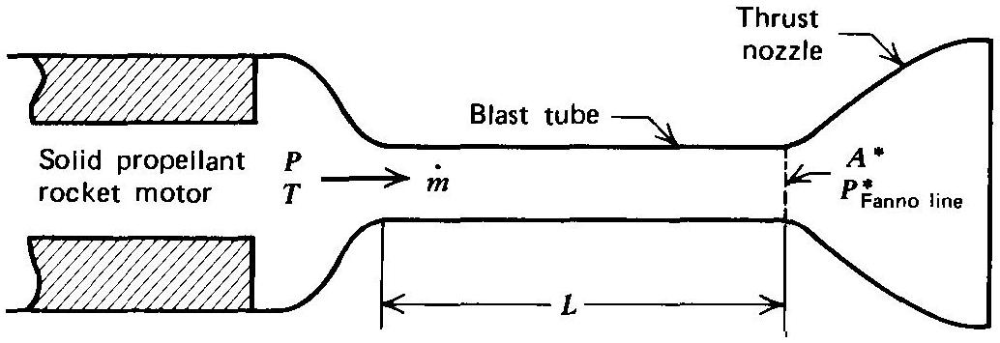
Figure 5.9. Rocket motor with a blast tube (Example 5.4).

a blast tube 3.0 m long is inserted between the motor and the thrust nozzle. Determine the mass flow rate reduction that occurs because of the presence of the blast tube. Assume $P=68.95 \cdot 10^{5} \mathrm{~N} / \mathrm{m}^{2}, T=3333.3 \mathrm{~K}, \gamma=1.2, R=322.82 \mathrm{~J} / \mathrm{kg}-\mathrm{K}$, and $\overline{\mathrm{f}}=$ 0.005 .

## Solution

From Table 3.2, for a choked flow,

$$
\dot{m}^{*}=\frac{\Gamma P^{*} A^{*}}{a_{o}}
$$

Assume that the flow in the blast tube is adiabatic, so that $T$, and thus $a_{o}$, is the same for both the isentropic flow and the Fanno line flow. However, because of the presence of wall friction in the blast tube, $P^{*}$ for the case with the blast tube will be less than $P$ for the isentropic case. The gas constant $R$ and specific heat ratio $\gamma$ are constants. Thus, equation 3.168 gives

$$
\frac{\dot{m}_{\text {blast tube }}}{\dot{m}_{\text {isentropic }}}=\frac{P_{\text {Fanno line }}^{*}}{P_{\text {isentropic }}}
$$

Because of the large stagnation pressure in the rocket motor, the flow is choked at the blast tube exit plane. Hence, $M=1$ at that point, and

$$
\frac{4 \bar{F} L^{*}}{\mathscr{D}}=\frac{4(0.005)(3.0)}{(0.075)}=0.08
$$

From Table C.7, for $\left(4 \bar{f} L^{*} / \mathscr{D}\right)=0.80$

$$
M_{1}=0.56329 \quad \text { and } \quad \frac{P_{1}}{P^{*}}=1.2481
$$

where $P_{1}=P_{\text {isentropic }}$. From equation (a),

$$
\frac{\dot{m}_{\text {blast tube }}}{\dot{m}_{\text {isentropic }}}=\frac{P_{\text {Fanno line }}^{*}}{P_{\text {isentropic }}^{*}}=\frac{1}{1.2481}=0.8012
$$

The presence of the blast tube reduces the mass flow rate by approximately 20 percent.
Example 5.5. A circular duct having an ID of 0.030 m , a surface roughness of 0.000030 m , and a length of 1.500 m is connected to the exit of a converging nozzle. Air at a stagnation pressure $P=7.0 \cdot 10^{5} \mathrm{~N} / \mathrm{m}^{2}$ and a stagnation temperature $T=300 \mathrm{~K}$ is supplied to the nozzle. The ambient pressure at the exit of the duct is $1.0135 \cdot 10^{5} \mathrm{~N} / \mathrm{m}^{2}$. Determine the maximum mass flow rate of air through the nozzle and duct. Assume that the air behaves as a perfect gas with $\gamma=1.40$ and $R=287.04 \mathrm{~J} / \mathrm{kg}-\mathrm{K}$.

## Solution

Assume that the flow in the converging nozzle is isentropic, and that the flow in the duct is a simple frictional flow (i.e., a Fanno line flow). Furthermore, assume that the frictional effects may be accounted for by an average value of the friction coefficient between the duct inlet and exit sections

$$
\overline{\mathfrak{f}}=\frac{1}{2}\left(\mathfrak{f}_{\text {inlet }}+\tilde{\mathfrak{f}}_{\text {exit }}\right)
$$

where $\mathfrak{f}$ is determined from the Moody diagram (Fig. 5.8). The pipe roughness ratio is $\varepsilon / D=(0.000030 / 0.030)=0.001$. The viscosity of air may be obtained from equation 1.30 , repeated below,

$$
\mu=\frac{\sqrt{ } t}{0.552795+\frac{2.810892 \cdot 10^{2}}{t}-\frac{13.508340 \cdot 10^{4}}{t^{2}}+\frac{39.353086 \cdot 10^{6}}{t^{3}}-\frac{41.419387 \cdot 10^{8}}{t^{4}}}
$$

where $t$ is in K and $\mu$ is in ( $\mathrm{N}-\mathrm{s} / \mathrm{m}^{2}$ ) $10^{-6}$. Because of the low back pressure, assume that the flow chokes at the exit section of the duct.

Because the friction coefficient depends on the Reynolds number which, in turn depends on the mass flow rate, this problem must be solved iteratively. The following procedure is one of several possibilities.

1. Determine a trial value for the average friction coefficient $\overline{\mathrm{f}}$. For the first trial, assume that isentropic flow exists in both the nozzle and the duct. The flow properties throughout the duct are, therefore, the critical properties for isentropic flow. Calculate the corresponding Re and obtain $\overline{\mathrm{f}}$ from the Moody chart.
2. Calculate $4 \overline{\mathrm{f}} L^{*} / \mathscr{D}$ and determine the duct inlet Mach number and the property ratios from Table C. 7 (Fanno line).
3. From Table C. 6 (isentropic flow), determine the property ratios at the nozzle exit (which is the duct inlet) corresponding to the Mach number obtained in step 2.
4. Calculate the properties at the duct inlet section (denoted by 1 ) and exit section (denoted by 2 ) from the property ratios determined in steps 3 and 4.
5. Determine the value of $\bar{f}$ corresponding to the properties obtained in step 4. Compare that value of $\overline{\mathrm{f}}$ with the trial value of $\overline{\mathrm{f}}$ determined in step 1. Repeat steps 2 through 5 until the value of $\overline{\mathrm{f}}$ converges.
6. Calculate the corresponding mass flow rate.

The above procedure is now applied to the present problem.
(1) From Table C.6, for isentropic flow throughout,

$$
\frac{t^{*}}{T}=0.83333 \quad \frac{\rho^{*}}{\rho_{o}}=0.63394
$$

For a perfect gas,

$$
\begin{aligned}
\rho_{o} & =\frac{P}{R T}=\frac{(7.0) 10^{5}}{(287.04)(300)}=8.1289 \mathrm{~kg} / \mathrm{m}^{3} \\
t^{*} & =(0.83333)(300)=250.0 \mathrm{~K} \\
V^{*} & =a^{*}=\left(\gamma R t^{*}\right)^{1 / 2}=[1.4(287.04)(250.0)]^{1 / 2}=316.96 \mathrm{~m} / \mathrm{s} \\
\rho^{*} & =(0.63394)(8.1289)=5.1532 \mathrm{~kg} / \mathrm{m}^{3}
\end{aligned}
$$

Note that for the adiabatic flow of a perfect gas, $t^{*}$ and $V^{*}$ have the same values for both isentropic flow and simple frictional flow. From equation (b), for $t^{*}=250.0 \mathrm{~K}$,

$$
\begin{aligned}
\mu^{*} & =\frac{(250.0)^{1 / 2}}{0.552795+\frac{2.810892 \cdot 10^{2}}{250.0}-\frac{13.508340 \cdot 10^{4}}{(250.0)^{2}}+\frac{39.353086 \cdot 10^{6}}{(250.0)^{3}}-\frac{41.419387 \cdot 10^{8}}{(250.0)^{4}}} \\
\mu^{*} & =16.232 \cdot 10^{-6} \mathrm{~N}-\mathrm{s} / \mathrm{m}^{2} \\
\operatorname{Re}^{*} & =\frac{D V^{*} \rho^{*}}{\mu^{*}}=\frac{(0.030)(316.96)(5.1532)}{16.232 \cdot 10^{-6}}=3.019 \cdot 10^{6}
\end{aligned}
$$

From Fig. 5.8, for $\varepsilon / \mathscr{D}=0.001$ and $\operatorname{Re}=3.019 \cdot 10^{6}, \overline{\mathrm{f}}^{\prime}=0.0198$ and $\overline{\mathrm{f}}=\overline{\mathrm{f}}^{\prime} / 4=$ 0.00495 .
(2) $\frac{4 \overline{\mathrm{~F}} L^{*}}{\mathscr{D}}=\frac{4(0.00495)(1.500)}{(0.030)}=0.990$

From Table C.7, for $4 \overline{\mathrm{f}} L^{*} / \mathscr{D}=0.990$,

$$
M_{1}=0.510 \quad \frac{\rho^{*}}{\rho_{1}}=0.54469
$$

(3) From Table C.6, for $M_{1}=0.510$,

$$
M_{1}^{*}=0.54469 \quad \frac{t_{1}}{T}=0.95055 \quad \frac{\rho_{1}}{\rho_{o}}=0.88093
$$

(4) $t_{1}=(0.95055)(300)=285.17 \mathrm{~K}$

$$
\begin{aligned}
& V_{1}=M_{1}^{*} a^{*}=(0.54469)(316.96)=172.64 \mathrm{~m} / \mathrm{s} \\
& \rho_{1}=(0.88093)(8.1289)=7.1610 \mathrm{~kg} / \mathrm{m}^{3} \\
& \rho^{*}=(0.54469)(7.1610)=3.9005 \mathrm{~kg} / \mathrm{m}^{3}
\end{aligned}
$$

(5) From equation (b),

$$
\begin{aligned}
\mu_{1} & =17.813 \cdot 10^{-6} \mathrm{~N}-\mathrm{s} / \mathrm{m}^{2} \\
\operatorname{Re}_{1} & =\frac{D V_{1} \rho_{1}}{\mu_{1}}=\frac{(0.030)(172.64)(7.1610)}{17.813 \cdot 10^{-6}}=2.082 \cdot 10^{6} \\
\operatorname{Re}^{*} & =\frac{D V^{*} \rho^{*}}{\mu^{*}}=\frac{(0.030)(316.96)(3.9005)}{16.232 \cdot 10^{-6}}=2.285 \cdot 10^{6}
\end{aligned}
$$

From Fig. 5.8, it is seen that, for $\varepsilon / \mathscr{D}=0.001$, both the inlet and exit sections of the pipe are in the wholly rough region where $\xi$ is independent of Re . Thus, for the entire pipe, $\overline{\mathrm{f}}=\mathfrak{f}_{1}=\mathfrak{f}^{*}=0.00495$, and no further iterations are required to determine $\overline{\mathfrak{f}}$. However, if either or both values of Re had been out of the wholly rough region, values of $\tilde{f}_{1}$ and $\tilde{f}^{*}$ would be determined from Fig. 5.8, and $\overline{\tilde{f}}$ would be their average. Steps 2 to 5 would be repeated with that value of $\overline{\hat{\mathrm{f}}}$.
(6) $\quad \dot{m}^{*}=\rho^{*} A V^{*}=(3.9005) \pi(0.015)^{2}(316.96)=0.8739 \mathrm{~kg} / \mathrm{s}(1.927 \mathrm{lbm} / \mathrm{sec})$

Check to insure that the duct exit section is choked.

$$
p^{*}=\rho^{*} R t^{*}=(3.9005)(287.04)(250.0)=2.799 \cdot 10^{5} \mathrm{~N} / \mathrm{m}^{2}
$$

Thus, $p^{*}>p_{o}$, and the assumption of choked flow is valid. For comparison, the
maximum isentropic mass flow rate achievable for $f=0$ is

$$
\dot{m}_{\mathrm{isen}}^{*}=\rho^{*} A V^{*}=(5.1532) \pi(0.015)^{2}(316.96)=1.1546 \mathrm{~kg} / \mathrm{s}
$$

The effect of friction in the constant-area duct, therefore, reduces the mass flow rate by 24.3 percent.

Note that the symbols $t^{*}, p^{*}, \rho^{*}, V^{*}$, and $\dot{m}^{*}$ are employed to denote the critical conditions for both isentropic flow and simple frictional flow. However, only $t^{*}$ and $V^{*}$ have the same numerical values for both flows. Care must be taken to insure that the proper critical values are employed in each of the two flow processes.

## 5-6 THE FANNO LINE FOR IMPERFECT GASES

In Section 5-5, the properties of the Fanno line are developed for perfect gases. In this section, the influence of imperfect gas effects on simple frictional flow, in a constant-area duct, is considered. Several sources of imperfect gas effects are presented in Section 4-5.

A completely general model of an imperfect gas is considered. The equations of state for the imperfect gas are given by

$$
\begin{aligned}
& v=v(p, t) \\
& h=h(v, t) \\
& s=s(v, t)
\end{aligned}
$$

Equations $5.74,5.75$, and 5.76 may be in the form of equations, charts, tables, or a computer code. As long as the equations of state are known, the analysis does not depend on the source of the imperfect gas effects.

The continuity, momentum, and energy equations for the simple frictional flow of any fluid are given by equations 5.2, 5.6, and 5.20. Those equations may be rearranged to give

$$
\begin{aligned}
V_{2} & =\frac{V_{1} v_{2}}{v_{1}} \\
h_{2} & =H-\frac{G^{2} v_{2}^{2}}{2} \\
\frac{4 \bar{f} L}{\mathscr{D}} & =2 \ln \frac{v_{1}}{v_{2}}-\frac{2}{G^{2}} \int_{1}^{2} \frac{d p}{v}
\end{aligned}
$$

Equations 5.74 to 5.79 comprise a set of six equations in terms of the flow properties $p, v, t, h, s$, and $V$, at point 1 upstream to the friction region and point 2 downstream to the friction region, and the friction parameter $4 \bar{f} L / \mathscr{D}$. When the upstream properties are given, those six equations may be solved for the six properties $p_{2}, v_{2}, t_{2}, h_{2}, s_{2}$, and $V_{2}$ for specified values of the friction parameter $4 \overline{\mathrm{f}} L / \mathscr{D}$.

The term in equation 5.79 involving the integral of $d p / v$ cannot be evaluated in closed form for an imperfect gas. A numerical integration of that term is, therefore, required for relating the friction parameter to the flow properties. In most cases, the trapezoidal rule presented in Appendix A-5(a) is satisfactory for performing that integration. When more accuracy is required, Simpson's rule, presented in Appendix A-5(b), may be employed.

Example 5.6. Consider the flow of superheated steam discussed in Example 5.1. Determine the length of duct required to choke the flow, and the velocity at the choked section. Assume $\overline{\hat{f}}=0.005$.

## Solution

Table 5.1 presents the solution of equations 5.74, 5.75, 5.76, and 5.78 for the present problem. From the data in Table 5.1, the state properties of the steam where the choking occurs are approximately $v=3.0 \mathrm{ft}^{3} / \mathrm{lbm}\left(0.1873 \mathrm{~m}^{3} / \mathrm{kg}\right)$ and $p=226 \mathrm{lbf} / \mathrm{in} .^{2}$ ( $15.58 \cdot 10^{5} \mathrm{~N} / \mathrm{m}^{2}$ ). From equation 5.77,

$$
V_{2}=\frac{(500)(3.0)}{0.7604}=1972.6 \mathrm{ft} / \mathrm{sec}(601.26 \mathrm{~m} / \mathrm{s})
$$

The length of duct required to decrease the pressure to $226 \mathrm{lbf} / \mathrm{in} .^{2}\left(15.58 \cdot 10^{5} \mathrm{~N} / \mathrm{m}^{2}\right)$ is found from equation 5.79. The integral term is evaluated graphically by plotting $1 / v$ versus $p$ over the range of interest, and then measuring the area under the curve. The graphical integration is presented in Fig. 5.10. The area under the curve is

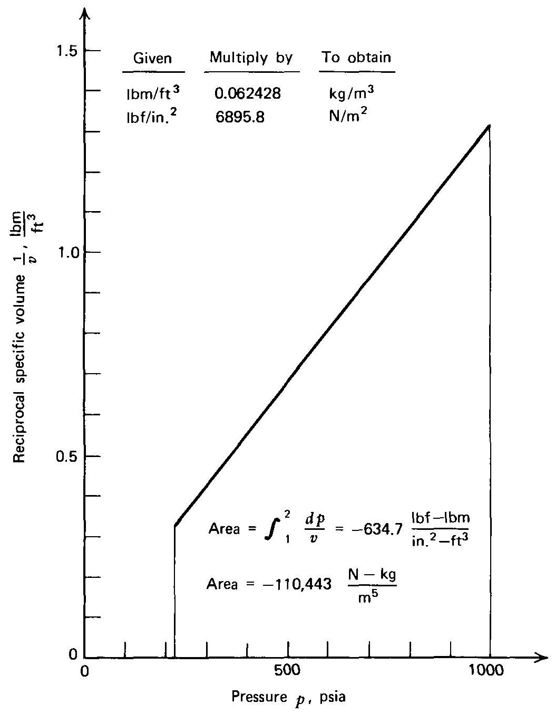
Figure 5.10. Determination of $\int_{1}^{2} \frac{d p}{v}$ for Example 5.6.

$-634.7 \mathrm{lbf}-\mathrm{lbm} / \mathrm{in} .^{2}-\mathrm{ft}^{3}\left(-110,443 \mathrm{~N}-\mathrm{kg} / \mathrm{m}^{5}\right)$. Hence, equation 5.79 gives

$$
\begin{aligned}
\frac{1}{2} \frac{4 \overline{\mathrm{f}} L}{\mathscr{D}} & =\ln \left(\frac{0.7604}{2.8}\right)-\frac{(-634.7)(32.174)(144)}{(657.5)^{2}}=-1.3035+6.8022=5.4987 \\
L & =\frac{2(5.4987)(10)}{4(0.005)(12)}=458.2 \mathrm{ft}(139.7 \mathrm{~m})
\end{aligned}
$$

## 5-7 STEADY ONE-DIMENSIONAL ISOTHERMAL FLOW WITH FRICTION IN A CONSTANT-AREA DUCT

There are some practical cases of gas flow in ducts where the flow may be assumed to be substantially isothermal. Natural gas pipelines extending for miles buried in the earth are examples of isothermal frictional flow.

The Reynolds number may be written in the form

$$
\operatorname{Re}=\frac{\rho V D}{\mu}=\frac{G D}{\mu}
$$

For a constant (isothermal) temperature the viscosity of the flowing fluid $\mu$ is a constant. Since $G$ is constant, the Reynolds number is constant at all points in the flow. Because the friction coefficient $\mathfrak{f}$ for a given pipe surface is a function of the Reynolds number alone [see Section 5-4(b)], it follows that in isothermal flow $\hat{f}$ is invariant along the pipe.

## 5-7(a) Governing Equations

From Table 3.2, the energy equation for the isothermal $(d t=0)$ flow of a perfect gas in the absence of work and body forces is

$$
\delta Q=d\left(\frac{V^{2}}{2}\right)=d H=c_{p} d T
$$

Equation 5.81 shows that for an isothermal flow, the stagnation temperature $T$ does not remain constant.

In the absence of body forces and the drag caused by submerged bodies, the dynamic equation, equation 3.160 , reduces to

$$
v d p+V d V+\frac{V^{2}}{2}\left(\frac{4 \mathfrak{f} d x}{\mathscr{D}}\right)=0
$$

Hence,

$$
2\left(\frac{v}{V^{2}}\right) d p+\frac{2 d V}{V}+\left(\frac{4 \mathfrak{f} d x}{\mathscr{D}}\right)=0
$$

From the continuity equation (equation 5.2),

$$
G=\frac{\dot{m}}{A}=\rho V=\frac{V}{v}=\mathrm{constant}
$$

For a constant-area duct with steady flow, $G$ is a constant, and the continuity equation may be written in the form

$$
\frac{d v}{v}=\frac{d V}{V}
$$

For an isothermal process the equation of state for a perfect gas is $p v=$ constant. Hence, in view of equation 5.85,

$$
\frac{d p}{p}=-\frac{d v}{v}=-\frac{d V}{V}
$$

To obtain a relationship between the friction term $4 \mathfrak{f} d x / \mathscr{D}$ and the static pressure for the flow, the term $d V / V$ is eliminated from equation 5.83 by means of equation 5.86. The result is

$$
\left(\frac{2 v}{p V^{2}}\right) p d p-\frac{2 d p}{p}+\frac{4 \mathfrak{f} d x}{\mathscr{D}}=0
$$

The initial conditions $p_{1}, v_{1}$, and $V_{1}$ may be assumed to be known constants and, for the reasons explained earlier, $\mathfrak{f}$ is a constant. The term ( $2 v / p V^{2}$ ) may be rewritten as $\left(2 v^{2} / V^{2} p v\right)$, which is equivalent to $\left(2 / G^{2} R t\right)$, which is a constant for isothermal flow. Consequently, $\left(2 v / p V^{2}\right)$ is a constant and may be determined at the initial condition. Hence, equation 5.87 may be integrated to give

$$
\frac{2 v_{1}}{V_{1}^{2} p_{1}} \int_{1}^{2} p d p-2 \int_{1}^{2} \frac{d p}{p}+\frac{4 \tilde{\mathscr{D}}}{\mathscr{D}} \int_{0}^{L} d x=0
$$

Integrating equation 5.88 and rearranging gives

$$
\frac{4 \mathfrak{f} L}{\mathscr{D}}=\frac{v_{1}}{V_{1}^{2} p_{1}}\left(p_{1}^{2}-p_{2}^{2}\right)+\ln \left(\frac{p_{2}}{p_{1}}\right)^{2}
$$

But $\gamma p_{1} v_{1}=a_{1}{ }^{2}$ and $a_{1}{ }^{2} / V_{1}{ }^{2}=1 / M_{1}{ }^{2}$. Hence,

$$
\frac{4 \mathfrak{f} L}{\mathscr{D}}=\frac{1}{\gamma M_{1}{ }^{2}}\left[1-\left(\frac{p_{2}}{p_{1}}\right)^{2}\right]+\ln \left(\frac{p_{2}}{p_{1}}\right)^{2}
$$

The stagnation temperature ratio between any two points in the flow is given by (recall that $t=$ constant)

$$
\frac{T_{2}}{T_{1}}=\frac{1+\frac{\gamma-1}{2} M_{2}^{2}}{1+\frac{\gamma-1}{2} M_{1}^{2}}
$$

The stagnation pressure ratio is given by

$$
\frac{P_{2}}{P_{1}}=\frac{p_{2}}{p_{1}}\left(\frac{1+\frac{\gamma-1}{2} M_{2}^{2}}{1+\frac{\gamma-1}{2} M_{1}^{2}}\right)^{\gamma /(\gamma-1)}
$$

From the definition of the impulse function, equation 3.139

$$
\frac{\mathscr{F}_{2}}{\mathscr{F}_{1}}=\frac{p_{2}}{p_{1}} \frac{\left(1+\gamma M_{2}^{2}\right)}{\left(1+\gamma M_{1}^{2}\right)}
$$

## 5-7(b) Limiting Conditions

As the gas flows along the pipe, its static pressure decreases. Eventually a limiting condition is reached where the pipe cannot be increased in length without altering the upstream conditions; that is, the flow has become choked. At that point, $d x / d p=0$. Referring to equation 5.87, it is seen that at that limiting condition,

$$
\frac{d x}{d p}=\frac{2 \mathscr{D}}{4 \mathfrak{f}}\left(\frac{v}{V^{2}}-\frac{1}{p}\right)=0
$$

Denoting the properties at the limiting condition by the subscript $L$, equation 5.94 gives

$$
V_{L}^{2}=p_{L} v_{L}
$$

Hence, the limiting or choking velocity for the isothermal flow of a perfect gas in a constant-area duct in the presence of wall friction alone is

$$
V_{L}=\sqrt{p_{L} v_{L}}=\sqrt{R t_{L}}=\sqrt{R t_{1}}=\frac{a_{1}}{\sqrt{\gamma}}
$$

It follows from equation 5.96 that when the gas velocity attains the value $a_{1} / \sqrt{\gamma}$, the flow becomes choked. The choking velocity $V_{L}$ is seen to be less than the sonic velocity by the factor $1 / \sqrt{\gamma}$. When $M<1 / \sqrt{\gamma}$, the fluid is receiving heat, and when $M>1 / \sqrt{\gamma}$, it rejects heat.

The pressure ratio at choking $p_{L} / p_{1}$ is readily determined from the equation of state, the continuity equation, and equation 5.96. Thus,

$$
\frac{p_{L}}{p_{1}}=\frac{v_{1}}{v_{L}}=\frac{V_{1}}{V_{L}}=\frac{V_{1} \sqrt{\gamma}}{a_{1}}=M_{1} \sqrt{\gamma}
$$

Substituting from equation 5.97 into equation 5.90 gives the equation relating the friction term $4 \mathfrak{f} L_{\text {max }} / \mathscr{D}$ to the pressure ratio at choking flow; the length $L_{\text {max }}$ is that corresponding to $V_{L}$ and $p_{L}$. Thus,

$$
\frac{4 \mathrm{f} L_{\max }}{\mathscr{D}}=\left[\left(\frac{p_{1}}{p_{L}}\right)^{2}-1\right]-\ln \left(\frac{p_{1}}{p_{L}}\right)^{2}
$$

Equation 5.98 is applicable to compressible fluids which satisfy the relationship $p v=R t$. Substituting equation 5.97 into equation 5.98 results in the following relationship between the maximum duct length $L_{\text {max }}$ and the inlet Mach number $M_{1}$.

$$
\frac{4 \mathfrak{f} L_{\max }}{\mathscr{D}}=\frac{1-\gamma M_{1}^{2}}{\gamma M_{1}^{2}}+\ln \left(\gamma M_{1}^{2}\right)
$$

If the gas flows isothermally under conditions where compressibility effects are negligible and only wall friction is encountered, then $d M^{2}=0, \delta D / A p=0$, and $d t / t=0$, and the momentum equation (see equation 3.170, Table 3.2) reduces to

$$
\frac{d p}{p}=-\frac{\gamma M_{1}^{2}}{2}\left(\frac{4 f d x}{\mathscr{D}}\right)
$$

Integrating equation 5.100 yields

$$
\ln \left(\frac{p_{2}}{p_{1}}\right)=-\frac{\gamma M_{1}^{2}}{2}\left(\frac{4 \mathfrak{f} L}{\mathscr{D}}\right)
$$

For the flow to be considered incompressible, the pressure ratio $p_{2} / p_{1}$ cannot differ significantly from unity. Expanding $\ln \left(p_{2} / p_{1}\right)$ into a series gives

$$
\ln \left(\frac{p_{2}}{p_{1}}\right)=\frac{p_{2}}{p_{1}}-1-\frac{1}{2}\left(\frac{p_{2}}{p_{1}}-1\right)^{2}+\frac{1}{3}\left(\frac{p_{2}}{p_{1}}-1\right)^{3}+\cdots
$$

Hence, equation 5.101 may be written in the form

$$
\frac{p_{2}}{p_{1}} \approx 1-\frac{\gamma M_{1}^{2}}{2}\left(\frac{4 \mathfrak{f} L}{\mathscr{D}}\right)
$$

## 5-7(c) Tables for the Isothermal Frictional Flow of a Perfect Gas in a Constant-Area Duct

For calculation purposes, it is convenient to construct a table of flow property ratios for isothermal frictional flow, employing the limiting condition where $M= 1 / \sqrt{\gamma}$ as a reference state. Substituting that value for $M_{1}$ into the equations derived in Sections 5-7(a) and 5-7(b), the results presented in Table 5.7 are obtained.

Table 5.7 Property Ratios for the Isothermal Frictional Flow of a Perfect Gas in a Constant-Area Duct

$$
\begin{aligned}
\frac{p_{L}}{p} & =\frac{v}{v_{L}}=\frac{\rho_{L}}{\rho}=\frac{V}{V_{L}}=\sqrt{\gamma} M \\
\frac{P}{P_{L}} & =\frac{1}{\sqrt{\gamma} M}\left[\left(\frac{2 \gamma}{3 \gamma-1}\right)\left(1+\frac{\gamma-1}{2} M^{2}\right)\right]^{7 /(\gamma-1)} \\
\frac{T}{T_{L}} & =\left(\frac{2 \gamma}{3 \gamma-1}\right)\left(1+\frac{\gamma-1}{2} M^{2}\right) \\
\frac{\mathscr{F}}{\mathscr{F}_{L}} & =\frac{\left(1+\gamma M^{2}\right)}{2 \sqrt{\gamma} M} \\
\frac{4 L_{\max }}{\mathscr{D}} & =\frac{\left(1-\gamma M^{2}\right)}{\gamma M^{2}}+\ln \left(\gamma M^{2}\right)
\end{aligned}
$$

Table 5.8 Limiting Values of the Property Ratios for the Isothermal Frictional Flow of a Perfect Gas in a Constant-Area Duct
| $M=M^{*}$ | $\begin{gathered} \frac{p}{p_{L}}=\frac{v}{v_{L}}= \\ \frac{\rho_{L}}{\rho}=\frac{V}{V_{L}} \end{gathered}$ | $\frac{T}{T_{L}}$ | $\frac{P}{P_{L}}$ | $\frac{\mathscr{F}}{\mathscr{F}_{\boldsymbol{L}}}$ | $\frac{4 \mathrm{f} L}{\mathscr{D}}$ |
| :--- | :--- | :--- | :--- | :--- | :--- |
| 0 | 0 | $\left(\frac{2 \gamma}{3 \gamma-1}\right)$ | $\infty$ | $\infty$ | $\infty$ |
| $\frac{1}{\sqrt{\gamma}}$ | 1 | 1 | 1 | 1 | 0 |
| 1 | $\sqrt{\gamma}$ | $\frac{\gamma(\gamma+1)}{(3 \gamma-1)}$ | $\frac{1}{\sqrt{\gamma}}\left[\frac{\gamma(\gamma+1)}{(3 \gamma-1)}\right]^{\gamma /(\gamma-1)}$ | $\frac{(\gamma+1)}{2 \sqrt{\gamma}}$ | $\left[\frac{(1-\gamma)}{\gamma}+\ln (\gamma)\right]$ |
| $\infty$ | $\infty$ | $\infty$ | $\infty$ | $\infty$ | $\infty$ |


Values of the property ratios as a function of the Mach number $M$ are presented in Table C. 8 for $\gamma=1.4$. Table 5.8 illustrates the general arrangement of Table C. 8 and also presents the limiting values of the property ratios.

A FORTRAN program, subroutine TCFRIC, is presented below for calculating the property ratios presented in Table 5.7. The program input is the same as that discussed in Section 4-4(b). The results presented in Table C. 8 for $\gamma=1.4$ are obtained by the following specification.
$\mathrm{G}=1.4, \mathrm{~J}(1)=25, \mathrm{~J}(2)=30, \mathrm{~J}(3)=10, \mathrm{~J}(4)=11, \mathrm{~J}(5)=0$, $\mathrm{DM}(1)=0.02, \mathrm{DM}(2)=0.05, \mathrm{DM}(3)=0.2, \mathrm{DM}(4)=1.0$

Example 5.7. Air flows in a long pipe under isothermal conditions. At the pipe inlet, the static temperature and pressure are 300 K and $3.500 \cdot 10^{5} \mathrm{~N} / \mathrm{m}^{2}$, respectively, and the velocity is $175 \mathrm{~m} / \mathrm{s}$. The pipe ID is 0.150 m and the friction coefficient

```
        SUBROUTINE TCFRIC
C ISOTHERMAL FRICTIONAL FLOW PROPERTY RATIOS FOR A PERFECT GAS
        REAL M.MS.MT $ DIMENSION J(9).DM(9) $ DATA INF/6H INFIN/
        NAMELIST /DATA/ G.J.DM $ READ (5.DATA)
        G1 = (G-1.0)/2.0 $ G2=SQRT(G) $ G3=2.0*G/(3.0*G-1.0) $ G4=G/(G-1.0)
        M=0.0 $ V=0.0 $ TO=G3 $ MT=1.0/G2
        WRITE (6.2000) G $ WRITE (6.2010) M.V.TO.INF.INF.INF $ I=1 $ L=0
C CALCULATE PROPERTY RATIOS
    40 N=J(I) $ DO 50 K=1.N $ M=M+DM(I) $ C=1.0+G1*M**2 $ V=G2*M
        TO=G3*C $ PO=TO**G4/V s F=(1.0+G*M**2)/(2.0*V)
        X=(1.0-G*M**2)/V**2+ALOG(V**2) $ WRITE (6,2020) M,V,TO,PO,F,X
        L=L+1 $ IF (L.LT.50) GO TO 45 $ WRITE (6,2000) G $ L=0 $ GO TO 50
    45 IF ((MT-M).GT.DM(I)) GO TO 50 $ V=1.0 $ TO=1.0 $ PO=1.0 $ F=1.0
        X=0.0 $ WRITE (6,2040) MT,V,TO,PO,F,X $ MT=1.OE+3O
    50 CONTINUE $ I=I+1 $ IF((I.EQ.10).OR.(J(I).EQ.0)) GO TO 60 $GO TO 40
    60 V=0.0 $ TO=0.0 $ WRITE (6,2030) INF,INF,INF,INF,INF,INF $ RETURN
2000 FORMAT (1H1,17X,36HISOTHERMAL FRICTIONAL FLOW, GAMMA =,F5,2/14X,
        11HM, 7X, 4HV/VL, 7X, 6HTO/TOL, 7X, 6HPO/POL, 7X, 4HF/FL, 9X, 6H4FL*/D/10X,
        29HPL/P,RL/R/)
2010 FORMAT (1H ,F5.2,2X,2E13.5,3X,A6,2(7X,A6))
2020 FORMAT (1H .F5.2.2X,5E13.5)
2030 FORMAT (A6,5x,A6,4(7X,A6))
2040 FORMAT (1H ,F7.4,5E13.5)
        END
```

$\mathfrak{f}=0.005$. Calculate (a) the length of pipe required to choke the flow, (b) the limiting velocity, (c) the limiting pressure, and (d) the length of pipe at the station where the Mach number is 0.60 . Here $\mathscr{D}=D$.

## Solution

The inlet speed of sound and Mach number are

$$
\begin{aligned}
a_{1} & =a=a_{L}=\left(\gamma R t_{1}\right)^{1 / 2}=[1.4(287.04)(300)]^{1 / 2}=347.21 \mathrm{~m} / \mathrm{s} \\
M_{1} & =\frac{V_{1}}{a_{1}}=\frac{175}{347.21}=0.50
\end{aligned}
$$

From equation 5.108,

$$
\begin{aligned}
\frac{4 \mathfrak{f} L_{\max }}{\mathscr{D}} & =\frac{1-\gamma M_{1}{ }^{2}}{\gamma M_{1}{ }^{2}}+\ln \left(\gamma M_{1}{ }^{2}\right)=\frac{1-(1.4)(0.5)^{2}}{(1.4)(0.5)^{2}}+\ln \left[(1.4)(0.5)^{2}\right] \\
\frac{4 \mathfrak{f} L_{\max }}{\mathscr{D}} & =0.80732
\end{aligned}
$$

(a) $\quad L_{\text {max }}=\frac{(0.80732) \mathscr{D}}{4 \hat{f}}=\frac{(0.80732)(0.150)}{(4)(0.005)}=6.055 \mathrm{~m}(19.865 \mathrm{ft})$
(b) For isothermal flow, $M_{L}=1 / \sqrt{\gamma}=0.84515$. Therefore,

$$
V_{L}=M_{L} a_{L}=(0.84515)(347.21)=293.44 \mathrm{~m} / \mathrm{s}(962.73 \mathrm{ft} / \mathrm{sec})
$$

(c) From equation 5.104,

$$
\begin{aligned}
& \frac{p_{L}}{p_{1}}=\sqrt{\gamma} M_{1}=\sqrt{1.4}(0.5)=0.59161 \\
& p_{L}=(0.59161)(3.50) 10^{5}=2.0706 \cdot 10^{5} \mathrm{~N} / \mathrm{m}^{2}\left(30.03 \mathrm{lbf} / \mathrm{in}^{2} .\right)
\end{aligned}
$$

(d) For a Mach number of 0.6 , equation 5.108 yields

$$
\begin{aligned}
\frac{4 \mathfrak{f} L_{\max }}{\mathscr{D}} & =\frac{1-(1.4)(0.6)^{2}}{(1.4)(0.6)^{2}}+\ln \left[(1.4)(0.6)^{2}\right]=0.29895 \\
L_{\max } & =\frac{(0.29895)(0.150)}{(4)(0.005)}=2.242 \mathrm{~m} \\
\Delta L & =L_{\max }(M=0.5)-L_{\max }(M=0.6)=6.055-2.242=3.813 \mathrm{~m}(12.51 \mathrm{ft})
\end{aligned}
$$

## 5-8 DIMENSIONAL ANALYSIS

Many dynamic problems in engineering are solved by comparing the behaviors of two similar systems of widely different size, such as the prediction of the behavior of a prototype from experiments conducted with a model. For the results to be satisfactory, the model and the prototype must be not only geometrically similar but, in addition, any fluid flows that are involved must be dynamically similar; that is, the ratios of all of the forces acting on the fluid must have identical values for the model and the prototype.

Dimensional analysis ${ }^{9-12}$ is a mathematical procedure for establishing the conditions for achieving dynamic similarity in geometrically similar systems. By applying dimensional analysis, we may determine how to arrange the variables that enter into a physical problem into dimensionless groups, which make it convenient for conducting an experimental investigation of the problem at hand without destroying the generality of the relationships between the pertinent variables. Dimensional analysis is particularly useful when a large number of variables is involved.

When a given number of physical variables enter into a physical relationship, the homogeneity principle [see Section 1-3(c)] limits the number of possible relationships in a special manner. It can be shown that, if a functional relationship exists between the variables $Q_{1}, Q_{2}, \ldots, Q_{m}$, then

$$
F\left(Q_{1}, Q_{2}, \ldots, Q_{m}\right)=0
$$

where $F()$ denotes a functional relationship between the variables enclosed in the parentheses. If equation 5.109 represents a complete equation between the $m$ different physical variables $Q_{1}, Q_{2}, \ldots, Q_{m}$, and if there are $n$ principal dimensions [see Section 1-3(a)], the above functional relationship may be transformed to the form ${ }^{9-12}$

$$
F\left(\pi_{1}, \pi_{2}, \ldots, \pi_{m-n}\right)=0
$$

The relationship expressed by equation 5.110 is said to be a complete equation if it remains valid regardless of the consistent system of units employed for evaluating it. In the functional relationship given by equation 5.110, the $\pi$ 's represent ( $m-n$ ) independent dimensionless groups formed from the original variables $Q_{1}, Q_{2}, \ldots, Q_{m}$. Each $\pi$ group is composed of $n+1$ physical variables, and in each successive $\pi$ group only one variable is changed.

If more than one kind of the same physical variable enters into the functional relationship, such as several lengths, each of the same kind of a variable may be represented by one of them and the ratios of the others to it. If there are $l$ such ratios, then the functional relationship expressed by equation 5.110 transforms to

$$
F\left(\pi_{1}, \pi_{2}, \ldots, \pi_{m-n-l}, r_{1}, r_{2}, \ldots, r_{l}\right)=0
$$

where $r_{1}, r_{2}, \ldots, r_{l}$ are the pertinent ratios.

Each $\pi$ group represents a dimensionless product of the form

$$
\pi=Q_{1}^{e_{1}} Q_{2}^{e_{2}} \cdots Q_{m}^{e_{m}}
$$

where $e_{1}, e_{2}, \ldots, e_{m}$ are exponents that have to be determined.
To illustrate the application of the method of dimensional analysis, consider the problem of determining the aerodynamic resistance, termed the drag, of an airfoil moving horizontally in the atmospheric air surrounding Earth.

The drag will, of course, depend on those variables that influence the resistance to motion of any body completely submerged to a considerable depth in a large body of fluid. Because of the depth of submergence of the airfoil in the air of Earth's atmosphere, no gravity waves will be formed on the free surface of the atmosphere. Hence, forces caused by the gravitational attraction of Earth on the airfoil will have no influence on the drag of the airfoil.

Assume that the airfoil moves with the uniform speed $V$ relative to the atmospheric air, so that no accelerating forces act on it. Physical intuition would indicate that there is a functional relationship between the drag of the airfoil, denoted by $D$, and the following variables: $V$, the relative velocity of the airfoil with respect to the atmospheric air, termed the relative wind velocity; $\rho$, the density of the air; $\mu$, the dynamic (or absolute) viscosity of the air; $a$, the local speed of sound or acoustic speed in the neighborhood of the airfoil; and the shape and size of the airfoil. For a family of geometrically similar airfoils, a single linear dimension, denoted by $\ell$, will define each of them. The linear dimension $\ell$ is termed the characteristic length of the airfoil.

The following form of functional relationship is, therefore, indicated.

$$
F(D, \ell, V, \rho, \mu, a)=0
$$

The drag characteristics for the airfoil are determined from experiments conducted in a wind tunnel; the airfoil is held stationary and air is caused to flow past it with the relative wind velocity $V$. The most suitable method for conducting the experiments is determined by performing a dimensional analysis.

Referring to equation 5.113, it is seen that the number of physical variables that may influence the drag $D$ is $m=6$. The number of principal dimensions for a dynamical system is $n=3$ (either $F, L$, and $T$ or $M, L$, and $T$ ). Hence, there are $(m-n)=3$ dimensionless groups; that is, there are $3 \pi$ groups. Therefore, we may write

$$
F\left(\pi_{1}, \pi_{2}, \pi_{3}\right)=0
$$

The form of each $\pi$ group is determined by selecting three of the physical variables in equation 5.113, raising each variable to the power of an unknown exponent, and then combining them with a fourth physical variable raised to the exponent unity. Thus, selecting $\ell, V$, and $\rho$ as the three physical variables to be raised to unknown exponents, we may write the following equations:

$$
\begin{aligned}
& \pi_{1}=D \ell^{x_{1}} V^{y_{1}} \rho^{z_{1}} \\
& \pi_{2}=\mu \ell^{x_{2}} V^{y_{2}} \rho^{z_{2}} \\
& \pi_{3}=a \ell^{x_{3}} V^{y_{3}} \rho^{z_{3}}
\end{aligned}
$$

To determine the values of the exponents $x_{1}, y_{1}$, and $z_{1}$ of $\pi_{1}$, each of the physical variables is expressed in terms of its dimensions raised to the exponent that is attached to the variable. For example,

$$
\left(\pi_{1}\right)=\left(F^{0} L^{0} T^{0}\right)=\left(F^{1}\right)\left(L^{x_{1}}\right)\left(L^{y_{1}} T^{-y_{1}}\right)\left(F^{z_{1}} T^{2 z_{1}} L^{-4 z_{1}}\right)
$$

Writing an equation for the exponent of each dimension, we obtain

$$
\begin{array}{r}
F^{0}: 1+z_{1}=0 \\
L^{0}: x_{1}+y_{1}-4 z_{1}=0 \\
T^{0}:-y_{1}+2 z_{1}=0
\end{array}
$$

The simultaneous solution of equations 5.119 yields $x_{1}=-2, y_{1}=-2$, and $z_{1}=1$. Hence,

$$
\pi_{1}=\frac{D}{\ell^{2} V^{2} \rho}
$$

Similarly, for $\pi_{2}$,

$$
\left(\pi_{2}\right)=\left(F^{1} T^{1} L^{-2}\right)\left(L^{x_{2}}\right)\left(L^{y_{2}} T^{-y_{2}}\right)\left(F^{z_{2}} T^{2 z_{2}} L^{-4 z_{2}}\right)
$$

Solving for the exponents, we obtain $x_{2}=-1, y_{2}=1$, and $z_{2}=-1$. Hence,

$$
\pi_{2}=\frac{\mu}{\ell \rho V}
$$

For $\pi_{3}$, we write

$$
\left(\pi_{3}\right)=\left(L^{1} T^{-1}\right)\left(L^{x_{3}}\right)\left(L^{y_{3}} T^{-y_{3}}\right)\left(F^{z_{3}} T^{2 z_{3}} L^{-4 z_{3}}\right)
$$

The numerical values of the exponents are $x_{3}=0, y_{3}=-1$, and $z_{3}=0$. Hence,

$$
\pi_{3}=\frac{a}{V}
$$

Substituting for $\pi_{1}, \pi_{2}$, and $\pi_{3}$ in the functional relationship expressed by equation 5.114 yields

$$
F\left(\frac{D}{\ell^{2} \rho V^{2}}, \frac{\mu}{\ell \rho V}, \frac{a}{V}\right)=0
$$

Equation 5.125 indicates that the drag $D$ for an airfoil moving through air with the uniform relative wind speed $V$ is given by

$$
\frac{D}{\ell^{2} \rho V^{2}}=f\left(\frac{\ell \rho V}{\mu}, \frac{V}{a}\right)
$$

The projected area of the airfoil, denoted by $A$, has the same dimensions as does $\ell^{2}$ and may, therefore, replace $\ell^{2}$ in equation 5.126. In addition, since equation 5.126 is a functional relationship, the general form of the relationship is unchanged by the introduction of a pure constant into any of the $\pi$ groups. Only the specific form of the function changes when constants are introduced. Thus, the $\pi_{1}$ group defined by equation 5.120 may be rewritten as

$$
\pi_{1}=\frac{D}{\frac{1}{2} \rho V^{2} A}=C_{D}
$$

which is termed the drag coefficient and denoted by the symbol $C_{D}$.
Equation 5.126 may thus be written as
where

$$
\begin{aligned}
C_{D} & =f(\operatorname{Re}, M) \\
\operatorname{Re} & =\frac{\ell \rho V}{\mu}, \quad \text { the Reynolds number } \\
M & =\frac{V}{a}, \quad \text { the Mach number }
\end{aligned}
$$

Experiments are conducted, in a wind tunnel, for obtaining the characteristic curves of the drag coefficient $C_{D}$ as a function of the Reynolds number Re, for several constant values of the Mach number $M$. Likewise, experiments are conducted for obtaining curves of $C_{D}$ as a function of the Mach number $M$ for several constant values of the Reynolds number Re.

At relative wind speeds less than $V=150 \mathrm{~m} / \mathrm{s}$ approximately, it may be assumed that atmospheric air behaves as an incompressible fluid. For those conditions the compressibility of the air may be neglected and the Mach number does not enter into the functional relationship. Hence, for incompressible flow,

$$
C_{D}=f(\mathrm{Re})
$$

Equation 5.131 states that under incompressible flow conditions, the drag of an airfoil (or airplane) depends on the relative wind velocity $V$, the density $\rho$ of the air, the viscosity $\mu$ of the air, the projected area $A$ of the airfoil (or airplane wings), and an experimentally determined drag coefficient $C_{D}$.

For a more complete treatment of dimensional analysis, model testing, and dynamic similarity, refer to References 9 to 13 at the end of the chapter.

## 5-9 THE NAVIER-STOKES EQUATIONS

The preceding sections considered simple frictional flows; that is, flows that are steady, one-dimensional, and involve only wall friction. The effects of friction are taken into account by an empirically determined friction coefficient $\mathfrak{f}$. Most real flows are more complicated than the simple frictional flow. They may be unsteady multidimensional flows and involve fluids having significant viscosity. For such flows the momentum and energy equations must account for the effects of the fluid friction. In many flow situations, the effects of fluid shear in the energy equation (manifested by the shear work term in equation 2.88) is small and may be neglected. But the effects of fluid shear in the momentum equation (represented by the term $\mathbf{F}_{\text {shear }}$ in equation 2.87 ) may be significant. In the present section, the differential form of the momentum equation, including the effects of shearing stresses in the fluid, is presented. The resulting equations are known as the Navier-Stokes equations. One of the few exact solutions to those equations is presented herein; it is that for the steady fully developed laminar flow of an incompressible fluid in a circular duct, termed simple laminar frictional flow.

## 5-9(a) The Momentum Equation

Newton's second law of motion for an inertial rigid control volume is derived in Section 2-6; it is equation 2.49, which is repeated and renumbered below.

$$
\mathbf{F}_{\text {external }}=\int_{\mathscr{V}}(\rho \mathbf{V})_{t} d \mathscr{V}+\int_{A} \mathbf{V}(\rho \mathbf{V} \cdot d \mathbf{A})
$$

The differential form of the momentum equation, including viscous stresses in the fluid, is obtained by applying equation 5.132 to an inertial rigid control volume of differential size, as illustrated in Fig. 5.11 for a Cartesian coordinate system. For that differential control volume, the right-hand side of equation 5.132 is determined by transforming the surface area term from a surface integral to a volume integral by means of the divergence theorem (see Section 2-1). The resulting volume integral is then evaluated in the limit as the control volume $\mathscr{V}$ approaches zero. Those steps are illustrated in Section 2-6, where the momentum equation for frictionless flow

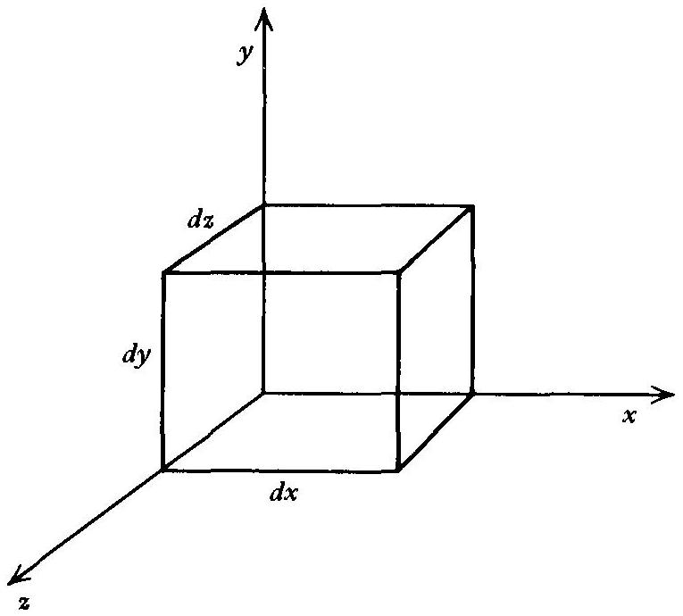
Figure 5.11. A differential size control volume in a Cartesian coordinate system.

(i.e., Euler's equation) is derived. For a differential control volume $d \mathscr{V}$, equation 5.132 becomes

$$
\mathbf{F}_{\text {external }}=(\rho d \mathscr{V}) \frac{D \mathrm{~V}}{D t}
$$

where $\mathbf{F}_{\text {external }}$ is the net external force acting on the differential control volume $d \mathscr{V}$.
The external forces acting on the differential control volume may be divided into two types of forces, body forces and surface forces. Hence,

$$
\mathbf{F}_{\text {exiernal }}=\mathbf{F}_{B}+\mathbf{F}_{S}
$$

The surface forces may be further subdivided into normal forces and tangential forces.

$$
\mathbf{F}_{S}=\mathbf{F}_{n}+\mathbf{F}_{t}
$$

In the developments of Section 2-6(c), the tangential forces are neglected, and the resulting equation is Euler's equation, equation 2.63 , which is repeated below.

$$
\rho \frac{D \mathbf{V}}{D t}+\nabla p-\rho \mathbf{B}=0
$$

In the present section, the tangential forces are included in equations 5.133. The resulting equations are the Navier-Stokes equations mentioned above. They are the counterpart to Euler's equation for the case of flow with viscous shearing stresses. For a frictionless flow, the Navier-Stokes equations reduce to Euler's equation.

## 5-9(b) Stresses Acting on a Differential Control Volume

Figure 5.12 illustrates the forces acting on a differential control volume in a Cartesian coordinate system. The body force $\mathbf{F}_{B}$ is given by

$$
\mathbf{F}_{B}=\mathbf{B} \rho d \mathscr{V}=\left(\mathbf{i} B_{x}+\mathbf{j} B_{y}+\mathbf{k} B_{z}\right)(\rho d \mathscr{V})
$$

where $\mathbf{B}$ is the body force per unit mass. The surface forces are decomposed into the forces acting on each of the six faces of the control surface, and denoted by $\mathbf{F}_{S x}$, etc., where the subscripts $x, y$, and $z$ denote a force acting on a surface perpendicular to the $x, y$, and $z$ axis, respectively. The surface forces may be subdivided into normal

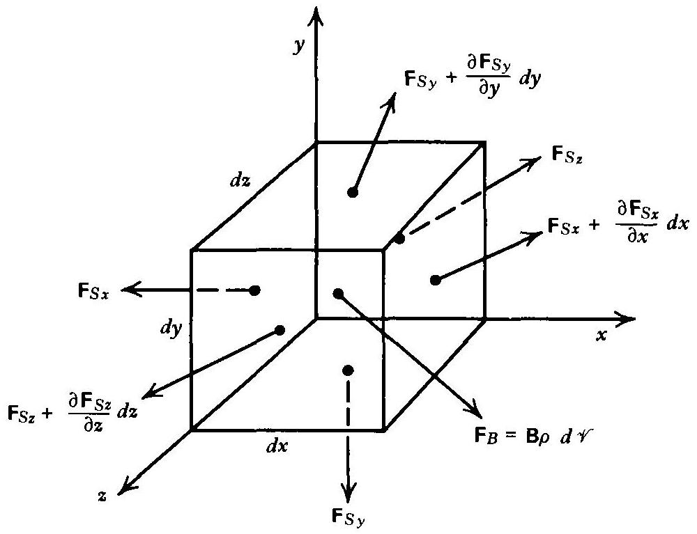
Figure 5.12. External forces acting on a rigid inertial control volume of differential size.

and tangential forces, and the tangential forces may be further subdivided into two orthogonal components parallel to the coordinate axes. Thus,

$$
\mathbf{F}_{S}=\mathbf{F}_{n}+\mathbf{F}_{t}
$$

Figure 5.13 illustrates the forces acting on the surfaces perpendicular to the $x$ axis.
The following notation is employed for specifying the surface forces. For the normal force component, the subscript indicates the direction of the force; for example, $F_{n x}$ is the normal force in the $x$ direction acting on a surface perpendicular to the $x$ axis. For the tangential forces, the first subscript denotes the direction of

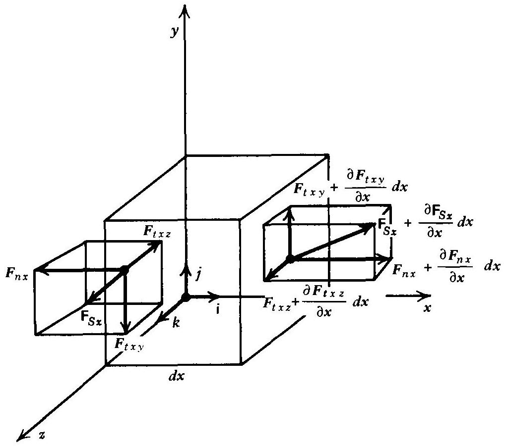
Figure 5.13. Components of the surface forces acting on surfaces perpendicular to the $x$ axis.

the normal to the surface on which the force acts, and the second subscript indicates the direction in which the force acts. For example, $F_{t x y}$ is the tangential force on a surface perpendicular to the $x$ axis but acting in the $y$ direction. The surfaces themselves are called faces; they are termed positive faces when the outward normal points in a positive coordinate direction, and negative faces when the outward normal points in a negative coordinate direction. By convention, all forces are assumed to act in a positive direction on positive faces and in a negative direction on negative faces. Thus, on the negative $x$ face in Fig. 5.13,

$$
\mathbf{F}_{S x}=-\left(\mathbf{i} F_{n x}+\mathbf{j} F_{t x y}+\mathbf{k} F_{t x z}\right)
$$

Similar expressions may be written for the five remaining faces.
For a differential control volume, the surface forces may be expressed in terms of the surface force per unit area, or the surface stresses. Thus,

$$
\begin{aligned}
\sigma_{i}=\lim _{\Delta A_{i} \rightarrow 0} \frac{\Delta F_{n i}}{\Delta A_{i}} & (i=x, y, z) \\
\tau_{i j}=\lim _{\Delta A_{i} \rightarrow 0} \frac{\Delta F_{t i j}}{\Delta A_{i}} & (i, j=x, y, z)
\end{aligned}
$$

where $\sigma_{i}$ denotes a normal stress in the $i$ direction (i.e., $F_{n i}$ ) and $\tau_{i j}$ denotes a tangential, or shear, stress on the $i$ face acting in the $j$ direction (i.e., $F_{t i j}$ ). In terms of $\sigma_{i}$ and $\tau_{i j}$, equation 5.138 becomes

$$
\mathbf{F}_{S x}=-\left(\mathbf{i} \sigma_{x}+\mathbf{j} \tau_{x y}+\mathbf{k} \tau_{x z}\right) d y d z
$$

In a similar manner, we obtain

$$
\begin{aligned}
& \mathbf{F}_{S y}=-\left(\mathbf{i} \tau_{y x}+\mathbf{j} \sigma_{y}+\mathbf{k} \tau_{y z}\right) d x d z \\
& \mathbf{F}_{S z}=-\left(\mathbf{i} \tau_{z x}+\mathbf{j} \tau_{z y}+\mathbf{k} \sigma_{z}\right) d x d y
\end{aligned}
$$

Figure 5.14 illustrates the complete surface stress system acting on a differential control volume. The stresses on the positive faces are indicated by the prime superscript, where

$$
\begin{aligned}
\sigma_{x}^{\prime} & =\sigma_{x}+\frac{\partial \sigma_{x}}{\partial x} d x \\
\tau_{x y}^{\prime} & =\tau_{x y}+\frac{\partial \tau_{x y}}{\partial x} d x, \text { etc. }
\end{aligned}
$$

The general stress system illustrated in Fig. 5.14 requires nine scalar components (one normal stress and two shear stresses on each face). However, by summing moments and requiring that the angular acceleration of the fluid remain finite, it can be shown that ${ }^{14}$

$$
\tau_{x y}=\tau_{y x}, \quad \tau_{x z}=\tau_{z x}, \quad \text { and } \quad \tau_{y z}=\tau_{z y}
$$

Consequently, only six independent stresses are obtained.
The momentum equation for the differential control volume is obtained by substituting equations 5.136 and 5.141 into equation equation 5.133. For the $x$ direction, the substitution yields

$$
\begin{aligned}
B_{x}(\rho d \mathscr{V})+ & \left(\sigma_{x}+\frac{\partial \sigma_{x}}{\partial x} d x\right) d y d z-\sigma_{x} d y d z+\left(\tau_{x y}+\frac{\partial \tau_{x y}}{\partial y} d y\right) d x d z \\
& -\tau_{x y} d x d z+\left(\tau_{x z}+\frac{\partial \tau_{x z}}{\partial z} d z\right) d x d y-\tau_{x z} d x d y=(\rho d \mathscr{V}) \frac{D u}{D t}
\end{aligned}
$$

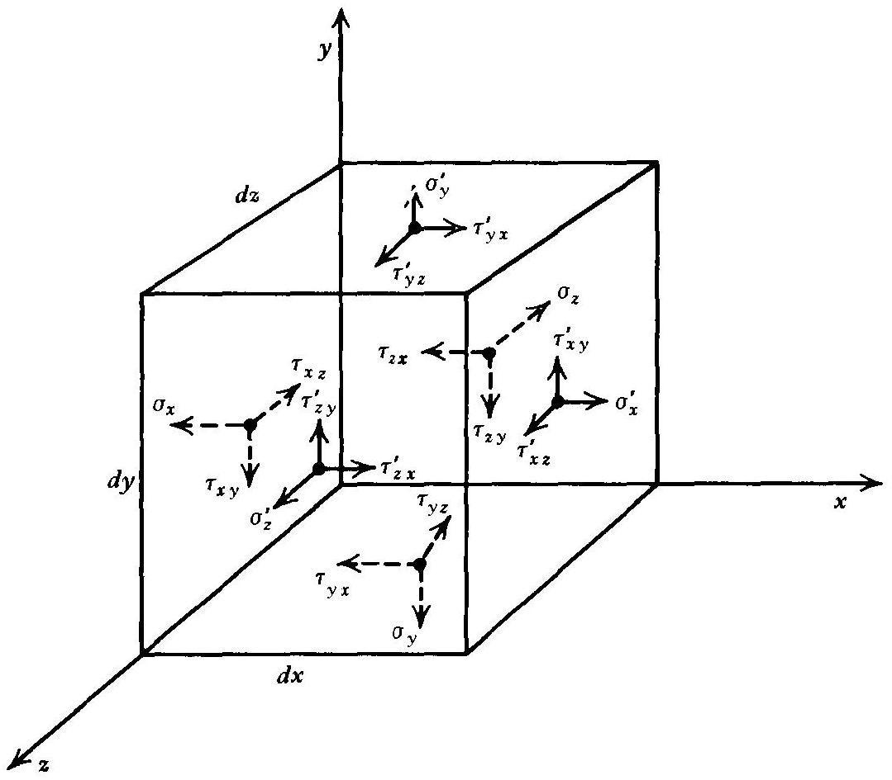
Figure 5.14. Surface stresses on a differential control volume.

Simplifying equation 5.145 yields

$$
\rho \frac{D u}{D t}=\rho B_{x}+\frac{\partial \sigma_{x}}{\partial x}+\frac{\partial \tau_{x y}}{\partial y}+\frac{\partial \tau_{x z}}{\partial z}
$$

Similarly, for the $y$ and $z$ directions,

$$
\begin{aligned}
& \rho \frac{D v}{D t}=\rho B_{y}+\frac{\partial \tau_{x y}}{\partial x}+\frac{\partial \sigma_{y}}{\partial y}+\frac{\partial \tau_{y z}}{\partial z} \\
& \rho \frac{D w}{D t}=\rho B_{z}+\frac{\partial \tau_{x z}}{\partial x}+\frac{\partial \tau_{y z}}{\partial y}+\frac{\partial \sigma_{z}}{\partial z}
\end{aligned}
$$

## 5-9(c) The Navier-Stokes Equations

Equation 5.146 express Newton's second law of motion for a differential control volume in terms of the body forces and the normal and shear stresses in the fluid. It remains to relate those stresses to the physical properties of the fluid and its state of motion.

The static thermodynamic pressure is defined as the average value of the normal stresses. Thus,

$$
-p=\bar{\sigma}=\frac{1}{3}\left(\sigma_{x}+\sigma_{y}+\sigma_{z}\right)
$$

The shear stresses are related to the velocity gradients by employing the Stokes' law of fluid friction. The latter is a phenomenological hypothesis that states that shear stresses in a fluid are directly proportional to the velocity gradients in the fluid. Consider the flow field illustrated in Fig. 5.15, where a viscous fluid flows between two infinite flat plates such that $u=u(y)$. Stokes' law states that

$$
\tau_{y x} \propto \frac{d u}{d y}
$$

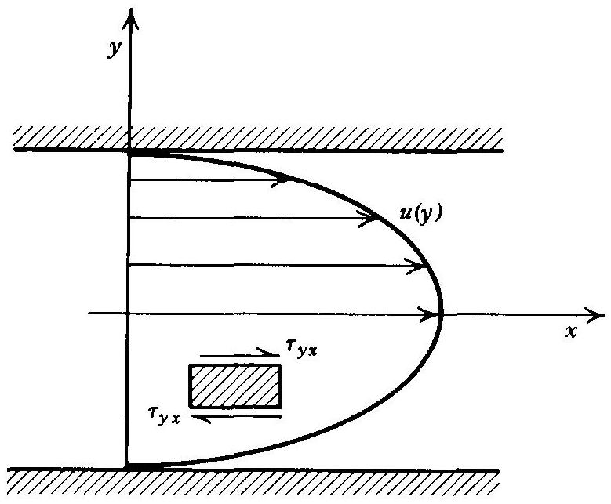
Figure 5.15. Stokes law of friction.

For a Newtonian fluid [see Section 1-6(b)], equation 5.148 becomes

$$
\tau_{y x}=\mu \frac{d u}{d y}
$$

where $\mu$ is the dynamic viscosity. For the general case where $u=u(x, y, z)$, the surface force $\mathbf{F}_{S}$ depends on the velocity gradients in all three directions (i.e., $\partial u / \partial x, \partial u / \partial y$, $\partial u / \partial z, \partial v / \partial x$, etc.). Stokes' law is analogous to Hooke's law for solids, which states that the stresses in a solid are directly proportional to strain. Thus, Stokes' law states that stresses in a fluid are proportional to the time rate of strain.

The relationship between the shear stresses and the velocity gradients in a fluid may be derived by first developing the relationship between shear stresses and strains in an elastic solid. An analogy is then drawn between the shear modulus of the solid and the viscosity of the fluid, and between the shear strain in the solid and the time rate of shear strain in the fluid.

Those relationships between shear stress and strain in a solid, and the analogous results for a fluid, are derived in many standard books on viscous flow. ${ }^{14-17}$ The derivations, which are rather lengthy, are not repeated here. The results, however, are presented below.

$$
\begin{aligned}
& \sigma_{x}=-p+2 \mu \frac{\partial u}{\partial x}-\frac{2}{3} \mu(\nabla \cdot \mathbf{V}) \\
& \sigma_{y}=-p+2 \mu \frac{\partial v}{\partial y}-\frac{2}{3} \mu(\nabla \cdot \mathbf{V}) \\
& \sigma_{z}=-p+2 \mu \frac{\partial w}{\partial z}-\frac{2}{3} \mu(\nabla \cdot \mathbf{V}) \\
& \tau_{x y}=\tau_{y x}=\mu\left(\frac{\partial v}{\partial x}+\frac{\partial u}{\partial y}\right) \\
& \tau_{x z}=\tau_{z x}=\mu\left(\frac{\partial u}{\partial z}+\frac{\partial w}{\partial x}\right) \\
& \tau_{y z}=\tau_{z y}=\mu\left(\frac{\partial w}{\partial y}+\frac{\partial v}{\partial z}\right)
\end{aligned}
$$

For a hypothetical inviscid fluid, or a viscous fluid at rest or in a state of uniform motion, we may write

$$
-p=\bar{\sigma}=\sigma_{x}=\sigma_{y}=\sigma_{z}
$$

and

$$
\tau_{x y}=\tau_{x z}=\tau_{y z}=0
$$

Accordingly, the normal stress is the same in all directions and is equal to the negative of the static thermodynamic pressure $p$. In a flowing viscous fluid, however, the shear stresses are nonzero, and the normal stresses are not the same in all directions. In that case, the static thermodynamic pressure $p$ is given by equation 5.147.

The Navier-Stokes equations are obtained by substituting equations 5.150 and 5.151 into equation 5.146. The results are given below in Cartesian coordinates.

$$
\begin{aligned}
\rho \frac{D u}{D t}=\rho B_{\boldsymbol{x}}-\frac{\partial p}{\partial x}+\frac{\partial}{\partial x}\left[2 \mu \frac{\partial u}{\partial x}-\frac{2}{3} \mu(\nabla \cdot \mathbf{V})\right]+\frac{\partial}{\partial y} & {\left[\mu\left(\frac{\partial u}{\partial y}+\frac{\partial v}{\partial x}\right)\right] } \\
+ & \frac{\partial}{\partial z}\left[\mu\left(\frac{\partial w}{\partial x}+\frac{\partial u}{\partial z}\right)\right] \\
\rho \frac{D v}{D t}=\rho B_{y}-\frac{\partial p}{\partial y}+\frac{\partial}{\partial y}\left[2 \mu \frac{\partial v}{\partial y}-\frac{2}{3} \mu(\nabla \cdot \mathbf{V})\right]+\frac{\partial}{\partial z} & {\left[\mu\left(\frac{\partial v}{\partial z}+\frac{\partial w}{\partial y}\right)\right] } \\
+ & \frac{\partial}{\partial x}\left[\mu\left(\frac{\partial u}{\partial y}+\frac{\partial v}{\partial x}\right)\right] \\
\rho \frac{D w}{D t}=\rho B_{z}-\frac{\partial p}{\partial z}+\frac{\partial}{\partial z}\left[2 \mu \frac{\partial w}{\partial z}-\frac{2}{3} \mu(\nabla \cdot \mathbf{V})\right]+\frac{\partial}{\partial x} & {\left[\mu\left(\frac{\partial w}{\partial x}+\frac{\partial u}{\partial z}\right)\right] } \\
+ & \frac{\partial}{\partial y}\left[\mu\left(\frac{\partial v}{\partial z}+\frac{\partial w}{\partial y}\right)\right]
\end{aligned}
$$

In vector form, equations 5.154 become

$$
\rho \frac{D \mathbf{V}}{D t}=\rho \mathbf{B}-\nabla p+\nabla\left[\frac{4}{3} \mu(\nabla \cdot \mathbf{V})\right]-\nabla \times[\mu(\nabla \times \mathbf{V})]
$$

Several special forms of the Navier-Stokes equations are of interest. For flows with small temperature gradients, the viscosity $\mu$, which is a function of temperature, may be approximated by a constant average value $\bar{\mu}$. In that case, equation 5.155 becomes

$$
\rho \frac{D \mathbf{V}}{D t}=\rho \mathbf{B}-\nabla p+\frac{4}{3} \bar{\mu} \nabla(\nabla \cdot \mathbf{V})-\bar{\mu} \nabla \times(\nabla \times \mathbf{V})
$$

Another simplification is obtained for an incompressible fluid, or for the low-speed flow of a compressible fluid where compressibility effects are small. In both of those cases a constant average value $\bar{\rho}$ may be employed, and the continuity equation (see Table 2.2) is

$$
\rho_{t}+\nabla \cdot(\rho \mathbf{V})=\rho_{t}+\mathbf{V} \cdot \nabla \rho+\rho \nabla \cdot \mathbf{V}=0
$$

For $\bar{\rho}=$ constant, $\bar{\rho}_{t}=\nabla \bar{\rho}=0$, and equation 5.157 becomes

$$
\nabla \cdot \mathbf{V}=0 \text { (incompressible flow) }
$$

Substituting equation 5.158 into equation 5.155 yields the Navier-Stokes equations for incompressible flow. Thus,

$$
\bar{\rho} \frac{D \mathbf{V}}{D t}=\bar{\rho} \mathbf{B}-\nabla p-\nabla \times[\mu(\nabla \times \mathbf{V})]
$$

Many real flow fields may be approximated adequately by assuming $\rho$ and $\mu$ both to be constants. In that case, equation 5.155 reduces to

$$
\bar{\rho} \frac{D \mathbf{V}}{D t}=\bar{\rho} \mathbf{B}-\nabla p-\bar{\mu} \nabla \times(\nabla \times \mathbf{V})
$$

Equation 5.160 may be written in an alternate form by employing the following vector identity (see Section 2-1).

$$
\nabla \times(\nabla \times V)=\nabla(\nabla \cdot \mathbf{V})-\nabla^{2} \mathbf{V}
$$

Substituting equation 5.161 into equation 5.160 and noting that $\nabla \cdot \mathbf{V}=0$ for incompressible flow yields the following alternate form of the Navier-Stokes equations for the incompressible flow of a fluid having a constant viscosity.

$$
\bar{\rho} \frac{D \mathbf{V}}{D t}=\bar{\rho} \mathbf{B}-\nabla p+\bar{\mu} \nabla^{2} \mathbf{V}
$$

The Navier-Stokes equations for viscous flow are similar to the Euler equations (see equation 2.63) for inviscid flow, except for the addition of the shear stress terms. The additional terms greatly complicate the mathematical form of the equations, so that it is difficult to obtain exact solutions to the Navier-Stokes equations. Exact solutions have been obtained for a few specialized cases. One such simple case is presented in the next section.

## 5-9(d) Hagen-Poiseuille Flow

Several of the exact solutions to the Navier-Stokes equations are presented in Reference 14. One exact solution is that for the fully developed steady flow of a viscous incompressible fluid having a constant viscosity, in a straight circular tube of constant diameter. Such a flow is called a Hagen-Poiseuille flow. The appropriate form of the Navier-Stokes equations is equation 5.162. The flow model is illustrated in Fig. 5.16. For a fully developed viscous flow, it may be assumed that: (1) the streamlines are parallel (which results in a constant pressure at each cross section); (2) that the velocity components in the radial and circumferential directions are zero; and ( 3 ) that the flow is steady.

Since the flow has axial symmetry, equation 5.162 is employed in cylindrical coordinates [see Section 10-3(b)]. For the assumptions listed above, $v_{r}=v_{\theta}= \partial / \partial r=\partial / \partial \theta=\partial / \partial t=0$. Hence, the only equation that remains is that for the axial direction; that is, for the $z$ direction. Hence, for the present case, equation 5.162

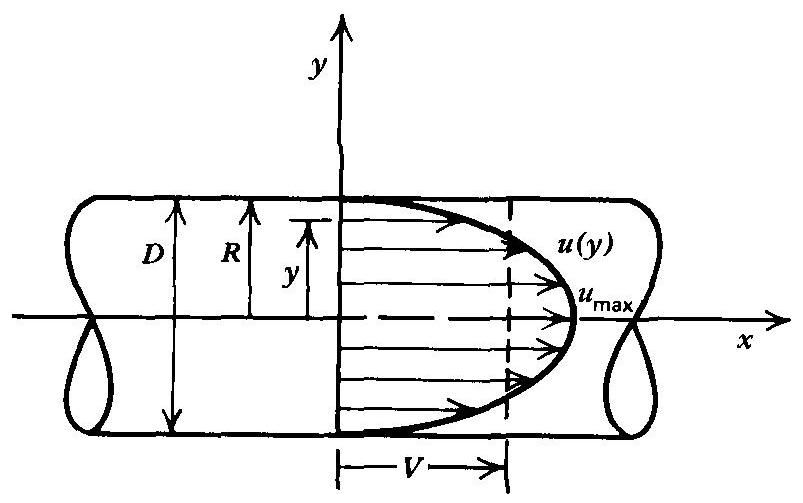
Figure 5.16. Hagen-Poiseuille flow.

reduces to

$$
0=-\frac{\partial p}{\partial z}+\mu\left(\frac{\partial^{2} v_{z}}{\partial r}+\frac{1}{r} \frac{\partial v_{z}}{\partial r}\right)
$$

Apply the following change of notation to equation 5.163; let $x=z, y=r$, and $u=v_{z}$. Equation 5.163 then transforms to

$$
0=-\frac{\partial p}{\partial x}+\mu\left(\frac{\partial^{2} u}{\partial y^{2}}+\frac{1}{y} \frac{\partial u}{\partial y}\right)
$$

with the following boundary conditions:

$$
\begin{aligned}
u(x, R)=0 & \text { (no slip at the wall) } \\
\frac{\partial u}{\partial y}(x, 0)=0 & \text { (symmetry about the axis) }
\end{aligned}
$$

For fully developed pipe flow, $\partial p / \partial x$ is known from experiments to be a constant. Since $u(x, y)=u(y)$ for a fully developed viscous flow, the partial derivatives in equation 5.164 may be replaced by total derivatives, and equation 5.164 may be rewritten to give

$$
\frac{1}{y} \frac{d}{d y}\left(y \frac{d u}{d y}\right)=\frac{1}{\mu} \frac{d p}{d x}
$$

Integrating equation 5.167 , we obtain

$$
y \frac{d u}{d y}=\frac{1}{\mu} \frac{d p}{d x} \frac{y^{2}}{2}+\text { constant }
$$

Substituting equation 5.166 into equation 5.168 shows that the constant of integration is zero. Integrating equation 5.168 gives

$$
u=\frac{1}{\mu} \frac{d p}{d x} \frac{y^{2}}{4}+\text { constant }
$$

Evaluating the constant of integration, from equation 5.165, equation 5.169 yields

$$
u=-\frac{R^{2}}{4 \mu} \frac{d p}{d x}\left(1-\frac{y^{2}}{R^{2}}\right)
$$

Equation 5.170 is the velocity profile equation for the Hagen-Poiseuille flow.
Several additional features of Hagen-Poiseuille flow are of general interest. On the centerline, $u(x, 0)=u_{\text {max }}$. From equation 5.170, we obtain

$$
u_{\max }=-\frac{R^{2}}{4 \mu} \frac{d p}{d x}
$$

Note that the pressure decreases in the flow direction, so that $d p / d x$ is a negative number and $u_{\text {max }}$ is a positive number. Hence, equation 5.170 may be written in the form

$$
u=u_{\max }\left(1-\frac{y^{2}}{R^{2}}\right)
$$

In Example 3.1, it is shown that the one-dimensional bulk flow velocity $V$ that passes the same mass flow rate as the velocity profile given by equation 5.172 is

$$
V=\frac{1}{2} u_{\max }
$$

Substituting equation 5.171 into equation 5.173 yields

$$
V=-\frac{R^{2}}{8 \mu} \frac{d p}{d x}=-\frac{D^{2}}{32 \mu} \frac{d p}{d x}
$$

In Section 5-4(b), equation 5.23, the Fanning friction coefficient $\mathfrak{f}$ is defined as

$$
4 \tilde{f} \equiv \frac{(d p / d x) D}{\frac{1}{2} \rho V^{2}}
$$

Noting that $d p / d x$ in equation 5.23 is actually $|d p / d x|$, so that $\mathfrak{f}$ will be a positive number, solving for $|d p / d x|$ from equation 5.174 and substituting the result into equation 5.23 yields

$$
\mathfrak{f}=\frac{16 \mu}{D V \rho}=\frac{16}{\operatorname{Re}}
$$

Equation 5.175 is quite accurate for laminar flow in a circular duct. It is in serious error, however, for turbulent flows. ${ }^{14}$ A plot of equation 5.175 is presented in Fig. 5.8. For turbulent flows, the Stokes' law for simple friction is inadequate, and empirical data have to be employed for both the velocity distribution (see Section 3-3) and the friction coefficient, as discussed in Section 5-4(b).

## 5-10 THE BOUNDARY LAYER

A brief discussion of the physics of the boundary layer is presented in Section 1-6(a). The principal conclusion from that discussion is that the flow field for a fluid having a small viscosity may be subdivided into two contiguous regions. One is the bulk, or core, flow region wherein the fluid may be assumed to behave as a perfect fluid (i.e., $\mu=0$ ). The other is a viscous boundary layer region that is adjacent to the solid boundaries wetted by the fluid. In the viscous boundary layer the flow is laminar and the shear stress $\tau$ on a fluid layer at the distance $y$ from the wall is given by equation 1.28 b which, for a two-dimensional flow in the $x y$ plane, becomes

$$
\tau=\mu \frac{\partial u}{\partial y}
$$

where $u$ is the velocity of the fluid in the $x$ direction. At the wall itself, the velocity of the fluid in the boundary layer is zero and the shear stress at the wall is denoted by $\tau_{o}$.

Even if the flowing fluid has only a small viscosity, such as is the case for air (see Fig. 1.13), the shear stress $\tau$ may be quite significant if the velocity gradient $\partial u / \partial y$ is sufficiently large.

The above concept of the boundary layer, due to Prandtl, ${ }^{19}$ constitutes a major contribution to the analytical developments in the field of fluid mechanics. It is responsible for a major simplification of the Navier-Stokes equation that forms the basis of boundary layer theory. ${ }^{4,14,15}$ The boundary layer equations are derived from the Navier-Stokes equations by neglecting terms that are demonstrably insignificant in the case of the fluid that flows inside the viscous boundary layer. The derivation of those equations is presented in detail in Reference 14.

Since the velocity of the fluid flowing within the viscous boundary layer must increase from zero at the wall to the free-stream velocity $U_{\infty}$ in a distance equal to the boundary layer thickness, the magnitude of that thickness is an important paramater.

Figure 5.17 illustrates schematically a uniform flow having the free-stream velocity $U_{\infty}$ over a flat plate that is at zero angle of attack, or zero incidence, with respect to $U_{\infty}$. The origin of the coordinate system is coincident with the upper leading edge of the plate. Curve $O A$ indicates schematically how the thickness of the boundary layer, denoted by $\delta(x)$, varies with the distance along the plate in the direction of the planar flow; that is, with increasing values of $x$. It is apparent that $\delta(x)$ increases or the boundary layer thickens as $x$ increases. The thickness of $\delta(x)$, in Fig. 5.17, is greatly exaggerated compared to its actual dimensions. In the same figure the shapes of typical velocity profiles at different stations along the flat plate are illustrated diagrammatically. It is reemphasized here that the viscous boundary is the region of the overall flow field that is retarded in its motion by the viscous effects propagated from the wall wetted by the flowing fluid.

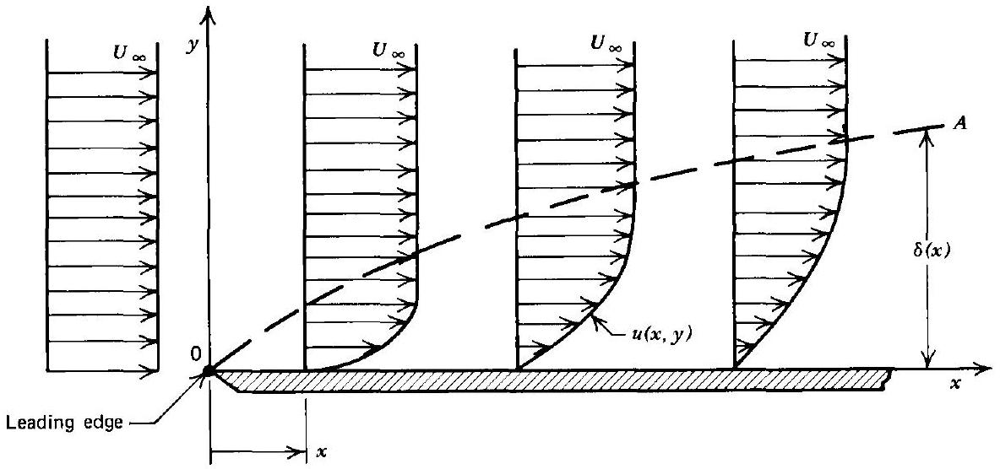
Figure 5.17. Growth of a boundary layer on a flat plate in a uniform free stream.

By definition, the boundary layer thickness $\delta(x)$ is that normal distance from the wall (see Fig. 5.17) to the filament of fluid where the velocity $u(x, y)$ has the value $u=0.99 U_{\infty}$. Blasius showed that for the flow illustrated in Fig. 5.17, and his theoretical results were confirmed experimentally, that ${ }^{20}$

$$
\frac{\delta}{x}=\frac{5}{\sqrt{\mathrm{Re}_{x}}}
$$

where $\mathrm{Re}_{x}$ is the Reynolds number at the distance $x$ from the leading edge of the flat plate. Thus,

$$
\mathrm{Re}_{x}=\frac{U_{\infty} x \rho}{\mu}=\frac{U_{\infty} x}{v}
$$

where $v=\mu / \rho$ is the kinematic viscosity of the fluid [see Section 1-6(a)].
Because the change in the velocity $u$ in the boundary layer from zero at the wall to the value $U_{\infty}$ takes place asymptotically, there is some indefiniteness in determining exactly where $u=0.99 U_{\infty}$.

A more precise measurement of the boundary layer thickness is the so-called displacement thickness $\delta^{*}$. The latter is the distance that an equivalent inviscid flow region is displaced from the solid boundary as a consequence of the slow moving
fluid in the boundary layer. The aforementioned displacement has the effect of causing a portion of the flow area of thickness $\delta^{*}$ to become unavailable to the perfect fluid flow region. In other words, it is the blockage of the flow area referred to in Section 4-8(c).

For the flat plate illustrated in Fig. 5.17, the displacement thickness $\delta^{*}$ is given by ${ }^{20}$

$$
\frac{\delta^{*}}{x}=\frac{1.73}{\sqrt{\mathrm{Re}_{x}}} \approx \frac{\delta}{3}
$$

Figure 5.18 illustrates diagrammatically the definition of $\delta^{*}$ for the flow over a flat plate. It is the height $y=\delta^{*}$ above the plate where the cross-hatched areas of the velocity profile curve, above and below $y=\delta^{*}$ are equal.

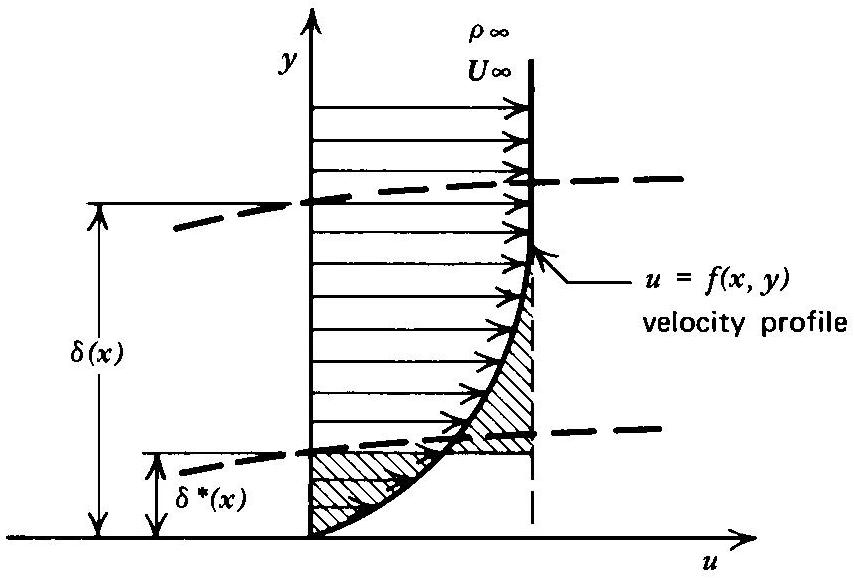
Figure 5.18. The displacement thickness $\delta^{*}$.

Another measurement of the boundary layer thickness is the momentum thickness, denoted by $\Theta$. Its definition is based on the reduction in the momentum of the flowing fluid caused by the shearing stresses in the boundary layer. For flow over a flat plate, the Blasius solution for the momentum thickness is ${ }^{20}$

$$
\frac{\Theta}{x}=\frac{0.664}{{\sqrt{\operatorname{Re}_{x}}}}
$$

Hence, $\delta^{*} / \Theta=2.59$.
The viscous fluid in the boundary layer must continuously overcome the frictional resistance it encounters if it is to continue flowing downstream. If the pressure gradient is either favorable ( $d p / d x<0$ ) or zero ( $d p / d x=0$ ), there is always sufficient energy in the boundary layer to overcome the aforementioned resistance. On the other hand, if the pressure gradient is unfavorable ( $d p / d x>0$ ), the layers of fluid near the wall may actually come to rest and then reverse their flow direction, and flow separation occurs. Once flow separation occurs, there may be a radical alteration in the character of the flow field as, for example, the separated flow region downstream of the cylinder illustrated in Fig. 1.9. Separation phenomena in a convergingdiverging nozzle are discussed in Section 4-7(e).

Figure 5.19 illustrates schematically the behavior of the boundary layer on the lower flat wall of a two-dimensional converging-diverging flow passage, where each of the three types of pressure gradients mentioned above are present. A flow separation point and a reverse flow region, in the viscous boundary layer, are also shown.

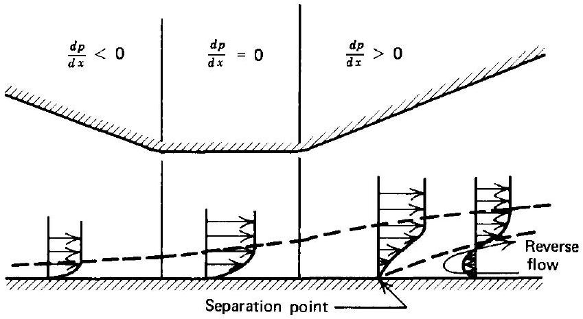
Figure 5.19. Flow separation in a boundary layer.

As long as there is no flow separation, the flow field behaves as that for a perfect fluid flowing between the thin viscous boundary layers adjacent to the solid boundaries.

Several analytical methods have been developed for predicting the separation point for the laminar boundary layer flow. Unfortunately, all of them are of limited usefulness. ${ }^{14}$ Consequently, the separation point is ordinarily determined by experiment.

It can be shown that for a flat plate, such as that illustrated in Fig. 5.17, the shear stress at the wall $\tau_{o}$ (i.e., where $y=0$ ) is given by ${ }^{14}$

$$
\frac{\tau_{o}}{\rho U_{\infty}{ }^{2}}=0.332 \sqrt{\frac{v}{x U_{\infty}}}
$$

Equation 5.180 shows that $\tau_{o}$ decreases as $x$ increases and asymptotically approaches zero at $x=\infty$. Consequently, there will be no separation on a flat plate of finite length provided the pressure gradient for the flow is favorable.

Figure 5.20 shows that as the flow proceeds downstream along a flat plate, there is a transition from laminar to turbulent flow in the boundary layer. A turbulent boundary layer is generally thicker than a laminar one. Also, the velocity profile through most of the turbulent boundary layer is flatter, which results in a larger velocity gradient at the wall and a larger wall shear stress $\tau_{o}$; that is, increased surface friction, also called skin friction. On the other hand, the turbulent boundary layer makes larger pressure recoveries possible. The behavior of turbulent boundary

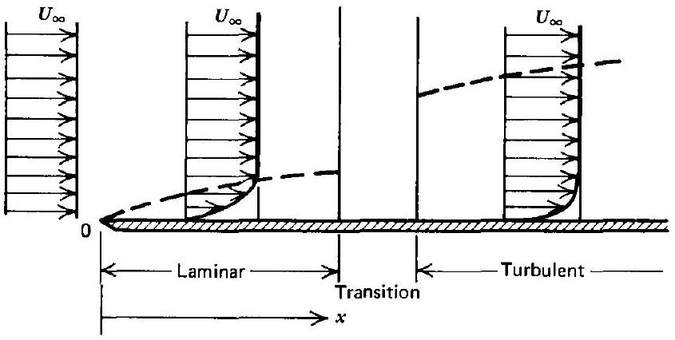
Figure 5.20. Transition from laminar to turbulent flow in a boundary layer.

layers is of great practical interest because most of the flows of importance in engineering are turbulent flows. Unfortunately, there is at this time no satisfactory analytic theory for investigating turbulent boundary layers that does not require experimental information.

In the cases for which the desired experimental information may be obtained by model testing (as, for example, determining the drag of an airfoil), the principles of dimensional analysis, discussed in Section 5-8, are employed for planning and conducting the experimental investigation.

A considerable amount of experimental data has been accumulated and correlated on the turbulent flow in pipes. In the case of fully developed turbulent flow in a horizontal pipe, the momentum equation (see equation 3.14) for the conditions $d V=\delta D=g d z=0$, where $V$ denotes the mean flow velocity in the pipe cross section, becomes

$$
A d p+\delta F_{\mathrm{i}}=0
$$

For a pipe of length $L=x_{2}-x_{1}$ having the radius $R$,

$$
A \int_{1}^{2} d p+2 \pi R \tau_{0} \int_{x_{1}}^{x_{2}} d x=0
$$

where $\delta F_{\mathrm{i}}=\tau_{o}(W P) d x=2 \pi R \tau_{o} d x$, and $A=\pi R^{2}$. Solving for the shear stress at the wall, we obtain

$$
\tau_{o}=\frac{p_{1}-p_{2}}{2} \frac{R}{L}
$$

The shear stress $\tau$ at any radius $r<R$ is, accordingly,

$$
\tau=\frac{p_{1}-p_{2}}{2} \frac{r}{L}
$$

Let $y=R-r$, the distance from the pipe wall to a point in the flow; then

$$
\frac{\tau}{\tau_{o}}=\frac{r}{R}=1-\frac{y}{R}
$$

Equation 5.182 indicates that for a fully developed turbulent pipe flow, important features of the flow can be determined by measuring the pressure drop ( $p_{1}-p_{2}$ ).

It has been found convenient to divide the turbulent flow in a pipe into three regions that have different characteristics: (1) a thin laminar sublayer very close to the wall, where there cannot be any turbulent flow; (2) further inward from the wall, a so-called turbulent shear region; and (3) the region near the centerline of the pipe. The three regions are characterized by the following relationships. ${ }^{14}$

1. Laminar sublayer. It is very thin and it is assumed, according to Prandtl, that the shear stress $\tau$, at any radius $y$ where the velocity is $u$, is given by

$$
\tau=\tau_{o}=\mu \frac{d u}{d y} \approx \mu \frac{u}{y}
$$

where $\tau_{o}$ is the shear stress at the wall. Introduce the friction velocity $v^{*}$, where

$$
v^{*}=\sqrt{\frac{\tau_{o}}{\rho}}
$$

The thickness of the laminar sublayer, denoted by $\delta_{S L}$, expressed in terms of the
friction velocity $v^{*}$, is given by

$$
\delta_{S L}=\frac{5}{v^{*}}
$$

Surface roughness has no appreciable effect on the flow, provided the roughness $\varepsilon$ [see Section 5-4(b)] is smaller than $\delta_{S L}$.
2. Turbulent shear region. The velocity distribution in the turbulent shear region is given by ${ }^{14,15}$

$$
\frac{u}{v^{*}}=a \ln y \frac{v^{*}}{v}+b
$$

Equation 5.187 is known as the universal velocity distribution law. Measurements show that it is valid for the boundary layer on a flat plate, at zero incidence, and also for the turbulent flow in a pipe; for fully developed pipe flow the constants $a$ and $b$ have the values $a=2.5$ and $b=5.5$.
3. Centerline region. If $U$ denotes the maximum velocity of the fluid, which occurs at the centerline of the pipe then, for the region in the vicinity of the centerline,

$$
\frac{U-u}{v^{*}}=-2.5 \ln \frac{y}{R}
$$

where $R$ is is radius of the pipe, and $y$ is the distance from the pipe wall.
For a fully developed turbulent pipe flow, the velocity profile is more nearly uniform than it is for laminar flow, for which it is parabolic, as shown in Section 5-9(d). Furthermore, the uniformity of the velocity profile increases with increasing Reynolds number. It has been shown that the turbulent velocity profile may be represented by the following power law (but not near the wall). ${ }^{15}$

$$
\frac{u}{U}=\left(\frac{y}{R}\right)^{1 / n}
$$

where $n$ varies from approximately $n=6$ to $n=10$ for $\operatorname{Re}=4 \cdot 10^{3}$ to $3 \cdot 10^{6}$. For $\operatorname{Re} \approx 1 \cdot 10^{5}$, the velocity profile may be approximated with $n=1 / 7$. If it is assumed that $\operatorname{Re} \approx 1 \cdot 10^{5}$ and $\bar{u} / U=0.8$, we obtain ${ }^{14}$

$$
\frac{U}{v^{*}}=8.74\left(\frac{v^{*} \mathrm{Re}}{v}\right)^{1 / 7}
$$

It is shown in Section 5-4(b) that the friction coefficient $\mathfrak{f}$, for the surface of the pipe wall, is a function of Re and the relative roughness $\varepsilon / D$. The velocity profile equations, equations 5.185 to 5.190 , do not appear to show that dependence. That dependence enters, however, through the magnitude of the friction velocity $v^{*}= \sqrt{\tau_{o} / \rho}$, because $\tau_{o}=f(\mu, \rho, D, \bar{u}, \varepsilon)$.

The experimental data pertaining to the turbulent flow over plates, at zero angle of attack, are rather meager compared to the data for fully developed pipe flow. Several methods of analysis have, therefore, been developed that are based on utilizing the data obtained from measurements of the flow in pipes as a basis for predicting the behavior of two-dimensional flows over plates. In general, those methods yield approximate results at best, and they have been unsuccessful in predicting separation phenomena. ${ }^{14}$

In summary, at this time there are no reliable purely theoretical methods for predicting the behavior of turbulent boundary layers in all their aspects. For additional information on that subject, see the references at the end of this chapter.

## 5-11 SUMMARY

A simple frictional flow is defined as steady one-dimensional flow in a constant-area duct in the absence of work, heat transfer, body forces, and obstructions in the flow, changes in the flow properties being caused by wall friction alone. Simple frictional flow for a compressible fluid is also called Fanno line flow. For such a flow, it is shown that if the flow in the constant-area duct is initially subsonic, the velocity and Mach number increase, while the static pressure, density, enthalpy, and temperature decrease. For a flow that is initially supersonic, the opposite trends are observed. For both subsonic and supersonic flows, the stagnation pressure decreases and the entropy increases.

The flow becomes choked in a definite length of the constant-area duct called the limiting length. In that cross section, the Mach number is unity, and all of the flow properties have their critical (i.e., sonic) values. If the duct length is to be increased beyond the limiting length, the upstream conditions must change. Equations are derived and tables are presented (see Table C.7) for determining the property ratios for the simple frictional flow of a perfect gas. A method for taking imperfect gas effects into account is presented in Section 5-6.

The wall frictional force is related to the bulk flow properties through an empirically determined friction coefficient, which depends on the Reynolds number, the Mach number, and the pipe surface roughness ratio.

The momentum equation for multidimensional viscous flow is presented (i.e., the Navier-Stokes equations). In addition, some of the effects of viscous boundary layer flow for fluids of small viscosity are discussed in Sections 5-9 and 5-10.

## REFERENCES

1. A. Stodola, Steam and Gas Turbines, Vol. 1, translated by L. C. Loewenstein, McGraw-Hill, New York, 1927.
2. J. Nikuradse, "Strömungsgesetze in rauhen Rohren," VDI-Forschungsheft, No. 361, 1933. Translated as NACA TM 1292.
3. B. A. Bahkmeteff, The Mechanics of Turbulent Flow, Princeton University Press, Princeton, N.J., 1936.
4. L. Prandtl, Strömungslehre, Fried. Vieweg \& Sohn, Braunschweig, 1949.
5. C. F. Colebrook, "Turbulent Flow in Pipes with Particular Reference to the Transition between Smooth and Rough Pipes," Journal of the Institute of Civil Engineers, London, February 1939.
6. L. F. Moody, "Friction Factors for Pipe Flow," Transactions ASME, Vol. 68, No. 8, pp. 671684, November 1944.
7. R. P. Genereaux, "Fluid Flow Design Methods," Industrial Engineering Chemistry, Vol. 29, No. 4, pp. 385-388.
8. W. Frössel, "Strömung in glatten, geraden Rohren mit Uberund Untergeschallgeschwindigkeit," Forsh, Gebiete Ingenieurw, Vol. 7, pp. 75-84, 1936. Translated as NACA TM 844, 1938.
9. E. Buckingham, "On Physically Similar Systems; Illustrations of the Use of Dimensional Equations," Physical Review, Vol. 4, No. 4, pp. 345-378, 1914.
10. E. Buckingham, "Model Experiments and Forms of Empirical Equations," Transactions ASME, Vol. 37, 1915.
11. P. W. Bridgman, Dimensional Analysis, Yale University Press, New Haven, Conn., 1922.
12. L. Brand, "The Pi Theorem of Dimensional Analysis," Archives Rational Mechanics Analysis, Vol. 1, No. 1, pp. 35-45, 1957.
13. S. J. Kline, Similtude and Approximation Theory, McGraw-Hill, New York, 1965.
14. H. Schlichting, Boundary Layer Theory, Sixth Edition, McGraw-Hill, New York, 1968.
15. H. Schlichting, "Boundary-Layer Theory," translation by V. L. Streeter, Handbook of Fluid Dynamics, Section 9, McGraw-Hill, New York, 1961.
16. L. Prandtl, "The Mechanics of Viscous Fluids," Aerodynamic Theory, Vol. III, Section G, edited by W. F. Durand, California Institute of Technology, 1943.
17. J. A. Owczarek, Fundamentals of Gas Dynamics, International Textbook Co., Scranton, Pa., 1964.
18. S. I. Pai, Viscous Flow Theory, Vol. I, Laminar Flow, Van Nostrand, Princeton, N.J., 1956.
19. L. Prandtl, "Über Flüssigkeitsbewegung bei sehr kleiner Reibung," Vorhandlungen des III Internationalem Mathematiker-Kongresses, Heidlberg, pp. 484-491, 1904. Translated as NACA TM 452, 1928.
20. H. Blasius, "Grenzschichten in Flüssigkeiten mit kleiner Reibung," Z. Math. u. Phys., Vol. 56, No. 1, 1908. Translated as NACA TM 1256.

## PROBLEMS

1. Air flows adiabatically through a circular duct having a diameter $D=0.30 \mathrm{~m}$. At the duct entrance, $t=280 \mathrm{~K}, p=2.0 \cdot 10^{5} \mathrm{~N} / \mathrm{m}^{2}$, and $M=0.2$. Calculate (a) the length of duct required to choke the flow, and (b) the static and stagnation temperature and pressure, and the velocity at that condition. Assume $\overline{\mathrm{f}}=0.005$, and that $c_{p}$ is constant.
2. Work Problem 1, taking into account the variation of the specific heat of air with the temperature.
3. A pipe 0.30 m in diameter and 1000 m long is attached to a large reservoir of air having a static pressure $p=13.0 \cdot 10^{5} \mathrm{~N} / \mathrm{m}^{2}$ and a static temperature $t=300 \mathrm{~K}$. The pipe exit is open to the atmosphere, and the average friction coefficient $\overline{\mathrm{f}}=0.005$. Assume that the flow is adiabatic and that $c_{p}$ is constant. What is the mass flow rate through the pipe?
4. Air flows between a large reservoir and the atmosphere in an insulated tube 20.0 m long and 0.075 m in diameter. The average friction coefficient $\overline{\mathrm{i}}=0.005$. The stagnation pressure and temperature in the upstream reservoir are $P=4.8 \cdot 10^{5} \mathrm{~N} / \mathrm{m}^{2}$ and $T=325 \mathrm{~K}$, respectively. The static pressure in the surrounding atmosphere is 1 atm . Calculate (a) the duct inlet and exit Mach numbers, (b) the inlet and exit values of $t, p, \rho$, and $V$, and (c) the mass flow rate. Assume $y=1.40$ and $c_{p}=1004.8 \mathrm{~J} / \mathrm{kg}-\mathrm{K}$.
5. Repeat Problem 4, accounting for the variation of $c_{p}$ with $t$ (employ Table C. 4).
6. Repeat Problem 4 for an upstream stagnation pressure of $2.75 \cdot 10^{5} \mathrm{~N} / \mathrm{m}^{2}$.
7. A pipe 0.050 m in diameter is attached to a large air tank where the pressure $p=13.8 \cdot 10^{5} \mathrm{N} / \mathrm{m}^{2}$ and the temperature $t=310 \mathrm{~K}$. The exit of the pipe is open to the atmosphere. Assume adiabatic flow with an average friction coefficient $\overline{\mathrm{f}}=0.005$. What length of pipe is required to obtain a mass flow rate $\dot{m}=2.25 \mathrm{~kg} / \mathrm{s}$ ?
8. Plot a Fanno line on the $t s$ plane for air entering a duct with a Mach number of 0.20 , a static pressure of $7.0 \cdot 10^{5} \mathrm{~N} / \mathrm{m}^{2}$, and a static temperature of 550 K . Assume a duct diameter of 0.30 m and an average friction coefficient $\overline{\mathrm{i}}=0.005$.
9. Air enters a circular duct with a Mach number $M_{1}=3$. The average friction coefficient for the duct $\bar{f}=0.0025$. How many diameters of pipe are required to reduce the Mach number to 2.0?
10. Atmospheric air at a pressure of $1.0135 \cdot 10^{5} \mathrm{~N} / \mathrm{m}^{2}$ and a temperature of 300 K is drawn through a frictionless bell-mouth entrance into a 3.0 m long tube having a 0.050 m diameter. The average friction coefficient $\overline{\mathrm{i}}=0.005$. The system is perfectly insulated. (a) Find the maximum mass flow rate and the range of back pressures that will produce this flow. (b) What exit pressure is required to produce 90 percent of the maximum mass flow rate, and what will be the stagnation pressure and the velocity at the exit for that mass flow rate?
11. Air enters an insulated tube of 0.025 m diameter through a De Laval nozzle with a throat diameter of 0.0125 m . The stagnation pressure and temperature are $7.0 \cdot 10^{5} \mathrm{~N} / \mathrm{m}^{2}$ and 300 K , respectively. The flow through the nozzle may be assumed to be frictionless, and the average friction coefficient in the duct $\overline{\mathrm{f}}=0.0025$. Calculate (a) the maximum length of the tube. For that condition, determine $M, V, p, t$, and $P$ at (b) the inlet of the duct, (c) the outlet of the duct,
(d) a point 0.25 m from the inlet, and (e) a point where the stagnation pressure is $2.0 \cdot 10^{5} \mathrm{~N} / \mathrm{m}^{2}$. Plot those properties as a function of position in the tube.
12. A pipe having a roughness $\varepsilon=0.0015 \mathrm{~m}$ is to be designed for supplying compressed air to a building located 450 m from the air-storage tanks. The air-storage temperature is 300 K and the storage pressure is $9.0 \cdot 10^{5} \mathrm{~N} / \mathrm{m}^{2}$. It is essential that the pressure of the air at the building should not fall below $8.0 \cdot 10^{5} \mathrm{~N} / \mathrm{m}^{2}$ when the volume flow rate is $11.30 \mathrm{~m}^{3} / \mathrm{min}$. Determine the minimum internal diameter for the pipe that will satisfy the requirements.
13. A converging-diverging frictionless nozzle is connected to a large air reservoir by means of 2.85 m of 0.025 m ID pipe. The inside dimensions of the nozzle are as follows: inlet diameter 0.025 m , throat diameter 0.0225 m , outlet diameter 0.030 m . If the air is expanded to atmospheric pressure, and the average friction coefficient for the pipe $\bar{f}=0.005$, find the stagnation pressure that must be maintained in the reservoir. Assume $\gamma=1.4$.
14. Air at a pressure of $3.50 \cdot 10^{5} \mathrm{~N} / \mathrm{m}^{2}$ and a temperature of 300 K is to be transported at the rate of $0.090 \mathrm{~kg} / \mathrm{s}$ over a distance of 600 m through a pipe. The final pressure is to be at least $1.40 \cdot 10^{5} \mathrm{~N} / \mathrm{m}^{2}$. Assuming isothermal flow and $\overline{\mathrm{f}}=0.004$, determine the minimum pipe diameter.
15. Air at $2.0 \cdot 10^{5} \mathrm{~N} / \mathrm{m}^{2}$ enters a 0.150 m diameter pipe at $M=0.30$. Determine the maximum possible pipe length and the corresponding exit pressure, assuming $\overline{\hat{f}}=0.005$ for (a) isothermal flow, and (b) adiabatic flow.
16. A compressible fluid flows isothermally in a conduit of constant cross-sectional area in the presence of wall friction. The Mach number of the fluid at the entrance is $M_{1}=0.2$, and at station 2 further downstream it is $M_{2}=0.8$. If the molecular weight of the gas is 28 , its constant-volume specific heat is $728.5 \mathrm{~J} / \mathrm{kg}-\mathrm{K}, t_{1}=290 \mathrm{~K}$. and $p_{1}=1.0135 \cdot 10^{5} \mathrm{~N} / \mathrm{m}^{2}$, calculate (a) the heat added to the gas, (b) the change in the stagnation temperature of the gas, (c) the change in the stagnation pressure of the gas, and (d) the increase in its entropy.
17. In an oil refinery, hydrocarbon vapors are produced at 810 K . The vapors are conducted through a 0.10 m inside-diameter pipe to a condensing tower. The length of the pipe is 30.0 m . The vapors, which may be assumed to behave as a perfect gas, enter the pipe with a static pressure of $3.50 \cdot 10^{5} \mathrm{~N} / \mathrm{m}^{2}$, a density of $1.90 \mathrm{~kg} / \mathrm{m}^{3}$, and a viscosity of $63.0 \cdot 10^{5} \mathrm{~N}-\mathrm{s} / \mathrm{m}^{2}$. The mass flow rate is $7200 \mathrm{~kg} / \mathrm{hr}$. Sufficient heat is added to the pipe to maintain the static temperature of the vapors at 810 K . Calculate the pressure of the vapor entering the condensing tower.
18. Derive the following relationships for the isothermal flow of a perfect gas in a constant-area duct in the presence of wall friction.
(a) $\frac{d T}{T}=\frac{\frac{\gamma-1}{2}}{1+\frac{\gamma-1}{2} M^{2}} \frac{d M^{2}}{M^{2}}$
(b) $\frac{d p}{p}=-\frac{\gamma M^{2}}{2\left(1-\gamma M^{2}\right)} \frac{4 \mathfrak{f} d x}{D}$
(c) $\frac{d p}{p}=\frac{\gamma M^{2}\left(1-\frac{\gamma-1}{2} M^{2}\right)}{2\left(\gamma M^{2}-1\right)\left(1+\frac{\gamma-1}{2} M^{2}\right)} \frac{4 \mathfrak{f} d x}{D}$
19. An incompressible viscous fluid flows steadily through the clearance of a plane thrust bearing as illustrated schematically in Fig. 5.21. The velocity profile for fully developed laminar flow is

$$
u(y)=u_{\max }\left[1-\left(\frac{2 y}{h}\right)^{2}\right]
$$

Neglect entrance effects and determine an expression for the mass flow rate $\dot{m}$ in terms of $p_{i}$, $p_{o}, \mu$, and the geometric parameters.

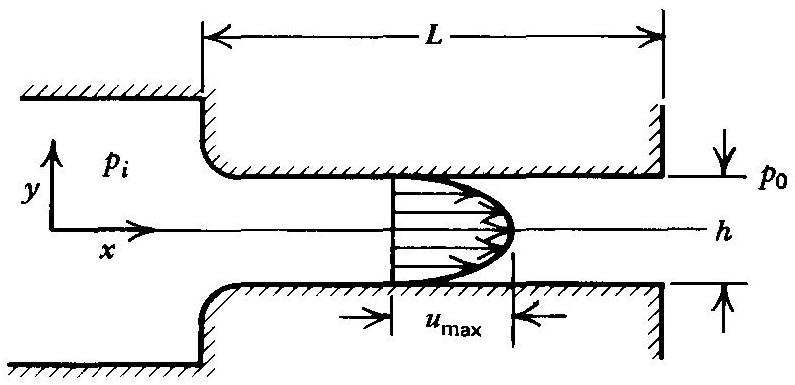
Figure 5.21. Sketch for Problem 5.19.

20. The pressure drop $\Delta p$ in a constant-area duct because of the effect of wall friction alone is known to depend on the following variables: $\mathscr{D}$, the hydraulic diameter of the duct; $\varepsilon$, the pipe surface roughness; $L$, the length of the pipe; $V$, the one-dimensional flow velocity; $a$, the acoustic speed; $\rho$, the gas density; and $\mu$, the dynamic viscosity of the fluid. Employing dimensional analysis, determine the functional dependence of the pressure drop on the remaining flow variables.

[^0]:    (Based on Reference 6).

