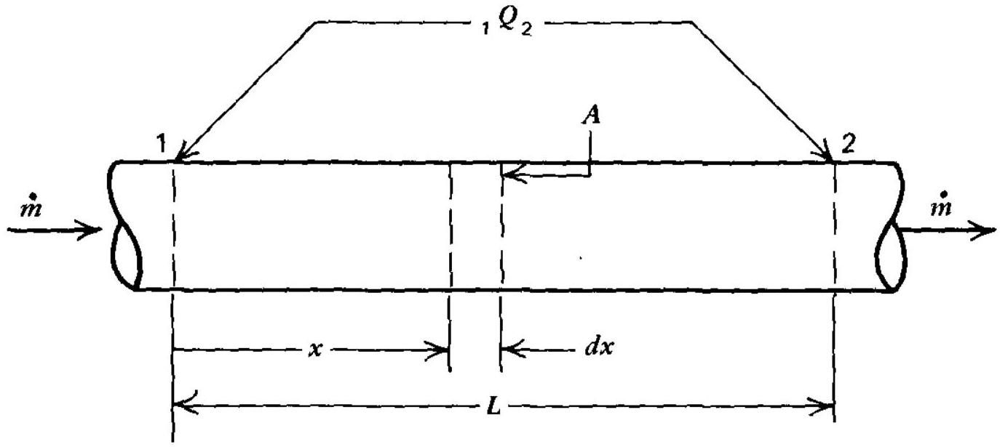
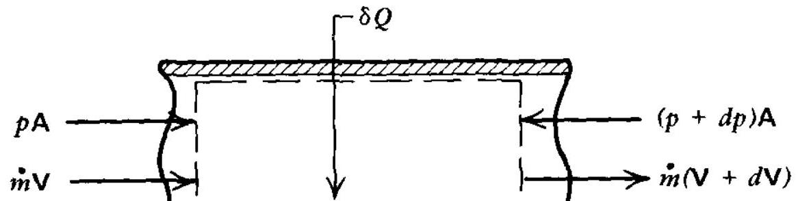
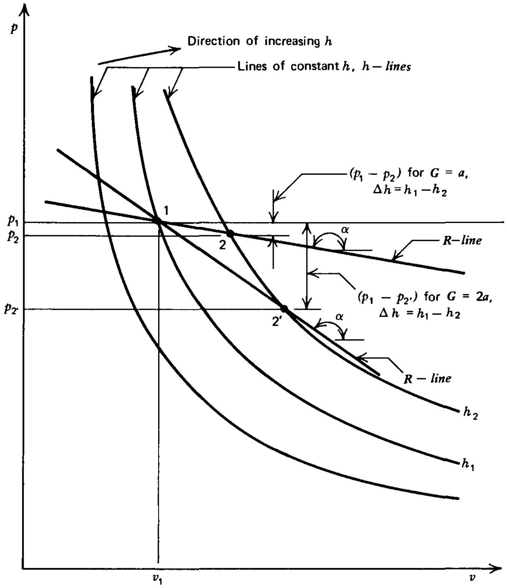
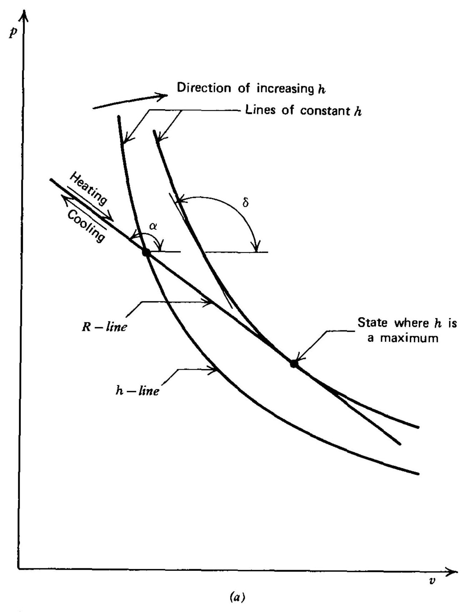
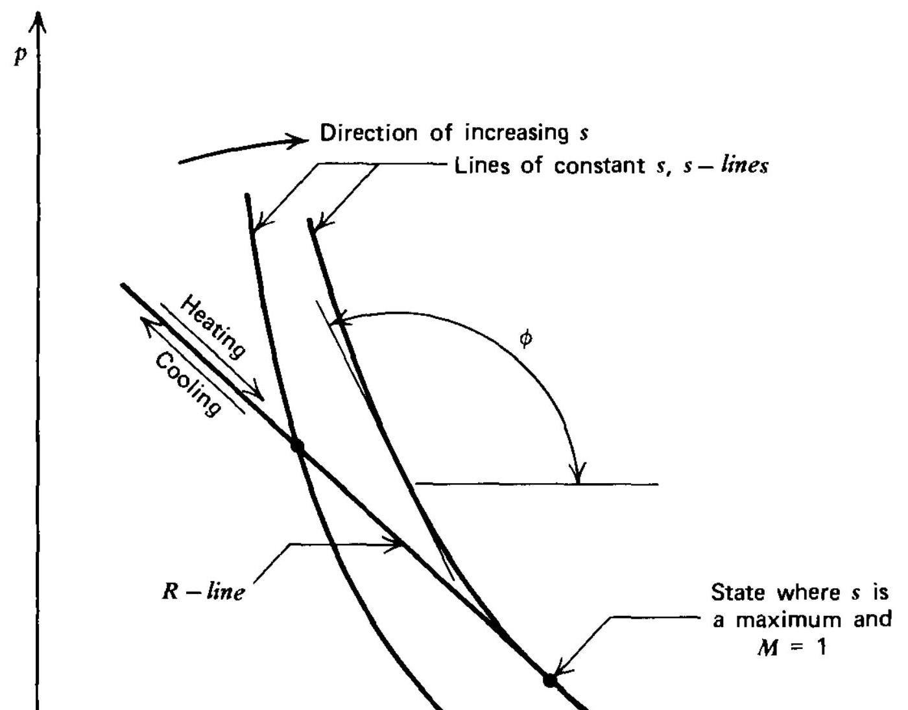
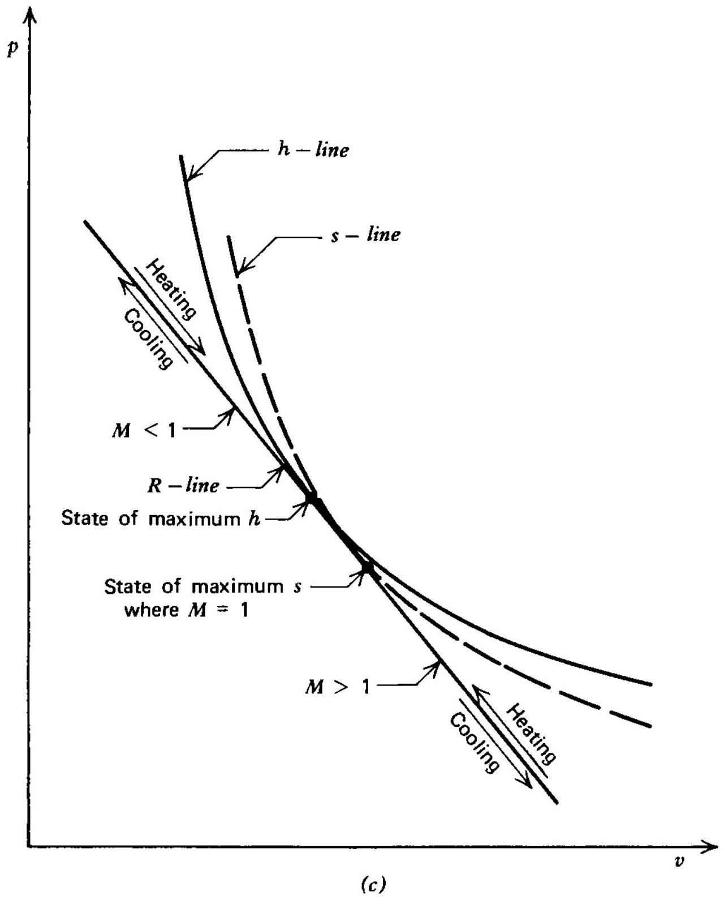
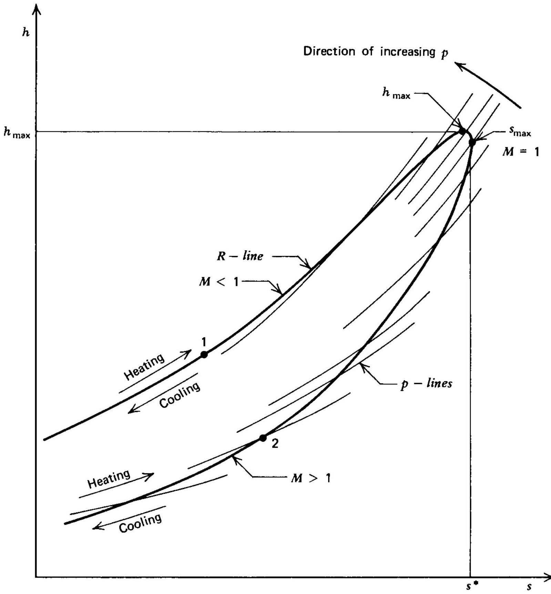
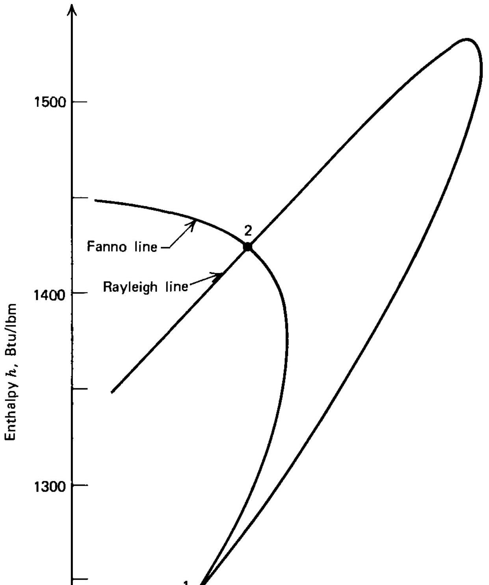

## 6

## steady

## one-dimensional

## flow with heat

## transfer

6-1 PRINCIPAL NOTATION FOR CHAPTER 6

## 6-2 INTRODUCTION

6-3 DYNAMICS OF STEADY ONE-DIMENSIONAL FLOW WITH HEAT TRANSFER IN A CONSTANT-AREA DUCT
(a) Governing equations
(b) The Rayleigh line
(c) Condition for maximum enthalpy
(d) Condition for maximum entropy

6-4 THERMODYNAMICS OF STEADY ONE-DIMENSIONAL FLOW WITH HEAT TRANSFER
(a) The energy equation
(b) Intersection of a Fanno line and a Rayleigh line

6-5 THE RAYLEIGH LINE FOR PERFECT GASES
(a) Rayleigh line equations for a perfect gas
(b) Relationship between heat transfer, stagnation temperature, and Mach number
(c) Entropy change caused by heat transfer
(d) Effect of heat transfer on the flow properties
(e) Rayleigh line tables for a perfect gas

## 6-6 THE RAYLEIGH LINE FOR IMPERFECT GASES

## 6-7 STEADY ONE-DIMENSIONAL ISOTHERMAL FLOW IN A

## 6-1 PRINCIPAL NOTATION FOR CHAPTER 6

The notation presented in Section 3-1 is applicable to the discussions of The following additional notation is employed.
${ }_{1} Q_{2}$ heat transferred between stations 1 and 2 .

## Greek Letters

$\alpha \quad$ angle of tangent to a Rayleigh line.
$\delta \quad$ angle of tangent to an $h$-line.
$\phi \quad$ angle of tangent to an $s$-line.

## Subscripts

$R$ reservoir (stagnation) condition for an isothermal flow.
$t$ minimum area (throat) for an isothermal flow.
1 state before heat transfer.
2 state after heat transfer.

## 6-2 INTRODUCTION

It is shown in Chapter 5 that a Fanno line, for brevity termed an $F$. the thermodynamic states of a fluid in steady flow under the conditions $\delta Q=g d z=\delta D=0$. In that case the only driving potential causing the thermodynamic state of the fluid is the wall friction $\delta F_{i}$. There are of industrial equipment wherein there is a steady flow of a compressible to the conditions $d A=\delta W=\delta F_{\mathrm{i}}=d z=\delta D=0$, but $\delta Q$ is not ze $\delta Q$ may be transferred either to or from the fluid and, for that type stagnation enthalpy of the fluid does not remain constant. Such flov occur in combustion chambers, heat exchangers, superheaters, and the for which $\delta Q \neq 0$ are termed diabatic flows. ${ }^{1-4}$ All practical cases of are invariably accompanied by friction. Moreover, if the heat addition flowing fluid reacting chemically with a fuel, the resulting combustion pr not only a change in the mass of the flowing fluid but also produces a chemical composition.

A first approximation to the effect of heat transfer on the flow of a fluid is obtained by considering the flow to be a simple diabatic flow; that approximates certain practical diabatic flows. The analysis of sim flow is based on the following assumptions.

1. The area of the flow passage or duct is constant.
2. The flow is steady and one-dimensional.
3. There is no work, body forces are negligible, and the effects of friction a
4. Heat transfer is the only driving potential.

Because of the foregoing assumptions the changes in the stagnation

## 6-3 DYNAMICS OF STEADY ONE-DIMENSIONAL FLOW WITH HEAT TRANSFER IN A CONSTANT-AREA DUCT

To facilitate the study of diabatic flows in constant-area ducts, the effects of the dynamics of the flow will be considered separately from the thermo changes that occur in the flowing fluid. The locus of all of the attainable dynamic states for the fluid, as well as the limiting conditions at choking, determined solely from dynamic considerations. The determination of th states attained, however, requires the application of thermodynamic consid the latter are developed in Section 6-4. As mentioned earlier, the sole potential for the diabatic flows to be studied is the heat transfer $Q$.

## 6-3(a) Governing Equations

In view of the assumptions presented in the introduction to this chapter, conditions for the diabatic flow of a fluid in a constant-area duct may be rep diagrammatically by Fig. 6.1. For that flow model the energy, moment continuity equations take the following forms (see Table 3.1).
(1) Energy equation

$$
\delta Q=d h+d\left(\frac{V^{2}}{2}\right)=d H
$$

(2) Momentum (or dynamic) equation for frictionless flow

$$
d p+\rho V d V=0
$$



$$
d A=\delta W=\delta F_{\mathrm{f}}=g d z=\delta D=0
$$


(3) Continuity equation

$$
G=\frac{\dot{m}}{A}=\rho V=\frac{V}{v}=\text { mass flux }=\text { constant }
$$

Since the present section is concerned solely with the dynamics of th the continuity and momentum equations need to be considered. equations 6.2 and 6.3 yields

$$
d p+G d V=0
$$

Integrating equation 6.4 between states 1 and 2 gives

$$
p_{2}+G V_{2}=p_{1}+G V_{1}=p+G V=\text { constant }
$$

Reference to Section 3-12 shows that the expression $p A+\rho A V^{2}$ i thrust, denoted by $\mathscr{F}$. It follows from equation 6.5 that a basic chan simple diabatic flow is that the stream thrust per unit area remains cons equation 6.5 may be rewritten in the form

$$
\frac{\mathscr{F}}{A}=p+G V=\text { constant }
$$

An expression for the pressure change ( $p_{2}-p_{1}$ ) may be obtained equation 6.5 for $\left(p_{2}-p_{1}\right)$. Thus,

$$
p_{2}-p_{1}=G\left(V_{1}-V_{2}\right)
$$

Introducing the relationship $V=G v$ into equation 6.5 yields

$$
p_{1}+G^{2} v_{1}=p_{2}+G^{2} v_{2}=\text { constant }
$$

In most cases, $p_{1}, v_{1}$, and $G$ are known initial conditions, so that equatio employed for plotting the thermodynamic states for the fluid on eith $h v$ plane. Each value of the mass flux $G$, also called the flow density, gi separate curve. A curve obtained by applying equation 6.8 is called a $R$ for brevity termed an $R$-line. Equation 6.8 is known as the Rayleigh li

The equations derived in this section are valid for any fluid, because no have been placed on the character of the equations of state for the flui

Example 6.1. Superheated steam at an initial pressure of $400 \mathrm{lbf} / \mathrm{in} .^{2} \mathrm{N} / \mathrm{m}^{2}$ ) and a specific volume of $1.800 \mathrm{ft}^{3} / \mathrm{lbm}\left(0.11237 \mathrm{~m}^{3} / \mathrm{kg}\right)$ enters a 10 ID pipe with a velocity of $1183.5 \mathrm{ft} / \mathrm{sec}(360.7 \mathrm{~m} / \mathrm{s})$. Determine the locus of thermodynamic states that satisfies the continuity and momentum eq the Rayleigh line).

## Solution

The thermodynamic properties of steam are taken from Thermodynam of Steam, Keenan and Keyes, Wiley, 1958. The initial steam properties

The above value of $G$ is the same as that employed in Example 5.1 to d a Fanno line for the flow of steam.

From equation 6.8,

$$
p_{1}+G^{2} v_{1}=400+\frac{(657.5)^{2}(1.800)}{(32.174)(144)}=567.96 \mathrm{lbf} / \mathrm{in}^{2}
$$

Hence, the equation for the Rayleigh line is given by

$$
\begin{aligned}
& v=\frac{567.96-p}{G^{2}}=\frac{(567.96-p)(32.174)(144)}{(657.5)^{2}} \\
& v=6.0869-0.010717 p \mathrm{ft}^{3} / \mathrm{lbm}\left(0.38021-9.7091 \cdot 10^{-8} p \mathrm{~m}^{3} / \mathrm{kg}\right)
\end{aligned}
$$

Assume selected values of $p$, as shown in Table 6.1, and by means of the line equation, calculate the corresponding values of $v$. Then, from the steat determine the corresponding values of $t, h$, and $s$. The results are presented in 1 Figure 6.2 is a plot of the corresponding Rayleigh line on the hs plane.

Table 6.1 Steam Properties Based on the Rayleigh Line Equation (Example 6.1)
| $p, \mathrm{lbf} / \mathrm{in} .^{2}$ | $v, \mathrm{ft}^{3} / \mathrm{lbm}$ | $t, R$ | $h, \mathrm{Btu} / \mathrm{lbm}$ | $s, \mathrm{Btu} / \mathrm{lbm}-\mathrm{R}$ |
| :--- | :--- | :--- | :--- | :--- |
| 425 | 1.5321 | 689.5 | 1355.53 | 1.6272 |
| 400 | 1.8000 | 790.1 | 1411.17 | 1.6800 |
| 375 | 2.0680 | 874.1 | 1456.63 | 1.7221 |
| 350 | 2.3359 | 938.8 | 1491.53 | 1.7551 |
| 325 | 2.6038 | 983.2 | 1515.68 | 1.7801 |
| 300 | 2.8718 | 1006.2 | 1528.48 | 1.7976 |
| 285 | 3.0326 | 1009.5 | 1530.64 | 1.8047 |
| 275 | 3.1397 | 1007.5 | 1529.84 | 1.8080 |
| 260 | 3.3005 | 998.1 | 1525.30 | 1.8111 |
| 250 | 3.4076 | 987.2 | 1519.94 | 1.8116 |
| 240 | 3.5148 | 973.0 | 1512.79 | 1.8111 |
| 230 | 3.6220 | 955.3 | 1503.85 | 1.8094 |
| 220 | 3.7292 | 934.0 | 1493.10 | 1.8066 |
| 200 | 3.9435 | 881.0 | 1466.40 | 1.7975 |
| 180 | 4.1578 | 864.0 | 1432.76 | 1.7832 |
| 150 | 4.4793 | 687.3 | 1369.89 | 1.7510 |
| 130 | 4.6937 | 571.1 | 1312.58 | 1.7155 |
| 100 | 5.0152 | 411.7 | 1233.73 | 1.6589 |
| 90 | 5.1224 | 348.9 | 1201.58 | 1.6317 |
| $\mathrm{lbf} / \mathrm{in} .^{2} \times 6894.76=\mathrm{N} / \mathrm{m}^{2} \quad \mathrm{Btu} / \mathrm{lbm} \times 2325.97=\mathrm{J} / \mathrm{kg}$ <br> $\mathrm{ft}^{3} / \mathrm{lbm} \times 0.062428=\mathrm{m}^{3} / \mathrm{kg} \quad \mathrm{Btu} / \mathrm{lbm}-\mathrm{R} \times 4186.8=\mathrm{J} / \mathrm{kg}-\mathrm{K}$ <br> $R / 1.8=\mathrm{K}$ |  |  |  |  |


## 304 STEADY ONE-DIMENSIONAL FLOW WITH HEAT TRANSFER


Figure 6.3 Rayleigh lines plotted on the $p v$ plane (constant-area duct).

is plotted on the $p v$ plane, as is done in Fig. 6.3, the resulting straight line ha slope $-G^{2}$. Consequently, if $\alpha$ is the angle made by the $R$-line and the $v$ axis, $\tan \alpha=-G^{2}$. Each value of the mass flux $G$ gives rise to a different $R$-line the larger the value of $G$ the steeper is the $R$-line. Since $G=V / v=$ constant given $R$-line, it follows from equation 6.9 that the fluid velocity corresponding t state on an $R$-line plotted in the $p v$ plane is given by

$$
V=v G=v\left(\frac{p_{2}-p_{1}}{v_{1}-v_{2}}\right)^{1 / 2}=v(-\tan \alpha)^{1 / 2}
$$

Figure 6.3 illustrates diagrammatically three lines of constant specific entl hereafter referred to as $h$-lines, and two $R$-lines plotted on the $p v$ plane. It is app from Fig. 6.3 that, if $G$ is held constant, raising the enthalpy of the fluid from




Figure 6.4 Conditions for maximum enthalpy and for maximum entropy for Rayleigh lines on the $p v$ plane (constant-area duct). (a) Condition for maximum enthalpy. (b) Condition for maximum entropy. (c) States of maximum enthalpy and maximum entropy on the same Rayleigh line.

plotted on the same plane. It is seen that both the $h$-lines and the $s$-lines more and more curved and concave upward for large values of $v$ and sma of $p$. Consequently, if an $R$-line is extended in the direction of increasing $v$, it must become tangent to an $h$-line, as illustrated in Fig. 6.4a. Similarly, t] must also become tangent to an $s$-line, as illustrated in Fig. 6.4b. It is found specific volume of the fluid at the point where a given $R$-line is tangent to is larger than it is at the point where the $R$-line is tangent to an $h$-line, as il in Fig. 6.4c. The foregoing shows that for a given $R$-line there is one state responds to the condition for maximum enthalpy and another to the for maximum entropy.

Figure 6.5 illustrates diagrammatically the form of an $R$-line when plotte


Figure 6.5 Rayleigh line plotted on the $h s$ plane (constant-area duct).

of the fluid is increased at a rate faster than the heat addition rate (by back pressure, for example), the energy required for the correspond in its kinetic energy must come from the energy stored in the fluid. As enthalpy of the fluid decreases to satisfy the demand for an increase in ki and the state point for the fluid moves to the right, as illustrated in Fig

The slope of an $R$-line is given by equation 6.9. Thus,

$$
\tan \alpha=\left(\frac{\partial p}{\partial v}\right)_{R}=-G^{2}=-\frac{V^{2}}{v^{2}}
$$

The slope of an $h$-line is denoted by $\tan \delta$, where

## 6-3(d) Condition for Maximum Entropy

If $\tan \phi$ denotes the slope of an s-line, then, in view of equation 1.180 , it foll

$$
\tan \phi=\left(\frac{\partial p}{\partial v}\right)_{s}=-\frac{1}{v^{2}}\left(\frac{\partial p}{\partial \rho}\right)_{s}=-\frac{a^{2}}{v^{2}}
$$

At the state where the entropy is a maximum, $\tan \phi=\tan \alpha$. Consequer

$$
\frac{V^{2}}{v^{2}}=\frac{a^{2}}{v^{2}}, \quad \text { or } \quad V=a
$$

Equation 6.15 shows that when the entropy is a maximum the fluid ve equal to the local acoustic speed $a$; that is, $V=a^{*}$. The foregoing indic for a given set of initial conditions, there is a limiting state where the entr maximum, and at that state $V=a^{*}$. When that condition is attained, is said to be operating with thermal choking. Further addition of heat cause the fluid to attain states beyond the choking condition but produces in the upstream conditions.

The two branches of the $R$-line plotted in the $h$ plane (see Fig. 6.5) cor to the following physical situations. The upper branch is the locus of the dynamic states that can be attained by heating a compressible fluid in flow $(M<1)$ from an initial state, such as state 1 in Fig. 6.5, which is locat left of the state where thermal choking occurs. The lower branch of the the locus of the thermodynamic states that are attainable by a superso $(M>1)$ by heat addition from an initial state, such as state 2 in Fig. 6.5. I that the effect of heat addition is to accelerate a subsonic flow to $M=1$ a and to decelerate a supersonic flow to $M=1$ as a limit.

## 6-4 THERMODYNAMICS OF STEADY ONE-DIMENSIONAL FLOW WITH HEAT TRANSFER

The dynamics of simple diabatic flow are investigated in Section 6-3. In this the energy equation for diabatic flow is developed, and some general obse are made concerning the intersection of a Fanno line and a Rayleigh line

## 6-4(a) The Energy Equation

Table 3.1 shows that if $\delta W=g d z=0$, for a simple diabatic flow, the energy is then given by

$$
\delta Q=d h+d\left(\frac{V^{2}}{2}\right)
$$

Referring to Fig. 6.1, if ${ }_{1} Q_{2}$ is the heat transferred between stations 1 and tion 6.16 may be integrated to yield

From the definition of the stagnation enthalpy, $H=h+V^{2} / 2$, it is appa equation 6.16 reduces to

$$
l H=\delta Q
$$

Equation 6.17, therefore, becomes

$$
H_{2}=H_{1}+{ }_{1} Q_{2}
$$

Equation 6.20 provides the connection between the driving potential (heat and the other flow properties. The actual mechanism of the heat transfer portant in applying equation 6.20 to the calculation of the effects of a g on the flow properties. In any real flow process, however, the detailed heat mechanism must be specified (i.e., conduction, convection, radiation, or reaction) so that the numerical value of ${ }_{1} Q_{2}$ may be determined.

## 6-4(b) Intersection of a Fanno Line and a Rayleigh Line

If an $F$-line and an $R$-line for the same value of $G$ are plotted on the hs plane, intersect at two states, such as the states 1 and 2 illustrated in Fig. 6.6. Sir

the states on the same $F$-line have the same stagnation enthalpy $H$, and states on the same $R$-line have the same value of stream thrust $\mathscr{F} / A$, it fo states 1 and 2 have identical values of $G, H$, and $\mathscr{F} / A$. It will be seen later (see that the flow through a shock wave satisfies the energy and continuity for the F-line and the momentum and continuity equations for the $R$-li quently, the spontaneous change from state 1 to state 2 can be accompl shock wave. State 2 is at a higher entropy than state 1 , indicating that a sp change from state 1 to state 2 does not violate the second law of therm Since state 2 is at a higher static pressure than state 1 , the spontaneous state is termed a compression shock wave. A change of state from state 2 is impossible in view of the second law of thermodynamics: in othe spontaneous change from a subsonic to a supersonic flow is impossible reverse can occur. The shock process is a sudden compression that in pressure and entropy of the fluid but decreases its velocity from a supe subsonic value.

Example 6.2. A Fanno line and a Rayleigh line for steam having a $G=657.5 \mathrm{lbm} / \mathrm{sec}^{-} \mathrm{ft}^{2}\left(3209.3 \mathrm{~kg} / \mathrm{s}-\mathrm{m}^{2}\right)$ are determined in Examples 5. respectively. Plot those two processes on the $h s$ plane and determine the ahead of and behind the normal shock wave corresponding to the it of the $F$-line and the $R$-line.

## Solution

The results are presented in Fig. 6.6. The properties ahead of the shock wa in Fig. 6.6) are:

$$
h_{1}=1245.5 \mathrm{Btu} / \mathrm{lbm}\left(2.897 \cdot 10^{6} \mathrm{~J} / \mathrm{kg}\right) \quad s_{1}=1.667 \mathrm{Btu} / \mathrm{lbm}-\mathrm{R}
$$

By interpolating from the steam tables,

$$
\begin{gathered}
p_{1}=107.46 \mathrm{lbf} / \mathrm{in} .^{2}\left(7.409 \cdot 10^{5} \mathrm{~N} / \mathrm{m}^{2}\right), \quad t_{1}=440.3 \mathrm{R}(244.6 \mathrm{~K} \\
v_{1}=4.8317 \mathrm{ft}^{3} / \mathrm{lbm}\left(0.30163 \mathrm{~m}^{3} / \mathrm{kg}\right)
\end{gathered}
$$

The initial steam velocity is

$$
V_{1}=G v_{1}=(657.5)(4.8317)=3176.84 \mathrm{ft} / \mathrm{sec}(968.3 \mathrm{~m} / \mathrm{s})
$$

The properties after the shock wave (point 2 in Fig. 6.6) are

$$
h_{2}=1423 \mathrm{Btu} / \mathrm{lbm}\left(3.310 \cdot 10^{6} \mathrm{~J} / \mathrm{kg}\right) \quad s_{2}=1.691 \mathrm{Btu} / \mathrm{lbm}-\mathrm{R}(7079.9
$$

By interpolating from the steam tables,

$$
\begin{gathered}
p_{2}=394.11 \mathrm{lbf} / \mathrm{in}^{2}\left(27.177 \cdot 10^{5} \mathrm{~N} / \mathrm{m}^{2}\right), \quad t_{2}=811.8 \mathrm{R}(451.0 \mathrm{I}) \\
v_{2}=1.8720 \mathrm{ft}^{3} / \mathrm{lbm}\left(0.11687 \mathrm{~m}^{3} / \mathrm{kg}\right)
\end{gathered}
$$

## 6-5(a) Rayleigh Line Equations for a Perfect Gas

For an $R$-line the stream thrust per unit area $\mathscr{F} / A$ is constant. Hence, if is a perfect gas, it follows from equation 6.5 that

$$
\begin{aligned}
\frac{\mathscr{F}}{A} & =p+\rho V^{2}=p\left(1+\frac{\rho V^{2}}{p}\right)=p\left(1+\gamma M^{2}\right) \\
& =p_{2}\left(1+\gamma M_{2}^{2}\right)=p_{1}\left(1+\gamma M_{1}^{2}\right)=\text { constant }
\end{aligned}
$$

From equation 6.21, it follows that

$$
\frac{p_{2}}{p_{1}}=\frac{1+\gamma M_{1}^{2}}{1+\gamma M_{2}^{2}}
$$

From Table 3.2, the continuity equation for the flow of a perfect gas in a const duct becomes

$$
\frac{p_{2} M_{2}}{\sqrt{t_{2}}}=\frac{p_{1} M_{1}}{\sqrt{t_{1}}}
$$

From equations 6.22 and 6.23,

$$
\frac{t_{2}}{t_{1}}=\frac{p_{2}^{2} M_{2}^{2}}{p_{1}^{2} M_{1}^{2}}=\frac{M_{2}^{2}}{M_{1}^{2}}\left(\frac{1+\gamma M_{1}^{2}}{1+\gamma M_{2}^{2}}\right)^{2}
$$

For a perfect gas, the equation of state yields

$$
\frac{p_{2} v_{2}}{t_{2}}=\frac{p_{1} v_{1}}{t_{1}}
$$

From equations $6.22,6.24,6.25$, and the continuity equation $G=\rho V=$ we obtain

$$
\frac{\rho_{2}}{\rho_{1}}=\frac{v_{1}}{v_{2}}=\frac{V_{1}}{V_{2}}=\frac{p_{2}}{p_{1}} \frac{t_{1}}{t_{2}}=\frac{M_{1}^{2}}{M_{2}^{2}}\left(\frac{1+\gamma M_{2}^{2}}{1+\gamma M_{1}^{2}}\right)
$$

From equation 3.177, we obtain the following equation for the entropy ch a perfect gas.

$$
\frac{\Delta s}{R}=\ln \left[\left(\frac{t_{2}}{t_{1}}\right)^{\gamma /(\gamma-1)}\left(\frac{p_{1}}{p_{2}}\right)\right]
$$

Substituting for $p_{1} / p_{2}$ and $t_{2} / t_{1}$ from equations 6.22 and 6.24 yields

$$
\frac{\Delta s}{R}=\ln \left[\left(\frac{M_{2}}{M_{1}}\right)^{2 \gamma /(\gamma-1)}\left(\frac{1+\gamma M_{1}^{2}}{1+\gamma M_{2}^{2}}\right)^{(\gamma+1) /(\gamma-1)}\right]
$$

Combining equations 3.182 and 6.22, we obtain the following equation stagnation pressure ratio $P_{2} / P_{1}$. Thus,
transform as follows:
(a) Slope of the $R$-line

$$
\tan \alpha=-\frac{V^{2}}{v^{2}}=\frac{\gamma p}{\gamma p} \frac{V^{2}}{v^{2}}=-\gamma \frac{p}{v} M^{2}
$$

(b) Slope of the h-line (isotherm)

$$
\tan \delta=\left(\frac{\partial p}{\partial v}\right)_{t}=\left[\frac{\partial(R t / v)}{\partial v}\right]_{t}=-\frac{R t}{v^{2}}
$$

(c) Slope of the s-line (isentrope)

$$
\tan \phi=\left(\frac{\partial p}{\partial v}\right)_{s}=-\rho^{2}\left(\frac{\partial p}{\partial \rho}\right)_{s}=-\frac{a^{2}}{v^{2}}
$$

It follows from equations 6.30 and 6.32 that when the slopes of an $R$-lin s-line are equal, then

$$
\frac{\tan \alpha}{\tan \phi}=M^{2}=1
$$

Similarly, when the slopes of the $R$-line and an $h$-line are equal,

$$
\frac{\tan \alpha}{\tan \delta}=\gamma M^{2}=1
$$

Hence, as shown in the preceding, at the state where the entropy is a m $(\tan \alpha=\tan \phi)$, the flow Mach number is $M=1$, and at the state where the reaches its maximum value ( $\tan \alpha=\tan \delta$ ), the flow Mach number $M=1$

## 6-5(b) Relationship between Heat Transfer, Stagnation Temperature, and Mach Number

For a perfect gas, the energy equation may be written in the form (see equati Table 3.2)

$$
c_{p} t_{2}+\frac{V_{2}^{2}}{2}=c_{p} t_{1}+\frac{V_{1}^{2}}{2}+{ }_{1} Q_{2}
$$

which may be transformed to read

$$
t_{2}\left(1+\frac{\gamma-1}{2} M_{2}^{2}\right)=t_{1}\left(1+\frac{\gamma-1}{2} M_{1}^{2}\right)+\frac{1}{c_{p}}
$$

For a perfect gas, $H=c_{p} T$. Consequently, equation 6.19 may be writ

$$
c_{p} d T=\delta Q
$$

In that case, equation 6.20 becomes

The stagnation temperature ratio $T_{2} / T_{1}$ may be expressed in terms of t numbers at stations 1 and 2. Thus,

$$
\frac{T_{2}}{T_{1}}=\frac{t_{2}}{t_{1}} \frac{\left(1+\frac{\gamma-1}{2} M_{2}^{2}\right)}{\left(1+\frac{\gamma-1}{2} M_{1}^{2}\right)}
$$

Substituting equation 6.24 into equation 6.40 yields

$$
\frac{T_{2}}{T_{1}}=\frac{M_{2}^{2}}{M_{1}^{2}} \frac{\left(1+\gamma M_{1}^{2}\right)^{2}}{\left(1+\gamma M_{2}^{2}\right)^{2}} \frac{\left(1+\frac{\gamma-1}{2} M_{2}^{2}\right)}{\left(1+\frac{\gamma-1}{2} M_{1}^{2}\right)}
$$

## 6-5(c) Entropy Change Caused by Heat Transfer

For a perfect gas, the entropy change in terms of the stagnation properti flowing gas is given by equation 3.179, Table 3.2. Thus,

$$
\frac{\Delta s}{c_{p}}=\ln \left[\frac{T_{2} / T_{1}}{\left(P_{2} / P_{1}\right)^{(\gamma-1) / \gamma}}\right]
$$

The entropy change may, therefore, be obtained by combining equati 6.41, and 6.42.

Example 6.3. It is desired to achieve a stagnation temperature ratio of ramjet combustor by the addition of heat, and not exceed a Mach numb at its exit. The initial stagnation temperature is $T=350 \mathrm{~K}$. Determin initial Mach number, and (b) the amount of heat which can be added. Ass 1.3 and $R=287.04 \mathrm{~J} / \mathrm{kg}-\mathrm{K}$.

## Solution

(a) Solve equation 6.41 for $M_{1}$. Thus,

$$
\begin{gathered}
M_{1}^{2}\left(1+\frac{\gamma-1}{2} M_{1}^{2}\right)=\frac{T_{1}}{T_{2}} \frac{M_{2}^{2}\left(1+\frac{\gamma-1}{2} M_{2}^{2}\right)}{\left(1+\gamma M_{2}^{2}\right)^{2}}\left(1+\gamma M_{1}^{2}\right) \\
M_{1}^{4}\left(\gamma^{2} K-\frac{\gamma-1}{2}\right)+M_{1}^{2}(2 \gamma K-1)+K=0
\end{gathered}
$$

where

From equation 6.38,

$$
\begin{aligned}
& Q=c_{p}\left(T_{2}-T_{1}\right)=c_{p} T_{1}\left(\frac{T_{2}}{T_{1}}-1\right) \\
& Q=(1243.8)(350)(4-1)=1306.0 \mathrm{~kJ} / \mathrm{kg}(561.49 \mathrm{Btu} / \mathrm{lbm})
\end{aligned}
$$

## 6-5(d) Effect of Heat Transfer on the Flow Properties

The effect of heat transfer on the flow properties may be determined by the method that is employed in Section 4-4(c). Relationships may be tween the variables $d M / M, d p / p, d \rho / \rho, d t / t, d V / V, d P / P, d s / c_{p}$, and the h $\delta Q$ expressed in terms of $d T / T$ (see equation 6.37). The results are p Table 6.2.

## Table 6.2 Influence Coefficients for the Simple Diabatic Flow of a I in a Constant-Area Duct

$$
\begin{aligned}
\frac{d M}{M} & =\frac{\left(1+\gamma M^{2}\right)\left(1+\frac{\gamma-1}{2} M^{2}\right)}{2\left(1-M^{2}\right)}\left(\frac{d T}{T}\right) \\
\frac{d p}{p} & =-\frac{\gamma M^{2}\left(1+\frac{\gamma-1}{2} M^{2}\right)}{1-M^{2}}\left(\frac{d T}{T}\right) \\
\frac{d \rho}{\rho} & =-\frac{\left(1+\frac{\gamma-1}{2} M^{2}\right)}{1-M^{2}}\left(\frac{d T}{T}\right) \\
\frac{d t}{t} & =\frac{\left(1-\gamma M^{2}\right)\left(1+\frac{\gamma-1}{2} M^{2}\right)}{1-M^{2}}\left(\frac{d T}{T}\right) \\
\frac{d V}{V} & =\frac{\left(1+\frac{\gamma-1}{2} M^{2}\right)}{1-M^{2}}\left(\frac{d T}{T}\right) \\
\frac{d P}{P} & =-\frac{\gamma M^{2}}{2}\left(\frac{d T}{T}\right) \\
\frac{d s}{c_{p}} & =\left(1+\frac{\gamma-1}{2} M^{2}\right)\left(\frac{d T}{T}\right)
\end{aligned}
$$

Table 6.3 summarizes the effect of heat transfer on the flow properties addition $(d T>0)$ to a perfect gas. For heat removal $(d T<0)$, all of th are reversed.

Table 6.3 Effect of Heat Addition ( $d T>0$ ) on the Flow Properties for a Perfect Gas in a Constant-Area Duct
| Variable | $M<1$ | $M>1$ |
| :--- | :--- | :--- |
| $d M / M$ | + | - |
| $d p / p$ | - | + |
| $d \rho / \rho$ | - | + |
| $d t / t$ | $\begin{aligned} & - \text { for } M<\frac{1}{\sqrt{\gamma}} \\ & + \text { for } M>\frac{1}{\sqrt{\gamma}} \end{aligned}$ | - |
| $d V / V$ | + | - |
| $d P / P$ | - | - |
| $d s / c_{p}$ | + | + |


## 6-5(e) Rayleigh Line Tables for a Perfect Gas

As in the case of the Fanno line ( $F$-line) for perfect gases, it is convenient the state coordinates on an $R$-line to their values at the thermal choking li is, where $M=1, V=a^{*}, p=p^{*}$, etc. Substituting $M_{1}=1$ into the app equations of Sections 6-3 and 6-4 gives the equations presented in Table

Table 6.4 Property Ratios for the Simple Diabatic Flow of a Perfect Constant-Area Duct

$$
\begin{aligned}
\frac{p}{p^{*}} & =\frac{\gamma+1}{1+\gamma M^{2}} \\
\frac{\rho}{\rho^{*}} & =\frac{v^{*}}{v}=\frac{V^{*}}{V}=\frac{1+\gamma M^{2}}{(\gamma+1) M^{2}} \\
\frac{t}{t^{*}} & =\frac{(\gamma+1)^{2} M^{2}}{\left(1+\gamma M^{2}\right)^{2}}
\end{aligned}
$$

Table 6.5 Limiting Values of the Property Ratios for the Simple Diabatic Flow of a Perfect Gas in a Constant-Area Duct
| $M$ | $M^{*}=\frac{V}{V^{*}}=\frac{\rho^{*}}{\rho}$ | $\frac{t}{t^{*}}$ | $\frac{p}{p^{*}}$ | $\frac{P}{P^{*}}$ | $\frac{T}{T^{*}}$ |
| :--- | :--- | :--- | :--- | :--- | :--- |
| 0 | 0 | 0 | $(\gamma+1)$ | $(\gamma+1)\left(\frac{2}{\gamma+1}\right)^{\gamma /(\gamma-1)}$ | 0 |
| 1 | 1 | 1 | 1 | 1 | 1 |
| $\infty$ | $\frac{\gamma+1}{\gamma}$ | 0 | 0 | $\infty$ | $\frac{\gamma^{2}-1}{\gamma^{2}}$ |


A FORTRAN program, subroutine RAY, for calculating the property rati the simple diabatic flow of a perfect gas is presented below. The input to this pro is the same as that discussed in Section 4-4(b). The results presented in Tab for $\gamma=1.4$ are obtained by the following specification.

$$
\begin{aligned}
& G=1.4, J(1)=50, J(2)=50, J(3)=10, J(4)=20, J(5)=12, J(6)=5, J(7)=0, \\
& D M(1)=0.01, D M(2)=0.02, D M(3)=0.05, D M(4)=0.1, D M(5)=0.5, D M(6)=
\end{aligned}
$$

```
        SUBROUTINE RAY
C RAYLEIGH LINE PROPERTY RATIOS FOR A PERFECT GAS
        REAL M,MS $ DIMENSION J(9),DM(9) $ DATA INF/6H INFIN/
        NAMELIST /DATA/ G.J.DM $ READ (5,DATA)
        G1 =(G-1.0)/2.0 $ G2=G+1.0 $ G3=G/(G-1.0) $ G4=2.0/(G+1.0)
        G5=G4**G3
        M=0.0 $ MS=0.0 $ T=0.0 $ P=G2 $ PO=G2*G5 $ T0=0.0
        WRITE (6,2000) G $ WRITE (6,2020) M,MS,T,P,PO,TO $ I=1 $ L=0
C CALCULATE PROPERTY RATIOS
    40 N=J(I) $ DO 50 K=1.N $ M=M+DM(I) $ MS=G2*M**2/(1.0+G*M**2)
        T=(MS/M)**2 $ P=MS/M**2 $ C=1.0+G1*M**2 $ TO=G4*T*C $PO=P*G5*
        WRITE (6,2020) M,MS,T,P,PO,TO $ L=L+1 $ IF (L.LT.50) GO TO 50
        WRITE (6,2000) G $ L=0
    50 CONTINUE $ I=I+1 $ IF((I.EQ.10).OR.(J(I).EQ.0)) GO TO 60 $GO
    60 MS=G2/G $ T=0.0 $ P=0.0 $ TO=(G**2-1.0)/G**2
        WRITE (6,2030) INF,MS,T,P,INF,TO $ RETURN
2000 FORMAT (1H1,21X,23HRAYLEIGH LINE, GAMMA =,F5,2//4X,1HM,4X,7H
        1/R, 4X, 4HT/T*, 9X, 4HP/P*, 9X, 6HPO/PO*, 7X, 6HTO/TO*/)
2020 FORMAT (1H .F5.2.F10.5.4E13.5)
2030 FORMAT (A6,F10.5,2E13,5,3X,A6,E17,5)
        END
```

after combustion, and that friction is negligible. Calculate (a) the stas perature after combustion, (b) the Mach number after combustion, static temperature, (d) the loss in stagnation pressure due to heat add entropy change, and (f) the final velocity of the combustion produ $\gamma=1.4, R=287.04 \mathrm{~J} / \mathrm{kg}-\mathrm{K}$, and $c_{p}=1.0048 \mathrm{~kJ} / \mathrm{kg}-\mathrm{K}$.

## Solution

$$
\begin{aligned}
a_{1} & =\left(\gamma R t_{1}\right)^{1 / 2}=[1.4(287.04)(333.3)]^{1 / 2}=366.0 \mathrm{~m} / \mathrm{s} \\
M_{1} & =\frac{V_{1}}{a_{1}}=\frac{73.15}{366.0}=0.2000
\end{aligned}
$$

From Table C. 9 (Rayleigh line), for $M_{1}=0.2$,

$$
\begin{aligned}
& \frac{T_{1}}{T^{*}}=0.17355, \quad \frac{t_{1}}{t^{*}}=0.20661, \\
& \frac{p_{1}}{p^{*}}=2.2727, \quad \frac{P_{1}}{P^{*}}=1.2346, \quad \frac{V_{1}}{V^{*}}=0.09091 \\
& \frac{T_{1}}{t_{1}}=1+\frac{\gamma-1}{2} M_{1}^{2}=1+0.2(0.2)^{2}=1.0080 \\
& T_{1}=(1.0080)(333.3)=336.0 \mathrm{~K} \\
& \frac{P_{1}}{p_{1}}=\left(\frac{T_{1}}{t_{1}}\right)^{\gamma /(\gamma-1)}=(1.0080)^{3.5}=1.02824 \\
& P_{1}=(1.02824)(0.5516) 10^{5}=0.5672 \cdot 10^{5} \mathrm{~N} / \mathrm{m}^{2}
\end{aligned}
$$

The energy of combustion $\Delta H$ for each unit mass of the air-fuel mixture

$$
\Delta H=\frac{\dot{m}_{f} \Delta H_{c}}{\dot{m}_{f}+\dot{m}_{a}}=\frac{\Delta H_{c}}{1+\frac{\dot{m}_{a}}{\dot{m}_{f}}}=\frac{\Delta H_{c}}{1+\frac{1}{f}}=\frac{41,867}{1+29}=1,395.5 \mathrm{~kJ}
$$

(a) Denote the stagnation temperature after combustion by $T_{2}$. Hence

$$
\begin{aligned}
\Delta H & =c_{p}\left(T_{2}-T_{1}\right) \\
T_{2} & =T_{1}+\frac{\Delta H}{c_{p}}=336.0+\frac{1,395.5}{1.0048}=1724.8 \mathrm{~K}
\end{aligned}
$$

(b) $\frac{T_{2}}{T_{1}}=\frac{1724.8}{336.0}=5.1333 \quad$ and $\quad \frac{T_{2}}{T^{*}}=\frac{T_{1}}{T^{*}} \frac{T_{2}}{T_{1}}=(0.17355)(5.133$

From Table C.9, for $T_{2} / T^{*}=0.89088, M_{2}=0.680$, and

$$
\frac{t_{2}}{*}=0.98144, \quad \frac{p_{2}}{*}=1.4569, \quad \frac{P_{2}}{N *}=1.0489, \quad \frac{V_{2}}{N *}=0.6
$$

(e) $\quad s_{2}-s_{1}=c_{p} \ln \left(\frac{T_{2}}{T_{1}}\right)-R \ln \left(\frac{P_{2}}{P_{1}}\right)=(1004.8) \ln (5.1333)-(287.04)$

$$
s_{2}-s_{1}=1690.4 \mathrm{~J} / \mathrm{kg}-\mathrm{K}(0.4037 \mathrm{Btu} / \mathrm{lbm}-\mathrm{R})
$$

(f) $\quad V_{2}=\frac{V_{2} / V^{*}}{V_{1} / V^{*}} V_{1}=\frac{(0.67367)(73.15)}{(0.09091)}=542.1 \mathrm{~m} / \mathrm{s}(1778.4 \mathrm{ft} / \mathrm{sec})$

## 6-6 THE RAYLEIGH LINE FOR IMPERFECT GASES

The properties of the Rayleigh line are developed in Section 6-5 for p In this section, the influence of imperfect gas effects on simple diabatic sidered. Several sources of imperfect gas effects are presented in Section

A completely general imperfect gas model is considered. Assume that th of state for the flowing fluid are given by

$$
\rho=\rho(p, t) \quad \text { and } \quad h=h(p, t)
$$

Equations 6.55 may be in the form of equations, charts, tables, or a com The source, or type, of the imperfect gas effect is immaterial as far as th concerned, provided that equations 6.55 are available.

The continuity, momentum, and energy equations for simple diaba given by equations $6.3,6.5$, and 6.17 , respectively. Those equations may be to give

$$
\begin{aligned}
& V_{2}=\frac{\rho_{1} V_{1}}{\rho_{2}} \\
& p_{2}=p_{1}+\rho_{1} V_{1}^{2}\left(1-\frac{\rho_{1}}{\rho_{2}}\right) \\
& h_{2}=h_{1}+\frac{V_{1}^{2}}{2}\left[1-\left(\frac{\rho_{1}}{\rho_{2}}\right)^{2}\right]+{ }_{1} Q_{2}
\end{aligned}
$$

Equations 6.55 to 6.58 comprise a set of five equations in terms of the flov $p, \rho, h, t$, and $V$ at point 1 upstream to the heat transfer region and at po stream from it. When the upstream properties of the gas and the heat t are specified, the aforementioned equations yield five relationships betw properties $p_{2}, \rho_{2}, h_{2}, t_{2}$, and $V_{2}$. In general, those equations must be solved r

Example 6.5. Consider the flow of steam discussed in Example 6.1. the amount of heat addition required to choke the flow, and the prope steam at that section.

## Solution

## 320 STEADY ONE-DIMENSIONAL FLOW WITH HEAT TRANSFER

From equation 6.17,

$$
\begin{aligned}
& Q=h^{*}-h_{1}+\frac{\left(V^{*}\right)^{2}-V_{1}^{2}}{2} \\
& Q=1520-1411.17+\frac{(2240.7)^{2}-(1183.5)^{2}}{2(32.174)(778.16)} \\
& Q=108.83+72.30=181.13 \mathrm{Btu} / \mathrm{lbm}\left(0.4213 \cdot 10^{6} \mathrm{~J} / \mathrm{kg}\right)
\end{aligned}
$$

## 6-7 STEADY ONE-DIMENSIONAL ISOTHERMAL FLOW IN A VARIABLE-AREA PASSAGE

In Section 5-7, the steady isothermal flow of a perfect gas in a constant-are investigated. In this section, the steady isothermal frictionless flow of a pe in a variable-area passage is studied. At present, no practical examples o flow are available. Some devices have been considered, however, wherein is maintained isothermal by either heat transfer or combustion. Becaus possible application of such a process in the future, the major points of are developed herein.

## 6-7(a) Governing Equations

For a steady isothermal flow of a perfect gas, in a variable-area duct, the momentum, and continuity equations take the following form (see Table
(1) Energy equation

$$
\delta Q=d\left(\frac{V^{2}}{2}\right)=d H=c_{p} d T
$$

which may be integrated to yield

$$
c_{p}\left(T_{2}-T_{1}\right)={ }_{1} Q_{2}=\frac{V_{2}^{2}-V_{1}^{2}}{2}
$$

(2) Momentum equation

$$
d p+\rho V d V=0
$$

(3) Continuity equation for a perfect gas

$$
\dot{m}=\rho A V=A p M \sqrt{\frac{\gamma}{R t}}=\mathrm{constant}
$$

From equation 6.62, it follows that

$$
p_{2} A_{2} M_{2}=p_{1} A_{1} M_{1}
$$

For a perfect gas, the thermal equation of state is

Integration of equation 6.66 yields

$$
\frac{p_{2}}{p_{1}}=\frac{\rho_{2}}{\rho_{1}}=\frac{v_{1}}{v_{2}}=e^{\gamma\left(M_{1}^{2}-M_{2}^{2}\right) / 2}
$$

Substituting equation 6.67 into 6.63, we obtain

$$
\frac{A_{2}}{A_{1}}=\frac{M_{1}}{M_{2}} e^{\gamma\left(M_{2}^{2}-M_{1}^{2}\right) / 2}
$$

From the definition of the stagnation temperature, for $t_{1}=t_{2}$, the temperature ratio $T_{2} / T_{1}$ is

$$
\frac{T_{2}}{T_{1}}=\frac{1+\frac{\gamma-1}{2} M_{2}^{2}}{1+\frac{\gamma-1}{2} M_{1}^{2}}
$$

From the definition of the stagnation pressures corresponding to $p_{1}$ and stagnation pressure ratio $P_{2} / P_{1}$ is

$$
\frac{P_{2}}{P_{1}}=\left(\frac{1+\frac{\gamma-1}{2} M_{2}^{2}}{1+\frac{\gamma-1}{2} M_{1}^{2}}\right)^{\gamma /(\gamma-1)} e^{\left[\gamma\left(M_{1}^{2}-M_{2}^{2}\right) / 2\right]}
$$

From the definition of the impulse function,

$$
\frac{\mathscr{F}_{2}}{\mathscr{F}_{1}}=\frac{p_{2} A_{2}\left(1+\gamma M_{2}{ }^{2}\right)}{p_{1} A_{1}\left(1+\gamma M_{1}{ }^{2}\right)}=\frac{M_{1}\left(1+\gamma M_{2}{ }^{2}\right)}{M_{2}\left(1+\gamma M_{1}{ }^{2}\right)}
$$

where $p_{2} / p_{1}$ and $A_{2} / A_{1}$ are obtained from equations 6.67 and 6.68, resp

## 6-7(b) Limiting Conditions

Let station 1 be some initial point in the flow where $A_{1}$ and $M_{1}$ are fixed station 2 be any other station. In terms of stations 1 and 2, equation 6.68 written in the form

$$
A=\frac{1}{M} e^{\gamma M^{2} / 2}\left(A_{1} M_{1} e^{-\gamma M_{1}^{2} / 2}\right)
$$

For fixed initial conditions, the term inside the parentheses is constant. At t mum area (i.e., at the throat $A_{t}$ ), $d A_{t}=0$. Differentiating equation $6.72 \log$ cally, we obtain the following equation.

$$
\frac{d A}{A}=-\frac{d M}{M}+\gamma M d M=\left(\gamma M^{2}-1\right) \frac{d M}{M}
$$

Setting $d A_{t}=0$ in equation 6.73, and solving for $M_{t}$, we obtain

If equation 6.67 is applied between the reservoir pressure $p=P_{R}$ where and the throat where $p=p_{t}$ and $M_{t}=1 / \sqrt{\gamma}$, we obtain

$$
\frac{p_{t}}{P_{R}}=e^{(\gamma / 2) /[1-(1 / \gamma)]}=e^{-1 / 2}=0.60653
$$

Hence, the choking pressure ratio is 0.60653 and is independent of the thermo properties of the flowing fluid (i.e., the specific heat ratio $\gamma$ ).

## 6-7(c) Tables for the Isothermal Flow of a Perfect Gas in a Variable-Area Passage

The equations developed in Sections 6-7(a) and 6-7(b) may be applied the sonic condition, denoted by *, and a general point in the flow to yield the ratios presented in Table 6.6.

Table 6.6 Property Ratios for the Isothermal Flow of a Perfect Gas in a Variable-Area Passage

$$
\begin{aligned}
\frac{p}{p^{*}} & =\frac{\rho}{\rho^{*}}=\frac{v^{*}}{v}=e^{\gamma\left(1-M^{2}\right) / 2} \\
\frac{P}{P^{*}} & =e^{\gamma\left(1-M^{2}\right) / 2}\left[\left(\frac{2}{\gamma+1}\right)\left(1+\frac{\gamma-1}{2} M^{2}\right)\right]^{\gamma /(\gamma-1)} \\
\frac{T}{T^{*}} & =\left(\frac{2}{\gamma+1}\right)\left(1+\frac{\gamma-1}{2} M^{2}\right) \\
\frac{\mathscr{F}}{\mathscr{F}^{*}} & =\frac{1+\gamma M^{2}}{(\gamma+1) M} \\
\frac{A}{A^{*}} & =\frac{1}{M} e^{\gamma\left(M^{2}-1\right) / 2}
\end{aligned}
$$

Values of the property ratios are presented as a function of the Mach nu for $y=1.4$ in Table C.10. The general arrangement of Table C. 10 and the values of the property ratios are presented in Table 6.7.

$M=M^{*} \quad \frac{p}{p^{*}} \quad \frac{P}{P^{*}} \quad \frac{A}{A^{*}} \quad \frac{\mathscr{F}}{\mathscr{F}^{*}} \quad \frac{T}{T^{*}}$

Table 6.7 Limiting Values of the Property Ratios for the Isothermal Flo of a Perfect Gas in a Variable-Area Passage

## 6-7 STEADY ONE-DIMENSIONAL ISOTHERMAL FLOW IN A VARIABLE-AREA PASS

A FORTRAN program, subroutine TCAREA, for calculating the prope presented in Table 6.6 is presented below. The input to this program is th that discussed in Section 4-4(b). The results presented in Table C. 10 fo are obtained by the following specification.

$$
\begin{aligned}
& \mathrm{G}=1.4, \mathrm{~J}(1)=25, \mathrm{~J}(2)=30, \mathrm{~J}(3)=10, \mathrm{~J}(4)=11, \mathrm{~J}(5)=0, \\
& \mathrm{DM}(1)=0.02, \mathrm{DM}(2)=0.05, \mathrm{DM}(3)=0.2, \mathrm{DM}(4)=1.0
\end{aligned}
$$

```
SUBROUTINE TCAREA
C ISOTHERMAL VARIABLE AREA FLOW PROPERTY RATIOS FOR A PERFE
        REAL M,MS,MT,MI $ DIMENSION J(91,OM(91 $ UATA INF/6H INFIl
        NAMELIST /DATA/ G.J.DM $ READ (5,DATA)
        G1 =(G-1.0)/2.0 $ G2=G/2.0 $ G3=2.0/(G+1.0) $ G4=G/(G-1.0)
        G5=G3**G4 $ G6=G+1.U
        M=0.0 $ P=EXP(G2) $ PO=P*G5 $ TO=G3 $ MT=1.0/SQRT(G)
        WRITE (6,2000) G $ WRITE (6,2010) M,P,PO,INF,INF,TO $ I=1
C CALCULATE PROPERTY RATIOS
    40 N=J(I) $ DO 50 K=1,N $ M=M+DM(I)
    42 C=1.0+G1*M**2 $ MS=M/SORT(G2*C) $ P=EXP(G2*(1.0-M**2)) $
        PO=P*TO**G4 $ A=1.0/(P*M) $ F=(1.0+G*M**2)/(GG*M)
        IF (M.NE.MT) GO TO 44 s WRITE (6,2040) MT,P,PO,A,F,TO
        M=MI $ MT=1.OE+3O $ GO TO 5O
    44 WRITE (6,2020) M,P,PO,A,F,TO $ L=L+1 $ IF (L.LT.50) GO TO
        WRITE (6,2000) G $ L=0
    45 IF ((MT-M).GT.DM(I)) GO TO 50 $ MI=M $ M=MT $ GO TO 42
    50 CONTINUE $ I=I+1 $ IF((I.EQ.10).OR.(J(I).EQ.0)) GO TO 60
    60 P=0.0 $ P0=0.0 $ WRITE (6,2030) INF,P,PO,INF,INF,INF $ RE
2000 FORMAT (1H1,14X,38HISOTHERMAL VARIABLE AREA FLOW, GAMMA =
        14X,1HM,7X,4HP/P*,9X,6HPO/PO*,7X,4HA/A*,9X,4HF/F*,9X,6HTO/
2010 FORMAT (1H ,F5.2,2X,2E13,5,3X,A6,7X,A6,E17,5)
2020 FORMAT (1H ,F5.2,2X,5E13.5)
2030 FORMAT (A6,2X,2E13,5,3X,A6,2(7X,A6))
2040 FORMAT (1H .F7.4,5E13.5)
        END
```

Example 6.6. Air flows isothermally in a converging-diverging De Lav The inlet static temperature, pressure, and Mach number are $300 \mathrm{~K}, 35 \cdot$ and 0.5 , respectively. Calculate (a) the throat static temperature, (b) velocity, (c) the inlet to throat area ratio, (d) the stagnation temperature at and ( $e$ ) the heat transfer.

## Solution

(a) For isothermal flow, $t_{t}=t=300 \mathrm{~K}$ ( 540 R ).
(b) From equation 6.75,

$$
V_{t}=(R t)^{1 / 2}=\lceil(287.04)(300)\rceil^{1 / 2}=293.4 \mathrm{~m} / \mathrm{s}(962.8 \mathrm{ft} / \mathrm{sec})
$$

(d) From equation 3.181, the stagnation temperature $T_{t}$ is given by

$$
T_{t}=t_{t}\left(1+\frac{\gamma-1}{2} M_{t}^{2}\right)=300\left[1+0.2(0.8452)^{2}\right]=342.9 \mathrm{~K}(61
$$

(e) The inlet stagnation temperature $T_{1}$ is

$$
T_{1}=t_{1}\left(1+\frac{\gamma-1}{2} M_{1}^{2}\right)=300\left[1+0.2(0.5)^{2}\right]=315.0 \mathrm{~K}(567
$$

The heat transfer is given by equation 6.60. Thus,

$$
{ }_{1} Q_{t}=c_{p}\left(T_{t}-T_{1}\right)=1004.8(342.9-315.0)=28.033 \mathrm{~kJ} / \mathrm{kg}(12.05 \mathrm{~B}
$$

## 6-8 SUMMARY

A steady one-dimensional compressible flow having heat transfer as its potential is termed a simple diabatic flow. Such a flow has different $\mathrm{cl}^{2}$ features, depending on whether the initial flow, before the transfer of heat or supersonic. The subsonic flow case will be considered first.

If the initial flow is subsonic ( $M<1$ ), then the effects of heat transfer are as follows.

1. Heating causes the flow Mach number $M$ to increase and the co static pressure $p$ to decrease. Conversely, cooling a subsonic flow c decrease and $p$ to increase.
2. The enthalpy $h$ of the fluid increases in the direction of the flow, attains then decreases as the flow Mach number approaches $M=1$ even fluid is receiving heat.
3. If the initial flow conditions $\left(h_{1}, p_{1}, v_{1}, G_{1}\right)$ remain unaltered, the flc thermally choked when $M=1$.

If the initial flow is supersonic ( $M>1$ ), the effects of heat transfer are

1. Heat addition reduces the flow Mach number $M$ and increases the stati of the fluid. Cooling decreases $p$ and increases $M$.
2. When the flow Mach number is reduced to $M=1$, the flow is therm: as in the subsonic case.

If an $R$-line and an $F$-line (see Chapter 5), for a given compressible fluid on the $h s$ plane for the same value of $G$, they will intersect at two points ( One point corresponds to supersonic flow, the other to subsonic flow that a spontaneous change in state is possible. To satisfy the second law dynamics, the spontaneous change, if it occurs, must be from a supe and a lower pressure to a subsonic flow and a higher pressure.

All of the comments presented up to this point in the Summary a

If the flowing fluid is an imperfect gas, the deviations of the flow properties from those based on the perfect gas must be taken into account, as is done in Example 6.5.

If a perfect gas flows under isothermal conditions in a variable area duct, there is a limiting Mach number at the throat; it is $M_{t}=1 / \sqrt{\gamma}$. Correspondingly, the limiting velocity is $V_{t}=a_{t} / \sqrt{\gamma}$, which is smaller than the sonic velocity for the throat. Table C. 10 presents the flow property ratios as functions of $M$ for $\gamma=1.4$.

## REFERENCES

1. M. J. Zucrow, Aircraft and Missile Propulsion, Vol. 1, Wiley, New York, 1958.
2. A. H. Shapiro and W. R. Hawthorne, "The Mechanics and Thermodynamics of Steady OneDimensional Gas Flow," Journal of Applied Mechanics, Vol. 14, No. 4, pp. A-317 to A-336, December 1947.
3. B. L. Hicks and R. H. Wasserman, "The One-Dimensional Theory of Steady Compressible Fluid Flow in Ducts with Friction and Heat Addition," Journal of Applied Physics, pp. 891-902, October 1947.
4. J. V. Foa and G. Rudinger, "On the Addition of Heat to a Gas Flowing in a Pipe at Subsonic Speed," Journal of the Institute of Aeronautical Sciences, February 1949.

## PROBLEMS

1. Air flows frictionlessly through a circular duct having an internal diameter $D=0.30 \mathrm{~m}$. At the entrance to the duct, $t=300 \mathrm{~K}, p=2.0 \cdot 10^{5} \mathrm{~N} / \mathrm{m}^{2}$, and $M=0.2$. Calculate (a) the quantity of heat transfer required to choke the flow, and (b) the static and stagnation temperature and pressure, and the velocity at that condition. Assume that $c_{p}$ is constant.
2. Work Problem 1, taking into account the variation of the specific heat of air with the temperature.
3. A pipe 0.025 m in diameter and 3.0 m long is attached to a large air reservoir having a static pressure of $14.0 \cdot 10^{5} \mathrm{~N} / \mathrm{m}^{2}$ and a static temperature of 310 K . The pipe exit is open to the atmosphere. The pipe is coiled inside of a furnace where the temperature is 2000 K . Assuming that the flow is frictionless, calculate (a) the maximum amount of heat that can be transferred to the gas, and (b) the corresponding mass flow rate. Assume that $c_{p}$ is constant.
4. Work Problem 3, taking into account the variation of the specific heat of air with the temperature.
5. Air flows from a large reservoir where the static pressure is $4.8 \cdot 10^{5} \mathrm{~N} / \mathrm{m}^{2}$ and the static temperature is 320 K through a 0.075 m internal diameter pipe and exhausts into the atmosphere (pressure $=1 \mathrm{~atm}$ ). Heat in the amount $335 \mathrm{~kJ} / \mathrm{kg}$ is transferred to the gas. Calculate (a) the duct inlet and exit Mach numbers, (b) the inlet and exit values of $t, p, \rho$, and $V$, and (c) the mass flow rate. Assume $\gamma=1.40$ and $c_{p}=1004.8 \mathrm{~J} / \mathrm{kg}-\mathrm{K}$.
6. Repeat Problem 5, taking into account the variation of $c_{p}$ with the temperature.
7. Repeat Problem 5 for an upstream stagnation pressure of $2.75 \cdot 10^{5} \mathrm{~N} / \mathrm{m}^{2}$.
8. Plot a Rayleigh line for air on the $t s$ plane for the following inlet conditions: pressure $= 3.5 \cdot 10^{5} \mathrm{~N} / \mathrm{m}^{2}$, temperature $=550 \mathrm{~K}$, area $=0.010 \mathrm{~m}^{2}$, and mass flow rate $=30 \mathrm{~kg} / \mathrm{s}$. Plot this line for both the subsonic and supersonic region. Assume $c_{p}$ is constant $=1004.8 \mathrm{~J} / \mathrm{kg}-\mathrm{K}$, and that $s=0$ at 220 K . From the Rayleigh-line plot, determine the amount of fuel that must be burned in the air to raise its temperature to the maximum value. Assume complete combustion, no dissociation, and that the heating value of the fuel is $3600 \mathrm{~kJ} / \mathrm{kg}$. Neglect the effect of the fuel addition on the mass flow rate and its specific heat.
9. What fuel-air ratio will produce "choking" ( $M=1$ )? Assume the same conditions as in Problem 8.
10. How much heat must be added to or removed from air with $V=1200 \mathrm{~m} / \mathrm{s}(M=3.0)$ to decrease the velocity to $V=900 \mathrm{~m} / \mathrm{s}(M=1.275)$ ? Use the Rayleigh line plotted in Problem 8.
11. Plot a Rayleigh line on a $p-v$ diagram and employ the equation of the line to solve the following problem. Air flows in a tube of constant diameter. Across a section of the tube the air is heated by a process that does not involve friction. The pressures and temperatures on either side of the heating section are $1.0135 \cdot 10^{5} \mathrm{~N} / \mathrm{m}^{2}, 300 \mathrm{~K}, 0.35 \cdot 10^{5} \mathrm{Nm}^{2}$, and 300 K , respectively. Is this a possible steady flow situation?
12. Air enters a frictionless duct at 290 K and a velocity of $700 \mathrm{~m} / \mathrm{s}$. Find the maximum amount of heat that may be transferred per kilogram of air passing through the duct without reducing the inlet velocity.
13. Air is flowing in a constant-area duct with an initial Mach number $M=0.5$, stagnation temperature $T=300 \mathrm{~K}$, and stagnation pressure $P=1.75 \cdot 10^{5} \mathrm{~N} / \mathrm{m}^{2}$. The ambient pressure is 1 atm , and the duct may be considered frictionless. Calculate the maximum amount of heat that can be added to that flow (a) if $c_{p}$ is constant, and (b) taking into account the variation of $c_{p}$ with $t$.
14. Air flows frictionlessly through a duct having an internal diameter $D=0.60 \mathrm{~m}$ and a length $L=10 \mathrm{~m}$. At the inlet, $M=0.2, T=390 \mathrm{~K}$, and $P=2.75 \cdot 10^{5} \mathrm{~N} / \mathrm{m}^{2}$. Heat transfer occurs along the duct and, at the duct exit, $T=2200 \mathrm{~K}$. Calculate (a) $M_{2}$, (b) $P_{2}$, and (c) the amount of heat transfer.
15. Air enters the constant-area combustor of a supersonic combustion ramjet (SCRAMJET) at a Mach number $M=3.5$. The free-stream Mach number $M_{o}=5.0$ and the free-stream temperature $t_{o}=250 \mathrm{~K}$. The Mach number at the exit of the combustor must be maintained at 1.20 or larger. Calculate the maximum amount of thermal energy that can be added to the flowing air by combustion (a) if $c_{p}$ is constant, and (b) taking into account the variation of $c_{p}$ with $t$.
