## shock waves

7-1 PRINCIPAL NOTATION FOR CHAPTER 7 ..... 328
7-2 INTRODUCTION ..... 328
7-3 NORMAL SHOCK WAVES ..... 329
7-4 NORMAL SHOCK WAVES IN PERFECT GASES ..... 335
(a) Governing equations ..... 336
(b) Normal shock wave tables ..... 342
(c) The Rankine-Hugoniot equation for a normal shock wave ..... 349
(d) Prandtl's velocity equation for a normal shock wave ..... 349
(e) Entropy change and shock strength for a normal shock wave ..... 350
(f) Shock or wave drag ..... 351
7-5 NORMAL SHOCK WAVES IN IMPERFECT GASES ..... 352
7-6 OBLIQUE SHOCK WAVES ..... 356
7-7 OBLIQUE SHOCK WAVES IN PERFECT GASES ..... 359
(a) Governing equations ..... 359
(b) Property ratios across an oblique shock wave ..... 359
(c) The Rankine-Hugoniot equation for an oblique shock wave ..... 367
(d) Prandtl's velocity equation for an oblique shock wave ..... 367
(e) Analysis of oblique shock waves by employing the normal shock wave relationships ..... 368
7-8 OBLIQUE SHOCK WAVES IN IMPERFECT GASES ..... 369
7-9 THE HODOGRAPH SHOCK POLAR ..... 372
7-10 SUPERSONIC FLOW OVER WEDGES AND CONES ..... 377
(a) Flow over a wedge ..... 377
(b) Flow over a cone ..... 381
7-11 REFLECTION AND INTERACTION OF OBLIQUE SHOCK WAVES ..... 386
(a) Reflection from a wall ..... 387
(b) Reflection from a free pressure boundary ..... 388
(c) Neutralization of an oblique shock wave ..... 389
(d) Intersection of oblique shock waves ..... 389
(e) Summary of the rules for the interaction of oblique shock waves ..... 394
7-12 SUPERSONIC WIND TUNNELS ..... 394
(a) Fixed geometry supersonic wind tunnel ..... 394
(b) Variable geometry supersonic wind tunnel ..... 399
7-13 INLETS FOR AIR-BREATHING PROPULSION ENGINES ..... 401
(a) Performance criteria for inlets ..... 401
(b) Subsonic inlets ..... 402
(c) Normal shock wave supersonic inlets 404
(d) The converging-diverging supersonic inlet 406
(e) Conical shock wave or spike inlet 411

7-14 SUMMARY 417

## 7-1 PRINCIPAL NOTATION FOR CHAPTER 7

The notation presented in Section 3-1 is applicable to the present chapter. The additional notation listed below is peculiar to this chapter.
$M^{\prime}=V_{N} / a$, component of the Mach number normal to an oblique shock wave.
$u^{*}=u / a^{*}$, nondimensional velocity component.
$v^{*} \quad=v / a^{*}$, nondimensional velocity component.
$V_{N}$ velocity component normal to an oblique shock wave.
$V_{T} \quad$ velocity component tangential to an oblique shock wave.

## Greek Letters

$\beta=\left(p_{2}-p_{1}\right) / p_{1}$, strength of a normal shock wave; or $\beta=(\varepsilon-\delta)$ for an oblique shock wave.
$\delta$ the flow deflection angle for an oblique shock wave.
$\delta_{c} \quad$ semiangle of a cone.
$\delta_{m}$ maximum possible flow deflection angle.
$\delta_{w} \quad$ semiangle of a wedge.
$\varepsilon \quad$ wave angle of an oblique shock wave.
$\varepsilon_{m}$ wave angle corresponding to the maximum turning angle.
$\varepsilon_{s}$ wave angle corresponding to sonic downstream flow.

## Subscripts

1 state in front of a shock wave.
2 state in back of a shock wave.

## 7-2 INTRODUCTION

It has been observed for many years that a compressible fluid under certain conditions can experience an abrupt change of state. Familiar examples are the phenomena associated with detonation waves, explosions, and the wave system formed at the nose of a projectile moving with a supersonic speed. In all of those cases the wave front is very steep and there is a large pressure rise in traversing the wave, which is termed a shock wave. Because of the large pressure gradient in the shock wave, the gas experiences a large increase in its density with a corresponding change in its refractive index. Consequently, by employing suitable apparatus the shock wave may be photographed. ${ }^{1,2}$

Since the shock wave is a more or less instantaneous compression of the gas, it cannot be a reversible process. The energy for compressing the gas flowing through the shock wave is derived from the kinetic energy it possessed upstream to the shock wave. Because of the irreversibility of the shock process, the kinetic energy of the gas leaving the shock wave is smaller than that for an isentropic flow compression between the same pressure limits. The reduction in the kinetic energy because of the shock wave appears as a heating of the gas to a static temperature
above that corresponding to the isentropic compression value. Consequently, in flowing through the shock wave, the gas experiences a decrease in its available energy and, accordingly, an increase in its entropy.

There are several different types of shock waves, each having particular characteristics. In some cases, as illustrated in Fig. 7.1, the shock wave is stationary with respect to the body on which it is formed, signifying that the speed of propagation of the shock wave is equal to that of the body itself; otherwise the shock wave would not be attached to the body. When the shock wave is perpendicular to the direction of the flow, it is termed a normal shock.

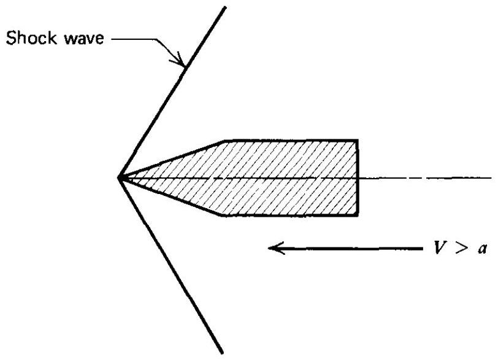
Figure 7.1 Shock wave attached to a moving body.

The theory relating to the effects produced by a shock wave is fairly well developed. ${ }^{1-5}$ Equations have been derived relating the velocities and the thermodynamic properties of the gas immediately in front of and in back of the shock wave. However, the theory does not give complete information regarding the causes leading to the formation of the compression shock wave. Undoubtedly, the more or less spontaneous manner in which the shock process occurs makes it difficult to derive a complete theoretical explanation for the shock wave phenomena. In recent years considerable experimental work has been devoted to the accumulation of data regarding shock waves. Those data are being correlated with the results of theoretical studies to evolve a working theory for the shock wave phenomena.

In the present chapter, the basic equations describing the properties of shock waves are derived for both normal and oblique shock waves, and they are applied to the flow of both perfect and imperfect gases. The supersonic flow of a gas over both wedges and cones is analyzed. Several general rules pertinent to the interaction and reflection of oblique shock waves are presented.

## 7-3 NORMAL SHOCK WAVES

The present section is concerned with the general characteristics of the normal shock wave. For the perfect gas, explicit relationships are developed in Section 7-4 for the property changes across the normal shock wave in terms of the initial Mach number $M_{1}$. For imperfect gases, a numerical technique is presented in Section 7-5 for determining the changes in the flow properties caused by the normal shock wave; the numerical technique is applicable to any gas, irrespective of the form of its equation of state.

The flow through a normal shock wave may be analyzed by considering the onedimensional flow through a stream tube. In the analysis, the following assumptions are made.

1. The boundary surface forming the stream tube is far removed from the boundary layers adjacent to any solid surface. Since all friction forces may be assumed to be confined to the shearing stresses in the boundary layer (see Section 5-10), the configuration under discussion is a frictionless duct.
2. The shock process takes place at constant area; that is, the streamlines forming the boundary of the stream tube are parallel.
3. The shock wave is perpendicular to the streamlines.
4. The flow process, including the shock wave, is adiabatic, no external work is performed, and the effects of body forces are negligible.
Figure 7.2a illustrates the model of a shock wave moving to the right with the velocity $V_{\text {shock }}$ with respect to a stationary observer, and Fig. 7.2b illustrates the corresponding distributions of the flow properties $V$ and $p$. It is demonstrated in the investigation of the speed of propagation of small disturbances in Section 3-8(a) that a moving wave problem may be transformed into a stationary wave problem by superimposing the wave velocity on all of the flow velocities, as is illustrated schematically in Fig. 7.2c. In effect, the observer in Fig. 7.2c moves at the same speed as the shock wave. Figure 7.2d illustrates the corresponding distributions of the flow properties $V$ and $p$ for the stationary normal shock wave.

The control volume enclosing the stationary normal shock wave is illustrated in Fig. 7.3. The analysis for the normal shock wave is similar to that for an acoustic wave, as discussed in Section 3-8(a). However, in the analysis of the acoustic wave, the differential forms of the governing equations are employed but, in the analysis of the normal shock wave, the integral forms of those equations are employed.

The analysis of the normal shock wave involves, as for any other flow problem, determining the pressure, density, and speed of the fluid at the location under consideration. In general, there are the four unknown properties $p_{2}, \rho_{2}, h_{2}$, and $V_{2}$, and for their determination there are available the continuity equation, the momentum or dynamic equation, the energy equation, and the equation of state for the fluid.
(1) Continuity equation. From Table 3.1,

$$
\dot{m}=\rho_{1} V_{1} A_{1}=\rho_{2} V_{2} A_{2}=\text { constant }
$$

Since $A_{1}=A_{2}=A$, the mass rate of flow per unit area or mass flux $G=\dot{m} / A$ is given by

$$
G=\frac{\dot{m}}{A}=\rho_{1} V_{1}=\rho_{2} V_{2}=\mathrm{constant}
$$

(2) Momentum equation. The momentum equation for the fluid bounded by sections 1 and 2 and the stream tube wall (with $\mathbf{B}=\partial / \partial t=\mathbf{F}_{\text {shear }}=0$ ), is given by

$$
\sum(\text { pressure forces })=\frac{D(\text { Momentum })}{D t}
$$

For the control volume illustrated in Fig. 7.3, we obtain from equation 7.3,

$$
-p_{1} A_{1}+p_{2} A_{2}=-\dot{m} V_{2}+\dot{m} V_{1}
$$

Introducing equation 7.1 into equation 7.4 gives

$$
p_{1}+\rho_{1} V_{1}^{2}=p_{2}+\rho_{2} V_{2}^{2}=\text { constant }
$$

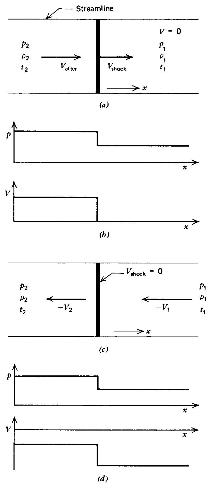
Figure 7.2 Model of a normal shock wave. (a) Moving normal shock wave. (b) Pressure and velocity distributions. (c) Stationary normal shock wave. (d) Pressure and velocity distributions.

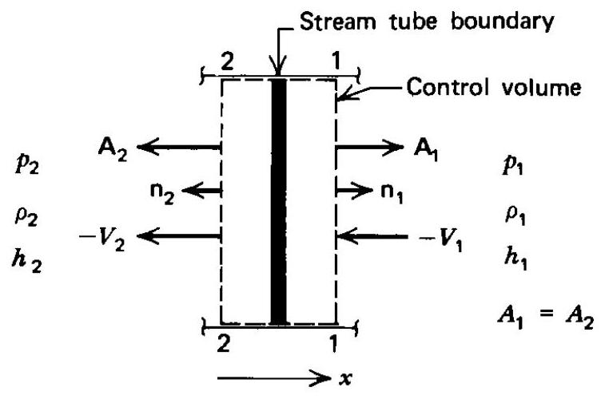
Figure 7.3 Control volume for a normal shock wave.

(3) Energy equation (see Table 3.1, for $g d z=0$ )

$$
h_{1}+\frac{V_{1}^{2}}{2}=h_{2}+\frac{V_{2}^{2}}{2}=H=\text { constant }
$$

The enthalpy $h$ is defined by

$$
h=u+p v
$$

where $u$ is the specific internal energy. Equation 7.6 may be written as

$$
u_{1}+p_{1} v_{1}+\frac{V_{1}^{2}}{2}=u_{2}+p_{2} v_{2}+\frac{V_{2}^{2}}{2}
$$

(4) Equation of state. To complete the required system of equations, an equation of state for the fluid must be specified. For a simple thermodynamic system (see Section 1-7), each of the properties $p, \rho, t, u, h$ and $s$ is uniquely related to any two of the other properties. Thus,

$$
u=u(p, \rho) \quad \text { and } \quad h=h(p, \rho)
$$

Equations 7.2, 7.5, 7.8, and 7.9 comprise a set of four equations involving the four flow properties $p, \rho, u$, and $V$. Those equations are quite general. They govern the behavior of a normal shock wave for a simple thermodynamic system.

The general features of a normal shock wave may be demonstrated by the Hugoniot curve, which is the locus, in the $p v$ plane, of all of the allowable states that the fluid may attain after passing through a normal shock wave. The equation for the Hugoniot curve is obtained by combining equations $7.2,7.5,7.8$, and 7.9 in the following manner. Combine equations 7.2 and 7.5, and solve for $V_{1}{ }^{2}$.

$$
V_{1}^{2}=\frac{\left(p_{2}-p_{1}\right) \rho_{2}}{\left(\rho_{2}-\rho_{1}\right) \rho_{1}}=\frac{v_{1}^{2}\left(p_{2}-p_{1}\right)}{\left(v_{1}-v_{2}\right)}
$$

In a similar manner,

$$
V_{2}^{2}=\frac{\left(p_{2}-p_{1}\right) \rho_{1}}{\left(\rho_{2}-\rho_{1}\right) \rho_{2}}=\frac{v_{2}^{2}\left(p_{2}-p_{1}\right)}{\left(v_{1}-v_{2}\right)}
$$

After substituting equations 7.10a and 7.10b into equation 7.8 and simplifying, we obtain

$$
u_{2}-u_{1}=\frac{1}{2}\left(p_{1}+p_{2}\right)\left(v_{1}-v_{2}\right)
$$

Equation 7.11, in conjunction with equation 7.9, specifies, for a given initial state 1, the locus of the allowable states in the $p v$ plane that satisfy the governing equations. That locus is known as the Hugoniot curve. Figure 7.4 illustrates schematically the general shape of the Hugoniot curve, called an $H$-curve, for all known fluids.

Combining equations 7.2 and 7.5 yields

$$
G^{2}=-\frac{\left(p_{2}-p_{1}\right)}{\left(v_{2}-v_{1}\right)}=-\left(\frac{\partial p}{\partial v}\right)_{R-\operatorname{line}}
$$

Equation 7.12 is the equation of a Rayleigh line, called an $R$-line, on the $p v$ plane [see Section 6-3(b)]. Figure 7.5 illustrates schematically several $R$-lines on the

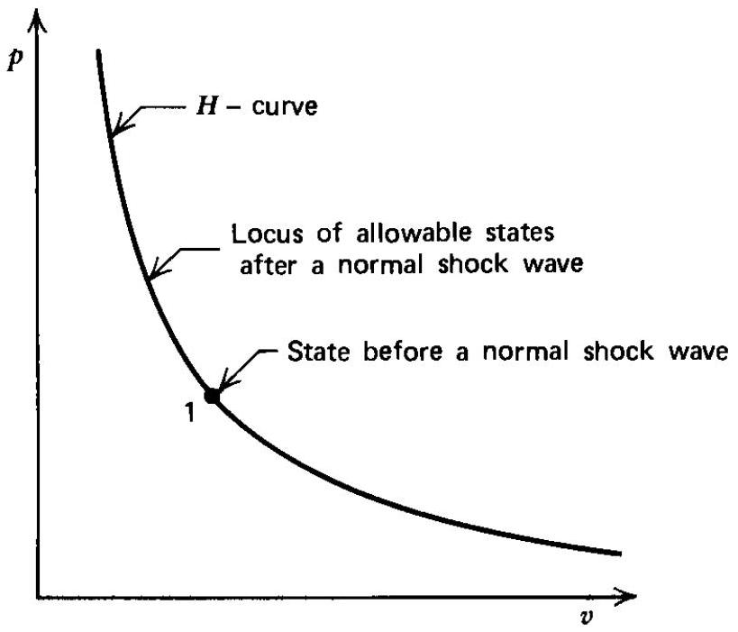
Figure 7.4 Sketch of a Hugoniot curve.

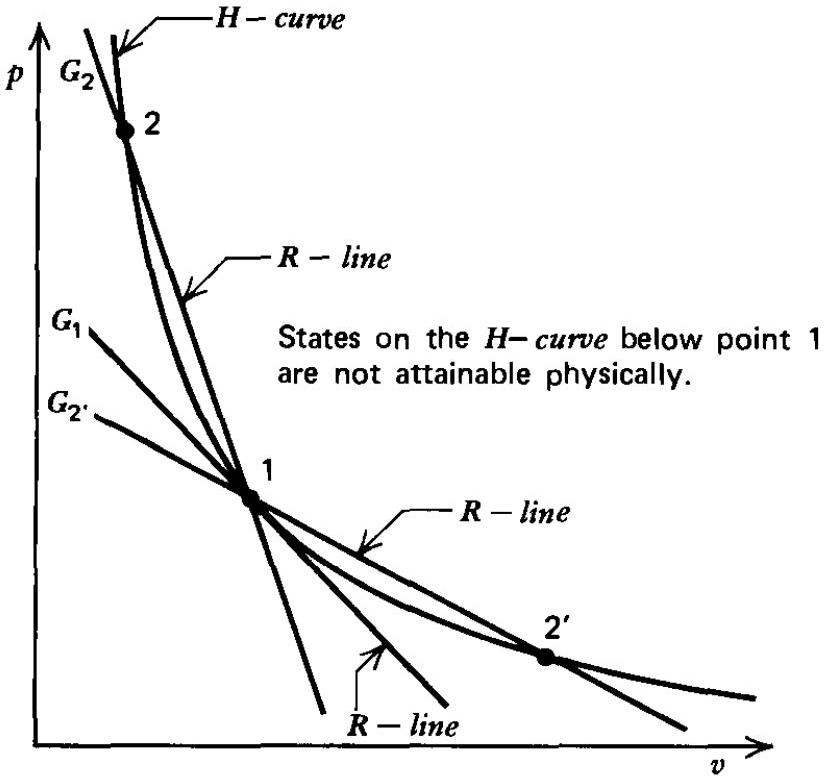
Figure 7.5 Intersection of several $R$-lines with the $H$-curve.

$p v$ plane. $G_{1}$ is chosen so that the corresponding $R$-line is tangent to the $H$-curve at point $1, G_{2}^{\prime}$ is less than $G_{1}$, and $G_{2}$ is greater than $G_{1}$. The state of the flow in back of a normal shock wave must satisfy the equations for both the $H$-curve and the $R$-line. Hence, for a given value of $G$, point 2 is uniquely determined, as indicated in Fig. 7.5.

The upper portion of the $H$-curve, above point 1 , is the locus for compression shock waves, for which $p_{2}>p_{1}$ and $\rho_{2}>\rho_{1}$. The lower portion of that curve, below point 1 , is the locus for expansion shock waves, for which, $p_{2}<p_{1}$ and $\rho_{2}<\rho_{1}$. Expansion shock waves, however, violate the second law of thermodynamics for an isolated system; that law requires that $\Delta s \geqq 0$. Consequently, the states lying on the portion of the $H$-curve below state 1 are not attainable physically.

The following argument demonstrates that an expansion shock wave violates the second law of thermodynamics. Differentiate the equation of the $H$-curve, equation 7.11, considering point 1 fixed and point 2 as a general point where $u_{2}=u$, $p_{2}=p$, etc. Thus,

$$
d u_{H}=-\frac{1}{2}\left(p_{1}+p\right) d v_{H}+\frac{1}{2}\left(v_{1}-v\right) d p_{H}
$$

where the subscript $H$ denotes that the derivatives apply along the $H$-curve. For a simple system, equation 1.64 applies. Thus,

$$
d u=t d s-p d v
$$

Combining equations 7.13 and 7.14, we obtain

$$
2 t\left(\frac{d s}{d p}\right)_{H}=\left(v_{1}-v\right)\left[1-\frac{\left(p-p_{1}\right)}{\left(v-v_{1}\right)}\left(\frac{d v}{d p}\right)_{H}\right]
$$

Substituting equation 7.12 into equation 7.15 yields

$$
2 t\left(\frac{d s}{d p}\right)_{H}=\left(v_{1}-v\right)\left[1+\frac{G^{2}}{(d p / d v)_{H}}\right]
$$

Figure 7.6 illustrates the relationship between $G$ and $(d p / d v)_{H}$ on the $H$-curve. Denote the angle between the negative abscissa and the $H$-curve by $\delta$, and the angle

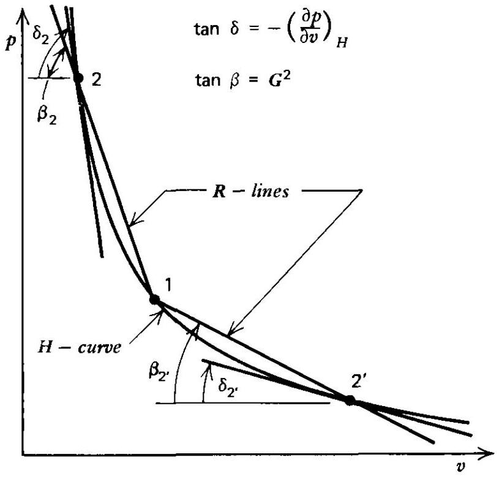
Figure 7.6 Relationship between $G$ and $(d p / d v)_{H}$ on the $H$-curve.

between the negative abscissa and the $R$-line by $\beta$. At point $2^{\prime}, \beta_{2^{\prime}}>\delta_{2^{\prime}}$. Hence,

$$
\frac{G_{2^{\prime}}^{2}}{\left(\frac{d p}{d v}\right)_{H, 2^{\prime}}}<-1
$$

and the term in brackets in equation 7.16 is negative. Since $\left(v_{1}-v_{2^{\prime}}\right)<0$, then $(d s / d p)_{H}>0$ at each point on the lower portion of the $H$-curve. At point $2, \delta_{2}>\beta_{2}$, so that

$$
0 \leqq \frac{G_{2}^{2}}{\left(\frac{d p}{d v}\right)_{H, 2}} \leqq 1
$$

and the term in brackets in equation 7.16 is positive. Since $\left(v-v_{2}\right)>0$, then $(d s / d p)_{H}>0$ on the upper portion of the $H$-curve.

The foregoing arguments demonstrate that on the $H$-curve,

$$
\left(\frac{d s}{d p}\right)_{H}>0
$$

for both branches. On the upper branch, the compression branch, $d p>0$, requiring that $d s>0$, which is in accordance with the second law of thermodynamics. However, on the lower branch, the expansion branch, $d p<0$, requiring that $d s<0$, which violates the second law of thermodynamics. Consequently, expansion shock waves are impossible.

The limiting point between the upper and the lower branches occurs at point 1 when the $R$-line is tangent to the $H$-curve. At that point,

$$
\begin{gathered}
\left(\frac{d p}{d v}\right)_{H, 1}=-\rho_{1}^{2}\left(\frac{d p}{d \rho}\right)_{H, 1}=-G_{1}^{2}=-\rho_{1}^{2} V_{1}^{2} \\
V_{1}^{2}=\left(\frac{d p}{d \rho}\right)_{H, 1}
\end{gathered}
$$

As point 2 approaches point $1,\left(v_{1}-v_{2}\right) \rightarrow 0$ and $(d p / d v)_{H} \rightarrow-G^{2}$. From
equation 7.16, therefore, $d s \rightarrow 0$, and the property changes along the $H$-curve in the neighborhood close to point 1 are isentropic. Equation 7.19 may, therefore, be written as

$$
V_{1}^{2}=\left(\frac{\partial p}{\partial \rho}\right)_{s, 1}=a_{1}^{2}
$$

and $M_{1}=1.0$. At all of the other points on the upper branch of the $H$-curve,

$$
\begin{gathered}
-G^{2}=-\rho_{1}^{2} V_{1}^{2}>\left(\frac{d p}{d v}\right)_{H, 1}=-\rho_{1}^{2} a_{1}^{2} \\
V_{1}^{2}>a_{1}^{2}
\end{gathered}
$$

and $M_{1}>1.0$. Because the compression branch of the Hugoniot curve is the only one that is the locus for physically possible states, the initial Mach number for those states must be either larger or equal to unity. Shock waves occur, therefore, only in flows that are initially supersonic.

The preceding analysis assumes that there is a discontinuity in the flow properties, which actually cannot occur in a real fluid. The existence of the compression shock wave is due to the viscosity and thermal conductivity of the fluid, properties that make the shock type of disturbance possible. A detailed explanation of the processes taking place in the shock wave is very complicated and is beyond the scope of this book. Theoretical studies and experimental measurements indicate that a shock wave is extremely thin. For example, Linzer and Hornig ${ }^{6}$ present a comparison of calculated and measured values of the shock wave thickness $\ell$ in argon and nitrogen.

The experimental results obtained by Linzer and Hornig are presented in the reduced form $(\lambda / t)$, where $t$ is the shock wave thickness and $\lambda$ is the Maxwellian mean free path ahead of the shock wave, defined by

$$
\lambda \equiv \frac{16}{5} \frac{\mu}{n(2 \pi m k t)^{1 / 2}}
$$

where $\mu$ is the viscosity, $n$ is the number density, $m$ is the mass per molecule, $k$ is the Boltzmann constant, and $t$ is the absolute temperature. Figure 7.7a presents the results for argon, and Fig. $7.7 b$ presents the corresponding results for nitrogen. For argon the reciprocal shock thickness $(\lambda / t)$ rises smoothly and rapidly from a value of 0.0 at $M=1$, peaks at a value of approximately 0.3 at $M=3.5$, and decreases slightly thereafter. For nitrogen, a similar behavior is observed, with ( $\lambda / t$ ) peaking at 0.4 when $M=4.0$. Hence, for Mach numbers exceeding approximately 3, the shock wave thickness $t$ is between 2.5 and 3 mean free paths, and the thickness increases as the Mach number decreases. For example, at $M=2, t / \lambda$ is approximately 5 .

In the present section, several of the intrinsic features of normal shock waves are discussed. No restrictions, however, are placed on the equation of state for the gas other than that the latter must be a simple thermodynamic system. In Section 7-4, explicit equations are derived for the flow of a perfect gas through a normal shock wave and, in Section 7-5, a numerical technique is presented for taking into account imperfect gas effects.

## 7-4 NORMAL SHOCK WAVES IN PERFECT GASES

The present section is concerned with the application of the equations developed in Section 7-3 to normal shock waves in a perfect gas.

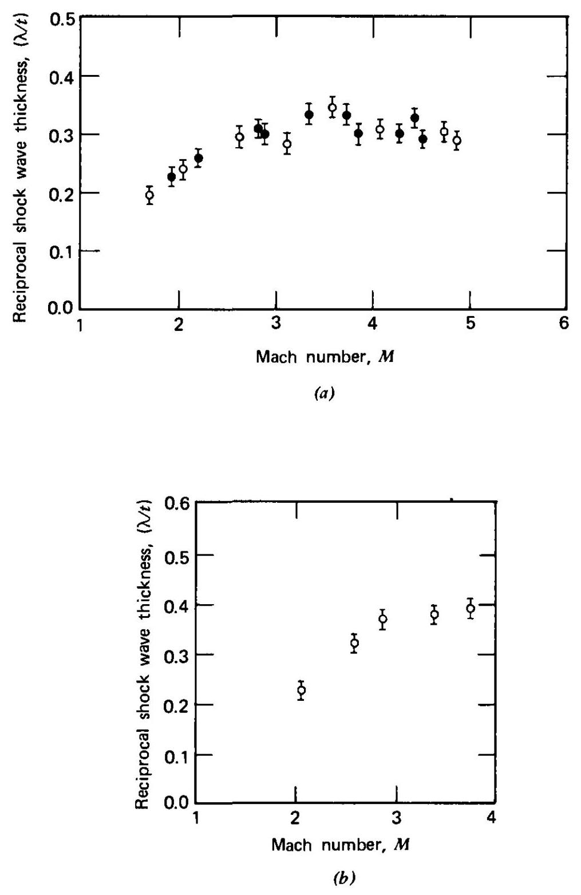
Figure 7.7 Variation of the reciprocal shock wave thickness $(\lambda / t)$ with the Mach number M. (a) Argon. (b) Nitrogen. (Taken from Reference 6).

## 7-4(a) Governing Equations

For a perfect gas, the equations of state are

$$
p=\rho R t
$$

and

$$
h=c_{p} t
$$

where $h=0$ at $t=0$. Hence, equation 7.6 becomes

$$
t_{1}+\frac{V_{1}^{2}}{2 c_{p}}=t_{2}+\frac{V_{2}^{2}}{2 c_{p}}=T=\text { constant }
$$

Equation 7.25 shows that the stagnation temperature $T$ remains constant. From the definition of the stagnation temperature (see Table 3.3), for $T=$ constant,

$$
\frac{t_{2}}{t_{1}}=\frac{1+\frac{\gamma-1}{2} M_{1}^{2}}{1+\frac{\gamma-1}{2} M_{2}^{2}}
$$

Substituting equation 7.23 into equation 7.2, we obtain

$$
\frac{V_{2}}{V_{1}}=\frac{\rho_{1}}{\rho_{2}}=\frac{p_{1} t_{2}}{p_{2} t_{1}}
$$

For a perfect gas, combining $V=M a=M \sqrt{\gamma R t}$ and equation 7.27 gives

$$
\frac{p_{2}}{p_{1}}=\frac{M_{1}}{M_{2}}\left(\frac{1+\frac{\gamma-1}{2} M_{1}^{2}}{1+\frac{\gamma-1}{2} M_{2}^{2}}\right)^{1 / 2}
$$

Equation 7.5 may be rewritten as

$$
p_{1}\left(1+\frac{\rho_{1} V_{1}^{2}}{p_{1}}\right)=p_{2}\left(1+\frac{\rho_{2} V_{2}^{2}}{p_{2}}\right)
$$

Noting that $a^{2}=\gamma p / \rho$, equation 7.29 yields

$$
\frac{p_{2}}{p_{1}}=\frac{1+\gamma M_{1}^{2}}{1+\gamma M_{2}^{2}}
$$

Equating the right-hand sides of equations 7.28 and 7.30, we obtain

$$
\frac{M_{1}\left(1+\frac{\gamma-1}{2} M_{1}^{2}\right)^{1 / 2}}{1+\gamma M_{1}^{2}}=\frac{M_{2}\left(1+\frac{\gamma-1}{2} M_{2}^{2}\right)^{1 / 2}}{1+\gamma M_{2}^{2}}
$$

Squaring both sides of equation 7.31 and solving for $M_{2}$ yields

$$
\begin{aligned}
& M_{2}=M_{1} \\
& M_{2}=\frac{M_{1}^{2}+\frac{2}{\gamma-1}}{\frac{2 \gamma}{\gamma-1} M_{1}^{2}-1}
\end{aligned}
$$

Equation 7.32 expresses the trivial result that no change occurs across the normal shock wave; that is, the latter has infinitesimal strength. Equation 7.33 gives the solution for a normal shock wave of finite strength. Figure 7.8a presents the Mach number after a normal shock wave $M_{2}$ as a function of the initial Mach number $M_{1}$, for $\gamma=1.4$. Table C. 11 presents $M_{2}$ as a function of $M_{1}$ for different values of $\gamma$.

For a normal shock wave to occur, the Mach number $M_{1}$ must be larger than unity, as pointed out in Section 7-3. Examination of equation 7.33, or Fig. 7.8a, shows that as $M_{1}$ in front of the normal shock wave is increased indefinitely, the Mach number $M_{2}$ in back of the normal shock wave continually decreases but approaches the limiting value $\sqrt{(\gamma-1) / 2 \gamma}$. The limiting value for $M_{2}$ depends only on the specific heat ratio for the gas. Figure $7.8 b$ presents the limiting value of $M_{2}$ as a function of $\gamma$.

The property ratios across a normal shock wave may be expressed in terms of the Mach number ahead of the shock wave $M_{1}$ by substituting equation 7.33 into equations $7.26,7.27$, and 7.30 , to eliminate $M_{2}$. Thus,

$$
\begin{gathered}
\frac{t_{2}}{t_{1}}=\left(\frac{2 \gamma}{\gamma+1} M_{1}^{2}-\frac{\gamma-1}{\gamma+1}\right)\left[\frac{\gamma-1}{\gamma+1}+\frac{2}{(\gamma+1) M_{1}^{2}}\right] \\
\frac{\rho_{2}}{\rho_{1}}=\frac{v_{1}}{v_{2}}=\frac{V_{1}}{V_{2}}=\frac{(\gamma+1) M_{1}^{2}}{2+(\gamma-1) M_{1}^{2}}
\end{gathered}
$$

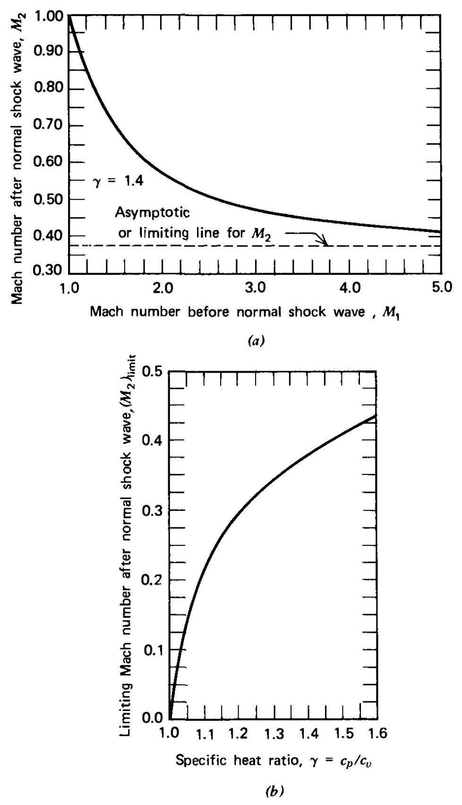
Figure 7.8 Mach number after a normal shock wave. (a) Mach number after a normal shock wave as a function of the Mach number before the shock wave $(\gamma=1.4)$. (b) Limiting values of the Mach number in back of a normal shock wave as a function of $\gamma$.

$$
\frac{p_{2}}{p_{1}}=\frac{2}{\gamma+1} M_{1}^{2}-\frac{\gamma-1}{\gamma+1}
$$

Values of the above property ratios are presented in Table C. 11 as a function of $M_{1}$ for different values of $\gamma$.

It follows from equation 7.35 that as the initial Mach number $M_{1}$ approaches infinity, the density ratio $\rho_{2} / \rho_{1}$ approaches $(\gamma+1) /(\gamma-1)$ as a limiting value. On the other hand, the pressure ratio $p_{2} / p_{1}$ (see equation 7.36) increases continuously with $M_{1}$.

The flow conditions immediately in front of and in back of the normal shock wave are isentropic, in view of the assumptions presented at the beginning of Section 7-3. From Table 3.3,

$$
\frac{P_{2}}{p_{2}}=\left(1+\frac{\gamma-1}{2} M_{2}^{2}\right)^{\gamma /(\gamma-1)}
$$

and

$$
\frac{P_{1}}{p_{1}}=\left(1+\frac{\gamma-1}{2} M_{1}^{2}\right)^{\gamma /(\gamma-1)}
$$

The stagnation pressure ratio $P_{2} / P_{1}$ is

$$
\frac{P_{2}}{P_{1}}=\frac{P_{2}}{p_{2}} \frac{p_{1}}{P_{1}} \frac{p_{2}}{p_{1}}
$$

Substituting for $P_{2} / p_{2}, P_{1} / p_{1}$, and $p_{2} / p_{1}$ from equations $7.37,7.38$, and 7.36 , respectively, into equation 7.39, and rearranging the result, gives

$$
\frac{P_{2}}{P_{1}}=\left\{\left[\frac{\gamma-1}{\gamma+1}+\frac{2}{(\gamma+1) M_{1}^{2}}\right]^{\gamma}\left(\frac{2 \gamma}{\gamma+1} M_{1}^{2}-\frac{\gamma-1}{\gamma+1}\right)\right\}^{-1 /(\gamma-1)}
$$

Values of the stagnation pressure ratio $P_{2} / P_{1}$ as a function of $M_{1}$ are presented in Table C. 11 for different values of $\gamma$. The table shows that the decrease in stagnation pressure depends on the shock intensity; the more intense the shock (large values of $M_{1}$ ), the larger is the decrease in stagnation pressure.

The ratio $P_{2} / p_{1}$, the ratio of the stagnation pressure $P_{2}$ in back of the shock wave to the free-stream static pressure $p_{1}$, is what is indicated by a Pitot tube immersed in a supersonic stream. As illustrated schematically in Fig. 7.9a, when a fluid flows

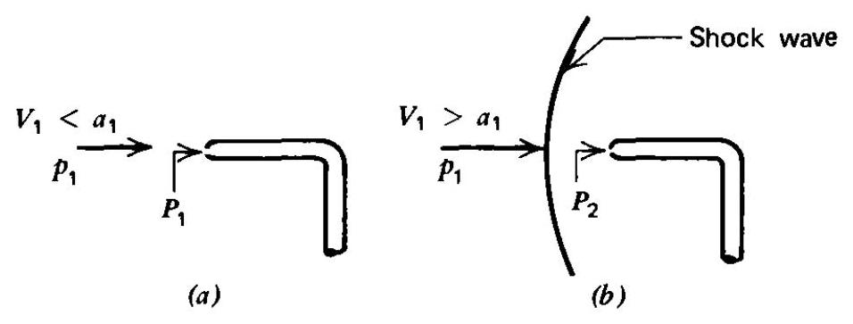
Figure 7.9 Pitot tube measurement for subsonic and supersonic flow. (a) Subsonic flow. (b) Supersonic flow.

toward the Pitot tube with a subsonic speed, the fluid may be assumed to decelerate isentropically to stagnation at the entrance to the instrument. When $M_{1}>1$, however, a shock wave is formed ahead of the mouth of the Pitot-tube, as illustrated in Fig. 7.9b. Because the radius of curvature of the shock wave is large in the region directly in front of the entrance to the pitot tube, the portion of the shock wave in that region may be assumed to be a normal shock wave. After flowing through the latter normal shock wave, the stream of compressible fluid decelerates isentropically to the stagnation pressure $P_{2}$ at the entrance to the Pitot tube. The ratio $P_{2} / p_{1}$ is given by

$$
\frac{P_{2}}{p_{1}}=\frac{P_{2}}{p_{2}} \frac{p_{2}}{p_{1}}
$$

Substituting for $P_{2} / p_{2}$ and $p_{2} / p_{1}$ in terms of $M_{1}$ gives

$$
\frac{P_{2}}{p_{1}}=\left(\frac{\gamma+1}{2}\right) M_{1}^{2}\left(\frac{\frac{\gamma+1}{2} M_{1}^{2}}{\frac{2 \gamma}{\gamma+1} M_{1}^{2}-\frac{\gamma-1}{\gamma+1}}\right)^{1 /(\gamma-1)}
$$

The relationship given by equation 7.42 is known as the Rayleigh Pitot tube equation. Figure 7.10 presents the ratio $p_{1} / P_{2}$ as a function of $M_{1}$ for $\gamma=1.4$. Table C. 11 presents values of the ratio $P_{2} / p_{1}$ for different values of $\gamma$.

Since the flow process for the normal shock wave is adiabatic and the fluid is assumed to be a perfect gas, its entropy increase due to the normal shock wave is, from Table 3.2, given by

$$
\Delta s=s_{2}-s_{1}=R \ln \left(\frac{P_{1}}{P_{2}}\right)
$$

The stagnation pressure ratio $P_{1} / P_{2}$, in equation 7.43, is obtained from equation 7.40.

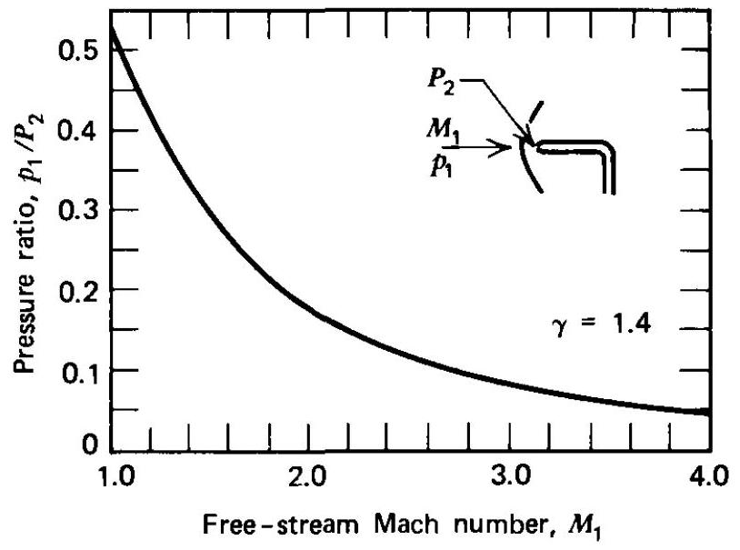
Figure 7.10 Rayleigh Pitot tube equation $(\gamma=1.4)$.

Shock waves are frequently described in terms of the condensation $\delta$ and the shock strength $\beta$, where

$$
\delta \equiv \frac{\rho_{2}-\rho_{1}}{\rho_{1}}=\frac{\rho_{2}}{\rho_{1}}-1
$$

and

$$
\beta \equiv \frac{p_{2}-p_{1}}{p_{1}}=\frac{p_{2}}{p_{1}}-1
$$

The term condensation has nothing whatever to do with a change of phase in the fluid. It denotes a compression of the fluid. Substituting equation 7.45 into equation 7.36, we obtain

$$
\beta=\left(\frac{2 \gamma}{\gamma+1}\right)\left(M_{1}^{2}-1\right)
$$

and

$$
M_{1}^{2}=1+\left(\frac{\gamma+1}{2 \gamma}\right) \beta
$$

All of the property ratios presented in the foregoing analysis may be expressed in terms of the shock strength $\beta$ by substituting equation 7.47 into the appropriate equations.

All of the flow properties for a stationary normal shock wave may be calculated by means of the equations derived above. There are many practical situations, however, such as blast waves and explosions, where the shock wave is not stationary as is assumed in the preceding derivations. In those cases the speed with which the shock wave travels through the still gas is $V_{1}$, the velocity with which the gas
moves into a stationary shock wave. It is desired to relate the velocity $V_{1}$ to the strength of the shock wave.

Figures 7.11 $a$ and 7.11 $b$ illustrate, respectively, the conditions for a shock wave moving into a stationary gas, and the case where a gas flows into a stationary shock wave. Referring to Fig. 7.11a, the shock wave moves to the right with the velocity $V_{1}$. The gas that is stationary before being traversed by the shock wave is given a velocity ( $V_{1}-V_{2}$ ) to the right, and its pressure and density are increased by the passage of the shock wave. On the other hand, the stationary gas toward which the shock wave is moving, to the right of the shock wave in Fig. 7.17a, is at a lower pressure and density than the gas to the left of the shock wave.

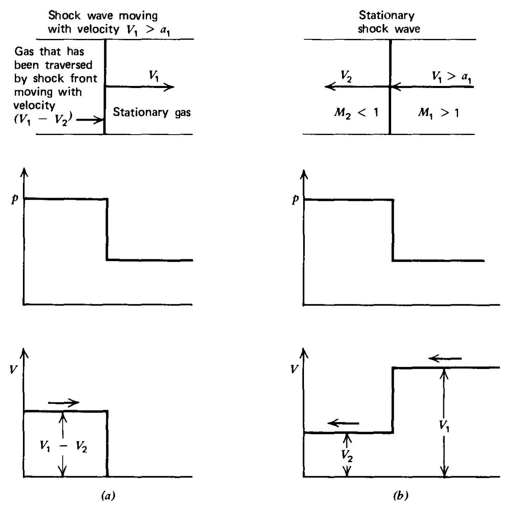
Figure 7.11 Transformation of a moving shock wave into a stationary frame of reference. (a) Shock wave moving into a stationary gas. (b) Gas flowing into a stationary shock wave.

The situation illustrated in Fig. 7.11a may be transformed to the case where the shock wave is stationary, as in Fig. 7.11b, by imagining that the observer travels with the speed of the shock wave $V_{1}$; that is, the observer moves to the right with the velocity $V_{1}$. To the moving observer, the shock wave appears to be stationary, while the gas appears to be flowing to the left with the velocity $V_{1}$. Moreover, as the gas flows through the shock wave, its velocity is reduced from $V_{1}$ to $V_{2}$ with respect to the moving observer. Simultaneously, the pressure and density of the gas increase to $p_{2}$ and $\rho_{2}$, respectively. Although the static properties are unchanged by the change in the frame of reference, the velocities and, consequently, the stagnation properties, do depend on the frame of reference.

The most straightforward manner for solving moving shock wave problems is to transform the problem to an equivalent stationary shock wave problem, solve for the changes in the flow properties across the stationary shock wave, and then transform the dynamic properties back into the reference frame for the moving shock wave.

## 7-4(b) Normal Shock Wave Tables

Table 7.1 presents the equations for the flow property ratios for a normal shock wave in a perfect gas. Table C. 11 presents the values of the pertinent flow property ratios as functions of the Mach number $M_{1}$ for different values of $\gamma$. Table 7.2 presents the general arrangement of Table C.11, together with the limiting values of the flow property ratios.

Table 7.1 Equations for the Flow Property Ratios for Normal Shock Waves in a Perfect Gas

$$
\left.\begin{array}{rl}
M_{2}^{2} & =\frac{M_{1}^{2}+\frac{2}{\gamma-1}}{\frac{2 \gamma}{\gamma-1} M_{1}^{2}-1} \\
\frac{p_{2}}{p_{1}} & =\frac{2 \gamma}{\gamma+1} M_{1}^{2}-\frac{\gamma-1}{\gamma+1} \\
\frac{\rho_{2}}{\rho_{1}} & =\frac{v_{1}}{v_{2}}=\frac{V_{1}}{V_{2}}=\frac{(\gamma+1) M_{1}^{2}}{2+(\gamma-1) M_{1}^{2}} \\
\frac{t_{2}}{t_{1}} & =\left(\frac{2 \gamma}{\gamma+1} M_{1}^{2}-\frac{\gamma-1}{\gamma+1}\right)\left[\frac{\gamma-1}{\gamma+1}+\frac{2}{(\gamma+1) M_{1}^{2}}\right] \\
\frac{P_{2}}{P_{1}} & =\left[\left(\frac{\gamma-1}{\gamma+1}+\frac{2}{(\gamma+1) M_{1}^{2}}\right)^{\gamma}\left(\frac{2 \gamma}{\gamma+1} M_{1}^{2}-\frac{\gamma-1}{\gamma+1}\right)\right]^{-1 /(\gamma-1)} \\
\frac{P_{2}}{p_{1}} & =\left(\frac{\gamma+1}{2}\right) M_{1}^{2}\left(\frac{\gamma+1}{2} M_{1}^{2}\right. \\
\frac{2 \gamma}{\gamma+1} M_{1}^{2}-\frac{\gamma-1}{\gamma+1}
\end{array}\right)
$$

Table 7.2 Limiting Values of the Flow Property Ratios for Normal Shock Waves in a Perfect Gas
| $M_{1}$ | $M_{2}$ | $\rho_{2} / \rho_{1}$ |  |  |  |  |
| :---: | :---: | :---: | :---: | :---: | :---: | :---: |
| $V_{1} / V_{2}$ |  | $t_{2} / t_{1}$ | $p_{2} / p_{1}$ | $P_{2} / P_{1}$ | $P_{2} / p_{1}$ |  |
| 1 | 1 | 1 | 1 | 1 | 1 | 1 |
| $\infty$ | $\sqrt{\frac{\gamma-1}{2 \gamma}}$ | $\frac{\gamma+1}{\gamma-1}$ | $\infty$ | $\infty$ | 0 | $\infty$ |


A FORTRAN program, subroutine NSHOCK, is presented below for calculating the flow property ratios across a normal shock wave in a perfect gas. The input to
the program is described in Section 4-4(b). The results presented in Table C. 11 for $\gamma=1.4$ are obtained by the following specification.

$$
\begin{aligned}
& G=1.4, J(1)=100, J(2)=75, J(3)=25, J(4)=8, J(5)=15, J(6)=0 \\
& D M(1)=0.01, D M(2)=0.02, D M(3)=0.1, D M(4)=0.5, D M(5)=1.0
\end{aligned}
$$

```
            SUBROUTINE NSHOCK
C NORMAL SHOCK PROPERIY RATIOS FOR A PERFECT GAS
            REAL M1,M2 $ UIMENSION J(9),DM(9) $ DATA INF/6H INFIN/
            NAMELIST /DATA/ G.J.DM $ READ (5.DATA)
            Gl=(G-1.0)/2.0 $ G2=(G+1.0)/2.0 $ G3=G/(G-1.0) $ G4=G/G2 $G5=G1/G2
            M1=1.0 $ M2=1.0 $ V=1.0 $ T=1.0 $ P=1.0 $ PO=1.0 $ POP=1.0
            WRITE (6,2000) G $ WRITE (6,2020) M1,M2,V,T,P,PO,POP $ I=1 $ L=0
C CALCULaTE PROPERTY KATIOS
    40 N=J(I) $ DO 50 K=1.N $ M1=M1+UM(I) $ C1=1.0+G1*M1**2
            V=G2*M1**2/C1 $ P=G4*M1**2-G5 $ T=P/V $ M2=M1/SQRT(P*V)
            C2=1.0+G1*M2**2 s PO=P*(C2/C1)**G3 s POP=P*C2**G3
            WRITE (6,2020) M1,M2,V,T,P,PO,POP $ L=L+1 $ IF (L.LT.50) GO TO 50
            WRITE (6.2000) G $ L=0
    SO CONTINUE $ I=I+1 $ IF((I.EQ.10).OR.(J(I).EQ.0)) GO TO 60 $GO TO 40
    60 M2=SQRT(G1/G) $ V=(G+1.0)/(G-1.0) $ PO=0.0
            WRITE (6,2030) INF,M2,V,INF,INF,PO,INF $ RETURN
2000 FORMAT (1H1,19X,27HNORMAL SHOCK WAVE, GAMMA =,F5.2//4X,2HM1,5X,
        12HM2,7X,5HV1/V2,8X,5HT,/T1,8X,5HP2/P1,8X,7HPO2/PO1,6X,6HPO2/P1/
        220X,5HR2/R1,34X,7HA1*/A2*/)
2020 FORMAT (1H ,F5.2,F10.5,5E13.5)
2030 FORMAT (A6,F10,5,E13,5,3X,A6,7X,A6,E17,5,3X,A6)
        END
```

Example 7.1. A normal shock wave is propagated into still air with a velocity of $722.4 \mathrm{~m} / \mathrm{s}$. The still air pressure is $1 \mathrm{~atm}\left(1.0133 \cdot 10^{5} \mathrm{~N} / \mathrm{m}\right)$ and its temperature is 294.4 K . Calculate the Mach number, pressure, temperature, and velocity in back of the normal shock wave, relative to a stationary observer.

## Solution

Consider the equivalent stationary normal shock wave problem where $V_{1}= 722.4 \mathrm{~m} / \mathrm{s}$.

$$
\begin{aligned}
a_{1} & =\left(\gamma R t_{1}\right)^{1 / 2}=[1.4(287.04)(294.4)]^{1 / 2}=343.9 \mathrm{~m} / \mathrm{s} \\
M_{1} & =\frac{V_{1}}{a_{1}}=\frac{722.4}{343.9}=2.10
\end{aligned}
$$

From Table C.11, for $M_{1}=2.10$,

$$
\begin{aligned}
M_{2} & =0.56128, \quad \frac{p_{2}}{p_{1}}=4.9783, \quad \frac{t_{2}}{t_{1}}=1.7704, \quad \frac{V_{1}}{V_{2}}=2.8119 \\
p_{2} & =4.9783(1.0133) 10^{5}=5.045 \cdot 10^{5} \mathrm{~N} / \mathrm{m}^{2}\left(73.17 \mathrm{lbf} / \mathrm{in} .^{2}\right) \\
t_{2} & =1.7704(294.4)=521.3 \mathrm{~K}(938.3 \mathrm{R}) \\
V_{2} & =\frac{722.4}{2.8119}=256.9 \mathrm{~m} / \mathrm{s}(842.9 \mathrm{ft} / \mathrm{sec})
\end{aligned}
$$

Relative to a stationary observer,

$$
V_{2 R}=V_{1}-V_{2}=722.4-256.9=465.6 \mathrm{~m} / \mathrm{s}(1527.2 \mathrm{ft} / \mathrm{sec})
$$

where the subscript $R$ denotes a property relative to a stationary observer.

$$
\begin{aligned}
a_{2} & =\left(\gamma R t_{2}\right)^{1 / 2}=[1.4(287.04)(521.3)]^{1 / 2}=457.7 \mathrm{~m} / \mathrm{s} \\
M_{2 R} & =\frac{V_{2 R}}{a_{2}}=\frac{465.5}{457.7}=1.017
\end{aligned}
$$

The above result demonstrates that the Mach number in back of a moving shock wave may be supersonic relative to a stationary observer.

In this example, a moving shock wave is analyzed by employing the model of a stationary shock wave. The flow properties for the gas in front of and in back of a moving shock wave are determined by transforming the results for a stationary shock wave into the frame of reference for the moving shock wave. The aforementioned procedure for analyzing moving shock waves is recommended, rather than making a formal transformation of the equations governing the shock wave.
Example 7.2. Air flows through a frictionless adiabatic converging-diverging nozzle. The air stagnation pressure and temperature are $7.0 \cdot 10^{5} \mathrm{~N} / \mathrm{m}^{2}$ and 500 K , respectively. The diverging portion of the nozzle has an area ratio of $A_{e} / A_{t}=11.91$. A normal shock wave stands in the divergence where the Mach number is 3.0 , as illustrated in Fig. 7.12. Calculate the Mach number and the static temperature and pressure in the nozzle exit plane. Assume $\gamma=1.40$.

## Solution

From Table C.11, for $M_{1}=3.00, M_{2}=0.4752$ and $P_{2} / P_{1}=0.3283$. Hence,

$$
P_{2}=(0.3283)(7.0) 10^{5}=2.2981 \cdot 10^{5} \mathrm{~N} / \mathrm{m}^{2}
$$

Since the flow is adiabatic, $T_{2}=T_{1}=500 \mathrm{~K}$. Since the flow is isentropic between Station 2 and the exit section, Station $e, T_{e}=T_{2}$ and $P_{e}=P_{2}$. From Table C.6, for $M_{1}=3.0$ and $M_{2}=0.4752,\left(A_{1} / A_{1}^{*}\right)=\left(A_{1} / A_{t}\right)=4.2346$ and $A_{2} / A_{2}^{*}=1.390$. Thus,

$$
\left(\frac{A}{A^{*}}\right)_{e}=\frac{A_{e}}{A_{2}^{*}}=\left(\frac{A_{e}}{A_{t}}\right)\left(\frac{A_{t}}{A_{1}}\right)\left(\frac{A_{2}}{A_{2}^{*}}\right)=\frac{11.91(1.390)}{4.2346}=3.9094
$$

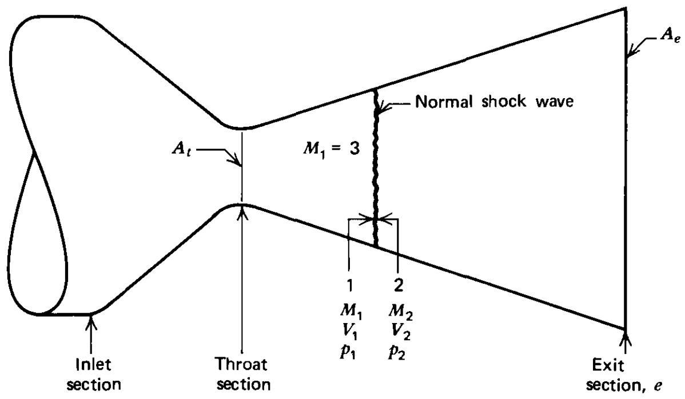
Figure 7.12 Sketch for Example 7.2.

From Table C.6, for $\left(A / A^{*}\right)_{e}=3.9094$, for subsonic flow, $M_{e}=0.15, t_{e} / T_{e}=0.9955$, and $p_{e} / P_{e}=0.9844$. Hence,

$$
\begin{aligned}
t_{e} & =(0.9955)(500)=497.8 \mathrm{~K}(896.0 \mathrm{R}) \\
p_{e} & =(0.9844)(2.2981) 10^{5}=2.2623 \cdot 10^{5} \mathrm{~N} / \mathrm{m}^{2}\left(32.81 \mathrm{lbf} / \mathrm{in} .^{2}\right)
\end{aligned}
$$

Example 7.3. Air at a static pressure of $1.50 \cdot 10^{5} \mathrm{~N} / \mathrm{m}^{2}$ and a static temperature of 300 K flows at $150 \mathrm{~m} / \mathrm{s}$ in a pipe. The valve at the end of the pipe is suddenly closed, propagating a normal shock wave back into the pipe. Calculate the velocity of the shock wave relative to the pipe. Assume $\gamma=1.4$.

## Solution

The velocity in back of the normal shock wave is zero relative to the pipe, and the velocity of that wave relative to the pipe is $V_{\text {Wave }}$. The velocity of the air entering the normal shock wave relative to the shock wave is thus $V_{1}=\left(V_{\text {wave }}+150\right)$. The velocity behind the normal shock wave, relative to the shock wave, is denoted by $V_{2}$. For the air in back of the normal shock wave to be stationary, $V_{2}$ must equal $V_{\text {wave }}$. Thus,

$$
M_{1}=\frac{V_{1}}{a_{1}}=\frac{V_{\mathrm{wave}}+150}{[1.4(287.04)(300)]^{1 / 2}}=\frac{V_{\mathrm{wave}}+150}{347.21}
$$

and

$$
V_{2}=V_{\mathrm{Wave}}
$$

An iterative solution may be employed for calculating $V_{\text {wave }}$. Values of $V_{\text {wave }}$ are assumed, and $V_{1}$ and $M_{1}$ are calculated. $V_{1} / V_{2}$ is found from Table C.11, and $V_{2}$ is computed and compared with $V_{\text {wave }}$. When $V_{2}=V_{\text {wave }}$, the solution is obtained. The results of the iteration are presented in the following table. The first assumed value of $V_{\text {Wave }}$ is chosen arbitrarily, the second assumed value of $V_{\text {Wave }}$ is chosen as the value of $V_{2}$ from the first trial, and the third assumed value of $V_{\text {wave }}$ is obtained by the secant method [see Appendix A-4(b)].

| Trial | 1 | 2 | 3 |
| :--- | ---: | ---: | ---: |
| $V_{\text {wave }}, \mathrm{m} / \mathrm{s}$ (assumed) | 400 | 274.3 | 298.7 |
| $V_{1}, \mathrm{~m} / \mathrm{s}$ | 550 | 424.3 | 448.7 |
| $M_{1}$ | 1.584 | 1.222 | 1.292 |
| $V_{1} / V_{2}$ | 2.0048 | 1.3799 | 1.5018 |
| $V_{2}, \mathrm{~m} / \mathrm{s}$ | 274.3 | 307.5 | 298.8 |

The shock wave travels upstream into the pipe at a velocity of $V_{\text {wave }}=298.8 \mathrm{~m} / \mathrm{s}$ relative to the pipe. Knowing the shock wave velocity, the flow properties behind the normal shock wave may be calculated. For example, from Table C.11, for $M_{1}= 1.292, p_{2} / p_{1}=1.7808$. Hence,

$$
p_{2}=1.7808(1.5) 10^{5}=2.671 \cdot 10^{5} \mathrm{~N} / \mathrm{m}^{2}\left(38.74 \mathrm{lbf} / \mathrm{in} .^{2}\right)
$$

Example 7.4. A blast wave created by a nuclear explosion moves with a velocity of $15,240 \mathrm{~m} / \mathrm{s}$ into still atmospheric air having a pressure of $1.0133 \cdot 10^{5} \mathrm{~N} / \mathrm{m}^{2}$ and a temperature of 294.4 K . Calculate (a) the Mach number of the shock wave relative to the stationary air, and (b) the stagnation values of the pressure and the temperature behind the shock wave relative to a stationary observer.

## Solution

(a) The speed of sound in the still air is

$$
a_{1}=\left(\gamma R t_{1}\right)^{1 / 2}=[1.4(287.04)(294.4)]^{1 / 2}=344.0 \mathrm{~m} / \mathrm{s}
$$

The moving shock wave is transformed to a stationary shock wave by considering the still air to be moving into the stationary shock wave with a velocity of $15,240 \mathrm{~m} / \mathrm{s}$. Thus,

$$
M_{1}=\frac{V_{1}}{a_{1}}=\frac{15,240}{344.0}=44.31
$$

(b) Table C. 11 for normal shock waves does not extend to such a large Mach number. Consequently, the equations for the property changes across a normal shock wave will be employed. From equation 7.33, the Mach number $M_{2}$ behind the normal shock wave relative to the shock wave is

$$
M_{2}=\left(\frac{M_{1}^{2}+\frac{2}{\gamma-1}}{\frac{2 \gamma}{\gamma-1} M_{1}^{2}-1}\right)^{1 / 2}=\left[\frac{(44.31)^{2}+5}{7(44.31)^{2}-1}\right]^{1 / 2}=0.3785
$$

From equation 7.49,

$$
\begin{aligned}
& \frac{p_{2}}{p_{1}}=\frac{2 \gamma}{\gamma+1} M_{1}^{2}-\frac{\gamma-1}{\gamma+1}=1.1667(44.31)^{2}-0.1667=2290 \\
& p_{2}=2290(1.0133) 10^{5}=2320 \quad 10^{5} \mathrm{~N} / \mathrm{m}^{2}\left(33,648 \mathrm{lbf} / \mathrm{in} .^{2}\right)
\end{aligned}
$$

From equation 7.51,

$$
\begin{aligned}
\frac{t_{2}}{t_{1}} & =\left(\frac{2 \gamma}{\gamma+1} M_{1}^{2}-\frac{\gamma-1}{\gamma+1}\right)\left[\frac{\gamma-1}{\gamma+1}+\frac{2}{(\gamma+1) M_{1}^{2}}\right] \\
& =2290\left[0.1667+\frac{2}{2.4(44.31)^{2}}\right]=382.64 \\
t_{2} & =382.64(294.4)=112,650 \mathrm{~K}(202,770 \mathrm{R}) \\
a_{2} & =\left(\gamma R t_{2}\right)^{1 / 2}=[1.4(287.04)(112,650)]^{1 / 2}=6728 \mathrm{~m} / \mathrm{s} \\
V_{2} & =M_{2} a_{2}=(0.3785)(6728)=2547 \mathrm{~m} / \mathrm{s}(8355 \mathrm{ft} / \mathrm{sec})
\end{aligned}
$$

The velocity of the air behind the shock wave relative to a stationary observer, denoted by $V_{2 R}$, is given by

$$
V_{2 R}=V_{\text {shock }}-V_{2}=15,240-2547=12,693 \mathrm{~m} / \mathrm{s}(41,643 \mathrm{ft} / \mathrm{sec})
$$

Hence, the Mach number $M_{2 R}$ relative to a stationary observer is

$$
M_{2 R}=\frac{V_{2 R}}{a_{2}}=\frac{12,693}{6728}=1.887
$$

From Table 6, for $M_{2 R}=1.887, t_{2} / T_{2 R}=0.58406$ and $p_{2} / P_{2 R}=0.15227$. Hence, the stagnation temperature and pressure behind the shock wave, relative to a stationary observer, are

$$
\begin{aligned}
& T_{2 R}=\frac{112,650}{0.58406}=192,870 \mathrm{~K} \quad(347,170 \mathrm{R}) \\
& P_{2 R}=\frac{(2.320) 10^{8}}{0.15227}=1.524 \cdot 10^{9} \mathrm{~N} / \mathrm{m}^{2} \quad\left(220,980 \mathrm{lbf} / \mathrm{in}^{2}\right)
\end{aligned}
$$

The above results are not quantitatively correct, since the air would cease to behave as a perfect gas at the high temperatures involved. The results are, however, qualitatively correct. They predict that extremely large values of pressure and temperature occur in back of such strong shock waves.

Example 7.5. A blunt nose pitot tube is employed in a wind tunnel to estimate the flow Mach number. The stagnation pressure $P_{2}$ at the entrance to the pitot tube is $2.0 \cdot 10^{5} \mathrm{~N} / \mathrm{m}^{2}$. The free-stream static pressure $p_{1}$ ahead of the shock wave is measured by a static pressure tap in the wall of the tunnel, and is $0.15 \cdot 10^{5} \mathrm{~N} / \mathrm{m}^{2}$. Estimate the Mach number in the wind tunnel. Assume $\gamma=1.4$.

## Solution

$$
\frac{P_{2}}{p_{1}}=\frac{2.0}{0.15}=13.333
$$

From Table C.11, for $P_{2} / p_{1}=13.333$,

$$
M_{1}=3.16
$$

Example 7.6. Air enters a circular duct having a constant diameter of 0.610 m . The Mach number of the air at the duct entrance is 3.0 , its temperature is 310 K , and its static pressure is $0.70 \cdot 10^{5} \mathrm{~N} / \mathrm{m}^{2}$. At a station in the duct where the Mach number for the air is 2.5 , a normal shock wave occurs. The duct discharges into a receiver, and the Mach number of the air at the duct exit section is 0.8 . Assume that the friction coefficient for the duct is constant at $\mathfrak{f}=0.005$, and that the air is a perfect gas with a constant specific heat ratio of $\gamma=1.4$. Calculate (a) the distance from the entrance section of the duct to the location of the normal shock wave, (b) the total length of the duct, (c) the stagnation pressure at the duct exit section, (d) the entropy change for the air between the entrance and exit sections of the duct, and ( e ) the static pressure at the duct exit section. Figure 7.13 illustrates the physical situation.

## Solution

(a) Let $M_{x}$ and $M_{y}$ denote the Mach numbers before and after the normal shock wave, respectively. From either Table C. 11 or equation 7.33 , for $M_{x}=2.5, M_{y}=$ 0.51299 . The thermodynamic states of the fluid before and after the normal shock wave lie on the same Fanno line. Thus, from Table C.7,

|  |  | 2.5 | 0.51299 | 0.80 |
| :---: | :---: | :---: | :---: | :---: |
| $\frac{4 \mp L_{\text {max }}^{*}}{\mathscr{D}}$ | 0.52216 | 0.43197 | 0.96859 | 0.07229 |

The length of the duct from the entrance to the normal shock wave is that required to change the flow Mach number from $M_{1}=3.0$ to $M_{x}=2.5$. Thus,

$$
\begin{aligned}
& L_{1}=L_{1}^{*}-L_{x}^{*}=\frac{\mathscr{D}}{4 \mathfrak{f}}\left(\frac{4 \mathfrak{f} L_{1}^{*}}{\mathscr{D}}-\frac{4 \mathfrak{f} L_{x}^{*}}{\mathscr{D}}\right) \\
& L_{1}=\frac{(0.610)(0.55216-0.43197)}{4(0.005)}=2.751 \mathrm{~m}(9.026 \mathrm{ft})
\end{aligned}
$$

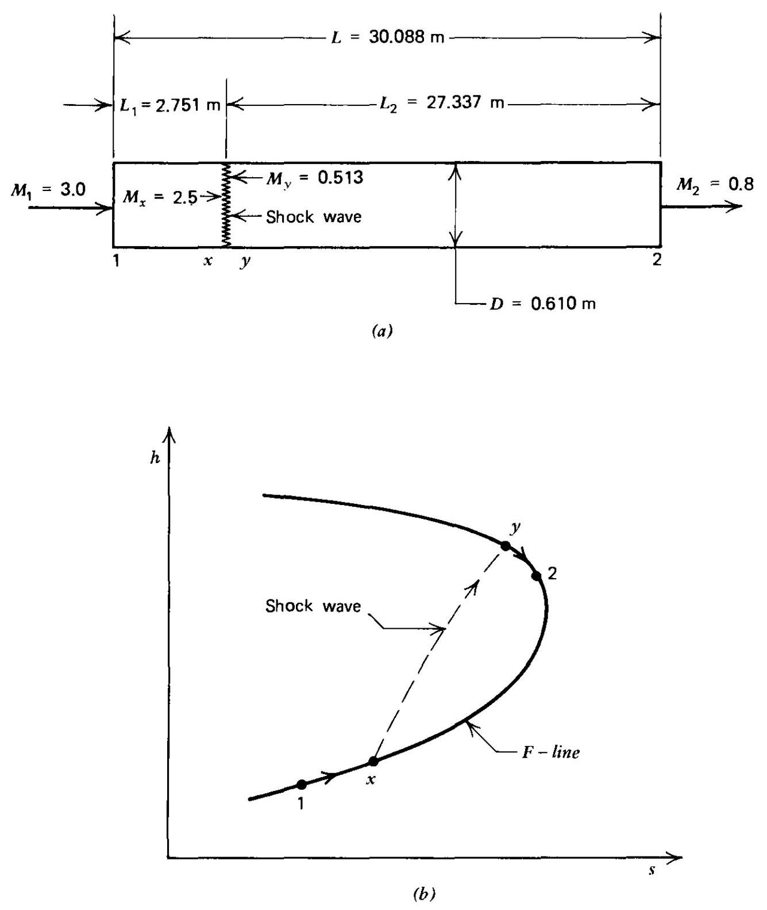
Figure 7.13 Sketches for Example 7.6. (a) Physical conditions. (b) Plot (schematic) of the flow process on the $h s$ plane.

(b) The length of duct between the normal shock wave and the duct exit section corresponds to a change in the flow Mach number from $M_{y}=0.51299$ to $M_{2}=$ 0.80 on the same Fanno line. Hence,

$$
\begin{aligned}
& L_{2}=L_{y}^{*}-L_{2}^{*}=\frac{\mathscr{D}}{4 \mathfrak{f}}\left(\frac{4 \mathfrak{f} L_{y}^{*}}{\mathscr{D}}-\frac{4 \mathfrak{f} L_{2}^{*}}{\mathscr{D}}\right) \\
& L_{2}=\frac{(0.610)(0.96859-0.07229)}{4(0.005)}=27.337 \mathrm{~m}(89.688 \mathrm{ft})
\end{aligned}
$$

Hence,

$$
L=L_{1}+L_{2}=2.751+27.337=30.088 \mathrm{~m}(98.714 \mathrm{ft})
$$

(c) Since states 1 and 2 are on the same Fanno line, $P_{1}^{*}=P_{x}^{*}=P_{y}^{*}=P_{2}^{*}=P^{*}$. The stagnation pressure ratio $P_{2} / P_{1}$ is given by

$$
\frac{P_{2}}{P_{1}}=\frac{P_{2}}{P^{*}} \frac{P^{*}}{P_{1}}
$$

From Table C. 7 (Fanno line), for $M_{1}=3.0$ and $M_{2}=0.80$, we obtain

$$
\frac{P_{2}}{P_{1}}=\frac{1.0382}{4.2346}=0.24514
$$

From Table C. 6 (isentropic flow), for $M_{1}=3.0, p_{1} / P_{1}=0.027224$. Consequently,

$$
P_{2}=\frac{P_{2}}{P_{1}} \frac{P_{1}}{p_{1}} p_{1}=\frac{(0.24514)(0.70) 10^{5}}{(0.027224)}=6.303 \cdot 10^{5} \mathrm{~N} / \mathrm{m}^{2}\left(91.42 \mathrm{lbf} / \mathrm{in}^{2}\right)
$$

(d) From equation 7.43,

$$
\Delta s=R \ln \left(\frac{P_{1}}{P_{2}}\right)=287.04 \ln \left(\frac{1}{0.24514}\right)=403.3 \mathrm{~J} / \mathrm{kg}-\mathrm{K}(0.09633 \mathrm{Btu} / \mathrm{lbm}-\mathrm{R})
$$

(e) From Table C. 6 (isentropic flow), for $M_{2}=0.8, p_{2} / P_{2}=0.65602$. Hence,

$$
p_{2}=(0.65602)(6.303) 10^{5}=4.135 \cdot 10^{5} \mathrm{~N} / \mathrm{m}^{2}\left(59.97 \mathrm{lbf} / \mathrm{in} .^{2}\right)
$$

## 7-4(c) The Rankine-Hugoniot Equation for a Normal Shock Wave

By combining equations 7.49 and 7.50, an expression is obtained relating the gas densities $\rho_{1}$ and $\rho_{2}$, in front of and in back of the normal shock wave, to the corresponding static pressures $p_{1}$ and $p_{2}$. Solving equation 7.49 for $M_{1}{ }^{2}$ gives

$$
M_{1}^{2}=\frac{(\gamma+1) p_{2}+(\gamma-1) p_{1}}{2 \gamma p_{1}}
$$

Substituting equation 7.54 into equation 7.50 , after some rearrangement, yields

$$
\frac{\rho_{2}}{\rho_{1}}=\frac{(\gamma+1) p_{2}+(\gamma-1) p_{1}}{(\gamma+1) p_{1}+(\gamma-1) p_{2}}
$$

Equation 7.55 is known as the Rankine-Hugoniot equation. It relates the densities and static pressures for the gas in front of and in back of the normal shock wave. Equation 7.55 may be solved for the pressure ratio $p_{2} / p_{1}$. Thus,

$$
\frac{p_{2}}{p_{1}}=\frac{(\gamma+1) \rho_{2}-(\gamma-1) \rho_{1}}{(\gamma+1) \rho_{1}-(\gamma-1) \rho_{2}}
$$

Equations 7.55 and 7.56 for a perfect gas are equivalent to the Hugoniot equation (see Section 7-3, equation 7.11) for a general fluid.

The Rankine-Hugoniot equation does not specify whether the abrupt change of state is an expansion or a compression. It is shown in Section 7-3 from thermodynamic considerations, however, that the shock process is a compression.

The equation for an isentropic process ( $p \rho^{-\gamma}=$ constant) shows that as $p_{2} \rightarrow \infty$, then $\rho_{2} \rightarrow \infty$. In the case of a normal shock wave, however, the ratio $\rho_{2} / \rho_{1}$ approaches a finite value. Thus,

$$
\lim _{p_{2} \rightarrow \infty}\left(\frac{\rho_{2}}{\rho_{1}}\right)=\frac{\gamma+1}{\gamma-1}
$$

## 7-4(d) Prandtl's Velocity Equation for a Normal Shock Wave

A relationship may be obtained between the velocities $V_{1}$ and $V_{2}$ in front of and behind a normal shock wave, respectively. For a perfect gas, the relationship is obtained by substituting for $M_{1}$ and $M_{2}$, in equation 7.48, the corresponding values
of the dimensionless velocity $M^{*}=V / a^{*}$ from equation 3.189, Table 3.4. Making the aforementioned substitutions and simplifying the results, we obtain Prandtl's equation for a normal shock wave in a perfect gas. Thus,

$$
V_{1} V_{2}=\gamma R t^{*}=a^{* 2}
$$

Equation 7.58 shows that the product $V_{1} V_{2}$ for a normal shock wave is equal to the square of the critical speed of sound $a^{* 2}$; the latter is a constant for an adiabatic flow. From equation 7.58, it is seen that a normal shock wave approaches a sound wave as its strength becomes vanishingly small. Furthermore, the speed of the gas relative to the normal shock wave is supersonic upstream to the wave and subsonic downstream from it.

## 7-4(e) Entropy Change and Shock Strength for a Normal Shock Wave

For the steady one-dimensional flow of a perfect gas, the increase in the entropy of the gas because of the normal shock wave can be related to the shock strength $\beta= \left(p_{2}-p_{1}\right) / p_{1}$. From Table 3.2, equation 3.177, the entropy change for a perfect gas, expressed in terms of the static pressure ratio $p_{2} / p_{1}$, is

$$
\Delta s=c_{p} \ln \left(\frac{t_{2}}{t_{1}}\right)-R \ln \left(\frac{p_{2}}{p_{1}}\right)=c_{v} \ln \left[\left(\frac{t_{2}}{t_{1}}\right)^{\gamma}\left(\frac{p_{2}}{p_{1}}\right)^{-(\gamma-1)}\right]
$$

Introducing $p=\rho R t$ into equation 7.59, we obtain

$$
\frac{\Delta s}{c_{v}}=\ln \left[\frac{p_{2}}{p_{1}}\left(\frac{\rho_{1}}{\rho_{2}}\right)^{\gamma}\right]
$$

Substituting for $\rho_{1} / \rho_{2}$ from equation 7.55 into equation 7.60 gives

$$
\frac{\Delta s}{c_{v}}=\ln \left\{\left[\frac{(\gamma+1)+(\gamma-1) \frac{p_{2}}{p_{1}}}{(\gamma-1)+(\gamma+1) \frac{p_{2}}{p_{1}}}\right]^{\gamma}\left(\frac{p_{2}}{p_{1}}\right)\right\}
$$

Introducing the normal shock wave strength $\beta$ into equation 7.61 gives

$$
\frac{\Delta s}{c_{v}}=\ln \left\{(1+\beta)\left[\frac{2 \gamma+(\gamma-1) \beta}{2 \gamma+(\gamma+1) \beta}\right]^{\gamma}\right\}
$$

Rearranging the last equation yields

$$
\frac{\Delta s}{c_{v}}=\ln \left[(1+\beta)\left(1-\frac{\beta}{\gamma+\frac{\gamma+1}{2} \beta}\right)^{\gamma}\right]
$$

For a weak normal shock wave $\beta$ is a small fraction, and equation 7.62 may be expanded into a Maclaurin series to give

$$
\frac{\Delta s}{R}=\frac{\gamma+1}{12 \gamma^{2}} \beta^{3}-\frac{\gamma+1}{8 \gamma^{2}} \beta^{4}+\cdots \approx \frac{\gamma+1}{12 \gamma^{2}} \beta^{3}
$$

Equation 7.63 shows that for a weak normal shock wave (i.e., $\beta \ll 1$ ), the increase in the entropy of the gas is negligible. Consequently, a weak normal shock wave produces an efficient compression of the gas.

If $\beta$ is expressed in terms of $M_{1}$, the Mach number in front of the normal shock wave, by means of equation 7.46 , then equation 7.63 is transformed to read

$$
\frac{\Delta s}{R}=\frac{2}{3} \frac{\gamma}{(\gamma+1)^{2}}\left(M_{1}^{2}-1\right)^{3}-\frac{2 \gamma}{(\gamma+1)^{3}}\left(M_{1}^{2}-1\right)^{4}+\cdots
$$

Neglecting all powers of ( $M_{1}{ }^{2}-1$ ) higher than the third yields

$$
\frac{\Delta s}{R} \approx \frac{2}{3} \frac{\gamma}{(\gamma+1)^{2}}\left(M_{1}^{2}-1\right)^{3}
$$

which applies to weak normal shocks waves. Equation 7.65 shows that an increase in entropy results only when $M_{1}$ is significantly larger than unity. Otherwise, the increase in entropy is very small, and the shock process may be assumed to be isentropic.

Equation 7.63 shows that the increase in the entropy of a perfect gas because of a weak normal shock wave may be assumed to be proportional to the third power of the shock strength $\beta$, while equation 7.65 shows that it is proportional to the third power of the parameter ( $M_{1}{ }^{2}-1$ ). Consequently, the magnitude of either $\beta$ or ( $M_{1}{ }^{2}-1$ ) may be employed as a criterion of the irreversibility of a weak normal shock wave. For a weak normal shock wave, $M_{1}<1.3$ approximately, the irreversibility of the shock wave may be ignored in calculating the states for the gas in front of and in back of the normal shock wave. The aforementioned pseudoisentropic compression produced by a weak normal shock wave may be employed advantageously in designing the air-intake-diffuser systems for an air-breathing jet propulsion engine for propelling aircraft at supersonic speeds.

## 7-4(f) Shock or Wave Drag

Consider now the case where a shock wave is generated by a body moving through a frictionless fluid, as illustrated in Fig. 7.14. For convenience, a relative coordinate system is employed. Two control surfaces $A_{1}$ and $A_{2}$, extending to infinity, may be drawn perpendicular to the assumed one-dimensional flow. One plane is located upstream to the body where the pressure is $p_{1}$, and the other is located downstream from the body where the gas has expanded isentropically (after the shock wave) to the upstream static pressure $p_{1}$.

- Since there is no unbalanced pressure force, the resultant pressure force acting on the control surface is zero. There is, however, a rate of change in momentum in the direction of flow because $V_{2}<V_{1}$. Consequently, there is a resultant force acting in

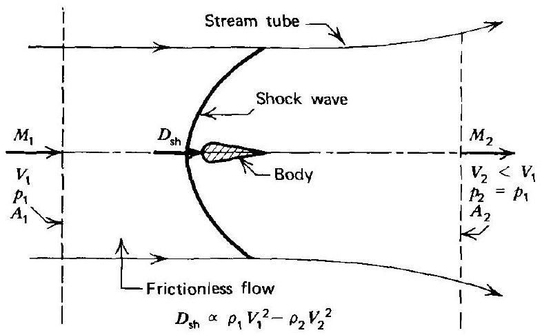
Figure 7.14 Development of shock (or wave) drag.

the direction opposite to the inflow velocity $V_{1}$. From the reaction principle it follows that the body producing the shock wave must be acted on by a force of equal magnitude acting in the opposite direction; that is, a force acting in the same direction as the velocity $V_{1}$ (see Fig. 7.21). In the relative coordinate system such a force is a drag force; it is a force that must be overcome by the thrust developed by the propulsion system. It is seen, therefore, that if a body moves in a perfect (frictionless) fluid and shock waves are generated, a drag force called either the shock drag or the wave drag is produced. The shock drag is independent of the skin friction drag and the form drag, which are always present when a body moves in a real fluid (see Section 1-6).

## 7-5 NORMAL SHOCK WAVES IN IMPERFECT GASES

The properties of normal shock waves are developed in Section 7-4 for the perfect gas. In this section, the influence of imperfect gas effects on the flow properties pertinent to a normal shock wave is considered. The term imperfect gas is employed here in a general sense to denote any gas that deviates from perfect gas behavior. Several sources of imperfect gas effects are discussed in detail in Section 4-5.

In the present section, a general imperfect gas model is considered for which there are available equations of state having the following forms.

$$
\begin{aligned}
& \rho=\rho(p, t) \\
& h=h(p, t)
\end{aligned}
$$

The equations of state may be in the form of charts, tables, or a computer code. The source of the imperfect gas effect is unimportant. All that is required is that the aforementioned equations of state be known.

Substituting the continuity equation, equation 7.2, into the momentum equation, equation 7.5 , and the energy equation, equation 7.6 , we obtain

$$
\begin{aligned}
& p_{2}=p_{1}+\rho_{1} V_{1}^{2}\left(1-\frac{\rho_{1}}{\rho_{2}}\right) \\
& h_{2}=h_{1}+\frac{V_{1}^{2}}{2}\left[1-\left(\frac{\rho_{1}}{\rho_{2}}\right)^{2}\right]
\end{aligned}
$$

Rearranging equation 7.2 yields

$$
V_{2}=\frac{\rho_{1} V_{1}}{\rho_{2}}
$$

Equations 7.66 to 7.70 comprise a set of five equations in terms of $p, \rho, h, t$ and $V$ that is applicable at points 1 and 2 upstream to and downstream from the normal shock wave, respectively. When the upstream properties are specified, those equations yield five relationships between them and the five downstream properties $p_{2}, \rho_{2}, h_{2}$, $t_{2}$, and $V_{2}$; in general, those equations must be solved numerically. An extremely rapid numerical method for solving nonlinear equations is the secant method discussed in Appendix A-4(d).

The following steps are employed for obtaining the solutions for the five nonlinear equations governing normal shock waves in an imperfect gas.

1. Determine the initial conditions (i.e., $p_{1}, \rho_{1}, h_{1}, t_{1}$, and $V_{1}$ ).
2. Assume a value for $\rho_{2}$. For the first trial value, the value of $\rho_{2}$ based on the im-
perfect gas behaving as a perfect gas may be employed. The second trial value is the result of the first calculation, and subsequent trial values are obtained by the secant method.
3. Calculate the values of $p_{2}$ and $h_{2}$ by means of equations 7.68 and 7.69.
4. Determine $t_{2}$ and $\rho_{2}$ from the equations of state for the imperfect gas (equations 7.66 and 7.67). Those equations may be in the form of algebraic equations, graphs, or tables.
5. If the calculated value of $\rho_{2}$ from step 4 agrees to within the desired tolerance with the assumed value for $\rho_{2}$ assumed in step 2 , the solution is obtained. If the agreement is unsatisfactory, steps 2 to 5 must be repeated until convergence of the assumed and calculated values is obtained.
6. When convergence is obtained, $V_{2}$ may be determined from equation 7.70. The calculation of $V_{2}$ completes the solution.

The procedure is simple to apply, and the assumed and calculated values converge rapidly.

Example 7.7. A reentry vehicle $(R V)$ is at an altitude of $15,000 \mathrm{~m}$ and has a velocity of $1850 \mathrm{~m} / \mathrm{s}$. A bow shock wave envelopes the $R V$, as illustrated in Fig. 7.15a. Neglecting dissociation, determine the properties at a point just behind the shock wave on the $R V$ centerline, where the shock wave may be treated as a normal shock wave. Assume $R=287.04 \mathrm{~J} / \mathrm{kg}-\mathrm{K}$, and take into account the variation of the specific heat of air with temperature.

## Solution

If dissociation is neglected, the only imperfect gas effect is that due to the variation of the specific heat of the atmospheric air with temperature. Consequently, Table C. 4 may be employed as the caloric equation of state for the air. The numerical method discussed in Section 7-5 is employed for obtaining the solution.
(1) Initial conditions. From Table C.5, at an altitude of $15,000 \mathrm{~m}, t_{1}=216.65 \mathrm{~K}$, $p_{1}=12,112 \mathrm{~N} / \mathrm{m}^{2}$, and $\rho_{1}=0.19475 \mathrm{~kg} / \mathrm{m}^{3}$. From Table C.4, at $t=216.65 \mathrm{~K}$, $\gamma=1.4000$. Thus,

$$
\begin{aligned}
a_{1} & =\left(\gamma R t_{1}\right)^{1 / 2}=[1.4(287.04)(216.65)]^{1 / 2}=295.1 \mathrm{~m} / \mathrm{s} \\
M_{1} & =\frac{V_{1}}{a_{1}}=\frac{1850}{295.1}=6.2691
\end{aligned}
$$

From Table C.4, at $t_{1}=216.65 \mathrm{~K}, h_{1}=217.660 \mathrm{~kJ} / \mathrm{kg}$.
(2) Assume a value for $\rho_{2}$. As a first trial value, let $\rho_{2}$ be that based on assuming that the atmospheric air is a perfect gas. From Table C. 11 for a normal shock wave, for $M_{1}=6.2691,\left(\rho_{2} / \rho_{1}\right)=\left(V_{1} / V_{2}\right)=5.3227, t_{2} / t_{1}=8.5833$, and $p_{2} / p_{1}=45.687$. Hence,

$$
\rho_{2}=5.3227(0.19475)=1.0366 \mathrm{~kg} / \mathrm{m}^{3}
$$

The above result yields the first trial value $\rho_{2}=1.0366 \mathrm{~kg} / \mathrm{m}^{3}$. The remaining properties are computed from the ratios determined above.

$$
\begin{aligned}
t_{2} & =8.5833(216.65)=1859.6 \mathrm{~K} \\
p_{2} & =45.687(12,112)=5.534 \cdot 10^{5} \mathrm{~N} / \mathrm{m}^{2} \\
V_{2} & =\frac{1850}{5.3227}=347.57 \mathrm{~m} / \mathrm{s}
\end{aligned}
$$

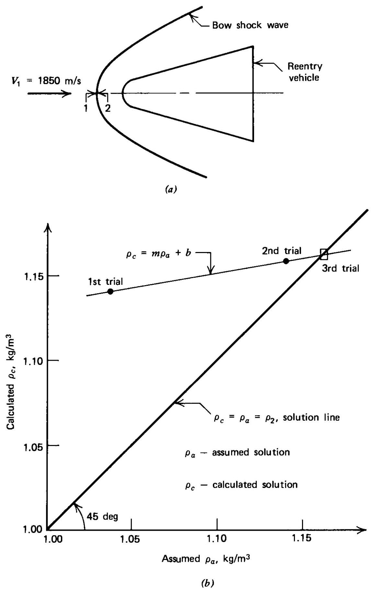
Figure 7.15 Sketches for Example 7.7. (a) Bow shock wave ahead of reentry vehicle. (b) Determination of $\rho_{2}$.

(3) Calculation of $p_{2}$ and $h_{2}$. From equation 7.68,

$$
\begin{aligned}
& p_{2}=12,112+(0.19475)(1850)^{2}\left(1-\frac{0.19475}{\rho_{2}}\right) \\
& p_{2}=12,112+6.6653 \cdot 10^{5}\left(1-\frac{0.19475}{\rho_{2}}\right) \mathrm{N} / \mathrm{m}^{2}
\end{aligned}
$$

where $\rho_{2}$ is in kilograms per cubic meter. Equation 7.69 , for $h_{2}$, yields

$$
\begin{aligned}
& h_{2}=217.660+\frac{(1850)^{2}}{2(1000)}\left[1-\left(\frac{0.19475}{\rho_{2}}\right)^{2}\right] \\
& h_{2}=217.660+1711.3\left[1-\left(\frac{0.19475}{\rho_{2}}\right)^{2}\right]
\end{aligned}
$$

Substituting $\rho_{2}=1.0366 \mathrm{~kg} / \mathrm{m}^{3}$ into equations (a) and (b) yields

$$
\begin{aligned}
& p_{2}=12,112+6.6653 \cdot 10^{5}\left(1-\frac{0.19475}{1.0366}\right)=5.534 \cdot 10^{5} \mathrm{~N} / \mathrm{m}^{2} \\
& h_{2}=217.660+1711.3\left[1-\left(\frac{0.19475}{1.0366}\right)^{2}\right]=1868.6 \mathrm{~kJ} / \mathrm{kg}
\end{aligned}
$$

(4) Calculation of $t_{2}$ and $\rho_{2}$. From Table C.4, for $h_{2}=1868.6 \mathrm{~kJ} / \mathrm{kg}, t_{2}=1690.6 \mathrm{~K}$. From the equation of state for a perfect gas $\rho=p / R t$,

$$
\rho_{2}=\frac{p_{2}}{R t_{2}}=\frac{(5.534) 10^{5}}{(287.04)(1690.6)}=1.1404 \mathrm{~kg} / \mathrm{m}^{3}
$$

Comparison of the values for $\rho_{2}$ from steps 2 and 4 indicates that additional trials are needed.
(5) Repetition of steps 3 and 4 with the value of $\rho_{2}$ from step 4.

$$
\begin{aligned}
& p_{2}=12,112+6.6653 \cdot 10^{5}\left(1-\frac{0.19475}{1.1404}\right)=5.648 \cdot 10^{5} \mathrm{~N} / \mathrm{m}^{2} \\
& h_{2}=217.660+1711.3\left[1-\left(\frac{0.19475}{1.1404}\right)^{2}\right]=1879.1 \mathrm{~kJ} / \mathrm{kg}
\end{aligned}
$$

From Table C.4, for $h_{2}=1879.1 \mathrm{~kJ} / \mathrm{kg}, t_{2}=1699.2 \mathrm{~K}$. From the equation of state for a perfect gas,

$$
\rho_{2}=\frac{(5.648) 10^{5}}{(287.04)(1699.2)}=1.1580 \mathrm{~kg} / \mathrm{m}^{3}
$$

Comparing the value of $\rho_{2}$ from step 5 with that from step 4 shows that a third trial for establishing the value of $\rho_{2}$ is warranted.

For the third trial, the secant method discussed in Appendix A-4(b) is employed. Denote the assumed value of $\rho_{2}$ for a trial by $\rho_{a}$, and the resulting calculated value by $\rho_{c}$. The results of the first two trials are plotted in the graph of $\rho_{c}$ versus $\rho_{a}$, presented in Fig. 7.15b. The desired solution lies on the 45 deg line $\rho_{c}=\rho_{a}=\rho_{2}$. The intersection of the two lines gives the next trial value of $\rho_{2}$. Because of the nonlinear nature of the problem, the third calculated value of $\rho_{2}$ may not fall exactly on the 45 deg line, in which case the secant method may be applied again if required to obtain a fourth trial value of $\rho_{2}$. Convergence of the secant method is extremely rapid, and ordinarily only one or two iterations are required for achieving the desired accuracy.

For the present case, the equation of the solution curve is

$$
\begin{gathered}
\frac{\rho_{c}-1.1580}{\rho_{a}-1.1404}=\frac{1.1404-1.1580}{1.0366-1.1404}=0.16956 \\
\rho_{c}=1.1580+0.16956\left(\rho_{a}-1.1404\right)=0.96464+0.16956 \rho_{a}
\end{gathered}
$$

Substituting $\rho_{c}=\rho_{a}=\rho_{2}$ into equation (e) gives the third trial value $\rho_{2}= 1.1616 \mathrm{~kg} / \mathrm{m}^{3}$.

Repeat steps 3 and 4 with $\rho_{2}=1.1616 \mathrm{~kg} / \mathrm{m}^{3}$.

$$
\begin{aligned}
& p_{2}=12,112+(6.6653) 10^{5}\left(1-\frac{0.19475}{1.1616}\right)=5.669 \cdot 10^{5} \mathrm{~N} / \mathrm{m}^{2} \\
& h_{2}=217.660+1711.3\left[1-\left(\frac{0.19475}{1.1616}\right)^{2}\right]=1880.9 \mathrm{~kJ} / \mathrm{kg}
\end{aligned}
$$

From Table C.4, for $h_{2}=1880.9 \mathrm{~kJ} / \mathrm{kg}, t_{2}=1700.6 \mathrm{~K}$. From the perfect gas equation of state,

$$
\rho_{2}=\frac{(5.669) 10^{5}}{(287.04)(1700.6)}=1.1614 \mathrm{~kg} / \mathrm{m}^{3}
$$

The agreement between the assumed value of $\rho_{2}=1.1616 \mathrm{~kg} / \mathrm{m}^{3}$ and the calculated value of $\rho_{2}=1.1614 \mathrm{~kg} / \mathrm{m}^{3}$ is good enough so that no additional applications of the secant method are needed.
(6) Calculation of $V_{2}$. From equation 7.70,

$$
V_{2}=\frac{(0.19475)(1850)}{(1.1614)}=310.22 \mathrm{~m} / \mathrm{s}
$$

The following table presents the results for the two initial trials, and the results for the final trial obtained by the secant method.

| Trial | $\rho_{2}, \mathrm{~kg} / \mathrm{m}^{3}$ | $p_{2}, \mathrm{~N} / \mathrm{m}^{2} \cdot 10^{5}$ | $h_{2}, \mathrm{~kJ} / \mathrm{kg}$ | $t_{2}, \mathrm{~K}$ | $\rho_{2}, \mathrm{~kg} / \mathrm{m}^{3}$ |
| :---: | :---: | :---: | :---: | :---: | :---: |
| 1 | 1.0366 | 5.534 | 1868.6 | 1690.6 | 1.1404 |
| 2 | 1.1404 | 5.648 | 1879.1 | 1699.2 | 1.1580 |
| 3 | 1.1616 | 5.669 | 1880.9 | 1700.6 | 1.1614 |

A comparison of the results obtained for the perfect gas analysis with those obtained for the imperfect gas analysis indicates the following percent errors for the former.

| Property | Perfect Gas | Imperfect Gas | Error, Percent |
| :--- | ---: | ---: | :---: |
| $t_{2}, \mathrm{~K}$ | 1859.6 | 1700.6 | 9.35 |
| $p_{2}, \mathrm{~N} / \mathrm{m}^{2} \cdot 10^{5}$ | 5.534 | 5.669 | -2.38 |
| $\rho_{2}, \mathrm{~kg} / \mathrm{m}^{3}$ | 1.0366 | 1.1614 | -10.76 |
| $V_{2}, \mathrm{~m} / \mathrm{s}$ | 347.57 | 310.22 | 12.04 |

The errors tabulated above are not large, but they are certainly significant.

## 7-6 OBLIQUE SHOCK WAVES

The preceding sections are concerned with shock waves that are normal to the flow direction. In many practical cases, however, a supersonic flow is caused to change its flow direction and, as a consequence, a shock wave is formed that is inclined to the initial flow direction; such shock waves are termed oblique shock waves.

Figure 7.16 illustrates the case where a stationary oblique shock wave is produced by the frictionless surface of a solid wall changing the flow direction of a supersonic stream. Let $V_{1}$ and $V_{2}$, respectively, denote the stream velocities entering and leaving the oblique shock wave; $\varepsilon$ is the angle between $V_{1}$ and the shock wave and is called the wave angle; $\beta$ is the angle between $V_{2}$ and the shock wave, and $\delta=\varepsilon-\beta$ is termed the flow deflection angle. It will be assumed that the flow is a steady twodimensional planar adiabatic flow, that no external work is involved, and that the effects of body forces are negligible.

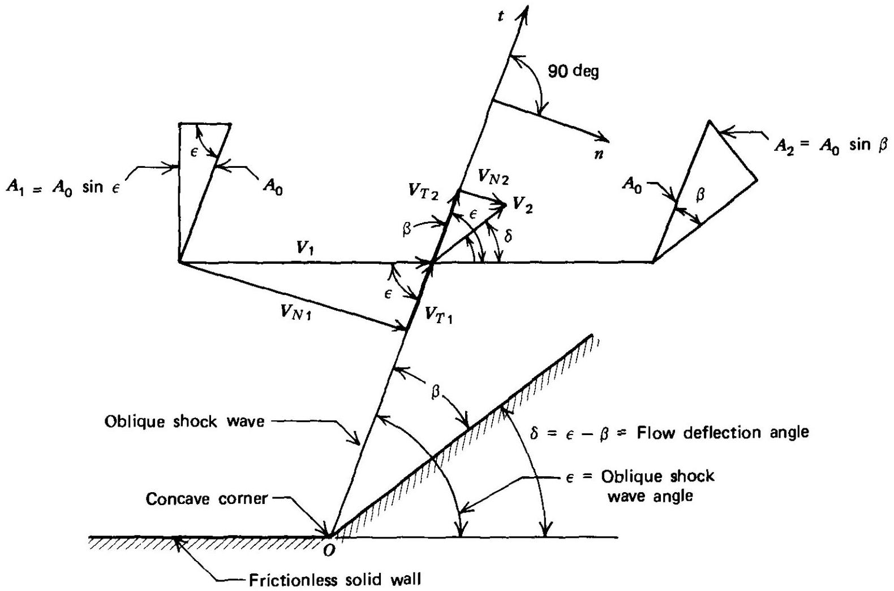
Figure 7.16 Velocity components for an oblique shock wave.

The components of the velocities $V_{1}$ and $V_{2}$ resolved in the tangential and normal directions to the oblique shock wave are denoted, respectively, by $V_{T 1}, V_{T 2}, V_{N 1}$, and $V_{N 2}$. From Fig. 7.16, it follows that

$$
\begin{aligned}
& V_{1}^{2}=V_{T 1}^{2}+V_{N 1}^{2} \\
& V_{2}^{2}=V_{T 2}^{2}+V_{N 2}^{2}
\end{aligned}
$$

The velocity components tangential and normal to the oblique shock wave may be expressed in terms of the angles $\varepsilon$ and $\beta$. Thus,

$$
\begin{aligned}
& V_{T 1}=V_{1} \cos \varepsilon \\
& V_{N 1}=V_{1} \sin \varepsilon \\
& V_{T 2}=V_{2} \cos \beta \\
& V_{N 2}=V_{2} \sin \beta
\end{aligned}
$$

where $\beta=\varepsilon-\delta$.
(1) Continuity equation. Let $A_{0}$ denote a unit area parallel to the oblique shock wave; then the areas perpendicular to $V_{1}$ and $V_{2}$, denoted by $A_{1}$ and $A_{2}$, respectively, are given by

$$
A_{1}=A_{0} \sin \varepsilon \quad \text { and } \quad A_{2}=A_{0} \sin \beta
$$

From Table 3.1, the continuity equation for the flow through the shock wave yields

$$
\dot{m}=A_{1} \rho_{1} V_{1}=A_{2} \rho_{2} V_{2}=\mathrm{constant}
$$

Substituting for $A_{1}$ and $A_{2}$ from equation 7.77 gives

$$
A_{0} \rho_{1} V_{1} \sin \varepsilon=A_{0} \rho_{2} V_{2} \sin \beta
$$

From equations 7.74, 7.76, and 7.79, it follows that

$$
\rho_{1} V_{N 1}=\rho_{2} V_{N 2}
$$

The requirement specified by equation 7.80 is identical physically to equation 7.2 derived in Section 7-3 for a normal shock wave; for the latter the velocities normal to the shock wave are denoted by $V_{1}$ and $V_{2}$.
(2) Momentum equation: Application of the momentum equation, equation 7.3, in the $n$ direction, that is, normal to the oblique shock wave, gives

$$
p_{1}+\rho_{1} V_{N 1}^{2}=p_{2}+\rho_{2} V_{N 2}^{2}
$$

The requirement specified by equation 7.81 is the same as that specified by equation 7.5 for a normal shock wave; for the latter $V_{1}$ and $V_{2}$ denote the velocities normal to the shock wave.

Since there is no change in the static pressure in the direction parallel or tangential to the oblique shock wave, the application of the momentum equation parallel to the oblique shock wave gives

$$
\rho_{1} V_{N 1} V_{T 1}=\rho_{2} V_{N 2} V_{T 2}
$$

Since $\rho_{1} V_{N 1}=\rho_{2} V_{N 2}$ (see equation 7.80), it is concluded from equation 7.82 that the tangential velocity components of the oblique shock wave are equal to each other; that is,

$$
V_{T 1}=V_{T 2}=V_{T}
$$

From equations 7.73 and 7.75 , since $V_{T 1}=V_{T 2}$, the velocity ratio $V_{2} / V_{1}$ is given by

$$
\frac{V_{2}}{V_{1}}=\frac{V_{T 2}}{\cos \beta} \cdot \frac{\cos \varepsilon}{V_{T 1}}=\frac{\cos \varepsilon}{\cos \beta}
$$

It follows from equations $7.80,7.74,7.76$, and 7.84 that

$$
\frac{\rho_{2}}{\rho_{1}}=\frac{V_{N 1}}{V_{N 2}}=\frac{V_{1} \sin \varepsilon}{V_{2} \sin \beta}=\frac{\cos \beta}{\cos \varepsilon} \frac{\sin \varepsilon}{\sin \beta}=\frac{\tan \varepsilon}{\tan \beta}
$$

(3) Energy equation. From Table 3.1, equation 3.164, the energy equation for the adiabatic flow of a gas (neglecting body forces, $g d z=0$ ), is given by

$$
h_{1}+\frac{V_{1}^{2}}{2}=h_{2}+\frac{V_{2}^{2}}{2}=H=\mathrm{constant}
$$

Substituting for $V_{1}{ }^{2}$ and $V_{2}{ }^{2}$ from equations 7.71 and 7.72 into equation 7.86 , and noting that $V_{T 1}=V_{T 2}$ yields

$$
h_{1}+\frac{V_{N 1}^{2}}{2}=h_{2}+\frac{V_{N 2}^{2}}{2}=\text { constant }
$$

Equation 7.87 states that the energy equation for an oblique shock wave is identical with that for a normal shock wave, but with $V_{N 1}$ and $V_{N 2}$ replacing $V_{1}$ and $V_{2}$ (see equation 7.6).

It is shown above that the continuity, momentum, and energy equations have identical forms for normal and oblique shock waves. It may be concluded, therefore, that all of the relationships derived previously for the normal shock wave are applicable to the normal components of the velocities $V_{1}$ and $V_{2}$ in front of and in back of an oblique shock wave, respectively, provided that the normal velocity component $V_{N 1}$ is supersonic.

Since $V_{N 2}<V_{N 1}\left(V_{N 2}\right.$ must be subsonic) and $V_{T 1}=V_{T 2}$, the velocity $V_{2}$ leaving the oblique shock wave is deflected from the direction of $V_{1}$; that is, the fluid stream is deflected toward the oblique shock wave (see Fig. 7.16).
(4) Equation of state: To complete the system of equations, the equations of state
for the flowing gas are required. Thus,

$$
\rho=\rho(p, t) \quad \text { and } \quad h=h(p, t)
$$

Equations $7.73,7.74,7.75,7.76,7.80,7.81,7.83,7.87$, and 7.88 (two equations) comprise a set of ten equations for the ten properties $p_{2}, \rho_{2}, t_{2}, h_{2}, V_{2}, V_{N 2}, V_{T 2}, V_{N 1}$, $V_{T 1}$, and $\varepsilon$, in terms of the known upstream conditions $p_{1}, \rho_{1}, t_{1}, h_{1}, V_{1}$, and $\delta$. The aforementioned set of equations is considerably more involved than the set of equations developed in Section 7-3 for the normal shock wave because of the extra degree of freedom introduced into the physical process by the flow deflection angle $\delta$. The oblique shock wave has two degrees of freedom: (1) the upstream conditions, and (2) the flow deflection angle $\delta$; whereas there is only one degree of freedom in the normal shock wave, namely the upstream conditions. The preceding equations of the present section are quite general. When the equations of state for the flowing fluid are specified, the changes produced in the fluid properties caused by its flow through an oblique shock wave are determinable.

## 7-7 OBLIQUE SHOCK WAVES IN PERFECT GASES

In the present section, the general equations for oblique shock waves, derived in Section 7-6, are applied to the flow of a perfect gas.

## 7-7(a) GovernIng Equations

The equations of state for a perfect gas are given by equations 7.23 and 7.24, which are repeated below for convenience.

$$
\begin{aligned}
& p=\rho R t \\
& h=c_{p} t
\end{aligned}
$$

The energy equation for the adiabatic flow of a perfect gas through an oblique shock wave is obtained from equation 7.87 . Thus,

$$
c_{p} t_{1}+\frac{V_{N 1}^{2}}{2}=c_{p} t_{2}+\frac{V_{N 2}^{2}}{2}
$$

The continuity equation 7.80 and the momentum equation 7.81 retain their forms.
Because the thermodynamic properties of the gas after the oblique shock wave depend on the upstream conditions and the flow deflection angle $\delta$, it is desirable to express the pertinent relationships in terms of those variables. It is beyond the scope of this book to present their derivations; they may be found in the standard works on supersonic aerodynamics. ${ }^{3,4}$

## 7-7(b) Property Ratios Across an Oblique Shock Wave

The ratio of the static pressure in back of the oblique shock wave $p_{2}$ to the static pressure in front of it $p_{1}$ is given by

$$
\frac{p_{2}}{p_{1}}=\frac{2 \gamma}{\gamma+1} M_{1}^{2} \sin ^{2} \varepsilon-\frac{\gamma-1}{\gamma+1}
$$

The density ratio $\rho_{2} / \rho_{1}$ is given by

$$
\frac{\rho_{2}}{\rho_{1}}=\frac{\tan \varepsilon}{\tan \beta}=\frac{V_{N 1}}{V_{N 2}}=\frac{(\gamma+1) M_{1}^{2} \sin ^{2} \varepsilon}{2+(\gamma-\hat{1}) M_{1}^{2} \sin ^{2} \varepsilon}
$$

The velocity ratio $V_{2} / V_{1}$ is given by

$$
\frac{V_{2}}{V_{1}}=\frac{\sin \varepsilon}{\sin \beta}\left[\frac{2}{(\gamma+1) M_{1}^{2} \sin ^{2} \varepsilon}+\frac{\gamma-1}{\gamma+1}\right]
$$

The Mach number after the oblique shock wave $M_{2}$ is obtained from

$$
\frac{\tan \varepsilon}{\tan \beta}=\frac{2}{\gamma+1}\left(\frac{1}{M_{2}^{2} \sin ^{2} \beta}+\frac{\gamma-1}{2}\right)
$$

The oblique shock wave angle $\varepsilon$ is calculated from

$$
\frac{1}{\tan \delta}=\left(\frac{\gamma+1}{2} \frac{M_{1}{ }^{2}}{M_{1}{ }^{2} \sin ^{2} \varepsilon-1}-1\right) \tan \varepsilon
$$

The preceding equations may be employed for calculating the properties of the flowing gas in back of an oblique shock wave, for fixed initial conditions, provided one final condition is known. Ordinarily, either the flow deflection angle $\delta$ or the static pressure $p_{2}$ is given and, from that information, the changes because of the oblique shock wave may be calculated. It is apparent from equations 7.90 to 7.94 that the intensity of an oblique shock wave depends not only on the initial Mach number $M_{1}$, but also on the wave angle $\varepsilon$. If $M_{1}$ is fixed, then the shock wave intensity depends entirely on $\varepsilon$, and unless $M_{1} \sin \varepsilon \geqq 1$, there will be no shock wave. It should be noted that, when $\varepsilon=\pi / 2$ (normal shock wave), the equations transform to those presented in Section 7-4 for the normal shock wave; the latter is, of course, merely a special case of the oblique shock wave. Tables for aiding in the computation of changes in the flow properties because of an oblique shock wave are presented in Table C. 12 in the Appendix, and in References 5 and 7.

Figures 7.17 and 7.18 present the oblique shock wave angle $\varepsilon$ and the downstream Mach number $M_{2}$, respectively, as functions of the initial Mach number $M_{1}$ for different values of the flow deflection angle $\delta$, for $\gamma=1.40$. It is seen from Figs. 7.17 and 7.18 that, for the same values of $M_{1}$ and $\delta$, two different sets of values for $\varepsilon$ and $M_{2}$ are possible; that is, one of two oblique shock waves having different strengths are possible. Which of the two occurs in practice depends on the other boundary conditions for the flow. Experiments show that the weaker of the two shock waves occurs most frequently. In special cases where the downstream pressure is extremely high, the stronger of the two shock waves may occur; for example, the shock wave on the spike of a supersonic inlet for an air-breathing jet engine when no flow is allowed to pass through the inlet. Figure 7.19 presents the static pressure ratio $p_{2} / p_{1}$ as a function of $M_{1}$ for different values of the flow deflection angle $\delta$, for $\gamma=1.4$.

The entropy change for a shock wave is given by equation 7.60, which is repeated here for convenience. Thus,

$$
\Delta s=c_{v} \ln \left[\frac{p_{2}}{p_{1}}\left(\frac{\rho_{1}}{\rho_{2}}\right)^{\gamma}\right]
$$

For an oblique shock wave, $p_{2} / p_{1}$ is given by equation 7.90 , and $\rho_{1} / \rho_{2}$ is given by equation 7.91 . Since both $p_{2} / p_{1}$ and $\rho_{2} / \rho_{1}$ are functions of the wave angle $\varepsilon$, the entropy change $\Delta s$ is also a function of $\varepsilon$, and increases with $\varepsilon$. If $\sin \varepsilon=1 / M=\sin \alpha$, where $\alpha$ is the Mach angle [see Section 3-8(b)], then $p_{2} / p_{1}$ and $\rho_{2} / \rho_{1}$ are both unity, and $\Delta s=0$. Furthermore, if $\varepsilon=\pi / 2$ (normal shock wave), then $\Delta s$ is a maximum.

The flow deflection angle $\delta$ is zero when $M_{2}=M_{1}$ (acoustic or Mach wave) and also when $\varepsilon=\pi / 2$ (normal shock wave). Between those limits the value of $\delta$ is positive, so that it has a maximum value, which is denoted by $\delta_{m}$. The wave angle $\varepsilon_{m}$

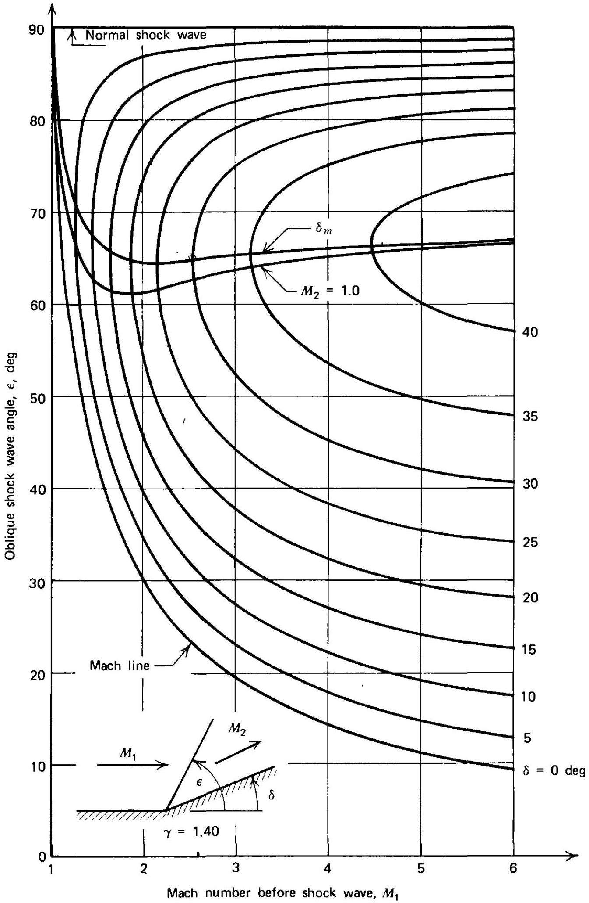
Figure 7.17 Shock wave angle $\varepsilon$ as a function of the initial Mach number $M_{1}$ for different values of the flow deflection angle $\delta$ for $\gamma=1.4$.

corresponding to $\delta_{m}$, the maximum possible flow deflection angle for a given initial Mach number $M_{1}$, is determined from ${ }^{3}$

$$
\begin{aligned}
\sin ^{2} \varepsilon_{m}=\frac{1}{\gamma M_{1}^{2}}\left\{\frac{\gamma+1}{4} M_{1}^{2}\right. & -1 \\
+ & {\left.\left[(\gamma+1)\left(1+\frac{\gamma-1}{2} M_{1}^{2}+\frac{\gamma+1}{16} M_{1}^{4}\right)\right]^{1 / 2}\right\} }
\end{aligned}
$$

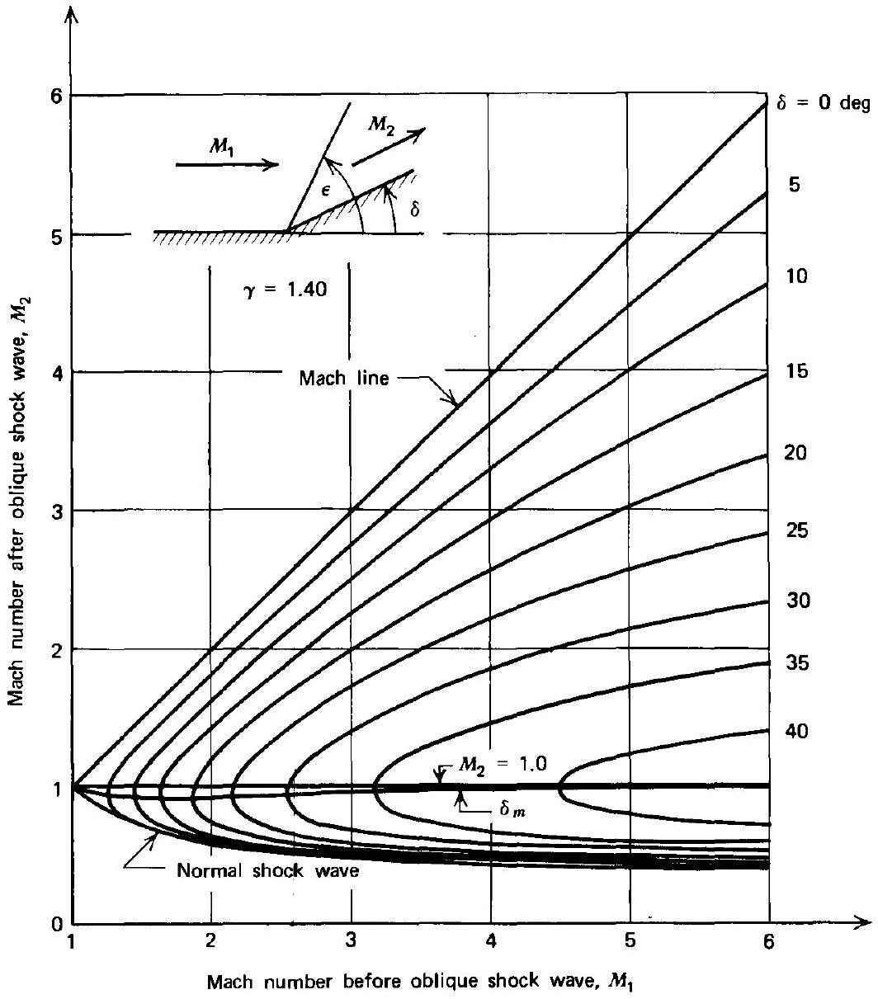
Figure 7.18 Mach number downstream of an oblique shock wave $M_{2}$ as a function of the initial Mach number $M_{1}$ for different values of the flow deflection angle $\delta$ for $\gamma=1.4$.

Figure 7.20 presents the maximum possible flow deflection angle $\delta_{m}$ and the corresponding wave angle $\varepsilon_{m}$ as functions of the initial Mach number $M_{1}$ for $\gamma=1.4$. If the flow deflection angle $\delta$ is larger than $\delta_{m}$, then the oblique shock wave becomes detached from the corner. Increasing $\delta$ causes the shock wave to move upstream, as illustrated in Fig. 7.21. The limiting value of $\delta_{m}$ where $M_{1}=\infty$, for $\gamma=1.4$, is $\delta_{m}=45.37 \mathrm{deg}$.

There is a particular value of $\varepsilon$, denoted by $\varepsilon_{s}$, for which the flow leaves the oblique shock wave with the sonic speed; that is, $M_{2}=1$. That particular value of $\varepsilon_{s}$ is obtained from ${ }^{3}$

$$
\begin{aligned}
\sin ^{2} \varepsilon_{s}=\frac{1}{\gamma M_{1}^{2}}\left\{\frac{\gamma+1}{4}\right. & M_{1}^{2}-\frac{3-\gamma}{4} \\
+ & {\left.\left[(\gamma+1)\left(\frac{9+\gamma}{16}-\frac{3-\gamma}{8} M_{1}^{2}+\frac{\gamma+1}{16} M_{1}^{4}\right)\right]^{1 / 2}\right\} }
\end{aligned}
$$

Two FORTRAN computer programs are presented below for computing the properties of oblique shock waves: subroutine OSHOCKL and subroutine OSHOCKP. Subroutine OSHOCKL computes the limiting values $\varepsilon_{m}$ and $\delta_{m}$, and the corresponding

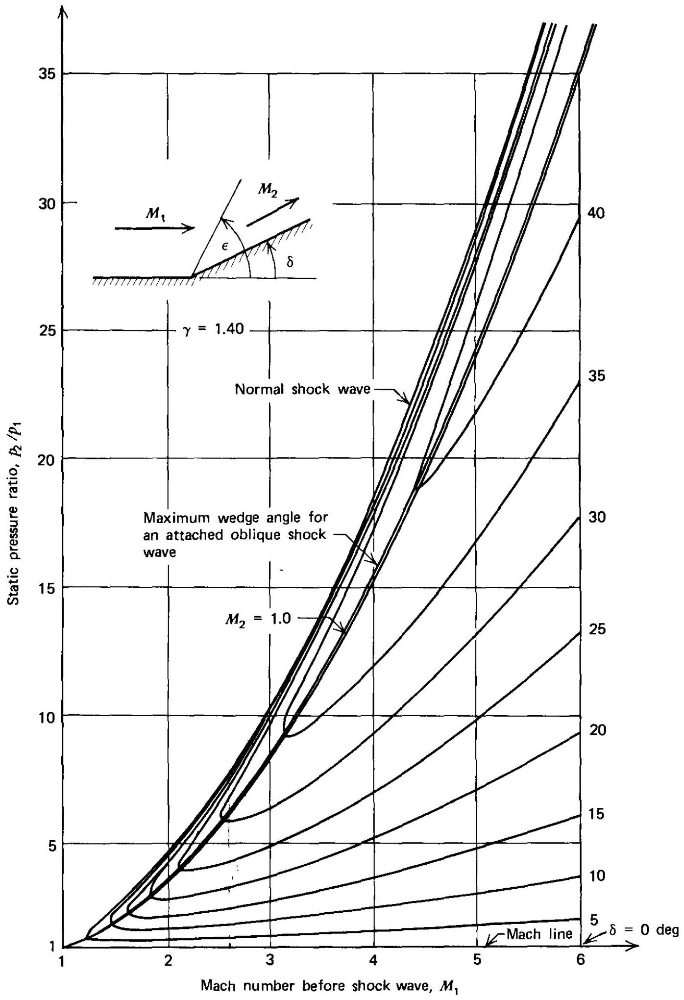
Figure 7.19 Static pressure ratio across an oblique shock wave $p_{2} / p_{1}$ as a function of the initial Mach number $M_{1}$ for different values of the flow deflection angle $\delta$ for $\gamma=1.40$.

values of $M_{2}$ and $p_{2} / p_{1}$, as functions of $M_{1}$. It also computes $\delta_{s}$ and $\varepsilon_{s}$, which are the values of $\delta$ and $\varepsilon$ when $M_{2}=1$, as well as $p_{2} / p_{1}$ corresponding to $M_{2}=1$. Subroutine OSHOCKP computes $\varepsilon, M_{2}$, and $p_{2} / p_{1}$ as functions of $M_{1}$, with the flow deflection angle $\delta$ as a parameter. It computes those properties for both strong and weak shock waves. Because of space limitations, only one of the tables generated by those programs is included in this book; that is Table C.12, which presents the wave angle $\varepsilon$ as a function of $M_{1}$ for weak oblique shock waves, for $\gamma=1.4$. Figures 7.17 to 7.19 are, however, based on those tables.

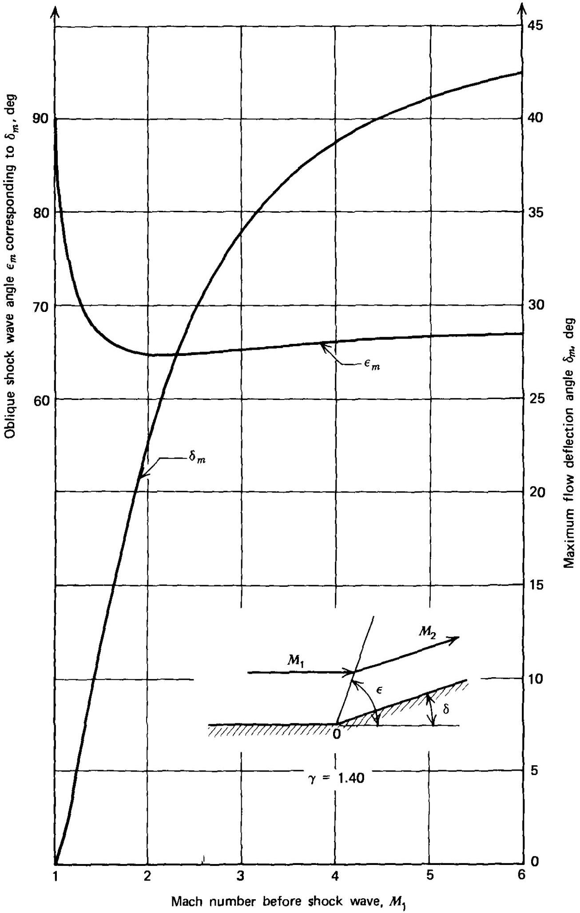
Figure 7.20 Maximum flow deflection angle $\delta_{m}$ and the corresponding wave angle $\varepsilon_{m}$ for oblique shock waves as a function of the upstream Mach number $M_{1}$ for $\gamma=1.40$.

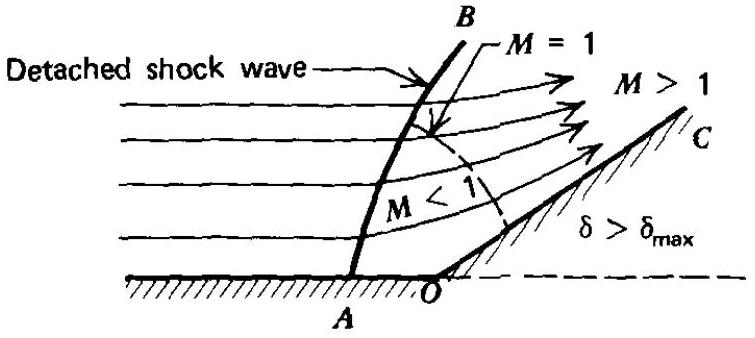
Figure 7.21 Illustration of the detachment of an oblique shock wave because of the flow deflection angle $\delta$ being larger than the maximum value $\delta_{\text {max }}$.

```
        SUBROUTINE OSHOCKL
C LIMITING PROPERTIES FOR AN OBLIQUE SHOCK WAVE IN A PERFECT GAS
        REAL M1,MM.MX.MS $ UIMENSION J(9).DM(9)
        NAMELIST /DATA/ G.J.OM
        DF(E)=ATAN((MM*SIN(E)**2-1.0)/(TAN(E)*(G2*MM+1.0-MM*SIN(E)**2)))
        AMF(E,D)=1.0/(SIN(E-D)*SQRT(G2*TAN(E)/TAN(E-D)-G5))
        PF(E)=G6*(MM*SIN(E)**2-G7) $ READ (5,DATA)
        G1=G+1.0 $ G2=G1/2.0 $ G3=G1/4.0 $ G4=G1/16.0 $ G5=(G-1.0)/2.0
        G6=G/G2 $ G7=G5/G $ G8=(3.0-G)/4.0 $ G9=(G+9.0)/16.0
        G10=(3.0-G)/8.0 $ RAD=57.2957795 S WRITE (6.2000) G $ I=1 $ L=0
        M1=1.0 $ DX=0.0 $ EX=90.0 $ MX=1.0 $ PX=1.0 $ OS=0.0 $ ES=90.0
C
        CALCULATE LIMITING PROPERTIES
    40 N=J(I) $ 00 50 K=1,N $ M1=M1+DM(I) $ MM=M1**2
        EX =ASIN(SQRT((G3*MM-1.0+SQRT(G1*(1.0+G5*MM+G4*MM**2)))/(G*MM)))
        DX=UF(EX) $ MX=AMF(EX,DX) $ PX=PF(EX) $ DX=DX*RAD $ EX=EX*RAD
        ES =ASIN(SQRT((G3*MM-G8+SQRT(G1*(G9-G1U*MM+G4*MM**2)))/(G*MM)))
        DS =DF(ES) $ PS=PF(ES) $ DS=DS*RAD $ ES=ES*RAD
        WRITE (6,2010) M1,UX,EX,MX,PX,DS,ES,PS $ L=L+1
        IF(L.LT.50) GO TO 5O $ WRITE (6,2000) G $ L=0
    SO CONTINUE $ I=I+1 $ IF((I.EQ.10).DR.(J(I).EQ.0)) RETURN $ GO TO 40
2000 FORMAT (1H1,3X,66HLIMITING VALUES OF PROPERTIES FOR AN OBLIQUE SHO
        1CK WAVE, GAMMA = F5,2//4X,2HM1,5X,2HDX,8X,2HEX,8X,2HMX,8X,2HPX,
        28X, 2HDS, 8X, 2HES, 8X, 2HPS/1H )
2010 FORMAT (1H ,F5.2,7F10.5)
        END
        SUBROUTINE OSHOCKP
C OBLIQUE SHOCK WAVE IN A PERFECT GAS
        REAL M1,MM $ UIMENSION J(9),DM(9),D(22),E(22),T(3)
        NAMELIST /DATA/ II,IJ,G,J,UM
        AF(EE)=MM*SIN(EE)**2-1.0 $ BF(EE)=G2*MM-AF(EE) $ READ (5,DATA)
        G1=G+1.0 $ G2=G1/2.0 $ G3=G1/4.0 $ G4=G1/16.0 $ G5=(G-1.0)/2.0
        Gb=G/G2 $ G7=G5/G $ T(1)=6H ANGLE $ T(2)=6H M2 $ T(3)=6H P2/P1
        NE=1 $ NF=21 $ DEND=40.0 $ DELD=2.0 $ RAD=57.2957795
        DO 100 ND=1,NE $ I=1 $ L=0 $ LL=0
        O(1)=DEND*FLOAT(NO-1) $ M1=1.0 $ DO 40 M=2.NF $ D(M)=D(M-1)+DELD
    4O CONTINUE $ WRITE(6,2000)T(II),G,(D(M),M=1,NF) $ WRITE (6,2010) M1
    50 N=J(I) $ D0 90 K=1,N $ M1=M1+DM(I) $ WRITE (6,2010) M1 $ L=L+1
        AL = ASIN(1.0/MI)*RAD $ TF(IJ.EQ.2)AL=90.0 $ MM=M1**2 $ NN=21 $ NA=0
        EX =ASIN(SQRT((G3*MM-1.O+SQRT(G1*(1.0+G5*MM+G4*MM**2)))/(G*MM)))
        DX =ATAN(AF(EX)/(BF(EX)*TAN(EX)))*RAD
        IF(D(1).GT.Dx+1.0)GO TO 80 $ EE=(AL-(-1.0)**IJ*D(1))/RAD $ LL=LL+1
        DO 7O M=1,NN $ DD=D(M) $ IF (DD.LT.DX) GO TO 60
        DD=DX $ E(M+1)=DX $ NN=M $ IF (NN.LT.NF) NA=1
    60 IF (DD.GT.0.0) GO TO 65 $ E(M)=AL $ IK=2*II+IJ $ GO TD 68
    65 TND=TAN(DD/RAD) $ A=AF(EE) $ B=BF(EE) $ C=2.0*MM*SIN(EE)*COS(EE)
        H=1.0/((TND*B)**2+A**2) $ FE=EE-ATAN(A/(B*TND))
        FEP=1.0-C*H*TND*(A+B) $ DE=-FE/FEP $ EE=EE+DE
        IF (ABS(DE).GT.0.000001) GO TO 60 $ E(M)=EE*RAD
    68 IF (II.EQ.2) L(M)=1.0/(SIN((E(M)-D(M))/RAU)*SQRT(G2*TAN(E(M)/RAU)/
        1TAN((E(M)-D(M))/RAD)-G5))
            IF ((IK.EQ.6).AND.(UD.FQ.0.0)) E(M)=SQRT((1.0+G5*MM)/(G*MM-G5))
            IF (II.EQ.3) E(M)=G6*(MM*SIN(E(M)/RAD)**2-G7)
    70 CONTINUE $ NP=NN+NA $ WRITE (6,2020) (E(M),M=1,NP)
    80 IF (L.LT.50) GO TO 90 $ WRITE (6,2000) T(1I),G,(D(M),M=1,NF) $ L=0
    90 CONTINUE $ I=I+1 $ IF((I.EQ.10).DR.(J(I).EQ.0))GO TO 100 $GO TO 50
    100 CONTINUE $ RETURN
    O00 FORMAT (1H1,4UX,A6,37H FOR AN OBLIQUE SHOCK WAVE, GAMMA = .F5.2/1
        153X,27HFLOW TURNING ANGLE, DEGREES//4X,2HM1,1X,21F6,1/1H )
2010 FORMAT (1H ,F5.2)
2020 FDRMAT (1H+,6X,21F6,2)
        ENO
```

The input to subroutine OSHOCKL comprises G, the value of the specific heat ratio $\gamma, J(1), J(2), \ldots, J(9)$, which specify the number of entries in each section of the table, and DM(1), etc., which specify the Mach number increment in each section of the table [see Section 4-4(b)]. The same input data are required by subroutine OSHOCKP, with the two additional parameters II and IJ. II $=1$ denotes that the wave angle $\varepsilon$ is to be calculated, $\|=2$ specifies that the Mach number $M_{2}$ after the shock wave is to be computed, and $\|=3$ denotes that the pressure ratio $p_{2} / p_{1}$ is to be determined. $\mathrm{IJ}=1$ specifies the weak shock wave solution, and $\mathrm{IJ}=2$ denotes the strong shock wave solution. Each combination of II and IJ results in a complete table; six combinations are possible. Table C. 12 corresponds to the following input data.

$$
\begin{aligned}
& I I=1, I J=1, G=1.4, J(1)=100, J(2)=80, J(3)=28, J(4)=20 \\
& J(5)=10, J(6)=10, J(7)=0, D M(1)=0.01, D M(2)=0.02 \\
& D M(3)=0.05, D M(4)=0.25, D M(5)=0.5, D M(6)=1.0
\end{aligned}
$$

The same data apply to subroutine OSHOCKL, except that II and IJ are not specified.
Example 7.8. Air having an initial Mach number $M_{1}=3.0$, a free-stream static pressure $p_{1}=1.0133 \cdot 10^{5} \mathrm{~N} / \mathrm{m}^{2}$, and an initial static temperature $t_{1}=300 \mathrm{~K}$ is deflected through an angle $\delta=15$ deg by a frictionless surface (see Fig. 7.16). Assuming that a weak oblique shock wave occurs, calculate (a) the static pressure $p_{2}$, (b) the density $\rho_{2}$, (c) the static temperature $t_{2}$, (d) the change in stagnation pressure $\Delta P$, (e) the velocity $V_{2}$, and (f) the Mach number $M_{2}$.

## Solution

From Figs. 7.17 and 7.18, for $\delta=15 \mathrm{deg}$ and $M_{1}=3.0, \varepsilon=32.2 \mathrm{deg}$ and $M_{2}=2.25$.
(a) From equation 7.90 , for $M_{1}=3.0$ and $\varepsilon=32.2 \mathrm{deg}$,

$$
\begin{aligned}
& \frac{p_{2}}{p_{1}}=\frac{2}{\gamma+1}\left(M_{1}^{2} \sin ^{2} \varepsilon-\frac{\gamma-1}{2 \gamma}\right)=\frac{2.8}{2.4}\left[(3)^{2} \sin ^{2}(32.2)-\frac{0.4}{2.8}\right]=2.787 \\
& p_{2}=2.787(1.0133) 10^{5}=2.824 \cdot 10^{5} \mathrm{~N} / \mathrm{m}^{2}\left(40.96 \mathrm{lbf} / \mathrm{in} .^{2}\right)
\end{aligned}
$$

(b) From equation 7.85,

$$
\frac{\rho_{2}}{\rho_{1}}=\frac{\tan \varepsilon}{\tan \beta}=\frac{\tan \varepsilon}{\tan (\varepsilon-\delta)}=\frac{\tan (32.2)}{\tan (32.2-15)}=2.034
$$

From equation 7.23,

$$
\begin{aligned}
& \rho_{1}=\frac{p_{1}}{R t_{1}}=\frac{(1.0133) 10^{5}}{(287.04)(300)}=1.1767 \mathrm{~kg} / \mathrm{m}^{3} \\
& \rho_{2}=2.034 \rho_{1}=2.034(1.1767)=2.393 \mathrm{~kg} / \mathrm{m}^{3}\left(0.1494 \mathrm{lbm} / \mathrm{ft}^{3}\right)
\end{aligned}
$$

(c) From equation 7.23,

$$
\begin{aligned}
& \frac{t_{2}}{t_{1}}=\frac{p_{2}}{p_{1}} \frac{\rho_{1}}{\rho_{2}}=\frac{2.80}{2.034}=1.377 \\
& t_{2}=1.377(300)=413.1 \mathrm{~K}(743.6 \mathrm{R})
\end{aligned}
$$

(d) From Table C. 6 (isentropic flow), for $M_{1}=3.0$ and $M_{2}=2.25, p_{1} / P_{1}=0.027224$ and $p_{2} / P_{2}=0.086492$. Consequently,

$$
\begin{aligned}
P_{1} & =\frac{(1.0133) 10^{5}}{0.027224}=37.22 \cdot 10^{5} \mathrm{~N} / \mathrm{m}^{2} \\
\frac{P_{2}}{P_{1}} & =\frac{P_{2}}{p_{2}} \frac{p_{2}}{p_{1}} \frac{p_{1}}{P_{1}}=\frac{(2.80)(0.027224)}{(0.086492)}=0.8813 \\
P_{2} & =(0.8813)(37.22) 10^{5}=32.80 \cdot 10^{5} \mathrm{~N} / \mathrm{m}^{2} \\
\Delta P & =P_{2}-P_{1}=(32.80-37.22) 10^{5}=-4.42 \cdot 10^{5} \mathrm{~N} / \mathrm{m}^{2}\left(64.11 \mathrm{lbf} / \mathrm{in}^{2}\right)
\end{aligned}
$$

(e) From equation 7.92,

$$
\begin{aligned}
\frac{V_{2}}{V_{1}} & =\frac{\sin \varepsilon}{\sin \beta}\left[\frac{2}{(\gamma+1) M_{1}^{2} \sin ^{2} \varepsilon}+\frac{\gamma-1}{\gamma+1}\right] \\
& =\frac{\sin (32.2)}{\sin (32.2-15)}\left[\frac{2}{2.4(3)^{2} \sin ^{2}(32.2)}+\frac{0.4}{2.4}\right]=0.8880 \\
V_{1} & =M_{1} a_{1}=M_{1}\left(\gamma R t_{1}\right)^{1 / 2}=3.0[1.4(287.04)(300)]^{1 / 2}=1042 \mathrm{~m} / \mathrm{s} \\
V_{2} & =(0.8880)(1042)=925.3 \mathrm{~m} / \mathrm{s}(3036 \mathrm{ft} / \mathrm{sec})
\end{aligned}
$$

(f) $a_{2}=\left(\gamma R t_{2}\right)^{1 / 2}=[1.4(287.04)(413.1)]^{1 / 2}=407.4 \mathrm{~m} / \mathrm{s}$

$$
M_{2}=\frac{V_{2}}{\dot{a}_{2}}=\frac{925.3}{407.4}=2.271
$$

## 7-7(c) The Rankine-Hugoniot Equation for an Oblique Shock Wave

In Section 7-4(c), the density ratio $\rho_{2} / \rho_{1}$ across a normal shock wave is related to the corresponding pressure ratio $p_{2} / p_{1}$ (see equation 7.55 , the Rankine-Hugoniot equation). That equation is obtained by combining the equation of state for a perfect gas with the continuity, momentum, and energy equations. If $V_{1}$ and $V_{2}$ are replaced by the normal velocity components $V_{N 1}$ and $V_{N 2}$, respectively, for an oblique shock wave, an identical relationship is obtained between $\rho_{2} / \rho_{1}$ and $p_{2} / p_{1}$, for an oblique shock wave. Hence, the Rankine-Hugoniot equation, equation 7.55 , is valid for an oblique shock wave. Consequently, the pressure ratio, density ratio, and temperature ratio across an oblique shock wave are related in exactly the same manner as they are for a normal shock wave.

## 7-7(d) Prandtl's Velocity Equation for an Oblique Shock Wave

For a normal shock wave [see equation 7.58, Section 7-4(d)], the Prandtl velocity equation is

$$
V_{1} V_{2}=a^{* 2}
$$

A similar relationship may be derived for the product $V_{N 1} V_{N 2}$ for an oblique shock wave. ${ }^{5}$ Thus,

$$
V_{N 1} V_{N 2}=a^{* 2}-\frac{\gamma-1}{\gamma+1} V_{T}^{2}
$$

Equation 7.98 may be regarded as the general form of the Prandtl equation derived in Section 7-4(d). For a normal shock wave, $V_{T}=0$, and equation 7.98 reduces to equation 7.97 .

## 7-7(e) Analysis of Oblique Shock Waves by Employing the Normal Shock Wave Relationships

The governing equations for an oblique shock wave, expressed in terms of the normal velocity components $V_{N 1}$ and $V_{N 2}$, have the identical forms as the normal shock wave equations (see Section 7-6). Consequently, all of the results obtained for the normal shock wave are applicable to the normal components of the velocities $V_{1}$ and $V_{2}$ in front of and in back of an oblique shock wave, respectively. In particular, Table C. 11 for the normal shock wave may be employed for relating the flow properties in front of and in back of an oblique shock wave.

To apply Table C. 11 to the oblique shock wave, define

$$
M_{1}^{\prime} \equiv M_{1} \sin \varepsilon
$$

Then all of the property ratios such as $p_{2} / p_{1}$, etc., in Table C. 11 are valid for the oblique shock wave. From Fig. 7.16, it is seen that

$$
M_{2}=\frac{M_{2}^{\prime}}{\sin (\varepsilon-\delta)}
$$

where $M_{2}^{\prime}$ is the Mach number corresponding to $M_{1}^{\prime}$ in the normal shock wave tables. Hence, $M_{2}$ for the oblique shock wave may be determined from the normal shock wave tables and equation 7.100 .

Obviously, the oblique shock wave angle $\varepsilon$ must be known before the normal shock wave tables may be employed. Figure 7.17 and Table C. 12 present $\varepsilon$ as a function of $M_{1}$ and $\delta$ for $\gamma=1.4$. Consequently, by employing Table C. 11 in conjunction with either Fig. 7.17 or Table C.12, the properties of oblique shock waves may be determined.

Example 7.9. Solve Example 7.8 employing the normal shock wave tables.

## Solution

From Table C.12, for $\delta=15 \mathrm{deg}$ and $M_{1}=3.0, \varepsilon=32.26 \mathrm{deg}$. From equation 7.99,

$$
M_{1}^{\prime}=M_{1} \sin \varepsilon=3.0 \sin (32.26)=1.6013
$$

From Table C.11, for $M_{1}^{\prime}=1.6013$,

$$
M_{2}^{\prime}=0.6681, \quad \frac{p_{2}}{p_{1}}=2.8249, \quad \frac{\rho_{2}}{\rho_{1}}=2.0339, \quad \frac{t_{2}}{t_{1}}=1.3889, \quad \frac{P_{2}}{P_{1}}=0.8947
$$

From Example 7.8, $\rho_{1}=1.1767 \mathrm{~kg} / \mathrm{m}^{3}, P_{1}=37.22 \cdot 10^{5} \mathrm{~N} / \mathrm{m}^{2}$, and $V_{1}=1042 \mathrm{~m} / \mathrm{s}$.
(a) $p_{2}=(2.8249)(1.0133) 10^{5}=2.862 \cdot 10^{5} \mathrm{~N} / \mathrm{m}^{2}\left(41.52 \mathrm{lbf} / \mathrm{in} .^{2}\right)$
(b) $\rho_{2}=(2.0339)(1.1767)=2.393 \mathrm{~kg} / \mathrm{m}^{3}\left(0.1494 \mathrm{lbm} / \mathrm{ft}^{3}\right)$
(c) $t_{2}=(1.3889)(300)=416.7 \mathrm{~K}(750.1 \mathrm{R})$
(d) $P_{2}=(0.8947)(37.22) 10^{5}=33.31 \cdot 10^{5} \mathrm{~N} / \mathrm{m}^{2}$

$$
\Delta P=P_{2}-P_{1}=(33.31-37.22) 10^{5}=-3.91 \cdot 10^{5} \mathrm{~N} / \mathrm{m}^{2}\left(-56.71 \mathrm{lbf} / \mathrm{in}^{2}\right)
$$

(f) From equation 7.100 ,

$$
M_{2}=\frac{M_{2}^{\prime}}{\sin (\varepsilon-\delta)}=\frac{0.6681}{\sin (32.26-15)}=2.252
$$

(e) $a_{2}=\left(\gamma R t_{2}\right)^{1 / 2}=[1.4(287.04)(416.7)]^{1 / 2}=409.2 \mathrm{~m} / \mathrm{s}$
$V_{2}=M_{2} a_{2}=(2.252)(409.2)=921.5 \mathrm{~m} / \mathrm{s}(3023 \mathrm{ft} / \mathrm{sec})$

## 7-8 OBLIQUE SHOCK WAVES IN IMPERFECT GASES

In Section 7-7, the properties of oblique shock waves in a perfect gas are discussed. The influence of imperfect gas effects on the flow properties for an oblique shock wave are considered in the present section.

Substituting the continuity equation, equation 7.80 , into the momentum equation, equation 7.81 , and the energy equation, equation 7.87 , we obtain

$$
p_{2}=p_{1}+\rho_{1} V_{N 1}^{2}\left(1-\frac{\rho_{1}}{\rho_{2}}\right)
$$

and

$$
h_{2}=h_{1}+\frac{V_{N 1}^{2}}{2}\left[1-\left(\frac{\rho_{1}}{\rho_{2}}\right)^{2}\right]
$$

The continuity equation, equation 7.80 , may be written in the form

$$
V_{N 2}=\frac{\rho_{1} V_{N 1}}{\rho_{2}}
$$

The equations of state for the gas are given by equations 7.88 , which are repeated here.

$$
\rho=\rho(p, t) \quad \text { and } \quad h=h(p, t)
$$

Equations 7.101 to 7.104 comprise a set of five equations in terms of the flow properties in front of the oblique shock wave, at point 1 , and $p_{2}, \rho_{2}, t_{2}, h_{2}$, and $V_{N 2}$ in back of the oblique shock wave. The aforementioned set of equations is identical to the set developed in Section 7-5 for a normal shock wave in an imperfect gas, with $V_{1}$ and $V_{2}$ in those latter equations replaced by $V_{N 1}$ and $V_{N 2}$, respectively. Consequently, the numerical procedure employed in Example 7.7 may be applied directly to the oblique shock wave.

However, because of the additional degree of freedom permitted by the flow deflection angle $\delta$, the wave angle $\varepsilon$ must also be determined iteratively. If a value for $\varepsilon$ is assumed, equations $7.73,7.74,7.72$, and 7.76 , respectively, yield

$$
\begin{aligned}
V_{N 1} & =V_{1} \sin \varepsilon \\
V_{T} & =V_{T 1}=V_{T 2}=V_{1} \cos \varepsilon \\
V_{2} & =\left(V_{T}^{2}+V_{N 2}^{2}\right)^{1 / 2} \\
\varepsilon & =\delta+\sin ^{-1}\left(\frac{V_{N 2}}{V_{2}}\right)
\end{aligned}
$$

For an assumed value of $\varepsilon$, equations 7.105 and 7.106 determine $V_{N 1}$ and $V_{T}$. With $V_{N 1}$ specified, the set of equations for $p_{2}, \rho_{2}, h_{2}, t_{2}$, and $V_{N 2}$ may be solved by iteration. Then equation 7.107 may be employed for determining $V_{2}$, and $\varepsilon$ may be computed from equation 7.108. If the assumed and computed values of $\varepsilon$ agree to within an acceptable tolerance, the problem is solved. If not, a new value of $\varepsilon$ is assumed, and the above procedure is repeated until satisfactory convergence is attained.

Example 7.10 demonstrates that the numerical method presented in this section is easy to apply, and achieves rapid convergence to the desired value of $\varepsilon$.

Example 7.10. A symmetrical wedge having a 30 deg half-angle is placed on the centerline of the wind tunnel discussed in Example 4.6. The flow properties in the test section are: $H=2252.414 \mathrm{~kJ} / \mathrm{kg}, T=2000 \mathrm{~K}, M=6.0, p_{1}=1696.4 \mathrm{~N} / \mathrm{m}^{2}$, $h_{1}=274.445 \mathrm{~kJ} / \mathrm{kg}, t_{1}=273.23 \mathrm{~K}, V_{1}=1989.0 \mathrm{~m} / \mathrm{s}, \rho_{1}=0.021630 \mathrm{~kg} / \mathrm{m}^{3}$, and $a_{1}=331.42 \mathrm{~m} / \mathrm{s}$. Calculate the shock wave angle $\varepsilon$ and the flow properties behind the oblique shock wave, assuming that air is a thermally perfect gas, taking into account the variation of the specific heat of the air with the temperature.

## Solution

The free-stream conditions and the flow deflection angle $\delta$ are specified. For a first approximation, determine the properties of the oblique shock wave for a perfect gas. From Table C.4, at $t_{1}=273.23 \mathrm{~K}, \gamma=1.4005$; assume $\gamma=1.40$. From Table C.12, the wave angle $\varepsilon=40.79 \mathrm{deg}$. From equation 7.99,

$$
M_{1}^{\prime}=M_{1} \sin \varepsilon=6.0 \sin 40.79=3.91973
$$

From Table C.11, for $M_{1}^{\prime}=3.91973$,

$$
\begin{aligned}
& M_{2}^{\prime}=0.43719, \quad \frac{\rho_{2}}{\rho_{1}}=4.5266, \quad \frac{t_{2}}{t_{1}}=3.9232, \quad \frac{p_{2}}{p_{1}}=17.760 \\
& V_{N 1}=V_{1} \sin \varepsilon=1989.0 \sin 40.79=1299.4 \mathrm{~m} / \mathrm{s}
\end{aligned}
$$

From equation 7.100 ,

$$
\begin{aligned}
M_{2} & =\frac{M_{2}^{\prime}}{\sin (\varepsilon-\delta)}=\frac{0.43719}{\sin (40.79-30)}=2.3353 \\
p_{2} & =17.760(1696.4)=30,128 \mathrm{~N} / \mathrm{m}^{2} \\
t_{2} & =3.9232(273.23)=1071.9 \mathrm{~K} \\
\rho_{2} & =4.5266(0.021630)=0.097910 \mathrm{~kg} / \mathrm{m}^{3} \\
a_{2} & =\left(\gamma R t_{2}\right)^{1 / 2}=[1.4(287.04)(1071.9)]^{1 / 2}=656.32 \mathrm{~m} / \mathrm{s} \\
V_{2} & =M_{2} a_{2}=2.3353(656.32)=1532.7 \mathrm{~m} / \mathrm{s}
\end{aligned}
$$

As pointed out earlier, an iterative solution is required for taking into account the imperfect gas effects. The initial conditions and the flow deflection angle are specified. A trial value for $\varepsilon$ is chosen, then the problem becomes analogous to the iterative procedure employed in Example 7.7 for a normal shock wave in a real gas. When the iteration has converged, $\varepsilon$ is calculated from equation 7.108 and compared with the assumed value of $\varepsilon$. The entire procedure is then repeated until the desired convergence is attained. The numerical procedure is summarized below.

Assume $\varepsilon=40.79 \mathrm{deg}$. From equations 7.105 and 7.106,

$$
\begin{aligned}
V_{N 1} & =V_{1} \sin \varepsilon=1989.0 \sin 40.79=1299.4 \mathrm{~m} / \mathrm{s} \\
V_{T} & =V_{T 1}=V_{1} \cos \varepsilon=1989.0 \cos 40.79=1505.9 \mathrm{~m} / \mathrm{s}
\end{aligned}
$$

From equation 7.101,

$$
\begin{aligned}
& p_{2}=1696.4+(0.021630)(1299.4)^{2}\left(1-\frac{0.021630}{\rho_{2}}\right) \\
& p_{2}=1696.4+36,521\left(1-\frac{0.021630}{\rho_{2}}\right) \mathrm{N} / \mathrm{m}^{2}
\end{aligned}
$$

From equation 7.102,

$$
\begin{aligned}
& h_{2}=274.445+\frac{(1299.4)^{2}}{2(1000)}\left[1-\left(\frac{0.021630}{\rho_{2}}\right)^{2}\right] \\
& h_{2}=274.445+844.220\left[1-\left(\frac{0.021360}{\rho_{2}}\right)^{2}\right] \mathrm{kJ} / \mathrm{kg}
\end{aligned}
$$

Substituting $\rho_{2}=0.097910 \mathrm{~kg} / \mathrm{m}^{3}$ into equations (a) and (b) above, we obtain $p_{2}=30,149 \mathrm{~N} / \mathrm{m}^{2}$ and $h_{2}=1077.463 \mathrm{~kJ} / \mathrm{kg}$, respectively. From Table C.4, for $h_{2}=1077.463 \mathrm{~kJ} / \mathrm{kg}, t_{2}=1026.4 \mathrm{~K}$. From the equation of state for a thermally perfect gas,

$$
\rho_{2}=\frac{p_{2}}{R t_{2}}=\frac{30,149}{(287.04)(1026.4)}=0.10233 \mathrm{~kg} / \mathrm{m}^{3}
$$

Equation (c) gives the value of $\rho_{2}$ for the second trial. The second trial is performed in the same manner as the first trial and yields a second calculated value of $\rho_{2}= 0.10321 \mathrm{~kg} / \mathrm{m}^{3}$. As is done in Example 7.7, the secant method [see Appendix A-4(b)] is applied to the two sets of assumed and calculated values of $\rho_{2}$ to yield a third assumed value of $\rho_{2}=0.10343 \mathrm{~kg} / \mathrm{m}^{3}$. Employing the latter value of $\rho_{2}$, the third calculated value of $\rho_{2}=0.10341 \mathrm{~kg} / \mathrm{m}^{3}$, which is close enough to the third assumed value of $\rho_{2}$. Hence, convergence has been attained.

The values of $\rho_{2}, p_{2}, h_{2}$ and $t_{2}$ for the three trials are tabulated below.

| Trial | $\rho_{2}, \mathrm{~kg} / \mathrm{m}^{3}$ | $p_{2}, \mathrm{~N} / \mathrm{m}^{2}$ | $h_{2}, \mathrm{~kJ} / \mathrm{kg}$ | $t_{2}, \mathrm{~K}$ | $\rho_{2}, \mathrm{~kg} / \mathrm{m}^{3}$ |
| :---: | :---: | :---: | :---: | :---: | :---: |
| 1 | 0.097910 | 30,149 | 1077.463 | 1026.4 | 0.10233 |
| 2 | 0.10233 | 30,498 | 1080.946 | 1029.5 | 0.10321 |
| 3 | 0.10343 | 30,580 | 1081.744 | 1030.2 | 0.10341 |

From equation 7.103,

$$
V_{N 2}=\frac{\rho_{1} V_{N 1}}{\rho_{2}}=\frac{(0.021630)(1299.4)}{0.10343}=271.74 \mathrm{~m} / \mathrm{s}
$$

From equation 7.107,

$$
\begin{aligned}
V_{2} & =\left(V_{T}^{2}+V_{N 2}^{2}\right)^{1 / 2}=\left[(1505.9)^{2}+(271.74)^{2}\right]^{1 / 2}=1530.2 \mathrm{~m} / \mathrm{s} \\
a_{2} & =\left(\gamma R t_{2}\right)^{1 / 2}=[1.4(287.04)(1030.2)]^{1 / 2}=643.42 \mathrm{~m} / \mathrm{s} \\
M_{2} & =\frac{V_{2}}{a_{2}}=\frac{1530.2}{643.42}=2.3782
\end{aligned}
$$

From equation 7.108,

$$
\varepsilon=\delta+\sin ^{-1}\left(\frac{V_{N 2}}{V_{2}}\right)=30+\sin ^{-1}\left(\frac{271.74}{1530.2}\right)=40.23 \mathrm{deg}
$$

The computed value of $\varepsilon=40.23 \mathrm{deg}$ agrees reasonably well with the assumed value of $\varepsilon=40.79 \mathrm{deg}$. If greater accuracy is desired, the entire procedure may be repeated for $\varepsilon=40.23 \mathrm{deg}$.

The following table compares the results for the imperfect gas with the results for the perfect gas.

372 SHOCK WAVES

| Property | Perfect Gas | Imperfect Gas | Error, Percent |
| :--- | :--- | :--- | :--- |
| $\varepsilon$, deg | 40.79 | 40.23 | 1.39 |
| $p_{2}, \mathrm{~N} / \mathrm{m}^{2}$ | 30,128 | 30,580 | -1.48 |
| $t_{2}, \mathrm{~K}$ | 1071.9 | 1030.2 | 4.05 |
| $\rho_{2}, \mathrm{~kg} / \mathrm{m}^{3}$ | 0.097910 | 0.10343 | -5.34 |
| $V_{2}, \mathrm{~m} / \mathrm{s}$ | 1532.7 | 1530.2 | 0.16 |
| $M_{2}$ | 2.3353 | 2.3782 | -1.80 |

The errors tabulated above are smaller than those obtained in Example 7.7 for a normal shock wave, because there is a smaller variation in the specific heat of the air because of the smaller temperature range involved.

## 7-9 THE HODOGRAPH SHOCK POLAR

In the analysis of steady two-dimensional planar isentropic flow, a transformation may be made that interchanges the role of the independent variables ( $x$ and $y$ ) and the dependent variables ( $u$ and $v$ ). From the transformation we obtain a set of partial differential equations for $x$ and $y$ as functions of $u$ and $v$; the transformation is known as the hodograph transformation. ${ }^{1-4,8}$ The results of such an analysis are often presented in the $u v$ plane, which is called the hodograph plane, instead of in the $x y$ plane. Although the hodograph method is not employed extensively in this book, it is employed for presenting the solutions to two important flows: the oblique shock wave, and the Prandtl-Meyer expansion wave (see Section 8-7).

Since the tangential velocity components $V_{T 1}=V_{T 2}=V_{T}$, the relationship among $V_{1}, V_{2}, V_{N 1}, V_{N 2}, \varepsilon$ and $\delta$ for an oblique shock wave may be illustrated graphically by combining the velocity triangles before and after the shock wave in the manner illustrated in Fig. 7.22. The result is a right triangle having its hypotenuse equal to $V_{1}$ and closed by the sides $V_{T}$ and $V_{N 1}$, where $V_{N 1}$ is perpendicular to $V_{T}$. Let $u_{2}$ and $v_{2}$ denote the Cartesian coordinates of the final velocity $V_{2}$; the combined velocity diagrams may then be constructed in the $u v$, or hodograph, plane, as illustrated in Fig. 7.23.

It is apparent from Fig. 7.23 that, if $V_{1}$ is held fixed while the shock wave angle $\varepsilon$ is varied, a series of right triangles will be formed, each of which has $V_{1}$ as its hypotenuse. Simultaneously, the magnitude and direction of the velocity vector $V_{2}$ changes with the shock wave angle $\varepsilon$, and its end point describes a curve. The locus of the positions of the end point of the velocity vector $V_{2}$ as $\varepsilon$ is varied is called the shock polar. Each different value of $V_{1}$ gives rise to a different shock polar.

It is easier to develop the shock polar by plotting the equation for the locus of the end point of $V_{2}$ than by employing the graphical construction outlined above. It is customary to express the equation for the shock polar in terms of $u_{2}$ and $v_{2}$, the Cartesian components of $V_{2}$. Let the $u$ axis be coincident with the direction of $V_{1}$, as in Fig. 7.23; then

$$
\begin{aligned}
V_{T} & =V_{T 1}=V_{T 2}=V_{1} \cos \varepsilon \\
V_{N 1} & =V_{1} \sin \varepsilon \\
V_{N 2} & =V_{1} \sin \varepsilon-\frac{v_{2}}{\cos \varepsilon}
\end{aligned}
$$

Hence,

$$
\tan \varepsilon=\frac{V_{1}-u_{2}}{v_{2}}
$$

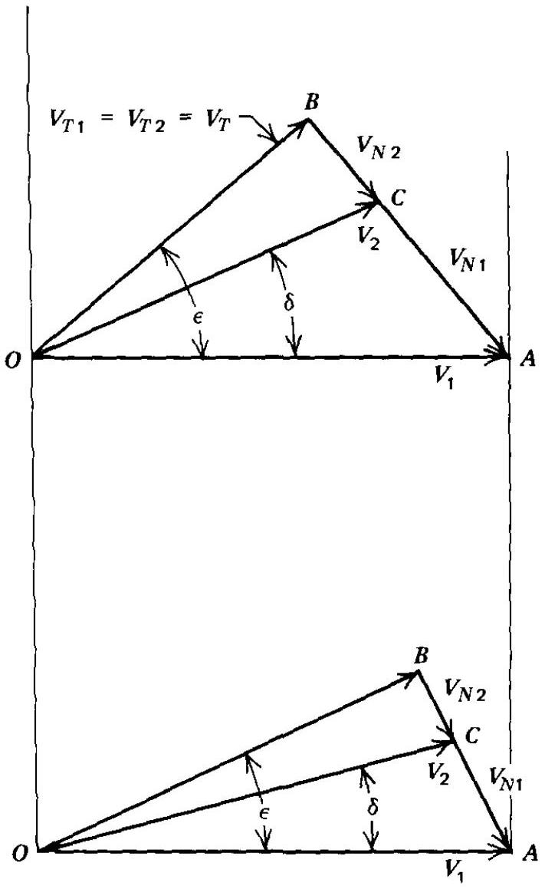
Figure 7.22 Effect of the wave angle $\varepsilon$ on the velocity $V_{2}$ leaving an oblique shock wave for a fixed value of the velocity $V_{1}$ entering the shock wave.

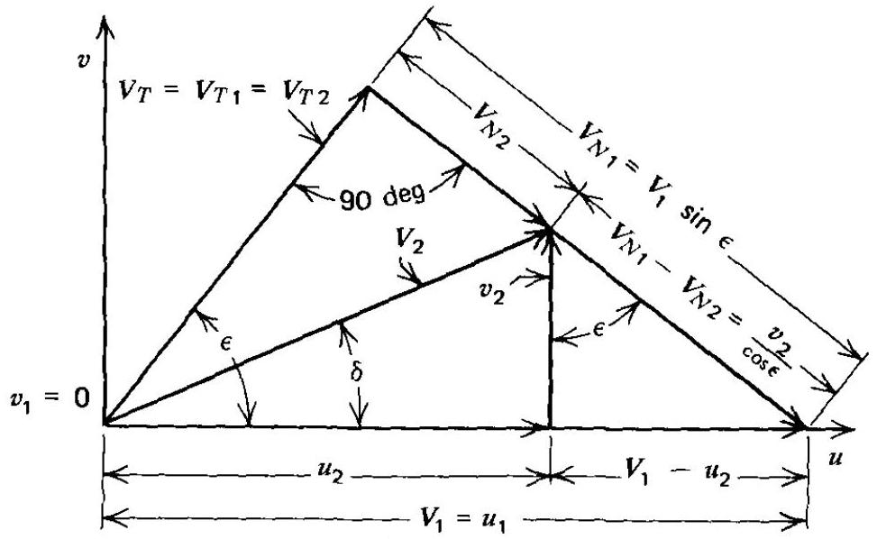
Figure 7.23 Vector diagram for an oblique shock wave in terms of the Cartesian velocity components $u$ and $v$ of the velocity vectors.

Substituting for $V_{T}, V_{N 1}$, and $V_{N 2}$ from equations 7.109, 7.110, and 7.111, respectively, into equation 7.98 , yields

$$
V_{1}^{2} \sin ^{2} \varepsilon-V_{1} v_{2} \tan \varepsilon=a^{* 2}-\frac{\gamma-1}{\gamma+1} V_{1}^{2} \cos ^{2} \varepsilon
$$

To eliminate $\varepsilon$ from equation 7.113, the conventional trigonometric expressions for $\sin ^{2} \varepsilon$ and $\cos ^{2} \varepsilon$ are combined with equation 7.112. Thus,

$$
\sin ^{2} \varepsilon=\frac{\tan ^{2} \varepsilon}{1+\tan ^{2} \varepsilon}=\frac{\left(V_{1}-u_{2}\right)^{2}}{v_{2}^{2}+\left(V_{1}-u_{2}\right)^{2}}
$$

and

$$
\cos ^{2} \varepsilon=1-\sin ^{2} \varepsilon=\frac{v_{2}^{2}}{v_{2}^{2}+\left(V_{1}-u_{2}\right)^{2}}
$$

Substituting equations $7.112,7.114$, and 7.115 into equation 7.113 and rearranging gives

$$
v_{2}^{2}\left(a^{* 2}+\frac{2}{\gamma+1} V_{1}^{2}-V_{1} u_{2}\right)=\left(V_{1}-u_{2}\right)^{2}\left(V_{1} u_{2}-a^{* 2}\right)
$$

Equation 7.116 gives the relationship between $u_{2}, v_{2}$, and $V_{1}$ for an oblique shock wave. Equation 7.116 may be made dimensionless by dividing each of its terms by $a^{* 4}$. The result is

$$
\left(\frac{v_{2}}{a^{*}}\right)^{2}\left[1+\frac{2}{\gamma+1}\left(\frac{V_{1}}{a^{*}}\right)^{2}-\frac{V_{1}}{a^{*}} \frac{u_{2}}{a^{*}}\right]=\left(\frac{V_{1}}{a^{*}}-\frac{u_{2}}{a^{*}}\right)^{2}\left(\frac{V_{1}}{a^{*}} \frac{u_{2}}{a^{*}}-1\right)
$$

Let $M_{1}^{*}=V_{1} / a^{*}, u_{2}^{*}=u_{2} / a^{*}$, and $v_{2}^{*}=v_{2} / a^{*}$; then equation 7.117 transforms to

$$
v_{2}^{* 2}\left(1+\frac{2}{\gamma+1} M_{1}^{* 2}-M_{1}^{*} u_{2}^{*}\right)=\left(M_{1}^{*}-u_{2}^{*}\right)^{2}\left(M_{1}^{*} u_{2}^{*}-1\right)
$$

Solving equation 7.118 for $v_{2}^{* 2}$ yields

$$
v_{2}^{* 2}=\left(M_{1}^{*}-u_{2}^{*}\right)^{2} \frac{M_{1}^{*} u_{2}^{*}-1}{\frac{2}{\gamma+1} M_{1}^{* 2}-M_{1}^{*} u_{2}^{*}+1}
$$

Equation 7.119 is the equation for the shock polar. By means of that equation, the dimensionless velocity component $v_{2}^{*}$ may be plotted as a function of $u_{2}^{*}$, for a given value of $M_{1}^{*}$. Each value of $M_{1}^{*}$, of course, gives rise to a separate curve. Figure 7.24 illustrates the case where $M_{1}^{*}=2.0$, for $\gamma=1.4$. The curve is a strophoid and is symmetrical with respect to the $u_{2}^{*}$ axis.

When $v_{2}^{*}=0$, equation 7.119 reduces to

$$
\left(M_{1}^{*}-u_{2}^{*}\right)^{2}\left(M_{1}^{*} u_{2}^{*}-1\right)=0
$$

Equation 7.120 shows that when $v_{2}^{*}=0$, the shock polar crosses the $u_{2}^{*}$ axis at the points $D$ and $E$ in Fig. 7.24. If $v_{2}^{*}$ becomes infinite, then $M_{1}^{*} u_{2}^{*}$ approaches the value $1+2 M_{1}^{* 2} /(\gamma+1)$. Hence, for all values of $u_{2}^{*}>M_{1}^{*}$, the dimensionless velocity component $u_{2}^{*}$ approaches the asymptote defined by the equation

$$
u_{2}^{*}=\frac{1}{M_{1}^{*}}+\frac{2}{\gamma+1} M_{1}^{*}
$$

Refer to Fig. 7.24. The intersection of a ray drawn from the origin, such as $O C$, with the shock polar curve gives the values of $v_{2}^{*}$ and $u_{2}^{*}$ for the flow deflection angle $\delta$, which is the angle made by the ray and the $u_{2}^{*}$ axis. If $u_{2}^{*}=M_{1}^{*}$, then $v_{2}^{*}=0$, which indicates that the oblique shock wave is very weak and there is no deflection of the flow; the initial dimensionless speed $M_{1}^{*}=V_{1} / a^{*}$ is then given by the ray $O D$ (see Fig. 7.24). If $M_{1}^{*} u_{2}^{*}=1$, then again $v_{2}^{*}=0$, as shown earlier. In that case, $V_{1} V_{2}= a^{* 2}$, and the condition corresponds to a normal shock wave. It is represented by point $E$ in Fig. 7.24.

A ray drawn in the direction of $O C$ intersects the shock polar in the three points $A, B$, and $C$. Since the intersection of a ray from the origin with the shock polar represents the values of $u_{2}^{*}$ and $v_{2}^{*}$, the point $C$ has no physical significance because

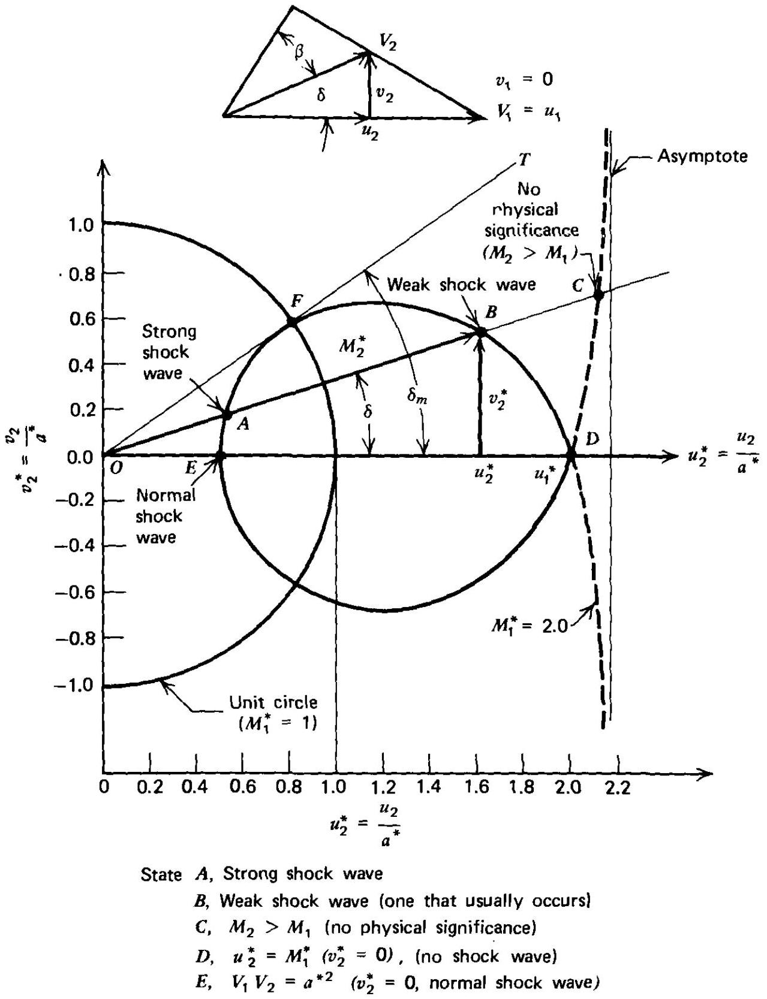
Figure 7.24 Shock polar for $M_{1}^{*}=2.0$ and $\gamma=1.4$.

it corresponds to the impossible condition $M_{2}>M_{1}$. Consequently, all portions of the shock polar to the right of $D$ have no physical significance, and only that portion of the shock polar, the closed loop, to the left of point $D$ is considered to be the shock polar.

The intersection points $A$ and $B$ made by the ray $O C$ with the shock polar correspond to the two possible solutions of the shock polar equation (equation 7.119) that satisfy the continuity, momentum, and energy equations for the oblique shock wave. Point $A$ corresponds to a strong oblique shock wave, and point $B$ corresponds to a weak oblique shock wave. Experiments show that the weak shock wave, that corresponding to ray $O B$, is generally produced.

Figure 7.25 presents the complete family of hodograph shock polars for $y=1.4$.
For a given value of $M_{1}^{*}$ there is a maximum flow deflection angle $\delta_{m}$ that corresponds to the angle made by the ray from the origin, which is tangent to the shock polar, as illustrated by the ray $O T$ in Fig. 7.24. If the required flow deflection angle for a given value of $M_{1}^{*}$ is larger than $\delta_{m}$, then there cannot be an oblique shock

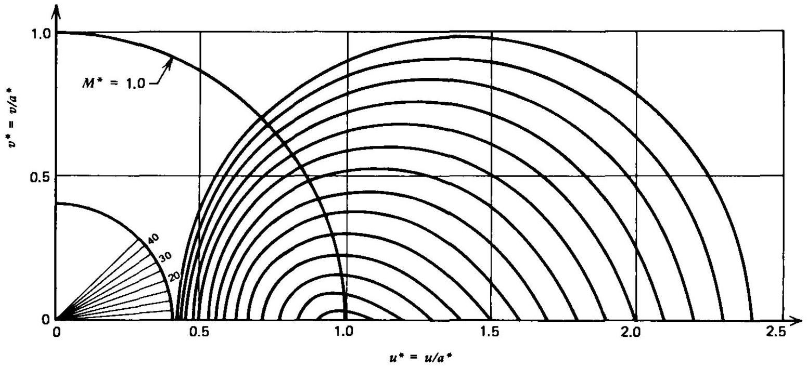
Figure 7.25 Hodograph shock polar for $\gamma=1.40$.

wave attached to the body causing the flow deflection. Instead, a detached shock wave will form ahead of the body, as illustrated in Fig. 7.21. The shock wave detaches from the corner $O$ and moves upstream to some position, such as point $A$, in Fig. 7.21, where equilibrium conditions are satisfied. Since there is no deflection of the flow at point $A$ in Fig. 7.21, the shock wave at that point is a normal shock wave, and the flow downstream to it is subsonic. A subsonic region is formed in the vicinity of the corner, and the streamlines are no longer parallel to $O C$, but each has a different curvature. Consequently, the pressure is nonuniform in the region BAOC. Because of the variation in pressure, as one proceeds outward along the shock wave from point $A$ in Fig. 7.21, a point is reached where the flow behind the shock wave is sonic. Beyond that point, the downstream flow is supersonic. To satisfy the above conditions, the shock wave must be curved, as illustrated in Fig. 7.21. The problem of establishing the exact position and configuration of the shock wave $A B$ in Fig. 7.21 is extremely complicated.

Example 7.11. Air at a Mach number of 3.0 and a static temperature of 290 K is deflected through an angle $\delta=20$ deg by a frictionless surface. Using the hodograph shock polar presented in Fig. 7.25, determine (a) the Mach number, and (b) the velocity behind the attached oblique shock wave. Assume $\gamma=1.40$.

## Solution

(a) From Table C. 6 (isentropic flow), for $M_{1}=3.0, M_{1}^{*}=1.964$. In Fig. 7.25, locate the shock polar passing through $M_{1}^{*}=u_{1}^{*}=1.964$ and $v_{1}^{*}=0.0$. Follow this curve upward until it intersects a straight line drawn from the origin at 20 deg. At that point, determine $u_{2}^{*}$ and $v_{2}^{*}$. Thus,

$$
\begin{aligned}
u_{2}^{*} & =1.53 \quad \text { and } \quad v_{2}^{*}=0.56 \\
M_{2}^{*} & =\left(u_{2}^{* 2}+v_{2}^{* 2}\right)^{1 / 2}=\left[(1.53)^{2}+(0.56)^{2}\right]^{1 / 2}=1.6293
\end{aligned}
$$

The above result may also be obtained directly by measuring the distance from the origin to point 2. From Table C.6, for $M_{2}^{*}=1.6293$,

$$
M_{2}=1.9920
$$

As a check, from Fig. 7.18, for $M_{1}=3.0, M_{2}=1.99$.
(b) From Table C. 6 (isentropic flow), for $M_{1}=3.0$ and $M^{*}=1.0, t_{1} / T=0.35714$
and $t^{*} / T=0.83333$. Thus,

$$
\begin{aligned}
T & =\frac{290}{0.35714}=812.0 \mathrm{~K} \\
t^{*} & =(0.83333)(812.0)=676.7 \mathrm{~K} \\
a^{*} & =\left(\gamma R t^{*}\right)^{1 / 2}=[1.4(287.04)(676.7)]^{1 / 2}=521.5 \mathrm{~m} / \mathrm{s} \\
V_{2} & =M_{2}^{*} a^{*}=(1.6293)(521.5)=849.6 \mathrm{~m} / \mathrm{s}(2787.5 \mathrm{ft} / \mathrm{sec})
\end{aligned}
$$

## 7-10 SUPERSONIC FLOW OVER WEDGES AND CONES

In the preceding sections the inherent features of an oblique shock wave that forms in a two-dimensional planar concave corner are discussed. In the present section, the discussion is extended to the supersonic flow over a stationary two-dimensional planar wedge in a free stream. In addition, the characteristic features for the conical shock wave attached to the tip of a cone in a supersonic flow are analyzed; the latter is a two-dimensional axisymmetric flow.

## 7-10(a) Flow over a Wedge

Consider the case where an infinitely long smooth symmetrical wedge is immersed in a uniform supersonic flow with the vertex of the wedge facing upstream, with the central plane of the wedge parallel to the approaching flow; the configuration is illustrated schematically in Fig. 7.26. The wedge angle, denoted by $\delta_{w}$, is defined as one-half of the total included angle between the top and bottom surfaces of the wedge. Hence, $\delta_{w}$ is the same as the flow deflection angle $\delta$, defined in Section 7-6. Because the wedge is assumed to be symmetrical about the plane $0-0$, the flows over its top and bottom surfaces are symmetrical (see Fig. 7.26). Consequently, the flow pattern for the complete wedge is obtained by studying the flow over only one of its surfaces; the width of the wedge perpendicular to the plane of the paper is assumed to be infinite. If the wedge is unsymmetrical with respect to the direction of the incident flow, the flows over the top and bottom surfaces must be studied separately, because the flow deflection angle is different on the two surfaces.

It is evident that the supersonic flow over a symmetrical wedge with an attached oblique shock wave at its vertex is quite similar to the supersonic flow into a frictionless concave corner with an oblique shock wave emanating from that corner, discussed in the preceding sections. It will be recalled that for a given value of the incident flow Mach number $M_{1}$, there is a maximum value for the flow deflection angle $\delta_{m}$ that will keep the shock wave attached to the corner; the condition corresponds to that denoted by point $F$ in the shock polar (Fig. 7.24). The corresponding value of the maximum wave angle $\varepsilon_{m}$ is given by equation 7.95 , or it may be read from Fig. 7.20. For the wedge, the conditions are completely analogous. If the wedge angle $\delta_{w}$ is smaller than or equal to the maximum flow deflection angle $\delta_{m}$, the oblique shock wave will become attached to the vertex of the wedge, and the supersonic flow will be deflected through the flow deflection angle $\delta=\delta_{w}$. After passing through the oblique shock wave, the flow is deflected so that the streamlines are parallel to the surfaces of the wedge. Because of the compression of the gas by the oblique shock wave, the streamlines flowing parallel to the wedge are spaced closer together than they are in front of the oblique shock wave. The properties of the flow in back of the oblique shock wave and the wave angle $\varepsilon$ (see Fig. 7.26a) depend on the Mach number $M_{1}$ and the wedge angle $\delta_{w}$. For gases with $\gamma=1.4$, it is pointed

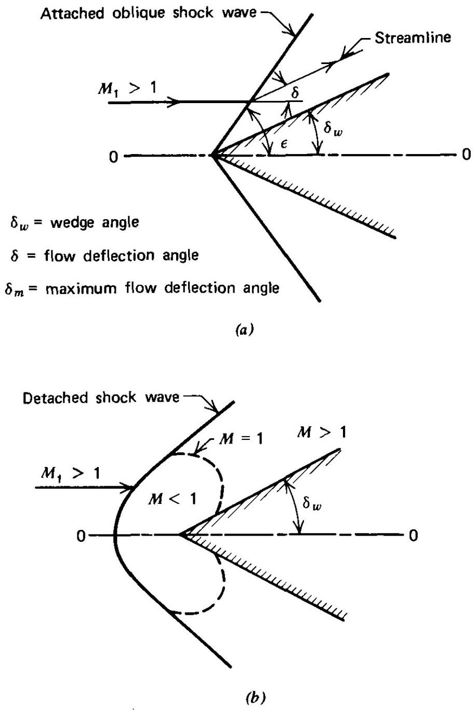
Figure 7.26 Flow over a symmetrical wedge. (a) Attached oblique shock wave, $\delta_{w}<\delta_{m \cdot}(b)$ Detached shock wave, $\delta_{w}>\delta_{m}$.

out in Section 7-7(b) that the limiting value of $\delta_{m}=45.37 \mathrm{deg}$ and corresponds to the condition $M_{1}=\infty$. Consequently, if the included angle of the symmetrical wedge is larger than 90.74 deg (i.e., $2 \delta_{m}$ ), the oblique shock wave cannot be attached to the apex of the wedge for any free-stream Mach number $M_{1}$.

If the wedge angle $\delta_{w}$ is larger than $\delta_{m}$ for a given value of $M_{1}$, the oblique shock wave becomes detached, as illustrated in Fig. 7.26b. The distance that the detached shock wave, also called a head or bow wave, moves upstream from the vertex of the wedge depends on $M_{1}$ and $\delta_{w}$. The portion of the detached shock wave immediately in front of the apex of the wedge is normal to $M_{1}$, and the flow characteristics in that region approximate those for a normal shock wave. On either side of that small normal shock wave, the shock wave becomes oblique and the strength of the shock wave decreases.

Because the strength of the shock wave increases as the wave angle $\varepsilon$ increases (see equation 7.90), the shock drag for a body in a supersonic flow increases with the wave angle $\varepsilon$. Hence, if a body is to have a low drag in a supersonic stream, it should not produce a shock wave with a large wave angle $\varepsilon$; that is, the nose of the body should be sharp rather than blunt so that the flow is turned through only a small flow deflection angle.

In an actual case the wedge would be of finite length and form the nose of some object. Consequently, the flow after passing over the wedge is deflected again by the changes in the shape of the wetted surface downstream from the nose, as illustrated

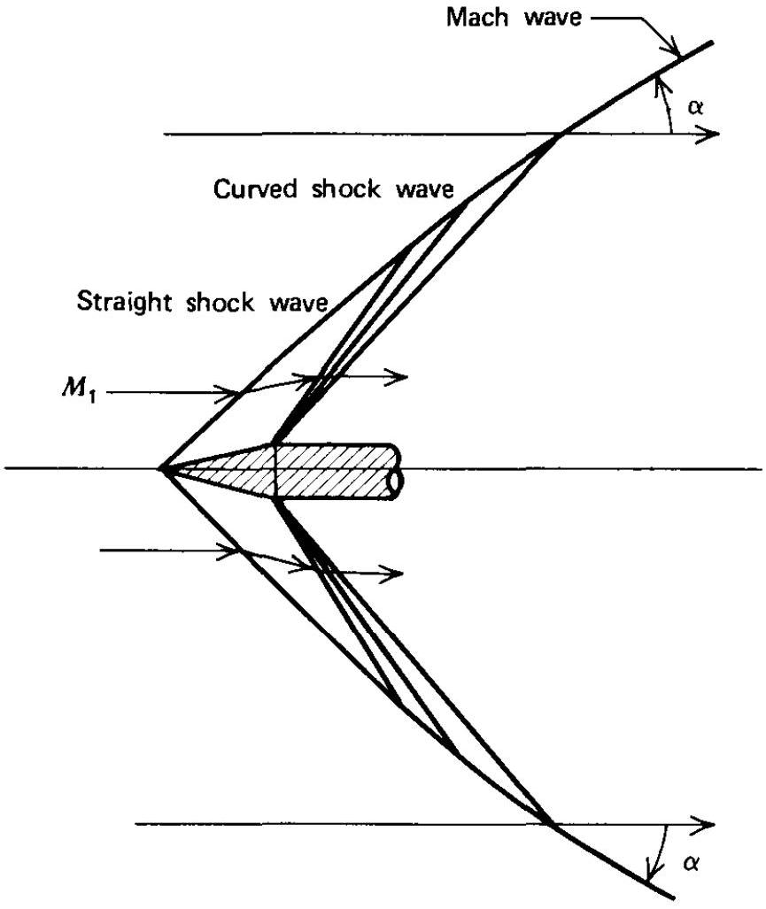
Figure 7.27 Flow over a finite wedge.

schematically in Fig. 7.27, where it is shown that continuous expansion waves emanate from the wedge-plate junction. Because of the flow deflection at that junction, the pressure and velocity conditions behind the shock wave are affected. For that reason experiments with finite wedges show that the shock wave attached to the apex becomes curved, that its inclination approaches the Mach angle $\alpha$ in a relatively short distance from the wedge, and that the flow at a small distance from the wedge is essentially undisturbed by the presence of the wedge. If the flow after passing through the shock wave is supersonic, additional shock waves may form, owing to the deflections of that flow. As a matter of fact, irregularities on the surface of the wedge may caused such shock waves. In most cases the latter are very weak, and each shock wave is inclined at an angle not greatly different from the Mach angle corresponding to the local flow Mach number.

For an unsymmetrical wedge, which is equivalent to a symmetrical wedge at an angle of attack $\alpha$ with respect to the free stream, the oblique shock wave is attached as long as neither of the two flow deflection angles $\delta_{1}$ and $\delta_{2}$, illustrated in Fig. 7.28, is larger than the maximum flow deflection angle $\delta_{m}$ corresponding to the Mach number $M_{1}$ for the incident flow.

The procedure for determining the flow properties for the flow over a wedge is similar to that employed in Sections $7-7$ and $7-8$ for determining the flow properties for the supersonic flow into a concave corner.

1. For the given value of $M_{1}$, determine the value of $\delta_{m}$ from Fig. 7.20, or by solving equations 7.94 and 7.95 .
2. If $\delta_{w}<\delta_{m}$, the shock wave is attached to the wedge and the properties $p_{2}, \rho_{2}$, $M_{2}$, etc., may be calculated by the methods presented in Sections 7-7 and 7-8.

Example 7.12. Standard sea-level air approaches a symmetrical wedge with $M_{1}=$ 2.0. The included angle of the wedge is 30 deg. Calculate (a) the shock wave angle $\varepsilon$, (b) the Mach number $M_{2}$ in back of the shock wave, (c) the static pressure of the air

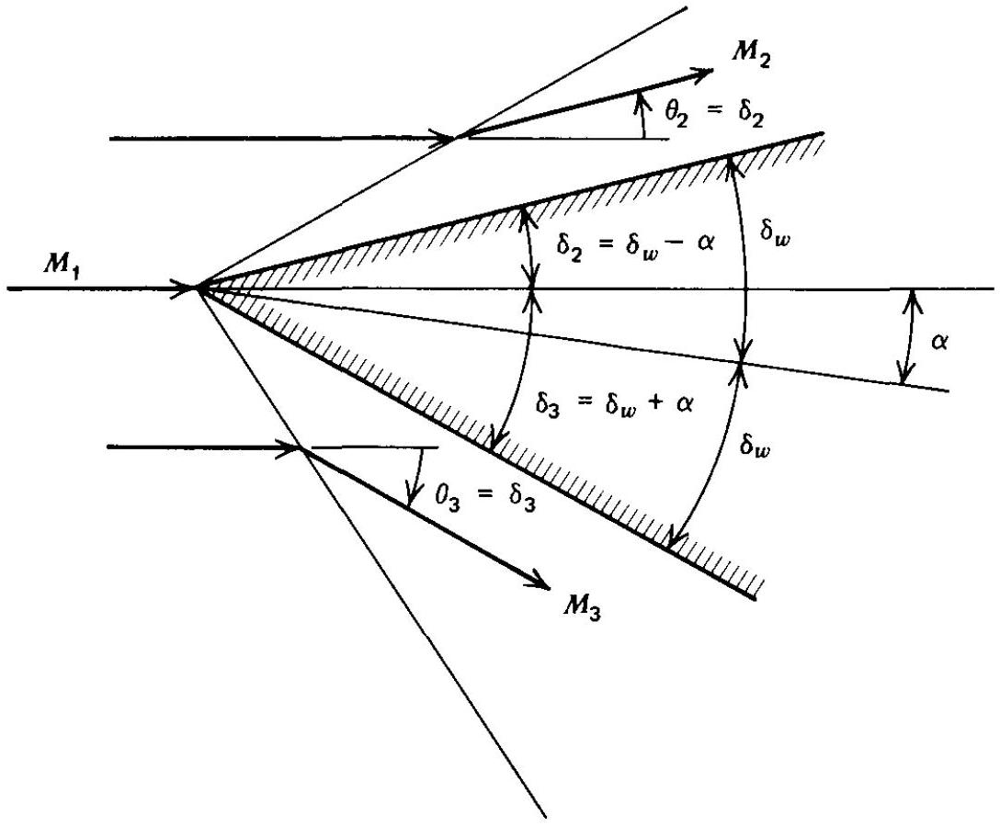
Figure 7.28 Flow over an unsymmetrical wedge.

flowing over the surface of the wedge, (d) the change in the stagnation pressure of the air after flowing through the shock wave, and (e) the static temperature of the gas flowing over the wedge. Assume $\gamma=1.40$. The static pressure and temperature of the air are $1.0133 \cdot 10^{5} \mathrm{~N} / \mathrm{m}^{2}$ and 288.15 K , respectively.

## Solution

From Fig. 7.20 , for $M_{1}=2.0, \delta_{m}=26 \mathrm{deg}$. Since $\delta_{w}=(30 / 2)=15 \mathrm{deg}$, the shock wave is attached.
(a) From Table C.12, for $M_{1}=2.0$ and $\delta=15 \mathrm{deg}, \varepsilon=45.34 \mathrm{deg}$. (Check by Fig. 7.17, $\varepsilon=45.3 \mathrm{deg}$ ).
(b) From equation 7.99 ,

$$
M_{1}^{\prime}=M_{1} \sin \varepsilon=2.0 \sin (45.34)=1.4226
$$

From Table C.11, for $M_{1}^{\prime}=1.4226$,

$$
M_{2}^{\prime}=0.73039 \quad \frac{p_{2}}{p_{1}}=2.1944 \quad \frac{P_{2}}{P_{1}}=0.95237 \quad \frac{t_{2}}{t_{1}}=1.26933
$$

From equation 7.100,

$$
M_{2}=\frac{M_{2}^{\prime}}{\sin (\varepsilon-\delta)}=\frac{(0.73039)}{\sin (45.34-15)}=1.4459
$$

(Check by Fig. 7.18, $M_{2}=1.44$ ).
(c) From part (b),

$$
p_{2}=2.1944(1.0133) 10^{5}=2.224 \cdot 10^{5} \mathrm{~N} / \mathrm{m}^{2}\left(32.26 \mathrm{lbf} / \mathrm{in} .^{2}\right)
$$

(d) From part (b),

$$
\Delta P=P_{2}-P_{1}=P_{1}\left(\frac{P_{2}}{P_{1}}-1\right)=P_{1}(0.95237-1)=(-0.04763) P_{1}
$$

From Table C.6, for $M_{1}=2.0, p_{1} / P_{1}=0.1278$. Thus,

$$
\begin{aligned}
& P_{1}=\frac{(1.0133) 10^{5}}{(0.1278)}=7.929 \cdot 10^{5} \mathrm{~N} / \mathrm{m}^{2} \\
& \Delta P=(-0.04763)(7.929) 10^{5}=-0.3777 \cdot 10^{5} \mathrm{~N} / \mathrm{m}^{2}\left(-5.48 \mathrm{lbf} / \mathrm{in} .^{2}\right)
\end{aligned}
$$

(e) From part (b),

$$
t_{2}=1.26933(288.15)=365.8
$$

## 7-10(b) Flow over a Cone

The phenomena associated with the supersonic flow of a gas over a cone are of interest because the noses of supersonic missiles and the fuselages of supersonic aircraft are conical in shape. Furthermore, the cone may be utilized as a supersonic diffuser for decelerating a supersonic flow.

The theoretical analysis of the supersonic flow over a cone at zero angle of attack involves solving the equations for steady two-dimensional axisymmetric flow. Numerical solutions of the differential equations have been obtained for a limited number of cases, and the theoretical results are in good agreement with experiment. ${ }^{9-12}$ The governing equations, the numerical solution procedure, and a numerical example are presented in Section 16-5.

The flow model is illustrated in Fig. 7.29. The basic assumptions are as follows:

1. The flow is axisymmetric with respect to the axis of the cone. Consequently, the solution on any plane containing the cone axis is the same as that on any other plane. Consider the $y z$ plane.
2. The flow is steady and isentropic before and after the shock wave; the latter is attached to the vertex of the cone.
3. Since no characteristic length appears in the physical model, the spatial variables $y$ and $z$ may appear only in the combination $y / z$. For a coordinate system located

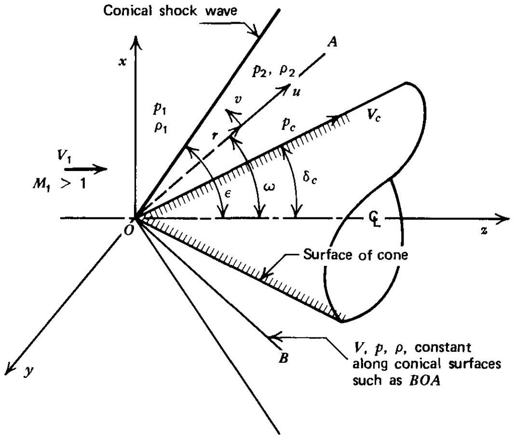
Figure 7.29 Supersonic flow over a symmetrical cone at zero angle of attack.

at the vertex of the cone, $y / z=\tan \omega$. The properties of the fluid may, therefore, vary only with $\omega$, and they are constant along any ray from the vertex of the cone. Consequently, the shock wave surface itself has a symmetrical conical configuration.

The flow described by assumption 3 above is termed a conical flow. Because of the aforementioned assumptions, the analysis of the flow over a cone may be based on the study of a meridional section with the spherical coordinates $r, \omega$, as illustrated in Fig. 7.29. Conservation of mass requires that the mass flow rate for a stream tube entering the shock wave remains constant as the flow expands over the cone. Because the cross-sectional flow area increases with radius in an axisymmetric flow, the streamlines must converge to satisfy continuity. The streamlines, therefore, curve toward the cone surface, as illustrated in Fig. 7.30a. On the other hand, the streamlines for the flow behind the shock wave attached to a wedge are parallel to the wedge surface, as shown in Fig. 7.30b.

It is shown in Section 7-10(a) that, in the case of the supersonic flow over a wedge, the pressure, velocity, and density are uniform behind the shock wave. The latter

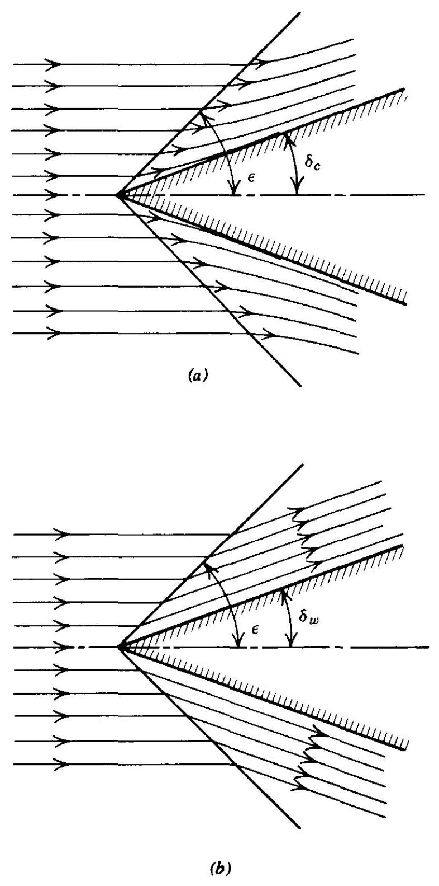
Figure 7.30 Comparison of the streamline patterns for supersonic flow over a symmetrical wedge and a symmetrical cone at zero angle of attack. (a) Cone. (b) Wedge.

condition does not occur in the case of a cone because of the aforementioned convergence of the streamlines toward the surface of the cone. As a consequence, there is an isentropic compression (diffusion) of the gas between the conical shock wave, where the conditions are denoted by the subscript 2 , and the cone surface, where the conditions are denoted by the subscript $c$.

Figure 7.31 presents the conical shock wave angle $\varepsilon$ as a function of the initial Mach number $M_{1}$ for different values of the cone angle $\delta_{c}$, for $\gamma=1.40$. The line

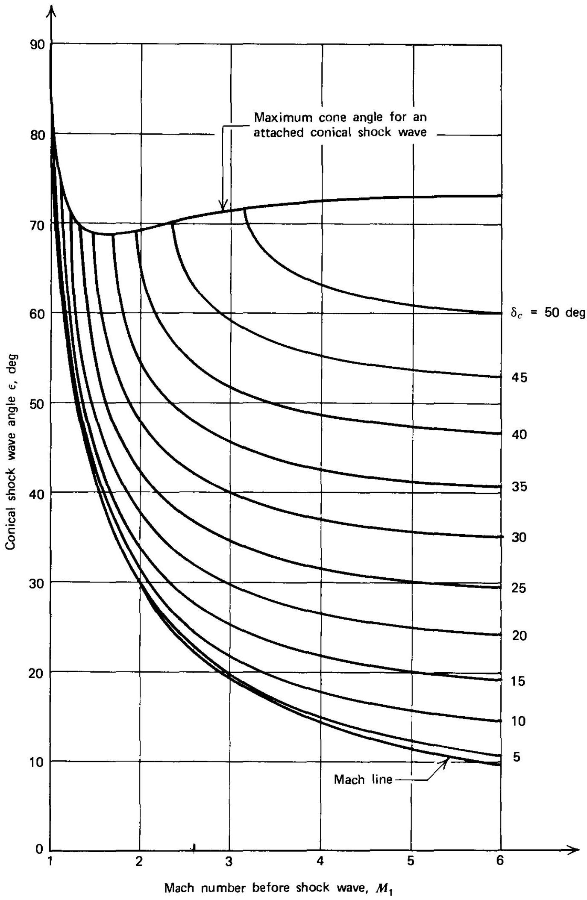
Figure 7.31 Shock wave angle $\varepsilon$ for a conical shock wave as a function of the initial Mach number $M_{1}$ for different values of the cone angle $\delta_{c}$ for $\gamma=1.40$.

across the top of the curves is the locus of the conditions for which the conical shock wave becomes detached from the apex of the cone, for different values of $M_{1}$ and $\delta_{c}$. The conical shock wave angle $\varepsilon$ at which the shock wave becomes detached, called the detachment angle, is larger for a cone than it is for a wedge, as is readily seen by comparing Figs. 7.17 and 7.31. Figure 7.32 presents the maximum values of the wedge angle $\delta_{w}$ and the cone angle $\delta_{c}$ for which it is possible for a shock wave to be attached

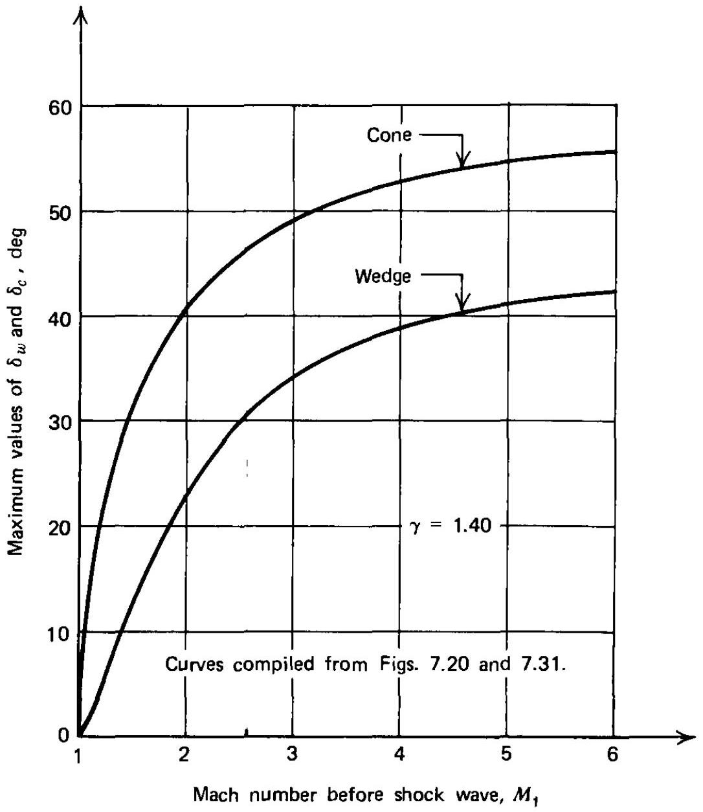
Figure 7.32 Maximum value of the wedge angle $\delta_{w}$ and the cone angle $\delta_{c}$ for an attached oblique shock wave as a function of the initial Mach number $M_{1}$ for $\gamma=1.40$.

to either a wedge or a cone, respectively, for $y=1.4$. Figure 7.33 presents the Mach number $M_{c}$ at the surface of the cone as a function of the initial Mach number $M_{1}$ for different values of the cone angle $\delta_{c}$, for $\gamma=1.40$. Figure 7.34 presents the surface static pressure ratio $p_{c} / p_{1}$ as a function of the initial Mach number $M_{1}$ for different values of the cone angle $\delta_{c}$, for $\gamma=1.40$. Kopal ${ }^{11}$ and Sims ${ }^{12}$ present extensive tables for supersonic flow around right circular cones.

Example 7.13. A right circular cone having a total included angle of 30 deg is placed in an air stream at zero angle of attack. For the same free-stream conditions specified in Example 7.12, calculate the flow properties requested in that example.

## Solution

For a 30 deg included angle cone, $\delta_{c}=(30 / 2)=15$ deg.
(a) From Fig. 7.31, for $M_{1}=2.0$ and $\delta_{c}=15 \mathrm{deg}, \varepsilon=33.9 \mathrm{deg}$.

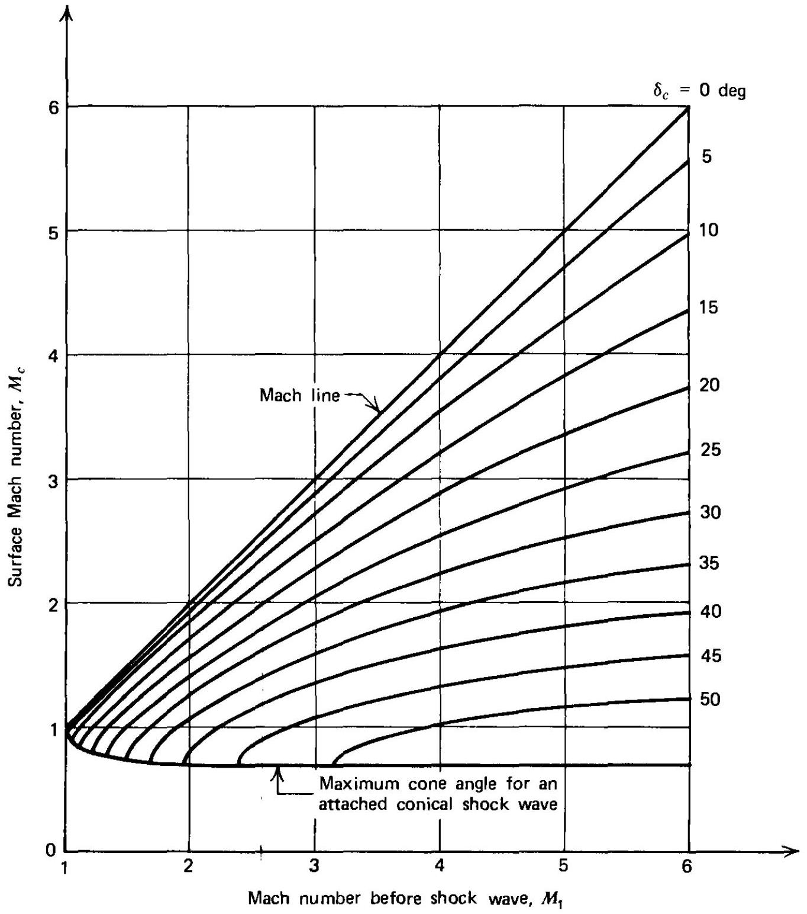
Figure 7.33 Surface Mach number $M_{c}$ for a conical shock wave as a function of the initial Mach number $M_{1}$ for different values of the cone angle $\delta_{c}$ for $\gamma=1.40$.

(b) From Fig. 7.33, $M_{c}=1.70$.
(c) From Fig. 7.34, $p_{c} / p_{1}=1.57$. Hence, for $p_{1}=1.013310^{5} \mathrm{~N} / \mathrm{m}^{2}$,

$$
p_{c}=(1.57)(1.0133) 10^{5}=1.591 \cdot 10^{5} \mathrm{~N} / \mathrm{m}^{2}\left(23.07 \mathrm{lbf} / \mathrm{in} .^{2}\right)
$$

(d) From Example 7.12, part (d), $P_{1}=7.929 \cdot 10^{5} \mathrm{~N} / \mathrm{m}^{2}$. From Table C.6, for $M_{c}=1.70, p_{c} / P_{c}=0.20259$. Thus,

$$
\begin{aligned}
P_{c} & =\frac{(1.591) 10^{5}}{(0.20259)}=7.853 \cdot 10^{5} \mathrm{~N} / \mathrm{m}^{2} \\
\Delta P & =P_{c}-P_{1}=(7.853-7.929) 10^{5}=-0.0760 \cdot 10^{5} \mathrm{~N} / \mathrm{m}^{2}\left(-1.10 \mathrm{lbf} / \mathrm{in} .^{2}\right)
\end{aligned}
$$

(e) From Table C.6, for $M_{1}=2.0$ and $M_{c}=1.70, t_{1} / T=0.55556$ and $t_{c} / T=$ 0.63371 . Since the flow is adiabatic, $T=$ constant. Thus,

$$
t_{c}=t_{1}\left(\frac{T}{t_{1}}\right)\left(\frac{t_{c}}{T}\right)=\frac{(288.15)(0.63371)}{(0.55556)}=328.7 \mathrm{~K}(591.6 \mathrm{R})
$$

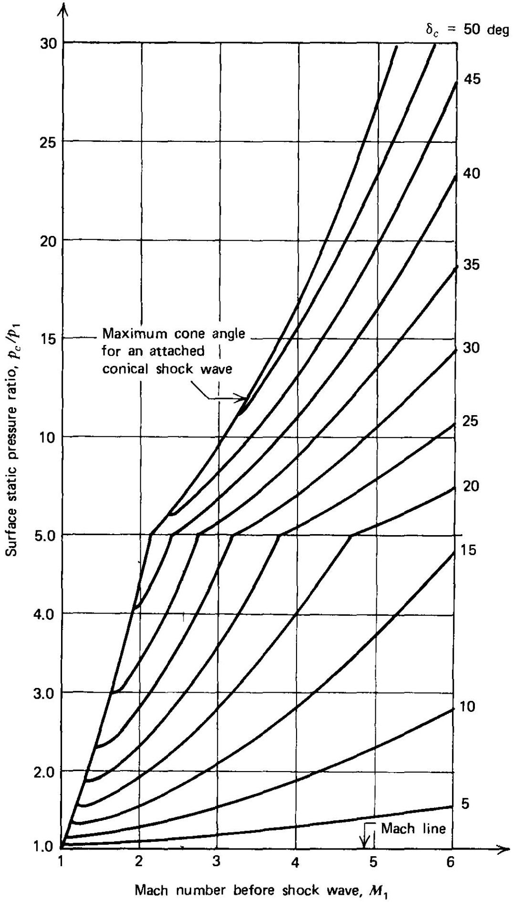
Figure 7.34 Surface static pressure ratio $p_{c} / p_{1}$ for a conical shock wave as a function of the initial Mach number $M_{1}$ for different values of the cone angle $\delta_{c}$ for $\gamma=1.40$.

Comparing the above results with those obtained in Example 7.12, it is seen that, for the same free-stream conditions, the shock wave attached to a cone is considerably weaker than the shock wave attached to a wedge having the same included angle.

## 7-11 REFLECTION AND INTERACTION OF OBLIQUE SHOCK WAVES

It is shown in the preceding sections that when a supersonic flow encounters a concave corner, an oblique shock wave is propagated from that corner and instantaneously deflects the flow behind the shock wave toward the latter. The present section is concerned with the rules governing the reflection and interaction of oblique shock waves.

## 7-11(a) Reflection from a Wall

Figure 7.35a illustrates the flow of a gas between two frictionless surfaces $A O B$ and $D C E$. The portion $D C$ of the lower surface is parallel to the upper surface, but at point $C$ there is a concave corner and the portion $C E$ of the lower surface makes the angle $\delta_{1}$ with the incident flow, which is parallel to surfaces $A B$ and $D C$. The Mach number for the incident flow is $M_{1}$. Because of the concave corner an oblique shock wave emanates from the corner $C$ and impinges upon the surface $A B$ at point $O$. All of the streamlines after passing through the shock wave $C O$ are turned toward the shock wave; that is, they are deflected toward the surface $A B$. The physical boundary condition, however, requires that the flow be parallel to the surfaces $O B$ and $C E$. As a consequence, an oblique shock wave $O F$ is reflected from point $O$ that is of sufficient strength to turn the flow so that it becomes parallel to surface $O B$. For the flow, $M_{1}>M_{2}>M_{3}$.

When the reflected shock wave $O F$ strikes surface $C E$, another shock wave reflection occurs. In principle such reflections can continue as long as the upstream Mach number and the required flow deflection angle permit an attached oblique shock wave to be formed (see Fig. 7.32). Such reflections are called regular reflections.

When an attached oblique shock wave cannot be formed at the wall, the shock wave becomes normal to the wall and "curves out" to become tangent to the incident shock wave, as illustrated in Fig. 7.35b. Such reflections are termed Mach reflections. The shock wave from the wall to the junction at point $G$ is called a Mach shock wave. A slip line, which is a line across which some of the flow properties are discontinuous, is formed at the junction $G$. A subsonic flow region is formed immediately downstream from the Mach shock wave. The analysis of Mach reflection is not well developed.

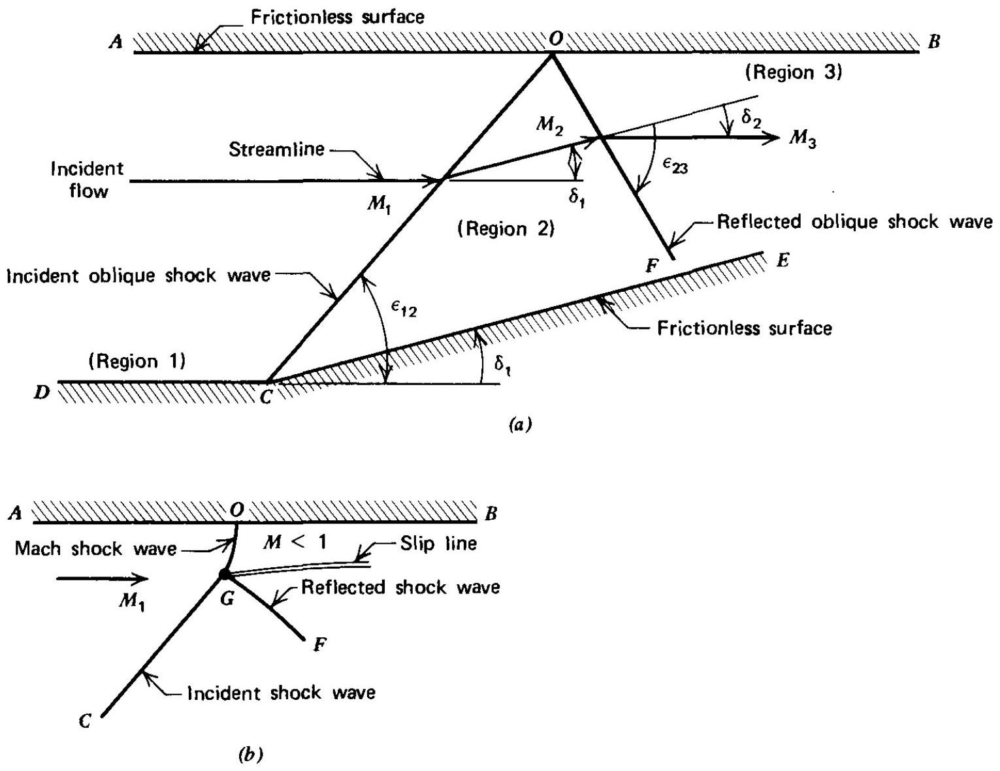
Figure 7.35 Reflection of an oblique shock wave from a wall. (a) Regular reflection. (b) Mach reflection.

Example 7.14. Air, assumed to be a perfect gas, flows between two parallel frictionless walls. The initial flow Mach number is $M_{1}=4.0$. The lower wall abruptly turns into the flow with a turning angle $\delta_{1}=20 \mathrm{deg}$, as illustrated in Fig. 7.35a. Determine (a) the wave angle $\varepsilon_{12}$ of the initial oblique shock wave from the lower wall, and the Mach number $M_{2}$ after that shock wave, and (b) the wave angle $\varepsilon_{23}$ of the oblique shock wave reflected from the upper wall, and the Mach number $M_{3}$ after that reflected shock wave.

## Solution

(a) From Table C.12, for $M_{1}=4.0$ and $\delta_{1}=20 \mathrm{deg}, \varepsilon_{12}=32.5 \mathrm{deg}$. From equation 7.99.

$$
M_{1}^{\prime}=M_{1} \sin \varepsilon_{12}=4.0 \sin 32.5=2.149
$$

From Table C.11, for $M_{1}^{\prime}=2.149, M_{2}^{\prime}=0.5541$. From equation 7.100,

$$
M_{2}=\frac{M_{2}^{\prime}}{\sin \left(\varepsilon_{12}-\delta_{1}\right)}=\frac{0.5541}{\sin (32.5-20)}=2.560
$$

(b) When the incident shock wave $C O$ impinges on the upper wall $A O B$, the flow angle behind that shock wave (i.e., of $M_{2}$ ) is 20 deg in the direction toward that wall. To satisfy the solid wall boundary condition, a shock wave must be reflected having a deflection angle $\delta=-20$ deg relative to the direction of the flow in Region 2. Hence, $\delta_{2}=-20 \mathrm{deg}$. From Table C.12, for $M_{2}=2.56$ and $\delta_{2}=-20 \mathrm{deg}$, the wave angle $\varepsilon_{23}$ is

$$
\varepsilon_{23}=-42.11 \text { deg (relative to the flow direction in Region 2) }
$$

From equation 7.99 ,

$$
M_{2}^{\prime}=M_{2} \sin \varepsilon_{23}=2.560 \sin (42.11)=1.717
$$

From Table C.11, for $M_{2}^{\prime}=1.717, M_{3}^{\prime}=0.63621$. From equation 7.100,

$$
M_{3}=\frac{M_{3}^{\prime}}{\sin \left(\varepsilon_{23}-\delta_{2}\right)}=\frac{0.63621}{\sin (42.11-20)}=1.690
$$

## 7-11(b) Reflection from a Free Pressure Boundary

Figure 7.36 illustrates the intersection of an oblique shock wave with a free pressure boundary, such as a jet of gas; the static pressure at the boundary of the jet is $p_{o}$. The incident wave $A O$ turns the flow toward the boundary through the flow deflection angle $\delta$, and raises the static pressure of the gas flowing out of the shock wave, so

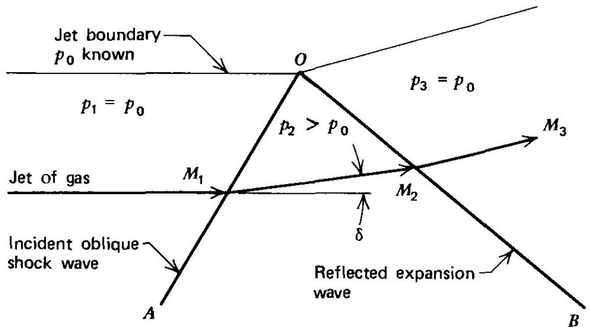
Figure 7.36 Reflection of an oblique shock wave from a free pressure boundary.

that $p_{2}>p_{o}$. The physical boundary condition at point $O$, however, requires that the pressure remain equal to $p_{o}$. Because $p_{2}>p_{o}$, a wave $O B$ is reflected back from point $O$ into the flowing jet of gas in a manner that returns the static pressure of the gas to the value $p_{o}$. Since $p_{3}=p_{o}$, and the reflected wave reduces the static pressure of the gas from $p_{2}>p_{o}$ to $p_{3}=p_{o}$, that wave is an expansion wave. Expansion waves are discussed in Chapter 8. At this point, it is noted that expansion waves turn the flow away from the wave, so that the boundary of the jet turns outward, as indicated in Fig. 7.36.

## 7-11(c) Neutralization of an Oblique Shock Wave

Consider the neutralization, or cancellation, of an oblique shock wave at a solid wall, as illustrated in Fig. 7.37. The incident shock wave $A O$ turns the flow through the flow deflection angle $\delta$ toward the wave, and raises the static pressure of the flowing gas. At the intersection of the shock wave with the wall at the corner $O$, the physical boundary condition requires that the flow be parallel to the wall. But if the portion of the wall, denoted by $O D$, is turned through the angle $\delta$ with respect to the wall $C O$, then the aforementioned physical boundary condition is satisfied, and there is no reflected wave. Consequently, providing the surface $O D$ with the appropriate turning angle $\delta$ achieves wave cancellation.

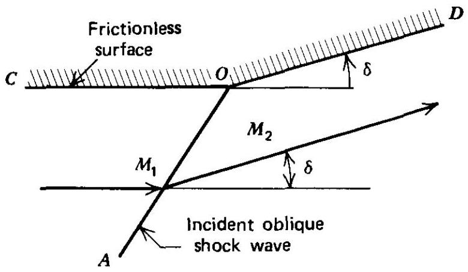
Figure 7.37 Neutralization of an oblique shock wave.

## 7-11(d) Intersection of Oblique Shock Waves

Figure 7.38a illustrates a plane in which two oblique shock waves $O A$ and $O B$ intersect. Each of the shock waves $O A$ and $O B$ turns the initially parallel uniform flow inward, as indicated. In general, the oblique shock waves $O A$ and $O B$ may be of unequal strength, so that the fluid properties in Regions 2 and 3 are not identical. The physical boundary condition at point $O$ is that the static pressures in the Regions 4 and 5 must be equal (i.e., mechanical equilibrium must be established between Regions 4 and 5). In general, the remaining flow properties in Regions 4 and 5 will be different. Thus, the streamline through the point $O$ divides the Regions 4 and 5, and there are differences in the properties of the fluid on each side of this streamline. A streamline that divides the flow field into two regions having different fluid properties is called a slip line. The transmitted oblique shock waves $O C$ and $O D$ adjust themselves so that $p_{4}=p_{5}$. In general, the conditions in Regions 4 and 5 may be determined by a trial and error procedure that matches $p_{4}$ and $p_{5}$. The wave pattern illustrated in Fig. 7.38 a is termed regular intersection.

In some cases, there is no solution for the transmitted oblique shock waves that satisfies all of the flow conditions. In such a case, a more complex shock pattern

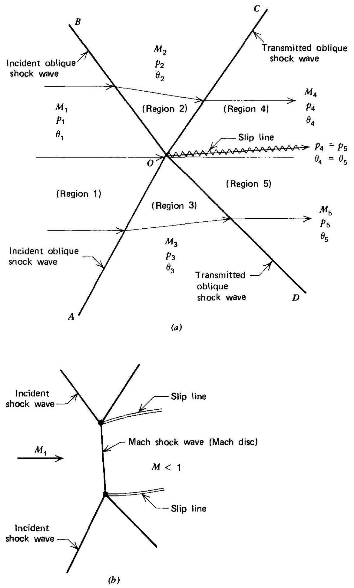
Figure 7.38 Intersection of two oblique shock waves. (a) Regular intersection. (b) Mach intersection.

involving normal shock waves develops, similar to the Mach reflection discussed in Section 7-11(a). The aforementioned type of intersection, termed Mach intersection, is illustrated in Fig. 7.38b.
Example 7.15 Air, assumed to be a perfect gas, flows between two horizontal parallel frictionless plates at a Mach number of 4.0 and a static pressure of $1.0 \cdot 10^{5} \mathrm{N} / \mathrm{m}^{2}$. At a given cross section, denoted by $x-x$, the upper wall turns downward 10 deg into the flow, and the lower wall turns upward 20 deg into the flow, as illustrated in Fig. 7.39a. Determine the flow properties $M$ and $p$ in the Regions 4 and 5, and the net flow deflection angle $\beta$.

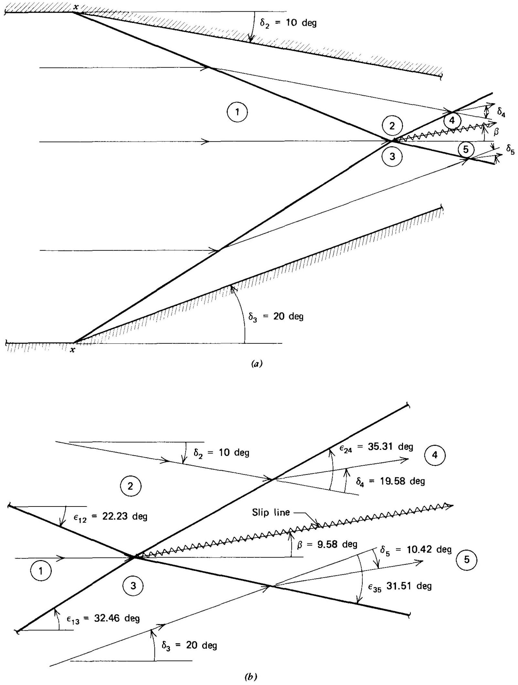
Figure 7.39 Intersection of two oblique shock waves (Example 7.15). (a) Flow model. (b) Shock waves, flow deflection angles, wave angles, and slip line.

## Solution

From Table C.12, for $M_{1}=4.0$, and $\delta_{2}=10$ deg and $\delta_{3}=20$ deg, respectively, $\varepsilon_{12}=22.23 \mathrm{deg}$ and $\varepsilon_{13}=32.46 \mathrm{deg}$. For the upper wall, equation 7.99 gives

$$
M_{1}^{\prime}=M_{1} \sin \varepsilon_{12}=4.0 \sin (22.23)=1.5133
$$

From Table C. 11 for normal shock waves, for $M_{1}^{\prime}=1.5133, p_{2} / p_{1}=2.5051$ and
$M_{2}^{\prime}=0.6964$. Thus,

$$
p_{2}=2.5051(1.0) 10^{5}=2.5051 \cdot 10^{5} \mathrm{~N} / \mathrm{m}^{2}
$$

From equation 7.100,

$$
M_{2}=\frac{M_{2}^{\prime}}{\sin \left(\varepsilon_{12}-\delta_{2}\right)}=\frac{0.6964}{\sin (22.23-10)}=3.2874
$$

For the lower wall, equation 7.99 gives

$$
M_{1}^{\prime}=M_{1} \sin \varepsilon_{13}=4.0 \sin (32.46)=2.1468
$$

From Table C.11, for $M_{1}^{\prime}=2.1468, p_{3} / p_{1}=5.2103$, and $M_{3}^{\prime}=0.5544$. Thus,

$$
p_{3}=5.2103(1.0) 10^{5}=5.2103 \cdot 10^{5} \mathrm{~N} / \mathrm{m}^{2}
$$

From equation 7.100,

$$
M_{3}=\frac{M_{3}^{\prime}}{\sin \left(\varepsilon_{13}-\delta_{3}\right)}=\frac{0.5544}{\sin (32.46-20)}=2.5695
$$

The solution cannot be continued unless one condition in either Region 4 or 5 is specified. Consequently, an iterative computation is required. The most convenient parameter to vary is the net flow deflection angle $\beta$, which is assumed to be upward because the lower wall produces more initial turning than the upper wall. The following procedure is applicable.

1. Assume $\beta$, and calculate $\delta_{4}=10+\beta$ and $\delta_{5}=20-\beta$. Note that $\delta_{4}$ and $\varepsilon_{24}$ are measured relative to $\delta_{2}$, and $\delta_{5}$ and $\varepsilon_{35}$ are measured relative to $\delta_{3}$.
2. From Table C.12, find $\varepsilon_{24}$ and $\varepsilon_{35}$.
3. Calculate $M_{2}^{\prime}$ and $M_{3}^{\prime}$ from equation 7.99.
4. From Table C.11, determine $p_{4} / p_{2}, M_{4}^{\prime}, p_{5} / p_{3}$, and $M_{5}^{\prime}$.
5. Calculate $p_{4}$ and $p_{5}$.
6. If $p_{4}$ and $p_{5}$ agree to the desired tolerance, the solution is complete. Calculate $M_{4}$ and $M_{5}$ from equation 7.100. If $p_{4}$ and $p_{5}$ disagree, choose another value of $\beta$ and repeat the procedure until convergence is obtained.

Steps 1 to 5 above are illustrated below for the first trial of the solution.

1. Assume $\beta=5$ deg. Then,

$$
\begin{aligned}
& \delta_{4}=10+5=15 \mathrm{deg} \\
& \delta_{5}=20-5=15 \mathrm{deg}
\end{aligned}
$$

2. From Table C.12, for $\delta_{4}=15 \mathrm{deg}$ and $M_{2}=3.2874, \varepsilon_{24}=30.36 \mathrm{deg}$. From Table C.12, for $\delta_{5}=15 \mathrm{deg}$ and $M_{3}=2.5695, \varepsilon_{35}=36.16 \mathrm{deg}$.
3. From equation 7.99 ,

$$
\begin{aligned}
& M_{2}^{\prime}=M_{2} \sin \varepsilon_{24}=3.2874 \sin (30.36)=1.6616 \\
& M_{3}^{\prime}=M_{3} \sin \varepsilon_{35}=2.5695 \sin (36.16)=1.5161
\end{aligned}
$$

4. From Table C.11, for $M_{2}^{\prime}=1.6616, p_{4} / p_{2}=2.8823$, and for $M_{3}^{\prime}=1.5161$, $p_{5} / p_{3}=2.5150$. Values of $M_{4}^{\prime}$ and $M_{5}^{\prime}$ are not needed until after the final trial.
5. From the results of step 4, we obtain

$$
\begin{aligned}
& p_{4}=2.8823(2.5051) 10^{5}=7.2204 \cdot 10^{5} \mathrm{~N} / \mathrm{m}^{2} \\
& p_{5}=2.5150(5.2103) 10^{5}=13.104 \cdot 10^{5} \mathrm{~N} / \mathrm{m}^{2}
\end{aligned}
$$

6. $\Delta p=p_{5}-p_{4}=(13.104-7.2204) 10^{5}=5.884 \cdot 10^{5} \mathrm{~N} / \mathrm{m}^{2}$. The results of the first trial are presented in column (1) of the table at the end of the problem.

The value of $\Delta p$, from step 6, is obviously unacceptable. Hence, a second trial value of $\beta$ is assumed. Since $p_{5}>p_{4}$, the flow from Region 3 into Region 5 is turned through too large of a net flow deflection angle. Thus, $\beta$ should be increased for the second trial. A value of $\beta=10 \mathrm{deg}$ is assumed.

The results for the second trial are presented in column (2) of the accompanying table. The values of $p_{4}$ and $p_{5}$ corresponding to $\beta=10$ deg are $10.3844 \cdot 10^{5} \mathrm{~N} / \mathrm{m}^{2}$ and $9.8391 \cdot 10^{5} \mathrm{~N} / \mathrm{m}^{2}$, respectively, which yield a value of $\Delta p=-0.5453 \cdot 10^{5} \mathrm{~N} / \mathrm{m}^{2}$.

A third trial value for $\beta$ is obtained by the secant method [see Appendix A-4(b)]. For the present application of the secant method, the assumed parameter is $\beta$ and the calculated parameter is $\Delta p=p_{5}-p_{4}$, which should be zero. The equation of the locus of $\Delta p$ versus $\beta$, obtained from the results of the first two trials, is

$$
\begin{gathered}
\frac{\Delta p-5.884 \cdot 10^{5}}{\beta-5}=\frac{[(-0.5453)-5.884] 10^{5}}{(10-5)}=-1.2859 \cdot 10^{5} \\
\Delta p=(12.313-1.2859 \beta) 10^{5}
\end{gathered}
$$

Setting $\Delta p=0$ and solving for $\beta$ gives the third trial value of $\beta=9.5756$ deg.
For $\beta=9.5756 \mathrm{deg}$, repeating the solution yields $\Delta p=-0.0397 \cdot 10^{5} \mathrm{~N} / \mathrm{m}^{2}$, which is sufficiently close to zero. The results obtained for the third trial are presented in column ( 3 ) of the accompanying table.

After the last trial, the Mach numbers in Regions 4 and 5 may be determined. From Table C.11, at $M_{2}^{\prime}=1.9001, M_{4}^{\prime}=0.5956$, and at $M_{3}^{\prime}=1.3429, M_{5}^{\prime}=0.7650$. From equation 7.100,

$$
\begin{aligned}
& M_{4}=\frac{M_{4}^{\prime}}{\sin \left(\varepsilon_{24}-\delta_{4}\right)}=\frac{0.5956}{\sin (35.31-19.58)}=2.1969 \\
& M_{5}=\frac{M_{5}^{\prime}}{\sin \left(\varepsilon_{35}-\delta_{5}\right)}=\frac{0.7650}{\sin (31.51-10.42)}=2.1260
\end{aligned}
$$

The flow angle in Region 5 is $\beta=9.58 \mathrm{deg}$, and the pressure in Regions 4 and 5 is $p_{4}=p_{5}=0.5 \cdot(10.1341+10.0944) 10^{5}=10.1143 \cdot 10^{5} \mathrm{~N} / \mathrm{m}^{2}$. Figure $7.39 b$ presents the corresponding wave pattern.

| Trial | (1) | (2) | (3) |
| :--- | :--- | :--- | :--- |
| $\beta$, deg | 5.0 | 10.0 | 9.5756 |
| $\delta_{4}, \operatorname{deg}$ | 15.0 | 20.0 | 19.5756 |
| $\varepsilon_{24}$, deg | 30.36 | 35.79 | 35.31 |
| $M_{2}^{\prime}$ | 1.6616 | 1.9225 | 1.9001 |
| $p_{4} / p_{2}$ | 2.8823 | 4.1453 | 4.0454 |
| $M_{4}^{\prime}$ |  |  | 0.5956 |
| $p_{4}, \mathrm{~N} / \mathrm{m}^{2} \cdot 10^{5}$ | 7.2204 | 10.3844 | 10.1341 |
| $\delta_{5}$, deg | 15.0 | 10.0 | 10.4244 |
| $\varepsilon_{35}$, deg | 36.16 | 31.10 | 31.51 |
| $M_{3}^{\prime}$ | 1.5161 | 1.3272 | 1.3429 |
| $p_{5} / p_{3}$ | 2.5150 | 1.8884 | 1.9374 |
| $M_{5}^{\prime}$ |  |  | 0.7650 |
| $p_{5}, \mathrm{~N} / \mathrm{m}^{2} \cdot 10^{5}$ | 13.104 | 9.8391 | 10.0944 |
| $\Delta p, \mathrm{~N} / \mathrm{m}^{2} \cdot 10^{5}$ | 5.884 | -0.5453 | -0.0397 |

## 7-11(e) Summary of the Rules for the Interaction of Oblique Shock Waves

1. An oblique shock wave turns the flow toward the wave.
2. Oblique shock waves from successive corners converge toward each other.
3. An oblique shock wave reflects from a solid boundary as an oblique shock wave.
4. An oblique shock wave reflects from a free pressure boundary as an expansion wave.
5. Oblique shock wave reflections may be cancelled by turning the wall away from the flow direction.

## 7-12 SUPERSONIC WIND TUNNELS

A wind tunnel is an apparatus for producing in a laboratory flow conditions that simulate those of actual flight. Wind tunnels may be classified loosely as subsonic, transonic, and supersonic, depending on the Mach number in the test section. The general features of supersonic wind tunnels are discussed below, with particular attention being devoted to the operation of the diffuser and to the associated starting problem.

Figure 7.40 illustrates schematically the general arrangement of the components for four different methods for supplying gas, usually air, to a wind tunnel.

1. High-pressure gas storage tanks for a blow-down wind tunnel.
2. A compression and diffusion system for a continuous flow wind tunnel.
3. A vacuum tank or a vacuum pump for an atmospheric inlet wind tunnel.
4. A shock tube for a high-pressure, high-enthalpy wind tunnel.

The essential features of any wind tunnel are a source of gas, a converging-diverging nozzle for providing a supersonic flow, a test section, and an exhaust system. The available time for testing a model in a wind tunnel, called the testing time, depends on the source of the gas and the type of exhaust gas system. In the blow-down wind tunnel (see Fig. 7.40a), the testing time depends on the capacity of the gas storage tanks, whereas in the shock tube driven wind tunnel (see Fig. 7.40d), it is determined by the size of the shock tube. If the exhaust system is a vacuum tank, the testing time is determined by the volume of the exhaust tank. For an atmospheric inlet wind tunnel operated by a vacuum pump (see Fig. $7.40 c$ ), the testing time is essentially infinite, but the size of the test section and its flow Mach number depend on the capacity of the vacuum pump. The only practical apparatus for obtaining long testing times in a large wind tunnel is the continuous flow tunnel, illustrated in Fig. 7.40b. The limiting factor for a continuous flow wind tunnel is the power available for driving the compressor. In the case of a supersonic flow tunnel having a large test section, the power required may be several hundred megawatts. The characteristics of the nozzle and the diffuser for a continuous flow wind tunnel are discussed below.

## 7-12(a) Fixed Geometry Supersonic Wind Tunnel

Figure 7.41a illustrates schematically the nozzle, diffuser, and test section of an ideal continuous flow supersonic wind tunnel; that is, one in which the flow is isentropic throughout. The operating characteristics of the nozzle are the same as those of the De Laval nozzle discussed in Section 4-7. The test section is essentially a constant area isentropic flow region, and the diffuser is basically a reversed De Laval nozzle. Figure $7.41 b$ illustrates diagrammatically the static pressure distribution between

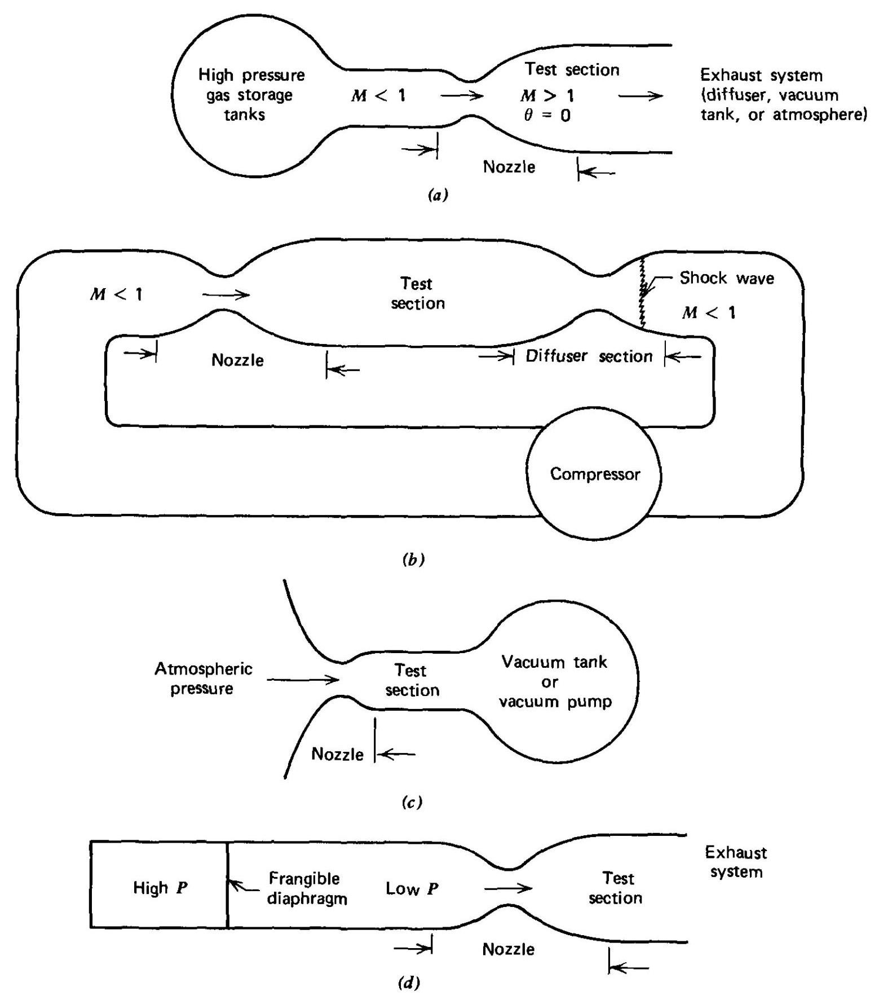
Figure 7.40 Several types of wind tunnels. (a) Blow-down wind tunnel. (b) Continuous flow wind tunnel. (c) Atmospheric inlet wind tunnel. (d) Shock tube driven wind tunnel.

Stations 1 and 4. The power required for maintaining steady flow in the tunnel is that needed for overcoming the boundary layer effects and any energy losses associated with the model being investigated.

Two problems arise, however, that complicate the operation of the above arrangement. Because of the energy losses associated with the frictional effects between the throat of the nozzle and the throat of the diffuser, there is a stagnation pressure drop between those two stations. If the Mach number is unity in the throats of the nozzle and the diffuser, then, since the mass flow rate $\dot{m}^{*}$ is constant, equation 4.137, Table 4.6, yields

$$
\dot{m}_{N}^{*}=\frac{\psi^{*} P_{N} A_{N}}{\sqrt{\gamma R T_{N}}}=\dot{m}_{D}^{*}=\frac{\psi^{*} P_{D} A_{D}}{\sqrt{\gamma R T_{D}}}
$$

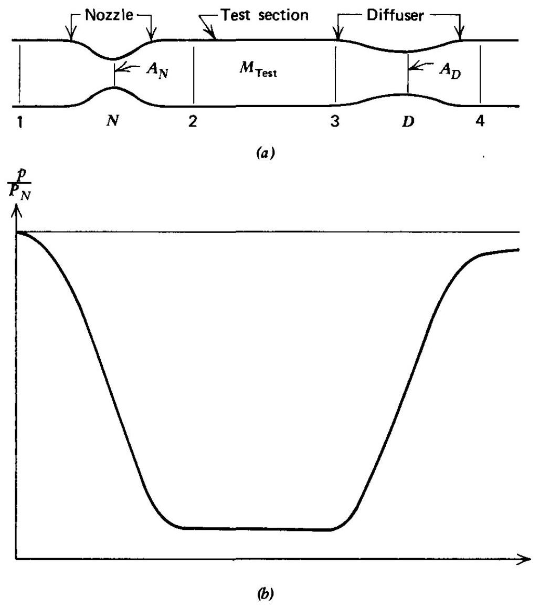
Figure 7.41 Ideal supersonic wind tunnel. (a) Geometry. (b) Pressure distribution.

where the subscripts $N$ and $D$ denote the conditions at the throats of the nozzle and the diffuser, respectively. For the adiabatic flow of a perfect gas, $T_{N}=T_{D}$, and $\gamma, R$, and $\psi^{*}$ are constants. In that case, equation 7.122 yields

$$
\frac{A_{D}}{A_{N}}=\frac{P_{N}^{*}}{P_{D}^{*}}>1.0
$$

Equation 7.123 shows that the diffuser throat must be larger than the nozzle throat. If the diffuser throat is too small, a supersonic flow cannot be attained in the nozzle exit section, nor in the test section, because the diffuser throat would be the first cross section of the wind tunnel to choke during the start-up of the tunnel. On the other hand, if the diffuser throat is too large, supersonic flow will persist into the diffuser divergence and a shock wave will form therein.

The following more serious problem occurs during the start-up of the wind tunnel. The flow initiated by the compressor simultaneously lowers the pressure at the diffuser exit and raises the pressure at the diffuser inlet. The latter flow process is sufficiently slow and may be regarded as being a steady flow throughout the wind tunnel; that is, during start-up the flow in the wind tunnel is quasi-steady. The static pressures at the different stations of the wind tunnel may be referred to the nozzle inlet stagnation pressure $P_{N}$. Figure 7.42 illustrates schematically the steps occurring in the start-up of a wind tunnel nozzle. Assume that $A_{D}$ is large enough so that the flow does not choke at the diffuser throat. As the pressure ratio $p_{4} / P_{N}$ is decreased, the nozzle attains the sequence of states described in Section 4-7(c), until the normal shock wave positions itself at the nozzle exit plane, as illustrated by curve $e$ in Fig. 7.42. When that condition occurs, the drop in the stagnation pressure attains its largest value, because the Mach number of the flow in front of the normal shock wave is

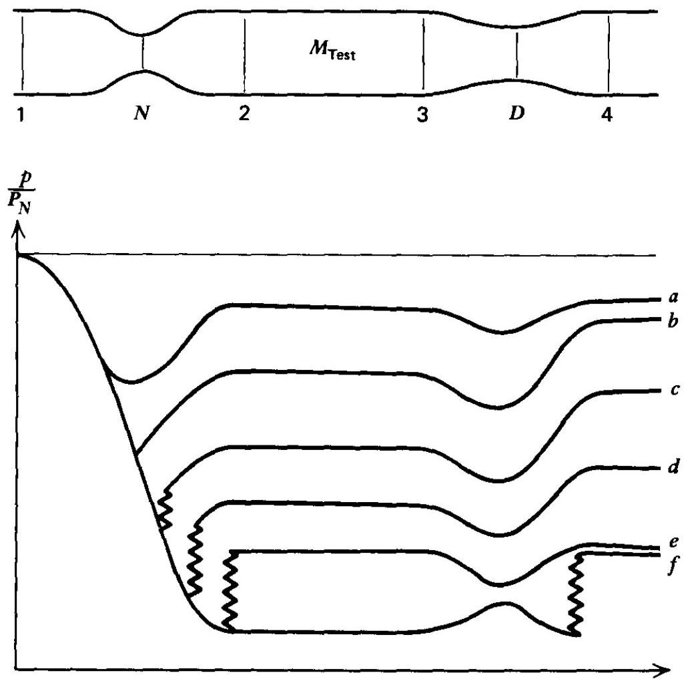
Figure 7.42 Pressure distributions for several stages during the start-up of a supersonic wind tunnel.

the test section Mach number $M_{\text {Test }}$; the latter is the largest Mach number for the flow in the wind tunnel circuit.

As the pressure ratio $p_{4} / P_{N}$ is decreased further, the shock wave moves very rapidly through the test section and the diffuser inlet and positions itself in the diffuser divergence at an area that is slightly larger than that of the test section. When that occurs, the shock is said to have been "swallowed" by the diffuser. Curve $f$ in Fig. 7.42 and curve $a$ in Fig. 7.43 illustrate that particular operating condition. The pressure ratio $p_{4} / P_{N}$ may now be increased, by adjusting the compressor pressure ratio, so that the shock wave is moved upstream toward the diffuser throat where the shock strength is a minimum, and the corresponding stagnation pressure drop is likewise a minimum; see curve $c$ in Fig. 7.43. The location of the shock wave is determined by the flow conditions in the portion of the wind tunnel downstream from the diffuser throat.

The inlet area ratio of the diffuser $A_{3} / A_{D}$ is smaller than the nozzle area ratio $A_{2} / A_{N}$, since $A_{D}>A_{N}$. Hence, if $M_{D}>1.0$ and the normal shock wave positions itself at the diffuser throat, there is a stagnation pressure drop that must be compensated for by the compressor. Curve $c$ in Fig. 7.43 illustrates diagrammatically the largest obtainable stagnation pressure recovery for a fixed geometry supersonic diffuser. In practice, the normal shock wave would be positioned slightly downstream from the diffuser throat because of the ever-present small fluctuations in the flow that may cause a shock wave that is located exactly at the throat to move slightly upstream into the diffuser inlet where its position would be unstable. The shock wave would continue moving through the diffuser inlet and locate itself once again in the nozzle divergence. Consequently, the entire procedure for swallowing the shock wave must be repeated.

Example 7.16. Consider a fixed geometry supersonic diffuser operating with air as the working fluid. Neglecting all losses except the stagnation pressure drop for the flow associated with the normal shock wave, calculate the following as a function of

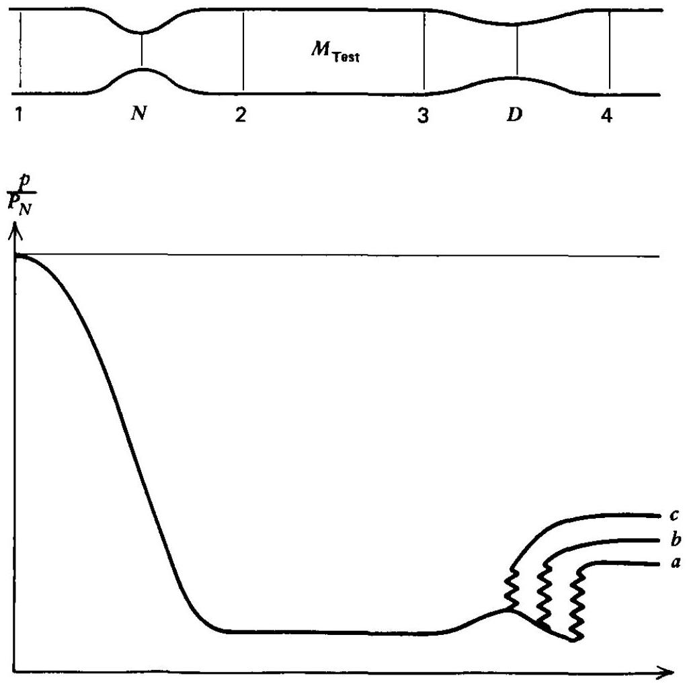
Figure 7.43 Pressure distributions in a fixed geometry supersonic diffuser as the pressure ratio $p_{4} / P_{N}$ is increased.

the test section Mach number $M_{\text {Test }}$ : (a) the ratio of the minimum diffuser throat area to the nozzle throat area, $A_{D} / A_{N}$, (b) the Mach number at the diffuser throat when the shock wave is positioned at that location, and (c) the corresponding stagnation pressure ratio $P_{D} / P_{N}$.

## Solution

(a) The ratio $A_{D} / A_{N}$ is obtained from equation 7.123, where the value of $P_{N} / P_{D}$ is obtained from Table C. 11 (normal shock wave) corresponding to $M_{\text {Test }}$. For example, for $M_{\text {Test }}=3.0$, Table C. 11 gives $P_{D} / P_{N}=0.32834$, and

$$
\frac{A_{D}}{A_{N}}=\frac{1}{0.32834}=3.0456
$$

which is the minimum area ratio that would permit the shock wave to be swallowed. (b) When the shock wave has been swallowed, the flow in the diffuser inlet is supersonic, the Mach number at the diffuser entrance is the test section Mach number $M_{\text {Test }}$, and the Mach number at the diffuser throat is supersonic (i.e., $A_{D}>A^{*}$ ). Thus,

$$
\frac{A_{D}}{A^{*}}=\frac{A_{D}}{A_{N}}=f\left(M_{D}\right)
$$

where $A^{*}=A_{N}$ for isentropic flow in the nozzle and test section. From Table C.6, for $A / A^{*}=3.0456, M_{D}=2.635$.
(c) The stagnation pressure ratio $P_{D} / P_{N}$ when the shock wave is located at the diffuser throat is that for a normal shock wave corresponding to $M_{D}$. Hence, for $M_{\text {Test }}=3.0, M_{D}=2.635$, and from Table C. 11 for $M_{D}=2.635, P_{D} / P_{N}=0.44762$.

Figure 7.44 presents plots of $A_{D} / A_{N}, M_{D}$, and $P_{D} / P_{N}$, for $\gamma=1.4$, as functions of the test section Mach number $M_{\text {Test }}$ for a fixed geometry supersonic diffuser. Also shown is $P_{y} / P_{x}$, the stagnation pressure ratio for a normal shock wave at the test

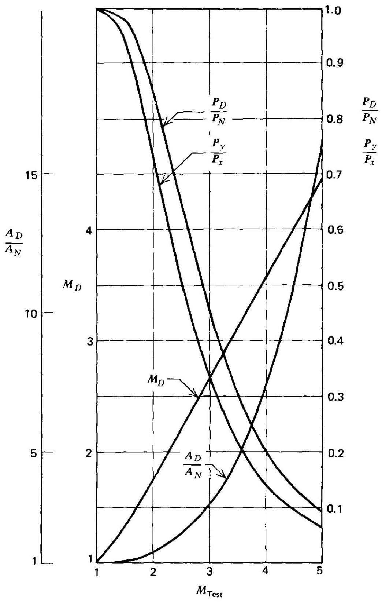
Figure 7.44 Variation of the diffuser-to-nozzle throat area ratio $A_{D} / A_{N}$, the diffuser throat Mach number $M_{D}$, the stagnation pressure ratio $P_{y} / P_{x}$, and the stagnation pressure ratio $P_{D} / P_{N}$ with the test section Mach number $M_{\text {Test }}$ for $\gamma=1.40$.

section Mach number $M_{\text {Test }}$. The stagnation pressure ratio $P_{D} / P_{N}$ for a fixed geometry supersonic diffuser is seen to decrease rapidly as the test section Mach number increases. In fact, the ratio $P_{D} / P_{N}$ is not much larger than the ratio $P_{y} / P_{x}$ for a normal shock wave located in the test section when $M=M_{\text {Test }}$. Because of that severe decrease in stagnation pressure, fixed geometry supersonic diffusers are, in general not employed for large supersonic wind tunnels.

## 7-12(b) Variable Geometry Supersonic Wind Tunnel

The basic features of a fixed geometry continuous flow wind tunnel are discussed in Section 7-12(a), where it is shown that one of the major problems with a fixed geometry system is the large stagnation pressure drop associated with the shock wave in the diffuser. The pressure drop caused by the shock wave may be significantly decreased by employing a variable geometry system. In practice, either the nozzle
throat area or the diffuser throat area, or both, may be made variable. In the following discussion, it is assumed that the nozzle geometry is fixed, but the diffuser throat area is variable. The results are also applicable to the case where the nozzle geometry is variable, because the significant parameter is the ratio of the diffuser throat area to the nozzle throat area $A_{D} / A_{N}$.

During start-up, the throat of the variable geometry diffuser is opened to an area larger than that specified by equation 7.123 . As the pressure ratio $p_{4} / P_{N}$ is decreased, the sequence of events is identical to those illustrated in Fig. 7.42 for a fixed geometry diffuser. Once the shock wave has been swallowed (curve $f$ in Fig. 7.42), the diffuser throat area is decreased, while simultaneously the pressure ratio $p_{4} / P_{N}$ is increased so that the shock wave is caused to move to the diffuser throat. Decreasing the diffuser throat area $A_{D}$ increases the diffuser inlet area ratio $A_{3} / A_{D}$, causing the Mach number in the diffuser throat to decrease and approach unity as $A_{D}$ approaches $A_{N}$. In the limit, the Mach number in the diffuser throat becomes unity. Accordingly, the normal shock wave at the diffuser throat then has vanishing strength, and the entire flow field becomes isentropic. The sequence of events is illustrated in Fig. 7.45.

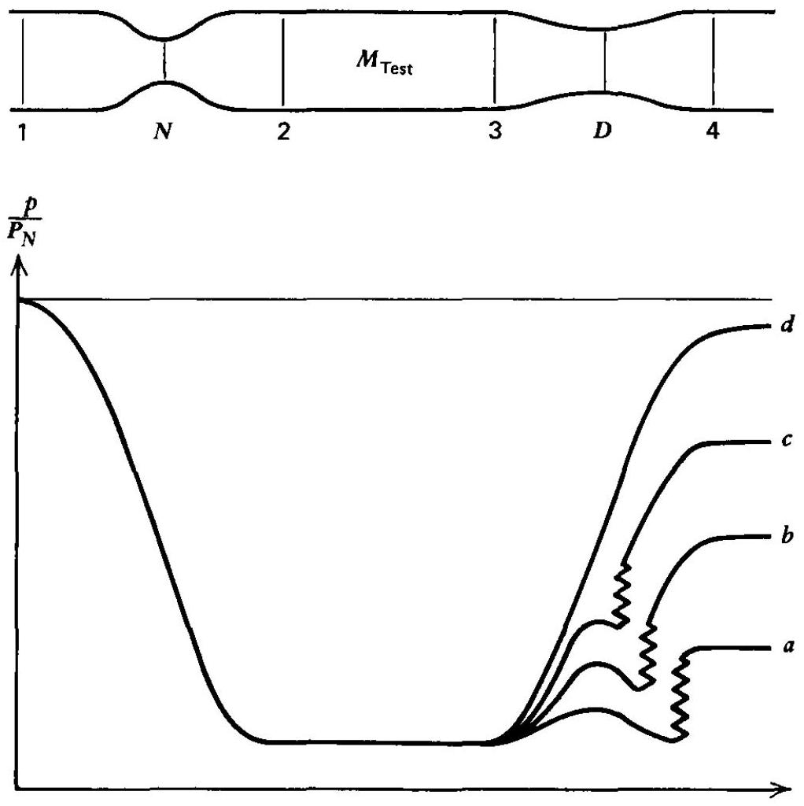
Figure 7.45 Pressure distributions in a variable geometry supersonic diffuser as the pressure ratio $p_{4} / P_{N}$ is increased and the area ratio $A_{D} / A_{N}$ is decreased.

The completely isentropic flow described above is, of course, physically unattainable in a practical wind tunnel because of viscous effects encountered by the flow. The flow in the diffuser is in the direction of an unfavorable pressure gradient (i.e., $d p / d x>0$ ) with respect to the boundary layer, so that the energy loss because of viscous effects may become significant. In addition, if the Mach number at the diffuser throat is unity, any slight disturbance in the flow may cause the sonic point to move temporarily into the diffuser convergence, which is an unstable mode of operation. If that occurs, the diffuser would unstart, a normal shock wave would appear in the nozzle divergence, and the start-up procedure would have to be
repeated. For the above reasons, the Mach number in the diffuser throat must be slightly larger than unity, with a corresponding stagnation pressure recovery somewhat less than unity.

The major conclusion from the foregoing discussion is that the diffuser area ratio $A_{D} / A_{N}$ is the most significant parameter influencing the start-up phenomena in the wind tunnel. Figure 7.44 presents $A_{D} / A_{N}, P_{D} / P_{N}, P_{y} / P_{x}$, and $M_{D}$ as functions of $M_{\text {Test }}$, for gases with $\gamma=1.40$.

## 7-13 INLETS FOR AIR-BREATHING PROPULSION ENGINES ${ }^{13,14}$

The efficient diffusion (flow compression) of the air entering an air-breathing propulsion engine is essential to its efficient functioning, irrespective of whether it propels a vehicle at either a subsonic or a supersonic speed. For example, the air entering the combustor of a ramjet engine must be decelerated for combustion reasons to a Mach number not exceeding approximately 0.2 . For a turbojet engine to perform satisfactorily, the air supplied to the inlet face of the axial flow compressor should have a Mach number less than approximately 0.4 and a fairly uniform flow pattern. The air flowing through the intake duct of the engine must experience the smallest possible decrease in its stagnation pressure. Furthermore, the flow of the air over the external surfaces of the air intake should not produce a large external drag. For brevity, the intake-diffuser system for an air-breathing propulsion engine is called an inlet.

If the velocity of the free-stream air relative to the inlet is supersonic, the diffusion process is complicated by the formation of shock waves.

At first blush, flow diffusion appears to be merely the reverse of flow expansion. It is, however, considerably more difficult to achieve an efficient diffusion than an efficient expansion, because in diffusion the fluid flows in the direction of a positive pressure gradient; in a flow expansion the flow is in the direction of a negative pressure gradient. The difficulty in obtaining an efficient diffusion arises from the interaction of the main stream flow with the boundary layer.

A flow passage that converts the kinetic energy associated with a subsonic gas flow ( $M<1$ ) into a static pressure rise is termed a subsonic diffuser, and one for decelerating a supersonic gas flow ( $M>1$ ) to approximately the local acoustic speed $(M \approx 1)$ is called a supersonic diffuser. If a vehicle is propelled at a supersonic speed by either a ramjet or a turbojet engine, the complete diffusion of the free-stream air is achieved in two steps: (1) a supersonic diffusion to $M \approx 1$, and (2) a subsonic diffusion from $M \approx 1$ to $M<1$.

Inlets may be classified into two main groups: (1) subsonic inlets, and (2) supersonic inlets. They may be further subdivided into external-compression inlets in which the flow compression takes place in the free stream, and internal-compression inlets wherein the flow compression takes place inside of the inlet.

## 7-13(a) Performance Criteria for Inlets

There are several different criteria employed for expressing the performance of an inlet. Three of the more common ones are discussed below. The diffusion process is illustrated schematically on the hs plane in Fig. 7.46.

The stagnation pressure ratio $\eta_{P}$, defined as the ratio of the stagnation pressure at the diffuser exit $P_{2}$ to the free-stream stagnation pressure $P_{o}$, is one of the most important performance criteria for an inlet, because the stagnation pressure of the gases at the nozzle entrance determines the nozzle pressure ratio, and hence the

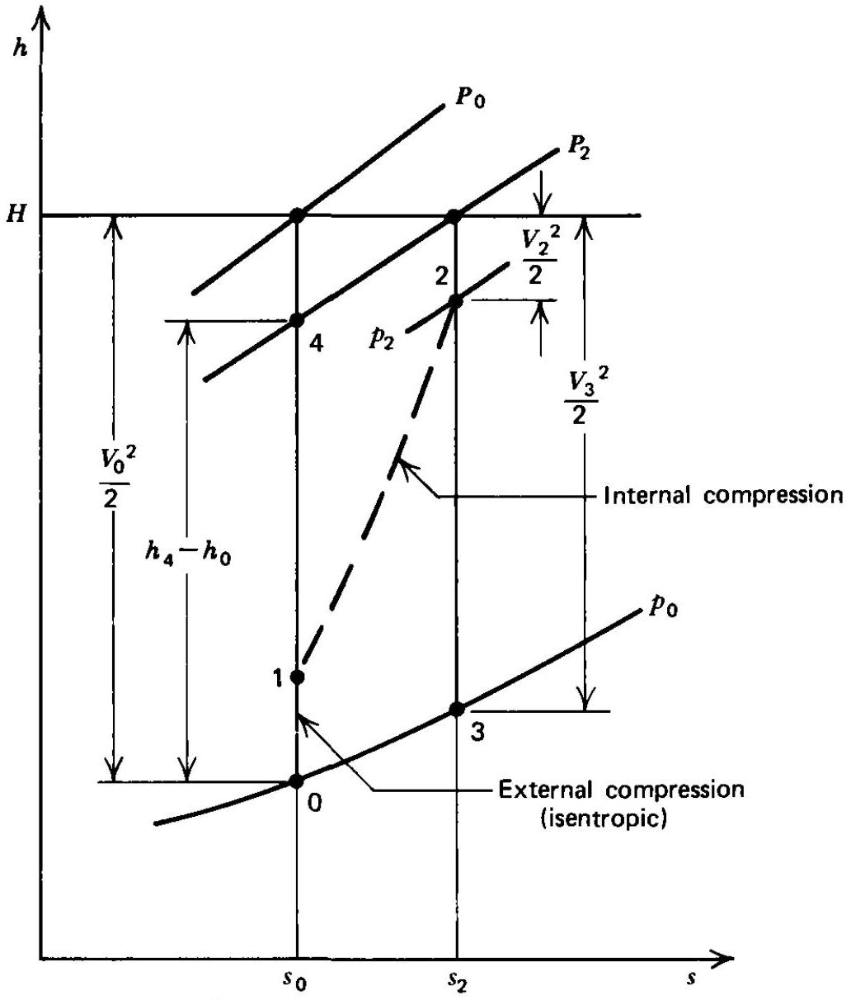
Figure 7.46 Diffusion process plotted on the $h s$ plane.

nozzle thrust (see Section 4-10). By definition,

$$
\eta_{P} \equiv \frac{P_{2}}{P_{o}}
$$

The kinetic energy efficiency $\eta_{K E}$ is defined as the ratio of the kinetic energy $V_{3}{ }^{2} / 2$, which would be obtained by expanding the diffused air isentropically from state 2 to the free-stream static pressure $p_{o}$, to the free-stream kinetic energy $V_{o}{ }^{2} / 2$. Thus,

$$
\eta_{K E} \equiv \frac{V_{3}^{2} / 2}{V_{o}^{2} / 2}=\frac{H-h_{3}}{H-h_{o}}
$$

The above definition of $\eta_{K E}$ is analogous to the kinetic energy efficiency for nozzles defined in Section 4-8(b).

A third performance criterion is the adiabatic diffuser efficiency $\eta_{D}$, defined as

$$
\eta_{D} \equiv \frac{h_{4}-h_{o}}{V_{o}^{2} / 2}=\frac{h_{4}-h_{o}}{H-h_{o}}
$$

where point 4 is a fictitious state corresponding to an isentropic compression from the free-stream static pressure $p_{0}$ to the actual stagnation pressure $P_{2}$.

## 7-13(b) Subsonic Inlets

All air-breathing propulsion engines for propelling aircraft at subsonic flight speeds are equipped with subsonic inlets. The velocity of the captured air inducted into such an inlet is subsonic throughout its flow path. In general, the flow compression
of that air involves two steps: (1) an external compression of the free-stream air, from Station 0 to Station 1 in Fig. 7.47, and (2) an internal compression of the air flowing in the duct, from Station 1 to Station 2 in Fig. 7.48. Subsonic inlets may be grouped into two basic types.

1. External-compression subsonic inlets.
2. Internal-compression subsonic inlets.

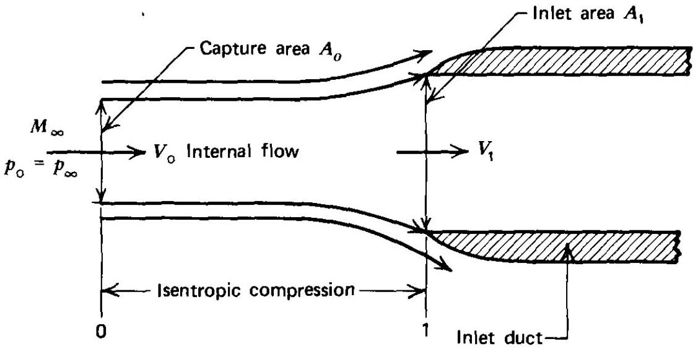
Figure 7.47 Subsonic external compression inlet.

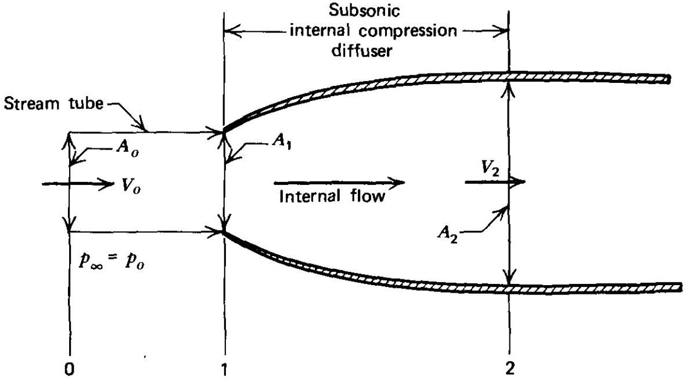
Figure 7.48 Subsonic internal compression inlet.

Figure 7.47 illustrates schematically a subsonic external-compression inlet; for simplicity it is assumed to be of circular cross section. Its general appearance is a constant-area duct with a contoured intake lip. Because the internal flow passage has a constant area, all of the diffusion of the entering air (the internal flow) occurs upstream from the inlet (Station 1). The flow stream tube entering the inlet has the capture area $A_{o}$ far removed from $A_{1}$. At $A_{o}, p_{\infty}=p_{o}$, and the cross-sectional area of the stream tube increases to $A_{1}>A_{o}$ at the entrance to the inlet. All of the transformation of the kinetic energy of the air into static pressure rise takes place external to the inlet where there are no solid surfaces. Hence, the external diffusion is isentropic $(d s=0)$.

Because the capture area $A_{o}<A_{1}$, some of the flowing air is deflected as it approaches the inlet and is accelerated as it flows over the intake lip; the flow is said
to "spill over" the inlet. Because of the increased local Mach number resulting from the acceleration of the flow, the "spilled" flow produces an external drag. It is important that the local Mach number in the vicinity of the intake lip be less than unity to avoid forming shock waves with their attendant large external drag. Consequently, the type of diffuser illustrated in Fig. 7.47 is unsatisfactory for application in the high-subsonic-speed range.

There is no satisfactory analytical procedure for designing a subsonic externalcompression diffuser; the current theory is quite similar to the airfoil theory employed in analyzing incompressible flow.

Subsonic internal-compression inlets are utilized in all air-breathing engines. The diffusion is accomplished in the duct connecting the intake cross section and the burner in a ramjet engine, and in the duct connecting the intake cross section and the compressor inlet face in a gas-turbine engine.

It is shown in Table 4.4, that for a steady one-dimensional isentropic flow, the flow area change $d A / A$, the static pressure change $d p / p$, and the flow Mach number $M$ are related by equation 4.51 , which is repeated here for convenience. Thus,

$$
\frac{d A}{A}=\frac{1-M^{2}}{\gamma M^{2}} \frac{d p}{p}
$$

Although equation 4.51, strictly speaking, applies to an isentropic flow ( $d s=0$ ), it may be employed for obtaining qualitative information regarding an adiabatic flow $(d s>0)$. The equation shows that the area ratio $A_{2} / A_{1}$ for a duct that is to diffuse a subsonic flow must exceed unity; that is, the flow streamlines must diverge. Hence, a subsonic internal-compression inlet is a diverging duct, such as that illustrated schematically in Fig. 7.48.

Subsonic internal-compression inlets have received extensive study but, because of the lack of an adequate theory, their design is largely empirical.

It is apparent that, to prevent the energy losses in an internal-compression diffuser from becoming excessive, the positive pressure gradient $d p / d x$ should be kept small; that is, the area increase in the direction of flow should be gradual. However, if the pressure gradient is to be kept small, then the length of the diffuser for accomplishing a specified reduction in the flow Mach number may become so large that the corresponding decrease in the stagnation pressure because of wall (skin) friction may be excessive. For a conical internal-compression diffuser, the maximum semiangle of the divergence for preventing flow separation phenomena is between 5 and 7 deg for a substantially incompressible flow ( $M_{o}<0.4$ ); it decreases approximately as ( $1-M_{o}{ }^{2}$ ) for higher subsonic Mach numbers. ${ }^{14}$ Because of the restrictions on the available space and weight for the diffuser, it is rarely possible to utilize such small divergence angles. Consequently, the design of a subsonic internal-compression diffuser is usually a compromise between the stagnation pressure recovery and the length available for the diffuser.

## 7-13(c) Normal Shock Wave Supersonic Inlets

All air-breathing propulsion engines that propel vehicles at supersonic speeds, except the SCRAMJET* engine, require that the air flow leave the inlet with a subsonic velocity. The design of an efficient supersonic inlet is critical, since neither the external nor the internal compression of a supersonic air stream can be accomplished

[^0]isentropically because of the formation of shock waves. As pointed out in Section 7-4(e), shock waves are inevitably accompanied by an increase in the entropy of the flowing air and, therefore, by energy dissipation. One of the important design problems is to produce a supersonic inlet having a shock wave pattern that will cause only a relatively small increase in the entropy of the diffused air. In addition, the supersonic diffusion should be accomplished with a minimum of external drag. In most cases those two requirements are conflicting, so that a practical design is a compromise between achieving the minimum stagnation pressure loss and the minimum external drag. The inlet also must be capable of operating stably over a range of angles of attack and at conditions other than the design point without serious adverse effects on either the stagnation pressure recovery or the external drag.

A normal shock wave supersonic inlet is illustrated schematically in Fig. 7.49. The design point, illustrated in Fig. 7.49a, occurs when the normal shock wave is attached to the inlet lip. The stagnation pressure ratio at the design point is that for a normal shock wave at the design Mach number; that pressure ratio is presented in Fig. 7.44 by the curve labeled $P_{y} / P_{x}$, for $y=1.40$. The latter figure shows that for a low supersonic flight Mach number (below $M_{o}=1.8$ ), the normal shock wave inlet furnishes a subsonic flow to the subsonic internal-compression diffuser that has a reasonable stagnation pressure ratio. The subsonic flow leaving the normal shock wave is further compressed in flowing through the subsonic internal-compression diffuser.

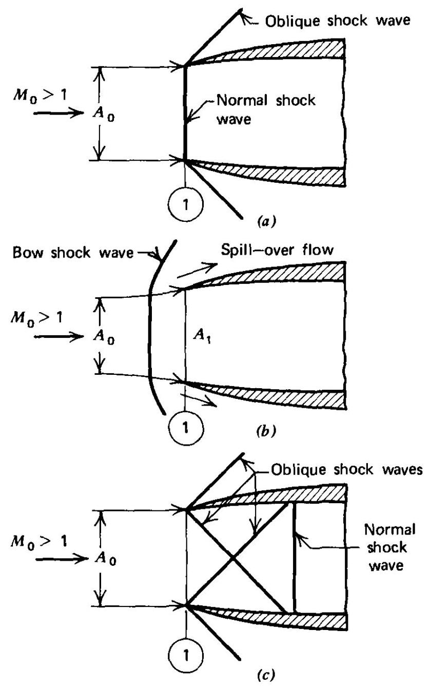
Figure 7.49 Operating characteristics of a normal shock wave supersonic inlet. (a) Design condition. (b) Effect of increasing the back pressure. (c) Effect of decreasing the back pressure.

If the engine requires a smaller mass rate of air flow than the design value, the excess air must be spilled-over the lip (leading edges) of the diffuser. To accomplish the spill-over of the air, the normal shock wave detaches from the diffuser lip, as illustrated in Fig. 7.49b, and a bow shock wave forms upstream to the inlet. The spillage of the air over the lip of the inlet increases the external drag.

We may assume that the portion of the bow shock wave immediately in front of the inlet is a normal shock wave. Hence, the flow properties in front of and behind the bow shock wave may be computed by means of the equations for a normal shock wave [see Section 7-4(a) and Table C.11].

If the back pressure in the outlet section of the diffuser is decreased, the normal shock wave is swallowed; that is, the shock wave locates itself inside the diffuser, as illustrated in Fig. 7.49c. Oblique shock waves form inside the inlet, and the stagnation pressure ratio of the inlet decreases.

The normal shock wave supersonic inlet gives reasonable performance at flight Mach numbers less than approximately 1.80. At values of $M_{o}$ larger than 1.80, the stagnation pressure recovery of the normal shock wave inlet decreases rapidly.

## 7-13(d) The Converging-Diverging Supersonic Inlet

It would be natural to expect that reversing the flow of air through a convergingdiverging nozzle, a device for obtaining large supersonic exhaust velocities with high efficiency (see Section 4-7), would achieve an efficient supersonic internal compression of the reversed supersonic air flow. Such an arrangement is illustrated schematically in Fig. 7.50. Unfortunately, it is practically impossible to achieve shockless diffusion with such a device because of the adverse interactions between the main

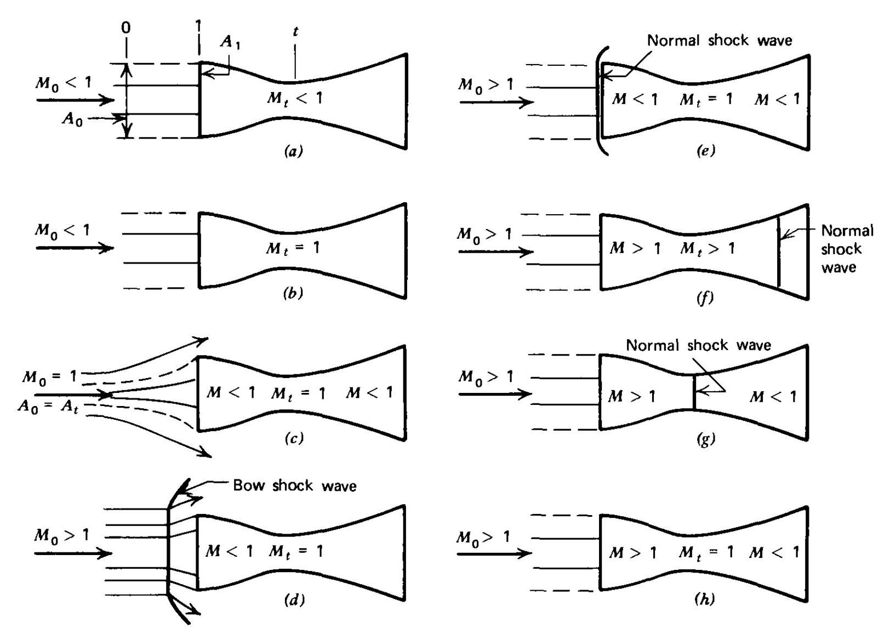
Figure 7.50 Effect of increasing the free-stream Mach number on the flow conditions for a convergingdiverging diffuser.

stream flow and the boundary layer as a consequence of the positive pressure gradient (see Section 5-10). Furthermore, the presence of shock waves in the converging-diverging passage causes a large increase in the entropy of the air so that the main stream flow is no longer isentropic. Even if it were possible to design a converging-diverging flow passage to achieve a substantially isentropic diffusion at the design point, its poor off-design operating characteristics would make it impractical. ${ }^{13}$ A fixed geometry converging-diverging passage can give a substantially isentropic diffusion, because of its fixed contraction ratio, at only one operating point, the design point. Moreover, the starting of such a diffuser, as explained in Section 7-12, presents a critical problem.

The starting problem for a supersonic inlet is quite similar to that for the supersonic wind tunnel discussed in Section 7-12. The sequence of conditions attained during start-up is illustrated schematically in Fig. 7.50, for a fixed geometry converging-diverging diffuser. At low subsonic flight speeds, the entire flow is subsonic, as illustrated in Fig. 7.50a. The capture area, denoted by $A_{o}$, depends on the mass flow rate requirements of the engine, and may be greater than, equal to, or less than the inlet area $A_{1}$. As $M_{o}$ is increased, or the engine mass flow rate increases, the operating condition illustrated in Fig. $7.50 b$ prevails, where $M_{t}=1$ and $M_{o}<1$. The streamline pattern ahead of the inlet is no longer influenced by the conditions downstream of the diffuser throat, but depends only on $M_{o}$ and the inlet area ratio $A_{1} / A_{t}$. When the flight Mach number $M_{o}$ reaches unity, the capture area $A_{o}$ equals the throat area $A_{t}$, as illustrated in Fig. $7.50 c$. Considerable drag because of spillage of air over the lips of the inlet may occur if $A_{1} / A_{t}$ is very large.

Further increases in the flight Mach number to supersonic values cause a bow shock wave to form upstream of the inlet, as illustrated in Fig. 7.50d. Both spillage drag and shock drag are present. When the flight Mach number reaches a sufficiently high value, a normal shock wave is located at the inlet entrance, as illustrated in Fig. 7.50e. A slight increase in $M_{o}$ causes the normal shock wave to enter the inlet convergence, a position that is unstable, so that the shock wave procedes through the inlet throat and positions itself in the inlet divergence, as illustrated in Fig. 7.50f. At that point, the inlet is started. As in the start-up of the supersonic wind tunnel diffuser, discussed in Section 7-12, the inlet back pressure may be increased, thereby causing the shock wave to move toward the diffuser throat, where its strength decreases. The maximum stagnation pressure recovery is attained when the normal shock wave is located exactly at the throat; a location where the shock position is unstable. The design point is, therefore, chosen so that the normal shock wave will locate itself slightly downstream from the throat, as illustrated in Fig. 7.50 g . Should the back pressure be increased sufficiently, the shock wave will be disgorged from the diffuser, and it will be necessary to repeat the start-up procedure.

As in the case of the fixed geometry wind tunnel diffuser discussed in Section 7-12(b), the Mach number at the diffuser throat, in Fig. 7.50f, is supersonic. Instead of increasing the back pressure to drive the shock wave toward the throat, the flight Mach number $M_{o}$ may be decreased, thus decreasing the Mach number at the diffuser throat. When $M_{o}$ is lowered to the value corresponding to isentropic choked flow in the diffuser inlet, which is that given in Table C. 6 for the area ratio $A_{1} / A_{t}$, the Mach number in the throat of the inlet is $M_{t}=1.0$. If the back pressure is adjusted properly, the inlet divergence is subsonic throughout, and the entire flow through the diffuser is isentropic, as illustrated in Fig. 7.50h. The last-mentioned method for starting the inlet is known as overspeeding.

The diffuser inlet area ratio $A_{t} / A_{1}$ corresponding to a normal shock wave attached to the inlet entrance plane for a given value of the free-stream Mach number $M_{o}$,
as illustrated in Fig. $7.50 e$, may be obtained by first determining the subsonic Mach number immediately downstream of the normal shock wave, from Table C.11, and then determining, from Table C.6, the isentropic area ratio required for accelerating that subsonic flow to $M=1$. Figure 7.51 presents that area ratio $A_{t} / A_{1}$ as a function of $M_{o}$, for $\gamma=1.40$, for the operating condition where the normal shock wave is attached to the inlet lip. Operation at any point in the region below the curve corresponds to a situation where the shock wave is detached in front of the inlet. Operation at any point in the region above the curve corresponds to a condition where the shock wave is swallowed. For example, Fig. 7.51 shows that for an area ratio $A_{t} / A_{1}=0.70$, the shock wave becomes attached at a flight Mach number of $M_{o}=3.2$.


Figure 7.51 Diffuser inlet area ratio $A_{t} / A_{1}$ for attaching a normal shock wave to the diffuser entrance plane.

Figure 7.52 presents $A_{t} / A_{1}$ as a function of $M_{o}$, for $\gamma=1.40$, for isentropic flow throughout the diffuser and a throat Mach number $M_{t}=1.0$; the values are taken from Table C.6. A point located in the region below that curve corresponds to an inlet throat area that is too small for passing all of the captured flow at that particular flight Mach number: a normal shock wave would propagate from the diffuser throat through the inlet and position itself upstream from the inlet entrance, thus unstarting the inlet. For any operating point above the curve in Fig. 7.52, the flow in the inlet convergence would be supersonic up to and including the throat. A normal shock wave would position itself somewhere in the inlet divergence, the location depending on the back pressure presented by the remainder of the engine.


Figure 7.52 Diffuser inlet area ratio $A_{t} / A_{1}$ for isentropic supersonic flow in the inlet convergence and $M_{t}=1.0$.

The curve presented in Fig. 7.52 applies only after the inlet is started. Consequently, an operating point on or above the curve presented in Fig. 7.51 must first be obtained before Fig. 7.52 is applicable. The two curves of Figs. 7.51 and 7.52 are presented together in Fig. 7.53 to illustrate the overall operating features of the convergingdiverging supersonic inlet.

Refer to Fig. 7.53 and consider an inlet having a fixed area ratio $A_{t} / A_{1}=0.70$. During start-up, only the upper curve in Fig. 7.53 is physically meaningful. The horizontal line $a b$ traces the operation of the inlet as $M_{o}$ is increased. At point $b$ the shock wave is swallowed, and the lower curve becomes physically meaningful. If the flight Mach number $M_{o}$ is decreased, the operating point moves from $b$ toward $c$. In the region between $b$ and $c$, the shock wave is swallowed and is located in the inlet divergence. At point $c$, the shock wave is located at the inlet throat where $M_{t}=1.0$, and the shock strength is vanishingly small; that point corresponds to Fig. 7.50h. If $M_{o}$ is decreased further, the shock wave is disgorged. Thus, there is a hysteresis effect, in that the shock wave is swallowed at a flight Mach number corresponding to point $b$, but the shock wave is not disgorged until the flight Mach number corresponds to point $c$.

At point $c$ in Fig. 7.53, $M_{o}=1.80$. Consequently, a fixed geometry inlet having $A_{t} / A_{1}=0.7$, designed for shock free operation at $M_{o}=1.8$, would have to be overspeeded to $M_{o}=3.2$ to start the inlet. To do that, a propulsion system would be required that is capable of propelling the vehicle to $M_{o}=3.2$ with an unstarted inlet, a totally unrealistic situation. Overspeeding for starting the subject type of inlet is, therefore, practical only for very low supersonic design Mach numbers. In fact, the


Figure 7.53 Area ratio for detached, attached, and swallowed normal shock waves as a function of the free-stream Mach number for the converging-diverging diffuser.

upper curve in Fig. 7.53 approaches the asymptotic limit of $A_{t} / A_{1} \approx 0.60$. From the lower curve, at $A_{t} / A_{1}=0.60, M_{o}=2.0$. Consequently, for a design flight Mach number of 2.0, the inlet would have to be overspeeded to a Mach number of infinity to start it, indicating that for design Mach numbers above 2.0, the subject type of inlet is impossible.

A procedure for eliminating the overspeeding problem is to employ a variable geometry inlet. Consider an inlet designed to operate at $M_{o}=3.2$. If the area ratio $A_{t} / A_{1}$ of the variable geometry inlet is adjusted so that its value is equal to that at point $b$ in Fig. 7.53, the inlet will start at $M_{o}=3.2$. A strong shock wave will, however, position itself in the inlet divergence. If the area of the variable throat is then reduced, the operating point for the inlet will move vertically downward from point $b$ toward point $d$. When $A_{t} / A_{1}=0.2$ approximately, the inlet operates at point $d$, and the entire flow through the inlet is isentropic. Alternately, if the area ratio $A_{t} / A_{1}$ is adjusted initially to a value larger than that corresponding to point $b$ in Fig. 7.53, for example, point $e$, the inlet starts at a lower Mach number. As the flight speed is increased, the area of the variable throat is reduced simultaneously, so that the operating path of the inlet follows a path such as curve $e d$ in Fig. 7.53. It is apparent that starting a variable geometry inlet is a straightforward procedure.

The major drawback to the practical application of a variable geometry convergingdiverging passage as an axisymmetric inlet is its mechanical complexity. For a twodimensional planar inlet, the mechanical design can be accomplished, and such inlets have been constructed. For applications requiring an axisymmetric inlet, which are quite common, the conical shock wave or spike inlet discussed in Section 7-13(e) has proven to be quite successful.

## 7-13(e) Conical Shock Wave or Spike Inlet

It was pointed out by K . Oswatitsoh that the large decrease in stagnation pressure across a normal shock wave may be reduced by decelerating the free-stream air by means of one or more oblique shock waves, followed by a weak normal shock wave. ${ }^{15}$ By employing that principle, an efficient external compression of the air is achieved before the air flows into a subsonic internal-compression diffuser.

Figure 7.54 illustrates schematically the essential features of a conical shock wave supersonic inlet employing the aforementioned external compression principle. A central body, or conical spike, is placed inside an efficient subsonic internal-compression diffuser, so that the system is axisymmetric. The conical nose protrudes through the inlet section of the subsonic diffuser into the free-stream air.


Figure 7.54 Schematic diagram of a conical shock wave (Oswatitsoh type) supersonic inlet.

When a supersonic flow impinges on the cone, a conical shock wave is produced [see Section 7-10(b)], as illustrated in Fig. 7.54. The compressed air leaving the conical shock wave enters the subsonic internal-compression diffuser through the annular opening formed between the surface of the central body and the housing of the subsonic diffuser. Theoretically, a weak normal shock wave is formed at the lip of the subsonic diffuser, and the air enters that diffuser with a subsonic velocity.

It is evident from Fig. 7.54 that the conical central body deflects the supersonic airstream from its initial flow direction, so that the weak normal shock wave is perpendicular to the average direction of the streamlines at the inlet to the subsonic diffuser, and not to the direction of the free-stream air. The supersonic diffusion is accomplished externally before the air enters the subsonic diffuser. The annular flow area for the internal flow is smaller than $A_{o}$; the external compression achieved by the conical shock wave is, therefore, quite strong. The configuration illustrated in Fig. 7.54 is called an external-compression inlet, because all of the supersonic diffusion takes place external to the inlet housing.

The position of the normal shock wave with respect to the inlet has a profound influence on the performance of the inlet. There are three distinct operating conditions under which the spike inlet for an air-breathing engine can operate. Refer to Fig. 7.55. When the normal shock wave is positioned at the inlet lip, as illustrated in Fig. 7.55a, the operation is said to be critical. When the exit pressure in the subsonic internal-compression diffuser is too low for maintaining the normal shock


Figure 7.55 Three principal operating modes for supersonic external compression diffusers. (a) Critical operation. (b) Supercritical operation. (c) Subcritical operation.

wave at the lip of the inlet, the air flows into the subsonic diffuser with a supersonic speed, and a strong normal shock wave forms in the diverging portion of the subsonic diffuser, as illustrated in Fig. 7.55b. That type of operation is said to be supercritical. If the exit pressure from the subsonic diffuser exceeds the static pressure that can be accommodated by the engine downstream to the diffuser, the normal shock wave is expelled from the diffuser and moves upstream toward the vertex of the conical center body, as illustrated in Fig. 7.55c. Behind the normal shock wave the flow is subsonic and, because the normal shock wave is detached from the inlet lip, there is spill-over of the incoming air over the inlet housing, thereby increasing the external drag. The operation of the diffuser under the latter condition is said to be subcritical.

In general, for an air-breathing engine, the position of the normal shock wave with reference to the inlet and the amount of spill-over air depend on the flight Mach number, the fuel-air ratio, the combustion efficiency, and the area of the nozzle exit cross section.

In general, the energy losses encountered with a conical shock wave inlet may be grouped into two classes: (1) those pertinent to the external shock wave compression in the supersonic inlet, and (2) those caused by wall friction and separation phenomena in the subsonic internal-compression diffuser (see Section 5-10). It is desirable for the normal shock wave in front of the subsonic diffuser to be weak in order to reduce the tendency for the flow to separate as it flows in the direction of a positive pressure gradient in the subsonic diffuser.

Figure 7.56 illustrates schematically a mixed compression inlet, wherein a portion of the internal flow is supersonic. Because the flow entering the inlet is supersonic, a series of oblique shock waves forms in the annular passage between the inlet housing and centerbody, which are terminated by a normal shock wave. The normal shock wave positions itself in the diverging flow passage at a location determined by the back pressure created by the remainder of the engine. By choosing the design point so that the normal shock wave is downstream from the minimum cross section, the supersonic portion of the diffuser is not influenced by the flow fluctuations in the remainder of the flow system, provided those fluctuations are not large enough to force the normal shock wave into the converging portion of the duct. If the latter occurs, the shock wave will be disgorged, and the diffuser operation becomes subcritical (see Fig. 7.55c).


Figure 7.56 Mixed compression supersonic inlet.

The starting problem discussed in Section 7-13(d) for the converging-diverging supersonic inlet must also be considered for the conical shock wave or spike inlet. The problem is much less severe, however, since the Mach number at the entrance to the inlet housing is lower than the free-stream Mach number because of the formation of the conical shock wave. In addition, the central spike may be translated in the axial direction, thereby varying both the inlet entrance area and the minimum flow area. By the proper matching of the aforementioned flow areas as a function of spike position, the inlet may be started without difficulty. During off-design operation (i.e., flight Mach numbers other than the design value and angles of attack other than zero), the spike may be translated so that the conical shock wave is always positioned at the inlet lip.

The maximum stagnation pressure recovery, at zero angle of attack, has been emphasized as a performance criterion. Inlets for air-breathing propulsion engines must, however, give satisfactory performance over the anticipated range of angles of attack. Experience has demonstrated that the spike inlet has satisfactory performance characteristics with regard to variations in the angle of attack. Ordinarily, a decrease of approximately 20 per cent in stagnation pressure recovery results at an angle of attack of 5 deg .

Another factor to be considered is the external drag of the inlet. A spike inlet introduces a drag component known as the additive drag that arises from the pressure forces acting on the stream tube $A B$ illustrated in Fig. 7.54; the latter drag is a net force acting in the direction opposite to the flight direction. By positioning the conical shock wave at the lip of the inlet, the additive drag may be eliminated. The
longer the distance between the conical shock wave and the inlet lip is, the larger the additive drag is.

In general, high stagnation pressure recovery with a spike inlet is accompanied by a large external drag, and vice versa. The external drag is high because the large cowling angles employed may induce flow separation on the exterior housing. By careful aerodynamic design, however, the external drag may be kept at tolerable values.

Larger stagnation pressure recoveries are obtainable if several successive weak shock waves instead of one relatively strong conical shock wave are utilized for decelerating the air. To increase the number of oblique shock waves, several "breaks" are made on the projecting cone, as illustrated schematically in Fig. 7.57. In the extreme case the spike configuration is a curved surface giving an infinite number of infinitely weak shock waves, that is, Mach waves (see Section 8-6). In theory, such a surface achieves shockless deceleration of a supersonic flow to the sonic speed; that is, the compression is isentropic. A spike of this configuration is termed an isentropic spike. Unfortunately, an isentropic spike is satisfactory for only one flight Mach number and is, very sensitive to changes in the angle of attack. Furthermore, at high flight Mach numbers, the flow is turned through large angles to enter the subsonic internal-compression diffuser, which may increase the additive drag to prohibitive values and may also affect the pattern of the flow into the subsonic diffuser.


Figure 7.57 Multiple conical shock wave supersonic inlet.

It appears that a spike inlet for air-breathing engines for propelling vehicles at Mach numbers up to $M_{o}=2.0$ need have only one conical shock wave. For flight Mach numbers above $M_{o}=2.0$, two or more oblique shock waves may be required for achieving the desired stagnation pressure recovery. Increasing the number of oblique shock waves makes the diffusion system more sensitive to changes in the flight Mach number and in the angle of attack. It appears that two oblique shock waves are sufficient for a design flight Mach number of approximately $M_{o}=3.0$.

Figure 7.58 presents the stagnation pressure recovery ratio $P_{2} / P_{o}$ as a function of the free-stream Mach number $M_{o}$ for several types of supersonic diffusers. ${ }^{15}$

Example 7.17. A two-dimensional planar inlet for an air-breathing engine for supersonic aircraft may consist of a wedge forebody leading into a cowl. A cross section through such an inlet is illustrated in Fig. 7.59. The purpose of the forebody is to generate an oblique shock wave, thus slowing down, or diffusing, the external flow


Figure 7.58 Maximum stagnation pressure recovery for multiple oblique shock wave diffusers as a function of free-stream Mach number $M_{0}$ (Based on Reference 15).


Figure 7.59 Forebodies for planar supersonic inlets. (a) Single angle forebody. (b) Multiple angle forebody.

to a lower Mach number and higher static pressure. The initial external oblique shock wave is followed by a series of internal oblique shock waves and a single normal shock wave for reducing the velocity to a subsonic value.

One performance criterion of a supersonic inlet is the stagnation pressure recovery obtainable with its shock wave system (see equation 7.124); the latter is expressible in terms of the stagnation pressure ratio $P_{2} / P_{o}$, which is a measure of the entropy increase for the air (see equation 3.88). The stagnation pressure ratio for an oblique shock wave depends on the flow deflection angle $\delta$ (the larger the value of $\delta$, the smaller the value of $P_{2} / P_{o}$ ). A series of smaller flow deflection angles will produce a series of weak oblique shock waves, with a larger value of $P_{2} / P_{o}$ than would be produced from a single wedge having the same total flow deflection angle in one step. The multiple angle forebody type of inlet is illustrated schematically in Fig. 7.59b.

To illustrate the higher stagnation pressure recovery of the multiple angle forebody inlet, consider an inlet designed to operate at $M_{1}=3.0$. The total flow deflection angle desired on the forebody is 18 deg . Calculate the final Mach number and the forebody stagnation pressure ratio for (a) a single flow deflection angle of 18 deg , and (b) for a series of three flow deflection angles of 6 deg each.

## Solution

(a) First, consider the single angle forebody. From Table C.12, for $M_{o}=3.0$ and $\delta=18 \mathrm{deg}, \varepsilon=35.47 \mathrm{deg}$. From equation 7.99,

$$
M_{o}^{\prime}=M_{o} \sin \varepsilon=3.0 \sin (18)=1.7408
$$

From Table C.11, for $M_{o}^{\prime}=1.7408$,

$$
M_{2}^{\prime}=0.63032 \quad \text { and } \quad \frac{P_{2}}{P_{o}}=0.83853
$$

From equation 7.100,

$$
M_{2}=\frac{M_{2}^{\prime}}{\sin (\varepsilon-\delta)}=\frac{0.63032}{\sin (35.47-18)}=2.0996
$$

(b) The calculations performed in part (a) are repeated below three times for equal flow deflection angles of 6 deg. Those results, and the results obtained in part (a), are presented in the following table.

| Part | $M$ | $\delta$ | $\varepsilon$ | $M_{o}^{\prime}$ | $M_{2}^{\prime}$ | $M_{2}$ | $P_{2} / P_{o}$ |
| :--- | :--- | ---: | :---: | :---: | :---: | :---: | :---: |
| (a) | 3 | 18 | 35.47 | 1.7408 | 0.63032 | 2.0996 | 0.83852 |
| (b) | 3 | 6 | 23.94 | 1.2173 | 0.83162 | 2.6999 | 0.99102 |
|  | 2.6999 | 6 | 26.58 | 1.2081 | 0.83718 | 2.3816 | 0.99199 |
|  | 2.3816 | 6 | 29.59 | 1.1761 | 0.85744 | 2.1426 | 0.99487 |

$$
\frac{P_{2}}{P_{o}}=(0.99102)(0.99199)(0.99487)=0.97804
$$

The final Mach number for the single angle forebody is 2.0996 , and for the multiple angle forebody it is $M_{2}=2.1426$. The stagnation pressure ratio for the single angle forebody is 0.83852 , which corresponds to a stagnation pressure loss of 16.15 percent.

For the multiple angle forebody, $P_{2} / P_{o}=0.97804$, and the corresponding stagnation pressure loss is 2.20 percent. Consequently, the flow for the multiple angle forebody is almost isentropic, and a considerable performance increase is obtained compared to that for the single angle forebody.

## 7-14 SUMMARY

Under certain conditions a normal shock wave may be formed perpendicular to the direction of the flow of a body of compressible fluid, which is far removed from solid surfaces. The shock wave is an exceedingly rapid irreversible compression of the gas, and it is very thin, only a few mean free paths in thickness. In the relative coordinate system, where the observer moves at the same speed as the shock wave, the latter appears to-be stationary with a supersonic flow ( $M_{1}>1$ ) of gas entering it and a subsonic flow ( $M_{2}<1$ ) leaving it. The reduction in the kinetic energy associated with the gas flowing through the normal shock wave goes into compressing the gas from $p_{1}$ to $p_{2}>p_{1}$, raising the gas temperature from $t_{1}$ to $t_{2}>t_{1}$, increasing its entropy from $s_{1}$ to $s_{2}>s_{1}$, while the stagnation temperature $T_{1}=T_{2}=T=$ constant. Furthermore, the strength of the normal shock wave $\beta=\left(p_{2}-p_{1}\right) / p_{1}$ increases as $M_{1}$ is increased.

If the flowing fluid is a perfect gas, some rather simple quantitative relationships may be derived relating the conditions $p_{1}, \rho_{1}, t_{1}, s_{1}$, and $V_{1}$ in front of the normal shock wave to $p_{2}, \rho_{2}, t_{2}, s_{2}$, and $V_{2}$ behind it. The aforementioned flow properties may be related to $M_{1}$ and $M_{2}$.

The entropy change for the normal shock wave, expressed by $\Delta s / c_{v}$, depends on the pressure ratio $p_{2} / p_{1}$ and the specific heat ratio for the gas $\gamma$. Hence, for a given gas, $\Delta s / c_{v}$ depends only on $p_{2} / p_{1}$. In terms of the shock strength $\beta=\left(p_{2}-p_{1}\right) / p_{1}$, it is shown (see equation 7.63) that for a weak shock wave, the entropy increase is insignificant, indicating that a weak shock wave produces an efficient compression of the gas. In other words, if $M_{1}$ is not significantly larger than unity (a weak shock wave condition), then no significant increase in entropy (or decrease in stagnation pressure) is experienced by the gas in flowing through the normal shock wave.

For a normal shock wave in a perfect gas, the flow property ratios $\left(M_{2}, p_{2} / p_{1}\right.$, $\rho_{2} / \rho_{1}, t_{2} / t_{1}, P_{2} / P_{1}$, and $P_{2} / p_{1}$ ) are functions of $M_{1}$ and $\gamma$. Consequently, for a given gas, they are functions solely of $M_{1}$. Table C. 11 presents those variables as functions of $M_{1}$ for different values of $\gamma$.

A body that moves in a frictionless fluid at supersonic speed and causes shock waves to form produces a drag force that is known as either shock or wave drag [see Section 7-4(f)].

If a planar supersonic flow ( $M_{1}>1$ ) has its direction changed by a frictionless plane that makes a concave corner with the initial flow direction, the final flow velocity $V_{2}$ makes the flow deflection angle $\delta$ with the initial flow velocity $V_{1}$. An oblique shock wave emanates from the corner and makes the wave angle $\varepsilon$ with $V_{1}$. (see Fig. 7.16). Because the initial flow is turned through the angle $\delta$, the oblique shock wave has an additional degree of freedom compared to the normal shock wave; that is, the flow properties behind the oblique shock wave depend not only on the upstream conditions but also on $\delta$. Consequently, the governing equations for an oblique shock wave are more complicated than those for a normal shock wave. The continuity, momentum, and energy equations, when expressed in terms of the normal components of the gas velocities in front of and in back of the oblique shock wave, $V_{N 1}$ and $V_{N 2}$, respectively, are identical to those for the normal shock wave. Consequently, the relations derived for the normal shock wave are applicable
to the oblique shock wave, if $V_{1}$ and $V_{2}$ for the normal shock wave are replaced by $V_{N 1}$ and $V_{N 2}$. From a general point of view, the normal shock wave may be regarded as a special case of the oblique shock wave where the wave angle $\varepsilon=\pi / 2$.

The strength of an oblique shock wave depends not only on $M_{1}$ but also on the flow deflection angle $\delta$, and there is a maximum value of $\delta$, denoted by $\delta_{m}$, for which the oblique shock wave is attached to the concave corner; the corresponding wave angle is $\varepsilon=\varepsilon_{m}$. If $\delta>\delta_{m}$ the oblique shock wave detaches from the concave corner, and further increase in $\delta$ causes the shock wave to move upstream and change its configuration (see Fig. 7.21).

Table C.11, for the normal shock wave, may be employed for the oblique shock wave, by replacing $M_{1}$ for the oblique shock wave by $M_{1}^{\prime}=M_{1} \sin \varepsilon$. The corresponding value for $M_{2}=M_{2}^{\prime} / \sin (\varepsilon-\delta)$.

The results obtained for the oblique shock wave may be applied directly to the steady two-dimensional planar supersonic flow over a wedge. If the wedge is unsymmetrical with respect to the incident flow, the flows over its top and bottom surfaces must be studied separately. If the semiangle of a symmetrical wedge $\delta_{w}$ is smaller than the maximum flow deflection angle $\delta_{m}$, the oblique shock wave becomes attached to the vertex of the wedge, and the flow in back of the oblique shock wave becomes parallel to the surfaces of the wedge. If $\delta_{w}>\delta_{m}$, the shock wave is detached and a bow shock wave moves upstream from the vertex; the distance it moves upstream depends on $M_{1}$ and $\delta_{w}$.

The flow over a cone is a two-dimensional axisymmetric flow. Solutions of the basic differential equations may be obtained by numerical techniques. Because of the continuity requirement for the flow behind a conical shock wave attached to the vertex of a cone, the streamlines are curved and converge toward the surface of the cone. Consequently, the pressure, velocity, and density behind the conical shock wave are not uniform as is the case for the attached oblique shock wave for a wedge. Because of the convergence of the streamlines, there is an isentropic compression of the gas between the conical shock wave and the surface of the cone. The detachment angle for a cone is larger than it is for a wedge (see Fig. 7.32).

Oblique shock waves may be reflected from solid surfaces and jet boundaries, and interact with each other. The rules for the reflection, interaction, and cancellation of oblique shock waves are summarized in Section 7-11(e).

## REFERENCES

1. M. J. Zucrow, Aircraft and Missile Propulsion, Vol. 1, Chap. 3, Wiley, New York, 1958.
2. A. H. Shapiro, The Dynamics and Thermodynamics of Compressible Fluid Flow, Chap. 5, Ronald Press, New York, 1953.
3. A. Ferri, Elements of Aerodynamics of Supersonic Flow, Macmillan, New York, 1949.
4. R. Courant and K. O. Friedrichs, Supersonic Flow and Shock Waves, Interscience Publishers, New York, 1948.
5. Ames Research Staff, "Equations, Tables and Charts for Compressible Flow," NACA Report 1135, 1953.
6. M. Linzer and D. F. Hornig, "Structure of Shock Fronts in Argon and Nitrogen," Physics of Fluids, Vol. 6, No. 12, pp. 1661-1668, December 1963.
7. J. H. Keenan and J. Kaye, Gas Tables, Wiley, New York, 1945.
8. R. von Mises, Mathematical Theory of Compressible Fluid Flow, Academic Press, New York, 1958.
9. G. I. Taylor and J. W. Maccoll, "The Air Pressure on a Cone Moving at High Speeds," Proceedings of the Royal Society of London, Series A, Vol. 139, pp. 279-311, 1933.
10. J. W. Maccoll, "The Conical Shock Wave Formed by a Cone Moving at High Speed," Proceedings of the Royal Society of London, Series A, Vol. 159, pp. 459-472, 1937.
11. Z. Kopal, "Tables of Supersonic Flow around Cones," Report No. 1, Massachusetts Institute of Technology, Department of Electrical Engineering, Center of Analysis, 1947.
12. J. Sims, "Tables for Supersonic Flow around Right Circular Cones at Zero Angle of Attack," NASA SP-3004, 1964.
13. M. J. Zucrow, Aircraft and Missile Propulsion, Vol. 1, Chap. 5, Wiley, New York, 1958.
14. J. V. Foa, Elements of Flight Propulsion, Chap. 8, Wiley, New York, 1960.
15. K. Oswatitsch, "The Efficiency of Shock Diffusers," NACA TM 1140, 1947.

## PROBLEMS

1. A stream of air flowing with $M=4, p=1.0 \cdot 10^{5} \mathrm{~N} / \mathrm{m}^{2}$, and $t=300 \mathrm{~K}$ passes through a stationary normal shock wave. Calculate the following properties behind the shock wave, assuming that air behaves as a perfect gas with $c_{p}=1004.8 \mathrm{~J} / \mathrm{kg}-\mathrm{K}$ : (a) $p$, (b) $t$, (c) $P$, (d) $T$, (e) $V$, and (f) $M$.
2. Work Problem 1, taking into account the variation of specific heat with temperature.
3. A shock wave created by an explosion is traveling into the surrounding atmosphere at a velocity of $1700 \mathrm{~m} / \mathrm{s}$. The static properties of the atmosphere are $p_{o}=1.0135 \cdot 10^{5} \mathrm{~N} / \mathrm{m}^{2}$ and $t_{o}=290 \mathrm{~K}$. Assume that the air behaves as a perfect gas with $c_{p}=1004.8 \mathrm{~J} / \mathrm{kg}-\mathrm{K}$. Calculate the following properties relative to a stationary observer behind the shock wave: (a) $p$, (b) $t$, (c) $M$, (d) $P$, and (e) $T$.
4. Work Problem 3, taking into account the variation of $c_{p}$ with $t$.
5. Air is flowing at $180 \mathrm{~m} / \mathrm{s}$ through a constant-area pipe. The end of the pipe is suddenly closed, and a normal shock wave propagates back into the pipe, which is 30 m long. How long will it be before the effect of the closing of the pipe is felt at the pipe inlet? Assume that the air behaves as a perfect gas with a constant specific heat.
6. Calculate the time asked for in Problem 5, taking into account the effect of temperature on the specific heat of air.
7. A Pitot tube placed in a supersonic wind tunnel flowing air indicates a stagnation pressure $P=6.550 \cdot 10^{5} \mathrm{~N} / \mathrm{m}^{2}$. The Mach number in the tunnel $M=4.0$. Calculate the tunnel freestream static pressure assuming that the air behaves as a perfect gas.
8. Air is flowing in a converging-diverging nozzle with an expansion ratio of 10 . The inlet stagnation pressure $P=7.0 \cdot 10^{5} \mathrm{~N} / \mathrm{m}^{2}$, and the pressure in the exhaust region is 1 atm . A normal shock wave is standing in the nozzle divergence. Determine the area ratio at which the normal shock wave occurs. Assume $\gamma=1.40$.
9. The nozzle described in Problem 8 discharges into a receiver that is initially evacuated. As the receiver is filled by the nozzle exhaust gases, the effective back pressure presented to the nozzle increases. Eventually a normal shock wave appears at the nozzle exit plane and propagates upstream as the back pressure increases. Calculate the location (i.e., the area ratio) of the normal shock wave as a function of the pressure in the receiver.
10. Air, assumed to be a perfect gas, flows from the storage tanks of a blow-down wind tunnel where $t=290 \mathrm{~K}$ and $p=70 \cdot 10^{5} \mathrm{~N} / \mathrm{m}^{2}$. A symmetrical wedge having a semiangle $\alpha=$ 15 deg is placed in the test section where $M=3.0$. Calculate the following properties on the surface of the wedge: (a) $t$, (b) $p$, (c) $M$, (d) the wave angle $\varepsilon$, and (e) the minimum Mach number for which the shock wave will remain attached to the wedge. Assume $\gamma=1.40$.
11. The wedge described in Problem 10 is moved to a location where the wave angle $\varepsilon$ is observed optically to be 30 deg . At that point, calculate (a) the free-stream values of $M, p$ and $t$, and (b) the same flow properties on the surface of the wedge.
12. Work Problems 10 and 11 employing the hodograph shock polar presented in Fig. 7.25.
13. The leading edge of a control fin on a reentry body may be approximated as a wedge having an included angle of 10 deg . Calculate the flow properties on the surface of the wedge, at zero angle of attack, when the free-stream velocity is $1500 \mathrm{~m} / \mathrm{s}$ and the altitude is $30,000 \mathrm{~m}$ (a) assuming that air behaves as a perfect gas, and (b) taking into account the variation of specific heat with temperature.
14. A wedge having a total included angle of 30 deg is placed in a wind tunnel where $M=3.0$. Determine the maximum angle of attack of the wedge for which the oblique shock waves will remain attached.
15. A right circular cone with a total included angle of 30 deg is placed in the wind tunnel described in Problems 10 and 11. Work Problems 10 and 11 for the aforementioned symmetrical cone.
16. A two-dimensional supersonic inlet comprises two 15 deg wedges placed on the top and bottom surfaces of a rectangular flow passage. An oblique shock wave propagates into the inlet from the leading edge of both wedges, as illustrated in Fig. 7.39a (where the values of $\delta$ are different). Calculate the flow properties $M, p$ and $t$ behind the initial shock waves and the transmitted shock waves if $M_{o}=3.0$. Assume that $\gamma=1.40, p_{o}=1.0135 \cdot 10^{5} \mathrm{~N} / \mathrm{m}^{2}$, and $t_{o}=300 \mathrm{~K}$.
17. The inlet described in Problem 16 is oriented at a 5 deg angle of attack. Determine the flow properties $M, p$, and $t$, behind the initial and transmitted shock waves for the conditions specified in Problem 16.
18. A variable geometry converging-diverging inlet is to be designed for flight at $M_{o}=2.0$. Calculate the area ratio for achieving the design condition of isentropic flow throughout, and also the area ratio required for swallowing the starting shock wave. Sketch the flow field just before the shock wave is swallowed, and for operation at the design condition, noting the values of the Mach number at all points of interest. Assume that air behaves as a perfect gas.
19. A two-dimensional planar wind tunnel nozzle is designed to give a parallel uniform flow at a Mach number $M=3.0$ when air is the flowing fluid $(\gamma=1.40)$. The test gas is supplied from a blow-down air supply initially at a pressure of $70 \cdot 10^{5} \mathrm{~N} / \mathrm{m}^{2}$, and the nozzle exhausts to the atmosphere ( $p_{o}=1 \mathrm{~atm}$ ). During operation, the pressure in the supply reservoir decreases. At what supply pressure will oblique shock waves first appear in the exhaust jet? A test region extending one diameter downstream and 10 percent of the diameter in height is required, in which the flow is shock free. What is the minimum supply pressure for obtaining the desired test region?
20. Air flows in a rectangular passage with a Mach number $M=3.0$. The bottom wall of the passage abruptly turns into the flow with the angle $\delta$, thereby propagating an oblique shock wave into the flow. Determine the maximum value of $\delta$ for regular reflection of the initial shock wave, for (a) one, (b) two, (c) three, and (d) four reflections.
21. A stream of air flows in an insulated pipe having a diameter of 0.10 m at the mass flow rate of $1.0 \mathrm{~kg} / \mathrm{s}$. The stagnation temperature is 295 K , and the average friction coefficient $\overline{\mathrm{f}}=$ 0.002. (a) At the pipe inlet, the pressure is $0.140 \cdot 10^{5} \mathrm{~N} / \mathrm{m}^{2}$. Find the Mach number, velocity and stagnation pressure. (b) At the exit section, find the maximum length and the corresponding pressure for shockless flow. (c) For the length found in part (b), what must the pressure be at the exit section for a normal shock wave to form at the inlet?
22. An isentropic converging-diverging nozzle designed for $M=2.2$ is supplied with air from a reservoir at $p=8.0 \cdot 10^{5} \mathrm{~N} / \mathrm{m}^{2}$ and $t=300 \mathrm{R}$. The nozzle exit is connected to a perfectly insulated pipe of length $L$, diameter $D$, and average friction coefficient $\overline{\mathrm{I}}=0.0025$. The pipe discharges into a space where the pressure is maintained at $3.5 \cdot 10^{5} \mathrm{~N} / \mathrm{m}^{2}$. Calculate the mass flux $G$, and the ratio $L / D$ for a normal shock to stand at (a) the nozzle throat, (b) the nozzle exit, and (c) the duct exit.
23. Find the speed of an explosion wave that causes the atmospheric air temperature to rise from 280 K to 320 K immediately after the passage of the wave.
24. Air flows through a frictionless converging-diverging nozzle. The area of the exit section $A_{e}$ is four times the area of the throat section $A_{t}$, and the ratio of the stagnation pressure at the entrance to the static pressure in the exit section is 3 . The semiangle of the divergence is 10 deg . Assume that air is a perfect gas, that $\gamma=1.4$ and is constant, one-dimensional flow, and that the only loss is due to the formation of a normal shock wave in the diverging portion of the nozzle. Calculate (a) the Mach number $M_{x}$ where the normal shock occurs, (b) the area $A_{x}$ where the shock wave occurs, and (c) the increase in entropy.
25. A subsonic diffuser operating under isentropic conditions with air has an inlet area of $0.15 \mathrm{~m}^{2}$. The inlet conditions are $V_{1}=240 \mathrm{~m} / \mathrm{s}, t_{1}=300 \mathrm{~K}, p_{1}=0.70 \cdot 10^{5} \mathrm{~N} / \mathrm{m}^{2}$. The velocity leaving the diffuser is $120 \mathrm{~m} / \mathrm{s}$. Calculate (a) the mass flow rate, (b) the stagnation temperature at the exit, (c) the stagnation pressure at the exit, (d) the static pressure at the exit, (e) the entropy change across the diffuser, and (f) the exit area.
26. Air at 310 K and $1.030 \cdot 10^{5} \mathrm{~N} / \mathrm{m}^{2}$ enters a diffuser with a velocity of $245 \mathrm{~m} / \mathrm{s}$. The diffuser is to be designed to reduce the velocity of the air to $60 \mathrm{~m} / \mathrm{s}$. The mass flow rate through the diffuser is $13.6 \mathrm{~kg} / \mathrm{s}$. Find, assuming isentropic flow, (a) the inlet diameter, (b) the outlet diameter, and (c) the rise in static pressure.
27. Air enters an isentropic diffuser with a Mach number of 3.6 and is decelerated to a Mach number of 2 . The diffuser passes a mass flow rate of $15 \mathrm{~kg} / \mathrm{s}$. The initial static pressure and temperature of the air are $1.030 \cdot 10^{5} \mathrm{~N} / \mathrm{m}^{2}$ and 310 K , respectively. Calculate, assuming $\gamma=1.4$, (a) the area of diffuser inlet, (b) the area of the diffuser exit, (c) the stagnation temperature for the inlet air, (d) the stagnation pressure for the inlet air, (e) the stagnation temperature for the outlet air, (f) the stagnation pressure for the outlet air, and (g) the static pressure of the outlet air.
28. A normal shock wave diffuser is employed for diffusing a supersonic stream from the freestream Mach number $M_{o}$ to the subsonic Mach number $M_{b}$. Plot the stagnation pressure ratio for the shock wave $P_{b} / P_{o}$ as a function of $M_{o}$.
29. A normal shock wave is formed ahead of the diffuser of a turbojet engine operating at $M=1.3$ at $15,000 \mathrm{~m}$. Calculate the stagnation pressure and Mach number just after the shock wave.
30. A ramjet having a two-dimensional wedge inlet operates at a Mach number of 2.40 . The semiangle of the wedge is 15 deg . A normal shock wave occurs at the inlet to the subsonic diffuser. The isentropic efficiency of the subsonic diffuser is 0.90 . Calculate the stagnation pressure ratio of the diffuser assuming $\gamma=1.4$ and that the flow between the oblique shock wave and the normal shock wave is isentropic.
31. Calculate the improvement, in percent, in the stagnation pressure ratio obtained in Problem 30 if a second oblique shock wave is formed by a second wedge having an angle of 10 deg located downstream from the vertex of the first wedge (total half angle $=25 \mathrm{deg}$ ).
32. In Example 7.17 a multiple oblique shock wave inlet is described where the total turning angle of 18 deg is accomplished by three flow deflection angles of 6 deg each, and the corresponding stagnation pressure recovery $\eta_{p}=0.97804$. Determine the stagnation pressure recovery of a multiple oblique shock wave inlet operating at the same conditions, for (a) two equal flow deflection angles of 9 deg each, and (b) four equal flow deflection angles of 4.5 deg each.

[^0]:    * Acronym for Supersonic Combustion Ramjet, a type of engine that has received study and some technology development. It permits operating the combustion chamber with a supersonic velocity.

