## 8 <br> expansion waves

8-1 PRINCIPAL NOTATION FOR CHAPTER 8 ..... 422
8-2 INTRODUCTION ..... 423
8-3 SIMPLE WAVES ..... 423
(a) General features of simple waves ..... 424
(b) Governing equation for a Prandtl-Meyer flow ..... 426
8-4 SIMPLE WAVES IN A PERFECT GAS ..... 427
(a) The Prandtl-Meyer angle ..... 428
(b) Maximum Prandtl-Meyer angle ..... 434
(c) Expanding supersonic flow over successive corners and convex surfaces ..... 435
8-5 SIMPLE WAVES IN IMPERFECT GASES ..... 437
8-6 SUPERSONIC FLOW OVER A CONCAVE SURFACE ..... 441
8-7 HODOGRAPH CHARACTERISTICS FOR SIMPLE WAVE FLOW ..... 443
8-8 APPROXIMATION OF CONTINUOUS EXPANSION WAVES BY FINITE AMPLITUDE DISCRETE WAVES ..... 448
(a) Reflection of an expansion wave intersecting a wall ..... 451
(b) Reflection of an expansion wave intersecting a free pressure boundary ..... 453
(c) Neutralization of an expansion wave ..... 454
(d) Intersection of expansion waves ..... 455
(e) Summary of observations concerning the interaction of expansion waves ..... 457
8-9 SUMMARY ..... 457

## 8-1 PRINCIPAL NOTATION FOR CHAPTER 8

The notation for Chapter 3 and the additional notation presented below apply to Chapter 8.
$b=(\gamma+1) /(\gamma-1)$.
$u^{*}=u / a^{*}$, dimensionless velocity component.
$v^{*}=v / a^{*}$, dimensionless velocity component.
$V$ velocity magnitude.
$V_{N}$ component of velocity normal to a wave.
$V_{T}$ component of velocity tangential to a wave.

## Greek Letters

$\alpha=\sin ^{-1}(1 / M)$, Mach angle.
$\bar{\alpha} \quad$ average Mach angle.
$\delta=v_{2}-v_{1}$, flow deflection angle.
$\bar{\delta}$ average flow deflection angle.
$\theta$ streamline angle.
$v \quad$ Prandtl-Meyer angle; $v=\delta$ when $M_{1}=1$.
Subscripts
1 conditions before an expansion wave.
2 conditions after an expansion wave.

## 8-2 INTRODUCTION

It is shown in Section 7-7 that a steady, uniform, two-dimensional supersonic flow into a concave corner (see Fig. 7.16) is turned through the flow deflection angle $\delta$ by an oblique shock wave, which behaves as a flow discontinuity. In passing through the oblique shock wave, the entropy of the fluid is increased. If the corner is convex (see Fig. 8.1), and an oblique shock wave were to emanate from it, the fluid would be required to expand in flowing through the discontinuity (shock wave) with an accompanying decrease in its entropy, a requirement that violates the second law of thermodynamics. Consequently, the wave emanating from the convex corner is an expansion wave.

This chapter is concerned with the theory pertinent to expansion waves in a steady two-dimensional planar supersonic flow.

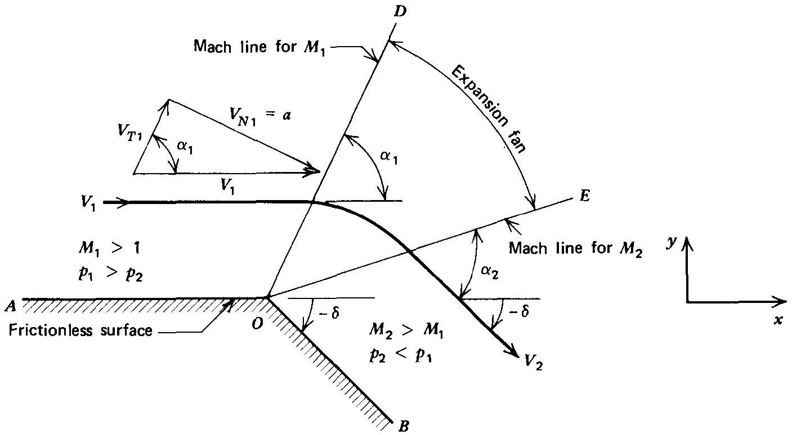
Figure 8.1 Flow expansion from $M_{1}$ to $M_{2}$ around a sharp convex corner.

## 8-3 SIMPLE WAVES ${ }^{\mathbf{1} \boldsymbol{-} \mathbf{4}}$

Expansion waves and compression waves are phenomena that may appear in supersonic flows. It is shown in Chapter 7 that if the initial flow is steady and uniform, oblique shock waves may be analyzed by applying one-dimensional techniques.

Certain types of expansion waves in a steady uniform parallel two-dimensional flow may also be analyzed by one-dimensional techniques. Such expansion waves are called either simple waves or Prandtl-Meyer waves, after L. Prandtl and T. Meyer who originated the theory of such expansion waves in 1908. ${ }^{1}$

In this section, the general features and theory of simple waves are discussed, and their governing equations are derived. In Section 8-4, solutions to the latter equations are obtained for a perfect gas, and in Section 8-5 their solutions for an imperfect gas are presented.

## 8-3(a) General Features of Simple Waves

It is pointed out in Section 3-8(b) that if a small pressure disturbance is propagated from a geometric point into a supersonic flow field, its influence is confined to the region enclosed within the Mach cone (see Fig. 3.15); for the latter, the Mach angle $\alpha$ is given by

$$
\alpha=\sin ^{-1}\left(\frac{1}{M}\right)
$$

The strength of the small disturbance considered in Section 3-8(b) is comparable to that of a sound wave. Moreover, because a point source does not occupy any finite space, it cannot produce a finite disturbance. Any changes in the properties of the fluid in back of the Mach cone must, therefore, be infinitesimally small. Consequently, a Mach line in a supersonic flow may be regarded as the limit approached by a shock wave as its strength $\beta=\left(p_{2}-p_{1}\right) / p_{1}$ approaches zero.

The Mach angle $\alpha$ has physical significance only for either a sonic flow ( $M=1$ ) or a supersonic flow ( $M>1$ ), because $\sin \alpha$ cannot exceed unity. For a sonic flow, $\alpha=90 \mathrm{deg}$, and the Mach cone transforms into a plane perpendicular to the flow velocity. Figure 8.2 illustrates schematically a steady uniform two-dimensional flow in the $x y$ plane. The streamlines are parallel to the $x$ axis, and the Mach lines for a sonic flow are straight lines perpendicular to the streamlines; that is, they are parallel to the $y$ axis. For a steady uniform supersonic flow, the Mach lines are straight lines inclined to the streamlines at the Mach angle $\alpha$.

Figure 8.1 illustrates schematically a steady uniform two-dimensional supersonic flow, having the Mach number $M_{1}$, that wets the frictionless surface $A O$, where surface $A O$ is parallel to the $x$ axis. At point $O$ the flow encounters a sharp convex corner formed by the frictionless surfaces $A O$ and $O B$; note that surface $O B$ slopes away from the incident flow, that has the uniform velocity $V_{1}$. Obviously, if the flow is eventually to become parallel to the surface $O B$, it must accelerate after encountering the disturbance caused by the convex corner $O$; that is, the fluid must expand. Consequently, the static pressure $p_{2}$ of the fluid flowing parallel to surface $O B$ must be smaller than $p_{1}$, the static pressure for the fluid flowing parallel to surface $A O$. The steady uniform two-dimensional supersonic flow around a convex corner described in the foregoing is known as a Prandtl-Meyer expansion.

The Prandtl-Meyer analysis for the steady uniform supersonic flow of a compressible fluid around a sharp convex corner is based on the following assumptions and observations.

1. The flow is steady two-dimensional and isentropic throughout the flow field.
2. Before the compressible fluid begins turning around the corner, all of the streamlines are straight and parallel to the surface $A O$ (Fig. 8.1).
3. All of the flow properties in the flow field upstream to where the turn commences have constant values.

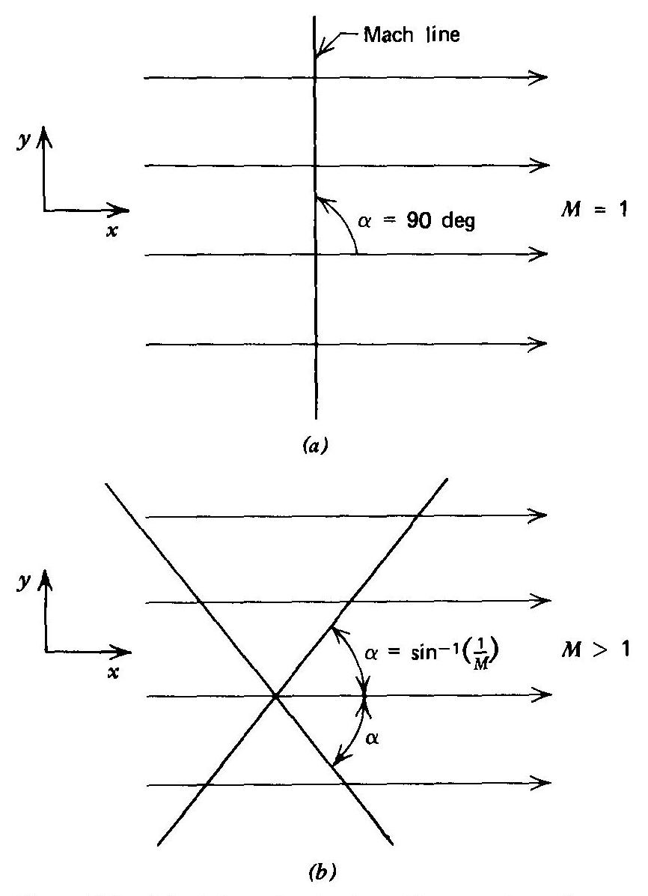
Figure 8.2 Mach lines in steady uniform sonic and supersonic flows. (a) Sonic flow. (b) Supersonic flow.

4. All of the flow properties in the flow field are constant after the turning of the fluid is completed, so that the streamlines for the turned flow are parallel to the surface $O B$.
5. All of the flow properties along every Mach line emanating from the corner $O$ are constant; consequently, each Mach line is a straight line.

No justification for item 5 is presented in this chapter. In Section 12-6, however, where a rigorous mathematical basis is employed for developing the concept of simple waves, it is shown that such waves have the following intrinsic features:

1. A simple wave region is one in which the velocity magnitude $V$ and the streamline angle $\theta$ are not independent [i.e., $V=V(\theta)$ ].
2. In a simple wave region, the Mach lines of one family are straight lines, and along each Mach line of that family, the flow properties are constant.
3. If a region of uniform flow adjoins a nonuniform region, then the nonuniform region must be a simple wave region.

According to item 1, the expansion region, called the expansion fan (see Fig. 8.1), associated with the supersonic flow around a convex corner is a simple wave region. Accordingly, each Mach line inside of the expansion fan must be a straight line along which the flow properties are uniform. To completely specify the expansion flow field, the relationship $V=V(\theta)$ must be determined.

Since the disturbance produced by the corner (see Fig. 8.1) is very weak, a Mach wave or Mach line $O D$ is propagated radially outward from the corner into the incident supersonic flow. Upstream to the Mach line $O D$, which makes the Mach
angle $\alpha=\sin ^{-1}\left(1 / M_{1}\right)$ with the direction of $V_{1}$, the supersonic flow is unaware of the disturbance because of the corner $O$. Because the flow upstream to the Mach line $O D$ has constant flow properties, the Mach line $O D$ is a straight line. The fluid velocity perpendicular to $O D$ is equal to the local speed of sound $a_{1}$, because $V_{N 1}= V_{1} \sin \alpha_{1}=V_{1} / M_{1}=a_{1}$.
After crossing the Mach line $O D$, the flow turns and accelerates, and all of the changes in the static pressure of the fluid are transmitted by a series of Mach lines (radial lines) emanating outward from the convex corner $O$. After crossing the last of that series of Mach lines the expansion of the fluid is completed, and the fluid flows parallel to the surface $O B$ with the velocity $V_{2}$. As a consequence of the expansion, the final Mach number $M_{2}>M_{1}$. Let $O E$ denote the final Mach line of the expansion fan; the Mach line $O E$ makes the Mach angle $\alpha_{2}=\sin ^{-1}\left(1 / M_{2}\right)$ with the final direction of the fluid stream. Consequently, in the expansion fan bounded by the Mach lines $O D$ and $O E$, the fluid is accelerated from $V_{1}$ to $V_{2}$ (or its Mach number changes from $M_{1}$ to $M_{2}$ ), and its static pressure is decreased from $p_{1}$ to $p_{2}$. Moreover, the fluid stream is deflected through the flow deflection angle $-\delta$.

## 8-3(b) Governing Equation for a Prandtt-Meyer Flow

Figure 8.3 illustrates the turning of a steady uniform supersonic flow through an infinitesimal angle $-d \delta$; the angle $\delta$ is termed the flow deflection angle. Note that the coordinate system specified in the figure defines $\delta$ as being positive when it increases in the counterclockwise direction, which is conventional. Line $O D$ is assumed to be a straight Mach line that turns the flow through the negative flow deflection angle $-d \delta$ while accelerating it from $V$ to $V+d V$.

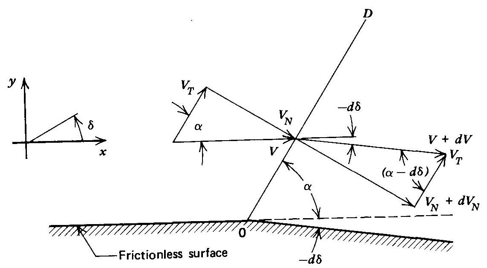
Figure 8.3 Infinitesimal turning of a steady uniform supersonic stream.

The flow deflection process is analyzed in a manner similar to that employed in analyzing the oblique shock wave in Section 7-6. The velocities $V$ and $V+d V$ are resolved into their tangential and normal components, as illustrated in Fig. 8.3. As in the case of an oblique shock wave, there is no pressure gradient along the Mach wave, so that the tangential velocity component has the same value on both sides of the wave (see equation 7.83). Hence,

$$
V_{T}=V \cos \alpha=(V+d V) \cos (\alpha-d \delta)
$$

Expanding $\cos (\alpha-d \delta)$ gives

$$
\cos (\alpha-d \delta)=\cos \alpha \cos d \delta+\sin \alpha \sin d \delta=\cos \alpha+d \delta \sin \alpha
$$

where, for the infinitesimal flow deflection angle $d \delta, \cos d \delta \approx 1$ and $\sin d \delta \approx d \delta$. Substituting equation 8.2 into equation 8.1, and dropping higher-order terms, yields

$$
\frac{d V}{V}=-\tan \alpha d \delta
$$

From Fig. 8.4, it is seen that

$$
\tan \alpha=\frac{1}{\sqrt{M^{2}-1}}
$$

Combining equations 8.3 and 8.4 gives

$$
d \delta=-\sqrt{M^{2}-1} \frac{d V}{V}
$$

Equation 8.5 is the governing differential equation for a Prandtl-Meyer flow. Its integration requires knowledge of the relationship between the velocity $V$ and the Mach number $M$. For a perfect gas, the integration of equation 8.5 is presented in Section 8-4. A procedure for taking into account imperfect gas effects is presented in Section 8-5.

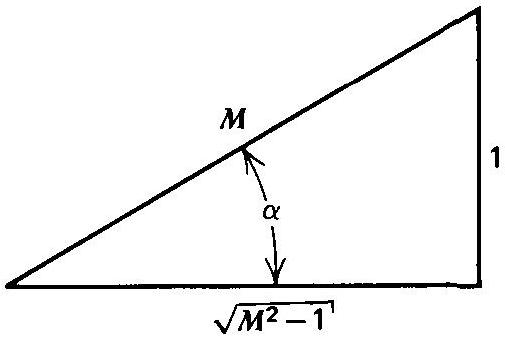
Figure 8.4 Mach angle geometry.

## 8-4 SIMPLE WAVES IN A PERFECT GAS

In this section, equation 8.5 is integrated for the flow of a perfect gas. Thus, from the definition of the Mach number $M$ and the speed of sound $a$ in a perfect gas (see Section 1-17),

$$
V^{2}=M^{2} a^{2}=M^{2} \gamma R t
$$

For the steady isentropic flow considered here, the stagnation temperature $T$ is constant. From equation 3.181, Table 3.3,

$$
\frac{T}{t}=1+\frac{\gamma-1}{2} M^{2}
$$

Combining equations 8.6 and 8.7 gives

$$
V^{2}=\frac{\gamma R T M^{2}}{1+\frac{\gamma-1}{2} M^{2}}=\frac{a_{o}^{2} M^{2}}{1+\frac{\gamma-1}{2} M^{2}}
$$

## 428 EXPANSION WAVES

where $a_{o}=(\gamma R T)^{1 / 2}$ is the stagnation acoustic speed, and is a constant for the flow. Equation 8.8 is the required relationship between $V$ and $M$. It is valid only for a perfect gas.

Differentiating equation 8.8 logarithmically gives

$$
\frac{d V}{V}=\frac{1}{1+\frac{\gamma-1}{2} M^{2}} \frac{d M}{M}
$$

Eliminating $d V / V$ from equation 8.5 by means of equation 8.9 yields

$$
d \delta=-\frac{\sqrt{M^{2}-1}}{1+\frac{\gamma-1}{2} M^{2}} \frac{d M}{M}
$$

Equation 8.10 is the governing differential equation for the simple wave flow of a perfect gas, in terms of $\delta$ and $M$.

## 8-4(a) The Prandtl-Meyer Angle

The integration of equation 8.10 yields

$$
\delta=-\sqrt{\frac{\gamma+1}{\gamma-1}} \tan ^{-1} \sqrt{\frac{\gamma-1}{\gamma+1}\left(M^{2}-1\right)}+\tan ^{-1} \sqrt{M^{2}-1}+\text { constant }
$$

The constant of integration may be determined if the initial Mach number $M_{1}$ and the flow deflection angle $\delta_{1}$ are known. In particular, if the initial Mach number $M_{1}$ is unity and the initial flow deflection angle $\delta_{1}$ is zero, as illustrated in Fig. 8.5,

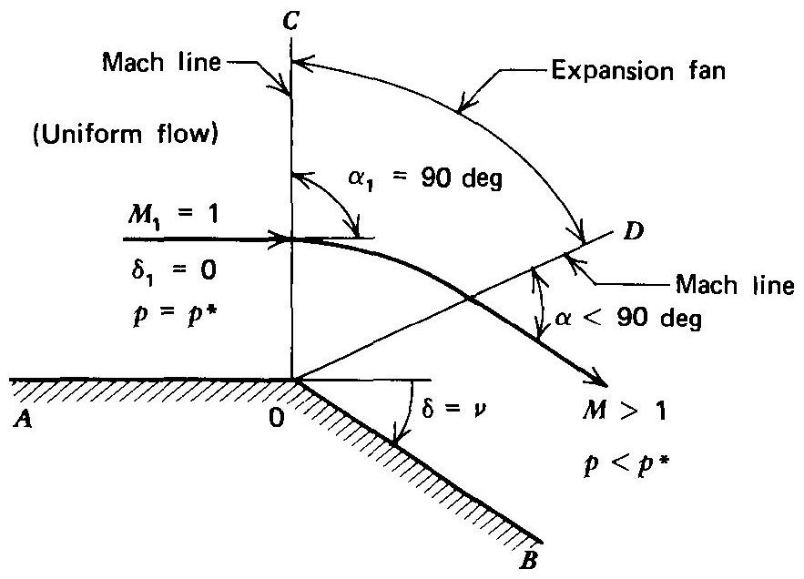
Figure 8.5 Flow expansion from $M=1$ to $M=M$.

the constant in equation 8.11 is zero. For that special case, the symbol $\delta$ is replaced by the symbol $v$, and equation 8.11 becomes

$$
v=-\sqrt{b} \tan ^{-1} \sqrt{\frac{\left(M^{2}-1\right)}{b}}+\tan ^{-1} \sqrt{M^{2}-1}
$$

where

$$
b=\frac{\gamma+1}{\gamma-1}
$$

The flow deflection angle $v$, given by equation 8.12, is known as the Prandtl-Meyer angle; it is the angle through which an initially sonic flow must be deflected to expand it to the supersonic Mach number $M$. For clockwise rotation of the flow, as assumed in the derivation, $v$, as obtained from equation 8.12 is always negative. Because equation 8.10 is derived for a steady two-dimensional planar flow, the results given by equations 8.11 and 8.12 are restricted to that type of flow. Figure 8.6 presents the Prandtl-Meyer angle $v$ as a function of the Mach number $M$ for $\gamma=1.4$. Table C. 13 presents $\nu$ as a function of the Mach number $M$ for several values of $\gamma$.

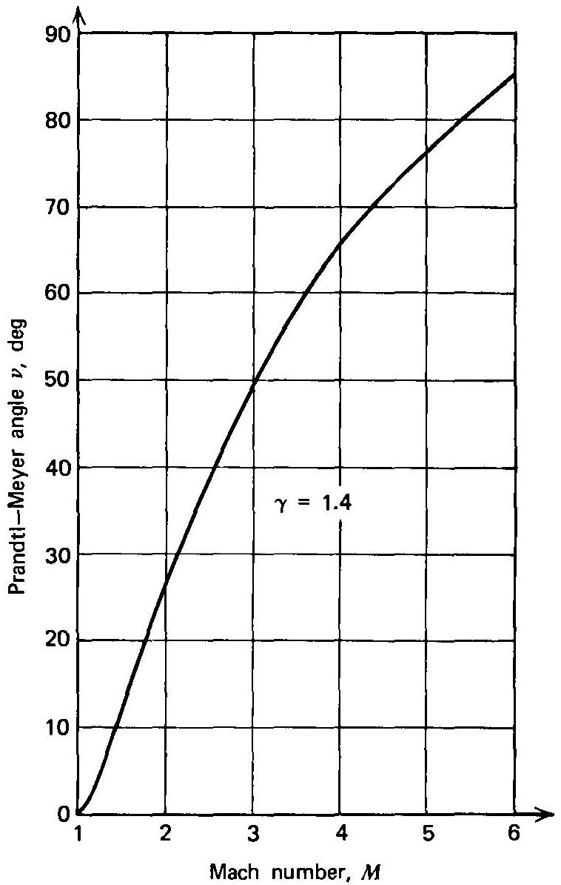
Figure 8.6 The Prandtl-Meyer angle $v$ as a function of the Mach number $M$ for $\gamma=1.4$.

The flow deflection angle $\delta$ that expands a flowing fluid from an initial Mach number $M_{1}$ larger than unity to a final Mach number $M_{2}>M_{1}$ is given by $\delta= v_{2}-v_{1}$. The equivalent physical processes are illustrated schematically in Fig. 8.7. It is assumed that a sonic flow ( $M_{o}=1, v_{o}=0$ ) is expanded to the actual initial Mach number $M_{1}$ and turned through the flow deflection angle $v_{1}$, in Region $A$. It is then imagined that a fictitious flow is expanded from $M_{0}=1$ to $M_{2}$ and turned through the flow deflection angle $v_{2}$, as illustrated in Region $B$. In Region $C$, the expansion process in Region $A$ is subtracted from that in Region B. The result is an expansion from $M_{1}$ to $M_{2}$ with a flow deflection angle $\delta=v_{2}-v_{1}$. From equation 8.12, $\delta$ is given by

$$
\begin{aligned}
& \delta=v_{2}-v_{1}=-\sqrt{b}\left\{\tan ^{-1}\right. {\left.\left[\frac{\left(M_{2}^{2}-1\right)}{b}\right]^{1 / 2}-\tan ^{-1}\left[\frac{\left(M_{1}^{2}-1\right)}{b}\right]^{1 / 2}\right\} } \\
&+\left[\tan ^{-1}\left(M_{2}^{1 / 2}-1\right)^{1 / 2}-\tan ^{-1}\left(M_{1}^{2}-1\right)^{1 / 2}\right]
\end{aligned}
$$

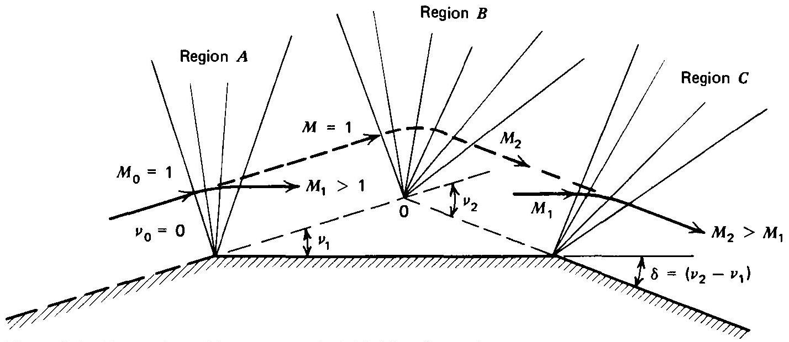
Figure 8.7 Expansion with a supersonic initial Mach number.

Once the Mach number for the flow has been determined for a given flow deflection angle $\delta$ from equation 8.13, the remaining flow variables may either be calculated by applying the isentropic flow equations, or obtained directly from Table C.6. In solving numerical problems, instead of employing equation 8.13, it is more straightforward to determine $M_{2}$ for a given $M_{1}$ and $\delta$, by recalling that $\delta=\left(v_{2}-v_{1}\right)$, and employing either Fig. 8.6 or Table C.13. The solution of equation 8.13 for $M_{2}$ generally requires a time-consuming iterative procedure.

The results developed above apply to the flow around a corner wherein the flow turns in a clockwise (or negative angular) direction, as illustrated in Fig. 8.1. In a real flow the fluid may turn around a convex corner in a counterclockwise (or positive angular) direction, as illustrated in Fig. 8.8. Such a flow may be analyzed in the same manner as is the case of clockwise turning, by assuming an infinitesimal turning angle $(+d \delta)$ in equation 8.1. The remainder of the analysis is identical to that dis= cussed above, with the change in the sign of $d \delta$ carrying through to the final result. Hence, for a Prandtl-Meyer flow with counterclockwise turning of the flow, equation 8.12 changes to

$$
v=+\sqrt{b} \tan ^{-1}\left[\frac{\left(M^{2}-1\right)}{b}\right]^{1 / 2}-\tan ^{-1}\left(M^{2}-1\right)^{1 / 2}
$$

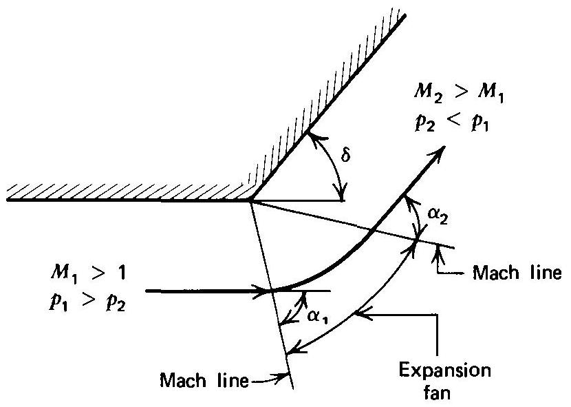
Figure 8.8 Counterclockwise Prandtl-Meyer expansion.

Equations 8.12 and 8.14 may, therefore, be combined to yield

$$
\pm v=\sqrt{b} \tan ^{-1}\left[\frac{\left(M^{2}-1\right)}{b}\right]^{1 / 2}-\tan ^{-1}\left(M^{2}-1\right)^{1 / 2}
$$

where the $+v$ refers to counterclockwise turning, and the $-v$ refers to clockwise turning. With the aforementioned interpretation, graphical and tabular results for the Prandtl-Meyer angle $v$ as a function of the Mach number $M$ may be employed for turning in either direction; the + or - sign being chosen according to the direction of the turning for the flow.

The flow deflection angle $\delta$ is related to the initial and final Prandtl-Meyer angles $v_{1}$ and $v_{2}$. For either clockwise or counterclockwise turning,

$$
\delta=v_{2}-v_{1}
$$

where $\nu$ and $\delta$ are negative for clockwise turning and positive for counterclockwise turning.

A FORTRAN computer program, subroutine PMEYER, for determining the Prandtl-Meyer angle is presented below. The input comprises $\mathrm{G}(1), \mathrm{G}(2), \ldots, \mathrm{G}(5)$, which are five values of the specific heat ratio $\gamma$, and the parameters $\mathrm{J}(\mathrm{I})$ and $\mathrm{DM}(\mathrm{I})$ discussed in Section 4-4(b). The results presented in Table C. 13 are obtained with the following specification.

```
G(1)=1.1, G(2)=1.2, G(3)=1.3, G(4)=1.4, G(5)=1.67,
J(1)=50,J(2)=40,J(3)=40,J(4)=4,J(5)=15,J(6)=0,
DM(1)=0.02, DM(2)=0.05, DM(3)=0.1, DM(4)=0.5, DM(5)=1.0
        SUBROUTINE PMEYER
C PRANDTL-MEYER ANGLE FOR A PERFECT GAS
        REAL M $ DIMENSION G(5),J(9),DM(9),PM(5),B(5) $ DATA INF/6H INFIN/
        NAMELIST /DATA/ G.J.DM $ REAO (5.DATA)
        DO 20 KK=1.5 $ B(KK)=(G(KK)+1.0)/(G(KK)-1.0) $ PM(KK)=0.0
    20 CONTINUE $ M=1.0 $ WRITE (6,2000) (G(I),I=1,5)
        WRITE (6.2010) M.(PM(I),I=1.5) $ I=1 $ L=0 $ RAD=57.29518
C CALCULATE THE PRANDTL-MEYER ANGLE
    3o N=J(I) $ DO 50 K=1,N $ M=M+DM(I) $ A=M**2-1.0 $ DO 40 KK=1,5
        PM(KK)=(SQRT(B(KK))*ATAN(SQRT(A/B(KK)))-ATAN(SQRT(A)))*RAO
    40 CONTINUE $ WRITE (6,2010) M,(PM(KK),KK=1,5) $ L=L+1
        IF (L.LT.50) GO TO 50 $ WRITE (6,2000) (G(KK),KK=1,5) $ L=0
    50 CONTINUE $ I=1+1 $ IF((I.EQ.10,).OR.(J(I).EQ.O)) GO TO 60 $GO TO 30
    60 DO 70 KK=1.5 $ PM(KK)=90.0*(SQRT(B(KK))-1.0)
    7O CONTINUE $ WRITE (6,2020) INF,(PM(KK),KK=1,5) $ RETURN
2000 FORMAT (1H1,21X,19HPRANDTL-MEYER ANGLE//4X,1HM,4X,5(4HG = .F4.2.
        13X//1H )
2010 FORMAT (1H ,F5.2,5F11.4)
2020 FORMAT (A6,5F11.4)
        END
```

Example 8.1. A uniform flow of air having a Mach number of unity expands around a convex (expansion) corner that turns the flow through an angle of 20 deg counterclockwise (i.e., in the positive angular direction). Calculate the final Mach number.

## Solution

Since the initial flow is sonic, the initial Prandtl-Meyer angle $v_{1}$ is zero. From equation $8.16, \delta=v_{2}-v_{1}$. Thus,

$$
v_{2}=v_{1}+\delta=0+20=20 \mathrm{deg}
$$

From Table 13, for $v_{2}=20 \mathrm{deg}$,

$$
M_{2}=1.775
$$

Example 8.2. It is desired to expand a uniform sonic stream of air to a Mach number of 2.0 by turning it around a sharp convex corner. What is the required turning angle?

## Solution

From Table C.13, for $M_{2}=2.0, v_{2}=26.5$ deg. Since $v_{1}=0$ for sonic flow, equation 8.16 yields

$$
\delta=v_{2}-v_{1}=26.5-0=26.5 \mathrm{deg}
$$

A turning angle of either 26.5 deg or -26.5 deg will expand an initially sonic flow to a Mach number of 2.0 .

Example 8.3. Air at a Mach number of 1.4 expands around a sharp convex corner that turns it through an angle of 20 deg. What is the final Mach number?

## Solution

From Table C.13, for $M_{1}=1.4, v_{1}=9$ deg. From equation $8.16, \delta=v_{2}-v_{1}$. Hence,

$$
v_{2}=v_{1}+\delta=9+20=29 \mathrm{deg}
$$

From Table C.13, for $v_{2}=29 \mathrm{deg}$,

$$
M_{2}=2.096
$$

Example 8.4. A perfect gas having $\gamma=1.4$ approaches a sharp convex corner with a Mach number $M_{1}=2.0$. After expanding around the corner, the final direction of the flow is -10 deg (clockwise) from its initial direction. The initial static pressure and temperature of the gas are $p_{1}=1.0133 \cdot 10^{5} \mathrm{~N} / \mathrm{m}^{2}$ and $t_{1}=290 \mathrm{~K}$. Assuming that the expansion process is isentropic, determine (a) the final Mach number, (b) the final static pressure, and (c) the final static temperature.

## Solution

(a) From Table C.13, for $M_{1}=2.0, v_{1}=-26.38 \mathrm{deg}$ for clockwise turning. From equation $8.16, \delta=v_{2}-v_{1}$. Thus,

$$
v_{2}=v_{1}+\delta=-26.38-10=-36.38 \mathrm{deg}
$$

From Table C.13, for $v_{2}=36.38 \mathrm{deg}$,

$$
M_{2}=2.383
$$

(b) Since the flow is isentropic, the stagnation pressure $P$ is constant. From Table C.6, for $M_{1}=2.0$ and $M_{2}=2.383, p_{1} / P=0.12780$ and $p_{2} / P=0.06992$. Thus,

$$
p_{2}=p_{1}\left(\frac{P}{p_{1}}\right)\left(\frac{p_{2}}{P}\right)=\frac{(1.0133) 10^{5}(0.06992)}{0.12780}=0.5544 \cdot 10^{5} \mathrm{~N} / \mathrm{m}^{2}\left(8.040 \mathrm{lbf} / \mathrm{in}^{2}\right)
$$

(c) Since the flow is adiabatic, the stagnation temperature $T$ is constant. From

Table C.6, for $M_{1}=2.0$ and $M_{2}=2.383, t_{1} / T=0.55556$ and $t_{2} / T=0.46760$. Thus,

$$
t_{2}=t_{1}\left(\frac{T}{t_{1}}\right)\left(\frac{t_{2}}{T}\right)=\frac{(290)(0.46760)}{0.55556}=244.1 \mathrm{~K}(439.4 \mathrm{R})
$$

Example 8.5. The flow described in Example 8.4 is expanded through a 10 deg (counterclockwise) turn (see Fig. 8.8). Determine the Mach number after the turn.

## Solution

(a) From Table C.13, for $M_{1}=2.0, v_{1}=26.38 \mathrm{deg}$ for counterclockwise turning. From equation $8.16, \delta=v_{2}-v_{1}$. Thus,

$$
v_{2}=v_{1}+\delta=26.38+10=36.38 \mathrm{deg}
$$

From Table C.13, for $v_{2}=36.38 \mathrm{deg}$,

$$
M_{2}=2.383
$$

Example 8.6. Figure 8.9a illustrates diagrammatically a two-dimensional doublewedge profile that moves through the atmosphere, at sea level, at zero angle of attack with $M=3.0$. Calculate the lift and drag per unit length $\ell$ of the wedge. The top slanted surfaces of the wedge are each 1.0 m wide.

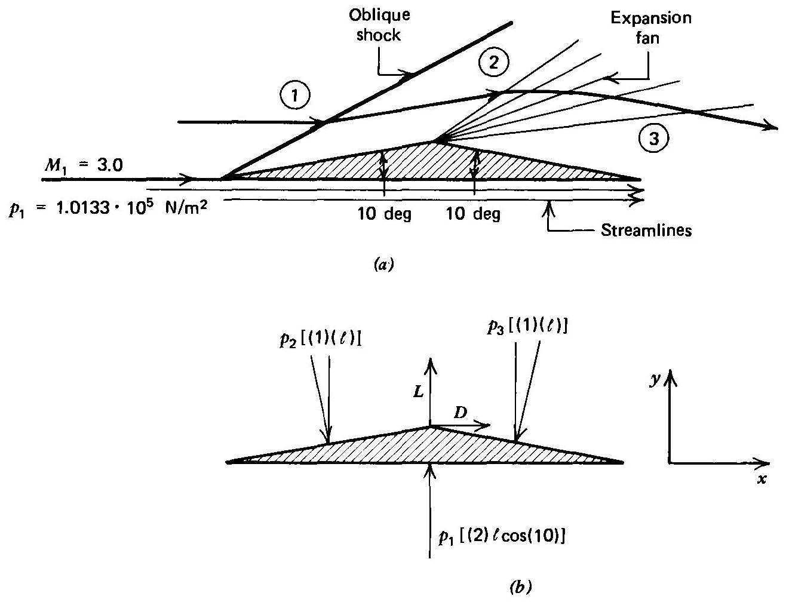
Figure 8.9 Sketch for Example 8.6. (a) Flow pattern. (b) Forces acting on the wedge.

## Solution

An oblique shock wave forms at the leading edge, a Prandtl-Meyer expansion fan forms at the top corner, the underside flow remains parallel to the $x$ axis, and the intersection of the two flows at the trailing edge may be neglected, since it does not
affect the pressure on the wedge. The aforementioned phenomena are illustrated in Fig. 8.9a. A force diagram is presented in Fig. 8.9b, where $L$ and $D$ are the aerodynamic lift and drag forces, respectively, exerted by the fluid on the wedge.

From Table C.12, for $M_{1}=3.0$ and $\delta=10 \mathrm{deg}, \varepsilon=27.38 \mathrm{deg}$. From equation 7.99,

$$
M_{1}^{\prime}=M_{1} \sin \varepsilon=3.0 \sin (27.38)=1.380
$$

From Table C.11, for $M_{1}=1.380, M_{2}^{\prime}=0.74829$ and $p_{2} / p_{1}=2.055$, where $p_{1}= 1.0133 \cdot 10^{5} \mathrm{~N} / \mathrm{m}^{2}$. Hence, $p_{2}=(2.055)(1.0133) 10^{5}=2.082 \cdot 10^{5} \mathrm{~N} / \mathrm{m}^{2}$. From equation 7.100,

$$
M_{2}=\frac{M_{2}^{\prime}}{\sin (\varepsilon-\delta)}=\frac{0.74829}{\sin (27.38-10)}=2.505
$$

The flow deflection angle $\delta$ for the Prandtl-Meyer expansion is 20 deg . From Table C.13, for $M=2.505, v_{2}=39.24 \mathrm{deg}$. Thus,

$$
v_{3}=v_{2}+\delta=39.24+20=59.24 \mathrm{deg}
$$

From Table C.13, for $v=59.24 \mathrm{deg}, M_{3}=3.545$. From Table C.6, for $M_{2}=2.505$ and $M_{3}=3.545, p_{2} / P_{2}=0.05808$ and $p_{3} / P_{3}=0.01230$. Since the expansion is isentropic, $P_{2}=P_{3}$. Thus,

$$
p_{3}=p_{2}\left(\frac{p_{3}}{P_{3}}\right)\left(\frac{P_{2}}{p_{2}}\right)=\frac{(2.082) 10^{5}(0.01230)}{(0.05808)}=0.4409 \cdot 10^{5} \mathrm{~N} / \mathrm{m}^{2}
$$

Refer to Fig. 8.9b. The lift force $L$ for a wedge having a length $\ell$ measured in meters is

$$
\begin{aligned}
L=-(2.082) 10^{5}[(1) \ell] \cos (10)-(0.4409) 10^{5}[(1) \ell] \cos (10) & \\
& +(1.0133) 10^{5}[(2) \ell \cos (10)]=-48,876 \ell \mathrm{~N}
\end{aligned}
$$

Similarly, the drag force $D$, is

$$
D=(2.082) 10^{5}[(1) \ell] \sin (10)-(0.4409) 10^{5}[(1) \ell] \sin (10)=28,497 \ell \mathrm{~N}
$$

## 8-4(b) Maximum Prandtl-Meyer Angle

The maximum value of the Prandtl-Meyer angle $\pm v$ for a given flow is obtained when the final Mach number is infinite. If $M=\infty$ is substituted in equation 8.15, the maximum Prandtl-Meyer angle, denoted by $\pm v_{\text {max }}$, is obtained. Thus,

$$
\pm v_{\max }=\lim _{M \rightarrow \infty} \pm v= \pm \frac{\pi}{2}(\sqrt{b}-1)
$$

For gases with $\gamma=1.4, \pm v_{\text {max }}$ is

$$
\pm v_{\max }= \pm 90(\sqrt{6}-1)= \pm 130.45 \mathrm{deg}
$$

The theory, therefore, indicates that a supersonic flow may be accelerated and turned through quite large angles around a sharp convex corner without the flow separation phenomena that would occur in a subsonic flow (see Section 5-10). It should be realized, however, that the Prandtl-Meyer analysis assumes that the fluid is perfect ( $\mu=0$ ). In the case of a real fluid, the flow deflection angles that are obtainable without flow separation from the surface are smaller than those predicted by the Prandtl-Meyer theory. Moreover, the maximum Prandtl-Meyer angle $\pm v_{\text {max }}$ corresponds to $p=0$. At zero static pressure, the assumption that the fluid is a continuum is no longer valid. Figure 8.10 presents the calculated values of the maximum flow deflection angle $\delta_{\text {max }}=v_{\text {max }}-v_{1}$ as a function of the initial Mach number $M_{1}$, for $\gamma=1.40$.

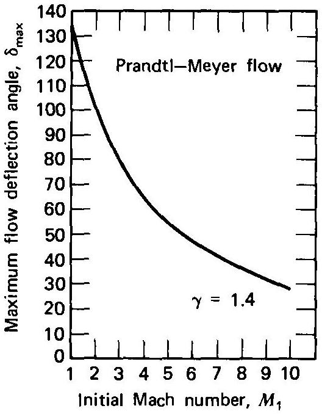
Figure 8.10 The maximum flow deflection angle $\delta_{\text {max }}$ for a two-dimensional flow as a function of the initial Mach number $M$ for $\gamma=1.4$.

## 8-4(c) Expanding Supersonic Flow over Successive Corners and Convex Surfaces

Consider the situation where a steady uniform supersonic flow is expanded over several consecutive sharp convex corners, as illustrated in Fig. 8.11a. Since the flow is initially parallel to the surface $A B$, a Mach line $B L_{1}$ emanates from the corner $B$, making the angle $\alpha_{1}$ with the initial flow direction; $\alpha_{1}=\sin ^{-1}\left(1 / M_{1}\right)$. The expansion of the fluid as it flows around corner $B$ causes an expansion fan to be formed that is bounded by the Mach lines $B L_{1}$ and $B L_{2}$, the latter making the angle $\alpha_{2}$ with the direction of the expanded flow; $\alpha_{2}=\sin ^{-1}\left(1 / M_{2}\right)$. Between the corners $B$ and $C$, the flow streamlines are parallel to the frictionless surface $B C$ until the corner $C$ is reached. At $C$ there is the Mach line $C L_{1}$ making the angle $\alpha_{2}$ with the gas flowing upstream to it; that is, $C L_{1}$ is parallel to $B L_{2}$. Beyond $C$ the conditions repeat themselves.

The preceding results may be applied directly to the steady uniform supersonic flow of a compressible fluid over a convex curved surface such as that illustrated in Fig. 8.11b. Referring to Fig. 8.11a, if the several distances $B C, C D$, etc., are made infinitesimally small, as illustrated in Fig. 8.11b, the successive sharp corners disappear and a smooth frictionless convex surface $B D$ is formed. At each point $N$ on the convex surface $B D$, the flow deflection angle $\delta_{N}$ is known. Knowing $\delta_{N}$, the value of $M_{N}$ and the Mach angle $\alpha_{N}$ may be calculated. Accordingly, the expansion of a compressible fluid flowing over a convex curved surface may be analyzed in a manner similar to that employed for analyzing the steady uniform supersonic flow around a convex corner.

Example 8.7. Air flows over a succession of three convex corners having flow deflection angles of $5 \mathrm{deg}, 10 \mathrm{deg}$, and 20 deg . The initial Mach number is 1.40 . Determine the Mach number after each corner.

## Solution

From Table C.13, for $M_{1}=1.40$, the initial Prandtl-Meyer angle $v_{1}$ is 9 deg. After the first corner, the Prandtl-Meyer angle $v_{2}$, is

$$
v_{2}=v_{1}+\delta_{1}=9+5=14 \mathrm{deg}
$$

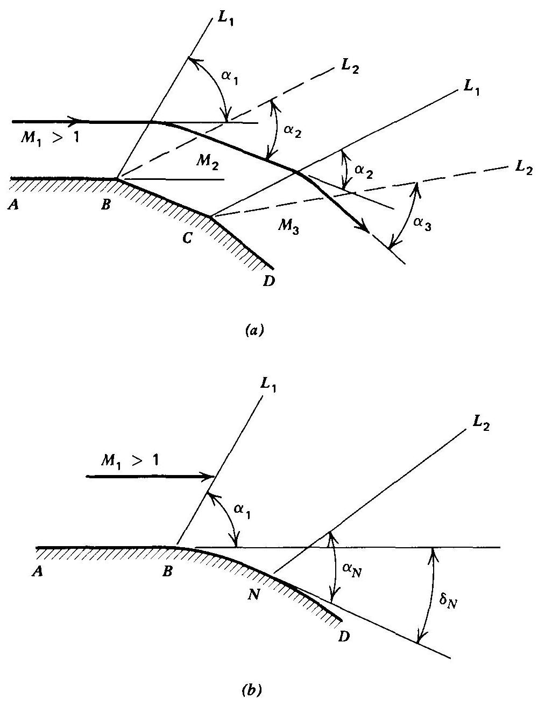
Figure 8.11 Expansive flow over successive corners and convex surfaces. (a) Expansive flow over successive corners. (b) Expansive flow over a convex surface.

From Table C.13, for $v=14 \mathrm{deg}$,

$$
M_{2}=1.571
$$

After the second corner, the Prandtl-Meyer angle $v_{3}$ is

$$
v_{3}=v_{2}+\delta_{2}=14+10=24 \mathrm{deg}
$$

From Table C.13, for $v=24 \mathrm{deg}$,

$$
M_{3}=1.915
$$

After the third corner, the Prandtl-Meyer angle $v_{4}$ is given by

$$
v_{4}=v_{3}+\delta_{3}=24+20=44 \mathrm{deg}
$$

From Table C.13, for $v=44 \mathrm{deg}$, we obtain

$$
M_{4}=2.718
$$

As a check, the total flow deflection angle is 35 deg . Thus,

$$
v_{4}=v_{1}+\sum \delta=9+35=44 \mathrm{deg}
$$

From Table C.13, for $v=44 \mathrm{deg}$, the Mach number is

$$
M_{4}=2.718
$$

## 8-5 SIMPLE WAVES IN IMPERFECT GASES

The governing equation for a simple wave flow, equation 8.5, may be written in the following form. Thus,

$$
d \delta=-\frac{\sqrt{M^{2}-1}}{V} d V
$$

In Section 8-4, the above equation is integrated for the case of a perfect gas. In the present section, a method is presented for integrating equation 8.5 for an imperfect gas.

In Section 4-5, the principal sources of imperfect gas effects are discussed. It is pointed out that for an imperfect gas which behaves as a simple system, its equation of state may be written in the following form.

$$
\rho=\rho(h, s), \quad t=t(h, s), \quad a=a(h, s), \quad \text { etc. }
$$

Simple wave flows, by definition, are isentropic, so that equation 8.18 may be written as

$$
\rho=\rho(h), \quad t=t(h), \quad a=a(h), \quad \text { etc. }
$$

From equation 3.164, Table 3.1, the energy equation for an adiabatic flow with no body forces ( $g d z=0$ ), is

$$
h+\frac{V^{2}}{2}=H=\text { constant }
$$

Equation 8.20 shows that the enthalpy $h$ is a unique function of the flow velocity $V$. Combining equations 8.19 and 8.20 yields

$$
\rho=\rho(V), \quad t=t(V), \quad a=a(V), \quad \text { etc. }
$$

But $M=V / a$, and $a=a(V)$. Hence,

$$
M=M(V)
$$

Equation 8.5 may, therefore, be written in the form

$$
d \delta=-\frac{\sqrt{M^{2}-1}}{V} d V=f(V) d V
$$

where

$$
f(V) \equiv \frac{\sqrt{M^{2}-1}}{V}
$$

Equation 8.23 may be integrated either numerically or graphically for any fluid if its equation of state is known, for a given set of initial conditions. Thus,

$$
\delta_{2}-\delta_{1}=\int_{V_{1}}^{V_{2}} f(V) d V
$$

The results, of course, are valid only for the particular fluid and for the specific initial conditions. General solutions, such as those presented in Table C.13, are not possible for imperfect gases. Each particular problem must be solved as a special case.

One procedure for integrating equation 8.25 is presented below.

1. Determine the initial flow conditions $V_{1}, h_{1}$, and $\delta_{1}$.
2. Select several closely spaced values of $V$, increasing from $V_{1}$, subject to the limitation that $V \leqq V_{\text {max }}^{\prime}$, where $V_{\text {max }}^{\prime}$ is given by equation 3.185, Table 3.4.
3. For each value of $V$, calculate $h$ by means of equation 8.20. Then, determine the properties of interest from equation 8.19, in particular the speed of sound $a$, from which we obtain $M=V / a$.
4. Calculate $f(V)$ from equation 8.24 for each chosen value of $V$ in step 2 , and plot $f(V)$ as a function of $V$. The area under the curve of $f(V)$ versus $V$ is the value of the integral in equation 8.25. The numerical integration may be performed by any one of the standard techniques, such as actually measuring the area under the curve, the trapezoidal rule, Simpson's rule, etc. (see Appendix A-5). The solution is complete when the desired value of $\delta_{2}$ is obtained.

The above procedure is simple and straightforward, and is readily adapted to the digital computer.

Example 8.8. Consider the blow-down wind tunnel described in Examples 4.3 and 4.4. The flowing medium is air at a stagnation temperature of 2000 K and a stagnation pressure of $35 \cdot 10^{5} \mathrm{~N} / \mathrm{m}^{2}$. The wind tunnel is a two-dimensional planar flow passage with a sharp cornered throat, as illustrated in Fig. 8.12. Assume that the flow at the throat, where the Mach number $M$ is unity, is a steady uniform flow. In expanding around the sharp corner, the flow is turned through an angle of 45 deg . Calculate the flow properties after the expansion fan, assuming that the air is a thermally perfect gas, but take into account the variation of the specific heat of the air with temperature.

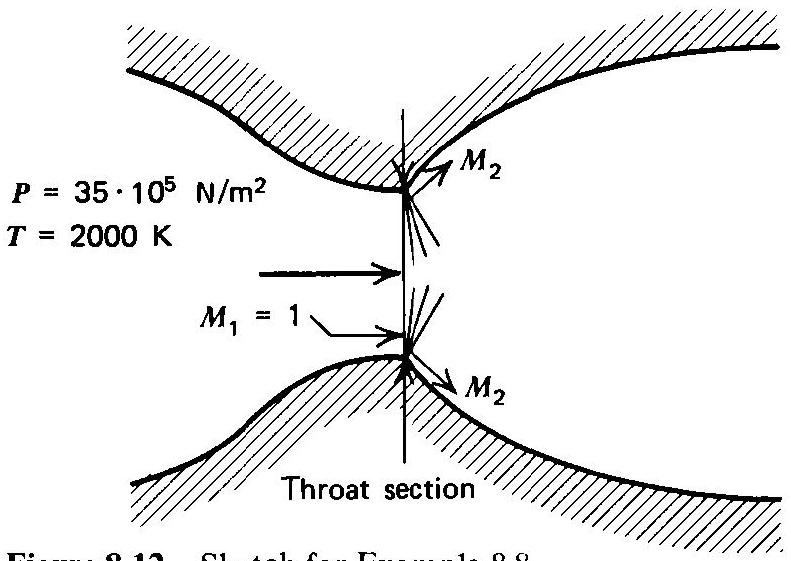
Figure 8.12 Sketch for Example 8.8.

## Solution

For a thermally perfect gas, $p=\rho R t$ and $a^{2}=\gamma R t$. Since $c_{p}=c_{p}(t)$, the caloric equation of state for air is represented by Table C.4. The stagnation enthalpy corresponding to a stagnation temperature of 2000 K is $H=2252.414 \mathrm{~kJ} / \mathrm{kg}$, and the corresponding relative stagnation pressure is $P_{r}=1520.8$. The flow properties of air at the sonic condition are determined in Example 4.3. Thus, $V_{t}=806.52 \mathrm{~m} / \mathrm{s}$, $h_{t}=1927.181 \mathrm{~kJ} / \mathrm{kg}, t_{t}=1738.3 \mathrm{~K}$, and $p_{t}=19.073 \cdot 10^{5} \mathrm{~N} / \mathrm{m}^{2}$.

As a guide, the solution based on assuming that air is a perfect gas is obtained first. At the temperature $t_{t}=1738.3 \mathrm{~K}$, Table C. 4 gives $\gamma=1.3037$. Hence, assume that $\gamma=1.30$. For $M_{1}=1.0, v_{1}=0 \mathrm{deg}$, and for $\delta=45 \mathrm{deg}$,

$$
v_{2}=v_{1}+\delta=0+45=45 \mathrm{deg}
$$

From Table C.13, for $v_{2}=45 \mathrm{deg}, M_{2}=2.5653$. From Table C.6, for $M_{t}=1.0$ and
$M_{2}=2.5653$,

$$
\begin{aligned}
& \frac{t_{t}}{T}=0.86957 \quad \frac{p_{t}}{P}=0.54573 \quad \frac{t_{2}}{T}=0.50332 \quad \frac{p_{2}}{P}=0.051180 \\
& t_{2}=t_{t}\left(\frac{T}{t_{t}}\right)\left(\frac{t_{2}}{T}\right)=\frac{(1738.3)(0.50332)}{(0.86957)}=1006.2 \mathrm{~K} \\
& p_{2}=p_{t}\left(\frac{P}{p_{t}}\right)\left(\frac{p_{2}}{P}\right)=\frac{(19.073) 10^{5}(0.051180)}{(0.54573)}=1.7887 \cdot 10^{5} \mathrm{~N} / \mathrm{m}^{2} \\
& a_{2}=\left(\gamma R t_{2}\right)^{1 / 2}=[1.3(287.04)(1006.2)]^{1 / 2}=612.75 \mathrm{~m} / \mathrm{s} \\
& V_{2}=M_{2} a_{2}=2.5653(612.75)=1571.9 \mathrm{~m} / \mathrm{s}
\end{aligned}
$$

Hence, the air velocity increases from $806.52 \mathrm{~m} / \mathrm{s}$ to $1571.9 \mathrm{~m} / \mathrm{s}$ in flowing through the expansion fan, assuming that the air is a perfect gas.

For the imperfect gas, the procedure outlined in the preceding section is followed.

1. The initial flow conditions are $V_{1}=806.52 \mathrm{~m} / \mathrm{s}, h_{1}=1927.181 \mathrm{~kJ} / \mathrm{kg}, p_{1}= 19.073 \cdot 10^{5} \mathrm{~N} / \mathrm{m}^{2}, t_{1}=1738.3 \mathrm{~K}$, and $\delta_{1}=45 \mathrm{deg}$.
2. Choose a velocity increment of $100 \mathrm{~m} / \mathrm{s}$.
3. From equation 8.20 , for $H=2252.414 \mathrm{~kJ} / \mathrm{kg}$,

$$
h=2252.414-\frac{V^{2}}{2(1000)} \mathrm{kJ} / \mathrm{kg}
$$

where $V$ is in meters per second. With $h$ known, $t$ may be found from Table C. 4 by interpolation. For a thermally perfect gas,

$$
a=(\gamma R t)^{1 / 2}
$$

Then,

$$
M=\frac{V}{a}
$$

4. Determine $f(V)$ from equation 8.24 , and integrate equation 8.25 by the trapezoidal rule [see Appendix A-5(a)].

The results are presented in the table at the end of the problem. The first row (Point 1) presents the initial data. For the second row,

$$
V_{2}=V_{1}+100=806.52+100=906.52 \mathrm{~m} / \mathrm{s}
$$

From equation (a),

$$
h_{2}=2252.414-\frac{(906.52)^{2}}{2000}=1841.525 \mathrm{~kJ} / \mathrm{kg}
$$

From Table C.4, for $h_{2}=1841.525 \mathrm{~kJ} / \mathrm{kg}, t_{2}=1668.6 \mathrm{~K}$ and $\gamma=1.3056$. From equation (b),

$$
a_{2}=[1.3056(287.04)(1668.6)]^{1 / 2}=790.77 \mathrm{~m} / \mathrm{s}
$$

From equation (c),

$$
M_{2}=\frac{906.52}{790.77}=1.1464
$$

The above results are presented in columns (2) to (5) in the aforementioned table.

The values presented in the remaining rows of the table are determined in the same manner for each velocity increment of $100 \mathrm{~m} / \mathrm{s}$.

The function $f(V)$ corresponding to each velocity listed in the table is determined from equation 8.24. Thus,

$$
f(V)=\frac{\left(M^{2}-1\right)^{1 / 2}}{V}
$$

For the initial point, $M_{1}=1$ and $f\left(V_{1}\right)=0$. For the second row in the table,

$$
f\left(V_{2}\right)=\frac{\left[(1.1464)^{2}-1\right]^{1 / 2}}{906.52}=6.1837 \cdot 10^{-4} \mathrm{~s} / \mathrm{m}
$$

The values of $f(V)$ are presented in column (6) of the table.
After $f(V)$ is computed, equation 8.25 is integrated numerically for $\delta$, employing the trapezoidal rule [see Appendix A-5(a)]. Thus, for each increment in $V$, corresponding to the rows in the table,

$$
\delta_{i+1}=\delta_{i}+\frac{1}{2}\left[f\left(V_{i+1}\right)+f\left(V_{i}\right)\right] 100 \mathrm{rad}
$$

For example, the value of $\delta_{2}$ corresponding to row 2, where the velocity is $V_{2}= 906.52 \mathrm{~m} / \mathrm{s}$, is

$$
\begin{aligned}
& \delta_{2}=\delta_{1}+\frac{1}{2}\left[f\left(V_{2}\right)+f\left(V_{1}\right)\right] 100 \\
& \delta_{2}=0.0+\frac{1}{2}\left[6.1837 \cdot 10^{-4}+0.0\right] 100=0.03092 \mathrm{rad}=1.7716 \mathrm{deg}
\end{aligned}
$$

The values of $\delta$ corresponding to the tabulated values of $V$ are presented in columns (8) and (9) of the table, in radians and degrees, respectively.

Rows 8 and 9 in the table bracket the desired flow deflection angle of 45 deg. The solution at $\delta=45 \mathrm{deg}$, obtained by linear interpolation between those two rows, is presented in row 10 .

From Table C.4, for $t_{1}=1738.3 \mathrm{~K}$ and $t_{2}=959.95 \mathrm{~K}, p_{r 1}=828.84$ and $p_{r 2}=$ 71.534. Thus,

$$
p_{2}=p_{1}\left(\frac{p_{r 2}}{p_{r 1}}\right)=\frac{\left(19.073 \cdot 10^{5}\right)(71.534)}{828.84}=1.6461 \cdot 10^{5} \mathrm{~N} / \mathrm{m}^{2}
$$

The errors caused by assuming that air is a perfect gas are presented below for the different pertinent properties of the flowing gas.

| Property | Perfect Gas | Imperfect Gas | Error, Percent |
| :--- | :---: | :---: | :---: |
| $M$ | 2.5653 | 2.6037 | -1.47 |
| $V, \mathrm{~m} / \mathrm{s}$ | 1571.9 | 1581.6 | -0.61 |
| $p, \mathrm{~N} / \mathrm{m}^{2} \cdot 10^{5}$ | 1.7887 | 1.6461 | 8.66 |
| $t, \mathrm{~K}$ | 1006.2 | 959.95 | 4.82 |

Although the errors caused by assuming that air is a perfect gas are not large in the present example, they would be significant in the design of a wind tunnel.

Results from the Numerical Procedure for Solving Example 8.8.

|  | (1) | (2) | (3) | (4) | (5) | (6) | (7) | (8) | (9) |
| :--- | :--- | :--- | :--- | :--- | :--- | :--- | :--- | :--- | :--- |
| Point | V, m/s | $h$, kJ/kg | $t$, K | $a$, m/s | $M$ | $f(V) \cdot 10^{4}$ s/m | $f(V) d V$ | $\delta$, rad | $\delta$, deg |
| 1 | 806.52 | 1927.181 | 1738.3 | 806.52 | 1.0000 | 0.0000 | - - | 0.00000 | 0.0000 |
| 2 | 906.52 | 1841.525 | 1668.6 | 790.77 | 1.1464 | 6.1837 | 0.03092 | 0.03092 | 1.7716 |
| 3 | 1006.5 | 1745.873 | 1590.3 | 772.74 | 1.3025 | 8.2916 | 0.07238 | 0.10330 | 5.9185 |
| 4 | 1106.5 | 1640.221 | 1503.3 | 752.16 | 1.4711 | 9.7508 | 0.09021 | 0.19351 | 11.0874 |
| 5 | 1206.5 | 1524.569 | 1407.3 | 728.75 | 1.6556 | 10.936 | 0.10343 | 0.29694 | 17.0136 |
| 6 | 1306.5 | 1398.917 | 1302.0 | 702.15 | 1.8607 | 12.010 | 0.11473 | 0.41167 | 23.5870 |
| 7 | 1406.5 | 1263.265 | 1186.9 | 671.87 | 2.0934 | 13.076 | 0.12543 | 0.53710 | 30.7736 |
| 8 | 1506.5 | 1117.613 | 1061.4 | 637.06 | 2.3648 | 14.225 | 0.13651 | 0.67361 | 38.5947 |
| 9 | 1606.5 | 961.961 | 924.78 | 596.83 | 2.6918 | 15.556 | 0.14891 | 0.82252 | 47.1266 |
| 10 | 1581.6 | 1001.701 | 959.95 | 607.44 | 2.6307 | - | - |  | 45.0000 |

## 8-6 SUPERSONIC FLOW OVER A CONCAVE SURFACE

The steady uniform supersonic flow of a compressible fluid into a concave corner, and over either a wedge or a cone, is characterized by abrupt changes in the direction of the incident flow and the formation of shock waves (see Chapter 7). Now consider the case of the steady uniform supersonic flow of a compressible fluid over a concave surface designed so that the changes in the direction of the incident flow occur gradually instead of abruptly, as illustrated schematically in Fig. 8.13a.

To obtain a clearer picture of the pertinent phenomenon, consider first the case where the flow is deflected through a series of consecutive small angles formed by successive concave corners. Figure $8.13 b$ illustrates the general case for two successive concave corners. The change in the flow direction caused by the configuration illustrated in Fig. 8.13b causes the flow to be compressed in moving from the region $A B L$ to region $L C D$; the streamlines become more closely spaced. At the concave corner $B$, a weak oblique shock wave $B L$ is formed that, because of the assumed gradual deflection of the flow, is substantially the same as a Mach wave. The corresponding Mach line $B L$ makes the angle $\alpha_{1}=\sin ^{-1}\left(1 / M_{1}\right)$ with the initial flow direction.

In crossing the Mach line $B L$ the flow Mach number is decreased somewhat from the initial value $M_{1}$ to the smaller value $M_{2}$. Between $B$ and $C$ the flow is parallel to the surface $B C$. At $C$, because of the small deflection of the flow, the Mach line $C L$ is generated. Since $M_{2}<M_{1}$, the angle $\alpha_{2}$ is larger than $\alpha_{1}$. Accordingly, the two Mach waves represented by $B L$ and $C L$ must intersect and, consequently, strengthen each other. In general, whenever such waves intersect, a new and stronger wave is created that will have the same wave angle as that for the oblique compression shock wave that would occur if the flow were deflected through the total flow deflection angle in one step.

The considerations presented above are readily applied to the case illustrated in Fig. $8.13 a$ where the flow direction is changed gradually by a concave surface. When the.flow experiences the first change in its direction, a Mach wave is formed and, with each successive infinitesimal change in direction, other Mach waves are generated. Because of the gradual change in the direction of the supersonic flow by the concave surface, an infinite number of Mach waves are generated; only a few are illustrated in Fig. 8.13a.

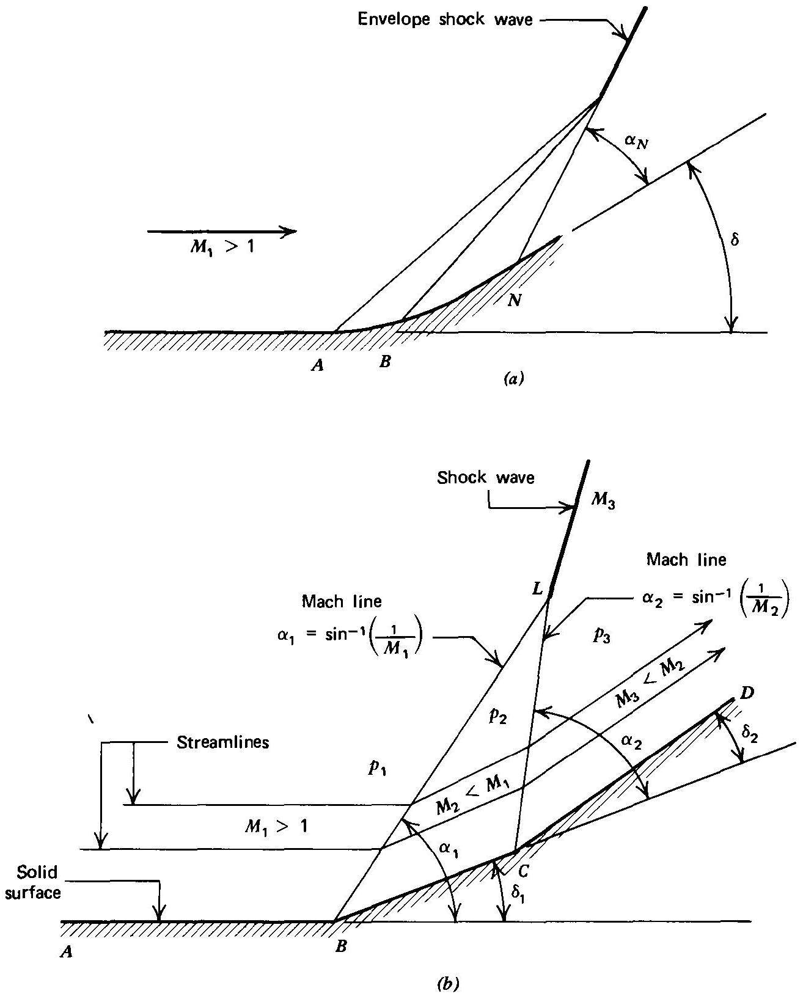
Figure 8.13 Compressive flow into successive corners and over a concave surface. (a) Compressive flow over a concave surface. (b) Compressive flow into successive corners.

Each consecutive Mach line must be steeper than the one preceding it. Accordingly, all of the Mach lines must intersect and consequently strengthen each other, thereby producing an envelope across which there is a finite change in the flow conditions. Across the envelope the phenomenon is no longer continuous; for that reason it is termed an envelope shock wave. The envelope shock wave need not necessarily intersect the surface causing the deflection of the flow.
The foregoing demonstrates that a concave surface produces a change in the flow direction of a supersonic stream and, no matter how gradual that change is, the Mach waves must intersect and strengthen each other in some region of the flow field. If the envelope shock wave does not intersect the deflecting surface, then there is an isentropic compression of the fluid in the region, external to the boundary layer, adjacent to the concave surface.

The preceding illustrates that there is a basic difference between the expansion and the compression of a supersonic flow. In an expansion, the Mach waves do not
intersect each other. In a compression, on the other hand, the Mach waves always intersect and strengthen each other.

Example 8.9. A uniform stream of air having a Mach number of 2.0 flows into a sharp concave corner having a flow deflection angle of 10 deg. Calculate the Mach number and the static pressure ratio for the flow after the corner by (a) assuming that an oblique shock wave is propagated into the flow from the corner, and (b) approximating the oblique shock wave by a continuous isentropic compression. Calculate the percent error in the Mach number and the pressure ratio for the isentropic approximation. Assume $\gamma=1.4$.

## Solution

(a) From Fig. 7.17, for $M_{1}=2.0$ and $\delta=10 \mathrm{deg}, \varepsilon=39.5 \mathrm{deg}$. Because of the difficulty of obtaining accurate values for $M_{2}$ and $p_{2} / p_{1}$ from Figs. 7.18 and 7.19 at small flow deflection angles, the normal shock wave table (Table C.11) is employed for determining $M_{2}$ and $p_{2} / p_{1}$. From equation 7.99,

$$
M_{1}^{\prime}=M_{1} \sin \varepsilon=2.0 \sin (39.5)=1.272
$$

From Table C.11, for $M_{1}^{\prime}=1.272, p_{2} / p_{1}=1.721$ and $M_{2}^{\prime}=0.80057$. From equation 7.100,

$$
M_{2}=\frac{M_{2}^{\prime}}{\sin (\varepsilon-\delta)}=\frac{0.80057}{\sin (39.5-10)}=1.626
$$

(b) From Table C.13, for $M_{1}=2.0, v_{1}=26.5 \mathrm{deg}$. Thus,

$$
v_{2}=v_{1}-\delta=26.5-10=16.5 \mathrm{deg}
$$

From Table C.13, for $v_{2}=16.5 \mathrm{deg}, M_{2}=1.655$. Since the Prandtl-Meyer compression is isentropic, $P_{2} / P_{1}=1.0$. From Table C.6, for $M_{1}=2.0$ and $M_{2}=1.655$, $p_{1} / P_{1}=0.1278$ and $p_{2} / P_{2}=0.2168$. Hence,

$$
\frac{p_{2}}{p_{1}}=\frac{p_{2}}{P_{2}} \frac{P_{1}}{p_{1}}=\frac{0.2168}{0.1278}=1.696
$$

The percent error in the Mach number $M_{2}$ is

$$
\text { error }=100 \frac{(1.655-1.626)}{1.626}=1.78 \text { percent }
$$

The percent error in static pressure ratio $p_{2} / p_{1}$ is

$$
\text { error }=100 \frac{(1.696-1.721)}{1.721}=-1.45 \text { percent }
$$

## 8-7 HODOGRAPH CHARACTERISTICS FOR SIMPLE WAVE FLOW

In Section 7-9, the hodograph plane is employed as a means for presenting the essential features of oblique shock waves in a useful compact form. Figure 7.25 presents a complete shock polar for $\gamma=1.4$.

Equation 8.11, which is repeated here for convenience, relates the flow deflection angle $\delta$ for a Prandtl-Meyer expansion and the Mach number $M$ (see Fig. 8.1).

$$
\pm \delta=\sqrt{b} \tan ^{-1}\left[\left(M^{2}-1\right) / b\right]^{1 / 2}-\tan ^{-1}\left(M^{2}-1\right)^{1 / 2}+\mathrm{constant}
$$

In equation $8.26,+\delta$ denotes a counterclockwise turn of the expanded flow, and $-\delta$ a clockwise turn. Equation 8.26 shows that the Mach number and the flow
deflection angle are uniquely related for a simple wave flow. Furthermore, since the flow is uniform, Mach lines are straight lines along which the flow properties are constant. The entire flow field may be determined once the relationship between the flow deflection angle and the Mach number has been established.

It is of advantage to relate the flow deflection angle $\delta$ to the dimensionless velocity $M^{*}=V / a^{*}$ instead of the Mach number $M$; note that when $M$ approaches infinity, $M^{*}$ attains the limiting value $[(\gamma+1) /(\gamma-1)]^{1 / 2}=\sqrt{b}$ (see equation 3.107). From equation 3.189, Table 3.4,

$$
M^{2}=\frac{\frac{2}{\gamma+1} M^{* 2}}{1-\frac{\gamma-1}{\gamma+1} M^{* 2}}
$$

Substituting equation 8.27 into equation 8.26 yields

$$
\pm \delta=\sqrt{b} \tan ^{-1}\left(\frac{M^{* 2}-1}{b-M^{* 2}}\right)^{1 / 2}-\tan ^{-1}\left(\frac{M^{* 2}-1}{1-M^{* 2} / b}\right)^{1 / 2}+\mathrm{constant}
$$

If $M^{*}=1$ when $\delta=0$, the constant in equation 8.28 is equal to zero. For that special case, the flow deflection angle $\delta$ is equal to the Prandtl-Meyer angle $v$. Hence,

$$
\pm v=\sqrt{b} \tan ^{-1}\left(\frac{M^{* 2}-1}{b-M^{* 2}}\right)^{1 / 2}-\tan ^{-1}\left(\frac{M^{* 2}-1}{1-M^{* 2} / b}\right)^{1 / 2}
$$

In equation 8.29, $M^{*}=\left(u^{* 2}+v^{* 2}\right)^{1 / 2}$ and $v=\tan ^{-1}\left(v^{*} / u^{*}\right)$, where $u^{*}=u / a^{*}$ and $v^{*}=v / a^{*}$ are the dimensionless velocity components.

Figure 8.14 presents the dimensionless velocity $M^{*}$ as a function of the PrandtlMeyer angle $v$, in the hodograph plane.

In the general case, where $M_{1}^{*}>1$ and $\delta_{1} \neq 0$, equation 8.28 is applicable, and the value of the constant is determined by the specific values of $M_{1}^{*}$ and $\delta_{1}$; those values locate the initial point in the hodograph plane. The remainder of the flow process is determined by solving equation 8.28 and plotting the results in the hodograph plane, as illustrated in Fig. 8.15. For a given set of initial conditions, either expanding or compressing flows may occur, and which type of flow does occur depends on the geometry of the solid boundary. The resulting curves plotted in the hodograph plane are called hodograph characteristics.

For the present it is sufficient to state that the hodograph characteristics for a uniform steady two-dimensional planar isentropic flow are epicycloids; ${ }^{3}$ in this case the epicycloid is the curve generated by rolling a circle of radius $(b-1) / 2$ on the circumference of a circle of radius $M^{*}=1$. The starting point for the epicycloid in Fig. 8.14 is $\left(M^{*}=1, v=0\right)$. The starting points for the epicycloids in Fig. 8.15 are $\left(M_{1}^{*}>1, \delta_{1}>0\right)$. Two distinct hodograph characteristics pass through each point in the hodograph plane; for example, curves $A$ and $B$ in Fig. 8.15 correspond to the same initial point ( $M_{1}^{*}, \delta_{1}$ ). Four flows are possible from a given initial point.

1. An expanding counterclockwise flow corresponding to the portion of curve $A$ between points $i$ and $a$.
2. An expanding clockwise flow corresponding to the portion of curve $B$ between points $i$ and $b$.
3. A compressing clockwise flow corresponding to the portion of curve $A$ between points $i$ and $c$.
4. A compressing counterclockwise flow corresponding to the portion of curve $B$ between points $i$ and $d$.

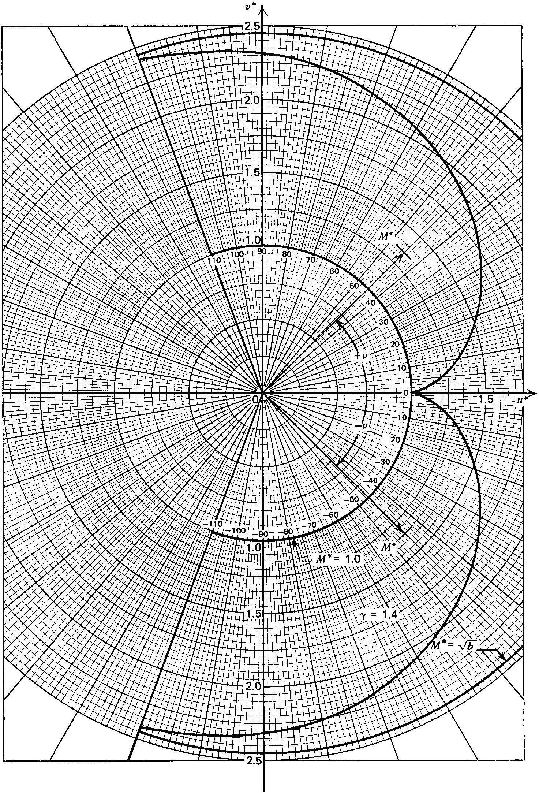
Figure 8.14 The Prandtl-Meyer angle $\gamma$ in the hodograph plane for $\gamma=1.4$

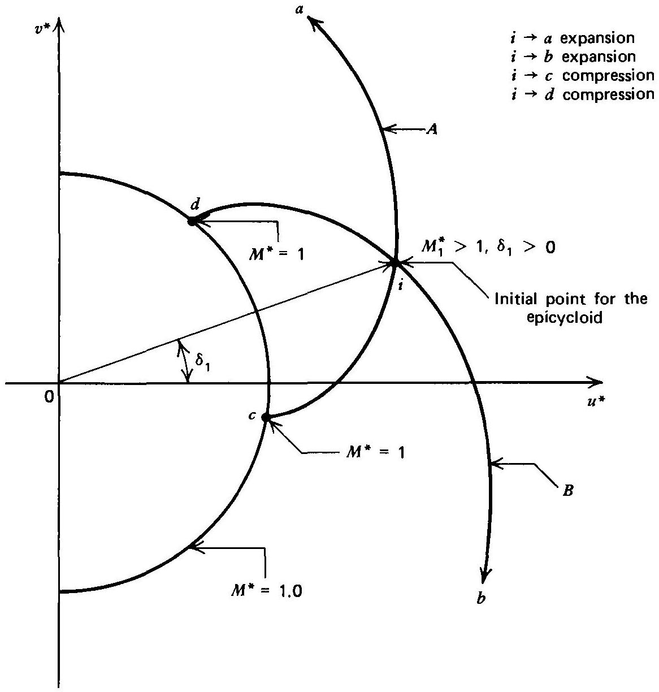
Figure 8.15 Arbitrary initial conditions in the hodograph plane.

A flowing gas may expand in either direction along a hodograph characteristic until either a specified flow deflection angle $\delta$ or a specified dimensionless velocity $M^{*}$ is attained. The maximum attainable flow velocity for the gas after an expansion is the maximum isentropic speed $V_{\text {max }}^{\prime}$ (see equation 3.185, Table 3.4). Conversely, a compression of the gas may be produced in either direction along a hodograph characteristic until a specified flow deflection angle $\delta$ or a specified dimensionless velocity $M^{*}$ is attained. For compressing flows, the limiting flow velocity for a Prandtl-Meyer compression is the sonic velocity, that is, $M^{*}=1.0$.

The curves presented in Fig. 8.15, when rotated about the origin so that the $M^{*}=1$ points (points $c$ and $d$ ) coincide with the point ( $M_{1}^{*}=1, \delta=0$ ), are identical to those for the Prandtl-Meyer angle $v$ presented in Fig. 8.14. Consequently, the hodograph characteristics from any arbitrary initial point in the hodograph plane may be obtained by an appropriate rotation of the hodograph characteristics for the Prandtl-Meyer angle $v$ until the desired initial conditions are located on the rotated Prandtl-Meyer characteristic.

The complete hodograph plane may be constructed in either of the two ways: first, by solving equation 8.28 for a range of initial conditions, or second, by rotating the curves for the Prandtl-Meyer angle through an appropriate range of angles. Figure 8.16 presents the complete hodograph plane for $\gamma=1.4$. Distinct hodograph characteristics, for both clockwise and counterclockwise turning, are initiated from the sonic circle ( $M_{1}^{*}=1.0$ ) for initial flow deflection angles from -60 deg to 60 deg in increments of 10 deg . Flows involving angles that fall outside of the range of Fig. 8.16 may be transformed to the region presented in Fig. 8.16 by a rotation of the

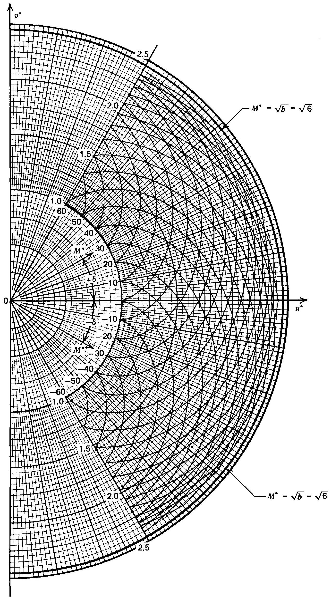
Figure 8.16 The complete hodograph plane for $\gamma=1.4$.

coordinate system. The foregoing demonstrates that graphical solutions may be obtained for simple wave flows with arbitrary initial conditions.

Example 8.10. Air at a Mach number of 2.0 expands counterclockwise around a 20 deg expansion corner. Determine the final Mach number employing the hodograph characteristics presented in Fig. 8.16.

## Solution

From Table C.6, for $M_{1}=2.0$ and $\gamma=1.4, M_{1}^{*}=1.633$. With $M_{1}^{*}=1.633$ and $\delta_{1}=0$, locate the initial point of the expansion in the hodograph plane of Fig. 8.16. Then follow the hodograph curve passing through the initial point through a flow deflection angle of +20 deg and locate the final point after the expansion, as illustrated in Fig. 8.17. The radius from the origin to that final point is $M_{2}^{*}$. Thus,

$$
M_{2}^{*}=1.92
$$

From Table C.6, for $M_{2}^{*}=1.92, M_{2}=2.82$.
As a check, from Table C.13, for $M_{1}=2.0, v_{1}=26.5 \mathrm{deg}$. Then,

$$
v_{2}=v_{1}+\delta=26.5+20=46.5 \mathrm{deg}
$$

From Table C.13, for $v_{2}=46.5 \mathrm{deg}, M_{2}=2.835$, which checks.

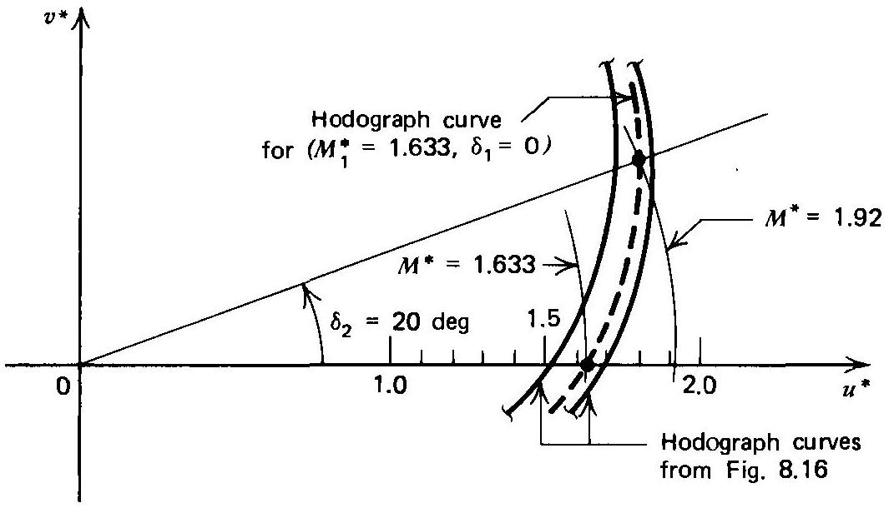
Figure 8.17 Sketch for Example 8.10.

## 8-8 APPROXIMATION OF CONTINUOUS EXPANSION WAVES BY FINITE AMPLITUDE DISCRETE WAVES

In the preceding sections, it is shown that the supersonic expansion of a steady uniform flow takes place through a series of infinitesimal expansion waves that constitute an expansion fan. The infinitesimal waves comprising the expansion fan are Mach lines, which diverge as they emanate from the source of the disturbance [i.e., from the convex (expansion) corner or surface]. In direct contrast, compression waves converge, eventually coalescing to form an oblique shock wave. In Chapter 7, it is shown that an oblique shock wave forms immediately at a sharp concave (compression) corner, and the discrete compression waves may be traced through a flow field; their interaction with each other and with the boundaries, both solid and free pressure, are discussed in Section 7-11. In the present section, the concept of
discrete expansion waves is introduced, and the rules governing their interactions are developed.

Figure $8.18 a$ illustrates a typical continuous expansion fan, and Fig. $8.18 b$ illustrates a discrete expansion wave that approximates the continuous expansion fan. The discrete expansion wave is defined in such a manner that it produces the same values of flow deflection angle $\delta$ and Mach number $M_{2}$ downstream of it as are created by the continuous expansion fan. Hence, the flow properties before and after the continuous expansion fan are correctly determined by the discrete expansion wave. Obviously, the flow properties within the expansion fan are incorrect. For an infinitesimal flow deflection angle, however, the two approaches are identical because the discrete expansion wave and the continuous expansion fan both approach a Mach wave in the limit.

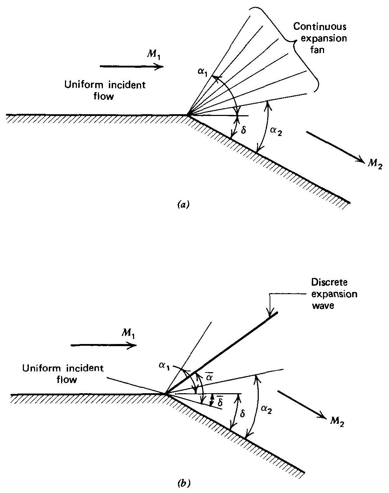
Figure 8.18 Approximation of a continuous expansion fan by discrete expansion waves. (a) Continuous expansion fan. (b) Discrete expansion waves.

The location of the discrete expansion wave is defined in terms of the average Mach angle $\bar{\alpha}$, which is measured relative to the average direction of the fluid flow around the corner, that is, $\bar{\delta}=\delta / 2$. It is seen in Fig. $8.18 b$ that the flow is deflected away from the discrete expansion wave as it flows through the wave. By contrast, as shown in Chapter 7, the flow through an oblique shock wave is always turned
toward the compressive (shock) wave. There are, however, at least three definitions of $\bar{\alpha}$ in current use. They are:

$$
\begin{aligned}
& \bar{\alpha} \equiv \frac{1}{2}\left(\alpha_{1}+\alpha_{2}\right) \\
& \bar{\alpha} \equiv \sin ^{-1}\left(\frac{1}{\bar{M}}\right)=\sin ^{-1}\left(\frac{2}{M_{1}+M_{2}}\right) \\
& \bar{\alpha} \equiv \sin ^{-1}\left(\frac{\bar{a}}{\bar{V}}\right)
\end{aligned}
$$

where the bar over a symbol designates its mean value. There is some basis for favoring the definition of $\bar{\alpha}$ given by equation 8.31, and it is the one recommended. For small flow deflection angles, however, the values of $\bar{\alpha}$ obtained from the above three definitions are not significantly different.

The concept of a discrete expansion wave serves as a means for obtaining an approximate solution for complex interactions of continuous expansion waves.

Example 8.11. Air at a Mach number of 1.4 turns about a 20 deg convex corner. Determine (a) the properties of the Prandtl-Meyer expansion fan, and (b) the locations of two discrete expansion waves of equal flow deflection angle that approximate the properties of the continuous expansion fan (see Fig. 8.19).

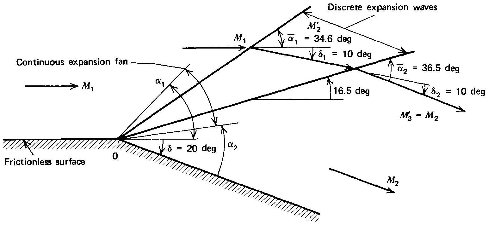
Figure 8.19 Sketch for Example 8.11.

## Solution

(a) From Table C.13, for $M_{1}=1.4, v_{1}=9 \mathrm{deg}$. Thus,

$$
v_{2}=v_{1}+\delta=9+20=29 \mathrm{deg}
$$

From Table C.13, for $v=29 \mathrm{deg}$,

$$
M_{2}=2.096
$$

(b) For two discrete expansion waves of equal flow turning angle, $\delta_{1}=\delta_{2}=10$ deg. Thus, for the first expansion wave, $\delta_{1}=10 \mathrm{deg}$, and

$$
v_{2}^{\prime}=v_{1}+\delta_{1}=9+10=19 \mathrm{deg}
$$

From Table C.13, for $v_{2}=19 \mathrm{deg}$,

$$
M_{2}^{\prime}=1.741
$$

The average flow deflection angle is $\bar{\delta}=\delta / 2=5 \mathrm{deg}$. From equation 8.31

$$
\bar{\alpha}_{1}=\sin ^{-1}\left(\frac{2}{M_{1}+M_{2}^{\prime}}\right)=\sin ^{-1}\left(\frac{2}{1.4+1.741}\right)=39.6 \mathrm{deg}
$$

Consequently, the first discrete expansion wave makes an angle of (39.6-5) $=$ 34.6 deg with respect to the initial flow direction.

For the second discrete expansion wave, $\delta_{2}=10 \mathrm{deg}$, and

$$
v_{3}^{\prime}=v_{2}^{\prime}+\delta_{2}=19+10=29 \mathrm{deg}
$$

From Table C.13, for $v_{3}^{\prime}=29 \mathrm{deg}$,

$$
M_{3}^{\prime}=2.096
$$

The average flow deflection angle for the second turn is $\bar{\delta}=\delta_{2} / 2=5$ deg after the first flow deflection angle $\delta_{1}=10 \mathrm{deg}$, or 15 deg with respect to the direction of the initial flow. The average wave angle is

$$
\bar{\alpha}_{2}=\sin ^{-1}\left(\frac{2}{M_{2}^{\prime}+M_{3}^{\prime}}\right)=\sin ^{-1}\left(\frac{2}{1.741+2.096}\right)=31.5 \mathrm{deg}
$$

Hence, the second discrete expansion wave makes an angle of $(31.5-15)=16.5 \mathrm{deg}$ with respect to the direction of the initial flow. The results are illustrated in Fig. 8.19.

## 8-8(a) Reflection of an Expansion Wave Intersecting a Wall

Figure 8.20 illustrates schematically the steady uniform supersonic flow of a compressible fluid parallel to a flat frictionless wall. A discrete expansion wave $A O$ propagates into the flowing fluid, impinges on the flat wall at point $O$, and is reflected. Consider the streamline $p q$. As it crosses the expansion wave $A O$, the streamline is deflected away from the wall through the angle $\delta$. Since the physical requirement is that the flow remain parallel to the wall, the strength of the reflected wave $O B$ must be equal to that of $A O$ so that it will deflect the streamline to become parallel to the wall. In general, the angle of reflection $r$ is not equal to the angle of incidence $i$. Since the reflected wave must turn the flow back toward the wall, which means away from the reflected wave, the latter must be an expansion wave. The

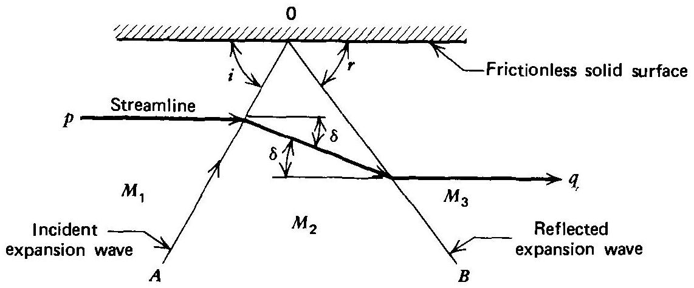
Figure 8.20 Reflection of a discrete expansion wave from a wall.

aforementioned process is illustrated in the hodograph plane in Fig. 8.21, where state 1 corresponds to the initial flow, state 2 corresponds to the flow after the incident expansion wave, and state 3 corresponds to the flow after the reflected expansion wave. It is evident that the final flow angle is parallel to the wall, and that the flow has been accelerated to a larger Mach number.

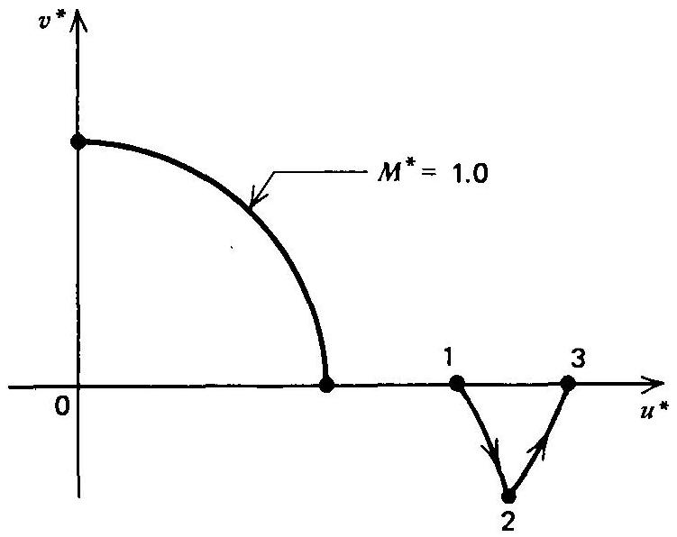
Figure 8.21 Wave reflection in the hodograph plane.

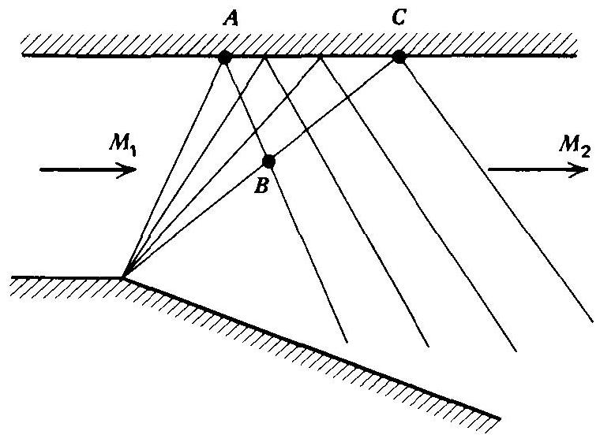
Figure 8.22 Reflection of a continuous expansion fan from a wall.

The process illustrated schematically in Fig. 8.21 is exact for a Mach wave and approximate for a wave of finite amplitude. Figure 8.22 illustrates diagrammatically the real process for a continuous expansion fan of finite amplitude. Each Mach wave is reflected from the surface $A C$. In the region $A B C$, however, waves of both families are present and they interact with each other. Such a region cannot be analyzed by the concepts of simple wave flow, but must be analyzed by twodimensional techniques such as those presented in Chapters 12 and 16.
Example 8.12. Air at a Mach number of 2.0 flows between two parallel frictionless walls. At a given point, the lower wall has a sharp expansion corner of 20 deg . Approximate the resulting expansion fan by a discrete expansion wave, and calculate the properties of the discrete expansion wave that is reflected when the incident expansion wave impinges on the upper wall.

## Solution

From Table C.13, for $M_{1}=2.0, v_{1}=26.5 \mathrm{deg}$. Thus,

$$
v_{2}=v_{1}+\delta=26.5+20=46.5 \mathrm{deg}
$$

From Table C.13, for $v=46.5 \mathrm{deg}$,

$$
M_{2}=2.84
$$

The average flow deflection angle is $\bar{\delta}=\delta / 2=10 \mathrm{deg}$, and the average Mach angle is

$$
\bar{\alpha}=\sin ^{-1}\left(\frac{2}{M_{1}+M_{2}}\right)=\sin ^{-1}\left(\frac{2}{2.0+2.84}\right)=24.5 \mathrm{deg}
$$

The discrete expansion wave, therefore, makes an angle of $(24.5-10)=14.5 \mathrm{deg}$ with respect to the initial flow direction.

Since the incident wave is an expansion wave that turns the flow 20 deg away from the wall, the reflected wave must, therefore, be an expansion wave turning the
flow back parallel to the wall. Thus,

$$
v_{3}=v_{2}+\delta_{2}=46.5+20=66.5 \mathrm{deg}
$$

From Table C.13, for $v=66.5 \mathrm{deg}$,

$$
M_{3}=4.06
$$

The average flow deflection angle for the reflected discrete expansion wave is $\bar{\delta}=\delta_{2} / 2=10 \mathrm{deg}$, and the average Mach angle is

$$
\bar{\alpha}=\sin ^{-1}\left(\frac{2}{M_{2}+M_{3}}\right)=\sin ^{-1}\left(\frac{2}{2.84+4.06}\right)=16.9 \mathrm{deg}
$$

Hence, the reflected wave makes an angle of $(16.9+10)=26.9 \mathrm{deg}$ with respect to the wall.

## 8-8(b) Reflection of an Expansion Wave Intersecting a Free Pressure Boundary

Figure 8.23 illustrates schematically a discrete expansion wave that intersects the boundary of a free jet; the static pressure at the boundary of the jet is specified. The discrete expansion wave $A O$ intersects the jet boundary, where the jet pressure $p_{1}$ is equal to the ambient pressure $p_{o}$. Because of the expansion wave $A O$, the pressure in Region 2 is smaller than $p_{o}$, and the flow is turned away from the expansion wave. When the expansion wave $A O$ intersects the jet boundary at point $O$, the pressure in the jet is decreased below $p_{o}$. Since point $O$ is on the jet boundary, a wave is reflected from it in a manner that will return the fluid pressure in Region 3 to the ambient pressure. Consequently, the reflected wave $O B$ must be a compression wave, that is, an oblique shock wave. Since compression waves turn the flow toward the wave, the boundary of the free jet is turned inward, as illustrated in Fig. 8.23. In actual flows, the aforementioned process is spread out because of the diffuse nature of the actual expansion fan. Nevertheless, the essential features of the reflection process are illustrated schematically in Fig. 8.23.

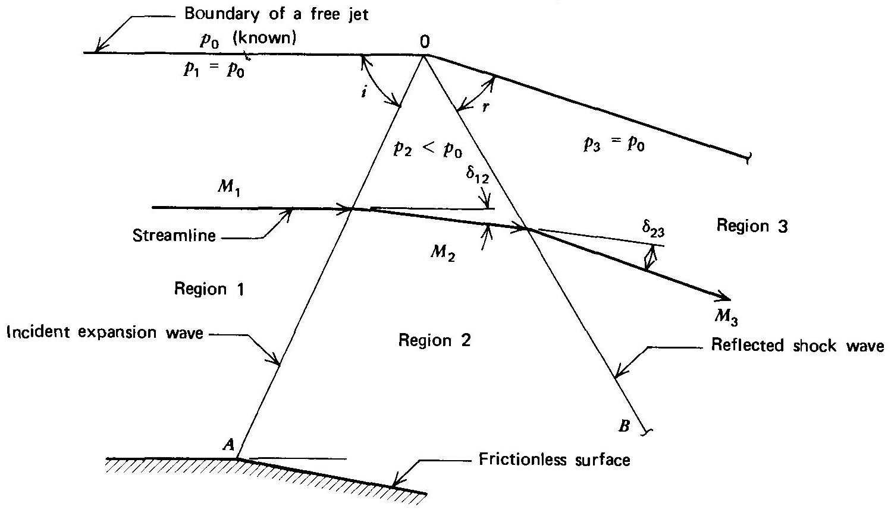
Figure 8.23 Reflection of a discrete expansion wave from a free pressure boundary.

Example 8.13. Air having $M=2$ flows between two parallel walls at 1 atm pressure. At a given axial location, the upper wall ends and the upper surface of the flow field is exposed to the atmosphere. At the same axial location, the lower wall turns 20 deg away from the flow direction, thus propagating a continuous expansion fan into the flow. Assume that the expansion fan is a single discrete expansion wave. An oblique shock wave is reflected from the jet boundary, as illustrated in Fig. 8.23. Determine the total deflection angle for the flow from its initial direction after the oblique shock wave. Assume that $\gamma=1.4$.

## Solution

From Table C.13, for $M_{1}=2.0, v_{1}=26.4$ deg. For clockwise turning

$$
v_{2}=v_{1}+\delta=-26.4-20=-46.4 \mathrm{deg}
$$

From Table C.13, for $v_{2}=-46.4 \mathrm{deg}$,

$$
M_{2}=2.84
$$

The average flow deflection angle $\bar{\delta}=\delta / 2=-10 \mathrm{deg}$, and the average Mach angle is

$$
\bar{\alpha}=\sin ^{-1}\left(\frac{2}{M_{1}+M_{2}}\right)=\sin ^{-1}\left(\frac{2}{2.0+2.84}\right)=24.5 \mathrm{deg}
$$

The expansion wave, therefore, makes an angle of $(24.5-10)=14.5$ deg with respect to the initial flow direction. From Table C.6, for $M_{1}=2.0$ and $M_{2}=2.84, p_{1} / P_{1}=$ 0.1278 and $p_{2} / P_{2}=0.0347$. Since the expansion wave is isentropic, $P_{1}=P_{2}$. Hence,

$$
\begin{aligned}
& \frac{p_{2}}{p_{1}}=\frac{p_{2}}{P_{2}} \frac{P_{1}}{p_{1}}=\frac{0.0347}{0.1278}=0.2715 \\
& p_{2}=(0.2715) p_{1}=0.2715 \mathrm{~atm}
\end{aligned}
$$

Because the incident wave is an expansion wave, it lowers the air pressure behind it to 0.2715 atm . The reflected wave at the free jet boundary must be an oblique shock wave of sufficient strength to raise the static pressure of the air behind the reflected wave to 1 atm . Thus,

$$
\frac{p_{3}}{p_{2}}=\frac{p_{\mathrm{atm}}}{p_{2}}=\frac{1.0}{0.2715}=3.683
$$

From Fig. 7.19, for $M_{2}=2.84$ and $p_{3} / p_{2}=3.683$,

$$
\delta_{23}=20 \mathrm{deg}
$$

Note that $\delta_{23}$ is measured relative to the flow direction in Region 2 (see Fig. 8.23), which is -20 deg relative to the initial flow direction. Hence, the flow direction in Region 3 is -40 deg relative to the initial flow direction.

## 8-8(c) Neutralization of an Expansion Wave

Consider now the physical situation illustrated diagrammatically in Fig. 8.24 where the direction of a frictionless wall is changed by an angle $\delta$ at the point where the incident expansion wave $A O$ impinges on it. No reflected wave is required for causing the streamlines crossing wave $A O$ to become parallel to the surface $O B$. The incident expansion wave ends at the surface because its inclination is such that the reflected wave is neutralized or canceled.

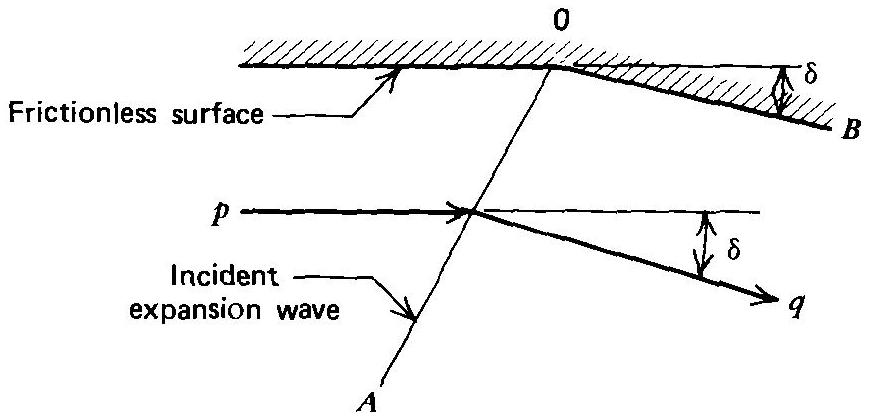
Figure 8.24 Neutralization of a discrete expansion wave.

## 8-8(d) Intersection of Expansion Waves

Figure 8.25 illustrates diagrammatically a flow passage that causes two expansion waves to intersect. In Fig. 8.25 the expansion wave $A B$ emanates from the lower corner $A$ and is intersected at $B$ by the expansion wave $D B$ emanating from the upper corner $D$.

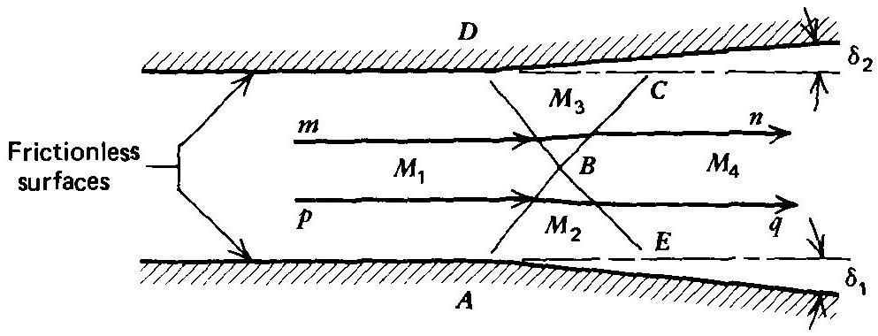
Figure 8.25 Intersection of two discrete expansion waves.

Consider the two parallel streamlines $m n$ and $p q$, which are deflected by the expansion waves. Streamline $p q$ is first deflected downward through the angle $\delta_{1}$ by the expansion wave $A B C$, and is then deflected upward through the angle $\delta_{2}$ by the expansion wave $D B E$. Similarly, streamline $m n$ is first deflected upward through the angle $\delta_{2}$ and then downward by $\delta_{1}$. Since both of the streamlines are deflected through the same total angle when they reach the region corresponding to $M_{4}$, they are again parallel to each other; obviously, if $\delta_{1}=\delta_{2}$, the final direction of the streamlines $m n$ and $p q$ is identical with their original direction upstream to the expansion waves.

The values of $M_{2}, M_{3}$, and $M_{4}$ may be determined directly from tables for given values of $M_{1}, \delta_{1}$, and $\delta_{2}$. The average direction of the expansion wave between any two regions is determined from the value of the average Mach angle $\bar{\alpha}$ (see equation 8.31). The average Mach angle $\bar{\alpha}$ is measured from the average directions of the velocities in the two regions.

Example 8.14. Air at a Mach number of 2.0 flows between two parallel frictionless walls. At a given location, both walls turn 15 deg away from the initial flow direction, as illustrated in Fig. 8.26. Treat the continuous expansion waves as discrete expansion waves, and determine the Mach number in Region 4. Draw the resulting wave pattern to scale.

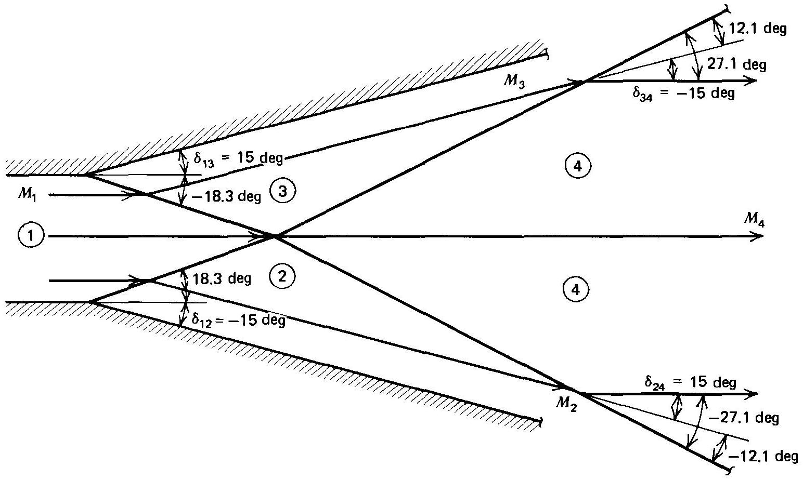
Figure 8.26 Sketch for Example 8.14.

## Solution

Since both walls turn the initial flow through equal flow deflection angles, the two initial expansion waves have the same properties. Consider the wave from the upper wall. From Table C.13, for $M_{1}=2.0, v_{1}=26.4 \mathrm{deg}$. Then,

$$
v_{3}=v_{1}+\delta_{13}=26.4+15=41.4 \mathrm{deg}
$$

From Table C.13, for $v_{3}=41.4 \mathrm{deg}, M_{3}=2.60$. The average flow deflection angle from Region 1 to Region 3 is $\bar{\delta}_{13}=\delta_{13} / 2=7.5 \mathrm{deg}$. The average Mach angle is

$$
\bar{\alpha}_{13}=\sin ^{-1}\left(\frac{2}{M_{1}+M_{3}}\right)=\sin ^{-1}\left(\frac{2}{2.0+2.60}\right)=25.8 \mathrm{deg}
$$

Hence, the initial expansion wave makes an angle of $(-25.8+7.5)=-18.3 \mathrm{deg}$ with respect to the initial flow direction. A mirror image wave is propagated from the lower wall at an angle of 18.3 deg with respect to the initial flow direction. Those waves are illustrated diagrammatically in Fig. 8.26.

At the point of intersection of the two initial expansion waves, they must be transmitted with sufficient strength to turn the flows in Regions 2 and 3 back to the initial flow direction. If the initial expansion waves are of different strengths, the two transmitted waves are also of different strengths, so that the flow direction behind the transmitted waves cannot be parallel to the initial flow direction. Example 7.15 presents a problem involving the interaction of two oblique shock waves of unequal strengths. The analysis for expansion waves of unequal strengths is quite similar.

In the present case, both transmitted expansion waves must turn the flow through a flow deflection angle of 15 deg . Thus, for the wave that is transmitted into the lower half-plane, $\delta_{24}=15 \mathrm{deg}$ with respect to the flow direction in Region 2. From the results obtained above, $M_{2}=M_{3}=2.60$, and $v_{2}=v_{3}=41.4 \mathrm{deg}$. Thus,

$$
v_{4}=v_{2}+\delta_{24}=41.4+15=56.4 \mathrm{deg}
$$

From Table C.13, for $v_{4}=56.4 \mathrm{deg}, M_{4}=3.37$. The average flow deflection angle from Region 2 to Region 4, relative to the flow direction in Region 2, is $\bar{\delta}_{24}=\delta_{24} / 2=$ 7.5 deg . The average Mach angle is

$$
\bar{\alpha}_{24}=\sin ^{-1}\left(\frac{2}{M_{2}+M_{4}}\right)=\sin ^{-1}\left(\frac{2}{2.60+3.37}\right)=19.6 \mathrm{deg}
$$

The transmitted wave, therefore, makes an angle of $(-19.6+7.5)=-12.1 \mathrm{deg}$ with respect to the flow direction in Region 2, and an angle of $(-12.1-15)=$ -27.1 deg with respect to the flow direction in Region 1. The results are presented in Fig. 8.26.

## 8-8(e) Summary of Observations Concerning the Interaction of Expansion Waves

The following observations apply to expansion waves.

1. An expansion wave turns the flow away from itself.
2. Expansion waves diverge from each other.
3. An expansion wave reflects from a solid boundary as an expansion wave.
4. An expansion wave reflects from a free pressure boundary (i.e., a free jet) as an oblique shock wave.
5. Expansion wave reflections from a wall may be cancelled by turning the wall into the flow direction.

For an isentropic compression wave that is governed by simple wave flow theory, all of the above observations are reversed.

## 8-9 SUMMARY

A steady uniform planar supersonic flow of a compressible fluid may be turned in a direction away from the initial flow direction by causing it to flow around a sharp convex corner. As the fluid flows around the corner, it accelerates from $M_{1}>1$ to $M_{2}>M_{1}$ and consequently expands, so that after the new flow direction is established, $V_{2}>V_{1}$ and $p_{2}<p_{1}$. Because the disturbance produced by the corner is very weak, Mach lines are propagated outwardly from it. For a steady uniform initial flow, the Mach lines are straight lines. The turning of the flow is bounded by the two Mach lines corresponding to $M_{1}$ and $M_{2}$, and they make the Mach angles $\alpha_{1}=\sin ^{-1}\left(1 / M_{1}\right)$ and $\alpha_{2}=\sin ^{-1}\left(1 / M_{2}\right)$ with respect to the flow directions in Regions 1 and 2, respectively. Between the two bounding Mach lines are an infinite number of Mach lines emanating from the convex corner, and along each Mach line the flow properties are constant; they vary, of course, from Mach line to Mach line. The region between the bounding Mach lines is called the expansion fan (see Fig. 8.1).

The type of flow just described is known as a Prandtl-Meyer expansion. The angle $\delta$ through which the expanding flow is turned is called the flow deflection angle, and the corresponding expansion waves are called simple waves. If the flowing fluid is a perfect gas, quantitative relationships may be derived between the variables pertinent to the aforementioned type of expansion.

In the special case of the flow of a perfect gas having an initial Mach number $M_{1}=1$ (sonic flow), the initial Mach line emanating from the corner is perpendicular to $V_{1}$ and the corresponding flow deflection angle is termed the Prandtl-Meyer
angle, which is denoted by $v$; that is, $\delta=v$. Table C. 13 presents values of $v$ as a function of $M$, for several values of $\gamma$. The flow deflection angle for an expansion from $M_{1}>1$ to $M_{2}>M_{1}$ is given by $\delta=v_{2}-v_{1}$. According to the PrandtlMeyer theory, the maximum possible value of the Prandtl-Meyer angle ( $v=v_{\text {max }}$ ) corresponds to that for which $M_{2}=\infty$; for a perfect gas with $\gamma=1.4$, that value is $\pm v_{\text {max }}=+130.45 \mathrm{deg}$. In the actual expansion of a gas around a convex corner, however, the maximum possible flow deflection without the flow separating from the wetted surface would be much smaller.
As in the case of the oblique shock wave (see Section 7-9), the Prandtl-Meyer expansion may also be plotted on the hodograph plane ( $u^{*}, v^{*}$ plane). The dimensionless velocity $M^{*}=\sqrt{u^{* 2}+v^{* 2}}$ is plotted for different initial values of $M^{*}$ and $\delta$ in Fig. 8.16.

No matter how gradually the direction of a supersonic flow is altered by a continuous concave surface, even though only Mach waves are propagated from the surface, a shock wave is eventually formed at some distance from the concave deflecting surface. The shock wave arises from the Mach waves emanating from the surface intersecting and strengthening each other so that they coalesce, forming an envelope shock. In contradistinction, the Mach waves propagated from a convex corner diverge and cannot intersect each other. Consequently, an expansion diffuses instead of strengthens the initial disturbance.
The expansion of a compressible fluid flowing over a continuous convex surface may be analyzed as a series of Prandtl-Meyer expansions by subdividing the surface so that a series of convex corners is formed. The number of those corners is then increased indefinitely so that the flow deflection angles decrease in magnitude and eventually a continuous surface is obtained.
The governing differential equation for a simple wave flow for an imperfect gas may be integrated numerically if the gas behaves as a simple system. However, no general solution is possible. For an imperfect gas, a numerical procedure for analyzing the simple wave flow is described in Section 8-5 and is applied in Example 8.8.

A procedure for approximating continuous expansion waves by finite amplitude discrete expansion waves is presented in Section 8-8. General observations pertaining to the intersection of simple waves with a solid wall, a free pressure boundary, and other simple waves, and also their cancellation, are summarized in Section 8-8(e).

## REFERENCES

1. T. Meyer, "Uber Zweidimensionale Bewegungsvorgange in einen Gas, das mit Uberschallgeschwindingkeit strömt," Ph. D. Dissertation, Göttingen, 1908. Included in Foundation of High Speed Aerodynamics, Dover Publications, New York, 1951.
2. M. J. Zucrow, Aircraft and Missile Propulsion, Vol. 1, Chap. 3, Wiley, New York, 1958.
3. A. H. Shapiro, The Dynamics and Thermodynamics of Compressible Fluid Flow, Chap. 15, Ronald Press, New York, 1954.
4. R. Courant and K. O. Friedrichs, Supersonic Flow and Shock Waves, Macmillan, New York, 1949.

## PROBLEMS

1. Air flowing over a horizontal frictionless surface approches a sharp convex corner with an initial Mach number $M_{1}=1.0$. The initial pressure and temperature are $1.0 \cdot 10^{5} \mathrm{~N} / \mathrm{m}^{2}$ and 300 K , respectively. Calculate the Mach number, pressure, and temperature after expanding around the corner for a flow deflection angle of (a) 15 deg clockwise, (b) 30 deg clockwise,
(c) 60 deg clockwise, (d) 15 deg counterclockwise, (e) 30 deg counterclockwise, and (f) 60 deg counterclockwise. In parts $\mathrm{a}, \mathrm{b}$, and c , the air flows above the surface, and in parts $\mathrm{d}, \mathrm{e}$, and f , the flow is below the surface. Assume $\gamma=1.4$.
2. Air with an initial Mach number $M_{1}=1.0$ flows around a sharp convex corner. The initial pressure and temperature are $1.0 \cdot 10^{5} \mathrm{~N} / \mathrm{m}^{2}$ and 300 K , respectively. Calculate the required flow deflection angle, and the corresponding pressure and temperature, to obtain a final Mach number of.(a) 2.0, (b) 3.0, (c) 4.0, and (d) 5.0. Assume $\gamma=1.4$.
3. Consider a smooth frictionless surface inclined at an angle $\theta=30 \mathrm{deg}$ with respect to the horizontal. Air flows from left to right above the surface with an initial Mach number $M_{1}=$ 2.0. Calculate the Mach number and flow angle for the flow after a sharp corner having the flow deflection angle (a) 15 deg clockwise, (b) 30 deg clockwise, (c) 60 deg clockwise, and (d) 15 deg counterclockwise. Assume $\gamma=1.4$.
4. Air flows above a frictionless surface having a sharp corner. The flow angle and Mach number downstream from the corner are -60 deg and 4.0 , respectively. Calculate the upstream Mach number and flow angle for a flow deflection angle of (a) 15 deg clockwise, (b) 30 deg clockwise, (c) 60 deg clockwise, and (d) 15 deg counterclockwise. Assume $\gamma=1.4$.
5. A wind tunnel nozzle is designed to yield a parallel uniform flow of air with a Mach number $M=3.0$. The stagnation pressure of the air supply reservoir $P=70 \cdot 10^{5} \mathrm{~N} / \mathrm{m}^{2}$, and the nozzle exhausts into the atmosphere. Calculate the flow angle at the exit lip of the nozzle if the atmospheric pressure $p_{o}=1.0 \mathrm{~atm}$. Assume $\gamma=1.4$.
6. For the wind tunnel described in Problem 5, determine the stagnation pressure of the air supply for which the flow angle at the exit lip is zero. Describe what happens when the air supply pressure drops below that value.
7. Consider the symmetric double wedge profile illustrated in Fig. 8.9. The airfoil is located in an airstream with a free-stream Mach number $M=3.0$, and a free-stream static pressure $p=1.0133 \cdot 10^{5} \mathrm{~N} / \mathrm{m}^{2}$. Calculate the lift and drag per unit width of the wedge for an angle of attack of (a) 5 deg clockwise, (b) 10 deg clockwise, (c) 15 deg clockwise, (d) 5 deg counterclockwise, (e) 10 deg counterclockwise, and (f) 15 deg counterclockwise. Plot the results, as a function of angle of attack. Assume $\gamma=1.4$.
8. Consider a diamond shaped body composed of two of the double wedge profiles illustrated in Fig. 8.9, placed on top of each other. Calculate the lift and drag per unit width for that body for the angles of attack specified in Problem 7. Plot the results as a function of angle of attack.
9. Air at a Mach number $M=2.0$ flows above a frictionless horizontal surface that makes a clockwise 90 deg turn around a cylindrical body joined tangentially to the horizontal surface. The radius of the cylinder is 1.0 m . Determine the Mach number $M$ and flow angle $\theta$ at a point 2 m from the center of the cylinder along a 45 deg line through the cylinder axis. Assume $\gamma=1.4$.
10. Air at a Mach number $M_{1}=1.0$ flows above a frictionless horizontal surface. Plot a streamline of the flow for a flow deflection angle of 90 deg clockwise. Assume $\gamma=1.4$.
11. Plot the streamline that is initially 1.0 m above the surface for the flow described in Problem 9 .
12. Air with an initial Mach number $M_{1}=2.0$ flows over three sharp corners in succession, having clockwise turning angles of 5,10 , and 15 , deg respectively. Calculate the Mach number and flow angle after each of the three corners. Plot the flow field illustrating the expansion fans.
13. The Prandtl-Meyer angle $v$ is related to the Mach number $M$ by equation 8.15. A fluid with $\gamma=1.25$ and an initial Mach number $M_{1}=1.0$ flows over a sharp corner having a flow deflection angle $\delta=45 \mathrm{deg}$. Calculate the Mach number after the turn employing the secant method [see Appendix A-4(b)].
14. Air flows over the control surface of a reentry vehicle. The control surface is the diamond shaped body described in Problem 8. The flow properties on the first portion of the upper surface are $V=1500 \mathrm{~m} / \mathrm{s}, t=2500 \mathrm{~K}$, and $p=4 \mathrm{~atm}$. Calculate the flow properties after the air passes over the corner at the top of the profile, taking into account the variation of the specific heat of the air with temperature.
15. A perfect gas $(\gamma=1.4)$ flows into a concave corner with an initial Mach number $M_{1}=2.0$. Calculate the Mach number after the turn for flow deflection angles $\delta$ from zero up to the maximum angle for which the oblique shock wave remains attached to the corner (or for which a Prandtl-Meyer compression yields a sonic flow) for (a) an oblique shock wave, and (b) a Prandtl-Meyer compression. Plot $M_{2}$ versus $\delta$ for both the oblique shock wave and the Prandtl-Meyer compression.
16. Work Problem 1 employing the hodograph plane presented in Fig. 8.16.
17. Work Problem 2 employing the hodograph plane presented in Fig. 8.16.
18. Work Problem 3 employing the hodograph plane presented in Fig. 8.16.
19. Work Problem 4 employing the hodograph plane presented in Fig. 8.16.
20. Air flowing over a frictionless surface with an initial Mach number $M_{1}=2.0$ makes a 30 deg clockwise turn. Determine (a) the properties of the Prandtl-Meyer expansion fan, and (b) the locations and flow properties for three discrete expansion waves having equal turning angles that turn the flow through the same total flow deflection angle.
21. Air is flowing from left to right between two parallel frictionless walls with a Mach number $M=3.0$. The lower wall has a sharp corner that turns the flow 15 deg clockwise. Determine the properties of the single discrete expansion wave that approximates the continuous expansion fan. Calculate the properties of the discrete expansion wave that is reflected from the upper wall when the incident discrete expansion wave impinges on that wall. Assume $\gamma=1.4$.
22. The upper wall of the flow passage described in Problem 21 is terminated at the axial location where the sharp convex corner occurs in the lower wall. The static pressure in the ambient region at the end of the upper wall is equal to that in the initial parallel uniform flow. Determine the properties of the oblique shock wave that is reflected from the jet boundary when the discrete expansion wave hits that boundary.
23. Air at the sonic condition flows between two parallel frictionless surfaces, as illustrated in Fig. 8.26. The flow deflection angles are both 30 deg . Consider the initial expansion waves as discrete waves and determine the Mach number in Region 4.
24. In Problem 23, the flow deflection angle on the upper wall is 30 deg and that on the lower wall is 20 deg. Calculate the Mach number and flow angle in Regions 2, 3, and 4, treating the continuous expansion fans as discrete expansion waves.
