9

## mass addition, combustion waves, and generalized steady one-dimensional flow

9-1 PRINCIPAL NOTATION FOR CHAPTER 9 ..... 462
9-2 INTRODUCTION ..... 462
9-3 FLOW WITH MASS ADDITION ..... 462
(a) Governing equations for flow with simple mass addition ..... 463
(b) Effect of mass addition on the flow properties ..... 465
(c) Mass addition normal to the main stream ..... 466
(d) Application to solid propellant rocket motors ..... 469
9-4 COMBUSTION WAVES ..... 473
(a) Governing equations for combustion waves ..... 475
(b) The Hugoniot curve for diabatic flow ..... 476
(c) Detonation waves ..... 482
(d) Deflagration waves ..... 487
9-5 GENERALIZED STEADY ONE-DIMENSIONAL FLOW ..... 488
(a) Governing equations for generalized steady one-dimensional flow ..... 488
(b) Generalized steady one-dimensional flow of a perfect gas ..... 491
(c) Influence coefficients ..... 491
(d) General features of generalized steady one-dimensional flow of a perfect gas ..... 497
(e) Numerical integration for generalized steady one-dimensional flow ..... 502
(f) Simple flows ..... 506
9-6 SUMMARY ..... 506

## 9-1 PRINCIPAL NOTATION FOR CHAPTER 9

The notation presented in Section 3-1 applies to the flows discussed in this chapter. The following additional notation is also applicable.
$\delta D$ generalized body force.
$G \quad=\dot{m} / A$, mass flux.
$H \quad=h+V^{2} / 2+g z$, stagnation enthalpy.
$d \dot{m} \quad$ differential mass flow rate of mass addition stream.
$\dot{r} \quad=(1+k V) c p^{n}$, linear burning rate for a solid propellant.
$u$ internal energy.
$\Delta u^{\circ}$ energy of combustion.
WP wetted perimeter of burning solid propellant perforation.
$y \quad=V_{i \boldsymbol{x}} / V$, ratio of $x$ component of velocity of mass addition stream to velocity of main stream.

Greek
$\Lambda \quad$ generalized flow function defined by equation 9.113.
$\rho_{P}$ density of solid propellant.
$\psi \quad=1+\frac{\gamma-1}{2} M^{2}$
Subscripts
$e \quad$ denotes aft-end of a solid propellant grain.
$i \quad$ denotes mass addition stream.
$o \quad$ denotes head-end of a solid propellant grain.
Superscripts

* denotes critical (i.e., sonic) condition.


## 9-2 INTRODUCTION

Chapters 4 to 8 are concerned with the analysis of simple flows, that is, flows in which a single driving potential is responsible for the changes in the flow properties. In addition to other simple flows that are not discussed in those chapters, there are complex flows in which two or more driving potentials act simultaneously. In this chapter, the following additional one-dimensional flows of practical significance are considered.

1. Simple mass addition.
2. Combustion waves.
3. Generalized steady one-dimensional flow.

Because of the complexity of the equations describing these flow processes, the integration of the pertinent differential equations is performed in most cases by applying numerical techniques. For each of the above flows, the general features of the relevant methods of numerical analysis are discussed.

## 9-3 FLOW WITH MASS ADDITION

All of the flows considered in the previous chapters have the common feature that the mass flow rate is constant at each cross section of the flow passage being considered. In this section, the equations are derived for determining the effects, for compressible fluids, of mass addition to the main stream flow. Only simple mass addition is considered; that is, a flow wherein the sole driving potential causing the
changes in the flow properties is the rate of the mass addition $d \dot{m}$. Hence, $\delta Q= \delta W=d A=\delta F_{i}=\delta D=g d z=0$. The special case where the mass addition is normal to the flow direction of the main stream is considered in detail, and the results are applied to the interior ballistics of a solid propellant rocket motor.

## 9-3(a) Governing Equations for Flow with Simple Mass Addition

Figure 9.1 illustrates the physical model for simple mass addition. Mass is injected at the rate $d \dot{m}$ through the top of the control surface $A$. In practice, the mass addition process may take various forms, such as the gases produced by the burning of the internal surface (passage walls) of a hollow solid propellant grain, or the uniform flow of a gaseous coolant through a porous wall in the case of transpiration cooling. The significant feature of the mass addition process is that the mass of fluid added to the main stream at the rate $d \dot{m}$ has the flow properties $p_{i}, \rho_{i}, h_{i}, V_{i}$, etc., while those for the main stream flow, which has the mass flow rate $\dot{m}$, are $p, \rho, h, V$, etc. The two gas streams are assumed to mix completely, and the mixed stream, having the mass flow rate $\dot{m}+d \dot{m}$, leaves the control volume $\mathscr{V}$ with the uniform properties $p+d p, \rho+d \rho$, etc. For simple mass addition, it is assumed further that the two streams of gas have identical values of molecular weight, specific heat, and stagnation enthalpy (i.e., $R=R_{i}, c_{p}=c_{p i}$, and $H=H_{i}$ ), and they are perfect gases.

The equations governing simple mass addition are obtained by applying the governing equations for the flow of a fluid (see Table 3.1) to the control volume $\mathscr{V}$ illustrated in Fig. 9.1, where the flow area $A$ remains constant.
(1) Continuity equation

$$
\dot{m}=\rho A V
$$

Differentiating equation 9.1 yields

$$
\frac{d \dot{m}}{\dot{m}}=\frac{d \rho}{\rho}+\frac{d V}{V}
$$

where $d \dot{m}$ is the rate of mass addition to the main stream flow for which the mass flow rate is $\dot{m}$.

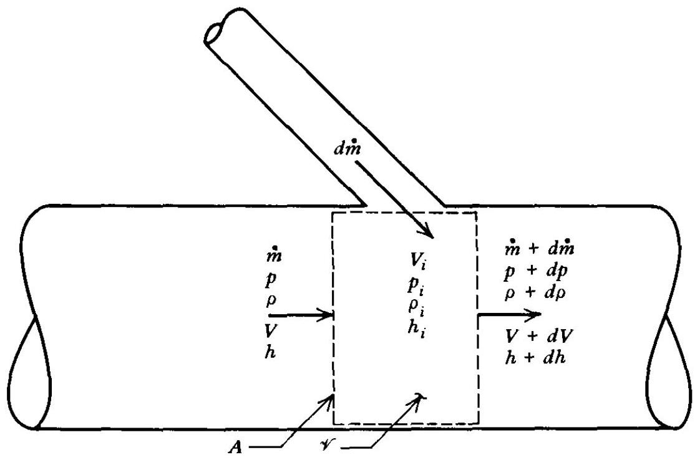
Figure 9.1 Physical model for simple mass addition.

$$
\delta Q=\delta W=d A=\delta F_{f}=\delta D=g d z=0
$$

(2) Energy equation

Because the main stream and the injected gas stream have identical stagnation enthalpies, the stagnation enthalpy of the combined stream remains constant. Thus,

$$
H=h+\frac{V^{2}}{2}=\text { constant }
$$

For a perfect gas, $h=c_{p} t$, so that equation 9.3 becomes

$$
c_{p} T=c_{p} t+\frac{V^{2}}{2}=\text { constant }
$$

Differentiating equation 9.4 and introducing the definitions $c_{p}=\gamma R /(\gamma-1), a^{2}= \gamma R t$, and $M=V / a$ into the result gives

$$
\frac{d t}{t}+(\gamma-1) M^{2} \frac{d V}{V}=0
$$

## (3) Momentum equation

Figure 9.2 illustrates schematically the forces and momentum fluxes acting on the control volume $\mathscr{V}$ in the $x$ direction, where $V_{i x}$ is the $x$ component of $V_{i}$. Applying the momentum equation gives

$$
p A-(p+d p) A=(\dot{m}+d \dot{m})(V+d V)-\dot{m} V-d \dot{m} V_{i x}
$$

By definition, the parameter $y$ is

$$
y \equiv \frac{V_{i x}}{V}
$$

If $V_{i x}=0$, then $y=0$, and the mass is added so that it enters the main gas stream in a direction normal to the main stream velocity $V$. If $V_{i x}=V$, then $y=1$, and the mass addition has the same velocity as the main gas stream. Finally, if $V_{i x}>V$, then $y>1$, and the mass addition has a larger momentum and kinetic energy per unit mass than the main gas stream. Devices having $y>1$ are utilized for pumping a low kinetic energy stream with a gas having a higher specific kinetic energy. Substituting equations 9.1 and 9.7 into equation 9.6, dividing by $A$, and neglecting the

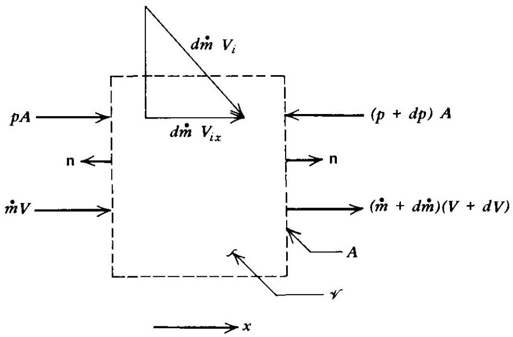
Figure 9.2 Forces and momentum fluxes acting on a control volume in simple mass addition.

higher-order term $d \dot{m} d V$, gives

$$
d p+\rho V d V+\rho V^{2}(1-y) \frac{d \dot{m}}{\dot{m}}=0
$$

Dividing equation 9.8 by $p$, introducing $p / \rho=a^{2} / \gamma$, and simplifying, yields

$$
\frac{d p}{p}+\gamma M^{2} \frac{d V}{V}+\gamma M^{2}(1-y) \frac{d \dot{m}}{\dot{m}}=0
$$

Logarithmic differentiation of the equation of state for a perfect gas, $p=\rho R t$, gives

$$
\frac{d p}{p}=\frac{d \rho}{\rho}+\frac{d t}{t}
$$

Differentiating $M=V / a=V / \sqrt{ } \gamma \overline{R t}$ yields

$$
\frac{d M}{M}=\frac{d V}{V}-\frac{1}{2} \frac{d t}{t}
$$

Differentiating the definition of the stagnation pressure $P$ (see equation 3.182 ) gives

$$
\frac{d P}{P}=\frac{d p}{p}+\frac{\gamma M^{2}}{1+\frac{\gamma-1}{2} M^{2}} \frac{d M}{M}
$$

Differentiating the definition of the impulse function $\mathscr{F}$ (see equation 3.139) gives

$$
\frac{d \mathscr{F}}{\mathscr{F}}-\frac{d p}{p}-\frac{2 \gamma M^{2}}{1+\gamma M^{2}} \frac{d M}{M}=0
$$

From equation 3.178, Table 3.2, for $d T=0$,

$$
\frac{d s}{c_{p}}=-\frac{\gamma-1}{\gamma} \frac{d P}{P}
$$

## 9-3(b) Effect of Mass Addition on the Flow Properties

Equations 9.2, 9.5, and 9.9 to 9.14 comprise a system of eight equations involving the nine property ratios $d \dot{m} / \dot{m}, d M / M, d V / V, d t / t, d p / p, d \rho / \rho, d P / P, d \mathscr{F} / \mathscr{F}$, and $d s / c_{p}$. Those eight equations may be solved simultaneously, employing the method presented in Section 4-4(c) for isentropic flow, to yield eight relationships between the independent variable $d \dot{m} / \dot{m}$ and the eight dependent variables $d M / M, d p / p$, etc. Those equations are presented in Table 9.1.

It is seen from Table 9.1, equations 9.15 to 9.22, that the influence coefficients of $d \dot{m} / \dot{m}$ include both $M$ and $y$ as variables. Consequently, whether the change in a dependent variable $d M / M, d p / p$, etc., is either positive or negative because of the simple mass addition depends not only on whether the flow is subsonic or supersonic, but also on the magnitude of the parameter $y$, defined by equation 9.7. For example, the term $\left[\left(1+\gamma M^{2}\right)-y \gamma M^{2}\right]$ in equations 9.15, 9.18, and 9.19 of Table 9.1, is positive for values of $y$ between 0 and $\left(1+\gamma M^{2}\right) / \gamma M^{2}$, and negative for values of $y$ larger than $\left(1+\gamma M^{2}\right) / \gamma M^{2}$. For most cases of engineering interest, the value of $y$ is such that the terms involving $y$ in the numerators of equations 9.15 to 9.21 are always positive. For such cases the effect of the mass addition $d \dot{m}$ on the change in the dependent variables depends only on whether the main stream flow is either subsonic or supersonic.

Table 9.1 Influence Coefficients for Simple Mass Addition for a Perfect Gas

$$
\begin{aligned}
\frac{d M}{M} & =\frac{\left(1+\frac{\gamma-1}{2} M^{2}\right)}{1-M^{2}}\left[\left(1+\gamma M^{2}\right)-y \gamma M^{2}\right] \frac{d \dot{m}}{\dot{m}} \\
\frac{d p}{p} & =-\frac{\gamma M^{2}}{1-M^{2}}\left[2\left(1+\frac{\gamma-1}{2} M^{2}\right)(1-y)+y\right] \frac{d \dot{m}}{\dot{m}} \\
\frac{d \rho}{\rho} & =-\frac{1}{1-M^{2}}\left[(\gamma+1) M^{2}-y \gamma M^{2}\right] \frac{d \dot{m}}{\dot{m}} \\
\frac{d t}{t} & =-\frac{(\gamma-1) M^{2}}{1-M^{2}}\left[\left(1+\gamma M^{2}\right)-y \gamma M^{2}\right] \frac{d \dot{m}}{\dot{m}} \\
\frac{d V}{V} & =\frac{1}{1-M^{2}}\left[\left(1+\gamma M^{2}\right)-y \gamma M^{2}\right] \frac{d \dot{m}}{\dot{m}} \\
\frac{d P}{P} & =-\gamma M^{2}(1-y) \frac{d \dot{m}}{\dot{m}} \\
\frac{d \mathscr{F}}{\mathscr{F}} & =y \frac{\gamma M^{2}}{1+\gamma M^{2}} \frac{d \dot{m}}{\dot{m}} \\
\frac{d s}{c_{p}} & =-\frac{\gamma-1}{\gamma} \frac{d P}{P}=(\gamma-1) M^{2}(1-y) \frac{d \dot{m}}{\dot{m}}
\end{aligned}
$$

Equation 9.20 shows that the direction of the change in the stagnation pressure $d P / P$ depends only on whether $y$ is less than or larger than 1.0. Equation 9.21 shows that mass addition $d \dot{m}$ always produces a force acting on the passage walls in the direction opposite to the flow direction for the main stream, except in the special case when $y=0$ (mass addition normal to the main stream); in the latter case no force is exerted on those walls. Equation 9.22 shows that the direction of the entropy change for the flowing gas is opposite to that for the corresponding change in its stagnation pressure.

If $y<1.0$, all of the factors involving $y$ in the influence coefficients in equations 9.15 to 9.22 are positive. For that special case, the effect of the mass addition $d \dot{m}$ on the dependent variables is summarized in Table 9.2. Similar results may be obtained for any value of $y$.

Table 9.2 shows that mass addition causes the Mach number to increase for a subsonic flow and to decrease for a supersonic flow. It is apparent, therefore, that the main stream flow chokes at a Mach number of unity, and that no further mass addition to it is possible without altering the upstream conditions. Consequently, a continuous transition from subsonic to supersonic flow is impossible if the sole driving potential is mass addition.

## 9-3(c) Mass Addition Normal to the Main Stream

There are many applications of engineering interest in which the mass addition $d \dot{m}$ is normal to the flow direction for the main stream (i.e., $y=0$ ), as in the two examples cited in Section 9-3(a). Accordingly, the equations governing mass addition normal to the main stream are obtained from equations 9.15 to 9.22 by setting $y=0$. The resulting equations are all exact differential equations that may be integrated between

Table 9.2 Effect of the Mass
Addition $d \dot{m}$ on the Flow
Properties for a Perfect Gas (for $y<1.0$ )
| Property Ratio | $M<1$ | $M>1$ |
| :--- | :--- | :--- |
| $\frac{d M}{M}$ | $+$ | - |
| $\frac{d p}{p}$ | - | + |
| $\frac{d \rho}{\rho}$ | - | + |
| $\frac{d t}{t}$ | - | + |
| $\frac{d V}{V}$ | $+$ | - |
| $\frac{d P}{P}$ | - | - |
| $\frac{d \mathscr{F}}{\mathscr{F}}$ | $\geqq 0$ | $\geqq 0$ |
| $\frac{d s}{c_{p}}$ | $+$ | + |


a general point in the flow and some reference state to yield a set of algebraic equations for the property ratios of the main stream flow. To illustrate, integrate equation 9.15, Table 9.1, employing the critical state, denoted by the superscript *, as the reference state. Thus,

$$
\begin{aligned}
\int_{\dot{m}}^{\dot{m}^{*}} \frac{d \dot{m}}{\dot{m}} & =\int_{M}^{1} \frac{1-M^{2}}{M\left(1+\gamma M^{2}\right)\left(1+\frac{\gamma-1}{2} M^{2}\right)} d M \\
\frac{\dot{m}}{\dot{m}^{*}} & =\frac{G}{G^{*}}=\frac{M\left[2(\gamma+1)\left(1+\frac{\gamma-1}{2} M^{2}\right)\right]^{1 / 2}}{1+\gamma M^{2}}
\end{aligned}
$$

where $G=\dot{m} / A$ denotes the mass flux.
The remaining property ratios may be obtained in like manner by integrating equations 9.16 to 9.22. It is easier, however, to obtain the ratios $t / t^{*}, p / p^{*}$, etc., directly from the original governing equations. For example, from the definition of the stagnation temperature (see equation 3.181, Table 3.2) and, by assumption, recalling that $T=$ constant, we obtain

$$
\frac{t}{t^{*}}=\frac{\gamma+1}{2\left(1+\frac{\gamma-1}{2} M^{2}\right)}
$$

From the definition $V=M a$,

$$
\frac{V}{V^{*}}=M^{*}=M\left[\frac{\gamma+1}{2\left(1+\frac{\gamma-1}{2} M^{2}\right)}\right]^{1 / 2}
$$

From $\dot{m}=\rho A V=p A V / R t$,

$$
\frac{p}{p^{*}}=\frac{\gamma+1}{1+\gamma M^{2}}
$$

From $p=\rho R t$,

$$
\frac{\rho}{\rho^{*}}=\frac{2\left(1+\frac{\gamma-1}{2} M^{2}\right)}{1+\gamma M^{2}}
$$

From the definition of the stagnation pressure (see equation 3.182 , Table 3.2)

$$
\frac{P}{P^{*}}=\frac{\gamma+1}{1+\gamma M^{2}}\left[\left(\frac{2}{\gamma+1}\right)\left(1+\frac{\gamma-1}{2} M^{2}\right)\right]^{\gamma /(\gamma-1)}
$$

The change in entropy may be obtained from equations 9.14 and 9.28. Thus,

$$
s-s^{*}=-R \ln \frac{P}{P^{*}}
$$

For mass addition normal to the stream, $d \mathscr{F}=0$ and $\mathscr{F}=$ constant.
Table C. 14 presents values of the property ratios $M^{*}, t / t^{*}, p / p^{*}, \rho / \rho^{*}, P / P^{*}$, and $G / G^{*}$ as functions of the main stream flow Mach number $M$. Table 9.3 summarizes the form of Table C.14, and also presents the limiting values for the aforementioned property ratios.

Table 9.3 Limiting Values of the Property Ratios for Simple Mass Addition Normal to the Main Stream for a Perfect Gas
| M | $M^{*}$ | $\frac{t}{t^{*}}$ | $\frac{p}{p^{*}}$ | $\frac{\rho}{\rho^{*}}$ | $\frac{P}{P^{*}}$ | $\frac{G}{G^{*}}$ |
| :--- | :--- | :--- | :--- | :--- | :--- | :--- |
| 0 | 0 | $\left(\frac{\gamma+1}{2}\right)$ | $(\gamma+1)$ | 2 | $(\gamma+1)\left(\frac{2}{\gamma+1}\right)^{\gamma /(\gamma-1)}$ | 0 |
| 1 | 1 | 1 | 1 | 1 | 1 | 1 |
| $\infty$ | $\left(\frac{\gamma+1}{\gamma-1}\right)^{1 / 2}$ | 0 | 0 | $\left(\frac{\gamma-1}{\gamma}\right)$ | $\infty$ | $\frac{\left(\gamma^{2}-1\right)^{1 / 2}}{\gamma}$ |


A FORTRAN computer program, subroutine MASS, for calculating the property ratios for simple mass addition for a perfect gas with $y=0$ is presented below. The input to this program is the same as that discussed in Section 4-4(b). The results presented in Table C. 14 for $\gamma=1.4$ are obtained by the following specifications.
$G=1.4, J(1)=50, J(2)=50, J(3)=10, J(4)=20, J(5)=12, J(6)=5, J(7)=0$, $\mathrm{DM}(1)=0.01, \mathrm{DM}(2)=0.02, \mathrm{DM}(3)=0.05, \mathrm{DM}(4)=0.1, \mathrm{DM}(5)=0.5, \mathrm{DM}(6)=1.0$

```
        SUBROUTINE MASS
C MASS ADDITION PROPERTY RATIOS FOR A PERFECT GAS
    REAL M,MS $ DIMENSION J(9),DM(9) $ DATA INF/6H INFIN/
    NAMELIST /DATA/ G.J.DM $ KEAD (5,DATA)
    G1 =(G-1.0)/2.0 $ G2=2.0/(G+1.0) $ G3=G+1.0 $ G4=G/(G-1.0)
    M=0.0 $ MS=0.0 $ T=1.0/G2 $ P=G3 $ R=2.0 $ PO=G3*G2**G4 $ GG=0.0
    WRITE (6,2000) G $ WRITE (6,2020) M,MS,T,P,R,PO,GG $ I=1 $ L=0
```

C CALCULATE PROPERTY RATIOS
$40 N=J(I)$ S DO $50 K=1 . N$ \$ $M=M+D M(I)$ \$ $C=1.0+G 1 * M * * 2$ \$ $M S=M / S Q R T(G 2 * C)$
$T=1.0 /(G 2 * C)$ \$ $P=G 3 /(1.0+G * M * * 2)$ \$ $R=P / T$ \$ $P O=P / T * * G 4$ \$ $G G=R * M S$
WRITE $(6,2020)$ M.MS.T.P.R.PO.GG \$ L=L+1 \$ IF (L.LT.50) GO TO 50

        WRITE $(6,2000)$ G $\$$ L $=0$
    50 CONTINUE $\$$ I $=I+1$ \$ IF(II.EQ.10).OR.(J(I).EQ.0)) GO TO 60 SGO TO 40
    $60 \mathrm{MS}=S Q R T((G+1.0) /(G-1.0)) \$ \mathrm{~T}=0.0 \$ \mathrm{P}=0.0 \$ \mathrm{R}=(G-1.0) / G$
        GG $=$ SQRT $(\mathrm{G} * * 2-1.0) / \mathrm{G}$
        WRITE $(6,2030)$ INF,MS,T,P,R,INF,GG s RETUKN
    2000 FORMAT (1H1,14X,4UHMASS ADDITION NORMAL TO STREAM, GAMMA $=, F 5.2 / 1$
$14 \mathrm{X}, 1 \mathrm{HM}, 6 \mathrm{X}, 2 \mathrm{HM} *, 7 \mathrm{X}, 4 \mathrm{HT} / \mathrm{T} *, 9 \mathrm{X}, 4 \mathrm{HP} / \mathrm{P} *, 9 \mathrm{X}, 4 \mathrm{HR} / \mathrm{R} *, 9 \mathrm{X} 6 \mathrm{HPO} / \mathrm{PO} * 7 \mathrm{X} 4 \mathrm{HG} / \mathrm{G} * / 1$
2020 FORMAT ( 1 H , F5.2, F 10.5 . 5 E 13.5 )
2030 FORMAT (A6,F10.5,3E13.5,3X,A6,E17.5)
END

## 9-3(d) Application to Solid Propellant Rocket Motors

Figure 9.3 illustrates schematically the general features of a rocket motor equipped with an internal-burning solid propellant grain. The cross-sectional area of the perforation in the grain, denoted by $A$, is the area through which the combustion gas flows toward the propulsive nozzle of the rocket motor; the perforation is parallel to the longitudinal axis of the rocket motor. The cross-sectional area $A$ is not a constant while the grain is burning, even if its value is the same at all cross sections along the grain, because the burning surface recedes in the direction normal to itself.

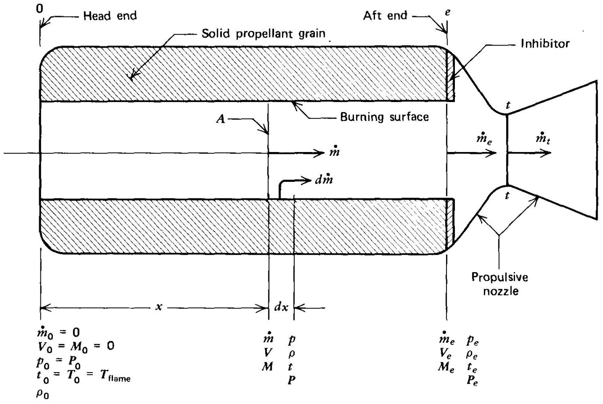
Figure 9.3 Model of an internal-burning solid propellant rocket motor.

The linear burning rate $\dot{r}$, the rate at which the burning surface recedes, is generally very small ( 0.001 to $0.5 \mathrm{~m} / \mathrm{s}$, approximately) compared to the velocity of the combustion gas flowing toward the propulsive nozzle; the latter velocity is ordinarily several hundred meters per second. No serious error, therefore, is introduced by neglecting the unsteady effects caused by the variation of $A$ with time in determining the interior ballistics of a solid propellant rocket motor, and the gas flow is treated as quasi-steady.

The end of the propellant grain located at the nozzle end of the rocket motor is called the aft end, and the end of the grain located at the closed end of the casing enclosing the grain is called the head end. The head-end and aft-end surfaces of the grain are assumed to be inhibited from burning, so that the only burning surface is that comprising the perforation in the grain.

It is an empirically demonstrated fact that the surface of the grain burns normal to itself at a rate that depends on the propellant composition, the propellant temperature, the static pressure $p$ acting on the thin combustion zone at the propellant surface, and the velocity $V$ of the main core flow. The linear burning rate $\dot{r}$ is correlated by an empirical equation of the following form:

$$
\dot{r}=(1+k V) c p^{n}
$$

where $k$ is an erosive burning coefficient, $c$ is a coefficient that reflects the effect of the propellant temperature, and $n$ is the pressure exponent. The parameters $k, c$, and $n$ are determined experimentally for each propellant formulation.

Figure 9.4 illustrates schematically a differential element of the burning surface of a solid propellant. The burning occurs along the length $d x$ of the grain in an extremely thin combustion zone adjacent to the surface, releasing combustion gases having no axial velocity. Hence, it may be assumed that $y=0$. The combustion gas mixes immediately with the main gas stream. The stagnation enthalpy of the flowing fluid is determined by the chemical energy released by the combustion process. If the propellant composition is uniform, then all of the combustion gases will have the same level of chemical energy, and the stagnation enthalpy will be constant throughout the flow passage. From Fig. 9.4, the rate of mass addition $d \dot{m}$ is obtained as the product of the linear burning rate $\dot{r}$, the area of the burning surface $d A$, and the density $\rho_{P}$ of the solid propellant. Hence,

$$
d \dot{m}=\dot{r} \rho_{P} d A
$$

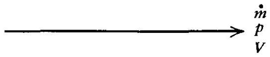

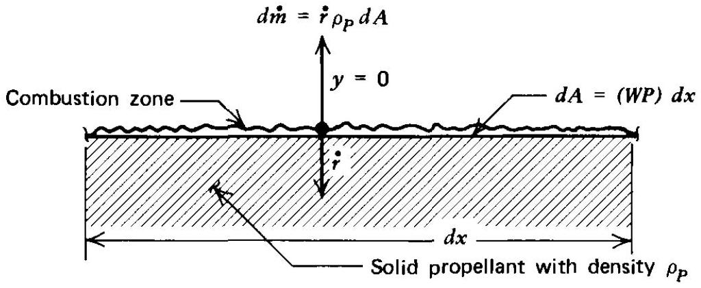
Figure 9.4 Mass addition from a differential element of burning surface.

The burning surface area $d A$ is given by

$$
d A=(W P) d x
$$

where ( $W P$ ) is the wetted perimeter of the flow passage. The shape of the perforation in the grain is determined by the surface area versus burned distance relationship required for satisfying the mission requirements for the vehicle propelled by the rocket motor. Figure 9.5 illustrates several simple perforation shapes. ${ }^{1}$ The mass addition rate is obtained by combining equations $9.30,9.31$, and 9.32 . Thus,

$$
d \dot{m}=(1+k V) c p^{n} \rho_{P}(W P) d x
$$

Equation 9.33 shows that the mass addition rate $d \dot{m}$ is coupled to the properties of the flow field through the velocity $V$ and the pressure $p$; these, in turn, depend on the history of the mass addition in the flow passage. Because of the aforementioned coupling, it is not possible, in general, to obtain a closed form solution for the flow properties inside a solid propellant grain, even if the flow area is constant. An iterative procedure involving numerical integration must be employed.

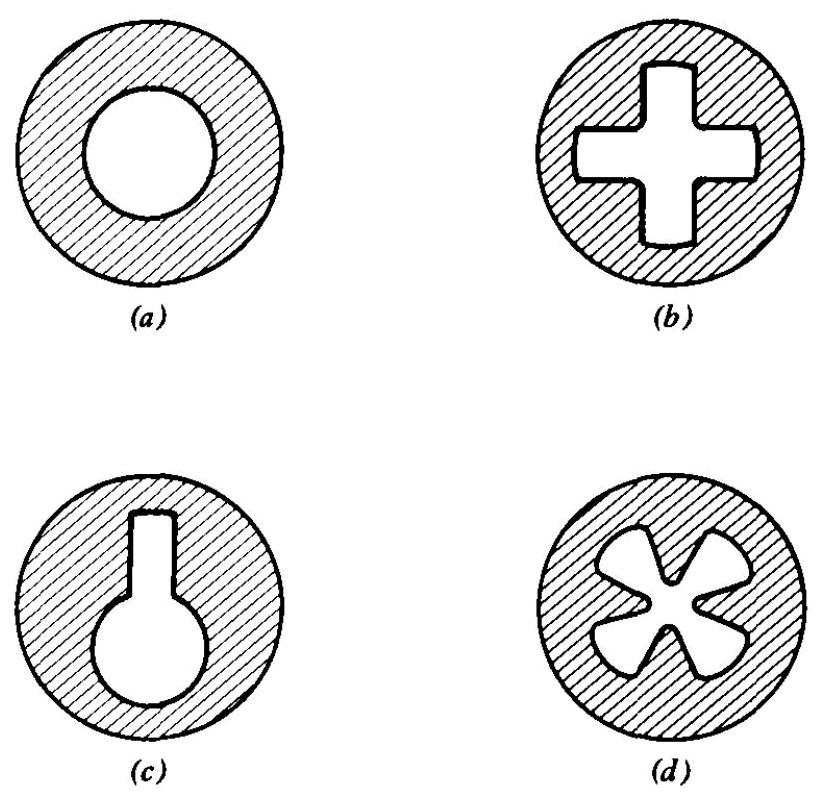
Figure 9.5 Simple perforation shapes for internal-burning solid propellant grains. (a) Cylindrical. (b) Cruciform. (c) Keyhole. (d) Star.

The most direct numerical procedure is to assume the pressure at the head end of the grain, $p_{o}=P_{o}$ (see Fig. 9.3). The stagnation temperature of the combustion gas is equal to the combustion flame temperature, $T=T_{o}=T_{\text {flame }}=$ constant, and is a calculable function of the propellant composition and combustion pressure (see Section 14-4). From the thermal equation of state for a perfect gas,

$$
\rho_{o}=\frac{P_{o}}{R T}
$$

At the head end of the grain (see Fig. 9.3), $M_{0}=0$. From Table 9.3, the reference critical conditions may be determined. Thus,

$$
P^{*}=\left(\frac{1}{\gamma+1}\right)\left(\frac{\gamma+1}{2}\right)^{\gamma /(\gamma-1)} P_{o}
$$

$$
\begin{aligned}
t^{*} & =\left(\frac{2}{\gamma+1}\right) T \\
V^{*} & =a^{*}=\left(\gamma R t^{*}\right)^{1 / 2} \\
\rho^{*} & =\frac{1}{2} \rho_{o}
\end{aligned}
$$

To express $\mathrm{G}^{*}$, the critical mass flux, in terms of $\rho_{o}$ and $a_{o}$, we write

$$
G^{*}=\rho^{*} V^{*}=\frac{\rho_{o}}{2}\left(\frac{2 \gamma R T}{\gamma+1}\right)^{1 / 2}=\frac{\rho_{o} a_{o}}{[2(\gamma+1)]^{1 / 2}}
$$

From equation 9.33, the mass flux $G=\dot{m} / A$ is given by

$$
G=\frac{1}{A} \int_{o}^{\dot{m}} d \dot{m}=\frac{(W P) \rho_{P} c}{A} \int_{o}^{x}(1+k V) p^{n} d x
$$

Equation 9.40 must be integrated numerically; equations 9.25 and 9.26 may be employed for determining $V$ and $p$ as functions of $M$, and equation 9.23 is employed for determining $M$ from the ratio $G / G^{*}$.

When equation 9.40 has been integrated from the head end to the aft end of the propellant grain, the total mass flow rate $\dot{m}_{e}$ for the gas produced by burning the grain is known. The stagnation pressure $P_{e}$ at the aft end of the grain may be determined from equation 9.28. For steady flow, the mass flow rate of combustion gas $\dot{m}_{e}$ must equal the mass flow rate $\dot{m}_{t}$ crossing the nozzle throat $t$. Assuming isentropic flow in the nozzle, $\dot{m}_{t}=\dot{m}^{*}$ is given by equation 4.137, Table 4.6, where $P=P_{e}$. Thus,

$$
\dot{m}_{t}=\frac{\Gamma P_{e} A_{t}}{\sqrt{\gamma R T}}
$$

If $\dot{m}_{e}$ and $\dot{m}_{t}$ do not agree within an acceptable tolerance, a new value is assumed for $P_{o}$ and the entire procedure is repeated.

For the special case where the erosive burning coefficient $k=0$, in equation 9.33, and the propellant burning rate is not pressure dependent, that is, $n=0$ and $\dot{r}=c$, equation 9.40 becomes

$$
\mathrm{G}=\frac{(W P) \rho_{P} \dot{r}}{A} x
$$

In the above special case, $G$ is linearly proportional to $x$, and the distribution of the flow properties along the perforation in the grain may be determined directly from Table C.14.

As mentioned above, in the general case, the flow area along the grain perforation is not constant. Consequently, both area change and mass addition are present simultaneously, and the assumption that the only driving potential is simple mass addition is invalid. The generalized flow equations derived in Section 9-5 must then be solved numerically. The iterative approach discussed above must still be employed, however, for determining the head-end pressure and the total mass flow rate of the combustion gas.

Example 9.1. The solid propellant rocket motor illustrated in Fig. 9.3 has a solid propellant grain with a constant-area cylindrical perforation having a diameter $D=0.025 \mathrm{~m}$, a constant linear burning rate $\dot{r}=0.025 \mathrm{~m} / \mathrm{s}$, and a propellant density $\rho_{P}=2500 \mathrm{~kg} / \mathrm{m}^{3}$. The combustion gases have $\gamma=1.2, R=320 \mathrm{~J} / \mathrm{kg}-\mathrm{K}$, and a flame temperature $T=3000 \mathrm{~K}$. The grain length $L=0.30 \mathrm{~m}$ and the throat area
of the exhaust nozzle $A_{t}=0.00030 \mathrm{~m}^{2}$. Calculate (a) the propellant consumption rate $\dot{m}_{e}$, (b) the nozzle inlet Mach number $M_{e}$ and the stagnation pressure $P_{e}$, (c) the head-end stagnation pressure $P_{o}$, (d) the head-end density $\rho_{o}$, (e) the maximum mass flux $G^{*}$, and (f) the static pressure drop between the grain head-end and aft-end. Denote the head-end properties by the subscript $o$, and the grain exit and nozzle entrance properties by the subscript $e$.

## Solution

(a) From equation 9.42, which applies when $\dot{r}$ is constant,

$$
\begin{aligned}
& \dot{m}_{e}=G_{e} A_{e}=\dot{r} \rho_{P}(W P) x_{e}=\dot{r} \rho_{P} \pi D L \\
& \dot{m}_{e}=(0.025)(2500) \pi(0.025)(0.30)=1.4726 \mathrm{~kg} / \mathrm{s}(3.2487 \mathrm{lbm} / \mathrm{sec})
\end{aligned}
$$

(b) $\frac{A_{e}}{A^{*}}=\frac{\pi D^{2}}{4 A_{t}}=\frac{\pi(0.025)^{2}}{4(0.00030)}=1.6363$

From Table C.6, for $A_{e} / A^{*}=1.6363, M_{e}=0.39382$. From equation 9.41 (where $\Gamma=0.71043$ from Table C.15),
$P_{e}=\frac{\dot{m}_{e} \sqrt{\gamma R} \bar{T}}{\Gamma A_{t}}=\frac{(1.4726)[1.2(320)(3000)]^{1 / 2}}{(0.71043)(0.0003)}=74.160 \cdot 10^{5} \mathrm{~N} / \mathrm{m}^{2}\left(1075.6 \mathrm{lbf} / \mathrm{in} .^{2}\right)$
(c) From Table C.14, for $M_{e}=0.39382, P_{e} / P^{*}=1.1483$. Thus,

$$
P^{*}=\frac{(74.160) 10^{5}}{1.1483}=64.582 \cdot 10^{5} \mathrm{~N} / \mathrm{m}^{2}
$$

From Table C.14, for $M_{o}=0.0, P_{o} / P^{*}=1.2418$. Hence,

$$
P_{\mathrm{o}}=(1.2418)(64.582) 10^{5}=80.198 \cdot 10^{5} \mathrm{~N} / \mathrm{m}^{2}\left(1163.2 \mathrm{lbf} / \mathrm{in} .^{2}\right)
$$

(d) $\rho_{o}=\frac{P_{o}}{R T}=\frac{(80.198) 10^{5}}{(320)(3000)}=8.3540 \mathrm{~kg} / \mathrm{m}^{3}\left(0.52152 \mathrm{lbm} / \mathrm{ft}^{3}\right)$
(e) From Table C.14, for $M_{e}=0.39382, G_{e} / G^{*}=0.70171$.

$$
\begin{aligned}
G_{e} & =\frac{\dot{m}_{e}}{A_{e}}=\frac{4 \dot{m}_{e}}{\pi D^{2}}=\frac{4(1.4726)}{\pi(0.025)^{2}}=3000.0 \mathrm{~kg} / \mathrm{s}-\mathrm{m}^{2} \\
G^{*} & =\frac{(3000.0)}{(0.70171)}=4275.3 \mathrm{~kg} / \mathrm{s}-\mathrm{m}^{2}\left(6.0795 \mathrm{lbm} / \mathrm{sec}^{2}-\mathrm{ft}^{2}\right)
\end{aligned}
$$

(f) From Table C.6, for $M_{e}=0.39382, p_{e} / P_{e}=0.91178$. Thus,

$$
\begin{aligned}
p_{e} & =(0.91178)(74.160) 10^{5}=67.618 \cdot 10^{5} \mathrm{~N} / \mathrm{m}^{2} \\
\Delta p & =p_{e}-P_{o}=(67.618-80.198) 10^{5}=-12.58 \cdot 10^{5} \mathrm{~N} / \mathrm{m}^{2}\left(182.5 \mathrm{lbf} / \mathrm{in}^{2}\right)
\end{aligned}
$$

## 9-4 COMBUSTION WAVES

The phenomenon of chemical reaction behind (or within) a moving wave propagating into a premixed combustible gas mixture is a classical topic of combustion science. This section presents the general features of such wave-driven chemical reactions, called combustion waves.

Figure 9.6 illustrates schematically a long tube containing a premixed combustible gas mixture. If the combustible gas mixture is ignited at the left end of the tube, a planar combustion wave propagates to the right into the unburned reactants,

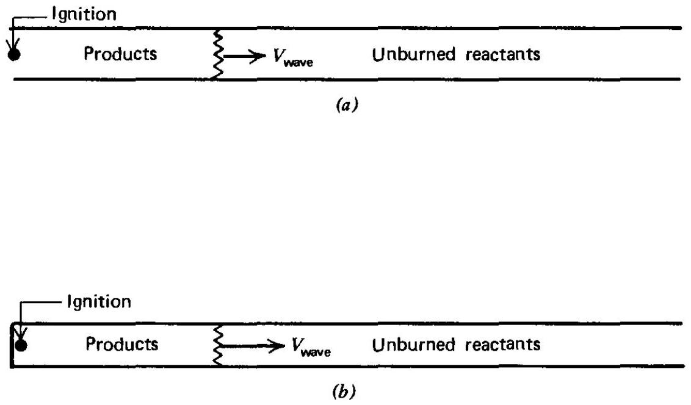
Figure 9.6 Combustion waves in a premixed gaseous system in a long tube. (a) Open end tube. (b) Closed end tube.

leaving burned products behind the wave. Two different types of combustion waves are observed experimentally: deflagrations, which propagate at subsonic speeds with respect to the reactants, and detonations, which propagate at supersonic speeds with respect to the reactants.

In a stationary reference system, the combustion wave is an unsteady flow process. In the relative coordinate system, however, where the observer moves with the same speed as the combustion wave, the combustion wave appears to be stationary, as illustrated schematically in Fig. 9.7; that is, it is a steady combustion wave.

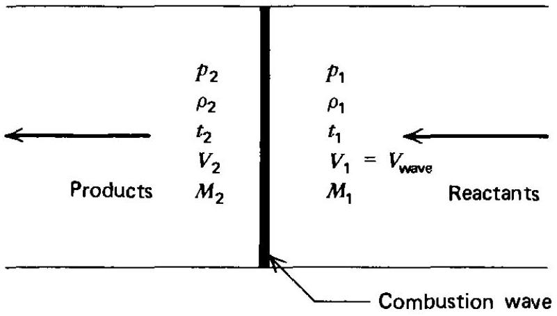
Figure 9.7 Steady combustion wave.

Table 9.4 summarizes the general characteristics of detonation and deflagration waves.

Whether a detonation wave or a deflagration wave occurs in a given situation depends on several variables, but the principal factors are the composition of the gaseous reactants, and whether the tube is open or closed at the ignition end.

The items of prime interest in studying combustion waves are the wave propagation speed and the flow properties of the products of combustion. For a detonation wave, the wave propagation speed is termed the detonation velocity, and for a deflagration wave it is termed the flame speed.

The analysis of a combustion-driven wave is quite similar to that employed for the normal shock wave in Section 7-3, the difference being that shock waves are adiabatic while combustion waves are diabatic because of the thermal energy released by the chemical reaction. The combustion wave may be regarded as a generalization

Table 9.4 General Characteristics of Detonation and Deflagration Waves
|  | Detonation | Deflagration |
| :--- | :--- | :--- |
| $M_{1}$ | $>1$ | <1 |
| $M_{2}$ | $\leqq 1$ | <1 |
| $\frac{V_{2}}{V_{1}}$ | <1 | >1 |
| $\frac{p_{2}}{p_{1}}$ | >1 | <1 |
| $\frac{\rho_{2}}{\rho_{1}}$ | $>1$ | <1 |
| $\frac{t_{2}}{t_{1}}$ | >1 | <1 |


of the normal shock wave so that it includes energy release, which is equivalent to a simple heat addition. Consequently, the analysis of combustion waves presented herein is basically an extension of the analysis presented in Section 7-3 for the normal shock wave.

## 9-4(a) Governing Equations for Combustion Waves

The governing equations for the normal shock wave derived in Section 7-3 are directly applicable to combustion waves, if the specific internal energy $u$ is defined so that it includes the chemical energy of formation for the reactants and products. Hence, equations 7.2, 7.5, and 7.8, which are repeated below and renumbered, are applicable.

$$
\begin{gathered}
G=\rho_{1} V_{1}=\rho_{2} V_{2} \\
p_{1}+\rho_{1} V_{1}^{2}=p_{2}+\rho_{2} V_{2}^{2} \\
u_{1}^{\prime}+p_{1} v_{1}+\frac{V_{1}^{2}}{2}=u_{2}^{\prime}+p_{2} v_{2}+\frac{V_{2}^{2}}{2}
\end{gathered}
$$

where

$$
u^{\prime} \equiv u+u^{\circ}
$$

In equation 9.46, $u$ is the sensible internal energy (i.e., $\int c_{v} d t$ ), and $u^{\circ}$ is the aforementioned energy of formation, which is the energy required to form the gaseous species from the naturally occurring elements (see Section 14-3). Equation 9.45 becomes

$$
u_{1}+p_{1} v_{1}+\frac{V_{1}^{2}}{2}+\Delta u^{\circ}=u_{2}+p_{2} v_{2}+\frac{V_{2}^{2}}{2}
$$

where

$$
\Delta u^{\circ}=u_{1}^{\circ}-u_{2}^{\circ}
$$

is the energy released by the chemical reaction, and is called the energy of combustion. For a simple system, the caloric equation of state is given by

$$
u=u(p, \rho)
$$

Combining equations 9.43, 9.44, and 9.47, we obtain the equation for the Hugoniot curve, called an $H$-curve, for a diabatic flow (see equation 7.11). Thus,

$$
u_{2}-\left(u_{1}+\Delta u^{\circ}\right)=\frac{1}{2}\left(p_{1}+p_{2}\right)\left(v_{1}-v_{2}\right)
$$

Equation 9.49, in conjunction with equation 9.48, specifies the locus of the allowable final states for the products behind a combustion wave for a given initial state and energy of combustion. Figure 9.8 illustrates the aforementioned locus, plotted in the $p v$ plane; it is known as the Hugoniot curve. Equations 9.43 and 9.44 may be combined to yield the equation for a Rayleigh line, called an $R$-line [see Section 6-3(b)]. Thus,

$$
G^{2}=-\frac{\left(p_{2}-p_{1}\right)}{\left(v_{2}-v_{1}\right)}=-\left(\frac{d p}{d v}\right)_{R-\text { line }}
$$

The combustion products must, therefore, satisfy simultaneously the equations for both the $H$-curve and the $R$-line.

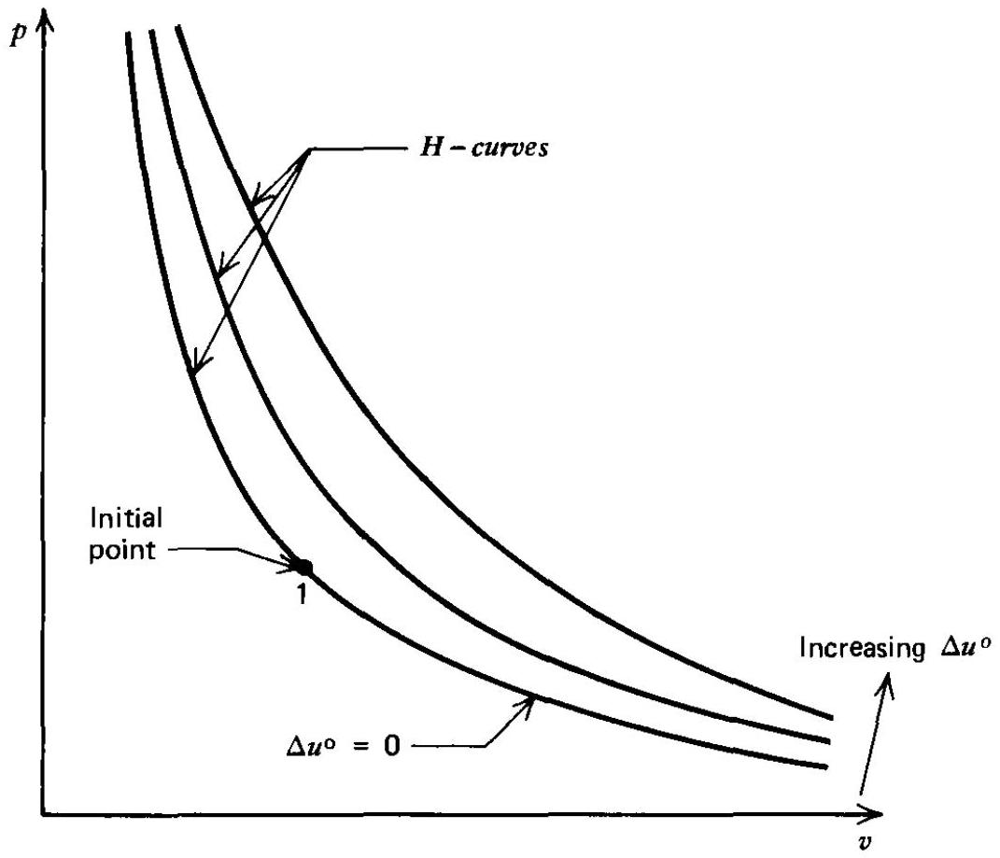
Figure 9.8 Sketch of several Hugoniot curves for diabatic flow.

## 9-4(b) The Hugoniot Curve for Diabatic Flow

Figure 9.8 illustrates schematically three different Hugoniot curves, corresponding to three different values for $\Delta u^{\circ}$, plotted in the $p v$ plane. From the configurations of those curves, it appears that two types of combustion waves are possible: (1) those for which the pressure $p$ and the density $\rho$ increase, called a detonation wave, and (2) those for which $p$ and $\rho$ decrease, called a deflagration wave. The lowest $H$-curve, for $\Delta u^{\circ}=0$, is the adiabatic $H$-curve for a normal shock wave derived in Section 7-3. It is shown there that for a normal shock wave the states on the portion of the $H$-curve below the initial point, point 1, violate the second law of thermodynamics for an isolated system, and are, therefore, physically unattainable. No such restriction exists, however, in the case of a diabatic flow.

It is of interest to determine the direction of the absolute velocity of the burned gases relative to a stationary observer. From Fig. 9.7,

$$
V_{\text {Products }}=V_{1}-V_{2}=V_{1}\left(1-\frac{V_{2}}{V_{1}}\right)
$$

Substituting for $V_{2} / V_{1}$ from equation 9.43 into equation 9.51 , we obtain

$$
V_{\text {Products }}=V_{1}\left(1-\frac{\rho_{1}}{\rho_{2}}\right)
$$

For a detonation wave, $\rho_{2} / \rho_{1}>1$, and

$$
0 \leqq V_{\text {Products }} \leqq V_{1}
$$

For a deflagration wave, $\rho_{2} / \rho_{1}<1$, and

$$
V_{\text {Products }}<0
$$

The products of combustion, therefore, flow behind a detonation wave at a lesser speed than the detonation velocity. For a deflagration wave, the products of combustion flow in the direction opposite to that for the wave.

Figure 9.9 illustrates schematically an $H$-curve for diabatic flow, subdivided into five separate regions. Points $J$ and $K$ are the points of tangency of the $H$-curve

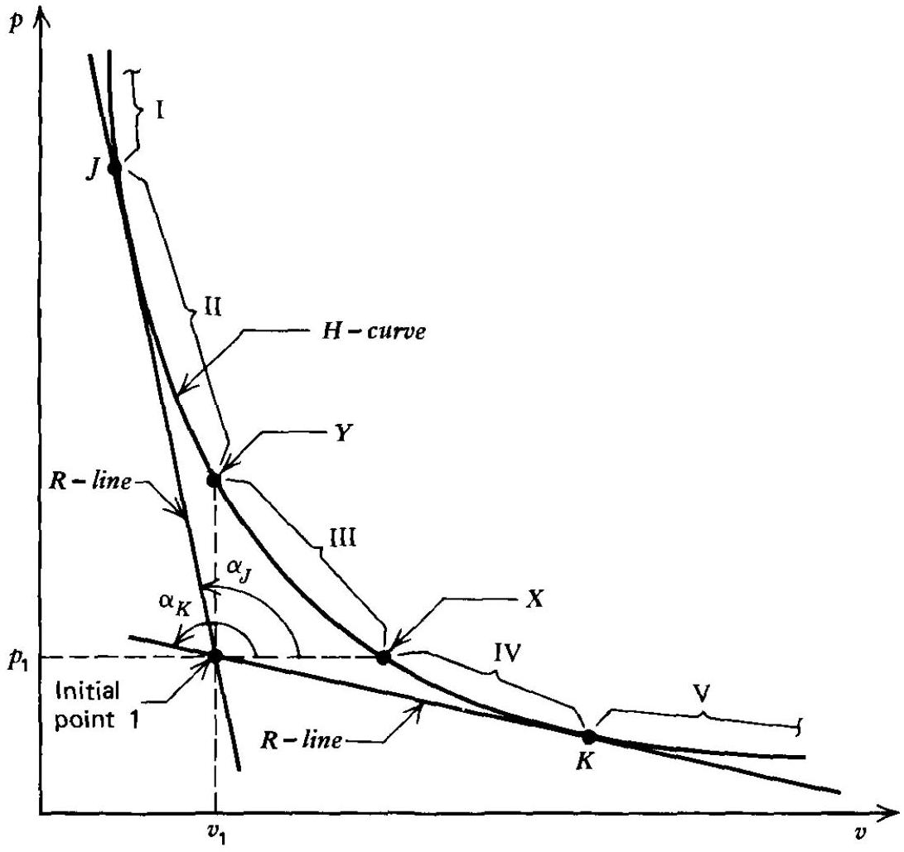
Figure 9.9 Regions of special interest on a Hugoniot curve for diabatic flow.

with the $R$-lines, through point 1 , having the maximum and minimum slopes, respectively. At point $Y$, the specific volume is the same as it is at point 1 , and at point $X$, the static pressure is the same as it is at point 1 . For an adiabatic $H$-curve, points $X$ and $Y$ coincide with point 1.

Denote the angle between the $v$-axis and an $R$-line by $\alpha$, as illustrated in Fig. 9.10. From equation 9.50,

$$
\tan \alpha=\left(\frac{d p}{d v}\right)_{R-\operatorname{line}}=-G^{2}=-\rho^{2} V^{2}
$$

Hence,

$$
V=\frac{\sqrt{-\tan \alpha}}{\rho}
$$

In the regions of the $H$-curve labeled I, II, IV, and V, $\tan \alpha$ is negative, and in those regions equation 9.56 yields physically realizable values for $V$. In Region III, however, $\tan \alpha$ is positive, so that $V$ is imaginary. Consequently, in Region III, the mathematical solutions have no physical meaning, and the physically meaningful portions of the $H$-curve are Regions I, II, IV, and V.

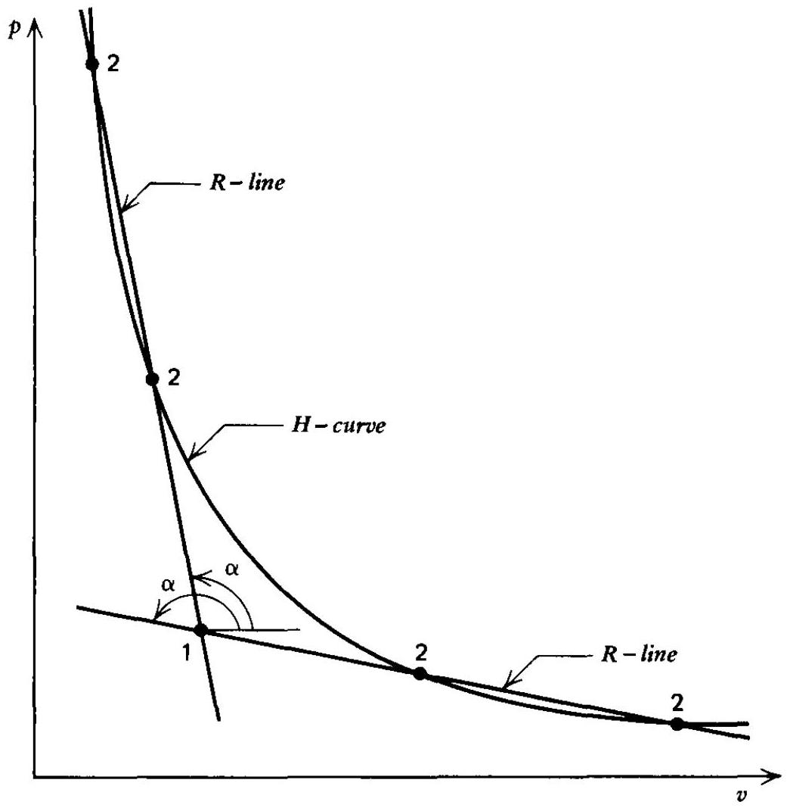
Figure 9.10 Definition of the angle $\alpha$.

Now consider point $Y$ in Fig. 9.9. Approaching that point from the physically meaningful Regions I and II, $\alpha$ is decreasing toward the limit of 90 deg and $\tan \alpha$ is increasing in a negative direction toward the limit $\tan \alpha=-\infty$. Consequently, at point $Y$, equation 9.56 yields

$$
V_{Y}=\frac{\sqrt{-(-\infty)}}{\rho_{Y}}=\infty
$$

Thus, at point $Y$ the velocity of the gaseous combustion products behind the combustion wave is infinite. At point $X, \alpha=180 \operatorname{deg}$ and $\tan \alpha=-0$. From equation 9.56, we obtain

$$
V_{X}=\frac{\sqrt{-(-0)}}{\rho_{X}}=0
$$

Hence, at point $X$ the velocity of the gaseous combustion products behind the combustion wave is zero.

Point $J$ and $K$ are called the Chapman-Jouguet points. At those points, the $H$-curve is tangent to an isentrope (i.e., a line of constant entropy). That fact may be demonstrated by differentiating the equation of the $H$-curve, equation 9.49, introducing equation 1.64, and solving for $(d s / d p)_{H}$, where the subscript $H$ denotes that the differentiation is along the $H$-curve. Thus,

$$
d u_{H}=-\frac{1}{2}\left(p_{1}+p\right) d v_{H}+\frac{1}{2}\left(v_{1}-v\right) d p_{H}
$$

Equation 1.64 is repeated and renumbered below for convenience.

$$
t d s=d u+p d v
$$

Combining equations 9.59, 9.60, and 9.50, we obtain (see equation 7.16)

$$
2 t\left(\frac{d s}{d p}\right)_{H}=\left(v_{1}-v\right)\left[1+\frac{G^{2}}{(d p / d v)_{H}}\right]
$$

At points $J$ and $K$, the $H$-curve is tangent to the $R$-line. Hence,

$$
\left(\frac{d p}{d v}\right)_{H}=\left(\frac{d p}{d v}\right)_{R}=-\mathrm{G}^{2}
$$

The term in brackets in equation 9.61 is, therefore, zero at points $J$ and $K$, and at those points

$$
\left(\frac{d s}{d p}\right)_{H}=0
$$

Consequently, at points $J$ and $K, d s=0$, indicating that $s=$ constant at those two points on the $H$-curve. From equation 9.50, at points $J$ and $K$,

$$
\left(\frac{d p}{d v}\right)_{R}=-\rho^{2}\left(\frac{d p}{d \rho}\right)_{s}=-\rho^{2} a^{2}=-G^{2}=-\rho^{2} V^{2}
$$

Therefore,

$$
V=a \quad(\text { at points } J \text { and } K)
$$

Accordingly, at the Chapman-Jouguet points $J$ and $K$, the velocity of the gaseous combustion products is exactly sonic.

In Region I, as point 2 moves away from point $J$, the pressure $p$ and the density $\rho$ increase toward $\infty$. From equation 9.43,

$$
V_{2}=\frac{G}{\rho_{2}}
$$

Hence, as $\rho_{2}$ approaches $\infty, V_{2}$ decreases toward zero. In Region $V$, as point 2 moves away from point $K, p$ and $\rho$ decrease toward zero. From equation 9.66, as $\rho_{2}$ approaches zero, $V_{2}$ increases toward $\infty$.

Figure 9.11 summarizes the types of combustion waves corresponding to the regions on the $H$-curve discussed above. Region III is not shown because no real processes occur in that region. The remaining four regions are identified as follows.

Region I: strong detonation, $M_{1}>1$ and $M_{2}<1$.
Region II: weak detonation, $M_{1}>1$ and $M_{2}>1$.

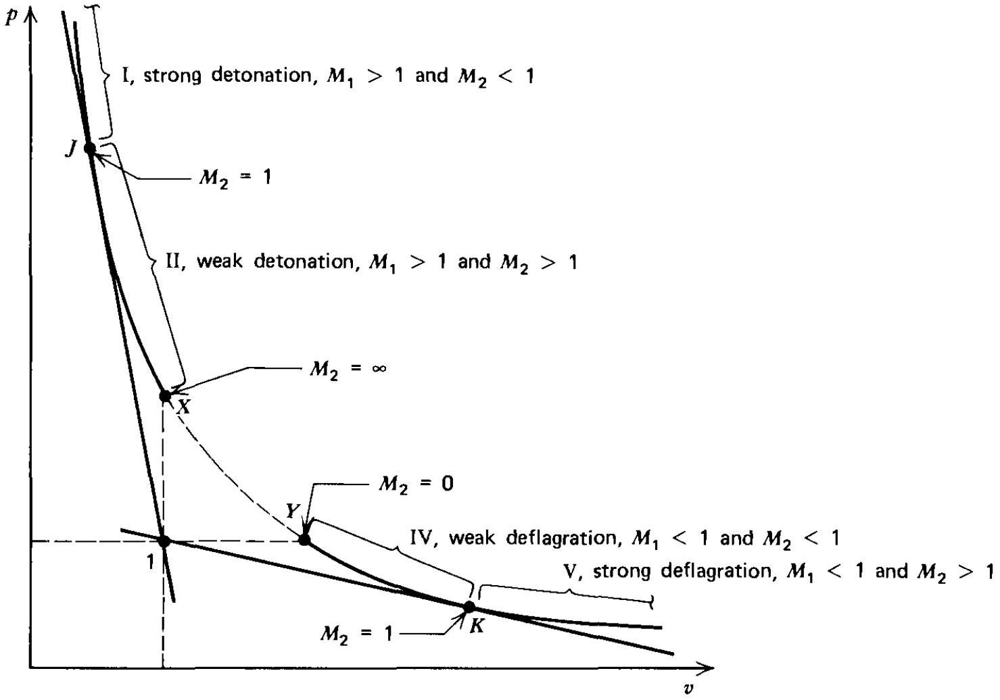
Figure 9.11 Combustion regions on the Hugoniot curve.

Region IV: weak deflagration, $M_{1}<1$ and $M_{2}<1$.
Region V: strong deflagration, $M_{1}<1$ and $M_{2}>1$.
Region V is also a region wherein no physical processes are attainable, as may be demonstrated by the following argument. The release of combustion energy is the equivalent of a heat addition process. Consequently, states in Region V require that the subsonic flow entering the combustion wave be accelerated to supersonic speeds in flowing through the combustion zone. The analysis of the Rayleigh line, however, demonstrates that a subsonic flow cannot be accelerated to a supersonic speed by heat addition alone [see Section 6-3(d)]. It is, therefore, concluded that since supersonic velocities behind the combustion wave are not possible, the states in Region V are not physically realizable.

Weak detonations corresponding to Region II cannot be ruled out absolutely, but they appear much less probable than strong detonations. If a detonation wave is considered to be an adiabatic shock wave followed by heat addition caused by combustion, the path of the process might appear to be in accordance with the one illustrated in Fig. 9.12. Point $A$ represents the fluid state immediately after passing through the shock wave. From point $A$, the fluid must move along the $R$-line to point $B$ or $C$. Since the flow at point $A$ is subsonic, arguments similar to that presented above for eliminating Region V show that point $B$, which corresponds to a subsonic flow, would represent a final state on the $R$-line process, whereas point $C$ could not because it corresponds to a supersonic flow. Consequently, Region II corresponds to a physically unrealizable process.

Summarizing, the regions of the Hugoniot curve that correspond to physically attainable processes for a diabatic flow are those indicated in Fig. 9.13. Strong detonations occur in Region I or at the Chapman-Jouguet point $J$, and weak deflagrations occur in Region IV or at the Chapman-Jouguet point $K$.

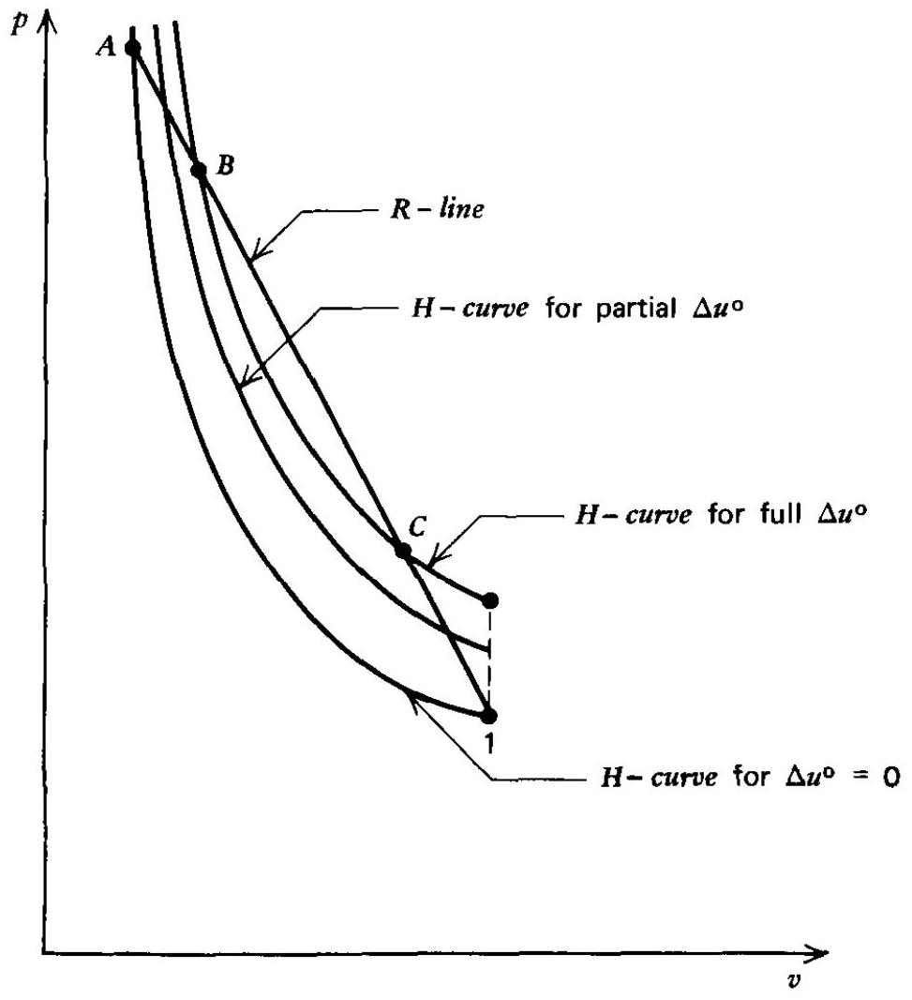
Figure 9.12 Schematic illustrations of Hugoniot curves for no reaction $\left(\Delta u^{\prime}=0\right)$, partial reaction (partial $\Delta u^{\circ}$ ), and complete reaction (full $\Delta u^{\circ}$ ).

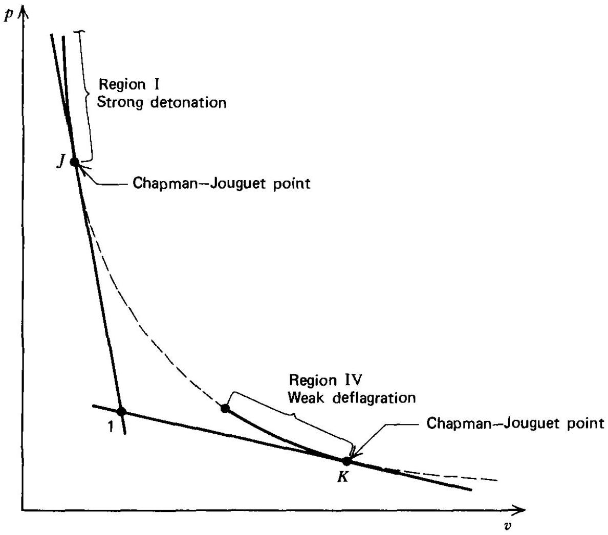
Figure 9.13 Physically attainable regions of the Hugoniot curve for diabatic flow.

## 9-4(c) Detonation Waves

In Section 9-4(b), detonation waves are shown to occur in Region I or at the Chapman-Jouguet point $J$ (see Fig. 9.13). Detonations in premixed combustible gas mixtures were first observed by Bertholet, Vieille, Mallard, and Le Chatelier in the latter part of the nineteenth century. Chapman, in 1899, proposed that steady detonation waves occur at the Chapman-Jouguet point. In 1905, Jouguet postulated that a detonation wave comprises a shock wave followed by a combustion wave, which is indeed the case. The internal structure of a detonation wave has been described analytically by Zeldovich, ${ }^{2}$ von Neumann, ${ }^{3}$ and Döring. ${ }^{4}$ Figure 9.14 illustrates schematically the Zeldovich-von Neumann-Döring (ZND) detonation wave structure. The pressure, density, and temperature of the gas mixture increase abruptly because of the passage of the shock wave. After a short ignition lag, deflagration occurs and the final state of the detonation wave is achieved. The general features of the ZND detonation model are in good qualitative agreement with experimental observations.

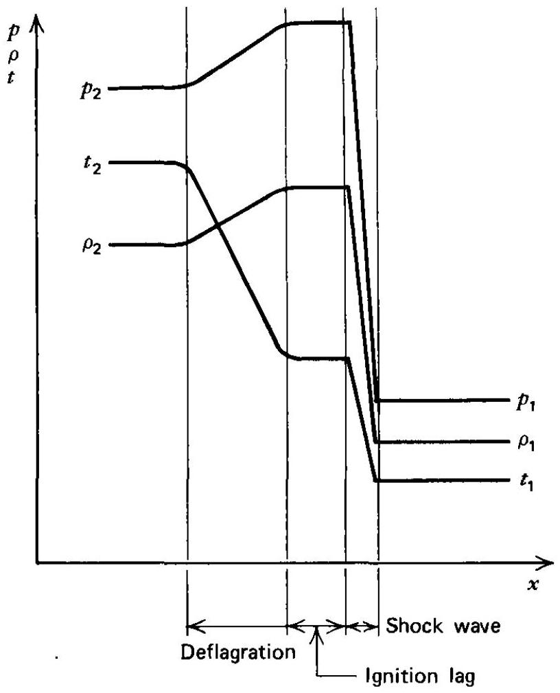
Figure 9.14 Structure of a ZND detonation wave.

Whether a detonation wave or a deflagration wave is produced in a given combustion situation depends on whether the end of the tube wherein ignition occurs is open or closed (see Fig. 9.6). The released combustion energy generates compression waves that propagate in both directions. In a closed-end tube, however, those waves reflect from the closed end, overtake the combustion wave and strengthen it until it becomes a fully developed detonation wave. For an open-end tube (see Fig. 9.6) the left-running compression waves leave the tube, so that there is no reinforcement of the combustion wave. Accordingly, a deflagration wave is produced. The formation of a detonation wave also depends on the fuel/oxidizer ratio, also called the mixture ratio. There is a definite upper and a definite lower limit to what
constitutes a detonable mixture ratio; those limiting mixture ratios are called the detonation limits. If the mixture ratio is outside of the detonation limits, no detonation wave will either form or propagate, even when all of the other factors are favorable to the formation of a detonation wave. Belles ${ }^{5}$ postulated a model for predicting the detonation limits that is in reasonable agreement with the experimental observations.

The detonation velocity and the flow properties of the gaseous mixture behind the detonation wave may be determined by plotting the $H$-curve and the tangent $R$-line, and determining the Chapman-Jouguet point (see point $J$, Fig. 9.13). An approximate algebraic technique may be developed as follows. At the ChapmanJouguet point $J, M_{2}=1$. Hence, substituting $V_{2}=a_{2}$ into equation 9.43 yields

$$
V_{1}=\frac{\rho_{2} a_{2}}{\rho_{1}}
$$

Combining equations 9.43 and 9.44 , solving for $\rho_{2} / \rho_{1}$, noting that $p_{1} \ll p_{2}$ for a detonation wave, and introducing $V_{2}=a_{2}$, we obtain

$$
\frac{\rho_{2}}{\rho_{1}}=1+\frac{p_{2}}{\rho_{2} V_{2}^{2}}\left(1-\frac{p_{1}}{p_{2}}\right) \approx 1+\frac{p_{2}}{\rho_{2} a_{2}^{2}}
$$

Combining equations 9.67 and 9.68 yields

$$
V_{1}=a_{2}\left(1+\frac{p_{2}}{\rho_{2} a_{2}^{2}}\right)
$$

Solving equation 9.49 for $u_{2}$ and noting that $p_{1} \ll p_{2}$ gives

$$
u_{2} \approx u_{1}+\Delta u^{\circ}+\frac{1}{2} \frac{p_{2}}{\rho_{2}}\left(\frac{\rho_{2}}{\rho_{1}}-1\right)
$$

Substituting equation 9.68 into equation 9.70 , we obtain

$$
u_{2}=u_{1}+\Delta u^{\circ}+\frac{p_{2}^{2}}{2 \rho_{2}^{2} a_{2}^{2}}
$$

In the case of an imperfect gas, equation 9.71 must be solved numerically. The values of $p_{2}$ and $\rho_{2}$ are assumed and those for $u_{2}$ and $a_{2}$ are calculated from the equation of state. The latter values are then substituted into equation 9.71 until it is satisfied. When state 2 is determined, $V_{1}$ is calculated from equation 9.69. Table 9.5 compares the calculated and measured detonation velocities for several gaseous mixtures.

For a perfect gas, $p=\rho R t, u=c_{v} t$, and $a^{2}=\gamma R t$. In that case, equation 9.71 may be rewritten as

$$
c_{v 2} t_{2}=c_{v 1} t_{1}+\Delta u^{\circ}+\frac{R_{2} t_{2}}{2 \gamma_{2}}
$$

Hence,

$$
t_{2}=\frac{2 \gamma_{2}}{\gamma_{2}+1}\left(\frac{c_{v 1}}{c_{v 2}} t_{1}+\frac{\Delta u^{\circ}}{c_{v 2}}\right)
$$

Equation 9.73 may be solved directly for $t_{2}$ for given values of the energy of combustion $\Delta u^{\circ}$.

Table 9.5 A Comparison of Calculated and Measured Detonation Velocities
| Gaseous Mixture | $p_{2}, \mathrm{~atm}$ | $t_{2}, \mathrm{~K}$ | $V_{1}, \mathrm{~m} / \mathrm{s}$ |  |
| :--- | :--- | :--- | :--- | :--- |
|  |  |  | Calculated | Measured |
| $\left(2 \mathrm{H}_{2}+\mathrm{O}_{2}\right)$ | 18.05 | 3583 | 2806 | 2819 |
| $\left(2 \mathrm{H}_{2}+\mathrm{O}_{2}\right)+3 \mathrm{O}_{2}$ | 15.3 | 2970 | 1925 | 1922 |
| $\left(2 \mathrm{H}_{2}+\mathrm{O}_{2}\right)+3 \mathrm{~N}_{2}$ | 15.63 | 3003 | 2033 | 2055 |
| $\left(2 \mathrm{H}_{2}+\mathrm{O}_{2}\right)+4 \mathrm{H}_{2}$ | 15.97 | 2976 | 3627 | 3527 |
| $p_{1}=1 \mathrm{~atm}$ and $t_{1}=291 \mathrm{~K}$ |  |  |  |  |


(Taken from Reference 6)

Example 9.2. Estimate the detonation velocity $V_{1}$ for the premixed gaseous mixture comprising $2 \mathrm{H}_{2}+\mathrm{O}_{2}+3 \mathrm{~N}_{2}$. The initial temperature and pressure of the reactants are $t_{1}=298.15 \mathrm{~K}$ and $p_{1}=1 \mathrm{~atm}$, respectively.

## Solution

The detonation velocity may be estimated by neglecting the dissociation of the gaseous products formed behind the detonation wave and assuming that the product gases behave as would a mixture of perfect gases. In view of the aforementioned assumptions, equations 9.67 to 9.73 are applicable.

To apply equations 9.67 to 9.73 , the molecular weights and specific heats of the reactant gases in front of and the gaseous combustion products in back of the detonation wave must be known. In addition, the energy of combustion $\Delta u^{\circ}$ for the reactants must be known. The properties of a mixture of perfect gases are discussed in Section 1-15(h).

The energy of combustion is the chemical energy released by the chemical reaction, and it is converted into thermal energy. The procedure for taking into account the chemical energy of a substance is discussed in Section 14-3.

Neglecting dissociation, the combustible gas mixture, the reactants, may be assumed to satisfy the following chemical reaction

$$
2 \mathrm{H}_{2}+\mathrm{O}_{2}+3 \mathrm{~N}_{2}=2 \mathrm{H}_{2} \mathrm{O}+3 \mathrm{~N}_{2}
$$

where the quantities $2,1,3,2$, and 3 are taken as moles. For an adiabatic reaction (i.e., one in which there is no heat transfer with the surroundings), it is shown in Section 14-4 that the absolute enthalpy of the reactants $H_{R}$ must equal the absolute enthalpy of the products $H_{p}$, where the absolute enthalpy $H$ is equal to the sum of the sensible enthalpy change ( $H^{\circ}-H_{\text {ref }}^{\circ}$ ) above the reference temperature, and the energy of formation $\Delta H_{f, \text { ref }}^{\circ}$, which is the chemical energy required for forming the chemical species from its stable elements at the reference temperature. Table D.1, Volume 2, presents values of ( $H^{\circ}-H_{298}^{\circ}$ ) and $\Delta H_{f, 298}^{\circ}$ for the species in equation (a). Thus,

$$
H=\sum_{i=1}^{n} N_{i}\left[\left(H^{\circ}-H_{298}^{\circ}\right)+\Delta H_{f, 298}^{\circ}\right]=\sum_{i=1}^{n} N_{i} H_{i}=N \sum_{i=1}^{n} X_{i} H_{i}
$$

Selected portions of Table D.1, Volume 2, for the gaseous species of interest in the present problem are presented in the following table.

| Species | $\Delta H_{j .298}$, kJ/kmol | T, K | $c_{p}^{\prime}$, kJ/kmol-K | $H^{c}-H_{298}^{c}$, kJ/kmol |
| :--- | :--- | :--- | :--- | :--- |
| $\mathrm{H}_{2}$ | 0 | 298 | 28.859 | 0 |
| $\mathrm{O}_{2}$ | 0 | 298 | 29.354 | 0 |
| $\mathrm{N}_{2}$ | 0 | 298 | 29.122 | 0 |
|  |  | 3000 | 37.066 | 92,753 |
|  |  | 3100 | 37.124 | 96,462 |
|  |  | 3200 | 37.178 | 100,178 |
| $\mathrm{H}_{2} \mathrm{O}$ | -241,827 | 298 | 33.561 | 0 |
|  |  | 3000 | 55.711 | 126,353 |
|  |  | 3100 | 56.006 | 131,939 |
|  |  | 3200 | 56.280 | 137,554 |

The energy of combustion $\Delta u^{\circ}$ is defined as the amount of energy that must be removed from the products of combustion by heat transfer to change the temperature of the products to the temperature of the reactants. Thus,

$$
H_{R}\left(t_{R}\right)=H_{P}\left(t_{R}\right)+\Delta u^{\circ}
$$

For the reactants in equation (a) above, the total number of moles $N_{R}= (2+1+3)=6$. Thus,

$$
X_{\mathrm{H}_{2}}=\frac{2}{6}=0.33333, \quad X_{\mathrm{O}_{2}}=\frac{1}{6}=0.16667, \quad X_{\mathrm{N}_{2}}=\frac{3}{6}=0.5
$$

For the products of combustion, $N_{P}=(2+3)=5$, and

$$
X_{\mathrm{H}_{2} \mathrm{O}}=\frac{2}{5}=0.40, \quad X_{\mathrm{N}_{2}}=\frac{3}{5}=0.60
$$

From equation 1.141 a , the molecular weight $\bar{m}$ of a gas mixture is

$$
\bar{m}=\sum_{i=1}^{n} X_{i} \bar{m}_{i}
$$

Consequently,

$$
\begin{gathered}
\bar{m}_{1}=(0.33333)(2.016)+(0.16667)(32.0)+(0.5)(28.0)=20.005 \\
\bar{m}_{2}=(0.4)(18.016)+(0.6)(28.0)=24.006
\end{gathered}
$$

From equation (b) and selected portions of Table D.1, Volume 2,

$$
\begin{aligned}
& H_{R}(298)=2(0+0)+1(0+0)+3(0+0)=0 \\
& H_{P}(298)=2(0-241,827 / 1000)+3(0+0)=-483.654 \mathrm{~kJ}
\end{aligned}
$$

$H_{R}(298)$ is zero for this special case where the reactants are naturally occurring elements and the initial temperature $t_{R}$ is the reference temperature $t_{\mathrm{rci}}=298.15 \mathrm{~K}$. In general, $H_{R}\left(t_{R}\right)$ is nonzero. Substituting for $H_{R}$ and $H_{P}$ into equation (c), we obtain

$$
\Delta u^{\circ}=0-(-483.654)=483.654 \mathrm{~kJ}
$$

On a molar basis,

$$
\Delta \bar{u}^{\circ}=\frac{\Delta u^{\circ}}{N_{P}}=\frac{483.654}{5}=96.731 \mathrm{~kJ} / \mathrm{mol}
$$

The specific heat $\bar{c}_{p}$ on a molar basis is given by equation 1.144d.

$$
\bar{c}_{p}=\sum_{i=1}^{n} X_{i} \bar{c}_{p i}
$$

For the reactants, at $t=298.15 \mathrm{~K}$,

$$
\bar{c}_{p_{1}}=(0.33333)(28.859)+(0.16667)(29.354)+(0.5)(29.122)=29.073 \mathrm{~J} / \mathrm{mol}-\mathrm{K}
$$

For a perfect gas, $\bar{c}_{v}=\bar{c}_{p}-\bar{R}$. Thus,

$$
\bar{c}_{v 1}=29.073-8.314=20.759 \mathrm{~J} / \mathrm{mol}-\mathrm{K}
$$

For the products, $t_{2}$ is unknown. Consequently, an iterative procedure is employed wherein $t_{2}$ is assumed, $\bar{c}_{p 2}, \bar{c}_{v 2}$, and $\gamma_{2}$ are calculated, and $t_{2}$ is determined from equation 9.73. The value of $t_{2}$ is iterated to convergence. For the first iteration, assume $t_{2}=3000 \mathrm{~K}$. From equation (d) and selected portions of Table D.1, Volume 2, we obtain

$$
\begin{aligned}
\bar{c}_{p 2} & =(0.4)(55.711)+(0.6)(37.066)=44.524 \mathrm{~J} / \mathrm{mol}-\mathrm{K} \\
\bar{c}_{v 2} & =44.524-8.314=36.210 \mathrm{~J} / \mathrm{mol}-\mathrm{K} \\
\gamma_{2} & =\frac{\bar{c}_{p 2}}{\bar{c}_{v 2}}=\frac{44.524}{36.210}=1.230
\end{aligned}
$$

Equation 9.73 may be rewritten in terms of molar properties. Thus,

$$
t_{2}=\frac{2 \gamma_{2}}{\gamma_{2}+1}\left[\frac{\left(\bar{c}_{v 1} / \bar{m}_{1}\right)}{\left(\bar{c}_{v 2} / \bar{m}_{2}\right)} t_{1}+\frac{\Delta \bar{u}^{\circ}}{\bar{c}_{v 2}}\right]
$$

Substituting the appropriate values into equation (e), we obtain

$$
t_{2}=\frac{2(1.230)}{2.230}\left[\frac{(20.759 / 20.005)}{(36.210 / 24.006)}(298.15)+\frac{96,731}{36.210}\right]=3173.3 \mathrm{~K}
$$

For the second iteration, assume $t_{2}=3200 \mathrm{~K}$.

$$
\begin{aligned}
\bar{c}_{p 2} & =(0.4)(56.280)+(0.6)(37.178)=44.819 \mathrm{~J} / \mathrm{mol}-\mathrm{K} \\
\bar{c}_{v 2} & =44.819-8.314=36.505 \mathrm{~J} / \mathrm{mol}-\mathrm{K} \\
\gamma_{2} & =\frac{44.819}{36.505}=1.228 \\
t_{2}= & \frac{2(1.228)}{2.228}\left[\frac{(20.759 / 20.005)}{(36.505 / 24.006)}(298.15)+\frac{96,731}{36.505}\right]=3145.3 \mathrm{~K}
\end{aligned}
$$

The value of $t_{2}$ for the third iteration is obtained from the secant method [see Appendix A-4(d). Thus,

$$
\frac{t_{2}-3145.3}{t_{2}-3200}=\frac{3173.3-3145.3}{3000-3200}=-0.14000
$$

Solving equation (f) gives $t_{2}=3152.0 \mathrm{~K}$. Then,

$$
\begin{aligned}
\bar{c}_{p 2} & =(0.4)(56.149)+(0.6)(37.152)=44.751 \mathrm{~J} / \mathrm{mol}-\mathrm{K} \\
\bar{c}_{v 2} & =44.751-8.314=36.437 \mathrm{~J} / \mathrm{mol}-\mathrm{K} \\
\gamma_{2} & =\frac{44.751}{36.437}=1.228
\end{aligned}
$$

$$
t_{2}=\frac{2(1.228)}{2.228}\left[\frac{(20.759 / 20.005)}{(36.437 / 24.006)}(298.15)+\frac{96,731}{36.437}\right]=3151.2 \mathrm{~K}
$$

Thus, $t_{2}=3151.2 \mathrm{~K}$.
From equation 9.68, for a perfect gas,

$$
\frac{\rho_{2}}{\rho_{1}}=1+\frac{p_{2}}{\rho_{2} a_{2}^{2}}=1+\frac{p_{2} \rho_{2}}{\rho_{2} \gamma_{2} p_{2}}=1+\frac{1}{\gamma_{2}}=\frac{\gamma_{2}+1}{\gamma_{2}}=\frac{1.228+1}{1.228}=1.814
$$

For a perfect gas, $a_{2}=\sqrt{\gamma_{2} R_{2} t_{2}}$.

$$
\begin{aligned}
& R_{2}=\frac{\bar{R}}{\bar{m}_{2}}=\frac{8314.3}{24.006}=346.34 \mathrm{~J} / \mathrm{kg}-\mathrm{K} \\
& a_{2}=[1.228(346.34)(3151.2)]^{1 / 2}=1157.7 \mathrm{~m} / \mathrm{s}
\end{aligned}
$$

From equation 9.67, we obtain

$$
V_{1}=\frac{\rho_{2} a_{2}}{\rho_{1}}=(1.814)(1157.7)=2100.0 \mathrm{~m} / \mathrm{s}
$$

From the perfect gas law,

$$
\begin{aligned}
\frac{p_{2}}{p_{1}} & =\frac{\rho_{2} R_{2} t_{2}}{\rho_{1} R_{1} t_{1}} \\
R_{1} & =\frac{8314.3}{20.005}=415.60 \mathrm{~J} / \mathrm{kg}-\mathrm{K} \\
\frac{p_{2}}{p_{1}} & =(1.814) \frac{(346.34)(3151.2)}{(415.60)(298.15)}=15.977 \\
p_{2} & =15.977(1.0)=15.977 \mathrm{~atm}
\end{aligned}
$$

The results obtained above are approximate because dissociation of the combustion products is neglected. Because of the presence of the diluent $\mathrm{N}_{2}$ in the present example, the temperature of the products of combustion is reduced below that which would be obtained for the mixture $2 \mathrm{H}_{2}+\mathrm{O}_{2}$. Consequently, dissociation is less important and the above results should be reasonable approximations. From Table 9.5, the measured detonation velocity is $2055 \mathrm{~m} / \mathrm{s}$. The calculated velocity of $2100.0 \mathrm{~m} / \mathrm{s}$ is, therefore, only 2.2 percent too large, which is good agreement despite the approximations involved.

## 9-4(d) Deflagration Waves

It is shown in Section 9-4(b) that deflagrations correspond to states on the weak deflagration branch of the Hugoniot curve (see Fig. 9.13). The flame speed of a deflagration wave is controlled by a combination of heat conduction and mass diffusion, whereas the velocity of a detonation wave is controlled by the abrupt pressure, density, and temperature increases associated with the normal shock wave. Therefore, the deflagration flame speed depends on several factors, such as whether the process is laminar or turbulent, and also on the details of the reaction mechanism.

Several theories have been developed for predicting the speeds of deflagration waves. Basically, three types of theories have been proposed: (1) thermal theories, which are based on rate controlled heat transfer, (2) diffusion theories, which are based on rate controlled mass transfer, and (3) comprehensive theories, which are a
combination of rate controlled heat and mass transfer. The thermal and diffusion theories are oversimplifications of the actual process. Both theories predict an increase in flame speed with an increase in flame temperature, which is in agreement with experimental observations. The analyses developed by Zeldovich and FrankKamenetskii, ${ }^{7}$ Zeldovich and Semenov, ${ }^{8}$ Semenov, ${ }^{9}$ and Zeldovich ${ }^{10}$ are representative of the comprehensive theories, and there is reasonable agreement between those theories and experiment.

Finally, it is noted that there are definite lower and upper limits to the mixture ratio that will support a steady deflagration wave. Those limits are called the flammability limits. For a given gaseous mixture the flammability limits are usually wider than the corresponding detonation limits. Flammability limits depend on the initial pressure and temperature of the combustible mixture. The comprehensive theory developed by Spalding ${ }^{11}$ is representative of the analytical approach for predicting flammability limits.

## 9-5 GENERALIZED STEADY ONE-DIMENSIONAL FLOW ${ }^{12,13}$

A simple flow is a steady one-dimensional flow in which a single driving potential is responsible for the changes in the flow properties. Isentropic flow with simple area change is considered in Chapter 4, simple frictional flow is discussed in Chapter 5, simple diabatic flow is discussed in Chapter 6, and simple mass addition is analyzed in Section 9-3. When the working fluid is a perfect gas, algebraic equations may be derived for those simple flows. Those equations relate all of the flow properties to the flow Mach number. When imperfect gas effects must be taken into account, straightforward numerical techniques may be applied for solving a specific problem. Shock waves, isothermal flow in a constant-area duct with friction, isothermal flow in a variable-area duct, and detonation and deflagration waves are, strictly speaking, not simple flows. Nevertheless, such flows may be analyzed in a straightforward manner, yielding results analogous to those obtained for simple flows.

In the general case for a steady one-dimensional flow, however, several driving potentials may be present simultaneously, and no straightforward closed form solutions for the governing equations are obtainable, even for a perfect gas. Such flows are called generalized steady one-dimensional flows and are discussed in the present section.

## 9-5(a) Governing Equations for Generalized Steady One-Dimensional Flow

Figure 9.15 illustrates schematically the physical model for a generalized steady onedimensional flow. The independent driving potentials considered are:

1. Area change $d A$.
2. Wall friction $\delta F_{\mathrm{i}}$.
3. Heat transfer $\delta Q$.
4. Work $\delta W$.
5. Mass addition dm.
6. Body forces caused by gravity $\rho g A d z$.
7. Other body forces, drag of entrained particles, etc., denoted by $\delta D$.
8. Chemical reactions through their effect on the fluid equations of state.

The continuity and momentum equations for generalized steady one-dimensional flow are obtainable from Table 3.1. Thus,
(1) Continuity equation (equation 3.158)

$$
\dot{m}=\rho A V
$$

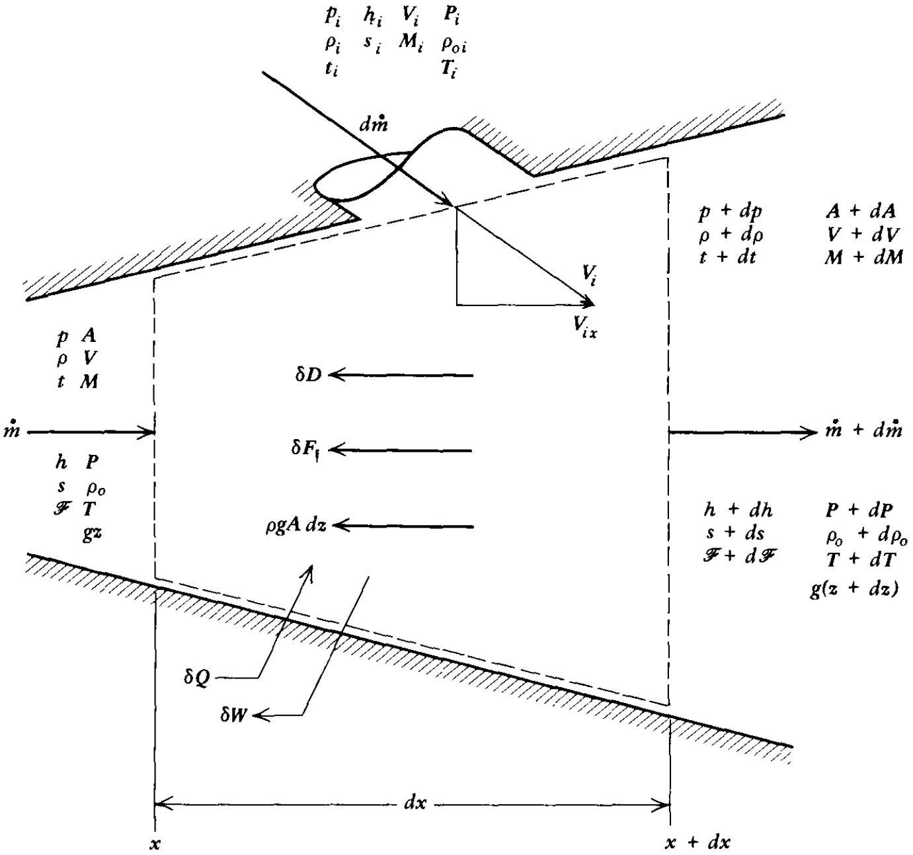
Figure 9.15 Physical model for generalized steady one-dimensional flow.

$$
\frac{d \dot{m}}{\dot{m}}=\frac{d \rho}{\rho}+\frac{d A}{A}+\frac{d V}{V}
$$

(2) Momentum equation (equation 3.160)

$$
d p+\rho V d V+\rho g d z+\frac{\rho V^{2}}{2}\left(\frac{4 \tilde{f} d x}{\mathscr{D}}\right)+\frac{\delta D}{A}+\rho V^{2}(1-y) \frac{d \dot{m}}{\dot{m}}=0
$$

where the mass addition term is obtained from equation 9.8.
(3) Energy equation. The energy equation is obtained by applying equation 2.88 (see Table 2.1) to the differential control volume illustrated in Fig. 9.15. Thus,

$$
\begin{aligned}
\delta \dot{W}-\delta \dot{Q}+(\dot{m}+d \dot{m}) & {\left[h+d h+\frac{V^{2}}{2}+d\left(\frac{V^{2}}{2}\right)+g(z+d z)\right] } \\
& -\dot{m}\left(h+\frac{V^{2}}{2}+g z\right)-d \dot{m}\left(h_{i}+\frac{V_{i}^{2}}{2}+g z_{i}\right)=0
\end{aligned}
$$

Combining terms, neglecting products of differentials, and dividing by $\dot{m}$, we obtain

$$
\begin{aligned}
\delta W-\delta Q+d h+d\left(\frac{V^{2}}{2}\right) & +g d z \\
+ & {\left[\left(h+\frac{V^{2}}{2}+g z\right)-\left(h_{i}+\frac{V_{i}^{2}}{2}+g z_{i}\right)\right] \frac{d \dot{m}}{\dot{m}}=0 }
\end{aligned}
$$

The term in brackets arises because of the difference in the stagnation enthalpy $H$ of the main stream and the stagnation enthalpy $H_{i}$ of the mass addition stream,
where $H=h+V^{2} / 2+g z$. Define the parameter

$$
d H_{i} \equiv\left(H-H_{i}\right) \frac{d \dot{m}}{\dot{m}}
$$

Substituting equation 9.79 into equation 9.78 gives

$$
\delta W-\delta Q+d H+d H_{i}=0
$$

Equations $9.75,9.76$, and 9.80 are valid for the flow of any fluid. Those equations must be supplemented by the equation of state of the fluid, which may be in algebraic, graphical, or tabular form.

For a simple thermodynamic system, the seven fluid properties $p, \rho, t, h, u, s$ and $a$ are completely determined by specifying any two of the seven properties. Thus, the equation of state for the fluid provides five relationships between those seven fluid properties.

The following additional flow properties may also be of interest in certain situations.
(4) Mach number

$$
M=\frac{V}{a}
$$

(5) Impulse function

$$
\mathscr{F}=p A+\dot{m} V=A\left(p+\rho V^{2}\right)
$$

(6) Stagnation enthalpy

$$
H=(h)_{V=0} \quad \text { (adiabatic process) }
$$

(7) Stagnation temperature

$$
T=(t)_{V=0} \quad \text { (isentropic process) }
$$

(8) Stagnation pressure

$$
P=(p)_{V=0} \quad \text { (isentropic process) }
$$

(9) Stagnation density

$$
\rho_{o}=(\rho)_{V=0} \quad \text { (isentropic process) }
$$

Equations $9.75,9.76$, and 9.80 to 9.86 , in conjunction with the five relationships provided by the equation of state, comprise a system of 14 relationships between the 14 fluid properties $p, \rho, t, h, u, s, a, V, M, H, P, T, \rho_{o}$, and $\mathscr{F}$, and the seven independent driving potentials $d A, \delta Q, \delta W,(4 f d x / \mathscr{D}), \delta D, \rho g A d z$, and $d \dot{m}$. To obtain a solution to that system of equations, the seven independent driving potentials must be calculable. The area change $d A$ is known from the geometry of the flow passage, and so are the length $x$ and elevation $z$ of the passage. The five remaining driving potentials $\delta Q, \delta W, \delta F_{i}, \delta D$, and $d \dot{m}$ depend on the fluid properties. Models must, therefore, be developed relating those driving potentials to the fluid properties. The model for $\delta F$, derived in Section 3-5(d), is included in equation 9.76, where the friction coefficient $\mathfrak{f}$ depends on the fluid properties. For a burning solid propellant surface, a model for $d \dot{m}$ is developed in Section 9-3(d). No specific models are developed in this book for relating $\delta Q, \delta W$, and $\delta D$ to the fluid properties.

The system of equations derived in this section for the generalized steady onedimensional flow of an arbitrary compressible fluid is quite involved, and their solutions for specific initial and boundary conditions are obtainable only by em-
ploying numerical integration techniques. The aforementioned equations are applied to the generalized steady one-dimensional flow of a perfect gas in Section 9-5(b).

## 9-5(b) Generalized Steady One-Dimensional Flow of a Perfect Gas

Equations 9.75 to 9.86 may be simplified in the case of the flow of a perfect gas, for which $p=\rho R t, h=c_{p} t, a^{2}=\gamma R t$, and the effects of gravity are negligible. Equation 9.80 may then be rewritten in the form

$$
\delta Q-\delta W-d H_{i}=d H=c_{p} d T
$$

Dividing both sides of equation 9.87 by $c_{p} t$, and introducing the definition of the stagnation temperature $T$, equation 3.181, we obtain

$$
\frac{\delta Q-\delta W-d H_{i}}{c_{p} t}=\left(1+\frac{\gamma-1}{2} M^{2}\right) \frac{d T}{T}
$$

Equation 9.88 shows that the effects of heat transfer, work, and the difference between $H$ and $H_{i}$ are reflected directly in the stagnation temperature change $d T$.

The appropriate form of the momentum equation is obtained from equation 3.170, Table 3.2. Thus,

$$
\begin{aligned}
\frac{d p}{p}+\gamma M^{2} \frac{d M}{M}+\frac{\gamma M^{2}}{2} \frac{d t}{t}+\frac{\gamma M^{2}}{2}\left[\left(\frac{4 \tilde{f} d x}{\mathscr{D}}\right)+\frac{2 \delta D}{\gamma M^{2} p A}\right] & \\
& +\gamma M^{2}(1-y) \frac{d \dot{m}}{\dot{m}}=0
\end{aligned}
$$

where the mass addition term is obtained from equation 9.9.
For a perfect gas, $p=\rho R t$ and $M=V /(\gamma R t)^{1 / 2}$. Logarithmic differentiation yields

$$
\begin{aligned}
\frac{d p}{p} & =\frac{d \rho}{\rho}+\frac{d t}{t} \\
\frac{d M}{M} & =\frac{d V}{V}-\frac{1}{2} \frac{d t}{t}
\end{aligned}
$$

From equations $3.74,3.78,3.139$, and 3.176 , respectively, for a perfect gas,

$$
\begin{aligned}
\frac{d T}{T} & =\frac{d t}{t}+\frac{(\gamma-1) M^{2}}{1+\frac{\gamma-1}{2} M^{2}} \frac{d M}{M} \\
\frac{d P}{P} & =\frac{d p}{p}+\frac{\gamma M^{2}}{1+\frac{\gamma-1}{2} M^{2}} \frac{d M}{M} \\
\frac{d \mathscr{F}}{\mathscr{F}} & =\frac{d p}{p}+\frac{d A}{A}+\frac{2 \gamma M^{2}}{1+\gamma M^{2}} \frac{d M}{M} \\
\frac{d s}{c_{p}} & =\frac{d t}{t}-\frac{\gamma-1}{\gamma} \frac{d p}{p}
\end{aligned}
$$

## 9-5(c) Influence Coefficients

Equations 9.75 and 9.89 to 9.95 comprise a set of eight equations relating the changes in the eight flow properties, or dependent variables, $d p / p, d \rho / \rho, d t / t, d V / V, d M / M$,
$d P / P, d \mathscr{F} / \mathscr{F}$, and $d s / c_{p}$, to the four independent variables or driving potentials $d A / A$, $\left.d T / T,(4] d x / \mathscr{D}+2 \delta D / \gamma M^{2} p A\right)$, and $d \dot{m} / \dot{m}$. Those eight equations are linear in the derivatives of the flow properties and the driving potentials. Consequently, the eight equations may be solved simultaneously, as is done in Section 4-4(c) for isentropic flow, to obtain equations relating the change in each flow property (dependent variable) to the driving potentials. In matrix form, those equations are

$$
\left[\begin{array}{cccccccc}
0 & 1 & 0 & 1 & 0 & 0 & 0 & 0 \\
1 & 0 & \frac{\gamma M^{2}}{2} & 0 & \gamma M^{2} & 0 & 0 & 0 \\
1 & -1 & -1 & 0 & 0 & 0 & 0 & 0 \\
0 & 0 & \frac{1}{2} & -1 & 1 & 0 & 0 & 0 \\
0 & 0 & 1 & 0 & \frac{(\gamma-1) M^{2}}{\psi} & 0 & 0 & 0 \\
1 & 0 & 0 & 0 & \frac{\gamma M^{2}}{\psi} & -1 & 0 & 0 \\
-1 & 0 & 0 & 0 & -\frac{2 \gamma M^{2}}{1+\gamma M^{2}} & 0 & 1 & 0 \\
\frac{\gamma-1}{\gamma} & 0 & -1 & 0 & 0 & 0 & 0 & 1
\end{array}\right]\left[\begin{array}{c}
\frac{d p}{p} \\
\frac{d \rho}{\rho} \\
\frac{d t}{t} \\
\frac{d V}{V} \\
\frac{d M}{M} \\
\frac{d P}{P} \\
\frac{d \mathscr{F}}{\mathscr{F}} \\
\frac{d s}{c_{p}}
\end{array}\right]=\left[\begin{array}{c}
\frac{d \dot{m}}{\dot{m}}-\frac{d A}{A} \\
K+L \\
0 \\
0 \\
\frac{d T}{T} \\
0 \\
\frac{d A}{A} \\
0
\end{array}\right]
$$

where

$$
\begin{aligned}
\psi & \equiv 1+\frac{\gamma-1}{2} M^{2} \\
K & \equiv-\frac{\gamma M^{2}}{2}\left[\left(\frac{4 f d x}{\mathscr{D}}\right)+\frac{2 \delta D}{\gamma M^{2} p A}\right] \\
L & \equiv-\gamma M^{2}(1-y) \frac{d \dot{m}}{\dot{m}}
\end{aligned}
$$

Equation 9.96 may be written as

$$
A x=b
$$

where $A$ is the $8 \times 8$ coefficient matrix, $x$ is the column matrix containing the property changes, and $b$ is the column matrix containing the driving potentials.

The changes in the eight dependent variables may be obtained from equation 9.96 by applying Cramer's rule (see Appendix A-3). Thus,

$$
x_{j}=\frac{\operatorname{det}\left(A^{j}\right)}{\operatorname{det}(A)} \quad(j=1, \ldots 8)
$$

where $\operatorname{det}\left(A^{j}\right)$ is $\operatorname{det}(A)$ with the $j$ th column of $A$ replaced by $b$. The value of $\operatorname{det}(A)$ is

$$
\operatorname{det}(A)=\frac{1-M^{2}}{1+\frac{\gamma-1}{2} M^{2}}
$$

Solving equation 9.96 for $d M / M$, we obtain

$$
\frac{\left(1-M^{2}\right)}{1+\frac{\gamma-1}{2} M^{2}} \frac{d M}{M}=\left|\begin{array}{cccccrcc}
0 & 1 & 0 & 1 & \left(\frac{d \dot{m}}{\dot{m}}-\frac{d A}{A}\right) & 0 & 0 & 0 \\
1 & 0 & \frac{\gamma M^{2}}{2} & 0 & (K+L) & 0 & 0 & 0 \\
1 & -1 & -1 & 0 & 0 & 0 & 0 & 0 \\
0 & 0 & \frac{1}{2} & -1 & 0 & 0 & 0 & 0 \\
0 & 0 & 1 & 0 & \frac{d T}{T} & 0 & 0 & 0 \\
1 & 0 & 0 & 0 & 0 & -1 & 0 & 0 \\
-1 & 0 & 0 & 0 & \frac{d A}{A} & 0 & 1 & 0 \\
\frac{\gamma-1}{\gamma} & 0 & -1 & 0 & 0 & 0 & 0 & 1
\end{array}\right|
$$

Solving equation 9.103 for $d M / M$ yields

$$
\begin{aligned}
\frac{d M}{M}= & \frac{\left(1+\frac{\gamma-1}{2} M^{2}\right)}{1-M^{2}}\{ \\
& -\frac{d A}{A}+\frac{\gamma M^{2}}{2}\left[\left(\frac{4 f d x}{\mathscr{D}}\right)+\frac{2 \delta D}{\gamma M^{2} p A}\right] \\
& \left.+\frac{\left(1+\gamma M^{2}\right)}{2} \frac{d T}{T}+\left[\left(1+\gamma M^{2}\right)-y \gamma M^{2}\right] \frac{d \dot{m}}{\dot{m}}\right\}
\end{aligned}
$$

In a similar manner, the changes in the seven remaining flow properties may be determined. The results are summarized in Table 9.6. Any one of the changes in the flow properties listed in the first column of Table 9.6 may be related to the independent driving potentials listed across the top of the table by multiplying the driving potential by the tabulated expression located at the intersection of the row containing the desired flow property change and the column containing the desired driving potential. For a generalized steady one-dimensional flow, all of the driving potentials may contribute to the change in each flow property. The entries in Table 9.6 are called influence coefficients, and they are the partial derivatives of each flow property with respect to each driving potential. They determine the influence of each driving potential on the change in each flow property.

In general, the differential equations summarized in Table 9.6 must be integrated numerically for specific initial and boundary conditions. Actually, the integration of only equation 9.104 requires employing numerical methods, because the values of the remaining dependent variables may be obtained from much simpler forms of the governing equations. Thus, from equation 9.87,

$$
T_{2}=T_{1}+\frac{Q-W-\Delta H_{i}}{c_{p}}
$$

The ratio $p_{2} / p_{1}$ may be obtained from equation 3.167, which is repeated below.

$$
\dot{m}=A p M\left[\frac{\gamma}{R T}\left(1+\frac{\gamma-1}{2} M^{2}\right)\right]^{1 / 2}
$$

Applying equation 3.167 to any two cross sections $A_{1}$ and $A_{2}$ of a flow passage,

Table 9.6 Influence Coefficients for the Generalized Steady One-Dimensional Flow of a Perfect Gas
| Change in Flow Property | Driving Potentials |  |  |  |
| :--- | :--- | :--- | :--- | :--- |
|  | $\frac{d A}{A}$ | $\left[\left(\frac{4 f d x}{\mathscr{D}}\right)+\frac{2 \delta D}{\gamma p A M^{2}}\right]$ | $\frac{d T}{T}$ | $\frac{d \dot{m}}{\dot{m}}$ |
| $\frac{d M}{M}$ | $-\frac{\psi}{1-M^{2}}$ | $\frac{\gamma M^{2} \psi}{2\left(1-M^{2}\right)}$ | $\frac{\left(1+\gamma M^{2}\right) \psi}{2\left(1-M^{2}\right)}$ | $\frac{\psi\left[\left(1+\gamma M^{2}\right)-y \gamma M^{2}\right]}{1-M^{2}}$ |
| $\frac{d p}{p}$ | $\frac{\gamma M^{2}}{1-M^{2}}$ | $-\frac{\gamma M^{2}\left[1+(\gamma-1) M^{2}\right]}{2\left(1-M^{2}\right)}$ | $-\frac{\gamma M^{2} \psi}{1-M^{2}}$ | $-\frac{\gamma M^{2}[2 \psi(1-y)+y]}{1-M^{2}}$ |
| $\frac{d \rho}{\rho}$ | $\frac{M^{2}}{1-M^{2}}$ | $-\frac{\gamma M^{2}}{2\left(1-M^{2}\right)}$ | $-\frac{\psi}{1-M^{2}}$ | $-\frac{\left[(\gamma+1) M^{2}-y \gamma M^{2}\right]}{1-M^{2}}$ |
| $\frac{d t}{t}$ | $\frac{(\gamma-1) M^{2}}{1-M^{2}}$ | $-\frac{\gamma(\gamma-1) M^{4}}{2\left(1-M^{2}\right)}$ | $\frac{\left(1-\gamma M^{2}\right) \psi}{1-M^{2}}$ | $-\frac{(\gamma-1) M^{2}\left[\left(1+\gamma M^{2}\right)-y \gamma M^{2}\right]}{1-M^{2}}$ |
| $\frac{d V}{V}$ | $-\frac{1}{1-M^{2}}$ | $\frac{\gamma M^{2}}{2\left(1-M^{2}\right)}$ | $\frac{\psi}{1-M^{2}}$ | $\frac{\left[\left(1+\gamma M^{2}\right)-y \gamma M^{2}\right]}{1-M^{2}}$ |
| $\frac{d P}{P}$ | 0 | $-\frac{\gamma M^{2}}{2}$ | $-\frac{\gamma M^{2}}{2}$ | $-\gamma M^{2}(1-y)$ |
| $\frac{d \mathscr{F}}{\mathscr{F}}$ | $\frac{1}{1+\gamma M^{2}}$ | $-\frac{\gamma M^{2}}{2\left(1+\gamma M^{2}\right)}$ | 0 | $\frac{y \gamma M^{2}}{1+\gamma M^{2}}$ |
| $\frac{d s}{c_{p}}$ | 0 | $\frac{(\gamma-1) M^{2}}{2}$ | $\psi$ | $(\gamma-1) M^{2}(1-y)$ |


we obtain

$$
\frac{p_{2}}{p_{1}}=\frac{\dot{m}_{2}}{\dot{m}_{1}} \frac{A_{1}}{A_{2}} \frac{M_{1}}{M_{2}}\left[\frac{T_{2}\left(1+\frac{\gamma-1}{2} M_{1}^{2}\right)}{T_{1}\left(1+\frac{\gamma-1}{2} M_{2}^{2}\right)}\right]^{1 / 2}
$$

Similarly, from the definition of the stagnation temperature (equation 3.181, Table 3.3)

$$
\frac{t_{2}}{t_{1}}=\frac{T_{2}\left(1+\frac{\gamma-1}{2} M_{1}^{2}\right)}{T_{1}\left(1+\frac{\gamma-1}{2} M_{2}^{2}\right)}
$$

From the definition $M \equiv V /(\gamma R t)^{1 / 2}$,

$$
\frac{V_{2}}{V_{1}}=\frac{M_{2}}{M_{1}}\left(\frac{t_{2}}{t_{1}}\right)^{1 / 2}
$$

From the thermal equation of state for a perfect gas, $p=\rho R t$, we obtain

$$
\frac{\rho_{2}}{\rho_{1}}=\frac{p_{2}}{p_{1}} \frac{t_{1}}{t_{2}}
$$

Applying the definition of the stagnation pressure (equation 3.182, Table 3.3) at
cross sections $A_{1}$ and $A_{2}$, we obtain

$$
\frac{P_{2}}{P_{1}}=\frac{p_{2}}{p_{1}}\left(\frac{1+\frac{\gamma-1}{2} M_{2}^{2}}{1+\frac{\gamma-1}{2} M_{1}^{2}}\right)^{\gamma /(\gamma-1)}
$$

Likewise, from the definition of the impulse function,

$$
\frac{\mathscr{F}_{2}}{\mathscr{F}_{1}}=\frac{p_{2} A_{2}\left(1+\gamma M_{2}^{2}\right)}{p_{1} A_{1}\left(1+\gamma M_{1}^{2}\right)}
$$

The solution to a generalized steady one-dimensional flow problem usually proceeds as follows.

1. The initial and boundary conditions are established, and models are developed for the driving potentials.
2. Equation 9.104 is integrated for the first step along the flow passage by any standard numerical integration algorithm, for example, the Runge-Kutta method presented in Appendix A-6(d).
3. Equations 9.105 to 9.111 are applied for determining the remaining flow properties.
4. Steps 2 and 3 are repeated for subsequent steps along the flow passage until the flow properties have been determined in the region of interest.

Example 9.3. Air at a Mach number $M=0.9$ enters a subsonic diffuser having a semiangle $\alpha=7$ deg and an inlet radius $y=0.25 \mathrm{~m}$. Set up a numerical algorithm employing the fourth-order Runge-Kutta method [see Appendix A-6(d)], for the determination of $M$ versus $x$, taking into account the presence of wall friction and area change. Assume $\gamma=1.40$ and $\overline{\mathrm{f}}=0.01$. Perform the calculations for the first step $\Delta x=0.01 \mathrm{~m}$ to illustrate the numerical procedure.

## Solution

For flow with friction and area change, $\delta D=d T=d \dot{m}=0$. Consequently, equation 9.104 becomes

$$
\frac{d M}{d x}=f(M, x)=\frac{M\left(1+\frac{\gamma-1}{2} M^{2}\right)}{1-M^{2}}\left(-\frac{1}{A} \frac{d A}{d x}+\frac{\gamma M^{2}}{2} \frac{4 \overline{\mathfrak{f}}}{D}\right)
$$

For a conical flow passage,

$$
y(x)=\frac{D}{2}=a+b x=y_{i}+(\tan \alpha) x
$$

For a flow passage having a circular cross section,

$$
\frac{d A}{A}=\frac{d\left(\pi y^{2}\right)}{\pi y^{2}}=2 \frac{d y}{y}
$$

Substituting equation (b) into equation (c), we obtain

$$
\frac{d A}{A}=2 \frac{d\left[y_{i}+(\tan \alpha) x\right]}{y}=\frac{2 \tan \alpha}{y} d x
$$

Substituting equations (b) and (d) into equation (a) yields

$$
\frac{d M}{d x}=f(M, x)=\frac{M\left(1+\frac{\gamma-1}{2} M^{2}\right)}{\left(1-M^{2}\right) y(x)}\left(-2 \tan \alpha+\gamma M^{2} \overline{\mathfrak{f}}\right)
$$

For the present problem, $\gamma=1.40, \alpha=7 \mathrm{deg}, y_{i}=0.25 \mathrm{~m}$, and $\mathfrak{f}=0.01$. Substituting those values into equation (e), we obtain

$$
\frac{d M}{d x}=\frac{M\left(1+0.2 M^{2}\right)}{\left(1-M^{2}\right) y(x)}\left(-0.24556912+0.014 M^{2}\right)
$$

where

$$
y(x)=(0.25+0.12278456 x) \mathrm{m}
$$

The fourth-order Runge-Kutta algorithm, presented in Appendix A-6(d), is repeated below for convenience, where $y$ has been replaced by $M$.

$$
\begin{aligned}
M_{n+1} & =M_{n}+\frac{h}{6}\left(m_{1}+2 m_{2}+2 m_{3}+m_{4}\right) \\
m_{1} & =f\left(x_{n}, M_{n}\right) \\
m_{2} & =f\left(x_{n}+\frac{h}{2}, M_{n}+\frac{h}{2} m_{1}\right) \\
m_{3} & =f\left(x_{n}+\frac{h}{2}, M_{n}+\frac{h}{2} m_{2}\right) \\
m_{4} & =f\left(x_{n}+h, M_{n}+h m_{3}\right)
\end{aligned}
$$

For the first step, $x_{1}=0.0, y_{i}=0.25, h=0.01 \mathrm{~m}$, and $M_{1}=0.90$. Substituting those values into equation (i) gives

$$
m_{1}=\frac{(0.9)\left[1+(0.2)(0.9)^{2}\right]}{\left[1-(0.9)^{2}\right](0.25)}\left\{-0.24556912+0.014(0.9)^{2}\right\}=-5.15698555
$$

For the calculation of $m_{2}$,

$$
\begin{aligned}
x_{1}+\frac{h}{2} & =0.0+\frac{(0.01)}{2}=0.005 \mathrm{~m} \\
y\left(x_{1}+\frac{h}{2}\right) & =0.25+(0.12278456)(0.005)=0.25061392 \mathrm{~m} \\
M_{1}+\frac{h}{2} m_{1} & =0.9+\frac{(0.01)}{2}(-5.15698555)=0.87421507
\end{aligned}
$$

Substituting the above values into equation (j) yields

$$
\begin{aligned}
& m_{2}=\frac{(0.87421507)\left[1+(0.2)(0.87421507)^{2}\right]}{\left[1-(0.87421507)^{2}\right](0.25061392)}\left[-0.24556912+(0.014)(0.87421507)^{2}\right] \\
& m_{2}=-4.00649688
\end{aligned}
$$

Repeating the above steps for $m_{3}$ gives

$$
\begin{aligned}
& M_{1}+\frac{h}{2} m_{2}=0.9+\frac{(0.01)}{2}(-4.00649688)=0.87996752 \\
& m_{3}=\frac{(0.87996752)\left[1+0.2(0.87996752)^{2}\right]}{\left[1-(0.87996752)^{2}\right](0.25061392)} \\
& m_{3}=-4.21803678 \\
& {\left[-0.24556912+(0.014)(0.87996752)^{2}\right] }
\end{aligned}
$$

Finally, repeating the above steps for $m_{4}$, we obtain

$$
\begin{aligned}
x_{1}+h & =0.0+0.01=0.01 \mathrm{~m} \\
y\left(x_{1}+h\right) & =0.25+(0.12278456)(0.01)=0.25122785 \mathrm{~m} \\
M_{1}+h m_{3} & =0.9+(0.01)(-4.21803678)=0.85781963 \\
m_{4} & =\frac{(0.85781963)\left[1+0.2(0.85781963)^{2}\right]}{\left[1-(0.85781963)^{2}\right](0.25122785)} \\
m_{4} & =-3.48878692 \quad\left[-0.24556912+(0.014)(0.85781963)^{2}\right]
\end{aligned}
$$

Substituting the values of $m_{1}, m_{2}, m_{3}$, and $m_{4}$ into equation (h) yields the value of $M_{2}$ at $x_{2}=0.01 \mathrm{~m}$.

$$
\begin{aligned}
& M_{2}=0.9+\frac{(0.01)}{6}[-5.15698555-2(4.00649688)-2(4.21803678)-3.48878692] \\
& M_{2}=0.9+\frac{(0.01)(-25.09483979)}{6}=0.85817527
\end{aligned}
$$

The above procedure, although somewhat tedious for hand calculation, is readily programmed for computer calculation.

## 9-5(d) General Features of Generalized Steady One-Dimensional Flow of a Perfect Gas

In Section 9-5(c), it is shown that the Mach number change $d M / M$ for a generalized steady one-dimensional flow of a perfect gas is determined by equation 9.104. To obtain a solution to the latter equation, it must be integrated numerically for specific initial and boundary conditions. However, the general features of such flows may be determined directly from equation 9.104.

Rewrite equation 9.104 in the following form:

$$
\frac{d M}{M}=\frac{\Lambda}{1-M^{2}}
$$

where, by definition,

$$
\begin{aligned}
\Lambda \equiv\left(1+\frac{\gamma-1}{2} M^{2}\right)\{- & \frac{d A}{A}+\frac{\gamma M^{2}}{2}\left[\left(\frac{4 f d x}{\mathscr{D}}\right)+\frac{2 \delta D}{\gamma M^{2} p A}\right] \\
& \left.+\frac{\left(1+\gamma M^{2}\right)}{2} \frac{d T}{T}+\left[\left(1+\gamma M^{2}\right)-y \gamma M^{2}\right] \frac{d \dot{m}}{\dot{m}}\right\}
\end{aligned}
$$

From equation 9.112, it is seen that the effect of the driving potentials on the direction of the change of the flow Mach number $M$ depends not only on whether the initial flow is subsonic ( $M<1$ ) or supersonic ( $M>1$ ), but also on the sign of $\Lambda$. For a simple flow, the sign of $\Lambda$ depends uniquely on the sign of the particular single driving potential. But, for a generalized flow, the sign of $\Lambda$ is determined by the contributions of all of the different driving potentials to the magnitude of $\Lambda$. Table 9.7 summarizes all of the possibilities. The general behavior and the limiting conditions for a generalized steady one-dimensional flow may be determined from Table 9.7.

Consider the case where $\Lambda$ in equation 9.112 is a always negative. If the initial flow is subsonic $(M<1), M$ continually decreases. Similarly, if the initial flow is supersonic

Table 9.7 Relationship between $\Lambda$ and $d M$
|  | $d M$ |  |  |
| :---: | :---: | :---: | :---: |
| $\Lambda$ | $M<1$ | $M=1$ | $M>1$ |
|  | - | $\infty$ | + |
| 0 | 0 | $\frac{0}{0}$ | 0 |
| + | + | $\infty$ | - |


( $M>1$ ), $M$ increases continuously. Hence, there are no limitations (other than $M=0$ or $M=\infty$ ) on the Mach number when $\Lambda$ is negative. Figure 9.16a illustrates schematically the characteristics of a generalized steady one-dimensional flow with $\Lambda$ negative. Examples are isentropic flow in a diverging passage and simple diabatic flow with cooling.

When $\Lambda$ is zero, it follows from equation 9.112 that $M$ remains constant. In a simple flow, all of the flow properties would remain constant but, in a generalized flow, there is no such restriction. For example, in a flow with friction, the passage walls may be designed to diverge at such a rate that the effects of $d A / A$ and ( $4[d x / \mathscr{D}$ ) exactly cancel. From equation 9.113, that condition gives

$$
\frac{d A}{A}=\frac{\gamma M^{2}}{2}\left(\frac{4 f d x}{\mathscr{D}}\right)
$$

Similarly, the Mach number in a combustor may be kept constant by diverging the walls at a rate that cancels the effects because of heat addition. In that case,

$$
\frac{d A}{A}=\frac{\left(1+\gamma M^{2}\right)}{2} \frac{d T}{T}
$$

When $\Lambda$ is positive, a flow that is initially subsonic increases its Mach number as it proceeds downstream, but the Mach number of a flow that is initially supersonic decreases. Hence, both subsonic and supersonic flows proceed toward the limiting state where $M=1$ and, at that state, the flow is choked. In the studies of the simple flows, it is shown that when choking occurs ( $M=1$ ), a readjustment in the steadystate flow pattern must occur if further changes are made in the pertinent driving potentials. A flow that is subsonic upstream from the choking location experiences a decrease in mass flow rate. Those that are initially supersonic develop shock waves and, if the additional driving potential is strong enough, the entire flow may become subsonic. Similar effects occur in a generalized flow, which chokes in exactly the same manner as does a simple flow. Figure $9.16 b$ illustrates schematically the Mach number $M$ as a function of the length $x$ of the flow passage, for flow with $\Lambda>0$. Examples are isentropic flow in a converging passage, simple frictional flow, simple diabatic flow with heating, and simple mass addition.

So far, the three possibilities $\Lambda<0, \Lambda=0$, and $\Lambda>0$ have been examined. There are flows in which $\Lambda$ changes sign during the flow process. Figure 9.16c illustrates schematically the case where $\Lambda$ changes from negative to positive. The initial part of the flow is identical to that illustrated in Fig. 9.16a. After $\Lambda$ changes sign, the flow proceeds toward the location where $M=1$ and choking occurs. Examples

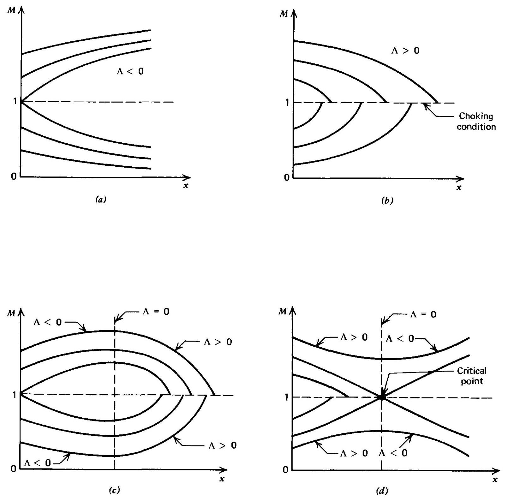
Figure 9.16 Relationship between $M$ and $x$ for different values of $\Lambda$. (a) $\Lambda$ negative. (b) $\Lambda$ positive (c) $\Lambda$ changes from negative to positive. (d) $\Lambda$ changes from positive to negative.

are isentropic flow in a diverging-converging passage, and cooling followed by a converging passage or a frictional flow.

Finally, Fig. 9.16d illustrates schematically the situation where $\Lambda$ changes from positive to negative. Both subsonic and supersonic flows proceed toward a Mach number of unity when $\Lambda$ is positive and, if $\Lambda$ remains positive, both types of flow will eventually choke. If $\Lambda$ passes through zero while the flow Mach number is not unity, then the Mach numbers for both subsonic and supersonic flows proceed away from the sonic speed. In the special case where $\Lambda=0$ at the same location where $M=1$, the critical point illustrated on Fig. 9.16d, then there are two possibilities: (1) the flow may proceed as a subsonic flow, or (2) it may proceed as a supersonic flow. Which of those two possibilities actually occurs depends on the downstream physical boundary conditions at the exit cross section of the flow passage [see Section 4-3(e)]. Hence, at the special location where $\Lambda=0$ and $M=1$ simultaneously, a continuous transition may proceed from subsonic to supersonic flow, or from supersonic to subsonic flow. It is shown in Chapter 7 that an abrupt transition from supersonic to subsonic flow may occur in a normal shock wave. It is shown in

Section 7-3, however, that expansion shock waves are impossible. Consequently, the only allowable transitions between subsonic and supersonic flow are continuous transitions where $\Lambda=0$ and $M=1$ simultaneously. An important practical example wherein such a transition occurs is the converging-diverging nozzle employed for accelerating an isentropic subsonic flow to supersonic speeds.

When only friction is present in a converging-diverging passage, $\delta D=d T=d \dot{m}=$ 0 , and equation 9.113 reduces to

$$
\Lambda=\left(1+\frac{\gamma-1}{2} M^{2}\right)\left[-\frac{d A}{A}+\frac{\gamma M^{2}}{2}\left(\frac{4 \mathrm{f} d x}{\mathscr{D}}\right)\right]
$$

In the converging portion of the aforementioned nozzle, $d A<0$. Since $(4 f d x / \mathscr{D})>0$, $\Lambda$ is positive throughout the entire converging region, and $M$ remains subsonic. At the nozzle throat, $d A_{t}=0$, but $(4 \mathrm{f} d x / \mathscr{D})>0$, so that $\Lambda$ remains positive and $M$ must still be less than unity. The transition to supersonic flow occurs where $\Lambda=0$ and, in that case, equation 9.116 reduces to

$$
\frac{d A}{A}=\frac{\gamma M^{2}}{2}\left(\frac{4 \mathrm{f} d x}{\mathscr{D}}\right)>0
$$

Equation 9.117 shows that at the critical location, $d A>0$. Accordingly, the critical location is in the diverging portion of the nozzle, downstream from the nozzle throat.

Similar results may be demonstrated for heat addition and mass addition in a converging-diverging passage. Heat removal causes the critical location to be in the converging portion of the nozzle. When more than two driving potentials are acting simultaneously, the analysis becomes more complicated, but the general features of the flow may be determined from equation 9.112 in a similar manner. Reference 14 presents the conditions necessary for a continuous transition through the sonic speed for other combinations of $d A, d T,(4 \mathrm{f} d x / \mathscr{D})$, and $d \dot{m} / \dot{m}$.
Example 9.4. Air flows in an insulated circular duct with wall friction. Determine the contour of the duct wall required to maintain a constant Mach number within the duct. Calculate the area ratio of the duct required to decrease the static pressure to 80 percent of its initial value.

## Solution

From equations 9.112 and 9.113 , for $d M=\delta D=d T=d \dot{m}=0$, we obtain

$$
\frac{d M}{M}=\frac{\left(1+\frac{\gamma-1}{2} M^{2}\right)}{1-M^{2}}\left[-\frac{d A}{A}+\frac{\gamma M^{2}}{2}\left(\frac{4 f d x}{\mathscr{D}}\right)\right]=0
$$

Rearranging equation (a) yields

$$
\frac{d A}{A}=\frac{\gamma M^{2}}{2}\left(\frac{4 f d x}{\mathscr{D}}\right)
$$

For a circular duct, $\mathscr{D}=D$, and

$$
\begin{aligned}
A & =\frac{\pi D^{2}}{4} \\
\frac{d A}{A} & =2 \frac{d D}{D}
\end{aligned}
$$

Substituting equation (d) into equation (b) gives

$$
d D=\gamma M^{2} f d x
$$

Integrating equation (e), we obtain

$$
D_{2}-D_{1}=\gamma M^{2} \mathrm{f}\left(x_{2}-x_{1}\right)
$$

Consequently, the duct is a diverging conical passage.
From equation 9.106, for $\dot{m}_{1}=\dot{m}_{2}, M_{1}=M_{2}$, and $T_{1}=T_{2}$, we obtain

$$
\frac{p_{2}}{p_{1}}=\frac{A_{1}}{A_{2}}
$$

From equation (g), it is apparent that the product $p A$ remains constant in the subject type of flow. For $p_{2}=0.80 p_{1}$,

$$
\frac{A_{2}}{A_{1}}=\frac{p_{1}}{p_{2}}=\frac{1}{0.80}=1.25
$$

Example 9.5. A ramjet combustor is to be designed so that the Mach number remains constant during the combustion process. For a combustor having a circular cross section, determine the contour of the combustor wall, neglecting the effects of the fuel on the mass flow rate and specific heats of the air flowing through the combustor. Determine the pressure ratio of a combustor with $M=0.5$ for a stagnation temperature increase of 100 percent.

## Solution

From equations 9.112 and 9.113 , for $d M=(4 f d x / \mathscr{D})=\delta D=d \dot{m}=0$, we obtain

$$
\frac{d M}{M}=\frac{\left(1+\frac{\gamma-1}{2} M^{2}\right)}{1-M^{2}}\left[-\frac{d A}{A}+\frac{\left(1+\gamma M^{2}\right)}{2} \frac{d T}{T}\right]=0
$$

Rearranging equation (a) gives

$$
\frac{d A}{A}=\frac{\left(1+\gamma M^{2}\right)}{2} \frac{d T}{T}
$$

Integrating equation (b) yields

$$
\ln \left(\frac{A_{2}}{A_{1}}\right)=\frac{\left(1+\gamma M^{2}\right)}{2} \ln \left(\frac{T_{2}}{T_{1}}\right)
$$

Equation (c) may be rewritten as

$$
\frac{A_{2}}{A_{1}}=\left(\frac{T_{2}}{T_{1}}\right)^{\left(1+\gamma M^{2}\right) / 2}
$$

Solving for $D_{2} / D_{1}$ gives

$$
\frac{D_{2}}{D_{1}}=\left(\frac{A_{2}}{A_{1}}\right)^{1 / 2}=\left(\frac{T_{2}}{T_{1}}\right)^{\left(1+\gamma M^{2}\right) / 4}
$$

Accordingly, the duct is a diverging passage, where the value of $D$ depends on the local value of $T$.

From equation 9.106 , for $\dot{m}_{1}=\dot{m}_{2}$ and $M_{1}=M_{2}$, we obtain

$$
\frac{p_{2}}{p_{1}}=\frac{A_{1}}{A_{2}}\left(\frac{T_{2}}{T_{1}}\right)^{1 / 2}
$$

Substituting for $A_{1} / A_{2}$ from equation (d) into equation (f) gives

$$
\frac{p_{2}}{p_{1}}=\left(\frac{T_{1}}{T_{2}}\right)^{\left(1+\gamma M^{2}\right) / 2}\left(\frac{T_{2}}{T_{1}}\right)^{1 / 2}=\left(\frac{T_{2}}{T_{1}}\right)^{-\gamma M^{2} / 2}
$$

From equation (g), for $\gamma=1.4, M=0.5$, and $T_{2} / T_{1}=2.0$, we obtain

$$
\frac{p_{2}}{p_{1}}=(2.0)^{-(1.4)(0.5)^{2} / 2}=(2.0)^{-0.1750}=0.8858
$$

## 9-5(e) Numerical Integration for Generalized Steady One-Dimensional Flow

In Section 9-5(a), the equations governing the generalized steady one-dimensional flow of a fluid are derived. Those results are applied to the flow of a perfect gas in Sections 9-5(b) and 9-5(c). The governing equations comprise a set of first-order nonlinear nonhomogeneous ordinary differential equations, which are too complex to be integrated in closed form. They may, however, be integrated by any of the standard numerical methods for integrating such equations. ${ }^{15,16}$ The modified Euler method and the Runge-Kutta method, presented in Appendix A-6, may be employed. There are, however, more sophisticated predictor-corrector algorithms that generally yield a better compromise between computing time and accuracy. ${ }^{15,16}$

From Table 9.7, it is seen that there is a singularity where the flow velocity becomes sonic, because of the term $1 /\left(1-M^{2}\right)$ in equation 9.112. Although the singularity does not appear explicitly in the equations derived in Section 9-5(a), it is there nevertheless. In the case of either a perfect gas or an imperfect gas, special techniques are required for calculations passing through the singular point. Several methods have been employed for either dealing with or for eliminating the singularity. Some of them are discussed briefly in the following paragraphs.

One of the earliest methods is based on linearizing the differential equations in the vicinity of the sonic point and integrating the resulting linear equations in closed form to obtain an approximate solution that is valid in the neighborhood of the singularity. Standard numerical integration methods are employed both upstream to and downstream from the linearized flow region.

A second method employs any standard numerical integration method until the Mach number approaches unity. At some predetermined initial value of $M$ (e.g., $M=0.95$ ), the derivatives of the properties are held constant, and the flow properties are extrapolated across the singularity to a predetermined final value of $M$ (e.g., $M=1.05$ ).

A third method for determining $d M / d x$ at the singularity is based on applying L'Hospital's rule* to equation 9.112 at the sonic condition, and then employing that value of $d M / d x$ for extrapolating across the singular point. Equation 9.112 may be rewritten as

$$
\frac{d M}{d x}=\frac{\Lambda^{\prime}(x)}{1-M^{2}}
$$

* According to L'Hospital's rule, if the ratio $f(x) / F(x)$ is an indeterminate of the form $0 / 0$ for $x=a$, but if $f^{\prime}(x) / F^{\prime}(x)$ is not indeterminate at $x=a$, then

$$
\lim _{x \rightarrow a} \frac{f(x)}{F(x)}=\frac{f^{\prime}(a)}{F^{\prime}(a)}
$$

where

$$
\begin{aligned}
\Lambda^{\prime}(x) \equiv M\left(1+\frac{\gamma-1}{2} M^{2}\right)\left\{-\frac{d(\ln A)}{d x}+\frac{\gamma M^{2}}{2}\left(\frac{4 f}{\mathscr{D}}+\frac{2 \delta D / d x}{\gamma M^{2} p A}\right)\right. & \\
\left.+\frac{\left(1+\gamma M^{2}\right)}{2} \frac{d(\ln T)}{d x}+\left[\left(1+\gamma M^{2}\right)-y \gamma M^{2}\right] \frac{d(\ln \dot{m})}{d x}\right\} &
\end{aligned}
$$

where $A, \mathfrak{f}, \mathscr{D}$, etc., are assumed to be known functions of $x$. Applying L'Hospital's rule to equation 9.118 to determine $d M / d x$ at the singularity or critical state, denoted by an asterisk superscript, we obtain

$$
\left(\frac{d M}{d x}\right)^{*}=\lim _{M \rightarrow 1}\left(\frac{d M}{d x}\right)=\frac{\left(d \Lambda^{\prime} / d x\right)^{*}}{-2(d M / d x)^{*}}
$$

which may be rewritten as

$$
\left[\left(\frac{d M}{d x}\right)^{*}\right]^{2}+\frac{1}{2}\left(\frac{d \Lambda^{\prime}}{d x}\right)^{*}=0
$$

Since $M$ appears explicitly in $\Lambda^{\prime}(x)$, the derivative $\left(d \Lambda^{\prime} / d x\right)^{*}$ contains terms involving $(d M / d x)^{*}$. Consequently, equation 9.121 is a linear quadratic equation for $(d M / d x)^{*}$, which yields two values for $(d M / d x)^{*}$. Which of those two values applies in a particular situation depends on the downstream physical boundary conditions [see Section 4-3(e)] and, depending on the value of $(d M / d x)^{*}$, the flow may proceed along either the subsonic or the supersonic branch of the curve $M=f(x)$ downstream from the location where $M=1$. The method just described may be applied only when the driving potentials depend explicitly on $x$ alone; that is, $A(x), T(x), \mathfrak{f}(x), \delta D(x)$, and $\dot{m}(x)$. In general, the driving potentials depend explicitly on the flow properties, and, in that case, the method is inapplicable.

Reference 14 presents some results obtained by the method described in the preceding paragraph. Figure 9.17 presents the Mach number $M$ for adiabatic flow

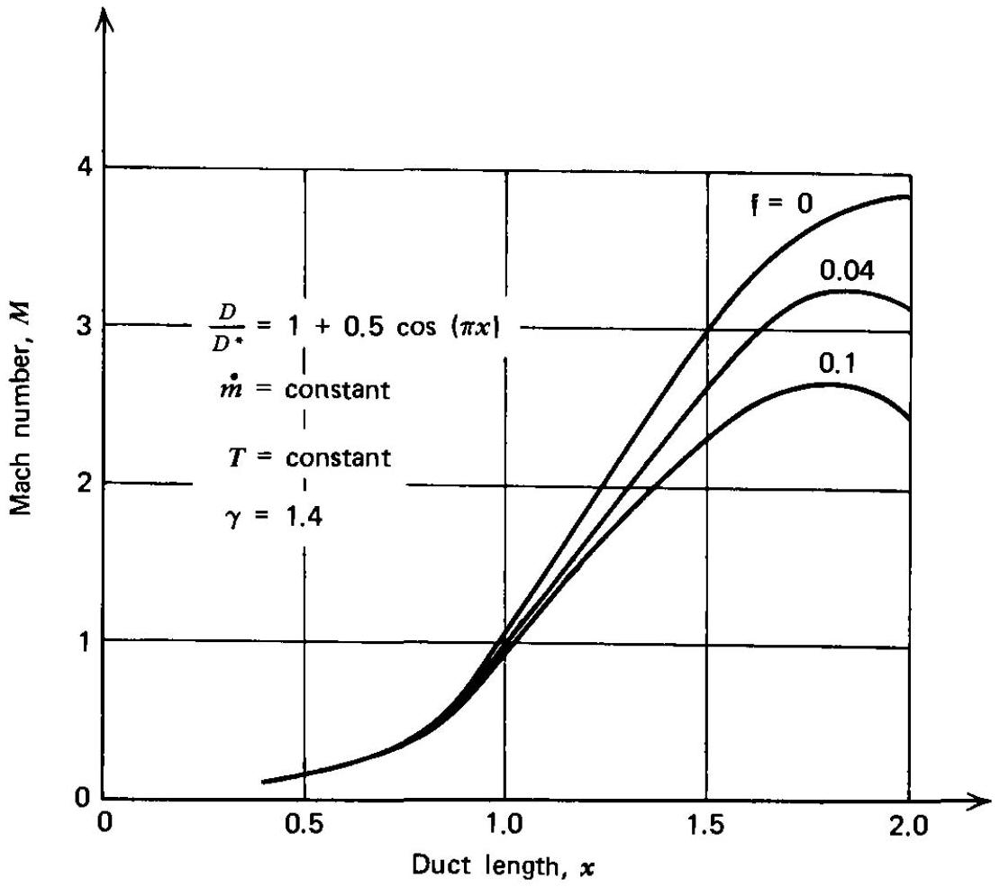
Figure 9.17 Adiabatic flow with friction in a converging-diverging duct (taken from Reference 14).

in a converging-diverging duct with friction, where the duct diameter is specified by $D / D^{*}=1.0+0.5 \cos (\pi x)$, for values of $\mathfrak{f}=0,0.04$, and 0.1 . The figure shows that friction reduces the Mach number below its corresponding isentropic value $(\mathrm{f}=0)$ at every cross section of the duct, that the throat Mach number (at $x=1.0$ ) is less than unity, and that the cross section where $M=1$ is located downstream from the throat. Near the duct exit, the area change term $d A$ becomes smaller than the friction term ( $4 \mathrm{f} d x / \mathscr{D}$ ), and the Mach number decreases even though the area continues to increase. Figure 9.18 presents the Mach number distributions in a diverging parabolic duct with $A_{2} / A_{1}=1.5$ and zero slope at the exit, for different linear stagnation temperature distributions along the duct where $T_{2} / T_{1}=1.0,1.1$, and 1.2. Also shown is the Mach number distribution for the case of $T_{2} / T_{1}=1.1$ and $\mathfrak{f}=0.02$. Figure 9.18 shows that the effect of heat addition is to reduce the flow Mach number below its corresponding isentropic value ( $T_{2} / T_{1}=1$ ), the amount of the reduction increasing with an increase in the amount of the heat addition. The combined action of friction and heat transfer, the curve for $T_{2} / T_{1}=1.1$ and $\mathfrak{f}=0.02$, reduces the Mach number more than does heat transfer alone.

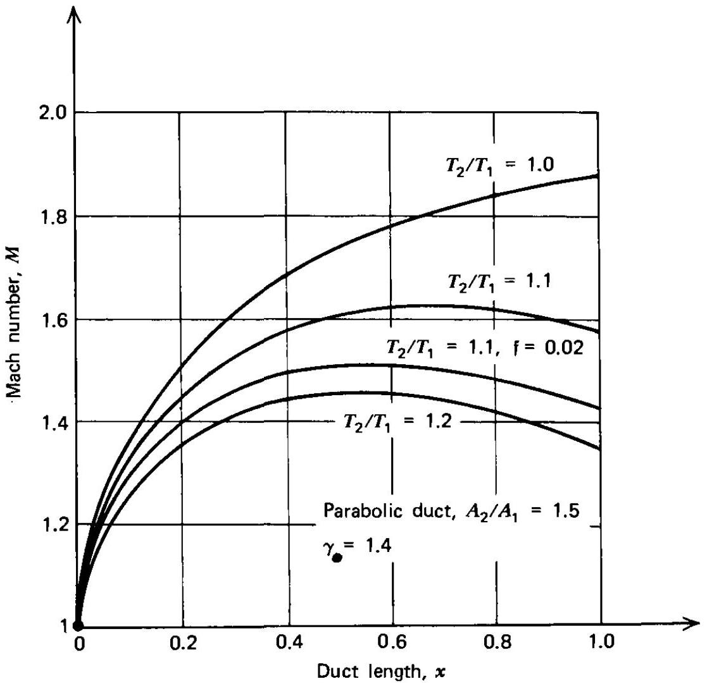
Figure 9.18 Supersonic flow in a divergent duct with a linear increase in stagnation temperature (taken from Reference I4).

The fourth method to be discussed eliminates the singularity at the sonic location. Furthermore, it is applicable to both perfect and imperfect gases, and the driving potentials may assume any form whatsoever. The method is based on choosing a different set of driving potentials. In Section 9-5(c), the driving potentials included the area change $d A / A$. In the present method, the static pressure distribution $p(x)$ replaces the driving potential $A(x)$. The area $A$ thus becomes a dependent variable, which must be obtained from the solution to the governing equations. The resulting set of differential equations does not have a singularity at the sonic location. Con-
sequently, any standard numerical integration algorithm may be employed for integrating the equations through the transonic region. Because the area distribution is usually known and the pressure distribution is unknown, an iterative approach must be employed wherein a trial value is assumed for the pressure distribution. The governing equations are then solved to obtain the corresponding area distribution, and the latter is compared to the known area distribution. If the known and calculated area distributions do not agree, the assumed pressure distribution is modified and the governing equations are solved for the modified pressure distribution. When the calculated area distribution agrees with the known area distribution to within a desired tolerance, the solution is complete. This procedure is time-consuming because the differential equations must be solved several times at each solution point. Consequently, the subject method should be employed only in the transonic region; for example, from $M=0.9$ to $M=1.1$. Outside of that region, equation 9.112 may be solved quite easily.

A set of influence coefficients, similar to those presented in Table 9.6, may be derived for the method of analysis that employs a specified pressure distribution by replacing the first column in the coefficient matrix in equation 9.96 by the coefficients of $d A / A$, removing $d A / A$ from the column matrix containing the nonhomogeneous terms, and adding $d p / p$ as required to that column matrix. The singularity in the equations presented in Table 9.6 arises from the determinant of the coefficient matrix, $\operatorname{det}(A)$, given by equation 9.102. For the specified pressure distribution method,

$$
\operatorname{det}(A)=-\frac{\gamma M^{2}}{1+\frac{\gamma-1}{2} M^{2}}
$$

and no singularity appears in the resulting equations.
Instead of developing the influence coefficients for the specified pressure distribution method, which are valid only for the flow of a perfect gas, a method of integration is presented below that is applicable to both perfect gases and imperfect gases. First, assume the pressure distribution.

$$
p=p(x) \quad(\text { assumed to be known })
$$

Then solve equation 9.76 for $d V$. Thus,

$$
d V=-\frac{d p}{\rho V}-\frac{V}{2}\left(\frac{4 f d x}{\mathscr{D}}\right)-V(1-y) \frac{d \dot{m}}{\dot{m}}-\frac{g}{V} d z-\frac{\delta D}{\dot{m}}
$$

Solving equation 9.80 for $d h$, we obtain

$$
d h=\delta Q-\delta W-d H_{i}-V d V
$$

From the equation of state for the fluid, in algebraic, graphical, or tabular form,

$$
\rho=\rho(p, h)
$$

From the continuity equation,

$$
A=\frac{\dot{m}}{\rho V}
$$

Any other thermodynamic property of interest (i.e., $t, u, s$, and $a$ ) may be obtained from the equation of state for the fluid. Equations 9.124 and 9.125 comprise a set of coupled first-order nonlinear nonhomogeneous ordinary differential equations that may be solved by any standard numerical integration algorithm. There are no singularities present, and the numerical integration proceeds smoothly. An
iterative procedure is employed for modifying the assumed pressure distribution so that the area determined by equation 9.127 approaches the known area distribution. Equations 9.124 to 9.127 apply to the flow of any fluid. In a given flow, detailed models must be developed for relating $\mathrm{f}, d \dot{m}, \delta Q, \delta W$, and $d H_{i}$ to the flow properties. The foregoing method of analysis has been employed successfully in a variety of complex nozzle problems; for example, flow with chemical reaction, and flow wherein suspended particles are carried by the gas (see Sections 14-6 and 14-7, respectively).

The final method to be discussed is the determination of the solution to a steady one-dimensional flow problem as the asymptotic solution at large time of the unsteady one-dimensional flow problem having the same boundary conditions as the steady flow. The addition of a second independent variable, the time, greatly complicates the governing equations and the numerical solution. However, the singularity at the sonic point is not present in the unsteady flow equations, which is a definite advantage over the steady flow equations. The equations governing unsteady onedimensional and quasi-one-dimensional flow with friction, heat transfer, and mass addition are derived in Section 19-3.

## 9-5(f) Simple Flows

A generalized steady one-dimensional flow, being the most general steady onedimensional flow process possible, includes all of the simple flows as special cases. For example, assuming that all of the driving potentials in Table 9.6 are zero except for $d A / A$, we obtain the differential equations for isentropic flow with simple area change. Similarly, the second column in Table 9.6 corresponds to simple frictional flow (i.e., the Fanno line), the third column corresponds to simple diabatic flow (i.e., the Rayleigh line), and the fourth column corresponds to simple mass addition. The listings in those four columns correspond identically with the influence coefficients presented in Tables 4.4, 5.3, 6.2, and 9.1 for the aforementioned simple flows.

For all of the simple flows, the differential equations summarized in Table 9.6 are exact differential equations, which may be integrated to yield algebraic equations for all of the property ratios. Table 9.8 summarizes the integrated results. Column 1 (simple area change) is equivalent to Table 4.2, where $P, T$, and $\rho_{o}$ in Table 4.2 are replaced in terms of $p^{*}, t^{*}$, and $\rho^{*}$ by employing equations 4.139, 4.140, and 4.141, respectively. The second column (simple frictional flow) in Table 9.7 corresponds to Table 5.5, the third column (simple diabatic flow) corresponds to Table 6.4, and the fourth column (simple mass addition, $y=0$ ) corresponds to equations 9.24 to 9.29.

Tables 9.6 and 9.8 summarize the major relationships pertinent to the steady one-dimensional flow of a perfect gas.

## 9-6 SUMMARY

This chapter is concerned with three principal topics; (1) steady one-dimensional flow with simple mass addition, (2) one-dimensional combustion waves, and (3) generalized steady one-dimensional flow.

Simple mass addition is defined as a steady one-dimensional flow wherein the sole driving potential for producing changes in the flow properties is the rate of mass addition $d \dot{m}$. The governing equations for simple mass addition are obtained from the continuity, momentum, and energy equations, assuming that the fluids in the main and in the injected streams are the same perfect gas. The influence coefficients of $d \dot{m} / \dot{m}$ in the governing differential equations include both the Mach number $M$ and the injection parameter $y=V_{i \boldsymbol{x}} / V$ as parameters. Consequently, a

Table 9.8 Equations for Simple One-Dimensional Flow of a Perfect Gas

|  | Simple Area Change | Simple Frictional Flow | Simple Diabatic Flow | Simple Mass Addition, $y=0$ |
| :--- | :--- | :--- | :--- | :--- |
| $\frac{A}{A^{*}}$ | $\frac{1}{M}\left[\left(\frac{2}{\gamma+1}\right) \psi\right]^{(\gamma+1) / 2(\gamma-1)}$ | 1 | 1 | 1 |
| $\frac{T}{T^{*}}$ | 1 | 1 | $\frac{2(\gamma+1) M^{2}}{\left(1+\gamma M^{2}\right)^{2}}$ | 1 |
| $\frac{4 \overline{\mathfrak{F}} L^{*}}{\mathscr{D}}$ | 0 | $\frac{1-M^{2}}{\gamma M^{2}}+\left(\frac{\gamma+1}{2 \gamma}\right) \ln \left\{M^{2}\left[\left(\frac{2}{\gamma+1}\right) \psi\right]^{-1}\right\}$ | 0 | 0 |
| $\frac{\dot{m}}{\dot{m}^{*}}$ | 1 | 1 | 1 | $\frac{M \sqrt{2(\gamma+1) \psi}}{1+\gamma M^{2}}$ |
| $\frac{p}{p^{*}}$ | $\left[\left(\frac{2}{\gamma+1}\right) \psi\right]^{-\gamma /(\gamma-1)}$ | $\frac{1}{M}\left[\left(\frac{2}{\gamma+1}\right) \psi\right]^{-1 / 2}$ | $\frac{\gamma+1}{1+\gamma M^{2}}$ | $\frac{\gamma+1}{1+\gamma M^{2}}$ |
| $\frac{\rho}{\rho^{*}}$ | $\left[\left(\frac{2}{\gamma+1}\right) \psi\right]^{-1 /(\gamma-1)}$ | $\frac{1}{M}\left[\left(\frac{2}{\gamma+1}\right) \psi\right]^{1 / 2}$ | $\frac{1+\gamma M^{2}}{(\gamma+1) M^{2}}$ | $\frac{2 \psi}{1+\gamma M^{2}}$ |
| $\frac{t}{t^{*}}$ | $\left[\left(\frac{2}{\gamma+1}\right) \psi\right]^{-1}$ | $\left[\left(\frac{2}{\gamma+1}\right) \psi\right]^{-1}$ | $\frac{(\gamma+1)^{2} M^{2}}{\left(1+\gamma M^{2}\right)^{2}}$ | $\left[\left(\frac{2}{\gamma+1}\right) \psi\right]^{-1}$ |
| $\frac{V}{V^{*}}$ | $M\left[\left(\frac{2}{\gamma+1}\right) \psi\right]^{-1 / 2}$ | $M\left[\left(\frac{2}{\gamma+1}\right) \psi\right]^{-1 / 2}$ | $\frac{(\gamma+1) M^{2}}{1+\gamma M^{2}}$ | $M\left[\left(\frac{2}{\gamma+1}\right) \psi\right]^{-1 / 2}$ |
| $\frac{P}{P^{*}}$ | 1 | $\frac{1}{M}\left[\left(\frac{2}{\gamma+1}\right) \psi\right]^{(\gamma+1) / 2(\gamma-1)}$ | $\frac{\gamma+1}{1+\gamma M^{2}}\left[\left(\frac{2}{\gamma+1}\right) \psi\right]^{\gamma /(\gamma-1)}$ | $\frac{\gamma+1}{1+\gamma M^{2}}\left[\left(\frac{2}{\gamma+1}\right) \psi\right]^{\gamma /(\gamma-1)}$ |
| $\frac{\mathscr{F}}{\mathscr{F}^{*}}$ | $\frac{1+\gamma M^{2}}{M \sqrt{2(\gamma+1) \psi}}$ | $\frac{1+\gamma M^{2}}{M \sqrt{2(\gamma+1) \bar{\psi}}}$ | 1 | 1 |
| $\frac{s-s^{*}}{c_{p}}$ | 0 | $\ln \left\{M^{(\gamma-1) / \gamma}\left[\left(\frac{2}{\gamma+1}\right) \psi\right]^{-(\gamma+1) / 2 \gamma}\right\}$ | $\ln \left\{M^{2}\left(\frac{\gamma+1}{1+\gamma M^{2}}\right)^{(\gamma+1) / \gamma}\right]$ | $\ln \left\{\left[\left(\frac{2}{\gamma+1}\right) \psi\right]^{-1}\left(\frac{1+\gamma M^{2}}{\gamma+1}\right)^{(\gamma+1) / \gamma}\right\}$ |

change in $d M / M, d p / p$, etc., is either positive or negative, depending not only on whether the main stream flow is subsonic or supersonic, but also on the magnitude of $y$. For $y<1$, the case of interest here, if $M<1$, mass addition increases the main stream Mach number $M$, and if $M>1$, it decreases $M$. For either subsonic or supersonic flow, mass addition causes choking of the main stream flow when $M=1$. At choking, no further mass addition is possible unless the upstream conditions are altered.

Many useful applications of simple mass addition are characterized by $y=0$; that is, the mass addition $d \dot{m}$ is normal to the direction of the main fluid stream. For $y=0$, the governing differential equations are all exact differential equations and may be integrated between a reference state, such as the critical state where $M=1$, and a general point in the flow field. In Section 9-3(d) the developments for mass addition with $y=0$ are applied to a solid propellant rocket motor equipped with an internal-burning solid propellant grain.

Combustion waves, planar waves propagated in premixed combustible gas mixtures (reactants) contained in long tubes, are of two types; deflagration waves, which propagate with a flame speed that is subsonic with respect to the burned reactants, and detonation waves, which propagate with a detonation velocity that is supersonic with respect to the reactants. In a stationary reference system a combustion wave is an unsteady flow process but, in a relative coordinate system, it is a steady combustion wave. Whether a deflagration wave or a detonation wave occurs under a given set of conditions depends primarily on the composition of the gaseous reactants and whether their ignition occurs at the open or closed end of the tube. The locus of the allowable final states for the products for a combustion wave for a given initial state and energy of combustion $\Delta u^{\circ}$, plotted in the $p v$ plane, is called the Hugoniot curve or $H$-curve. Each different value of $\Delta u^{\circ}$ gives rise to a separate $H$-curve. The combustion products must simultaneously satisfy the equations for both the $H$-curve and the Rayleigh line ( $R$-line). Not all of the regions on the $H$-curve are attainable physically. Those attainable are strong detonations including the Chapman-Jouget point $J$, and weak deflagrations including the Chapman-Jouget point $K$ (see Fig.9.13). At the points $J$ and $K$, the $H$-curve is tangent to an isentrope.

In the case of perfect gases, the detonation velocity for gaseous fuel-oxidizer mixtures may be calculated with reasonable accuracy (see Table 9.5). For an imperfect gas, numerical methods are necessary (see Example 9.2).

There are definite lower and upper limits, called the flammability limits, to the gaseous mixture ratio that will support a steady deflagration wave. The flammability limits are usually wider than the corresponding detonation limits. Several theories for predicting the flame speed of deflagration waves are presented in the references.

A generalized steady one-dimensional flow of a compressible fluid is one in which all of the following seven independent driving potentials act simultaneously; (1) area change $d A$, (2) wall friction $\delta F_{\overline{\mathrm{r}}}$, (3) heat addition $\delta Q$, (4) work $\delta W$, (5) mass addition $d \dot{m}$, (6) gravitational body force $\rho g A d z$, and (7) other body forces, drag of entrained particles, submerged bodies, etc., denoted by $\delta D$. A system of 14 equations is obtained relating the 14 fluid properties $p, \rho, t, h, u, s, a, V, M, H, P, T, \rho_{o}$, and $\mathscr{F}$, and the above seven independent driving potentials. To obtain a solution for the aforementioned system of equations, the seven independent driving potentials must be calculable. The system of equations derived for the generalized steady onedimensional flow of an arbitrary compressible fluid is quite complicated. Their solutions for specific initial and boundary conditions are obtainable only by applying numerical methods.

A great simplification is introduced by assuming that the flowing fluid is a perfect
gas. Table 9.6 presents the influence coefficients for the generalized steady onedimensional flow of a perfect gas, and Table 9.8 presents the equations for simple one-dimensional flow of a perfect gas. The general features of the generalized steady one-dimensional flow of a perfect gas are discussed in detail in Section 9-5(d). It is shown that there is a singularity when the flow has a Mach number of unity because of the term $1 /\left(r^{-}-M^{2}\right)$ in the expression for $d M / M$ (see equation 9.112). Procedures are presented in Section 9-5(e) for dealing with that singularity.

## REFERENCES

1. M. J. Zucrow, Aircraft and Missile Propulsion, Vol. II, pp. 468-524, Wiley, New York, 1964.
2. Y. B. Zeldovich, "On the Theory of the Propagation of Detonation in Gaseous Systems" (in Russian), Journal of Experimental and Theoretical Physics (USSR), Vol. 10, p. 542, 1940. Translated as NACA TM 1261, November 1950.
3. J. von Neumann, "Theory of Detonation Waves," OSRD Report 549, 1942.
4. W. Döring, "Über den Detonationsvorgang in Gasen," Annalen der Physik, Vol. 43, pp. 421-436, 1943.
5. F. E. Belles, "Detonability and Chemical Kinetics: Prediction of Limits of Detonability of Hydrogen," Seventh Symposium (International) on Combustion, pp. 745-751, Butterworths, London, 1959.
6. B. Lewis and G. von Elbe, Combustion, Flames and Explosions of Gases, Second Edition, pp. 524-528, Academic Press, New York, 1961.
7. Y. B. Zeldovich and D. A. Frank-Kamenetskii (in Russian), Doklady Akademy Nauk USSR, Vol. 19, p. 693, 1938.
8. Y. B. Zeldovich and N. Semenov, Journal of Experimental and Theoretical Physics (USSR) (in Russian), Vol. 10, p. 1116, 1940.
9. N. N. Semenov, "Thermal Theory of Combustion and Explosion. III-Theory of Normal Flame Propagation" (in Russian), Progress in Physical Sciences (USSR), Vol. 24, p. 433, 1940. Translated as NACA TM 1026, September 1942.
10. Y. B. Zeldovich, "Theory of Flame Propagation" (in Russian), Journal of Physical Chemistry (USSR), Vol. 22, p. 27, 1948. Translated as NACA TM 1282, June 1951.
11. D. B. Spalding, "A Theory of Inflammability Limits and Flame Quenching," Proceedings of the Royal Society of London, Vol. 240A, pp. 83-100, 1957.
12. A. H. Shapiro and W. R. Hawthorne, "The Mechanics and Thermodynamics of Steady One-Dimensional Gas Flow," Journal of Applied Mechanics, Vol. 14, No. 4, pp. A-317 to A-336, December 1947.
13. A. H. Shapiro, The Dynamics and Thermodynamics of Compressible Fluid Flow, Vol. 1, Chap. 8, Ronald Press, New York, 1953.
14. E. W. Beans, "Computer Solution to Generalized One-Dimensional Flow," Journal of Spacecraft and Rockets, Vol. 7, No. 12, pp. 1460-1464, December 1970.
15. B. Carnahan, H. A. Luther, and J. O. Wilkes, Applied Numerical Methods, Wiley, New York, 1969.
16. S. D. Conte and C. de Boor, Elementary Numerical Analysis, McGraw-Hill, New York, 1972.

## PROBLEMS

1. Show that for simple mass addition normal to the main stream in a constant-area solid propellant grain

$$
P_{o}=p+\rho V^{2}
$$

where $P_{o}$ is the pressure at the head end of the grain.
2. The solid propellant grain described in Example 9.1 develops several longitudinal cracks along the grain that increase the burning surface area by 50 percent. Calculate the quantities requested in Example 9.1 for the cracked grain.
3. A piece of the igniter hardware lodges in the throat section of the solid propellant rocket
motor described in Example 9.1, effectively decreasing the throat area by 50 percent. Calculate the quantities requested in Example 9.1 for the rocket motor with the blocked throat.
4. Example 9.1 presents an analysis of a solid propellant rocket motor with a constant linear burning rate. The linear burning rate of a solid propellant is actually a function of the local static pressure (see equation 9.30). The resulting analysis, however, becomes extremely complicated. A compromise procedure is based on the assumption that the linear burning rate is a function of the head-end static pressure. Thus,

$$
\dot{r}=c P_{o}{ }^{n}
$$

Work Example 9.1 based on this linear burning rate model, where $c=0.0000100, n=0.5$, $P_{o}$ is in newtons per square meter, and $\dot{r}$ is in meters per second.
5. Work Example 9.1 employing the linear burning rate model specified by equation 9.30 , with $k=0, c=0.0000100, n=0.5, p$ in newtons per square meter, and $\dot{r}$ in meters per second.
6. Estimate the detonation velocity $V_{1}$ for the premixed gaseous mixture comprising $2 \mathrm{H}_{2}+\mathrm{O}_{2}$, neglecting the effects of dissociation. The initial temperature and pressure of the reactants are $t_{1}=298.15 \mathrm{~K}$ and $p_{1}=1 \mathrm{~atm}$, respectively.
7. Estimate the detonation velocity $V_{1}$ for the premixed gaseous mixture comprising $2 \mathrm{H}_{2}+ \mathrm{O}_{2}+4 \mathrm{H}_{2}$, neglecting the effects of dissociation. The initial temperature and pressure of the reactants are $t_{1}=298.15 \mathrm{~K}$ and $p_{1}=1 \mathrm{~atm}$, respectively.
8. Work Problem 6 accounting for the effects of dissociation (see Section 14-4).
9. Work Problem 7 accounting for the effects of dissociation (see Section 14-4).
10. Continue Example 9.3 up to the location where $M=0.10$. Calculate the flow properties $V, p$, and $t$ at that point, and compare the results for an isentropic diffusion to (a) the same area, and (b) the same Mach number.
11. A solid propellant grain consists of a cylindrical passage in which the Mach number increases to the value $M_{1}$. To reduce erosive burning effects associated with high velocities, the remainder of the grain is to be contoured to maintain a constant Mach number. Determine the required contour. Consider the same propellant properties specified in Example 9.1. For $M_{1}=0.5$, calculate the area ratio of the grain flow passage required to double the propellant mass flow rate, and the static pressure ratio across the variable area portion of the grain.
12. Isothermal flow in a variable area passage, treated in Section 6-7, is a generalized onedimensional flow for which an exact solution exists. Consequently, such a flow may be employed as a test case for the generalized one-dimensional flow analysis presented in Section 9-5. Consider a test case in which air enters a conical convergence having a semiamgle of 5 deg. Heat is added through the passage wall to maintain the static temperature constant. The initial properties are $M_{1}=0.20, t_{1}=300 \mathrm{~K}$, and $p_{1}=10 \cdot 10^{5} \mathrm{~N} / \mathrm{m}^{2}$. Employ the analysis presented in Section 6-7 to determine the required heat transfer along the passage, in joules per kilogram, and the corresponding flow properties. With that heat transfer specified, employ the generalized flow analysis presented in Section 9-5, and numerically integrate for the flow properties along the passage. Compare the numerically determined results with the exact values obtained from the isothermal flow exact analysis.
13. Isothermal flow in a constant-area passage with friction, discussed in Section 5-7, is a generalized one-dimensional flow for which an exact solution exists. Consequently, such a flow may be employed as a test case for the generalized one-dimensional flow analysis presented in Section 9-5. As a test case, consider air flowing in a constant-area passage having a friction coefficient $\mathfrak{f}=0.005$. Heat transfer through the passage wall maintains the static temperature constant. The flow properties at the passage inlet are $M_{1}=0.10, t_{1}=300 \mathrm{~K}$, and $p_{1}=5 \cdot 10^{5} \mathrm{N} / \mathrm{m}^{2}$. From the exact analysis presented in Section 5-7, determine the heat transfer along the passage, in joules per kilogram, and the corresponding flow properties. With that heat transfer specified, numerically integrate for the flow properties along the passage, employing the generalized one-dimensional flow analysis presented in Section 9-5. Compare the numerically determined results with the exact values obtained from the isothermal flow exact analysis.

