## 10

## general features of the steady multidimensional adiabatic flow of an inviscid compressible fluid

10-1 PRINCIPAL NOTATION FOR CHAPTER 10 ..... 512
10-2 INTRODUCTION ..... 513
10-3 GOVERNING DIFFERENTIAL EQUATIONS FOR THE STEADY MULTIDIMENSIONAL ADIABATIC INVISCID FLOW OF A COMPRESSIBLE FLUID ..... 514
(a) Cartesian coordinate system ..... 515
(b) Cylindrical coordinate system ..... 516
(c) Two-dimensional planar and axisymmetric flows ..... 517
(d) Streamline, pathline, fluid line, and stream tube ..... 518
10-4 CIRCULATION, ROTATION, AND VORTICITY ..... 521
(a) Circulation ..... 521
(b) Rotation ..... 522
(c) Vorticity and the vortex tube ..... 524
(d) The free vortex ..... 525
(e) The forced vortex ..... 527
10-5 EULER'S MOMENTUM EQUATION FOR THE STEADY ADIABATIC INVISCID FLOW OF A COMPRESSIBLE FLUID ..... 529
(a) Steady flow along a streamline ..... 530
(b) Steady irrotational flow ..... 531
10-6 KELVIN'S THEOREM ..... 531
10-7 CROCCO'S THEOREM ..... 533
(a) Homenergetic flow ..... 535
(b) Isentropic and homentropic flow ..... 535
(c) Homentropic homenergetic flow ..... 535
10-8 THE HELMHOLTZ VORTICITY THEOREMS ..... 536
10-9 THERMODYNAMICS OF THE STEADY ADIABATIC INVISCID FLOW OF A COMPRESSIBLE FLUID ..... 538
(a) Equations of state ..... 539
(b) The speed of sound equation ..... 540
10-10 THE VELOCITY POTENTIAL FUNCTION ..... 540
(a) Definition of the velocity potential function ..... 541
(b) The equations of motion in terms of $\phi$ ..... 541
(c) General features of the potential equation ..... 542
10-11 THE STREAM FUNCTION ..... 545
(a) Definition of the stream function ..... 545
(b) The equations of motion in terms of $\psi$ ..... 546
(c) Physical interpretation of the stream function ..... 546
(d) Relationship between $\phi$ and $\psi$ ..... 547
10-12 SUMMARY ..... 548

## 10-1 PRINCIPAL NOTATION FOR CHAPTER 10

$a \quad$ speed of sound.
B vector body force per unit mass.
$d \mathbf{A} \quad$ vector differential area.
F vector force.
$g$ acceleration because of gravity.
$h \quad$ specific enthalpy.
$H$ stagnation enthalpy.
$\mathbf{i}, \mathbf{j}, \mathbf{k} \quad$ unit vectors in $x, y$, and $z$ directions, respectively.
$p$ static pressure.
$Q \quad$ heat.
r radius vector.
$s$ specific entropy.
$t \quad$ time.
$T \quad$ static temperature.
$u, v, w \quad$ velocity components in $x, y$, and $z$ directions, respectively.
$V \quad=\left(u^{2}+v^{2}+w^{2}\right)^{1 / 2}$, magnitude of velocity.
V velocity vector.
$W \quad$ work.
Greek Letters
$\Gamma=\oint \mathbf{V} \cdot d \mathbf{l}$, fluid circulation.
$\delta \quad 0$ for planar flow, and 1 for axisymmetric flow.
$\zeta=\nabla \times \mathbf{V}=2 \omega$, vorticity.
$\rho \quad$ static density.
$\phi \quad$ velocity potential function.
$\psi \quad$ stream function.
$\boldsymbol{\omega} \quad=\frac{1}{2} \nabla \times \mathrm{V}$, fluid rotation.
$\Omega \quad$ angular velocity.
Subscripts
$r, \theta, z \quad$ velocity component in that direction.
$x, y, z, t$ partial derivative with respect to the subscript.
Other notation and vector identities
$\delta \quad$ inexact differential.
$\nabla \quad$ vector del operator $=\mathbf{i} \frac{\partial}{\partial x}+\mathbf{j} \frac{\partial}{\partial y}+\mathbf{k} \frac{\partial}{\partial z}$.
$\nabla f \quad$ gradient of $f=\mathbf{i} \frac{\partial f}{\partial x}+\mathbf{j} \frac{\partial f}{\partial y}+\mathbf{k} \frac{\partial f}{\partial z}$.
$\nabla \cdot \mathbf{V} \quad$ divergence of $\mathbf{V}=\frac{\partial V_{x}}{\partial x}+\frac{\partial V_{y}}{\partial y}+\frac{\partial V_{z}}{\partial z}$.
$\nabla \times \mathbf{V} \quad$ curl of $\mathbf{V} \equiv \mathbf{i}\left(\frac{\partial V_{z}}{\partial y}-\frac{\partial V_{y}}{\partial z}\right)+\mathbf{j}\left(\frac{\partial V_{x}}{\partial z}-\frac{\partial V_{z}}{\partial x}\right)+\mathbf{k}\left(\frac{\partial V_{y}}{\partial x}-\frac{\partial V_{x}}{\partial y}\right)$.
$\frac{D()}{D t} \quad=\frac{\partial()}{\partial t}+(\mathrm{V} \cdot \nabla)()$, substantial or material derivative, denoting differentiation following the motion of a fluid particle.
$\frac{\partial}{\partial()} \quad$ partial derivative with respect to () .
$(\mathbf{V} \cdot \nabla) \mathbf{V}=\nabla\left(\frac{V^{2}}{2}\right)-\mathbf{V} \times(\nabla \times \mathbf{V})$.
$\nabla \cdot(\rho \mathbf{V})=(\mathbf{V} \cdot \nabla) \rho+\rho \nabla \cdot \mathbf{V}$.
$x, y, z \quad$ Cartesian coordinates.
$r, \theta, z \quad$ cylindrical coordinates.

## 10-2 INTRODUCTION

Chapter 2 is concerned with deriving the governing equations for the flow of a fluid, based on the concept of a rigid nonaccelerating control volume. The equations are derived in both integral and differential form, and are assembled in Tables 2.1 and 2.2, respectively, for ease of reference.

Chapters 3 to 9 are concerned with obtaining solutions to those equations for the special case of steady uniform flow at each cross section of a flow passage, commonly termed one-dimensional flow, under conditions where different driving potentials cause the changes in the flow properties. In particular, Chapter 3 presents the general features of the steady one-dimensional flow of a compressible fluid.

The present chapter is concerned with the general features of the steady multidimensional adiabatic inviscid flow of a compressible fluid. ${ }^{1-7}$ The differential forms of the governing (vector) equations are employed for deriving the corresponding equations in the Cartesian and cylindrical coordinate systems. Several general concepts are discussed (rotation, circulation, vorticity, velocity potential, and stream function), and some important theorems are presented (Kelvin's theorem, Crocco's theorem, and the Helmholtz vorticity theorems).

## 10-3 GOVERNING DIFFERENTIAL EQUATIONS FOR THE STEADY MULTIDIMENSIONAL ADIABATIC INVISCID FLOW OF A COMPRESSIBLE FLUID

From Table 2.2 we obtain the following differential equations governing the flow of a compressible fluid through a rigid nonaccelerating control volume.

Continuity equation

$$
\rho_{t}+\nabla \cdot(\rho \mathbf{V})=0
$$

Momentum equation

$$
\rho \frac{D \mathbf{V}}{D t}+\nabla p-\rho \mathbf{B}-d \mathbf{F}_{\text {shear }}=0
$$

Energy equation

$$
\delta \dot{W}_{\text {shaft }}+\delta \dot{W}_{\text {shear }}-\delta \dot{Q}+\rho \frac{D}{D t}\left(h+\frac{V^{2}}{2}+g z\right)-p_{t}=0
$$

Entropy equation

$$
\rho \frac{D s}{D t} \geqq \delta \dot{Q} / t
$$

Consider the steady $(\partial / \partial t=0)$ adiabatic $(\delta \dot{Q}=0)$ inviscid $\left(d \mathbf{F}_{\text {shear }}=\delta \dot{W}_{\text {shear }}=0\right)$ flow of a compressible fluid in the absence of body forces $(\mathbf{B}=g z=0)$ and external work ( $\delta \dot{W}=0$ ). It is shown in Chapter 14, that if the flowing fluid is either in chemical equilibrium (i.e., the chemical reaction rates are infinite) or its chemical composition is frozen (i.e., the chemical reaction rates are zero), then all of the flow processes are reversible.

For the steady adiabatic inviscid flow of a compressible fluid in the absence of body forces and external work, the following mathematical conditions apply.

$$
\mathbf{V}_{t}=\rho_{t}=p_{t}=\mathbf{B}=g d z=d \mathbf{F}_{\text {shear }}=\delta \dot{Q}=\delta \dot{W}_{\text {shear }}=\delta \dot{W}_{\text {shaft }}=0
$$

In addition, for steady flow (see Section 10-1),

$$
\frac{D()}{D t}=(\mathbf{V} \cdot \nabla)()
$$

Substituting the conditions listed in equation 10.5 into equations 10.1 to 10.4 transforms that set of equations into the following set. Thus,

$$
\begin{aligned}
\nabla \cdot(\rho \mathbf{V}) & =0 \\
\rho \frac{D \mathbf{V}}{D t}+\nabla p & =0 \\
\rho \frac{D}{D t}\left(h+\frac{V^{2}}{2}\right) & =0 \\
\rho \frac{D S}{D t} & =0
\end{aligned}
$$

For describing the flow field of a compressible fluid, the equations of state for the latter fluid are necessary in addition to the preceding set of four equations. The general forms of these equations of state for a compressible fluid are as follows.

$$
\begin{aligned}
t & =t(p, \rho) \\
h & =h(p, \rho)
\end{aligned}
$$

## 10-3(a) Cartesian Coordinate System

Equations 10.7 to 10.10 are the vector equations governing the steady adiabatic inviscid flow of a compressible fluid in the absence of body forces and external work. A more detailed study of the flow field under the aforementioned restrictions requires that the flow variables be related to a suitable coordinate system. The one most commonly employed is the Cartesian coordinate system, and it is considered first.

Figure 10.1a illustrates a velocity vector $\mathbf{V}$ in the Cartesian coordinate system. Let the point $P(x, y, z)$ denote an arbitrarily selected point in the flow field. The vector velocity for the fluid at the point $P(x, y, z)$ is $\mathbf{V}(x, y, z)$, which has the velocity components $u, v$, and $w$ parallel to the $x, y$, and $z$ axes, respectively. Let the unit vectors parallel to those respective axes be denoted by $\mathbf{i}, \mathbf{j}$, and $\mathbf{k}$.

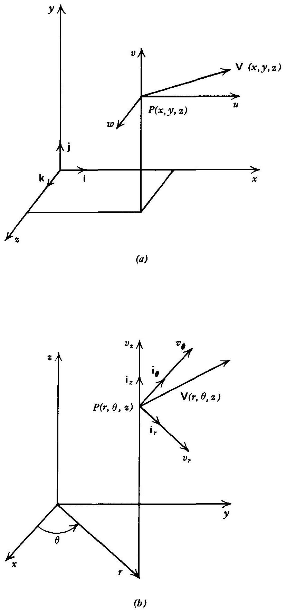
Figure 10.1 The velocity vector in the Cartesian and cylindrical coordinate systems. (a) Cartesian coordinates. (b) Cylindrical coordinates.

Equations 10.7 to 10.10 , when expressed in Cartesian coordinates, become

$$
\begin{gathered}
(\rho u)_{x}+(\rho v)_{y}+(\rho w)_{z}=0 \\
u u_{x}+v u_{y}+w u_{z}+\frac{1}{\rho} p_{x}=0 \\
u v_{x}+v v_{y}+w v_{z}+\frac{1}{\rho} p_{y}=0 \\
u w_{x}+v w_{y}+w w_{z}+\frac{1}{\rho} p_{z}=0 \\
u h_{x}+v h_{y}+w h_{z}+u\left(\frac{V^{2}}{2}\right)_{x}+v\left(\frac{V^{2}}{2}\right)_{y}+w\left(\frac{V^{2}}{2}\right)_{z}=0 \\
u s_{x}+v s_{y}+w s_{z}=0
\end{gathered}
$$

where the notation $\partial(\rho u) / \partial x=(\rho u)_{x}$, etc., is employed.

## 10-3(b) Cylindrical Coordinate System

The flow inside a circular duct, termed an internal flow, and the flow around a body of revolution, termed an external flow, possess axial symmetry because of the circular cross sections of the solid boundaries. Figure $10.1 b$ illustrates the cylindrical coordinate system employed for studying such types of flows. The coordinates are $r, \theta$, and $z$, where $r$ is the radius to the projection of the arbitrary point $P(x, y, z)$ on the $x y$ plane, $z$ is its distance above the $x y$ plane, and $\theta$ is the angle in the $x y$ plane between the radius $r$ and the $x$ axis. The unit vectors parallel to the cylindrical coordinates $r, \theta$, and $z$ are denoted by $\mathbf{i}_{r}, \mathbf{i}_{\theta}$, and $\mathbf{i}_{z}$, respectively. The velocity vector for the fluid at the point $P(r, \theta, z)$ is $\mathbf{V}(r, \theta, z)$. The components of $\mathbf{V}$ with respect to the cylindrical coordinates are accordingly $v_{r}, v_{\theta}$, and $v_{z}$, respectively.

Equations 10.7 to 10.10 may be expressed in the cylindrical coordinate system by applying the vector operators to that coordinate system. In the following equations, partial differentiation is written out explicitly to avoid confusion, and subscripts are employed for denoting the velocity components. The vector equations 10.7 to 10.10 , when expressed in cylindrical coordinates, are transformed to

$$
\begin{aligned}
& \frac{1}{r} \frac{\partial}{\partial r}\left(r \rho v_{r}\right)+\frac{1}{r} \frac{\partial}{\partial \theta}\left(\rho v_{\theta}\right)+\frac{\partial}{\partial z}\left(\rho v_{z}\right)=0 \\
& v_{r} \frac{\partial v_{r}}{\partial r}+\frac{v_{\theta}}{r} \frac{\partial v_{r}}{\partial \theta}-\frac{v_{\theta}^{2}}{r}+v_{z} \frac{\partial v_{r}}{\partial z}+\frac{1}{\rho} \frac{\partial p}{\partial r}=0 \\
& v_{r} \frac{\partial v_{\theta}}{\partial r}+\frac{v_{\theta}}{r} \frac{\partial v_{\theta}}{\partial \theta}+\frac{v_{r} v_{\theta}}{r}+v_{z} \frac{\partial v_{\theta}}{\partial z}+\frac{1}{\rho r} \frac{\partial p}{\partial \theta}=0 \\
& v_{r} \frac{\partial v_{z}}{\partial r}+\frac{v_{\theta}}{r} \frac{\partial v_{z}}{\partial \theta}+v_{z} \frac{\partial v_{z}}{\partial z}+\frac{1}{\rho} \frac{\partial p}{\partial z}=0 \\
& v_{r} \frac{\partial h}{\partial r}+\frac{v_{\theta}}{r} \frac{\partial h}{\partial \theta}+v_{z} \frac{\partial h}{\partial z}+v_{r} \frac{\partial}{\partial r}\left(\frac{V^{2}}{2}\right)+\frac{v_{\theta}}{r} \frac{\partial}{\partial \theta}\left(\frac{V^{2}}{2}\right)+v_{z} \frac{\partial}{\partial z}\left(\frac{V^{2}}{2}\right)=0 \\
& v_{r} \frac{\partial s}{\partial r}+\frac{v_{\theta}}{r} \frac{\partial s}{\partial \theta}+v_{z} \frac{\partial s}{\partial z}=0
\end{aligned}
$$

## 10-3(c) Two-Dimensional Planar and Axisymmetric Flows

For a two-dimensional planar flow, the velocity component $w=0$ and all of the partial derivatives $\partial() / \partial z=0$. Similarly, for a two-dimensional axisymmetric flow, the velocity component $v_{\theta}=0$ and $\partial() / \partial \theta=0$. The corresponding coordinate systems are illustrated in Fig. 10.2. Substituting the conditions $w=\partial() / \partial z=0$ into equations 10.13 to 10.18 , we obtain a set of equations for a two-dimensional planar flow expressed in Cartesian coordinates. In an analogous manner, substituting $v_{\theta}=\partial() / \partial \theta=0$ into equations 10.19 to 10.24 gives the corresponding equations for a two-dimensional axisymmetric flow, expressed in cylindrical coordinates.

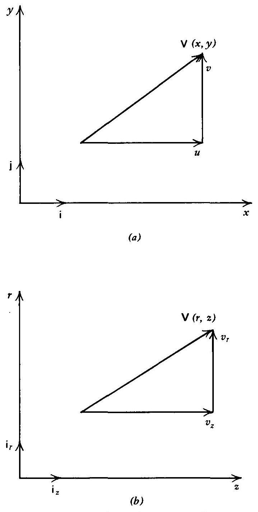
Figure 10.2 Two-dimensional coordinate systems. (a) Planar. (b) Axisymmetric.

The latter set of equations may be transformed to the notation of the Cartesian coordinate system by means of the following transformation equations. Thus,

$$
v_{r}=v, \quad v_{z}=u, \quad r=y, \quad \text { and } \quad z=x
$$

If the set of equations for a two-dimensional planar flow (equations 10.13 to 10.18) are compared with the transformed set of equations for a two-dimensional axisymmetric flow expressed in Cartesian coordinate notation, it is seen that those two
sets of equations are identical except for the additional term $\rho v / y$ in the continuity equation for the axisymmetric flow. Those two sets of equations are exactly identical if the term $\delta \rho v / y$ is added to the continuity equation, where $\delta=0$ for the twodimensional planar flow and $\delta=1$ for the two-dimensional axisymmetric flow.

Consequently, the following single set of equations, in Cartesian coordinate notation, is applicable to both two-dimensional planar flow and two-dimensional axisymmetric flow.

Continuity equation

$$
(\rho u)_{x}+(\rho v)_{y}+\delta \frac{\rho v}{y}=0
$$

where $\delta=0$ for planar flow, and $\delta=1$ for axisymmetric flow.
Momentum equations

$$
\begin{aligned}
& u u_{x}+v u_{y}+\frac{1}{\rho} p_{x}=0 \\
& u v_{x}+v v_{y}+\frac{1}{\rho} p_{y}=0
\end{aligned}
$$

Energy equation

$$
u h_{x}+v h_{y}+u\left(\frac{V^{2}}{2}\right)_{x}+v\left(\frac{V^{2}}{2}\right)_{y}=0
$$

Entropy equation

$$
u s_{x}+v s_{y}=0
$$

The flows governed by the set of equations 10.26 to 10.30 are termed two-dimensional flows because only two coordinates, $x$ and $y$, are needed for specifying the flow field. For clarity, the two types of two-dimensional flow discussed above will be referred to hereafter, as has been done in the foregoing, as two-dimensional planar flow and two-dimensional axisymmetric flow; the former refers to a flow in the $x y$ plane (Fig. 10.2a), and the latter to a flow in the $r z$ plane (Fig. 10.2b).

## 10-3(d) Streamline, Pathline, Fluid Line, and Stream Tube

By definition, a streamline is a line that at all of its points is tangent to the velocity vector for the flowing fluid, as illustrated in Fig. 10.3. A pathline is defined as the

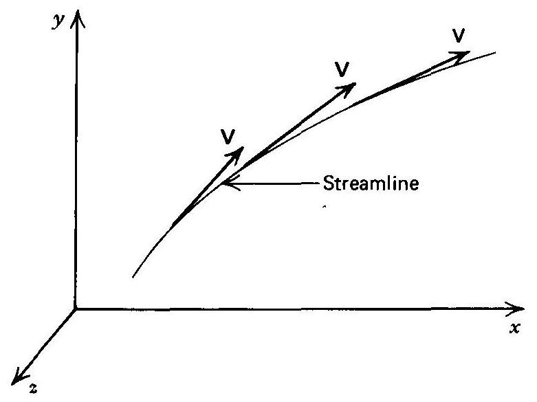
Figure 10.3 Characteristics of a streamline.

locus of the spatial positions traversed by a fluid particle as it moves in the flow field. For a steady flow the streamlines and pathlines are identical.

Figure 10.4 illustrates a streamline passing through the point $P$ in the Cartesian coordinate system. At the point $P$, a differential element of the streamline, denoted by $d \mathbf{l}$, is given by

$$
d \mathbf{l}=\mathbf{i} d x+\mathbf{j} d y+\mathbf{k} d z
$$

The vector $d \mathbf{l}$ is a vector tangent to the velocity vector $\mathbf{V}$, at the point $P$. The components of $\mathbf{V}$ in the directions parallel to the $x, y$, and $z$ coordinate axes are $u, v$, and $w$, respectively.

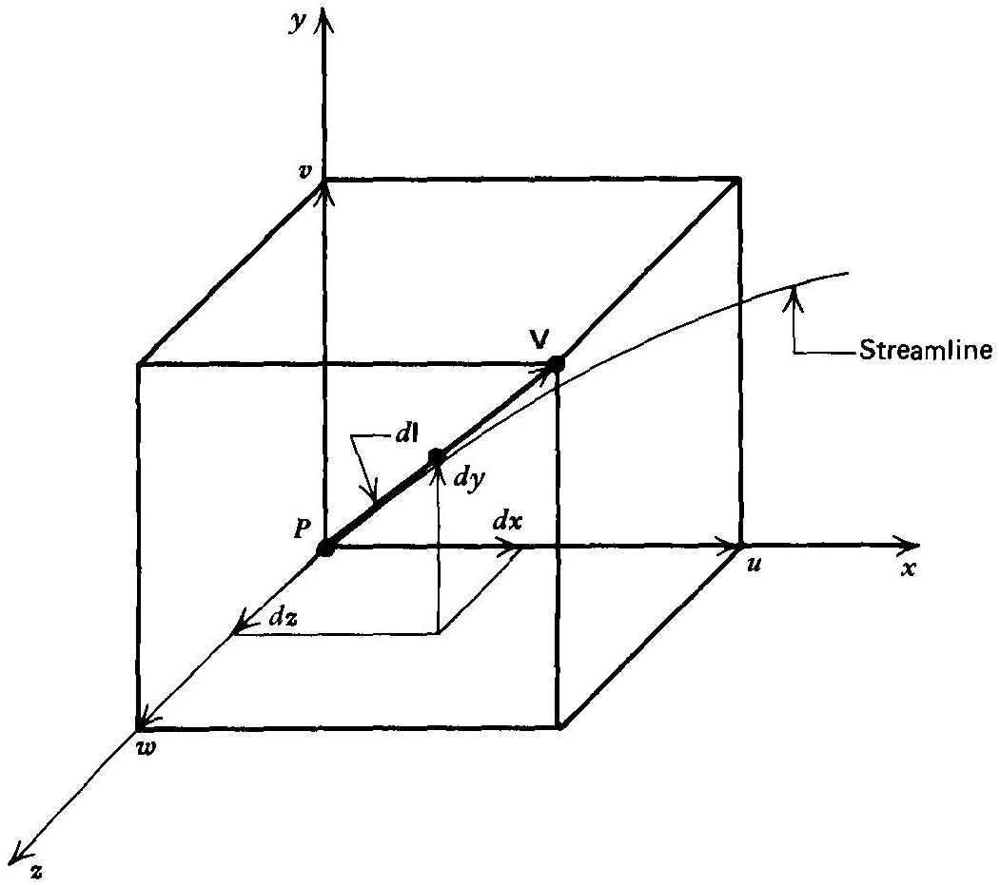
Figure 10.4 A streamline in the Cartesian coordinate system.

If a tetrahedron is drawn having the velocity vector $\mathbf{V}$ as its diagonal and its faces or sides parallel to the Cartesian coordinate planes, as illustrated in Fig. 10.4, then it is seen that

$$
\frac{d x}{u}=\frac{d y}{v}=\frac{d z}{w}
$$

Rearranging equation 10.31a yields

$$
\frac{d y}{d x}=\frac{v}{u}, \quad \frac{d y}{d z}=\frac{v}{w}, \quad \frac{d x}{d z}=\frac{u}{w}
$$

Equations 10.31a and 10.31b are the equations for a streamline in Cartesian coordinates.

By definition, a fluid line is a line passing through a set of identifiable fluid particles.
Figure 10.5 illustrates a closed curve $C$ in the fluid, which is a fluid line. All of the streamlines passing through the curve $C$ form a stream tube. Since all of the generators of the stream tube are streamlines, no mass may cross the surface of a stream tube. A stream tube of infinitesimal cross section is called a stream filament.

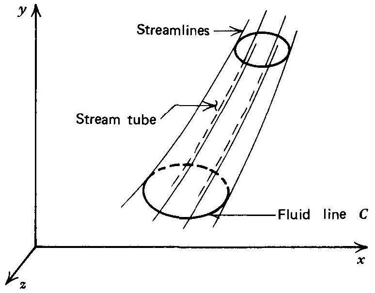
Figure 10.5 Streamlines forming a stream tube.

Example 10.1. The equations for several two-dimensional planar velocity fields are presented below. Determine which of the equations apply to possible fields for an incompressible fluid.
(a) $\mathrm{V}=-\mathrm{i} \Omega y+\mathrm{j} \Omega x$
(b) $\quad \mathbf{V}=-\mathbf{i} \frac{\Gamma y}{x^{2}+y^{2}}+\mathbf{j} \frac{\Gamma x}{x^{2}+y^{2}}$
where $\Gamma$ denotes the circulation, which is assumed constant [see Section 10-4(a)].
(c) $\mathbf{V}=\mathbf{i} x e^{x}+\mathbf{j} y e^{y}$

## Solution

For an incompressible flow, $\rho=$ constant throughout the flow field. Hence, for a two-dimensional planar incompressible flow, the continuity equation (equation 10.7) reduces to

$$
\nabla \cdot \mathbf{V}=\frac{\partial u}{\partial x}+\frac{\partial v}{\partial y}=u_{x}+v_{y}=0
$$

where $u$ and $v$ denote the $x$ and $y$ components of $\mathbf{V}$, respectively.
(a) For this case, $u=-\Omega y$ and $v=\Omega x$. Hence,

$$
\nabla \cdot \mathbf{V}=u_{x}+v_{y}=0-0=0
$$

Consequently, equation (a) represents a possible incompressible flow.
(b) In this case,

$$
u=-\frac{\Gamma y}{\left(x^{2}+y^{2}\right)} \quad \text { and } \quad v=\frac{\Gamma x}{\left(x^{2}+y^{2}\right)}
$$

where $\Gamma$ is a constant. Hence,

$$
\nabla \cdot \mathbf{V}=u_{x}+v_{y}=-\frac{2 x y \Gamma}{\left(x^{2}+y^{2}\right)^{2}}+\frac{2 x y \Gamma}{\left(x^{2}+y^{2}\right)^{2}}=0
$$

Equation (b), therefore, represents a possible incompressible flow.
(c) For equation (c), $u=x e^{x}$ and $v=y e^{y}$. Hence,

$$
\nabla \cdot \mathbf{V}=u_{x}+v_{y}=x e^{x}+e^{x}+y e^{y}+e^{y} \neq 0
$$

Consequently, equation (c) does not represent a possible incompressible flow. If equation (c) represents a velocity field, it would be that for a compressible fluid.

Summarizing, equation (a) represents the velocity field for a forced vortex [see Section 10-4(e)], and equation (b) represents the velocity field for a free vortex [see Section 10-4(d)].

## 10-4 CIRCULATION, ROTATION, AND VORTICITY

Many of the general features of a multidimensional flow may be studied conveniently in terms of the parameters known as circulation, rotation, and vorticity. In this section, those parameters are defined, and some examples illustrating their use are presented.

## 10-4(a) Circulation

Figure 10.6 illustrates a simple closed spatial curve $C$ in a flow field. Each element of arc on curve $C$ may be considered to be an infinitesimal vector $d \mathbf{l}$ having the magnitude $d \ell$, and the direction of the tangent to the curve $C$. By definition, the circulation $\Gamma$ around the closed curve $C$ is given by

$$
\Gamma \equiv \oint_{C} \mathbf{V} \cdot d \mathbf{l}=\oint_{C} V d \ell \cos \alpha
$$

where $\alpha$ is the angle between $\mathbf{V}$ and $d \mathbf{l}$. By convention, the positive direction for the integration of the scalar product $\mathbf{V} \cdot d \mathbf{l}$ is counterclockwise.

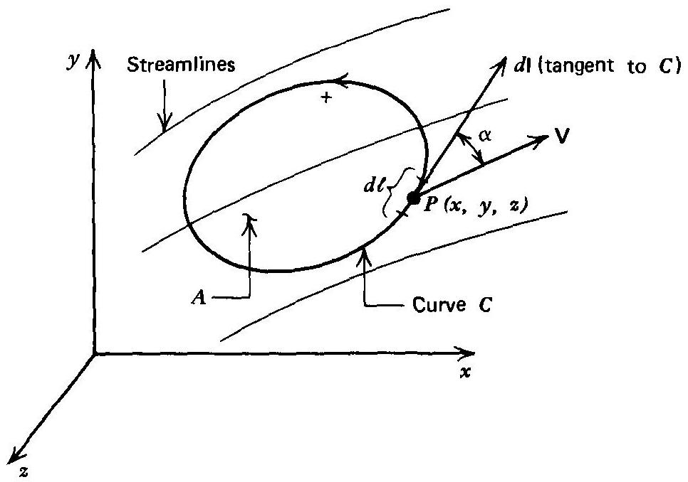
Figure 10.6 Integration along a closed curve to determine the circulation.

To illustrate the significance of the circulation $\Gamma$, consider a two-dimensional flow where both the closed curve $C$ and the velocity vector $\mathbf{V}$ lie in the $x y$ plane. For $\mathbf{V}$ and $d \mathbf{l}$, we may write

$$
\mathbf{V}=\mathbf{i} u+\mathbf{j} v \quad \text { and } \quad d \mathbf{l}=\mathbf{i} d x+\mathbf{j} d y
$$

Forming the scalar product $\mathbf{V} \cdot d \mathbf{l}$, we obtain for the circulation $\Gamma$,

$$
\Gamma=\oint_{C}(u d x+v d y)
$$

The circulation $\Gamma$ may be expressed in terms of an integral over the surface $A$ bounded by the closed curve $C$ by applying Stokes' theorem. The latter states that
if there is a surface $A$ having the closed curve $C$ for its perimeter, then

$$
\oint_{C} \mathbf{V} \cdot d \mathbf{l}=\int_{A}(\nabla \times \mathbf{V}) \cdot d \mathbf{A} \quad \text { (Stokes' theorem) }
$$

Applying Stokes' theorem to equation 10.32 yields

$$
\Gamma=\oint_{C} \mathbf{V} \cdot d \mathbf{l}=\int_{A}(\nabla \times \mathbf{V}) \cdot d \mathbf{A}
$$

where $\nabla \times \mathbf{V}=\operatorname{curl} \mathbf{V}=\mathbf{i}\left(w_{y}-v_{z}\right)+\mathbf{j}\left(u_{z}-w_{x}\right)+\mathbf{k}\left(v_{x}-u_{y}\right)$. Equation 10.35 transforms the line integral around the closed curve $C$ into a surface integral over the surface $A$ enclosed by the curve $C$.

For a two-dimensional flow in the $x y$ plane, $\mathbf{V}=\mathbf{i} u+\mathbf{j} v$, and

$$
\nabla \times \mathbf{V}=\operatorname{curl} \mathbf{V}=\mathbf{k}\left(v_{x}-u_{y}\right)
$$

Let $d A$ denote a differential element of the area $A$ enclosed by the curve $C$. Since $d A$ lies entirely within the $x y$ plane, $d \mathbf{A}=\mathbf{k} d x d y$. Substituting for $\mathbf{V}$ and $d \mathbf{A}$ into equation 10.35 , we obtain

$$
\Gamma=\int_{A}\left(v_{x}-u_{y}\right) d x d y
$$

Taking the limit of $\Gamma$ as $A$ approaches 0 , equation 10.37 yields

$$
\lim _{A \rightarrow 0} \frac{\Gamma}{A}=\frac{d \Gamma}{d A}=\left(v_{x}-u_{y}\right)
$$

## 10-4(b) Rotation

The fluid rotation at a point is defined as the instantaneous average angular velocity of two mutually perpendicular fluid lines [see Section 10-3(d)] passing through that point. That definition of fluid rotation is a generalization of the definition of solid body rotation.

For the latter, if $P$ denotes a point on a solid body and $Q$ is an arbitrary neighboring point, then when the body rotates with the angular velocity $\omega$ about an axis through $P$, the curl of the velocity vector at point $Q$ will be identical to that at point $P$, because all of the particles of a solid body maintain fixed relationships with respect to each other. Consequently, the specification of the angular velocity of one line on the solid body completely specifies the angular velocities of all lines.

This is not the case, however, for a fluid or a deformable body. In a flowing fluid all of the fluid lines are capable of becoming displaced relative to one another, and such displacements may occur. Consequently, in the case of a fluid, we are concerned with the mean or average angular velocity of a fluid element about a point, and that mean angular velocity is called the rotation of the fluid or, briefly, the rotation; it is denoted by the vector $\boldsymbol{\omega}$.

Figure 10.7 illustrates schematically the motion of a fluid particle in the $x y$ plane. At the time $t$, the centroid of the fluid particle is located at the point $O$ and its Cartesian velocity components, with respect to the $x$ and $y$ axes, are denoted by $u$ and $v$, respectively. The lines $O A$ and $O B$, in Figure 10.7, are two mutually perpendicular fluid lines that emanate from the fluid particle at point $O$. As a consequence of the motion of the fluid particle and the fluid lines, at the later time $t+d t$, the points $O, A$ and $B$ have moved upward and to the right, as illustrated in Fig. 10.7, to new locations. Because of the velocity gradients in the fluid, the fluid particles at the points $A$ and $B$ move at different speeds than does the fluid particle at point $O$. Consequently, the fluid lines $O A$ and $O B$ make the angles $d \alpha$ and $-d \beta$ with respect

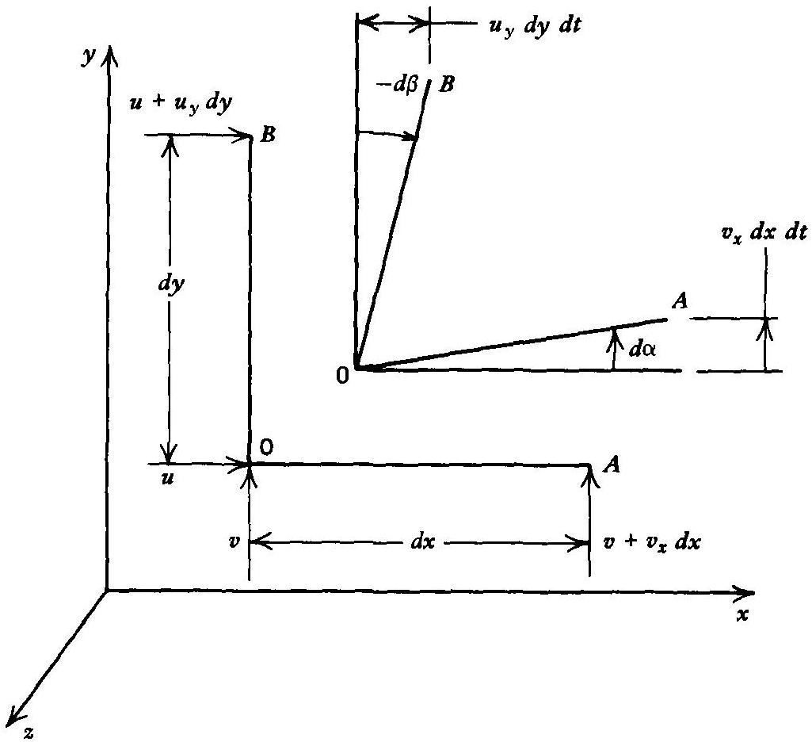
Figure 10.7 Schematic illustration of the rotation of a fluid.

to the $x$ and $y$ axes, respectively. The angle $d \beta$ must be defined as being negative because a positive value for $u_{y} d y$ results in a clockwise rotation of $O B$; that is, in the negative angular direction.

By definition, the component of fluid rotation $\omega_{Z}$ in a plane perpendicular to the $z$ axis is given by

$$
\omega_{Z} \equiv \frac{1}{2}\left(\frac{d \alpha}{d t}+\frac{d \beta}{d t}\right)
$$

where the subscript $Z$ attached to $\omega$ does not signify partial differentiation, but that the rotation $\omega$ is measured in a plane perpendicular to the $z$ axis. For an infinitesimal time interval $d t$, the angles $d \alpha$ and $d \beta$ will be so small that $\tan (d \alpha) \cong d \alpha$ and $\tan (d \beta) \cong d \beta$. From Figure 10.7, it is seen that

$$
\begin{aligned}
& d \alpha=\frac{v_{x} d x d t}{d x}=v_{x} d t \\
& d \beta=\frac{-u_{y} d y d t}{d y}=-u_{y} d t
\end{aligned}
$$

Substituting equations 10.40 and 10.41 into equation 10.39, we obtain

$$
\omega_{Z}=\frac{1}{2}\left(v_{x}-u_{y}\right)
$$

In a similar manner the components of the rotation vector $\boldsymbol{\omega}$ may be obtained in the $y z$ and $x z$ planes. The results are

$$
\begin{aligned}
& \omega_{X}=\frac{1}{2}\left(w_{y}-v_{z}\right) \\
& \omega_{Y}=\frac{1}{2}\left(u_{z}-w_{x}\right)
\end{aligned}
$$

where the subscripts $X$ and $Y$ denote the rotation in planes perpendicular to those directions. Adding equations $10.42,10.43$, and 10.44 vectorially yields

$$
\boldsymbol{\omega}=\mathbf{i} \omega_{X}+\mathbf{j} \omega_{Y}+\mathbf{k} \omega_{Z}=\frac{1}{2} \nabla \times \mathbf{V}
$$

By comparing equations 10.38 and 10.42 for two-dimensional flow, it is apparent that the mean fluid rotation is equal to one half the circulation per unit area. Thus,

$$
\omega_{Z}=\frac{1}{2}\left(v_{x}-u_{y}\right)=\frac{1}{2} \frac{d \Gamma}{d A}
$$

Flows in which the fluid rotation $\boldsymbol{\omega}=0$ are termed irrotational flows. Figure 10.8a illustrates the rotation of two fluid lines with time for the case where the average rotation of two initially perpendicular fluid lines remains zero so that the flow is irrotational. The situation is one where each of the fluid lines is distorted so that there is a change in the relative positions of the particles without any net rotation being produced. Figure 10.8b, on the other hand, illustrates the case where the two fluid lines experience a net fluid rotation with time; such a flow is said to be rotational.

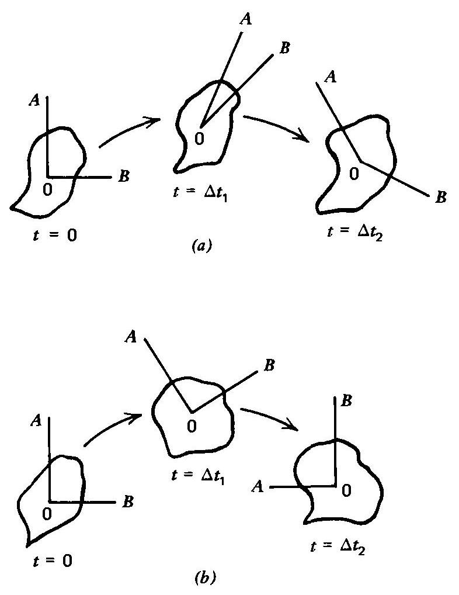
Figure 10.8 Schematic illustration of irrotational and rotational motions in a fluid. (a) Irrotational motion. (b) Rotational motion.

## 10-4(c) Vorticity and the Vortex Tube

The vector $\nabla \times \mathbf{V}$ defines, for each value of $t$ and at each point in a flow field, a vector that is equal to $2 \omega$. By definition, $\nabla \times \mathbf{V}$ is the vorticity vector or, briefly, the vorticity, and is denoted by $\zeta$. Hence,

$$
\zeta=\nabla \times \mathbf{V}=2 \omega
$$

In Cartesian coordinates,

$$
\zeta=\mathbf{i} \zeta_{X}+\mathbf{j} \zeta_{Y}+\mathbf{k} \zeta_{Z}=\mathbf{i}\left(w_{y}-v_{z}\right)+\mathbf{j}\left(u_{z}-w_{x}\right)+\mathbf{k}\left(v_{x}-u_{y}\right)
$$

where the subscripts $X, Y$, and $Z$ denote the component of $\zeta$ in the $x, y$, and $z$ directions, respectively. From equations 10.46 and 10.48, it is seen that the vorticity for a two-dimensional flow is equal to the circulation per unit area. Thus,

$$
\zeta_{Z}=\frac{d \Gamma}{d A}=2 \omega_{Z}
$$

By definition, a vortex line is a line in the fluid that at all of its points is tangent to the vorticity vector. Figure 10.9 illustrates a vortex line. Along a vortex line the components $\omega_{X}, \omega_{Y}$, and $\omega_{Z}$ of the fluid rotation vector $\boldsymbol{\omega}$, defined by equation 10.45, are related to the corresponding components $d x, d y$, and $d z$ of the tangent vector to the vortex line by the relationships

$$
\frac{d x}{\omega_{X}}=\frac{d y}{\omega_{Y}}=\frac{d z}{\omega_{Z}}
$$

Equation 10.50 is the equation for a vortex line in Cartesian coordinates.

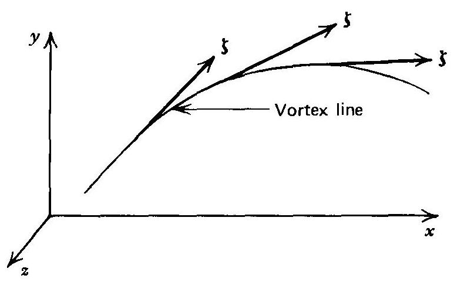
Figure 10.9 Characteristics of a vortex line.

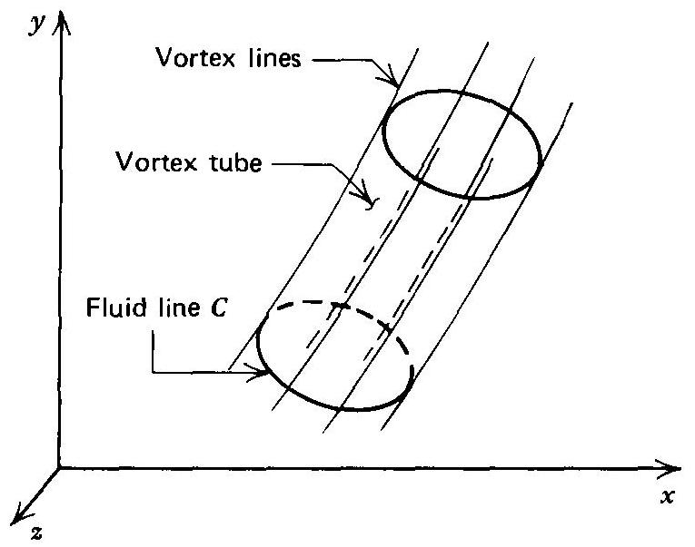
Figure 10.10 Vortex lines forming a vortex tube.

Figure 10.10 illustrates a closed curve $C$ in the fluid, which is a fluid line. All of the vortex lines passing through curve $C$ form a vortex tube. A vortex tube of infinitesimal cross section is called a vortex filament.

The foregoing shows that the three parameters, circulation, rotation, and vorticity, are uniquely related. Consequently, knowing any one of the three determines the other two. In Sections 10-6, 10-7, and 10-8, some general theorems are developed relating the circulation, rotation, and vorticity to the other flow properties.

## 10-4(d) The Free Vortex

A particularly simple example of irrotational motion is afforded by the free vortex; that is, a circular flow where the magnitude of the fluid velocity is inversely proportional to the distance from the center of the vortex. Figure 10.11 illustrates the characteristics of a free vortex, which is a reasonable approximation to the bathtub drain vortex, the flow in a spinning internal-burning tubular solid propellant rocket motor, and the tornado vortex.

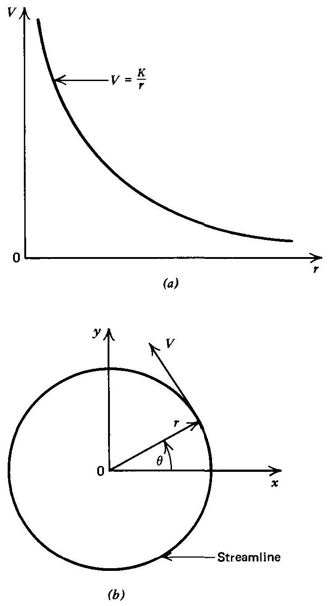
Figure 10.11 Flow characteristics of a free vortex. (a) Velocity distribution. (b) Streamline pattern.

The magnitude of the fluid velocity in a free vortex is given by

$$
V=\frac{K}{r}
$$

Figure 10.11a illustrates the velocity distribution in a free vortex. Equation 10.51 is singular at the origin, where it predicts an infinite velocity, which is, of course, unattainable physically. From Table 3.4, it is apparent that even the maximum isentropic speed $V_{\text {max }}^{\prime}$ for a gas, which is unattainable physically, has a finite value. In the free vortex of a real fluid, the central region of the vortex generally contains some lowspeed fluid, which frequently behaves as a forced vortex [see Section 10-4(e)]. In the regions at a distance from the center, however, the free vortex model is a good approximation to a free vortex in a real fluid.

Figure 10.11 $b$ illustrates a streamline in the flow field of a free vortex. The circulation around the streamline is

$$
\Gamma=\oint_{C} \mathrm{~V} \cdot d \mathbf{l}=\int_{0}^{2 \pi} \frac{K}{r}(r d \theta)=2 \pi K=\mathrm{constant}
$$

From equation 10.46 , the magnitude of the rotation of the fluid $\omega_{Z}$ in the $x y$ plane at the origin is

$$
\omega_{Z}=\lim _{r \rightarrow 0} \frac{\Gamma}{A}=\frac{d \Gamma}{d A}=\lim _{r \rightarrow 0} \frac{2 \pi K}{2 \pi r^{2}}=\infty
$$

Equation 10.53 indicates that $\omega_{Z}$ approaches infinity as the radius of the curve approaches zero. As pointed out above, that result is physically meaningless.

Figure 10.12 illustrates a closed curve located entirely within the region where the fluid velocity $V$ is finite and smaller than the maximum isentropic speed. The flow model is, therefore, realistic. Consider two streamlines of a free vortex corresponding to the velocities $V_{1}$ and $V_{2}$; the radii to $V_{1}$ and $V_{2}$ are denoted by $R_{1}$ and $R_{2}$, respectively, and they make the angles $\theta_{1}$ and $\theta_{2}$, respectively, with the $x$ axis. By extending $R_{1}$ to the streamline corresponding to $V_{2}$, the closed curve $a b c d$ is formed. The direction for positive integration around that closed curve is indicated in Fig. 10.12.

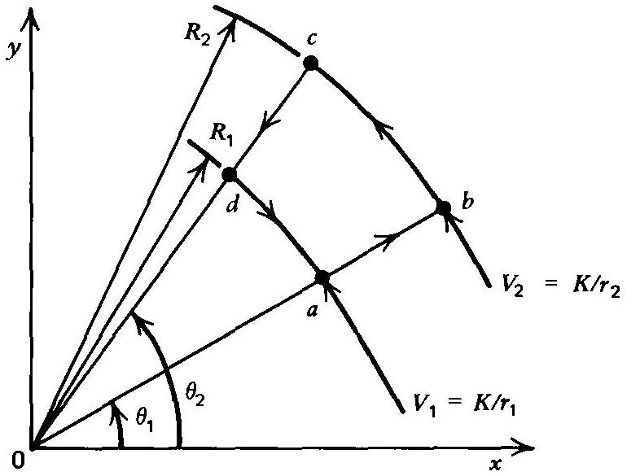
Figure 10.12 A closed curve ( $a b c d$ ) that does not enclose the origin of a free vortex.

The circulation $\Gamma$ around the closed curve $a b c d$ is (see equation 10.32)

$$
\Gamma=\oint_{C} \mathbf{V} \cdot d \mathbf{l}=V_{2}\left[R_{2}\left(\theta_{2}-\theta_{1}\right)\right]+V_{1}\left[R_{1}\left(\theta_{1}-\theta_{2}\right)\right]
$$

Introducing equation 10.51 into equation 10.54 yields

$$
\Gamma=0
$$

Since $R_{1}, R_{2}, \theta_{1}$, and $\theta_{2}$ are arbitrary, equation 10.55 is a general result that applies to any closed curve not enclosing the origin. Hence, the rotation for this case is

$$
\omega_{Z}=\frac{1}{2} \frac{d \Gamma}{d A}=0
$$

Equation 10.56 shows that the flow external to the center of a free vortex is an irrotational flow.

## 10-4(e) The Forced Vortex

A simple example of a rotational flow is the forced vortex, which is a circular flow where the magnitude of the fluid velocity at a point is directly proportional to the distance of the point from the center of the vortex. Figure 10.13 illustrates the characteristics of a forced vortex. A practical example of a forced vortex is the flow field that occurs when an end-burning solid propellant rocket motor is rotated about its longitudinal axis. As discussed in Section 10-4(d), the flow in the vicinity of the core of a free vortex quite frequently behaves as a forced vortex.

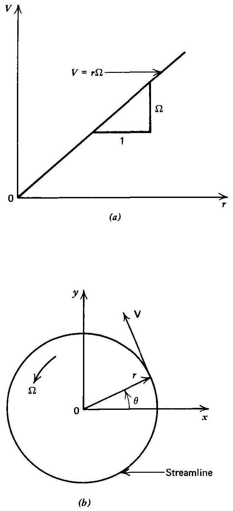
Figure 10.13 Flow characteristics of a forced vortex. (a) Velocity distribution. (b) Streamline pattern.

The magnitude of the tangential velocity of the fluid, denoted by $V$, is given by

$$
V=r \Omega
$$

where $\Omega$ is the angular velocity of the forced vortex. Figure 10.13a illustrates the velocity distribution in a forced vortex.

Figure $10.13 b$ illustrates a closed circular streamline at the radius $r$ in a forced vortex; the center of the circular streamline, denoted by $O$, is coincident with the origin of the coordinate axes. The angle between the radius $r$ and the $x$ axis is $\theta$, and V is the vector velocity along the streamline. The circulation is given by

$$
\Gamma=\oint_{C} \mathbf{V} \cdot d \mathbf{l}=\int_{0}^{2 \pi}(r \Omega)(r d \theta)
$$

Hence,

$$
\Gamma=2 \pi r^{2} \Omega
$$

Accordingly, from equation 10.46 , the fluid rotation is

$$
\omega_{Z}=\frac{1}{2} \frac{d \Gamma}{d A}=\frac{2 \pi r^{2} \Omega}{2 \pi r^{2}}=\Omega=\mathrm{constant}
$$

Hence, the flow is rotational. In fact, the rotation is constant throughout the fluid; that is, it rotates as a solid body. Consequently, the forced vortex is sometimes called the solid body vortex.

Example 10.2. Consider the equations for the possible velocity fields presented in Example 10.1. Which of them apply to possible irrotational flow fields?
(a) $\mathbf{V}=-\mathbf{i} \Omega y+\mathbf{j} \Omega x$
(b) $\quad \mathbf{V}=\frac{-\mathbf{i} \Gamma y}{\left(x^{2}+y^{2}\right)}+\frac{\mathbf{j} \Gamma x}{\left(x^{2}+y^{2}\right)}$
(c) $\quad \mathrm{V}=\mathbf{i} x e^{x}+\mathbf{j} y e^{y}$

## Solution

For an irrotational flow field, $\boldsymbol{\omega}=0$. For two-dimensional flow, this requires that

$$
\omega_{Z}=u_{y}-v_{x}=0
$$

(a) $\omega_{Z}=-\Omega-\Omega=-2 \Omega$

Hence, (a) is not a possible irrotational flow field.
(b) $\quad \omega_{Z}=\frac{\Gamma\left[-\left(x^{2}+y^{2}\right)+2 y^{2}\right]}{\left(x^{2}+y^{2}\right)^{2}}-\frac{\Gamma\left[\left(x^{2}+y^{2}\right)-2 x^{2}\right]}{\left(x^{2}+y^{2}\right)^{2}}=\frac{0}{\left(x^{2}+y^{2}\right)^{2}}$

Thus, (b) is a possible irrotational flow everywhere except at the origin, which is a singular point in the flow field.
(c) $\omega_{Z}=0+0=0$

Equation (c) is a possible irrotational flow. However, as shown in Example 10.1, for the flow to exist, the fluid would have to be compressible to satisfy the continuity equation.

## 10-5 EULER'S MOMENTUM EQUATION FOR THE STEADY ADIABATIC INVISCID FLOW OF A COMPRESSIBLE FLUID

For the type of flow under consideration the mathematical restrictions are those pertaining to equations 10.7 to 10.10 , which are repeated here for convenience. Thus,

$$
\mathbf{V}_{t}=\rho_{t}=p_{t}=\mathbf{B}=g d z=d \mathbf{F}_{\text {shear }}=\delta \dot{Q}=\delta \dot{W}_{\text {shear }}=\delta \dot{W}_{\text {shaft }}=0
$$

The momentum equation subject to the above restrictions is equation 10.8. Thus, noting that for steady flow, $D \mathbf{V} / D t=(\mathbf{V} \cdot \nabla) \mathbf{V}$ (see equation 10.6), equation 10.8 becomes

$$
(\mathbf{V} \cdot \nabla) \mathbf{V}+\frac{1}{\rho} \nabla p=0
$$

Equation 10.62 is Euler's (momentum) equation for steady flow.
Introduce the following vector identity (see Vector Identities in Section 10-1).

$$
(\mathbf{V} \cdot \nabla) \mathbf{V}=\nabla\left(\frac{V^{2}}{2}\right)-\mathbf{V} \times(\nabla \times \mathbf{V})
$$

Substituting equation 10.63 in equation 10.62 gives

$$
\mathbf{V} \times(\nabla \times \mathbf{V})=\frac{1}{\rho} \nabla p+\nabla\left(\frac{V^{2}}{2}\right)
$$

Equation 10.64 is the sum of several vectors in space, as illustrated schematically in Fig. 10.14. A scalar equation may be obtained by summing the components of equation 10.64 in the direction of the arbitrary vector $d \mathbf{r}=\mathbf{i} d x+\mathbf{j} d y+\mathbf{k} d z$. Thus,

$$
d \mathbf{r} \cdot(\text { equation } 10.64)=0
$$

Performing the scalar product indicated in equation 10.65 and expanding the result in Cartesian coordinates yields

$$
\begin{aligned}
& {\left[(w d y-v d z)\left(w_{y}-v_{z}\right)+(u d z-w d x)\left(u_{z}-w_{x}\right)+(v d x-u d y)\left(v_{x}-u_{y}\right)\right.} \\
& \quad=\frac{1}{\rho}\left(p_{x} d x+p_{y} d y+p_{z} d z\right)+\left[\left(\frac{V^{2}}{2}\right)_{x} d x+\left(\frac{V^{2}}{2}\right)_{y} d y+\left(\frac{V^{2}}{2}\right)_{z} d z\right]
\end{aligned}
$$

where, as before $w_{y}=\partial w / \partial y$, etc. Referring to equations 10.42, 10.43, and 10.44, it is seen that the left side of equation 10.66 contains the terms $\left(w_{y}-v_{z}\right)=2 \omega_{X}$, etc. Also, the two terms on the right side are equal to $(1 / \rho) d p$ and $d\left(V^{2} / 2\right)$, respectively. Substituting the latter equivalent expressions into equation 10.66, we obtain

$$
\begin{aligned}
& 2\left[(w d y-v d z) \omega_{X}+(u d z-w d x) \omega_{Y}+(v d x-u d y) \omega_{Z}\right] \\
& \quad=\frac{1}{\rho} d p+d\left(\frac{V^{2}}{2}\right)
\end{aligned}
$$

Equation 10.67 is valid for any direction $d \mathbf{r}$ within the flow field.

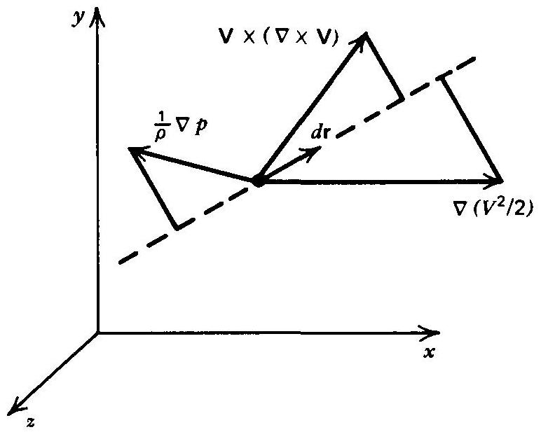
Figure 10.14 Vector representation of Euler's equation for the steady adiabatic inviscid flow of a compressible fluid.

## 10-5(a) Steady Flow along a Streamline

Substituting the equation for a streamline, that is, equation 10.31b, into equation 10.67 , gives

$$
\frac{1}{\rho} d p+d\left(\frac{V^{2}}{2}\right)=0
$$

Equation 10.68 is the Euler equation for a streamline. It is valid for a steady inviscid flow in the absence of body forces. Referring to equation 3.9, it is seen that equation 10.68 is the Bernoulli equation for steady one-dimensional flow in the absence of a body force. Hence, in the steady multidimensional inviscid flow of a compressible fluid, the Bernoulli equation is valid along a streamline.

Integrating equation 10.68 yields

$$
\left.\int \frac{d p}{\rho}+\frac{V^{2}}{2}=\text { constant } \quad \text { (along a streamline }\right)
$$

where, as before, the constant is the Bernoulli constant; the latter will, in general, vary from streamline to streamline, depending on the characteristics of the flow field under consideration. If all of the streamlines originate in a region of uniform flow, the Bernoulli constant will have the same value throughout the flow field.

## 10-5(b) Steady Irrotational Flow

For an irrotational flow, $\omega$ is zero, which requires that

$$
\omega_{X}=\omega_{Y}=\omega_{Z}=0
$$

Substituting equation 10.70 into 10.67 , we obtain, for steady irrotational flow,

$$
\frac{1}{\rho} d p+d\left(\frac{V^{2}}{2}\right)=0
$$

which is again the Bernoulli equation. There are no restrictions, however, on the direction of the application of equation 10.71. Hence, in a steady irrotational flow, the Bernoulli equation applies between any two points in the flow. When integrated, equation 10.71 yields

$$
\int \frac{d p}{\rho}+\frac{V^{2}}{2}=\text { constant } \quad \text { (throughout the flow field) }
$$

Equation 10.72 is the same mathematical result that is obtained in Section 10-5(a) for the flow along streamlines. As pointed out in Section 10-5(a), if the flow originates in a region where the flow is uniform, which is an irrotational flow, then the Bernoulli constant has the same value throughout the flow field.

Summarizing, a steady inviscid flow, in the absence of body forces, which is initially irrotational behaves as a flow that is irrotational throughout; that the foregoing is indeed the case is demonstrated in Section 10-6.

## 10-6 KELVIN'S THEOREM

It is of interest to determine what happens to the circulation on a closed fluid line, such as that illustrated in Fig. 10.15, as it moves through the flow field. As the curve

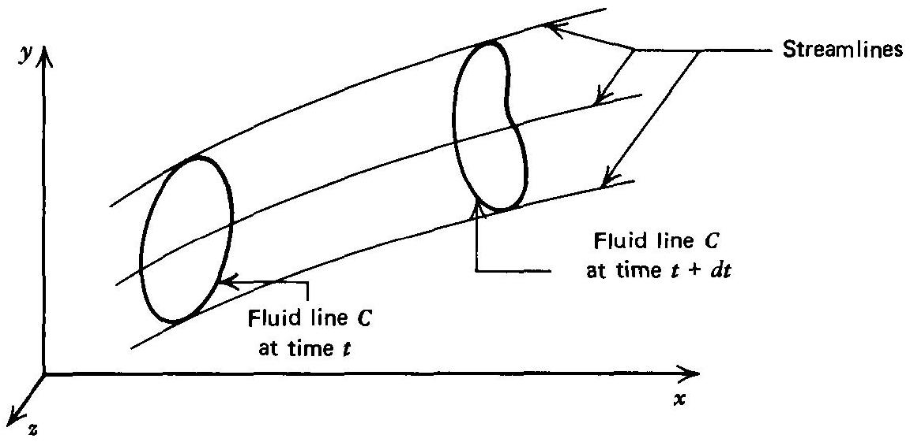
Figure 10.15 Flow model for Kelvin's theorem.

$C$ moves with the motion of the fluid, it remains a closed curve because of the continuity of the flow. Hence, at a later time $t+d t$, curve $C$ will have moved to a different location and its shape will have probably changed, but it will still be a closed fluid line. A question to be resolved, therefore, is the change in the circulation around the curve $C$ as a function of time. It should be recalled that the same fluid particles comprise curve $C$ at all times.

The time derivative of the property of a particle located on the closed fluid line $C$ is, by definition, a substantial derivative. Hence, the interest here is in the substantial derivative of the circulation $\Gamma$ around curve $C$, which is denoted by $D \Gamma / D t$. Hence,

$$
\frac{D \Gamma}{D t}=\frac{D}{D t} \oint_{C} \mathbf{V} \cdot d \mathbf{l}
$$

where $\mathbf{V}$ is the vector velocity at a point on curve $C$ at any instant. Differentiating the scalar product forming the right side of equation 10.73 yields

$$
\frac{D \Gamma}{D t}=\oint_{C}\left[\frac{D \mathbf{V}}{D t} \cdot d \mathbf{l}+\mathbf{V} \cdot \frac{D(d \mathbf{l})}{D t}\right]
$$

The first term on the right side of equation 10.74 arises from the change in the velocity around the fluid line (curve $C$ ), and the second term arises from the change in its location. From equation 10.8,

$$
\oint_{C} \frac{D \mathbf{V}}{D t} \cdot d \mathbf{l}=-\oint_{C} \frac{1}{\rho} \nabla p \cdot d \mathbf{l}=-\oint_{C} \frac{d p}{\rho}
$$

If it is assumed that either $\rho=\rho(p)$ or $\rho=$ constant, then the term $d p / \rho$ is an exact differential, and the value of the line integral is independent of the path [see Section 1-7(a)]; in particular, its value is zero for a closed path.

The second term in equation 10.74 may be transformed by interchanging the order of the substantial derivative operator and the differential operator. Thus,

$$
\oint_{C} \mathbf{V} \cdot \frac{D(d \mathbf{l})}{D t}=\oint_{C} \mathbf{V} \cdot d\left(\frac{D \mathbf{l}}{D t}\right)
$$

The vector 1 is the position vector of the fluid particles; its time derivative ( $D 1 / D t$ ) is, therefore, the fluid velocity $\mathbf{V}$. Hence, equation 10.76 becomes

$$
\oint_{C} \mathbf{V} \cdot \frac{D(d \mathbf{l})}{D t}=\oint_{C} \mathbf{V} \cdot d \mathbf{V}=\oint_{C} d\left(\frac{V^{2}}{2}\right)=0
$$

Again, for a closed curve, the line integral of the exact differential is zero.
Substituting equations 10.75 and 10.77 in equation 10.74 , we obtain

$$
\frac{D \Gamma}{D t}=0
$$

Integrating the last equation yields

$$
\Gamma=\oint_{C} \mathbf{V} \cdot d \mathbf{l}=\mathrm{constant}
$$

Equation 10.79 is Kelvin's theorem. According to equation 10.79, if the closed curve around which the integration is conducted is displaced through the fluid by the particles comprising a closed fluid line, the circulation around that closed curve is invariant with time. Consequently, if the circulation is initially zero throughout the flow field, it will remain zero for all time. Since a flow for which $\Gamma=0$ is an
irrotational flow, equation 10.79 indicates that if a flow is initially irrotational, the irrotational motion will persist indefinitely. On the other hand, a flow that is initially rotational will remain rotational with undiminished intensity.

The theorem may be readily extended so that it applies to flows in the presence of a conservative force field; that is, where the external force is derivable from a potential.

One major consequence of Kelvin's theorem lies in its application to flows that are initially uniform, and thus are irrotational. For such initial conditions, the entire flow must be irrotational, a characteristic that may be employed for simplifying the analysis of such flows.

In summary, the conclusions derived from Kelvin's theorem are restricted to inviscid flows for which the density is either a function of the pressure only or is constant, and to the condition that the net external force acting on the fluid is derivable from a potential.

## 10-7 CROCCO'S THEOREM

The general relationship known as Crocco's theorem provides a connection between the rotation or vorticity of a flowing fluid and the gradients in its entropy and stagnation enthalpy. Its derivation is presented below for the steady inviscid flow of a compressible fluid.

Equation 10.64, which is a form of Euler's equation, is repeated and renumbered here for convenience.

$$
\mathbf{V} \times(\nabla \times \mathbf{V})=\frac{1}{\rho} \nabla p+\nabla\left(\frac{V^{2}}{2}\right)
$$

As pointed out in Section 10-5, equation 10.64 applies to the steady inviscid flow of a compressible fluid in the absence of body forces.

For a pure substance, the fluid properties are related by equation 1.65, which is repeated and renumbered here for convenience*

$$
T d s=d h-\frac{1}{\rho} d p
$$

Equation 10.81 is valid for a homogeneous fluid experiencing either a reversible or an irreversible process, and is applicable in each of the three directions of Cartesian coordinate system. Hence,

$$
\begin{aligned}
T s_{x} & =h_{x}-\frac{1}{\rho} p_{x} \\
T s_{y} & =h_{y}-\frac{1}{\rho} p_{y} \\
T s_{z} & =h_{z}-\frac{1}{\rho} p_{z}
\end{aligned}
$$

where, as before, $s_{x}=\partial s / \partial x$, etc. Vectorial addition of the last three equations yields

$$
T \nabla s=\nabla h-\frac{1}{\rho} \nabla p
$$

[^0]The procedure employed for deriving equation 10.85 is applicable to any total differential equation that is valid throughout a field of flow (i.e., independent of the path).

By definition, the stagnation enthalpy of a flowing fluid is

$$
H \equiv h+\frac{V^{2}}{2}
$$

Differentiating the latter expression and placing the result in gradient form gives

$$
\nabla H=\nabla h+\nabla\left(\frac{V^{2}}{2}\right)
$$

Substituting equations 10.85 and 10.87 into equation 10.80 and employing the definitions of the rotation $\boldsymbol{\omega}$ and the vorticity $\boldsymbol{\zeta}$ (from equation 10.47), we obtain the following form of Crocco's theorem. Thus,

$$
\mathbf{V} \times(\nabla \times \mathbf{V})=\mathbf{V} \times \zeta=\mathbf{V} \times(2 \boldsymbol{\omega})=\nabla H-T \nabla s
$$

where $\nabla H$ and $\nabla s$ are the gradients for the stagnation enthalpy and the entropy of the fluid, respectively.

For the steady adiabatic inviscid flow of a compressible fluid in the absence of external work and body forces, the values of $H$ and $s$ remain constant along each streamline in the fluid. Thus, if $\nabla H \neq 0$ and $\nabla s \neq 0$, then $\nabla H$ and $\nabla s$ must be gradients normal to the streamlines. If those gradients exist, they must be present in the initial flow, and the flow is said to be rotational. Moreover, by virtue of Kelvin's theorem, the flow will remain rotational with undiminished intensity throughout the flow field.

Equation 10.88 applies to a point in the flow field. Crocco's theorem may be restricted to the flow along a streamline by forming the scalar product of the velocity vector $\mathbf{V}$ and equation 10.88. Thus,

$$
\mathbf{V} \cdot[\mathbf{V} \times(\nabla \times \mathbf{V})]=(\mathbf{V} \cdot \nabla) H-T(\mathbf{V} \cdot \nabla)_{S}
$$

By definition, $\mathbf{V} \times(\nabla \times \mathbf{V})$ is a vector perpendicular to $\mathbf{V}$, so that the scalar product on the left side of equation 10.89 is equal to zero. Recalling that $D() / D t=(\mathbf{V} \cdot \nabla)()$ for a steady flow, equation 10.89 may be written as

$$
\frac{D H}{D t}-T \frac{D s}{D t}=0
$$

Hence, for the steady flow along a streamline,

$$
\frac{D H}{D t}=T \frac{D s}{D t}
$$

Equation 10.91 shows that if there are no dissipative effects in the flow along a streamline, so that $D s / D t=0$, then

$$
\frac{D H}{D t}=0
$$

Integrating equation 10.92 yields

$$
H=h+\frac{V^{2}}{2}=\mathrm{constant} \quad \text { (along a streamline) }
$$

Equation 10.93 is a generalization of equation 3.38 for the steady one-dimensional adiabatic inviscid flow of a compressible fluid in the absence of external work and body forces.

If all of the streamlines in a flow field originate in a region of uniform flow, then the stagnation enthalpy $H$ will have the same value at every point in the flow field.
Several special cases of Crocco's theorem for steady flow are discussed in the following subsections.

## 10-7(a) Homenergetic Flow

By definition, a steady homenergetic flow is one wherein the stagnation enthalpy has the same constant value along all of the streamlines; that is, $\nabla H=0$. In that case, each particle in the flow field has the same value of stagnation enthalpy, and equation 10.88 reduces to

$$
\mathbf{V} \times 2 \omega=-T \nabla s
$$

Hence, a homenergetic flow is rotational if there is an entropy gradient normal to the streamlines.
An example of such a flow is the flow field behind the curved shock wave that forms in front of a blunt-nosed body moving through the atmosphere with a supersonic speed. It should be noted that the flow upstream from the shock wave is uniform, and thus irrotational but, in flowing through the curved shock wave, the flow becomes rotational because the shock wave produces an entropy gradient normal to the streamlines.

## 10-7(b) Isentropic and Homentropic Flow

By definition, an isentropic flow is one wherein the entropy is constant along each streamline, but its value may vary from streamline to streamline. A homentropic flow is one wherein the entropy has the same constant value on every streamline; that is, $\nabla s=0$. Hence, in a homentropic flow all of the fluid particles have the same value of entropy at all points in the flow field.
For a homentropic flow, equation 10.88 reduces to

$$
\mathbf{V} \times 2 \boldsymbol{\omega}=\nabla H
$$

Equation 10.95 shows that a flow is rotational if there is a gradient in the stagnation enthalpy. In most, if not all, practical compressible flows the creation of a stagnation enthalpy gradient is accompanied by the formation of an entropy gradient. Consequently, the flow described by equation 10.95 is of little practical interest.

## 10-7(c) Homentropic Homenergetic Flow

For flows in which both $H$ and $s$ are uniform throughout the flow field, equation 10.88 reduces to

$$
\mathbf{V} \times(2 \boldsymbol{\omega})=0
$$

The vector product $\mathbf{V} \times 2 \boldsymbol{\omega}$ is given by

$$
\mathbf{V} \times 2 \boldsymbol{\omega}=2 V \omega \sin \alpha
$$

where $\alpha$ is the angle between $\mathbf{V}$ and $\boldsymbol{\omega}$. Equation 10.96 is satisfied if any one of the following three situations occurs.

1. $\mathbf{V}=0$; there is no flow.
2. $\boldsymbol{\omega}=0$; the flow is irrotational.
3. $\mathbf{V}$ is parallel to $\boldsymbol{\omega}$, so that $\sin \alpha$ is 0 .

Case 1 is, of course, trivial. In employing equation 10.96, care must be exercised in determining which of the Cases 2 or 3 is applicable.

Figure 10.16 illustrates the vectors $\mathbf{V}, \nabla \times \mathbf{V}$, and $\mathbf{V} \times(\nabla \times \mathbf{V})$ for the case where $\boldsymbol{\omega}$ is not zero. The vector product $\mathbf{V} \times(2 \boldsymbol{\omega})$ is a vector in the direction perpendicular to the plane containing the two vectors $\mathbf{V}$ and $2 \omega$. Thus, as illustrated in Fig. 10.16, $\mathbf{V} \times(2 \omega)$ is a vector perpendicular to $\mathbf{V}$. If the flow is two-dimensional (i.e., planar or axisymmetric), $\mathbf{V}$ and $\nabla \times \mathbf{V}$ both lie in the same plane, the $x y$ plane, but as indicated above, $\mathbf{V} \times(2 \boldsymbol{\omega})$ must point in the $z$ direction. The latter requires that there be a $z$ component of velocity, which violates the assumption that the flow is two-dimensional. It is inferred, therefore, that $\boldsymbol{\omega}$ must be zero. Hence, a twodimensional homentropic flow is irrotational.

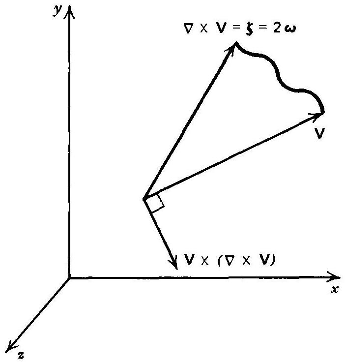
Figure 10.16 The vectors $\mathbf{V}$, $\nabla \times \mathbf{V}$, and $\mathbf{V} \times(\nabla \times \mathbf{V})$ in the Cartesian coordinate system.

A three-dimensional flow, however, may have $z$ components of velocity. Accordingly, such a flow may or may not be irrotational, depending on whether or not the initial flow is irrotational. Consequently, if the initial flow is irrotational, then the entire flow will remain irrotational. However, if the initial flow is rotational, then according to Kelvin's theorem (Section 10-6), the rotation will remain constant. The vorticity $\zeta$, or the rotation $\boldsymbol{\omega}$, must then be parallel to $\mathbf{V}$. Such a flow is called a Beltrami flow.

## 10-8 THE HELMHOLTZ VORTICITY THEOREMS

In Section 10-4(c), the vorticity of a fluid is defined as

$$
\zeta=\nabla \times \mathbf{V}=2 \omega
$$

In Section 10-4(c), it is shown that the vorticity is equal to the circulation per unit area. In the present section, some general results concerning vorticity are discussed.

A vortex line, illustrated in Fig. 10.9, is defined as a line that is everywhere tangent to the vorticity vector. The analogy of that definition to that for a streamline is apparent. Vortex lines are field lines in the field $\nabla \times \mathrm{V}$, just as streamlines are field lines in the field $\mathbf{V}$. A vortex tube, illustrated in Fig. 10.17, is defined as a tube consisting of all of the vortex lines passing through a closed fluid curve C that is not parallel to the vortex lines; the analogy to a stream tube is apparent.

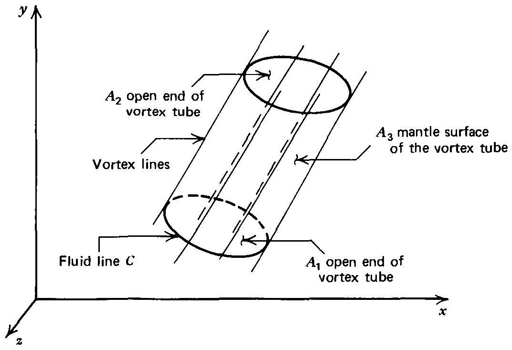
Figure 10.17 A vortex tube.

Equation 10.35, which is repeated here, relates the circulation and the vorticity.

$$
\Gamma=\oint_{C} \mathbf{V} \cdot d \mathbf{l}=\int_{A} \zeta \cdot d \mathbf{A}
$$

If the curve $C$ is shrunk to a point, the line integral becomes zero. In that case, the surface $A$ becomes a closed surface enclosing the volume $\mathscr{V}$ of the vortex tube, and equation 10.35 gives

$$
\int_{A} \zeta \cdot d \mathbf{A}=0
$$

For the vortex tube illustrated in Fig. 10.17, equation 10.99 yields

$$
\int_{A_{1}+A_{2}+A_{3}} \zeta \cdot d \mathbf{A}=0
$$

On the mantle surface $A_{3}$, the vorticity $\zeta$ is parallel to that surface by definition, so that $\zeta \cdot d \mathbf{A}$ is zero. Equation 10.100 reduces, therefore, to

$$
\int_{A_{1}} \zeta \cdot d \mathbf{A}_{1}=\int_{A_{2}} \zeta \cdot d \mathbf{A}_{2}
$$

Thus, in general,

$$
\int_{A} \zeta \cdot d \mathbf{A}=\text { constant }
$$

where $A$ is a surface enclosed by the vortex tube. Again, it is apparent that there is an analogy to a stream tube, where $\int_{A} \rho \mathbf{V} \cdot d \mathbf{A}$ is constant. We may, therefore, conclude that the vorticity of a fluid flow has properties that are analogous to the mass rate of flow per unit area $G=\rho \mathbf{V}$.

The above considerations lead to the two vorticity theorems credited to Helmholtz.

1. The vorticity of a vortex tube is constant.
2. Vortex lines are material lines in flows that preserve circulation.

The first theorem follows directly from equation 10.102.
The second theorem may be proved by considering the flow model illustrated in Fig. 10.18. At the time $t$, the vortex tube has a closed fluid line $C$ inscribed on its mantle surface. Since $\zeta$ is parallel to the surface of the vortex tube, $\Gamma$ is zero for curve $C$. At time $t+d t$, the closed curve $C^{\prime}$ comprises the same fluid particles that comprised curve $C$, since it is a fluid line by definition. For a flow in which the circulation is

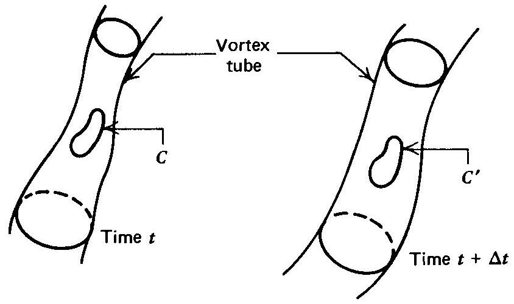
Figure 10.18 A vortex tube at the times $t$ and $t+d t$.

preserved, Kelvin's theorem states that $D \Gamma / D t=0$ on any closed fluid line. Hence,

$$
\oint_{C} \mathbf{V} \cdot d \mathbf{l}=0 \quad(\text { at time } t+d t)
$$

Hence, $\zeta$ is tangent to $C^{\prime}$ at time $t+d t$, and $C^{\prime}$ is the element of a vortex tube. The last statement is true for any closed curve on the mantle surface of a vortex tube. The generators of the vortex tube, which are vortex lines, are, therefore, also material lines.

A conclusion based on the Helmholtz vortex theorems is that a vortex tube cannot end within a fluid, but it must either be a closed curve (e.g., a smoke ring) or reach a solid boundary.

## 10-9 THERMODYNAMICS OF THE STEADY ADIABATIC INVISCID FLOW OF A COMPRESSIBLE FLUID

The energy equation for the steady multidimensional flow of a compressible fluid in the absence of heat transfer, shear forces, work, and body forces, is given by equation 10.9, which may be rewritten in the form

$$
\frac{D}{D t}\left(h+\frac{V^{2}}{2}\right)=0
$$

In terms of the stagnation enthalpy $H=h+V^{2} / 2$, equation 10.104 may be rewritten as

$$
\frac{D H}{D t}=0
$$

Hence,

$$
H=h+\frac{V^{2}}{2}=\mathrm{constant} \quad \text { (along a streamline) }
$$

Equation 10.106 is a generalization of equation 3.38, which applies to steady onedimensional flow [see Section 3-6(b)].

If a flow originates in a region of uniform flow where $H$ is constant throughout, then (since $H$ remains constant along a streamline), the stagnation enthalpy $H$ is constant throughout the entire flow field. As stated in Section 10-7(a), that flow is said to be homenergetic. Homenergetic flows occur frequently in practice. Examples are the external flow over bodies with or without shock waves, and the many internal flows where the flow originates in a region of uniform flow.

## 10-9(a) Equations of State

In addition to the basic conservation laws, it is necessary to know the equations of state for the fluid. For an inviscid fluid, those equations are the thermal and the caloric equations of state. For a pure substance, those equations, in functional form, are expressed by

$$
\begin{aligned}
t & =t(p, \rho) \\
h & =h(p, \rho)
\end{aligned}
$$

Equations 10.107 and 10.108 may either take the form of suitable tables and graphs or, in simple cases, they may be represented by algebraic equations. For a perfect gas those equations have the following particularly simple forms (see Section 1-15).

$$
\begin{aligned}
& p=\rho R t \\
& h=c_{p} t
\end{aligned}
$$

For nondissipative flows, such as those discussed in this chapter, the entropy remains constant along a streamline. Since $s=s(p, \rho)$, then

$$
\rho=\rho(p) \quad \text { (along a streamline) }
$$

For a perfect gas, equation 10.111 is given by

$$
p \rho^{-\gamma}=\mathrm{constant} \quad \text { (along a streamline) }
$$

For a flow that originates in a uniform flow region, equations 10.111 and 10.112 become

$$
\rho=\rho(p) \quad(\text { throughout the flow field })
$$

and

$$
p \rho^{-\gamma}=\mathrm{constant} \quad(\text { throughout the flow field })
$$

The speed of sound $a$ is an important parameter in the study of the flow of compressible fluids. For a pure substance, $a$ is a thermodynamic property given by the functional relationship

$$
a=a(p, \rho)
$$

For an isentropic flow, $\rho=\rho(p)$ along streamlines, and therefore

$$
a=a(p) \quad \text { (along streamlines) }
$$

If the flow is homentropic $[\nabla s=0$, see Section 10-7(b)], then

$$
a=a(p) \quad(\text { throughout the flow field })
$$

For an isentropic flow, $p$ and $V$ are related through the Bernoulli equation (equation 10.69), which is repeated here. Thus,

$$
\int \frac{d p}{\rho}+\frac{V^{2}}{2}=\mathrm{constant} \quad(\text { along a streamline })
$$

Since $\rho=\rho(p)$ along a streamline, equation 10.69 yields

$$
V=V(p) \quad \text { (along a streamline) }
$$

and equation 10.116 becomes

$$
a=a(V) \quad(\text { along a streamline })
$$

For a homentropic flow, $p$ and $V$ are related through the Bernoulli equation (equation 10.72), which is repeated below.

$$
\int \frac{d p}{\rho}+\frac{V^{2}}{2}=\mathrm{constant} \quad \text { (throughout the flow field) }
$$

Since $\rho=\rho(p)$ throughout the flow field for homentropic flows, equation 10.72 yields

$$
V=V(p) \quad(\text { throughout the flow field })
$$

and equation 10.117 becomes

$$
a=a(V) \quad(\text { throughout the flow field })
$$

An example of equation 10.121 is given by equation 3.84 for the perfect gas.

$$
a_{o}^{2}=a^{2}+\frac{\gamma-1}{2} V^{2}=\mathrm{constant} \quad \text { (throughout the flow field) }
$$

## 10-9(b) The Speed of Sound Equation

The speed of sound $a$ is defined by equation 1.180 , which is repeated and renumbered here for convenience. Thus,

$$
a^{2}=\left(\frac{\partial p}{\partial \rho}\right)_{s}
$$

For an isentropic flow (i.e., a flow with constant values of entropy along each of its streamlines), the partial derivative expressed in equation 10.122 may be written as a total derivative. Hence,

$$
d p=a^{2} d \rho \quad \text { (along a streamline) }
$$

If the time derivatives following a particle are determined, we obtain the substantial (or material) derivatives given below.

$$
\frac{D p}{D t}-a^{2} \frac{D \rho}{D t}=0
$$

In some applications, equation 10.124 may be employed in place of the energy equation (equation 10.9) when the flow is an isentropic flow, thus eliminating enthalpy derivatives from the governing equations.

In other applications, equation 10.124 is employed for eliminating the density derivatives from the governing equations. Density derivatives appear only in the continuity equation (equation 10.1), which may be written in the form

$$
\frac{D \rho}{D t}+\rho \nabla \cdot V=0
$$

Substituting equation 10.124 into 10.125 yields the following alternate form for the continuity equation. Thus,

$$
\frac{D p}{D t}+\rho a^{2} \nabla \cdot \mathbf{V}=0
$$

## 10-10 THE VELOCITY POTENTIAL FUNCTION

The governing equations for a steady irrotational flow [see Section 10-5(b)] may be combined and reduced to a single partial differential equation in terms of the
velocity potential function $\phi$; the latter function and the aforementioned partial differential equation are discussed in this section.

## 10-10(a) Definition of the Velocity Potential Function

According to Kelvin's theorem, for an irrotational flow,

$$
\Gamma \equiv \oint_{c} \mathbf{V} \cdot d \mathbf{l}=0
$$

From the properties of exact differentials discussed in Section 1-7(a), the product $\mathbf{V} \cdot d \mathbf{l}$ is the exact differential of some function. Denote this function by $\phi$, which is termed the velocity potential function for reasons that will become apparent later. Thus,

$$
d \phi \equiv \mathbf{V} \cdot d \mathbf{l}
$$

Since $\mathbf{V}=\mathbf{V}(x, y, z)$ in the Cartesian coordinate system, $\phi=\phi(x, y, z)$. Expanding equation 10.128 gives

$$
d \phi=\phi_{x} d x+\phi_{y} d y+\phi_{z} d z=u d x+v d y+w d z
$$

where $\phi_{x}=\partial \phi / \partial x$, etc. Since $d x, d y$, and $d z$ are arbitrary, their coefficients in equation 10.129 must be equal. Hence,

$$
u=\phi_{x}, \quad v=\phi_{y}, \quad \text { and } w=\phi_{z}
$$

Equation 10.130 shows that $\mathbf{V}$ is equal to the gradient of $\phi$. Thus,

$$
\mathbf{V}=\nabla \phi=\mathbf{i} u+\mathbf{j} v+\mathbf{k} w
$$

Thus, knowledge of the single variable $\phi$ completely specifies the velocity field for an irrotational flow. Conversely, for the velocity potential $\phi$ to exist, the flow must be irrotational.

For any scalar,

$$
\nabla \times \nabla(\text { scalar })=0
$$

Hence,

$$
\nabla \times \nabla \phi=\nabla \times \mathbf{V}=\zeta=0
$$

Equation 10.133 shows that the vorticity is zero, as it must be for an irrotational flow.

## 10-10(b) The Equations of Motion in Terms of $\phi$

The governing equations may be expressed in terms of $\phi$ instead of $\mathbf{V}$ by employing equation 10.130. The continuity equation for steady flow, with density derivatives eliminated (equation 10.126), becomes

$$
(\mathbf{V} \cdot \nabla) p+\rho a^{2} \nabla \cdot \mathbf{V}=0
$$

Euler's momentum equation for steady irrotational flow ( $\nabla \times \mathbf{V}=0$ ) may be obtained from equation 10.64 . Thus,

$$
\nabla p+\rho \nabla\left(\frac{V^{2}}{2}\right)=0
$$

Forming the scalar product of $\mathbf{V}$ and equation 10.135 gives

$$
(\mathbf{V} \cdot \nabla) p+\rho(\mathbf{V} \cdot \nabla)\left(\frac{V^{2}}{2}\right)=0
$$

Combining equations 10.134 and 10.136 to eliminate $\nabla p$ yields

$$
(\mathbf{V} \cdot \nabla)\left(\frac{V^{2}}{2}\right)-a^{2} \nabla \cdot \mathbf{V}=0
$$

Equation 10.137 is an important result that is generally called the gas dynamic equation.

Expanding equation 10.137 in Cartesian coordinates yields

$$
\begin{aligned}
& \left(u^{2}-a^{2}\right) u_{x}+\left(v^{2}-a^{2}\right) v_{y}+\left(w^{2}-a^{2}\right) w_{z}+u v\left(u_{y}+v_{x}\right) \\
& \quad+u w\left(w_{x}+u_{z}\right)+v w\left(w_{y}+v_{z}\right)=0
\end{aligned}
$$

In terms of $\phi$, as defined by equation 10.130 , equation 10.138 becomes

$$
\begin{aligned}
\left(\phi_{x}^{2}-a^{2}\right) \phi_{x x}+\left(\phi_{y}^{2}-a^{2}\right) \phi_{y y}+\left(\phi_{z}^{2}-a^{2}\right) & \phi_{z z}+2 \phi_{x} \phi_{y} \phi_{x y} \\
& +2 \phi_{x} \phi_{z} \phi_{x z}+2 \phi_{y} \phi_{z} \phi_{y z}=0
\end{aligned}
$$

Equation 10.139 is the governing partial differential equation for the velocity potential $\phi$ for steady multidimensional irrotational flow.

Equation 10.139 is a nonlinear partial differential equation. It is a quasi-linear differential equation because it is linear in the highest-order derivatives of $\phi$, in this case the second derivatives. The coefficients of the derivatives are functions of the velocity components $u, v$, and $w$, and also of the acoustic speed $a$. Excepting some special flows having simple conditions of symmetry, it is extremely difficult to obtain exact solutions to equation 10.139.

For steady two-dimensional planar or axisymmetric flow, equations 10.138 and 10.139 become

$$
\left(u^{2}-a^{2}\right) u_{x}+\left(v^{2}-a^{2}\right) v_{y}+2 u v u_{y}-\delta \frac{a^{2} v}{y}=0
$$

and

$$
\left(\phi_{x}^{2}-a^{2}\right) \phi_{x x}+\left(\phi_{y}^{2}-a^{2}\right) \phi_{y y}+2 \phi_{x} \phi_{y} \phi_{x y}-\delta \frac{a^{2} \phi_{y}}{y}=0
$$

where $\delta=0$ for planar flow and $\delta=1$ for axisymmetric flow. For a two-dimensional irrotational flow, $\boldsymbol{\omega}=0$, which requires that

$$
u_{y}-v_{x}=0
$$

Equation 10.142 is employed in deriving equations 10.140 and 10.141. Solutions to equations 10.140 and 10.142 for several problems of general interest are presented in Chapters 11, 12, and 16.

In the case of a steady three-dimensional incompressible flow, $a^{2}=\infty$. Dividing equation 10.139 by $a^{2}$ and setting $a^{2}=\infty$ gives

$$
\phi_{x x}+\phi_{y y}+\phi_{z z}=\nabla^{2} \phi=0
$$

Equation 10.143 is Laplace's equation. It applies only to a steady irrotational incompressible flow.

## 10-10(c) General Features of the Potential Equation

Consider equation 10.141, which is the potential equation for a steady twodimensional irrotational flow. If it is possible to find a function $\phi(x, y)$ for the flow field, all of the flow properties are determinable; the function $\phi(x, y)$ must, of course,
satisfy the boundary conditions. At any point in the flow field, if $\phi(x, y)$ is known, then the velocity $\mathbf{V}$ of the fluid at that point may be calculated. Furthermore, by employing the energy equation, the equations of state, and the relationship between the fluid properties for an isentropic process, we may compute $p, \rho, h, t$, and $a$.

In general, the boundary conditions for the flow of a fluid are the known values of $\mathbf{V}, p, \rho, h, t$, and $a$ in a specified region of the flow field. If that region is one where the flow is undisturbed by the presence of a body immersed in the fluid, then the boundary conditions are those of the undisturbed free stream; they are usually denoted by $\mathbf{V}_{\infty}, p_{\infty}, \rho_{\infty}, h_{\infty}, t_{\infty}$, and $a_{\infty}$. If the flow is a uniform flow parallel to the $x$ axis at infinity, that boundary condition is expressed as $\left(\phi_{x}\right)_{\infty}=V_{\infty}$ and $\left(\phi_{y}\right)_{\infty}=0$.

In the vicinity of a body of known shape immersed in the fluid, the boundary condition stipulates that the flow must be tangent to the surface of the body. In other words, the gradient of $\phi$, given by $\nabla \phi$, must be parallel to the surface of the body along the curve that defines the cross section of the body in the plane under consideration. In the case when the flow is two-dimensional, the geometry of the body must also be two-dimensional.

Equation 10.141 for a two-dimensional flow is a nonhomogeneous second-order partial differential equation, linear in terms of the second derivatives, and belongs to the general type ${ }^{8}$

$$
A u_{x x}+B u_{x y}+C u_{y y}+D u_{x}+E u_{y}+F u=0
$$

where $u$ is any function of $x$ and $y ; u=u(x, y)$. Equation 10.144 may be classified into three distinct types, depending on whether the criterion ( $B^{2}-4 A C$ ) is positive, negative, or zero. If ( $B^{2}-4 A C$ ) is positive, the equation is hyperbolic; if it is negative, the equation is elliptic; and if it is zero, the equation is parabolic.

It is convenient to divide equation 10.141 by $-a^{2}$ and rewrite it in the form

$$
\left(1-\frac{u^{2}}{a^{2}}\right) \phi_{x x}-\frac{2 u v}{a^{2}} \phi_{x} \phi_{y}+\left(1-\frac{v^{2}}{a^{2}}\right) \phi_{y y}+\delta \frac{v}{y}=0
$$

For equation 10.145 , the criterion ( $B^{2}-4 A C$ ) is given by

$$
\left(B^{2}-4 A C\right)=\frac{4 u^{2} v^{2}}{a^{2}}-4\left(1-\frac{u^{2}}{a^{2}}\right)\left(1-\frac{v^{2}}{a^{2}}\right)=\frac{V^{2}}{a^{2}}-1=M^{2}-1
$$

For subsonic flow $(M<1),\left(B^{2}-4 A C\right)<0$, indicating that equation 10.141 is elliptic. For sonic flow $(M=1),\left(B^{2}-4 A C\right)=0$, indicating that the equation is parabolic. For supersonic flow $(M>1),\left(B^{2}-4 A C\right)>1$, indicating that the potential equation is hyperbolic.

The differences in the type of the potential equation for subsonic, sonic, and supersonic flow are related to the physical differences in the flow fields corresponding to those three types of flow. If the flow field comprises more than one type of flow, the flow equations likewise are of more than one type, and the analysis of the flow field becomes complicated. That condition is encountered in transonic flow, where changes occur in the type of the equations governing the flow field.

Example 10.3. Several possible velocity potential functions are given below. Which ones are valid if the flow is incompressible?
(a) $\phi=-\Gamma \tan ^{-1}(x / y)$
(b) $\phi=x+y$
(c) $\phi=\ln x y z$

## Solution

If a velocity potential exists, then $\mathbf{V}=\nabla \phi, \nabla \cdot \mathbf{V}=\nabla^{2} \phi=0$, and $\boldsymbol{\omega}=\nabla \times \mathbf{V}= \nabla \times \nabla \phi=0$ is automatically satisfied. Hence, a function is a possible velocity potential function, if $\nabla^{2} \phi=0$.
(a) $\nabla^{2} \phi=\phi_{x x}+\phi_{y y}=\frac{\partial}{\partial x}\left[\frac{-\Gamma y}{\left(x^{2}+y^{2}\right)}\right]+\frac{\partial}{\partial y}\left[\frac{\Gamma x}{\left(x^{2}+y^{2}\right)}\right]$

$$
\nabla^{2} \phi=\frac{2 x y}{\left(x^{2}+y^{2}\right)^{2}}+\frac{-2 x y}{\left(x^{2}+y^{2}\right)}=0
$$

Equation (a) defines a possible velocity potential function. In fact, it yields the velocity field specified in part (b) of Examples 10.1 and 10.2, which is a free vortex flow field.
(b) $\nabla^{2} \phi=\phi_{x x}+\phi_{y y}=\frac{\partial}{\partial x}(1)+\frac{\partial}{\partial y}(1)=0$

Equation (b) defines a possible velocity potential function.
(c) $\nabla^{2} \phi=\phi_{x x}+\phi_{y y}+\phi_{z z}=\frac{\partial}{\partial x}\left(\frac{y z}{x y z}\right)+\frac{\partial}{\partial y}\left(\frac{x z}{x y z}\right)+\frac{\partial}{\partial z}\left(\frac{x y}{x y z}\right)$

$$
\nabla^{2} \phi=-\left(\frac{1}{x^{2}}+\frac{1}{y^{2}}+\frac{1}{z^{2}}\right) \neq 0
$$

Equation (c) does not define a possible velocity potential function.
Example 10.4. Consider the free vortex discussed in Section 10-4(d). The velocity field is given by

$$
\mathbf{V}=\frac{-\mathbf{i} \Gamma y}{\left(x^{2}+y^{2}\right)}+\frac{\mathbf{j} \Gamma x}{\left(x^{2}+y^{2}\right)}
$$

where the circulation $\Gamma$ is a constant. Derive the velocity potential function for the above flow field.

## Solution

For an irrotational flow field, $u=\phi_{x}$ and $v=\phi_{y}$. Thus,

$$
\begin{aligned}
\phi_{x} & =u=\frac{-\Gamma y}{\left(x^{2}+y^{2}\right)} \\
\phi_{1} & =\int \frac{-\Gamma y}{\left(x^{2}+y^{2}\right)} d x+c_{1}(y)=-\Gamma \tan ^{-1}\left(\frac{x}{y}\right)+c_{1}(y)
\end{aligned}
$$

In a similar manner,

$$
\begin{aligned}
\phi_{y} & =v=\frac{\Gamma x}{\left(x^{2}+y^{2}\right)} \\
\phi_{2} & =\int \frac{\Gamma x}{\left(x^{2}+y^{2}\right)} d y+c_{2}(x)=\Gamma \tan ^{-1}\left(\frac{y}{x}\right)+c_{2}(x)
\end{aligned}
$$

Comparing $\phi_{1}$ and $\phi_{2}$, it is seen that $\phi_{2}$ does not contain a function of $y$ alone, hence $c_{1}(y)$ in the expression for $\phi_{1}$ may be chosen equal to zero. Likewise, $c_{2}(x)$ in the expression for $\phi_{2}$ may be chosen equal to zero. From the properties of inverse trigonometric functions,

$$
\tan ^{-1} a+\tan ^{-1} b=\tan ^{-1} \frac{a+b}{1-a b}
$$

Subtracting $\phi_{1}$ from $\phi_{2}$ yields

$$
\begin{aligned}
\phi_{2}-\phi_{1}=\Gamma \tan ^{-1}\left(\frac{y}{x}\right)+\Gamma \tan ^{-1}\left(\frac{x}{y}\right)=\Gamma \tan ^{-1}\left(\frac{\frac{y}{x}+\frac{x}{y}}{1-1}\right) & \\
& =\Gamma \tan ^{-1}(\infty)=(2 n+1) \frac{\pi}{2}
\end{aligned}
$$

where $n=0,1,2, \ldots$ Thus, $\phi_{1}$ and $\phi_{2}$ differ only by a constant, so both are suitable velocity potential functions for the free vortex.

Lines of constant $\phi$ are given by

$$
y=\left[\tan \left(\frac{\phi}{\Gamma}\right)\right] x
$$

which are straight lines directed radially outward from the origin. In Section 10-11, it is shown that lines of constant $\phi$ are perpendicular to streamlines. Hence, the streamlines for the free vortex are concentric circles.

## 10-11 THE STREAM FUNCTION

In Section 10-10, the irrotationality condition is shown to be sufficient for defining the velocity potential function $\phi$. For a steady two-dimensional flow, another point function, termed the stream function, may be defined; it is defined in the present section.

## 10-11(a) Definition of the Stream Function

It is pointed out in Section 10-10 that for a velocity potential function to exist, the flow field must be irrotational. Equation 10.142, renumbered below, is the irrotationality condition for a steady two-dimensional flow. Thus,

$$
\frac{\partial}{\partial x}(-v)+\frac{\partial}{\partial y}(u)=0
$$

Equation 10.147 suggests that a function $\phi$, defined by $u=\phi_{x}$ and $v=\phi_{y}$, satisfies the irrotationality condition. For a steady two-dimensional planar flow ( $\delta=0$ ), equation 10.26, the continuity equation, becomes

$$
\frac{\partial}{\partial x}(\rho u)+\frac{\partial}{\partial y}(\rho v)=0
$$

Equation 10.148 suggests the introduction of a function $\psi$, termed the stream function, which is defined so that it satisfies equation 10.148 identically. Thus,

$$
\psi_{y} \equiv \rho u \quad \text { and } \quad \psi_{x} \equiv-\rho v
$$

Substituting equation 10.149 into equation 10.148 and interchanging the order of differentiation verifies that equation 10.149 satisfies equation 10.148 .

The only necessary condition for the existence of the stream function for a twodimensional planar flow is that the flow be steady.

For a steady two-dimensional axisymmetric flow [see Section 10-3(c)], the continuity equation may be written in the form

$$
(y \rho u)_{x}+(y \rho v)_{y}=0
$$

Hence, the stream function for a steady two-dimensional axisymmetric flow is defined by

$$
\psi_{x} \equiv-y \rho v \quad \text { and } \quad \psi_{y} \equiv y \rho u
$$

## 10-11(b) The Equations of Motion in Terms of $\psi$

For a steady two-dimensional irrotational flow, the irrotationality condition, equation 10.142, Euler's equation, equation 10.135, and the speed of sound equation, equation 10.122, may be combined, and the result expressed in terms of $\psi$. Thus,

$$
\left(\psi_{y}^{2}-y^{2 \delta} \rho^{2} a^{2}\right) \psi_{x x}+\left(\psi_{x}^{2}-y^{2 \delta} \rho^{2} a^{2}\right) \psi_{y y}-2 \psi_{x} \psi_{y} \psi_{x y}-\delta y a^{2} \psi_{y}=0
$$

where, as before, $\delta=0$ for a two-dimensional planar flow, and $\delta=1$ for a twodimensional axisymmetric flow. Equation 10.152 for determining $\psi$ is complicated by the appearance of the density $\rho$ in the coefficients of the partial derivatives $\psi_{x x}$ and $\psi_{y y}$, because for a compressible flow $\rho$ is a function of $\mathbf{V}$. Another complication is the appearance of $y^{2}$ in the coefficients of the partial derivatives $\psi_{x x}$ and $\psi_{y y}$ in the case of an axisymmetric flow. For those reasons, the solution to equation 10.152 is not often pursued. Moreover, the information usually desired may be obtained with less difficulty by solving equation 10.141 .

## 10-11(c) Physical Interpretation of the Stream Function

The physical significance of the stream function may be illustrated by referring to the two-dimensional planar flow field illustrated in Fig. 10.19. The mass rate of flow between points $A$ and $B$ on two different streamlines is given by

$$
d \dot{m}=(\rho u d y-\rho v d x) D
$$

where $D$ is the width of the flow passage, and the negative sign is introduced before the differential $d x$ because the integration from $A$ to $O$ is in the negative $x$ direction. For a two-dimensional flow, $\psi=\psi(x, y)$, and

$$
d \psi=\psi_{x} d x+\psi_{y} d y
$$

Substituting equation 10.151 into equation 10.154 gives

$$
d \psi=(\rho u d y-\rho v d x)
$$

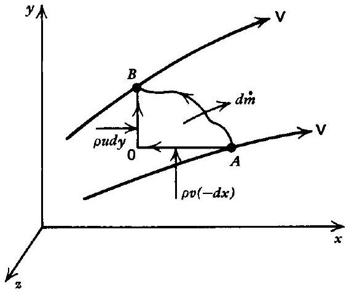
Figure 10.19 Model for illustrating the physical significance of the stream function.

Comparing equations 10.153 and 10.155, we obtain

$$
d \dot{m}=D d \psi
$$

Integration of equation 10.156 between points $A$ and $B$ yields

$$
\dot{m}_{A-B}=\left(\psi_{B}-\psi_{A}\right) D
$$

Hence, the mass flow rate between the two points $A$ and $B$ is proportional to the difference in the values of $\psi$ between those points.

For a two-dimensional axisymmetric flow,

$$
d \dot{m}=2 \pi(y \rho u d y-y \rho v d x)=2 \pi d \psi
$$

and

$$
\dot{m}_{A-B}=2 \pi\left(\psi_{B}-\psi_{A}\right)
$$

From equation 10.31(b), the equation of a streamline in a two-dimensional flow is

$$
u d y-v d x=0
$$

Combining equations 10.160 and 10.155 gives

$$
d \psi=\rho(u d y-v d x)=0 \quad \text { (along a streamline) }
$$

Integrating equation 10.161, we obtain

$$
\psi=\mathrm{constant} \quad \text { (along a streamline) }
$$

Hence, $\psi$ has a constant value along a streamline, and the difference in the values of $\psi$ between two streamlines is proportional to the mass rate of flow of fluid between the two streamlines.

Finally, from equation 10.161 it follows that

$$
\left(\frac{d y}{d x}\right)_{\psi=\text { constant }}=\frac{v}{u}
$$

## 10-11(d) Relationship between $\phi$ and $\psi$

In a two-dimensional flow, the lines of constant $\phi$ may be obtained from equation 10.129. Thus,

$$
d \phi=u d x+v d y=0
$$

and

$$
\left(\frac{d y}{d x}\right)_{\phi=\text { constant }}=-\frac{u}{v}
$$

Comparing equations 10.163 and 10.165, it is apparent that the lines of constant $\phi$ are orthogonal to the lines of constant $\psi$.
Example 10.5. Consider the forced vortex discussed in Section 10-4(e). The velocity field is given by

$$
\mathbf{V}=-\mathbf{i} \Omega y+\mathbf{j} \Omega x
$$

Derive the stream function for this flow field.

## Solution

For incompressible flow, $u=-\psi_{y}$ and $v=\psi_{x}$. Thus,

$$
\begin{aligned}
\psi_{y} & =-u=\Omega y \\
\psi & =\int \Omega y d y+c_{1}(x)=\frac{\Omega y^{2}}{2}+c_{1}(x)
\end{aligned}
$$

In a similar manner,

$$
\begin{aligned}
\psi_{x} & =v=\Omega x \\
\psi & =\int \Omega x d x+c_{2}(y)=\frac{\Omega x^{2}}{2}+c_{2}(y)
\end{aligned}
$$

Comparing equations (a) and (b), it is apparent that we may choose $c_{1}(x)=\omega x^{2} / 2$ and $c_{2}(x)=\omega y^{2} / 2$. Thus,

$$
\psi(x, y)=\frac{\Omega\left(x^{2}+y^{2}\right)}{2}+c
$$

where $c$ is a pure constant.
Note that the lines of constant $\psi$, which are streamlines, are concentric circles with centers at the origin.

## 10-12 SUMMARY

In Chapter 10, the differential forms of the governing equations for fluid flow derived in Chapter 2 are restricted to the conditions $\mathbf{V}_{t}=\rho_{t}=p_{t}=\mathbf{B}=g d z=d \mathbf{F}_{\text {shear }}= \delta \dot{Q}=\delta \dot{W}_{\text {shear }}=\delta \dot{W}_{\text {shaft }}=0$. The resulting equations are the vector equations governing the steady adiabatic inviscid flow of a compressible fluid; for convenience of reference they are assembled in Table 10.1. From those equations the corresponding equations for steady multidimensional adiabatic inviscid flow of a compressible fluid are derived in Cartesian and cylindrical coordinates; they are presented in Table 10.2. It is shown (see Table 10.2) that one set of equations specifies the flow fields for both two-dimensional planar flow ( $\delta=0$ ) and two-dimensional axisymmetric flow ( $\delta=1$ ).

Table 10.1 Vector Equations Governing the Steady Adiabatic Inviscid Flow of a Compressible Fluid*

Continuity equation

$$
\nabla \cdot(\rho \mathbf{V})=0
$$

Momentum or dynamic equation

$$
\rho \frac{D \mathbf{V}}{D t}+\nabla p=0
$$

Energy equation

$$
\rho \frac{D}{D t}\left(h+\frac{V^{2}}{2}\right)=0
$$

Speed of sound equation

$$
\frac{D p}{D t}-a^{2} \frac{D \rho}{D t}=0
$$

Entropy equation

$$
\rho \frac{D s}{D t}=0
$$

Equations of state

$$
t=t(p, \rho) \quad \text { and } \quad h=h(p, \rho)
$$

[^1]Table 10.2 Governing Equations for the Steady Multidimensional Adiabatic Inviscid Flow of a Compressible Fluid

## Cartesian coordinates ( $x, y$, and $z$ )

Continuity equation

$$
(\rho u)_{x}+(\rho v)_{y}+(\rho w)_{z}=0
$$

Momentum or dynamic equations

$$
\begin{aligned}
u u_{x}+v u_{y}+w u_{z}+\frac{1}{\rho} p_{x} & =0 \\
u v_{x}+v v_{y}+w v_{z}+\frac{1}{\rho} p_{y} & =0 \\
u w_{x}+v w_{y}+w w_{z}+\frac{1}{\rho} p_{z} & =0
\end{aligned}
$$

Energy equation

$$
u h_{x}+v h_{y}+w h_{z}+u\left(\frac{V^{2}}{2}\right)_{x}+v\left(\frac{V^{2}}{2}\right)_{y}+w\left(\frac{V^{2}}{2}\right)_{z}=0
$$

Speed of sound equation

$$
u p_{x}+v p_{y}+w p_{z}-a^{2}\left(u \rho_{x}+v \rho_{y}+w \rho_{z}\right)=0
$$

Entropy equation

$$
u s_{x}+v s_{y}+w s_{z}=0
$$

## Cylindrical coordinates ( $r, \theta$, and $z$ )

Continuity equation

$$
\frac{1}{r} \frac{\partial}{\partial r}\left(r \rho v_{r}\right)+\frac{1}{r} \frac{\partial}{\partial \theta}\left(\rho v_{\theta}\right)+\frac{\partial}{\partial z}\left(\rho v_{z}\right)=0
$$

Momentum equations

$$
\begin{array}{r}
v_{r} \frac{\partial v_{r}}{\partial r}+\frac{v_{\theta}}{r} \frac{\partial v_{r}}{\partial \theta}-\frac{v_{\theta}^{2}}{r}+v_{z} \frac{\partial v_{r}}{\partial z}+\frac{1}{\rho} \frac{\partial p}{\partial r}=0 \\
v_{r} \frac{\partial v_{\theta}}{\partial r}+\frac{v_{\theta}}{r} \frac{\partial v_{\theta}}{\partial \theta}+\frac{v_{r} v_{\theta}}{r}+v_{z} \frac{\partial v_{\theta}}{\partial z}+\frac{1}{\rho r} \frac{\partial p}{\partial \theta}=0 \\
v_{r} \frac{\partial v_{z}}{\partial r}+\frac{v_{\theta}}{r} \frac{\partial v_{z}}{\partial \theta}+v_{z} \frac{\partial v_{z}}{\partial z}+\frac{1}{\rho} \frac{\partial p}{\partial z}=0
\end{array}
$$

Energy equation

$$
v_{r} \frac{\partial h}{\partial r}+\frac{v_{\theta}}{r} \frac{\partial h}{\partial \theta}+v_{z} \frac{\partial h}{\partial z}+v_{r} \frac{\partial}{\partial r}\left(\frac{V^{2}}{2}\right)+\frac{v_{\theta}}{r} \frac{\partial}{\partial \theta}\left(\frac{V^{2}}{2}\right)+v_{z} \frac{\partial}{\partial z}\left(\frac{V^{2}}{2}\right)=0
$$

Speed of sound equation

$$
v_{r} \frac{\partial p}{\partial r}+\frac{v_{\theta}}{r} \frac{\partial p}{\partial \theta}+v_{z} \frac{\partial p}{\partial z}-a^{2}\left(v_{r} \frac{\partial \rho}{\partial r}+\frac{v_{\theta}}{r} \frac{\partial \rho}{\partial \theta}+v_{z} \frac{\partial \rho}{\partial z}\right)=0
$$

Entropy equation

$$
v_{r} \frac{\partial s}{\partial r}+\frac{v_{\theta}}{r} \frac{\partial s}{\partial \theta}+v_{z} \frac{\partial s}{\partial z}=0
$$

Table 10.2 (Continued)

## Two-dimensional planar and axisymmetric flows

Continuity equation

$$
(\rho u)_{x}+(\rho v)_{y}+\delta \frac{\rho v}{y}=0
$$

Planar flow, $\delta=0$. Axisymmetric flow, $\delta=1$.
Momentum or dynamic equations

$$
\begin{aligned}
u u_{x}+v u_{y}+\frac{1}{\rho} p_{x} & =0 \\
u v_{x}+v v_{y}+\frac{1}{\rho} p_{y} & =0
\end{aligned}
$$

Energy equation

$$
u h_{x}+v h_{y}+u\left(\frac{V^{2}}{2}\right)_{x}+v\left(\frac{V^{2}}{2}\right)_{y}=0
$$

Speed of sound equation

$$
u p_{x}+v p_{y}-a^{2}\left(u \rho_{x}+v \rho_{y}\right)=0
$$

Entropy equation

$$
u s_{x}+v s_{y}=0
$$

Transformation equations (from $r$ and $z$ to $y$ and $x$ )

$$
v=v_{r}, \quad u=v_{z}, \quad y=r, \quad x=z
$$

## Geometric and flow field parameters

Equations for the streamline

$$
\frac{d y}{d x}=\frac{v}{u} ; \quad \frac{d z}{d y}=\frac{w}{v} ; \quad \frac{d x}{d z}=\frac{u}{w}
$$

Circulation

$$
\Gamma=\oint_{C} \mathbf{V} \cdot d \mathbf{l}=\oint_{C} V d \ell \cos \alpha=\int_{A}(\nabla \times \mathbf{V}) \cdot d \mathbf{A}
$$

Rotation

$$
\boldsymbol{\omega}=\frac{1}{2} \nabla \times \mathbf{v}
$$

Vorticity

$$
\begin{aligned}
\zeta & =\nabla \times \mathbf{V}=2 \boldsymbol{\omega}=\mathbf{i}\left(w_{y}-v_{z}\right)+\mathbf{j}\left(u_{z}-w_{x}\right)+\mathbf{k}\left(v_{x}-u_{y}\right) \\
\zeta_{Z} & =\frac{d \Gamma}{d A}=2 \omega_{Z}
\end{aligned}
$$

The parameters known as the circulation $\Gamma$, rotation $\boldsymbol{\omega}$, and vorticity $\zeta$ are defined and related to each other (see Table 10.2). Thus, the vorticity is equal to the circulation per unit area, and the rotation is equal to one half the vorticity. A flow for which $\boldsymbol{\omega} \neq 0$ is termed a rotational flow, and one for which $\boldsymbol{\omega}=0$ is called an irrotational flow. A simple example of an irrotational flow is the free vortex, which has a singular point at the origin [see Section 10-4(d)]. An example of a rotational flow is the forced vortex [see Section 10-4(e)].

In the case of a steady multidimensional inviscid flow, the Bernoulli equation is valid along a streamline. The magnitude of the Bernoulli constant will, in general, vary from streamline to streamline, depending on the characteristics of the flow field. If the flow originates in a region of uniform flow, however, then the Bernoulli constant has the same value throughout the flow field; the latter statement is also true for a steady irrotational flow.

Kelvin's theorem (see Section 10-6) shows that if a flow is initially irrotational, it will remain irrotational with time, and if it is initially rotational, it will remain rotational with unchanging intensity. The latter two conclusions are restricted to inviscid flows for which the density is either a function of the pressure or is constant, and for which the net external force acting on the fluid is derivable from a potential.

For a steady homenergetic flow the stagnation enthalpy $H$ is uniform throughout the flow field (i.e., $\nabla H=0$ ). Crocco's theorem (see Section 10-7) shows that if there is an entropy gradient $\nabla s$ in such a flow field, then the flow is rotational ( $\boldsymbol{\omega} \neq 0$ ). For a homentropic steady flow the entropy is uniform throughout the flow field $(\nabla s=0)$. If there is a gradient in stagnation enthalpy $\nabla H$ in such a flow field, then the flow is rotational $(\boldsymbol{\omega} \neq 0)$.

For an irrotational flow the knowledge of a single variable, the velocity potential $\phi$, specifies the velocity field. Only if a flow is irrotational $(\boldsymbol{\omega}=0)$ can there be a velocity potential. A single governing partial differential equation is derived for steady multidimensional irrotational flow, in terms of the velocity potential $\phi$ (see Table 10.3).

For a steady two-dimensional flow, a point function, termed the stream function $\psi$, may be defined. The only necessary condition for $\psi$ to exist for a two-dimensional

Table 10.3 Governing Equations for the Steady Multidimensional Irrotational Flow of a Compressible Fluid

## Irrotationality condition

$$
\boldsymbol{\omega}=\mathbf{i} \omega_{X}+\mathbf{j} \omega_{Y}+\mathbf{k} \omega_{Z}=0
$$

Two-dimensional flow

$$
\omega_{Z}=u_{y}-v_{x}=0
$$

## Gas dynamic equation

$$
(\mathbf{V} \cdot \nabla)\left(\frac{V^{2}}{2}\right)-a^{2} \nabla \cdot \mathbf{V}=0
$$

Cartesian coordinates in terms of $u, v$, and $w$

$$
\begin{aligned}
\left(u^{2}-a^{2}\right) u_{x}+\left(v^{2}-a^{2}\right) v_{y}+\left(w^{2}-a^{2}\right) w_{z}+u v\left(u_{y}\right. & \left.+v_{x}\right) \\
& +u w\left(w_{x}+u_{z}\right)+v w\left(w_{y}+v_{z}\right)=0
\end{aligned}
$$

Cartesian coordinates in terms of the velocity potential $\phi$

$$
\begin{aligned}
\left(\phi_{x}^{2}-a^{2}\right) \phi_{x x}+\left(\phi_{y}^{2}-a^{2}\right) \phi_{y y}+\left(\phi_{z}^{2}-a^{2}\right) \phi_{z z} & \\
& +2 \phi_{x} \phi_{y} \phi_{x y}+2 \phi_{x} \phi_{z} \phi_{x z}+2 \phi_{y} \phi_{z} \phi_{y z}=0
\end{aligned}
$$

Two-dimensional planar ( $\delta=0$ ) and axisymmetric ( $\delta=1$ ) flow in terms of $u$ and $v$

$$
\left(u^{2}-a^{2}\right) u_{x}+\left(v^{2}-a^{2}\right) v_{y}+2 u v u_{y}-\delta \frac{a^{2} v}{y}=0
$$

Two-dimensional planar ( $\delta=0$ ) and axisymmetric ( $\delta=1$ ) flow in terms of the velocity potential $\phi$

$$
\left(\phi_{x}^{2}-a^{2}\right) \phi_{x x}+\left(\phi_{y}^{2}-a^{2}\right) \phi_{y y}+2 \phi_{x} \phi_{y} \phi_{x y}-\delta \frac{a^{2} \phi_{y}}{y}=0
$$

flow is that the flow be steady. The stream function $\psi$ has a constant value along a streamline and the difference in the values of $\psi$ between two streamlines is proportional to the mass rate of flow of fluid between them. It is shown in Section 10-10(d) that the lines of constant $\phi$ for a steady two-dimensional flow are orthogonal to the lines of constant $\psi$.

## REFERENCES

1. A. H. Shapiro, The Dynamics and Thermodynamics of Compressible Fluid Flow, Vol. 1, Ronald Press, New York, 1953.
2. R. von Mises, Mathematical Theory of Compressible Fluid Flow, Academic Press, New York, 1958.
3. R. Courant and K. O. Friedrichs, Supersonic Flow and Shock Waves, Interscience Publishers, New York, 1958.
4. K. Oswatitsch, Gas Dynamics, Academic Press, New York, 1956.
5. J. A. Owczarek, Fundamentals of Gas Dynamics, International Textbook Co., Scranton, Pa., 1964.
6. H. S. Tsien, "The Equations of Gas Dynamics," Fundamentals of Gas Dynamics, Section A, High Speed Aerodynamics and Jet Propulsion, Vol. III, Princeton University Press, Princeton, N.J., 1958.
7. L. I. Sedov, Two-Dimensional Problems in Hydrodynamics and Aerodynamics (translated from the Russian by C. K. Chu, H. Cohen, and B. Seckler), Chaps. VIII and IX, Interscience Publishers, New York, 1964.
8. W. Kaplan, Advanced Calculus, Addison-Wesley, Reading, Mass., 1952.

## PROBLEMS

1. Show that the unit vectors in the cylindrical coordinate system illustrated in Fig. $10.1 b$ are related to the unit vectors in the Cartesian coordinate system illustrated in Fig. 10.1a by the following equations.

$$
\begin{aligned}
& \mathbf{i}_{r}=\mathbf{i} \cos \theta+\mathbf{j} \sin \theta \\
& \mathbf{i}_{\theta}=-\mathbf{i} \sin \theta+\mathbf{j} \cos \theta \\
& \mathbf{i}_{z}=\mathbf{k}
\end{aligned}
$$

2. Figure 10.20 illustrates the unit vectors and the velocity vector in the spherical coordinate system. Show that those unit vectors are related to the unit vectors in the Cartesian coordinate system illustrated in Fig. 10.1 $a$ by the following equations.

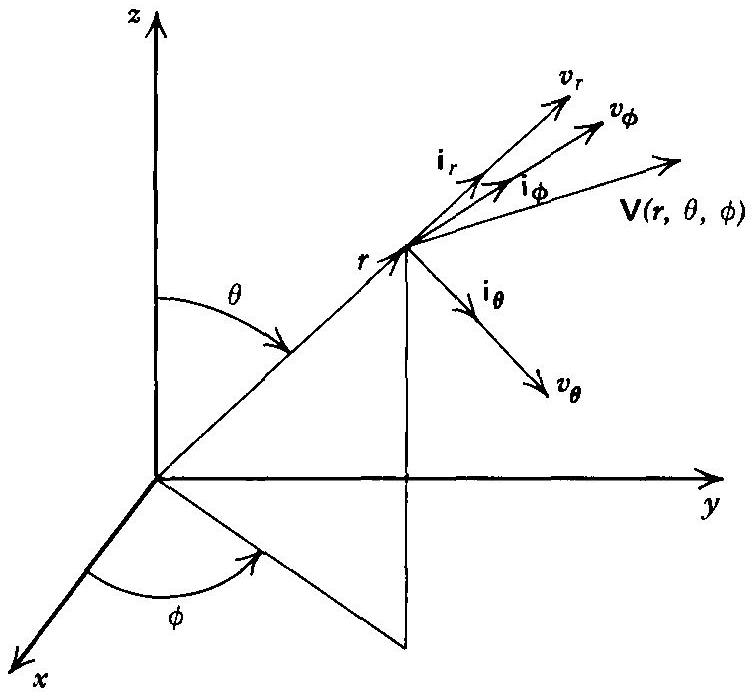
Figure 10.20 The velocity vector in the spherical coordinate system.

$$
\begin{aligned}
& \mathbf{i}_{r}=\mathbf{i} \sin \theta \cos \phi+\mathbf{j} \sin \theta \sin \phi+\mathbf{k} \cos \theta \\
& \mathbf{i}_{\theta}=\mathbf{i} \cos \theta \cos \phi+\mathbf{j} \cos \theta \sin \phi-\mathbf{k} \sin \theta \\
& \mathbf{i}_{\phi}=-\mathbf{i} \sin \phi+\mathbf{j} \cos \phi
\end{aligned}
$$

3. Show that in the cylindrical coordinate system

$$
\frac{\partial}{\partial \theta}\left(\mathbf{i}_{r}\right)=\mathbf{i}_{\theta} \quad \frac{\partial}{\partial \theta}\left(\mathbf{i}_{\theta}\right)=-\mathbf{i}_{r}
$$

4. Show that in the spherical coordinate system,

$$
\begin{aligned}
& \frac{\partial}{\partial \theta}\left(\mathbf{i}_{r}\right)=\mathbf{i}_{\theta} \quad \frac{\partial}{\partial \theta}\left(\mathbf{i}_{\theta}\right)=-\mathbf{i}_{r} \\
& \frac{\partial}{\partial \phi}\left(\mathbf{i}_{r}\right)=\mathbf{i}_{\phi} \sin \theta \quad \frac{\partial}{\partial \phi}\left(\mathbf{i}_{\theta}\right)=\mathbf{i}_{\phi} \cos \theta \\
& \frac{\partial}{\partial \phi}\left(\mathbf{i}_{\phi}\right)=-\mathbf{i}_{r} \sin \theta-\mathbf{i}_{\theta} \cos \theta
\end{aligned}
$$

5. Write out the expanded form of the vector operator ∇ in the Cartesian, cylindrical, and spherical coordinate systems.
6. Expand $\nabla p$ and $\nabla \cdot \mathbf{V}$ in the Cartesian, cylindrical, and spherical coordinate systems.
7. Expand the operator $(\mathbf{V} \cdot \nabla)$ in the Cartesian, cylindrical, and spherical coordinate systems.
8. Expand $\nabla \times \mathbf{V}$ in the Cartesian, cylindrical, and spherical coordinate systems.
9. Expand $D \rho / D t$ and $D \mathbf{V} / D t$ in the Cartesian, cylindrical, and spherical coordinate systems.
10. Write out the expanded forms of the continuity, momentum, energy, and entropy equations in the Cartesian coordinate system.
11. Write out the expanded forms of the continuity, momentum, energy, and entropy equations in the cylindrical coordinate system.
12. Write out the expanded forms of the continuity, momentum, energy, and entropy equations in the spherical coordinate system.
13. Verify that the transformation specified by equation 10.25 yields equations 10.26 to 10.30
14. Verify the following vector identity by expanding the terms into components in the Cartesian, cylindrical, and spherical coordinate systems.

$$
(\mathbf{V} \cdot \nabla) \mathbf{V}=\nabla\left(\frac{V^{2}}{2}\right)-\mathbf{V} \times(\nabla \times \mathbf{V})
$$

15. Which of the following velocity fields are possible flows for an incompressible fluid?
(a) $\quad \mathbf{V}=\mathbf{i}(x+y)+\mathbf{j}(x-y+z)+\mathbf{k}(x+y+3)$
(b) $\mathbf{V}=\mathbf{i} x y+\mathbf{j} y z+\mathbf{k}\left(y z+z^{2}\right)$
(c) $\quad \mathbf{V}=\mathbf{i} x(y+z)+\mathbf{j} y(x+z)+\mathbf{k}\left[-(x+y) z-z^{2}\right]$
(d) $\mathbf{V}=\mathbf{i} x y z t+\mathbf{j}\left(-x y z t^{2}\right)+\mathbf{k}\left[\left(z^{2} / 2\right)\left(x t^{2}-y t\right)\right]$
16. Which of the velocity fields specified in Problem 15 are irrotational?
17. With the two velocity components given, determine the third velocity component so that the continuity equation is satisfied. Which of the resulting velocity fields are irrotational? Assume that the fluid density is constant.
(a) $\quad u=x^{2}+y^{2}+z^{2}, v=-x y-y x-x z, w=$ ?
(b) $\quad u=\ln \left(y^{2}+z^{2}\right), v=\sin \left(x^{2}+y^{2}\right), w=$ ?
18. List the necessary requirements for the existence of a velocity potential function.
19. Examine the following functions to determine if they could represent the velocity potential for an incompressible inviscid flow.
(a) $f=x+y+z$
(b) $f=x+x y+x y z$
(c) $f=x^{2}+y^{2}+z^{2}$
(d) $f=x^{2} z-y^{2}-z^{2}$
(e) $f=\sin (x+y+z)$
(f) $f=\ln x$
20. List the necessary requirements for the existence of a stream function.
21. Derive an expression for the stream function for the free vortex discussed in Section 10-4(d).
22. Derive equation 10.152 .
23. The stream function $\psi=U_{\infty} \sin \theta\left(R^{2} / r-r\right)$ represents an incompressible inviscid flow about an infinite cylinder of radius $R$, where $U_{\infty}$ is the velocity of the free stream, and $\theta$ is measured clockwise from the stagnation point on the front of the cylinder. Determine expressions for $v_{r}$ and $v_{\theta}$
24. An infinitely long cylinder of radius $R_{1}$ is rotating coaxially with the angular velocity $\omega_{1}$ within a hollow infinitely long cylindrical tube of radius $R_{2}$, which is rotating with the angular velocity $\omega_{2}$. The velocity distribution of the incompressible fluid between the two cylinders is

$$
V(r)=\frac{\left(\omega_{2} R_{2}^{2}-\omega_{1} R_{1}^{2}\right) r-R_{1}^{2} R_{2}^{2}\left(\omega_{2}-\omega_{1}\right) / r}{R_{2}^{2}-R_{1}^{2}}
$$

Determine an expression for the vorticity at a point in the fluid. Under what conditions, if any, would the vorticity be zero?

[^0]:    * In this section, $t$ denotes the time and $T$ denotes the static temperature.

[^1]:    * For the integral and differential forms of the general equations, see Tables 2.1 and 2.2.

