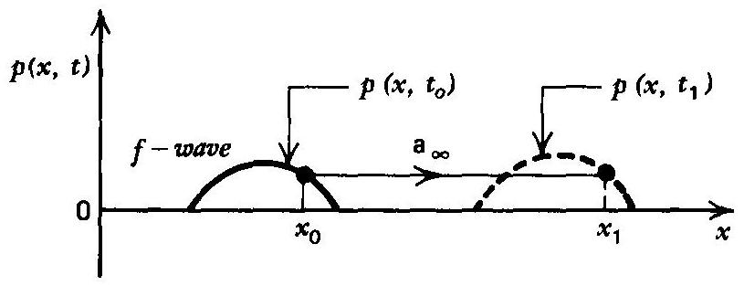
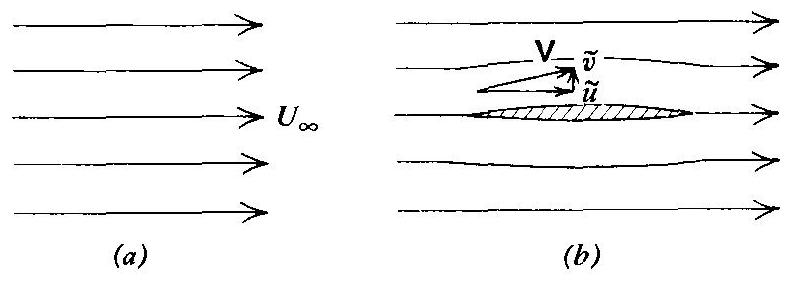
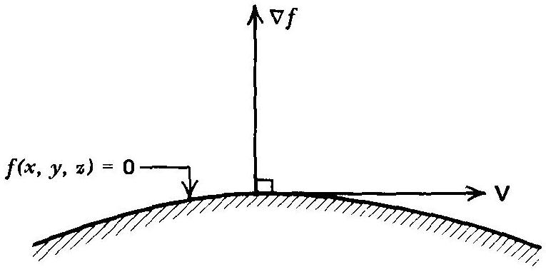
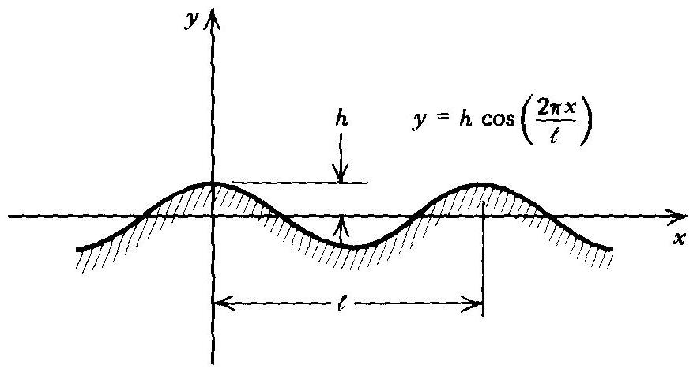
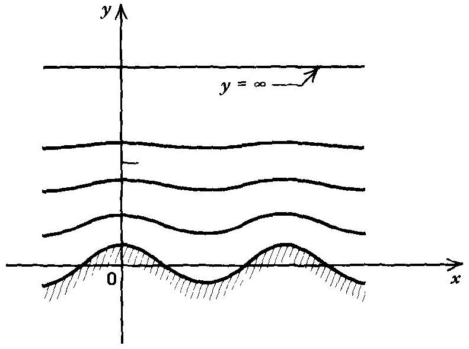
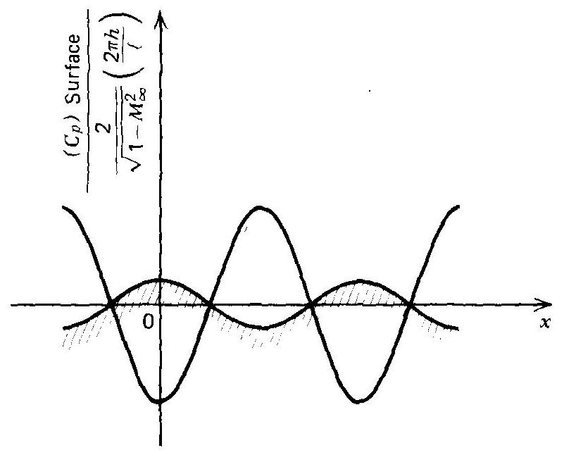
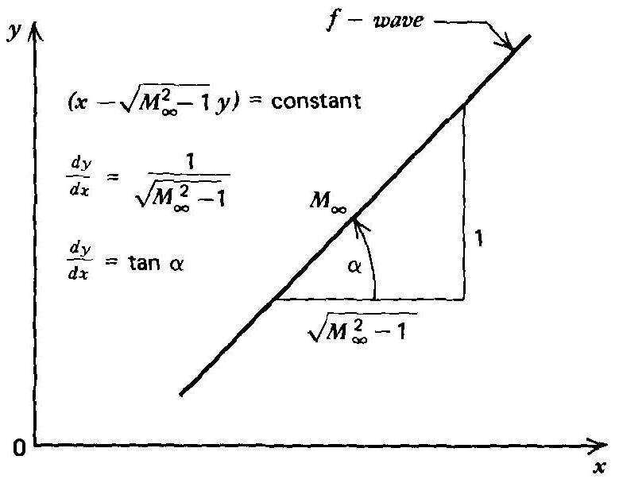
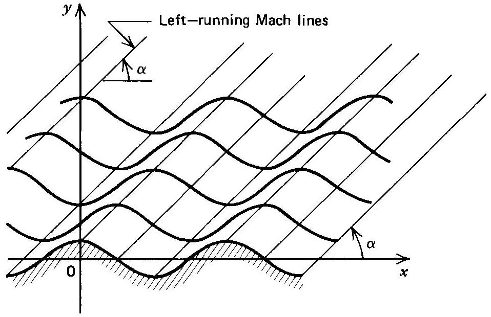
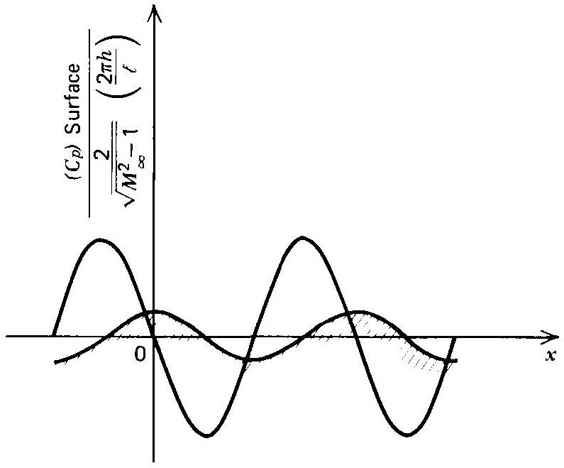

## 11   introduction to flow with small perturbations

11-1 PRINCIPAL NOTATION FOR CHAPTER 11 ..... 555
11-2 INTRODUCTION ..... 556
11-3 PROPAGATION OF A PLANAR ACOUSTIC WAVE ..... 556
(a) The one-dimensional wave equation ..... 557
(b) The D'Alembert solution of the wave equation ..... 558
11-4 FLOW WITH SMALL PERTURBATIONS ..... 560
(a) Linearization of the governing equations ..... 560
(b) Perturbation velocity potential ..... 563
(c) Classification of the perturbation equations ..... 564
(d) Linearization of the boundary condition ..... 564
(e) Linearization of the pressure coefficient ..... 566
11-5 TWO-DIMENSIONAL FLOW PAST A WAVY WALL ..... 567
(a) Subsonic flow ..... 568
(b) Supersonic flow ..... 571
(c) Comparison of subsonic and supersonic flow over a wavy wall ..... 875
(d) Transonic flow ..... 575
11-6 SUMMARY ..... 575

## 11-1 PRINCIPAL NOTATION FOR CHAPTER 11

The notation of Chapter 10 (Section 10-1) is applicable here. The following additional notation is employed in the present chapter.
$\tilde{a} \quad$ dimensional local speed of sound.
$a_{\infty} \quad$ free-stream speed of sound.
$h \quad$ amplitude of a wavy wall.
$C_{p}$ pressure coefficient.
$\ell \quad$ wave length of a wavy wall.
$M_{\infty}$ free-stream Mach number.
$p \quad$ perturbation pressure.
$\tilde{p} \quad$ dimensional pressure.
$u \quad x$ direction perturbation velocity.
$\tilde{u} \quad x$ direction dimensional velocity.
$U_{\infty} \quad x$ direction free-stream velocity.
$v \quad y$ direction perturbation velocity.

## 556 INTRODUCTION TO FLOW WITH SMALL PERTURBATIONS

$\tilde{v} \quad y$ direction dimensional velocity.
$\mathbf{V}_{\infty}$ free stream velocity vector.
$w \quad z$ direction perturbation velocity.
$\tilde{w} \quad z$ direction dimensional velocity.
Greek letters
$\alpha \quad=\sin ^{-1}(1 / M)$, Mach angle.
$\delta \quad 0$ for planar flow, 1 for axisymmetric flow.
$\rho \quad$ perturbation density.
$\tilde{\rho} \quad$ dimensional density.
$\phi \quad$ perturbation velocity potential.
$\Phi \quad$ velocity potential.
Subscripts
$\infty$ denotes free-stream value of a property.

## 11-2 INTRODUCTION

The equations governing the multidimensional adiabatic inviscid flow of a compressible fluid in the absence of work and body forces are discussed in Chapter 10. Those equations comprise a set of coupled nonlinear partial differential equations, and their general solutions are unknown. In fact, closed form solutions are available for only a few very simple types of flow. In general, numerical techniques are employed for obtaining their solutions for specific initial and boundary conditions. For small disturbances in a stationary gas, and for flows where the velocity deviates only slightly from a parallel uniform flow, small perturbation techniques may be employed for linearizing the governing equations, thereby simplifying the mathematical procedures for solving the resulting equations.

A major objective of this book is the development of the mathematical techniques for solving nonlinear flows. Consequently, relatively minor attention is devoted to the consideration of flows with small perturbations. However, in view of the usefulness of the method of small perturbations, the linearized equations governing irrotational flows obtained by applying the latter method are developed in the present chapter, primarily for the purpose of illustrating the approximations involved. Several books present studies of linearized flow over airfoils, so that subject is not discussed in this book.

For illustrative purposes, small perturbation techniques are applied to the propagation of a planar acoustic wave, and to the classic problem of the flow over a wavy wall. The solution to the latter problem illustrates several general features of subsonic and supersonic flows.

Two additional problems of considerable practical importance wherein the method of small perturbations yields useful results are discussed in Chapter 15. Those two problems are the three-dimensional acoustic wave motion in a rigid cylindrical cavity, and the steady two-dimensional irrotational transonic flow in the throat of a converging-diverging nozzle.

## 11-3 PROPAGATION OF A PLANAR ACOUSTIC WAVE

An important illustration of the application of the technique of small perturbations (or small disturbances) to a body of an inviscid compressible fluid, such as air that is at rest, is provided by the planar propagation of an acoustic wave in the latter gas. Assume that the compressible fluid extends indefinitely in all directions so that
no solid boundaries are involved. The properties of the fluid when it is at rest, or in the undisturbed state, are denoted by $\rho_{\infty}, p_{\infty}, a_{\infty}$, and $\mathbf{V}_{\infty}=0$.

In the present section, the governing equation is derived for the propagation of a planar wave in a uniform stationary mass of gas under the conditions prescribed above. The resulting equation is known as the one-dimensional wave equation. It is applicable to a small pressure disturbance of arbitrary shape, and its general solution is termed the D'Alembert solution. ${ }^{1-3}$

## 11-3(a) The One-Dimensional Wave Equation

Consider a compressible fluid at rest, having the uniform rest properties $\rho_{\infty}, p_{\infty}, a_{\infty}$, and $\mathbf{V}_{\infty}=0$. Assume that a weak pressure disturbance, such as an acoustic wave, is propagated in the fluid, with a propagation speed that is fast enough to warrant assuming adiabatic wave propagation; this assumption is in good agreement with the physics for the situation. Because the fluid is assumed to be inviscid, its motion because of the small pressure disturbance may be assumed to be isentropic. Furthermore, for a gas in an acoustic field, body forces are negligible.

For the isentropic process under consideration, the continuity, momentum, and speed of sound equations are the following.
(a) Continuity equation (equation 10.1)

$$
\tilde{\rho}_{t}+\nabla \cdot(\tilde{\rho} \mathbf{V})=0
$$

(b) Momentum equation (equation 10.8)

$$
\tilde{\rho} \frac{D \mathbf{V}}{D t}+\nabla \tilde{p}=0
$$

(c) Speed of sound equation (equation 10.124)

$$
\frac{D \tilde{p}}{D t}-\tilde{a}^{2} \frac{D \tilde{\rho}}{D t}=0
$$

Combining equations 11.1 and 11.3, we obtain

$$
\tilde{\rho} \tilde{a}^{2} \nabla \cdot \mathbf{V}+\frac{D \tilde{p}}{D t}=0
$$

In the above equations the tilde over a letter denotes that it is a dimensional flow property ( $\tilde{\rho}, \tilde{p}, \tilde{u}$, etc.). A letter without the tilde is employed for denoting a perturbation or disturbance in the pertinent flow property.

The aforementioned planar disturbance of the fluid causes motion of its particles parallel to the $x$ axis, so that the velocity vector $\mathbf{V}$ at an arbitrary point in the fluid is given by the vector equation

$$
\mathbf{V}=\mathbf{i} \tilde{u}+\mathbf{j}(0)+\mathbf{k}(0)=\mathbf{i} \tilde{u}
$$

Accordingly, $\nabla \cdot \mathbf{V}$ is given by

$$
\nabla \cdot \mathbf{V}=\left(\mathbf{i} \frac{\partial}{\partial x}+\mathbf{j} \frac{\partial}{\partial y}+\mathbf{k} \frac{\partial}{\partial z}\right) \cdot(\mathbf{i} \tilde{u})=\tilde{u}_{x}
$$

The substantial derivative of a general property $N$ is given by (see Vector Identities, Section 2-1)

$$
\frac{D N}{d t}=\frac{\partial N}{\partial t}+(\mathbf{V} \cdot \nabla) N=N_{t}+(\mathbf{i} \tilde{u}) \cdot\left(\mathbf{i} \frac{\partial N}{\partial x}+\mathbf{j} \frac{\partial N}{\partial y}+\mathbf{k} \frac{\partial N}{\partial z}\right)
$$

or

$$
\frac{D N}{D t}=N_{t}+\tilde{u} N_{x}
$$

From equation 11.8, it follows that

$$
\begin{aligned}
& \frac{D \mathbf{V}}{D t}=\mathbf{i}\left(\tilde{u}_{t}+\tilde{u} \tilde{u}_{x}\right) \\
& \frac{D \tilde{p}}{D t}=\tilde{p}_{t}+\tilde{u} \tilde{p}_{x} \\
& \frac{D \tilde{\rho}}{D t}=\tilde{\rho}_{t}+\tilde{u} \tilde{\rho}_{x}
\end{aligned}
$$

Substituting equations $11.9,11.10$, and 11.11 into equations 11.2 and 11.4 yields

$$
\begin{array}{r}
\tilde{\rho} \tilde{u}_{t}+\tilde{\rho} \tilde{u} \tilde{u}_{x}+\tilde{p}_{x}=0 \\
\tilde{\rho} \tilde{a}^{2} \tilde{u}_{x}+\tilde{p}_{t}+\tilde{u} \tilde{p}_{x}=0
\end{array}
$$

Equations 11.12 and 11.13 apply to unsteady one-dimensional planar flow fields.
As stated above, the perturbation quantities are denoted by the same letters as those employed for the dimensional properties, except without the tilde. Then by definition, the perturbation quantities are

$$
\tilde{u}=u, \quad \tilde{a}=a_{\infty}+a, \quad \tilde{p}=\tilde{p}_{\infty}+p, \quad \tilde{\rho}=\rho_{\infty}+\rho
$$

where $u$ is very small, and $a, p$, and $\rho$ are much smaller than the corresponding undisturbed values $a_{\infty}, p_{\infty}$, and $\rho_{\infty}$, respectively; also, in the undisturbed state, $u_{\infty}=0$. Substituting the above perturbation quantities into equations 11.12 and 11.13 , and neglecting all products of perturbations and their derivatives yields

$$
\begin{array}{r}
\rho_{\infty} u_{t}+p_{x}=0 \\
\rho_{\infty} a_{\infty}^{2} u_{x}+p_{t}=0
\end{array}
$$

Assume that the second derivatives are continuous, and differentiate equation 11.15 with respect to $x$ and equation 11.16 with respect to $t$. Combining the results and eliminating $u_{x t}$ from the set of two equations yields the single equation

$$
p_{t t}=a_{\infty}^{2} p_{x x}
$$

Equation 11.17 is the classical one-dimensional wave equation that governs the onedimensional propagation of weak pressure disturbances.

The one-dimensional wave equation has wide application in engineering and physics. It is the governing partial differential equation for such phenomena as the vibrating membrane, the longitudinal vibrations of a long bar, and the transverse vibrations of a beam. ${ }^{3}$

## 11-3(b) The D'Alembert Solution of the Wave Equation

The general features associated with the propagation of a weak pressure disturbance are now investigated. Consider a general solution of equation 11.17 having the following form, known as the $D^{\prime}$ Alembert (1747) solution. ${ }^{1-3}$

$$
p(x, t)=f\left(x-a_{\infty} t\right)+g\left(x+a_{\infty} t\right)
$$

That equation 11.18 is a solution of equation 11.17 may be verified by direct substitution. It is seen that equation 11.18 yields two solutions, or waves; the $f$-waves obtained from the solution $p(x, t)=f\left(x-a_{\infty} t\right)$, and the $g$-waves obtained from the solution $p(x, t)=g\left(x+a_{\infty} t\right)$. Either or both waves may occur in a given flow situation. Equation 11.17 is a linear differential equation; consequently, the solution for $p(x, t)$ may be constructed by superposing the $f$-waves and the $g$-waves. The general characteristics of such waves are described below.

First, consider a pressure disturbance caused only by the $f$-wave. Thus,

$$
p(x, t)=f\left(x-a_{\infty} t\right)
$$

Figure 11.1 illustrates an arbitrary pressure disturbance at the initial time $t_{o}$. Consider the arbitrary point $x_{o}$. At the time $t_{o}$, the amplitude of the pressure disturbance at $x_{o}$ is given by

$$
p\left(x_{o}, t_{o}\right)=f\left(x_{o}-a_{\infty} t_{o}\right)
$$

At some later time $t_{1}>t_{o}$, that same amplitude will occur at some downstream point $x_{1}$. Thus,

$$
p\left(x_{o}, t_{o}\right)=p\left(x_{1}, t_{1}\right)
$$

For equation 11.21 to be true, equation 11.19 requires that

$$
f\left(x_{o}-a_{\infty} t_{o}\right)=f\left(x_{1}-a_{\infty} t_{1}\right)
$$

The requirement expressed by equation 11.22 is satisfied only if

$$
x_{o}-a_{\infty} t_{o}=x_{1}-a_{\infty} t_{1}
$$

Solving the last equation for $x_{1}$ yields

$$
x_{1}=x_{o}+a_{\infty}\left(t_{1}-t_{o}\right)
$$

Hence, the point on the initial pressure disturbance (see Fig. 11.1) has propagated to the right an amount equal to the distance $a_{\infty}\left(t_{1}-t_{o}\right)$ during the time interval ( $t_{1}-t_{o}$ ). Accordingly, the velocity of propagation of the wave is given by

$$
V_{\text {propagation }}=\frac{a_{\infty}\left(t_{1}-t_{o}\right)}{\left(t_{1}-t_{o}\right)}=a_{\infty}
$$

where $a_{\infty}$ is the speed of sound in the undisturbed fluid.

Figure 11.1 Propagation of a planar pressure disturbance.

The selection of the point $x_{o}$ on the initial pressure disturbance is arbitrary. Consequently, every point of curve $p\left(x, t_{o}\right)$, for the initial pressure disturbance, will move to the right by the same amount. Consequently, the entire pressure disturbance moves to the right at the speed $a_{\infty}$ with no change in the wave shape.

The function $f\left(x-a_{\infty} t\right)$ represents, therefore, a right-running wave that propagates an initial disturbance to the right at the speed $a_{\infty}$, and that preserves the wave form. Similar reasoning shows that the function $g\left(x+a_{\infty} t\right)$ represents a left-running wave that propagates an initial disturbance to the left at the speed $a_{\infty}$, also preserving the wave form.

A general pressure disturbance, such as that represented by equation 11.18, is, therefore, the sum of the left- and right-running waves. Such waves are called traveling waves. If the propagation path is of finite length, reflected waves occur at the boundaries, and standing wave forms may be generated by the superposition of the two traveling waves. The rules for wave reflection given in Section 7-11 for compression waves, and in Section 8-8 for expansion waves, must be obeyed at the boundaries. Accordingly, waves of the same type (either compression or expansion) reflect from a solid boundary (i.e., a closed-end tube), and waves of the opposite type reflect from a fixed pressure boundary (i.e., an open-end tube).

The foregoing concepts of wave propagation form the basis of the science of acoustics. In general, acoustic waves may propagate in all directions and the boundary conditions are more complex (for example, energy absorption, dispersion, and phase shift may occur).* The basic features of the wave propagation process are, however, illustrated by the D'Alembert solution.

## 11-4 FLOW WITH SMALL PERTURBATIONS

In the present section, the linearized equations for steady two-dimensional irrotational flow are derived. A single equation is obtained that is valid for both subsonic and supersonic flows, and a separate equation is derived for the case of transonic flow. The derivations of those equations follow, in general, the technique presented in Reference 4. The resulting equations are valid for both planar and axisymmetric flows.

## 11-4(a) Linearization of the Governing Equations

Consider an undisturbed infinite compressible medium which constitutes a uniform flow field. Let $\mathbf{V}_{\infty}$ denote the vector velocity at a point in such a flow field. Assume that the direction of the velocity of the uniform flow field, termed the free-stream velocity, is parallel to the $x$ axis of a Cartesian coordinate system, as illustrated in Fig. 11.2a. In that case,

$$
\mathbf{V}_{\infty}=\mathbf{i} U_{\infty}+\mathbf{j}(0)+\mathbf{k}(0)=\mathbf{i} U_{\infty}
$$

where $U_{\infty}$ is the free-stream velocity for the undisturbed uniform flow. The fluid properties $p, \rho$, and $a$, in the undisturbed flow field, are likewise uniform and their values are denoted by $p_{\infty}, \rho_{\infty}$, and $a_{\infty}$, respectively.

Assume that a body of good aerodynamic shape, such as a thin airfoil, is inserted into the uniform flow field, as illustrated in Fig. 11.2b. The obstruction caused by the body causes the streamlines of the flow in the vicinity of the body to deviate a small amount from the undisturbed direction of the uniform flow field; that is, from the direction parallel to $U_{\infty}$, which is parallel to the $x$ axis.

At this point, it is desirable to introduce the notation discussed in Section 11-3(a) for the rectangular components of the instantaneous velocity vector $\mathbf{V}$ for a fluid

[^0]
Figure 11.2 Uniform and perturbed flows. (a) Uniform flow. (b) Perturbed flow.

particle. Accordingly, $\mathbf{V}$ is defined by

$$
\mathbf{V}=\mathbf{i} \tilde{u}+\mathbf{j} \tilde{v}+\mathbf{k} \tilde{w}
$$

where the tilde over a letter denotes that it is a dimensional velocity component, and the symbols $u, v$, and $w$ denote the perturbation velocity components.

For the steady irrotational flow of a compressible fluid, the gas dynamic equation (see equation 10.190, Table 10.3) applies. It is repeated and renumbered here for convenience. Thus,

$$
(\mathbf{V} \cdot \nabla)\left(\frac{V^{2}}{2}\right)-a^{2} \nabla \cdot \mathbf{V}=0
$$

The corresponding equation in Cartesian coordinates (see equation 10.191) is repeated below, expressed in the notation for the Cartesian components of $\mathbf{V}$ (see equation 11.27 above). Thus,

$$
\begin{aligned}
& a^{2}\left(\tilde{u}_{x}+\tilde{v}_{y}+\tilde{w}_{z}\right)=\tilde{u}^{2} \tilde{u}_{x}+\tilde{v}^{2} \tilde{v}_{y}+\tilde{w}^{2} \tilde{w}_{z}+\tilde{u} \tilde{v}\left(\tilde{u}_{y}+\tilde{v}_{x}\right) \\
&+\tilde{u} \tilde{w}\left(\tilde{u}_{z}+\tilde{w}_{x}\right)+\tilde{v} \tilde{w}\left(\tilde{v}_{z}+\tilde{w}_{y}\right)
\end{aligned}
$$

From equation 3.186, the energy equation for a perfect gas, it follows that

$$
a_{o}^{2}=a^{2}+\frac{\gamma-1}{2} V^{2}=a^{2}+\frac{\gamma-1}{2}\left(\tilde{u}^{2}+\tilde{v}^{2}+\tilde{w}^{2}\right)=a_{\infty}^{2}+\frac{\gamma-1}{2} U_{\infty}^{2}
$$

For the perturbed flow caused by the presence of the thin airfoil, let $u, v$, and $w$ denote the perturbation velocities parallel to the $x, y, z$ coordinate axes, respectively. The perturbation velocities are assumed to be very small compared to the undisturbed uniform velocity $U_{\infty}$, so that the ratios $u / U_{\infty}, v / U_{\infty}$, and $w / U_{\infty}$ are considerably smaller than unity. Hence, at a point near the body, the velocity vector $\mathbf{V}$ is given by

$$
\mathbf{V}=\mathbf{i}\left(U_{\infty}+u\right)+\mathbf{j} v+\mathbf{k} w
$$

where

$$
\tilde{u}=U_{\infty}+u, \quad \tilde{v}=v, \quad \tilde{w}=w
$$

Substituting equation 11.32 into equation 11.29 transforms the gas dynamic equation into the following perturbation equation. Thus,

$$
\begin{aligned}
a^{2}\left(u_{x}+v_{y}+w_{z}\right)=\left(U_{\infty}+u\right)^{2} u_{x} & +v^{2} v_{y}+w^{2} w_{z}+\left(U_{\infty}+u\right) v\left(u_{y}+v_{x}\right) \\
& +v w\left(v_{z}+w_{y}\right)+w\left(U_{\infty}+u\right)\left(u_{z}+w_{x}\right)
\end{aligned}
$$

Substituting equation 11.32 into equation 11.30 yields

$$
a^{2}=a_{\infty}^{2}-\frac{\gamma-1}{2}\left(2 u U_{\infty}+u^{2}+v^{2}+w^{2}\right)
$$

Substituting equation 11.34 for $a^{2}$ into equation 11.33, dividing by $a_{\infty}{ }^{2}$, and
rearranging, yields

$$
\begin{aligned}
(1 & \left.-M_{\infty}^{2}\right) u_{x}+v_{y}+w_{z} \\
= & M_{\infty}^{2}\left[(\gamma+1) \frac{u}{U_{\infty}}+\frac{\gamma+1}{2}\left(\frac{u}{U_{\infty}}\right)^{2}+\frac{\gamma-1}{2} \frac{v^{2}+w^{2}}{U_{\infty}^{2}}\right] u_{x} \\
& +M_{\infty}^{2}\left[(\gamma-1) \frac{u}{U_{\infty}}+\frac{\gamma+1}{2}\left(\frac{v}{U_{\infty}}\right)^{2}+\frac{\gamma-1}{2} \frac{u^{2}+w^{2}}{U_{\infty}^{2}}\right] v_{y} \\
& +M_{\infty}^{2}\left[(\gamma-1) \frac{u}{U_{\infty}}+\frac{\gamma+1}{2}\left(\frac{w}{U_{\infty}}\right)^{2}+\frac{\gamma-1}{2} \frac{u^{2}+v^{2}}{U_{\infty}^{2}}\right] w_{z} \\
& +M_{\infty}^{2}\left[\frac{v}{U_{\infty}}\left(1+\frac{u}{U_{\infty}}\right)\left(u_{y}+v_{x}\right)+\frac{w}{U_{\infty}}\left(1+\frac{u}{U_{\infty}}\right)\left(u_{z}+w_{x}\right)+\frac{v w}{U_{\infty}^{2}}\left(w_{y}+v_{z}\right)\right]
\end{aligned}
$$

where $M_{\infty}=U_{\infty} / a_{\infty}$. Equation 11.35 is the complete gas dynamic equation expressed in terms of the perturbation velocities. Its left side is linear, but the right-hand side is nonlinear.

Assume that the perturbation velocities $u, v$, and $w$ are small compared with $U_{\infty}$, so that all of the products of the perturbation velocities appearing in equation 11.35 may be set equal to zero. Equation 11.35 then reduces to

$$
\begin{aligned}
& \left(1-M_{\infty}^{2}\right) u_{x}+v_{y}+w_{z}=M_{\infty}^{2}(\gamma+1) \frac{u}{U_{\infty}} u_{x} \\
& \quad+M_{\infty}^{2}(\gamma-1) \frac{u}{U_{\infty}}\left(v_{y}+w_{z}\right)+M_{\infty}^{2} \frac{v}{U_{\infty}}\left(u_{y}+v_{x}\right)+M_{\infty}^{2} \frac{w}{U_{\infty}}\left(u_{z}+w_{x}\right)
\end{aligned}
$$

Although equation 11.36 is considerably simpler than equation 11.35 , it is still highly nonlinear. Consequently, additional simplifications are needed before attempting its solution.

Assume further that all of the products of the perturbation velocities and the derivatives of the perturbation velocities are negligible. Consequently, all of the terms on the right-hand side of equation 11.36 vanish, and the following linear equation is obtained.

$$
\left(1-M_{\infty}^{2}\right) u_{x}+v_{y}+w_{z}=0
$$

Equation 11.37 is valid for both subsonic and supersonic flows.
For transonic flow, since $M_{\infty}$ is close to unity, the coefficient ( $1-M_{\infty}{ }^{2}$ ) on the left-hand side of equation 11.36 becomes very small. Consequently, the first term on the right-hand side of that equation may be of the same order of magnitude as the first term on the left-hand side, and should, therefore, be retained. All terms, after the first, on the right-hand side of equation 11.36 may, therefore, be neglected in the case of a transonic flow. Hence, for a transonic flow,

$$
\left(1-M_{\infty}^{2}\right) u_{x}+v_{y}+w_{z}=M_{\infty}^{2}(\gamma+1)\left(\frac{u}{U_{\infty}}\right) u_{x}
$$

Equations 11.37 and 11.38 are frequently termed the small perturbation equations. As stated earlier, equation 11.37 is valid for both subsonic and supersonic flows, and equation 11.38 is valid for transonic flows; providing, of course, that the perturbation velocities are small compared to the undisturbed free-stream velocity $U_{\infty}$.

In the case of hypersonic flows, the free-stream Mach number $M_{\infty}$ is very large, and other methods are required for linearizing the gas dynamic equation.

In the case of a two-dimensional planar flow, the perturbation velocity component
$w=0$, and its partial derivative $w_{z}$ may be deleted from equations 11.37 and 11.38.
For two-dimensional axisymmetric flow, the equation corresponding to equation 11.29 is equation 10.193, with $\delta=1$. The latter equation is similar to equation 11.29, except that the velocity component $\tilde{w}$ and its derivatives are zero, and the additional term $a^{2} \tilde{v} / y$ is present. Repeating the steps employed in deriving equations 11.37 and 11.38, we obtain the following linearized equation for a two-dimensional axisymmetric flow.

$$
\left(1-M_{\infty}^{2}\right) u_{x}+v_{y}+\frac{v}{y}=0
$$

Equation 11.39 is valid for both subsonic and supersonic two-dimensional axisymmetric isentropic flows.

For a two-dimensional axisymmetric transonic flow, the following equation is applicable.

$$
\left(1-M_{\infty}^{2}\right) u_{x}+v_{y}+\frac{v}{y}=M_{\infty}^{2}(\gamma+1)\left(\frac{u}{U_{\infty}}\right) u_{x}
$$

Except for the term $v / y$ in equations 11.39 and 11.40, those equations are identical to equations 11.37 and 11.38 for two-dimensional planar flow, for which $w_{z}=0$. Consequently, a single set of equations may be employed for both planar and axisymmetric two-dimensional flows. Thus,

$$
\left(1-M_{\infty}^{2}\right) u_{x}+v_{y}+\delta \frac{v}{y}=0
$$

and

$$
\left(1-M_{\infty}^{2}\right) u_{x}+v_{y}+\delta \frac{v}{y}=M_{\infty}^{2}(\gamma+1)\left(\frac{u}{U_{\infty}}\right) u_{x}
$$

where, as before, $\delta=0$ for planar flows, and $\delta=1$ for axisymmetric flows. Equations 11.41 and 11.42 are the perturbation equations for two-dimensional flows.

## 11-4(b) Perturbation Velocity Potential

The flows under consideration are assumed to be irrotational. Consequently, as shown in Section 10-10, there must be a velocity potential $\Phi$ such that $\mathbf{V}=\nabla \Phi$. Thus,

$$
\tilde{u}=\Phi_{x}, \quad \tilde{v}=\Phi_{y}, \quad \tilde{w}=\Phi_{z}
$$

For the case at hand

$$
\tilde{u}=U_{\infty}+u, \quad \tilde{v}=v, \quad \tilde{w}=w
$$

Thus, the velocity potential $\Phi$ may be defined by

$$
\Phi=U_{\infty} x+\phi
$$

where $\phi$ is the perturbation velocity potential. Thus,

$$
\begin{aligned}
\tilde{u} & =\Phi_{x}=U_{\infty}+\phi_{x}=U_{\infty}+u \\
\tilde{v} & =\Phi_{y}=\phi_{y}=v \\
\tilde{w} & =\Phi_{z}=\phi_{z}=w
\end{aligned}
$$

In terms of the perturbation velocity potential $\phi$, equations 11.41 and 11.42 become, respectively,

$$
\left(1-M_{\infty}^{2}\right) \phi_{x x}+\phi_{y y}+\delta \frac{\phi_{y}}{y}=0
$$

and

$$
\left(1-M_{\infty}^{2}\right) \phi_{x x}+\phi_{y y}+\delta \frac{\phi_{y}}{y}=\frac{M_{\infty}^{2}(\gamma+1)}{U_{\infty}} \phi_{x} \phi_{x x}
$$

For the flow to be irrotational, $\nabla \times \mathbf{V}=\boldsymbol{\omega}=0$. That requirement is met identically by the velocity potential defined by equation 11.45. Equation 11.49, which is linear, may be applied to subsonic and supersonic flows outside of the transonic flow range. Equation 11.50, which still retains a nonlinear term on the right-hand side, is applicable to the transonic flow range.

## 11-4(c) Classification of the Perturbation Equations

In Section 10-10(c), the potential equation was classified as being either of the elliptic, parabolic, or hyperbolic type, depending on whether the flow is subsonic, sonic, or supersonic, respectively. The perturbation equations, equations 11.49 and 11.50 , being linearized forms of the potential equation may be classified by evaluating the parameter $B^{2}-4 A C$, where $A, B$, and $C$ are the coefficients of $\phi_{x x}, \phi_{x y}$, and $\phi_{y y}$, respectively, in those equations. Thus, $A=\left(1-M_{\infty}{ }^{2}\right), B=0$, and $C=1$, and

$$
B^{2}-4 A C=4\left(M_{\infty}^{2}-1\right)
$$

Hence, the perturbation equations may be classified as follows:

$$
\begin{array}{ll}
M_{\infty}<1 & \text { elliptic } \\
M_{\infty}=1 & \text { parabolic } \\
M_{\infty}>1 & \text { hyperbolic }
\end{array}
$$

The most significant difference between the solutions to elliptic and hyperbolic equations is that the solution to an elliptic equation depends continuously on all of the boundary conditions. The solution to a hyperbolic equation, on the other hand, does not depend on all of the boundary conditions continuously, but in a solution there are regions of influence and domains of dependence. These general features of elliptic and hyperbolic equations are present in the solutions to the perturbation equations.

## 11-4(d) Linearization of the Boundary Condition

For an inviscid flow, the boundary condition to be applied at the surface of a solid boundary is that the direction of the flow velocity vector must be tangent to the solid surface. In other words, the velocity vector is everywhere at right angles to the normal to the solid boundary. In general, the equation of a surface in threedimensional space is given by

$$
f(x, y, z)=0
$$

Figure 11.3 illustrates the boundary condition at a solid wall; since $f(x, y, z)=0$ on the solid surface, $\nabla f$ is normal to the surface, where $\nabla f$ is the gradient of $f$. The required tangency condition is given by

$$
\mathbf{V} \cdot \nabla f=0
$$

In Cartesian coordinates the corresponding equation is

$$
\tilde{u} f_{x}+\tilde{v} f_{y}+\tilde{w} f_{z}=0
$$

Figure 11.3 Solid wall boundary condition.

In terms of the perturbation velocities $u, v$, and $w$, the above boundary condition becomes

$$
\left(U_{\infty}+u\right) f_{x}+v f_{y}+w f_{z}=0
$$

For flows with small perturbations, the boundary condition specified by equation 11.56 may be simplified. To illustrate, consider a two-dimensional planar flow about a thin body that causes a small perturbation in the flow. In that case the perturbation velocity component $w=0$. Hence, equation 11.56 becomes

$$
\left(U_{\infty}+u\right) f_{x}+v f_{y}=0
$$

Rearranging equation 11.57 yields

$$
\frac{v}{U_{\infty}+u}=-\frac{f_{x}}{f_{y}}
$$

By employing the approximation that $u \ll U_{\infty}, u$ may be neglected relative to $U_{\infty}$, and equation 11.58 may be rewritten in the form

$$
\frac{v}{U_{\infty}}=-\frac{f_{x}}{f_{y}}
$$

For the assumed two-dimensional surface, $f(x, y)=0$. Hence, from equation 11.53 we obtain the following boundary condition on the surface.

$$
d f=0=f_{x} d x+f_{y} d y
$$

Rearranging equation 11.60 yields

$$
\left(\frac{d y}{d x}\right)_{\text {Surface }}=-\frac{f_{x}}{f_{y}}
$$

Combining equations 11.59 and 11.61, we obtain

$$
\frac{v}{U_{\infty}}=\left(\frac{d y}{d x}\right)_{\text {Surface }}
$$

In equation 11.62 the term $v / U_{\infty}$ is the slope of the streamline, and $(d y / d x)_{\text {surface }}$ represents the slope of the surface of the body. Hence, at a point $P(x, y)$ on the surface of the body, the perturbation velocity $v$ is equal to the product of $U_{\infty}$ and the slope of the surface $d y / d x$ at that point.

As pointed out earlier, the entire analysis is predicated on the condition that the body is so thin that the perturbation velocities are very small compared to $U_{\infty}$. Consequently, at the point $P(x, y)$, the ordinate $y$ cannot be significantly different from zero.

Further simplification of equation 11.62 may be achieved by expanding $v(x, y)$ at a fixed value of $x$ into a Taylor series in $y$. Thus,

$$
v(x, y)=v(x, 0)+v_{y}(x, 0) y+\cdots
$$

If the surface of the body is specified by $y=\eta(x)$, then $v$ on the body surface is given by

$$
v[x, \eta(x)]=v(x, 0)+v_{y}(x, 0) \eta+\cdots
$$

For the flow to experience only small perturbations, the body must be very thin. Consequently, because $\eta$ is small, all of the terms involving $\eta$ may be neglected. Hence, equation 11.64 becomes

$$
v[x, \eta(x)]=v(x, 0)
$$

Consequently, equation 11.62 becomes

$$
\frac{v(x, 0)}{U_{\infty}}=\left(\frac{d y}{d x}\right)_{\text {Surface }}
$$

In terms of the perturbation velocity potential $\phi$, defined by equation 11.47, equation 11.66 becomes

$$
\phi_{y}(x, 0)=U_{\infty}\left(\frac{d y}{d x}\right)_{\text {Surface }}
$$

Equation 11.67 presents the linearized boundary condition at a solid wall for a two-dimensional planar flow. It is not applicable to a two-dimensional axisymmetric flow (see Reference 4).

## 11-4(e) Linearization of the Pressure Coefficient

In Section 3-13(b) the pressure coefficient $C_{p}$ for the flow of a perfect gas is given by equation 3.157 , which is repeated and renumbered here for convenience.

$$
C_{p}=\frac{2}{\gamma M_{\infty}^{2}}\left\{\left[1+\frac{\gamma-1}{2} M_{\infty}^{2}\left(1-\frac{V^{2}}{V_{\infty}^{2}}\right)\right]^{\gamma /(\gamma-1)}-1\right\}
$$

In terms of the perturbation velocities $u, v$, and $w$, equation 11.68 becomes

$$
C_{p}=\frac{2}{\gamma M_{\infty}^{2}}\left\{\left[1+\frac{\gamma-1}{2} M_{\infty}^{2}\left(1-\frac{\left(U_{\infty}+u\right)^{2}+v^{2}+w^{2}}{U_{\infty}^{2}}\right)\right]^{\gamma /(\gamma-1)}-1\right\}
$$

Rearranging equation 11.69 yields

$$
C_{p}=\frac{2}{\gamma M_{\infty}^{2}}\left\{\left[1-\frac{\gamma-1}{2} M_{\infty}^{2}\left(\frac{2 u}{U_{\infty}}+\frac{u^{2}+v^{2}+w^{2}}{U_{\infty}^{2}}\right)\right]^{\gamma /(\gamma-1)}-1\right\}
$$

In equation 11.70, expand the expression enclosed by the square brackets by the binomial theorem and neglect the cubes and higher powers of the perturbation velocities. The result is

$$
C_{p}=-\left[\frac{2 u}{U_{\infty}}+\left(1-M_{\infty}^{2}\right)\left(\frac{u}{U_{\infty}}\right)^{2}+\frac{u^{2}+v^{2}}{U_{\infty}^{2}}\right]
$$

For a flow with small perturbations,

$$
\frac{u}{U_{\infty}} \ll 1 \quad \text { and } \quad \frac{v}{U_{\infty}} \ll 1
$$

For consistency with the derivations of equations 11.49 and 11.50 , a first-order approximation is desired, so that only the first term of equation 11.71 needs to be retained. Consequently, the linearized pressure coefficient for a two-dimensional planar flow is

$$
C_{p}=-\frac{2 u}{U_{\infty}}
$$

## 11-5 TWO-DIMENSIONAL FLOW PAST A WAVY WALL

A classical example of linearized flow is the two-dimensional planar flow over a wavy wall, studied by Ackeret. ${ }^{5}$ The wall geometry is illustrated in Fig. 11.4, where the boundary surface over which the fluid flows is defined by the equation

$$
y=h \cos \left(\frac{2 \pi x}{\ell}\right)
$$

where $h$ is the amplitude of the waves in the wall, and $\ell$ is their wavelength. In this section, solutions are presented for both subsonic and supersonic flow over such a wavy wall.

Figure 11.4 Geometry of a wavy wall.

The equation for the perturbation velocity potential $\phi$, for both subsonic and supersonic flow, is equation 11.49. For planar flow, since $\delta=0$, equation 11.49 becomes

$$
\left(1-M_{\infty}^{2}\right) \phi_{x x}+\phi_{y y}=0
$$

It is evident from equation 11.52, that equation 11.75 is of the elliptic type for subsonic flow, and of the hyperbolic type for supersonic flow.

Equation 11.75 is subject to the following boundary conditions. As $y$ approaches infinity

$$
u(x, \infty)=\phi_{x}(x, \infty) \text { and } v(x, \infty)=\phi_{y}(x, \infty) \text { both remain finite }
$$

The linearized boundary condition applicable to the surface of the wavy wall is (see equation 11.67)

$$
v(x, 0)=\phi_{y}(x, 0)=U_{\infty}\left(\frac{d y}{d x}\right)_{\text {Surface }}
$$

Hence,

$$
\phi_{y}(x, 0)=-U_{\infty}\left(\frac{2 \pi h}{\ell}\right) \sin \left(\frac{2 \pi x}{\ell}\right)
$$

In addition, the flow is periodic with respect to $x$.

The analysis presented below assumes that the fluid is inviscid. In the presence of a solid boundary, a fluid adheres to the boundary, and a boundary layer is developed wherein viscous effects are not negligible (see Section 5-10). In many situations, especially in the presence of a favorable pressure gradient (i.e., one where the pressure decreases in the flow direction), the boundary layer is very thin. In such cases, an inviscid analysis may predict the flow field outside of the boundary layer with sufficient accuracy. For the wavy wall flow considered here, however, the pressure gradient is zero, and the boundary layer would grow in thickness along the wall. Eventually the boundary layer thickness would become much larger than the amplitude of the wall waviness, and an inviscid analysis of the flow near the wave wall would be meaningless. With the foregoing reservations in mind, the solution for the inviscid flow over a wavy wall presented in this section must be interpreted as the limiting flow field for very thin boundary layers, and the general trends that are observed are qualitative rather than quantitative. Despite these qualifications, the general features observed for the subsonic and supersonic flows over a wavy wall are of great utility in interpreting more complex flow fields.

## 11-5(a) Subsonic Flow

The linearized potential equation governing subsonic flow is equation 11.75, where the coefficient ( $1-M_{\infty}{ }^{2}$ ) is positive. The $x$ coordinate may be redefined so that the coefficient ( $1-M_{\infty}{ }^{2}$ ) in equation 11.75 is absorbed. For example, let

$$
x \equiv \bar{x} \sqrt{ } 1-M_{\infty}^{2}
$$

Then equation 11.75 becomes

$$
\phi_{\bar{x} \bar{x}}+\phi_{y y}=0
$$

Equation 11.80 is the two-dimensional Laplace equation. It is well known that the solutions to equation 11.80 depend continuously on the boundary conditions, and such a dependence should, therefore, be expected for the two-dimensional subsonic flow past a wavy wall.

One of the most powerful methods for solving a linear partial differential equation is to assume that the solution is a product of several independent functions, each function depending on only one of the independent variables. ${ }^{6}$ Separation of variables is then employed to solve for the assumed functions. The justification for assuming a product form for the solution is based solely on finding a solution that satisfies the boundary conditions of the problem. If such a solution is found, then the method is applicable. If not, the solution must be sought by other methods.

A product solution is now investigated for equation 11.75. Thus, assume a solution of the form

$$
\phi(x, y)=X(x) Y(y)
$$

Substituting equation 11.81 into equation 11.75 gives

$$
\left(1-M_{\infty}{ }^{2}\right) X^{\prime \prime} Y+X Y^{\prime \prime}=0
$$

where $X^{\prime \prime}$ and $Y^{\prime \prime}$ denote the second derivatives of the functions $X$ and $Y$ with respect to $x$ and $y$, respectively. Dividing equation 11.82 through by $\left(1-M_{\infty}{ }^{2}\right) X Y$ yields

$$
\frac{X^{\prime \prime}}{X}=-\frac{Y^{\prime \prime}}{\left(1-M_{\infty}{ }^{2}\right) Y}
$$

In equation 11.83, the term on the left-hand side is a function only of $x$, while the term on the right-hand side is a function solely of $y$. Moreover, the equation must hold for arbitrary values of $x$ and $y$. The equality expressed by equation 11.83
can hold only if each side of equation 11.83 is equal to the same constant. Let $-\beta^{2}$ denote that constant. Introducing the constant $-\beta^{2}$ we obtain

$$
\frac{X^{\prime \prime}}{X}=-\frac{Y^{\prime \prime}}{\left(1-M_{\infty}^{2}\right) Y}=-\beta^{2}=\mathrm{constant}
$$

The negative sign preceding $\beta^{2}$ was chosen to satisfy the periodicity of the wall with respect to the $x$ axis.

Since the functions $X$ and $Y$ are independent of each other, equation 11.84 yields the following two equations:

$$
\begin{array}{r}
X^{\prime \prime}+\beta^{2} X=0 \\
Y^{\prime \prime}-\beta^{2}\left(1-M_{\infty}^{2}\right) Y=0
\end{array}
$$

The general solutions of equations 11.85 and 11.86 are

$$
\begin{aligned}
& X=A \sin \beta x+B \cos \beta x \\
& Y=C \exp \left[-\beta \sqrt{\left(1-M_{\infty}^{2}\right)} y\right]+D \exp \left[\beta \sqrt{\left(1-M_{\infty}^{2}\right)} y\right]
\end{aligned}
$$

The boundary condition at $y=\infty$ (see equation 11.76) requires that the velocity components $u$ and $v$ remain finite as $y \rightarrow \infty$. Consequently, in equation 11.88 , the coefficient $D=0$. Applying the boundary condition on the solid surface, that is, equation 11.78 , with $y=0$ yields

$$
\begin{aligned}
\phi_{y}(x, 0)=-U_{\infty}\left(\frac{2 \pi h}{\ell}\right) \sin \left(\frac{2 \pi x}{\ell}\right) & =X(x) Y^{\prime}(0) \\
= & (A \sin \beta x+B \cos \beta x)\left(-\beta \sqrt{\left.1-\overline{M_{\infty}^{2} C}\right)}\right.
\end{aligned}
$$

Since no cosine function appears on the left-hand side of equation 11.89, the coefficient $B=0$. Equation 11.89 , therefore, reduces to

$$
U_{\infty}\left(\frac{2 \pi h}{\ell}\right) \sin \left(\frac{2 \pi x}{\ell}\right)=A C \beta \sqrt{1-\bar{M}_{\infty}^{2}} \sin \beta x
$$

The coefficients of the sine functions in equation 11.90 are both constant, signifying that both sine functions depend solely on $x$, and that the arguments of the sine functions and also their coefficients must be equal. Hence,

$$
\beta=\frac{2 \pi}{\ell} \quad \text { and } \quad A C=\frac{U_{\infty} h}{\sqrt{1-M_{\infty}^{2}}}
$$

The final form of the solution for $\phi(x, y)$ is, accordingly,

$$
\phi(x, y)=\frac{U_{\infty} h}{\sqrt{1-M_{\infty}}} \sin \left(\frac{2 \pi x}{\ell}\right) \exp \left(-\frac{2 \pi}{\ell} \sqrt{1} \overline{-M}_{\infty}^{2} y\right)
$$

Hence, the perturbation velocity components $u$ and $v$ are given by

$$
\begin{aligned}
& u(x, y)=\phi_{x}(x, y)=\frac{U_{\infty}}{\sqrt{1-M_{\infty}^{2}}}\left(\frac{2 \pi h}{\ell}\right) \cos \left(\frac{2 \pi x}{\ell}\right) \exp \left(-\frac{2 \pi}{\ell} \sqrt{1-M_{\infty}^{2}} y\right) \\
& v(x, y)=\phi_{y}(x, y)=-U_{\infty}\left(\frac{2 \pi h}{\ell}\right) \sin \left(\frac{2 \pi x}{\ell}\right) \exp \left(-\frac{2 \pi}{\ell} \sqrt{1-M_{\infty}^{2}} y\right)
\end{aligned}
$$

The equation of a streamline in a two-dimensional flow is obtained from equation 10.184 which, for the flow with small perturbations under consideration here, becomes

$$
\frac{d y}{d x}=\frac{\tilde{v}}{\tilde{u}}=\frac{v}{U_{\infty}+u}
$$

By substituting equations 11.93 and 11.94 into equation 11.95, we obtain an equation that cannot be integrated. Equation 10.95 may, however, be further simplified in view of the assumption of small perturbations. Thus, rewrite equation 11.95 in the following form.

$$
\frac{d y}{d x}=\frac{v}{U_{\infty}+u \pm M_{\infty}^{2} u}=\frac{v}{U_{\infty}+\left(1-M_{\infty}^{2}\right) u-M_{\infty}^{2} u}
$$

For low subsonic flows, the term $M_{\infty}{ }^{2} u$ may be neglected in comparison with the term ( $1-M_{\infty}{ }^{2}$ )u. Introducing equations 11.93 and 11.94 into equation 11.96 and making the aforementioned assumption yields

$$
\begin{aligned}
d y\left[1+\left(\frac{2 \pi h}{\ell}\right) \sqrt{1}-M_{\infty}^{2}\right. & \left.\cos \left(\frac{2 \pi x}{\ell}\right) \exp \left(-\frac{2 \pi}{\ell} \sqrt{ } 1-\bar{M}_{\infty}^{2} y\right)\right] \\
& =\left(\frac{2 \pi h}{\ell}\right) \sin \left(\frac{2 \pi x}{\ell}\right) \exp \left(-\frac{2 \pi}{\ell} \sqrt{\left.1-M_{\infty}^{2} y\right) d x}\right.
\end{aligned}
$$

Rearranging equation 11.97 gives the following equation for $d y$. Thus,

$$
d y=h d\left[\cos \left(\frac{2 \pi x}{\ell}\right) \exp \left(-\frac{2 \pi}{\ell} \sqrt{ } 1-\bar{M}_{\infty}^{2} y\right)\right]
$$

Integrating equation 11.98, we obtain

$$
y=h \cos \left(\frac{2 \pi x}{\ell}\right) \exp \left(-\frac{2 \pi}{\ell} \sqrt{1-M_{\infty}^{2} y}\right)+\text { constant }
$$

When $y$ approaches zero, the exponential term in equation 11.99 approaches unity and, in that case, equation 11.99 becomes

$$
y=h \cos \left(\frac{2 \pi x}{\ell}\right)+\text { constant }
$$

Comparing equation 11.74, which defines the wall contour, with equation 11.100 shows that the constant of integration in equation 11.99 must be zero. Thus, equation 11.99, which is the equation for the streamlines, becomes

$$
y=\left[h \exp \left(-\frac{2 \pi}{\ell} \sqrt{1}-{\overline{M_{\infty}^{2}}}^{2} y\right)\right] \cos \left(\frac{2 \pi x}{\ell}\right)
$$

Equation 11.101 shows that the streamlines above the surface of the wavy wall (i.e., $y>0$ ) oscillate in phase with the wall oscillation. The amplitude of the waviness of the streamlines, however, decreases exponentially with increasing distance from the wall. Figure 11.5 presents selected streamlines for the subsonic flow over a wavy wall. At an infinite distance from the wall (i.e., $y \rightarrow \infty$ ), the flow is uniform and parallel to the $x$ axis. The effect of the wall disturbance is propagated in all directions, illustrating that in a subsonic flow, the flow field depends continuously on all of the boundary conditions.

Combining equations 11.73 and 11.93, the following equation is obtained for the linearized pressure coefficient $C_{p}$. Thus,

$$
C_{p}=-\frac{2 u}{U_{\infty}}=-\frac{2}{\sqrt{1-M_{\infty}^{2}}}\left(\frac{2 \pi h}{\ell}\right) \cos \left(\frac{2 \pi x}{\ell}\right) \exp \left(-\frac{2 \pi}{\ell} \sqrt{1-M_{\infty}^{2} y}\right)
$$

The pressure coefficient at the wall surface, $y=0$, is given by

$$
\left(C_{p}\right)_{\text {Surface }}=-\frac{2}{\sqrt{1-\bar{M}_{\infty}^{2}}}\left(\frac{2 \pi h}{\ell}\right) \cos \left(\frac{2 \pi x}{\ell}\right)
$$

Equation 11.103 indicates that the wall pressure distribution is harmonic, and that the peak pressures occur at the bottom of the troughs in the wall, as illustrated in Fig. 11.6. The pressure variation on the wall is symmetrical about the pressure peaks, and it is 180 deg out of phase with the variations in the contour of the wall, with the result that there is no drag force on the wall.

Figure 11.5 Streamline pattern for subsonic flow over a wavy wall.

Figure 11.6 Wall pressure distribution for subsonic flow over a wavy wall.

The results developed in this section demonstrate several important general features of a subsonic flow. The behavior of the flow is quite different, however, if the flow is supersonic.

## 11-5(b) Supersonic Flow

For a supersonic flow $M_{\infty}>1$, so that the coefficient $\left(1-M_{\infty}{ }^{2}\right)$ in equation 11.75 is negative. There is no change, of course, in equation 11.74 for the geometry of the surface of the wall. Neither are there any changes in the equations for the boundary conditions (equations 11.76, 11.77, and 11.78).
For supersonic flow, the linearized potential equation, equation 11.75, transforms to the following equation

$$
\phi_{x x}=\frac{1}{M_{x}^{2}-1} \phi_{y y}
$$

where the coefficient $1 /\left(M_{\infty}{ }^{2}-1\right)$ is positive. Equation 11.104 is of the same form as the wave equation (equation 11.17) that governs an acoustic field.

Hence, it is to be expected that the D'Alembert solution of the wave equation (Section 10-3) should be applicable to equation 10.104. In the present case, the D'Alembert solution takes the following form.

$$
\phi(x, y)=f\left(x-\sqrt{ } M_{\infty}{ }^{2}-1 y\right)+g\left(x+\sqrt{M_{\infty}{ }^{2}-1} y\right)
$$

It may be verified by direct substitution that equation 11.105 is a solution of equation 11.104. The form of the functions $f$ and $g$ must be such that they satisfy the boundary conditions.
First, consider only the function $f$, so the function $g$ is set equal to zero. The boundary condition at the wall, that the flow must be tangent to the wall, is given by equation 11.78, which is repeated here for convenience.

$$
\phi_{y}(x, 0)=-U_{x}\left(\frac{2 \pi h}{\ell}\right) \sin \left(\frac{2 \pi x}{\ell}\right)
$$

In terms of the function $f$ in equation 11.105 , the aforementioned boundary condition is given by

$$
\phi_{y}(x, y)=f^{\prime} \frac{\partial\left(x-\sqrt{M_{\infty}^{2}}-\overline{1} y\right)}{\partial y}=-\sqrt{M_{\infty}^{2}-1 f^{\prime}}
$$

where the notation $f^{\prime}$ denotes the total derivative of the function $f$ with respect to its argument $\left(x-\sqrt{M_{\infty}{ }^{2}}-1 y\right)$. Thus, at $y=0$,

$$
\phi_{y}(x, 0)=-\sqrt{M_{\infty}^{2}}=\overline{1} f^{\prime}(x)
$$

Equating equations 11.78 and 11.107 and solving for $f^{\prime}(x)$ yields

$$
f^{\prime}(x)=\frac{U_{\infty}}{\sqrt{M_{\infty}^{2}}-1}\left(\frac{2 \pi h}{\ell}\right) \sin \left(\frac{2 \pi x}{\ell}\right)
$$

Integration of equation 11.108 yields

$$
f(x)=-\frac{U_{\infty} h}{\sqrt{M_{\infty}^{-2}-1}} \cos \left(\frac{2 \pi x}{\ell}\right)+\text { constant }
$$

Equation 11.109 yields the functional form of the function $f$. The function $f$ required in equation 11.105 is obtained by replacing the argument $x$ in equation 11.109 by the argument $\left(x-\sqrt{\left.M_{\infty}{ }^{2}-1 y\right) \text {. Thus, equation } 11.105 \text { becomes }}\right.$

$$
\phi(x, y)=-\frac{U_{\infty} h}{\sqrt{M_{\infty}{ }^{2}-1}} \cos \left[\left(\frac{2 \pi}{\ell}\right)\left(x-\sqrt{M_{\infty}{ }^{2}}-1 y\right)\right]+\text { constant }
$$

That equation 11.110 is a solution may be verified by substituting it into equation 11.104. Note that equation 11.110 satisfies the boundary conditions at $y=\infty$ (equation 11.76).

The perturbation velocity components $u$ and $v$ are given by

$$
\begin{aligned}
& u(x, y)=\phi_{x}(x, y)=\frac{U_{\infty}}{\sqrt{M_{\infty}^{2}}-1}\left(\frac{2 \pi h}{\ell}\right) \sin \left[\left(\frac{2 \pi}{\ell}\right)\left(x-\sqrt{M_{\infty}^{2}-1} y\right)\right] \\
& v(x, y)=\phi_{y}(x, y)=-U_{\infty}\left(\frac{2 \pi h}{\ell}\right) \sin \left[\left(\frac{2 \pi}{\ell}\right)\left(x-\sqrt{M_{\infty}^{2}-1} y\right)\right]
\end{aligned}
$$

The equation of a streamline in a two-dimensional planar flow is given by equation 11.95 , which is repeated below.

$$
\frac{d y}{d x}=\frac{\tilde{v}}{\tilde{u}}=\frac{v}{U_{\infty}+u}
$$

Upon substituting equations 11.111 and 11.112 into equation 11.95, the slope of the streamlines is given by

$$
\frac{d y}{d x}=\frac{-\left(\frac{2 \pi h}{\ell}\right) \cos \left[\left(\frac{2 \pi}{\ell}\right)\left(x-{\sqrt{M_{\infty}^{2}}}^{2}-1 y\right)\right]}{1+\frac{1}{\sqrt{M_{\infty}^{2}-1}} \cos \left[\left(\frac{2 \pi}{\ell}\right)\left(x-\sqrt{M_{\infty}^{2}-1} y\right)\right]}
$$

From equation 11.113, it is seen that all of the streamlines have the same slope along the lines on which the parameter $\left(x-\sqrt{M_{\infty}{ }^{2}-1} y\right)$ is a constant. Referring to equation 11.105 , it is seen that the function $f$ is constant along such lines and from equations 11.111 and 11.112, the velocity components $u$ and $v$ are constant on those lines. Hence, all of the flow properties are constant along those lines.

Consequently, the flow pattern along the wavy wall is propagated unchanged in form out into the flow field along the lines specified by

$$
x-\sqrt{M_{\infty}^{2}-1} y=\text { constant }
$$

Differentiating equation 11.114 and solving for the slope of those lines along which $f=$ constant yields

$$
\left(\frac{d y}{d x}\right)_{f=\text { constant }}=\frac{1}{\sqrt{M_{\infty}{ }^{2}-1}}=\tan \alpha
$$

where $\alpha$ is the Mach angle, illustrated in Fig. 11.7.

Figure 11.7 Relationship between lines of constant $f$ and the Mach angle $\alpha$.

Hence, the lines of constant $f$ are left-running Mach lines. Accordingly, in the case of the supersonic flow over a wavy wall, the disturbances caused by the waviness in the wall are propagated into the compressible fluid along Mach lines. For a flow from left to right, the disturbances generated by the wavy wall are propagated downstream along left-running Mach lines. If the solution had been obtained for the $g$-waves instead of the $f$-waves, the aforementioned lines would be right-running Mach lines. It is apparent, however, that right-running Mach lines that originate at infinity, where there is no disturbance, cannot carry perturbations in the velocities of a flow that moves from left to right above a wavy wall. Hence, the function $g$ is zero for such a flow. Only the family of $f$-waves is a solution to the flow from left to right over the wavy wall. For a flow in the lower halfplane, beneath the wavy wall, only the $g$ family, or right-running Mach lines, would be present. For a flow from right to left, the aforementioned results are, of course, reversed.

Figure 11.8 illustrates selected streamlines for the supersonic flow over a wavy wall. It is seen that the perturbations in the surface are propagated undiminished to infinity along left-running Mach lines and that there is no attenuation in the amplitude of the disturbance caused by the wavy wall. Reference to equation 11.101 for the subsonic flow case indicates that the latter equation contains an exponential attenuation term. The supersonic flow is not symmetrical about a vertical line, as is the subsonic flow.

Introducing equation 11.111 into equation 11.73, the linearized pressure coefficient for supersonic flow is obtained. Thus,

$$
C_{p}=-\frac{2 u}{U_{\infty}}=-\frac{2}{\sqrt{M_{\infty}{ }^{2}-1}}\left(\frac{2 \pi h}{\ell}\right) \sin \left[\left(\frac{2 \pi}{\ell}\right)\left(x-\sqrt{M_{\infty}{ }^{2}-1} y\right)\right]
$$

Figure 11.8 Streamline pattern for supersonic flow over a wavy wall.

The pressure coefficient at the wall surface, $y=0$, is given by

$$
\left(C_{p}\right)_{\text {Surface }}=-\frac{2}{\sqrt{M_{\alpha}{ }^{2}}-1}\left(\frac{2 \pi h}{\ell}\right) \sin \left(\frac{2 \pi x}{\ell}\right)
$$

Equation 11.117 shows that the pressure distribution at the wall is harmonic, with the peak pressures occuring at one quarter of a wavelength after the peak in the wall amplitude, as illustrated in Fig. 11.9, because the sine function in equation 11.117 lags the cosine function in equation 11.74 by one quarter of a wavelength. Hence, the pressure is equal to $p_{\infty}$ at the bottom of the troughs in the wall, increases from left to right to a maximum value midway up the front side of the wall, and then decreases to $p_{\infty}$ at the peaks in the wall. The pressure continues to decrease to a minimum value midway down the back side of the wall, and then increases to $p_{\infty}$ at the troughs in the wall. The pressure, therefore, is always larger than $p_{\infty}$ on the back surfaces of the wavy wall and less than $p_{\infty}$ on the forward surfaces of the wavy wall. As a consequence, there is a drag on the wall from left to right. It will be recalled that according to the analysis, there is no drag for the subsonic flow over a wavy wall. Equation 11.116 also shows that for the supersonic flow over a wave wall, the wall pressure distribution is propagated undiminished out to infinity along the

Figure 11.9 Wall pressure distribution for supersonic flow over a wavy wall.

left-running Mach lines, and that the flow upstream of a Mach line is unaware of the downstream disturbances.

## 11-5(c) Comparison of Subsonic and Supersonic Flow over a Wavy Wall

Several distinctive features of subsonic and supersonic flows are made apparent by the study of the linearized flow over a wavy wall. The streamline pattern is seen to have the same harmonic variation as the wall surface. In subsonic flow, the streamlines are symmetrical about vertical lines, indicating that the wall disturbances are propagated uniformly in all directions. In supersonic flow, the streamline pattern is unsymmetrical, and the wall disturbances are propagated directly along the downstream family of Mach lines. The intensity of the disturbance due to the waviness of the wall, as evidenced by both the amplitude of the streamline oscillation and the amplitude of the pressure coefficient variation, diminishes in subsonic flow as one moves away from the wall, and the effect of the disturbance vanishes completely at infinity. By contrast, the disturbance in the case of a supersonic flow is propagated with undiminished intensity out to infinity. The variation in the wall pressure coefficient is 180 deg out of phase with the wall oscillation in subsonic flow, so that no wall drag is developed. In supersonic flow, the variation in the pressure coefficient lags the wall oscillation by 90 deg, resulting in a wall drag force in the flow direction. The amplitude of the pressure coefficient variation increases in subsonic flow as the Mach number increases, whereas in supersonic flow, it decreases as the Mach number increases. The results discussed in the foregoing demonstrate vividly some of the differences in the physical effects produced by subsonic and supersonic compressible flows. They also give an insight into the type of initial and boundary conditions that may be specified for each type of flow.

## 11-5(d) Transonic Flow

As pointed out in Section 10-10(c), transonic flow is complicated by the fact that the entire flow field cannot be described by a single type of partial differential equation. The transonic flow over a wavy wall has been investigated by Kaplan. ${ }^{7}$ The mathematical details are too involved to warrant inclusion here. It will only be mentioned that the solution technique is based on expanding the perturbation velocity potential into a power series. This technique, the power series expansion, is illustrated in Section 15-5, where it is employed for obtaining the solution for the transonic flow in the throat region of a converging-diverging nozzle.

In general, the transonic flow over bodies and inside flow passages is a branch of fluid mechanics that is not well developed either analytically or experimentally. ${ }^{8}$

## 11-6 SUMMARY

For small disturbances in a stationary gas, and for flows where the velocity deviates only slightly from a parallel uniform flow, the method of small perturbations may be employed for linearizing the governing equations. Simpler mathematical procedures may then be employed for obtaining solutions to the resulting linearized equations. The method of small perturbations is applicable to many situations, for example, acoustic fields, flow over thin airfoils, and flow in the transonic region of convergingdiverging nozzles.

The propagation of an acoustic wave is governed by the wave equation, which is applicable to a small disturbance of arbitrary shape. The general solution of the
one-dimensional wave equation for an initially undisturbed uniform gas is known as the D'Alembert solution, which shows that acoustic waves propagate at the speed of sound of the undisturbed fluid $a_{\infty}$, and that the wave form is preserved during the process. Two families of waves are propagated in a one-dimensional acoustic field: right-running waves and left-running waves. Such waves are called traveling waves. When the propagation path is of finite length, the traveling waves are reflected at the boundaries, and standing waves may be formed by the superposition of the two traveling waves. Waves of the same type (either compression or expansion) reflect from a solid boundary, and waves of the opposite type reflect from a fixed pressure boundary. The D'Alembert solution of the wave equation illustrates the basic features of the propagation of acoustic waves.

The perturbation equations for steady two-dimensional flow are derived. A single equation is obtained that is valid for both subsonic flow and supersonic flow, and a separate equation is obtained for transonic flow. The small perturbation equation governing both subsonic flow and supersonic flow is a linear partial differential equation, whereas the small perturbation equation governing transonic flow retains one nonlinear term. A perturbation velocity potential is defined, the boundary condition for a flow with small perturbations is derived, and the pressure coefficient for a flow with small perturbations is obtained. The perturbation equation may be classified as elliptic for subsonic flow, parabolic for transonic flow, and hyperbolic for supersonic flow.

The solution to the classical problem of flow over a two-dimensional wavy wall is presented. That solution illustrates the general features of both subsonic flow and supersonic flow. In subsonic flow, the intensity of the disturbances because of the presence of the wavy wall diminishes as we move away from the wall and vanishes completely at infinity. The disturbances are propagated uniformly in all directions. In supersonic flow, however, the disturbances are propagated with undiminished intensity out to infinity along the Mach lines of the supersonic flow. The flow over a wavy wall demonstrates the physical differences produced by subsonic and supersonic flows, and gives insight into the type of initial and boundary conditions that may be specified for each type of flow.

Two additional problems of practical interest wherein the method of small perturbations is applicable are three-dimensional acoustic wave motion and the steady two-dimensional irrotational transonic flow in the throat of a converging-diverging nozzle. Those problems are discussed in Chapter 15.

## REFERENCES

1. R. von Mises, Mathematical Theory of Compressible Fluid Flow, pp. 34-38, Academic Press, New York, 1958.
2. C. R. Wylie, Advanced Engineering Mathematics, Chap. 7, McGraw-Hill, New York, 1951.
3. L. A. Pipes and L. R. Harvill, Applied Mathematics for Engineers and Physicists, Chap. 12, McGraw-Hill, New York, 1970.
4. H. W. Liepmann and A. Roshko, Elements of Gas Dynamics, pp. 263-269, Wiley, New York, 1957.
5. J. Ackeret, "Über Luftkrafte bei sehr grossen Geschwindigkeiten insbesondere bei ebenen Strömungen," Helvetica Physica Acta, Vol. 1, pp. 301-322, 1928.
6. R. V. Churchill, Fourier Series and Boundary Value Problems, Second Edition, McGraw-Hill, New York, 1969.
7. C. Kaplan, "On a Solution of the Nonlinear Differential Equations for Transonic Flow Past a Wave-Shaped Wall," NACA TN 2383, 1951.
8. R. D. Flack and H. D. Thompson, "Comparison of Pressure and LDV Velocity Measurements with Predictions in Transonic Flow," Journal of the American Institute of Aeronautics and Astronautics, Vol. 13, No. 1, pp. 53-59, January 1975.

## PROBLEMS

1. Equation 11.17 is the classical one-dimensional wave equation for the pressure perturbation in a uniform region at rest. Show that the corresponding velocity perturbation also satisfies the one-dimensional wave equation.
2. In Section 11-3(b), it is shown that the $f$-wave in the D'Alembert solution of the wave equation represents a right-running wave that propagates an initial disturbance to the right at the speed $a_{\infty}$, and preserves the wave form. Show that the $g$-wave represents a left-running wave that propagates an initial disturbance to the left at the speed $a_{\infty}$, and preserves the wave form.
3. A symmetrical triangular shaped pressure disturbance having a peak pressure of $1000 \mathrm{~N} / \mathrm{m}^{2}$ above the pressure in the undisturbed fluid and a width of 0.01 m is propagating to the right in a closed cylindrical tube 1 m long containing air at a temperature of 300 K . Sketch the pressure distribution in the tube for selected instants of time, giving careful consideration to the wave reflection process at the closed ends of the tube.
4. The propagation of a planar acoustic wave in a uniform region is governed by the onedimensional wave equation that is derived in Section 11-3(a). Derive the corresponding three-dimensional wave equation for an acoustic disturbance in a three-dimensional region.
5. The longitudinal acoustic wave motion in a long cylindrical tube of length $L$ is governed by the one-dimensional wave equation. The general solution to that equation is the D'Alembert solution discussed in Section 11-3(b). The specific forms of the functions $f\left(x-a_{\infty} t\right)$ and $g\left(x+a_{\infty} t\right)$ may be determined by solving the wave equation by the separation of variables procedure presented in Section 11-5(a) for subsonic flow over a wavy wall. Thus, assume that

$$
p(x, t)=X(x) T(t)
$$

Substitute the above expression into equation 11.17, and show that the functions $X(x)$ and $T(t)$ satisfy the following ordinary differential equations:

$$
\begin{aligned}
X(x) & =A e^{i \lambda x}+B e^{-i \lambda x} \\
T(t) & =C e^{i \lambda a, t}+D e^{-i \lambda a_{x} t}
\end{aligned}
$$

where $\lambda$ is the separation constant. Initial and boundary conditions are required to simplify the results further.

For a tube closed at both ends, $u(0)=u(L)=0$, and $u_{t}(0)=u_{t}(L)=0$. Combine those boundary conditions with equations 11.15 and 11.16, and show that

$$
X(x)=A\left[\exp \left(i \frac{n \pi x}{L}\right)+\exp \left(-i \frac{n \pi x}{L}\right)\right]=2 A \cos \left(\frac{n \pi x}{L}\right)
$$

where $\lambda=n \pi / L(n=0,1,2, \ldots)$.
Standing harmonic wave patterns are obtained when $C=D$. In that case, show that

$$
T(t)=2 C \cos \omega t
$$

where $\omega=a n \pi / L$ is the frequency in radians per second, and $f=\omega / 2 \pi$ is the frequency in cycles per second. $n$ is called the wave number, where $n=1$ is the first harmonic or fundamental mode, $n=2$ is the second harmonic or first overtone, etc. The remaining constants of integration are determined by the initial condition

$$
p(x, 0)=f(x)
$$

where $f(x)$ is the acoustic pressure distribution at $t=0$.
6. The linearized pressure coefficient for the two-dimensional planar flow of a compressible fluid is $C_{p}=-2 u / U_{\infty}$, where $u$ is the perturbation velocity component in the $x$ direction and $U_{\infty}$ is the undisturbed free-stream velocity. Show that the corresponding linearized pressure coefficient for an incompressible fluid is $C_{p}=-2 u_{i} / U_{\infty}$, where $u_{i}$ is the perturbation velocity component for the incompressible fluid.
7. The lift and drag coefficients $C_{L}$ and $C_{D}$, respectively, are defined by

$$
C_{L}=\frac{L / A}{\frac{1}{2} \rho_{\infty} V_{\infty}^{2}} \quad \text { and } \quad C_{D}=\frac{D / A}{\frac{1}{2} \rho_{\infty} V_{\infty}^{2}}
$$

where $L$ and $D$ are the lift and the drag forces, respectively, $A$ is some characteristic area associated with the body, and $\rho_{\infty} V_{\infty}{ }^{2} / 2$ is the incompressible dynamic pressure. The lift and drag forces are obtained by integrating the pressure forces over the surface. For a twodimensional planar body of width $w$, we obtain

$$
\begin{aligned}
L & =\int_{A_{\text {lower }}}\left(p-p_{\propto}\right) w d x-\int_{A_{\text {upper }}}\left(p-p_{\infty}\right) w d x \\
D & =\int_{A_{\text {lefi }}}\left(p-p_{\infty}\right) w d y-\int_{A_{\text {right }}}\left(p-p_{\propto}\right) w d y
\end{aligned}
$$

where $A_{\text {lower }}$ and $A_{\text {upper }}$ refer to the lower and upper surfaces, respectively, and $A_{\text {left }}$ and $A_{\text {right }}$ refer to the left-facing and right-facing surfaces, respectively. The pressure coefficient $C_{p}$ is defined as

$$
C_{p}=\frac{p-p_{\infty}}{\frac{1}{2} \rho V_{\infty}^{2}}
$$

Determine expressions for the lift and drag coefficients in terms of the pressure coefficient.
8. A thin wavy wall is employed as an airfoil. Neglecting leading edge effects, trailing edge effects, and end effects, determine an expression for the lift coefficient and drag coefficient per wave length for subsonic flow (see Problem 7).
9. For the airfoil described in Problem 8, determine an expression for the lift coefficient and drag coefficient per wave length for supersonic flow.
10. Consider a weakly disturbed two-dimensional planar subsonic flow between a wavy wall and a straight wall separated by the distance $H$. Determine the velocity potential for this flow and the pressure distribution along the wavy wall.
11. Consider a weakly disturbed two-dimensional planar subsonic flow between two wavy walls separated by the distance $2 H$, where the peaks and troughs of the two profiles occur at the same axial locations. Determine the velocity potential for this flow and the pressure distribution along each of the two walls and the centerline.
12. Similarity laws are rules relating the pressure field for one flow with that for a related flow. The question of the possibility of relating the pressure field for subsonic flow over a thin airfoil to the pressure field for incompressible flow over a similar airfoil naturally arises, because of the large number of solutions available for incompressible flow for a wide variety of boundary conditions. One such set of similarity rules relating subsonic flow and incompressible flow over thin airfoils is called the Goethert rules.

Show that the potential equation for two-dimensional planar incompressible flow is given by

$$
\bar{\phi}_{x x}+\bar{\phi}_{y y}=0
$$

where $\bar{\phi}$ is the perturbation velocity potential for incompressible flow. The above equation is Laplace's equation.

Define the following transformation equations.

$$
\bar{x}=c_{1} x, \quad \bar{y}=c_{2} y, \quad \bar{\phi}=c_{3} \phi, \quad \bar{U}_{\infty}=c_{4} U_{\infty}
$$

where $c_{1}$ to $c_{4}$ are constants to be determined so that the flows are similar, and the bar over a quantity denotes the incompressible flow value of that quantity. Show that the perturbation equation for two-dimensional planar subsonic flow (equation 11.49 with $\delta=0$ ) transforms
to Laplace's equation if

$$
\frac{c_{1}}{c_{2}}=\frac{1}{\sqrt{1-\bar{M}_{\infty}{ }^{2}}}
$$

Show that to satisfy the linearized boundary condition (equation 11.66) for the incompressible flow, we require

$$
\frac{c_{2} c_{4}}{c_{3}}=-\frac{1}{\sqrt{1}-\bar{M}_{\infty}^{2}}
$$

The pressure coefficients for linearized subsonic flow and incompressible flow are given by $C_{p}=-2 u / U_{\infty}$ and $\bar{C}_{p}=-2 \bar{u} / \bar{U}_{\infty}$, respectively. Show that

$$
C_{p}=\frac{\bar{C}_{p}}{1-M_{\infty}^{2}}
$$

Show that the lift coefficient is given by

$$
C_{L}=\bar{C}_{L}\left(1-M_{\infty}^{2}\right)
$$

The above transformation equations require a linear stretching of the dimensions of the airfoil. Such a transformation is called an affine transformation, and the corresponding similarity rules are known as the Goethert rules.

[^0]:    * The three-dimensional wave equation is derived in Section 15-3, and that equation is solved in Section 15-4 for the acoustic wave motion in a rigid cylindrical cavity.

