## 12

## introduction to the method of characteristics with application to steady two-dimensional irrotational supersonic flow

12-1 PRINCIPAL NOTATION FOR CHAPTER 12 ..... 581
12-2 INTRODUCTION ..... 581
12-3 GENERAL THEORY OF THE METHOD OF CHARACTERISTICS ..... 582
(a) A single partial differential equation ..... 583
(b) System of two partial differential equations ..... 588
(c) Domain of dependence and range of influence ..... 591
12-4 APPLICATION TO STEADY TWO-DIMENSIONAL, PLANAR AND AXISYMMETRIC, IRROTATIONAL SUPERSONIC FLOW ..... 592
(a) Governing equations ..... 592
(b) Characteristic equation ..... 593
(c) Compatibility equation ..... 596
12-5 NUMERICAL IMPLEMENTATION OF THE METHOD OF CHARACTERISTICS ..... 597
(a) Numerical integration procedure ..... 597
(b) Direct and inverse marching methods ..... 599
(c) Finite difference equations ..... 560
(d) Unit process for an interior point ..... 561
12-6 SIMPLE WAVES ..... 608
12-7 SUMMARY ..... 615

## 12-1 PRINCIPAL NOTATION FOR CHAPTER 12

The notation of Chapter 10 (see Section 10-1) is applicable here. The following additional notation is employed in the present chapter.
$C \quad$ denotes characteristic curve + or -.
$Q, R, S, T$ coefficients in finite difference equations.

## Greek Letters

$\alpha \quad=\sin ^{-1}(1 / M)$, Mach angle.
$\Gamma \quad$ initial-value line.
$\delta$ equals 0 for planar flow, and 1 for axisymmetric flow.
$\theta \quad=\tan ^{-1}(v / u)$, flow or streamline angle.
$\lambda \quad$ slope of a characteristic curve.
$\sigma \quad$ arbitrary parameters in the method of characteristics.

## Subscripts

| $x, y$ | partial derivative with respect to that variable. |
| :--- | :--- |
| $1,2,4$ | points in finite difference network. |
| + | denotes a positive, or left-running characteristic. |
| - | denotes a negative, or right-running characteristic. |

## 12-2 INTRODUCTION

Chapter 10 discusses the partial differential equations that govern the steady flow of an adiabatic inviscid compressible fluid, and Chapter 11 presents the application of linearization of those equations for analyzing weakly disturbed flows. Linearization techniques yield useful results for uniform flows subjected to small perturbations. There are, however, important practical flow fields that cannot be approximated by a weakly disturbed uniform flow field. Such flow fields must, therefore, be analyzed by methods that obtain solutions to the pertinent nonlinear partial differential equations.

Only a few exact solutions are known to the nonlinear partial differential equations of fluid flow; one exact solution is that for a spherical source flow, which is essentially a one-dimensional flow in spherical coordinates (see Section 4-9). In general, the solutions to these nonlinear partial differential equations are based on applying numerical methods of analysis. Furthermore, the numerical method of analysis that is best suited for analyzing a specific problem depends on the type of partial differential equation governing the flow field.

As pointed out in Section 10-10(c), for a subsonic flow the governing equations are elliptic, and their solutions throughout the flow field depend on all of the boundary conditions; that is, those upstream and downstream from the region of interest. Numerical methods for solving subsonic flow problems are not well developed. Frequently, relaxation techniques are employed, and that numerical technique, at times, encounters serious problems of stability and convergence. Some success has been obtained with the application of the method of integral relations to subsonic flows. ${ }^{1-3}$ Several investigators have determined the solution for a steady subsonic flow field by obtaining the asymptotic solution at large times for an equivalent unsteady flow problem having the same boundary conditions (see Reference 4-7); the latter timedependent method changes the mathematical type of the governing partial differential equations from elliptic to hyperbolic [see Section 10-10(c)]. For hyperbolic
equations, the flow properties at each point in the flow field depend on those properties in a finite region of the upstream flow field, but are independent of the downstream conditions. Thus, marching-type numerical methods may be applied for obtaining the solutions to such flow fields. The most accurate marching type method applicable to quasi-linear partial differential equations is the method of characteristics, which is the subject of the present chapter.

As shown in Section 10-10(c), the governing equations for a steady supersonic flow field are hyperbolic, and the method of characteristics is applicable to such a flow field.

A flow field in which there are regions of both subsonic flow and supersonic flow is called a mixed flow field. In the subsonic flow region the governing equations are elliptic, in the supersonic flow region they are hyperbolic, and they are parabolic where the flow is sonic. It is very difficult indeed to obtain solutions for mixed flow problems. The method of integral relations and also the time-dependent method may be applied to some types of mixed flow.

In the present chapter, the general theory of the method of characteristics, which is the most accurate numerical technique for solving hyperbolic partial differential equations, is discussed. The method of characteristics is applied to steady twodimensional, planar and axisymmetric, irrotational supersonic flow. A complete numerical algorithm is developed for determining the flow properties at an interior point in a supersonic flow field. In Chapter 16, numerical algorithms for determining the flow properties at boundary points in a supersonic flow field and examples that illustrate the implementation of the numerical methods are presented. In that chapter several applications of the method of characteristics to practical engineering problems are presented.

Simple waves are a special type of flow that occurs frequently in practical compressible flow problems. The Prandtl-Meyer expansion fan discussed in Section 8-3 is a practical example of a simple wave in a steady two-dimensional irrotational supersonic flow field. The expansion waves described in Section 13-4(b) are practical examples of a simple wave in an unsteady one-dimensional planar homentropic flow field. The properties of simple waves are reviewed in Section 12-6, and proofs of those properties are presented.

## 12-3 GENERAL THEORY OF THE METHOD OF CHARACTERISTICS

In many engineering problems the governing differential equations are a set of quasi-linear nonhomogeneous partial differential equations of the first order for functions of two independent variables. A quasi-linear partial differential equation of the first order is defined as one that may be nonlinear in the dependent variables, but is linear in their first partial derivatives. When the pertinent governing equations are hyperbolic, the method of characteristics may be employed for obtaining their solution.

The concept of characteristics may be introduced from several points of view.

1. From a physical point of view, a characteristic curve, for brevity termed a characteristic, is defined as the path of propagation of a physical disturbance. In Section 3-8(b) it is shown that in a supersonic flow field, disturbances are propagated along the Mach lines for the flow. It is shown in Section 12-4 that the Mach lines are the characteristics for a supersonic flow.
2. From a purely heuristic point of view, a characteristic is defined as a curve along which the governing partial differential equations can be manipulated into total differential equations.
3. From a more rigorous mathematical point of view, a characteristic is a curve across which the derivatives of a physical property may be discontinuous, while the property itself remains continuous. Thus, regions of flow having continuous properties and derivatives within each region, but a discontinuity in derivatives at their interface, may be joined together along a characteristic. For example, the Prandtl-Meyer expansion fan is joined to the uniform upstream and downstream flow regions along Mach lines [see Section 8-3(a)].
4. From the most rigorous mathematical point of view, a characteristic is defined as a curve along which the governing partial differential equations reduce to an interior operator, that is, a total differential equation. That interior operator is known as the compatibility equation. Accordingly, along a characteristic, the dependent variables may not be specified arbitrarily, because they must satisfy the compatibility equation.

These concepts may be employed for developing numerical procedures for solving hyperbolic partial differential equations. For simplicity, the theory will be developed first for a single partial differential equation, and then for a system of two partial differential equations. The theory is extended to systems of any number of partial differential equations in Appendix B. The method of characteristics for three independent variables is introduced in Chapter 20.

## 12-3(a) A Single Partial Differential Equation

The general features of the method of characteristics are developed in this section by each of the three approaches outlined in Items 2, 3, and 4 of Section 12-3. Consider a linear combination of the first-order partial derivatives of the function $f(x, y)$ (that is, a first-order partial differential equation). Thus,

$$
a f_{x}+b f_{y}+c=0
$$

In equation 12.1, the coefficients $a$ and $b$, and the nonhomogeneous term $c$, may be functions of $x, y$, and $f[a=a(x, y, f)$, etc. $]$. The characteristic and compatibility equations corresponding to equation 12.1 are derived below.

Consider first the heuristic approach presented as Item 2 in Section 12-3. Rearrange equation 12.1 to read as follows.

$$
a\left(f_{x}+\frac{b}{a} f_{y}\right)+c=0
$$

If the dependent variable $f(x, y)$ is restricted to being a continuous function (no restrictions are placed on the derivatives of $f$ ), then the total differential $d f$ is given by

$$
d f=f_{x} d x+f_{y} d y
$$

Equation 12.3 may be rearranged to give the derivative $d f / d x$. Thus,

$$
\frac{d f}{d x}=\left(f_{x}+\frac{d y}{d x} f_{y}\right)
$$

Let the characteristic for equation 12.1 be defined as the curve in the $x y$ plane that has the slope, at each of its points, given by

$$
\frac{d y}{d x}=\frac{b}{a}=\lambda(x, y, f) \quad \text { (characteristic equation) }
$$

where the slope $\lambda$ of the characteristic may depend on $x, y$, and $f$, because, in general
the coefficients $a$ and $b$ may be functions of the latter variables. It remains to demonstrate that the curve specified by equation 12.5 has the properties attributed to a characteristic.

Accepting for the moment that equation 12.5 does indeed define a characteristic for the partial differential equation 12.1 , then $d y / d x=b / a$ along that characteristic, and equation 12.4 may be written as

$$
\frac{d f}{d x}=\left(f_{x}+\frac{b}{a} f_{y}\right) \quad \text { (along the characteristic) }
$$

Substituting the left-hand side of equation 12.6 for the term in parentheses in equation 12.2 gives

$$
a d f+c d x=0 \quad \text { (compatibility equation) }
$$

Equation 12.7 is a total differential equation, valid along, and only along, the characteristic specified by equation 12.5. Consequently, equation 12.7 is the compatibility equation corresponding to equation 12.1. The existence of equation 12.7, valid along the characteristic specified by equation 12.5, justifies the choice of equation 12.5 as the defining equation for the characteristic.

A characteristic is also defined (in Item 3, Section 12-3) as a curve along which the derivatives of the dependent variables may be discontinuous. To demonstrate that the curve defined by equation 12.5 does have that property, consider equations 12.1 and 12.3 as two equations for determining the partial derivatives $f_{x}$ and $f_{y}$. Thus,

$$
\begin{aligned}
a f_{x}+b f_{y} & =-c \\
d x f_{x}+d y f_{y} & =d f
\end{aligned}
$$

Equations 12.8 may be solved simultaneously for $f_{x}$ and $f_{y}$ by applying Cramer's rule (see Appendix A, Section $\mathrm{A}-3$ ). Thus, for $f_{y}$,

$$
f_{y}=\frac{\left|\begin{array}{cc}
a & -c \\
d x & d f
\end{array}\right|}{\left|\begin{array}{ll}
a & b \\
d x & d y
\end{array}\right|}=\frac{a d f+c d x}{a d y-b d x}
$$

By virtue of equation 12.5, the denominator of equation 12.9 is zero along the curve specified by equation 12.5, and from equation 12.7, the numerator must also be zero along that curve. Accordingly, along the characteristic specified by equation 12.5,

$$
f_{y}=\frac{0}{0}
$$

Hence, the partial derivative $f_{y}$ is indeterminate and may be discontinuous along the characteristic. Note that equation 12.10 states only that the derivative may be discontinuous, not that it must be discontinuous. The latter statement is important because the method of characteristics is also applicable to flows that have continuous derivatives. Solving for $f_{x}$ gives

$$
f_{x}=\frac{\left|\begin{array}{ll}
-c & b \\
d f & d y
\end{array}\right|}{\left|\begin{array}{ll}
a & b \\
d x & d y
\end{array}\right|}=\frac{-(b d f+c d y)}{a d y-b d x}
$$

Here too, the denominator of equation 12.11 is equal to zero along the characteristic, and it can be shown that the numerator is likewise zero, by substituting for $b$ from
equation 12.5 in terms of $a, d x$, and $d y$. Consequently, $f_{x}$ is also indeterminate, and may, therefore, be discontinuous along the characteristic.

From a more rigorous mathematical point of view, a characteristic is defined (in Item 4, Section 12-3) as a curve along which the governing partial differential equation reduces to an interior operator, that is, a total differential relationship along the characteristic. The governing partial differential equation, equation 12.1, may be viewed as the projection of the vector $\nabla f$ in the direction of the arbitrary vector $\mathbf{W}$, where $\mathbf{W}$ is defined by

$$
\mathbf{W}=\mathbf{i} a+\mathbf{j} b
$$

Equation 12.1 may, therefore, be written in the form

$$
a f_{x}+b f_{y}=\mathbf{W} \cdot \nabla f=d_{\mathbf{w}} f=-c
$$

The notation $d_{\mathbf{w}} f$ denotes the derivative of $f$ in the direction of the vector $\mathbf{W}$.
Accordingly, the following question may be posed. Is there a curve that is everywhere tangent to the vector $\mathbf{W}$, so that equation 12.13 is an interior operator along that curve? Such a curve, if it exists, is called a characteristic, and the interior operator specified by equation 12.13 is termed the compatibility equation. If a characteristic tangent to $\mathbf{W}$ exists throughout the region of the $x, y$ plane that is of interest, then at every point of the characteristic, the normal, $\mathbf{N}=\mathbf{i} n_{x}+\mathbf{j} n_{y}$, to the characteristic must be perpendicular everywhere to the vector W . Hence, at a point on the characteristic,

$$
\mathbf{N} \cdot \mathbf{W}=n_{x} a+n_{y} b=0
$$

Figure 12.1 illustrates the vectors $\mathbf{W}$ and $\mathbf{N}$, and the characteristic curve $C$. From equation 12.14, the tangent to the normal vector $\mathbf{N}$ is in the direction

$$
\frac{n_{y}}{n_{x}}=-\frac{a}{b}
$$

The slope of the characteristic $C$ is everywhere normal to $\mathbf{N}$; that is, the slope of curve $C$ is given by the negative reciprocal of the slope of $\mathbf{N}$. Thus,

$$
\frac{d y}{d x}=\frac{b}{a} \quad \text { (along the characteristic } C \text { ) }
$$

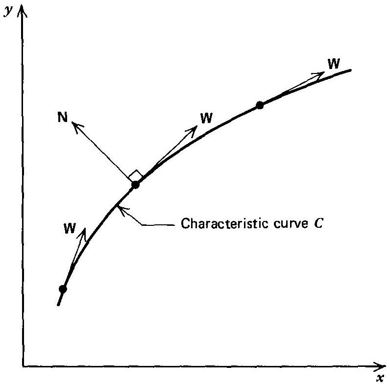
Figure 12.1 Relationship between the vectors $\mathbf{W}$ and N , and the characteristic curve $C$.

Equation 12.16 is the same as equation 12.5. The integral of equation 12.16 defines the desired characteristic along which the interior operator, defined by equation 12.13, is applicable.

It is desirable to express equation 12.13 in a form that shows explicitly that $d_{\mathbf{w}} f$ is an interior operator (i.e., a total differential relationship). For a continuous function $f(x, y)$,

$$
\frac{d f}{d x}=f_{x}+\frac{d y}{d x} f_{y}
$$

Along the characteristic $C$ specified by equation 12.16 , equation 12.17 may be written as

$$
\frac{d f}{d x}=f_{x}+\frac{b}{a} f_{y}
$$

Equation 12.13 may be rewritten in the form

$$
d_{\mathbf{w}} f=a\left(f_{x}+\frac{b}{a} f_{y}\right)=-c
$$

Substituting the left-hand side of equation 12.18 for the term in parentheses in equation 12.19 yields

$$
d_{\mathbf{w}} f=a \frac{d f}{d x}=-c
$$

Equation 12.20 may be rewritten to give

$$
a d f+c d x=0 \quad \text { (compatibility equation) }
$$

Equation 12.21 is, therefore, the desired interior operator that applies along the characteristic $C$, and is identical to equation 12.7 determined previously.

In the preceding discussions, the concept of a characteristic is developed from the three different points of view presented at the beginning of Section 12-3.

Partial differential equations for which characteristics exist are known as hyperbolic equations. The function $f(x, y)$ may be determined along a characteristic by solving the compatibility equation, equation 12.7 , which is a total differential equation relating $d f$ to $d x$ along the characteristic. Hence, the original partial differential equation, equation 12.1, may be replaced by the equivalent system of a characteristic along which a compatibility equation is valid. Such a replacement is the basis of the method of characteristics.

In the general case where the coefficients $a$ and $b$ depend on the unknown function $f$, so that $\lambda$ depends on $f$, equation 12.5 cannot be integrated until $f$ is known. However, $f$ is determined by integrating equation 12.7 along the characteristic obtained by integrating equation 12.5. In general, equations 12.5 and 12.7 must be solved simultaneously. If $a, b$, and $c$ are complicated expressions, which is ordinarily the case, it is highly probable that the integration will have to be performed numerically.

To solve equation 12.1, initial data must be specified. Figure 12.2 illustrates an initial-value line $\Gamma_{o}(x, y)$ in the $x, y$ plane along which $f(x, y)=f_{o}(x, y)$ is specified. Starting at any point $P(x, y)$ on $\Gamma_{o}$, equation 12.5 is integrated to determine the characteristic $C$ in the $x, y$ plane that passes through the initial-value point $P$. The value of the function $f$ at any selected point, such as point $Q$ on characteristic $C$, is then determined by integrating the compatibility equation 12.7 along characteristic $C$ from point $P$ to point $Q$. As stated earlier, the integration of the characteristic and compatibility equations must, in general, be performed simultaneously, and usually by numerical techniques.

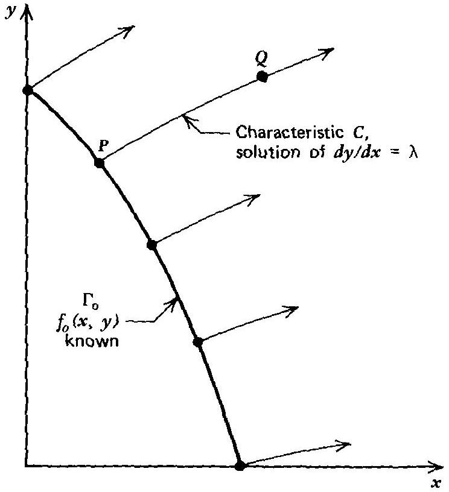
Figure 12.2 Characteristics for a first-order partial differential equation.

By selecting different points, such as point $P$ along the initial-value curve $\Gamma_{o}$, the entire $x, y$ plane may be covered with characteristics, along each of which the values of the dependent variable $f(x, y)$ may be determined. If the solution is performed numerically, then values are obtained only at discrete points. By increasing the number of points selected on the initial-value line $\Gamma_{0}$, more characteristics are extended into the $x, y$ plane. Consequently, if the spacing of those discrete points is made sufficiently close, a practically continuous distribution is obtained.

It is important to keep in mind the assumptions and restrictions that must be observed in applying the method of characteristics. It is applicable only to quasilinear hyperbolic partial differential equations. Although developed here for firstorder equations, it can be applied in some cases to higher-order equations. Otherwise, there are no restrictions on the equations. They may be both nonlinear and nonhomogenous. They are, however, subject to the important restriction that the dependent variables be continuous in the region of interest. It is mandatory that the latter condition be satisfied. It should be noted, however, that there are no restrictions on the continuity of the derivatives of the dependent variable.

In the case of a single partial differential equation, the method of characteristics is always applicable. For systems comprising more than one partial differential equation, further limitations on the applicability of the method are encountered. In Section 12-3(b), the method of characteristics is extended to a system of two equations. In Appendix B, the method is extended to a system of any number of equations.

Example 12.1. Consider the first-order partial differential equation

$$
u_{x}+2 x u_{y}-3 x^{2}=0
$$

The initial condition for $u(x, y)$ is given by

$$
u(0, y)=5 y+10
$$

Employing the method of characteristics, determine (a) the equation for the characteristic passing through the point $(2,4)$, (b) the compatability equation valid along that characteristic, and (c) the value of $u(2,4)$.

## Solution

(a) The functional relation is $u(x, y)$, and the coefficients are $a=1, b=2 x$, and $c=-3 x^{2}$. Substituting those values into equation 12.5 yields the following characteristic equation.

$$
\frac{d y}{d x}=\frac{2 x}{1}=2 x
$$

Integrating equation (c) yields

$$
y=x^{2}+C_{1}
$$

The value of the constant $C_{1}$ for the characteristic passing through the point $(2,4)$ is, from (d),

$$
4=(2)^{2}+C_{1}, \quad C_{1}=0
$$

Hence, the equation of the characteristic through the point $(2,4)$ is

$$
y=x^{2}
$$

(b) The compatability equation corresponding to the partial differential equation (a) is obtained from equation 12.7. Thus,

$$
\text { (1) } d u+\left(-3 x^{2}\right) d x=0
$$

Integrating equation (f) gives

$$
u=x^{3}+C_{2}
$$

The value of the constant $C_{2}$ for the compatability equation that is valid along the characteristic specified by equation (e) is determined from the initial condition, equation (b). The initial condition requires that the value of $y$ corresponding to $x=0$ be determined on the characteristic specified by equation (e). Hence, from equation (e),

$$
y=(0)^{2}=0
$$

From equation ( $h$ ) it follows that the characteristic passing through the point ( 2,4 ) crosses the initial-value line at the point $(0,0)$. Substituting that point into equation (b) yields

$$
u(0,0)=5(0)+10=10
$$

Substituting the initial value $u(0,0)=10$ into equation (g) gives

$$
10-(0)^{3}=C_{2}, \quad C_{2}=10
$$

Consequently, from ( g ), the compatability equation that is valid along the characteristic passing through the point $(2,4)$ is

$$
u=x^{3}+10
$$

(c) The value of $u(2,4)$ is found from equation (k). Thus,

$$
u(2,4)=(2)^{3}+10=18
$$

## 12-3(b) System of Two Partial Differential Equations

Consider a system comprised of two partial differential equations, denoted by $L_{1}$ and $L_{2}$, involving the two dependent variables $u(x, y)$ and $v(x, y)$. Thus,

$$
\begin{aligned}
& L_{1}=a_{11} u_{x}+b_{11} u_{y}+a_{12} v_{x}+b_{12} v_{y}+c_{1}=0 \\
& L_{2}=a_{21} u_{x}+b_{21} u_{y}+a_{22} v_{x}+b_{22} v_{y}+c_{2}=0
\end{aligned}
$$

In equation 12.22 the $a$ 's, $b$ 's, and $c$ 's may be functions of $x, y, u$, and $v$. It is desired to find an equivalent system of characteristic and compatability equations that may replace equations 12.22 .

Since equations 12.22 are coupled in the dependent variables $u(x, y)$ and $v(x, y)$, both equations must be considered simultaneously. To do that, form the differential operator $L$, which is a linear sum of $L_{1}$ and $L_{2}$. Thus,

$$
L=\sigma_{1} L_{1}+\sigma_{2} L_{2}=0
$$

In equation 12.23 the parameters $\sigma_{1}$ and $\sigma_{2}$ are arbitrary functions, or weighting factors, which are to be determined later. Substituting equations 12.22 into equation 12.23 and putting the result into a form that is analagous to equation 12.2 yields the following expression. Thus,

$$
\begin{aligned}
\left(a_{11} \sigma_{1}\right. & \left.+a_{21} \sigma_{2}\right)\left[u_{x}+\frac{\left(b_{11} \sigma_{1}+b_{21} \sigma_{2}\right)}{\left(a_{11} \sigma_{1}+a_{21} \sigma_{2}\right)} u_{y}\right] \\
& +\left(a_{12} \sigma_{1}+a_{22} \sigma_{2}\right)\left[v_{x}+\frac{\left(b_{12} \sigma_{1}+b_{22} \sigma_{2}\right)}{\left(a_{12} \sigma_{1}+a_{22} \sigma_{2}\right)} v_{y}\right]+\left(c_{1} \sigma_{1}+c_{2} \sigma_{2}\right)=0
\end{aligned}
$$

Since the dependent variables must be continuous,

$$
\frac{d u}{d x}=u_{x}+\lambda u_{y} \quad \text { and } \quad \frac{d v}{d x}=v_{x}+\lambda v_{y}
$$

where $\lambda=d y / d x$. The characteristics are defined as the curves having the slopes

$$
\lambda=\frac{b_{11} \sigma_{1}+b_{21} \sigma_{2}}{a_{11} \sigma_{1}+a_{21} \sigma_{2}} \quad \text { and } \quad \lambda=\frac{b_{12} \sigma_{1}+b_{22} \sigma_{2}}{a_{12} \sigma_{1}+b_{22} \sigma_{2}}
$$

Along the characteristics specified by equation 12.26 , equation 12.24 becomes

$$
\left(a_{11} \sigma_{1}+a_{21} \sigma_{2}\right) d u+\left(a_{12} \sigma_{1}+a_{22} \sigma_{2}\right) d v+\left(c_{1} \sigma_{1}+c_{2} \sigma_{2}\right) d x=0
$$

Equation 12.27 is the compatibility equation for equations 12.22.
Equations 12.26 may be rearranged with the arbitrary parameters $\sigma_{1}$ and $\sigma_{2}$ considered as the unknown variables. Thus,

$$
\begin{aligned}
& \sigma_{1}\left(a_{11} \lambda-b_{11}\right)+\sigma_{2}\left(a_{21} \lambda-b_{21}\right)=0 \\
& \sigma_{1}\left(a_{12} \lambda-b_{12}\right)+\sigma_{2}\left(a_{22} \lambda-b_{22}\right)=0
\end{aligned}
$$

For equations 12.28 to have a solution for $\sigma_{1}$ and $\sigma_{2}$ other than the trivial one $\sigma_{1}=\sigma_{2}=0$, the determinant of the coefficients of $\sigma_{1}$ and $\sigma_{2}$ must vanish. Thus,

$$
\left|\begin{array}{ll}
\left(a_{11} \lambda-b_{11}\right) & \left(a_{21} \lambda-b_{21}\right) \\
\left(a_{12} \lambda-b_{12}\right) & \left(a_{22} \lambda-b_{22}\right)
\end{array}\right|=0
$$

Expanding the determinant in equation 12.29 gives the following equation for $\lambda$.

$$
a \lambda^{2}+b \lambda+c=0
$$

In equation $12.30, a=\left(a_{11} a_{22}-a_{12} a_{21}\right), b=\left(-a_{22} b_{11}-a_{11} b_{22}+a_{12} b_{21}+\right. \left.a_{21} b_{12}\right)$, and $c=\left(b_{11} b_{22}-b_{12} b_{21}\right)$. Since $a, b$, and $c$ are functions of the coefficients of the original system of equations (equations 12.22), they are, of course, also functions of $x, y, u$, and $v$.

The type of a partial differential equation may be classified according to the magnitude of the term ( $b^{2}-4 a c$ ). If ( $b^{2}-4 a c$ ) $<0$, no real solutions exist for $\lambda$, and the characteristics are imaginary. A set of differential equations that results in imaginary
characteristics is termed elliptic. If ( $b^{2}-4 a c$ ) $=0$, one real characteristic passes through each point, and the set of differential equations is parabolic. If $\left(b^{2}-4 a c\right)>0$, two real characteristics pass through each point, and the set of differential equations is hyperbolic. The discussions that follow are restricted to hyperbolic systems of differential equations, for brevity termed hyperbolic systems [see also Section 10-10(c)].

For a hyperbolic system, equation 12.30 has two distinct roots, or solutions: $\lambda_{+}$ and $\lambda_{\text {_ }}$. Hence, there are two characteristics that satisfy the following two ordinary differential equations.

$$
\frac{d y}{d x}=\lambda_{+} \quad \text { and } \quad \frac{d y}{d x}=\lambda_{-}
$$

Since the roots $\lambda_{+}$and $\lambda_{-}$are functions of $x, y, u$, and $v$, the location of the characteristics in a specific problem depends on the particular values of $u$ and $v$. Assuming that a solution for $u$ and $v$ exists (whether known or to be determined), the equations $d y / d x=\lambda_{+}(u, v, x, y)$ and $d y / d x=\lambda_{-}(u, v, x, y)$, where $u$ and $v$ are functions of $x$ and $y$, are two ordinary differential equations of the first order that define two families of characteristics in the $x, y$ plane.

Return now to equation 12.27, which is the compatibility equation for the system. The arbitrary parameters $\sigma_{1}$ and $\sigma_{2}$ may be eliminated in terms of $\lambda_{+}$and $\lambda_{-}$by solving either of equations 12.28 for one of the $\sigma$ 's in terms of the other. That result may then be substituted into equation 12.27, and the remaining $\sigma$ may be cancelled out, since it appears in every term, thus eliminating both $\sigma_{1}$ and $\sigma_{2}$. Accordingly, two equations are obtained; one for $\lambda_{+}$and one for $\lambda_{-}$. They are the two compatibility equations relating $d u, d v, d x$, and $d y$ along the characteristics given by equations 12.31. We may, therefore, replace the original system of partial differential equations (i.e., equations 12.22 ) by equations 12.27 and 12.31 .

The integration of equations 12.31 determines two characteristics in the $x, y$ plane passing through each point thereof; one corresponding to $\lambda_{+}$and the other corresponding to $\lambda_{-}$. As in the case of a single equation [see Section 12-3(a)], initial data must either be specified or calculable along some initial-value curve $\Gamma_{o}$ lying in the $x, y$ plane. The solution is then propagated from those initial points along the characteristics into the $x, y$ plane. Along each $C_{+}$and $C_{-}$characteristic, corresponding to $\lambda_{+}$and $\lambda_{-}$, respectively, one relationship between $d u, d v, d x$, and $d y$ is provided by the compatibility equation (equation 12.27). Because that equation involves both $u$ and $v$, it alone cannot be solved for both $u$ and $v$ along a single characteristic. At the intersection of a $C_{+}$and a $C_{-}$characteristic, however, two equations relating $u$ and $v$ are available, one compatibility equation that is valid on the $C_{+}$and another that is valid on the $C_{-}$characteristic. At the point of intersection there are, therefore, sufficient relationships available for solving for both $u$ and $v$.

Figure 12.3 illustrates schematically these concepts. The initial-value line is denoted by $\Gamma_{o}$, and $u$ and $v$ are known along $\Gamma_{o}$. At each point on $\Gamma_{o}$, a $C_{+}$and a $C_{-}$characteristic may be extended out into the $x, y$ plane by integrating equation 12.27. The $C_{+}$and $C_{-}$characteristics emanating from a particular point, such as $A$, do not intersect. However, a $C_{+}$and $C_{-}$characteristic may also be extended out from point $B$. The $C_{-}$characteristic emanating from point $A$ intersects the $C_{+}$characteristic emanating from point $B$ at the point $D$. The two compatibility equations valid along $A D$ and $B D$ may therefore be solved simultaneously for $u$ and $v$ at the point $D$.

The foregoing procedure may be applied at any two points lying on $\Gamma_{o}$, up to and including the end points. A new initial-value line, denoted by $\Gamma_{1}$, is thereby produced, and along $\Gamma_{1}$ the solution is known. The entire process applied along $\Gamma_{o}$ may be repeated along $\Gamma_{1}$, yielding a second solution line $\Gamma_{2}$, etc. It is possible to continue the

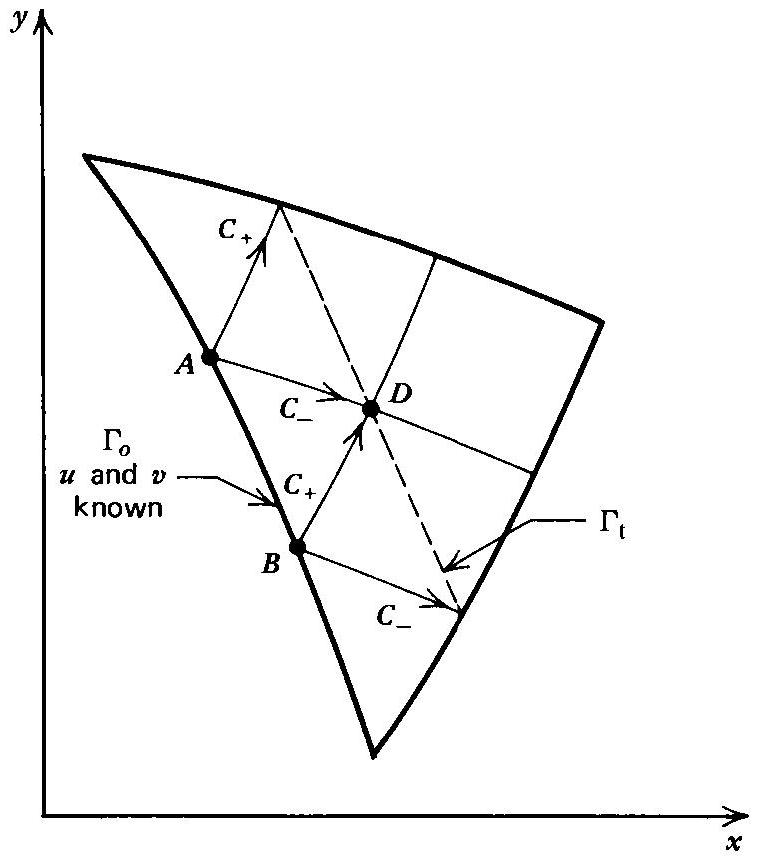
Figure 12.3 Characteristic network for two first-order partial differential equations.

process until the entire region of interest has been covered, or the full extent of the influence of the initial-value line $\Gamma_{o}$ has been reached. To continue beyond that point requires the specification of boundary data in addition to the initial data. In mathematics, an initial-value problem such as that described above is known as a Cauchy problem.

In general, because of the nonlinear nature of the original partial differential equations and the coupling between the characteristic and compatibility equations, the solution must be obtained numerically at a selected number of discrete points. By varying the point spacing along $\Gamma_{o}$, any desired number of solution points may be obtained, so that a nearly continuous solution for the dependent variables $u$ and $v$ may be approached. The following two considerations, which are pointed out in Section 12-3(a), must be kept in mind; (1) the variables $u$ and $v$ must be continuous in order that equation 12.25 be valid, a requirement that limits the applicability of the method of characteristics to regions where all of the dependent variables are continuous, but excludes regions where there are discontinuities, such as shock waves; (2) no restrictions are placed on the derivatives of the dependent variables.

## 12-3(c) Domain of Dependence and Range of Influence

The considerations presented in Section 12-3(b) lead to the concepts of a domain of dependence and a range of influence.

Figure 12.4 illustrates the domain of dependence of a point $P$, plotted in the $x y$ plane. It is the region in the $x y$ plane bounded by the outermost characteristics from the initial-value line $\Gamma_{o}$ that pass through the point $P$. Thus, it is the region wherein the solution of the initial-value problem may be obtained.

Figure 12.5 illustrates the range of influence of a point $Q$ located on the initial-value line $\Gamma_{o}$. It is the region in the $x y$ plane containing all of the points that are influenced by the initial data at point $Q$. The range of influence is composed of all of the points having a domain of dependence containing the point $Q$. It is, therefore, the region between the two outermost characteristics passing through point $Q$.

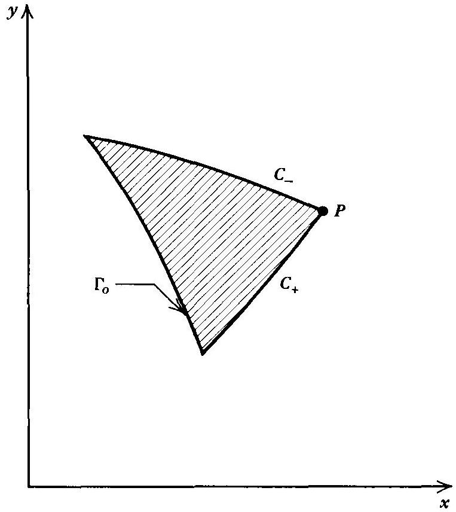
Figure 12.4 Domain of dependence.

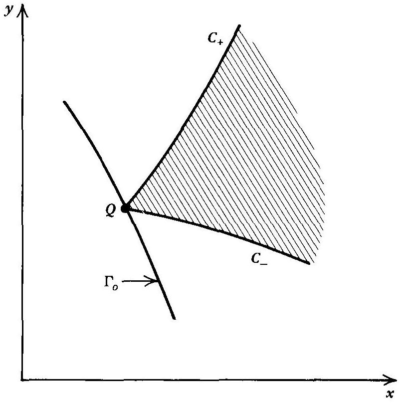
Figure 12.5 Range of influence.

For a solution to be possible, the initial-value line cannot be a characteristic at any place unless the initial data are given along two intersecting characteristic curves. The latter type of problem is known as the Goursat problem. Several types of domains having different types of initial-value lines may be analyzed. The present discussion is concerned, however, only with such domains in which no part of the initial-value line is a characteristic.

By applying the method of characteristics as developed in the foregoing, it is possible to solve many complicated systems of partial differential equations, provided the system is quasi-linear and hyperbolic. Equations of the latter type are encountered frequently in fluid flow problems.

## 12-4 APPLICATION TO STEADY TWO-DIMENSIONAL, PLANAR AND AXISYMMETRIC, IRROTATIONAL SUPERSONIC FLOW

The general theory of the method of characteristics is now applied to develop a numerical procedure for analyzing the flow field for a steady two-dimensional, planar and axisymmetric, irrotational supersonic flow. It is shown that the characteristics, as stated at the beginning of Section 12-3, are Mach lines, and that there are sufficient compatibility equations for replacing the original system of governing partial differential equations.

A complete numerical algorithm, called a unit process, is developed for an interior point of the flow. A numerical example is presented illustrating the application of the unit process for an interior point of a supersonic flow field.

## 12-4(a) Governing Equations

The equations governing the steady two-dimensional, planar and axisymmetric, irrotational flow of a compressible fluid are the gas dynamic equation (equation 10.193), the irrotationality condition (equation 10.189), and the speed of sound relationship (equation 10.121). Those equations are summarized in Table 12.1.

Table 12.1 Governing Equations for Steady Two-Dimensional Irrotational Flow

$$
\begin{aligned}
& \left(u^{2}-a^{2}\right) u_{x}+\left(v^{2}-a^{2}\right) v_{y}+2 u v u_{y}-\frac{\delta a^{2} v}{y}=0 \\
& u_{y}-v_{x}=0 \\
& a=a(V)=a(u, v) \quad(\text { throughout the flow field })
\end{aligned}
$$

In equation 10.193, $\delta=0$ for planar flow, and $\delta=1$ for axisymmetric flow.
Equation 10.121 is obtained from the general thermodynamic properties of a homenergetic flow, and it places no restrictions on the specific thermal and caloric equations of state for the fluid [see Section 10-9(a)]. All that is required is that the functional relationship $a=a(V)$ be known. It may be algebraic, as in equation 3.84 for a perfect gas, or in tabular form, as in the case of either a frozen gas mixture with variable specific heats, or an equilibrium gas mixture having a variable composition and variable specific heats (see Sections 14-4 and 14-5).

## 12-4(b) Characteristic Equation

The procedure presented in Section 12-3(b) is now applied to the system of two partial differential equations comprising equations 10.193 and 10.189. Multiplying those two equations by the unknown parameters $\sigma_{1}$ and $\sigma_{2}$, respectively, and adding the result gives the following equation, which is analogous to equation 12.23. Thus,

$$
\sigma_{1}(\text { equation } 10.193)+\sigma_{2}(\text { equation } 10.189)=0
$$

Substituting equations 10.193 and 10.189 into the above equation yields

$$
\begin{aligned}
u_{x}\left[\sigma_{1}\left(u^{2}-a^{2}\right)\right]+u_{y}\left[\sigma_{1}(2 u v)+\right. & \left.\sigma_{2}\right]+v_{x}\left[-\sigma_{2}\right] \\
& +v_{y}\left[\sigma_{1}\left(v^{2}-a^{2}\right)\right]+\left[-\sigma_{1} \delta a^{2} v / y\right]=0
\end{aligned}
$$

Factoring out the coefficients of the partial derivatives of $u$ and $v$ in the $x$ direction, and rearranging, the following expression is obtained.

$$
\begin{aligned}
\sigma_{1}\left(u^{2}-a^{2}\right)\left[u_{x}+\frac{\sigma_{1}(2 u v)+\sigma_{2}}{\sigma_{1}\left(u^{2}-a^{2}\right)} u_{y}\right] & \\
& +\left(-\sigma_{2}\right)\left[v_{x}+\frac{\sigma_{1}\left(v^{2}-a^{2}\right)}{-\sigma_{2}} v_{y}\right]-\frac{\sigma_{1} \delta a^{2} v}{y}=0
\end{aligned}
$$

From equation 12.25, if $u(x, y)$ and $v(x, y)$ are assumed to be continuous functions then

$$
\frac{d u}{d x}=u_{x}+\lambda u_{y} \quad \text { and } \quad \frac{d v}{d x}=v_{x}+\lambda v_{y}
$$

where, as before, $\lambda=d y / d x$. In accordance with equation 12.26, the characteristics corresponding to equation 12.33 have the slopes $\lambda$ that are equal to the coefficients of $u_{y}$ and $v_{y}$ in equation 12.33. Thus

$$
\lambda=\frac{\sigma_{1}(2 u v)+\sigma_{2}}{\sigma_{1}\left(u^{2}-a^{2}\right)} \quad \text { and } \quad \lambda=\frac{\sigma_{1}\left(v^{2}-a^{2}\right)}{-\sigma_{2}}
$$

Substituting equations 12.34 and 12.35 into equation 12.33 transforms the latter to read as follows.

$$
\sigma_{1}\left(u^{2}-a^{2}\right) d u-\sigma_{2} d v-\left(\frac{\sigma_{1} \delta a^{2} v}{y}\right) d x=0
$$

Equation 12.36 is analogous to equation 12.27, and is a total differential equation. Accordingly, it is the compatibility equation corresponding to the system of equations 10.193 and 10.189. Equation 12.36 is valid when $\lambda$ is given by equations 12.35.

It remains to derive expressions for $\lambda$ and to eliminate the unknown parameters $\sigma_{1}$ and $\sigma_{2}$ from equation 12.36. Equations 12.35 may be rewritten in the following forms. Thus,

$$
\begin{array}{r}
\sigma_{1}\left[\left(u^{2}-a^{2}\right) \lambda-2 u v\right]+\sigma_{2}(-1)=0 \\
\sigma_{1}\left(v^{2}-a^{2}\right)+\sigma_{2}(\lambda)=0
\end{array}
$$

Equations 12.37 are analogous to equations 12.28. Accordingly, the solution for $\sigma_{1}$ and $\sigma_{2}$, other than the trivial one $\sigma_{1}=\sigma_{2}=0$, requires that the determinant of the coefficients of $\sigma_{1}$ and $\sigma_{2}$ vanish; that is,

$$
\left|\begin{array}{lr}
{\left[\left(u^{2}-a^{2}\right) \lambda-2 u v\right]} & -1 \\
\left(v^{2}-a^{2}\right) & \lambda
\end{array}\right|=0
$$

Expanding the determinant and setting it equal to zero yields

$$
\left(u^{2}-a^{2}\right) \lambda^{2}-2 u v \lambda+\left(v^{2}-a^{2}\right)=0
$$

Equation 12.39 is analogous to equation 12.30.
Solving equation 12.39 for the values of $\lambda$ along which equation 12.36 is valid yields

$$
\lambda_{ \pm}=\left(\frac{d y}{d x}\right)_{ \pm}=\frac{u v \pm a^{2} \sqrt{M^{2}-1}}{u^{2}-a^{2}}
$$

Equation 12.40 yields two results for $\lambda$, denoted by the subscripts + and - , corresponding to the positive and negative signs, respectively, preceding the square root sign. Those two ordinary differential equations specify two curves in the $x, y$ plane, which are the characteristics, and they are real when the Mach number $M>1$. Consequently, the method of characteristics is applicable to a steady two-dimensional, planar and axisymmetric, supersonic flow, but not to a subsonic flow.

From the geometries presented in Figs. 12.6 and 12.7, an alternate form of equation 12.40 may be obtained by expressing $u$ and $v$ in terms of the velocity magnitude $V$ and the flow or streamline angle $\theta$, and by expressing $M$ in terms of the Mach angle $\alpha$. From Fig. 12.6,

$$
u=V \cos \theta, \quad v=V \sin \theta, \quad \theta=\tan ^{-1}\left(\frac{v}{u}\right)
$$

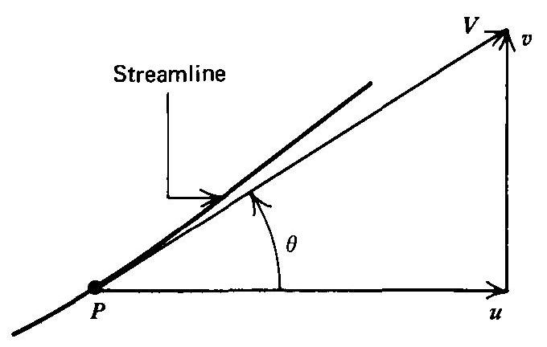
Figure 12.6 Relationship between the velocity components $u$ and $v$, and the velocity magnitude $V$ and the flow angle $\theta$.

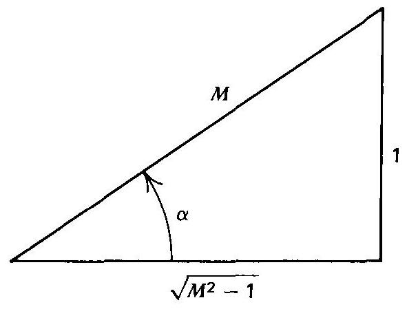
Figure 12.7 Relationship between the Mach angle $\alpha$ and the Mach number $M$.

From Fig. 12.7,

$$
\alpha=\sin ^{-1}\left(\frac{1}{M}\right), \quad M=\operatorname{cosec} \alpha, \quad \sqrt{M^{2}}-1=\cot \alpha
$$

Substituting equations 12.41 and 12.42 into equation 12.40 gives

$$
\begin{aligned}
& \lambda_{ \pm}=\frac{V^{2} \sin \theta \cos \theta \pm a^{2} \cot \alpha}{V^{2} \cos ^{2} \theta-a^{2}}=\frac{\sin \theta \cos \theta \pm \cot \alpha\left(1 / M^{2}\right)}{\cos ^{2} \theta-\left(1 / M^{2}\right)} \\
& \lambda_{ \pm}=\frac{\sin \theta \cos \theta \pm \cot \alpha \sin ^{2} \alpha}{\cos ^{2} \theta-\sin ^{2} \alpha}=\frac{\sin \theta \cos \theta \pm \sin \alpha \cos \alpha}{\cos ^{2} \theta-\sin ^{2} \alpha}
\end{aligned}
$$

Applying the standard trigonometric identities, equation 12.44 becomes

$$
\left(\frac{d y}{d x}\right)_{ \pm}=\lambda_{ \pm}=\tan (\theta \pm \alpha)
$$

where $\theta$ is the flow angle and $\alpha$ is the Mach angle.
Figure 12.8 illustrates the geometry of the $C_{+}$and $C_{-}$characteristics in the $x y$ plane. It shows that the $C_{+}$and $C_{-}$characteristics are symmetrical about the streamline, making the angles $+\alpha$ and $-\alpha$, respectively, with respect to the streamline angle $\theta$; that is, the angle made by the tangent to the streamline at point $P$ with the $x$ axis. The property of a characteristic, it will be recalled, is that it is a curve along which information at a point in a flow field is propagated into the downstream region of the flow field. It is evident that for the case illustrated in Fig. 12.8, the

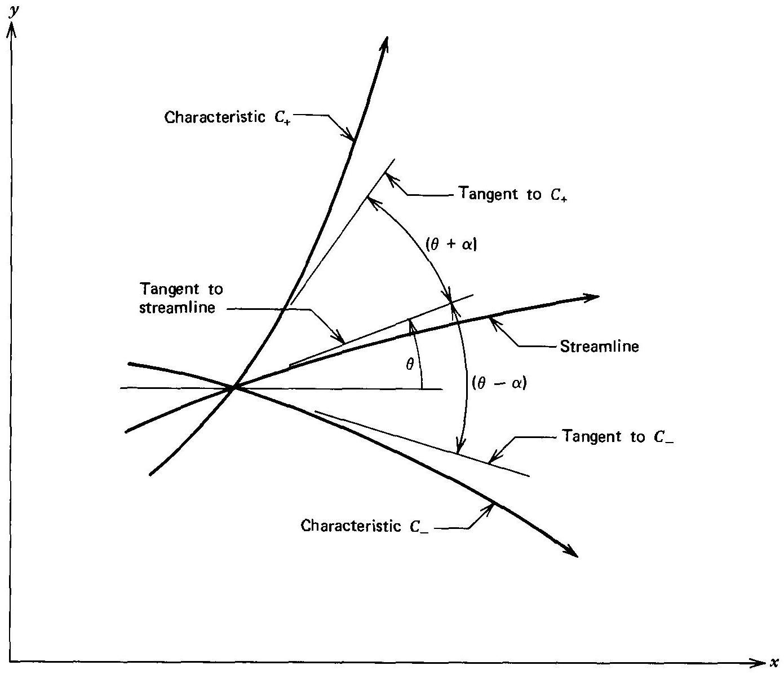
Figure 12.8 Characteristics as the Mach lines at a point in a flow field.

information at point $P$ influences the region located between the $C_{+}$and $C_{-}$characteristics. The latter are identical to the Mach lines [discussed in Section 3-8(b)]. Hence, the characteristics have both a physical and a mathematical significance; they are the carriers of information throughout a supersonic flow field.

## 12-4(c) Compatibility Equation

Equation 12.36 is the compatibility equation for the supersonic flow being studied. It governs the relationship between $u$ and $v$ along a characteristic (Mach line). To apply equation 12.36 , the parameters $\sigma_{1}$ and $\sigma_{2}$ must be eliminated, which is accomplished by solving equation 12.37 for $\sigma_{2}$ in terms of $\sigma_{1}$. Thus,

$$
\sigma_{2}=\sigma_{1}\left[\left(u^{2}-a^{2}\right) \lambda-2 u v\right]
$$

and

$$
\sigma_{2}=-\sigma_{1} \frac{v^{2}-a^{2}}{\lambda}
$$

Equations 12.46 are not independent, as may be seen by substituting equation 12.39 into either one of the equations 12.46 to obtain the other. Thus, either of the equations 12.46 may be substituted into equation 12.36 to eliminate $\sigma_{1}$ and $\sigma_{2}$.

Substituting the first of equations 12.46 into equation 12.36 and dividing by $\sigma_{1}$ yields the following result (recall that $\sigma_{1}$ cannot be zero if equation 12.38 is valid).

$$
\left(u^{2}-a^{2}\right) d u_{ \pm}+\left[2 u v-\left(u^{2}-a^{2}\right) \lambda_{ \pm}\right] d v_{ \pm}-\left(\frac{\delta a^{2} v}{y}\right) d x_{ \pm}=0
$$

The subscript $\pm$ indicates that the differentials $d u, d v$, and $d x$, are to be evaluated along the $C_{+}$or $C_{-}$characteristic, respectively; the corresponding slope is $\lambda \pm$. Substituting the second of equations 12.46 into equation 12.36 yields

$$
\left(u^{2}-a^{2}\right) d u_{ \pm}+\left(v^{2}-a^{2}\right) \lambda_{ \pm}^{-1} d v_{ \pm}-\left(\frac{\delta a^{2} v}{y}\right) d x_{ \pm}=0
$$

Equations 12.47 and 12.48 are not independent equations, but merely two different forms of the single compatibility equation valid on each of the characteristics. Substituting equation 12.45 into equation 12.47 yields yet another equivalent form of the compatibility equation. Thus

$$
d u_{ \pm}+\lambda_{\mp} d v_{ \pm}-\delta\left(\frac{a^{2} v}{y}\right) d x_{ \pm}=0
$$

In equation 12.49, the inverted $\mp$ on $\lambda$ indicates that when $d u, d v$, and $d x$ are calculated along a $C_{+}$characteristic, the value of $\lambda$, the coefficient of $d v$, is that for the local $C_{-}$ characteristic, and vice versa along the $C_{-}$characteristic. In other words, when the upper subscripts of the differentials are chosen, the upper subscript of $\lambda$ is applicable, and vice versa.

Equation 12.47 is employed for developing a numerical procedure for determining the flow properties of a supersonic flow field. For completing the discussion of the compatibility equation, however, two of its other forms are mentioned. If equation 12.40 for $\lambda_{ \pm}$is substituted into either equation 12.47 or 12.48 , the following form of the compatibility equation is obtained.

$$
\left(\frac{d v}{d u}\right)_{ \pm}=\frac{u v \pm a^{2} \sqrt{M^{2}-1}}{a^{2}-v^{2}}-\delta \frac{a^{2} v}{a^{2}-v^{2}} \frac{1}{y}\left(\frac{d y}{d u}\right)_{ \pm}
$$

Substituting the definitions of $V, \theta$, and $\alpha$, given by equations 12.41 and 12.42, into equation 12.50 converts the compatibility equation to the following form.

$$
\frac{1}{V}\left(\frac{d V}{d \theta}\right)_{ \pm}= \pm \tan \alpha+\delta \frac{\sin \alpha \tan \alpha \sin \theta}{\sin \left(\theta_{\mp} \alpha\right)} \frac{1}{y}\left(\frac{d y}{d \theta}\right)_{ \pm}
$$

The order of the signs, $\pm$, in equations 12.50 and 12.51 is important. For example, in equation 12.51, if the positive, or upper, subscript of the differentials $(d V / d \theta)$ is chosen, the upper signs must be chosen for the remaining terms [i.e., $+\tan \alpha$, $\sin (\theta-\alpha)$, and $\left.(d y / d \theta)_{+}\right]$, and vice versa.

Any one of equations 12.47 to 12.51 may be employed as the compatibility equation that is valid along the characteristics for a steady two-dimensional, planar and axisymmetric, irrotational supersonic flow. In the finite difference algorithms presented in Section 12-5, equation 12.47 is employed. Table 12.2 presents the aforementioned characteristic and compatibility equations.

Table 12.2 Characteristic and Compatibility Equations for Steady Two-Dimensional Irrotational Supersonic Flow

## Characteristic equation

$$
\left(\frac{d y}{d x}\right)_{ \pm}=\lambda_{ \pm}=\tan (\theta \pm \alpha) \quad \text { (Mach lines) }
$$

Compatibility eqnation

$$
\left(u^{2}-a^{2}\right) d u_{ \pm}+\left[2 u v-\left(u^{2}-a^{2}\right) \lambda_{ \pm}\right] d v_{ \pm}-\left(\delta a^{2} v / y\right) d x_{ \pm}=0 \quad \text { (along Mach lines) }
$$

## 12-5 NUMERICAL IMPLEMENTATION OF THE METHOD OF CHARACTERISTICS

In Section 12-4, the characteristic and compatibility equations are derived for a steady two-dimensional irrotational supersonic flow. In the present section, a numerical procedure is developed for solving those equations. The general features of the numerical integration algorithm, the modified Euler predictor-corrector method, are discussed, and the finite difference equations are determined.

## 12-5(a) Numerical Integration Procedure

Equation 12.45 defines one $C_{+}$and one $C_{-}$characteristic (i.e., two Mach lines) in the $x y$ plane, while the compatibility equation, equation 12.47 , provides a differential relationship between the velocity components $u$ and $v$ that is valid along each characteristic. Equations 12.45 and 12.47 are nonlinear total differential equations, and their solutions are obtained by applying finite difference techniques.

Note that equation 12.45 defines two characteristics passing through each point in the flow field. Equation 12.47 specifies one relationship between the velocity components $u$ and $v$ on each of the two characteristics. To obtain two independent relationships between $u$ and $v$ at a point in the flow field, a network must be devised wherein two characteristics intersect at a common point. At the point of intersection, there is one relationship between $u$ and $v$ on each of the intersecting characteristics, so that two relationships between $u$ and $v$ are obtained at that point. Figure 12.9 illustrates a network wherein the $C_{-}$characteristic through point 1 and the $C_{+}$ characteristic through point 2 intersect at point 4 , thus permitting the simultaneous application of the compatibility equation (equation 12.47) at point 4 , the point of

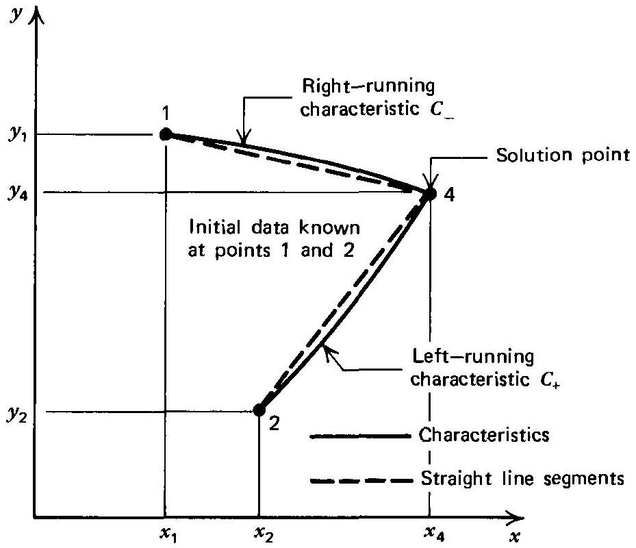
Figure 12.9 Finite difference network for applying the method of characteristics to a steady two-dimensional irrotational supersonic flow.

intersection, which is an interior point. The procedure must be modified to obtain the flow properties at a wall point, an axis point, and a free pressure boundary point (see Section 16-3)

In general, a finite difference method is employed for integrating equations 12.45 and 12.47. Consequently, in constructing the finite difference grid, or network, the portion of a characteristic connecting two points of the grid, such as points 1 and 4 and points 2 and 4 in Fig. 12.9, is replaced by dashed straight lines, the slope of the dashed line being determined in an average sense between the endpoints of the pertinent segment of the characteristic.

The numerical method employed in the present section for integrating equations 12.45 and 12.47 is the modified Euler predictor-corrector method ${ }^{8,9}$ [see Appendix A-6(e)], which is a second-order method for integrating total differential equations. The corrector algorithm presented in Appendix $\mathrm{A}-6(\mathrm{e})$ is based on the average coefficient method, wherein the numerical values of the coefficients of the differential equations are determined as the average of the values of the coefficients at the initial points and the solution point. Hoffman ${ }^{10}$ showed that more accurate results are obtained by employing a corrector algorithm based on the average property method, wherein the numerical values of the coefficients of the differential equations are determined based on the average values of the properties at the initial points and the solution point. The basic features of the modified Euler predictor-corrector algorithm based on the average property method are summarized below.

Consider the ordinary differential equation

$$
\frac{d y}{d x}=f(x, y)
$$

which may be rewritten in the form

$$
d y=f(x, y) d x
$$

The problem is to integrate equation 12.53 numerically from a known starting point $i$, designated as $\left(x_{i}, y_{i}\right)$, where $y_{i}=y\left(x_{i}\right)$. A predicted value of the solution at $x_{i+1}= x_{i}+\Delta x$, denoted by $y^{\circ}\left(x_{i}+\Delta x\right)=y_{i+1}^{0}$, is obtained from the Euler predictor algo-
rithm [see Appendix A-6(c)], termed the predictor for brevity. Thus,

$$
y_{i+1}^{0}=y_{i}+f\left(x_{i}, y_{i}\right) \Delta x \quad \text { (predictor algorithm) }
$$

where $\Delta x$ is the step size of the finite difference algorithm. It is shown in Appendix A-6(c), that the accumulated error for successive applications of the Euler predictor algorithm varies linearly with the step size $\Delta x$.

The accuracy of the solution obtained by the Euler predictor may be improved by employing $y_{i}$ and $y_{i+1}^{0}$ for estimating the value of $y_{i+1 / 2}=y\left(x_{i}+\Delta x / 2\right)$, and then replacing $f\left(x_{i}, y_{i}\right)$ in equation 12.54 by the value of $f(x, y)$ determined at the midpoint of the interval. Thus,

$$
y_{i+1}^{1}=y_{i}+f\left(x_{i}+\frac{\Delta x}{2}, \frac{y_{i}+y_{i+1}^{0}}{2}\right) \Delta x \quad \text { (corrector algorithm) }
$$

where $y_{i+1}^{1}=y^{1}\left(x_{i}+\Delta x\right)$ is the corrected value of the solution at $x_{i+1}$. Equation 12.55 is termed the corrector algorithm, or for brevity the corrector. In Appendix A-6(e) it is shown that the accumulated error for the corrector is second order in step size, and the solution converges rapidly with a reduction in the step size.*

The predictor-corrector method may be further refined by replacing the predictor value $y_{i+1}^{0}$ in equation 12.55 by the corrector value $y_{i+1}^{1}$, and repeating equation 12.55 , thus obtaining $y_{i+1}^{2}$; where the superscript 2 denotes the second application of the corrector algorithm. Continued application of this procedure leads to the following algorithm.

$$
y_{i+1}^{n}=y_{i}+f\left(x_{i}+\frac{\Delta x}{2}, \frac{y_{i}+y_{i+1}^{n-1}}{2}\right) \Delta x \quad\binom{\text { corrector algorithm }}{\text { with interation }}
$$

where $y_{i+1}^{n}$ is the value of $y$ after $n$ applications of the corrector. Equation 12.56 is known as the modified Euler predictor-corrector method with interation.

Considerations of numerical stability generally place an upper limit on the allowable step size $\Delta x$. For isentropic flows, the permissible maximum step size is so large that it is rarely a consideration in the numerical computations. There is no assurance, however, that the iteration indicated in equation 12.56 is worthwhile. In many cases, a single application of the corrector may yield a sufficiently accurate result. Some accuracy studies illustrating the foregoing remarks are presented in Section 17-6.

## 12-5(b) Direct and Inverse Marching Methods

In the preceding section, the general features of the modified Euler integration method are discussed. Two different procedures for applying that method for the integration of the characteristic and compatibility equations are possible: the direct marching method and the inverse marching method. Figure 12.10 illustrates schematically the direct marching method, and Fig. 12.11 illustrates the inverse marching method.

In the direct marching method, continuous families of left- and right-running characteristics are followed throughout the flow field. By applying the unit processes directly from any two solution points previously determined, such as points 1 and 2 in Fig. 12.10, the next point in the network (i.e., point 4) may be determined.

In the inverse marching method, the solution is obtained on successive lines, termed solution lines, which are not characteristics. Typically, those lines are perpendicular to the mean flow direction, such as lines $A B$ and $C D$ in Fig. 12.11. The points at which the fluid properties are to be determined on a solution line, such as line $A B$ in

[^0]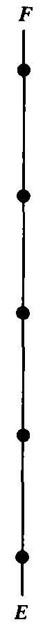

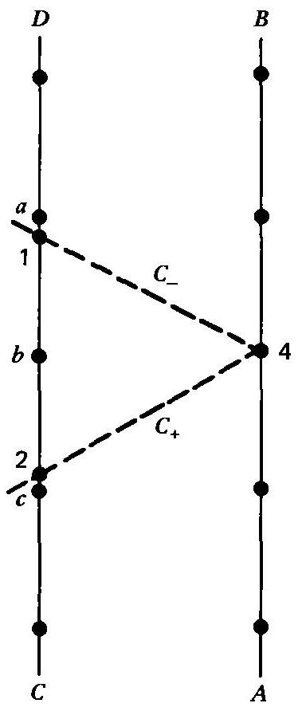
Figure 12.11 Inverse marching method.

Figure 12.10 Direct marching method.

Fig. 12.11, are prespecified in some prescribed manner (e.g., equally spaced across the flow field). The unit processes are then obtained by projecting rearward-running characteristics from a point on the solution line, such as point 4 , to intersect the previous solution line, denoted by $C D$. The fluid properties at points 1 and 2 are found by interpolation along the known solution line $C D$. To insure numerical stability, the interpolating functions must include points located outside of the intersections of the rearward-running characteristics and the last known solution line as, for example, the points $a$ and $b$ on the solution line $C D$. In general, the location of the points of intersection, points 1 and 2 , are determined by iteration.

The direct marching method has the obvious advantage that the location of points 1 and 2, and the flow properties at those points, are known without iteration and interpolation. The inverse marching method has a slight advantage in the computational logic, however, because the number and the location of the solution points may be specified beforehand. In general, the direct marching method is the more accurate of the two methods.

## 12-5(c) Finite Difference Equations

Figure 12.9 illustrates schematically the finite difference grid for the unit process for determining the flow properties at an interior point. As noted earlier in Section 12-5, in constructing the finite difference grids for applying the numerical integration algorithm, the portion of a characteristic curve connecting two points in the network is replaced by a straight dashed line connecting those points.

Table 12.3 presents the finite difference equations corresponding to the characteristic and compatibility equations presented in Table 12.2, where the subscripts + and - denote left- and right-running characteristics, respectively. According to the Euler method, the finite difference equations are obtained from the differential equations by replacing the differentials $d x, d y, d u$, and $d v$ by the differences $\Delta x, \Delta y, \Delta u$, and $\Delta v$. The coefficients $\lambda, Q, R$, and $S$ are then determined at the initial points for the predictor and in an average manner (either average property or average coefficient) for the corrector.

Table 12.3 Finite Difference Equations for Steady Two-Dimensional Irrotational Supersonic Flow

$$
\begin{aligned}
& \Delta y_{ \pm}=\lambda_{ \pm} \Delta x_{ \pm} \\
& Q_{ \pm} \Delta u_{ \pm}+R_{ \pm} \Delta v_{ \pm}-S_{ \pm} \Delta x_{ \pm}=0 \\
& \lambda_{ \pm}=\tan (\theta \pm \alpha) \\
& Q=u^{2}-a^{2} \\
& R=2 u v-\left(u^{2}-a^{2}\right) \lambda \\
& S=\delta \frac{a^{2} v}{y} \\
& + \text { or }- \text { denotes } C_{+} \text {or } C_{-} \text {characteristic, respectively }
\end{aligned}
$$

## 12-5(d) Unit Process for an Interior Point

A point located in the interior of a supersonic flow field, such as point 4 in Fig. 12.10, is termed an interior point. The finite difference grid for determining the location of point 4 and the fluid properties at that point is illustrated schematically in Fig. 12.9. The interior point (point 4) is located at the intersection of the $C_{-}$and $C_{+}$characteristics emanating into the flow field from the initial-value points 1 and 2 , respectively. The locations of points 1 and 2, as well as the flow properties at those points, are assumed to be known; points 1 and 2 are termed initial-value points. The problem is to develop a method for establishing the location and flow properties at the interior point (point 4) from the known data at the initial-value points (points 1 and 2).

The problem is solved by integrating the two characteristic equations, equations 12.45 , to obtain the characteristics 14 and 24 , integrating the two compatibility equations, equations 12.47 , which are valid along the characteristics 14 and 24 , and solving the four resulting difference equations simultaneously for $x_{4}, y_{4}, u_{4}$, and $v_{4}$.

The application of the numerical method of analysis discussed in Section 12-5(a) for determining the location and flow properties at an interior point of a supersonic flow field is discussed here in general terms. The purpose is to describe the analytic method without complicating its description with the details of the pertinent numerical processes. Example 12.2 illustrates the calculation procedure in its entirety.

The location of the solution point, point 4, is determined by writing equation 12.57 of Table 12.3 in finite difference form in terms of points 1,2 , and 4 . Thus,

$$
\begin{aligned}
& \left(y_{4}-y_{2}\right)=\lambda_{+}\left(x_{4}-x_{2}\right) \\
& \left(y_{4}-y_{1}\right)=\lambda_{-}\left(x_{4}-x_{1}\right)
\end{aligned}
$$

Equations 12.63 and 12.64 may be rewritten as

$$
\begin{aligned}
& y_{4}-\lambda_{+} x_{4}=y_{2}-\lambda_{+} x_{2} \\
& y_{4}-\lambda_{-} x_{4}=y_{1}-\lambda_{-} x_{1}
\end{aligned}
$$

Equations 12.65 and 12.66 may be solved simultaneously for $x_{4}$ and $y_{4}$. The slopes $\lambda_{+}$and $\lambda_{-}$in equations 12.65 and 12.66 are given by equation 12.59. Thus,

$$
\lambda_{+}=\tan \left(\theta_{+}+\alpha_{+}\right) \quad \text { and } \quad \lambda_{-}=\tan \left(\theta_{-}-\alpha_{-}\right)
$$

where

$$
\theta_{ \pm}=\tan ^{-1}\left(\frac{v_{ \pm}}{u_{ \pm}}\right)
$$

$$
\begin{aligned}
V_{ \pm} & =\sqrt{u_{ \pm}^{2}+v_{ \pm}^{2}} \\
a_{ \pm} & =a\left(V_{ \pm}\right) \quad(\text { from equation } 10.121) \\
M_{ \pm} & =\frac{V_{ \pm}}{a_{ \pm}} \\
\alpha_{ \pm} & =\sin ^{-1}\left(\frac{1}{M_{ \pm}}\right)
\end{aligned}
$$

Consequently, both $\theta_{ \pm}$and $\alpha_{ \pm}$, and hence $\lambda_{ \pm}$, may be determined for specified values of $u_{ \pm}$and $v_{ \pm}$.

The compatibility equation, equation 12.58 of Table 12.3, when expressed in finite difference form in terms of points 1,2 , and 4 , yields

$$
\begin{aligned}
& Q_{+}\left(u_{4}-u_{2}\right)+R_{+}\left(v_{4}-v_{2}\right)-S_{+}\left(x_{4}-x_{2}\right)=0 \\
& Q_{-}\left(u_{4}-u_{1}\right)+R_{-}\left(v_{4}-v_{1}\right)-S_{-}\left(x_{4}-x_{1}\right)=0
\end{aligned}
$$

Equations 12.73 and 12.74 may be rewritten as

$$
\begin{aligned}
& Q_{+} u_{4}+R_{+} v_{4}=T_{+} \\
& Q_{-} u_{4}+R_{-} v_{4}=T_{-}
\end{aligned}
$$

where

$$
\begin{aligned}
& T_{+}=S_{+}\left(x_{4}-x_{2}\right)+Q_{+} u_{2}+R_{+} v_{2} \\
& T_{-}=S_{-}\left(x_{4}-x_{1}\right)+Q_{-} u_{1}+R_{-} v_{1}
\end{aligned}
$$

Equations 12.75 and 12.76 may be solved simultaneously for $u_{4}$ and $v_{4}$. The coefficients appearing in equations 12.75 and 12.76 are given by

$$
\begin{aligned}
& Q_{+}=\left(u_{+}^{2}-a_{+}^{2}\right) \\
& R_{+}=\left(2 u_{+} v_{+}-Q_{+} \lambda_{+}\right) \\
& S_{+}=\delta \frac{a_{+}^{2} v_{+}}{y_{+}} \\
& Q_{-}=\left(u_{-}^{2}-a_{-}^{2}\right) \\
& R_{-}=\left(2 u_{-} v_{-}-Q_{-} \lambda_{-}\right) \\
& S_{-}=\delta \frac{a_{-}^{2} v_{-}}{y_{-}}
\end{aligned}
$$

Consequently, $Q_{ \pm}, R_{ \pm}$, and $T_{ \pm}$may be determined for specified values of $u_{ \pm}, v_{ \pm}$, and $y_{ \pm}$.

Table 12.4 presents the computational equations for steady two-dimensional irrotational supersonic flow.

Table 12.4 Computational Equations for Steady Two-Dimensional Irrotational Supersonic Flow

$$
\begin{aligned}
& y_{4}-\lambda_{+} x_{4}=y_{2}-\lambda_{+} x_{2} \\
& y_{4}-\lambda_{-} x_{4}=y_{1}-\lambda_{-} x_{1} \\
& Q_{+} u_{4}+R_{+} v_{4}=T_{+} \\
& Q_{-} u_{4}+R_{-} v_{4}=T_{-}
\end{aligned}
$$

For the Euler predictor algorithm, the values of $u_{ \pm}, v_{ \pm}$, and $y_{ \pm}$are given by

$$
\begin{array}{lll}
u_{+}=u_{2} & v_{+}=v_{2} & y_{+}=y_{2} \\
u_{-}=u_{1} & v_{-}=v_{1} & y_{-}=y_{1}
\end{array}
$$

Substituting those values into the computational equations and solving those equations simultaneously yields the predicted values $x_{4}{ }^{0}, y_{4}{ }^{0}, u_{4}{ }^{0}$, and $v_{4}{ }^{0}$.

For the Euler corrector algorithm, the values of $u_{ \pm}, v_{ \pm}$, and $y_{ \pm}$are given by

$$
\begin{array}{lll}
u_{+}=\frac{u_{2}+u_{4}}{2} & v_{+}=\frac{v_{2}+v_{4}}{2} & y_{+}=\frac{y_{2}+y_{4}}{2} \\
u_{-}=\frac{u_{1}+u_{4}}{2} & v_{-}=\frac{v_{1}+v_{4}}{2} & y_{-}=\frac{y_{1}+y_{4}}{2}
\end{array}
$$

The average values of $\theta_{ \pm}, V_{ \pm}, a_{ \pm}, M_{ \pm}$, and $\alpha_{ \pm}$are determined by substituting the above values of $u_{ \pm}$and $v_{ \pm}$into equations 12.68 to 12.72 . Substituting those values into the computational equations and solving those equations simultaneously yields the corrected values $x_{4}{ }^{1}, y_{4}{ }^{1}, u_{4}{ }^{1}$, and $v_{4}{ }^{1}$.

The Euler corrector algorithm with iteration (equation 12.56) is applied next to improve the accuracy of the solution values. To accomplish that objective, the results of the previous corrector (i.e., $x_{4}{ }^{1}, y_{4}{ }^{1}, u_{4}{ }^{1}$, and $v_{4}{ }^{1}$ ) are substituted into the computational equations so that new values are obtained for the average properties $u_{ \pm}, v_{ \pm}$, etc. The corrector algorithm is then repeated employing those average values of the properties, thereby obtaining a second set of corrector values, $x_{4}{ }^{2}, y_{4}{ }^{2}, u_{4}{ }^{2}$, and $v_{4}{ }^{2}$. The iteration algorithm may be applied as many times as is required for obtaining the desired degree of convergence. The determinations for convergence after $n$ applications of the corrector are made as follows.

$$
\left|P^{n}-P^{n-1}\right| \leqq \text { (specified tolerance) }
$$

where $P$ represents $x_{4}, y_{4}, u_{4}$, and $v_{4}$. Typical values of the tolerance are 0.0001 m for $x_{4}$ and $y_{4}$ and $0.1 \mathrm{~m} / \mathrm{s}$ for $u_{4}$ and $v_{4}$.

For an axisymmetric flow, the coefficient $S$, given by equation 12.62, is indeterminate on the $x$ axis, where both $v$ and $y$ are zero, as illustrated in Fig. 12.12. In that case, the ratio $v_{2} / y_{2}$ is approximated by the ratio $v_{1} / y_{1}$ for the predictor. For the corrector, $S_{+}$is based on the average values for $y_{+}$and $v_{+}$, which are nonzero.

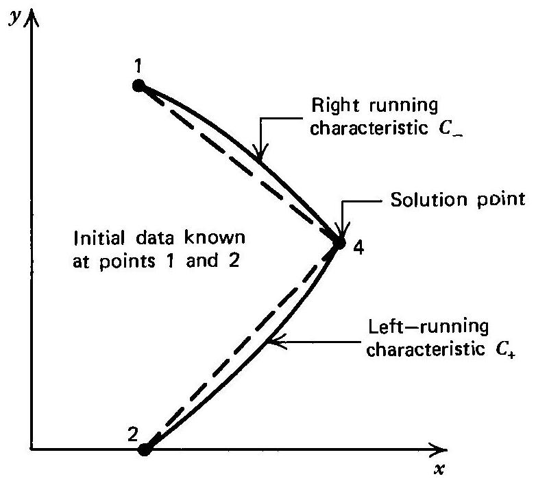
Figure 12.12 Interior point on the axis of symmetry.

Figure 12.13 presents a block diagram illustrating the modified Euler predictorcorrector algorithm for the unit process for an interior point. That block diagram is essentially the flow diagram for a computer implementation of the algorithm. A FORTRAN computer program for implementing the numerical integration procedure is presented in Section 16-3(b).

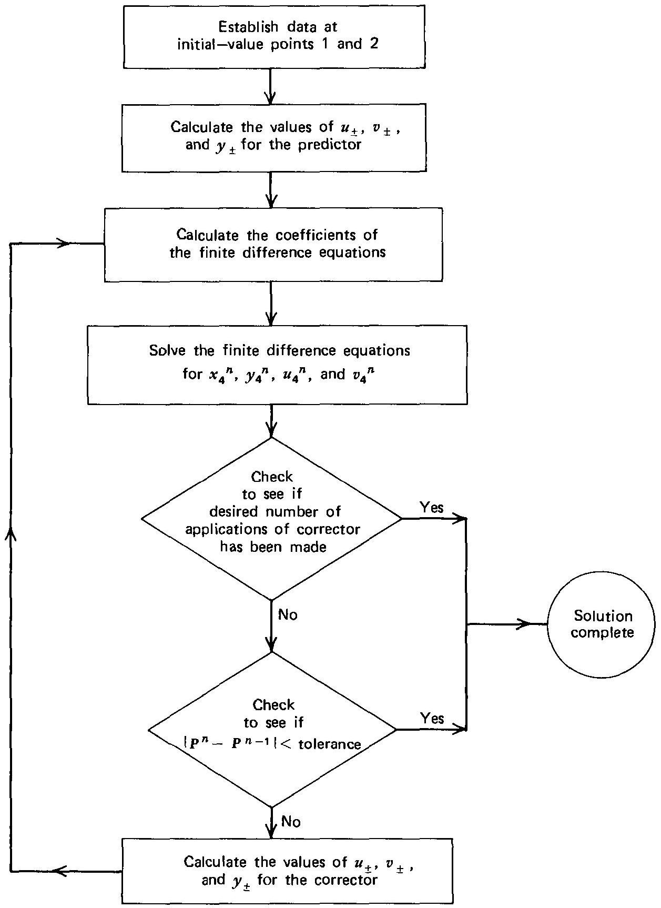
Figure 12.13 Block diagram illustrating the interior point unit process.

Example 12.2. A perfect gas with $\gamma=1.2$ and $R=320.0 \mathrm{~J} / \mathrm{kg}-\mathrm{K}$ is flowing in an axisymmetric propulsive nozzle having a stagnation pressure $P=70.0 \cdot 10^{5} \mathrm{~N} / \mathrm{m}^{2}$ and a stagnation temperature $T=3330 \mathrm{~K}$. The location and properties at two neighboring points in the flow field (points 1 and 2 in Fig. 12.9) are given in Table 12.5. Employing the unit process for an interior point, calculate the location of and the flow properties at the downstream intersection (point 4 of Fig. 12.9) of the characteristics through points 1 and 2 for three applications of the corrector.

Table 12.5 Initial-Value Data for an Interior Point (Example 12.2)
|  | Point 1 | Point 2 |
| :--- | :---: | :---: |
| $x, \mathrm{~m}$ | 0.2500 | 0.2750 |
| $y, \mathrm{~m}$ | 0.5000 | 0.4000 |
| $u, \mathrm{~m} / \mathrm{s}$ | 3000.0 | 3030.0 |
| $v, \mathrm{~m} / \mathrm{s}$ | 525.0 | 430.0 |

## Solution

The computations for the predictor and the first application of the corrector are presented below, and the results are presented in Table 12.6.

Table 12.6 Values of the Solution, for Successive Trials, for an Interior Point (Example 12.2)
|  | (0) | (1) | (2) | (3) |
| :--- | :--- | :--- | :--- | :--- |
| $\lambda_{+}$ | 0.34620 | 0.34727 | 0.34693 | 0.34691 |
| $\lambda_{-}$ | -0.022579 | -0.032664 | -0.033507 | -0.033522 |
| $Q_{+} \cdot 10^{-6}, \mathrm{~m}^{2} / \mathrm{s}^{2}$ | 8.8388 | 8.8802 | 8.8742 | 8.8743 |
| $R_{+} \cdot 10^{-6}, \mathrm{~m}^{2} / \mathrm{s}^{2}$ | -0.45419 | -0.41676 | -0.42396 | -0.42409 |
| $S_{+} \cdot 10^{-6}, \mathrm{~m}^{2} / \mathrm{s}^{3}$ | 367.80 | 332.02 | 332.26 | 332.31 |
| $T_{+} \cdot 10^{-9}, \mathrm{~m}^{3} / \mathrm{s}^{3}$ | 26.685 | 26.814 | 26.793 | 26.793 |
| $Q_{-} \cdot 10^{-6}, \mathrm{~m}^{2} / \mathrm{s}^{2}$ | 8.6488 | 8.7846 | 8.7787 | 8.7787 |
| $R_{-} \cdot 10^{-6}, \mathrm{~m}^{2} / \mathrm{s}^{2}$ | 3.3453 | 3.2278 | 3.2227 | 3.2226 |
| $S_{-} \cdot 10^{-6}, \mathrm{~m}^{2} / \mathrm{s}^{3}$ | 368.72 | 335.48 | 335.77 | 335.81 |
| $T_{-} \cdot 10^{-9}, \mathrm{~m}^{3} / \mathrm{s}^{3}$ | 27.811 | 28.144 | 28.124 | 28.124 |
| $x_{4}, \mathrm{~m}$ | 0.54463 | 0.53605 | 0.53566 | 0.53565 |
| $y_{4}, \mathrm{~m}$ | 0.49335 | 0.49066 | 0.49043 | 0.49042 |
| $u_{4}, \mathrm{~m} / \mathrm{s}$ | 3042.2 | 3040.4 | 3040.5 | 3040.5 |
| $v_{4}, \mathrm{~m} / \mathrm{s}$ | 448.5 | 444.7 | 444.6 | 444.6 |

Column (0)-predictor values.
Column (1)-corrector values.

Column (2)-first iteration of corrector.
Column (3)-second iteration of corrector.
(a) The speed of sound equation. For a perfect gas, the speed of sound is given by equation 3.186, which is repeated below.

$$
a^{2}=a_{o}^{2}-\frac{\gamma-1}{2} V^{2}=\gamma R T-\frac{\gamma-1}{2} V^{2}
$$

For the present problem

$$
a=\left[1.2(320.0)(3330.0)-\frac{1.2-1}{2} V^{2}\right]^{1 / 2}=\left(1,278,720-0.1 V^{2}\right)^{1 / 2} \mathrm{~m} / \mathrm{s}
$$

(b) Calculate the coefficients for the predictor. For the predictor, set the values of the flow properties $u_{ \pm}, v_{ \pm}$, and $y_{ \pm}$equal to their values at points 2 and 1 , respectively. Thus,

$$
\begin{array}{lll}
u_{+}=3030.0 \mathrm{~m} / \mathrm{s} & v_{+}=430.0 \mathrm{~m} / \mathrm{s} & y_{+}=0.4000 \mathrm{~m} \\
u_{-}=3000.0 \mathrm{~m} / \mathrm{s} & v_{-}=525.0 \mathrm{~m} / \mathrm{s} & y_{-}=0.5000 \mathrm{~m}
\end{array}
$$

From equations 12.68 to 12.72 :

$$
\begin{aligned}
& V_{+}=\left(u_{+}^{2}+v_{+}^{2}\right)^{1 / 2}=\left[(3030.0)^{2}+(430.0)^{2}\right]^{1 / 2}=3060.4 \mathrm{~m} / \mathrm{s} \\
& \theta_{+}=\tan ^{-1}\left(\frac{v_{+}}{u_{+}}\right)=\tan ^{-1}\left(\frac{430.0}{3030.0}\right)=8.077 \mathrm{deg} \\
& a_{+}=\left[1,278,720-0.1(3060.4)^{2}\right]^{1 / 2}=584.93 \mathrm{~m} / \mathrm{s} \\
& \alpha_{+}=\sin ^{-1}\left(\frac{a_{+}}{V_{+}}\right)=\sin ^{-1}\left(\frac{584.93}{3060.4}\right)=11.019 \mathrm{deg} \\
& V_{-}=\left(u_{-}^{2}+v_{-}^{2}\right)^{1 / 2}=\left[(3000.0)^{2}+(525.0)^{2}\right]^{1 / 2}=3045.6 \mathrm{~m} / \mathrm{s} \\
& \theta_{-}=\tan ^{-1}\left(\frac{v_{-}}{u_{-}}\right)=\tan ^{-1}\left(\frac{525.0}{3000.0}\right)=9.927 \mathrm{deg} \\
& a_{-}=\left[1,278,720-0.1(3045.6)^{2}\right]^{1 / 2}=592.59 \mathrm{~m} / \mathrm{s} \\
& \alpha_{-}=\sin ^{-1}\left(\frac{a_{-}}{V_{-}}\right)=\sin ^{-1}\left(\frac{592.59}{3045.6}\right)=11.220 \mathrm{deg}
\end{aligned}
$$

Substituting the above values into equations 12.67 and 12.79 to 12.84 , we obtain:

$$
\begin{aligned}
& \lambda_{+}=\tan \left(\theta_{+}+\alpha_{+}\right)=\tan (8.077+11.019)=0.34620 \\
& Q_{+}=u_{+}^{2}-a_{+}^{2}=(3030.0)^{2}-(584.93)^{2}=8.8388 \cdot 10^{6} \mathrm{~m}^{2} / \mathrm{s}^{2} \\
& R_{+}=2 u_{+} v_{+}-Q_{+} \lambda_{+}=2.0(3030.0)(430.0)-\left(8.8388 \cdot 10^{6}\right)(0.34620) \\
& R_{+}=-0.45419 \cdot 10^{6} \mathrm{~m}^{2} / \mathrm{s}^{2} \\
& S_{+}=a_{+}^{2} v_{+} / y_{+}=(584.93)^{2}(430.0) / 0.4000=367.80 \cdot 10^{6} \mathrm{~m}^{2} / \mathrm{s}^{3} \\
& \lambda_{-}=\tan \left(\theta_{-}-\alpha_{-}\right)=\tan (9.927-11.220)=-0.022579 \\
& Q_{-}=u_{-}^{2}-a_{-}^{2}=(3000.0)^{2}-(592.59)^{2}=8.6488 \cdot 10^{6} \mathrm{~m}^{2} / \mathrm{s}^{2} \\
& R_{-}=2 u_{-} v_{-}-Q_{-} \lambda_{-}=2(3000.0)(525.0)-\left(8.6488 \cdot 10^{6}\right)(-0.022579) \\
& R_{-}=3.3453 \cdot 10^{6} \mathrm{~m}^{2} / \mathrm{s}^{2} \\
& S_{-}=a_{-}^{2} v_{-} / y_{-}=(592.59)^{2}(525.0) / 0.5000=368.72 \cdot 10^{6} \mathrm{~m}^{2} / \mathrm{s}^{3}
\end{aligned}
$$

(c) Determination of $x_{4}, y_{4}, u_{4}$, and $v_{4}$ for the predictor. Two equations for the determination of $x_{4}$ and $y_{4}$ are obtained by substituting the values of the coefficients calculated in part (b) into equations 12.85 and 12.86. Thus,

$$
\begin{aligned}
& y_{4}-0.34620 x_{4}=0.4000-(0.34620)(0.2750) \\
& y_{4}+0.022579 x_{4}=0.5000+(0.022579)(0.2500)
\end{aligned}
$$

Solving equations (b) and (c) simultaneously, we obtain

$$
x_{4}=0.54463 \mathrm{~m} \quad \text { and } \quad y_{4}=0.49335 \mathrm{~m}
$$

From equations 12.77 and 12.78 , the values of $T_{+}$and $T_{-}$for the predictor are obtained. Thus,

$$
\begin{aligned}
T_{+}= & \left(367.80 \cdot 10^{6}\right)(0.54463-0.2750)+\left(8.8388 \cdot 10^{6}\right)(3030.0) \\
& -\left(0.45419 \cdot 10^{6}\right)(430.0)=26.685 \cdot 10^{9} \mathrm{~m}^{3} / \mathrm{s}^{3} \\
T_{-}= & \left(368.72 \cdot 10^{6}\right)(0.54463-0.2500)+\left(8.6488 \cdot 10^{6}\right)(3000.0) \\
& +\left(3.3453 \cdot 10^{6}\right)(525.0)=27.811 \cdot 10^{9} \mathrm{~m}^{3} / \mathrm{s}^{3}
\end{aligned}
$$

Substituting the values of $Q_{ \pm}, R_{ \pm}$, and $T_{ \pm}$into equations 12.87 and 12.88 yields the following two equations for the determination of $u_{4}$ and $v_{4}$.

$$
\begin{aligned}
\left(8.8388 \cdot 10^{6}\right) u_{4}-\left(0.45419 \cdot 10^{6}\right) v_{4} & =26.685 \cdot 10^{9} \\
\left(8.6488 \cdot 10^{6}\right) u_{4}+\left(3.3453 \cdot 10^{6}\right) v_{4} & =27.811 \cdot 10^{9}
\end{aligned}
$$

Solving equations (d) and (e) simultaneously yields

$$
u_{4}=3042.2 \mathrm{~m} / \mathrm{s} \quad \text { and } \quad v_{4}=448.5 \mathrm{~m} / \mathrm{s}
$$

The application of the Euler predictor algorithm is complete. The column in Table 12.6 labeled ( 0 ) presents the predictor values for the terms $\lambda_{ \pm}, x_{4}, y_{4}, Q_{ \pm}$, etc.; that is, the terms that are calculated by the predictor portion of the numerical algorithm.
(d) Calculation of the coefficients for the corrector. One application of the corrector algorithm is presented in detail below. Before the corrector algorithm may be applied, the average values of the flow properties must be calculated (see equations 12.91 and 12.92), employing the initial and predictor values of $u, v$, and $y$. Thus:

$$
\begin{aligned}
& u_{+}=\frac{u_{2}+u_{4}}{2}=\frac{3030.0+3042.2}{2}=3036.1 \mathrm{~m} / \mathrm{s} \\
& v_{+}=\frac{v_{2}+v_{4}}{2}=\frac{430.0+448.5}{2}=439.3 \mathrm{~m} / \mathrm{s} \\
& y_{+}=\frac{y_{2}+y_{4}}{2}=\frac{0.4000+0.49335}{2}=0.44668 \mathrm{~m} \\
& u_{-}=\frac{u_{1}+u_{4}}{2}=\frac{3000.0+3042.2}{2}=3021.1 \mathrm{~m} / \mathrm{s} \\
& v_{-}=\frac{v_{1}+v_{4}}{2}=\frac{525.0+448.5}{2}=486.8 \mathrm{~m} / \mathrm{s} \\
& y_{-}=\frac{y_{1}+y_{4}}{2}=\frac{0.5000+0.49335}{2}=0.49668 \mathrm{~m}
\end{aligned}
$$

From equations 12.68 to 12.72 :

$$
\begin{aligned}
& V_{+}=\left[(3036.1)^{2}+(439.3)^{2}\right]^{1 / 2}=3067.7 \mathrm{~m} / \mathrm{s} \\
& \theta_{+}=\tan ^{-1}\left(\frac{439.3}{3036.1}\right)=8.233 \mathrm{deg} \\
& a_{+}=\left[1,278,720-0.1(3067.7)^{2}\right]^{1 / 2}=581.07 \mathrm{~m} / \mathrm{s} \\
& \alpha_{+}=\sin ^{-1}\left(\frac{581.07}{3067.7}\right)=10.919 \mathrm{deg} \\
& V_{-}=\left[(3021.1)^{2}+(486.8)^{2}\right]^{1 / 2}=3060.1 \mathrm{~m} / \mathrm{s} \\
& \theta_{-}=\tan ^{-1}\left(\frac{486.8}{3021.1}\right)=9.154 \mathrm{deg} \\
& a_{-}=\left[1,278,720-0.1(3060.1)^{2}\right]^{1 / 2}=585.06 \mathrm{~m} / \mathrm{s} \\
& \alpha_{-}=\sin ^{-1}\left(\frac{585.06}{3060.1}\right)=11.022 \mathrm{deg}
\end{aligned}
$$

Substituting the above values into equations 12.67 and 12.79 to 12.84 yields:

$$
\begin{aligned}
& \lambda_{+}=\tan (8.233+10.919)=0.34727 \\
& Q_{+}=(3036.1)^{2}-(581.07)^{2}=8.8802 \cdot 10^{6} \mathrm{~m}^{2} / \mathrm{s}^{2} \\
& R_{+}=2.0(3036.1)(439.3)-\left(8.8802 \cdot 10^{6}\right)(0.34727)=-0.41676 \cdot 10^{6} \mathrm{~m}^{2} / \mathrm{s}^{2} \\
& S_{+}=(581.07)^{2}(439.3) / 0.44668=332.02 \cdot 10^{6} \mathrm{~m}^{2} / \mathrm{s}^{3} \\
& \lambda_{-}=\tan (9.154-11.022)=-0.032664 \\
& Q_{-}=(3021.1)^{2}-(585.06)^{2}=8.7846 \cdot 10^{6} \mathrm{~m}^{2} / \mathrm{s}^{2} \\
& R_{-}=2.0(3021.1)(486.8)-\left(8.7846 \cdot 10^{6}\right)(-0.032664)=3.2278 \cdot 10^{6} \mathrm{~m}^{2} / \mathrm{s}^{2} \\
& S_{-}=(585.06)^{2}(486.8) / 0.49668=335.48 \cdot 10^{6} \mathrm{~m}^{2} / \mathrm{s}^{3}
\end{aligned}
$$

(e) Determination of $x_{4}, y_{4}, u_{4}$, and $v_{4}$ for the corrector. From equations 12.85 and 12.86 , respectively,

$$
\begin{aligned}
y_{4}-0.34727 x_{4} & =0.4000-(0.34727)(0.2750) \\
y_{4}+0.032664 x_{4} & =0.5000+(0.032664)(0.2500)
\end{aligned}
$$

Solving equations (f) and (g) simultaneously for $x_{4}$ and $y_{4}$, we obtain

$$
x_{4}=0.53605 \mathrm{~m} \quad \text { and } \quad y_{4}=0.49066 \mathrm{~m}
$$

From equations 12.77 and 12.78 , respectively, we obtain

$$
\begin{aligned}
T_{+}= & \left(332.02 \cdot 10^{6}\right)(0.53605-0.2750)+\left(8.8802 \cdot 10^{6}\right)(3030.0) \\
& -\left(0.41676 \cdot 10^{6}\right)(430.0)=26.814 \cdot 10^{9} \mathrm{~m}^{3} / \mathrm{s}^{3} \\
T_{-}= & \left(335.48 \cdot 10^{6}\right)(0.53605-0.2500)+\left(8.7846 \cdot 10^{6}\right)(3000.0) \\
& +\left(3.2278 \cdot 10^{6}\right)(525.0)=28.144 \cdot 10^{9} \mathrm{~m}^{3} / \mathrm{s}^{3}
\end{aligned}
$$

Substituting for $Q_{ \pm}, R_{ \pm}$, and $T_{ \pm}$into equations 12.87 and 12.88 , we obtain

$$
\begin{aligned}
\left(8.8802 \cdot 10^{6}\right) u_{4}-\left(0.41676 \cdot 10^{6}\right) v_{4} & =26.814 \cdot 10^{9} \\
\left(8.7846 \cdot 10^{6}\right) u_{4}+\left(3.2278 \cdot 10^{6}\right) v_{4} & =28.144 \cdot 10^{9}
\end{aligned}
$$

Solving equations (h) and (i) simultaneously for $u_{4}$ and $v_{4}$ yields

$$
u_{4}=3040.4 \mathrm{~m} / \mathrm{s} \quad \text { and } \quad v_{4}=444.7 \mathrm{~m} / \mathrm{s}
$$

The application of the Euler corrector algorithm is complete. The column labeled (1) in Table 12.6 presents the results of applying the corrector algorithm.
(f) Iteration of the corrector. Two iterations of the corrector algorithm are presented in columns (2) and (3) in Table 12.6. Those results are obtained by twice repeatings steps (d) and (e), each with a new set of corrector values for $x_{4}, y_{4}, u_{4}$, and $v_{4}$. It is evident from columns (1), (2), and (3) of Table 12.6 that successive applications of the corrector have only a small effect on the final results.

The thermodynamic properties of the flowing fluid, such as $p, \rho$, and $t$, may be calculated from the flow velocity $V$ and the stagnation properties of the fluid.

## 12-6 SIMPLE WAVES"

A special type of flow known as a simple wave flow occurs frequently in practical compressible flow problems. The Prandtl-Meyer expansion fan discussed in Section 8-3 is a practical example of a simple wave flow in a steady two-dimensional irrota-
tional supersonic flow field. Simple waves also occur frequently in unsteady onedimensional planar homentropic flow fields [see Section 13-4(b)]. Simple waves may occur when the governing partial differential equations are homogeneous and the coefficients depend only on the dependent variables. In this section the properties of simple waves are reviewed, and proofs of those properties are presented.

Simple waves in steady two-dimensional irrotational supersonic flow have the following properties.

1. A simple wave is defined as one in which $V$ and $\theta$ (or $u$ and $v$ ) are not independent [i.e., $V=V(\theta)$ or $u=u(v)]$.
2. In a simple wave, the characteristics (Mach lines) of one family are straight lines having constant properties.
3. If a region of uniform flow adjoins a nonuniform region, then the nonuniform region must be a simple wave region.

In a steady flow, a simple wave region is possible only in a two-dimensional planar irrotational supersonic flow. For the latter type of flow the governing equations are equations 10.193 and 10.189 ; they are repeated here for convenience. Thus,

$$
\begin{aligned}
\left(u^{2}-a^{2}\right) u_{x}+\left(v^{2}-a^{2}\right) v_{y}+2 u v v_{x} & =0 \\
u_{y}-v_{x} & =0
\end{aligned}
$$

According to property 1 above,

$$
u=u(v) \quad \text { and } \quad v=v(u)
$$

Differentiating the relationship $u=u(v)$ with respect to $x$ yields,

$$
u_{x}=u_{v} v_{x}=v_{x}\left(\frac{d u}{d v}\right)
$$

where $u_{v}=d u / d v$, since $u$ is a function of $v$ alone. Differentiating the relationship $v=v(u)$ with respect to $y$ yields

$$
v_{y}=v_{u} u_{y}=u_{y}\left(\frac{d v}{d u}\right)=v_{x}\left(\frac{d v}{d u}\right)
$$

where $u_{y}$ is replaced by $v_{x}$ by employing the irrotationality condition, equation 10.189.
Substituting equations 12.95 and 12.96 into equation 10.193 and noting that, in general, $v_{x} \neq 0$ so that it may be divided out of the result, we obtain

$$
\left(u^{2}-a^{2}\right)\left(\frac{d u}{d v}\right)+\left(v^{2}-a^{2}\right)\left(\frac{d v}{d u}\right)+2 u v=0
$$

Solving equation 12.97 for ( $d v / d u$ ) yields

$$
\left(\frac{d v}{d u}\right)_{ \pm}=\frac{u v \pm a^{2} \sqrt{M^{2}-1}}{a^{2}-v^{2}}
$$

Equation 12.98 is identical to equation 12.50 , which is the compatibility equation for a steady two-dimensional planar $(\delta=0)$ irrotational supersonic flow. It is valid only along the characteristics for a supersonic flow. Hence, the relationship $u=u(v)$ is possible only along characteristics. More specifically, since $u=u(v)$ uniquely, the + and - signs in equation 12.98 both cannot hold simultaneously. The relationship $u=u(v)$ can, therefore, hold only along either a right-running characteristic or a left-running characteristic. On the other characteristic, $u$ and $v$ are independent of each other.

Now consider property 2 listed above. For a continuous flow,

$$
d v=v_{x} d x+v_{y} d y
$$

Along a line of constant $v$, which is also a line of constant $u$, since $u=u(v)$,

$$
d v=v_{x} d x+v_{y} d y=0
$$

and

$$
\left(\frac{d y}{d x}\right)_{v}=-\frac{v_{x}}{v_{y}}
$$

Substituting equation 12.96 into equation 12.101 yields

$$
\left(\frac{d y}{d x}\right)_{v}=-\left(\frac{d u}{d v}\right)
$$

Solving equation 12.97 for $-(d u / d v)$, we obtain

$$
\left(\frac{d y}{d x}\right)_{v}=\frac{u v \pm a^{2} \sqrt{M^{2}-1}}{u^{2}-a^{2}}
$$

Equation 12.103 is identical to equation 12.40, which is the equation for the characteristics. Hence, $u$ and $v$ and, therefore, all of the flow properties, can be constant only on characteristics. If $M$ and $\theta$ are constant, then $\lambda_{ \pm}=\tan (\theta \pm \alpha)$ is constant, and the characteristics (Mach lines) are straight lines. Once again, the + and - signs in equation 12.103 both cannot hold simultaneously. Consequently, only one family of characteristics are straight lines along which the flow properties remain constant.

The proof of statement 3 listed above requires employing the hodograph plane discussed in Section 8-7. In the hodograph plane, the solution to equation 12.98 yields a fixed set of curves independent of the geometry of the flow field (see Fig. 8.16). Those curves are called the hodograph characteristics. They are denoted by $\Gamma_{+}$and $\Gamma_{\text {_ }}$ corresponding to the + and - sign, respectively, in equation 12.98. The slopes of those hodograph characteristics are given by equation 12.98. The slopes of the physical characteristics $C_{+}$and $C_{-}$(i.e., the Mach lines) are given by equation 12.40.

$$
\left(\frac{d y}{d x}\right)_{ \pm}=\frac{u v \pm a^{2} \sqrt{M^{2}-1}}{\left(u^{2}-a^{2}\right)}
$$

If $(d y / d x)_{+}$from equation 12.40 is multiplied by $(d v / d u)_{-}$from equation 12.98, or $(d y / d x)_{-}$is multiplied by $(d v / d u)_{+}$, the product in both cases is -1 . Thus,

$$
\left(\frac{d y}{d x}\right)_{ \pm}\left(\frac{d v}{d u}\right)_{ \pm}=-1
$$

Equation 12.104 shows that the slopes of the physical characteristics $C_{+}$and $C_{-}$ are the negative reciprocals of the slopes of the hodograph characteristics of the opposite family, $\Gamma_{-}$and $\Gamma_{+}$, respectively. In other words, the physical and the hodograph characteristics of opposite families are orthogonal, a fact that may often be employed advantageously in obtaining a graphical solution to a steady planar irrotational supersonic flow problem.

The flow in a simple wave region is governed by equation 12.98 which, upon substituting for $u$ and $v$ in terms of $V$ and $\theta$ (see Fig. 12.6) and for $M$ in terms of $\alpha$ (see Fig. 12.7) becomes (see equation 8.3),

$$
\frac{d V}{d \theta}= \pm V \tan \alpha
$$

In Section 8-3, equation 12.105 is integrated for a perfect gas to give (see equation 8.11, where $\theta$ is replaced by $\delta$ )

$$
\pm \theta=\sqrt{b} \tan ^{-1}\left[\left(M^{2}-1\right) / b\right]^{1 / 2}-\tan ^{-1}\left(M^{2}-1\right)^{1 / 2}+\text { constant }
$$

Equation 12.106 is the equation that defines the hodograph characteristics in Fig. 8.16. Hence, the entire simple wave region in the physical plane is mapped into a single hodograph characteristic in the hodograph plane. The initial condition (i.e., $M_{1}$ and $\delta_{1}$ ) and whether the turning is clockwise or counterclockwise determines the particular hodograph characteristic corresponding to a given physical plane. In Section 8-4, it is shown that clockwise turning, in which the left-running $C_{+}$characteristics are straight lines, maps onto the $\Gamma_{-}$hodograph characteristic, and vice versa. Consequently, for a simple wave, all of the characteristics of one family in the physical plane lie on a single characteristic of the opposite family in the hodograph plane. That feature leads to a simple proof of statement 3 made at the beginning of this section.

In Fig. 12.14 the line $A B$ represents a line of uniform, or constant, properties in the $x y$ plane, which is the physical plane. The line $A B$ maps into a point in the hodograph plane, such as point $C$ in Fig. 12.15. Since line $A B$ is a $C_{+}$characteristic, the

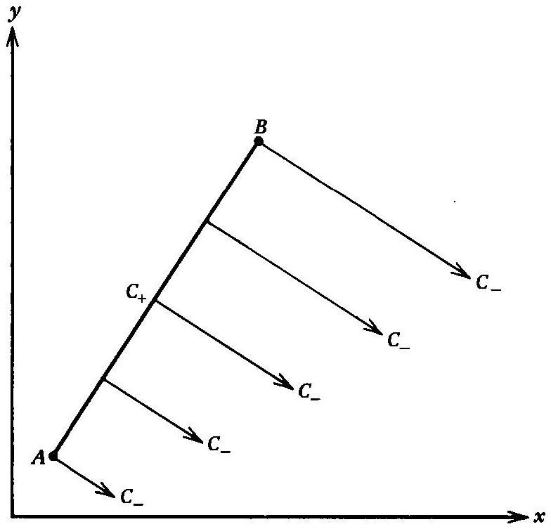
Figure 12.14 Physical plane.

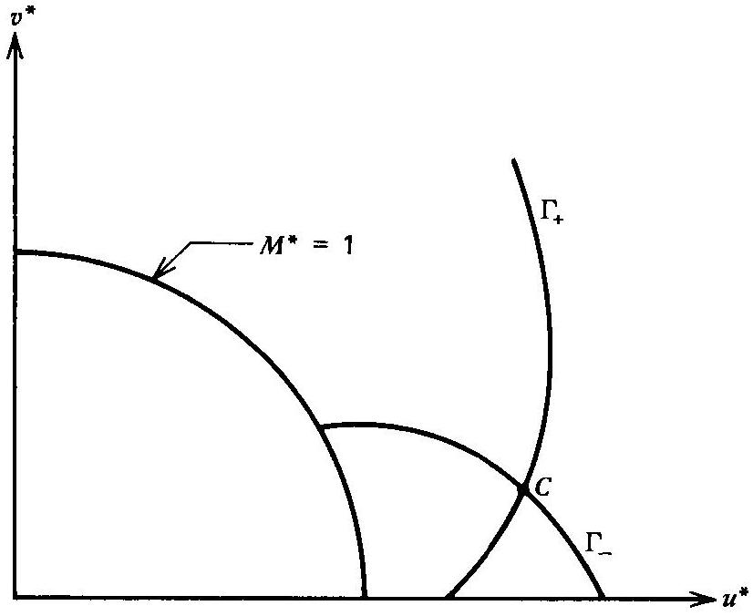
Figure 12.15 Hodograph plane.

data along line $A B$ are propagated into the $x y$ plane along the $C_{-}$characteristics crossing line $A B$. There are two possibilities. First, the surrounding physical field is uniform, in which case the entire physical plane maps into the single point $C$ in the hodograph plane. Second, the solution for all of the physical characteristics $C_{-}$ that cross $C_{+}$proceeds along the single hodograph characteristic $\Gamma_{-}$that emanates from the point $C$ in the hodograph plane. Each different point on $\Gamma_{\text {_ }}$ defines a different $C_{+}$characteristic along which the flow properties are constant, since an entire $C_{+}$characteristic maps into a single point on $\Gamma_{-}$. Hence, all of the $C_{-}$characteristics crossing line $A B$ either enter a region of uniform flow or they define a series of straight $C_{+}$characteristics along each of which the flow has constant properties; that is, a simple wave region. The behavior just described continues until it is interrupted by some incompatible boundary condition in the simple wave region that generates physical characteristics of the opposite family.

The above discussion substantiates the statement regarding the third property of simple wave flows; that if a region (or line) of uniform flow adjoins a nonuniform region, then the latter region must be a simple wave region.

Figure 12.16 illustrates a Prandtl-Meyer flow, which is the most familiar example of a simple wave flow. Figure 12.17 illustrates the corresponding hodograph plane for the simple wave expansion fan. The simple wave expansion fan region is adjoined by Regions 1 and 2, in each of which the flow properties have constant values.

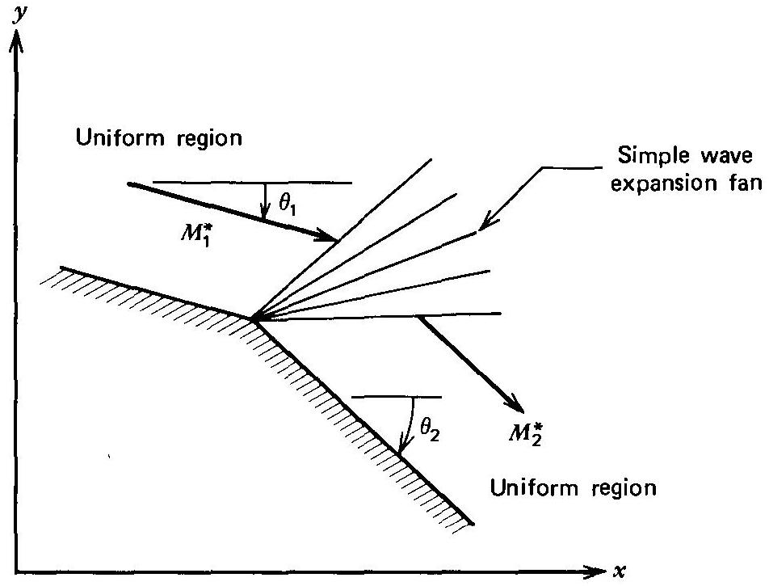
Figure 12.16 Physical plane for a simple wave expansion fan (Prandtl-Meyer flow).

Figure 12.18 illustrates schematically, the destruction. $\mathcal{O}_{1} a_{\mu}$ simpla wese by the presence of solid boundaries. Because of the presence of the upper wall, reflected waves emanate from the boundary $A C$, and Region $A B C$ contains simultaneously waves of both families. In such a situation, the only recourse for analyzing the flow is to apply the numerical analysis developed in Sections 12-4 and 12.5.

In summary, it is shown that a region of uniform flow can only be adjoined to a simple wave region, and that the simple wave region will continue until destroyed by incompatible boundary conditions.

From a purely mathematical point of view, the unique properties of simple waves are due to the special nature of the governing partial differential equations. The necessary conditions for the occurrence of simple waves are that the coefficients of

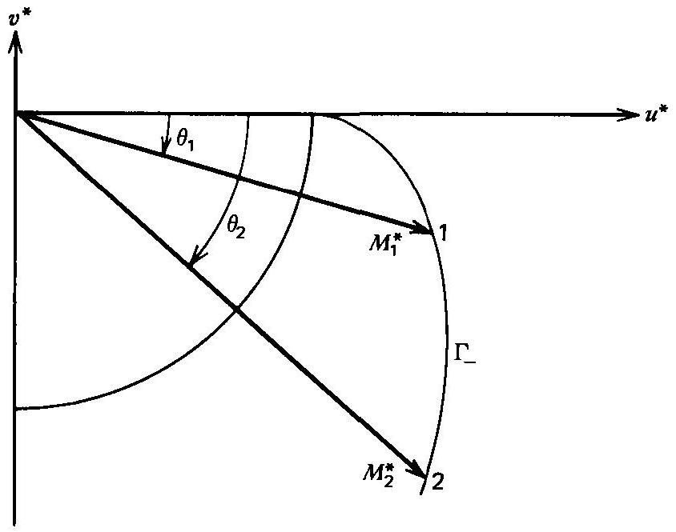
Figure 12.17 Hodograph plane for a simple wave expansion fan (PrandtlMeyer flow).

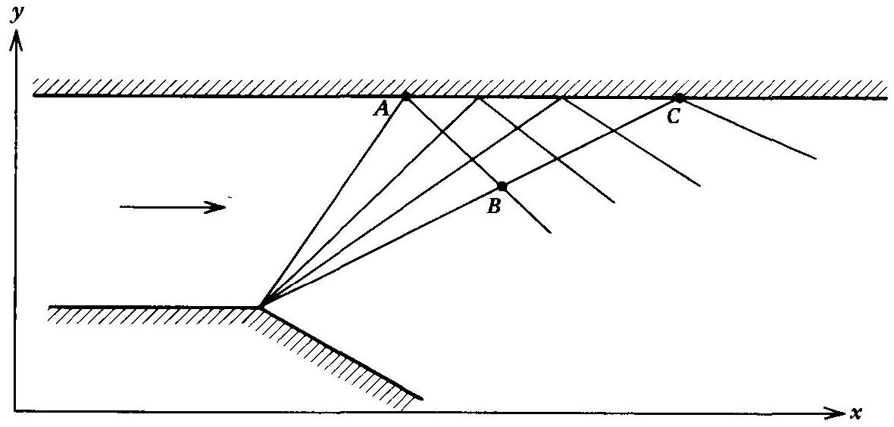
Figure 12.18 Destruction of a simple wave region by reflected waves from a solid boundary.

the governing partial differential equations depend only on the dependent variables ( $u$ and $v$ in this case), and that the governing equations are homogeneous. Such equations are said to be reducible. Both of those conditions are satisfied by equations 10.189 and 10.193. Any flow for which the governing equations satisfy the aforementioned conditions can have simple wave regions. In particular, the governing equations for unsteady one-dimensional planar homentropic flow satisfy the aforementioned conditions, and simple waves do appear frequently in such flows [see Section 13-4(b)].

Example 12.3. Consider the two-dimensional planar flow of a parallel uniform stream of air initially at $M=1.0$ over the cylindrical afterbody illustrated in Fig. 12.19a. Employing simple wave flow concepts and the generalized hodograph diagram of Fig. 8.16, construct graphically the expansion waves through a turning angle of -60 deg at 5 deg intervals.

## Solution

For the given initial conditions, $M_{1}^{*}=1.0$ and $\theta_{1}=0 \mathrm{deg}$. Those conditions determine the particular $\Gamma$ - characteristic that describes this simple wave expansion; the $\Gamma_{-}$characteristic is illustrated in the hodograph plane in Fig. 12.19b. Rays from

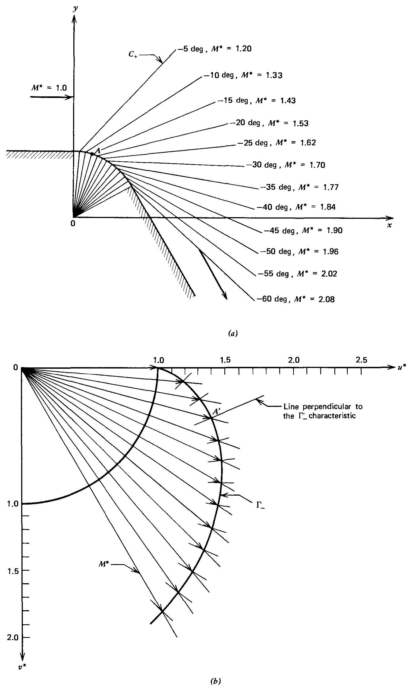
Figure 12.19 Simple wave flow over a cylinder. (a) Physical plane. (b) Hodograph plane.

the origin of both the physical plane and the hodograph plane are drawn at 5 deg intervals. The intersection of each such ray in the hodograph plane with the $\Gamma_{-}$ solution characteristic determines the image point in the hodograph plane of the $C_{+}$ Mach line originating at the corresponding point on the cylinder in the physical plane, since the flow angles at the physical points are equal to the flow angles in the hodograph plane. For example, point $A$ in the physical plane is located at a point on the cylinder where the turning angle is -15 deg . Point $A^{\prime}$ in the hodograph plane is the point on the $\Gamma_{-}$solution characteristic where $\delta=-15 \mathrm{deg}$. From equation 12.104, the slope of each $C_{+}$characteristic corresponding to a particular point on the $\Gamma_{\text {_ }}$ characteristic is perpendicular to the $\Gamma_{\text {_ }}$ characteristic at that point. Segments of these perpendiculars to the $\Gamma_{\text {_ }}$ solution characteristic are drawn on Fig. 12.19b. Lines parallel to these perpendiculars are drawn through the corresponding points on the cylinder in the physical plane illustrated in Fig. 12.19a, and emanate into the flow field as straight Mach lines.

The length of a ray from the origin $O$ to a point on the $\Gamma_{-}$solution characteristic in Fig. $12.19 b$ gives the value of $M^{*}$ for the corresponding $C_{+}$characteristic. Those values of $M^{*}$ are indicated for the corresponding angles in Fig. 12.19a. By the aforementioned procedure, the flow field presented in Fig. 12.19a is constructed from the hodograph plane of Fig. 12.19b.

The above results are also obtainable in a simple straightforward analytical manner by employing Table 13. Comparison of the graphical and tabulated results shows agreement in the values of $M^{*}$ within $\pm 0.01$ at all points. Graphical constructions are quite useful for developing an insight into the details of a particular flow field. Analytical techniques employing a computer, however, are considerably faster and more accurate. Consequently, in practice, little, if any, use is made of the graphical techniques that were formerly employed for analyzing supersonic flow fields.

## 12-7 SUMMARY

The method of characteristics is a procedure for replacing a set of quasi-linear nonhomogeneous partial differential equations by a set of compatibility equations (interior operators) that is valid on surfaces called characteristic surfaces. For a problem in two independent dimensions (e.g., two space dimensions, or one space dimension and time), the characteristic surfaces are characteristic lines, called characteristics, and the compatibility equations are total differential relationships that are valid along the characteristics. Consequently, finite difference methods for solving the characteristic and compatibility equations are considerably simpler than methods for solving the original set of partial differential equations. The method of characteristics is applicable only to hyperbolic partial differential equations.

In the present chapter, the general theory of the method of characteristics for problems in two independent variables is presented. Characteristics are shown to have several properties. From a physical point of view, they are the path of propagation of physical disturbances. From a purely heuristic point of view, they are curves along which the governing partial differential equations can be manipulated into total differential equations. They are also curves across which the derivatives of a physical property may be discontinuous, while the property itself remains continuous. From a rigorous mathematical point of view, a characteristic is defined as a curve along which the governing partial differential equations reduce to an interior operator, that is, a total differential equation. The general theory is developed first for a single differential equation, for which characteristics always exist, and then for a system of two equations. In the latter case, characteristics exist only if

## 616 THE MOC FOR STEADY TWO-DIMENSIONAL IRROTATIONAL FLOW

the governing partial differential equations are hyperbolic. The theory is extended to any number of partial differential equations, for two independent variables, in Appendix B. The method of characteristics for three independent variables is introduced in Chapter 20 in Volume 2.

The general theory of the method of characteristics is applied to the case of steady two-dimensional, planar and axisymmetric, irrotational supersonic flow. The characteristics for this case are the Mach lines of the flow. A complete numerical algorithm, called a unit process, is developed for an interior point of a flow field. A numerical example is presented illustrating the application of the unit process for an interior point.

Numerical algorithms are developed in Chapter 16 for the boundary points of a flow (e.g., a solid wall, an axis of symmetry, and a free pressure boundary), and numerical examples illustrating those unit processes are presented. FORTRAN computer programs for implementing all of the unit processes are presented, and several applications to engineering problems are discussed.

## REFERENCES

1. O. M. Belotserkovskii, "Flow with a Detached Shock Wave about a Symmetric Profile," Journal of Applied Mathematics and Mechanics, Vol. 22, pp. 279-296, 1958.
2. O. M. Belotserkovskii and P. I. Chuskin, "The Numerical Solution of Problems in Gas Dynamics," Basic Developments in Fluid Mechanics, Vol. 1, edited by M. Holt, pp. 1-123, Academic Press, New York, 1965.
3. S. G. Liddle and R. D. Archer, "Transonic Flow in Nozzles Using the Method of Integral Relations," Journal of Spacecraft and Rockets, Vol. 8, No. 7, pp. 722-728, July 1971.
4. G. Moretti and M. Abbett, "A Time-Dependent Computational Method for Blunt Body Flows," AIAA Journal, Vol. 4, No. 12, pp. 2136-2141, December 1966.
5. J. D. Anderson, "A Time-Dependent Analysis for Vibrational and Chemical Nonequilibrium Nozzle Flows," AIAA Journal, Vol. 8, No. 3, pp. 545-550, March 1970.
6. R. Serra, "Determination of Internal Gas Flows by a Transient Numerical Technique," AIAA Journal, Vol. 10, No. 5, pp. 603-611, May 1972.
7. M. C. Cline, "The Computation of Steady, Two-Dimensional Transonic Nozzle Flow by a Time Dependent Method," AIAA Journal, Vol. 12, No. 2, pp. 500-501, February 1974.
8. Bruce Carnahan, H. A. Luther, and James O. Wilkes, Applied Numerical Methods, Chap. 6, John Wiley, New York, 1969.
9. S. D. Conte and C. de Boor, Elementary Numerical Analysis, Second Edition, Chap. 6, McGraw-Hill, New York, 1972.
10. J. D. Hoffman, "Accuracy Studies of the Numerical Method of Characteristics for Axisymmetric, Steady Supersonic Flows," Journal of Computational Physics, Vol. 11, No. 2, pp. 210-239, February 1973.
11. R. Courant and K. O. Friedrichs, Supersonic Flow and Shock Waves, pp. 59-62, Interscience Publishers, New York, 1948.

## PROBLEMS

1. Given the first-order partial differential equation

$$
u_{x}+u_{y}=1
$$

and the initial condition $u(0, y)=y$ for all $y$, determine (a) the characteristic equation, (b) the compatibility equation, and (c) the value of $u(2,4)$.
2. Consider the first-order partial differential equation

$$
u u_{x}+u_{y}-u=0
$$

with the initial condition $u(x, 0)=x+10$. Determine (a) the characteristic equation, (b) the compatibility equation, and (c) the value of $u(5,10)$.
3. The velocity of a particle is described by the following first-order partial differential equation.

$$
u y u_{x}+u x u_{y}+x y=0
$$

The particle velocity distribution at $y=0$ is $u(x, 0)=x^{3}-54$. Determine (a) the characteristic equation, (b) the compatibility equation, and (c) the $y$ coordinate and the velocity of the particle that was initially located at $(4,0)$ when that particle reaches $x=10$.
4. The linearized equations governing the unsteady one-dimensional motion of small disturbances (acoustic waves) in a constant-area passage are given by equations 11.15 and 11.16 , which are repeated below,

$$
\begin{array}{r}
\rho_{\infty} u_{t}+p_{x}=0 \\
\rho_{\infty} a_{\infty}^{2} u_{x}+p_{t}=0
\end{array}
$$

where $u$ and $p$ are the perturbation velocity and pressure, respectively, and the subscript $\infty$ denotes the uniform undisturbed free stream. Employ the general theory of the method of characteristics to determine (a) the characteristic equations for such a flow field, and (b) the corresponding compatibility equations. (c) If the fluid is air with $p_{\infty}=$ one atm and $t_{\infty}=$ 300 K , sketch on the $x t$ plane ( $x$ abscissa and $t$ ordinate) the range of influence of a disturbance created at $x=10 \mathrm{~m}$ and $t=100 \mathrm{~s}$.
5. Long wave motions denote motions in an incompressible fluid having a free surface, where the vertical displacements of the fluid particles are small compared with their horizontal displacements. Such motions occur in tidal waves, storm surges, and tsunamis, where the fluid depth remains essentially constant and the fluid velocities are small, so that the resulting wave motions are linear. When long wave motions occur in estuaries, rivers, and canals, the fluid depth may change appreciably and the fluid velocities may become significant. The resulting waves are called bores, and the wave motions exhibit nonlinear behavior.

One-dimensional long wave motions occur in channels where the side boundaries are parallel. When the side boundaries are not parallel, the one-dimensional approximation may still yield useful results. The latter case is analogous to the one-dimensional flow approximation employed in Chapter 4 for the flow of a fluid in a variable-area passage. The equations governing long wave motions are obtained by applying the continuity and momentum equations to the differential control volume illustrated in Fig. 12.20, where $h$ denotes the surface height, $w$ denotes the width of the channel, and $u$ denotes the fluid velocity. The

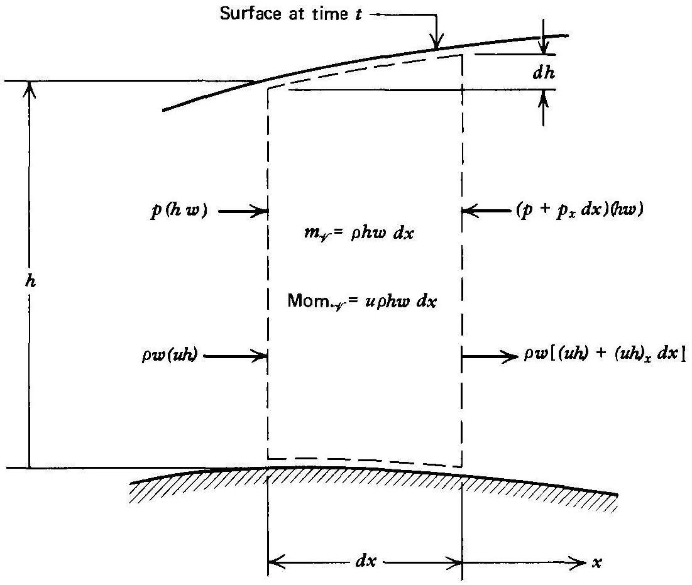
Figure 12.20 Flow model for long wave motions.

pressure forces and the mass flow rates at the control surface are indicated, as are the mass and momentum stored within the control volume. Terms of order higher than the first have been neglected. The pressure change across the control volume is caused by the change in the hydrostatic pressure, that is, $d p / d h=-\rho g$, where $g$ is the local acceleration caused by gravity. (a) For the flow model illustrated in Fig. 12.20, show that the partial differential equations governing long wave motions are

$$
\begin{aligned}
& h_{t}+u h_{x}+h u_{x}=0 \\
& u_{t}+u u_{x}+g h_{x}=0
\end{aligned}
$$

Equations (a) and (b) comprise a system of two quasi-linear partial differential equations for the determination of $h$ and $u$. Employing the general theory of the method of characteristics, determine (b) the characteristic equations, and (c) the corresponding compatibility equations.

In the study of tidal motions, $u$ is small and $h$ is large and effectively constant. For that case, (d) show that the linearized forms of equations (a) and (b) are

$$
\begin{aligned}
h_{t}+h_{\infty} u_{x} & =0 \\
u_{t}+g h_{x} & =0
\end{aligned}
$$

where $h_{\infty}$ is the undisturbed fluid depth. Employing the general theory of the method of characteristics, determine (e) the characteristic equations, and (f) the corresponding compatibility equations. Note the similarity of linearized long wave motions to one-dimensional acoustic wave motions considered in Problem 12.4.
6. Section 12-5(d) presents a numerical procedure for implementing the unit process for an interior point. That procedure is based on the average property method discussed in Section 12-5(a). Develop an equivalent numerical procedure for implementing the unit process for an interior point based on the average coefficient method discussed in Section 12-5(a).
7. Example 12.2 illustrates the unit process for an interior point based on the average property method developed in Section 12-5(d). Work Example 12.2 employing the unit process based on the average coefficient method developed in Problem 12.7.
8. Consider the nozzle described in Example 12.2. The location and flow properties at two neighboring points in the flow field are given in the following table.

|  | Point 1 | Point 2 |
| :--- | ---: | ---: |
| $x, \mathrm{~m}$ | 0.5000 | 0.5100 |
| $y, \mathrm{~m}$ | 0.6000 | 0.5000 |
| $u, \mathrm{~m} / \mathrm{s}$ | 1300.0 | 1270.0 |
| $v, \mathrm{~m} / \mathrm{s}$ | 350.0 | 315.0 |

Employing the unit process for an interior point described in Section 12-5(d), calculate the location of and the flow properties at the downstream intersection of the characteristics for three applications of the corrector.
9. The unit process for a point in the interior of a supersonic flow field is described in Section 12-5(d) and illustrated in Fig. 12.9. For a point on a solid boundary, illustrated in Fig. 12.21, point 1 of the interior point unit process is outside of the flow field. Consequently, the characteristic equation for right-running Mach line 14 and the corresponding compatibility equation are not applicable at a solid boundary. At a solid boundary, however, two boundary conditions are available to replace the lost characteristic and compatibility equations. The location and slope of the solid boundary must be specified. Thus,

$$
\begin{aligned}
y_{\text {wall }}(x) & =f(x) \quad(\text { specified }) \\
\tan \theta_{w}(x) & =\frac{d f(x)}{d x} \quad(\text { specified })
\end{aligned}
$$

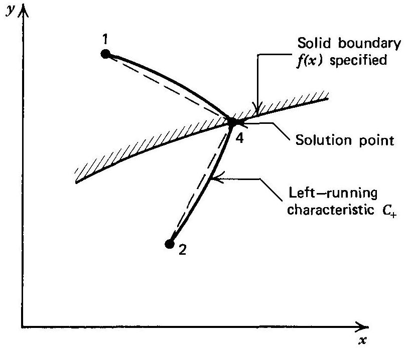
Figure 12.21 Unit process for a wall point.

Develop a numerical procedure for implementing the unit process for a wall point, analogous to the procedure presented in Section 12-5(d) for an interior point.
10. Consider the nozzle described in Example 12.2. The location and flow properties at a point near the wall are $x=1.000 \mathrm{~m}, y=1.400 \mathrm{~m}, u=1600 \mathrm{~m} / \mathrm{s}$, and $v=400 \mathrm{~m} / \mathrm{s}$. A conical wall having an angle of 15 deg passes through the point $x=1.000 \mathrm{~m}$ and $y=1.500 \mathrm{~m}$. Employing the unit process for a wall point developed in Problem 12.9, calculate the location and flow properties for the point located at the intersection of the left-running characteristic through the given data point and the nozzle wall.
11. The unit process for a point on the axis of symmetry of a supersonic flow field is illustrated in Fig. 12.22. Point 2 is a mirror image of point 1, and the unit process for an interior point may be applied to determine the location of and the flow properties at point 4 . The unit process for an axis of symmetry point may be simplified, however, by noting that on an axis of symmetry, $v_{4}=y_{4}=0$. Consequently, the characteristic equation for right-running Mach line 14 and the corresponding compatibility equation suffice to determine $x_{4}$ and $u_{4}$. Develop a numerical procedure for implementing the unit process for an axis of symmetry point, analogous to the procedure presented in Section 12-5(d) for an interior point.
12. Consider the nozzle described in Example 12.2. At a point near the axis of symmetry, $x= 1.000 \mathrm{~m}, y=0.030 \mathrm{~m}, u=1500 \mathrm{~m} / \mathrm{s}$, and $v=25 \mathrm{~m} / \mathrm{s}$. Employing the unit process for an

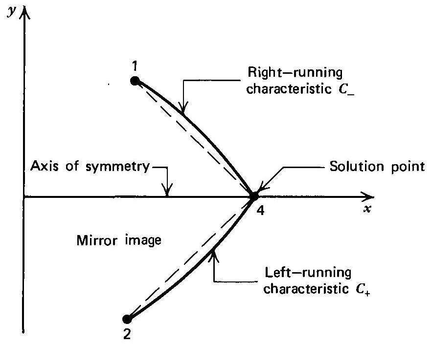
Figure 12.22 Unit process for an axis of symmetry point.

axis of symmetry point developed in Problem 12.11, calculate the location of and the flow properties at the intersection of the right-running characteristic through the given point and the axis of symmetry.
13. Figure 12.23 illustrates the unit process for a point on the boundary of a free jet, called a free pressure boundary point. Point 1 is outside of the flow field. Consequently, the characteristic equation for right-running Mach line 14 and the corresponding compatibility equation are not applicable at a free pressure boundary point. At the boundary of a free jet, however, the static pressure $p_{4}$ of the jet is equal to the ambient pressure $p_{0}$. Since the jet flow is isentropic, the velocity $V_{4}$ is a unique function of $p_{4}$, and thus $p_{0}$. Consequently, the equation

$$
V_{4}=\sqrt{u_{4}^{2}}+{v_{4}}^{2}=f\left(p_{o}\right)
$$

replaces the compatibility equation. The location of the jet boundary may be determined in either of two ways. First, line 34 is a streamline and must satisfy the relationship

$$
\frac{d y}{d x}=\frac{v}{u} \quad(\text { along line } 34)
$$

Equation (b) may be employed in place of the characteristic equation along line 14. Second, the mass flow rate across line 23 must equal the mass flow rate along line 24 .

$$
\dot{m}_{23}=\dot{m}_{34}
$$

Equation (c) may be employed in place of the characteristic equation along line 14. Develop a numerical procedure for implementing the unit process for a free pressure boundary point, analogous to the procedure presented in Section 12-5(d) for an interior point.

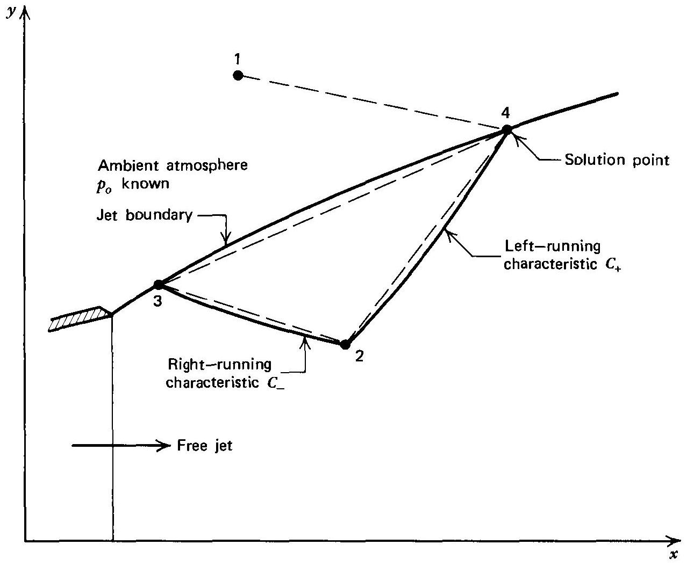
Figure 12.23 Unit process for a free pressure boundary point.

14. The gas described in Example 12.2 is flowing as a free jet in a region where the ambient pressure is $14,500 \mathrm{~N} / \mathrm{m}^{2}$. The locations of and the flow properties at two points in the jet are given in the following table, where point 3 is a previous point on the jet boundary.

|  | Point 2 | Point 3 |
| :--- | :--- | :--- |
| $x, \mathrm{~m}$ | 2.0000 | 1.9500 |
| $y, \mathrm{~m}$ | 1.4500 | 1.4450 |
| $u, \mathrm{~m} / \mathrm{s}$ | 2650.0 | 2640.0 |
| $v, \mathrm{~m} / \mathrm{s}$ | 1125.0 | 1120.0 |

Determine the location of and the flow properties at the intersection of the left-running characteristic through the given point and the free jet boundary, employing the unit process developed in Problem 12.13.

[^0]:    * Accuracy criteria for numerical methods of integration are discussed in Section 17-6.

