## 13 the method of characteristics applied to unsteady one-dimensional homentropic flow

13-1 PRINCIPAL NOTATION FOR CHAPTER 13 ..... 623
13-2 INTRODUCTION ..... 623
13-3 MATHEMATICAL ANALYSIS OF UNSTEADY ONE-DIMENSIONAL HOMENTROPIC FLOW ..... 624
(a) Governing equations ..... 624
(b) Characteristic and compatibility equations ..... 627
13-4 GENERAL FEATURES OF UNSTEADY ONE-DIMENSIONAL HOMENTROPIC FLOW ..... 630
(a) The $u^{*} a^{*}$, or state, plane for a perfect gas ..... 631
(b) Uniform flow regions, simple wave regions, and nonsimple wave regions ..... 633
(c) Simple compression and expansion waves ..... 634
(d) Reflection of compression and expansion waves ..... 643
(e) Intersection of continuous waves ..... 651
13-5 NUMERICAL IMPLEMENTATION OF THE METHOD OF CHARACTERISTICS ..... 651
(a) Numerical integration procedure ..... 655
(b) Finite difference equations ..... 656
(c) Unit process for an interior point ..... 656
13-6 SUMMARY ..... 664

## 13-1 PRINCIPAL NOTATION FOR CHAPTER 13

$a$ speed of sound.
$C_{ \pm} \quad$ denotes physical characteristics.
$h$ static specific enthalpy.
$M$ Mach number.
$p \quad$ absolute static pressure.
$s$ specific entropy.
$t$ time.
$T \quad$ absolute static temperature.
$u \quad$ velocity of fluid.
Greek Letters
$\gamma$ specific heat ratio.
$\Gamma_{ \pm}$denotes state characteristics.
$\delta$ denotes planar, cylindrical, or spherical one-dimensional flow (see Table 13.1).
$\lambda_{ \pm} \quad$ slope of physical characteristics.
$\rho \quad$ static density.
Subscripts

+ denotes $C_{+}$and $\Gamma_{+}$characteristics.
- denotes $C_{-}$and $\Gamma_{-}$characteristics.

Superscripts

* denotes nondimensional property.

## 13-2 INTRODUCTION

There are several practical fluid mechanical systems in which unsteady flow phenomena occur, that is, the flow properties of the fluid vary rapidly with time. For such flows the time $t$ is one of the variables determining the properties of the fluid. Consequently, the flow field for an unsteady flow, being time dependent, cannot be described by the equations discussed in Chapters 3 to 12 because their derivations assume that the flow is either steady or quasi-steady. Accordingly, this chapter is concerned with the analysis of unsteady one-dimensional homentropic flow.

The nineteenth-century literature pertaining to the unsteady flow of gases deals primarily with developing a basic understanding of wave phenomena rather than with the solutions to specific problems. Since World War II, however, there has been an increased interest in both the understanding and applications of wave phenomena. Much has been published about the unsteady flow of gases, and several excellent books are available. ${ }^{1-5}$ Reference 1 is the classic on that subject.

The analytical methods pertinent to the unsteady propagation of very small pressure disturbances in a gas, the field of acoustics, is well developed. Sections 11-3 and 15-3 present the governing equations for an acoustic field, and Section 15-4 discusses the acoustics of a closed rigid hollow cylinder.

Unsteady flows in which there are large amplitude changes in the flow properties of the flowing gas occur during the start-up, shutdown, and transient operation of turbomachines (such as axial and radial flow compressors and turbines), steam and gas turbine power-plants, and continuous flow propulsion engines (such as
turbojets, turbofans, ramjets, and liquid and solid propellant rocket engines). In the case of reciprocating or piston type machinery (air compressors, pumps, Otto and Diesel cycle internal combustion engines), the basic operating cycle for the piston machine is based on unsteady flow processes. Unsteady flow phenomena are also encountered in the propagation of explosive waves and detonations, and in the operation of a shock tube.

In this chapter the governing equations are derived for the unsteady onedimensional homentropic flow of a compressible fluid, in the absence of work and body forces, and the corresponding characteristic and compatibility equations are also derived. The general features of unsteady one-dimensional continuous flow are discussed, and a numerical algorithm is presented for the determination of an interior point in an unsteady one-dimensional homentropic flow.

In Chapter 19, the unsteady generalized quasi-one-dimensional flow of a compressible flow is considered. The general features of unsteady one-dimensional flow with discontinuities are discussed, and numerical algorithms are developed for the boundary points of such a flow. Numerical examples are presented for illustrating the application of those unit processes to specific unsteady onedimensional and quasi-one-dimensional flow problems.

## 13-3 MATHEMATICAL ANALYSIS OF UNSTEADY ONE-DIMENSIONAL HOMENTROPIC FLOW

A truly one-dimensional flow is one wherein the flow properties depend only on one space coordinate $x$ and the time $t$.* Consequently, the pathlines must be straight lines. Accordingly, planar flow in a constant-area duct, flow with cylindrical symmetry, and flow with spherical symmetry are one-dimensional flows. Flow in a duct having a slowly varying cross section where the duct height is small in comparison with the radius of curvature of the axis of the duct is called a quasi-one-dimensional flow.

An unsteady homentropic flow is a flow for which the entropy remains constant throughout the flow field for all time. An unsteady generalized quasi-one-dimensional flow is one that includes the effects of area change, friction, heat transfer, and mass addition.

The governing equations for unsteady one-dimensional homentropic flow are derived in the present section, and the corresponding characteristic and compatibility equations are determined. The governing equations for unsteady generalized quasi-one-dimensional flow are derived in Section 19-3(c).

## 13-3(a) Governing Equations

The governing equations for unsteady one-dimensional homentropic flow are obtained from Table 2.2 by assuming that $\mathbf{B}=d \mathbf{F}_{\text {shear }}=\delta \dot{W}=\delta \dot{Q}=g d z=0$. Thus:
(1) Continuity equation

$$
\rho_{t}+\nabla \cdot(\rho \mathbf{V})=0
$$

(2) Momentum equation

$$
\rho \frac{D \mathbf{V}}{D t}+\nabla p=0
$$

[^0](3) Energy equation
$$
\rho \frac{D}{D t}\left(h+\frac{V^{2}}{2}\right)-p_{t}=0
$$
(4) Entropy equation
$$
\frac{D s}{D t}=0
$$

Figure 13.1 illustrates the Cartesian, cylindrical, and spherical coordinate systems for a one-dimensional flow. In all three cases, $x$ denotes the spatial coordinate and $u$ the flow velocity. Expressing equation 13.1 in these three coordinate systems, we obtain the following forms for the continuity equation.

$$
\begin{aligned}
\rho_{t}+u \rho_{x}+\rho u_{x}=0 & \quad(\text { Cartesian }) \\
\rho_{t}+u \rho_{x}+\rho u_{x}+\frac{\rho u}{x}=0 & \quad(\text { cylindrical }) \\
\rho_{t}+u \rho_{x}+\rho u_{x}+\frac{2 \rho u}{x}=0 \quad & \quad(\text { spherical })
\end{aligned}
$$

The above three equations may be written as the following single continuity equation

$$
\rho_{t}+u \rho_{x}+\rho u_{x}+\frac{\delta \rho u}{x}=0
$$

where $\delta=0$ for a planar flow, $\delta=1$ for a cylindrical flow, and $\delta=2$ for a spherical flow.

Equation 13.2, the vector momentum equation, when expressed in any of these three coordinate systems, yields the following common momentum equation.

$$
\rho u_{t}+\rho u u_{x}+p_{x}=0
$$

Since the flow is assumed to be homentropic, the speed of sound definition (see equation 1.180) may be employed in place of the energy equation as a governing equation. Hence

$$
a^{2}=\left(\frac{\partial p}{\partial \rho}\right)_{s}=\frac{d p}{d \rho} \quad(\text { for homentropic flow })
$$

where

$$
a=a(p) \quad(\text { for homentropic flow })
$$

Equation 13.8 may be written as the substantial derivative.

$$
\frac{D p}{D t}-a^{2} \frac{D \rho}{D t}=0
$$

Equation 13.10 yields the following common speed of sound equation for all three coordinate systems.

$$
p_{t}+u p_{x}-a^{2}\left(\rho_{t}+u \rho_{x}\right)=0
$$

The entropy equation, equation 13.4, is identically satisfied for a homentropic flow.
The continuity equation, equation 13.6, may be simplified further for homentropic flow by substituting for $\rho_{t}+u \rho_{x}$ from equation 13.11. The result is

$$
\rho a^{2} u_{x}+p_{t}+u p_{x}+\delta \frac{\rho u a^{2}}{x}=0
$$

Equations 13.7 and 13.12 comprise a set of two equations for determining the two flow properties $u$ and $p$. Those equations are summarized in Table 13.1.

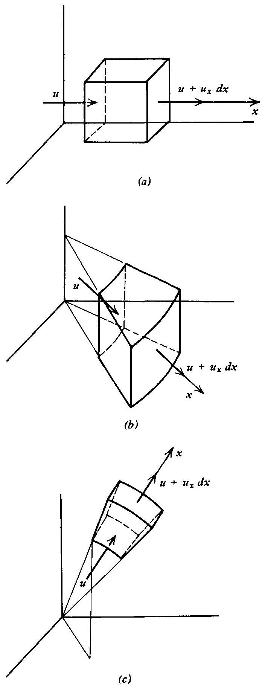
Figure 13.1 Coordinate systems for unsteady onedimensional flow. (a) Cartesian coordinates. (b) Cylindrical coordinates. (c) Spherical coordinates.

Table 13.1 Governing Equations for Unsteady One-Dimensional Homentropic Flow

$$
\begin{aligned}
& \rho u_{t}+\rho u u_{x}+p_{x}=0 \\
& \rho a^{2} u_{x}+p_{t}+u p_{x}+\delta \frac{\rho u a^{2}}{x}=0 \\
& \delta=0 \text { for planar one-dimensional flow } \\
& \delta=1 \text { for cylindrical one-dimensional flow } \\
& \delta=2 \text { for spherical one-dimensional flow }
\end{aligned}
$$

For a homentropic flow, the density $\rho$ is a unique function of the pressure $p$ throughout the flow (see equation 10.113). Thus

$$
\rho=\rho(p) \quad(\text { for homentropic flow })
$$

## 13-3(b) Characteristic and Compatibility Equations

The characteristic and compatibility equations corresponding to equations 13.7 and 13.12 are determined by multiplying those equations by the unknown parameters $\sigma_{1}$ and $\sigma_{2}$, respectively, and summing. Thus,

$$
\sigma_{1}(13.7)+\sigma_{2}(13.12)=0
$$

Performing the above summation yields

$$
\begin{aligned}
u_{x}\left(\rho u \sigma_{1}+\rho a^{2} \sigma_{2}\right)+u_{t}\left(\rho \sigma_{1}\right)+p_{x}\left(\sigma_{1}+u \sigma_{2}\right) & \\
& +p_{t}\left(\sigma_{2}\right)+\left(\sigma_{2} \delta \frac{\rho u a^{2}}{x}\right)=0
\end{aligned}
$$

Factoring out the coefficients of $u_{x}$ and $p_{x}$, we obtain

$$
\begin{aligned}
\left(\rho u \sigma_{1}+\rho a^{2} \sigma_{2}\right) & \left(u_{x}+\frac{\rho \sigma_{1}}{\rho u \sigma_{1}+\rho a^{2} \sigma_{2}} u_{t}\right) \\
& +\left(\sigma_{1}+u \sigma_{2}\right)\left(p_{x}+\frac{\sigma_{2}}{\sigma_{1}+u \sigma_{2}} p_{t}\right)+\left(\sigma_{2} \delta \frac{\rho u a^{2}}{x}\right)=0
\end{aligned}
$$

If $u(x, t)$ and $p(x, t)$ are assumed to be continuous functions, then

$$
\frac{d u}{d x}=u_{x}+\lambda u_{t} \quad \text { and } \quad \frac{d p}{d x}=p_{x}+\lambda p_{t}
$$

where $\lambda=d t / d x$. Accordingly, the slopes of the characteristics, $d t / d x=\lambda$, are the coefficients of $u_{t}$ and $p_{t}$. Thus,

$$
\lambda=\frac{\sigma_{1}}{u \sigma_{1}+a^{2} \sigma_{2}}=\frac{\sigma_{2}}{\sigma_{1}+u \sigma_{2}}
$$

Substituting equations 13.16 into equation 13.15 yields

$$
\left(\rho u \sigma_{1}+\rho a^{2} \sigma_{2}\right) d u+\left(\sigma_{1}+u \sigma_{2}\right) d p+\sigma_{2} \delta \frac{\rho u a^{2}}{x} d x=0
$$

Equations 13.17 are the characteristic equations for unsteady one-dimensional homentropic flow, and equation 13.18 is the corresponding compatibility equation. It is necessary, however, to eliminate the unknown parameters $\sigma_{1}$ and $\sigma_{2}$ from equations 13.17 and 13.18.

Solving equations 13.17 for $\sigma_{1}$ and $\sigma_{2}$, we obtain

$$
\begin{aligned}
\sigma_{1}(u \lambda-1)+\sigma_{2}\left(a^{2} \lambda\right) & =0 \\
\sigma_{1}(\lambda)+\sigma_{2}(u \lambda-1) & =0
\end{aligned}
$$

For equations 13.19 and 13.20 to have a solution other than the trivial one $\sigma_{1}= \sigma_{2}=0$, the determinant of the coefficient matrix for those equations must vanish. Thus,

$$
\left|\begin{array}{ll}
(u \lambda-1) & a^{2} \lambda \\
\lambda & (u \lambda-1)
\end{array}\right|=0
$$

Expanding the above determinant, we obtain

$$
(u \lambda-1)^{2}-a^{2} \lambda^{2}=0
$$

Solving equation 13.22 for $\lambda$ yields

$$
\begin{aligned}
& u \lambda-1= \pm a \lambda \\
& \left(\frac{d t}{d x}\right)_{ \pm}=\lambda_{ \pm}=\frac{1}{u \pm a}
\end{aligned}
$$

Figure 13.2 illustrates schematically the characteristics in the $x t$ plane; that is, the physical plane. Two characteristics exist, the $C_{+}$and $C_{-}$characteristics, corresponding to the + and - signs, respectively, in equation 13.24. Four possible cases are illustrated in Fig. 13.2, depending on whether the fluid velocity $u$ is positive or negative,

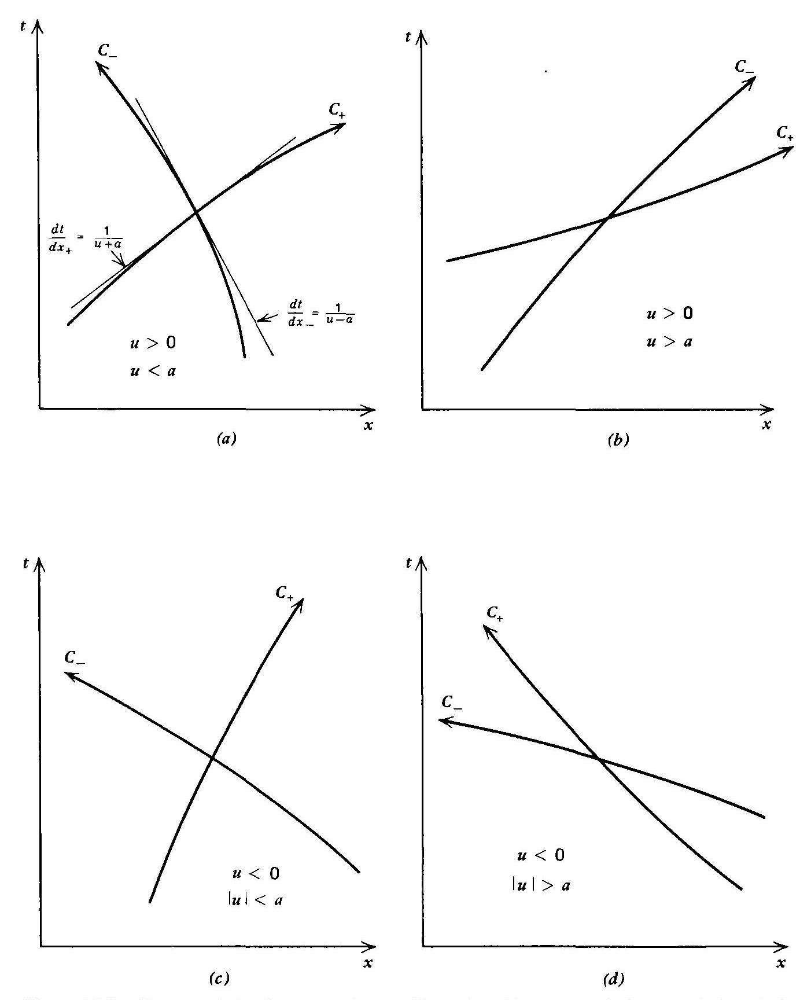
Figure 13.2 Characteristics for unsteady one-dimensional homentropic flow. (a) Subsonic flow from left to right. (b) Supersonic flow from left to right. (c) Subsonic flow from right to left. (d) Supersonic flow from right to left.

and whether $u$ is either less than or greater than the local speed of sound $a$; that is, whether the flow is subsonic or supersonic. In each of the four cases, $\lambda$ is real and the characteristics exist. Hence, the equations governing the unsteady one-dimensional homentropic flow of a compressible fluid are hyperbolic for both subsonic and supersonic flows.

One of the properties of a characteristic curve is that it is the path along which information is propagated through a flow field (see Section 12-3). Along the $C_{+}$ and $C_{-}$characteristics, the speed of propagation is

$$
\left(\frac{d x}{d t}\right)_{ \pm}=\frac{1}{\lambda_{ \pm}}=u \pm a
$$

Hence, the propagation speed along the $C_{ \pm}$characteristics is equal to the speed of sound relative to the moving fluid. In that regard, the $C_{ \pm}$characteristics in unsteady flow are analogous to the Mach lines in a steady supersonic flow, and are known as the Mach lines of the unsteady flow. Consequently, in an unsteady one-dimensional homentropic flow, two characteristic curves pass through each point of the flow field; the right- and left-running characteristics (Mach lines), illustrated in Fig. 13.2.

The compatibility equations that are valid along the characteristic curves are obtained from equation 13.18, by solving equation 13.19 or 13.20 for $\sigma_{1}$ in terms of $\sigma_{2}$ and substituting the result into equation 13.18. From equation 13.20,

$$
\sigma_{1}=-\sigma_{2} \frac{u \lambda-1}{\lambda}
$$

Substituting equation 13.26 into equation 13.18 and dividing by $\sigma_{2}$ yields the following result.

$$
\rho\left[-\frac{u(u \lambda-1)}{\lambda}+a^{2}\right] d u+\left[-\frac{(u \lambda-1)}{\lambda}+u\right] d p+\delta \frac{\rho u a^{2}}{x} d x=0
$$

Recalling that $(u \lambda-1)^{2}=a^{2} \lambda^{2}$ and $\lambda_{ \pm}=1 /(u \pm a)$ along the characteristics, equation 13.27 may be simplified to yield

$$
d p_{ \pm} \pm \rho a d u_{ \pm}=-\delta \frac{\rho u a^{2}}{x} d t_{ \pm}
$$

where the upper subscript + attached to the differentials $d p_{ \pm}, d u_{ \pm}$, and $d t_{ \pm}$and the upper sign + in the coefficient $\pm \rho a$ correspond to the $C_{+}$characteristic, and the lower subscript - and the lower sign - correspond to the $C_{-}$characteristic.

Summarizing, for unsteady one-dimensional homentropic flow, two distinct characteristics exist; the right- and left-running Mach lines, and there exists one compatibility equation valid along each of the two characteristics. Consequently, the derived system of characteristic and compatibility equations (equations 13.24 and 13.28) may replace the original system of partial differential equations (equations 13.7 and 13.12). Table 13.2 presents these characteristic and compatibility equations.

To apply the characteristic and compatibility equations presented in Table 13.2, a characteristic grid must be devised wherein the two characteristic curves intersect at a common point, so that the two compatibility equations may be solved simultaneously at the point of intersection for the flow properties $u$ and $p$. Figure 13.3 illustrates schematically the intersection of the two characteristic curves at a common solution point.

Table 13.2 Characteristic and Compatibility Equations for Unsteady One-Dimensional Homentropic Flow

## Characteristic equation

$$
\left(\frac{d t}{d x}\right)_{ \pm}=\lambda_{ \pm}=\frac{1}{u \pm a} \quad \text { (Mach lines) }
$$

## Compatibility equation

$$
d p_{ \pm \pm} \pm \rho a d u_{ \pm}=-\delta \frac{\rho u a^{2}}{x} d t_{ \pm} \quad \text { (along Mach lines) }
$$

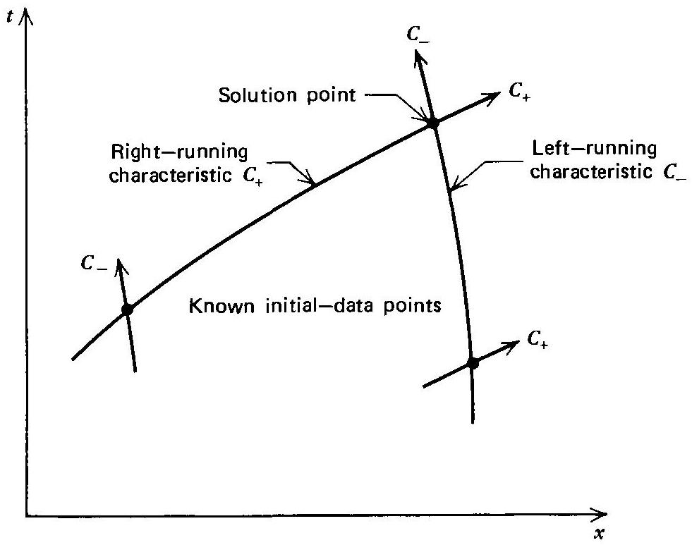
Figure 13.3 Intersection of two characteristics at a common solution point.

## 13-4 GENERAL FEATURES OF UNSTEADY ONE-DIMENSIONAL HOMENTROPIC FLOW

The equations governing unsteady one-dimensional homentropic flow are derived in Section 13-3. In the present section, the general features of unsteady one-dimensional flow are described by considering the special case of unsteady one-dimensional planar homentropic flow; that is, a flow in which $\delta=0$. Consideration of the latter special case is important to the understanding of the general case; that is, an unsteady generalized quasi-one-dimensional flow including area change, friction, heat transfer, and mass addition. The general case is discussed in Chapter 19 in Volume 2.

Unsteady one-dimensional planar homentropic flow occurs frequently in engineering. For example, simple waves, discussed in Chapter 8 for steady twodimensional planar irrotational supersonic flow, may also occur in unsteady one-dimensional planar homentropic flow. The shock tube, discussed in Section 19-5(c), and the Ludwieg tube, discussed in Section 19-7(c), are examples of a flow field containing regions of planar homentropic flow and regions of simple wave flow.

If the flowing fluid is a perfect gas, the solution for the flow properties in a planar homentropic flow is obtained in a relatively simple form; its application to a variety of elementary wave processes is presented in the present section. ${ }^{1-5}$

## 13-4(a) The $u^{*} a^{*}$, or State, Plane for a Perfect Gas

For a perfect gas, the compatibility equation for planar homentropic flow, equation 13.28, may be integrated in closed form. The results are much simpler if the solution is expressed in terms of the velocity $u$ and the speed of sound $a$ instead of the velocity $u$ and the pressure $p$.

For a perfect gas, $p=\rho R T$ and $a^{2}=\gamma R T=\gamma p / \rho$, where $T$ denotes the static temperature of the gas, and if it experiences an isentropic process [see Section 1-15(e), equations 1.126 and 1.127]

$$
T p^{-(\gamma-1) / \gamma}=\mathrm{constant} \quad \text { and } \quad p \rho^{-\gamma}=\mathrm{constant}
$$

Substituting for $T=a^{2} / \gamma R$ in equation 13.29 gives

$$
a^{2} p^{-(\gamma-1) / \gamma}=\mathrm{constant}
$$

Logarithmic differentiation of equation 13.30 yields

$$
-\frac{\gamma-1}{\gamma} \frac{d p}{p}+2 \frac{d a}{a}=0
$$

Solving equation 13.31 for $d p$, we obtain

$$
d p=\frac{2 \gamma}{\gamma-1}\left(\frac{p}{a}\right) d a
$$

Substituting for $d p$ in equation 13.28 from equation 13.32 yields

$$
\frac{2 \gamma}{\gamma-1}\left(\frac{p}{a}\right) d a_{ \pm} \pm \rho a d u_{ \pm}=0
$$

Substituting for $a^{2}=\gamma p / \rho$ into equation 13.33 and rearranging, we obtain

$$
d a_{ \pm} \pm \frac{\gamma-1}{2} d u_{ \pm}=0
$$

Integrating equation 13.34 yields

$$
a_{ \pm} \pm \frac{\gamma-1}{2} u_{ \pm}=\text {constant }
$$

Equation 13.35 is made dimensionless by dividing through by a reference velocity, for example, the speed of sound $a_{o}$ in some initial undisturbed portion of the flow field. Dividing equation 13.35 by $a_{o}$ gives

$$
a_{ \pm}^{*} \pm \frac{\gamma-1}{2} u_{ \pm}^{*}=\text { constant }
$$

where $a^{*}=a / a_{o}$ and $u^{*}=u / a_{o}$. Equation 13.36 represents a straight line on the $u^{*} a^{*}$ plane, called the state plane, having the slope $\pm(\gamma-1) / 2$. Note that $a^{*}$ denotes the normalized speed of sound; it does not denote the sonic velocity where $M=1$.

The flow properties $T, p$, and $\rho$ corresponding to the value of $a^{*}$ determined from equation 13.36 may be calculated from equation 13.29. Thus,

$$
\begin{aligned}
& p_{ \pm}^{*}=\left(T_{ \pm}^{*}\right)^{\gamma /(\gamma-1)}=\left(a_{ \pm}^{*}\right)^{2 \gamma /(\gamma-1)} \\
& \rho_{ \pm}^{*}=\left(a_{ \pm}^{*}\right)^{2 /(\gamma-1)}
\end{aligned}
$$

where $p^{*}=p / p_{o}, T^{*}=T / T_{o}$, and $\rho^{*}=\rho / \rho_{o}$.

Equation 13.36 determines two families of straight lines on the state plane, termed the state plane characteristics; the latter are denoted by $\Gamma_{+}$and $\Gamma_{-}$, where the subscripts + and - correspond to the $C_{+}$and $C_{-}$physical characteristics, respectively. For $\gamma=1.40$, the slopes of the state plane characteristics are $\pm 0.20$. By employing a grid spacing where one unit along the $a^{*}$ axis corresponds to five units along the $u^{*}$ axis, the slopes of the state plane characteristics are $\pm 1.0$. Note that the slope of the $\Gamma_{+}$characteristic is $-(\gamma-1) / 2$, and that of the $\Gamma_{-}$characteristic is $+(\gamma-1) / 2$.

Two state plane characteristics pass through each point in the state plane, as illustrated in Fig. 13.4. Four possible types of flow may, therefore, issue from a given initial point, such as point $i$ in Fig. 13.4.

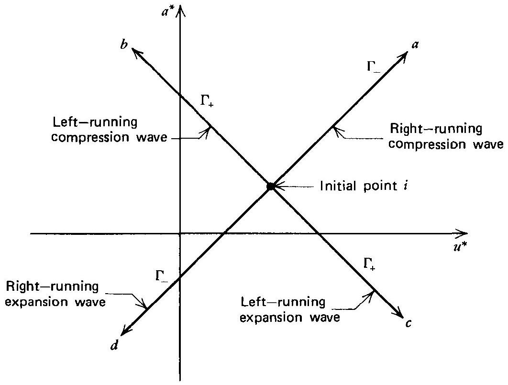
Figure 13.4 Characteristics in the state plane.

1. A right-running compression wave, corresponding to the $\Gamma_{\text {_ characteristic from }}$ point $i$ to $a$.
2. A left-running compression wave, corresponding to the $\Gamma_{+}$characteristic from point $i$ to $b$.
3. A left-running expansion wave (also called a rarefaction wave), corresponding to the $\Gamma_{+}$characteristic from point $i$ to $c$.
4. A right-running expansion wave, corresponding to the $\Gamma_{-}$characteristic from point $i$ to $d$.
In a particular flow field, the direction taken from the initial point $i$ in the state plane depends on the direction in which the wave travels (right- or left-running) and the type of wave (compression or expansion).
The complete state plane may be constructed by drawing lines having the slope $\pm 1$ through all points in the $u^{*} a$ * state plane. Figure 13.5 presents selected uniformly spaced state plane characteristics that cover the region $-1.5 \leqq u^{*} \leqq 1.5$ and $0.6 \leqq a^{*} \leqq 1.4$ of the state plane.

The location of the right- and left-running characteristics in the physical plane (i.e., the xt plane), called the physical characteristics, is determined by integrating equation 13.24. Along right-running, or $C_{+}$, characteristics, the quantity $a_{+}^{*}+ (\gamma-1) u_{+}^{*} / 2$ is a constant, and along left-running, or $C_{-}$, characteristics, the quantity

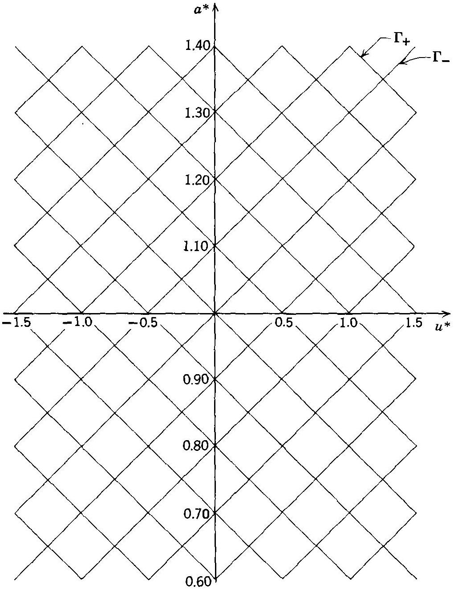
Figure 13.5 Selected characteristics in the state plane for $\gamma=1.4$.

$a_{-}^{*}-(\gamma-1) u_{-}^{*} / 2$ is a constant. Those constants are frequently called Riemann invariants, after the mathematician B. Riemann.

Hence, the solution to an unsteady one-dimensional planar homentropic flow reduces to determining the location of the characteristics in the physical plane. Along the characteristics the quantities $a_{ \pm}^{*} \pm(\gamma-1) u_{ \pm}^{*} / 2$ are constants.

## 13-4(b) Uniform Flow Regions, Simple Wave Regions, and Nonsimple Wave Regions

A uniform flow region is one in which all of the thermodynamic properties of the fluid are uniform and its velocity is constant. A stationary region where $u=0$ is a special case of a uniform flow region. A uniform flow region is said to be doubly degenerate in the state plane, because a region in the physical plane maps onto a single point in the state plane; that is, the $u^{*} a^{*}$ plane. Regions of uniform flow occur quite frequently in unsteady flows.

A simple wave region is one wherein there are waves of only one family; that is, either right- or left-running waves. A simple wave region is said to be singly degenerate in the state plane, because a region in the physical plane maps onto a line in the state plane. The general features of simple waves are reviewed below.

The properties of simple waves are discussed for steady two-dimensional planar homentropic (i.e., irrotational) flow in Section 12-6. It is shown there that simple
waves may occur in a flow field when the governing partial differential equations are reducible; ${ }^{1}$ that is, the equations are homogeneous and the coefficients of the partial derivatives depend only on the dependent variables. It is pointed out in Section 12-6, that a simple wave flow has the following special properties.

1. A simple wave region is defined as one wherein the dependent variables ( $u$ and $p$ in the present case) are not independent [ $u=u(p), a=a(p)$, etc.].
2. In a simple wave region, the characteristics (Mach lines) of one family are straight lines having constant properties.
3. If a region of uniform flow adjoins a nonuniform region, then the nonuniform region must be a simple wave region.

It is shown in the present section that simple waves may occur in unsteady onedimensional planar homentropic flow.

The governing equations for unsteady one-dimensional planar homentropic flow, equations 13.7 and 13.12 with $\delta=0$, are homogeneous, and the coefficients of the partial derivatives depend only on the flow properties $u$ and $p$. Furthermore, since the entropy $s$ is uniform throughout the flow field, all of the thermodynamic properties are unique functions of a single thermodynamic property, for example, the pressure $p$. Consequently, equations 13.7 and 13.12 are reducible, and simple waves may occur in the flow field of an unsteady one-dimensional planar homentropic flow.

From Property 3 above, a simple wave region adjoins a uniform flow region. Regions of uniform flow occur, as stated earlier, quite frequently in unsteady flows; consequently, simple wave regions also occur frequently.

The propagation of a pressure disturbance into a stationary region, discussed in Section 13-4(c), results in the formation of a simple wave region. The reflection of pressure disturbances at the boundaries of simple wave regions results in waves of both families, which interact and create a nonsimple wave region. Nonsimple wave regions in the physical plane map into regions in the state plane. Examples of nonsimple wave regions are discussed in Sections 13-4(d) and 13-4(e). A more complex unsteady flow field, one involving uniform flow regions, simple wave regions, nonsimple wave regions, and discontinuities such as shock waves and contact surfaces, is produced in the shock tube, discussed in Section 19-5(c).

## 13-4(c) Simple Compression and Expansion Waves

Figure 13.6a illustrates schematically a piston at rest in a long tube wherein there is a stationary gas ( $u=0$ ). At the time $t=0$, the piston accelerates smoothly to the right. The initial motion of the piston produces a small pressure disturbance that propagates to the right into the undisturbed fluid with the speed of sound $a$, as illustrated schematically in the $x t$ plane in Fig. 13.6b. Hence, the velocity of the front of the wave is $(d x / d t)_{+}=a$, because a right-running wave is a $C_{+}$characteristic.
The wave created by the initial piston motion imparts a pressure increment $d p>0$ and a velocity increment $d u>0$ to the initially undisturbed gas, and is, therefore, a compression wave. For an isentropic process, if $d p>0$ then $d a>0$. The initial infinitesimal compression wave is illustrated on the state plane in Fig. 13.6c. As the piston continues to accelerate, successive compression waves are generated at the face of the piston and move into the disturbed gas. The latter has a velocity $u$ and speed of sound $a$ larger than the corresponding values for the undisturbed gas. Consequently, the speeds of propagation, $(d x / d t)_{+}=u+a$, of the consecutive waves increase, and each wave travels faster than the preceding wave.

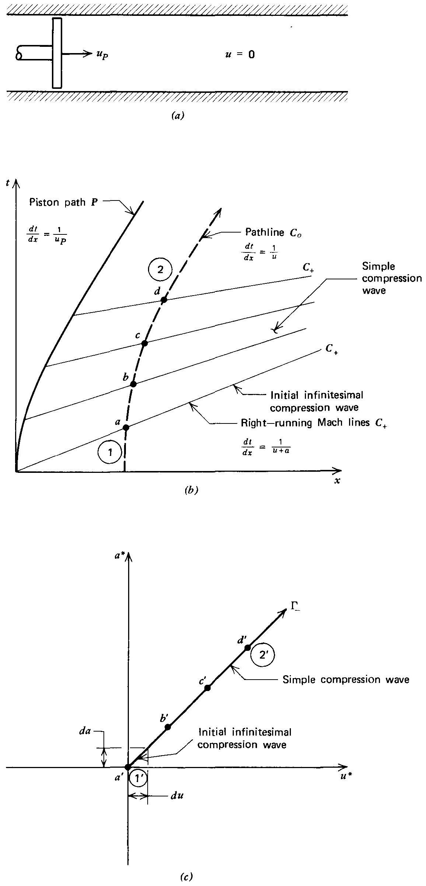
Figure 13.6 Right-running waves created by the motion of a piston in a gas. (a) Physical arrangement. (b) Compression wave in the physical plane. (c) Compression wave on the state plane.

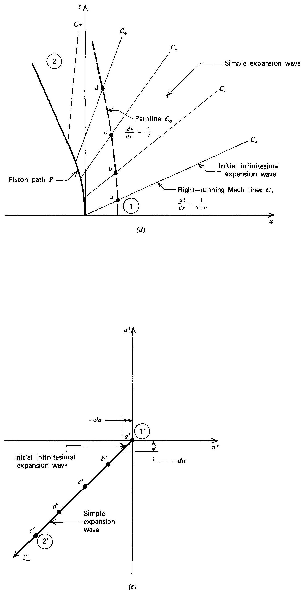
Figure 13.6 (Continued) (d) Expansion wave in the physical plane. (e) Expansion wave on the state plane.

The slopes of the $C_{+}$characteristics, or right-running Mach lines, given by $(d t / d x)_{+}= 1 /(u+a)$, become more and more horizontal, and the waves converge, as illustrated in Fig. 13.6b. A typical pathline, or particle path, is indicated in Fig. 13.6b.

The process illustrated in Fig. 13.6b comprises a continuous compression wave. It is a simple compression wave, since all of the disturbances propagate in the direction of increasing values of $x$, that is, from the left into a region of uniform flow. Since the fluid particles enter the wave from the right, the compression wave illustrated in Fig. 13.6b is called a right-facing compression wave. Figure $13.6 c$ illustrates the simple compression wave on the state plane; that is, the $u^{*} a^{*}$ plane. The uniform regions 1 and 2 in the physical plane map onto points $1^{\prime}$ and $2^{\prime}$, respectively, in the state plane. Selected $C_{+}$characteristics on the pathline, denoted by $a, b$, etc., are indicated in the physical plane in Fig. 13.6b, and their corresponding images on the state plane are denoted by $a^{\prime}, b^{\prime}$, etc., in Fig. 13.6c.

Figure 13.6d illustrates schematically the situation where the piston is accelerated smoothly in the direction of increasing values of $-x$, that is, to the left away from the gas enclosed by the tube. The initial motion of the piston produces a small pressure disturbance that propagates to the right with the speed of sound $a$. The velocity of the front of the wave, which is a $C_{+}$characteristic, is $(d x / d t)_{+}=a$. The wave created by the initial piston motion imparts a pressure increment $d p<0$, a velocity increment $d u<0$, and a speed of sound increment $d a<0$ to the undisturbed gas in the tube. Hence, the wave is an expansion wave. The initial infinitesimal expansion wave is illustrated in the state plane in Fig. 13.6e. As the piston accelerates away from the gas, successive expansion waves are propagated into the disturbed fluid, which has an increasing negative velocity $-u$ and a decreasing speed of sound $a$. Accordingly, the speed of propagation, $(d x / d t)_{+}=u+a$, of each consecutive expansion wave is smaller than that of the preceding wave. As a result, the slope, $(d t / d x)_{+}=1 /(u+a)$, of each successive right-running Mach line $C_{+}$becomes steeper, and the waves diverge, as illustrated in Fig. 13.6d. A typical pathline is illustrated in Fig. 13.6d.

The wave pattern illustrated in Fig. 13.6d is an expansion wave. Because all of the disturbances originate and propagate from the left into a region of undisturbed fluid, the wave pattern illustrated in Fig. 13.6d is a simple expansion wave. It is termed a right-facing expansion wave because the fluid particles enter the wave from the right side. Figure 13.6e illustrates schematically the simple expansion wave on the state plane.

Figures $13.7 a$ and $13.7 b$ illustrate schematically a left-facing compression wave and a left-facing expansion wave, respectively. The corresponding state planes are illustrated in Figs. 13.7c and 13.7d.

From Figs. 13.6 and 13.7, the following rules for simple compression and expansion waves are obtained.

Rule 1. Simple compression waves accelerate the fluid in the direction of the propagation of the wave. The pressure, velocity, and speed of sound increase, thus increasing the wave propagation speed, and the waves converge. Pathlines bend toward the waves.

Rule 2. Simple expansion waves accelerate the fluid in the direction opposite to the propagation of the wave. The pressure and speed of sound decrease while the velocity increases in the opposite direction, thereby decreasing the wave propagation speed. The waves diverge, and the pathlines bend away from the waves.

The simple compression and expansion waves discussed above are analogous to the simple compression and expansion waves for steady two-dimensional planar homentropic flow, discussed in Sections 8-4(c) and 8-6.

As pointed out in Section 13-4(a), the properties of a simple wave region may also be described in terms of the state plane characteristics $\Gamma_{ \pm}$. For a simple right-facing $C_{+}$wave, the flow properties are constant along the $C_{+}$physical characteristics. Each $C_{+}$characteristic is thus a straight line, which maps onto a point in the state plane, as illustrated in Fig. 13.4. The flow properties change in a right-facing $C_{+}$wave only across the $C_{+}$waves; that is, along the $C_{-}$physical characteristics that cross them. All states in a simple right-facing $C_{+}$wave, therefore, map onto a single $\Gamma_{-}$characteristic in the state plane. Similarly, all states in a simple left-facing $C_{-}$wave map onto a single $\Gamma_{+}$characteristic in state plane.

For a specified piston motion $u_{P}=f(t)$, the piston path $P$ may be determined, and the corresponding value of $u=u_{p}$ is, therefore, specified at each point along $P$. Knowing $u^{*}=u / a_{o}$ along the piston path $P$, the corresponding values of $a^{*}$ may be

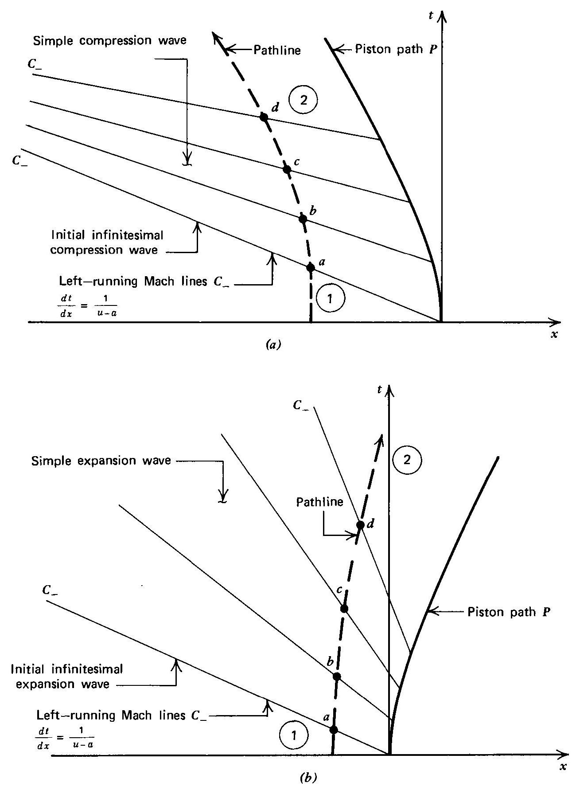
Figure 13.7 Left-running waves created by the motion of a piston. (a) Compression waves. (b) Expansion waves.

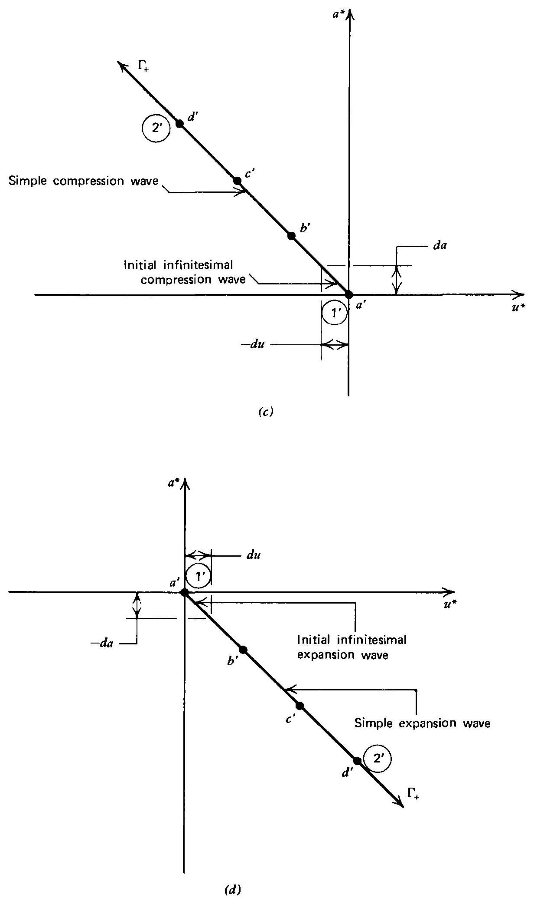
Figure 13.7 (Continued) (c) Compression wave on the state plane. (d) Expansion wave on the state plane.

calculated from equation 13.36, and the slope of the corresponding Mach line emanating from each point on the piston path may be determined from equation 13.24. Hence, the simple wave region emanating from the surface of a piston moving in a continuous manner may be determined completely.

When the piston is acclerated instantaneously to a finite velocity, a centered wave results. Figure $13.8 a$ illustrates a centered compression wave, which is a shock wave
in the physical plane, and Fig. $13.8 b$ illustrates a centered expansion wave. Both waves are right-facing waves. Similar results hold for left-facing waves. The state plane illustrated in Fig. 13.6e corresponds to the physical plane illustrated in Fig. 13.8b.

The centered expansion wave illustrated in Fig. $13.8 b$ is a special case of a simple expansion wave. The origin of a centered expansion wave is a singular point, where multiple values are obtained for the flow properties at a single value of $x$ and $t$. Such a wave is analogous to the Prandtl-Meyer centered expansion wave in a steady two-dimensional planar flow, discussed in Section 8-4. Because a centered expansion wave issues from a geometric point, such effects as area change, friction, heat transfer, and mass addition cannot occur, even though those effects may be present in the remainder of the flow field. Consequently, the flow through the origin is homentropic even when the remainder of the flow field is not homentropic, and equations 13.24 and 13.28 are applicable. The properties at the origin of the centered expansion wave

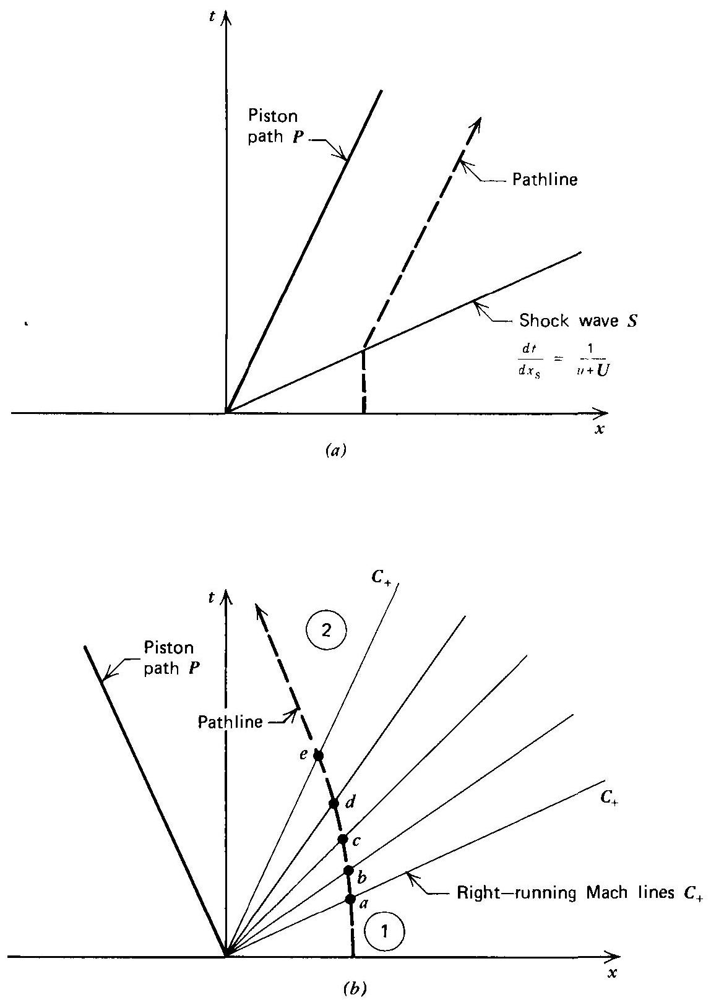
Figure 13.8 Centered waves created by the instantaneous acceleration of a piston. (a) Centered compression, or shock, wave. (b) Centered expansion wave.

are, therefore, those corresponding to the case where continuous expansion waves emanate from a point.

The direction of the Mach lines emanating from the origin of a centered expansion wave may be determined from the characteristic equation for the Mach lines, equation 13.24. If the flow field is homentropic, then a simple expansion wave develops from the Mach lines emanating from the origin. Even if the flow field is not homentropic, the solution described above for the flow properties at the origin of the centered expansion wave is still valid. A nonsimple expansion wave develops, however, from the Mach lines emanating from the singular point.

Example 13.1. Air, assumed to be a perfect gas, fills a 3.0 m long tube at a pressure $p_{o}=2.00 \cdot 10^{5} \mathrm{~N} / \mathrm{m}^{2}$ and a static temperature $T_{o}=300 \mathrm{~K}$, as illustrated in Fig. 13.9a. The right-hand end of the tube is suddenly opened to the surrounding atmosphere, which is at a pressure of $1.00 \cdot 10^{5} \mathrm{~N} / \mathrm{m}^{2}$. A centered expansion wave propagates into the tube. Calculate (a) $u, a$, and $M$ along the Mach lines corresponding to $p=2.00$, $1.75,1.50,1.25$, and $1.00 \cdot 10^{5} \mathrm{~N} / \mathrm{m}^{2}$, and (b) the time required for the first expansion wave to reach the left end of the tube. Plot the corresponding Mach lines on the $x t$ plane. For air, $\gamma=1.40$ and $R=287.04 \mathrm{~J} / \mathrm{kg}-\mathrm{K}$.

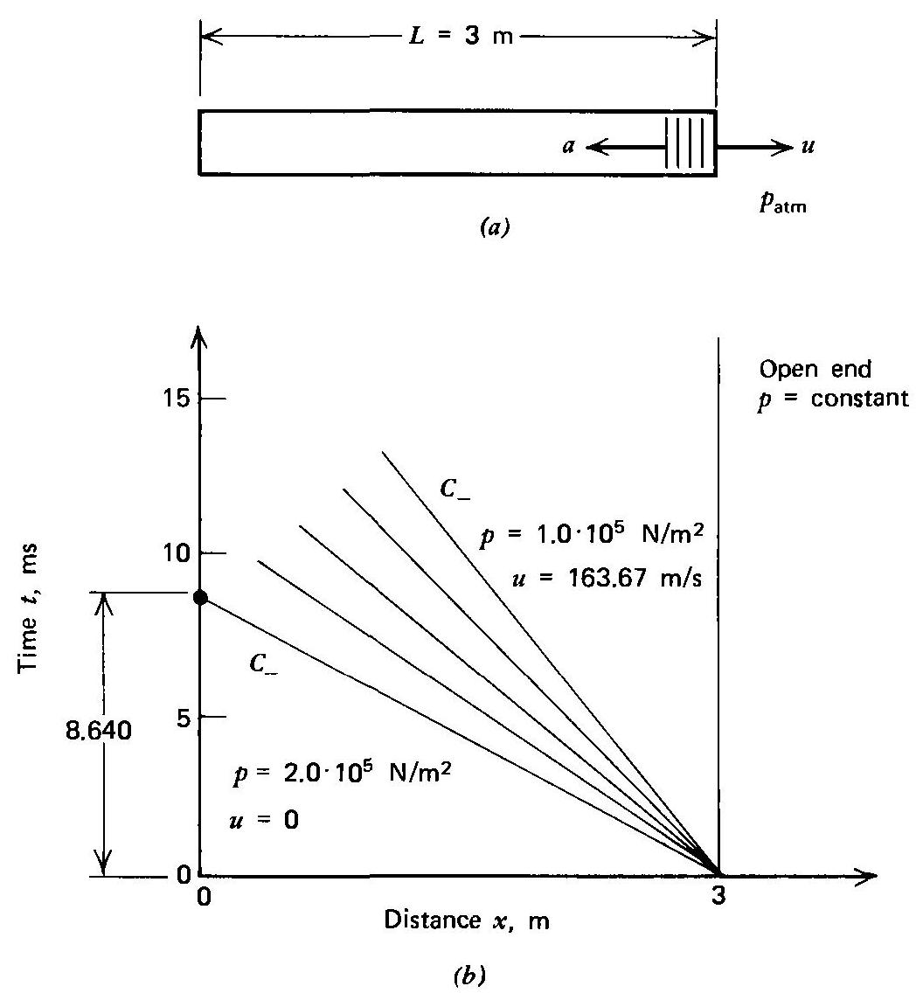
Figure 13.9 Illustrations for Example 14.1. (a) Physical arrangement. (b) Physical plane.

## Solution

(a) Choose the reference properties $p_{o}, T_{o}, \rho_{o}$, and $a_{o}$ to be those of the undisturbed air in the tube before the expansion wave is initiated. Thus,

$$
a_{o}=\left(\gamma R T_{o}\right)^{1 / 2}=[1.4(287.04)(300)]^{1 / 2}=347.21 \mathrm{~m} / \mathrm{s}
$$

A left-running expansion wave propagates into the tube from the right end, corresponding to line $i-c$ in Fig. 13.4, which is a $\Gamma_{+}$characteristic. From equation 13.36,

$$
a^{*}+0.2 u^{*}=1.0
$$

From equation 13.37,

$$
a^{*}=\left(p^{*}\right)^{(\gamma-1) / 2 \gamma}=\left(p^{*}\right)^{0.14286}
$$

For $p=1.00 \cdot 10^{5} \mathrm{~N} / \mathrm{m}^{2}, p^{*}=1.00 / 2.00=0.5$. From equation (b),

$$
a^{*}=(0.5)^{0.14286}=0.90572
$$

and

$$
a=a^{*} a_{o}=(0.90572)(347.21)=314.48 \mathrm{~m} / \mathrm{s}
$$

From equation (a),

$$
u^{*}=5.0\left(1.0-a^{*}\right)=5.0(1.0-0.90572)=0.47140
$$

and

$$
u=u^{*} a_{o}=(0.47140)(347.21)=163.67 \mathrm{~m} / \mathrm{s}
$$

From the definition of the Mach number,

$$
M=\frac{u}{a}=\frac{u^{*}}{a^{*}}=\frac{0.47140}{0.90572}=0.52047
$$

When plotting results on the xt plane, it is convenient to nondimensionalize the distance $x$ by the tube length $L$, and the time $t$ by the ratio $\left(L / a_{o}\right)$. Thus, $x^{*}=x / L$ and $t^{*}=\left(t a_{o} / L\right)$, and

$$
\lambda_{ \pm}^{*}=\frac{d t^{*}}{d x_{ \pm}^{*}}=\frac{d\left(t a_{o} / L\right)}{d(x / L)}=a_{o} \frac{d t}{d x}=a_{o} \lambda_{ \pm}=\frac{a_{o}}{u \pm a}=\frac{1}{u^{*} \pm a^{*}}
$$

where $\lambda_{ \pm}^{*}$ denotes the corresponding slope in the $x^{*} t^{*}$ plane. For the present problem,

$$
\lambda_{-}^{*}=\frac{1}{u^{*}-a^{*}}=\frac{1}{0.47140-0.90572}=-2.3025
$$

The results for the remaining values of $p$ specified in part (a) are presented in the following table.

| $p, \mathrm{~N} / \mathrm{m}^{2} \cdot 10^{5}$ | $p^{*}$ | $a^{*}$ | $a, \mathrm{~m} / \mathrm{s}$ | $u^{*}$ | $u, \mathrm{~m} / \mathrm{s}$ | M | $\lambda^{*}$ |
| :--- | :--- | :--- | :--- | :--- | :--- | :--- | :--- |
| 2.00 | 1.00000 | 1.00000 | 347.21 | 0.00000 | 0.0 | 0.00000 | -1.0000 |
| 1.75 | 0.8750 | 0.98110 | 340.65 | 0.09450 | 32.81 | 0.09632 | -1.1279 |
| 1.50 | 0.7500 | 0.95973 | 333.23 | 0.20135 | 69.91 | 0.20980 | -1.3186 |
| 1.25 | 0.6250 | 0.93506 | 324.66 | 0.32470 | 112.74 | 0.34725 | -1.6384 |
| 1.00 | 0.50000 | 0.90572 | 314.48 | 0.47140 | 163.67 | 0.52047 | -2.3025 |

Figure $13.9 b$ illustrates the five waves considered above on the $x^{*} t^{*}$ plane. The actual expansion wave is a continuous wave having an infinite number of Mach lines, of which the above are five particular ones.
(b) From Fig. 13.9b, the equation of the first expansion wave to reach the left end is

$$
\frac{d t}{d x_{-}}=\frac{t-0}{0-x}=\lambda_{-}=\frac{\lambda_{-}^{*}}{a_{o}}
$$

and the time $t$ corresponding to $x=L$ is

$$
t=-\frac{L \lambda_{-}^{*}}{a_{o}}=-\frac{(3.0)(-1.0)}{347.21}=8.640 \mathrm{~ms}
$$

## 13-4(d) Reflection of Compression and Expansion Waves

When either a continuous compression or expansion wave impinges upon a boundary of a flow region, a reflected wave is generated. Waves may be reflected from the closed ends and open ends of a duct, shock waves, and contact surfaces. The present section discusses the reflections from the closed and open ends of a duct. The reflections and interactions with shock waves and with contact surfaces are discussed in Sections 19-5(a) and 19-5(b), respectively.

Figure 13.10 $a$ illustrates schematically the flow model for analyzing the intersection of a right-running compression wave of infinitesimal size with a closed end. The

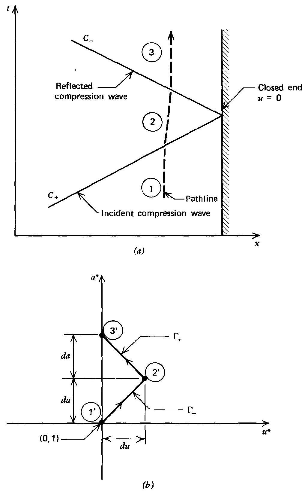
Figure 13.10 Reflection of an infinitesimal compression wave from a closed end. (a) Physical plane. (b) State plane.

incident compression wave imparts a pressure increment $d p>0$ and a velocity increment $d u>0$ to the fluid particles. At the solid wall, however, the fluid velocity $u$ must remain equal to zero. To satisfy that condition, a reflected wave is required that imparts a velocity increment $d u<0$ to the fluid particle adjacent to the solid wall; that is, the velocity increment acts in the same direction as the reflected wave. It follows from Rule 1, Section 13-4(c), that the reflected wave must be a compression wave. Figure $13.10 b$ illustrates schematically the reflected compression wave in the state plane; the incident compression wave changes the state from point $1^{\prime}$ to $2^{\prime}$ along a $\Gamma_{-}$characteristic, and the reflected compression wave must follow the $\Gamma_{+}$characteristic from point $2^{\prime}$ to $3^{\prime}$ so that the fluid velocity is zero at the wall. The uniform Regions 1,2 , and 3 in the physical plane, map onto points $1^{\prime}, 2^{\prime}$, and $3^{\prime}$, respectively, in the state plane.

If the incident compression wave comprises several infinitesimal waves thereby forming a simple compression wave, the incident wave imparts the finite changes $\Delta u$ and $\Delta p$ to the fluid. Figure 13.11 a illustrates schematically, in the physical plane, a simple compression wave impinging upon the closed end of a tube. A simple compression wave is reflected from the closed end and a nonsimple wave interaction region is formed adjacent to the wall where waves of both families are present. Figure $13.11 b$ illustrates the aforementioned waves in the corresponding state plane, where the uniform regions 1,2 , and 3 map onto points $1^{\prime}, 2^{\prime}$, and $3^{\prime}$, respectively. The incident simple compression wave region maps onto line $1^{\prime}-2^{\prime}$ in the state plane, and the shaded nonsimple wave region in the physical plane maps onto the shaded region in the state plane.

In Fig. 13.11, several selected physical and state characteristics are illustrated. The points $a, b$, etc., in the physical plane map onto points $a^{\prime}, b^{\prime}$, etc., respectively, in the state plane. Since the state plane characteristics $\Gamma_{+}$and $\Gamma_{-}$are fixed, they are independent of the physical plane $C_{+}$and $C_{-}$characteristics. Points $a, b, c$, and $d$ in the physical plane are determined solely by the incident simple compression wave. Point $e$ is located at the intersection of the $C_{+}$characteristic through point $b$ with the wall, where $u=0$. Point $e^{\prime}$ is, therefore, located at the intersection of the $\Gamma_{+}$characteristic through point $b^{\prime}$ with the $a^{*}$ axis, where $u^{*}=0$. Similarly, point $f$ is located at the intersection of the $C_{+}$and $C_{-}$characteristics through points $c$ and $e$, respectively, and point $f^{\prime}$ is located at the intersection of the $\Gamma_{+}$and $\Gamma_{-}$characteristics through points $c^{\prime}$ and $e^{\prime}$, respectively. The locations of the remaining points illustrated in Fig. 13.11 are determined in a similar manner.

Because the simple compression wave interacts continuously with the wall, the entropy of the fluid remains constant in the nonsimple wave interaction region. Consequently, the flow remains homentropic. The compression wave emerging from the nonsimple wave interaction region must be a simple compression wave because it is adjacent to a uniform flow region, Region 2.

Figure 13.12a illustrates schematically, in the physical plane, the intersection of an infinitesimal expansion wave with the closed end of a duct. The incident expansion wave imparts a pressure increment $d p<0$ and a velocity increment $d u<0$ to the fluid particles. Since the boundary condition at the solid wall is that the flow velocity must remain equal to zero, a reflected wave that imparts a velocity increment $d u>0$ to the fluid particle adjacent to the solid wall is generated. Since the velocity increment acts in the direction opposite to that of the propagation of the reflected wave, the reflected wave must be an expansion wave [see Rule 2 in Section 13-4(c)]. Figure $13.12 b$ illustrates the incident and reflected expansion waves in the state plane. The incident expansion wave changes the state of the fluid from point $1^{\prime}$ to $2^{\prime}$ along the $\Gamma_{-}$ characteristic, and the reflected wave must follow the $\Gamma_{+}$characteristic from point $2^{\prime}$

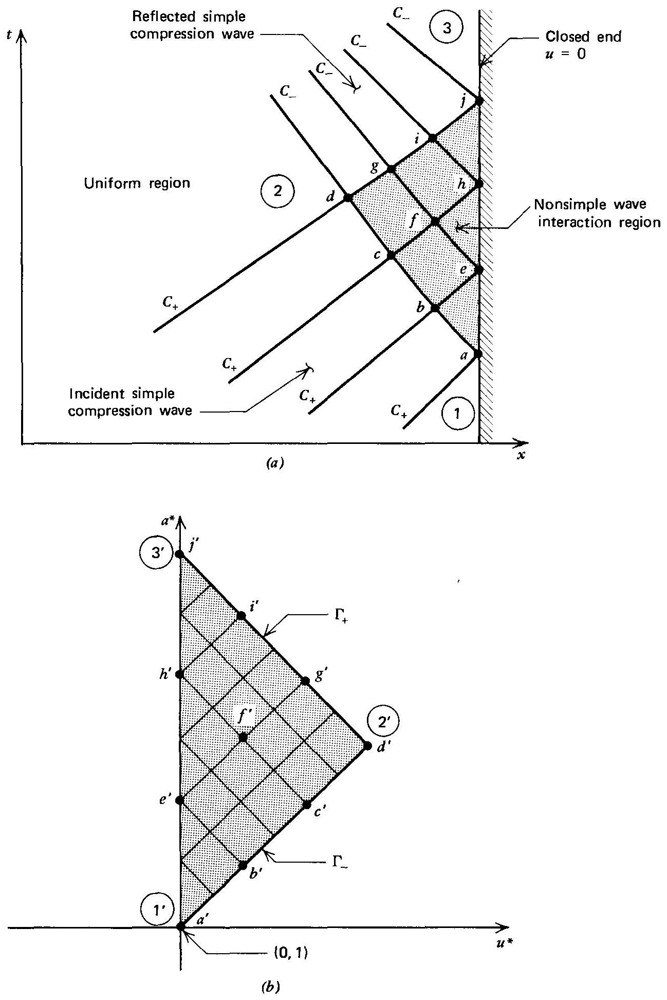
Figure 13.11 Reflection of a simple compression wave from a closed end. (a) Physical plane. (b) State plane.

to $3^{\prime}$ so that the flow velocity will be zero. The uniform Regions 1, 2, and 3 in the physical plane map onto points $1^{\prime}, 2^{\prime}$, and $3^{\prime}$, respectively, in the state plane.

Figure 13.13 illustrates a simple expansion wave, which comprises several infinitesimal expansion waves, impinging on the closed end of a duct. As in the case of the simple compression wave (see Fig. 13.11a), a nonsimple wave interaction region is formed adjacent to the wall. The reflected wave in this case is a simple expansion wave. The foregoing demonstrates that the reflected waves from the closed end of a duct are of the same type as the incident waves.

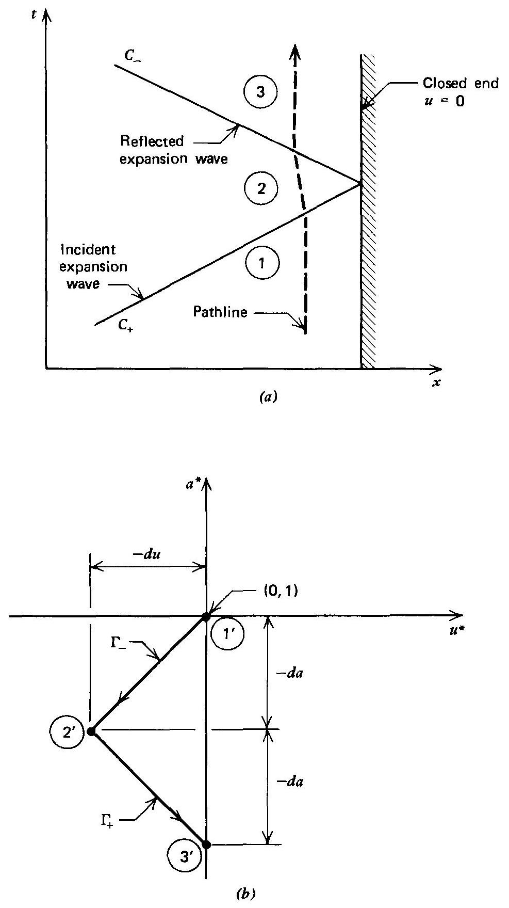
Figure 13.12 Reflection of an infinitesimal expansion wave from a closed end. (a) Physical plane. (b) State plane.

Waves may also reflect from an open end of a duct. Four different cases are possible: the flow at the open end may be either an inflow or outflow, and it may be either subsonic or supersonic. In the case of an outflow, the interaction at the open end should take into account the unsteady flow effects that are present in the exhaust region; those effects may be two- or three-dimesional. For a low subsonic outflow velocity, a reasonable approximation to the actual phenomena may be obtained by neglecting the flow field external to the open end of the duct and assuming that the pressure at the end of the duct is equal to the ambient pressure. For high subsonic outflow from the duct, the aforementioned approximation may be unrealistic, and a more realistic approximation must be developed. In the case of supersonic outflow, the outflow velocity is larger than the propagation velocity of the reflected waves, which travel at the speed of sound relative to the fluid, so that such waves would be

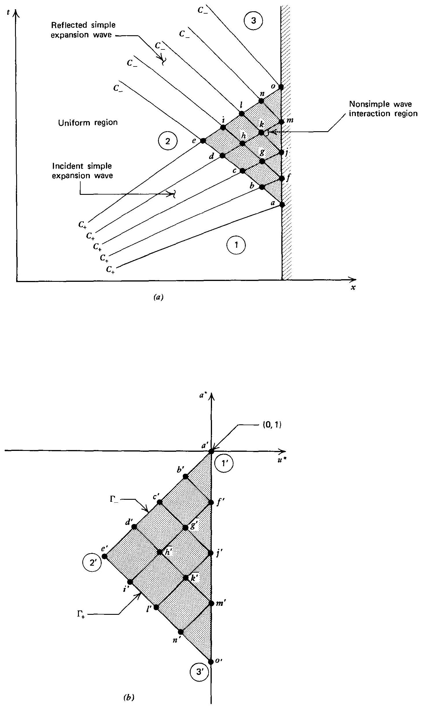
Figure 13.13 Reflection of a simple expansion wave from a closed end. (a) Physical plane. (b) State plane.

unable to propagate into the duct; they are swept out of the flow passage by the supersonic flow velocity. Hence, there are no reflected waves.

Figure 13.14a illustrates schematically, in the physical plane, the open end of a duct with a low subsonic outflow, and an infinitesimal compresion wave incident upon the open end of the duct. To determine the general characteristics of the reflected wave, it is assumed that the pressure in the exit plane of the duct remains equal to the constant ambient pressure. For an incident compression wave, $d p>0$ and $d u>0$. The pressure of the fluid particle at the duct exit plane, however, remains constant. Hence, a reflected wave is propagated into the duct with $d p<0$; that is, it is an expansion wave. Figure 13.14b illustrates the incident and reflected waves in the state plane. The incident compression wave changes the state of the fluid from point $1^{\prime}$ to $2^{\prime}$ along a $\Gamma_{-}$ characteristic, and the reflected expansion wave changes the state of the fluid from point $2^{\prime}$ to $3^{\prime}$ along a $\Gamma_{+}$characteristic. At state $3^{\prime}$ the speed of sound $a$, and hence the pressure $p$, returns to its original value. The uniform Regions 1,2, and 3 in the physical plane map onto points $1^{\prime}, 2^{\prime}$, and $3^{\prime}$, respectively, in the state plane.

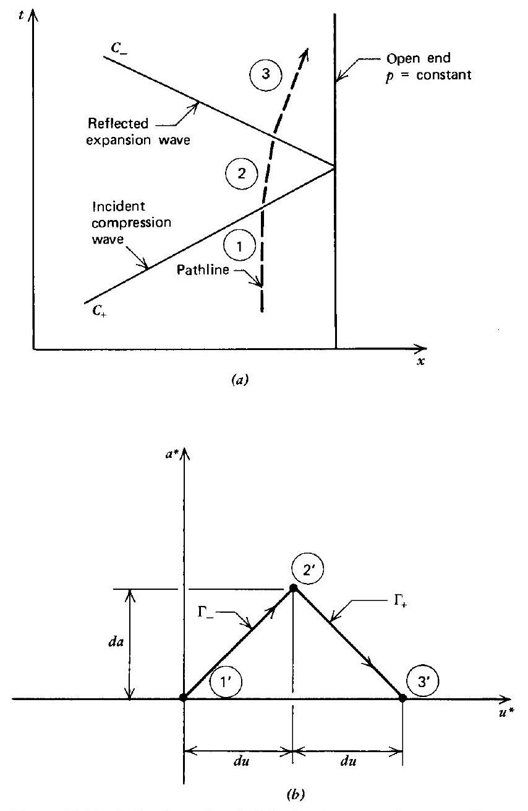
Figure 13.14 Reflection of an infinitesimal compression wave from an open end. (a) Physical plane. (b) State plane.

When a simple compression wave of finite amplitude impinges on an open end, a nonsimple wave interaction region is formed, and a simple expansion wave is reflected, as illustrated in Fig. 13.15. Consequently, Region $1^{\prime}-2^{\prime}-3^{\prime}$ in Fig. $13.14 b$ becomes a region of finite size.

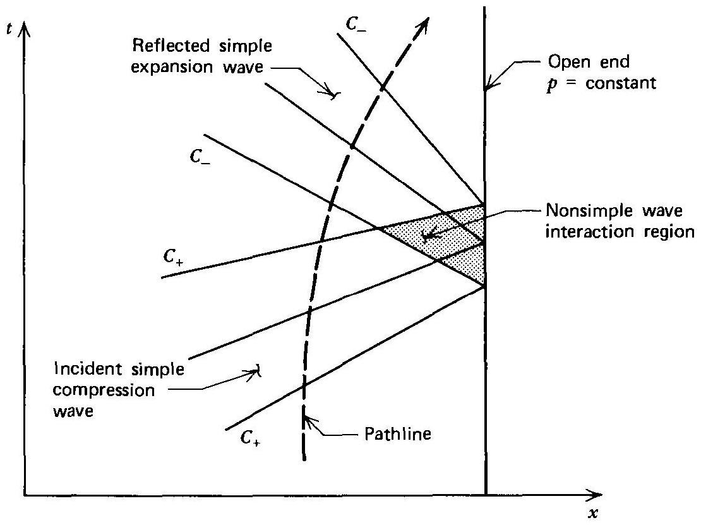
Figure 13.15 Reflection of a simple compression wave from an open end.

Figure 13.16a illustrates schematically the case where an infinitesimal expansion wave is reflected from an open end, and the duct exit plane pressure $p$ is constant. The incident wave imparts $d p<0$ and $d u<0$ to the fluid particles. At the tube exit plane a wave is reflected with $d p>0$ to maintain the pressure constant; that is, the reflected wave is a compression wave. The incident and reflected waves are illustrated in the state plane in Fig. 13.16b. The state of the fluid is changed from point $1^{\prime}$ to $2^{\prime}$ along the $\Gamma_{-}$characteristic, which is an expansion wave. The reflected compression wave changes the fluid state from point $2^{\prime}$ to point $3^{\prime}$ where the pressure is equal to the initial pressure at the duct exit. The uniform Regions 1, 2, and 3, in Fig. 13.16a, map onto the points $1^{\prime}, 2^{\prime}$, and $3^{\prime}$, respectively, in the state plane.

Figure 13.17 illustrates the reflection of a simple expansion wave from an open end, where the static pressure $p$ is constant. A nonsimple wave interaction region is formed at the open end, and a simple compression wave is reflected from the open end. In this case, Region $1^{\prime}-2^{\prime}-3^{\prime}$ in Fig. $13.16 b$ becomes a region of finite size.

By similar reasoning, analogous results may be obtained for subsonic inflow. For supersonic inflow, waves from within the duct cannot propagate to the inlet of the duct, so wave reflection is meaningless.

Summarizing, the following rules of wave reflection apply at the end of a duct.
Rule 1. When a wave is incident on a closed end, a wave of the same type is reflected. Thus, incident compression waves reflect as compression waves and incident expansion waves reflect as expansion waves.

Rule 2. When a wave is incident on an open end where the pressure $p$ in the exit plane is constant and the flow is subsonic, a wave of the opposite type is reflected. If the flow is supersonic, no waves are reflected.

These results hold at the end of the duct for both outflow and inflow.

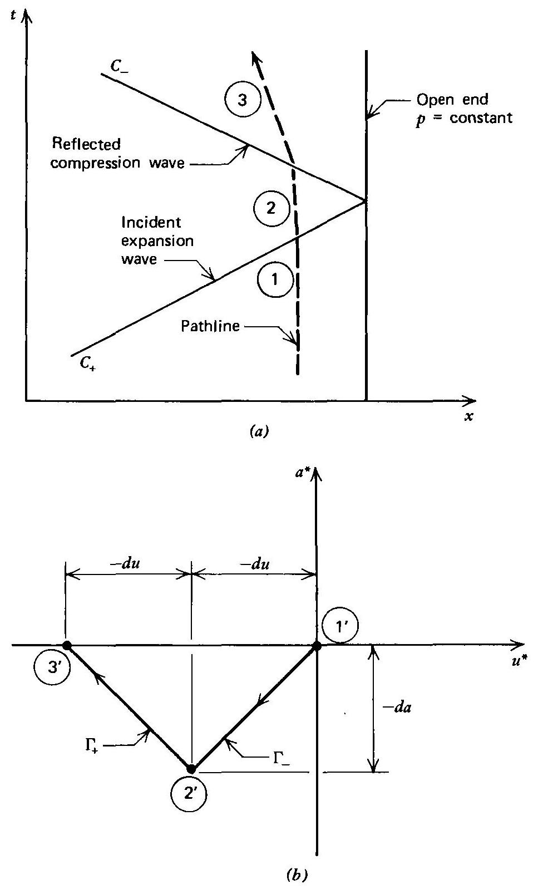
Figure 13.16 Reflection of an infinitesimal expansion wave from an open end. (a) Physical plane. (b) State plane.

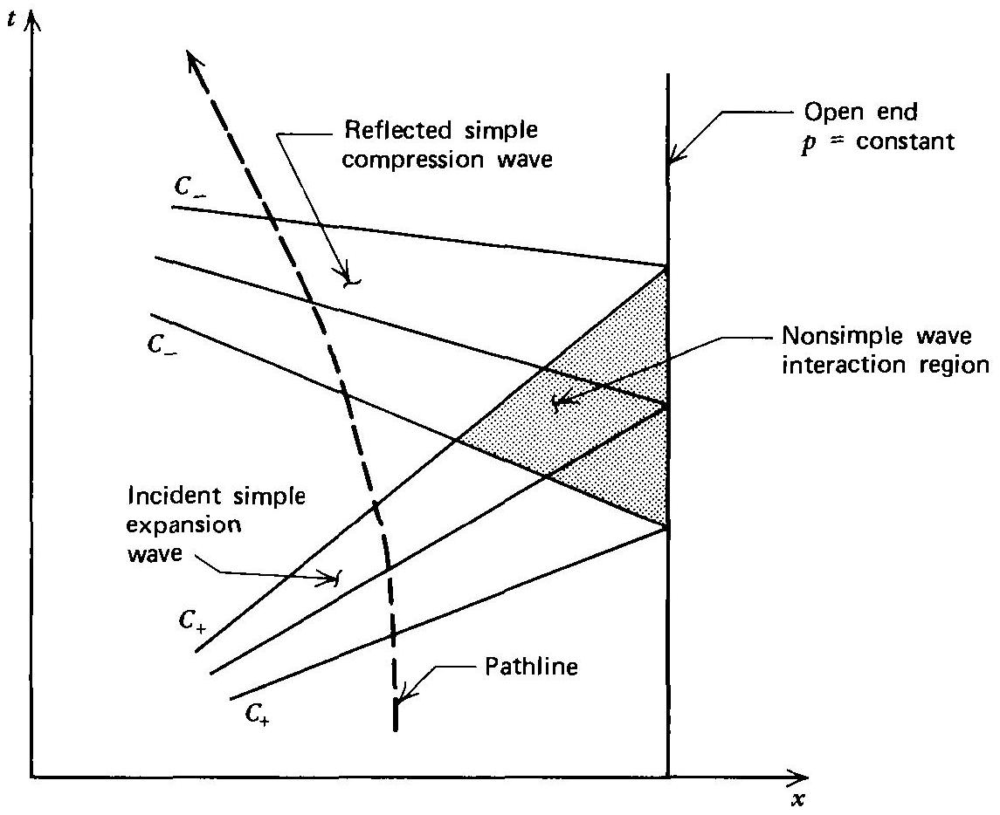
Figure 13.17 Reflection of a simple expansion wave from an open end.

## 13-4(e) Intersection of Continuous Waves

When continuous waves intersect, the result of their interaction depends on the type of waves involved (i.e., compression or expansion), and the direction of propagation of the incident waves (i.e., whether both travel in the same or opposite directions). Expansion waves traveling in the same direction diverge (see Fig. 13.6d, and no interaction can occur. Compression waves of the same family, on the other hand, converge, and may ultimately coalesce to form a shock wave. The coalescence of compression waves to form a shock wave is discussed in Section 19-5(a).

Figure 13.18a illustrates, in the physical plane, the interaction of two simple compression waves traveling in opposite directions. Figure $13.18 b$ illustrates the interaction of the two compression waves in the state plane. In the interaction region, waves of both families are present, so that the region where the interaction occurs is a nonsimple wave region. The points in the state plane corresponding to points in the physical plane are determined by following the appropriate $C_{+}$and $C_{-}$characteristics, in the physical plane, and the corresponding $\Gamma_{+}$and $\Gamma_{-}$characteristics in the state plane. The flow in the interaction region is homentropic; consequently, the transmitted compression waves are simple waves since they are adjacent to the uniform regions 2 and 3.

Figure 13.19a illustrates, in the physical plane, the intersction of two simple expansion waves traveling in opposite directions, and Fig. 13.19b illustrates their interaction in the state plane.

Figure 13.20a illustrates, in the physical plane, the intersection of a right-running simple compression wave and a left-running simple expansion wave and, in Fig. $13.20 b$, they are illustrated in the state plane. The corresponding points in the physical and state planes are determined by following the appropriate $C_{ \pm}$and $\Gamma_{ \pm}$characteristics. The incident simple compression wave emerges from the nonsimple wave interaction region as a transmitted simple compression wave, and the incident simple expansion wave emerges as a transmitted simple expansion wave. Corresponding points in the physical and state planes are labeled $a, b$, etc., and $a^{\prime}, b^{\prime}$, etc.

## 13-5 NUMERICAL IMPLEMENTATION OF THE METHOD OF CHARACTERISTICS

In Section 13-4, the characteristic and compatibility equations are derived for an unsteady one-dimensional homentropic flow. When the flowing fluid is a perfect gas with constant specific heats, the compatibility equation may be integrated in closed form to obtain a simple algebraic equation relating the velocity $u$ and the speed of sound $a$ (see equation 13.35). For a simple wave flow, the Mach lines of one family are straight lines along which the flow properties are constant. Consequently, for the simple wave flow of a perfect gas with constant specific heats, both the characteristic equation and the compatibility equation may be solved without resorting to numerical integration. For the nonsimple wave flow of a perfect gas, however, the characteristics must be determined by numerical integration of the characteristic equation, which is straightforward because the integrated form of the compatibility equation is still applicable.

When the flowing fluid is other than a perfect gas with constant specific heats, however, the compatibility equation must also be integrated numerically. In simple wave regions, the characteristics are straight lines even for the flow of such a gas, and may be determined without numerical integration once-the solution to the compatibility equation is determined numerically.

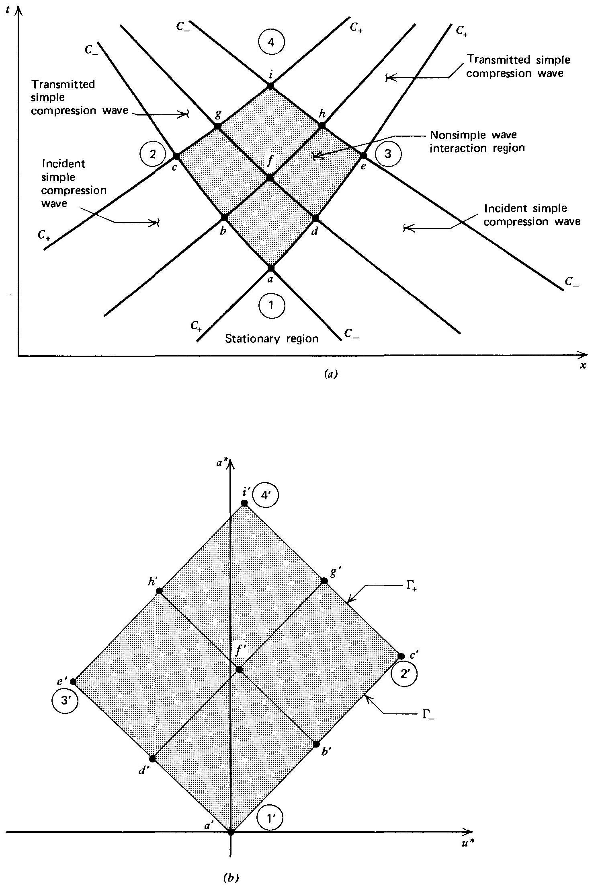
Figure 13.18 Intersection of two simple compression waves. (a) Physical plane. (b) State plane.

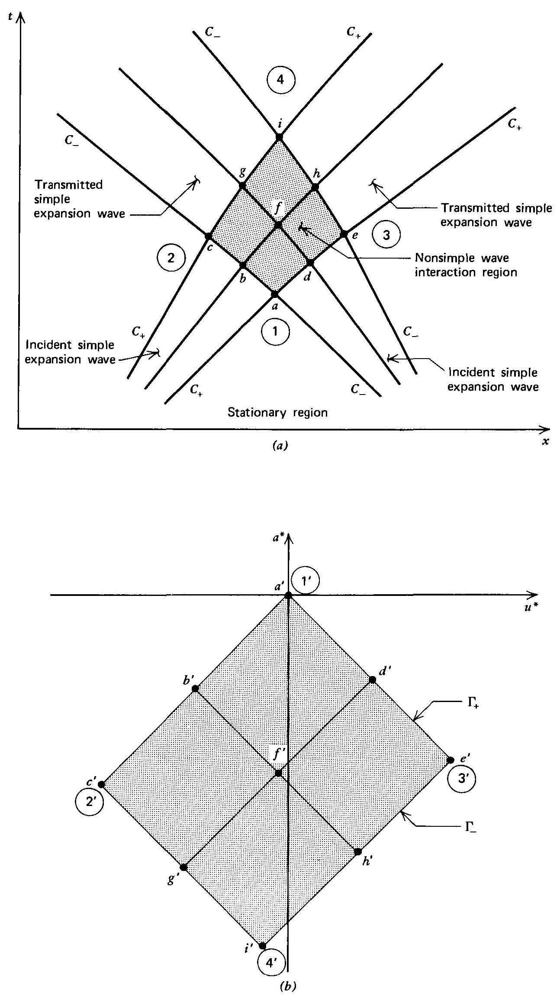
Figure 13.19 Intersection of two simple expansion waves. (a) Physical plane. (b) State plane.

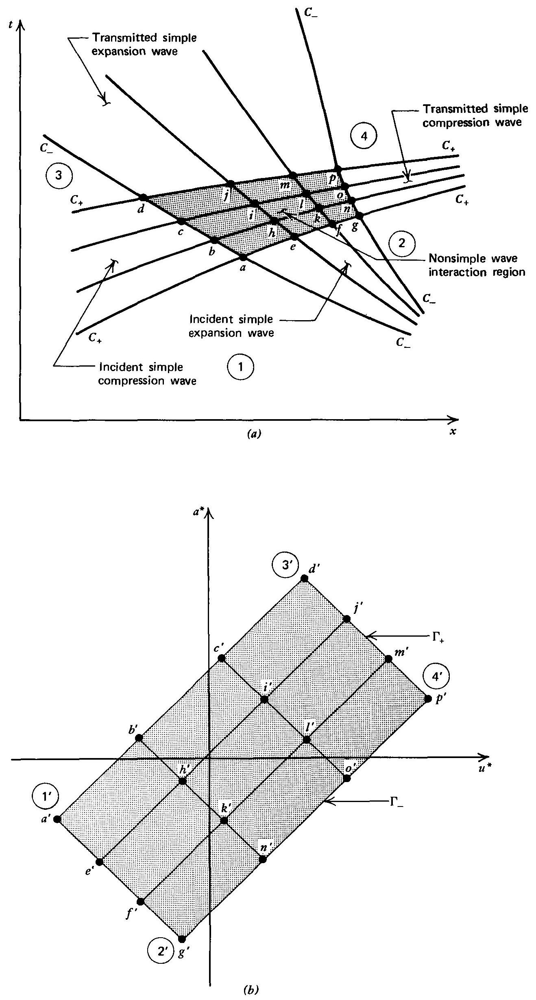
Figure 13.20 A nonsimple wave interaction between a simple compression wave and a simple expansion wave. (a) Physical plane. (b) State plane.

In the general case where the flowing fluid is other than a perfect gas and the flow is a nonsimple wave flow, both the characteristic equation and the compatibility equation must be integrated numerically. A numerical procedure for integrating those equations is developed below. A complete numerical algorithm is developed for the unit process for determining the flow properties at an interior point of the flow field, and a numerical example illustrating that unit process is presented.

## 13-5(a) Numerical Integration Procedure

The numerical integration procedure employed for integrating the characteristic and compatibility equations for unsteady one-dimensional homentropic flow is the modified Euler predictor-corrector method, which is discussed in detail in Section 12-5(a).

Two different procedures for applying that method are discussed in Section 12-5(b); they are the direct marching method and the inverse marching method. The direct marching method is employed in Section 12-5(d) for developing the unit process for an interior point for steady two-dimensional irrotational supersonic flow. In the study of unsteady flows, however, it is often advantageous to determine the solution at prespecified points located on lines of constant time, termed $t$-lines. ${ }^{6}$ Consequently, that is the approach taken in the following discussion.

Figure 13.21 presents the finite difference grid for an interior point based on the inverse marching method. The location of the solution point, point 4, is prespecified;

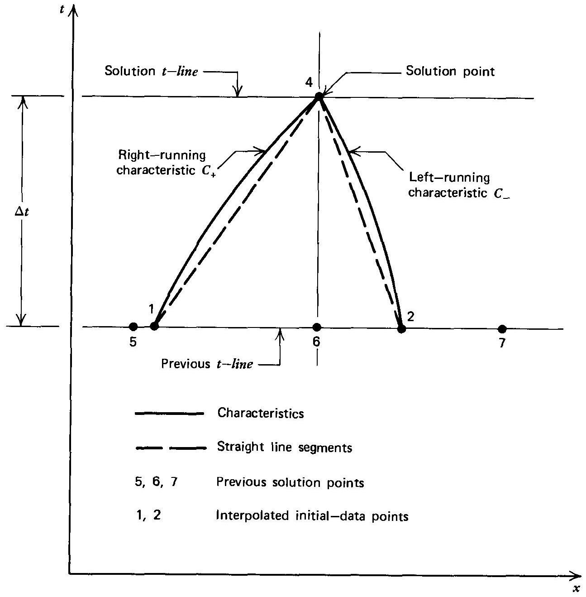
Figure 13.21 Finite difference grid for an interior point based on the inverse marching method.

for example, as equally spaced points along the solution lines. The two characteristics intersecting at point 4 are extended rearward to intersect the initial-value line at points 1 and 2 . The values of the flow properties at points 1 and 2 are determined by interpolation employing the previous solution points, points 5,6 , and 7 . The interpolation reduces the accuracy of the numerical results.

Further, to insure that the solution is numerically stable, the Courant-FriedrichsLewy (CFL) stability criterion ${ }^{7}$ must be satisfied. The criterion requires that the initial-data points (points 1 and 2 in Fig. 13.21) fall between the previous solution points (points 5, 6, and 7) that are employed in the interpolation for determining the flow properties at points 1 and 2 . Consequently, the interpolation is based on flow properties outside of the domain of dependence of point 4 , which further reduces the accuracy of the numerical integration. That is the price that must be paid, however, for employing the inverse marching method.

## 13-5(b) Finite Difference Equations

Figure 13.21 illustrates schematically the finite difference grid for the unit process for an interior point. The portions of the characteristic curves connecting two points are approximated by straight dashed line segments connecting those points. The location and flow properties for the solution points on the previous $t$-line, points 5, 6, and 7, are given, and the location of point 4 is specified. The location of points 1 and 2 are determined by iteration.

According to the Euler method, the finite difference equations corresponding to the differential equations are determined by replacing the differentials $d t, d x, d u$, and $d p$ by the differences $\Delta t, \Delta x, \Delta u$, and $\Delta p$. The resulting finite difference equations are presented in Table 13.3, where the subscripts + and - denote right- and left-running characteristics, respectively. The coefficients $\lambda, Q$, and $S$ are determined at the initial points for the predictor, and in an average manner (either average property or average coefficient) for the corrector.

Table 13.3 Finite Difference Equations for Unsteady One-Dimensional Homentropic Flow

$$
\begin{aligned}
& \Delta t_{ \pm}=\lambda_{ \pm} \Delta x_{ \pm} \\
& \Delta p_{ \pm} \pm Q_{ \pm} \Delta u_{ \pm}=S_{ \pm} \Delta t_{ \pm} \\
& \lambda_{ \pm}=\frac{1}{u_{ \pm} \pm a_{ \pm}} \\
& Q=\rho a \\
& S=-\delta \frac{\rho u a^{2}}{x} \\
& + \text { or }- \text { denotes } C_{+} \text {or } C_{-} \text {characteristic curve, respectively }
\end{aligned}
$$

## 13-5(c) Unit Process for an Interior Point

Figure 13.21 illustrates schematically, in the $x t$ plane, the finite difference grid for determining the location and properties of point 4 , an interior point. The locations
of the initial-data points, points 1 and 2, are determined by writing equation 13.39, of Table 13.3, in finite difference form in terms of points 1,2 , and 4 . Thus,

$$
\begin{aligned}
& \Delta t=\lambda_{+}\left(x_{4}-x_{1}\right) \\
& \Delta t=\lambda_{-}\left(x_{4}-x_{2}\right)
\end{aligned}
$$

where $\Delta t=\Delta t_{+}=\Delta t_{-}$for an inverse marching method employing the $t$-lines as solution lines. Since $\Delta t$ and $x_{4}$ are known, equations 13.44 may be solved for $x_{1}$ and $x_{2}$. From Table 13.3, the slopes $\lambda_{+}$and $\lambda_{-}$are given by equation 13.41. Thus,

$$
\lambda_{+}=\frac{1}{u_{+}+a_{+}} \quad \text { and } \quad \lambda_{-}=\frac{1}{u_{-}-a_{-}}
$$

where

$$
\left.a_{ \pm}=a\left(p_{ \pm}\right) \quad \text { (from equation } 13.9\right)
$$

Consequently, $\lambda_{ \pm}$may be determined for specified values of $u_{ \pm}$and $p_{ \pm}$.
The values of $u$ and $p$ at points 1 and 2 may be determined by linear interpolation between the previous solution points. For example,

$$
u_{1}=u_{6}+\left(\frac{u_{5}-u_{6}}{x_{5}-x_{6}}\right)\left(x_{1}-x_{6}\right)=m_{u} x_{1}+b_{u}
$$

where

$$
\begin{aligned}
m_{u} & =\frac{u_{5}-u_{6}}{x_{5}-x_{6}} \\
b_{u} & =u_{6}-m_{u} x_{6}
\end{aligned}
$$

Similar linear interpolation formulas may be written for $u_{2}, p_{1}$, and $p_{2}$.
The compatibility equation (equation 13.40 of Table 13.3), which is valid along the characteristics, may be expressed in finite difference form in terms of points 1,2 , and 4, as follows.

$$
\begin{aligned}
& p_{4}+Q_{+} u_{4}=T_{+} \\
& p_{4}-Q_{-} u_{4}=T_{-}
\end{aligned}
$$

where

$$
\begin{aligned}
& T_{+}=S_{+} \Delta t+p_{1}+Q_{+} u_{1} \\
& T_{-}=S_{-} \Delta t+p_{2}-Q_{-} u_{2}
\end{aligned}
$$

Equations 13.50 and 13.51 may be solved simultaneously for $u_{4}$ and $p_{4}$. The coefficients appearing in those equations are given by

$$
\begin{aligned}
& Q_{+}=\rho_{+} a_{+} \\
& S_{+}=-\delta \frac{\rho_{+} u_{+} a_{+}^{2}}{x_{+}} \\
& Q_{-}=\rho_{-} a_{-} \\
& S_{-}=-\delta \frac{\rho_{-} u_{-} a_{-}^{2}}{x_{-}}
\end{aligned}
$$

where

$$
\rho_{ \pm}=\rho\left(p_{ \pm}\right) \quad(\text { from equation } 13.13)
$$

Table 13.4 presents the computational equations for unsteady one-dimensional homentropic flow.

Table 13.4 Computational Equations for Unsteady One-Dimensional Homentropic Flow
| $\Delta t=\lambda_{+}\left(x_{4}-x_{1}\right)$ | (13.59) |
| :--- | :--- |
| $\Delta t=\lambda_{-}\left(x_{4}-x_{2}\right)$ | (13.60) |
| $p_{4}+Q_{+} u_{4}=T_{+}$ | (13.61) |
| $p_{4}-Q_{-} u_{4}=T_{-}$ | (13.62) |

For the Euler predictor algorithm, the values of $u_{ \pm}$and $p_{ \pm}$are those of the initialdata points, points 1 and 2 . The locations and flow properties at those points, however, are not known for an indirect marching method. Consequently, an iterative procedure is required to determine the locations and flow properties for the initial-data points. For the first iteration, assume

$$
u_{+}=u_{5}, \quad p_{+}=p_{5}, \quad u_{-}=u_{7}, \quad p_{-}=p_{7}
$$

Substituting those values into the computational equations, the predicted values $x_{1}{ }^{0}$, $u_{1}{ }^{0},{p_{1}}^{0}, x_{2}{ }^{0},{p_{2}}^{0}$, and $u_{2}{ }^{0}$ may be determined. For the second and subsequent iterations, assume

$$
u_{+}=u_{1}^{n}, \quad p_{+}=p_{1}^{n}, \quad u_{-}=u_{2}^{n}, \quad p_{-}=p_{2}^{n}
$$

where $n$ denotes the previous iteration. Substituting those values into the computational equations yields the corrected values $x_{1}{ }^{n+1}, u_{1}{ }^{n+1}, p_{1}{ }^{n+1}, x_{2}{ }^{n+1}, u_{2}{ }^{n+1}$, and $p_{2}{ }^{n+1}$. The iteration procedure may be repeated a specified number of times, or repeated until a specified convergence tolerance is achieved.

Once the locations and flow properties at the initial-data points, points 1 and 2, are determined, the flow properties at the solution point, point 4 , may be determined. For the Euler predictor algorithm, the values of $u_{ \pm}$and $p_{ \pm}$are given by equation 13.64. Substituting those values into the computational equations yields the predicted values $u_{4}{ }^{0}$ and $p_{4}{ }^{0}$.

For the Euler corrector algorithm, the values of $u_{+}$and $p_{+}$are given by

$$
\begin{array}{ll}
u_{+}=\frac{u_{1}+u_{4}}{2} & p_{+}=\frac{p_{1}+p_{4}}{2} \\
u_{-}=\frac{u_{2}+u_{4}}{2} & p_{-}=\frac{p_{2}+p_{4}}{2}
\end{array}
$$

As discussed for the Euler predictor algorithm, an iteration is required to determine the locations and the flow properties for the initial-data points. During that iteration, the values of $u_{4}$ and $p_{4}$ remain fixed at the values determined by the Euler predictor, while the values of $x_{1}, u_{1}, p_{1}, x_{2}, u_{2}$, and $p_{2}$ vary. Once those values are determined, the values of $u_{ \pm}$and $p_{ \pm}$given by equations 13.65 and 13.66 are substituted into the computational equations, yielding the corrected values $u_{4}{ }^{1}$ and $p_{4}{ }^{1}$.

The Euler corrector algorithm with iteration (equation 12.56) may then be applied to improve the accuracy of the solution values. That is accomplished by substituting the corrected values $u_{4}{ }^{1}$ and $p_{4}{ }^{1}$ into the computational equations and repeating the Euler corrector algorithm to obtain a second set of corrector values, $u_{4}{ }^{2}$ and $p_{4}{ }^{2}$. The iteration algorithm may be terminated after a specified number of applications, or it may be applied as many times as required for obtaining a desired degree of convergence.

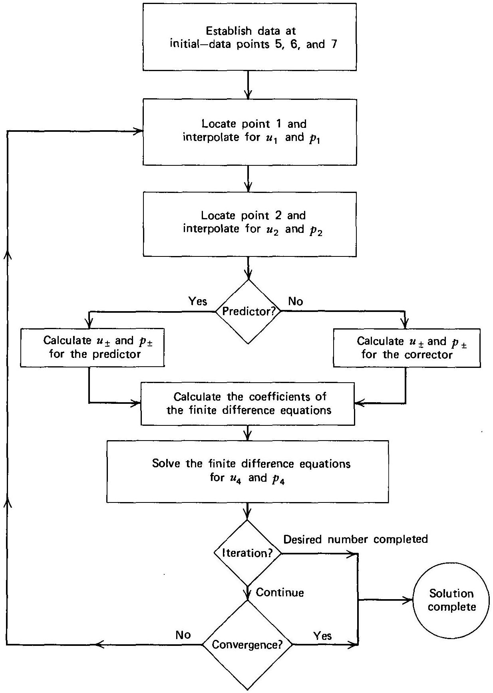
Figure 13.22 Block diagram illustrating the interior point unit process.

Figure 13.22 presents a block diagram illustrating the modified Euler predictorcorrector algorithm for the unit process for an interior point. Figure 13.22 may serve as the flow chart for the computer implementation of the algorithm.

Example 13.2. A small high-pressure solid propellant rocket motor experiences unsteady flow effects during the blow-down of the combustion chamber after propellant burn-out. The combustion gases may be treated as a perfect gas with $\gamma=1.20$ and $R=320.0 \mathrm{~J} / \mathrm{kg}-\mathrm{K}$. The pressure and temperature at the beginning of the blowdown are $p_{i}=690 \cdot 10^{5} \mathrm{~N} / \mathrm{m}^{2}$ and $T_{i}=3330.0 \mathrm{~K}$, respectively. At a given instant of time during the blow-down, the flow properties at three adjacent locations in the combustion chamber (points 5, 6, and 7 in Fig. 13.21) are those presented in Table 13.5. Calculate the flow properties at point 4 (see Fig. 13.21) at a time 0.020 ms later, assuming that the flow is planar and homentropic.

Table 13.5 Initial-Value Data (Example 13.2)
|  | Point 5 | Point 6 | Point 7 |
| :--- | :---: | :---: | :---: |
| $x, \mathrm{~m}$ | 0.1000 | 0.1250 | 0.1500 |
| $u, \mathrm{~m} / \mathrm{s}$ | 188.30 | 235.30 | 282.50 |
| $p, \mathrm{~N} / \mathrm{m}^{2} \cdot 10^{5}$ | 111.77 | 110.78 | 109.54 |

## Solution

(a) Equations of state. For a perfect gas, the speed of sound equation is given by equation 13.30, which is repeated below.

$$
a^{2} p^{-(\gamma-1) / \gamma}=\mathrm{constant}
$$

The constant in equation 13.30 may be determined from the initial values of $a$ and $p$ at the beginning of the blow-down, denoted by $a_{i}$ and $p_{i}$, respectively. Thus,

$$
\begin{aligned}
& a=a_{i}\left(\frac{p}{p_{i}}\right)^{(\gamma-1) / 2 \gamma}=\sqrt{ } \gamma R T_{i}\left(\frac{p}{p_{i}}\right)^{(\gamma-1) / 2 \gamma} \\
& a=[(1.20)(320.0)(3330.0)]^{1 / 2}\left(\frac{p}{p_{i}}\right)^{0.0833333}=1130.81\left(\frac{p}{p_{i}}\right)^{0.0833333} \mathrm{~m} / \mathrm{s}
\end{aligned}
$$

For a perfect gas, the density $\rho$ is related to the pressure $p$ by equation 13.29 , which is repeated below.

$$
p \rho^{-\gamma}=\text { constant }
$$

The constant in equation 13.29 may be determined from the initial values of $p$ and $T$ at the beginning of the blow-down, denoted by $p_{i}$ and $T_{i}$, respectively. Thus,

$$
\begin{aligned}
\rho & =\rho_{i}\left(\frac{p}{p_{i}}\right)^{1 / \gamma}=\frac{p_{i}}{R T_{i}}\left(\frac{p}{p_{i}}\right)^{1 / \gamma} \\
\rho & =\frac{(690.0) 10^{5}}{(320.0)(3330.0)}\left(\frac{p}{p_{i}}\right)^{0.833333}=64.7523\left(\frac{p}{p_{i}}\right)^{0.833333} \mathrm{~kg} / \mathrm{m}^{3}
\end{aligned}
$$

(b) Interpolating polynomials. Interpolating polynomials are required along lines 5-6 and 6-7. For $u$ along line $5-6$, we obtain, from equations $13.47,13.48$, and 13.49 ,

$$
\begin{aligned}
& u=m_{u} x+b_{u}=\left(\frac{u_{5}-u_{6}}{x_{5}-x_{6}}\right) x+\left(u_{6}-m_{u} x_{6}\right) \\
& u=\frac{(188.30-235.30)}{(0.1000-0.1250)}+[235.30-(1880.00)(0.1250)] \\
& u=1880.00 x+0.300 \mathrm{~m} / \mathrm{s}
\end{aligned}
$$

where $u$ is in $\mathrm{m} / \mathrm{s}$ and $x$ is in m. Similarly,

$$
p=(-39.6000 x+115.730) \cdot 10^{5} \mathrm{~N} / \mathrm{m}^{2}
$$

Along line 6-7,

$$
\begin{aligned}
& u=1888.00 x-0.700 \mathrm{~m} / \mathrm{s} \\
& p=(-49.6000 x+116.980) \cdot 10^{5} \mathrm{~N} / \mathrm{m}^{2}
\end{aligned}
$$

(c) Locate point $I$ and calculate the coefficients for the predictor. For the first pass through the predictor, set the values of the average flow properties along the $C_{+}$
characteristic 14 equal to those at point 5 . Thus,

$$
u_{+}=188.30 \mathrm{~m} / \mathrm{s} \quad p_{+}=111.77 \cdot 10^{5} \mathrm{~N} / \mathrm{m}^{2}
$$

From equation (a), we obtain

$$
a_{+}=1130.81\left(\frac{111.77}{690.00}\right)^{0.0833333}=971.65 \mathrm{~m} / \mathrm{s}
$$

Substituting the values for $u_{+}$and $a_{+}$into equation 13.45, we obtain

$$
\lambda_{+}=\frac{1}{u_{+}+a_{+}}=\frac{1}{188.30+971.65}=0.86210 \mathrm{~ms} / \mathrm{m}
$$

From equation 13.59,

$$
x_{1}=x_{4}-\frac{\Delta t}{\lambda_{+}}=0.1250-\frac{0.020}{0.86210}=0.10180 \mathrm{~m}
$$

Since $x_{1}$ lies between $x_{5}$ and $x_{6}, u_{1}$ and $p_{1}$ may be determined from equations (c) and (d), respectively. Thus,

$$
u_{1}=191.69 \mathrm{~m} / \mathrm{s} \quad p_{1}=111.70 \cdot 10^{5} \mathrm{~N} / \mathrm{m}^{2}
$$

The above procedure yields tentative values for the location and flow properties at point 1 . Those values may be improved by repeating the above steps iteratively, each time employing the most recent values of $u_{1}$ and $p_{1}$. The results of two passes, including the first pass, are summarized in the following table.

| Pass | $u_{+}, \mathrm{m} / \mathrm{s}$ | $p_{+}, \mathrm{N} / \mathrm{m}^{2} \cdot 10^{5}$ | $a_{+}, \mathrm{m} / \mathrm{s}$ | $x_{1}, \mathrm{~m}$ |
| :---: | :---: | :---: | :---: | :---: |
| 1 | 188.30 | 111.77 | 971.65 | 0.10180 |
| 2 | 191.69 | 111.70 | 971.60 | 0.10173 |

From equation (b), we obtain

$$
\rho_{+}=64.7523\left(\frac{111.70}{690.00}\right)^{0.833333}=14.199 \mathrm{~kg} / \mathrm{m}^{3}
$$

Substituting the values of $\rho_{+}, a_{+}, u_{1}$, and $p_{1}$ into equations 13.54 and 13.52 gives

$$
\begin{aligned}
& Q_{+}=\rho_{+} a_{+}=(14.199)(971.60)=13,796 \mathrm{~N}-\mathrm{s} / \mathrm{m}^{3} \\
& T_{+}=p_{1}+Q_{+} u_{1}=111.70 \cdot 10^{5}+(13,796)(191.69)=138.14 \cdot 10^{5} \mathrm{~N} / \mathrm{m}^{2}
\end{aligned}
$$

(d) Locate point 2 and calculate the coefficients for the predictor. For the first pass through the predictor, set the values of the average flow properties along the $C_{-}$characteristic 24 equal to those at point 7 . Then,

$$
a_{-}=1130.81\left(\frac{109.54}{690.00}\right)^{0.0833333}=970.02 \mathrm{~m} / \mathrm{s}
$$

Substituting into equation 13.45 gives

$$
\lambda_{-}=\frac{1}{u_{-}-a_{-}}=\frac{1}{282.50-970.02}=-1.4545 \mathrm{~ms} / \mathrm{m}
$$

From equation 13.60,

$$
x_{2}=x_{4}-\frac{\Delta t}{\lambda_{-}}=0.1250-\frac{0.020}{-1.4545}=0.13875 \mathrm{~m}
$$

Since $x_{2}$ lies between $x_{6}$ and $x_{7}, x_{2}$ may be substituted into equations (e) and (f) to yield

$$
u_{2}=261.26 \mathrm{~m} / \mathrm{s} \quad p_{2}=110.10 \cdot 10^{5} \mathrm{~N} / \mathrm{m}^{2}
$$

Repeating the above procedure, we obtain the following results.

| Pass | $u_{-}, \mathrm{m} / \mathrm{s}$ | $p_{-}, \mathrm{N} / \mathrm{m}^{2} \cdot 10^{5}$ | $a_{-}, \mathrm{m} / \mathrm{s}$ | $x_{2}, \mathrm{~m}$ |
| :---: | :---: | :---: | :---: | :---: |
| 1 | 282.50 | 109.54 | 970.02 | 0.13875 |
| 2 | 261.26 | 110.10 | 970.43 | 0.13918 |
| 3 | 262.08 | 110.08 | 970.42 | 0.13917 |

From equation (b), $\rho_{-}=14.027 \mathrm{~kg} / \mathrm{m}^{3}$. From equations 13.56 and 13.53, we obtain

$$
\begin{aligned}
& Q_{-}=\rho_{-} a_{-}=(14.027)(970.42)=13,612 \mathrm{~N}-\mathrm{s} / \mathrm{m}^{3} \\
& T_{-}=p_{2}-Q_{-} u_{2}=110.08 \cdot 10^{5}-(13,612)(262.08)=74.403 \cdot 10^{5} \mathrm{~N} / \mathrm{m}^{2}
\end{aligned}
$$

(e) Determine $u_{4}$ and $p_{4}$ for the predictor. The values of the coefficients determined in steps (c) and (d) may be substituted into equations 13.61 and 13.62 to yield two equations for the determination of $u_{4}$ and $p_{4}$. Thus,

$$
\begin{aligned}
& p_{4}+13,796 u_{4}=138.14 \cdot 10^{5} \\
& p_{4}-13,612 u_{4}=74.403 \cdot 10^{5}
\end{aligned}
$$

Solving equations (o) and (p) simultaneously, we obtain

$$
u_{4}=232.56 \mathrm{~m} / \mathrm{s} \quad p_{4}=106.06 \cdot 10^{5} \mathrm{~N} / \mathrm{m}^{2}
$$

The application of the Euler predictor algorithm is complete. The results obtained for the predictor are presented in column ( 0 ) in Table 13.6.

Table 13.6 Values of the Solution, for Successive Trials, for the Interior Point Unit Process (Example 13.2)
|  | 0 | 1 | 2 | 3 |
| :--- | :--- | :--- | :--- | :--- |
| $\lambda_{+}, \mathrm{ms} / \mathrm{m}$ | 0.85963 | 0.84656 | 0.84649 | 0.84649 |
| $x_{1}, \mathrm{~m}$ | 0.10173 | 0.10137 | 0.10137 | 0.10137 |
| $\lambda_{-}, \mathrm{ms} / \mathrm{m}$ | -1.4118 | -1.3863 | -1.3864 | -1.3864 |
| $x_{2}, \mathrm{~m}$ | 0.13917 | 0.13943 | 0.13943 | 0.13943 |
| $Q_{+}, \mathrm{N}-\mathrm{s} / \mathrm{m}^{3}$ | 13,796 | 13,477 | 13,478 | 13,478 |
| $T_{+} \cdot 10^{-5}, \mathrm{~N} / \mathrm{m}^{2}$ | 138.14 | 137.44 | 137.44 | 137.44 |
| $Q_{-}, \mathrm{N}-\mathrm{s} / \mathrm{m}^{3}$ | 13,612 | 13,383 | 13,384 | 13,384 |
| $T_{-} \cdot 10^{-5}, \mathrm{~N} / \mathrm{m}^{2}$ | 74.403 | 74.927 | 74.924 | 74.924 |
| $u_{4}, \mathrm{~m} / \mathrm{s}$ | 232.56 | 232.73 | 232.73 | 232.73 |
| $p_{4, \mathrm{~N}} / \mathrm{m}^{2} \cdot 10^{5}$ | 106.06 | 106.07 | 106.07 | 106.07 |

(f) Locate point $I$ and calculate the coefficients for the corrector. For the application of the Euler corrector algorithm, average values of the flow properties along the $C_{+}$and $C_{-}$characteristics are employed. Point 1 must be located iteratively. For the first iteration for the location of point 1 ,

$$
\begin{aligned}
& u_{+}=\frac{u_{1}+u_{4}}{2}=\frac{191.69+232.56}{2}=212.13 \mathrm{~m} / \mathrm{s} \\
& p_{+}=\frac{p_{1}+p_{4}}{2}=\frac{(111.70+106.06) \cdot 10^{5}}{2}=108.88 \cdot 10^{5} \mathrm{~N} / \mathrm{m}^{2}
\end{aligned}
$$

where $u_{1}$ and $p_{1}$ for the first trial are the final values obtained for the predictor. Substituting into equations (a), (g), and (h), we obtain the values of $a_{+}, \lambda_{+}$, and $x_{1}$. Improved values for $u_{1}$ and $p_{1}$ may be determined from the interpolating polynomials, and the procedure may be repeated iteratively to obtain improved values for $x_{1}$. The following results are obtained.

| Pass | $u_{1}, \mathrm{~m} / \mathrm{s}$ | $p_{1}, \mathrm{~N} / \mathrm{m}^{2} \cdot 10^{5}$ | $u_{+}, \mathrm{m} / \mathrm{s}$ | $p_{+}, \mathrm{N} / \mathrm{m}^{2} \cdot 10^{5}$ | $a_{+}, \mathrm{m} / \mathrm{s}$ | $x_{1}, \mathrm{~m}$ |
| :---: | ---: | ---: | ---: | ---: | ---: | ---: |
| 1 | 191.69 | 111.70 | 212.13 | 108.88 | 969.53 | 0.10137 |
| 2 | 190.87 | 111.72 | 211.72 | 108.89 | 969.54 | 0.10137 |

From equation (b), $\rho_{+}=13.901 \mathrm{~kg} / \mathrm{m}^{3}$ and, from equations (i) and (j), we obtain

$$
Q_{+}=13,477 \mathrm{~N}-\mathrm{s} / \mathrm{m}^{3} \quad T_{+}=137.44 \cdot 10^{5} \mathrm{~N} / \mathrm{m}^{2}
$$

(g) Locate point 2 and calculate the coefficients for the corrector. Employing average properties along line 24 , in a manner analogous to that presented in part (f) for line 14, we obtain the following results.

| Pass | $u_{2}, \mathrm{~m} / \mathrm{s}$ | $p_{2}, \mathrm{~N} / \mathrm{m}^{2} \cdot 10^{5}$ | $u_{-}, \mathrm{m} / \mathrm{s}$ | $p_{-}, \mathrm{N} / \mathrm{m}^{2} \cdot 10^{5}$ | $a_{-}, \mathrm{m} / \mathrm{s}$ | $x_{2}, \mathrm{~m}$ |
| :--- | :--- | ---: | ---: | ---: | ---: | ---: |
| 1 | 262.08 | 110.08 | 247.32 | 108.07 | 968.93 | 0.13943 |
| 2 | 262.55 | 110.06 | 247.56 | 108.06 | 968.92 | 0.13943 |

From equation (b), $\rho_{-}=13.812 \mathrm{~kg} / \mathrm{m}^{3}$ and, from equations (m) and (n), we obtain

$$
Q_{-}=13,383 \mathrm{~N}-\mathrm{s} / \mathrm{m}^{3} \quad T_{-}=74.927 \cdot 10^{5} \mathrm{~N} / \mathrm{m}^{2}
$$

(h) Determine $u_{4}$ and $p_{4}$ for the corrector. Substituting the values of the coefficients into equations 13.61 and 13.62, we obtain

$$
\begin{aligned}
& p_{4}+13,477 u_{4}=137.44 \cdot 10^{5} \\
& p_{4}-13,383 u_{4}=74.927 \cdot 10^{5}
\end{aligned}
$$

Solving the above equations simultaneously yields

$$
u_{4}=232.73 \mathrm{~m} / \mathrm{s} \quad p_{4}=106.07 \cdot 10^{5} \mathrm{~N} / \mathrm{m}^{2}
$$

The application of the modified Euler corrector algorithm is complete. The results are presented in column (1) of Table 13.6.
(i) Iteration of the corrector. The results obtained by two additional applications of the corrector are presented in columns (2) and (3) of Table 13.6. From those results, it is clear that iteration of the corrector has an almost negligible effect on the final results.

## 13-6 SUMMARY

In this chapter the governing equations are derived for unsteady one-dimensional homentropic flow in the absence of work and body forces. The method of characteristics is applied to those equations, and the corresponding characteristic and compatibility equations are obtained. Those equations are valid for both subsonic flow and supersonic flow.

The general features of unsteady one-dimensional flow are demonstrated by considering the special case of unsteady one-dimensional planar homentropic flow. For a perfect gas with constant specific heats, the compatibility equation may be integrated in closed form. On the state plane (i.e., the $u a$ plane), the solution to the compatibility equation, called the state plane characteristics, yields two families of straight lines having the slopes $\pm(\gamma-1) / 2$. The problem solution then reduces to determining the location of the characteristics in the physical plane along which the state plane characteristics are applicable.

In unsteady one-dimensional flow, uniform flow regions, simple wave regions, and nonsimple wave regions occur. Those regions are patched together along the characteristics of the flow. Regions of uniform flow and simple wave regions occur frequently in unsteady one-dimensional flow.

Simple compression and expansion waves occur when a disturbance moves into an undisturbed fluid. Simple compression waves accelerate the fluid in the direction of the propagation of the wave, and increase the pressure, velocity, and sound speed of the fluid, thus increasing the wave propagation speed. Compression waves converge, and the pathlines bend toward the waves. Simple expansion waves accelerate the fluid in the direction opposite to the propagation of the wave, and decrease the pressure and sound speed of the fluid. Consequently, the wave propagation speed decreases, the waves diverge, and the pathlines bend away from the waves. When a wave is incident on a closed end, a wave of the same type is reflected. When a wave is incident on an open end where the pressure is constant and the flow is subsonic, a wave of the opposite type is reflected. If the flow is supersonic, no waves are reflected. When simple compression and expansion waves intersect, nonsimple wave regions are formed.

The general theory of the method of characteristics is applied to the case of unsteady one-dimensional homentropic flow. A complete numerical algorithm, called a unit process, is developed for an interior point of a flow field. A numerical example is presented illustrating the application of the unit process for an interior point.

Generalized unsteady one-dimensional and quasi-one-dimensional flow, including the effects of friction, heat transfer, and mass addition, is discussed in Chapter 19 (Volume 2). Numerical algorithms are developed for the interior and boundary points of the flow, and numerical examples illustrating those unit processes are presented. FORTRAN computer programs for implementing the numerical algorithms are presented, and several applications to engineering problems are discussed.

## REFERENCES

1. R. Courant and K. O. Friedrichs, Supersonic Flow and Shock Waves, Chap. III, Interscience Publishers, New York, 1958.
2. G. Rudinger, Wave Diagrams for Nonsteady Flow in Ducts, Van Nostrand, Princeton, N.J., 1955.
3. K. P. Stanyukovich, Unsteady Motion of Continuous Media, Pergamon Press, New York, 1960.
4. A. H. Shapiro, The Dynamics and Thermodynamics of Compressible Fluid Flow, Vol. II, Chaps. 23, 24, and 25, Ronald Press, New York, 1953.
5. J. A. Owczarek, Fundamentals of Gas Dynamics, Chaps. 7 and 8, International Textbook Co., Scranton, Pa., 1964.
6. D. R. Hartree, "Some Practical Methods of Using Characteristics in the Calculation of Nonsteady Compressible Flow," U.S. Atomic Energy Commission, Report No. AECU-2713, 1953.
7. R. Courant, K. O. Friedrichs, and H. Lewy, "Uberdie Partiellen Differenzialgleichungen der Mathematisehen Physik," Mathematische Annalen, Vol. 100, pp. 32-74, 1928.

## PROBLEMS

1. Figure 13.13 illustrates schematically the physical plane and the state plane for the reflection of a right-running simple expansion wave from a closed end. Example 13.1 presents the construction of a left-running centered expansion wave propagating into a 3.0 m long tube filled with still air. Figure 13.5 illustrates selected characteristics in the state plane for $\gamma=1.40$. Combine the above concepts and data and construct the state plane for the five discrete expansion waves considered in Example 13.1. Determine the flow properties $u, p$, and $M$ at the points where the reflected waves emerge from the nonsimple wave interaction region (points analogous to points $e, h, k, m$, and $n$ in Fig. 13.13a).
2. A numerical procedure for implementing the unit process for an interior point is presented in Section 13-5(c). That procedure is based on the average property method discussed in Section 12-5(a). Develop an equivalent unit process for an interior point based on the average coefficient method described in Section 12-5(a).
3. The unit process for an interior point, based on the average property method, is illustrated by a numerical example in Example 13.2. Work Example 13.2, employing the unit process based on the average coefficient method developed in Problem 13.2. The initial data are as follows.

|  | Point 1 | Point 2 |
| :--- | ---: | ---: |
|  | -- | 0.10137 |
| $x, \mathrm{~m}$ | 190.87 | 262.55 |
| $u, \mathrm{~m} / \mathrm{s}$ | 111.72 | 110.06 |
| $p, \mathrm{~N} / \mathrm{m}^{2} \cdot 10^{5}$ | - | - |

4. Consider the rocket motor described in Example 13.2. The location and flow properties at three neighboring points in the flow field at a given instant of time are presented in the following table.

|  | Point 5 | Point 6 | Point 7 |
| :--- | ---: | ---: | ---: |
|  | 0.2000 | 0.2250 | 0.2500 |
| $x, \mathrm{~m}$ | 315.0 | 365.0 | 420.0 |
| $u, \mathrm{~m} / \mathrm{s}$ | 90.50 | 89.00 | 87.00 |
| $p, \mathrm{~N} / \mathrm{m}^{2} \cdot 10^{5}$ |  |  |  |

Employing the unit process for an interior point described in Section 13-5(c), determine the location and flow properties at point 4 (see Fig. 13.21) at a time 0.015 ms later.
5. The unit process for a point in the interior of an unsteady one-dimensional flow field is described in Section 13-5(c) and illustrated in Fig. 13.21. For a point on a solid boundary, illustrated in Fig. 13.23, point 5 is outside of the flow field. Figure 13.23a illustrates a stationary solid boundary, and Fig. $13.23 b$ illustrates a moving solid boundary. Consequently, the characteristic equation for right-running characteristic 14 and the corresponding compatibility equation are not applicable at a solid boundary. However, the location and velocity

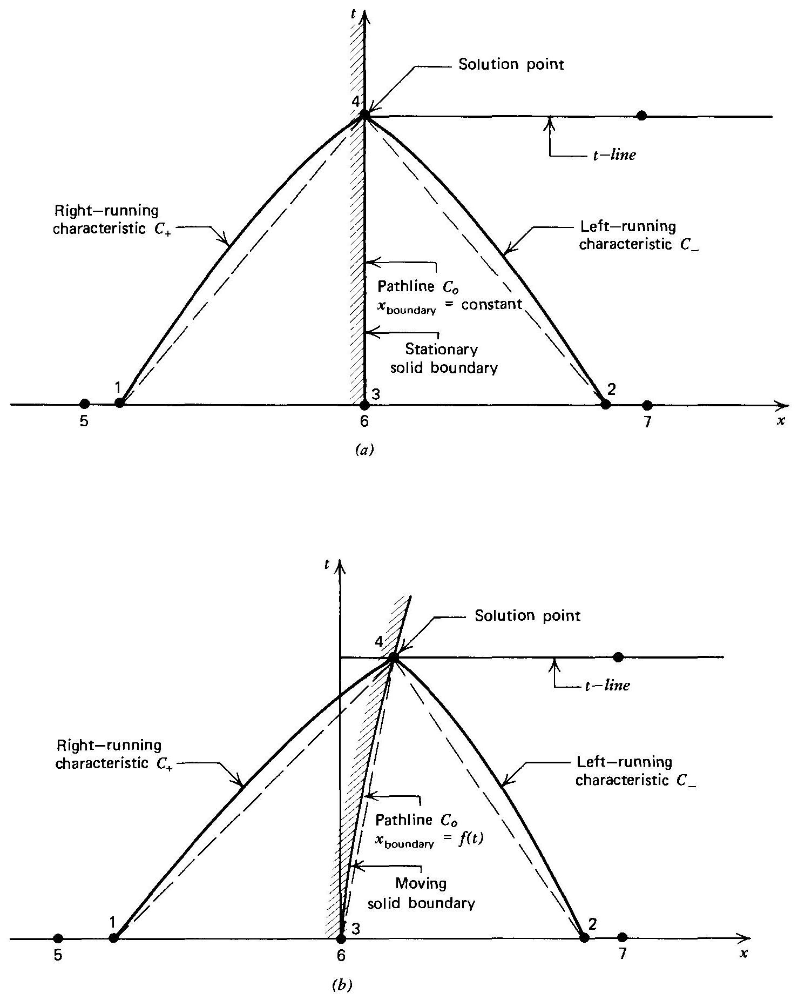
Figure 13.23 Unit process for a solid boundary point. (a) Stationary solid boundary. (b) Moving solid boundary.

of the solid boundary are known, thus supplying two conditions for replacing the lost characteristic and compatibility equations.

$$
\begin{array}{ll}
x_{\text {boundary }}=f(t) & (\text { specified }) \\
u_{\text {boundary }}=\frac{d x_{\text {boundary }}}{d t} & (\text { specified })
\end{array}
$$

Develop a numerical procedure for implementing the unit process for a solid boundary point, analogous to the procedure presented in Section 13-5(c) for an interior point.
6. Consider the rocket motor described in Example 13.2. The location and flow properties at the head end and at a point adjacent to the head end are given in the following table.

Point 6 Point 7
| $x, \mathrm{~m}$ | 0.000 | 0.025 |
| :--- | ---: | ---: |
| $u, \mathrm{~m} / \mathrm{s}$ | 0.0 | 50.0 |
| $p, \mathrm{~N} / \mathrm{m}^{2} \cdot 10^{5}$ | 114.0 | 113.0 |

Employing the unit process for a solid boundary point developed in Problem 13.5, calculate the flow properties at the head end at a time 0.020 ms later.
7. The unit process for a point at the open end of a flow passage with outflow is illustrated in Fig. 13.24. For supersonic outflow, illustrated in Fig. 13.24b, both characteristics fall within the flow field, and the unit process for an interior point may be employed to determine the flow properties at point 4 . Note that at point $4, M_{4}>1$ and $p_{4}>p_{o}$. For subsonic outflow,

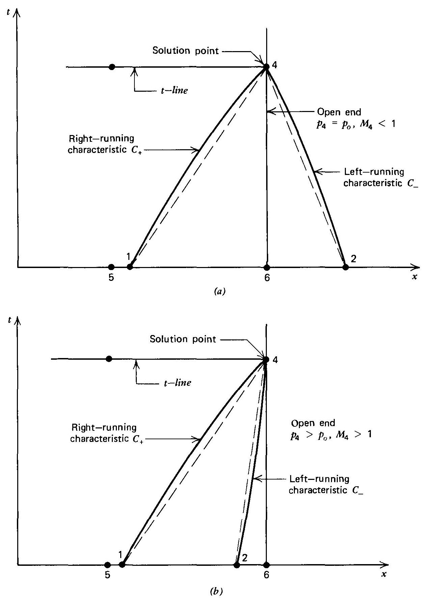
Figure 13.24 Unit process for outflow from an open end. (a) Subsonic outflow. (b) Supersonic outflow.

illustrated in Fig. 13.24a, $M_{4}<1$ and $p_{4}=p_{o}$, and left-running characteristic 24 falls outside of the flow field. Consequently, the characteristic equation for left-running Mach line 24 and the corresponding compatibility equation are not applicable at an open end with subsonic outflow. However, the condition $p_{4}=p_{0}$ replaces the lost compatibility equation. Develop a numerical procedure for implementing the unit process for an open end with subsonic outflow, analogous to the procedure presented in Section 13-5(c) for an interior point.
8. Under what conditions, if any, would the unit process for subsonic outflow at an open end developed in Problem 13.7 be applicable for subsonic inflow?
9. Describe briefly the physical model for subsonic inflow at an open end, and list the governing equations that are applicable.
10. Describe briefly the unit process for supersonic inflow at an open end.
11. Air is flowing out of a constant-area tube into the atmosphere. The flow properties at a given instant of time at the tube exit $(x=1.000 \mathrm{~m})$ and an adjacent point inside the tube are given in the following table.

|  | Point 5 | Point 6 |
| :--- | :---: | :---: |
| $x, \mathrm{~m}$ | 0.950 | 1.000 |
| $u, \mathrm{~m} / \mathrm{s}$ | 160.0 | 165.0 |
| $p, \mathrm{~N} / \mathrm{m}^{2} \cdot 10^{5}$ | 1.400 | 1.013 |

Employ the unit process for subsonic outflow at an open end developed in Problem 13.7, and determine the flow properties at the exit of the tube at a time 0.030 ms later.

[^0]:    * In Chapters 13 and 19 (Chapter 19 appears in Volume 2), the time is denoted by $t$, and the absolute static temperature is denoted by $T$.

