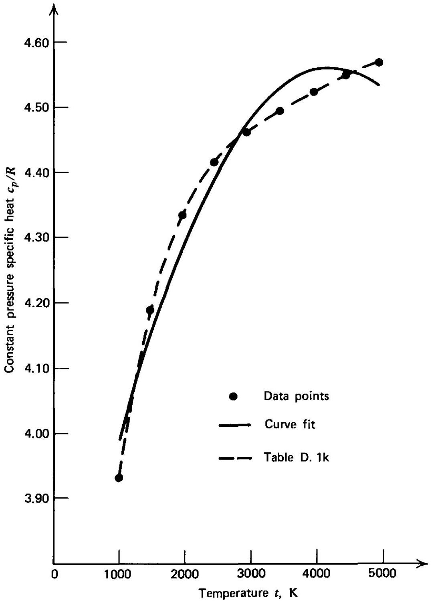
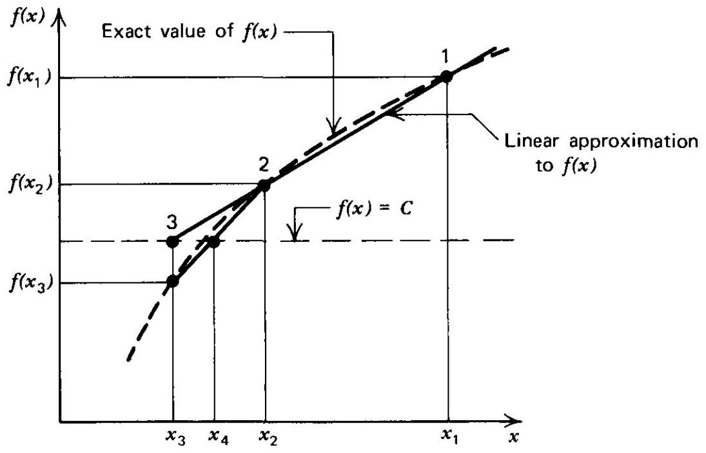
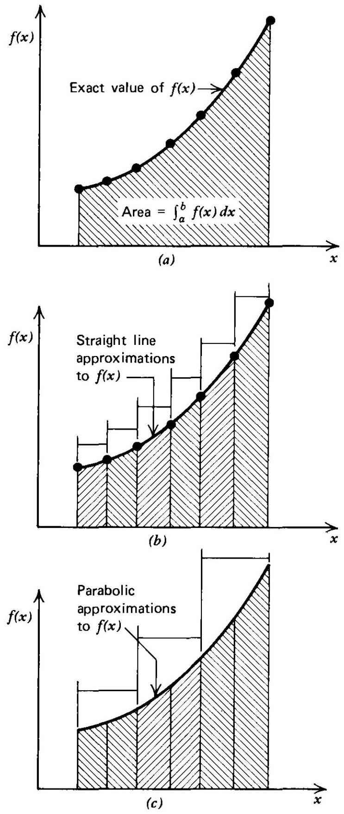
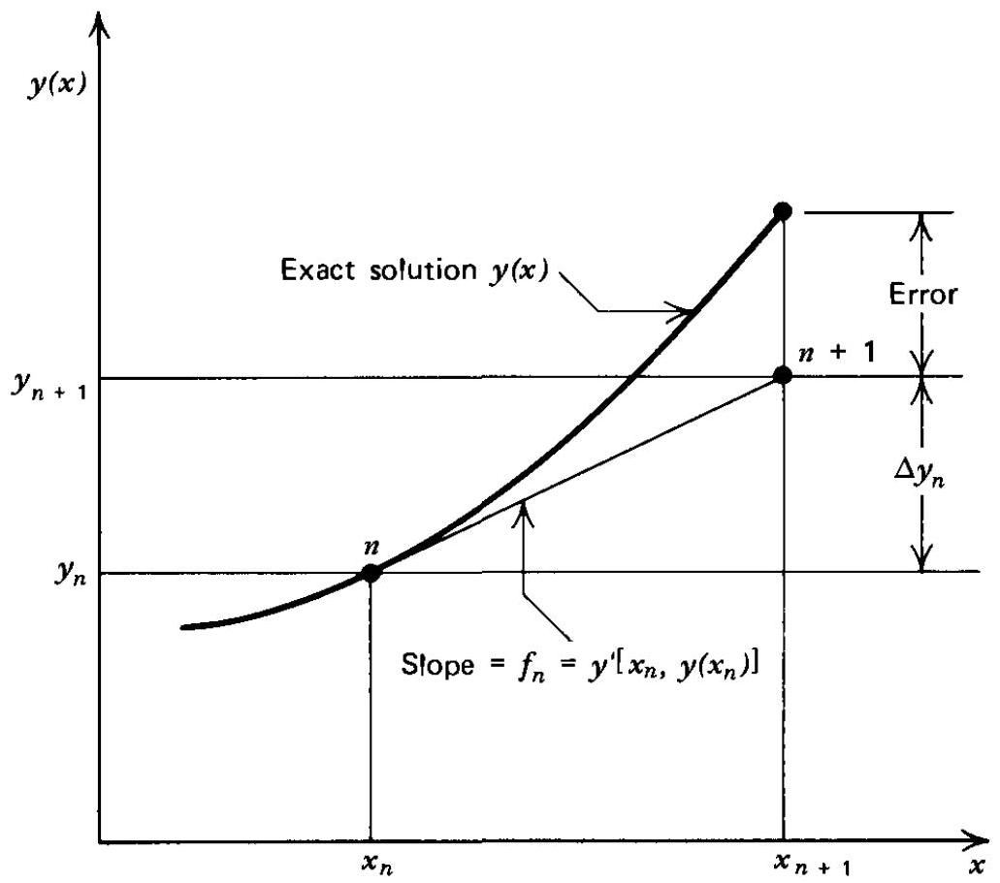
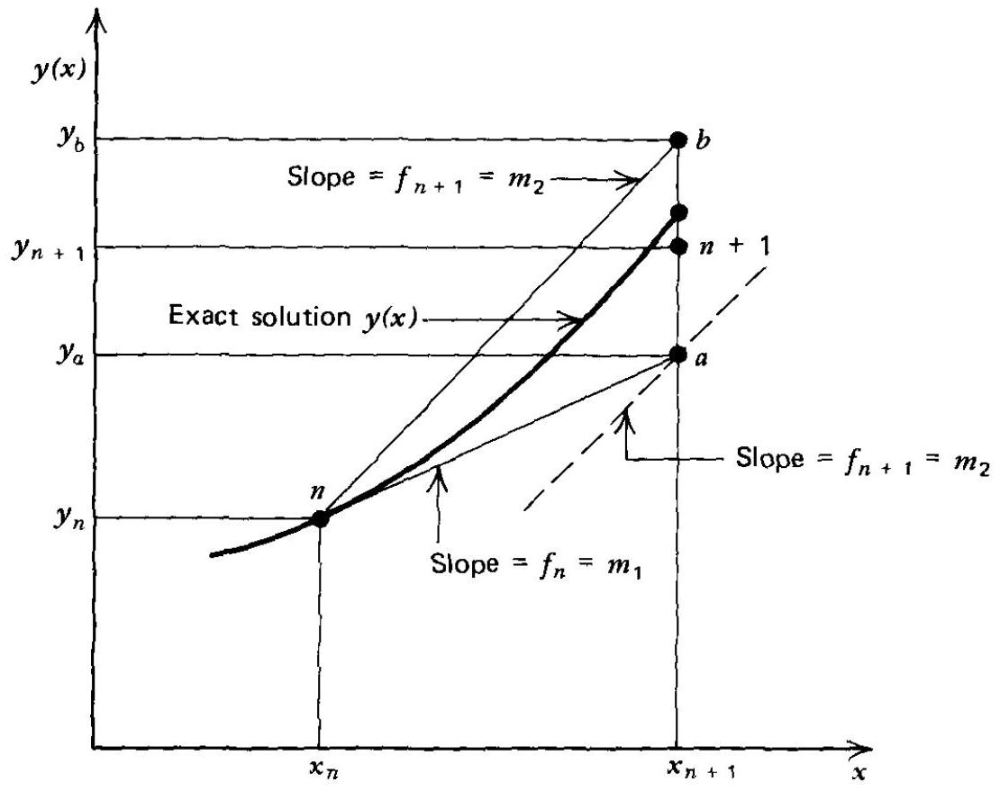

## A numerical analysis

A-1 INTRODUCTION ..... 669
A-2 APPROXIMATION AND INTERPOLATION ..... 669
A-3 THE SOLUTION OF SYSTEMS OF LINEAR ALGEBRAIC EQUATIONS ..... 673
A-4 THE SOLUTION OF NONLINEAR ALGEBRAIC EQUATIONS ..... 675
(a) The Newton-Raphson method ..... 675
(b) The secant method ..... 676
A-5 INTEGRATION ..... 679
(a) The trapezoidal rule ..... 679
(b) Simpson's rule ..... 681
A-6 THE NUMERICAL SOLUTION OF ORDINARY DIFFERENTIAL EQUATIONS ..... 682
(a) General considerations ..... 682
(b) Taylor's method ..... 684
(c) Euler's method ..... 684
(d) Runge-Kutta methods ..... 686
(e) The modified Euler predictor-corrector method ..... 688
(f) The implicit Euler method ..... 691
A-7 SUMMARY ..... 692

## A-1 INTRODUCTION

The material in this Appendix is a brief introduction to the theory and implementation of the numerical methods employed in this book. Because the emphasis here is on the application of the methods, no rigorous proofs are presented. Numerical examples are included for illustrating the application of each of the numerical algorithms. The material included herein presents only a brief introduction to the methods of numerical analysis. A list of references is presented so that the interested reader may pursue the subject more deeply.

## A-2 APPROXIMATION AND INTERPOLATION

Approximation is the process of approximating a general function by a simpler function that may then be employed in mathematical operations such as differentiation and integration. Approximating functions may also be employed for interpolation; that is, the determination of the value of a function at a point where its
value is unknown from its known values at a discrete set of neighboring points. Approximating functions may be polynomials, trigonometric functions, exponential functions, etc. The polynomial is the most common approximating function, and the application of a simple interpolating polynomial is illustrated in the present section, for both univariate and bivariate interpolations. For a detailed discussion of the properties of the interpolating polynomial, refer to References 1-7.

In a univariate interpolating polynomial, the dependent variable depends on only one independent variable, for example, $y=f(x)$,

$$
y=a+b x+c x^{2}+d x^{3}+\cdots
$$

where the coefficients $a, b$, etc., are chosen so that the approximating function $y(x)$ represents the actual function as closely as possible. When the number of known data points $n+1$ equals the number of coefficients in equation A.1 (i.e., the largest power of $x$ is $x^{n}$ ), a unique interpolating polynomial results. In that case the coefficients are determined by substituting the sets of $x, y$ pairs into equation A. 1 to determine $n+1$ linear algebraic equations for the coefficients. Those equations may be solved by the methods discussed in Section A-3.

When more than $n+1$ sets of $x, y$ pairs are employed, the interpolating polynomial must approximate those points in an average sense. For example, if a secondorder interpolating polynomial is desired, equation A. 1 becomes

$$
y=a+b x+c x^{2}
$$

If $m$ sets of $x, y$ pairs are available, they may be substituted into equation A. 2 to obtain the following $m$ residual equations.

$$
\begin{aligned}
& w_{1}=a+b x_{1}+c x_{1}^{2}-y_{1} \\
& w_{2}=a+b x_{2}+c x_{2}^{2}-y_{2} \\
& \cdots \cdots \cdots \cdots \cdots \cdots \cdots \\
& w_{m}=a+b x_{m}+c x_{m}^{2}-y_{m}
\end{aligned}
$$

The values of $a, b$, and $c$ are chosen to make the values of the $w_{m}$ as small as possible.
The method of least squares says that the best interpolating polynomial is obtained when the sum of the squares of the residuals is a minimum. That is,

$$
\sum_{i=1}^{m} w_{m}^{2}=w_{1}^{2}+w_{2}^{2}+\cdots+w_{m}^{2}=f(a, b, c)
$$

must be a minimum. The condition that $f(a, b, c)$ is a minimum is satisfied if partial derivatives with respect to $a, b$, and $c$ are each zero. Consequently,

$$
\begin{aligned}
\frac{\partial f}{\partial a} & =2 w_{1} \frac{\partial w_{1}}{\partial a}+2 w_{2} \frac{\partial w_{2}}{\partial a}+\cdots+2 w_{m} \frac{\partial w_{m}}{\partial a} \\
& =2 w_{1}+2 w_{2}+\cdots+2 w_{m}=0
\end{aligned}
$$

where $\partial w_{1} / \partial a=\partial w_{2} / \partial a=\cdots=1$. In a similar manner, we obtain

$$
\begin{aligned}
& \frac{\partial f}{\partial b}=2 w_{1} x_{1}+2 w_{2} x_{2}+\cdots+2 w_{m} x_{m}=0 \\
& \frac{\partial f}{\partial c}=2 w_{1} x_{1}^{2}+2 w_{2} x_{2}^{2}+\cdots+2 w_{m} x_{m}^{2}=0
\end{aligned}
$$

Substituting equations A. 3 into equations A. 4 and collecting the coefficients of $a, b$,
and $c$, we obtain

$$
\begin{aligned}
a m+b \sum_{i=1}^{m} x_{i}+c \sum_{i=1}^{m} x_{i}^{2} & =\sum_{i=1}^{m} y_{i} \\
a \sum_{i=1}^{m} x_{i}+b \sum_{i=1}^{m} x_{i}^{2}+c \sum_{i=1}^{m} x_{i}^{3} & =\sum_{i=1}^{m} x_{i} y_{i} \\
a \sum_{i=1}^{m} x_{i}^{2}+b \sum_{i=1}^{m} x_{i}^{3}+c \sum_{i=1}^{m} x_{i}^{4} & =\sum_{i=1}^{m} x_{i}^{2} y_{i}
\end{aligned}
$$

Equations A. 5 are three linear algebraic equations for $a, b$, and $c$ that may be solved simultaneously by the methods discussed in Section A-3.

The method of least squares may be applied to higher-order interpolating polynomials and to other forms of approximating functions. In all cases, the number of linear equations for the unknown coefficients equals the number of the coefficients that are to be determined.

In a bivariate interpolating polynomial, the dependent variable depends on two independent variables, for example, $z=f(x, y)$. The procedure presented above for univariate interpolation may be applied in the same manner for determining bivariate interpolating polynomials. For example, for a second-order bivariate interpolating polynomial,

$$
z=a+b x+c x^{2}+d y+e y^{2}+f x y
$$

The known data values are substituted into equation A. 6 to obtain the residual equations. Those residual equations are then squared and summed, and the resulting equation is differentiated with respect to $a, b, c$, etc., to determine six linear nonhomogeneous algebraic equations for the six coefficients in equation A.6.

The method of least squares may be applied to any type of approximating function with any number of independent variables in the same manner as illustrated above.

Example A.1. In Table 1.6, Section 1-16(a), values of the coefficients for a fourthorder interpolating polynomial (see equation 1.158) are presented for the constant pressure specific heat $c_{\boldsymbol{p}}$ versus temperature $t$ for several gases. Determine the values of the coefficients for a second-order interpolating polynomial for $c_{p}$ versus $t$ for $N_{2}$, for the temperature range $1000 \mathrm{~K} \leqq t \leqq 5000 \mathrm{~K}$. As data points, employ the $c_{p}$ values from Table D. 1 k (see Volume 2) at $t=1000 \mathrm{~K}$ and every 500 K thereafter up to and including 5000 K .

## Solution

The following nine data points in Table A. 1 are obtained from Table D.1k.

Table A. 1 Data Points for the Interpolating Polynomial for $c_{p}$ versus $t$ for $N_{2}$
| $t, \mathrm{~K}$ | $c_{p}, \mathrm{~J} / \mathrm{gmol}-\mathrm{K}$ | $\frac{c_{p}}{R}$ | $t, \mathrm{~K}$ | $c_{p}, \mathrm{~J} / \mathrm{gmol}-\mathrm{K}$ | $\frac{c_{p}}{R}$ |
| :--- | :--- | :--- | :--- | :--- | :--- |
| 1000 | 32.698 | 3.93272 | 3500 | 37.329 | 4.48971 |
| 1500 | 34.800 | 4.18554 | 4000 | 37.569 | 4.51858 |
| 2000 | 36.018 | 4.33203 | 4500 | 37.799 | 4.54624 |
| 2500 | 36.687 | 4.41250 | 5000 | 37.950 | 4.56440 |
| 3000 | 37.066 | 4.45808 |  |  |  |

The second-order interpolating polynomial is given by

$$
c_{p}=\left(a+b t+c t^{2}\right) R
$$

Equations A. 5 are solved to determine the values $a, b$, and $c$. The coefficients of $a$, $b$, and $c$ and the nonhomogeneous terms in equation A. 5 are computed as follows.

$$
\begin{aligned}
\sum_{i=1}^{9} t_{i} & =1000+1500+\cdots+5000=27 \cdot 10^{3} \\
\sum_{i=1}^{9} t_{i}^{2} & =(1000)^{2}+(1500)^{2}+\cdots+(5000)^{2}=96 \cdot 10^{6} \\
\sum_{i=1}^{9} t_{i}^{3} & =(1000)^{3}+(1500)^{3}+\cdots+(5000)^{3}=378 \cdot 10^{9} \\
\sum_{i=1}^{9} t_{i}^{4} & =(1000)^{4}+(1500)^{4}+\cdots+(5000)^{4}=1583.25 \cdot 10^{12} \\
\sum_{i=1}^{9}\left(\frac{c_{p}}{R}\right)_{i} & =3.93272+4.18554+\cdots+4.56440=39.43980 \\
\sum_{i=1}^{9} t_{i}\left(\frac{c_{p}}{R}\right)_{i} & =(1000)(3.93272)+(1500)(4.18554)+\cdots+(5000)(4.56440) \\
& =120.34897 \cdot 10^{3} \\
\sum_{i=1}^{9} t_{i}^{2}\left(\frac{c_{p}}{R}\right)_{i} & =(1000)^{2}(3.93272)+(1500)^{2}(4.18554)+\cdots+(5000)^{2}(4.56440) \\
& =431.84674 \cdot 10^{6}
\end{aligned}
$$

Substituting the above values into equation A.5, we obtain

$$
\begin{aligned}
9 a+27 \cdot 10^{3} b+96 \cdot 10^{6} c & =39.43980 \\
27 \cdot 10^{3} a+96 \cdot 10^{6} b+378 \cdot 10^{9} c & =120.34897 \cdot 10^{3} \\
96 \cdot 10^{6} a+378 \cdot 10^{9} b+1583.25 \cdot 10^{12} c & =431.84674 \cdot 10^{6}
\end{aligned}
$$

The above system of three linear algebraic equations is solved for $a, b$, and $c$ by Cramer's rule in Example A.2. The results are

$$
c_{p}=\left(3.587000+0.453813 \cdot 10^{-3} t-0.053085 \cdot 10^{-6} t^{2}\right) R
$$

The errors in the calculated values from equation (b) are presented in Table A.2, and the corresponding curve fit is illustrated in Fig. A.1.

Table A. 2 Comparison of Initial-Data Points and the Interpolating Polynomial
| $t, \mathrm{~K}$ | $\frac{c_{p}}{R}$, Table D. 1 k | $\frac{c_{p}}{R}$, equation (b) | Error, Percent |
| :--- | :--- | :--- | :--- |
| 1000 | 3.93272 | 3.98773 | 1.40 |
| 2000 | 4.33203 | 4.28229 | -1.15 |
| 3000 | 4.45808 | 4.47067 | 0.28 |
| 4000 | 4.51858 | 4.55289 | 0.76 |
| 5000 | 4.56440 | 4.52894 | -0.78 |

Figure A. 1 Comparison of the initial-data points and the curve fit for $c_{p} / R$ versus $t$ for $\mathrm{N}_{2}$.

## A-3 THE SOLUTION OF SYSTEMS OF LINEAR ALGEBRAIC EQUATIONS

Systems of linear algebraic equations occur frequently in numerical analysis. For example, such systems occur in the least squares fitting of interpolating polynomials (see Appendix A-2) and in the solution of linear difference equations. Many powerful matrix methods exist for solving such systems of equations. The fundamental method employed for direct solutions is the Gauss elimination method. Iterative methods start with an initial approximation, and improve that approximation by a suitable algorithm. Matrix methods are discussed in References 1-7.

Cramer's rule presents a straightforward method for obtaining the solution of systems of linear algebraic equations. When the number of equations reaches more than three or four, Cramer's rule becomes impractical because of the large amount of computation involved, unless the majority of the coefficients in the equations are zero. However, for systems of equations in which the coefficients are specified as functions or parameters instead of as numerical values, Cramer's rule must be applied. Such a situation arises when solving systems of difference equations in functional form to obtain explicit equations for the unknown variables, and when solving systems of differential equations for influence coefficients [see Section 9-5(c)].

Consider the following system of linear equations.

$$
\begin{aligned}
& a_{11} x_{1}+a_{12} x_{2}+\cdots+a_{1 n} x_{n}=b_{1} \\
& a_{21} x_{1}+a_{22} x_{2}+\cdots+a_{2 n} x_{n}=b_{2} \\
& \cdots \cdots \cdots \cdots \cdots \cdots \cdots \cdots \cdots \cdots \\
& a_{n 1} x_{1}+a_{n 2} x_{2}+\cdots+a_{n n} x_{n}=b_{n}
\end{aligned}
$$

By definition, the matrices $A, x$, and $b$ are defined as

$$
A \equiv\left[\begin{array}{llll}
a_{11} & a_{12} & \ldots & a_{1 n} \\
a_{21} & a_{22} & & a_{2 n} \\
\vdots & \vdots & & \vdots \\
a_{n 1} & a_{n 2} & \ldots & a_{n n}
\end{array}\right], \quad x \equiv\left[\begin{array}{l}
x_{1} \\
x_{2} \\
\vdots \\
x_{n}
\end{array}\right], \quad b \equiv\left[\begin{array}{l}
b_{1} \\
b_{2} \\
\vdots \\
b_{n}
\end{array}\right]
$$

Then the system of equations A.7a-A.7n, when written in matrix form, reduces to

$$
A x=b
$$

where $A=\left(a_{i j}\right)$ is the $n \times n$ matrix comprising the coefficients in equations A.7, $x$ is the $n$-vector $x_{1}, x_{2}$, etc., and $b$ is the $n$-vector $b_{1}, b_{2}$, etc.

Denote the value of the determinant of the matrix $A$ by $\operatorname{det}(A)$. If $\operatorname{det}(A) \neq 0$, then Cramer's rule states that

$$
x_{j}=\frac{\operatorname{det}\left(A^{j}\right)}{\operatorname{det}(A)} \quad(j=1, \ldots, n)
$$

where $A^{j}$ is the matrix obtained by replacing the $j$ th column of $A$ by $\mathbf{b}$.
The determination of the value of $\operatorname{det}(A)$ is accomplished by expanding the determinant by minors. A minor $M_{i j}$ of the $n \times n$ matrix $A$ is the determinant of the $(n-1) \times(n-1)$ matrix obtained from $A$ by deleting the $i$ th row and the $j$ th column. Expanding the determinant of $A$ by minors along the $i$ th row, we obtain

$$
\operatorname{det}(A)=a_{i 1}(-1)^{i+1} M_{i 1}+a_{i 2}(-1)^{i+2} M_{i 2}+\cdots+a_{i n}(-1)^{i+n} M_{i n}
$$

Alternately, expanding along the $j$ th column yields

$$
\operatorname{det}(A)=a_{1 j}(-1)^{i+j} M_{1 j}+a_{2 j}(-1)^{2+j} M_{2 j}+\cdots+a_{n j}(-1)^{n+j} M_{n j}
$$

By employing either equation A. 10 or A.11, the determinant of order $n$ may be expressed as the sum of $n$ determinants of order $n-1$. By applying the procedure recursively, $\operatorname{det}(A)$ will eventually be expressed as the sum of determinants of order 1 , which is simply the sum of the corresponding elements. The aforementioned procedure is practical for determinants of low order, or for determinants in which most of the elements are zero so that most of the summands drop out.

Example A.2. Three linear algebraic equations are obtained in Example A. 1 for the coefficients $a, b$, and $c$ of the interpolating polynomial for the specific heat $c_{p}$ of $N_{2}$ as a function of temperature $t$. Determine the values of $a, b$, and $c$ by applying Cramer's rule.

## Solution

In matrix form, those equations may be written as

$$
\left|\begin{array}{rrr}
9 & 27 \cdot 10^{3} & 96 \cdot 10^{6} \\
27 & 96 \cdot 10^{3} & 378 \cdot 10^{6} \\
96 & 378 \cdot 10^{3} & 1583.25 \cdot 10^{6}
\end{array}\right|\left|\begin{array}{c}
a \\
b \\
c
\end{array}\right|=\left|\begin{array}{r}
39.43980 \\
120.34897 \\
431.84674
\end{array}\right|
$$

To apply Cramer's rule, $\operatorname{det}(A)$ must be computed. Therefore,

$$
\begin{aligned}
\operatorname{det}(A)= & 9\left|\begin{array}{rr}
96 \cdot 10^{3} & 378 \cdot 10^{6} \\
378 \cdot 10^{3} & 1583.25 \cdot 10^{6}
\end{array}\right|-27\left|\begin{array}{rr}
27 \cdot 10^{3} & 96 \cdot 10^{6} \\
378 \cdot 10^{3} & 1583.25 \cdot 10^{6}
\end{array}\right| \\
& +96\left|\begin{array}{ll}
27 \cdot 10^{3} & 96 \cdot 10^{6} \\
96 \cdot 10^{3} & 378 \cdot 10^{6}
\end{array}\right| \\
\operatorname{det}(A)= & 9(151,992-142,884) 10^{9}-27(42,747.75-36,288) 10^{9} \\
& +96(10,206-9216) 10^{9}=2598.75 \cdot 10^{9}
\end{aligned}
$$

The coefficient $a$ is determined by replacing the first column of $A$ with the nonhomogeneous terms, and calculating $\operatorname{det}\left(A^{j}\right) / \operatorname{det}(A)$. Therefore,

$$
a=\frac{\operatorname{det}\left(A^{j}\right)}{\operatorname{det}(A)}=\frac{\left|\begin{array}{rrr}
39.43980 & 27 \cdot 10^{3} & 96 \cdot 10^{6} \\
120.34897 & 96 \cdot 10^{3} & 378 \cdot 10^{6} \\
431.84674 & 378 \cdot 10^{3} & 1583.25 \cdot 10^{6}
\end{array}\right|}{2598.75 \cdot 10^{9}}
$$

Solving for $\operatorname{det}\left(A^{j}\right)$ in the manner illustrated above for $\operatorname{det}(A)$, we obtain

$$
a=\frac{9321.715 \cdot 10^{9}}{2598.75 \cdot 10^{9}}=3.587000
$$

In a similar manner, replacing the second column of $A$ with the nonhomogeneous terms and solving for $b$ gives

$$
b=\frac{\left|\begin{array}{rrr}
9 & 39.43980 & 96 \cdot 10^{6} \\
27 & 120.34897 & 378 \cdot 10^{6} \\
96 & 431.84674 & 1583.25 \cdot 10^{6}
\end{array}\right|}{2598.75 \cdot 10^{9}}=\frac{1179.346 \cdot 10^{6}}{2598.75 \cdot 10^{9}}=0.453813 \cdot 10^{-3}
$$

Accordingly, for $c$, we obtain

$$
c=\frac{\left|\begin{array}{rrr}
9 & 27 \cdot 10^{3} & 39.43980 \\
27 & 96 \cdot 10^{3} & 120.34897 \\
96 & 378 \cdot 10^{3} & 431.84674
\end{array}\right|}{2598.75 \cdot 10^{9}}=\frac{-137.9542 \cdot 10^{3}}{2598.75 \cdot 10^{9}}=-0.053085 \cdot 10^{-6}
$$

## A-4 THE SOLUTION OF NONLINEAR ALGEBRAIC EQUATIONS

A problem that arises frequently in numerical analysis is the determination of the roots of a nonlinear function $f(x)=0$. The nonlinear function $f(x)$ may be either an algebraic expression, such as a polynomial or transcendental function, or it may be a complete numerical algorithm comprising many steps. In a few cases, such as a factorable polynomial, it is possible to determine the exact roots of $f(x)$. In general, however, the solution must be determined iteratively by some numerical technique, and an approximate solution is obtained. In this section, two methods are presented for the solution of nonlinear equations: the Newton-Raphson method and the secant method.

## A-4(a) The Newton Raphson Method

Consider a nonlinear algebraic equation $f(x)=0$, for which the first derivative $f^{\prime}(x)$ is calculable. Assume that an approximate value of the root, denoted by $x_{i}$, is known, where the exact root is $x_{i}+h$. Applying Taylor's formula [see Appendix

A-6(a)], we may write

$$
f\left(x_{i}+h\right)=0=f\left(x_{i}\right)+h f^{\prime}\left(x_{i}\right)+\frac{h^{2}}{2} f^{\prime \prime}\left(x_{i}+\zeta h\right)(0 \leqq \zeta \leqq 1)
$$

If $h$ is relatively small, the term containing $h^{2}$ may be neglected in comparison with the term containing $h$, so that equation A. 12 reduces to

$$
f\left(x_{i}\right)+h f^{\prime}\left(x_{i}\right)=0
$$

Solving equation A. 13 for $h$ yields

$$
h=-\frac{f\left(x_{i}\right)}{f^{\prime}\left(x_{i}\right)}
$$

From equation A. 14 we obtain the improved approximation

$$
x_{i+1}=x_{i}+h=x_{i}-\frac{f\left(x_{i}\right)}{f^{\prime}\left(x_{i}\right)}
$$

The root determined by equation A. 15 is not exact because of the approximation that the second-order term in equation A. 12 equals zero. Equation A. 15 may be applied repetitively to yield successively closer approximations to the exact value of the root. The algorithm expressed by equation A. 15 is known as the NewtonRaphson method.

## A-4(b) The Secant Method

Consider a nonlinear algorithm of the form $f(x)=C$, where the algorithm comprises any number of steps, including the solution of differential equations, the use of tabular data, the use of graphical data, etc. Let $x_{i-1}$ and $x_{i}$ denote two values of $x$ in the neighborhood of the exact root. The approximate roots $x_{i}$ and $x_{i-1}$ may either bracket the exact root, or they may lie on either side of the exact root. Substituting those two values into the nonlinear algorithm $f(x)$ yields the two values $f\left(x_{i-1}\right)$ and $f\left(x_{i}\right)$. Plotting those two pairs of $x, f(x)$ values in the $f(x)$ versus $x$ plane furnishes a functional relationship between $x$ and $f(x)$, as illustrated in Fig. A.2. Assume that the functional relationship between $f(x)$ and $x$ is linear, and that the straight line between the two $x, f(x)$ pairs intersects the line $f(x)=C$, thereby determining

Figure A. 2 Schematic illustration of the secant method.

an improved approximation to the exact root, $x_{i+1}$. Therefore,

$$
\frac{f\left(x_{i+1}\right)-f\left(x_{i}\right)}{x_{i+1}-x_{i}}=\frac{f\left(x_{i}\right)-f\left(x_{i-1}\right)}{x_{i}-x_{i-1}}=m_{i}
$$

where $m_{i}$ is the slope of the straight line relating $x$ and $f(x)$. Let $f\left(x_{i+1}\right)=C$, the desired value of $f(x)$, and solve equation A. 16 for the corresponding value of $x_{i+1}$. The result is

$$
x_{i+1}=x_{i}+\frac{C-f\left(x_{i}\right)}{m_{i}}
$$

The improved root determined by equation A. 17 is not exact unless the relationship between $x$ and $f(x)$ is linear, as assumed in equation A.16. Consequently, equation A. 17 must be applied repetitively to obtain improved approximations to the exact root. The algorithm specified by equation A. 17 is known as the secant method.

In the special case where $f(x)=0$ and $x_{i-1} \rightarrow x_{i}$, the slope $m_{i}$ in equation A. 16 approaches $f^{\prime}\left(x_{i}\right)$. Substituting those values into equation A.17, we obtain

$$
x_{i+1}=x_{i}-\frac{f\left(x_{i}\right)}{f^{\prime}\left(x_{i}\right)}
$$

which is the Newton-Raphson algorithm (see equation A.15).
Both the Newton-Raphson method and the secant method are applicable to systems of nonlinear equations.

Example A.3. The relationship between the Mach number $M$ and the area ratio $\varepsilon=A / A^{*}$ for steady one-dimensional isentropic flow is given by equation 3.169 (see Table 3.2), repeated below.

$$
\varepsilon=\frac{1}{M}\left[\frac{2}{\gamma+1}\left(1+\frac{\gamma-1}{2} M^{2}\right)\right]^{(\gamma+1) / 2(\gamma-1)}
$$

The determination of the value of $\varepsilon$ corresponding to a given value of $M$ is straightforward. The reverse calculation, that is, the determination of the value of $M$ corresponding to a given value for $\varepsilon$, requires an iterative solution of equation 3.169. To illustrate, calculate the value of $M$, in the supersonic flow regime, corresponding to $\varepsilon=10.0$, for $\gamma=1.40$, by (a) the Newton-Raphson method, and (b) the secant method.

## Solution

Equation 3.169 may be written as

$$
\varepsilon=\frac{1}{M}\left(\frac{2}{\gamma+1}\right)^{(\gamma+1) / 2(\gamma-1)}\left(1+\frac{\gamma-1}{2} M^{2}\right)^{(\gamma+1) / 2(\gamma-1)}=\frac{a}{M}\left(1+b M^{2}\right)^{c}
$$

where

$$
c=\frac{\gamma+1}{2(\gamma-1)}, \quad a=\left(\frac{2}{\gamma+1}\right)^{c}, \quad b=\frac{\gamma-1}{2}
$$

(a) For the Newton-Raphson method, define $f(M)$ as follows.

$$
f(M)=M \varepsilon-a\left(1+b M^{2}\right)^{c}=0
$$

Differentiating equation (c) yields

$$
f^{\prime}(M)=\varepsilon-2 a b c M\left(1+b M^{2}\right)^{c-1}
$$

Substituting equations (c) and (d) into equation A.15, we obtain

$$
M_{i+1}=M_{i}-\frac{f(M)}{f^{\prime}(M)}
$$

For $\gamma=1.40$,

$$
c=\frac{2.4}{2(0.4)}=3.0, \quad a=\left(\frac{2}{2.4}\right)^{3}=0.57870370, \quad b=\frac{0.4}{2}=0.2
$$

Substituting the values for $\varepsilon, a, b$, and $c$ into equations (c) and (d) gives

$$
\begin{aligned}
f(M) & =10 M-0.57870370\left(1+0.2 M^{2}\right)^{3.0} \\
f^{\prime}(M) & =10.0-0.69444444 M\left(1+0.2 M^{2}\right)^{2.0}
\end{aligned}
$$

To obtain the value of $M$ corresponding to the supersonic branch of $f(M)=0$, the first trial for $f(M)$ must be supersonic. Assume $M_{1}=5.00$. Then,

$$
\begin{aligned}
f\left(M_{1}\right) & =10(5.0)-(0.57870370)\left[1+0.2(5.0)^{2}\right]^{3.0}=-75.0 \\
f^{\prime}\left(M_{1}\right) & =10.0-(0.69444444)(5.0)\left[1.0+0.2(5.0)^{2}\right]^{2.0}=-115.0
\end{aligned}
$$

Substituting the above values into equation (e) gives

$$
M_{2}=5.0-\frac{-75.0}{-115.0}=4.34782609
$$

Repeating the above steps successively, we obtain

$$
\begin{array}{lll}
f\left(M_{2}\right)=-19.75356661, & f^{\prime}\left(M_{2}\right)=-59.00745120, & M_{3}=4.01306215 \\
f\left(M_{3}\right)=-3.38866969, & f^{\prime}\left(M_{3}\right)=-39.65127766, & M_{4}=3.92760035 \\
f\left(M_{4}\right)=-0.17872610, & f^{\prime}\left(M_{4}\right)=-35.51906555, & M_{5}=3.92256852 \\
f\left(M_{5}\right)=-0.00058922, & f^{\prime}\left(M_{5}\right)=-35.28509122, & M_{6}=3.92255182 \\
f\left(M_{6}\right)=-0.00000003, & f^{\prime}\left(M_{6}\right)=-35.28431645, & M_{7}=3.92255182
\end{array}
$$

Consequently, for $\varepsilon=10, \cdot M=3.92255182$.
(b) For the secant method, define $f(M)$ as follows.

$$
f(M)=\frac{a}{M}\left(1+b M^{2}\right)^{c}=\varepsilon
$$

Substituting equation (h) into equation A.17, we obtain

$$
M_{i+1}=M_{i}+\frac{\varepsilon-f\left(M_{i}\right)}{m_{i}}
$$

where, from equation A.16,

$$
m_{i}=\frac{f\left(M_{i}\right)-f\left(M_{i-1}\right)}{M_{i}-M_{i-1}}
$$

Substituting the values of $\varepsilon, a, b$, and $c$ into equation (h) gives

$$
f(M)=\frac{(0.57870370)}{M}\left(1+0.2 M^{2}\right)^{3.0}=10.0
$$

To obtain the value of $M$ corresponding to the supersonic branch of the solution,
choose $M_{1}=5.0$ and $M_{2}=5.1$. Then,

$$
\begin{aligned}
& f\left(M_{1}\right)=\frac{(0.57870370)}{5.0}\left[1+0.2(5.0)^{2}\right]^{3.0}=25.0 \\
& f\left(M_{2}\right)=\frac{(0.57870370)}{5.1}\left[1+0.2(5.1)^{2}\right]^{3.0}=27.06957090
\end{aligned}
$$

Substituting the above values into equation ( j ), we obtain

$$
m_{2}=\frac{27.06957090-25.0}{5.1-5.0}=20.69570900
$$

Substituting for $m_{2}$ into equation (i) yields

$$
M_{3}=5.1+\frac{10.0-27.06957090}{20.69570900}=4.27521207
$$

Repeating the above steps, we obtain

$$
\begin{array}{lll}
f\left(M_{3}\right)=13.65822106, & m_{3}=16.26036150, & M_{4}=4.05023423 \\
f\left(M_{4}\right)=11.20921291, & m_{4}=10.88555277, & M_{5}=3.93915003 \\
f\left(M_{5}\right)=10.15030606, & m_{5}=9.53247050, & M_{6}=3.92338223 \\
f\left(M_{6}\right)=10.00747220, & m_{6}=9.05858117, & M_{7}=3.92255736 \\
f\left(M_{7}\right)=10.00004974, & m_{7}=8.99832822, & M_{8}=3.92255183 \\
f\left(M_{8}\right)=10.00000003, & m_{8}=8.99077591, & M_{9}=3.92255183
\end{array}
$$

Both methods, of course, yield the same result. The rates of convergence are comparable. The secant method requires less computation, even though two more iterations are required, because each iteration requires a single calculation of $f(M)$, whereas the Newton-Raphson method requires the calculation of both $f(M)$ and $f^{\prime}(M)$ for each iteration.

## A-5 INTEGRATION

The need for numerical integration, or numerical quadrature, arises when the integral

$$
I=\int_{a}^{b} f(x) d x
$$

cannot be evaluated exactly, either because the expression for $f(x)$ is too complicated, or the values of $f(x)$ are known only at a discrete number of points. The latter case is the one considered here. Two straightforward methods are presented below for calculating the value of $I$; they are the trapezoidal rule and Simpson's rule.

Consider the $n+1$ discrete points illustrated in Fig. A. $3 a$, where the solid curve represents the exact value of $f(x)$. The value of the integral in equation A. 19 is the area under the solid curve. An approximating function, discussed in Appendix A-2, may be fitted to the set of discrete data points. The approximating function may then be substituted into equation A. 19 and integrated to furnish an approximate value for $I$.

## A-5(a) The Trapezoidal Rule

The simplest approximating function to $f(x)$ is a series of straight lines joining the $n+1$ discrete data points, illustrated by the curve in Fig. A.3b. The area of each

Figure A. 3 Determination of the value of the integral $I=\int_{a}^{b} f(x) d x$. (a) Exact value of the integral. (b) The trapezoid rule. (c) Simpson's rule.

trapezoid is simply the width of the base multiplied by the average of the heights of the two sides. The total area under the approximating function, which is the approximate value of $I$, is

$$
I=\sum_{i=2}^{n+1}\left(x_{i}-x_{i-1}\right) \frac{\left[f\left(x_{i}\right)+f\left(x_{i-1}\right)\right]}{2}
$$

When the interval $x_{i}-x_{i-1}=h$ is constant, equation A. 20 becomes

$$
I=\frac{h}{2} \sum_{i=1}^{n+1} C_{i} f\left(x_{i}\right)
$$

where $C_{i}=1,2,2, \ldots, 2,2,1$. The truncation error of the trapezoidal rule is second order in $h$.

## A-5(b) Simpson's Rule

When the $n+1$ discrete data points are equally spaced and odd in number, a more accurate quadrature algorithm known as Simpson's rule is applicable. The data points are grouped into sets of three $x, f(x)$ pairs, and an approximating function comprising a parabola is applied to each such set of three points, as illustrated in Fig. A.3c. Thus, if there are $n+1$ discrete data points, $n / 2$ parabolas are obtained. Each parabola is integrated over its region of applicability, determining, thereby, the corresponding incremental area. By summing the total area under all $n / 2$ parabolas, the approximate value of $I$ is obtained. The derivation of the algorithm is presented in the references. The result is

$$
I=\frac{h}{3} \sum_{i=1}^{n+1} C_{i} f\left(x_{i}\right)
$$

where $C_{i}=1,4,2, \ldots, 2,4,1$. The truncation error is fourth order in $h$.
Example A. 4. Compute the value of the integral

$$
I=\int_{2}^{5} \ln x d x
$$

(a) by exact integration, (b) by the trapezoidal rule with seven points, and (c) by Simpson's rule with seven points.

## Solution

(a) $\quad I=\int_{2}^{5} \ln x d x=\left.x(\ln x-1)\right|_{2} ^{5}$

$$
I=5[\ln (5)-1]-2[\ln (2)-1]=3.66089520
$$

(b) Divide the interval of integration into six equal increments each of width $h=0.5$. Determine the values of $f(x)=\ln x$ at each point of the subdivision. The values are tabulated in the following table.

| $x$ | $\ln x$ | $x$ | $\ln x$ |
| :---: | :---: | :---: | :---: |
| 2.0 | 0.69314718 | 4.0 | 1.38629436 |
| 2.5 | 0.91629073 | 4.5 | 1.50407740 |
| 3.0 | 1.09861229 | 5.0 | 1.60943791 |
| 3.5 | 1.25276297 |  |  |

Applying the trapezoidal rule, equation A.21, we obtain

$$
\begin{aligned}
I=\frac{0.5}{2}[0.69314718+2(0.91629073+1.09861229+1.25276297 & \\
& +1.38629436+1.50407740)+1.60943791]=3.65466515
\end{aligned}
$$

(c) Applying Simpson's rule, equation A.22, we obtain

$$
\begin{aligned}
I=\frac{0.5}{3}[0.69314718+ & 4(0.91629073+1.25276297+1.50407740) \\
& +2(1.09861229+1.38629436)+1.60943791]=3.66082046
\end{aligned}
$$

Even with the coarse spacing employed, the result obtained by the trapezoidal rule is in error by only -0.17 percent, while Simpson's rule is in error by only -0.0020 percent.

## A-6 THE NUMERICAL SOLUTION OF ORDINARY DIFFERENTIAL EQUATIONS

Problems in engineering and science are described by the basic laws of nature, which are often expressed as ordinary differential equations. Techniques have been developed for determining the closed form solutions of some types of ordinary differential equations. Most differential equations cannot, however, be solved in closed form. Consequently, numerical methods are employed for obtaining their solutions. Several good numerical methods are available for solving ordinary differential equations. Some of them are described in this section.

## A-6(a) General Considerations

The differential equation considered is the first-order differential equation of the form

$$
\frac{d y}{d x}=y^{\prime}=f(x, y)
$$

with the specified initial value

$$
y\left(x_{o}\right)=y_{o}
$$

The function $f(x, y)$ may be linear or nonlinear. Differential equations of higher order than first may always be written as a system of first-order differential equations, which may be solved by applying the integration algorithm to each of the equations in parallel. Consequently, the methods presented here for integrating equation A. 23 may be applied to higher-order equations and to systems of such equations.

The most fundamental approach for obtaining a numerical solution to an ordinary differential equation involves expressing the unknown function in a Taylor series, and employing the differential equation for determining the required derivatives of the series. The Taylor series expansion about the point ( $x_{o}, y_{o}$ ) for a function $y(x)$ is

$$
y\left(x_{o}+h\right)=y\left(x_{o}\right)+h y^{\prime}\left[x_{o}, y\left(x_{o}\right)\right]+\frac{h^{2}}{2!} y^{\prime \prime}\left[x_{o}, y\left(x_{o}\right)\right]+\cdots
$$

That approach, known as Taylor's method, is discussed in Section A-6(b).
The error of a numerical method is the difference between the numerical result and the exact solution. The Taylor series in equation A. 25 may be written as Taylor's formula with a remainder. Therefore,

$$
y\left(x_{o}+h\right)=y\left(x_{o}\right)+h y^{\prime}\left[x_{o}, y\left(x_{o}\right)\right]+\cdots+\frac{h^{n}}{n!} y^{n}\left[x_{o}, y\left(x_{o}\right)\right]+R_{n+1}
$$

where

$$
R_{n+1}=\frac{h^{n+1}}{(n+1)!} y^{n+1}\left[x_{o}+\zeta h, y\left(x_{o}+\zeta h\right)\right] 0 \leqq \zeta \leqq 1
$$

When terms through order $n$ are retained in the Taylor series approximation, the method is said to have $n$ th-order accuracy. In that case, the local truncation error $R_{n+1}$ is $(n+1)$ th order.

When a numerical integration algorithm is applied repetitively $m$ times to cover a range of the independent variable, the total accumulated error $E$ is equal to the sum of the local truncation error $R_{n+1}$ at each step. Hence,

$$
E=\text { total accumulated error }=\sum_{i=1}^{m}\left(R_{n+1}\right)_{m} \propto m h^{n+1}
$$

The number of steps $m$ required for integrating the independent variable over a specified range of values is inversely proportional to the step size $h$; that is, $m \propto 1 / h$. Consequently,

$$
E \propto m h^{n+1} \propto\left(\frac{1}{h}\right) h^{n+1}=h^{n}
$$

The total accumulated error $E$ is, therefore, proportional to $h^{n}$ for a method having $n$ th-order accuracy.

For the same step size $h$, the higher-order methods are, in general, more accurate than those of lower order.

Numerical methods for solving differential equations may be divided into two groups: (1) explicit methods in which the solution at the unknown point is expressed in terms of known points only, and (2) implicit methods in which the solution at the unknown point is expressed in terms of known points and the unknown point itself. Those two methods correspond to a Taylor series forward expansion about the known point, and a Taylor series backward expansion about the unknown point, respectively. Taylor's method, Euler's method, the Runge-Kutta methods, and the modified Euler predictor-corrector method, described in Sections A-6(b) to A-6(e), respectively, are all explicit methods. The implicit Euler method presented in Section A-6(f) is an example of an implicit method.

Numerical integration methods are also classified by the number of known data points that are required for calculating the solution at the next point. Single step methods require data at a single known point to obtain the solution at the unknown point. All of the methods discussed in this section are single step methods.

Multistep methods make use of the solution at two or more known points. Interpolating polynomials are fitted to the known points and the unknown point, the interpolating polynomial is integrated in closed form, and the resulting equation is solved for the value of the dependent variable at the unknown point. Multistep methods are not self-starting. Consequently, a single step method must be employed to determine the initial starting values. Moreover, multistep methods are generally less accurate than single step methods of the same order. The multistep methods, however, require less computing time than the single step methods of the same order. References 1-7 present detailed discussions of the more common multistep methods.

An important property of a numerical integration method that must receive careful attention is its stability. The term stability as employed in the literature is somewhat ambiguous. In general, a numerical integration method is said to be unstable if the errors introduced into the calculations from any source (initial-data errors, truncation errors, or round-off errors) grow at an exponential rate as the calculation proceeds. Certain equations with very specific initial conditions cannot be solved in a stable manner by any numerical integration method. Such equations are said to be inherently unstable. Another type of instability, partial instability, depends on the equation being solved, the specific initial conditions, and the particular numerical method being employed. The occurrence of partial instability depends on the step size $h$. For many algorithms, a stability analysis may be conducted for determining a stability criterion for establishing the maximum step size $h$ for achieving a stable solution [see Sections A-6(c) and A-6(e)]. In other cases, the stability limits have to be determined by numerical experimentation. Numerical instability is an everpresent problem, and it must be given careful consideration in solving a differential equation numerically.

## A-6(b) Taylor's Method

The most straightforward approach for approximating the solution $y(x)$ of an ordinary differential equation is to express the solution $y(x)$ in the form of a Taylor series expansion (see equation A.25) about the initial point $x_{0}$. Therefore,

$$
y\left(x_{o}+h\right)=y\left(x_{o}\right)+h y^{\prime}\left[x_{o}, y\left(x_{o}\right)\right]+\frac{h^{2}}{2!} y^{\prime \prime}\left[x_{o}, y\left(x_{o}\right)\right]+\cdots
$$

Substituting the initial condition, equation A.24, into equation A.23, we obtain

$$
y^{\prime}\left[x_{o}, y\left(x_{o}\right)\right]=f\left[x_{o}, y\left(x_{o}\right)\right]
$$

The higher-order derivatives in equation A. 25 may be obtained by applying the chain rule of partial differentiation to $y^{\prime}=f(x, y)$. Thus,

$$
\begin{aligned}
& y^{\prime \prime}=f^{\prime}(x, y)=\frac{d f}{d x}=\frac{\partial f}{\partial x}+\frac{\partial f}{\partial y} \frac{d y}{d x}=f_{x}+f_{y} f \\
& y^{\prime \prime \prime}=f^{\prime \prime}(x, y)=f_{x x}+2 f_{x y} f+f_{y y} f^{2}+f_{x} f_{y}+f_{y}^{2} f
\end{aligned}
$$

In the above manner, the derivatives of $y$ of any order may be expressed in terms of $f(x, y)$ and its partial derivatives. Unless $f(x, y)$ is a very simple function, however, the expression for the higher-order derivatives become more and more complicated. Consequently, only a limited number of the terms in equation A. 25 may be employed, and equation A. 25 becomes an approximation to the exact solution.

Taylor's method of order $n$ is obtained from equation A. 25 by truncating the series after the term containing $h^{n}$. Thus,

$$
y\left(x_{o}+h\right)=y\left(x_{o}\right)+h y^{\prime}\left[x_{o}, y\left(x_{o}\right)\right]+\cdots+\frac{h^{n}}{n!} y^{n}\left[x_{o}, y\left(x_{o}\right)\right]
$$

where the higher-order derivatives are determined from equation A.27. The order of the accumulated error in Taylor's method of order $n$ is $n$. Consequently, for $n=1$, the accumulated error decreases linearly with the step size $h$, for $n=2$ the accumulated error decreases with the square of the step size $h$, etc.

Taylor's method is impractical for orders higher than the second or third because of the complications introduced by the determination of the higher-order derivatives. Taylor's method is of considerable theoretical significance, however, because the practical higher-order methods attempt to achieve the same accuracy as Taylor's method without calculating the higher-order derivatives.

## A-6(c) Euler's Method

For $n=1$, Taylor's method, equation A.28, becomes

$$
y\left(x_{o}+h\right)=y\left(x_{o}\right)+h y^{\prime}\left[x_{o}, y\left(x_{o}\right)\right]
$$

which is known as Euler's method. Figure A. 4 illustrates the geometrical interpretation of Euler's method. At the point $n$, equation A. 29 yields the increment $\Delta y_{n}= h y^{\prime}\left[x_{n}, y\left(x_{n}\right)\right]$ to $y_{n}$. In other words, the slope of the solution curve at point $n$ is extended forward to $x_{n+1}$ to determine $y_{n+1}$. The procedure may be applied repetitively to determine approximations $y_{n}$ to $y\left(x_{n}\right)$. The accumulated error of Euler's method decreases linearly with the step size $h$; that is, it is a first-order method.

Figure A. 4 Euler's method.

Carnahan, et al. ${ }^{2}$ present a stability analysis for the Euler method, where it is shown that a stable solution results if the step size $h$ satisfies the inequality

$$
h \frac{\partial f}{\partial y}<0
$$

If $\partial f / \partial y$ is negative, the solution is clearly stable. If $\partial f / \partial y$ is positive, the solution will tend toward instability. By keeping the step size sufficiently small so that $h \partial f / \partial y$ is close to zero, the error might be kept under control, at least for a small range of $x$.

Euler's method is the simplest and most straightforward numerical integration algorithm for ordinary differential equations. The accuracy of Euler's method, however, is poor unless an extremely small step size $h$ is employed. Consequently, Euler's method is not employed very often in practice.

Example A.5. Consider the differential equation

$$
\frac{d y}{d x}=y^{\prime}(x, y)=f(x, y)=x+y
$$

with the initial condition

$$
y(0)=1
$$

Calculate the solution at $x=0.5$ by (a) the closed form exact solution, and (b) Euler's method with $h=0.1$.

## Solution

(a) The closed form solution of equation (a) with the initial condition specified by equation (b) is

$$
y(x)=2 e^{x}-x-1
$$

Equation (c) may be confirmed as the solution of equation (a) by direct substitution. The solution to equation (c) is presented in Table A.3.

Table A. 3 The Exact Solution for $y^{\prime}=x+y$ with $y(0)=1$
| $x$ | $y$ | $x$ | $y$ |
| :--- | :--- | :---: | :---: |
| 0 | 1.0 | 0.3 | 1.39971762 |
| 0.1 | 1.11034184 | 0.4 | 1.58364940 |
| 0.2 | 1.24280552 | 0.5 | 1.79744254 |

(b) Euler's method is given by equation A.29.

$$
y_{n+1}=y_{n}+h y_{n}^{\prime}
$$

where $y_{n+1}=y\left(x_{o}+h\right), y_{n}=y\left(x_{o}\right)$, and $y_{n}^{\prime}=y^{\prime}\left[x_{n}, y\left(x_{n}\right)\right]$. Substituting equation (a) into equation (d), we obtain

$$
y_{n+1}=y_{n}+h\left(x_{n}+y_{n}\right)
$$

The results obtained by applying equation (e) repetitively from $x=0$ to $x=0.5$ with $h=0.1$ are presented in Table A.4, along with the error that is seen to be increasing monotonically.

Table A. 4 Numerical Solution Obtained by the Euler Method
| $\bar{n}$ | $x_{n}$ | $y_{n}$ | $f_{n}$ | $h f_{n}$ | Error |
| :--- | :--- | :--- | :--- | :--- | :--- |
| 0 | 0.0 | 1.0 | 1.0 | 0.1 |  |
| 1 | 0.1 | 1.1 | 1.2 | 0.12 | -0.01034184 |
| 2 | 0.2 | 1.22 | 1.42 | 0.142 | -0.02280552 |
| 3 | 0.3 | 1.362 | 1.662 | 0.1662 | -0.03771762 |
| 4 | 0.4 | 1.5282 | 1.9282 | 0.19282 | -0.05544940 |
| 5 | 0.5 | 1.72102 |  |  | -0.07642254 |

## A-6(d) Runge-Kutta Methods

Euler's method is impractical for most applications because it requires a very small step size $h$ to obtain reasonable accuracy, and so are Taylor's higher-order methods because of the complications introduced by the higher-order derivatives. The RungeKutta methods attempt to obtain higher-order accuracy without calculating the higher-order derivatives by determining the function $f(x, y)$ at selected points within each step. Runge-Kutta methods may be derived for any order.

The simplest of the Runge-Kutta methods is the second-order method. The recursion formula for that method is

$$
y_{n+1}=y_{n}+\frac{h}{2}\left(m_{1}+m_{2}\right)
$$

where

$$
\begin{aligned}
& m_{1}=f\left(x_{n}, y_{n}\right) \\
& m_{2}=f\left(x_{n}+h, y_{n}+h m_{1}\right)
\end{aligned}
$$

The geometrical interpretation of equation A. 30 is illustrated in Fig. A.5. By means of Euler's method, the value $y_{a}$ is obtained by projecting the slope $m_{1}=f\left(x_{n}, y_{n}\right)$

Figure A.5 The second-order Runge-Kutta method.

forward from point $n$ to $x_{n+1}$. The slope at point $a, f\left(x_{n+1}, y_{a}\right)=f\left(x_{n+1}, y_{n}+h m_{1}\right)= m_{2}=f_{n+1}$, is then projected forward from point $n$ to obtain the value $y_{b}$. The average of the values of $y_{a}$ and $y_{b}$ is then taken as the solution for $y_{n+1}$, leading to the algorithm presented in equation A.30. Variations of the aforementioned method may be obtained by weighting the values of $y_{a}$ and $y_{b}$ by different amounts before computing their average value. Equation A. 30 is, however, the most common form of the RungeKutta method of second order.

The most popular Runge-Kutta method is the fourth-order algorithm presented in equation A.33.

$$
y_{n+1}=y_{n}+\frac{h}{6}\left(m_{1}+2 m_{2}+2 m_{3}+m_{4}\right)
$$

where

$$
\begin{aligned}
m_{1} & =f\left(x_{n}, y_{n}\right) \\
m_{2} & =f\left(x_{n}+\frac{h}{2}, y_{n}+\frac{h}{2} m_{1}\right) \\
m_{3} & =f\left(x_{n}+\frac{h}{2}, y_{n}+\frac{h}{2} m_{2}\right) \\
m_{4} & =f\left(x_{n}+h, y_{n}+h m_{3}\right)
\end{aligned}
$$

Equation A. 33 may be interpreted as a weighted average of $y^{\prime}$ calculated at $x_{n}$, two values of $y^{\prime}$ calculated at $x_{n}+h / 2$, and $y^{\prime}$ calculated at $x_{n+1}=x_{n}+h$. Variations of the expressions presented in equation A. 34 are obtained for different values of the weights assigned to the various terms. The algorithm presented above is one of the most common of the Runge-Kutta fourth-order methods.

The Runge-Kutta methods are always stable for a sufficiently small step size $h$. They are the most popular numerical methods for solving initial-value problems. In some applications, however, such as the stiff equations that occur in nonequilibrium chemically reacting flows (see Section 14-6), the allowable step size $h$ may be so small as to make the method impractical.

Example A.6. Work Example A. 5 employing the fourth-order Runge-Kutta method.

## Solution

The fourth-order Runge-Kutta method is given by equations A. 33 and A.34. For the first step, $x_{o}=0, y_{o}=1$, and $h=0.1$. Thus,

$$
\begin{aligned}
& m_{1}=0+1=1.0 \\
& m_{2}=(0+0.05)+[1.0+0.05(1.0)]=1.10 \\
& m_{3}=(0+0.05)+[1.0+0.05(1.10)]=1.105 \\
& m_{4}=(0+0.10)+[1.0+0.10(1.105)]=1.2105
\end{aligned}
$$

Substituting the above values into equation A.33, we obtain

$$
y_{1}=1.0+\left(\frac{0.1}{6}\right)[1.0+2(1.10)+2(1.105)+1.2105]=1.110342
$$

The above results, and the results obtained at succeeding steps, are presented in Table A.5. The Runge-Kutta method is accurate to four more significant figures than the Euler method. The comparison clearly illustrates the advantage of a fourthorder method over a first-order method.

Table A. 5 Numerical Solution Obtained by the Fourth-Order Runge-Kutta Method
| $n$ | $x_{n}$ | $y_{n}$ | $m_{1}$ | $m_{2}$ | $m_{3}$ | $m_{4}$ | Error |
| :--- | :--- | :--- | :--- | :--- | :--- | :--- | :--- |
| 0 | 0 | 1.0 | 1.0 | 1.1 | 1.105 | 1.2105 |  |
| 1 | 0.1 | 1.11034167 | 1.21034167 | 1.32085875 | 1.32638461 | 1.44298013 | -0.00000017 |
| 2 | 0.2 | 1.24280515 | 1.44280515 | 1.56494540 | 1.57105242 | 1.69991039 | -0.00000037 |
| 3 | 0.3 | 1.39971700 | 1.69971700 | 1.83470285 | 1.84145214 | 1.98386221 | -0.00000062 |
| 4 | 0.4 | 1.58364849 | 1.98364849 | 2.13283091 | 2.14029003 | 2.29767749 | -0.00000091 |
| 5 | 0.5 | 1.79744128 |  |  |  |  | -0.00000126 |

## A-6(e) The Modified Euler Predictor-Corrector Method

A predictor-corrector method is one that employs an explicit algorithm of a specified order to predict a temporary value of the solution, and then employs an algorithm of higher order to correct the predicted solution to obtain the final value of the solution. Consequently, two or more numerical integration algorithms are employed in succession.

The modified Euler predictor-corrector algorithm is the simplest of the predictorcorrector methods. For the predictor step, Euler's method is employed (see equation A.29). Therefore,

$$
y_{n+1}=y_{n}+h f\left(x_{n}, y_{n}\right)
$$

Euler's method is Taylor's method of first order. To approximate Taylor's method of second order, the second derivative $y^{\prime \prime}\left[x_{n}, y\left(x_{n}\right)\right]=f^{\prime}\left[x_{n}, y\left(x_{n}\right)\right]$ must be estimated.

The derivative function $f(x, y)$ may be expanded in a forward Taylor series (see equation A.25) about the initial point $x_{n}, y_{n}$ to obtain

$$
f\left(x_{n}+h\right)=f\left(x_{n}\right)+h f^{\prime}\left[x_{n}, y\left(x_{n}\right)\right]+\frac{h^{2}}{2!} f^{\prime \prime}\left[x_{n}, y_{n}\left(x_{n}\right)\right]+\cdots
$$

Neglecting terms of order $h^{2}$ and higher, equation A. 36 may be solved for
$f^{\prime}\left[x_{n}, y\left(x_{n}\right)\right]=y^{\prime \prime}\left[x_{n}, y_{n}\left(x_{n}\right)\right] . \quad$ Thus,

$$
y^{\prime \prime}\left[x_{n}, y\left(x_{n}\right)\right]=f^{\prime}\left[x_{n}, y\left(x_{n}\right)\right]=\frac{f\left(x_{n}+h\right)-f\left(x_{n}\right)}{h}
$$

Equation A. 37 is, of course, only an approximation to $y^{\prime \prime}\left[x_{n}, y\left(x_{n}\right)\right]$. Substituting the latter value of $y^{\prime \prime}\left[x_{n}, y\left(x_{n}\right)\right]$ into Taylor's formula, equation A.28, and neglecting terms of order $h^{3}$ and higher, we obtain

$$
y\left(x_{n}+h\right)=y\left(x_{n}\right)+{ }_{2}^{h}\left\{f\left(x_{n}, y_{n}\right)+f\left[x_{n}+h, y\left(x_{n}+h\right)\right]\right\}
$$

Equation A. 38 may be employed as a corrector algorithm, where $y\left(x_{n}+h\right)$ is obtained from the predictor algorithm, equation A.35.

The modified Euler predictor-corrector algorithm is the same as the Runge-Kutta method of second order, equation A.30. The corrector algorithm may be applied only once, or it may be applied repetitively for determining successively corrected values of $y\left(x_{n}+h\right)$. When the corrector is applied repetitively, the algorithm is called the modified Euler predictor-corrector method with iteration. Both the corrector and the corrector with iteration are second-order methods.

The modified Euler predictor-corrector method is numerically stable if the step size satisfies the condition

$$
h \frac{\partial f}{\partial y}<2
$$

Consequently, for $\partial f / \partial y$ negative, the method is always stable. For $\partial f / \partial y$ positive, $h$ must be small enough so that the error is kept under control.

Example A.7. Work Example A. 5 employing the modified Euler predictor-corrector method.

## Solution

The modified Euler predictor-corrector method comprises equations A. 35 and A.36. Therefore,

$$
\begin{aligned}
& y_{n+1}^{p}=y_{n}+h f_{n} \\
& y_{n+1}^{c}=y_{n}+\frac{h}{2}\left(f_{n}+f_{n+1}\right)
\end{aligned}
$$

where the superscripts $p$ and $c$ denote the predictor and corrector steps, respectively, and

$$
\begin{aligned}
f_{n} & =x_{n}+y_{n} \\
f_{n+1} & =x_{n+1}+y_{n+1}^{p}
\end{aligned}
$$

For the first step

$$
\begin{aligned}
f_{0} & =x_{0}+y_{0}=0.0+1.0=1.0 \\
y_{1}^{p} & =y_{0}+h f_{0}=1.0+(0.1)(1.0)=1.1 \\
f_{1} & =x_{1}+y_{1}^{p}=0.1+1.1=1.2 \\
y_{1}^{c} & =y_{0}+\frac{h}{2}\left(f_{0}+f_{1}\right)=1.0+\frac{(0.1)}{2}(1.0+1.2)=1.11
\end{aligned}
$$

Table A. 6 presents the results obtained by applying the above procedure from $x=0.0$ to $x=0.5$. The modified Euler predictor-corrector method yields nearly two more significant figures than the Euler method, but approximately three less significant figures than the fourth-order Runge-Kutta method.

Table A. 6 Numerical Solution Obtained by the Modified Euler Predictor-Corrector Method
| $n$ | $x_{n}$ | $y_{n}$ | $f_{n}$ | $y_{n+1}^{p}$ | $f_{n+1}$ | Error |
| :--- | :--- | :--- | :--- | :--- | :--- | :--- |
| 0 | 0 | 1.0 | 1.0 | 1.1 | 1.2 |  |
| 1 | 0.1 | 1.11 | 1.21 | 1.231 | 1.431 | -0.00034184 |
| 2 | 0.2 | 1.24205 | 1.44205 | 1.386255 | 1.686255 | -0.00075552 |
| 3 | 0.3 | 1.39846525 | 1.69846525 | 1.56831178 | 1.96831178 | -0.00125237 |
| 4 | 0.4 | 1.58180410 | 1.98180410 | 1.77998451 | 2.27998451 | -0.00184530 |
| 5 | 0.5 | 1.79489353 |  |  |  | -0.00254901 |

Example A.8. Solve the differential equation presented in Example A. 5 by the modified Euler predictor-corrector method with one iteration at each step.

## Solution

The computational equations are the same as equations (a) to (d) in Example A.7, with the exception that the corrector, equation (b), is applied twice. The predictor and corrector results for the first step are identical to those presented in Example A.7. Iteration of those results yields

$$
\begin{aligned}
& f_{1}{ }^{c}=x_{1}+y_{1}{ }^{c}=0.1+1.11=1.21 \\
& {y_{1}}^{c}=y_{0}+\frac{h}{2}\left(f_{0}+f_{1}{ }^{c}\right)=1.0+\frac{(0.1)}{2}(1.0+1.21)=1.1105
\end{aligned}
$$

The results obtained by the application of the modified Euler predictor-corrector method with one iteration are presented in Table A.7. For this particular example, the magnitude of the error is approximately halved by the application of the corrector. No general conclusions regarding the application of iteration are possible. In some cases, iteration is worthwhile, in others it has an insignificant effect, and in some cases it actually leads to a less accurate solution. In a practical application, numerical experimentation is required for determining the value of iteration.

Table A. 7 Numerical Results Obtained by the Modified Euler Predictor-Corrector Method with Iteration
| $n$ | $x_{n}$ | $y_{n}$ | $f_{n}$ | $y_{n+1}^{p}$ | $f_{n+1}^{p}$ | $y_{n+1}^{c}$ | $f_{n+1}^{c}$ | Error |
| :--- | :--- | :--- | :--- | :--- | :--- | :--- | :--- | :--- |
| 0 | 0 | 1.0 | 1.0 | 1.1 | 1.2 | 1.11 | 1.21 |  |
| 1 | 0.1 | 1.1105 | 1.2105 | 1.23155 | 1.43155 | 1.2426025 | 1.4426025 | 0.00015816 |
| 2 | 0.2 | 1.24315513 | 1.44315513 | 1.38747064 | 1.68747064 | 1.39968641 | 1.69968641 | 0.00034961 |
| 3 | 0.3 | 1.40029720 | 1.70029720 | 1.57032692 | 1.97032692 | 1.58382841 | 1.98382841 | 0.00057958 |
| 4 | 0.4 | 1.58450348 | 1.98450348 | 1.78295383 | 2.28295383 | 1.79787635 | 2.29787635 | 0.00085408 |
| 5 | 0.5 | 1.79862247 |  |  |  |  |  | 0.00117993 |

## A-6(f) The Implicit Euler Method

The Euler method presented in Section A-6(c) is an explicit method obtained from the Taylor series expansion for $y(x)$ about the known point $x_{n}$. The implicit Euler method is similar to the explicit Euler method, except that the Taylor series expansion for $y(x)$ is a backward expansion about the forward point $x_{n}+h$. Therefore,

$$
\begin{aligned}
y\left(x_{n}\right)=y\left(x_{n}+h\right)+(-h) y^{\prime}\left[x_{n}+h, y( \right. & \left.\left.x_{n}+h\right)\right] \\
& +\frac{(-h)^{2}}{2!} y^{\prime \prime}\left[x_{n}+h, y\left(x_{n}+h\right)\right]+\cdots
\end{aligned}
$$

Truncating the series after the first-order term and solving for $y\left(x_{n}+h\right)$, we obtain

$$
y\left(x_{n}+h\right)=y\left(x_{n}\right)+h y^{\prime}\left[x_{n}+h, y\left(x_{n}+h\right)\right]
$$

Equation A. 41 is the algorithm for the first-order implicit Euler method.
The implicit feature of the method is apparent in equation A.41, where the value of $y^{\prime}\left[x_{n}+h, y\left(x_{n}+h\right)\right]$ depends on the unknown value $y\left(x_{n}+h\right)$. When the derivative function $y^{\prime}(x, y)=f(x, y)$ is linear in $y$, the value of $y\left(x_{n}+h\right)$ on the right-hand side of equation A. 41 may be transferred to the left-hand side of the equation and combined with the $y\left(x_{n}+h\right)$ appearing there, thereby furnishing an equation for the direct determination of $y\left(x_{n}+h\right)$ (see Example A.9). When $f(x, y)$ is nonlinear in $y$, other approaches are required.

One approach for solving equation A. 41 when $f(x, y)$ is nonlinear in $y$ is an iterative procedure wherein a trial value of $y\left(x_{n}+h\right)$ is assumed, and equation A. 41 is solved to obtain an improved value for $y\left(x_{n}+h\right)$. The improved value, or some value determined by a weighted combination of the trial and improved values, is then substituted into equation A. 41 to obtain a second improved value for $y\left(x_{n}+h\right)$. The procedure is repeated to convergence.

A second approach for solving equation A. 41 when $f(x, y)$ is nonlinear in $y$ is to expand the derivative function $f(x, y)$ in a forward Taylor series about the known point $x_{n}$. Therefore,

$$
f\left(x_{n}+h\right)=f\left(x_{n}\right)+h \frac{d f}{d x}\left(x_{n}\right)+\cdots
$$

where

$$
\frac{d f}{d x}\left(x_{n}\right)=\left(\frac{\partial f}{\partial x}+\frac{\partial f}{\partial y} \frac{d y}{d x}\right)_{x_{n}}=f_{x}\left(x_{n}\right)+f_{y}\left(x_{n}\right) \frac{y\left(x_{n}+h\right)-y\left(x_{n}\right)}{h}
$$

Substituting equation A. 43 into equation A. 42 yields

$$
f\left(x_{n}+h\right)=f\left(x_{n}\right)+h f_{x}\left(x_{n}\right)+\left[y\left(x_{n}+h\right)-y\left(x_{n}\right)\right] f_{y}\left(x_{n}\right)
$$

Substituting equation A. 44 into equation A. 41 , we obtain

$$
y\left(x_{n}+h\right)=y\left(x_{n}\right)+h\left\{f\left(x_{n}\right)+h f_{x}\left(x_{n}\right)+\left[y\left(x_{n}+h\right)-y\left(x_{n}\right)\right] f_{y}\left(x_{n}\right)\right\}
$$

The right-hand side of equation A. 45 is linear in $y\left(x_{n}+h\right)$. Consequently, rearranging equation A. 45 yields an equation for the direct determination of $y\left(x_{n}+h\right)$. The determination of the partial derivatives $f_{x}$ and $f_{y}$ may be complicated if $f(x, y)$ is a complicated expression.

Example A.9. Work Example A. 5 employing the implicit Euler method.

## Solution

The algorithm for the implicit Euler method is equation A.41. Therefore,

$$
y_{n+1}=y_{n}+h y_{n+1}^{\prime}
$$

For the present problem,

$$
y_{n+1}^{\prime}=x_{n+1}+y_{n+1}
$$

Since $y^{\prime}(x, y)$ is linear in $y$, equation (b) may be substituted into equation (a), which may be solved directly for $y_{n+1}$ to obtain

$$
\begin{aligned}
& y_{n+1}=y_{n}+h\left(x_{n+1}+y_{n+1}\right) \\
& y_{n+1}=\frac{y_{n}+h x_{n+1}}{1-h}
\end{aligned}
$$

For $h=0.1$, equation (c) becomes

$$
y_{n+1}=\frac{y_{n}+(0.1) x_{n+1}}{0.9}
$$

For the first step,

$$
y_{1}=\frac{y_{0}+(0.1) x_{1}}{0.9}=\frac{1.0+(0.1)(0.1)}{0.9}=1.12222222
$$

Repeating the above steps until $x=0.5$, we obtain Table A.8. The magnitude of the error is approximately equal to that of the Euler method (see Example A.5), although the sign is reversed. The opposite sign of the error between an explicit and an implicit method is a inherent feature of those methods when they are applied to a differential equation having a solution that is monotonic in character. The solution of the present differential equation is a monotonically increasing function [see equation (c) in Example A.5]. For such a function, explicit methods generally underpredict the solution and implicit methods generally overpredict the solution. For monotonically decreasing functions, those trends are reversed.

Table A. 8 Numerical Solution Obtained by the Implicit Euler Method
| $n$ | $x_{n}$ | $y_{n}$ | Error |
| :--- | :--- | :--- | :---: |
| 0 | 0 | 1.0 |  |
| 1 | 0.1 | 1.12222222 | 0.01188038 |
| 2 | 0.2 | 1.26913580 | 0.02633028 |
| 3 | 0.3 | 1.44348422 | 0.04376660 |
| 4 | 0.4 | 1.64831580 | 0.06466640 |
| 5 | 0.5 | 1.88701756 | 0.08957502 |

## A-7 SUMMARY

A brief introduction to numerical analysis is presented in this Appendix. Table A. 9 summarizes the numerical algorithms discussed.

Table A. 9 Summary of Numerical Algorithms

## Interpolating polynomial.

$$
y=a+b x+c x^{2}+\cdots
$$

Cramer's rule. Given $A x=b$,

$$
x_{j}=\frac{\operatorname{det}\left(A^{j}\right)}{\operatorname{det}(A)} \quad(j=1, \ldots, n)
$$

The Newton-Raphson method. Given $f(x)=0$,

$$
x_{i+1}=x_{i}-\frac{f\left(x_{i}\right)}{f^{\prime}\left(x_{i}\right)}
$$

The secant method. Given $f(x)=C$,

$$
\begin{aligned}
x_{i+1} & =x_{i}+\frac{C-f\left(x_{i}\right)}{m_{i}} \\
m_{i} & =\frac{f\left(x_{i}\right)-f\left(x_{i-1}\right)}{x_{i}-x_{i-1}}
\end{aligned}
$$

The trapezoidal rule. Given $I=\int_{a}^{b} f(x) d x$,

$$
I=\frac{h}{2} \sum_{i=1}^{n+1} C_{i} f\left(x_{i}\right) \quad\left(C_{i}=1,2, \ldots, 2,1\right)
$$

Simpson's rule. Given $I=\int_{a}^{b} f(x) d x$,

$$
I=\frac{h}{3} \sum_{i=1}^{n+1} C_{i} f\left(x_{i}\right) \quad\left(C_{i}=1,4,2, \ldots, 2,4,1\right)
$$

Taylor's method. Given $d y / d x=y^{\prime}(x, y)=f(x, y)$, where $y(0)=y_{o}$,

$$
y_{n+1}=y_{n}+h y_{n}^{\prime}+\frac{h^{2}}{2!} y_{n}^{\prime \prime}+\cdots+\frac{h^{n}}{n!} y_{n}^{n}
$$

## Euler's method.

$$
y_{n+1}=y_{n}+h y_{n}^{\prime}
$$

## Fourth-order Runge-Kutta method.

$$
\begin{aligned}
y_{n+1} & =y_{n}+\frac{h}{6}\left(m_{1}+2 m_{2}+2 m_{3}+m_{4}\right) \\
m_{1} & =f\left(x_{n}, y_{n}\right) \quad m_{2}=f\left(x_{n}+\frac{h}{2}, y_{n}+\frac{h}{2} m_{1}\right) \\
m_{3} & =f\left(x_{n}+\frac{h}{2}, y_{n}+\frac{h}{2} m_{2}\right) \quad m_{4}=f\left(x_{n}+h, y_{n}+h m_{3}\right)
\end{aligned}
$$

The modified Euler predictor-corrector method.

$$
\begin{aligned}
& y_{n+1}^{p}=y_{n}+h f_{n} \\
& y_{n+1}^{c}=y_{n}+\frac{h}{2}\left(f_{n}+f_{n+1}\right) \\
& y_{n+1}^{c}=y_{n}+\frac{h}{2}\left(f_{n}+f_{n+1}^{c}\right) \quad \text { (with iteration) }
\end{aligned}
$$

The first-order implicit Euler method.

$$
\begin{aligned}
& y_{n+1}=y_{n}+h f_{n+1} \\
& y_{n+1}=y_{n}+h\left\{f\left(x_{n}\right)+h f_{x}\left(x_{n}\right)+\left[y_{n+1}-y_{n}\right] f_{y}\left(x_{n}\right)\right\}
\end{aligned}
$$

## REFERENCES

1. S. D. Conte and C. de Boor, Elementary Numerical Analysis, Second Edition, McGraw-Hill, New York, 1972.
2. B. Carnahan, H. A. Luther, and J. O. Wilkes, Applied Numerical Methods, Wiley, New York, 1969.
3. R. W. Hamming, Numerical Methods for Scientists and Engineers, McGraw-Hill, New York, 1962.
4. J. B. Scarborough, Numerical Mathematical Analysis, The Johns Hopkins Press, Baltimore, Md., 1958.
5. F. B. Hildebrand, Introduction to Numerical Analysis, McGraw-Hill, New York, 1956.
6. P. K. Henrici, Elements of Numerical Analysis, Wiley, New York, 1964.
7. D. McCracken and W. S. Dorn, Numerical Methods and Fortran Programming, Wiley, New York, 1964.
8. W. E. Milne, Numerical Solution of Differential Equations, Wiley, New York, 1953.
9. P. K. Henrici, Discrete Variable Methods for Ordinary Differential Equations, Wiley, New York, 1962.
10. R. D. Richtmyer and K. W. Morton, Difference Methods for Initial-Value Problems, Second Edition, Interscience, New York, 1967.
11. L. Fox, Editor, Numerical Solution of Ordinary and Partial Differential Equations, AddisonWesley, Reading, Mass., 1962.
12. G. E. Forsythe and W. R. Wasow, Finite-Difference Methods for Partial Differential Equations, Wiley, New York, 1960.
13. D. Greenspan, Discrete Numerical Methods in Physics and Engineering, Academic Press, New York, 1974.
