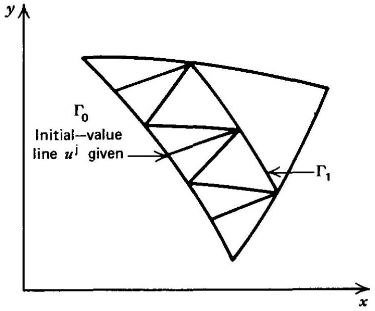
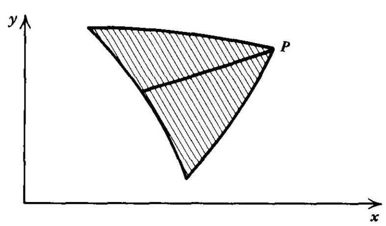
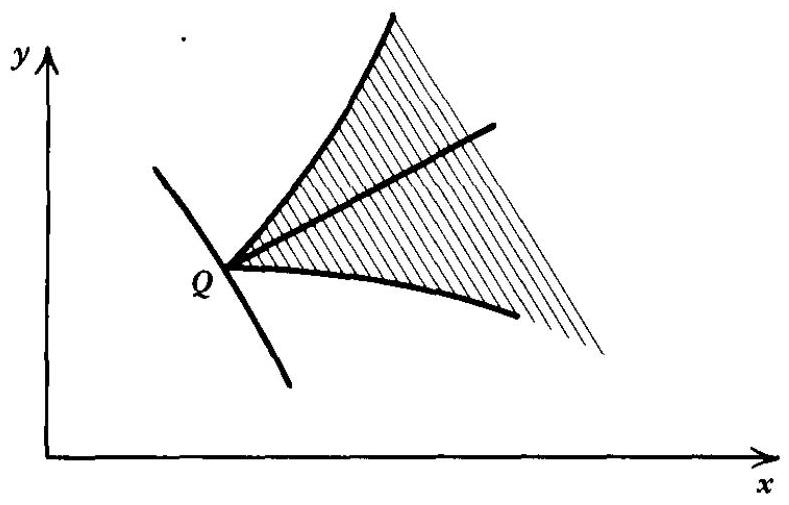

## the method of characteristics in two independent variables

In many engineering problems the governing equations are a system of quasi-linear nonhomogeneous partial differential equations of the first order for functions of two independent variables. A quasi-linear partial differential equation of the first order is defined as one that is nonlinear in the dependent variables, but linear in the first partial derivatives of the dependent variables. Such a system of $n$ equations may be written as*

$$
L_{i}=a_{i j} \frac{\partial u^{j}}{\partial x}+b_{i j} \frac{\partial u^{j}}{\partial y}+c_{i}=0 \quad(i, j=1, \ldots, n)
$$

where the superscript $j$ identifies a particular dependent variable, and the coefficients $a_{i j}, b_{i j}$, and $c_{i}$ depend on $x, y, u^{1}, \ldots, u^{n}$. When expanded, this system of equations is

$$
\begin{aligned}
& L_{1}=a_{11} u_{x}^{1}+a_{12} u_{x}^{2}+\cdots+a_{1 n} u_{x}^{n}+b_{11} u_{y}^{1}+b_{12} u_{y}^{2}+\cdots+b_{1 n} u_{y}^{n}+c_{1}=0 \\
& L_{2}=a_{21} u_{x}^{1}+a_{22} u_{x}^{2}+\cdots+a_{2 n} u_{x}^{n}+b_{21} u_{y}^{1}+b_{22} u_{y}^{2}+\cdots+b_{2 n} u_{y}^{n}+c_{2}=0 \\
& \vdots \\
& \vdots \\
& \vdots \\
& L_{n}=a_{n 1} u_{x}^{1}+a_{n 2} u_{x}^{2}+\cdots+a_{n n} u_{x}^{n}+b_{n 1} u_{y}^{1}+b_{n 2} u_{y}^{2}+\cdots+b_{n n} u_{y}^{n}+c_{n}=0
\end{aligned}
$$

When such systems are hyperbolic, the desired solution may be obtained by the method of characteristics. Chapter 12 presents in detail the development of the theory for a single partial differential equation [Section 12-3(a)], and for two partial differential equations [Section 12-3(b)]. Those developments are not repeated in the subject Appendix.

By analogy to the case of two equations discussed in Section 12-3(b), the method of characteristics may be extended to a system of $n$ differential equations. The governing equations for such a system are equations B.1. Equations B.1 may be combined linearly to form the following sum.

$$
L=\sigma_{i} L_{i}=\sigma_{1} L_{1}+\sigma_{2} L_{2}+\cdots+\sigma_{n} L_{n}=0
$$

[^0]Putting equation B. 3 into the form of equation 12.27 results in the compatibility equation pertinent to the system.

$$
\left(a_{i j} \sigma_{i}\right) d u^{j}+c_{i} \sigma_{i} d x=0 \quad(i, j=1, \ldots, n)
$$

Equation B. 4 applies along the characteristic curves specified by

$$
a_{i j} \lambda=b_{i j} \sigma_{i} \quad(i, j=1, \ldots, n)
$$

Solving equation B. 5 for $\sigma_{i}$ yields

$$
\sigma_{i}\left(a_{i j} \lambda-b_{i j}\right)=0 \quad(i, j=1, \ldots, n)
$$

For equation B. 6 to have a solution other than the trivial solution $\sigma_{i}=0$, the determinant of the coefficients of $\sigma_{i}$ must vanish. Therefore,

$$
\left|\left(a_{i j} \lambda-b_{i j}\right)\right|=0 \quad(i, j=1, \ldots, n)
$$

The expanded determinant results in an algebraic equation of the $n$th degree for $\lambda=d y / d x$, giving $n$ roots $\lambda_{j}(j=1, \ldots, n)$, which determine $n$ characteristic directions. If all $n$ roots are distinct and real, the system is totally hyperbolic. In that case there are $n$ families of characteristic curves defined by the ordinary differential equations

$$
\frac{d y}{d x}=\lambda_{j} \quad(j=1, \ldots, n)
$$

Once the $\lambda_{j}$ are determined from equation B.8, the $\sigma_{i}$ may be determined from equation B.5. Those results may be substituted into the general compatibility equation, equation B.4, to determine the compatibility equations for the system. Equations B. 4 and B. 8 may replace the original system of partial differential equations, equations B.1.

The initial-value problem may be now formulated for the above system of hyperbolic partial differential equations. Assume a curve $\Gamma_{o}$ is given in the xy plane, and that continuous values of $u^{j}$ are prescribed along $\Gamma_{o}$, as illustrated in Fig. B.1. The problem is to determine, in the neighborhood of $\Gamma_{o}$, a solution $u^{j}$ of the system of governing equations that has the prescribed initial values along $\Gamma_{o}$. By replacing the original system of governing equations by the characteristic system, the problem is reduced to determining the solution of a set of total differential equations along the characteristic curves.

Figure B. 1 Characteristic initial-value line and solution network.

In general, those equations are nonlinear, and each is coupled with the others. For that reason, an iterative solution is required. The compatibility equations, each of which is valid along one of the characteristic curves, may be written in finite difference form, as can the equations of the characteristic curves. By moving along the characteristic curves, the initial values of $u^{j}$ along $\Gamma_{o}$ may be extended into the domain enclosed by the outermost characteristic curves passing through the initialdata curve $\Gamma_{o}$. By continuing in small steps along $\Gamma_{o}$, a new curve $\Gamma_{1}$ may be obtained with all of the values of $u^{j}$ determined along that curve, as illustrated in Fig. B.1.

The foregoing considerations result in the concepts of domain of dependence and range of influence. Figure B. 2 illustrates the domain of dependence of a point $P$, which is the region in the $x y$ plane bounded by the outermost characteristic curves passing through the point $P$ on the initial-value line $\Gamma_{o}$, and is the region wherein the solution of the initial-value problem may be determined. Figure B. 3 illustrates the range of influence of the point $Q$ on the initial-value line $\Gamma_{o}$, which is the region in the $x y$ plane containing all of the points that are influenced by the initial data at point $Q$. The range of influence comprises all of the points having a domain of dependence containing the point $Q$. Therefore, it is the region between the two outermost characteristic curves passing through point $Q$.

Figure B. 2 Domain of dependence of point $P$.

Figure B. 3 Range of influence of point $Q$.

For a solution to be possible, the initial-value line cannot be characteristic at any place unless initial data are given along two intersecting characteristic curves. Several types of domains having different types of initial-value lines may be analyzed. The present discussion is concerned, however, only with domains in which the initialvalue line is nowhere characteristic.

By applying the method of characteristics as presented in the foregoing discussion, it is possible to solve many complicated systems of partial differential equations, provided that the system is quasi-linear and hyperbolic. The latter conditions are frequently encountered in fluid flow problems.

[^0]:    * In accordance with accepted convention, when an index is repeated, summation is carried out with respect to that index.

