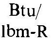

## C tables

Tables C. 1 to C. 15 are presented in this Appendix. An index to the tables is presented below.
Table Title Page
C. 1 Dimensional formulas and units for physical quantities of interest in gas dynamics ..... 699
C. 2 Universal physical constants ..... 699
C. 3 Thermodynamic constants for common gases ..... 700
C. 4 Thermodynamic properties of air in SI units and Thermodynamic properties of air in EE units ..... 700
C. 5 Properties of the U.S. standard atmosphere ..... 708
C. 6 Isentropic flow ..... 709
C. 7 Adiabatic flow with friction in a constant-area duct (Fanno line) ..... 720
C. 8 Isothermal flow with friction in a constant-area duct ..... 726
C. 9 Frictionless flow with heat transfer in a constant-area duct (Rayleigh line) ..... 728
C. 10 Isothermal frictionless flow in a variable-area duct ..... 734
C. 11 Normal shock waves ..... 736
C. 12 Wave angle $\varepsilon$ for oblique shock waves ..... 744
C. 13 Prandtl-Meyer angle $v$ ..... 749
C. 14 Mass addition normal to the main stream ..... 751
C. 15 Useful functions of the specific heat ratio $\gamma$ ..... 758

In the computer generated tables presented in this Appendix, the following convention is employed for specifying the power of 10 associated with a table entry.

$$
. X X X X X \pm N=. X X X X X \cdot 10^{ \pm N}
$$

For example,

$$
\begin{aligned}
& .12924+1=0.12924 \cdot 10^{+1}=1.2924 \\
& .77234-1=0.77234 \cdot 10^{-1}=0.077234
\end{aligned}
$$

Table C. 1 Dimensional Formulas and Units for Physical Quantities of Interest in Gas Dynamics
| Quantity | Dimensional Formula |  | System of Units |  |  |  |
| :--- | :--- | :--- | :--- | :--- | :--- | :--- |
|  | ( $M, L, T$ ) | ( $F, L, T$ ) | EE | EA | EG | SI |
| Angular distance |  |  | rad | rad | rad | rad |
| Angular velocity | $1 / T$ | $1 / T$ | $\mathrm{rad} / \mathrm{sec}$ | $\mathrm{rad} / \mathrm{sec}$ | rad/sec | $\mathrm{rad} / \mathrm{s}$ |
| Angular acceleration | $1 / T^{2}$ | $1 / T^{2}$ | $\mathrm{rad} / \mathrm{sec}^{2}$ | $\mathrm{rad} / \mathrm{sec}^{2}$ | $\mathrm{rad} / \mathrm{sec}^{2}$ | $\mathrm{rad} / \mathrm{s}^{2}$ |
| Area | $L^{2}$ | $L^{2}$ | $\mathrm{ft}^{2}$ | $\mathrm{ft}^{2}$ | $\mathrm{ft}^{2}$ | $\mathrm{m}^{2}$ |
| Density | $M / L^{3}$ | $F T^{2} / L^{4}$ | $\mathrm{lbm} / \mathrm{ft}^{3}$ | $\mathrm{lbm} / \mathrm{ft}^{3}$ | slug $/ \mathrm{ft}^{3}$ | $\mathrm{kg} / \mathrm{m}^{3}$ |
| Dynamic viscosity | $M / L T$ | $F T / L^{2}$ | $\mathrm{lbf}-\mathrm{sec} / \mathrm{ft}^{2}$ | pul-sec/ $\mathrm{ft}^{2}$ | $\mathrm{lbf}-\mathrm{sec} / \mathrm{ft}^{2}$ | $\mathrm{N}-\mathrm{s} / \mathrm{m}^{2}$ |
| Energy | $M L^{2} / T^{2}$ | FL | ft-lbf | ft-pdl | ft-lbf | J |
| Enthalpy | $L^{2} / T^{2}$ | FL/M | ft-lbf/lbm | ft-pdl/lbm | ft-lbf/slug | J/kg |
| Force | $M L / T^{2}$ | $F$ | lbf | pdl | lbf | N |
| Heat | $M L^{2} / T^{2}$ | FL | ft-lbf | ft-pdl | ft-lbf | J |
| Impulse | $M L / T$ | FT | lbf-sec | pdl-sec | lbf-sec | N-s |
| Kinematic viscosity | $L^{2} / T$ | $L^{2} / T$ | $\mathrm{ft}^{2} / \mathrm{sec}$ | $\mathrm{ft}^{2} / \mathrm{sec}$ | $\mathrm{ft}^{2} / \mathrm{sec}$ | $\mathrm{m}^{2} / \mathrm{s}$ |
| Linear distance | $L$ | $L$ | ft | ft | ft | m |
| Linear velocity | $L / T$ | $L / T$ | ft/sec | $\mathrm{ft} / \mathrm{sec}$ | ft/sec | m/s |
| Linear acceleration | $L / T^{2}$ | $L / T^{2}$ | $\mathrm{ft} / \mathrm{sec}^{2}$ | $\mathrm{ft} / \mathrm{sec}^{2}$ | $\mathrm{ft} / \mathrm{sec}^{2}$ | $\mathrm{m} / \mathrm{s}^{2}$ |
| Mass | M | $F T^{2} / L$ | lbm | lbm | slug | kg |
| Moment | $M L^{2} / T^{2}$ | FL | ft-lbf | ft-pdl | ft-lbf | m-N |
| Momentum | $M L / T$ | FT | lbm-ft/sec | lbm-ft/sec | slug-ft/sec | $\mathrm{kg}-\mathrm{m} / \mathrm{s}$ |
| Pressure | $M / L T^{2}$ | $F / L^{2}$ | $\mathrm{lbf} / \mathrm{ft}^{2}$ | $\mathrm{pdl} / \mathrm{ft}^{2}$ | $\mathrm{lbf} / \mathrm{ft}^{2}$ | $\mathrm{N} / \mathrm{m}^{2}$ |
| Power | $M L^{2} / T^{3}$ | $F L / T$ | ft-lbf/sec | ft-pdl/sec | ft-lbf/sec | J/s |
| Time | $T$ | $T$ | sec | sec | sec | s |
| Torque | $M L^{2} / T^{2}$ | FL | ft-lbf | ft-pdl | ft-lbf | m-N |
| Weight | $M L / T^{2}$ | F | lbf | pdl | lbf | N |
| Work | $M L^{2} / T^{2}$ | FL | ft-lbf | ft-pdl | ft-lbf | J |

Table C. 2 Universal Physical Constants

$$
\begin{aligned}
c & =\text { velocity of light in vacuo }=2.997295 \cdot 10^{8} \mathrm{~m} / \mathrm{s}(186,282.4 \mathrm{mi} / \mathrm{sec}) \\
g_{o} & =\text { standard acceleration of gravity }=9.80665 \mathrm{~m} / \mathrm{s}^{2}\left(32.174 \mathrm{ft} / \mathrm{sec}^{2}\right) \\
h & =\text { Planck's constant }=6.626196 \cdot 10^{-34} \mathrm{~J}-\mathrm{s} \\
k & =\text { Boltzmann's constant }=1.38054 \cdot 10^{-23} \mathrm{~J} / \mathrm{K} \\
N_{A} & =\text { Avogadro's number }=6.02252 \cdot 10^{23} \text { particles } / \mathrm{mol} \\
\bar{R} & =\text { universal gas constant }=8.31434 \mathrm{~J} / \mathrm{mol}-\mathrm{K}(1545.3 \mathrm{ft}-\mathrm{lbf} / \mathrm{lbmole}-\mathrm{R})
\end{aligned}
$$

Table C. 3 Thermodynamic Constants for Common Gases
| Gas | Chemical Symbol | Molecular Weight | Specific Heat ratio $\gamma$ at $298.15 \mathrm{~K}(77 \mathrm{~F})$ | EE units |  | SI units |  |
| :--- | :--- | :--- | :--- | :--- | :--- | :--- | :--- |
|  |  |  |  | Gas Constant $R=\bar{R} / \bar{m}$ (ft-lbf/ lbm-R) | Specific Heat $c_{p}$ at 77 F (Btu/ lbm-R) | Gas Constant $R=\bar{R} / \bar{m}$ ( $\mathrm{J} / \mathrm{kg}-\mathrm{K}$ ) | Specific Heat $c_{p}$ at 298.15 K (J/kg-K) |
| Air |  | 28.964 | 1.400 | 53.352 | 0.2398 | 287.06 | 1004.0 |
| Argon | A | 39.944 | 1.658 | 38.687 | 0.1253 | 208.15 | 524.61 |
| Carbon monoxide | CO | 28.010 | 1.398 | 55.170 | 0.249 | 296.83 | 1042.5 |
| Carbon dioxide | $\mathrm{CO}_{2}$ | 44.010 | 1.288 | 35.112 | 0.202 | 188.92 | 845.73 |
| Helium | He | 4.000 | 1.659 | 386.33 | 1.250 | 2078.2 | 5233.5 |
| Hydrogen | $\mathrm{H}_{2}$ | 2.016 | 1.405 | 766.52 | 3.419 | 4124.2 | 14315.0 |
| Methane | $\mathrm{CH}_{4}$ | 16.043 | 1.304 | 96.322 | 0.531 | 518.25 | 2223.2 |
| Nitrogen | $\mathrm{N}_{2}$ | 28.013 | 1.400 | 55.164 | 0.248 | 296.80 | 1038.3 |
| Oxygen | $\mathrm{O}_{2}$ | 32.000 | 1.395 | 48.291 | 0.219 | 259.82 | 916.90 |
| Water | $\mathrm{H}_{2} \mathrm{O}$ | 18.016 | 1.329 | 85.774 | 0.445 | 461.50 | 1863.1 |

Table C. 4 Thermodynamic Properties of Air in SI Units
| $t$ | $h$ | $u$ | $\phi$ | $p_{r}$ | $v_{r}$ | $c_{p}$ | $c_{v}$ | $\gamma$ | $a$ |
| :--- | :--- | :--- | :--- | :--- | :--- | :--- | :--- | :--- | :--- |
| K | kJ/kg | kJ/kg | kJ/kg-K |  |  | kJ/kg-K kJ/kg-K |  |  | m/s |
| 50 | 48.554 | 34.202 | 4.8839 | .18039-2 | $.79556+7$ | 1.0317 | 7447 | 1.3854 | 141.01 |
| 55 | 53.709 | 37.922 | 4.9822 | .25404-2 | .62142+7 | 1.0303 | 7432 | 1.3862 | 147.93 |
| 60 | 58.857 | 41.635 | 5.0718 | .34709-2 | $.49617+7$ | 1.0289 | 7418 | 1.3869 | 154.55 |
| 65 | 63.997 | 45.341 | 5.1541 | .46235-2 | . 40352 +7 | 1.0275 | 7405 | 1.3876 | 160.90 |
| 70 | 69.132 | 49.040 | 5.2302 | .60272-2 | . 33336 +7 | 1.0262 | 7392 | 1.3883 | 167.01 |
| 75 | 74.259 | 52.732 | 5.3009 | .77121-2 | . 27913 +7 | 1.0249 | 7379 | 1.3890 | 172.92 |
| 80 | 79.381 | 56.419 | 5.3670 | .97095-2 | $.23649+7$ | 1.0237 | 7367 | 1.3896 | 178.65 |
| 85 | 84.496 | 60.099 | 5.4291 | .12052-1 | $.20244+7$ | 1.0225 | 7355 | 1.3903 | 184.17 |
| 90 | 89.606 | 63.773 | 5.4875 | .14772-1 | $.17488+7$ | 1.0213 | 7343 | 1.3909 | 189.55 |
| 95 | 94.710 | 67.442 | 5.5427 | .17903-1 | . 15230 +7 | 1.0202 | 7332 | 1.3915 | 194.79 |
| 100 | 99.808 | 71.106 | 5.5950 | .21482-1 | . 13361 +7 | 1.0192 | 7321 | 1.3920 | 199.89 |
| 105 | 104.902 | 74.764 | 5.6447 | . 25543-1 | $.11799+7$ | 1.0181 | 7311 | 1.3926 | 204.87 |
| 110 | 109.990 | 78.417 | 5.6920 | .30123-1 | . 10481 +7 | 1.0171 | 7301 | 1.3931 | 209.73 |
| 115 | 115.073 | 82.065 | 5.7372 | .35260-1 | . $9361^{3+6}$ | 1.0162 | 7292 | 1.3936 | 214.48 |
| 120 | 120.152 | 85.708 | 5.7804 | .40991-1 | . 84026 +6 | 1.0153 | 7282 | 1.3941 | 219.13 |
| 125 | 125.226 | 89.347 | 5.8218 | .47356-1 | $.75763+6$ | 1.0144 | 7274 | 1.3946 | 223.69 |
| 130 | 130.296 | 92.982 | 5.8616 | .54594-1 | $.68599+6$ | 1.0136 | 7265 | 1.3951 | 228.16 |
| 135 | 135.361 | 96.613 | 5.8999 | .62145-1 | .62352+6 | 1.0127 | 7257 | 1.3955 | 232.54 |
| 140 | 140.423 | 100.239 | 5.9367 | .70650-1 | . 56878 +6 | 1.0120 | 7250 | 1.3959 | 236.84 |
| 145 | 145.481 | 103.862 | 5.9722 | .79951-1 | . 52056 +6 | 1.0113 | 7242 | 1.3963 | 241.07 |
| 150 | 150.536 | 107.482 | 6.0064 | .90090-1 | $.47790+6$ | 1.0106 | 7235 | 1.3967 | 245.22 |
| 155 | 155.587 | 111.098 | 6.0396 | . 10111 + 0 | . $44000+6$ | 1.0099 | 7229 | 1.3971 | 249.31 |
| 160 | 160.635 | 114.710 | 6.0716 | . 11306 +0 | . 40621 +6 | 1.0093 | 7222 | 1.3974 | 253.33 |
| 165 | 165,680 | 118.320 | 6.1027 | . 12597 +0 | . 37595 +6 | 1.0087 | 7217 | 1.3977 | 257.29 |
| 170 | 170.722 | 121.927 | 6.1328 | . 13990 +0 | . 34878 +6 | 1.0081 | 7211 | 1.3980 | 261,18 |
| 175 | 175.761 | 125.531 | 6.1620 | $.15489+0$ | $.32429+6$ | 1.0076 | 7206 | 1.3983 | 265.02 |
| 180 | 180.798 | 129.133 | 6.1904 | $.17099+0$ | $.30215+6$ | 1.0071 | 7201 | 1.3986 | 268.81 |
| 185 | 185.832 | 132.732 | 6.2180 | . 18824 +0 | $.2820^{9}+6$ | 1.0067 | 7196 | 1.3989 | 272.54 |
| 190 | 190.864 | 136.329 | 6.2448 | $.20669+0$ | $.26385+6$ | 1.0062 | 7192 | 1.3991 | 276.22 |
| 195 | 195.895 | 139.924 | 6.2709 | $.22639+0$ | $.24723+6$ | 1.0058 | 7188 | 1.3993 | 279.86 |
| 200 | 200.923 | 143.517 | 6.2964 | . $24739+0$ | . 23204 +6 | 1.0055 | 7185 | 1.3995 | 283.44 |
| 205 | 205.949 | 147.109 | 6.3212 | .26974+0 | .21814+6 | 1.0052 | . 7181 | 1.3997 | 286.98 |
| 210 | 210.975 | 150.699 | 6.3454 | $.29349+0$ | . 20538 +6 | 1.0049 | 7178 | 1.3998 | 290.48 |
| 215 | 215.998 | 154.287 | 6.3691 | .31869 + 0 | $.19364+6$ | 1.0046 | 7176 | 1.4000 | 293.93 |
| 220 | 221.021 | 157.875 | 6.3922 | $.34539+0$ | $.18283+6$ | 1.0044 | 7173 | 1.4001 | 297.34 |
| 225 | 226.042 | 161.461 | 6.4147 | . 37364 + 0 | . 17284 +6 | 1.0042 | 7171 | 1.4002 | 300.71 |
| 230 | 231.062 | 165.046 | 6.4368 | . 40350 +0 | $.16361+6$ | 1.0040 | . 7170 | 1.4003 | 304.05 |
| 235 | 236.082 | 168.630 | 6.4584 | . 43502 +0 | . 15505 +6 | 1.0039 | . 7168 | 1.4004 | 307.34 |
| 240 | 241.101 | 172.214 | 6.4795 | . 46826 +0 | . 14711 +6 | 1.0037 | . 7167 | 1.4005 | 310.60 |
| 245 | 246.119 | 175.798 | 6.5002 | . 50327 +0 | . 13973 + 6 | 1.0037 | . 7166 | 1.4005 | 313.83 |
| 250 | 251.137 | 179.381 | 6.5205 | . 54011 + 0 | . 13286 +6 | 1.0036 | . 7166 | 1.4006 | 317.02 |
| 255 | 256.155 | 182.963 | 0.5404 | $.57883+0$ | $.12645+6$ | 1.0036 | . 7165 | 1.4006 | 320.17 |

Table C. 4 Thermodynamic Properties of Air in SI Units (Continued)
| $t$ | $h$ | $u$ | $\phi$ | $p_{r}$ | $v_{r}$ | $c_{p}$ | $c_{v}$ | $\gamma$ | $a$ |
| :--- | :--- | :--- | :--- | :--- | :--- | :--- | :--- | :--- | :--- |
| K | kJ/kg | kJ/kg | kJ/kg-K |  |  | kJ/kg-K kJ/kg-K |  |  | m/s |
| 260 | 261.173 | 186.546 | 6.5599 | $.61949+0$ | $.12046+6$ | 1.0036 | . 7165 | 1.4006 | 323.30 |
| 265 | 266.191 | 190.129 | 6.5790 | . $66216+0$ | $.11487+6$ | 1.0036 | 7166 | 1.4006 | 326.39 |
| 270 | 271.209 | 193.712 | 6.5977 | . 70688 +0 | $.10963+6$ | 1.0036 | 7166 | 1.4005 | 329.45 |
| 275 | 276.228 | 197.295 | 6.6161 | $.75372+0$ | . 10472 +6 | 1.0037 | .7167 | 1.4005 | 332.48 |
| 280 | 281.246 | 200.879 | 6.6342 | $.80275+0$ | $.10012+6$ | 1.0038 | . 7168 | 1.4004 | 335.48 |
| 285 | 286.266 | 204.463 | 6.6520 | . 85401 + 0 | $.95787+5$ | 1.0040 | . 7169 | 1.4004 | 338.46 |
| 290 | 291.286 | 208.048 | 6.6695 | $.90758+0$ | $.91714+5$ | 1.0041 | 7171 | 1.4003 | 341,40 |
| 295 | 296.307 | 211.634 | 6.6866 | - 96352 + 0 | $.87879+5$ | 1.0043 | . 7173 | 1.4002 | 344.32 |
| 300 | 301,329 | 215.221 | 6.7035 | $.10219+1$ | $.84264+5$ | 1.0045 | . 7175 | 1.4000 | 347.21 |
| 305 | 300.353 | 218.809 | 6.7201 | . 10827 +1 | . $80853+5$ | 1.0048 | . 7177 | 1.3999 | 350.08 |
| 310 | 311.377 | 222.398 | 6.7365 | . 11462 +1 | $.77631+5$ | 1.0050 | . 7180 | 1.3998 | 352.92 |
| 315 | 316.403 | 225.989 | 6.7525 | . 12122 + 1 | $.74585+5$ | 1.0053 | . 7183 | 1.3996 | 355.73 |
| 320 | 321.430 | 229.581 | 6.7684 | $.12810+1$ | $.71702+5$ | 1.0056 | . 7186 | 1.3994 | 358.52 |
| 325 | 326.459 | 233.175 | 6.7840 | . 13525 +1 | $.68971+5$ | 1.0059 | . 7189 | 1.3993 | 361.29 |
| 330 | 331.489 | 236.770 | 6.7993 | $.14269+1$ | $.66383+5$ | 1.0063 | 7193 | 1.3991 | 364.03 |
| 335 | 336.522 | 240.367 | 6.8145 | $.15041+1$ | $.63928+5$ | 1.0067 | 7196 | 1.3989 | 366.75 |
| 340 | 341.556 | 243.966 | 6.8294 | $.15843+1$ | $.61596+5$ | 1.0071 | 7200 | 1.3986 | 369.45 |
| 345 | 346.592 | 247.568 | 6.8441 | - 16676 +1 | . 29380 + 5 | 1.0075 | . 7204 | 1.3984 | 372.12 |
| 350 | 351.631 | 251.171 | 6.8586 | . 17540 +1 | $.57274+5$ | 1.0079 | . 7209 | 1.3982 | 374.76 |
| 355 | 356.671 | 254.776 | 6.8729 | . $18436+1$ | $.55268+5$ | 1.0084 | 7213 | 1.3979 | 377.41 |
| 360 | 361.714 | 258.384 | 6.8870 | . $19365+1$ | $.53359+5$ | 1.0089 | . 7218 | 1.3976 | 380.02 |
| 365 | 366.760 | 261.995 | 6.9009 | $.20327+1$ | $.51539+5$ | 1.0094 | . 7223 | 1.3974 | 382.62 |
| 370 | 371.808 | 265.608 | 6.9146 | . $21324+1$ | $.49804+5$ | 1.0099 | . 7229 | 1.3971 | 385.19 |
| 375 | 376.859 | 269.223 | 6.9282 | . $22355+1$ | $.48148+5$ | 1.0104 | .7234 | 1.3968 | 387.74 |
| 380 | 381.912 | 272.842 | 6.9416 | $.23423+1$ | $.46566+5$ | 1.0110 | . 7240 | 1.3965 | 390.27 |
| 385 | 386.969 | 276.463 | 6.9548 | $.24527+1$ | $.45055+5$ | 1.0116 | 7246 | 1.3961 | 392.79 |
| 390 | 392.028 | 280.087 | 6.9679 | $.25668+1$ | . $43611+5$ | 1.0122 | . 7252 | 1.3958 | 395.28 |
| 395 | 397.091 | 203.715 | 6.9808 | $.26848+1$ | $.42229+5$ | 1.0128 | . 7258 | 1.3955 | 397.76 |
| 400 | 402.156 | 287.345 | 6.9935 | . $28067+1$ | . $40906+5$ | 1.0134 | . 7264 | 1.3951 | 400.22 |
| 405 | 407.225 | 290.979 | 7.0061 | . 29326 + 1 | $.39640+5$ | 1.0141 | . 7271 | 1.3948 | 402.66 |
| 410 | 412.297 | 294.616 | 7.0186 | . 30625 +1 | $.38426+5$ | 1.0148 | . 7277 | 1.3944 | 405.09 |
| 415 | 417.373 | 298.256 | 7.0309 | $.31967+1$ | $.37263+5$ | 1.0155 | .7284 | 1.3940 | 407.49 |
| 420 | 422.452 | 301.900 | 7.0430 | $.33351+1$ | $.36147+5$ | 1.0162 | . 7292 | 1.3936 | 409.89 |
| 425 | 427.535 | 305.548 | 7.0551 | $.34778+1$ | $.35075+5$ | 1.0169 | . 7299 | 1.3933 | 412.26 |
| 430 | 432.621 | 309.199 | 7.0670 | $.36250+1$ | $.34047+5$ | 1.0177 | 7306 | 1.3929 | 414.62 |
| 435 | 437.711 | 312.854 | 7.0707 | $.37768+1$ | $.33059+5$ | 1.0184 | . 7314 | 1.3924 | 416.96 |
| 440 | 442.805 | 316.513 | 7.0904 | . $39331+1$ | $.32110+5$ | 1.0192 | .732? | 1.3920 | 419.29 |
| 445 | 447.903 | 320.176 | 7.1019 | $.40942+1$ | $.31197+5$ | 1.0200 | . 7330 | 1.3916 | 421.6 u |
| 450 | 453.005 | 323.843 | 7.1133 | $.42601+1$ | $.30319+5$ | 1.0208 | . 7338 | 1.3912 | 423.90 |
| 455 | 458.111 | 327.513 | 7.1246 | $.44309+1$ | $.29474+5$ | 1.0216 | 7346 | 1.3907 | 426.18 |
| 460 | 463.221 | 331.188 | 7.1357 | $.46067+1$ | $.28661+5$ | 1.0224 | . 7354 | 1.3903 | 428.44 |
| 465 | 468.355 | 334.866 | 7.1468 | $.47877+1$ | $.27877+5$ | 1.0233 | . 7363 | 1.3898 | 430.70 |
| 470 | 475.454 | 338.551 | 7.1577 | $.49738+1$ | . 27122 + 5 | 1.0242 | . 7371 | 1.3894 | 432.93 |
| 475 | 478.577 | 342.239 | 7.1686 | $.51653+1$ | $.26395+5$ | 1.0250 | . 7380 | 1.3889 | 435.16 |
| 480 | 483.704 | 345.931 | 7.1793 | $.53622+1$ | $.25693+5$ | 1.0259 | . 7389 | 1.3885 | 437.37 |
| 485 | 488.856 | 349.628 | 7.1900 | $.55647+1$ | $.25017+5$ | 1.0268 | . 7398 | 1.3880 | 439.57 |
| 490 | 493.973 | 353.329 | 7.2005 | $.57727+1$ | $.24363+5$ | 1.0278 | . 7407 | 1.3875 | 441.75 |
| 495 | 499.114 | 357.035 | 7.2109 | $.59865+1$ | . 23733 + 5 | 1.0287 | . 7417 | 1.3870 | 443.92 |
| 500 | 504.260 | 360.746 | 7.2213 | . $62062+1$ | $.23124+5$ | 1.0296 | . 7426 | 1.3865 | 446.00 |
| 505 | 509.410 | 364.461 | 7.2315 | . $64318+1$ | $.22536+5$ | 1.0306 | .7436 | 1.3860 | 448.22 |
| 510 | 514.566 | 368.182 | 7.2417 | $.66636+1$ | $.21968+5$ | 1.0316 | . 7445 | 1.3855 | 450.3 b |
| 515 | 519.726 | 371.907 | 7.2518 | . $69015+1$ | $.21419+5$ | 1.0325 | . 7455 | 1.3850 | 452.47 |
| 520 | 524.891 | 375.637 | 7.2617 | $.71457+1$ | $.20887+5$ | 1.0335 | . 7465 | 1.3845 | 454.56 |
| 525 | 530.061 | 379.372 | 7.2716 | $.73963+1$ | $.20374+5$ | 1.0345 | . 7475 | 1.3840 | 456.67 |
| 530 | 535.236 | 383.112 | 7.2814 | . $76535+1$ | $.19877+5$ | 1.0355 | . 7485 | 1.3835 | 458.76 |
| 535 | 540.417 | 386.857 | 7.2912 | $.79173+1$ | $.19395+5$ | 1.0366 | . 7495 | 1.3829 | 460.83 |
| 540 | 545.602 | 390.607 | 7.3008 | . $81860+1$ | $.18930+5$ | 1.0376 | . 7506 | 1.3824 | 462.89 |
| 545 | 550.792 | 394.362 | 7.3104 | . $84655+1$ | $.18479+5$ | 1.0386 | . 7516 | 1.3819 | 464.94 |
| 550 | 555.988 | 398.123 | 7.3199 | $.87501+1$ | $.18042+5$ | 1.0397 | . 7527 | 1.3614 | 466.98 |
| 555 | 561.189 | 401.889 | 7.3293 | $.90418+1$ | $.17618+5$ | 1.0407 | . 7537 | 1.3808 | 469.00 |
| 560 | 566.396 | 405.660 | 7.3306 | $.93408+1$ | . 17208 + 5 | 1.0418 | . 7548 | 1.3003 | 471.02 |
| 565 | 571.607 | 409.437 | 7.3479 | $.96473+1$ | $.16810+5$ | 1.0429 | . 7559 | 1.3797 | 473.02 |
| 570 | 576.825 | 413.219 | 7.3571 | $.99613+1$ | $.16424+5$ | 1.0440 | . 7569 | 1.3792 | 475.02 |
| 575 | 582.047 | 417.006 | 7.3662 | . 10283 + 2 | $.16050+5$ | 1.0451 | . 7580 | 1.3786 | 477.00 |
| 580 | 587.275 | 420.799 | 7.3755 | . 10612 + 2 | $.15687+5$ | 1.0462 | . 7591 | 1.3781 | 478.98 |
| 585 | 592.509 | 424.598 | 7.3043 | . 10950 + 2 | $.15334+5$ | 1.0473 | . 7603 | 1.3775 | 480.94 |
| 590 | 597.748 | 428.402 | 7.3932 | $.11295+2$ | $.14992+5$ | 1.0484 | . 7614 | 1.3770 | 482.90 |
| 595 | 602.993 | 432.211 | 7.4020 | . 11649 + 2 | . $14660+5$ | 1.0495 | . 7625 | 1.3764 | 484.84 |
| 600 | 608.243 | 436.027 | 7.4108 | . 12011 + 2 | . $14338+5$ | 1.0507 | . 7636 | 1.3759 | 486.77 |
| 605 | 613.499 | 439.848 | 7.4195 | . $12382+2$ | $.14024+5$ | 1.0518 | . 7648 | 1.3753 | 488.70 |
| 610 | 618.761 | 443.674 | 7.4282 | . 12761 + 2 | $.13720+5$ | 1.0529 | . 7659 | 1.3748 | 490.61 |
| 615 | 624.029 | 447.507 | 7.4368 | $.13150+2$ | $.13424+5$ | 1.0541 | . 7671 | 1.3742 | 492.52 |
| 620 | 629.302 | 461.345 | 7.4453 | $.13547+2$ | $.13137+5$ | 1.0552 | . 7682 | 1.3736 | 494.42 |
| 625 | 634.581 | 455.189 | 7.4538 | . $13953+2$ | $.12857+5$ | 1.0564 | . 7694 | 1.3731 | 496.30 |
| 630 | 639.866 | 459.039 | 7.4622 | . 14368 + 2 | $.12585+5$ | 1.0576 | . 7705 | 1.3725 | 498.18 |
| 635 | 645.157 | 462.894 | 7.4706 | $.14793+2$ | . $12321+5$ | 1.0587 | . 7717 | 1.3719 | 500.05 |
| 640 | 650.453 | 406.756 | 7.4789 | . 15228 + 2 | $.12063+5$ | 1.0599 | . 7729 | 1.3714 | 501.92 |
| 645 | 655.756 | 470.623 | 7.4872 | . 15672 + 2 | $.11813+5$ | 1.0611 | . 7741 | 1.3708 | 503.77 |
| 650 | 661.064 | 474.496 | 7.4954 | . 16126 + 2 | $.11569+5$ | 1.0623 | . 7752 | 1.3702 | 505.61 |
| 655 | 666.378 | 478.375 | 7.5035 | $.16590+2$ | . 11332 + 5 | 1.0635 | . 7764 | 1.3697 | 507.45 |
| 660 | 671.699 | 482.260 | 7.5116 | . 17065 + 2 | . 11101 + 5 | 1.0646 | . 7776 | 1.3691 | 509.28 |
| 665 | 677.025 | 486.151 | 7.5196 | $.17549+2$ | $.10876+5$ | 1.0658 | . 7788 | 1.3685 | 511.10 |

Table C. 4 Thermodynamic Properties of Air in SI Units (Continued)
| $t$ | $h$ | $u$ | $\phi$ | $p_{r}$ | $v_{r}$ | $c_{p}$ | $c_{v}$ | $\gamma$ | $a$ |
| :--- | :--- | :--- | :--- | :--- | :--- | :--- | :--- | :--- | :--- |
| K | kJ/kg | kJ/kg | kJ/kg-K |  |  | kJ/kg-K | kJ/kg-K |  | m/s |
| 670 | 682.357 | 490.048 | 7.5276 | $.18045+2$ | $.10657+5$ | 1.0670 | . 7800 | 1.3680 | 512.91 |
| 675 | 687.695 | 493.951 | 7.5356 | . 18551 +2 | . 10444 + 5 | 1.0682 | . 7812 | 1.3674 | 514.71 |
| 680 | 693.039 | 497.860 | 7.5435 | . $19067+2$ | . 10236 +5 | 1.0694 | . 7824 | 1.3669 | 516.51 |
| 685 | 698.389 | 501.775 | 7.5513 | $.19595+2$ | . 10034 +5 | 1.0706 | . 7836 | 1.3663 | 518.30 |
| 690 | 703.746 | 505.697 | 7.5591 | $.20134+2$ | . $98363+4$ | 1.0718 | . 7848 | 1.3657 | 520.08 |
| 695 | 709.108 | 509.624 | 7.5668 | . 20685 +2 | . $96439+4$ | 1.0730 | . 7860 | 1.3652 | 521.8 b |
| 700 | 714.476 | 513.557 | 7.5745 | $.21247+2$ | . $94563+4$ | 1.0743 | . 7872 | 1.3646 | 523.62 |
| 705 | 719.850 | 517.496 | 7.5822 | . $21821+2$ | . 92733 +4 | 1.0755 | . 7884 | 1.3640 | 525.38 |
| 710 | 725.231 | 521.441 | 7.5898 | . $22407+2$ | . 90949 +4 | 1.0767 | . 7897 | 1.3635 | 527.13 |
| 715 | 730.617 | 525.392 | 7.5973 | $.23005+2$ | $.89209+4$ | 1.0779 | . 7909 | 1.3629 | 528.87 |
| 720 | 736.010 | 529.350 | 7.6049 | . $23615+2$ | $.87511+4$ | 1.0791 | . 7921 | 1.3624 | 530.61 |
| 725 | 741.408 | 533.313 | 7.6123 | . $24238+2$ | $.85854+4$ | 1.0803 | . 7933 | 1.3618 | 532.34 |
| 730 | 746.813 | 537.283 | 7.6198 | . 24874 +2 | $.84237+4$ | 1.0815 | . 7945 | 1.3613 | 534.07 |
| 735 | 752.223 | 541.258 | 7.6271 | $.25522+2$ | $.82660+4$ | 1.0827 | . 7957 | 1.3607 | 535.78 |
| 740 | 757.640 | 545.240 | 7.6345 | $.26184+2$ | $.81119+4$ | 1.0340 | . 7969 | 1.3602 | 537.49 |
| 745 | 763.063 | 549.227 | 7.6418 | . $26858+2$ | $.79616+4$ | 1.0852 | . 7981 | 1.3596 | 539.20 |
| 750 | 768.492 | 553.221 | 7.6491 | $.27547+2$ | $.78147+4$ | 1.0864 | . 7994 | 1.3591 | 540.90 |
| 755 | 773.927 | 557.221 | 7.6563 | $.28249+2$ | $.76714+4$ | 1.0876 | . 8006 | 1.3585 | 542.59 |
| 760 | 779.368 | 561.227 | 7.6635 | . $28965+2$ | $.75313+4$ | 1.0888 | . 8018 | 1.3580 | 544.27 |
| 765 | 784.815 | 565.239 | 7.6706 | $.29694+2$ | . $73945+4$ | 1.0900 | . 8030 | 1.3575 | 545.95 |
| 770 | 790.268 | 569.257 | 7.6777 | $.30439+2$ | $.72609+4$ | 1.0912 | . 8042 | 1.3569 | 547.63 |
| 775 | 795.727 | 573.280 | 7.6848 | $.31197+2$ | . $71303+4$ | 1.0924 | . 8054 | 1.3564 | 549.29 |
| 780 | 801.192 | 577.310 | 7.6918 | $.31971+2$ | $.70027+4$ | 1.0936 | . 8066 | 1.3559 | 550.95 |
| 785 | 806.663 | 581.346 | 7.6988 | $.32759+2$ | . $68780+4$ | 1.0948 | . 8078 | 1.3553 | 552.61 |
| 790 | 812.140 | 585.388 | 7.7057 | $.33563+2$ | . $67561+4$ | 1.0960 | . 8090 | 1.3548 | 554.26 |
| 795 | 817.623 | 589.436 | 7.7127 | . 34382 + 2 | . $66369+4$ | 1.0972 | . 8102 | 1.3543 | 555.90 |
| 800 | 823.112 | 593.490 | 7.7195 | . 35216 +2 | .65204+4 | 1.0984 | . 8114 | 1.3538 | 557.54 |
| 805 | 828.607 | 597.550 | 7.7264 | . 36066 + 2 | . $64065+4$ | 1.0996 | . 8125 | 1.3532 | 559.18 |
| 810 | 834.108 | 601.615 | 7.7332 | . 36932 + 2 | . 62951 +4 | 1.1008 | . 8137 | 1.3527 | 560.80 |
| 815 | 839.615 | 605.687 | 7.7400 | . $37815+2$ | . 61861 +4 | 1.1019 | . 8149 | 1.3522 | 562.42 |
| 820 | 845.127 | 609.764 | 7.7467 | . 38714 +2 | .60796+4 | 1.1031 | . 8161 | 1.3517 | 564.04 |
| 825 | 850.646 | 613.848 | 7.7534 | $.39629+2$ | $.59753+4$ | 1.1043 | . 8173 | 1.3512 | 565.65 |
| 830 | 856.170 | 617.937 | 7.7601 | . 40562 + 2 | $.58733+4$ | 1.1054 | . 8184 | 1.3507 | 567.26 |
| 835 | 861.700 | 622.032 | 7.7668 | . 41512 +2 | $.57735+4$ | 1.1066 | . 8196 | 1.3502 | 568.86 |
| 840 | 867.236 | 626.133 | 7.7734 | $.42479+2$ | $.56759+4$ | 1.1078 | . 8207 | 1.3497 | 570.46 |
| 845 | 872.778 | 630.239 | 7.7799 | $.43463+2$ | $.55803+4$ | 1.1089 | . 8219 | 1.3492 | 572.05 |
| 850 | 878.325 | 634.352 | 7.7865 | . 44466 + 2 | $.54867+4$ | 1.1101 | . 8230 | 1.3487 | 573.64 |
| 855 | 883.878 | 638.470 | 7.7950 | $.45487+2$ | . 53952 + 4 | 1.1112 | . 8242 | 1.3483 | 575.22 |
| 860 | 889.437 | 642.593 | 7.7995 | . $46526+2$ | $.53055+4$ | 1.1123 | . 8253 | 1.3478 | 576.79 |
| 865 | 895.002 | 646.723 | 7.8059 | $.47583+2$ | $.52178+4$ | 1.1135 | . 8264 | 1.3473 | 578.37 |
| 870 | 900.572 | 650.858 | 7.8124 | $.48660+2$ | . 51318 +4 | 1.1146 | . 8276 | 1.3468 | 579.93 |
| 875 | 906.148 | 654.998 | 7.8188 | $.49755+2$ | . $50477+4$ | 1.1157 | . 8287 | 1.3464 | 581.50 |
| 880 | 911.729 | 659.145 | 7.8261 | $.50870+2$ | $.49653+4$ | 1.1168 | . 8298 | 1.3459 | 583.06 |
| 885 | 917.316 | 663.296 | 7.8314 | $.52005+2$ | . 48846 +4 | 1.1179 | . 8309 | 1.3454 | 584.61 |
| 890 | 922.908 | 667.454 | 7.8377 | $.53159+2$ | . $48055+4$ | 1.1190 | . 8320 | 1.3450 | 586.16 |
| 895 | 928.506 | 671.616 | 7.8440 | . $54333+2$ | . 47280 +4 | 1.1201 | . 8331 | 1.3445 | 587.71 |
| 900 | 934.109 | 675.784 | 7.8503 | . $55528+2$ | . 46522 +4 | 1.1212 | . 8342 | 1.3441 | 589.25 |
| 905 | 939.718 | 679.958 | 7.8565 | $.56743+2$ | $.45778+4$ | 1.1223 | . 8352 | 1.3437 | 590.78 |
| 910 | 945.332 | 684.137 | 7.8627 | . $57980+2$ | $.45049+4$ | 1.1233 | . 8363 | 1.3432 | 592.32 |
| 915 | 950.951 | 688.321 | 7.8686 | $.59237+2$ | . $44335+4$ | 1.1244 | . 8374 | 1.3428 | 593.85 |
| 920 | 956.576 | 692.510 | 7.8749 | . 60 b16+2 | . 43636 +4 | 1.1254 | . 8384 | 1.3424 | 595.37 |
| 925 | 962.205 | 696.705 | 7.8811 | . 61816 + 2 | . 42950 +4 | 1.1265 | . 8394 | 1.3419 | 596.89 |
| 930 | 967.840 | 700.904 | 7.8871 | . $63139+2$ | $.42278+4$ | 1.1275 | . 8405 | 1.3415 | 598.41 |
| 935 | 973.480 | 705.109 | 7.8932 | . $64483+2$ | . $41619+4$ | 1.1285 | . 8415 | 1.3411 | 599.92 |
| 940 | 979.125 | 709.319 | 7.8992 | . $65850+2$ | . $40973+4$ | 1.1295 | . 8425 | 1.3407 | 601.43 |
| 945 | 984.776 | 713.535 | 7.9052 | $.67240+2$ | . 40339 +4 | 1.1306 | . 8435 | 1.3403 | 602.94 |
| 950 | 990.431 | 717.755 | 7.9112 | . $68653+2$ | . 3971 8+4 | 1.1315 | . 8445 | 1.3399 | 604.44 |
| 955 | 996.091 | 721,980 | 7.9171 | $.70089+2$ | .39109 +4 | 1.1325 | . 8455 | 1.3395 | 605.94 |
| 960 | 1001.756 | 726.210 | 7.9230 | $.71549+2$ | . 38512 +4 | 1,1335 | . 8465 | 1.3391 | 607.44 |
| 965 | 1007.426 | 730.445 | 7.9289 | . $73033+2$ | $.37926+4$ | 1.1345 | . 8475 | 1.3387 | 608.93 |
| 970 | 1013.101 | 734.684 | 7.9348 | . $74540+2$ | . 37351 +4 | 1.1354 | . 8484 | 1.3383 | 610.42 |
| 975 | 1018.781 | 738.929 | 7.9406 | $.76073+2$ | $.36787+4$ | 1.1364 | . 8494 | 1.3379 | 611.90 |
| 980 | 1024.465 | 743.178 | 7.9464 | $.77630+2$ | $.36235+4$ | 1.1373 | . 8503 | 1.3376 | 613.38 |
| 985 | 1030.154 | 747.432 | 7.9522 | . 79211 + 2 | . 35692 +4 | 1.1382 | . 8512 | 1.3372 | 614.86 |
| 990 | 1035.847 | 751.690 | 7.9580 | . $80819+2$ | . 35160 +4 | 1.1392 | . 8521 | 1.3368 | 616.34 |
| 995 | 1041.545 | 755.953 | 7.9637 | . $82452+2$ | $.34638+4$ | 1.1401 | . 8530 | 1.3365 | 617.81 |
| 1000 | 1047.248 | 760.220 | 7.9694 | . 84110 + 2 | $.34125+4$ | 1.1410 | . 8539 | 1.3361 | 619.28 |
| 1010 | 1058.666 | 768.768 | 7.9808 | $.87504+2$ | $.33130+4$ | 1.1427 | . 8556 | 1.3355 | 622.21 |
| 1020 | 1070.101 | 777.353 | 7.9921 | $.91007+2$ | . 32170 +4 | 1.1444 | . 8573 | 1.3348 | 625.13 |
| 1030 | 1081.553 | 785.915 | 8.0032 | . 94620 + 2 | $.31245+4$ | 1.1460 | . 8590 | 1.3341 | 628.03 |
| 1040 | 1093.022 | 794.513 | 8.0143 | . 98344 +2 | . 30354 +4 | 1.1477 | . 8607 | 1.3335 | 630.92 |
| 1050 | 1104.507 | 803.128 | 8.0253 | . 10218 + 3 | $.29494+4$ | 1.1493 | . 8623 | 1.3329 | 633.80 |
| 1060 | 1116.008 | 811.759 | 8.0362 | . 10614 +3 | $.28665+4$ | 1.1509 | . 8639 | 1.3322 | 636.66 |
| 1070 | 1127.526 | 820.406 | 8.0470 | . 11021 + 3 | . 27866 +4 | 1.1526 | . 8655 | 1.3316 | 639.50 |
| 1080 | 1139.059 | 829.069 | 8.0578 | $.11441+3$ | . 27094 +4 | 1.1542 | . 8671 | 1.3310 | 642.34 |
| 1090 | 1150.609 | 837.749 | 8.0684 | $.11873+3$ | $.26350+4$ | 1.1557 | . 8687 | 1.3304 | 645.16 |
| 1100 | 1162.174 | 846.444 | 8.0790 | . 12318 + 3 | . 25631 +4 | 1.1573 | . 8703 | 1.3298 | 647.97 |
| 1110 | 1173.755 | 855.154 | 8.0894 | $.12777+3$ | . 24936 +4 | 1.1589 | . 8718 | 1.3292 | 650.76 |
| 1120 | 1185.351 | 863.880 | 8.0998 | $.13248+3$ | . 24266 +4 | 1.1604 | . 8734 | 1.3286 | 653.54 |
| 1130 | 1196.963 | 872.622 | 8.1102 | . 13733 + 3 | . $23617+4$ | 1.1619 | . 8749 | 1.3281 | 656.31 |
| 1140 | 1208.590 | 881.378 | 8.1204 | . 14232 + 3 | . 22991 +4 | 1.1634 | . 8764 | 1.3275 | 659.07 |
| 1150 | 1220.232 | 890.150 | 8.1306 | $.14745+3$ | . 22386 +4 | 1.1649 | . 8779 | 1.3269 | 661.82 |
| 1160 | 1231.889 | 898.937 | 8.1407 | $.15273+3$ | . $21800+4$ | 1.1664 | . 8794 | 1.3264 | 664.55 |
| 1170 | 1243.560 | 907.738 | 8.1507 | $.15815+3$ | $.21234+4$ | 1.1679 | . 8809 | 1.3258 | 667.27 |
| 1180 | 1255.247 | 916.554 | 8.1606 | $.16373+3$ | . 20686 +4 | 1.1694 | . 8823 | 1.3253 | 669.98 |

Table C. 4 Thermodynamic Properties of Air in SI Units (Continued)
| $t$ | $h$ | $u$ | $\phi$ | $p_{r}$ | $v_{r}$ | $c_{p}$ | $c_{v}$ | $\gamma$ | $a$ |
| :--- | :--- | :--- | :--- | :--- | :--- | :--- | :--- | :--- | :--- |
| K | kJ/kg | kJ/kg | kJ/kg-K |  |  | kJ/kg-K | kJ/kg-K |  | $\mathrm{m} / \mathrm{s}$ |
| 1190 | 1266.948 | 925.385 | 8.1705 | $.16946+3$ | . 20156 +4 | 1.1708 | . 8838 | 1.3248 | 672.68 |
| 1200 | 1278.663 | 934.230 | 8.1803 | $.17535+3$ | $.19643+4$ | 1.1722 | . 8852 | 1.3242 | 675.36 |
| 1210 | 1290.392 | 943.089 | 8.1900 | . 18140 + 3 | $.19146+4$ | 1.1737 | . 8866 | 1.3237 | 678.04 |
| 1220 | 1302.136 | 951.962 | 8.1997 | $.18761+3$ | $.18665+4$ | 1.1751 | . 8880 | 1.3232 | 680.70 |
| 1230 | 1313.894 | 960.849 | 8.2093 | $.19399+3$ | $.18199+4$ | 1.1765 | . 8894 | 1.3227 | 683.36 |
| 1240 | 1325.665 | 969.751 | 6.2188 | $.20054+3$ | . $17748+4$ | 1.1778 | . 8908 | 1.3222 | 686.00 |
| 1250 | 1337.450 | 978.666 | 8.2283 | $.20727+3$ | . 17310 +4 | 1.1792 | . 8922 | 1.3217 | 688.63 |
| 1260 | 1349.249 | 987.594 | 8.2377 | $.21417+3$ | $.16887+4$ | 1.1806 | . 8935 | 1.3212 | 691.25 |
| 1270 | 1361.061 | 996.536 | 8.2470 | . $22125+3$ | . 16476 +4 | 1.1819 | . 8949 | 1.3207 | 693.86 |
| 1280 | 1372.887 | 1005.491 | 8.2563 | . $22851+3$ | $.16078+4$ | 1.1832 | . 8962 | 1.3203 | 696.46 |
| 1290 | 1384.726 | 1014.460 | 8.2655 | . 23597 + 3 | $.15691+4$ | 1.1845 | . 8975 | 1.3198 | 699.05 |
| 1300 | 1396.578 | 1023.442 | B. 2747 | $.24361+3$ | . 15317 +4 | 1.1858 | . 8988 | 1.3193 | 701.64 |
| 1310 | 1408.443 | 1032.436 | 8.2836 | $.25145+3$ | $.14953+4$ | 1.1871 | . 9001 | 1.3189 | 704.21 |
| 1320 | 1420.320 | 1041.444 | 8.2928 | $.25949+3$ | $.14601+4$ | 1.1884 | . 9014 | 1.3184 | 706.77 |
| 1330 | 1432.211 | 1050.464 | 8.3018 | $.26773+3$ | $.14258+4$ | 1.1897 | . 9027 | 1.3180 | 709.32 |
| 1340 | 1444.114 | 1059.497 | 8.3107 | . 27618 +3 | . 13926 +4 | 1.1909 | . 9039 | 1.3175 | 711.86 |
| 1350 | 1456.030 | 1068.543 | 8.3196 | $.28484+3$ | $.13604+4$ | 1.1922 | . 9052 | 1.3171 | 714.39 |
| 1360 | 1467.958 | 1077.600 | 8.3284 | . 29371 + 3 | . 13291 + 4 | 1.1934 | . 9064 | 1.3167 | 716.92 |
| 1370 | 1479.898 | 1086.670 | 8.3371 | $.30280+3$ | . $12986+4$ | 1.1946 | . 9076 | 1.3162 | 719.43 |
| 1380 | 1491.851 | 1095.753 | 8.3458 | . 31211 + 3 | $.12691+4$ | 1.1959 | . 9088 | 1.3158 | 721.94 |
| 1390 | 1503.815 | 1104.847 | 8.3544 | . $32165+3$ | $.12404+4$ | 1.1971 | . 9100 | 1.3154 | 724.43 |
| 1400 | 1515,792 | 1113.953 | 8.3630 | $.33141+3$ | $.12125+4$ | 1.1982 | 9112 | 1.3150 | 726.92 |
| 1410 | 1527.780 | 1123.071 | 8.3716 | $.34141+3$ | $.11854+4$ | 1.1994 | . 9124 | 1.3146 | 729.40 |
| 1420 | 1539.780 | 1152.201 | 8.3800 | $.35165+3$ | $.11590+4$ | 1.2006 | . 9135 | 1.3142 | 731.87 |
| 1430 | 1551.792 | 1141.342 | 8.3885 | $.36213+3$ | . 11334 + 4 | 1.2017 | . 9147 | 1.3138 | 734.33 |
| 1440 | 1563.815 | 1150.495 | 8.3968 | . 37286 + 3 | $.11085+4$ | 1.2029 | . 9158 | 1.3134 | 736.79 |
| 1450 | 1575.849 | 1159.659 | 8.4052 | $.38383+3$ | $.10843+4$ | 1.2040 | . 9170 | 1.3130 | 739.23 |
| 1460 | 1587.895 | 1168.834 | 8.4135 | . $39507+3$ | . $10607+4$ | 1.2051 | . 9181 | 1.3126 | 741.67 |
| 1470 | 1599.951 | 1178.021 | 8.4217 | $.40656+3$ | . $10378+4$ | 1.2062 | . 9192 | 1.3123 | 744.10 |
| 1480 | 1612.019 | 1187.218 | 8.4299 | . $41831+3$ | . 10155 +4 | 1.2073 | . 9203 | 1.3119 | 746.52 |
| 1490 | 1624.098 | 1196.427 | 8.4380 | $.43034+3$ | . 99380 +3 | 1.2084 | . 9214 | 1.3115 | 748.93 |
| 1500 | 1636.188 | 1205.646 | 8.4461 | $.44263+3$ | $.97268+3$ | 1.2095 | . 9225 | 1.3112 | 751.34 |
| 1510 | 1648.288 | 1214.876 | 8.4541 | $.45521+3$ | $.95212+3$ | 1.2106 | . 9235 | 1.3108 | 753.73 |
| 1520 | 1660.399 | 1224.117 | 8.4621 | $.46807+3$ | - 93210 +3 | 1.2116 | . 9246 | 1.3104 | 756.12 |
| 1530 | 1672.520 | 1233.368 | 8.4701 | $.48121+3$ | - $91260+3$ | 1.2127 | . 9256 | 1.3101 | 758.50 |
| 1540 | 1684.652 | 1242.630 | 8.4780 | $.49464+3$ | $.89362+3$ | 1.2137 | . 9267 | 1.3097 | 760.88 |
| 1550 | 1696.795 | 1251.902 | 8.4858 | $.50837+3$ | $.87513+3$ | 1.2147 | . 9277 | 1.3094 | 763.24 |
| 1560 | 1708.947 | 1261.184 | 8.4936 | . 52241 + 3 | . 85712 + 3 | 1.2158 | . 9287 | 1.3091 | 765.60 |
| 1570 | 1721.110 | 1270.476 | B. 5014 | $.53674+3$ | $.83957+3$ | 1.2168 | . 9297 | 1.3087 | 767.95 |
| 1580 | 1733.282 | 1279.779 | 8.5091 | $.55139+3$ | $.82247+3$ | 1.2178 | . 9307 | 1.3084 | 770.30 |
| 1590 | 1745,465 | 1289.091 | 8.5168 | $.56636+3$ | $.60580+3$ | 1.2187 | . 9317 | 1.3081 | 772.64 |
| 1600 | 1757.657 | 1298.413 | 8.5245 | $.58164+3$ | $.78956+3$ | 1.2197 | . 9327 | 1.3077 | 774.97 |
| 1610 | 1769.859 | 1307.745 | 8.5321 | $.59726+3$ | $.77373+3$ | 1.2207 | . 9337 | 1.3074 | 777.29 |
| 1620 | 1782.071 | 1317.086 | 8.5396 | . $61320+3$ | $.75829+3$ | 1.2217 | . 9346 | 1.3071 | 779.60 |
| 1630 | 1794.293 | 1326.437 | 8.5472 | $.62948+3$ | $.74324+3$ | 1.2226 | . 9356 | 1.3068 | 781.91 |
| 1640 | 1806.523 | 1335.798 | 8.5546 | $0.64610+3$ | $.72856+3$ | 1.2235 | . 9365 | 1.3065 | 784.22 |
| 1650 | 1818.763 | 1345.168 | 8.5621 | . $66307+3$ | $.71425+3$ | 1.2245 | . 9375 | 1.3062 | 786.51 |
| 1660 | 1831.013 | 1354.547 | 8.5695 | $.68039+3$ | . $70028+3$ | 1.2254 | .9384 | 1.3059 | 788.80 |
| 1670 | 1843.271 | 1363.935 | 8.5768 | $.69807+3$ | . $68666+3$ | 1.2263 | . 9393 | 1.3056 | 791.08 |
| 1680 | 1855.539 | 1373.333 | 8.5842 | $.71611+3$ | . $67337+3$ | 1.2272 | .9402 | 1.3053 | 793.36 |
| 1690 | 1867.816 | 1382.739 | 8.5915 | $.73452+3$ | $.66040+3$ | 1.2281 | . 9411 | 1.3050 | 795.63 |
| 1700 | 1880,102 | 1392.155 | 8.5967 | $.75330+3$ | $.64774+3$ | 1.2290 | . 9420 | 1.3047 | 797.89 |
| 1710 | 1892.396 | 1401.579 | 8.6059 | $.77247+3$ | $.63539+3$ | 1.2299 | . 9429 | 1.3044 | 800.15 |
| 1720 | 1904.699 | 1411.012 | 8.6131 | . $79202+3$ | . $62333+3$ | 1.2308 | . 9437 | 1.3041 | 802.40 |
| 1730 | 1917.011 | 1420.453 | 8.6202 | .A1196+3 | $.61155+3$ | 1.2316 | . 9446 | 1.3039 | 804.64 |
| 1740 | 1929.332 | 1429.903 | 8.6273 | . $83230+3$ | . $60006+3$ | 1.2325 | . 9454 | 1.3036 | 806.88 |
| 1750 | 1941.660 | 1439.362 | 8.6344 | $.85304+3$ | $.58883+3$ | 1.2333 | . 9463 | 1.3033 | 809.11 |
| 1760 | 1953.998 | 1448.829 | 8.6414 | $.87419+3$ | $.57787+3$ | 1.2342 | . 9471 | 1.3031 | 811.33 |
| 1770 | 1966.343 | 1458.305 | 8.6484 | $.89576+3$ | $.56716+3$ | 1.2350 | . 9480 | 1.3028 | 813.55 |
| 1780 | 1978.697 | 1467.788 | 8.6554 | $.91774+3$ | $.55670+3$ | 1.2358 | . 9488 | 1.3025 | 815.76 |
| 1790 | 1991.059 | 1477.280 | 8.6623 | . 94016 +3 | $.54648+3$ | 1.2366 | . 9496 | 1.3023 | 817.97 |
| 1800 | 2003.430 | 1486.780 | 8.6692 | . 96300 + 3 | $.53650+3$ | 1.2374 | . 9504 | 1.3020 | 820.17 |
| 1810 | 2015.808 | 1496.288 | 8.6761 | $.98629+3$ | $.52674+3$ | 1.2382 | . 9512 | 1.3018 | 822.37 |
| 1820 | 2028.194 | 1505.804 | 8.6829 | . 10100 + 4 | . $51721+3$ | 1.2390 | . 9520 | 1.3015 | 824.56 |
| 1830 | 2040.588 | 1515.327 | 8.6897 | . 10342 + 4 | $.50789+3$ | 1.2398 | . 9528 | 1.3013 | 826.74 |
| 1840 | 2052.990 | 1524.859 | 8.6964 | $.10588+4$ | $.49878+3$ | 1.2406 | . 9535 | 1.3010 | 828.92 |
| 1850 | 2065.399 | 1534.398 | 8.7032 | . 10839 +4 | $.48988+3$ | 1.2413 | . 9543 | 1.3008 | 831.09 |
| 1860 | 2077.816 | 1543.945 | 8.7098 | . $11095+4$ | $.48117+3$ | 1.2421 | . 9551 | 1.3005 | 833.26 |
| 1870 | 2090.241 | 1553.499 | 8.7165 | . 11356 +4 | . 47266 +3 | 1.2428 | . 9558 | 1.3003 | 835.42 |
| 1880 | 2102.673 | 1563.061 | 8.7231 | . 11621 +4 | $.46434+3$ | 1.2436 | . 9565 | 1.3001 | 837.57 |
| 1890 | 2115.112 | 1572.630 | 6.7297 | . 11891 +4 | $.45620+3$ | 1.2443 | . 9573 | 1.2998 | 839.72 |
| 1900 | 2127.559 | 1582.206 | 8.7363 | . 12167 +4 | $.44823+3$ | 1.2450 | . 9580 | 1.2996 | 841.87 |
| 1910 | 2140.013 | 1591.790 | 8.7428 | $.12447+4$ | $.44045+3$ | 1.2458 | . 9587 | 1.2994 | 844.01 |
| 1920 | 2152.474 | 1601.381 | 6.7494 | . 12732 +4 | $.43283+3$ | 1.2465 | . 9595 | 1.2992 | 846.14 |
| 1930 | 2164.943 | 1610.979 | 8.7558 | $.13023+4$ | $.42537+3$ | 1.2472 | . 9602 | 1.2989 | 848.27 |
| 1940 | 2177.418 | 1620.584 | 8.7623 | $.13319+4$ | $.41808+3$ | 1.2479 | . 9609 | 1.2987 | 850.39 |
| 1950 | 2189.900 | 1630.196 | 8.7607 | . 13620 + 4 | $.41094+3$ | 1.2486 | . 9616 | 1.2985 | 852.51 |
| 1960 | 2202.390 | 1639.815 | 8.7751 | $.13926+4$ | . 40396 + 3 | 1.2493 | . 9622 | 1.2983 | 854.63 |
| 1970 | 2214.886 | 1649.441 | 8.7814 | . 14238 +4 | . 39712 + 3 | 1.2500 | . 9629 | 1.2981 | 856.73 |
| 1980 | 2227.389 | 1659.074 | 8.7878 | $.14556+4$ | $.39043+3$ | 1.2506 | . 9636 | 1.2979 | 858.84 |
| 1990 | 2239.898 | 1668.713 | 8.7941 | $.14879+4$ | . 38388 +3 | 1.2513 | . 9643 | 1.2977 | 860.93 |
| 2000 | 2252.414 | 1678.359 | 8.8003 | $.15208+4$ | $.37747+3$ | 1.2520 | . 9649 | 1.2975 | 863.03 |
| 2050 | 2315,093 | 1726.686 | 8.8313 | $.16940+4$ | $.34735+3$ | 1.2552 | . 9681 | 1.2965 | 873.42 |
| 2100 | 2377.928 | 1775.170 | 8.8616 | $.18825+4$ | . 32020 + 3 | 1.2582 | . 9712 | 1.2955 | 683.68 |
| 2150 | 2440.913 | 1823.803 | 8.8912 | $.20873+4$ | $.29566+3$ | 1.2611 | . 9741 | 1.2947 | 893.84 |

Table C. 4 Thermodynamic Properties of Air in SI Units (Continued)
| $t$ | $h$ | $u$ | $\phi$ | $p_{r}$ | $v_{r}$ | $c_{p}$ | $c_{v}$ | $\gamma$ | $a$ |
| :--- | :--- | :--- | :--- | :--- | :--- | :--- | :--- | :--- | :--- |
| K | kJ/kg | kJ/kg | kJ/kg-K |  |  | kJ/kg-K | kJ/kg-K |  | m/s |
| 2200 | 2504.040 | 1872.579 | 8.9203 | .23094+4 | $.27343+3$ | 1.2639 | . 9769 | 1.2938 | 903.88 |
| 2250 | 2567.302 | 1921.490 | 8.9487 | $.25499+4$ | $.25327+3$ | 1.2666 | . 9795 | 1.2930 | 913.81 |
| 2300 | 2630.694 | 1970.531 | 8.9766 | $.28098+4$ | $.23495+3$ | 1.2691 | . 9821 | 1.2923 | 923.64 |
| 2350 | 2694.210 | 2019.695 | 9.0039 | . 30904 +4 | $.21826+3$ | 1.2715 | . 9645 | 1.2916 | 933.37 |
| 2400 | 2757.844 | 2068.977 | 9.0307 | . 33928 +4 | $.20304+3$ | 1.2738 | . 9868 | 1.2909 | 942.99 |
| 2450 | 2821.590 | 2118.373 | 9.0570 | . 37182 +4 | $.1891{ }^{3+3}$ | 1.2760 | . 9890 | 1.2902 | 952.53 |
| 2500 | 2885.445 | 2167.876 | 9.0828 | .40079+4 | $.17640+3$ | 1.2782 | . 9911 | 1.2896 | 961.96 |
| 2550 | 2949.404 | 2217.483 | 9.1081 | .44432+4 | $.16473+3$ | 1.2802 | . 9932 | 1.2890 | 971.31 |
| 2600 | 3013.462 | 2267.190 | 9.1330 | $.48455+4$ | $.15401+3$ | 1.2821 | . 9951 | 1.2884 | 980.57 |
| 2650 | 3077.616 | 2316.993 | 9.1574 | $.52762+4$ | $.14416+3$ | 1.2840 | . 9970 | 1.2879 | 989.75 |
| 2700 | 3141.862 | 2366.887 | 9.1814 | $.57367+4$ | $.13509+3$ | 1.2858 | . 9988 | 1.2874 | 998.84 |
| 2750 | 3206.196 | 2416.870 | 9.2050 | . $62285+4$ | $.12673+3$ | 1.2876 | 1.0005 | 1.2869 | 1007.85 |
| 2800 | 3270.616 | 2466.939 | 9.2282 | . 67532 +4 | . 11901 + 3 | 1.2892 | 1.0022 | 1.2864 | 1016.78 |
| 2850 | 3335.119 | 2517.090 | 9.2511 | $.73124+4$ | $.11187+3$ | 1.2909 | 1.0038 | 1.2859 | 1025.64 |
| 2900 | 3399.702 | 2567.321 | 9.2735 | $.79077+4$ | $.10526+3$ | 1.2924 | 1.0054 | 1.2855 | 1034.41 |
| 2950 | 3464.362 | 2617.631 | 9.2956 | $.85408+4$ | $.99140+2$ | 1.2940 | 1.0069 | 1.2850 | 1043.12 |
| 3000 | 3529.098 | 2668.015 | 9.3174 | . $92135+4$ | $.93459+2$ | 1.2955 | 1.0084 | 1.2846 | 1051.75 |

Table C. 4 Thermodynamic Properties of Air in EE Units
| $t$ | $h$ | $u$ | $\phi$ | $p_{r}$ | $v_{r}$ | $c_{p}$ | $c_{v}$ | $\gamma$ | $a$ |
| :--- | :--- | :--- | :--- | :--- | :--- | :--- | :--- | :--- | :--- |
| R | Btu/ lbm | Btu/ lbm | Btu/ lbm-R |  |  | Btu/ lbm-R | Btu/ lbm-R |  | ft/sec |
| 100 | 23.338 | 16.482 | 1.1925 | .26337-2 | . 14066 + 5 | . 2460 | . 1775 | 1.3863 | 487.79 |
| 110 | 25.796 | 18.255 | 1.2159 | .37069-2 | . 10994 + 5 | . 2457 | . 1771 | 1.3871 | 511.75 |
| 120 | 28.251 | 20.024 | 1.2372 | .50620-2 | $.87823+4$ | . 2453 | . 1768 | 1.3879 | 534.65 |
| 130 | 30.703 | 21.790 | 1.2569 | .67395-2 | $.71461+4$ | . 2450 | . 1764 | 1.3886 | 556.64 |
| 140 | 33.151 | 23.553 | 1.2750 | .87812-2 | $.59065+4$ | . 2446 | . 1761 | 1.3893 | 577.80 |
| 150 | 35.595 | 25.312 | 1.2919 | .11231-1 | . 49481 +4 | . 2443 | . 1758 | 1.3901 | 598.23 |
| 160 | 38.037 | 27.068 | 1.3076 | . 14133 - 1 | . 41942 +4 | . 2440 | . 1755 | 1.3907 | 618.01 |
| 170 | 40.475 | 28.821 | 1.3224 | .17534-1 | $.35919+4$ | . 2437 | . 1752 | 1.3914 | 637.18 |
| 180 | 42.911 | 30.571 | 1.3363 | .21482-1 | .31042 + 4 | . 2434 | . 1749 | 1.3920 | 655.80 |
| 190 | 45.344 | 32,318 | 1.3495 | .26026-1 | $.27046+4$ | . 2432 | . 1746 | 1.3927 | 673.92 |
| 200 | 47.774 | 34.063 | 1.3620 | .31216-1 | . 23736 +4 | . 2429 | . 1743 | 1.3932 | 691.57 |
| 210 | 50.202 | 35.805 | 1.3738 | .37103-1 | $.20968+4$ | . 2426 | . 1741 | 1.3938 | 708.79 |
| 220 | 52.627 | 37.545 | 1.3851 | .43740-1 | $.18634+4$ | . 2424 | . 173 A | 1.3944 | 725.62 |
| 230 | 55.050 | 39.282 | 1.3959 | .51180-1 | $.16649+4$ | . 2422 | . 1736 | 1.3949 | 742.06 |
| 240 | 57.471 | 41.017 | 1.4062 | .59479-1 | $.14948+4$ | . 2420 | . 1734 | 1.3954 | 758.16 |
| 250 | 59.889 | 42.750 | 1.4160 | .68692-1 | $.13483+4$ | . 2417 | . 1732 | 1.3958 | 773.92 |
| 260 | 62.306 | 44.481 | 1.4255 | .78877-1 | . 12212 + 4 | . 2416 | . 1730 | 1.3963 | 789.37 |
| 270 | 64.720 | 46.210 | 1.4346 | .90090-1 | $.11103+4$ | . 2414 | . 1728 | 1.3967 | 804.53 |
| 280 | 67.133 | 47.937 | 1.4434 | . 10239 + 0 | . 10131 + 4 | . 2412 | . 1726 | 1.3971 | 819.41 |
| 290 | 69.544 | 49.663 | 1.4519 | . 11584 +0 | $.92744+3$ | . 2410 | . 1725 | 1.3975 | 834.03 |
| 300 | 71.954 | 51.387 | 1.4600 | . 13050 + 0 | $.85165+3$ | . 2409 | . 1723 | 1.3978 | 848.40 |
| 310 | 74.362 | 53.109 | 1.4679 | $.14643+0$ | $.78430+3$ | . 2407 | . 1722 | 1.3982 | 862.52 |
| 320 | 76.768 | 54.830 | 1.4756 | $.16370+0$ | $.72421+3$ | . 2406 | . 1720 | 1.3985 | 876.42 |
| 330 | 79.174 | 56.550 | 1.4830 | .18236 +0 | . 67041 + 3 | . 2405 | . 1719 | 1.3988 | 890.10 |
| 340 | 81.578 | 58.269 | 1.4901 | . 20248 + 0 | $.62207+3$ | . 2404 | . 1718 | 1.3990 | 903.57 |
| 350 | 83.981 | 59.986 | 1.4971 | . 22414 + 0 | $.57850+3$ | . 2403 | . 1717 | 1.3993 | 916.84 |
| 360 | 86.383 | 61.703 | 1.5039 | $.24739+0$ | $.53910+3$ | . 2402 | . 1716 | 1.3995 | 929.92 |
| 370 | 88.784 | 63.418 | 1.5105 | . 27231 + 0 | $.50337+3$ | . 2401 | . 1715 | 1.3997 | 942.82 |
| 380 | 91.184 | 65.133 | 1.5169 | . 29896 + 0 | $.47089+3$ | . 2400 | . 1714 | 1.3999 | 955.54 |
| 390 | 93.584 | 66.847 | 1.5231 | .32742 + 0 | $.44128+3$ | . 2399 | . 1714 | 1.4000 | 968.08 |
| 400 | 95.983 | 68.561 | 1.5292 | $.35775+0$ | $.41422+3$ | . 2399 | . 1713 | 1.4002 | 980.46 |
| 410 | 98.381 | 70.273 | 1.5351 | $.39003+0$ | $.38944+3$ | . 2398 | . 1713 | 1.4003 | 992.68 |
| 420 | 100.779 | 71.986 | 1.5409 | $.42433+0$ | $.36669+3$ | . 2398 | . 1712 | 1.4004 | 1004.75 |
| 430 | 103.177 | 73.698 | 1.5465 | $.46072+0$ | $.34576+3$ | . 2397 | . 1712 | 1.4005 | 1016.67 |
| 440 | 105.574 | 75.410 | 1.5520 | . $49929+0$ | $.32647+3$ | . 2397 | . 1712 | 1.4005 | 1028.44 |
| 450 | 107.971 | 77.121 | 1.5574 | $.54011+0$ | $.30866+3$ | . 2397 | . 1712 | 1.4006 | 1040.08 |
| 460 | 110.368 | 78.833 | 1.5627 | $.58325+0$ | $.29218+3$ | . 2397 | . 1711 | 1.4006 | 1051.58 |
| 470 | 112.765 | 80.544 | 1.5678 | $.62880+0$ | $.27691+3$ | . 2397 | . 1711 | 1.4006 | 1062.95 |
| 480 | 115.162 | 82.256 | 1.5729 | . $67683+0$ | $.26273+3$ | . 2397 | . 1712 | 1.4006 | 1074.19 |
| 490 | 117.560 | 83.967 | 1.5778 | $.72743+0$ | $.24955+3$ | . 2397 | . 1712 | 1.4005 | 1085.30 |
| 500 | 119.957 | 85.679 | 1.5827 | $.78068+0$ | $.23727+3$ | . 2398 | . 1712 | 1.4005 | 1096.30 |
| 510 | 122.355 | 87.391 | 1.5874 | . $83667+0$ | . $22582+3$ | . 2398 | . 1712 | 1.4004 | 1107.18 |
| 520 | 124.753 | 89.104 | 1.5921 | $.89547+0$ | . 21513 + 3 | . 2398 | . 1713 | 1.4003 | 1117.94 |
| 530 | 127.151 | 90.817 | 1.5966 | .95718 +0 | $.20513+3$ | . 2399 | . 1713 | 1.4002 | 1128.59 |
| 540 | 129.550 | 92.530 | 1.6011 | $.10219+1$ | $.19577+3$ | . 2399 | . 1714 | 1.4000 | 1139.14 |
| 550 | 131.950 | 94.244 | 1.6055 | . 10897 +1 | $.18699+3$ | . 2400 | . 1714 | 1.3999 | 1149.58 |
| 560 | 134.350 | 95.959 | 1.6098 | $.11606+1$ | $.17875+3$ | . 2401 | . 1715 | 1.3997 | 1159.92 |
| 570 | 136.751 | 97.674 | 1.6141 | . $12348+1$ | . 17101 + 3 | . 2401 | . 1716 | 1.3996 | 1170.15 |
| 580 | 139.153 | 99.390 | 1.6183 | $.13124+1$ | $.16372+3$ | . 2402 | . 1717 | 1.3994 | 1180.29 |
| 590 | 141.555 | 101.107 | 1.6224 | . $13935+1$ | $.15686+3$ | . 2403 | . 1718 | 1.3992 | 1190.33 |
| 600 | 143.959 | 102.825 | 1.6264 | $.14780+1$ | $.15039+3$ | . 2404 | . 1719 | 1.3989 | 1200.28 |
| 610 | 146.364 | 104.544 | 1.6304 | $.15663+1$ | $.14428+3$ | . 2405 | . 1720 | 1.3987 | 1210.14 |
| 620 | 148.769 | 106.265 | 1.6343 | . 16582 +1 | . $13852+3$ | . 2406 | . 1721 | 1.3984 | 1219.90 |
| 630 | 151.176 | 107.986 | 1.6382 | . 17540 +1 | . 13306 + 3 | . 2407 | . 1722 | 1.3982 | 1229.58 |

Table C. 4 Thermodynamic Properties of Air in EE Units (Continued)
| $t$ | $h$ | $u$ | $\phi$ | $p_{r}$ | $v_{r}$ | $c_{p}$ | $c_{v}$ | $\gamma$ | $a$ |
| :--- | :--- | :--- | :--- | :--- | :--- | :--- | :--- | :--- | :--- |
|  | Btu/ lbm | Btu/ lbm | Btu/ lbm-R |  |  | Btu/ lbm-R | Btu/ lbm-R |  | ft/sec |
| 640 | 153.584 | 109.708 | 1.6419 | . 18538 +1 | $.12790+3$ | . 2409 | . 1723 | 1.3979 | 1239.18 |
| 650 | 155.993 | 111.432 | 1.6457 | . 19576 +1 | .12301+3 | . 2410 | . 1724 | 1.3976 | 1248.69 |
| 660 | 158.404 | 113.157 | 1.6494 | . 20656 +1 | . 11837 +3 | . 2411 | . 1726 | 1.3973 | 1258.12 |
| 670 | 160.816 | 114.883 | 1.6530 | . $21778+1$ | . 11398 + 3 | . 2413 | . 1727 | 1.3969 | 1267.46 |
| 680 | 163.229 | 116.611 | 1.6566 | $.22944+1$ | . 10980 +3 | . 2414 | . 1729 | 1.3966 | 1276.73 |
| 690 | 165.644 | 118.340 | 1.6601 | $.24155+1$ | $.10583+3$ | . 2416 | . 1730 | 1.3963 | 1285.93 |
| 700 | 168.060 | 120.071 | 1.6636 | . 25411 + 1 | . $10205+3$ | . 2417 | . 1732 | 1.3959 | 1295.04 |
| 710 | 170.478 | 121.804 | 1.6670 | .26715+1 | $.98459+2$ | . 2419 | . 1733 | 1.3955 | 1304.08 |
| 720 | 172.898 | 123.538 | 1.6704 | $.28067+1$ | $.95037+2$ | . 2421 | . 1735 | 1.3951 | 1313.05 |
| 730 | 175.320 | 125.274 | 1.6737 | . $29468+1$ | $.91775+2$ | . 2422 | . 1737 | 1.3947 | 1321.95 |
| 740 | 177.743 | 127.012 | 1.6770 | . 30920 +1 | $.88664+2$ | . 2424 | . 1739 | 1.3943 | 1330.78 |
| 750 | 180.168 | 128.751 | 1.6803 | $.32423+1$ | $.85695+2$ | . 2426 | . 1740 | 1.3939 | 1339.54 |
| 760 | 182.595 | 130.492 | 1.6835 | $.33980+1$ | $.82860+2$ | . 2428 | . 1742 | 1.3935 | 1348.23 |
| 770 | 185.024 | 132.236 | 1.6867 | . 35591 +1 | . 80151 +2 | . 2430 | . 1744 | 1.3930 | 1356.86 |
| 780 | 187.455 | 133.981 | 1.6898 | . $37257+1$ | $.77560+2$ | . 2432 | . 1746 | 1.3926 | 1365.42 |
| 790 | 189.887 | 135.728 | 1.6929 | $.38980+1$ | $.75083+2$ | . 2434 | . 1748 | 1.3921 | 1373.92 |
| 800 | 192.322 | 137.478 | 1.6960 | . $40761+1$ | . 72711 + 2 | . 2436 | . 1750 | 1.3917 | 1382.36 |
| 810 | 194.759 | 139.229 | 1.6990 | . $42601+1$ | $.70439+2$ | . 2438 | . 1753 | 1.3912 | 1390.73 |
| 820 | 197.199 | 140.983 | 1.7020 | . 44502 +1 | $.68263+2$ | . 2440 | . 1755 | 1.3907 | 1399.04 |
| 830 | 199.640 | 142.739 | 1.7049 | $.46465+1$ | . 66176 + 2 | . 2443 | . 1757 | 1.3902 | 1407.30 |
| B40 | 202.084 | 144.497 | 1.7079 | $.48492+1$ | . 64175 + 2 | . 2445 | . 1759 | 1.3897 | 1415.49 |
| 850 | 204.550 | 146.257 | 1.7108 | $.50583+1$ | $.62254+2$ | . 2447 | . 1762 | 1.3892 | 1423.63 |
| 860 | 206.978 | 148.020 | 1.7136 | . 52740 +1 | . 60410 + 2 | . 2449 | . 1764 | 1,3887 | 1431.71 |
| 870 | 209.429 | 149.785 | 1.7165 | $.54966+1$ | $.58638+2$ | . 2452 | . 1766 | 1.3881 | 1439.74 |
| 880 | 211.882 | 151.552 | 1.7193 | . $57260+1$ | $.56935+2$ | . 2454 | . 1769 | 1.3876 | 1447.71 |
| 890 | 214.337 | 153.322 | 1.7220 | $.59625+1$ | $.55298+2$ | . 2457 | . 1771 | 1.3871 | 1455.63 |
| 900 | 216.795 | 155.095 | 1.7248 | . 62062 +1 | . 53724 +2 | . 2459 | . 1774 | 1.3865 | 1463.50 |
| 910 | 219.256 | 156.870 | 1.7275 | . $64573+1$ | $.52209+2$ | . 2462 | . 1776 | 1.3860 | 1471.32 |
| 920 | 221.719 | 158.647 | 1.7302 | $0.67159+1$ | . 50750 +2 | . 2464 | . 1779 | 1.3854 | 1479.08 |
| 930 | 224.184 | 160.427 | 1.7329 | . $69822+1$ | $.49345+2$ | . 2467 | . 1781 | 1.3848 | 1486.79 |
| 940 | 226.653 | 162.210 | 1.7355 | $.72563+1$ | $.47992+2$ | . 2470 | . 1784 | 1.3843 | 1494.46 |
| 950 | 229.124 | 103.996 | 1.7381 | $.75384+1$ | $.46687+2$ | . 2472 | . 1787 | 1.3837 | 1502.07 |
| 960 | 231.597 | 165.784 | 1.7407 | . 78286+1 | $.45429+2$ | . 2475 | . 1789 | 1.3831 | 1509.64 |
| 970 | 234.074 | 167.574 | 1.7433 | . 81272 + 1 | $.44216+2$ | . 2478 | . 1792 | 1.3825 | 1517.17 |
| 980 | 236.553 | 169.368 | 1.7458 | $.84343+1$ | $.43045+2$ | . 2480 | . 1795 | 1.3819 | 1524.64 |
| 990 | 239.035 | 171.164 | 1.7483 | . $87501+1$ | . 41915 +2 | . 2483 | . 1798 | 1.3814 | 1532.07 |
| 1000 | 241.519 | 172.963 | 1.7508 | $.90747+1$ | $.40824+2$ | . 2486 | . 1801 | 1.3808 | 1539.46 |
| 1010 | 244.007 | 174.765 | 1.7533 | $.94083+1$ | . 39771 +2 | . 2489 | . 1803 | 1.3802 | 1546.80 |
| 1020 | 246.497 | 176.570 | 1.7558 | - 97511 + 1 | .38752 + 2 | . 2492 | . 1806 | 1.3796 | 1554.10 |
| 1030 | 248.990 | 178.378 | 1.7582 | . 10103 + 2 | $.37768+2$ | . 2495 | . 1809 | 1.3789 | 1561.36 |
| 1040 | 251.486 | 180.188 | 1.7606 | . $10465+2$ | . $36817+2$ | . 2498 | . 1812 | 1.3783 | 1568.57 |
| 1050 | 253.985 | 182.002 | 1.7630 | . 10837 + 2 | . 35896 +2 | . 2501 | . 1815 | 1.3777 | 1575.74 |
| 1060 | 256.487 | 183.818 | 1.7654 | . 11218 + 2 | . $35006+2$ | . 2503 | . 1818 | 1.3771 | 1582.88 |
| 1070 | 258.992 | 185.638 | 1.7677 | . 11610 + 2 | . 34144 + 2 | . 2506 | . 1821 | 1.3765 | 1589.97 |
| 1080 | 261.500 | 187.460 | 1.7701 | . 12011 + 2 | . 33310 + 2 | . 2509 | . 1824 | 1.3759 | 1597.02 |
| 1090 | 264.011 | 189.285 | 1.7724 | $.12424+2$ | $.3250{ }^{3}+2$ | . 2512 | . 1827 | 1.3753 | 1604.04 |
| 1100 | 266.525 | 191.114 | 1.7747 | $.12847+2$ | . 31721 + 2 | . 2516 | . 1830 | 1.3746 | 1611.01 |
| 1110 | 269.042 | 192.945 | 1.7769 | . 13281 + 2 | $.30963+2$ | . 2519 | . 1833 | 1.3740 | 1617.95 |
| 1120 | 271.562 | 194.780 | 1.7792 | . 13726 + 2 | . 30229 +2 | . 2522 | . 1836 | 1.3734 | 1624.85 |
| 1130 | 274.086 | 196.617 | 1.7814 | . $14183+2$ | . 29517 + 2 | . 2525 | . 1839 | 1.3728 | 1631.72 |
| 1140 | 276.612 | 198.458 | 1.7837 | . 14651 +2 | . $28827+2$ | . 2528 | . 1842 | 1.3721 | 1638.55 |
| 1150 | 279.141 | 200.302 | 1.7859 | . 15130 +2 | $.28158+2$ | . 2531 | . 1845 | 1.3715 | 1645.34 |
| 1160 | 281.674 | 202.149 | 1.7881 | . 15622 + 2 | $.27509+2$ | . 2534 | . 1848 | 1.3709 | 1652.10 |
| 1170 | 284.209 | 203,999 | 1.7902 | . 16126 +2 | $.26879+2$ | . 2537 | . 1852 | 1.3702 | 1658.83 |
| 1180 | 286.748 | 205.852 | 1.7924 | . 16642 + 2 | $.26267+2$ | . 2540 | . 1855 | 1.3696 | 1665.52 |
| 1190 | 289.290 | 207.709 | 1.7946 | . 17171 + 2 | . $25674+2$ | . 2544 | . 1858 | 1.3690 | 1672.18 |
| 1200 | 291.835 | 209.568 | 1.7967 | . 17713 + 2 | $.25098+2$ | . 2547 | . 1861 | 1.3684 | 1678.80 |
| 1210 | 294. 383 | 211.431 | 1.7988 | . $18268+2$ | . $24538+2$ | . 2550 | . 1864 | 1.3677 | 1685.40 |
| 1220 | 296.935 | 213.297 | 1.8009 | . 18836 +2 | $.23995+2$ | . 2553 | . 1867 | 1.3671 | 1691.96 |
| 1230 | 299.489 | 215.166 | 1.8030 | $.19418+2$ | $.23467+2$ | . 2556 | . 1871 | 1.3665 | 1698.49 |
| 1240 | 302.047 | 217.038 | 1.8051 | . 20014+2 | $.22953+2$ | . 2559 | . 1874 | 1.3659 | 1704.99 |
| 1250 | 304.608 | 218.913 | 1.8071 | . $20023+2$ | . $22454+2$ | . 2563 | . 1877 | 1.3652 | 1711.46 |
| 1260 | 307.173 | 220.792 | 1.8092 | . 21247 + 2 | $.21969+2$ | . 2566 | . 1880 | 1.3646 | 1717.90 |
| 1270 | 309.740 | 222.674 | 1.8112 | . 21886 +2 | . 21498 + 2 | . 2569 | . 1883 | 1.3640 | 1724.31 |
| 1280 | 312.311 | 224.559 | 1.8132 | $.22539+2$ | $.21039+2$ | . 2572 | . 1887 | 1.3634 | 1730.69 |
| 1290 | 314,885 | 226.447 | 1.8152 | . $23207+2$ | $.20593+2$ | . 2575 | . 1890 | 1.3627 | 1737.05 |
| 1300 | 317.462 | 228.339 | 1.8172 | . 23891 +2 | $.20159+2$ | . 2579 | . 1893 | 1.3621 | 1743.37 |
| 1310 | 320.042 | 230.234 | 1.8192 | . 24590 + 2 | . 19736 + 2 | . 2582 | . 1896 | 1,3615 | 1749.67 |
| 1320 | 322.625 | 232.132 | 1.8211 | . $25305+2$ | $.19325+2$ | . 2585 | . 1900 | 1.3609 | 1755.94 |
| 1330 | 325.212 | 234.033 | 1.8231 | . $26036+2$ | . $18925+2$ | . 2588 | . 1903 | 1.3603 | 1762.18 |
| 1340 | 327.802 | 235.937 | 1.8250 | . $26783+2$ | . $18535+2$ | . 2592 | . 1906 | 1.3597 | 1768.40 |
| 1350 | 330.395 | 237.845 | 1.8270 | $.27547+2$ | $.18156+2$ | . 2595 | . 1909 | 1.3591 | 1774.59 |
| 1360 | 332.992 | 239.756 | 1.8289 | . $28328+2$ | . 17786 +2 | . 2598 | . 1912 | 1.3585 | 1780.76 |
| 1370 | 335.591 | 241.670 | 1.8308 | . 29126 + 2 | $.17426+2$ | . 2601 | . 1916 | 1.3579 | 1786.90 |
| 1380 | 338.194 | 243.587 | 1.8327 | . 29941 +2 | $.17075+2$ | . 2604 | . 1919 | 1.3573 | 1793.01 |
| 1390 | 340.800 | 245.507 | 1.8346 | $.30774+2$ | . $16733+2$ | . 2608 | . 1922 | 1.3567 | 1799.10 |
| 1400 | 343.409 | 247.431 | 1.8364 | $.31625+2$ | $.16400+2$ | . 2611 | . 1925 | 1.3561 | 1805.17 |
| 1410 | 346.022 | 249.358 | 1.8383 | $.32495+2$ | $.16075+2$ | . 2614 | . 1928 | 1.3555 | 1811.21 |
| 1420 | 348.637 | 251.288 | 1.8401 | $.33383+2$ | $.15759+2$ | . 2617 | . 1932 | 1.3549 | 1817.23 |
| 1430 | 351.256 | 253.221 | 1.8420 | . 34290 + 2 | $.15450+2$ | . 2620 | . 1935 | 1.3543 | 1823.23 |
| 1440 | 353.878 | 255.157 | 1.8438 | . 35216 + 2 | $.15149+2$ | . 2623 | . 1938 | 1.3538 | 1829.20 |
| 1450 | 356.503 | 257.097 | 1.8456 | . 36162 +2 | . 14855 +2 | . 2627 | . 1941 | 1.3532 | 1835.15 |
| 1460 | 359.131 | 259.040 | 1.8474 | $.37127+2$ | $.14568+2$ | . 2630 | . 1944 | 1.3526 | 1841.08 |

Table C． 4 Thermodynamic Properties of Air in EE Units（Continued）
| $t$ | $h$ | $u$ | $\phi$ | $p_{r}$ | $v_{r}$ | $c_{p}$ | $c_{v}$ | $\gamma$ | $a$ |
| :--- | :--- | :--- | :--- | :--- | :--- | :--- | :--- | :--- | :--- |
| R | Btu／ lbm | Btu／ lbm | Btu／ lbm－R |  |  | Btu／ lbm－R | Btu／ lbm－R |  | ft／sec |
| 1470 | 361.763 | 260.985 | 1.8492 | $.38113+2$ | $.14289+2$ | ． 2633 | ． 1947 | 1.3521 | 1846.99 |
| 1480 | 364.397 | 262.934 | 1.8510 | $.39119+2$ | $.14016+2$ | ． 2636 | ． 1950 | 1.3515 | 1852.88 |
| 1490 | 367.034 | 264.886 | 1，8528 | $.40145+2$ | ． 13750 ＋2 | ． 2639 | ． 1954 | 1.3509 | 1858.74 |
| 1500 | 369.675 | 266.841 | 1.8545 | $.41193+2$ | $.13490+2$ | ． 2642 | ． 1957 | 1.3504 | 1864.59 |
| 1510 | 372，319 | 268.800 | 1.8563 | $.42262+2$ | $.13237+2$ | ． 2645 | ． 1960 | 1.3498 | 1870.41 |
| 1520 | 374.966 | 270，761 | 1.8580 | $.43353+2$ | $.12989+2$ | ． 2648 | ． 1963 | 1.3493 | 1876.22 |
| 1530 | 377.615 | 272.725 | 1.8598 | ． 44466 ＋ 2 | $.12747+2$ | ． 2651 | ． 1966 | 1.3487 | 1882.00 |
| 1540 | 380.268 | 274.692 | 1.8615 | $.45601+2$ | $.12511+2$ | ． 2654 | ． 1969 | 1.3482 | 1887.76 |
| 1550 | 382.924 | 276.663 | 1.8632 | $.46759+2$ | $.12281+2$ | ． 2657 | ． 1972 | 1.3477 | 1893.51 |
| 1560 | 385.583 | 278.636 | 1.8649 | $.47940+2$ | $.12055+2$ | ． 2660 | ． 1975 | 1.3471 | 1899.24 |
| 1570 | 388.245 | 280.612 | 1.8666 | $.49144+2$ | $.11835+2$ | ． 2663 | ． 1978 | 1.3466 | 1904.95 |
| 1580 | 390.910 | 282.592 | 1.8683 | $.50572+2$ | $.11620+2$ | ． 2666 | ． 1981 | 1.3461 | 1910.64 |
| 1590 | 393.578 | 284.574 | 1.8700 | ． 51624 ＋ 2 | $.11410+2$ | ． 2669 | ． 1984 | 1.3456 | 1916.31 |
| 1600 | 396.248 | 286.559 | 1.8717 | $.52901+2$ | $.11205+2$ | ． 2672 | ． 1987 | 1.3451 | 1921.96 |
| 1610 | 398.922 | 288.547 | 1.8734 | $.54202+2$ | ． 11004 ＋ 2 | ． 2675 | ． 1989 | 1.3446 | 1927.60 |
| 1620 | 401.598 | 290.538 | 1.8750 | $.55528+2$ | $.10808+2$ | ． 2678 | ． 1992 | 1.3441 | 1933.22 |
| 1630 | 404．278 | 292.532 | 1.8767 | $.56880+2$ | ． 10616 ＋2 | ． 2681 | ． 1995 | 1.3436 | 1938.82 |
| 1640 | 406.960 | 294.528 | 1.8783 | $.58257+2$ | $.10429+2$ | ． 2684 | ． 1998 | 1.3431 | 1944.41 |
| 1650 | 409.645 | 296.528 | 1.8799 | $.59661+2$ | $.10246+2$ | ． 2686 | ． 2001 | 1.3426 | 1949.98 |
| 1660 | 412.333 | 298.530 | 1.8816 | ． 61091 ＋ 2 | ． 10067 ＋ 2 | ． 2689 | ． 2004 | 1.3422 | 1955.54 |
| 1670 | 415.023 | 300.535 | 1.8832 | $.62548+2$ | $.98913+1$ | ． 2692 | ． 2006 | 1.3417 | 1961，07 |
| 1680 | 417.717 | 302.543 | 1.8848 | $.64033+2$ | $.97198+1$ | ． 2695 | ． 2009 | 1.3412 | 1966.60 |
| 1690 | 420.413 | 304.553 | 1.8864 | $.65545+2$ | ． $95521+1$ | ． 2697 | ． 2012 | 1.3408 | 1972.10 |
| 1700 | 423.111 | 306.566 | 1.8880 | ． $67085+2$ | ． $93881+1$ | ． 2700 | ． 2014 | 1.3403 | 1977.60 |
| 1710 | 425.813 | 308.582 | 1.8896 | ． $68653+2$ | $.92276+1$ | ． 2703 | ． 2017 | 1.3399 | 1983.07 |
| 1720 | 428.517 | 310.601 | 1.8911 | ． 70250 ＋ 2 | ． $90705+1$ | ． 2705 | ． 2020 | 1.3394 | 1988.54 |
| 1730 | 431.223 | 312.622 | 1.8927 | $.71877+2$ | $.89168+1$ | ． 2708 | ． 2022 | 1.3390 | 1993.99 |
| 1740 | 433.932 | 314.645 | 1.8943 | $.73533+2$ | $.87664+1$ | ． 2710 | ． 2025 | 1.3386 | 1999.42 |
| 1750 | 436.644 | 316.671 | 1.8958 | $.75218+2$ | $.86192+1$ | ． 2713 | ． 2027 | 1.3381 | 2004.84 |
| 1760 | 439.358 | 318.700 | 1.8974 | $.76935+2$ | $.84751+1$ | ． 2715 | ． 2030 | 1.3377 | 2010.25 |
| 1770 | 442.075 | 320.731 | 1.8989 | ． $78681+2$ | $.83340+1$ | ． 2718 | ． 2032 | 1.3373 | 2015.64 |
| 1780 | 444.794 | 322.765 | 1.9004 | $.80459+2$ | $.81959+1$ | ． 2720 | ． 2035 | 1.3369 | 2021.02 |
| 1790 | 447.516 | 324.801 | 1.9020 | $.82269+2$ | ． $80606+1$ | ． 2723 | ． 2037 | 1.3365 | 2026.39 |
| 1800 | 450.240 | 326.839 | 1.9035 | ． 84110 ＋ 2 | $.79282+1$ | ． 2725 | ． 2040 | 1.3361 | 2031.74 |
| 1810 | 452.966 | 328.880 | 1.9050 | ． 85982 ＋ 2 | $.77987+1$ | ． 2727 | ． 2042 | 1.3358 | 2037.10 |
| 1820 | 455.695 | 350.923 | 1.9065 | $.87888+2$ | $.76717+1$ | ． 2730 | ． 2044 | 1.3354 | 2042.43 |
| 1830 | 458.425 | 352.968 | 1.9080 | $.89828+2$ | $.75473+1$ | ． 2732 | ． 2046 | 1.3350 | 2047.75 |
| 1840 | 461.158 | 355.016 | 1.9095 | ． 91801 ＋ 2 | $.74255+1$ | ． 2734 | ． 2049 | 1.3346 | 2053.06 |
| 1850 | 463.894 | 337.065 | 1.9110 | ． $93807+2$ | ． 73061 ＋1 | ． 2736 | ． 2051 | 1.3343 | 2058.35 |
| 1860 | 466.631 | 339.117 | 1.9124 | $.95849+2$ | $.71892+1$ | ． 2739 | ． 2053 | 1.3339 | 2063.63 |
| 1870 | 469.371 | 341.171 | 1.9139 | ． 97924 ＋2 | $.70746+1$ | ． 2741 | ． 2055 | 1.3336 | 2068.89 |
| 1880 | 472.113 | 343.228 | 1.9154 | $.10004+3$ | $.6962^{3}+1$ | .2743 | ． 2057 | 1.3332 | 2074．14 |
| 1890 | 474.857 | 345.286 | 1.9168 | ． 10218 ＋ 3 | $.68523+1$ | ． 2745 | ． 2060 | 1.3329 | 2079.38 |
| 1900 | 477.603 | 347.347 | 1.9183 | ． $10437+3$ | $.67445+1$ | ． 2747 | ． 2062 | 1.3325 | 2084.60 |
| 1910 | 480.351 | 349.410 | 1.9197 | $.10659+3$ | $.66380+1$ | ． 2749 | ． 2064 | 1.3322 | 2089.80 |
| 1920 | 483.102 | 3 ⿱龴⿱乛亅㇒木丶 1.475 | 1.9212 | $.10884+3$ | ． $65352+1$ | ． 2752 | ． 2066 | 1.3318 | 2095.00 |
| 1930 | 485.854 | 3 ১ઉ． 542 | 1.9226 | $.11114+3$ | $.64336+1$ | ． 2754 | ． 2068 | 1.3315 | 2100.16 |
| 1940 | 488.609 | 355.611 | 1.9240 | $.11347+3$ | ． $63340+1$ | ． 2756 | ． 2070 | 1.3311 | 2105.34 |
| 1950 | 491.366 | 357.682 | 1.9254 | ， 11584 ＋ 3 | $.62364+1$ | ． 2758 | ． 2072 | 1.3308 | 2110.49 |
| 1960 | 494.125 | 359.756 | 1.9268 | ． 11825 ＋ 3 | ． $61407+1$ | ． 2760 | ． 2074 | 1.3305 | 2115.63 |
| 1970 | 496.886 | 361.831 | 1.9282 | $.12070+3$ | $.60468+1$ | ． 2762 | ． 2077 | 1.3301 | 2120.76 |
| 1980 | 499.649 | 363.909 | 1.9296 | $.12318+3$ | $.59547+1$ | ． 2764 | ． 2079 | 1.3298 | 2125.87 |
| 1990 | 502.415 | 365.938 | 1.9310 | $.12571+3$ | $.58644+1$ | ． 2766 | ． 2081 | 1.3295 | 2130.97 |
| 2000 | 505.182 | 368.070 | 1.9324 | $.12828+3$ | $.57758+1$ | ． 2768 | ． 2083 | 1.3292 | 2136.05 |
| 2020 | 510.723 | 372.240 | 1.9352 | ． 13355 ＋ 3 | $.56036+1$ | ． 2772 | ． 2087 | 1.3285 | 2146.19 |
| 2040 | 516.272 | 376.418 | 1.9379 | $.13898+3$ | $.54379+1$ | ． 2776 | ． 2091 | 1.3279 | 2156.27 |
| 2060 | 521.828 | 380.603 | 1.9406 | $.14458+3$ | $.52783+1$ | ． 2780 | ． 2095 | 1.3273 | 2166.30 |
| 2080 | 527.393 | 384.797 | 1.9433 | $.15037+3$ | $.51246+1$ | ． 2784 | ． 2099 | 1.3266 | 2176.29 |
| 2100 | 532.966 | 388.999 | 1.9460 | － $15633+3$ | $.49765+1$ | ． 2788 | ． 2103 | 1.3260 | 2186.22 |
| 2120 | 538.547 | 393.208 | 1.9486 | $.16248+3$ | $.48338+1$ | ． 2792 | ． 2107 | 1.3254 | 2196.11 |
| 2140 | 544.135 | 397.425 | 1.9512 | $.16882+3$ | $.46962+1$ | ． 2796 | ． 2111 | 1.3248 | 2205.95 |
| 2160 | 549.731 | 401.650 | 1.9538 | ． $17 b 35+3$ | $.45635+1$ | ． 2800 | ． 2114 | 1.3242 | 2215.75 |
| 2180 | 555.334 | 405.883 | 1.9564 | $.18208+3$ | $.44355+1$ | ． 2804 | ． 2118 | 1.3237 | 2225.50 |
| 2200 | 560.945 | 410.122 | 1.9590 | $.18901+3$ | $.43120+1$ | ． 2807 | ． 2122 | 1.3231 | 2235.21 |
| 2220 | 566.564 | 414.370 | 1.9615 | ． 19616 ＋ 3 | $.41928+1$ | ． 2811 | ． 2125 | 1.3225 | 2244．87 |
| 2240 | 572.189 | 418.624 | 1.9641 | ． $20351+3$ | $.40777+1$ | ． 2815 | ． 2129 | 1.3220 | 2254.49 |
| 2260 | 577.822 | 422.886 | 1.9606 | ． 21108 ＋ 3 | $.39666+1$ | ． 2818 | ． 2133 | 1.3214 | 2264.06 |
| 2280 | 583.463 | 427.155 | 1.9690 | $.21887+3$ | $.38593+1$ | ． 2822 | ． 2136 | 1.3209 | 2273.59 |
| 2300 | 589.110 | 431.431 | 1.9715 | ． $22688+3$ | $.37556+1$ | ． 2825 | ． 2140 | 1.3204 | 2283.09 |
| 2320 | 594.764 | 435.715 | 1.9740 | $.23513+3$ | $.36554+1$ | ． 2829 | ． 2143 | 1.3199 | 2292.54 |
| 2340 | 600.426 | 440.005 | 1.9764 | ． $24361+3$ | $.35585+1$ | ． 2832 | ． 2147 | 1.3193 | 2301.95 |
| 2360 | 606.094 | 444.302 | 1.9788 | ． 25234 ＋ 3 | $.34648+1$ | ． 2836 | ． 2150 | 1.3186 | 2311.32 |
| 2380 | 611.769 | 448.606 | 1.9812 | ． $26131+3$ | $.33742+1$ | ． 2839 | ． 2154 | 1.3183 | 2320.65 |
| 2400 | 617.450 | 452.916 | 1.9836 | ． $27053+3$ | $.32866+1$ | ． 2843 | ． 2157 | 1.3178 | 2329.94 |
| 2420 | 623.139 | 457.234 | 1.9859 | ． $28000+3$ | $.32019+1$ | ． 2846 | ． 2160 | 1.3173 | 2339.19 |
| 2440 | 628.834 | 461.558 | 1.9883 | $.28974+3$ | $.31198+1$ | ． 2849 | ． 2164 | 1.3169 | 2348.41 |
| 2460 | 634.535 | 465.828 | 1.9906 | ． $29975+3$ | $.30404+1$ | ． 2852 | ． 2167 | 1.3164 | 2357.59 |
| 2480 | 640.243 | 470.225 | 1.9929 | － 31002 ＋ 3 | $.29635+1$ | ． 2856 | ． 2170 | 1.3159 | 2366.73 |
| 2500 | 645.958 | 474.568 | 1.9952 | $.32058+3$ | $.28891+1$ | ． 2859 | ． 2173 | 1.3155 | 2375.84 |
| 2520 | 651.679 | 478.918 | 1.9975 | ． 33141 ＋ 3 | $.28170+1$ | ． 2862 | ． 2176 | 1.3150 | 2384.91 |
| 2540 | 657.406 | 483.274 | 1.9998 | $.34254+3$ | $.27471+1$ | ． 2865 | ． 2180 | 1.3145 | 2393.94 |
| 2560 | 663.139 | 487.636 | 2.0020 | ． 35396 ＋ 3 | $.26794+1$ | ． 2868 | ． 2183 | 1.3141 | 2402.94 |

Table C. 4 Thermodynamic Properties of Air in EE Units (Continued)
| $t$ | $h$ | $u$ | $\phi$ | $p_{r}$ | $v_{r}$ | $c_{p}$ | $c_{v}$ | $\gamma$ | $a$ |
| :--- | :--- | :--- | :--- | :--- | :--- | :--- | :--- | :--- | :--- |
|  |  |  |  |  |  |  |  |  |  |
| 2580 | 668.878 | 492.004 | 2.0042 | . $36568+3$ | $.26138+1$ | . 2871 | . 2186 | 1.3137 | 2411.91 |
| 2600 | 674.624 | 496.379 | 2.0065 | . 37770 + 3 | . $25502+1$ | . 2874 | . 2189 | 1.3132 | 2420.84 |
| 2620 | 680.375 | 500.759 | 2.0087 | $.39004+3$ | $.24885+1$ | . 2877 | . 2192 | 1.3128 | 2429.74 |
| 2640 | 686.133 | 505.145 | 2.0108 | $.40270+3$ | $.24287+1$ | . 2880 | . 2195 | 1.3124 | 2438.60 |
| 2660 | 691.896 | 509.537 | 2.0130 | $.41568+3$ | $.23707+1$ | . 2883 | . 2198 | 1.3120 | 2447.44 |
| 2680 | 697.665 | 513.935 | 2.0152 | $.42899+3$ | $.23144+1$ | . 2806 | . 2200 | 1.3116 | 2456.24 |
| 2700 | 703.440 | 518.339 | 2.0173 | $.44263+3$ | $.22598+1$ | . 2889 | . 2203 | 1.3112 | 2465.00 |
| 2720 | 709.221 | 522.749 | 2.0195 | $.45662+3$ | $.22068+1$ | . 2892 | . 2206 | 1.3108 | 2473.74 |
| 2740 | 715.007 | 527.164 | 2.0216 | . $47096+3$ | $.21553+1$ | . 2894 | . 2209 | 1.3104 | 2482.44 |
| 2760 | 720.799 | 531.584 | 2.0237 | $.48565+3$ | . 21054 +1 | . 2897 | . 2212 | 1.3100 | 2491.12 |
| 2780 | 726.596 | 536.010 | 2.025 8 | . 50071 + 3 | $.20569+1$ | . 2900 | . 2214 | 1.3096 | 2499,76 |
| 2800 | 732.399 | 540.442 | 2.0279 | $.51613+3$ | $.20098+1$ | . 2903 | . 2217 | 1.3092 | 2508.37 |
| 2820 | 738.207 | 544.879 | 2.0299 | $.53193+3$ | $.19640+1$ | . 2905 | . 2220 | 1.3088 | 2516.96 |
| 2340 | 744.020 | 549.321 | 2.0320 | $.54811+3$ | $.19196+1$ | . 2908 | . 2223 | 1.3085 | 2525.51 |
| 2860 | 749.839 | 553.769 | 2.0340 | $.56468+3$ | $.18764+1$ | . 2911 | . 2225 | 1.3081 | 2534.03 |
| 2880 | 755.663 | 558.222 | 2.0361 | $.58164+3$ | $.18344+1$ | . 2913 | . 2228 | 1.3077 | 2542.53 |
| 2900 | 761.492 | 562.680 | 2.0381 | $.59901+3$ | $.17936+1$ | . 2916 | . 2230 | 1.3074 | 2551.00 |
| 2920 | 767.326 | 567.143 | 2.0401 | $.61679+3$ | $.17539+1$ | . 2918 | . 2233 | 1.3070 | 2559.43 |
| 2940 | 773.166 | 571.611 | 2.0421 | $0.63498+3$ | $.17153+1$ | . 2921 | . 2235 | 1.3067 | 2567.85 |
| 2960 | 779.010 | 576.085 | 2.0440 | $.65360+3$ | $.16778+1$ | . 2923 | . 2238 | 1.3063 | 2576.23 |
| 2980 | 784.859 | 500.565 | 2.0460 | . $67265+3$ | $.1641^{3+1}$ | . 2926 | . 2240 | 1.3060 | 2584.58 |
| 3000 | 790.713 | 585.046 | 2.0480 | $.69214+3$ | . $16058+1$ | . 2928 | . 2243 | 1.3057 | 2592.91 |
| 3020 | 796.572 | 589.534 | 2.0499 | $.71207+3$ | . 15712 + 1 | . 2931 | . 2245 | 1.3054 | 2601.22 |
| 3040 | 802,436 | 594.026 | 2.0519 | . 73246 + 3 | $.15376+1$ | . 2933 | . 2248 | 1.3050 | 2609.49 |
| 3060 | 808.305 | 598.524 | 2.0538 | $.75330+3$ | $.15049+1$ | . 2935 | . 2250 | 1.3047 | 2617.74 |
| 3080 | 814.178 | 603.026 | 2.0557 | $.77462+3$ | $.14730+1$ | . 2938 | . 2252 | 1.3044 | 2625.96 |
| 3100 | 820.056 | 607.533 | 2.0576 | $.79642+3$ | $.14420+1$ | . 2940 | . 2255 | 1.3041 | 2634.16 |
| 3120 | 825.938 | 612.044 | 2.0595 | $.81870+3$ | $.14118+1$ | . 2942 | . 2257 | 1.3038 | 2642.33 |
| 3140 | 831.825 | 616.560 | 2.0614 | $.84147+3$ | $.13 \times 24+1$ | . 2945 | . 2259 | 1.3035 | 2650.48 |
| 3160 | 837.717 | 621.080 | 2.0632 | $.86474+3$ | $.13538+1$ | . 2947 | . 2261 | 1.3032 | 2658.60 |
| 3180 | 843.613 | 625.605 | 2.0651 | $.88852+3$ | $.13259+1$ | . 2949 | . 2264 | 1.3029 | 2666.70 |
| 3200 | 849.513 | 630.134 | 2.0669 | . $91282+3$ | $.12987+1$ | . 2951 | . 2266 | 1.3026 | 2674.77 |
| 3220 | 855.418 | 634.668 | 2.0688 | $.93764+3$ | $.12722+1$ | . 2953 | . 2268 | 1.3023 | 2682.82 |
| 3240 | 861.327 | 639.206 | 2.070b | . $96300+3$ | $.12464+1$ | . 2956 | . 2270 | 1.3020 | 2690.85 |
| 3260 | 867.240 | 643.748 | 2.0724 | $.98890+3$ | $.12213_{+1}^{+1}$ | . 2958 | . 2272 | 1.3017 | 2698.85 |
| 3280 | 873.157 | 648.294 | 2.0742 | $.10154+4$ | $.11968+1$ | . 2960 | . 2274 | 1.3015 | 2706.83 |
| 3300 | 879.079 | 652.845 | 2.0760 | $.10424+4$ | $.11729+1$ | . 2962 | . 2276 | 1.3012 | 2714.78 |
| 3320 | 885.005 | 657.399 | 2.0778 | $.10699+4$ | $.11496+1$ | . 2964 | . 2278 | 1.3009 | 2722.71 |
| 3340 | 890.934 | 661.958 | 2.0796 | , 10981 +4 | . $11268+1$ | . 2966 | . 2280 | 1.3006 | 2730.62 |
| 3360 | 896.868 | 666.520 | 2.0814 | . 11268 +4 | $.11047+1$ | . 2968 | . 2282 | 1.3004 | 2738.51 |
| 3380 | 902.806 | 671.087 | 2.0831 | . 11562 +4 | . 10830 +1 | . 2970 | . 2284 | 1.3001 | 2746.37 |
| 3400 | 908.748 | 675.658 | 2.0849 | . 11861 +4 | $.1061^{9}+1$ | . 2972 | . 2286 | 1.2999 | 2754.21 |
| 3420 | 914.693 | 680.232 | 2.0866 | . 12167 +4 | . 10414 + 1 | . 2974 | . 2288 | 1.2996 | 2762.03 |
| 3440 | 920.643 | 604.810 | 2.0884 | $.12478+4$ | . $1021^{3}+1$ | . 2976 | . 2290 | 1.2994 | 2769.83 |
| 3460 | 926.596 | 689.392 | 2.0901 | $.12797+4$ | $.10017+1$ | . 2978 | . 2292 | 1.2991 | 2777.60 |
| 3480 | 932.553 | 693.978 | 2.0918 | $.13121+4$ | $.98257+0$ | . 2979 | . 2294 | 1.2989 | 2785.36 |
| 3500 | 938.513 | 698.568 | 2.0935 | . 13452 +4 | . 96390 + 0 | . 2981 | . 2296 | 1.2986 | 2793.09 |
| 3520 | 944.478 | 703.161 | 2.0952 | . 13790 + 4 | $.94568+0$ | . 2983 | .229A | 1.2984 | 2800.80 |
| 3540 | 950.446 | 707.758 | 2.0969 | $.14134+4$ | $.92788+0$ | . 2985 | . 2299 | 1.2981 | 2808.49 |
| 3560 | 956.418 | 712.359 | 2.0980 | . $14485+4$ | . 91051 + 0 | . 2987 | . 2301 | 1.2979 | 2816.16 |
| 3580 | 962.393 | 716.963 | 2.1006 | . 14043 + 4 | $.89354+0$ | . 2989 | . 2303 | 1.2977 | 2823.81 |
| 3600 | 968.372 | 721.571 | 2.1019 | $.15208+4$ | $.07697+0$ | . 2990 | . 2305 | 1.2975 | 2831.44 |
| 3620 | 974.354 | 726.182 | 2.1036 | $.15580+4$ | $.86078+0$ | . 2992 | . 2306 | 1.2972 | 2839.05 |
| 3640 | 980.340 | 750.796 | 2.1052 | $.15959+4$ | $.84496+0$ | . 2994 | . 2308 | 1.2970 | 2846.64 |
| 3660 | 986.329 | 735.414 | 2.1069 | $.16346+4$ | . 82951 + 0 | . 2995 | . 2310 | 1.2968 | 2854.21 |
| 3680 | 992.321 | 740.036 | 2.1085 | $.16740+4$ | . d1441+0 | . 2997 | . 2312 | 1.2966 | 2861.76 |
| 3700 | 998.317 | 744.660 | 2.1101 | $.17141+4$ | $.79966+0$ | . 2999 | . 2313 | 1.2964 | 2869.29 |
| 3720 | 1004.316 | 749.788 | 2.1118 | . 17551 +4 | . 78524 + 0 | . 3000 | . 2315 | 1.2962 | 2876.80 |
| 3740 | 1010.319 | 753.920 | 2.1134 | . $17967+4$ | $.77115+0$ | . 3002 | . 2316 | 1.2959 | 2884.29 |
| 3760 | 1016.324 | 758.554 | 2.1150 | $.18392+4$ | $.75737+0$ | . 3004 | . 2318 | 1.2957 | 2891.76 |
| 3780 | 1022.333 | 763.192 | 2.1166 | . 18825 +4 | $.74390+0$ | . 5005 | . 2320 | 1.2955 | 2899.22 |
| 3800 | 1028.345 | 767.833 | 2.1182 | $.19265+4$ | $.73073+0$ | . 3007 | . 2321 | 1.2953 | 2906.65 |
| 3820 | 1034.360 | 772.477 | 2.1197 | $.19714+4$ | $.71785+0$ | . 3008 | . 2323 | 1.2951 | 2914.07 |
| 3840 | 1040.379 | 777.124 | 2.1213 | . 20171 + 4 | . $70526+0$ | . 3010 | . 2324 | 1.2949 | 2921.47 |
| 3860 | 1046.400 | 781.774 | 2.1227 | $.20637+4$ | . 69294 + 0 | . 3011 | . 2526 | 1.2948 | 2928.84 |
| 3880 | 1052.425 | 786.428 | 2.1244 | . 21111 +4 | $.68090+0$ | . 3013 | . 2327 | 1.2946 | 2936.21 |
| 3900 | 1058.452 | 791.084 | 2.1260 | . 21593 + 4 | . 66911 + 0 | . 3014 | . 2329 | 1.2944 | 2943.55 |
| 3920 | 1064.482 | 795.743 | 2.1275 | . 22084 + 4 | $.65758+0$ | . 3016 | . 2330 | 1.2942 | 2950.87 |
| 3940 | 1070.516 | 800.405 | 2.1291 | $.22585+4$ | $.04630+0$ | . 3017 | . 2332 | 1.2940 | 2958.18 |
| 3960 | 1076.552 | 805.071 | 2.1306 | . 25094 + 4 | . 63526 +0 | . 3019 | . 2333 | 1.2938 | 2965.47 |
| 3980 | 1082.591 | 809.739 | 2.1321 | . 23612 + 4 | $.62446+0$ | . 3020 | . 2335 | 1.2936 | 2972.74 |
| 4000 | 1088.633 | 814.409 | 2.1356 | $.24139+4$ | $.61389+0$ | . 3022 | . 2336 | 1.2935 | 2980.00 |
| 4100 | 1118.884 | 837.805 | 2.1411 | . 26918 +4 | $.56428+0$ | . 3029 | . 2343 | 1.2926 | 3016,01 |
| 4200 | 1149.203 | 861.268 | 2.1484 | . $29945+4$ | $.51961+0$ | . 3035 | . 2350 | 1.2918 | 3051.61 |
| 4300 | 1179.585 | 884.795 | 2.1555 | . 35236 +4 | $.47930+0$ | . 3041 | . 2356 | 1.2910 | 3086.81 |
| 4400 | 1210.028 | 908.382 | 2.1625 | . 36809 +4 | $.44285+0$ | . 3047 | . 2362 | 1.2903 | 3121.61 |
| 4500 | 1240.528 | 932.027 | 2.1694 | $.40679+4$ | . $40982+0$ | . 3053 | . 2367 | 1.2896 | 3156.04 |
| 4600 | 1271.083 | 935.726 | 2.1761 | $.44866+4$ | $.37983+0$ | . 3058 | . 2373 | 1.2889 | 3190.10 |
| 4700 | 1301.691 | 979.479 | 2.1827 | $.49387+4$ | $.35256+0$ | . 3063 | . 2378 | 1.2083 | 3223.81 |
| 4000 | 1332.350 | 1003.281 | 2.1891 | $.54263+4$ | $.32771+0$ | . 3068 | . 2583 | 1.2877 | 3257.17 |
| 4900 | 1363.056 | 1027.132 | 2.1955 | $.59513+4$ | . 50502 + 0 | . 3073 | . 2387 | 1.2872 | 3290.20 |
| 5000 | 1393.809 | 1051.030 | 2.2017 | . 65158 + 4 | $.28428+0$ | . 3078 | . 2392 | 1.2866 | 3322.90 |

Table C. 5 Properties of the U.S. Standard Atmosphere*
| $Z, \mathrm{~m}$ | $t, \mathrm{~K}$ | $p, \mathrm{~N} / \mathrm{m}^{2}$ | $\rho, \mathrm{kg} / \mathrm{m}^{3}$ | $g, \mathrm{~m} / \mathrm{s}^{2}$ | $\mu \cdot 10^{5}, \mathrm{~kg} / \mathrm{m}-\mathrm{s}^{2}$ | $k \cdot 10^{6}, \mathrm{kcal} / \mathrm{m}-\mathrm{s}-\mathrm{K}$ | a, m/s |
| :--- | :--- | :--- | :--- | :--- | :--- | :--- | :--- |
| -1000 | 294.65 | $1.1393+5$ | $1.3470+0$ | 9.8097 | 1.8206 | 6.1748 | 344.11 |
| 500 | 291.50 | 1.0748 | 1.2849 | 9.8082 | 1.8050 | 6.1140 | 342.21 |
| 0 | 288.15 | 1.0133 | 1.2250 | 9.8066 | 1.7894 | 6.0530 | 340.29 |
| 500 | 284.90 | $9.5461+4$ | 1.1673 | 9.8051 | 1.7737 | 5.9919 | 338.37 |
| 1000 | 281.65 | 8.9876 | 1.1117 | 9.8036 | 1.7579 | 5.9305 | 336.44 |
| 1500 | 278.40 | 8.4560 | 1.0581 | 9.8020 | 1.7420 | 5.8690 | 334.49 |
| 2000 | 275.15 | 7.9501 | 1.0066 | 9.8005 | 1.7260 | 5.8073 | 332.53 |
| 2500 | 271.91 | 7.4692 | 9.5695-1 | 9.7989 | 1.7099 | 5.7454 | 330.56 |
| 3000 | 268.66 | 7.0121 | 9.0925 | 9.7974 | 1.6938 | 5.6833 | 328.58 |
| 3500 | 265.41 | 6.5780 | 8.6340 | 9.7959 | 1.6775 | 5.6210 | 326.59 |
| 4000 | 262.17 | 6.1660 | 8.1935 | 9.7943 | 1.6612 | 5.5586 | 324.59 |
| 4500 | 258.92 | 5.7753 | 7.7704 | 9.7928 | 1.6448 | 5.4959 | 322.57 |
| 5000 | 255.68 | 5.4048 | 7.3643 | 9.7912 | 1.6282 | 5.4331 | 320.55 |
| 6000 | 249.19 | 4.7218 | 6.6011 | 9.7882 | 1.5949 | 5.3068 | 316.45 |
| 7000 | 242.70 | 4.1105 | 5.9002 | 9.7851 | 1.5612 | 5.1798 | 312.31 |
| 8000 | 236.22 | 3.5652 | 5.2579 | 9.7820 | 1.5271 | 5.0520 | 308.11 |
| 9000 | 229.73 | 3.0801 | 4.6706 | 9.7789 | 1.4926 | 4.9235 | 303.85 |
| 10,000 | 223.25 | 2.6500 | 4.1351 | 9.7759 | 1.4577 | 4.7942 | 299.53 |
| 11,000 | 216.77 | 2.2700 | 3.6480 | 9.7728 | 1.4223 | 4.6642 | 295.14 |
| 12,000 | 216.65 | 1.9399 | 3.1194 | 9.7697 | 1.4216 | 4.6617 | 295.07 |
| 13,000 | 216.65 | 1.6580 | 2.6660 | 9.7667 | 1.4216 | 4.6617 | 295.07 |
| 14,000 | 216.65 | 1.4170 | 2.2786 | 9.7636 | 1.4216 | 4.6617 | 295.07 |
| 15,000 | 216.65 | 1.2112 | 1.9475 | 9.7605 | 1.4216 | 4.6617 | 295.07 |
| 16,000 | 216.65 | 1.0353 | 1.6647 | 9.7575 | 1.4216 | 4.6617 | 295.07 |
| 17,000 | 216.65 | $8.8497+3$ | 1.4230 | 9.7544 | 1.4216 | 4.6617 | 295.07 |
| 18,000 | 216.65 | 7.5652 | 1.2165 | 9.7513 | 1.4216 | 4.6617 | 295.07 |
| 19,000 | 216.65 | 6.4675 | 1.0400 | 9.7483 | 1.4216 | 4.6617 | 295.07 |
| 20,000 | 216.65 | 5.5293 | $8.8910-2$ | 9.7452 | 1.4216 | 4.6617 | 295.07 |
| 21,000 | 217.58 | 4.7289 | 7.5715 | 9.7422 | 1.4267 | 4.6804 | 295.70 |
| 22,000 | 218.57 | 4.0475 | 6.4510 | 9.7391 | 1.4322 | 4.7004 | 296.38 |
| 23,000 | 219.57 | 3.4669 | 5.5006 | 9.7361 | 1.4376 | 4.7204 | 297.05 |
| 24,000 | 220.56 | 2.9717 | 4.6938 | 9.7330 | 1.4430 | 4.7403 | 297.72 |
| 25,000 | 221.55 | 2.5492 | 4.0084 | 9.7300 | 1.4484 | 4.7602 | 298.39 |
| 26,000 | 222.54 | 2.1884 | 3.4257 | 9.7269 | 1.4538 | 4.7800 | 299.06 |
| 27,000 | 223.54 | 1.8800 | 2.9298 | 9.7239 | 1.4592 | 4.7999 | 299.72 |
| 28,000 | 224.53 | 1.6162 | 2.5076 | 9.7208 | 1.4646 | 4.8197 | 300.39 |
| 29,000 | 225.52 | 1.3904 | 2.1478 | 9.7178 | 1.4699 | 4.8395 | 301.05 |
| 30,000 | 226.51 | 1.1970 | 1.8410 | 9.7147 | 1.4753 | 4.8593 | 301.71 |
| 31,000 | 227.50 | 1.0313 | 1.5792 | 9.7117 | 1.4806 | 4.8790 | 302.37 |
| 32,000 | 228.49 | $8.8906+2$ | 1.3555 | 9.7086 | 1.4859 | 4.8988 | 303.03 |
| 33,000 | 230.97 | 7.6731 | 1.1573 | 9.7056 | 1.4992 | 4.9481 | 304.67 |
| 34,000 | 233.74 | 6.6341 | 9.8874-3 | 9.7026 | 1.5140 | 5.0031 | 306.49 |
| 35,000 | 236.51 | 5.7459 | 8.4634 | 9.6995 | 1.5287 | 5.0579 | 308.30 |
| 36,000 | 239.28 | 4.9852 | 7.2579 | 9.6965 | 1.5433 | 5.1125 | 310.10 |
| 37,000 | 242.05 | 4.3325 | 6.2355 | 9.6935 | 1.5578 | 5.1670 | 311.89 |
| 38,000 | 244.82 | 3.7714 | 5.3666 | 9.6904 | 1.5723 | 5.2213 | 313.67 |
| 39,000 | 247.58 | 3.2882 | 4.6267 | 9.6874 | 1.5866 | 5.2577 | 315.43 |
| 40,000 | 250.35 | 2.8714 | 3.9957 | 9.6844 | 1.6009 | 5.3295 | 317.19 |
| 42,000 | 255.88 | 2.1997 | 2.9948 | 9.6783 | 1.6293 | 5.4370 | 320.67 |
| 44,000 | 261.40 | 1.6950 | 2.2589 | 9.6723 | 1.6573 | 5.5438 | 324.12 |
| 46,000 | 266.93 | 1.3134 | 1.7141 | 9.6662 | 1.6851 | 5.5601 | 327.52 |
| 48,000 | 270.65 | 1.0230 | 1.3167 | 9.6602 | 1.7037 | 5.7214 | 329.80 |

Table C. 5 Properties of the U.S. Standard Atmosphere* (Continued)
| $Z, \mathrm{~m}$ | $t, \mathrm{~K}$ | $p, \mathrm{~N} / \mathrm{m}^{2}$ | $\rho, \mathrm{kg} / \mathrm{m}^{3}$ | $g, \mathrm{~m} / \mathrm{s}^{2}$ | $\mu \cdot 10^{5}, \mathrm{~kg} / \mathrm{m}-\mathrm{s}^{2}$ | $k \cdot 10^{6}, \mathrm{kcal} / \mathrm{m}-\mathrm{s}-\mathrm{K}$ | a, m/s |
| :--- | :--- | :--- | :--- | :--- | :--- | :--- | :--- |
| 50,000 | 270.65 | $7.9779+1$ | 1.0269 | 9.6542 | 1.7037 | 5.7214 | 329.80 |
| 55,000 | 265.59 | 4.2752 | 5.6075-4 | 9.6391 | 1.6784 | 5.6245 | 326.70 |
| 60,000 | 255.77 | 2.2461 | 3.0592 | 9.6241 | 1.6287 | 5.4349 | 320.61 |
| 65,000 | 239.28 | 1.1446 | 1.6665 | 9.6091 | 1.5433 | 5.1125 | 310.10 |
| 70,000 | 219.70 | $5.5205+0$ | 8.7535-5 | 9.5941 | 1.4383 | 4.7230 | 297.14 |
| 75,000 | 200.15 | 2.4904 | 4.335 | 9.579 | 1.329 | 4.327 | 283.61 |
| 80,000 | 180.65 | 1.0366 | 1.999 | 9.564 | 1.216 | 3.925 | 269.44 |
| 85,000 | 180.65 | 4.1250-1 | 7.955-6 | 9.550 | 1.216 | 3.925 | 269.44 |
| 90,000 | 180.65 | 1.6438 | 3.170 | 9.535 | 1.216 | 3.925 | 269.44 |
| 95,000 | 195.51 | 6.8012-2 | 1.211 | 9.520 |  |  |  |
| 100,000 | 210.02 | 3.0075 | 4.974-7 | 9.505 |  |  |  |

* Data taken from "U.S. Standard Atmosphere, 1962," Superintendent of Documents, U.S. Government Printing Office, Washington, D.C., 1962.

Table C. 6 Isentropic Flow ( $k=1.40$ )
| M | $M^{*}$ | $\mathcal{T}=\frac{t}{T}$ | $\pi=\frac{p}{P}$ | $\frac{\rho}{\rho_{o}}$ | $\varphi-\frac{\mathscr{F}}{\mathscr{F}^{*}}$ | $\left(\frac{p}{P}\right)\left(\frac{A}{A^{*}}\right)$ | $\epsilon=\frac{A}{A^{*}}$ |
| :--- | :--- | :--- | :--- | :--- | :--- | :--- | :--- |
| . 00 | . 00000 | $.10000+1$ | $10000+1$ | $.10000+1$ | INFIN | INFIN | INFIN |
| . 01 | . 01095 | $.99998+0$ | $.99993+0$ | - 99995 +0 | $.45649+2$ | . $57870+2$ | . 57874 +2 |
| . 02 | . 02191 | $.99992+0$ | 99972 +0 | - $99980+0$ | $.22834+2$ | $.28934+2$ | $.28942+2$ |
| . 03 | . 03286 | . $99982+0$ | $.99937+0$ | $499955+0$ | . 15232 + 2 | $.19288+2$ | . 19301 + 2 |
| . 04 | 04381 | $.99968+0$ | $.99888+0$ | . 99920 +0 | $.11435+2$ | $.14465+2$ | $.14481+2$ |
| . 05 | 05476 | - 99950 + 0 | $.99825+0$ | - $99875+0$ | $.91584+1$ | . 11571 +2 | . 11591 +2 |
| . 06 | 06570 | - 99928 + 0 | . 99748 + 0 | - 99820 + 0 | $.76428+1$ | . 96416 +1 | - $96659+1$ |
| . 07 | . 07664 | -99902+0 | - $99658+0$ | - $99755+0$ | . 65620 +1 | $.82631+1$ | $.82915+1$ |
| . 08 | . 08758 | . 99872 + 0 | $.99553+0$ | -99681+0 | $.57529+1$ | $.72292+1$ | . $72616+1$ |
| . 09 | . 09851 | . 99838 + 0 | $.99435+0$ | - 99596 +0 | $.51249+1$ | . $64248+1$ | . $64613+1$ |
| . 10 | . 10944 | . $99800+0$ | . $99303+0$ | - 99502 + 0 | $.46236+1$ | $.57813+1$ | $.58218+1$ |
| . 11 | . 12035 | $.99759+0$ | $.99158+0$ | - $99398+0$ | . $42146+1$ | $.52546+1$ | $.52992+1$ |
| . 12 | . 13126 | $.99713+0$ | $.98998+0$ | - 99284+0 | . $38747+1$ | $.48156+1$ | $.48643+1$ |
| . 13 | . 14217 | - $99663+0$ | $.98826+0$ | - 99160 + 0 | . 35881 +1 | . 44441 +1 | $.44969+1$ |
| . 14 | . 15306 | - 99610 + 0 | $.98640+0$ | - $99027+0$ | . 33432 +1 | . $41255+1$ | $.41824+1$ |
| . 15 | . 16395 | - 99552 + 0 | $.98441+0$ | - 98884 +0 | . $31317+1$ | $.38494+1$ | $.39103+1$ |
| . 16 | . 17482 | . 99491 +0 | $.98228+0$ | $-98731+0$ | $.29474+1$ | . $36077+1$ | . $36727+1$ |
| . 17 | . 18569 | $.99425+0$ | $.98003+0$ | $.98569+0$ | $.27855+1$ | $.33943+1$ | $.34635+1$ |
| . 18 | . 19654 | - 99356 + 0 | $.97765+0$ | $.98398+0$ | . 26422 + 1 | . 32047 +1 | $.32779+1$ |
| . 19 | . 20739 | $.99283+0$ | $.97514+0$ | $-98218+0$ | $.25146+1$ | $.30349+1$ | $.31123+1$ |
| . 20 | . 21822 | . 99206 +0 | $.97250+0$ | $.98028+0$ | $.24004+1$ | $.28820+1$ | $.29635+1$ |
| . 21 | . 22904 | - 99126 + 0 | $.96973+0$ | $.97829+0$ | $.22976+1$ | $.27437+1$ | $.28293+1$ |
| . 22 | . 23984 | . 99041 +0 | . $96685+0$ | . $97620+0$ | $.22046+1$ | $.26178+1$ | $.27076+1$ |
| . 23 | . 25063 | $.98953+0$ | $.96383+0$ | $.97403+0$ | . $21203+1$ | $.25029+1$ | $.25968+1$ |
| . 24 | . 26141 | $.98861+0$ | $.96070+0$ | . 97177 +0 | $.20434+1$ | $.23975+1$ | $.24956+1$ |
| . 25 | . 27217 | $.98765+0$ | $.95745+0$ | . 96942 +0 | $.19732+1$ | $.23005+1$ | $.24027+1$ |
| . 26 | . 28291 | . 98666 + 0 | $.95408+0$ | $-96698+0$ | $.19088+1$ | . $22109+1$ | $.23173+1$ |
| . 27 | . 29364 | $.98563+0$ | $.95060+0$ | . 96446 + 0 | $.18496+1$ | $.21279+1$ | $.22385+1$ |
| . 28 | . 30435 | $.98456+0$ | . $94700+0$ | . 96185 +0 | . 17950 +1 | . $20508+1$ | $.21656+1$ |
| . 29 | . 31504 | $.98346+0$ | $.94329+0$ | - 95916 +0 | . 17446 +1 | $.19790+1$ | $.20979+1$ |
| . 30 | . 32572 | $.98232+0$ | $.93947+0$ | $.95638+0$ | $.16979+1$ | . $19119+1$ | .20351+1 |
| . 31 | . 33637 | $.98114+0$ | $.93554+0$ | . 95352 +0 | $.16546+1$ | $.18491+1$ | $.19765+1$ |
| . 32 | . 34701 | $.97993+0$ | $.93150+0$ | $.95058+0$ | $.16144+1$ | . 17902 +1 | . $19219+1$ |
| . 33 | 35762 | $.97868+0$ | $92736+0$ | $.94756+0$ | $.15769+1$ | $.17349+1$ | $.18707+1$ |
| . 34 | . 36822 | . 97740 + 0 | 92312+0 | $.94446+0$ | . $15420+1$ | . $16827+1$ | $.18229+1$ |
| . 35 | . 37879 | $.97609+0$ | 91877+0 | . 94128 + 0 | $.15094+1$ | . $16335+1$ | $.17780+1$ |
| . 36 | . 38935 | $.97473+0$ | $91433+0$ | $.93803+0$ | $.14789+1$ | . 15871 +1 | $.17358+1$ |
| . 37 | . 39988 | $.97335+0$ | $90979+0$ | $.93470+0$ | . $14503+1$ | . 15431 + 1 | . $16961+1$ |
| . 38 | . 41039 | $.97193+0$ | 90516+0 | $.93130+0$ | . 14236 +1 | . $15014+1$ | $.16587+1$ |
| . 39 | . 42087 | $.97048+0$ | $.90043+0$ | - 92782 + 0 | $.13985+1$ | . 14618 +1 | $.16234+1$ |
| . 40 | . 43133 | $.96899+0$ | $.89561+0$ | . $92427+0$ | $.13749+1$ | . 14242 +1 | . 15901 +1 |
| . 41 | . 44177 | $.96747+0$ | . $89071+0$ | - 92066 + 0 | . $13527+1$ | $.13883+1$ | $.15587+1$ |
| . 42 | . 45218 | - 96592 + 0 | $.88572+0$ | -91697+0 | $.13318+1$ | . 13542 +1 | $.15289+1$ |
| . 43 | . 46257 | $.96434+0$ | $.88065+0$ | - 91322 + 0 | $.13122+1$ | . 13216 +1 | $.15007+1$ |

Table C. 6 Isentropic Flow ( $k=1.40$ ) (Continued)
| M | $M^{*}$ | $\frac{t}{T}$ | $\frac{p}{P}$ | $\frac{\rho}{\rho_{o}}$ | $\frac{\mathscr{F}}{\mathscr{F}^{*}}$ | $\left(\frac{p}{P}\right)\left(\frac{A}{A^{*}}\right)$ | $\frac{A}{A^{*}}$ |
| :--- | :--- | :--- | :--- | :--- | :--- | :--- | :--- |
| . 44 | . 47293 | . 96272 + 0 | $.87550+0$ | -90940+0 | $.12937+1$ | $.12905+1$ | . 1474 0+1 |
| . 45 | . 48326 | . $96108+0$ | $.87027+0$ | - 90551 +0 | $.12763+1$ | . $12607+1$ | . 14487 +1 |
| . 46 | . 49357 | . 95940 + 0 | $.86496+0$ | -90157+0 | $.12598+1$ | . 12322 +1 | . 14246 +1 |
| . 47 | . 50385 | $.95769+0$ | $.85958+0$ | . 89756 +0 | $.12443+1$ | . 12050 +1 | . 14018 +1 |
| . 48 | . 51410 | $-95595+0$ | . $85413+0$ | $.89349+0$ | . 12296 +1 | . 11788 +1 | . $13801+1$ |
| . 49 | . 52433 | . $95418+0$ | . 04861 + 0 | $.88936+0$ | . 12158 +1 | . $11537+1$ | $.13595+1$ |
| . 50 | . 53452 | - $95238+0$ | . $84302+0$ | . $88517+0$ | . $12027+1$ | . 11295 +1 | . 13398 +1 |
| . 51 | . 54469 | $.95055+0$ | $.83737+0$ | $.88093+0$ | $.11903+1$ | $.11063+1$ | . 13212 +1 |
| . 52 | . 55483 | $.94869+0$ | . $83165+0$ | $.87663+0$ | . 11786 +1 | . $10840+1$ | . 13034 +1 |
| . 53 | . 56493 | . $94681+0$ | . $82588+0$ | $.87228+0$ | $.11675+1$ | $.10625+1$ | . 12865 +1 |
| . 54 | . 57501 | $94489+0$ | $.82005+0$ | $.86788+0$ | . 11571 +1 | . $10417+1$ | $.12703+1$ |
| . 55 | . 58506 | . $94295+0$ | . $81417+0$ | . $86342+0$ | . 11471 + 1 | . $10217+1$ | $.12549+1$ |
| . 56 | . 59507 | - 94098 + 0 | $.80823+0$ | $.85892+0$ | $.11378+1$ | . 10024 + 1 | $.12403+1$ |
| . 57 | . 60505 | $.93898+0$ | $.00224+0$ | $.85437+0$ | $.11289+1$ | . 98381 +0 | . $12263+1$ |
| . 58 | . 61501 | -93696+0 | .79621+0 | $.84978+0$ | . 11205 +1 | . 9658 0+0 | . 12130 +1 |
| . 59 | . 62492 | - 93491 +0 | . 79013 + 0 | $.84514+0$ | . 11126 +1 | $.94840+0$ | . $12003+1$ |
| . 60 | . 63481 | $.93284+0$ | . $78400+0$ | $.84045+0$ | . $11050+1$ | $.93155+0$ | . 11882 +1 |
| . 61 | . 64466 | $.93073+0$ | $.77784+0$ | $.83573+0$ | $.10979+1$ | $.91525+0$ | . 11767 + 1 |
| . 62 | . 65448 | $.92861+0$ | $.77164+0$ | . 83096 +0 | . 10912 +1 | $.89946+0$ | . 11656 +1 |
| . 63 | . 66427 | $.92646+0$ | . 76540 + 0 | $.82616+0$ | $.10848+1$ | $.88416+0$ | . 11552 +1 |
| . 64 | . 67402 | - 92428 + 0 | $.75913+0$ | . 82132 +0 | . 10788 +1 | $.86932+0$ | . 11451 + 1 |
| . 65 | . 68374 | $.92208+0$ | $.75283+0$ | $.81644+0$ | . $10731+1$ | $.85493+0$ | . 11356 +1 |
| . 66 | . 69342 | $41986+0$ | . 74650 + 0 | $.81153+0$ | $.10678+1$ | $.84096+0$ | $.11265+1$ |
| . 67 | . 70307 | $-91762+0$ | $.74014+0$ | $.80659+0$ | $.10627+1$ | $.82739+0$ | $.11179+1$ |
| . 68 | . 71268 | $.91535+0$ | $.73376+0$ | $.80162+0$ | $.10579+1$ | $.81422+0$ | $.11097+1$ |
| . 69 | . 72225 | . 91306 +0 | $.72735+0$ | .79661+0 | $.10534+1$ | $.80141+0$ | . 11018 +1 |
| . 70 | . 73179 | -91075+0 | $.72093+0$ | . 79158 + 0 | $.10492+1$ | .78896+0 | $.10944+1$ |
| . 71 | . 74129 | . 90841 + 0 | . $71448+0$ | . 78652 + 0 | . 10451 + 1 | $.77685+0$ | $.10873+1$ |
| . 72 | . 75076 | $.90606+0$ | $.70803+0$ | .78143+0 | $.10414+1$ | $.76507+0$ | $.10806+1$ |
| . 73 | . 76019 | $.90369+0$ | $.70155+0$ | $.77632+0$ | $.10378+1$ | $.75360+0$ | . $10742+1$ |
| . 74 | . 76958 | $.90129+0$ | . $69507+0$ | . $77119+0$ | $.10345+1$ | . $74243+0$ | . $10681+1$ |
| . 75 | . 77894 | $.89888+0$ | . $68857+0$ | . 76604+0 | . 10314 + 1 | .73155+0 | . 10624 + 1 |
| . 76 | . 78825 | $.89644+0$ | .68207+0 | . 76086 +0 | $.10284+1$ | .72095+0 | . 10570 +1 |
| . 77 | . 79753 | $.89399+0$ | . $67556+0$ | . $75567+0$ | . $10257+1$ | .71061+0 | . $10519+1$ |
| . 78 | . 80677 | . $89152+0$ | $.66905+0$ | . 75046+0 | . $10231+1$ | $.70053+0$ | . 10471 +1 |
| . 79 | . 81597 | $.88903+0$ | $.66254+0$ | $.74523+0$ | . $10208+1$ | . 69070 + 0 | . 10425 +1 |
| . 80 | . 82514 | $.88652+0$ | . $65602+0$ | $.73999+0$ | . $10185+1$ | $.68110+0$ | . 10382 +1 |
| . 81 | . 83426 | $.88400+0$ | . 64951 + 0 | . 73474 +0 | . 10165 +1 | $.67173+0$ | . 10342 +1 |
| . 82 | . 84335 | $.88146+0$ | . $64300+0$ | $.72947+0$ | . 10145 +1 | $.66259+0$ | . $10305+1$ |
| . 83 | . 85239 | $.87890+0$ | . 63650 + 0 | . $72419+0$ | . $10128+1$ | . 65366 + 0 | . 10270 +1 |
| . 84 | . 86140 | $.87633+0$ | $.63000+0$ | . 71891 +0 | .10112+1 | $.64493+0$ | $.10237+1$ |
| . 85 | . 87037 | $.87374+0$ | .62351+0 | .71361+0 | . $10097+1$ | . 63640 + 0 | . $10207+1$ |
| . 86 | . 87929 | $.87114+0$ | $.61703+0$ | $.70831+0$ | $.10083+1$ | . $62806+0$ | $.10179+1$ |
| . 87 | . 88818 | $.86852+0$ | .61057+0 | . $70300+0$ | . 10070 +1 | .61991+0 | . $10153+1$ |
| . 88 | . 89703 | $.86589+0$ | . 60412 + 0 | . 69768 +0 | $.10059+1$ | .61193+0 | $.10129+1$ |
| . 89 | . 90583 | $.86324+0$ | $.59768+0$ | . 69236 +0 | $.10049+1$ | . $60413+0$ | . $10108+1$ |
| . 90 | . 91460 | $.86059+0$ | . 59126 + 0 | . 68704 + 0 | . 10040 +1 | $.59650+0$ | $.10089+1$ |
| . 91 | . 92332 | $.85791+0$ | $.58486+0$ | . 68172 +0 | $.10032+1$ | $.58903+0$ | . $10071+1$ |
| . 92 | . 93201 | $.85523+0$ | $.27848+0$ | .67640+0 | . 10025 +1 | . 58171 +0 | . $10056+1$ |
| . 93 | . 94065 | $.85253+0$ | . $57211+0$ | .67108+0 | . $10019+1$ | $.57455+0$ | $.10043+1$ |
| . 94 | . 94925 | . $84982+0$ | $.56578+0$ | . $66576+0$ | . 10014 +1 | $.56753+0$ | . $10031+1$ |
| . 95 | . 95781 | $.84710+0$ | $.55946+0$ | . 66044 + 0 | $.10009+1$ | . 56066 + 0 | . $10021+1$ |
| . 96 | . 96635 | $.84437+0$ | . 55317 + 0 | $.65513+0$ | . $10006+1$ | $.55392+0$ | . $10014+1$ |
| . 97 | . 97481 | $.84162+0$ | . 54691 + 0 | . 64982 +0 | . $10003+1$ | $.54732+0$ | $.10008+1$ |
| . 98 | . 98325 | . $83887+0$ | $.54067+0$ | . 64452 + 0 | . $10001+1$ | $.54085+0$ | $.10003+1$ |
| . 99 | . 99165 | . $83611+0$ | . 53446 + 0 | $.63923+0$ | . $10000+1$ | $.53451+0$ | . $10001+1$ |
| 1.00 | 1.00000 | $.83333+0$ | . 52828 + 0 | . 63394 +0 | $.10000+1$ | $.52828+0$ | $.10000+1$ |
| 1.01 | 1.00831 | $.83055+0$ | $.52213+0$ | . 62866 + 0 | $.10000+1$ | $.52218+0$ | . $10001+1$ |
| 1.02 | 1.01658 | $.82776+0$ | $.51602+0$ | $.62339+0$ | . $10001+1$ | $.51619+0$ | $.10003+1$ |
| 1.03 | 1.02481 | . 82496 +0 | $.50994+0$ | . $61813+0$ | . $10003+1$ | $.51031+0$ | $.10007+1$ |
| 1.04 | 1.03300 | $.82215+0$ | $.50389+0$ | $.61289+0$ | . $10005+1$ | $.50454+0$ | $.10013+1$ |
| 1.05 | 1.04114 | . $81934+0$ | $.49787+0$ | $.60765+0$ | $.10008+1$ | $.49888+0$ | $.10020+1$ |
| 1.06 | 1.04925 | $.81651+0$ | . $49189+0$ | $.60243+0$ | . 10012 +1 | $.49332+0$ | $.10029+1$ |
| 1.07 | 1.05731 | $.81368+0$ | $.48595+0$ | $.59722+0$ | .10016+1 | $.48787+0$ | $.10039+1$ |
| 1.08 | 1.06533 | $.81085+0$ | $.48005+0$ | $.59203+0$ | . 10020 +1 | $.48250+0$ | . $10051+1$ |
| 1.09 | 1.07331 | $.80800+0$ | . 47418 + 0 | $.58686+0$ | . 10025 +1 | $.47724+0$ | $.10064+1$ |
| 1.10 | 1.08124 | $.80515+0$ | $.46835+0$ | . 58170 + 0 | . 10031 + 1 | . $47207+0$ | . $10079+1$ |
| 1.11 | 1.08913 | . $80230+0$ | $.46257+0$ | $.57655+0$ | . 10036 +1 | $.46698+0$ | . 10095 +1 |
| 1.12 | 1.09699 | $.79944+0$ | . $45682+0$ | $.57143+0$ | . 10043 + 1 | $.46199+0$ | . 10113 +1 |
| 1.13 | 1.10479 | $.79657+0$ | . 45111 + 0 | $.56632+0$ | . 10050 +1 | $.45708+0$ | . 10132 +1 |
| 1.14 | 1.11256 | $.79370+0$ | $.44545+0$ | - 56123 + 0 | $.10057+1$ | $.45225+0$ | . $10153+1$ |

Table C. 6 Isentropic Flow ( $k=1.40$ ) (Continued)
| M | $M^{*}$ | $\frac{t}{T}$ | $\frac{p}{P}$ | $\frac{\rho}{\rho_{o}}$ | $\frac{\mathscr{F}}{\mathscr{F}^{*}}$ | $\left(\frac{p}{P}\right)\left(\frac{A}{A^{*}}\right)$ | $\frac{A}{A^{*}}$ |
| :--- | :--- | :--- | :--- | :--- | :--- | :--- | :--- |
| 1.15 | 1.12029 | $.79083+0$ | . $43983+0$ | - 55616 + 0 | $.10065+1$ | . 44751 + 0 | $.10175+1$ |
| 1.16 | 1.12797 | $.78795+0$ | $.43425+0$ | -55112+0 | $.10073+1$ | $.44284+0$ | $.10198+1$ |
| 1.17 | 1.13561 | .78506+0 | $.42872+0$ | $.54609+0$ | . $10081+1$ | . 43825 +0 | . 10222 + 1 |
| 1.18 | 1.14321 | $.78218+0$ | $.423>2+0$ | . 54108 + 0 | $.10090+1$ | . 43374 +0 | $.10248+1$ |
| 1.19 | 1.15077 | $.77929+0$ | $.41778+0$ | . 53610 + 0 | $.10099+1$ | . 42930 +0 | $.10276+1$ |
| 1.20 | 1.15828 | . $77640+0$ | $.41238+0$ | . 53114 +0 | . 10108 +1 | $.42493+0$ | $.10304+1$ |
| 1.21 | 1.16575 | $.77350+0$ | . 40702 + 0 | . 52620 + 0 | $.10118+1$ | $.42063+0$ | $.10334+1$ |
| 1.22 | 1.17319 | .77061+0 | . 40171 + 0 | $.52129+0$ | $.10128+1$ | . 41640 + 0 | $.10366+1$ |
| 1.23 | 1.18057 | . 76771 + 0 | $.39645+0$ | . $51640+0$ | . 10138 +1 | $.41224+0$ | . 10398 +1 |
| 1.24 | 1.18792 | . 76481 +0 | $.39123+0$ | $.51154+0$ | $.10149+1$ | $.40814+0$ | $.10432+1$ |
| 1.25 | 1.19523 | . 76190 + 0 | . 38606 + 0 | . 50670 + 0 | $.10159+1$ | . $40411+0$ | $.10468+1$ |
| 1.26 | 1.20249 | . 7590 0+0 | $.38093+0$ | $.50189+0$ | $.10170+1$ | . 40014 + 0 | $.10504+1$ |
| 1.27 | 1.20972 | . 75610 + 0 | $.37586+0$ | . 49710 +0 | . 10182 + 1 | . 39622 + 0 | . 10542 +1 |
| 1.28 | 1.21690 | $.75319+0$ | $.37083+0$ | . 49234 + 0 | . $10193+1$ | . $39237+0$ | $.10581+1$ |
| 1.29 | 1.22404 | $.75029+0$ | . $36585+0$ | $.48761+0$ | $.10205+1$ | $.38858+0$ | . $10621+1$ |
| 1.30 | 1.23114 | . $74738+0$ | . 36091 + 0 | . 48290 +0 | $.10217+1$ | .38484 +0 | $.10663+1$ |
| 1.31 | 1.23819 | $.74448+0$ | $.35603+0$ | . 47822 + 0 | . $10229+1$ | . 38116 + 0 | $.10706+1$ |
| 1.32 | 1.24521 | $.74158+0$ | . 35119 + 0 | $.47357+0$ | . 10241 + 1 | $.37754+0$ | $.10750+1$ |
| 1.33 | 1.25218 | $.73867+0$ | $.34640+0$ | $.46895+0$ | $.10254+1$ | $.37396+0$ | $.10796+1$ |
| 1.34 | 1.25912 | $.73577+0$ | $.34166+0$ | $.46436+0$ | $.10267+1$ | $.37044+0$ | . 10842 +1 |
| 1.35 | 1.26601 | . $73287+0$ | . 33697 + 0 | . 45980 + 0 | $.10279+1$ | $.36697+0$ | $.10890+1$ |
| 1.36 | 1.27286 | $.72997+0$ | . 33233 + 0 | . 45526 + 0 | . 10292 +1 | . 36355 +0 | $.10940+1$ |
| 1.37 | 1.27968 | $.72707+0$ | $.52773+0$ | . 45076 + 0 | . $10306+1$ | . 36018 + 0 | $.10990+1$ |
| 1.38 | 1.28645 | $.72418+0$ | $.32319+0$ | $.44628+0$ | . $10319+1$ | $.35686+0$ | . 11042 +1 |
| 1.39 | 1.29318 | . 72128 + 0 | $.31869+0$ | . 44184 + 0 | . 10332 +1 | $.35359+0$ | . 11095 +1 |
| 1.40 | 1.29987 | . $71839+0$ | $.31424+0$ | . 43742 + 0 | $.10346+1$ | . 35036 +0 | $.11149+1$ |
| 1.41 | 1.30652 | . $71550+0$ | . 50984 + 0 | . 43304 + 0 | $.10360+1$ | . 34717 + 0 | . $11205+1$ |
| 1.42 | 1.31313 | .71262+0 | $.50549+0$ | $.42869+0$ | $.10373+1$ | $.34403+0$ | . 11262 +1 |
| 1.43 | 1.31970 | $.70973+0$ | . 30118 + 0 | . 42436 + 0 | . 10387 +1 | $.34093+0$ | . 11320 +1 |
| 1.44 | 1.32623 | . $70685+0$ | $.29693+0$ | . $42007+0$ | . $10401+1$ | $.33788+0$ | $.11379+1$ |
| 1.45 | 1.33272 | $.70398+0$ | $.29272+0$ | . 41581 +0 | $.10415+1$ | $.33486+0$ | . $11440+1$ |
| 1.46 | 1.33917 | .70110+0 | . 28856 + 0 | . 41158 +0 | . $10430+1$ | $.33189+0$ | . $11501+1$ |
| 1.47 | 1.34558 | $.69824+0$ | $.28445+0$ | . $40739+0$ | $.10444+1$ | $.32896+0$ | $.11565+1$ |
| 1.48 | 1.35195 | . $69537+0$ | $.28039+0$ | . 40322 +0 | $.10458+1$ | . 32606 + 0 | $.11629+1$ |
| 1.49 | 1.35828 | . 69251 + 0 | $.276 .37+0$ | $.39909+0$ | $.10473+1$ | . 32321 + 0 | . $11695+1$ |
| 1.50 | 1.36458 | . 68966 + 0 | $.27240+0$ | $.39498+0$ | $.10487+1$ | $.32039+0$ | $.11762+1$ |
| 1.51 | 1.37083 | $.68680+0$ | $.26848+0$ | - 39091 +0 | . 10502 +1 | $.31761+0$ | . $11830+1$ |
| 1.52 | 1.37705 | . 68396 + 0 | $.26461+0$ | - 38688 +0 | . 10516 +1 | . 31487 + 0 | $.11899+1$ |
| 1.53 | 1.38322 | . 68112 + 0 | $.26078+0$ | $.38287+0$ | . $10531+1$ | $.31216+0$ | $.11970+1$ |
| 1.54 | 1.38936 | $.67828+0$ | $.25700+0$ | . 37890 +0 | . 10546 +1 | $.30949+0$ | . 12042 +1 |
| 1.55 | 1.39546 | $.67545+0$ | $.25326+0$ | $-37495+0$ | . 10560 +1 | $.30685+0$ | . 12116 +1 |
| 1.56 | 1.40152 | . 67262 + 0 | $.24957+0$ | $.37105+0$ | $.10575+1$ | . 30424 +0 | . 12190 +1 |
| 1.57 | 1.40755 | . $66980+0$ | $.24593+0$ | -36717+0 | $.10590+1$ | $.30167+0$ | . $12266+1$ |
| 1.58 | 1.41353 | $.66699+0$ | . $24233+0$ | . 36332 + 0 | .10605+1 | . $29913+0$ | . 12344 +1 |
| 1.59 | 1.41948 | . 66418 + 0 | $.23878+0$ | - 35951 +0 | . $10620+1$ | . 29662 + 0 | . 12422 +1 |
| 1.60 | 1.42539 | . 66138 +0 | . $23527+0$ | $.35573+0$ | . $10635+1$ | . 29414 + 0 | . 12502 +1 |
| 1.61 | 1.43127 | . 65858 +0 | . $23181+0$ | - 35198 + 0 | . 10650 + 1 | . 29170 + 0 | $.12584+1$ |
| 1.62 | 1.43710 | $.65579+0$ | $.22839+0$ | . 34827 + 0 | $.10665+1$ | $.28928+0$ | . $12666+1$ |
| 1.63 | 1.44290 | . $65301+0$ | . $22501+0$ | $.34458+0$ | $.10680+1$ | . $28690+0$ | . $12750+1$ |
| 1.64 | 1.44866 | . $65023+0$ | $.22168+0$ | $.34093+0$ | $.10695+1$ | $.28454+0$ | $.12836+1$ |
| 1.65 | 1.45439 | . 64746 + 0 | $.21839+0$ | . 33731 +0 | . $10710+1$ | $.28221+0$ | . 12922 +1 |
| 1.66 | 1.46008 | $.64470+0$ | $.21515+0$ | $.33372+0$ | . $10725+1$ | . 27991 + 0 | . 13010 +1 |
| 1.67 | 1.46573 | . 64194 + 0 | $.21195+0$ | . $33017+0$ | . 10740 +1 | $.27764+0$ | . $13100+1$ |
| 1.68 | 1.47135 | .63919+0 | $.20879+0$ | . 32664 + 0 | . $10755+1$ | $.27540+0$ | $.13190+1$ |
| 1.69 | 1.47693 | . $63645+0$ | $.20567+0$ | . 32315 +0 | $.10770+1$ | $.27318+0$ | . $13283+1$ |
| 1.70 | 1.48247 | .63371+0 | $.20259+0$ | . 31969 +0 | . 10785 +1 | $.27099+0$ | . 13376 +1 |
| 1.71 | 1.48798 | $.63099+0$ | . 19956 + 0 | . 31626 + 0 | . $10800+1$ | . $26883+0$ | . 13471 + 1 |
| 1.72 | 1.49345 | $.62827+0$ | -19656+0 | $.31287+0$ | $.10815+1$ | $.26669+0$ | $.13567+1$ |
| 1.73 | 1.49889 | . $62556+0$ | . 19361 + 0 | . 30950 + 0 | . $10830+1$ | $.26457+0$ | $.13665+1$ |
| 1.74 | 1.50429 | . $62285+0$ | $.19070+0$ | . 30617 + 0 | $.10845+1$ | . 26248 + 0 | $.13764+1$ |
| 1.75 | 1.50966 | .62016+0 | $.18782+0$ | . 30287 + 0 | $.10860+1$ | . 26042 + 0 | $.13865+1$ |
| 1.76 | 1.51499 | $.61747+0$ | $.18499+0$ | $.29959+0$ | $.10875+1$ | . $25837+0$ | $.13967+1$ |
| 1.77 | 1.52029 | $.61479+0$ | $.18219+0$ | $.29635+0$ | . 10890 +1 | . 25636 + 0 | . 14070 + 1 |
| 1.78 | 1.52555 | .61211+0 | $.17944+0$ | $.29315+0$ | $.10905+1$ | $.25436+0$ | . $14175+1$ |
| 1.79 | 1.53078 | $0.60945+0$ | $.17672+0$ | . $28997+0$ | . $10920+1$ | $.25239+0$ | $.14282+1$ |
| 1.80 | 1.53598 | . $60680+0$ | $.17404+0$ | $.28682+0$ | . $10935+1$ | $.25044+0$ | $.14390+1$ |
| 1.81 | 1.54114 | . 60415 + 0 | . 17140 + 0 | . $28370+0$ | . 10950 +1 | $.24851+0$ | $.14499+1$ |
| 1.82 | 1.54626 | . $60151+0$ | $.16879+0$ | . 28061 +0 | . 10965 +1 | . 24661 + 0 | . 14610 + 1 |
| 1.83 | 1.55136 | $.59888+0$ | $.16672+0$ | . 27756 + 0 | . $10980+1$ | . 24472 + 0 | $.14723+1$ |
| 1.84 | 1.55642 | $.59626+0$ | $.16369+0$ | $.27453+0$ | . 10995 +1 | $.24286+0$ | . 14836 +1 |
| 1.85 | 1.56145 | $.59365+0$ | $.16119+0$ | . $27153+0$ | . $11009+1$ | $.24102+0$ | $.14952+1$ |

Table C. 6 Isentropic Flow ( $k=1.40$ ) (Continued)
| $M$ | $M^{*}$ | $J=\frac{t}{T}$ | $\pi=\frac{p}{P}$ | $\frac{\rho}{\rho_{o}}$ | $\varphi=\frac{\mathscr{F}}{\mathscr{F}^{*}}$ | $\left(\frac{p}{P}\right)\left(\frac{A}{A^{*}}\right)$ | $\epsilon=\frac{A}{A^{*}}$ |
| :--- | :--- | :--- | :--- | :--- | :--- | :--- | :--- |
| 1.86 | 1.56644 | $.59104+0$ | $.15873+0$ | $.26857+0$ | $.11024+1$ | . 23920 + 0 | $.15069+1$ |
| 1.87 | 1.57140 | $.58845+0$ | $.15631+0$ | $.26563+0$ | $.11039+1$ | $.23739+0$ | $.15187+1$ |
| 1.88 | 1.57633 | $.58586+0$ | $.15392+0$ | $.26272+0$ | $.11054+1$ | . 23561 + 0 | . $15308+1$ |
| 1.89 | 1.58123 | $.58329+0$ | . 15156 + 0 | . 25984 + 0 | $.11068+1$ | . 23385 + 0 | $.15429+1$ |
| 1.90 | 1.58609 | $.58072+0$ | $.14924+0$ | $.25699+0$ | $.11083+1$ | . 23211 + 0 | $.15553+1$ |
| 1.91 | 1.59092 | $.57816+0$ | $.14695+0$ | $.25417+0$ | . 11097 + 1 | $.23038+0$ | . 15677 +1 |
| 1.92 | 1.59572 | $.57561+0$ | $.14470+0$ | . 25138 +0 | . 11112 + 1 | $.22868+0$ | . 15804 + 1 |
| 1.93 | 1.60049 | $.57307+0$ | . 14247 + 0 | . 24861 + 0 | . 11126 +1 | $.22699+0$ | $.15932+1$ |
| 1.94 | 1.60523 | $.57054+0$ | . 14028 + 0 | . $24588+0$ | . 11141 + 1 | $.22532+0$ | . 16062 +1 |
| 1.95 | 1.60993 | . $56802+0$ | . 13813 + 0 | $.24317+0$ | . 11155 +1 | . $22367+0$ | $.16193+1$ |
| 1.96 | 1.61460 | . $56551+0$ | . 13600 + 0 | $.24049+0$ | . $11170+1$ | . $22203+0$ | . 16326 +1 |
| 1.97 | 1.61925 | $.56301+0$ | . 13390 + 0 | . $23784+0$ | . 11184 + 1 | . 22042 + 0 | . 16461 +1 |
| 1.98 | 1.62386 | $.56051+0$ | $.13184+0$ | -23521+0 | . 11198 +1 | . 21882 +0 | . $16597+1$ |
| 1.99 | 1.62844 | $.55803+0$ | . $12981+0$ | . 23262 +0 | . $11213+1$ | $.21724+0$ | . $16735+1$ |
| 2.00 | 1.63299 | $.55556+0$ | $.12780+0$ | . $23005+0$ | $.11227+1$ | $.21567+0$ | . 16875 +1 |
| 2.02 | 1.64201 | $.55064+0$ | $.12389+0$ | $.22499+0$ | $.11255+1$ | $.21259+0$ | . 17160 + 1 |
| 2.04 | 1.65090 | $.54576+0$ | $.12009+0$ | $.22004+0$ | . $11283+1$ | . 20957+0 | $.17451+1$ |
| 2.06 | 1.65967 | . $54091+0$ | . 11640 + 0 | -21519+0 | . 11311 + 1 | . 20661 + 0 | . 17750 +1 |
| 2.08 | 1.66833 | . 53611 +0 | . 11282 + 0 | . 21045 +0 | . $11339+1$ | . 20371 +0 | . $18056+1$ |
| 2.10 | 1.67687 | $.53135+0$ | . 10935 +0 | $.20580+0$ | . 11366 +1 | $.20088+0$ | $.18369+1$ |
| 2.12 | 1.68530 | $.52663+0$ | $.10599+0$ | .20126+0 | . $11393+1$ | $.19809+0$ | . 18690 +1 |
| 2.14 | 1.69362 | $.52194+0$ | $.10273+0$ | -19681+0 | . 11420 + 1 | . 19537 + 0 | . 19018 +1 |
| 2.16 | 1.70183 | $.51730+0$ | .99562-1 | - 19247 + 0 | . 11447 +1 | . 19270 +0 | . 19354 +1 |
| 2.18 | 1.70992 | $.51269+0$ | .96495-1 | . 18821 + 0 | $.11474+1$ | $.19008+0$ | . 19698 +1 |
| 2.20 | 1.71791 | . 50813 +0 | .93522-1 | $.18405+0$ | . $11500+1$ | $.18751+0$ | .20050+1 |
| 2.22 | 1.72579 | . 50361 +0 | .90640-1 | $-17998+0$ | . 11526 +1 | . 18499 + 0 | . $20409+1$ |
| 2.24 | 1.73357 | . 49912 +0 | .87846-1 | - 17600 + 0 | . 11552 +1 | -18252+0 | . $20777+1$ |
| 2.26 | 1.74125 | $.49468+0$ | .05139-1 | . 17211 + 0 | . 11578 +1 | . 18010 +0 | $.21153+1$ |
| 2.28 | 1.74882 | $.49027+0$ | .82515-1 | . 16830 +0 | $.11603+1$ | $.17772+0$ | $.21538+1$ |
| 2.30 | 1.75629 | . 48591 + 0 | .79973-1 | . 16458 +0 | . $11628+1$ | $.17539+0$ | . 21931 +1 |
| 2.32 | 1.76366 | $.48158+0$ | .77509-1 | . 16095 +0 | . $11653+1$ | . 17310 + 0 | . $22333+1$ |
| 2.34 | 1.77093 | . $47730+0$ | .75122-1 | $.15739+0$ | $.11678+1$ | $.17086+0$ | $.22744+1$ |
| 2.36 | 1.77811 | $.47305+0$ | .72810-1 | . 15391 +0 | . $11703+1$ | . 16866 + 0 | . $23164+1$ |
| 2.38 | 1.78519 | $.46885+0$ | .70570-1 | . 15052 + 0 | $.11727+1$ | . 16649 + 0 | $.23593+1$ |
| 2.40 | 1.79218 | $.46468+0$ | .68399-1 | . 14720 + 0 | . 11751 +1 | $.16437+0$ | . 24031 +1 |
| 2.42 | 1.79907 | $.46056+0$ | .06297-1 | $.14395+0$ | $.11775+1$ | $.16229+0$ | $.24479+1$ |
| 2.44 | 1.80587 | $.45647+0$ | .64261-1 | . 14078 + 0 | . 11798 +1 | $.16024+0$ | . 24936 +1 |
| 2.46 | 1.81250 | . 45242 + 0 | .62286-1 | $.13768+0$ | $.11821+1$ | . 15823 + 0 | $.25403+1$ |
| 2.48 | 1.81921 | $.44841+0$ | .60378-1 | $.13465+0$ | . 11844 + 1 | . 15626 + 0 | . $25880+1$ |
| 2.50 | 1.82574 | $.44444+0$ | .58528-1 | $.13169+0$ | $.11867+1$ | . 15432 + 0 | $.26367+1$ |
| 2.52 | 1.83219 | $.44051+0$ | .56736-1 | $.12879+0$ | $.11890+1$ | . 15242 + 0 | $.26865+1$ |
| 2.54 | 1.83855 | $.43662+0$ | .55000-1 | $.12597+0$ | . 11912 +1 | $.15055+0$ | . 27372 +1 |
| 2.56 | 1.84483 | . 43277 +0 | .53319-1 | $.12321+0$ | . 11934 +1 | . 14871 +0 | . 27891 +1 |
| 2.58 | 1.85103 | . 42895 +0 | .51692-1 | . $12051+0$ | . 11956 +1 | . 14691 + 0 | . $28420+1$ |
| 2.60 | 1.85714 | . 42517 +0 | .50115-1 | $-11787+0$ | . 11978 +1 | $.14513+0$ | $.28960+1$ |
| 2.62 | 1.86318 | . 42143 + 0 | .48589-1 | . 11530 + 0 | . $11999+1$ | $.14339+0$ | . $29511+1$ |
| 2.64 | 1.86913 | . 41772 +0 | .47110-1 | -11278+0 | . 12021 + 1 | . 14168 +0 | . 30073 +1 |
| 2.66 | 1.87501 | . 41406 + 0 | .45679-1 | . 11032 + 0 | . 12042 +1 | $.13999+0$ | . 30647 +1 |
| 2.68 | 1.88081 | $.41043+0$ | .44292-1 | $.10792+0$ | . 12062 + 1 | $.13834+0$ | $.31233+1$ |
| 2.70 | 1.88653 | $.40683+0$ | .42950-1 | $.10557+0$ | . $12083+1$ | . 13671 + 0 | . $31830+1$ |
| 2.72 | 1.89218 | . 40328 +0 | .41650-1 | . 10328 +0 | . $12103+1$ | . 13511 +0 | $.32440+1$ |
| 2.74 | 1.89775 | $.39976+0$ | .40391-1 | . 10104 + 0 | . $12123+1$ | $.13354+0$ | . 33061 + 1 |
| 2.76 | 1.90325 | $.39627+0$ | .39172-1 | .98851-1 | . 12143 +1 | $.13199+0$ | $.33695+1$ |
| 2.78 | 1.90868 | . 39282 + 0 | .37992-1 | .96714-1 | $.12163+1$ | . 13047 + 0 | . 34342 +1 |
| 2.80 | 1.91404 | $.38941+0$ | .36848-1 | .94626-1 | . 12182 +1 | $.12897+0$ | $.35001+1$ |
| 2.82 | 1.91933 | $.38603+0$ | .35741-1 | .92587-1 | . $12202+1$ | . 12750 + 0 | $.35674+1$ |
| 2.84 | 1.92455 | $.38268+0$ | .34669-1 | .90594-1 | . 12221 + 1 | . 12605 + 0 | $.36359+1$ |
| 2.86 | 1.92970 | $.37937+0$ | .33631-1 | .88648-1 | . 1224 0+1 | $.12463+0$ | $.37058+1$ |
| 2.88 | 1.93479 | . 37610 + 0 | .52625-1 | .86747-1 | $.12258+1$ | . 12323 + 0 | . 37771 +1 |
| 2.90 | 1.93981 | . 37286 +0 | .31651-1 | .84889-1 | $.12277+1$ | . 12185 +0 | $.38498+1$ |
| 2.92 | 1.94477 | $.36965+0$ | .30708-1 | .83075-1 | . 12295 +1 | $.12049+0$ | . 39238 +1 |
| 2.94 | 1.94966 | $.36647+0$ | .29795-1 | .81302-1 | . 12313 +1 | . 11916 + 0 | $.39993+1$ |
| 2.96 | 1.95449 | . 36333 + 0 | .28910-1 | .79571-1 | $.12331+1$ | . 11785 + 0 | $.40763+1$ |
| 2.98 | 1.95925 | . 36022 +0 | .28054-1 | .77879-1 | . 12348 +1 | . 11655 + 0 | $.41547+1$ |
| 3.00 | 1.96396 | . 35714 +0 | .27224-1 | .76226-1 | . 12366 +1 | . 11528 + 0 | . $42346+1$ |
| 3.10 | 1.98661 | $.34223+0$ | .23449-1 | .68517-1 | . $12450+1$ | . $10921+0$ | $.46573+1$ |
| 3.20 | 2.00786 | $.32808+0$ | .20298-1 | .61654-1 | $.12530+1$ | . 10359 + 0 | . $51210+1$ |
| 3.30 | 2.02781 | $.31466+0$ | .17477-1 | .55541-1 | . 12605 + 1 | .98371-1 | $.56286+1$ |
| 3.40 | 2.04656 | $.30193+0$ | .15125-1 | .50093-1 | . 12676 +1 | .93526-1 | . $61837+1$ |
| 3.50 | 2.06419 | . 28986 + 0 | .13111-1 | .45233-1 | $.12743+1$ | .89018-1 | . $67896+1$ |
| 3.60 | 2.08077 | . 27840 + 0 | .11395-1 | .40894-1 | . $12807+1$ | .84818-1 | . $74501+1$ |
| 3.70 | 2.09639 | $.26752+0$ | .990つ9-2 | .37017-1 | $.12867+1$ | .80897-1 | $.81691+1$ |

Table C. 6 Isentropic Flow ( $\mathbf{k}=1.40$ ) (Continued)
| M | $M^{*}$ | $J=\frac{t}{T}$ | $\pi=\frac{p}{P}$ | $\frac{\rho}{\rho_{o}}$ | $\psi=\frac{\bar{F}}{\mathscr{F}^{*}}$ | $\left(\frac{p}{P}\right)\left(\frac{A}{A^{*}}\right)$ | $\epsilon=\frac{A}{A^{*}}$ |
| :--- | :--- | :--- | :--- | :--- | :--- | :--- | :--- |
| 3.80 | 2.11111 | . $25720+0$ | .86290-2 | .33549-1 | $.12924+1$ | .77234-1 | $.89506+1$ |
| 3.90 | 2.12499 | . 24740 + 0 | .75320-2 | .30445-1 | . 12978 +1 | .73806-1 | $.97990+1$ |
| 4.00 | 2.13809 | $.23810+0$ | .65861-2 | .27662-1 | $.13029+1$ | .70595-1 | . $10719+2$ |
| 4.10 | 2.15046 | $.22925+0$ | .57690-2 | .25164-1 | . $13077+1$ | .67582-1 | . 11715 +2 |
| 4.20 | 2.16215 | $.22085+0$ | .50621-2 | .22921-1 | $.13123+1$ | .64752-1 | $.12792+2$ |
| 4.30 | 2.17321 | . $21286+0$ | 44494-2 | .20903-1 | . $13167+1$ | .62091-1 | $.13955+2$ |
| 4.40 | 2.18368 | $.20525+0$ | 39176-2 | .19087-1 | . $13208+1$ | .59587-1 | . 15210 + 2 |
| 4.50 | 2.19360 | $.19802+0$ | 34553-2 | .17449-1 | $.13247+1$ | .57227-1 | $.16562+2$ |
| 4.60 | 2.20300 | $.19113+0$ | 30526-2 | .15971-1 | . $13285+1$ | .55000-1 | $.18018+2$ |
| 4.70 | 2.21192 | $.18457+0$ | .27012-2 | .14635-1 | . 13320 +1 | .52898-1 | $.19583+2$ |
| 4.80 | 2.22038 | . 17832 +0 | .23943-2 | .13427-1 | $.13354+1$ | .50911-1 | . $21264+2$ |
| 4.90 | 2.22842 | $.17235+0$ | .21256-2 | .12333-1 | . 13386 +1 | .49031-1 | . $23067+2$ |
| 5.00 | 2.23607 | . $16667+0$ | .18900-2 | .11340-1 | . 13416 +1 | .47251-1 | . $25000+2$ |
| 5.10 | 2.24334 | $.16124+0$ | .16832-2 | .10439-1 | . 13446 +1 | .45564-1 | . $27070+2$ |
| 5.20 | 2.25026 | $.15605+0$ | .15013-2 | .96204-2 | $.13473+1$ | .43963-1 | . $29283+2$ |
| 5.30 | 2.25685 | $.15110+0$ | .13411-2 | .88753-2 | $.13500+1$ | .42444-1 | $.31649+2$ |
| 5.40 | 2.26313 | $.14637+0$ | .11997-2 | .81965-2 | $.13525+1$ | .41000-1 | $.34175+2$ |
| 5.50 | 2.26913 | . 14184 + 0 | .10748-2 | .75775-2 | $.13549+1$ | .39628-1 | $.36869+2$ |
| 5.60 | 2.27484 | . 13751 + 0 | 96430-3 | .70124-2 | . 13572 +1 | .38321-1 | . 39740 + 2 |
| 5.70 | 2.28030 | $.13337+0$ | .06635-3 | .64959-2 | $.13594+1$ | .37077-1 | $.42797+2$ |
| 5.80 | 2.28552 | . $12940+0$ | .77941-3 | .60233-2 | . 13615 +1 | .35892-1 | . $46050+2$ |
| 5.90 | 2.29051 | $.12560+0$ | .70214-3 | .55904-2 | $.13635+1$ | .34761-1 | $.49507+2$ |
| 6.00 | 2.29528 | $.12195+0$ | .63336-3 | .51936-2 | . 13655 +1 | .33682-1 | $.53180+2$ |
| 6.50 | 2.31626 | . 10582 +0 | .38547-3 | .36427-2 | $.13740+1$ | .28962-1 | $.75134+2$ |
| 7.00 | 2.33333 | .92593-1 | .24156-3 | .26088-2 | . 13810 +1 | .25156-1 | . 10414 +3 |
| 7.50 | 2.34738 | .81633-1 | .15543-3 | .19040-2 | $.13867+1$ | .22046-1 | $.14184+3$ |
| 8.00 | 2.35907 | .72464-1 | .10243-3 | .14135-2 | . 13915 +1 | .19473-1 | . 19011 + 3 |
| 8.50 | 2.36889 | .64725-1 | .68984-4 | .10658-2 | . 13955 +1 | .17321-1 | $.25109+3$ |
| 9.00 | 2.37722 | .58140-1 | .47386-4 | .81504-3 | . $13989+1$ | .15504-1 | . 32719 + 3 |
| 9.50 | 2.38433 | .52493-1 | .33141-4 | .63134-3 | $.14019+1$ | .13957-1 | . $42113+3$ |
| 10.00 | 2.39046 | .47619-1 | .23563-4 | .49483-3 | $.14044+1$ | .12628-1 | $.53594+3$ |
| 11.00 | 2.40040 | .39683-1 | .12448-4 | .31369-3 | $.14085+1$ | .10480-1 | . $84191+3$ |
| 12.00 | 2.40804 | .33557-1 | .69222-5 | .20628-3 | $.14117+1$ | .88342-2 | $.12762+4$ |
| 13.00 | 2.41404 | .28736-1 | .40223-5 | .13998-3 | . 14141 + 1 | .75461-2 | $.18761+4$ |
| 14.00 | 2.41883 | .24876-1 | .24278-5 | .97597-4 | . $14161+1$ | .65195-2 | $.26854+4$ |
| 15.00 | 2.42272 | .21739-1 | .15148-5 | .69680-4 | $.14177+1$ | .56883-2 | $.37552+4$ |
| 16.00 | 2.42591 | .19157-1 | .97309-6 | .50795-4 | $.14191+1$ | .50061-2 | $.51446+4$ |
| 17.00 | 2.42857 | .17007-1 | .64147-6 | .37719-4 | $.14202+1$ | .44393-2 | $.692 .05+4$ |
| 18.00 | 2.43081 | .15198-1 | .43272-6 | .28473-4 | . $14211+1$ | .39634-2 | $.91593+4$ |
| 19.00 | 2.43270 | .13661-1 | .29800-6 | .21813-4 | $.14219+1$ | .35600-2 | . 11946 +5 |
| 20.00 | 2.43432 | .12346-1 | .20908-6 | .16935-4 | $.14226+1$ | .32150-2 | . $15377+5$ |
| InFIN | 2.44949 | . 0 | . 0 | . 0 | $.14289+1$ | . 0 | INFIN |

Table C. 6 Isentropic Flow ( $\mathbf{k}=1.30$ )
| M | $M^{*}$ | $=\frac{t}{T}$ | $\pi=\frac{p}{P}$ | $\frac{\rho}{\rho_{o}}$ | $\varphi=\frac{\mathscr{F}}{\mathscr{F}^{*}}$ | $\left(\frac{p}{P}\right)\left(\frac{A}{A^{*}}\right)$ | $\epsilon=\frac{A}{A^{*}}$ |
| :--- | :--- | :--- | :--- | :--- | :--- | :--- | :--- |
| . 00 | . 00000 | . $10000+1$ | $.10000+1$ | $.10000+1$ | 1 NFIN | INFIN | INFIN |
| . 01 | . 01072 | . $99999+0$ | . 29994 + 0 | - 99995 +0 | . $46631+2$ | . $58522+2$ | $.58526+2$ |
| . 02 | 02145 | -99994+0 | . 49974 + 0 | - 99980 + 0 | . 23324 +2 | . 29261 +2 | . 29268 + 2 |
| . 03 | 03217 | $.99987+0$ | - 79942 + 0 | $.99955+0$ | $.15559+2$ | . 19506 + 2 | . 19518 +2 |
| . 04 | 04289 | . 99976 + 0 | . 99896 + 0 | - 99920 +0 | . $11679+2$ | $.14629+2$ | $.14644+2$ |
| . 05 | 05361 | $.99963+0$ | $99838+0$ | - $99875+0$ | . 93536 +1 | . 11702 + 2 | . 11721 + 2 |
| . 06 | 06433 | - 99946+0 | - 99766 + 0 | - 99820 + 0 | . $78051+1$ | - 97512 +1 | - 97740 +1 |
| . 07 | . 07504 | - $99927+0$ | - 99682 +0 | $-99755+0$ | . $67007+1$ | . $83573+1$ | . $83840+1$ |
| . 08 | . 08575 | . 99904 + 0 | $.99585+0$ | . 99681 +0 | $.58738+1$ | . 73118 +1 | $.73423+1$ |
| . 09 | 09646 | $.99879+0$ | . 99475 +0 | -99596+0 | .52320+1 | . 64986 +1 | $.65329+1$ |
| . 10 | 10716 | - 99850 + 0 | . 99353 + 0 | - 99502 + 0 | $.47196+1$ | $.58479+1$ | $.58860+1$ |
| . 11 | 11785 | $.99819+0$ | . $99217+0$ | * $99397+0$ | . $43014+1$ | $.53154+1$ | $.53574+1$ |
| . 12 | 12855 | - 99784 + 0 | $.99069+0$ | - $99283+0$ | $.39539+1$ | . 48716 +1 | $.49174+1$ |
| . 13 | 13923 | $.99747+0$ | $.98909+0$ | -99160+0 | $.36607+1$ | . $44961+1$ | $.45457+1$ |
| . 14 | 14991 | - $99707+0$ | . 98736 +0 | - 99026 + 0 | . 34102 +1 | . 41741 +1 | $.42275+1$ |
| . 15 | . 16059 | . 99664 +0 | . $98551+0$ | - $98883+0$ | $.31939+1$ | . 38950 +1 | 39522+1 |
| . 16 | 17125 | $.99617+0$ | $.98353+0$ | - 98731 +0 | $.30053+1$ | . $36507+1$ | . 37118 +1 |
| . 17 | 18191 | . $99568+0$ | . $98143+0$ | -98568+0 | $.28396+1$ | . 34351 +1 | . 35001 +1 |
| . 18 | 19256 | . 99516 +0 | . 97971 +0 | $.98397+0$ | $.26929+1$ | $.32434+1$ | $.33123+1$ |
| . 19 | . 20320 | $.99461+0$ | . $97687+0$ | $.98216+0$ | $.25622+1$ | $.30718+1$ | . 31446 +1 |

Table C. 6 Isentropic Flow ( $k=1.30$ ) (Continued)
| $M$ | $M^{*}$ | $\mathcal{T}=\frac{t}{T}$ | $\pi \cdot \frac{p}{P}$ | $\frac{\rho}{\rho_{o}}$ | $\varphi=\frac{\mathscr{F}}{\mathscr{F}^{*}}$ | $\left(\frac{p}{P}\right)\left(\frac{A}{A^{*}}\right)$ | $\mathbb{E}=\frac{A}{A^{*}}$ |
| :--- | :--- | :--- | :--- | :--- | :--- | :--- | :--- |
| . 20 | . 21384 | . 99404 +0 | . 97441 + 0 | - 98026 + 0 | $.24452+1$ | . $29174+1$ | $.29940+1$ |
| . 21 | . 22446 | $.99343+0$ | . $97183+0$ | $-97826+0$ | . $23398+1$ | $.27776+1$ | $.28581+1$ |
| . 22 | . 23507 | $.99279+0$ | $.96914+0$ | . 97618 + 0 | $.22445+1$ | $.26505+1$ | $.27349+1$ |
| . 23 | . 24567 | - 99213 + 0 | . $96633+0$ | . 97400 + 0 | $.21580+1$ | $.25344+1$ | $.26227+1$ |
| . 24 | . 25627 | $.99143+0$ | . 96341 +0 | . $97173+0$ | $.20792+1$ | $.24280+1$ | . $25202+1$ |
| . 25 | . 26685 | . 99071 +0 | . $46037+0$ | . $96937+0$ | $.20072+1$ | $.23300+1$ | $.24262+1$ |
| . 26 | . 27742 | $.98996+0$ | . 95722 + 0 | . $96693+0$ | . 19411 + 1 | $.22396+1$ | $.23396+1$ |
| . 27 | . 28797 | . 98918 +0 | $.95397+0$ | . 9644 0+0 | $.18803+1$ | . $21558+1$ | $.22598+1$ |
| . 28 | . 29852 | $.98838+0$ | $.95060+0$ | $.96178+0$ | $.18242+1$ | $.20779+1$ | $.21859+1$ |
| . 29 | . 30905 | $.98754+0$ | $.94713+0$ | $.95907+0$ | $.17724+1$ | $.20054+1$ | . 21174 +1 |
| . 30 | . 31956 | $.98668+0$ | $.94355+0$ | $.95629+0$ | $.17244+1$ | $.19377+1$ | $.20537+1$ |
| . 31 | . 33007 | $.98579+0$ | . 93986+0 | . 95341 + 0 | $.16799+1$ | $.18744+1$ | $.19943+1$ |
| . 32 | . 34056 | $.98487+0$ | $.93608+0$ | . 95046 + 0 | $.16385+1$ | $.18150+1$ | $.19389+1$ |
| . 33 | . 35103 | $.98393+0$ | $.93200+0$ | $.94742+0$ | $.15999+1$ | . 17591 + 1 | . 18871 + 1 |
| . 34 | . 36149 | . 98296 +0 | . $92821+0$ | . 94431 +0 | $.15639+1$ | $.17065+1$ | . 18385 +1 |
| . 35 | . 37193 | -98196+0 | . 92413 + 0 | -94111+0 | $.15303+1$ | . $16569+1$ | $.17930+1$ |
| . 36 | . 38236 | $.98093+0$ | $.91995+0$ | $.93784+0$ | $.14969+1$ | . $16101+1$ | $.17502+1$ |
| . 37 | . 39277 | $.97988+0$ | $.91568+0$ | $.93449+0$ | $.14694+1$ | $.15657+1$ | $.17099+1$ |
| . 38 | . 40316 | - $97880+0$ | . 91132 + 0 | - 93106 +0 | $.14418+1$ | . $15237+1$ | $.16719+1$ |
| . 39 | . 41354 | $.97769+0$ | . $90687+0$ | . 92756 +0 | . 14158 +1 | $.14838+1$ | . 16361 + 1 |
| . 40 | . 42390 | $.97656+0$ | .90233+0 | $.92399+0$ | $.13915+1$ | $.14458+1$ | $.16023+1$ |
| . 41 | . 43424 | . 97541 +0 | . 09771 +0 | . 92034 +0 | $.13606+1$ | $.14097+1$ | $.15704+1$ |
| . 42 | .44456 | . $97422+0$ | . $89300+0$ | - $91663+0$ | $.13470+1$ | $.13753+1$ | . $15401+1$ |
| . 43 | . 45486 | . 97301 + 0 | . $08821+0$ | . 91284 + 0 | $.13267+1$ | . 13425 + 1 | . $15115+1$ |
| . 44 | . 46514 | - 97178 + 0 | .00334+0 | $.90899+0$ | $.13075+1$ | $.13112+1$ | . 14843 +1 |
| . 45 | . 47541 | . 97052 +0 | $.07639+0$ | $.90507+0$ | $.12894+1$ | . 12812 +1 | $.14586+1$ |
| . 46 | . 48565 | . 96924 + 0 | .073.36+0 | $.90109+0$ | $.12724+1$ | $.12525+1$ | . 14341 +1 |
| . 47 | . 49587 | . 96793 + 0 | . $86827+0$ | . $89704+0$ | $.12563+1$ | . 12250 +1 | . $14109+1$ |
| . 48 | . 50607 | $.96659+0$ | . 8631 0+0 | . $89292+0$ | $.12410+1$ | . 11987 + 1 | . 13888 +1 |
| . 49 | . 5162 b | $.96524+0$ | $.05785+0$ | $.88875+0$ | . 12266 + 1 | $.11734+1$ | $.13678+1$ |
| . 50 | . 52641 | . 96386 +0 | . $05255+0$ | . $88452+0$ | . $12130+1$ | . 11491 + 1 | $.13479+1$ |
| . 52 | . 54666 | . 96102+0 | $.84174+0$ | $.87588+0$ | $.11880+1$ | . $11033+1$ | .13107+1 |
| . 54 | . 56682 | $.95809+0$ | $.83068+0$ | . $86701+0$ | $.11655+1$ | . $10608+1$ | . 12770 +1 |
| . 56 | . 58689 | $.95507+0$ | $.81939+0$ | $.85794+0$ | $.11454+1$ | . $10213+1$ | $.12464+1$ |
| . 58 | . 60686 | $.95196+0$ | $.80790+0$ | $.84866+0$ | $.11273+1$ | $.98448+0$ | . 12186 +1 |
| . 60 | . 62673 | . $94877+0$ | $.79620+0$ | . 83920 + 0 | . 11112 +1 | $.95007+0$ | . 11932 + 1 |
| . 62 | . 64650 | $.94546+0$ | $.78433+0$ | . $82956+0$ | . 10966 +1 | . 91783 +0 | .11702+1 |
| . 64 | . 66616 | . 94212 + 0 | $.77230+0$ | . 81975 +0 | $.10836+1$ | $.88756+0$ | . 11492 +1 |
| . 66 | . 68572 | . $93867+0$ | . 76012 + 0 | $.80979+0$ | . $10720+1$ | $.85909+0$ | . 11302 +1 |
| . 68 | . 70517 | $.93514+0$ | $.74782+0$ | $.79969+0$ | . 10616 +1 | $.83225+0$ | $.11129+1$ |
| . 70 | . 72451 | $.93153+0$ | $.73540+0$ | $.78945+0$ | $.1052^{4+1}$ | $.80691+0$ | . 10972 +1 |
| . 72 | . 74374 | $.92785+0$ | $.72289+0$ | . 77910 + 0 | . 10441 + 1 | .78295+0 | . 10831 + 1 |
| . 74 | . 76285 | $.92409+0$ | $.71029+0$ | $.76864+0$ | $.10369+1$ | $.76024+0$ | . $10703+1$ |
| . 76 | . 78184 | . $92027+0$ | $.69764+0$ | $.75808+0$ | $.10304+1$ | $.73870+0$ | $.10589+1$ |
| . 78 | . 80072 | $.91637+0$ | $.08493+0$ | $.74743+0$ | $.10248+1$ | .71823+0 | $.10486+1$ |
| . 80 | . 81947 | . 91241 + 0 | .67218+0 | $.73671+0$ | $.10199+1$ | $.69876+0$ | . $10395+1$ |
| . 82 | . 83810 | $.90838+0$ | . 65942 + 0 | $.72593+0$ | . 10156 +1 | . $68021+0$ | . 10315 +1 |
| . 84 | . 85661 | $.90429+0$ | $0.04665+0$ | $.71509+0$ | $.10120+1$ | . $66252+0$ | . 10245 +1 |
| . 86 | . 87499 | $.90014+0$ | . 63388 +0 | .70420+0 | . $10089+1$ | . $64563+0$ | . 10185 +1 |
| . 88 | . 89324 | $.89593+0$ | . $02113+0$ | $.69329+0$ | $.10064+1$ | . 62948 +0 | . $10134+1$ |
| . 90 | . 91136 | $.89166+0$ | . $60842+0$ | . 68234 +0 | $.10043+1$ | . 61402 + 0 | $.10092+1$ |
| . 92 | . 92936 | $.88734+0$ | $.59575+0$ | $.67139+0$ | $.10027+1$ | . 59922 + 0 | $.10058+1$ |
| . 94 | . 94722 | $.88297+0$ | $.58313+0$ | . $66042+0$ | . 10015 +1 | . $58502+0$ | . 10032 +1 |
| . 96 | . 96495 | $.87855+0$ | $.57058+0$ | $.64946+0$ | $.10006+1$ | .57140+0 | . 10014 +1 |
| . 98 | . 98254 | $.87408+0$ | $.55811+0$ | . $63851+0$ | . $10002+1$ | $.55831+0$ | $.1000^{4+1}$ |
| 1.00 | 1.00000 | $.86957+0$ | $.54573+0$ | $.62759+0$ | . $10000+1$ | $.54573+0$ | $.10000+1$ |
| 1.02 | 1.01732 | $.86501+0$ | $.53344+0$ | $.61669+0$ | $.10001+1$ | $.53362+0$ | $.1000^{3+1}$ |
| 1.04 | 1.03451 | $.86041+0$ | $.52126+0$ | $.60583+0$ | $.10006+1$ | $.52197+0$ | $.10014+1$ |
| 1.06 | 1.05156 | $.85577+0$ | $.50919+0$ | $.59501+0$ | $.10013+1$ | $.51074+0$ | . $10030+1$ |
| 1.08 | 1.06847 | $.85109+0$ | $.4972^{4}+0$ | $.58424+0$ | . 10022 +1 | $.49991+0$ | $.10054+1$ |
| 1.10 | 1.08524 | $.84638+0$ | . 48542 +0 | $.57353+0$ | $.10033+1$ | $.48946+0$ | $.10083+1$ |
| 1.12 | 1.10187 | $.84164+0$ | $.4737^{4}+0$ | $.56288+0$ | $.10047+1$ | $.47937+0$ | . $10119+1$ |
| 1.14 | 1.11836 | $.83686+0$ | $.46220+0$ | . 55231 + 0 | $.10063+1$ | $.46962+0$ | . $10160+1$ |
| 1.16 | 1.13471 | $.83206+0$ | . $45081+0$ | . 54181 + 0 | . $10080+1$ | $.46020+0$ | . $10208+1$ |

Table C. 6 Isentropic Flow ( $k=1.30$ ) (Continued)
| M | $M^{*}$ | $J=\frac{t}{T}$ | $\pi=\frac{p}{P}$ | $\frac{\rho}{\rho_{o}}$ | $\varphi=\frac{\mathscr{F}}{\mathscr{F}^{*}}$ | $\left(\frac{p}{P}\right)\left(\frac{A}{A^{*}}\right)$ | $\epsilon=\frac{A}{A^{*}}$ |
| :--- | :--- | :--- | :--- | :--- | :--- | :--- | :--- |
| 1.18 | 1.15091 | $.82723+0$ | $.43958+0$ | $.53139+0$ | $.10099+1$ | $.45108+0$ | . $10262+1$ |
| 1.20 | 1.16698 | $.82237+0$ | $.42850+0$ | . 52106 + 0 | . $10119+1$ | $.44226+0$ | . $10321+1$ |
| 1.22 | 1.18290 | $.81749+0$ | $.41759+0$ | $.51082+0$ | . 10141 + 1 | . 43372 + 0 | $.10386+1$ |
| 1.24 | 1.19869 | $.81259+0$ | $.40685+0$ | $.50068+0$ | $.10165+1$ | $.42544+0$ | $.10457+1$ |
| 1.26 | 1.21432 | $.80766+0$ | $.39628+0$ | $.49065+0$ | $.10189+1$ | . 41742 + 0 | $.10533+1$ |
| 1.28 | 1.22982 | $.80272+0$ | $.38588+0$ | . 48071 +0 | $.10215+1$ | $.40964+0$ | $.10616+1$ |
| 1.30 | 1.24517 | $.79777+0$ | $.37566+0$ | $.47089+0$ | $.10241+1$ | $.40209+0$ | $.10703+1$ |
| 1.32 | 1.26039 | $.79280+0$ | $.36562+0$ | $.46118+0$ | $.10269+1$ | $.39476+0$ | $.10797+1$ |
| 1.34 | 1.27545 | . $78781+0$ | $.05576+0$ | $.45159+0$ | . $10297+1$ | $.38764+0$ | $.10896+1$ |
| 1.36 | 1.29038 | . $78282+0$ | $.54609+0$ | $.44211+0$ | $.10327+1$ | $.38073+0$ | . $11001+1$ |
| 1.38 | 1.30516 | . 77781+0 | $.33660+0$ | $.43276+0$ | . 10357 +1 | $.37401+0$ | . 11111 + 1 |
| 1.40 | 1.31981 | . $77280+0$ | . $32730+0$ | $.42353+0$ | $.10387+1$ | $.36748+0$ | - $11227+1$ |
| 1.42 | 1.33430 | $.76778+0$ | $.31819+0$ | . $41443+0$ | $.10419+1$ | . 36112 + 0 | $.11349+1$ |
| 1.44 | 1.34866 | $.76275+0$ | $.30927+0$ | $.40546+0$ | $.10451+1$ | . 35494 +0 | $.11477+1$ |
| 1.46 | 1.36288 | . $75773+0$ | $.30053+0$ | $.39662+0$ | $.10483+1$ | . 34892 + 0 | . 11610 +1 |
| 1.48 | 1.37696 | $.75269+0$ | . 29198 +0 | . 38791 +0 | . 10516 +1 | $.34306+0$ | $.11750+1$ |
| 1.50 | 1.39089 | $.74766+0$ | $.28361+0$ | $.37933+0$ | $.10549+1$ | $.33735+0$ | $.11895+1$ |
| 1.55 | 1.42512 | $.73509+0$ | . 26352 + 0 | $.35849+0$ | $.10634+1$ | . 32372 + 0 | $.12284+1$ |
| 1.60 | 1.45848 | $.72254+0$ | $.24457+0$ | $.33849+0$ | . $10721+1$ | $.31091+0$ | . 12712 +1 |
| 1.65 | 1.49099 | . $71004+0$ | $.22675+0$ | . 31935 + 0 | . $10808+1$ | . $29887+0$ | . $13180+1$ |
| 1.70 | 1.52265 | $.69759+0$ | $.21003+0$ | . $30107+0$ | $.10897+1$ | $.28753+0$ | $.13690+1$ |
| 1.75 | 1.55347 | $.68522+0$ | . 19436 + 0 | $.28365+0$ | . 10986 +1 | . $27682+0$ | $.14243+1$ |
| 1.80 | 1.58348 | $.67295+0$ | . 17972 + 0 | . 26706 +0 | $.11075+1$ | . 26671 + 0 | . 14841 +1 |
| 1.85 | 1.61268 | . $66077+0$ | $.16605+0$ | $.25129+0$ | . $11164+1$ | . $25715+0$ | . 15486 +1 |
| 1.90 | 1.64108 | $.64872+0$ | $.15331+0$ | $.23633+0$ | $.11252+1$ | $.24808+0$ | . $16182+1$ |
| 1.95 | 1.66871 | $.63679+0$ | . 14147 + 0 | $.22215+0$ | $.11340+1$ | $.23949+0$ | $.16929+1$ |
| 2.00 | 1.69558 | . $62500+0$ | $.13046+0$ | $.20874+0$ | $.11427+1$ | . $23133+0$ | . $17732+1$ |
| 2.10 | 1.74710 | .60187+0 | $.11079+0$ | . $18408+0$ | . $11597+1$ | . 21620 + 0 | $.19514+1$ |
| 2.20 | 1.79577 | $.57937+0$ | .93934-1 | - $16213+0$ | $.11763+1$ | $.20248+0$ | $.21556+1$ |
| 2.30 | 1.84173 | . $55757+0$ | .79548-1 | $.14267+0$ | $.11923+1$ | $.19000+0$ | $.23885+1$ |
| 2.40 | 1.88511 | $.53648+0$ | .67308-1 | $.12546+0$ | . $12078+1$ | $.17860+0$ | $.26535+1$ |
| 2.50 | 1.92605 | . $51613+0$ | .56973-1 | $.11029+0$ | . $12226+1$ | . 16818 + 0 | . $29545+1$ |
| 2.60 | 1.95468 | $.49652+0$ | .48129-1 | . 96932-1 | . 12368 +1 | $.15861+0$ | $.32954+1$ |
| 2.70 | 2.00113 | $.47767+0$ | .40696-1 | .85197-1 | $.12504+1$ | $.14980+0$ | . $36811+1$ |
| 2.80 | 2.03553 | $.45956+0$ | .34420-1 | .74898-1 | $.12634+1$ | $.14169+0$ | . $41165+1$ |
| 2.90 | 2.06799 | . 44218 + 0 | .29126-1 | .65869-1 | $.12758+1$ | $.13419+0$ | $.46073+1$ |
| 3.00 | 2.09863 | $.42553+0$ | .24663-1 | .57957-1 | $.12876+1$ | $.12725+0$ | $.51598+1$ |
| 3.10 | 2.12756 | $.40958+0$ | .20900-1 | .51028-1 | $.12988+1$ | $.12082+0$ | $.57807+1$ |
| 3.20 | 2.15489 | . 39432 + 0 | .17729-1 | .44961-1 | $.13095+1$ | $.11484+0$ | $.64776+1$ |
| 3.30 | 2.18070 | $.37972+0$ | .15055-1 | .39648-1 | $.13196+1$ | . 10928 + 0 | $.72586+1$ |
| 3.40 | 2.20510 | . 36576 + 0 | .12800-1 | .34995-1 | $.13293+1$ | . 10410 + 0 | $.81328+1$ |
| 3.50 | 2.22817 | . 35242 + 0 | .10896-1 | .30918-1 | $.13385+1$ | .99263-1 | $.91098+1$ |
| 3.60 | 2.25000 | $.33967+0$ | .92883-2 | .27345-1 | $.13472+1$ | .94744-1 | $.10200+2$ |
| 3.70 | 2.27066 | $.32749+0$ | .79288-2 | .24211-1 | $.13555+1$ | .90516-1 | . 11416 + 2 |
| 3.80 | 2.29022 | . 31586 + 0 | .07783-2 | .21460-1 | $.13634+1$ | .86554-1 | $.12769+2$ |
| 3.90 | 2.30875 | $.30474+0$ | .58034-2 | .19044-1 | $.13709+1$ | .82837-1 | $.14274+2$ |
| 4.00 | 2.32632 | . $29412+0$ | .49765-2 | .16920-1 | $.13781+1$ | .79346-1 | $.15944+2$ |
| 4.50 | 2.40162 | $.24768+0$ | .23633-2 | .95417-2 | . 14090 + 1 | .64723-1 | $.27387+2$ |
| 5.00 | 2.46021 | . $21053+0$ | .11686-2 | .55508-2 | $.14333+1$ | .53704-1 | $.45957+2$ |
| 5.50 | 2.50643 | $.18059+0$ | .00114-3 | .33288-2 | $.14527+1$ | .45217-1 | . $75220+2$ |
| 6.00 | 2.54337 | $.15625+0$ | .32104-3 | .20546-2 | $.14683+1$ | .38555-1 | . 12010 +3 |
| 6.50 | 2.57329 | $.13629+0$ | .17754-3 | .13027-2 | $.14809+1$ | .33238-1 | $.18722+3$ |
| 7.00 | 2.59779 | . 11976 + 0 | .10140-3 | .84667-3 | $.14914+1$ | .28932-1 | $.28534+3$ |
| 7.50 | 2.61807 | $.10596+0$ | .59651-4 | .56296-3 | $.15000+1$ | .25400-1 | . $42581+3$ |
| 8.00 | 2.63503 | .94340-1 | .56059-4 | .38222-3 | $.15073+1$ | .22469-1 | $.62312+3$ |
| 8.50 | 2.64934 | .84477-1 | .42346-4 | .26452-3 | $.15134+1$ | .20011-1 | $.89551+3$ |
| 9.00 | 2.66151 | .76046-1 | . 14168 - 4 | .18631-3 | $.15186+1$ | .17932-1 | $.12656+4$ |
| 9.50 | 2.67195 | .68788-1 | .91737-5 | .13336-3 | . $15231+1$ | .16157-1 | $.17612+4$ |
| 10.00 | 2.68095 | .62500-1 | .60555-5 | .96887-4 | . 15270 + 1 | .14631-1 | $.24161+4$ |
| 11.00 | 2.69561 | .52219-1 | .27793-5 | .53224-4 | $.15333+1$ | .12158-1 | , $43743+4$ |
| 12.00 | 2.70692 | .44248-1 | .13558-5 | .30641-4 | $.15382+1$ | .10259-1 | $.75665+4$ |
| 13.00 | 2.71583 | .37951-1 | .69708-6 | .18368-4 | $.15420+1$ | .87698-2 | . $12581+5$ |
| 14.00 | 2.72295 | .32895-1 | .37516-6 | .11405-4 | . $15451+1$ | .75816-2 | $.20209+5$ |
| 15.00 | 2.72874 | .28777-1 | .21015-6 | .73027-5 | $.15476+1$ | .66184-2 | $.31494+5$ |
| INFIN | 2.76887 | . 0 | . 0 | . 0 | $.15650+1$ | . 0 | INFIN |

Table C. 6 Isentropic Flow $(\gamma=1.20)$
| $M$ | $M^{*}$ | $\frac{t}{T}$ | $\frac{p}{P}$ | $\frac{\rho}{\rho_{o}}$ | $\frac{\mathscr{F}}{\mathscr{F}^{*}}$ | $\left(\frac{p}{P}\right)\left(\frac{A}{A^{*}}\right)$ | $A$ |
| :--- | :--- | :--- | :--- | :--- | :--- | :--- | :--- |
| . 00 | . 00000 | $.10000+1$ | $.10000+1$ | $.10000+1$ | INFIN | INFIN | INFIN |
| . 01 | . 01049 | $.99999+0$ | $.99994+0$ | $-99995+0$ | $.47679+2$ | . $59202+2$ | . $59206+2$ |
| . 02 | . 02098 | $0.99996+0$ | $.99976+0$ | . 99980 + D | $.23848+2$ | $.29601+2$ | $.29608+2$ |
| . 03 | . 03146 | . 99991 + 0 | $.99946+0$ | $.99955+0$ | $.15907+2$ | $.19733+2$ | $.19744+2$ |
| . 04 | . 04195 | $.99984+0$ | $.99904+0$ | . 99920 + 0 | $.11940+2$ | . 14799 + 2 | . 14814 + 2 |
| . 05 | . 05243 | $.99975+0$ | . $99850+0$ | $.99875+0$ | $.95620+1$ | $.11839+2$ | $.11857+2$ |
| . 06 | . 06292 | $.99964+0$ | $.99784+0$ | . $99820+0$ | $.79784+1$ | $.98653+1$ | $.98866+1$ |
| . 07 | . 07340 | . 99951 + 0 | $.99707+0$ | $.99755+0$ | $.68488+1$ | $.84554+1$ | $.84803+1$ |
| . 08 | . 08388 | . 99936 + 0 | $.99617+0$ | . 99681 + D | $.60030+1$ | $.73979+1$ | $.74264+1$ |
| . 09 | . 09435 | $.99919+0$ | $.99515+0$ | - 99596 + 0 | $.53463+1$ | $.65754+1$ | $.66074+1$ |
| . 10 | . 10483 | - 9990 0+0 | . 99402 + 0 | . 99501 + 0 | $.48221+1$ | $.59173+1$ | $.59529+1$ |
| 11 | . 11530 | $.99879+0$ | $.99277+0$ | $.99397+0$ | $.43942+1$ | $.53788+1$ | $54180+1$ |
| 12 | . 12577 | $.99856+0$ | $.99140+0$ | $.99283+0$ | $.40385+1$ | $.49300+1$ | $.49727+1$ |
| 13 | . 13625 | . $99831+0$ | $.98992+0$ | $.99159+0$ | $.37384+1$ | $.45502+1$ | $.45965+1$ |
| 14 | . 14669 | $.99804+0$ | $.98832+0$ | $.99026+0$ | $.34819+1$ | $.42246+1$ | . 4274541 |
| . 15 | .15714 | $.99776+0$ | $.98661+0$ | $.98883+0$ | $.32604+1$ | $.39424+1$ | $.39959+1$ |
| 16 | . 16760 | . $99745+0$ | $.98478+0$ | $.98730+0$ | $.30672+1$ | $.36954+1$ | $37526+1$ |
| . 17 | . 17804 | $.99712+0$ | $.98283+0$ | $.98567+0$ | $.28974+1$ | $.34775+1$ | . 35382 +1 |
| 18 | . 18848 | $.99677+0$ | $.98078+0$ | $.98396+0$ | $.27470+1$ | $.32837+1$ | . 33481 +1 |
| 19 | . 19891 | . $99640+0$ | $.97861+0$ | $.98214+0$ | . $26131+1$ | . 31103 +1 | $31783+1$ |
| . 20 | . 20934 | . $99602+0$ | $.97633+0$ | $.98024+0$ | . $24931+1$ | $.29542+1$ | $.30258+1$ |
| . 21 | . 21977 | $.99561+0$ | $.97394+0$ | $.97824+0$ | . 23850 +1 | $.28130+1$ | $.28882+1$ |
| . 22 | . 23018 | $.99518+0$ | $.97145+0$ | $.97615+0$ | $.22873+1$ | $.26845+1$ | $.27634+1$ |
| . 23 | . 24059 | $.99474+0$ | $.96884+0$ | $.97396+0$ | $.21985+1$ | $.25672+1$ | $.26498+1$ |
| . 24 | . 25099 | $.99427+0$ | . 46613 + 0 | $.97169+0$ | $.21176+1$ | $.24597+1$ | $.25459+1$ |
| . 25 | . 26139 | $.99379+0$ | $.96331+0$ | $.96933+0$ | $.20436+1$ | $.23607+1$ | $.24507+1$ |
| . 26 | . 27177 | $.99329+0$ | $.96038+0$ | $.96687+0$ | $.19757+1$ | $.22694+1$ | $.23630+1$ |
| 27 | . 28215 | $.99276+0$ | -95735+0 | $96433+0$ | . $19132+1$ | $.21847+1$ | $.22821+1$ |
| . 28 | . 29252 | $.99222+0$ | . 95422 + 0 | 96171+0 | $.18555+1$ | $.21061+1$ | $.22072+1$ |
| 29 | . 30288 | $.99166+0$ | $.95099+0$ | $.95899+0$ | $.18022+1$ | $.20329+1$ | $.21377+1$ |
| 30 | . 31324 | . 9910 B+0 | $.94766+0$ | . 95619 + 0 | $.17529+1$ | $.19646+1$ | $.20731+1$ |
| 31 | . 32358 | . $99048+0$ | $.94423+0$ | $.95330+0$ | $.17070+1$ | $.19006+1$ | $.20129+1$ |
| 32 | . 33391 | . $98986+0$ | $.94070+0$ | $.95034+0$ | $.16644+1$ | $.18407+1$ | $.19567+1$ |
| 33 | . 34424 | $.98923+0$ | $.93708+0$ | $.94728+0$ | $.16246+1$ | $.17843+1$ | $.19041+1$ |
| 34 | . 35455 | $.98857+0$ | $.93336+0$ | . 94415 + 0 | $.15875+1$ | $.17313+1$ | $.18549+1$ |
| 35 | . 36486 | $.98790+0$ | $-92955+0$ | . 94094 + 0 | $.15528+1$ | . $16812+1$ | $.18087+1$ |
| 36 | . 37515 | $.98721+0$ | $.92565+0$ | . 93765 + 0 | $.15204+1$ | . 16340 + 1 | $.17652+1$ |
| 37 | . 38543 | $.98649+0$ | $.92166+0$ | . 93427 + 0 | $.14900+1$ | . 15892 +1 | $.17243+1$ |
| 38 | . 39570 | $.98577+0$ | $.91758+0$ | $.93083+0$ | $.14614+1$ | $.15468+1$ | $.16858+1$ |
| 39 | .40596 | $.98502+0$ | $.91341+0$ | - 92730 + 0 | $.14346+1$ | $.15066+1$ | $.16494+1$ |
| 40 | . 41621 | $.98425+0$ | $.90915+0$ | . 92370 + 0 | $.14094+1$ | $.14684+1$ | . 16151 +1 |
| . 41 | . 42644 | $.98347+0$ | . 90482 + 0 | - $92003+0$ | $.13857+1$ | $.14320+1$ | $.15826+1$ |
| 42 | . 43667 | $.98267+0$ | . $90040+0$ | - $91628+0$ | $.13634+1$ | $.13973+1$ | $.15519+1$ |
| 43 | .44688 | . $98185+0$ | $.89590+0$ | -91246+0 | $.13423+1$ | $.13642+1$ | $.15228+1$ |
| 44 | . 45707 | . 98101 + 0 | $.89132+0$ | . $90858+0$ | $.13225+1$ | $.13327+1$ | $.14952+1$ |
| . 45 | . 46726 | $.98015+0$ | $0.08667+0$ | -90462+0 | $.13037+1$ | $.13025+1$ | $.14690+1$ |
| 46 | . 47743 | - 97928 + 0 | $.88194+0$ | . $90060+0$ | $.12860+1$ | $.12736+1$ | $.14441+1$ |
| . 47 | .48758 | $.97839+0$ | . 07713 + 0 | . $89651+0$ | $.12693+1$ | $.12459+1$ | . $14205+1$ |
| . 48 | .49773 | . 97748 + 0 | $.87226+0$ | : $89235+0$ | $.12534+1$ | $.12194+1$ | $.13980+1$ |
| . 49 | . 50786 | $.97655+0$ | . $86731+0$ | $.88814+0$ | $.12385+1$ | $.11940+1$ | $.13766+1$ |
| 50 | . 51797 | . $97561+0$ | .06230+0 | $.88385+0$ | $.12243+1$ | $.11695+1$ | $.13563+1$ |
| 52 | . 53815 | $.97367+0$ | .05207+0 | . 87511 + 0 | $.11982+1$ | $.11234+1$ | $.13185+1$ |
| 54 | . 55828 | $.97167+0$ | . $04159+0$ | . 06613 + 0 | $.11748+1$ | . $10807+1$ | $.12841+1$ |
| 56 | . 57833 | $.96959+0$ | . 03088 + 0 | . 85694 + 0 | $.11537+1$ | $.10410+1$ | $.12529+1$ |
| 58 | . 59833 | $.96745+0$ | $.01994+0$ | $.84753+0$ | $.11348+1$ | $.10040+1$ | $.12245+1$ |
| . 60 | . 61826 | $.96525+0$ | $.00880+0$ | $.83792+0$ | $.11179+1$ | $.96941+0$ | $.11986+1$ |
| . 62 | . 63811 | . $96298+0$ | $.79746+0$ | .82812 + 0 | . $11026+1$ | $.93704+0$ | $.11750+1$ |
| . 64 | . 65790 | . $96065+0$ | $.78595+0$ | . 31814 + 0 | $.10889+1$ | $.90666+0$ | $.11536+1$ |
| . 66 | .67761 | $.95826+0$ | $.77428+0$ | . $80800+0$ | $.10767+1$ | $.87809+0$ | . 11341 +1 |
| . 68 | . 69725 | . 95580 + 0 | $.76245+0$ | $.79771+0$ | $.10657+1$ | $.85117+0$ | $.11164+1$ |
| . 70 | . 71681 | $.95329+0$ | $.75049+0$ | $.78727+0$ | $.10559+1$ | $.82576+0$ | $.11003+1$ |
| . 72 | . 73630 | . 95071 + 0 | $.73842+0$ | $.77670+0$ | $.10472+1$ | $.80174+0$ | $.10858+1$ |
| . 74 | . 75570 | . 94808 + 0 | $.72624+0$ | . 76601 + 0 | $.10395+1$ | $.77899+0$ | $.10726+1$ |
| . 76 | . 77503 | $.94539+0$ | $.71397+0$ | $.75520+0$ | $.10327+1$ | $.75741+0$ | $.10609+1$ |
| . 78 | . 79427 | $.94265+0$ | . 70162 + 0 | . 74430 + 0 | $.10266+1$ | . 73692 +0 | $.10503+1$ |
| . 80 | . 81342 | $.93985+0$ | $.68921+0$ | . 73332 + 0 | $.10214+1$ | $.71743+0$ | $.10409+1$ |
| . 82 | . 83249 | $.93700+0$ | $.67675+0$ | $.72225+0$ | $.10169+1$ | $.69887+0$ | $.10327+1$ |
| . 84 | . 85147 | $.93409+0$ | $.06425+0$ | . 71112 + 0 | $.10130+1$ | . 68117 + 0 | $.10255+1$ |
| . 86 | . 87036 | . 93113 + 0 | $.65174+0$ | .69994+0 | $.10097+1$ | . $66427+0$ | . 10192 +1 |
| . 88 | . 86917 | - 92813 + 0 | . 63921 + 0 | $.68871+0$ | $.10069+1$ | $.64813+0$ | $.10140+1$ |
| 90 | . 90787 | $.92507+0$ | $.02668+0$ | $.67744+0$ | $.10047+1$ | $.63268+0$ | $.10096+1$ |
| 92 | . 92649 | $.92196+0$ | .61417+0 | $.66615+0$ | $.10029+1$ | $.61789+0$ | $.10061+1$ |
| 94 | . 94501 | . 91281 + 0 | $.60168+0$ | $.65484+0$ | $.10016+1$ | $.60371+0$ | $.10034+1$ |
| 96 | . 96344 | $.91562+0$ | $.28923+0$ | $.64353+0$ | $.10007+1$ | $.59010+0$ | . 10015 +1 |

Table C. 6 Isentropic Flow $(\gamma=1.20)$ (Continued)
| M | $M^{*}$ | $\frac{t}{T}$ | $\frac{p}{P}$ | $\frac{\rho}{\rho_{o}}$ | $\frac{\mathscr{F}}{\mathscr{F}^{*}}$ | $\left(\frac{p}{P}\right)\left(\frac{A}{A^{*}}\right)$ | $\frac{A}{A^{*}}$ |
| :--- | :--- | :--- | :--- | :--- | :--- | :--- | :--- |
| . 98 | . 98177 | $.91238+0$ | $.57682+0$ | . 63222 + 0 | $.10002+1$ | $.57703+0$ | $.10004+1$ |
| 1.00 | 1.00000 | $.90909+0$ | $.56447+0$ | . 62092 + 0 | $.10000+1$ | $.56447+0$ | $.10000+1$ |
| 1.02 | 1.01813 | $.90576+0$ | .55219 + 0 | . 60964 + 0 | $.10002+1$ | $.55239+0$ | $.10004+1$ |
| 1.04 | 1.03610 | $.90240+0$ | . b3999+0 | $.59839+0$ | $.10006+1$ | $.54076+0$ | $.10014+1$ |
| 1.06 | 1.05409 | $.89899+0$ | . $22787+0$ | $.58718+0$ | $.10014+1$ | $.52956+0$ | $.10032+1$ |
| 1.08 | 1.07192 | $.89554+0$ | . $v 1585+0$ | $.57602+0$ | $.10024+1$ | $.51875+0$ | $.10056+1$ |
| 1.10 | 1.08965 | $.89206+0$ | . 20393 + 0 | $.56490+0$ | $.10037+1$ | $.50833+0$ | $.10087+1$ |
| 1.12 | 1.10727 | $.88854+0$ | $.49211+0$ | $.55385+0$ | $.10052+1$ | $.49827+0$ | $.10125+1$ |
| 1.14 | 1.12479 | $.88499+0$ | $.48042+0$ | $.54286+0$ | $.10069+1$ | .48854 + 0 | $.10169+1$ |
| 1.16 | 1.14220 | $.88140+0$ | $.46885+0$ | $.53194+0$ | $.10089+1$ | $.47915+0$ | . $10220+1$ |
| 1.18 | 1.15950 | $.87778+0$ | $.45741+0$ | . 52110 +0 | . 10110 + 1 | $.47006+0$ | $.10276+1$ |
| 1.20 | 1.17670 | $.87413+0$ | $.44611+0$ | $.51035+0$ | . $10133+1$ | $.46126+0$ | . 10340 +1 |
| 1.22 | 1.19375 | $.87044+0$ | $.43495+0$ | - $49969+0$ | . 10157 +1 | $.45274+0$ | . 10409 +1 |
| 1.24 | 1.21077 | $.86673+0$ | $.42394+0$ | $.48913+0$ | $.10183+1$ | $.44449+0$ | $.10485+1$ |
| 1.26 | 1.22764 | $.86299+0$ | . 41508 + 0 | $.47867+0$ | $.10211+1$ | $.43649+0$ | $.10567+1$ |
| 1.28 | 1.24440 | $.85922+C$ | . 40238 + 0 | $.46831+0$ | $.10240+1$ | $.42873+0$ | $.10655+1$ |
| 1.30 | 1.26105 | $.85543+0$ | $.39184+0$ | $.45807+0$ | . 10270 +1 | . 42120 + 0 | $.10749+1$ |
| 1.32 | 1.27759 | $.85161+0$ | $.38147+0$ | $.44794+0$ | . $10302+1$ | $.41389+0$ | $.10850+1$ |
| 1.34 | 1.29402 | $.84777+0$ | $.37126+0$ | $.43793+0$ | $.10334+1$ | $.40679+0$ | $.10957+1$ |
| 1.36 | 1.31034 | $.84391+0$ | $.36123+0$ | $.42804+0$ | $.10367+1$ | $.39990+0$ | . 11071 +1 |
| 1.38 | 1.32654 | $.84003+0$ | $.35136+0$ | $.41828+0$ | . 10402 + 1 | $.39319+0$ | . 11191 + 1 |
| 1.40 | 1.34264 | $.83612+0$ | $.34167+0$ | $.40864+0$ | $.10437+1$ | $.38668+0$ | $.11317+1$ |
| 1.42 | 1.35862 | . 83220 + 0 | .03216 + 0 | $.39914+0$ | $.10473+1$ | $.38033+0$ | $.11450+1$ |
| 1.44 | 1.37449 | $.82825+0$ | . 32283 + 0 | . 38978 + 0 | . 10510 +1 | $.37416+0$ | $.11590+1$ |
| 1.46 | 1.39024 | .62429+0 | . 31368 + 0 | . 38055 + 0 | $.10548+1$ | $-36815+0$ | $.11736+1$ |
| 1.48 | 1.40588 | $.82032+0$ | $.30471+0$ | $.37146+0$ | $.10586+1$ | $.36230+0$ | . 11890 +1 |
| 1.50 | 1.42141 | $.81633+0$ | $.29593+0$ | . $36251+0$ | $.10625+1$ | $.35660+0$ | $.12050+1$ |
| 1.55 | 1.45973 | $.80629+0$ | $.27475+0$ | $.34076+0$ | $.10724+1$ | $.34297+0$ | $.12483+1$ |
| 1.60 | 1.49734 | $.79618+0$ | $.25472+0$ | $.31993+0$ | $.10826+1$ | $.33016+0$ | $.12962+1$ |
| 1.65 | 1.53424 | $.78601+0$ | . 23581 + 0 | $.30001+0$ | $.10930+1$ | $.31810+0$ | $.13490+1$ |
| 1.70 | 1.57043 | $.77580+0$ | $.21801+0$ | . $28102+0$ | $.11036+1$ | $.30674+0$ | $.14070+1$ |
| 1.75 | 1.60591 | $.76555+0$ | $.20130+0$ | $.26295+0$ | $.11143+1$ | - $29600+0$ | $.14704+1$ |
| 1.80 | 1.64068 | $.75529+0$ | $.18564+0$ | $.24579+0$ | $.11251+1$ | $.28584+0$ | $.15398+1$ |
| 1.85 | 1.67476 | . 74502+0 | $.17100+0$ | $.22953+0$ | $.11359+1$ | $.27622+0$ | . 16153 +1 |
| 1.90 | 1.70813 | $.73475+0$ | $.15734+0$ | - 21415 + 0 | $.11468+1$ | $.26709+0$ | $.16975+1$ |
| 1.95 | 1.74081 | $.72451+0$ | $.14463+0$ | - 19962 + 0 | $.11576+1$ | $.25842+0$ | $.17868+1$ |
| 2.00 | 1.77281 | $.71429+0$ | $.13281+0$ | $.18593+0$ | $.11684+1$ | . 25018 +0 | $.18837+1$ |
| 2.10 | 1.83476 | $.69396+0$ | . 11169 + 0 | $.16095+0$ | . $11899+1$ | $.23485+0$ | $.21027+1$ |
| 2.20 | 1.89410 | . $67385+0$ | .93626-1 | $.13894+0$ | . $12110+1$ | $.22090+0$ | $.23594+1$ |
| 2.30 | 1.95083 | . $65402+0$ | .78263-1 | $.11966+0$ | $.12317+1$ | $.20817+0$ | $.26598+1$ |
| 2.40 | 2.00507 | $.63452+0$ | .65262-1 | . 10285 +0 | $.12519+1$ | $.19649+0$ | $.30108+1$ |
| 2.50 | 2.05688 | $.61538+0$ | . 54310-1 | .88254-1 | . $12715+1$ | $.18577+0$ | $.34205+1$ |
| 2.60 | 2.10636 | $.59666+0$ | .45119-1 | .75619-1 | $.12906+1$ | $.17589+0$ | $.38983+1$ |
| 2.70 | 2.15359 | $.57837+0$ | .57431-1 | .64718-1 | $.13090+1$ | $.16676+0$ | $.44550+1$ |
| 2.80 | 2.19865 | $.56054+0$ | .31019-1 | .55338-1 | $.13267+1$ | $.15830+0$ | $.51033+1$ |
| 2.90 | 2.24165 | $.54318+0$ | .25685-1 | .47286-1 | $.13439+1$ | $.15046+0$ | $.58578+1$ |
| 3.00 | 2.28266 | $.52632+0$ | .21256-1 | .40386-1 | $.13604+1$ | . 14317 + 0 | $.67354+1$ |
| 3.10 | 2,32177 | $.50994+0$ | .17585-1 | .34484-1 | $.13762+1$ | . 13638 + 0 | $.77554+1$ |
| 3.20 | 2.35907 | $.49407+0$ | .14546-1 | .29441-1 | $.13915+1$ | $.13004+0$ | . $09402+1$ |
| 3.30 | 2.39464 | $.47670+0$ | .12033-1 | .25137-1 | $.14061+1$ | . 12412 + 0 | $.10315+2$ |
| 3.40 | 2.42657 | . $46382+0$ | .99565-2 | .21466-1 | $.14202+1$ | $.11859+0$ | $.11910+2$ |
| 3.50 | 2.46093 | $.44944+0$ | . 0241 8-2 | .18338-1 | $.14336+1$ | $.11340+0$ | $.13759+2$ |
| 3.60 | 2.49180 | $.43554+0$ | .68260-2 | .15673-1 | $.14466+1$ | .10853 + 0 | $.15899+2$ |
| 3.70 | 2.52125 | . 42212 + 0 | .56573-2 | .15402-1 | $.14589+1$ | .10396 + 0 | . 18376 +2 |
| 3.80 | 2.54935 | $.40917+0$ | .46924-2 | .11468-1 | $.14708+1$ | .99657-1 | $.21238+2$ |
| 3.90 | 2.57617 | $.39667+0$ | .08955-2 | .98205-2 | $.14822+1$ | . 95607-1 | $.24543+2$ |
| 4.00 | 2.60177 | $.38462+0$ | .52371-2 | .84165-2 | . 14931 + 1 | .91790-1 | $.28355+2$ |
| 4.50 | 2.71360 | $.33058+0$ | .13051-2 | .39480-2 | $.15411+1$ | .75642-1 | $.57959+2$ |
| 5.00 | 2.80306 | $.28571+0$ | .24399-3 | .19040-2 | $.15799+1$ | .63290-1 | $.11634+3$ |
| 5.50 | 2.87525 | $.24845+0$ | .23518-3 | .94661-3 | $.16115+1$ | .53653-1 | $.22813+3$ |
| 6.00 | 2.93406 | . 21739 + 0 | .10555-3 | .40552-3 | $.16374+1$ | .46006-1 | $.43587+3$ |
| 6.50 | 2.98240 | . 19139 + 0 | .49145-4 | .25678-3 | $.16569+1$ | .39846-1 | $.81078+3$ |
| 7.00 | 3.02251 | . 16949 +0 | .23708-4 | .13987-3 | $.16767+1$ | .34819-1 | $.14687+4$ |
| 7.50 | 3.05600 | $.15094+0$ | .11827-4 | .78356-4 | $.16916+1$ | .30668-1 | $.25930+4$ |
| 8.00 | 3.08440 | . 13514 + 0 | .00899-5 | .45065-4 | . $17043+1$ | .27204-1 | $.44671+4$ |
| 8.50 | 3.10847 | $.12158+0$ | .52299-5 | .26566-4 | . 17151 + 1 | .24286-1 | $.75192+4$ |
| 9.00 | 3.12904 | $.10989+0$ | .17610-5 | .16025-4 | $.17243+1$ | .21806-1 | $.12383+5$ |
| 9.50 | 3.14686 | .99751-1 | .98513-6 | .98759-5 | $.17323+1$ | .19682-1 | . $19979+5$ |
| 10.00 | 3.16228 | .90909-1 | .56447-6 | .62092-5 | $.17393+1$ | .17850-1 | $.31623+5$ |
| 11.00 | 3.18752 | .76336-1 | .19787-6 | .25921-5 | $.17506+1$ | .14870-1 | $.75152+5$ |
| 12.00 | 3.20715 | .64935-1 | .74968-7 | .11545-5 | $.17595+1$ | .12572-1 | $.16770+6$ |
| 13.00 | 3.22265 | .55866-1 | .50401-7 | .54417-6 | $.17665+1$ | .10764-1 | $.35407+6$ |
| 14.00 | 3.23 b 12 | .48544-1 | .13086-7 | .26957-6 | $.17721+1$ | .93171-2 | . $71200+6$ |
| 15.00 | 3.24529 | . 42553-1 | .29374-8 | .13953-6 | $.17767+1$ | .81417-2 | $.13713+7$ |
| INFIN | 5.31662 | . 0 |  | . 0 | $.18091+1$ | . 0 | INFIN |

Table C. 6 Isentropic Flow $(\gamma=1.10)$
| M | $M^{*}$ | $\frac{t}{T}$ | $\frac{p}{P}$ | $\frac{\rho}{\rho_{o}}$ | $\frac{\mathscr{F}}{\mathscr{F}^{*}}$ | $\left(\frac{p}{P}\right)\left(\frac{A}{A^{*}}\right)$ | A |
| :--- | :--- | :--- | :--- | :--- | :--- | :--- | :--- |
| . 00 | . 00000 | . $10000+1$ | . $10000+1$ | -10000+1 | INFIN | INFIN | INFIN |
| 01 | . 01025 | . $10000+1$ | . 99995+0 | . 99995 +0 | . $48800+2$ | . 59912 +2 | $.59915+2$ |
| 02 | . 02049 | -99996+0 | . $99978+0$ | - 99940 + 0 | . $24408+2$ | . 29956 +2 | . 29962 + 2 |
| 03 | . 03074 | -99996+0 | . 99951 + 0 | - 99955 +0 | . $16281+2$ | . 19970 + 2 | . 19980 + 2 |
| 04 | . 04099 | . 99992 + 0 | - 99912+0 | -99920+0 | . $12220+2$ | . 14977 + 2 | . $14991+2$ |
| 05 | . 05123 | -99988+0 | - 99863 + 0 | . $99875+0$ | . $97852+1$ | . $11982+2$ | . 11998 + 2 |
| 06 | . 06148 | . 99982 + 0 | - $99802+0$ | - 99820 + 0 | . $81640+1$ | $.99844+1$ | $.10004+2$ |
| 07 | . 07172 | -99976+0 | - 99731 + 0 | - $99755+0$ | . 70074+1 | . $85578+1$ | . $85809+1$ |
| 08 | . 08196 | - $99968+0$ | . $99649+0$ | - 99681 + 0 | .61413+1 | . $74878+1$ | . $75142+1$ |
| 09 | . 09220 | . $99960+0$ | . 99556 + 0 | - $99596+0$ | . $54689+1$ | . $66555+1$ | . $66852+1$ |
| 10 | . 10244 | - $99950+0$ | . 99452 +0 | -99501+0 | . $49319+1$ | . $59897+1$ | .60227+1 |
| 11 | . 11268 | - 99940 + 0 | . $99337+0$ | - $99397+0$ | . $44936+1$ | . $54449+1$ | . $54812+1$ |
| 12 | . 12292 | -99928+0 | . $99211+0$ | - $99283+0$ | . $41292+1$ | . $49909+1$ | .50305+1 |
| 13 | . 13315 | -99916+0 | . $99075+0$ | - 99159 +0 | . 38216 +1 | . $46067+1$ | $.46497+1$ |
| 14 | . 14339 | -99902+0 | - $98928+0$ | -99025+0 | . $35588+1$ | . $42773+1$ | .43237+1 |
| 15 | . 15362 | - $99888+0$ | - 98771 + 0 | . $98882+0$ | . $33316+1$ | . $39919+1$ | . 40416 +1 |
| 16 | . 16385 | - 99872 + 0 | . $98603+0$ | $.98729+0$ | . $31336+1$ | $.37421+1$ | . 37951 +1 |
| 17 | . 17407 | - 99856 +0 | $.98424+0$ | - 98566 +0 | . $29594+1$ | . $35217+1$ | . $35781+1$ |
| 18 | . 18430 | . $99838+0$ | . $98235+0$ | . 98394 +0 | . $28052+1$ | . $33257+1$ | . $33855+1$ |
| 19 | . 19452 | - $99820+0$ | . 98036 + 0 | -98213+0 | . $26677+1$ | . $31504+1$ | . $32135+1$ |
| 20 | . 20473 | - $99800+0$ | . 97826 + 0 | -98022+0 | . $25446+1$ | . $29926+1$ | . 30591 +1 |
| 21 | . 21495 | - $99780+0$ | - 97606 + 0 | - 97822 + 0 | . $24336+1$ | . $28498+1$ | . $29197+1$ |
| 22 | . 22516 | . $99759+0$ | . 97376 +0 | - 97612 + 0 | . $23332+1$ | .27200+1 | $.27933+1$ |
| 23 | . 23537 | . $99736+0$ | . 97136 + 0 | $.97393+0$ | . $22420+1$ | .26014+1 | . $26781+1$ |
| 24 | . 24557 | - $99713+0$ | .9688b+0 | - $97165+0$ | . $21588+1$ | . $24927+1$ | $.25729+1$ |
| 25 | . 25577 | . $99688+0$ | . 96676 + 0 | - $96928+0$ | . $20827+1$ | . $23927+1$ | . $24763+1$ |
| 26 | . 26597 | - $99663+0$ | . $96356+0$ | - 96682 + 0 | . $20129+1$ | .23004+1 | . $23874+1$ |
| 27 | . 27616 | . $99637+0$ | . $96077+0$ | . $96427+0$ | . $19486+1$ | . $22149+1$ | $.23054+1$ |
| 28 | . 28635 | - 99610 + 0 | $.95788+0$ | - $96163+0$ | . $18893+1$ | . $21355+1$ | . $22294+1$ |
| 29 | . 29654 | - 99581 + 0 | $.95489+0$ | . 95891 +0 | . 18344 +1 | . 20616+1 | . $21590+1$ |
| 30 | . 30672 | . 99552 +0 | - $95181+0$ | . $95609+0$ | . $17835+1$ | . 19926+1 | . $20935+1$ |
| 31 | . 31690 | - 99522 + 0 | . 9486.4 + 0 | . $95320+0$ | . $17363+1$ | .19280+1 | . $20324+1$ |
| 32 | . 32707 | - 99491 +0 | . $94537+0$ | . 95021 + 0 | . $16923+1$ | . $18675+1$ | $.19754+1$ |
| 33 | . 33723 | $.99458+0$ | $.94202+0$ | . $94715+0$ | . $16513+1$ | . 18106 + 1 | . $19220+1$ |
| 34 | . 34739 | . $99425+0$ | . $93857+0$ | . $94400+0$ | . 16130+1 | . 17570+1 | . $18720+1$ |
| 35 | . 35755 | - 99391 + 0 | $.93504+0$ | - $94076+0$ | . 15772+1 | .17065+1 | . $18251+1$ |
| 36 | . 36770 | . 99356 + 0 | . 93142 + 0 | . $93745+0$ | . 15437 + 1 | . $16589+1$ | . 17810 +1 |
| 37 | . 37785 | . $99320+0$ | . 92771 + 0 | - $93406+0$ | . $15122+1$ | . $16137+1$ | . 17395 +1 |
| 38 | . 38799 | - $99283+0$ | $.92392+0$ | . $93059+0$ | . $14827+1$ | . 15710 +1 | . $17003+1$ |
| 39 | . 39812 | . $99245+0$ | . $92004+0$ | . $92704+0$ | . 14550 +1 | . $15304+1$ | . $16634+1$ |
| . 40 | . 40825 | -99206+0 | . $91608+0$ | - 92341 + 0 | . $14289+1$ | . $14918+1$ | . $16285+1$ |
| . 41 | . 41837 | . $99167+0$ | . 91204 + 0 | - 91971 +0 | . $14043+1$ | . $14552+1$ | . 15955 +1 |
| . 42 | . 42849 | . 99126 + 0 | . $90792+0$ | - $91593+0$ | . $13811+1$ | . $14202+1$ | $.15643+1$ |
| . 43 | . 43860 | . $99084+0$ | . $90373+0$ | - $91208+0$ | . $13593+1$ | . $13869+1$ | $.15346+1$ |
| . 44 | . 44870 | . 99041 +0 | . $09945+0$ | - $90816+0$ | . $13387+1$ | . $13551+1$ | . $15066+1$ |
| . 45 | . 45880 | $.98998+0$ | . $89510+0$ | - $90417+0$ | . $13192+1$ | . $13247+1$ | $.14799+1$ |
| . 46 | . 46889 | $.98953+0$ | $.09068+0$ | . $90010+0$ | . 13008+1 | . 12956 +1 | $.14546+1$ |
| . 47 | . 47897 | . $98908+0$ | . $08619+0$ | . $89597+0$ | . $12834+1$ | .12677+1 | . $14306+1$ |
| . 48 | . 48904 | $.98861+0$ | . $88142+0$ | . $89177+0$ | . $12669+1$ | . $12410+1$ | . $14077+1$ |
| . 49 | . 49911 | . $98814+0$ | . $87698+0$ | . $88751+0$ | . $12513+1$ | $.12154+1$ | $.13859+1$ |
| . 50 | . 50918 | . $98765+0$ | . $07228+0$ | . $88318+0$ | . $12366+1$ | . $11908+1$ | - 13652 +1 |
| . 52 | . 52928 | . 98666 + 0 | . $86267+0$ | $.87433+0$ | .12093+1 | . $11444+1$ | . 13266 +1 |
| 54 | . 54935 | - $98563+0$ | . $05281+0$ | . $86524+0$ | $11848+1$ | .11015+1 | . $12916+1$ |
| 56 | . 56938 | . $98456+0$ | .64270+0 | $.85592+0$ | $11628+1$ | . $10616+1$ | . $12597+1$ |
| 58 | . 58939 | . $98346+0$ | .03237+0 | . $64637+0$ | 11430+1 | $.10244+1$ | $.12307+1$ |
| 60 | . 60936 | - $98232+0$ | . . d2182+0 | . 83661 + 0 | . $11252+1$ | . 98966 + 0 | .12042+1 |
| 62 | . 62929 | $.98114+0$ | . $01106+0$ | -82665+0 | . $11092+1$ | . $95716+0$ | . $11801+1$ |
| 64 | . 64919 | - $97993+0$ | . $00011+0$ | . 81650 +0 | $.10948+1$ | . $92668+0$ | . 11582 +1 |
| 66 | . 66905 | $.97868+0$ | $.78898+0$ | . $80617+0$ | . $10819+1$ | . $89803+0$ | . $11382+1$ |
| 68 | . 68887 | . $97740+0$ | $.77769+0$ | . $79567+0$ | . $10703+1$ | . $87104+0$ | . $11200+1$ |
| 70 | . 70866 | $.97609+0$ | . 766 つ5+0 | . 78502+0 | . $10599+1$ | $.84559+0$ | . $11035+1$ |
| 72 | . 72840 | $.97473+0$ | . $75466+0$ | - 77422 + 0 | . $10506+1$ | . $82153+0$ | . $10886+1$ |
| 74 | . 74810 | - $97335+0$ | . 74295+0 | . $76329+0$ | $.10424+1$ | . $79876+0$ | . $10751+1$ |
| 76 | . 76776 | - $97193+0$ | . 73112+0 | . $75223+0$ | . $10351+1$ | . 77717+0 | . $10630+1$ |
| 78 | . 78738 | . $97048+0$ | . $71919+0$ | . 74107+0 | .10287+1 | . 75668 +0 | . $10521+1$ |
| 80 | . 80695 | . $96899+0$ | . 70717+0 | . $72980+0$ | .10231+1 | . 73720+0 | . $10425+1$ |
| 82 | . 82647 | $.96747+0$ | . $69507+0$ | . 71844 + 0 | . $10182+1$ | - 71865 +0 | $.10339+1$ |
| 84 | . 84595 | . $96592+0$ | .08291+0 | . $70700+0$ | . 10140+1 | . $70098+0$ | . 10265 + 1 |
| . 86 | . 86538 | . $96434+0$ | .07070+0 | . 69550 + 0 | . $10105+1$ | . $68411+0$ | . 10200+1 |
| 88 | . 88477 | . 96272 + 0 | . $05844+0$ | . $68394+0$ | . $10075+1$ | . $66801+0$ | . 10145 +1 |
| . 90 | . 90410 | $96108+0$ | $.64616+0$ | $.67232+0$ | . $10051+1$ | . $65260+0$ | .10100+1 |
| 92 | 92338 | - 95940 +0 | . $63385+0$ | . $66068+0$ | . $10032+1$ | .63786+0 | . $10063+1$ |
| 94 | 94262 | $95769+0$ | . 02154 +0 | $.64900+0$ | . $10017+1$ | . $62373+0$ | . $10035+1$ |
| 96 | . 96180 | . $95595+0$ | .60924+0 | . 63731 + 0 | . $10008+1$ | $.61018+0$ | . $10015+1$ |

Table C. 6 Isentropic Flow $(\gamma=1.10)$ (Continued)
| M | $M^{*}$ | $\frac{t}{T}$ | $\frac{p}{P}$ | $\frac{\rho}{\rho_{o}}$ | $\frac{\mathscr{F}}{\mathscr{F}^{*}}$ | $\left(\frac{p}{P}\right)\left(\frac{A}{A^{*}}\right)$ | $\frac{A}{A^{*}}$ |
| :--- | :--- | :--- | :--- | :--- | :--- | :--- | :--- |
| . 98 | 98095 | . $95418+0$ | . $59695+0$ | . 62561 +0 | . 10002 +1 | .59717+0 | . $10004+1$ |
| 1.00 | 1.00000 | . 95238 + 0 | $.58468+0$ | . 61391 +0 | . $10000+1$ | . $58468+0$ | . $10000+1$ |
| 1.02 | 1.01902 | -95055+0 | . 07245 + 0 | . $60223+0$ | . $10002+1$ | . $57266+0$ | . 10004 + 1 |
| 1.04 | 1.03799 | $.94869+0$ | - $56026+0$ | . $59056+0$ | . $10007+1$ | . 56110 +0 | .10015+1 |
| 1.06 | 1.05689 | . 94681 +0 | . $24813+0$ | . $57892+0$ | . $10015+1$ | $.54997+0$ | . $10034+1$ |
| 1.08 | 1.07575 | . 94489 +0 | . $53606+0$ | . 56732 +0 | . $10027+1$ | $.53924+0$ | . $10059+1$ |
| 1.10 | 1.09454 | . 94295 +0 | . $52406+0$ | $.55577+0$ | . $10041+1$ | . $52889+0$ | . $10092+1$ |
| 1.12 | 1.11328 | . $94098+0$ | . 51214 +0 | . $54427+0$ | . $10058+1$ | $.51890+0$ | . 10132 +1 |
| 1.14 | 1.13195 | . $93898+0$ | . $50032+0$ | $.53283+0$ | .10077+1 | .50926+0 | . $10179+1$ |
| 1.16 | 1.15057 | - $93696+0$ | . $48858+0$ | . $52145+0$ | . $10099+1$ | . 49994 +0 | . $10232+1$ |
| 1.18 | 1.16913 | . 93491 +0 | . $47695+0$ | -51016+0 | . $10122+1$ | . $49093+0$ | . $10293+1$ |
| 1.20 | 1.18762 | . $93284+0$ | . $46543+0$ | . $49894+0$ | . $10148+1$ | $.48221+0$ | . 10360 +1 |
| 1.22 | 1.20606 | - $93073+0$ | . $45403+0$ | . $48782+0$ | . $10176+1$ | . $47377+0$ | . $10435+1$ |
| 1.24 | 1.22443 | - 92861 + 0 | . $44275+0$ | . $47679+0$ | .10206+1 | . $46559+0$ | -10516+1 |
| 1.26 | 1.24273 | - $92646+0$ | . $43160+0$ | . 46586 + 0 | .10237+1 | $.45767+0$ | . 10604 + 1 |
| 1.28 | 1.26098 | $.92428+0$ | . $42058+0$ | $.45504+0$ | .10270+1 | $.44999+0$ | . $10699+1$ |
| 1.30 | 1.27916 | - $92208+0$ | . $40971+0$ | . $44433+0$ | . $10305+1$ | $.44254+0$ | . $10801+1$ |
| 1.32 | 1.29727 | -91986+0 | . $09698+0$ | $.43374+0$ | . 10341 +1 | .43531+0 | . $10911+1$ |
| 1.34 | 1.31532 | - 91762 + 0 | . $58839+0$ | . $42326+0$ | .10378+1 | $.42829+0$ | -11027+1 |
| 1.36 | 1.33330 | - $91535+0$ | . $57796+0$ | . 41292 +0 | . $10417+1$ | . 42147 + 0 | . $11151+1$ |
| 1.38 | 1.35121 | - $91306+0$ | $.56769+0$ | .40270+0 | . $10456+1$ | $.41484+0$ | . $11282+1$ |
| 1.40 | 1.36906 | -91075+0 | . $05758+0$ | -39262+0 | . 10497 + 1 | . 40840 + 0 | . 11421 + 1 |
| 1.42 | 1.38684 | . 90841 +0 | $.04763+0$ | . $38268+0$ | . 10540 +1 | .40213+0 | . $11568+1$ |
| 1.44 | 1.40454 | -90606+0 | . 33785 + 0 | . 37288 +0 | . $10583+1$ | . 39603 +0 | . 11722 + 1 |
| 1.46 | 1.42219 | . $90369+0$ | . $52624+0$ | - 36322 + 0 | .10627+1 | . $39009+0$ | .11884+1 |
| 1.48 | 1.43976 | . 90129 + 0 | . $51880+0$ | . 35371 + 0 | . 10672 +1 | . 38431 + 0 | .12055+1 |
| 1.50 | 1.45726 | . $89888+0$ | . $30953+0$ | . $34435+0$ | .10717+1 | $.37868+0$ | . $12234+1$ |
| 1.55 | 1.50070 | .89276+0 | .28712+0 | . 32161 +0 | . $10835+1$ | . 36521 +0 | . 12720 +1 |
| 1.60 | 1.54369 | . $08652+0$ | . $26583+0$ | . $29985+0$ | . 10957 +1 | - 35256 +0 | .13263+1 |
| 1.65 | 1.58620 | .68018+0 | . $24565+0$ | . $27909+0$ | . 11083+1 | . $34066+0$ | .13868+1 |
| 1.70 | 1.62830 | . $87374+0$ | . $22658+0$ | . $25932+0$ | .11212+1 | -. 32942 +0 | . $14539+1$ |
| 1.75 | 1.66992 | $.86721+0$ | . 20862 + 0 | . $24057+0$ | . 11344 + 1 | $31881+0$ | .15282+1 |
| 1.80 | 1.71106 | . $80059+0$ | . 19175 +0 | .22281+0 | . $11477+1$ | . $30877+0$ | .16103+1 |
| 1.85 | 1.75172 | $.85388+0$ | . 17594 +0 | -20605+0 | .11613+1 | . $29925+0$ | . $17009+1$ |
| 1.90 | 1.79191 | .84710+0 | -16117+0 | - 19026+0 | .11750+1 | .29022+0 | . $18007+1$ |
| 1.95 | 1.83161 | . $84025+0$ | . $14739+0$ | - 17542 + 0 | .11888+1 | . $28163+0$ | .19107+1 |
| 2.00 | 1.87083 | . $63333+0$ | . $13459+0$ | . 16151 +0 | .12027+1 | $.27346+0$ | .20318+1 |
| 2.10 | 1.94780 | . 81934 + 0 | 11171+0 | -13634+0 | .12306+1 | . $25824+0$ | .23117+1 |
| 2.20 | 2.02282 | .00515+0 | 92185-1 | $.11449+0$ | . $12586+1$ | . $24436+0$ | . $26507+1$ |
| 2.30 | 2.09586 | .79083+0 | 75065-1 | .95678-1 | . $12865+1$ | . $23165+0$ | . $30615+1$ |
| 2.40 | 2.16690 | . 77640 + 0 | 61791-1 | .79587-1 | . 13142 + 1 | . $21996+0$ | . $35597+1$ |
| 2.50 | 2.23607 | . $76190+0$ | .50224-1 | .65918-1 | .13416+1 | .20918+0 | .41650+1 |
| 2.60 | 2.30324 | . 74738 +0 | .40643-1 | .54380-1 | . 13687+1 | - 19921 + 0 | .49015+1 |
| 2.70 | 2.36849 | . $73287+0$ | .32756-1 | .44696-1 | . 13954 +1 | .18996+0 | .57992+1 |
| 2.80 | 2.43183 | . $71839+0$ | .26301-1 | .36611-1 | .14215+1 | . $18136+0$ | .68955+1 |
| 2.90 | 2.49329 | . 70398+0 | .21045-1 | .29894-1 | . 14472 +1 | . $17334+0$ | .82366+1 |
| 3.00 | 2.55289 | .68966+0 | .16786-1 | .24340-1 | $.14723+1$ | .16585+0 | . $98800+1$ |
| 3.10 | 2.61067 | .67545+0 | .13351-1 | .19766-1 | . $14969+1$ | . $15884+0$ | . $11897+2$ |
| 3.20 | 2.66667 | $.66138+0$ | .10591-1 | .16013-1 | . $15208+1$ | . 15226 + 0 | . $14377+2$ |
| 3.30 | 2.72091 | .64746+0 | .03817-2 | .12946-1 | . 15442 +1 | . $14608+0$ | . $17429+2$ |
| 3.40 | 2.77345 | . 63371 + 0 | .06195-2 | .10446-1 | . $15670+1$ | .14027+0 | . 21191 + 2 |
| 3.50 | 2.82431 | .62016+0 | .52180-2 | .84140-2 | . 15892+1 | . 13480 + 0 | . 25834 +2 |
| 3.60 | 2.87355 | . $60680+0$ | .41055-2 | .67675-2 | .16108+1 | $.12964+0$ | . $31569+2$ |
| 3.70 | 2.92120 | . $59365+0$ | . 32271 -2 | .54361-2 | . 16318+1 | $.12476+0$ | . $38660+2$ |
| 3.80 | 2.96730 | . 58072 +0 | .25330-2 | .43618-2 | . 16522 +1 | .12015+0 | . $47433+2$ |
| 3.90 | 3.01190 | . $56802+0$ | 19861-2 | .34965-2 | .16720+1 | -11578+0 | . 58294 +2 |
| 4.00 | 3.05505 | . $55556+0$ | .15560-2 | .28008-2 | . 16912+1 | . 11164 + 0 | $.71749+2$ |
| 4.50 | 3.25042 | . $49689+0$ | .45594-3 | .91757-3 | . 17790+1 | .93849-1 | .20584+3 |
| 5.00 | 3.41560 | . 44444 + 0 | .13366-3 | .30073-3 | $.18542+1$ | .79882-1 | $.59767+3$ |
| 5.50 | 3.55553 | .39801+0 | .39704-4 | .99756-4 | .19184+1 | .68722-1 | . $17309+4$ |
| 6.00 | 3.67423 | .35714+0 | 12058-4 | .33761-4 | .19732.1 | .59674-1 | . $49490+4$ |
| 6.50 | 3.77532 | . $32129+0$ | .57653-5 | .11719-4 | .20201+1 | .52245-1 | . $13875+5$ |
| 7.00 | 3.86174 | . $28986+0$ | 12134-5 | .41861-5 | . $20603+1$ | .46079-1 | . $37976+5$ |
| 7.50 | 3.93596 | . $26230+0$ | .40429-6 | .15414-5 | . 20950+1 | .40912-1 | . $10119+6$ |
| 8.00 | 4.00000 | . $23810+0$ | .13940-6 | .58547-6 | . $21250+1$ | .36542-1 | . $26214+6$ |
| 8.50 | 4.05551 | -21680+0 | .49739-7 | .22942-6 | .21510+1 | .32819-1 | . $65982+6$ |
| 9.00 | 4.10385 | -19802+0 | .18357-7 | .92701-7 | . $21738+1$ | .29623-1 | . $16137+7$ |
| 9.50 | 4.14614 | - 18141 + 0 | .70011-8 | .38593-7 | . $21937+1$ | .26861-1 | . $38366+7$ |
| 10.00 | 4.18330 | $.16667+0$ | .27564-8 | .16538-7 | . $22112+1$ | .24459-1 | . $88736+7$ |
| 11.00 | 4.24515 | . 14184 + 0 | .46765-9 | .32969-8 | . $22404+1$ | .20513-1 | $.43864+8$ |
| 12.00 | 4.29407 | -12195+0 | .08725-10 | .72755-9 | . $22635+1$ | .17435-1 | . 19651 +9 |
| 13.00 | 4.33333 | . 10582 + 0 | .18632-10 | .17607-9 | . $22821+1$ | .14992-1 | . $80464+9$ |
| 14.00 | 4.36527 | 92593-1 | .42888-11 | .46319-10 | . $22972+1$ | .13022-1 | . $30362+10$ |
| 15.00 | 4.39155 | .81633-1 | .10728-11 | .13141-10 | . $23096+1$ | .11412-1 | . $10638+11$ |
| INFIN | 4.58258 | . 0 | . U | . 0 | . 24004 +1 | . 0 | INFIN |

Table C. 7 Adiabatic Flow with Friction in a Constant-Area Duct (Fanno Line, $\gamma=1.40$ )
| M | $M^{*}=\frac{\rho^{*}}{\rho}$ | $\frac{t}{t^{*}}$ | $\frac{p}{p^{*}}$ | $\frac{P}{P^{*}}$ | $\frac{\mathscr{F}}{\mathscr{F}^{*}}$ | $\frac{4 \mathrm{f} L^{*}}{\mathscr{D}}$ |
| :--- | :--- | :--- | :--- | :--- | :--- | :--- |
| 00 | . 00000 | $.12000+1$ | INFIN | INFIN | 1 NF IN | INFIN |
| 01 | . 01095 | $.12000+1$ | . 10954 + 3 | . 57874 +2 | $.45649+2$ | $.71344+4$ |
| 02 | . 02191 | $.11999+1$ | $.54770+2$ | $.28942+2$ | $.22834+2$ | $.17784+4$ |
| . 03 | . 03286 | $.11998+1$ | $.36512+2$ | $.19301+2$ | $.15232+2$ | $.78708+3$ |
| 04 | . 04381 | $.11996+1$ | $.27382+2$ | $.14481+2$ | $.11435+2$ | . $44035+3$ |
| 05 | . 05476 | . $11994+1$ | $.21903+2$ | $.11591+2$ | $.91584+1$ | $.28002+3$ |
| 06 | . 06570 | $.11991+1$ | $.18251+2$ | $96659+1$ | $.76428+1$ | $.19303+3$ |
| 07 | . 07664 | . $11988+1$ | $.15642+2$ | $.82915+1$ | $.65620+1$ | $.14066+3$ |
| 08 | . 08758 | . $11985+1$ | $.13684+2$ | - 72616 +1 | $.57529+1$ | $.10672+3$ |
| 09 | . 09851 | . 11981 + 1 | $.12162+2$ | . $64613+1$ | $.51249+1$ | $.83496+2$ |
| 10 | . 10944 | - 11976 + 1 | $.10944+2$ | . 58218 +1 | $.46236+1$ | $.66922+2$ |
| 11 | . 12035 | . 11971 + 1 | $.99466+1$ | $.52992+1$ | $.42146+1$ | $.54688+2$ |
| . 12 | . 13126 | . $11966+1$ | $.91156+1$ | $.48643+1$ | $.38747+1$ | $.45408+2$ |
| 13 | . 14217 | . $11960+1$ | $.84123+1$ | $.44969+1$ | $.35881+1$ | $.38207+2$ |
| 14 | . 15306 | $.11953+1$ | $.78093+1$ | $.41824+1$ | . 33432 +1 | - 32511 + 2 |
| . 15 | . 16395 | . 11946 + 1 | $.72866+1$ | . $39103+1$ | $.31317+1$ | . 27932 + 2 |
| 16 | . 17482 | $.11939+1$ | $.68291+1$ | $.36727+1$ | . $29474+1$ | $.24198+2$ |
| 17 | . 18569 | . $11931+1$ | $.64253+1$ | . $34635+1$ | $.27855+1$ | $.21115+2$ |
| 18 | . 19654 | . 11923 + 1 | $.60662+1$ | $32779+1$ | $.26422+1$ | $.18543+2$ |
| 19 | . 20739 | $.11914+1$ | $.57448+1$ | $31123+1$ | $.25146+1$ | $.16375+2$ |
| 20 | . 21822 | . $11905+1$ | $.54554+1$ | $29635+1$ | $.24004+1$ | $.14533+2$ |
| . 21 | . 22904 | $.11895+1$ | $.51936+1$ | $28293+1$ | $.22976+1$ | $.12956+2$ |
| . 22 | . 23984 | . $11885+1$ | $.49554+1$ | $.27076+1$ | $.22046+1$ | $.11596+2$ |
| 23 | . 25063 | $.11874+1$ | $.47378+1$ | $.25968+1$ | $.21203+1$ | $.10416+2$ |
| 24 | . 26141 | $.11863+1$ | $.45383+1$ | $24956+1$ | $.20434+1$ | $.93865+1$ |
| . 25 | . 27217 | $.11852+1$ | $.43546+1$ | $.24027+1$ | $.19732+1$ | $.84834+1$ |
| 26 | . 28291 | $.11840+1$ | . 41851 + 1 | $.23173+1$ | $.19088+1$ | $.76876+1$ |
| 27 | . 29364 | $.11828+1$ | $.40279+1$ | $.22385+1$ | $.18496+1$ | $.69832+1$ |
| 28 | . 30435 | $.11815+1$ | $.38820+1$ | $.21656+1$ | $.17950+1$ | . 63572 +1 |
| 29 | . 31504 | $.11801+1$ | $.37460+1$ | $.20979+1$ | $.17446+1$ | $.57989+1$ |
| 30 | . 32572 | $.11788+1$ | $.36191+1$ | $.20351+1$ | $.16979+1$ | $.52993+1$ |
| 31 | . 33637 | $.11774+1$ | $.35002+1$ | $.19765+1$ | $.16546+1$ | $.48507+1$ |
| . 32 | . 34701 | $.11759+1$ | $.33887+1$ | $.19219+1$ | $.16144+1$ | $.44467+1$ |
| . 33 | . 35762 | $.11744+1$ | $.32840+1$ | $.18707+1$ | $.15769+1$ | . $40821+1$ |
| 34 | . 36822 | . $11729+1$ | $.31853+1$ | $.18229+1$ | $.15420+1$ | $.37520+1$ |
| 35 | . 37879 | $.11713+1$ | $.30922+1$ | $.17780+1$ | $.15094+1$ | $.34525+1$ |
| . 36 | . 38935 | $.11697+1$ | $.30042+1$ | $.17358+1$ | $.14789+1$ | . $31801+1$ |
| . 37 | 39988 | . 11680 + 1 | $.29209+1$ | $.16961+1$ | . $14503+1$ | $.29320+1$ |
| 38 | . 41039 | $.11663+1$ | $.28470+1$ | $.16587+1$ | $.14236+1$ | $.27054+1$ |
| 39 | . 42087 | $.11646+1$ | $.27671+1$ | $.16234+1$ | $.13985+1$ | $.24983+1$ |
| . 40 | .43133 | $.11628+1$ | . $26958+1$ | . 15901 + 1 | $.13749+1$ | . $23085+1$ |
| . 41 | . 44177 | . 11610 +1 | $.26280+1$ | $.15587+1$ | $.13527+1$ | $.21344+1$ |
| 42 | . 45218 | . $11591+1$ | $.25634+1$ | $.15289+1$ | $.13318+1$ | $.19744+1$ |
| 43 | . 46257 | $.11572+1$ | $.25017+1$ | $.15007+1$ | . 13122 + 1 | . 18272 + 1 |
| . 44 | . 47293 | $.11553+1$ | $.24498+1$ | $.14740+1$ | . $12937+1$ | . 16915 + 1 |
| . 45 | . 48326 | $.11533+1$ | $.23865_{+1}$ | $.14487+1$ | $.12763+1$ | $.15664+1$ |
| . 46 | . 49357 | $.11513+1$ | $.23326+1$ | $.14246+1$ | $.12598+1$ | $.14509+1$ |
| . 47 | . 50385 | $.11492+1$ | $.22809+1$ | $.14018+1$ | $.12443+1$ | . 13441 + 1 |
| . 48 | . 51410 | . 11471 + 1 | $.22313+1$ | . $13801+1$ | $.12296+1$ | $.12453+1$ |
| 49 | . 52433 | . 11450 + 1 | $.21838+1$ | . $13595+1$ | $.12158+1$ | $.11539+1$ |
| . 50 | . 53452 | $.11429+1$ | . $21381+1$ | $.13398+1$ | $.12027+1$ | $.10691+1$ |
| 52 | . 55483 | $.11384+1$ | $.20519+1$ | $.13034+1$ | $.11786+1$ | - 91742 + 0 |
| 54 | . 57501 | $.11339+1$ | $.19719+1$ | - $12703+1$ | $.11571+1$ | $.78663+0$ |
| . 56 | . 59507 | $.11292+1$ | $.18975+1$ | $.12403+1$ | . 11378 +1 | $.67357+0$ |
| 58 | . 61501 | $.11244+1$ | $.18282+1$ | $.12130+1$ | $.11205+1$ | $.57568+0$ |
| . 60 | . 63481 | $.11194+1$ | $.17634+1$ | $.11882+1$ | $.11050+1$ | . 49082 +0 |
| . 62 | . 65448 | . $11143+1$ | $.17026+1$ | . 11656 +1 | . 10912 +1 | $.41720+0$ |
| . 64 | . 67402 | . 11091 + 1 | $.16456+1$ | . 11451 + 1 | $.10788+1$ | $.35330+0$ |
| . 66 | . 69342 | $.11038+1$ | $.15919+1$ | - $11265+1$ | $.10678+1$ | $.29785+0$ |
| . 68 | . 71268 | $.10984+1$ | $.15413+1$ | . 11097 + 1 | $.10579+1$ | $.24978+0$ |
| . 70 | . 73179 | $.10929+1$ | $.14935+1$ | $.10944+1$ | $.10492+1$ | .20814+0 |
| . 72 | . 75076 | $.10873+1$ | . 14482 +1 | $.10806+1$ | . 10414 +1 | $.17215+0$ |
| 74 | . 76958 | . 10815 +1 | $.14054+1$ | . 10681 +1 | $.10345+1$ | . 14112 + 0 |
| . 76 | . 78825 | $.10757+1$ | $.13647+1$ | $.10570+1$ | . 10284 +1 | $.11447+0$ |

Table C. 7 Adiabatic Flow with Friction in a Constant-Area Duct (Fanno Line, $\gamma=1.40$ ) (Continued)
| M | $M^{*}=\frac{\rho^{*}}{\rho}$ | $\frac{t}{t^{*}}$ | $\frac{p}{p^{*}}$ | $\frac{P}{P^{*}}$ | $\frac{\mathscr{F}}{\mathscr{F}^{*}}$ | $\frac{4 \mathfrak{f} L^{*}}{\mathscr{D}}$ |
| :--- | :--- | :--- | :--- | :--- | :--- | :--- |
| . 78 | . 80677 | . $10698+1$ | . 13261 + 1 | $.10471+1$ | . $10231+1$ | 91672-1 |
| . 80 | . 82514 | . $10638+1$ | $.12893+1$ | $.10382+1$ | . $10185+1$ | .72290-1 |
| . 82 | . 84335 | $.10578+1$ | . 12542 + 1 | $.10305+1$ | . 10145 + 1 | .55932-1 |
| . 84 | . 86140 | . 10516 +1 | .12208+1 | $.10237+1$ | . 10112 + 1 | .42256-1 |
| . 86 | . 87929 | $.10454+1$ | . $11889+1$ | $.10179+1$ | $.10083+1$ | .30965-1 |
| . 88 | . 89703 | . $10391+1$ | . $11583+1$ | $.10129+1$ | . $10059+1$ | .21795-1 |
| . 90 | . 91460 | . 10327 + 1 | . 11291 + 1 | $.10089+1$ | . 10040 + 1 | .14512-1 |
| . 92 | . 93201 | . $10263+1$ | . 11011 + 1 | $.10056+1$ | . 10025 +1 | .89133-2 |
| . 94 | . 94925 | $.10198+1$ | . $10743+1$ | . 10031 + 1 | $.10014+1$ | .48154-2 |
| . 96 | . 96633 | . 10132 +1 | $.10485+1$ | . 10014 + 1 | . $10006+1$ | .20571-2 |
| . 98 | . 98325 | . 10066 +1 | . 10238 +1 | $.10003+1$ | . $10001+1$ | .49470-3 |
| 1.00 | 1.00000 | . $10000+1$ | . $10000+1$ | -10000+1 | $.10000+1$ | . 0 |
| 1.02 | 1.01658 | . 99331 + 0 | . 97711 +0 | . $10003+1$ | . 10001 + 1 | .45869-3 |
| 1.04 | 1.03300 | $.98658+0$ | . $95507+0$ | $.10013+1$ | . $10005+1$ | .17685-2 |
| 1.06 | 1.04925 | $.97982+0$ | $.93383+0$ | $.10029+1$ | .10012+1 | .38379-2 |
| 1.08 | 1.06533 | - 97302 + 0 | $.91335+0$ | . 10051 + 1 | . 10020 + 1 | .65846-2 |
| 1.10 | 1.08124 | . 96618 +0 | $.89359+0$ | $.10079+1$ | . $10031+1$ | .99350-2 |
| 1.12 | 1.09699 | . 95932 + 0 | . 87451 + 0 | . $10113+1$ | $.10043+1$ | .13823-1 |
| 1.14 | 1.11256 | $.95244+0$ | $.85608+0$ | -10153+1 | . 10057 + 1 | .18188-1 |
| 1.16 | 1.12797 | $.94554+0$ | . 83826 + 0 | $.10198+1$ | . $10073+1$ | .22977-1 |
| 1.18 | 1.14321 | . 93861 + 0 | $.82103+0$ | $.10248+1$ | . 10090 + 1 | .28142-1 |
| 1.20 | 1.15828 | . $93168+0$ | . 80436 + 0 | $.10304+1$ | . $10108+1$ | .33638-1 |
| 1.22 | 1.17319 | $.92473+0$ | .788 つ +0 | $.10366+1$ | . 10128 +1 | .39426-1 |
| 1.24 | 1.18792 | $.91777+0$ | $.77258+0$ | . 10432 + 1 | . $10149+1$ | .45471-1 |
| 1.26 | 1.20249 | $.91080+0$ | $.75743+0$ | . 10504 +1 | $.10170+1$ | .51739-1 |
| 1.28 | 1.21690 | $.90383+0$ | $.74274+0$ | $.10581+1$ | . $10193+1$ | .58201-1 |
| 1.30 | 1.23114 | . 89686 + 0 | $.72848+0$ | $.10663+1$ | $.10217+1$ | .64832-1 |
| 1.32 | 1.24521 | $.88989+0$ | $.71465+0$ | -10750+1 | . 10241 + 1 | .71607-1 |
| 1.34 | 1.25912 | $.88292+0$ | . 70122 + 0 | -10842+1 | $.10267+1$ | .78504-1 |
| 1.36 | 1.27286 | $.87596+0$ | .68818+0 | $.10940+1$ | . 10292 +1 | .85503-1 |
| 1.38 | 1.28645 | . $86901+0$ | .67551+0 | . 11042 +1 | $.10319+1$ | .92586-1 |
| 1.40 | 1.29987 | $.86207+0$ | $.66320+0$ | . $11149+1$ | .10346+1 | .99738-1 |
| 1.42 | 1.31313 | $.85514+0$ | .651>2+0 | $.11262+1$ | $.10373+1$ | . 10694 + 0 |
| 1.44 | 1.32623 | $.84822+0$ | .63958+0 | $.11379+1$ | . 10401 + 1 | $.11419+0$ |
| 1.46 | 1.33917 | $.84133+0$ | . $02825+0$ | $.11501+1$ | . $10430+1$ | . 12146 + 0 |
| 1.48 | 1.35195 | $.83445+0$ | $.61722+0$ | $.11629+1$ | . 10458 +1 | $.12875+0$ |
| 1.50 | 1.36458 | $.82759+0$ | . $00648+0$ | -11762+1 | $.10487+1$ | . 13605 +0 |
| 1.55 | 1.39546 | $.81054+0$ | . 58084 +0 | -12116+1 | $.10560+1$ | $.15427+0$ |
| 1.60 | 1.42539 | $.79365+0$ | $.55679+0$ | -12502+1 | . $10635+1$ | . 17236 + 0 |
| 1.65 | 1.45439 | . $77695+0$ | .b3421+0 | . 12922 + 1 | . 10710 + 1 | . $19023+0$ |
| 1.70 | 1.48247 | .76046+0 | $.51297+0$ | -13376+1 | $.10785+1$ | . $20780+0$ |
| 1.75 | 1.50966 | $.74419+0$ | $.49295+0$ | $.13865+1$ | . $10860+1$ | . 22504 + 0 |
| 1.80 | 1.53598 | $.72816+0$ | $.47407+0$ | $.14390+1$ | . $10935+1$ | $.24189+0$ |
| 1.85 | 1.56145 | $.71238+0$ | . $45623+0$ | . 14952 +1 | .11009+1 | . 25832 + 0 |
| 1.90 | 1.58609 | . 69686 + 0 | . 43936 + 0 | $.15553+1$ | . $11083+1$ | $.27433+0$ |
| 1.95 | 1.60993 | $.68162+0$ | $.42339+0$ | -16193+1 | . 11155 +1 | $.28989+0$ |
| 2.00 | 1.63299 | . $66667+0$ | $.40825+0$ | . $16875+1$ | . 11227 + 1 | $.30500+0$ |
| 2.10 | 1.67687 | $.63762+0$ | .380 24+0 | $.18369+1$ | . 11366 +1 | . 33385 + 0 |
| 2.20 | 1.71791 | . 60976 +0 | $.35494+0$ | $.20050+1$ | . $11500+1$ | . 36091 + 0 |
| 2.30 | 1.75629 | $.58309+0$ | . $33200+0$ | - 21931 + 1 | $.11628+1$ | $.38623+0$ |
| 2.40 | 1.79218 | . 55762 + 0 | . 31114 + 0 | . $24031+1$ | . 11751 +1 | $.40989+0$ |
| 2.50 | 1.82574 | $.53333+0$ | .29212+0 | . $26367+1$ | . 11867 + 1 | $.43198+0$ |
| 2.60 | 1.85714 | . 51020 +0 | $.27473+0$ | . $28960+1$ | . $11978+1$ | $.45259+0$ |
| 2.70 | 1.88653 | . 48820 + 0 | . $25878+0$ | . $31830+1$ | . $12083+1$ | .47182 + 0 |
| 2.80 | 1.91404 | $.46729+0$ | $.24414+0$ | $.35001+1$ | . 12182 + 1 | $.48976+0$ |
| 2.90 | 1.93981 | $.44743+0$ | .23066+0 | $.38498+1$ | . 12277 + 1 | .50652+0 |
| 3.00 | 1.96396 | $.42857+0$ | . 21822 + 0 | . 42346 +1 | . 12366 +1 | .52216+0 |
| 3.10 | 1,98661 | $.41068+0$ | . 20672 + 0 | $.46573+1$ | . $12450+1$ | . 53678 +0 |
| 3.20 | 2.00786 | . 39370 + 0 | $.19608+0$ | . 51210 + 1 | . $12530+1$ | $.55044+0$ |
| 3.30 | 2.02781 | $.37760+0$ | . 18621 + 0 | . $56286+1$ | . $12605+1$ | $.56323+0$ |
| 3.40 | 2.04656 | . 36232 + 0 | $.17704+0$ | . $61837+1$ | -12676+1 | . $57521+0$ |
| 3.50 | 2.06419 | $.34783+0$ | . 16851 + 0 | $.67896+1$ | . $12743+1$ | $.58643+0$ |
| 3.60 | 2.08077 | . 33408 + 0 | . 16055 + 0 | .74501+1 | . $12807+1$ | $.59695+0$ |
| 3.70 | 2.09639 | . $3210^{3}+0$ | $.15313+0$ | . $81691+1$ | $.12867+1$ | . 60684 + 0 |

Table C. 7 Adiabatic Flow with Friction in a Constant-Area Duct (Fanno Line, $\gamma=1.40$ ) (Continued)
| $M$ | $M^{*}=\frac{\rho^{*}}{\rho}$ | $\frac{t}{t^{*}}$ | $\frac{p}{p^{*}}$ | $\frac{P}{P^{*}}$ | $\frac{\mathscr{F}}{\mathscr{F}^{*}}$ | $\frac{4 \mathfrak{f} L^{*}}{\mathscr{D}}$ |
| :--- | :--- | :--- | :--- | :--- | :--- | :--- |
| 3.80 | 2.11111 | $.30864+0$ | $.14670+0$ | $.89506+1$ | $.12924+1$ | . 61612 + 0 |
| 3.90 | 2.12499 | $.29688+0$ | . 13971 + 0 | . $97990+1$ | . $12978+1$ | $.62485+0$ |
| 4.00 | 2.13809 | . 28571 + 0 | . 13363 + 0 | $.10719+2$ | . $13029+1$ | . $63306+0$ |
| 4.50 | 2.19360 | .23762+0 | . 10833 + 0 | . 16562 +2 | . 13247 + 1 | $.66763+0$ |
| 5.00 | 2.23607 | $.20000+0$ | .09443-1 | $.25000+2$ | . 13416 + 1 | $.69380+0$ |
| 5.50 | 2.26913 | . 17021 + 0 | .75012-1 | $.36869+2$ | $.13549+1$ | $.71400+0$ |
| 6.00 | 2.29528 | $.14634+0$ | .63758-1 | $.53180+2$ | . 13655 +1 | $.72988+0$ |
| 6.50 | 2.31626 | $.12698+0$ | .54873-1 | $.75134+2$ | . 13740 + 1 | $.74254+0$ |
| 7.00 | 2.33333 | . 11111 + 0 | .47619-1 | $.10414+3$ | $.13810+1$ | $.75280+0$ |
| 7.50 | 2.34738 | .97959-1 | .41731-1 | $.14184+3$ | $.13867+1$ | .76121+0 |
| 8.00 | 2.35907 | .86957-1 | .36860-1 | - 19011 + 3 | . 13915 +1 | $.76819+0$ |
| 8.50 | 2.36889 | .77670-1 | .32787-1 | $.25109+3$ | . 13955 +1 | $.77404+0$ |
| 9.00 | 2.37722 | .69767-1 | .29348-1 | $.32719+3$ | $.13989+1$ | $.77899+0$ |
| 9.50 | 2.38433 | .62992-1 | .26419-1 | - $42113+3$ | $.14019+1$ | $.78320+0$ |
| 10.00 | 2.39046 | .57143-1 | .23905-1 | $.53594+3$ | $.14044+1$ | $.78683+0$ |
| 11.00 | 2.40040 | .47619-1 | .19838-1 | . 84191 + 3 | $.14085+1$ | $.79270+0$ |
| 12.00 | 2.40804 | .40268-1 | .16723-1 | $.12762+4$ | $.14117+1$ | . $79721+0$ |
| 13.00 | 2.41404 | .34483-1 | .14284-1 | . 18761 +4 | . 14141 + 1 | $.80074+0$ |
| 14.00 | 2.41883 | .29851-1 | .12341-1 | $.26854+4$ | $.14161+1$ | $.80356+0$ |
| 15.00 | 2.42272 | .26087-1 | .10768-1 | . 37552 +4 | . 14177 +1 | $.80584+0$ |
| INFIN | 2.44949 | . 0 | . 0 | INFIN | $.14289+1$ | . 82151 + 0 |

Table C. 7 Adiabatic Flow with Friction in a Constant-Area Duct (Fanno Line, $\gamma=1.30$ )
| M | $M^{*}=\frac{\rho^{*}}{\rho}$ | $\frac{t}{t^{*}}$ | $\frac{p}{p^{*}}$ | $\frac{P}{P^{*}}$ | $\frac{\mathscr{F}}{\mathscr{F}^{*}}$ | $\frac{4 f L^{*}}{\mathscr{D}}$ |
| :--- | :--- | :--- | :--- | :--- | :--- | :--- |
| . 00 | . 00000 | . $11500+1$ | 1 NFIN | INFIN | INFIN | INFIN |
| . 02 | . 02145 | $.11499+1$ | . 53617 +2 | . $29268+2$ | .23324+2 | . 19155 +4 |
| . 04 | . 04289 | $.11497+1$ | . 26806 + 2 | $.14644+2$ | $.11679+2$ | $.47443+3$ |
| . 06 | . 06433 | $.11494+1$ | $.17868+2$ | $.97740+1$ | .78051+1 | $.20805+3$ |
| . 08 | . 08575 | $.11489+1$ | .13398+2 | . $73423+1$ | . $58738+1$ | $.11508+3$ |
| . 10 | . 10716 | $.11483+1$ | . 10716 +2 | $.58860+1$ | . $47196+1$ | . 72202 +2 |
| . 12 | . 12855 | $.11475+1$ | $.89269+1$ | $.49174+1$ | . $39539+1$ | $.49020+2$ |
| . 14 | . 14991 | $.11466+1$ | . $76486+1$ | . $42275+1$ | . 34102 +1 | . 35120 +2 |
| . 16 | . 17125 | $.11456+1$ | $.66895+1$ | $.37118+1$ | . $30053+1$ | . 26157 + 2 |
| . 18 | . 19256 | $.11444+1$ | $.59432+1$ | . $33123+1$ | . $26929+1$ | $.20058+2$ |
| . 20 | . 21384 | . $11431+1$ | . $53459+1$ | . 2994 0+1 | . 24452 +1 | $.15732+2$ |
| . 22 | . 23507 | . 11417 + 1 | $.48569+1$ | .27349+1 | $.22445+1$ | . 12562 +2 |
| . 24 | . 25627 | . $11401+1$ | . 44491 + 1 | $.25202+1$ | . 20792 + 1 | $.10177+2$ |
| . 26 | . 27742 | -11385+1 | . $41038+1$ | . $23396+1$ | . 19411 +1 | $.83413+1$ |
| . 28 | . 29852 | . 11366 + 1 | $.38076+1$ | . $21859+1$ | . $18242+1$ | .69035+1 |
| . 30 | . 31956 | $.11347+1$ | . $35507+1$ | $.20537+1$ | $.17244+1$ | $.57594+1$ |
| . 32 | . 34056 | . 11326 + 1 | $.33257+1$ | $.19389+1$ | . 16385 +1 | $.48370+1$ |
| . 34 | . 36149 | . 11304 + 1 | . 31271 + 1 | $.18385+1$ | . $15639+1$ | $.40848+1$ |
| . 36 | . 38236 | . $11281+1$ | . $29503+1$ | . 17502 + 1 | $.14989+1$ | $.34653+1$ |
| . 38 | . 40316 | . 11256 +1 | . $<7920+1$ | . 16719 + 1 | . 14418 +1 | . $29507+1$ |
| . 40 | . 42390 | . $11230+1$ | .26493+1 | . $16023+1$ | . 13915 +1 | . $25200+1$ |
| . 42 | . 44456 | .11204+1 | $.25202+1$ | . 15401 + 1 | . 13470 +1 | . 21572 +1 |
| . 44 | . 46514 | $.11175+1$ | . 24026 +1 | $.14843+1$ | . 13075 +1 | $.18499+1$ |
| . 46 | . 48565 | . 11146 + 1 | . 22951 + 1 | $.14341+1$ | $.12724+1$ | $.15882+1$ |
| . 48 | . 50607 | . $11116+1$ | . 21965 +1 | $.13888+1$ | . $12410+1$ | . 13645 +1 |
| . 50 | . 52641 | $.11084+1$ | . 21056 +1 | $.13479+1$ | . 12130 +1 | $.11724+1$ |
| . 55 | . 57687 | . $11001+1$ | $.19070+1$ | . 12614 + 1 | . 11552 +1 | . $80035+0$ |
| . 60 | . 62673 | . $10911+1$ | $.17409+1$ | $.11932+1$ | . 11112 + 1 | $54086+0$ |
| . 65 | . 67596 | $.10815+1$ | $.15999+1$ | . 11395 + 1 | $.10777+1$ | . 35856 +0 |
| . 70 | . 72451 | $.10713+1$ | . $14786+1$ | $.10972+1$ | $.10524+1$ | $.23048+0$ |
| . 75 | . 77236 | $.10605+1$ | . $13731+1$ | $.10644+1$ | . 10335 +1 | $.14129+0$ |

Table C. 7 Adiabatic Flow with Friction in a Constant-Area Duct (Fanno Line, $\gamma=1.30$ ) (Continued)
| $M$ | $M^{*}=\frac{\rho^{*}}{\rho}$ | $\frac{t}{t^{*}}$ | $\frac{p}{p^{*}}$ | $\frac{P}{P^{*}}$ | $\frac{\mathscr{F}}{\mathscr{F}^{*}}$ | $\frac{4 \mathfrak{f} L^{*}}{\mathscr{D}}$ |
| :--- | :--- | :--- | :--- | :--- | :--- | :--- |
| . 80 | . 81947 | $.10493+1$ | $.1280{ }^{4+1}$ | . 10395 +1 | $.10199+1$ | .80445-1 |
| . 85 | . 86581 | . 10376 +1 | $.11984+1$ | . 10214 + 1 | $.10104+1$ | .40528-1 |
| . 90 | . 91136 | . 10254 +1 | . 11251 + 1 | . 10092 +1 | . $10043+1$ | .16229-1 |
| . 95 | . 95610 | . 10129 + 1 | $.10594+1$ | . $10022+1$ | .10010+1 | .36750-2 |
| 1.00 | 1.00000 | . $10000+1$ | . $10000+1$ | . $10000+1$ | . $10000+1$ | . 0 |
| 1.05 | 1.04305 | $98681+0$ | $.94608+0$ | . 10021 + 1 | . $10009+1$ | .30567-2 |
| 1.10 | 1.08524 | . $97334+0$ | $.89689+0$ | -10083+1 | . $10033+1$ | .11218-1 |
| 1.15 | 1.12655 | $.95963+0$ | .85183+0 | . 10184 + 1 | . $10071+1$ | .23239-1 |
| 1.20 | 1.16698 | -94572+0 | . $81040+0$ | . 10321 + 1 | . 10119 +1 | .38160-1 |
| 1.25 | 1.20652 | . 93165 +0 | . $77217+0$ | $.10495+1$ | $.10177+1$ | .55236-1 |
| 1.30 | 1.24517 | $91743+0$ | $.73679+0$ | $.10703+1$ | . 10241 + 1 | .73884-1 |
| 1.35 | 1.28293 | -90311+0 | $.70394+0$ | . 10948 +1 | . 10312 + 1 | .93648-1 |
| 1.40 | 1.31981 | . $88872+0$ | $.67337+0$ | $.11227+1$ | . 10387 +1 | $.11417+0$ |
| 1.45 | 1.35579 | $.87428+0$ | $.64485+0$ | $.11543+1$ | $.10467+1$ | $.13516+0$ |
| 1.50 | 1.39089 | . 85981 +0 | .61817+0 | . 11895 +1 | . $10549+1$ | . $15640+0$ |
| 1.55 | 1.42512 | . 04536 +0 | .b9318+0 | . 12284 + 1 | $.10634+1$ | $.17771+0$ |
| 1.60 | 1.45848 | .83092+0 | $.26972+0$ | . 12712 + 1 | . 10721 + 1 | $.19895+0$ |
| 1.65 | 1.49099 | .81654+0 | $.54765+0$ | $.13180+1$ | . $10808+1$ | . $22001+0$ |
| 1.70 | 1.52265 | $.80223+0$ | $.52687+0$ | . 13690 + 1 | . 10897 +1 | . $24081+0$ |
| 1.75 | 1.55347 | $.78801+0$ | .50726+0 | . 14243 + 1 | . 10986 +1 | $.26128+0$ |
| 1.80 | 1.58340 | $.77389+0$ | $.48873+0$ | . 14841 + 1 | . 11075 +1 | . $28137+0$ |
| 1.85 | 1.61268 | $.75989+0$ | . 47120 + 0 | . 15486 +1 | $.11164+1$ | .30103+0 |
| 1.90 | 1.64108 | $.74603+0$ | $.45459+0$ | $.16182+1$ | . 11252 + 1 | . $32025+0$ |
| 1.95 | 1.66871 | . 73231 + 0 | $.43885+0$ | . $16929+1$ | $.11340+1$ | . 33901 + 0 |
| 2.00 | 1.69558 | .71875+0 | $.42390+0$ | . 17732 +1 | $.11427+1$ | . 35728 + 0 |
| 2.20 | 1.79577 | . 66628 + 0 | . $57103+0$ | . $21556+1$ | . $11763+1$ | . 4254 7+0 |
| 2.40 | 1.88511 | . 61695 +0 | . $32728+0$ | . $26535+1$ | $.12078+1$ | $.48599+0$ |
| 2.60 | 1.96468 | $.57100+0$ | $.29063+0$ | -32954+1 | . $12368+1$ | $.53938+0$ |
| 2.80 | 2.03556 | . $52849+0$ | $.25963+0$ | $.41165+1$ | . 12634 + 1 | $.58638+0$ |
| 3.00 | 2.09863 | $.48936+0$ | $.23318+6$ | $.51598+1$ | . 12876 +1 | . 62774 +0 |
| 3.20 | 2.15489 | . 45347 + 0 | . $11044+0$ | . $64776+1$ | . $13095+1$ | . $66419+0$ |
| 3.40 | 2.20510 | $.42063+0$ | $.19075+0$ | . $81328+1$ | $.13293+1$ | . $69637+0$ |
| 3.60 | 2.25000 | . 39063 +0 | $.17361+0$ | . $10200+2$ | . 13472 + 1 | $.72485+0$ |
| 3.80 | 2.29022 | $.36323+0$ | $.15860+0$ | $.12769+2$ | . 13634 +1 | . $75011+0$ |
| 4.00 | 2.32632 | . 33824 + 0 | . $14539+0$ | $.15944+2$ | . 13781 + 1 | $77259+0$ |
| 5.00 | 2.46021 | . $24211+0$ | .98408-1 | $.45957+2$ | . $14333+1$ | $.85428+0$ |
| 6.00 | 2.54337 | $.17969+0$ | .70649-1 | . $12010+3$ | . $14683+1$ | . $90370+0$ |
| 7.00 | 2.59779 | .13772 + 0 | .53016-1 | $.28534+3$ | $.14914+1$ | . $93548+0$ |
| 8.00 | 2.63503 | $.10849+0$ | .41172-1 | . 62312 +3 | $.15073+1$ | $.95699+0$ |
| 9.00 | 2.66151 | .87452-1 | .52858-1 | . 12656 +4 | . 15186 +1 | . 97216 + 0 |
| 10.00 | 2.68095 | .71875-1 | .26810-1 | . 24161 +4 | $.15270+1$ | $.98323+0$ |
| 11.00 | 2.69561 | .60052-1 | .22278-1 | . 43743 + 4 | . $15333+1$ | $.99154+0$ |
| 12.00 | 2.70692 | .50885-1 | .18798-1 | .75665+4 | . 15382 +1 | $.99793+0$ |
| 13.00 | 2.71583 | .43643-1 | .16070-1 | . 12581 + 5 | . $15420+1$ | . $10030+1$ |
| 14.00 | 2.72295 | .37829-1 | .13893-1 | .20209+5 | . 15451 + 1 | . $10070+1$ |
| 15.00 | 2.72874 | .33094-1 | .12128-1 | $.31494+5$ | . 15476 +1 | . 10102 + 1 |
| InFIN | 2.76887 | . 0 | . 0 | INFIN | ,15650+1 | . 10326 +1 |

Table C. 7 Adiabatic Flow with Friction in a Constant Area Duct (Fanno Line, $\gamma=1.20$ )
| M | $M^{*}=\frac{\rho^{*}}{\rho}$ | $\frac{t}{t^{*}}$ | $\frac{p}{p^{*}}$ | $\frac{P}{P^{*}}$ | $\frac{\mathscr{F}}{\mathscr{F}^{*}}$ | $\frac{4 \mathrm{f} L^{*}}{\mathscr{Q}}$ |
| :--- | :--- | :--- | :--- | :--- | :--- | :--- |
| . 00 | . 00000 | $.11000+1$ | INFIN | INFIN | INFIN | INFIN |
| . 02 | . 02098 | $.11000+1$ | $.52439+2$ | . $29608+2$ | $.23848+2$ | $.20754+4$ |
| . 04 | . 04195 | $.10998+1$ | $.26218+2$ | $.14814+2$ | $.11940+2$ | $.51419+3$ |
| . 06 | . 06292 | $.10996+1$ | $.17477+2$ | $.98866+1$ | $.79784+1$ | $.22558+3$ |
| . 08 | . 08388 | . $10993+1$ | $.13106+2$ | . $74264+1$ | $.60030+1$ | $.12483+3$ |
| . 10 | . 10483 | $.10989+1$ | $.10483+2$ | $.59529+1$ | $.48221+1$ | $.78365+2$ |
| . 12 | . 12577 | $.10984+1$ | $.87338+1$ | $.49727+1$ | $.40385+1$ | $.53236+2$ |
| . 14 | . 14669 | $.10978+1$ | $.74842+1$ | $.42745+1$ | $.34819+1$ | $.38165+2$ |
| . 16 | . 16760 | . 10972 + 1 | $.65467+1$ | $.37526+1$ | $.30672+1$ | $.28444+2$ |
| . 18 | . 18848 | $.10964+1$ | $.58173+1$ | $.33481+1$ | $.27470+1$ | $.21827+2$ |
| . 20 | . 20934 | $.10956+1$ | $.52336+1$ | . 30258 +1 | $.24931+1$ | . $17133+2$ |
| . 22 | . 23018 | $.10947+1$ | $.47558+1$ | . 27634 +1 | $.22873+1$ | . 13691 + 2 |
| . 24 | . 25039 | $.10937+1$ | $.43575+1$ | $.25459+1$ | . 21176 +1 | . 11100 + 2 |
| . 26 | . 27177 | $.10926+1$ | $.40203+1$ | $.23630+1$ | $.19757+1$ | $.91056+1$ |
| . 28 | . 29252 | $.10914+1$ | $.37311+1$ | .22072+1 | $.18555+1$ | $.75424+1$ |
| . 30 | . 31324 | . $10902+1$ | $.34804+1$ | . 20731 + 1 | $.17529+1$ | $.62978+1$ |
| . 32 | . 33391 | $.10889+1$ | $.32609+1$ | . 19567 +1 | $.16644+1$ | $.52938+1$ |
| . 34 | . 35455 | $.10874+1$ | $.30671+1$ | $.18549+1$ | $.15875+1$ | $.44744+1$ |
| . 36 | . 37515 | $.10859+1$ | $.28947+1$ | . 17652 +1 | $.15204+1$ | $.37992+1$ |
| . 38 | . 39570 | $.10843+1$ | $.27403+1$ | $.16858+1$ | $.14614+1$ | $.32380+1$ |
| . 40 | . 41621 | $.10827+1$ | $.26013+1$ | $.16151+1$ | $.14094+1$ | $.27680+1$ |
| . 42 | . 43667 | $.10809+1$ | $.24754+1$ | . $15519+1$ | $.13634+1$ | $.23717+1$ |
| . 44 | . 45707 | . 10791 + 1 | $.23609+1$ | $.14952+1$ | $.13225+1$ | $.20357+1$ |
| . 46 | . 47743 | $.10772+1$ | $.22563+1$ | $.14441+1$ | $.12860+1$ | $.17495+1$ |
| . 48 | . 49773 | $.10752+1$ | . $21603+1$ | . $13980+1$ | $.12534+1$ | $.15044+1$ |
| . 50 | . 51797 | $.10732+1$ | $.20719+1$ | $.13563+1$ | $.12243+1$ | $.12940+1$ |
| . 55 | . 56831 | $.10677+1$ | $.18787+1$ | . 12681 + 1 | . 11640 + 1 | $.88550+0$ |
| . 60 | . 61826 | $.10618+1$ | $.17174+1$ | - 11986 + 1 | $.11179+1$ | $.59992+0$ |
| . 65 | . 66777 | $.10554+1$ | $.15805+1$ | $.11436+1$ | $.10826+1$ | $.39872+0$ |
| . 70 | . 71681 | $.10486+1$ | $.146>9+1$ | - $11003+1$ | . $10559+1$ | $.25696+0$ |
| . 75 | . 76537 | $.10414+1$ | $.13607+1$ | $.10666+1$ | . 10360 +1 | .15793 + 0 |
| . 80 | . 81342 | $.10338+1$ | $.12710+1$ | . $10409+1$ | $.10214+1$ | .90155-1 |
| . 85 | . 86093 | $.10259+1$ | $.11916+1$ | . 10222 + 1 | . 10112 + 1 | .45540-1 |
| . 90 | . 90787 | $.10176+1$ | $.11208+1$ | $.10096+1$ | . 10047 + 1 | .18284-1 |
| . 95 | . 95424 | $.10089+1$ | $.10573+1$ | $.10023+1$ | $.10011+1$ | .41512-2 |
| 1.00 | 1.00000 | $.10000+1$ | $.10000+1$ | $.10000+1$ | . $10000+1$ | . 0 |
| 1.05 | 1.04514 | $.99077+0$ | $.94797+0$ | $.10022+1$ | . 10010 + 1 | .34711-2 |
| 1.10 | 1.08965 | $.98127+0$ | $.90054+0$ | . 10087 + 1 | $.10037+1$ | .12772-1 |
| 1.15 | 1.13350 | . $97152+0$ | $.85709+0$ | . 10194 + 1 | $.10079+1$ | .26528-1 |
| 1.20 | 1.17670 | $.96154+0$ | $.81715+0$ | $.10340+1$ | . 10133 + 1 | .43674-1 |
| 1.25 | 1.21922 | $.95135+0$ | $.78030+0$ | $.10525+1$ | . 10197 +1 | .63381-1 |
| 1.30 | 1.26105 | $.94098+0$ | . 74618 + 0 | $.10749+1$ | . 10270 + 1 | .84996-1 |
| 1.35 | 1.30219 | $.93043+0$ | . 71451 + 0 | - 11013 + 1 | $.10351+1$ | . 10801 + 0 |
| 1.40 | 1.34264 | - 91973 + 0 | . $68502+0$ | - 11317 + 1 | $.10437+1$ | . 13200 + 0 |
| 1.45 | 1.38238 | - 90890 + 0 | $.65749+0$ | -11662+1 | $.10529+1$ | $.15666+0$ |
| 1.50 | 1.42141 | $.89796+0$ | $.63174+0$ | . 12050 + 1 | . 10625 +1 | $.18173+0$ |
| 1.55 | 1.45973 | $.88692+0$ | $.60759+0$ | $.12483+1$ | . 10724 + 1 | $.20699+0$ |
| 1.60 | 1.49734 | $.87580+0$ | $.58490+0$ | -12962+1 | $.10826+1$ | $.23229+0$ |
| 1.65 | 1.53424 | $.86461+0$ | $.56354+0$ | $.13490+1$ | $.10930+1$ | $.25749+0$ |
| 1.70 | 1.57043 | $.85337+0$ | $.54340+0$ | - 14070 + 1 | $.11036+1$ | $.28249+0$ |
| 1.75 | 1.60591 | .84211+0 | $.52438+0$ | $.14704+1$ | . $11143+1$ | $.30721+0$ |
| 1.80 | 1.64068 | . 83082 +0 | . 50638 +0 | $.15398+1$ | . $11251+1$ | . 33158 + 0 |
| 1.85 | 1.67476 | . 81952 +0 | $.48934+0$ | - $16153+1$ | $.11359+1$ | . 35554 +0 |
| 1.90 | 1.70813 | $.80823+0$ | $.47317+0$ | -16975+1 | $.11468+1$ | $.37907+0$ |
| 1.95 | 1.74081 | $.79696+0$ | $.45781+0$ | $.17868+1$ | $.11576+1$ | . 40213 + 0 |
| 2.00 | 1.77281 | . 78571 +0 | $.44320+0$ | -18837+1 | $.11684+1$ | $.42470+0$ |
| 2.20 | 1.89410 | .74124+0 | . 39134 +0 | . 23594 + 1 | . 12110 + 1 | $.50987+0$ |
| 2.40 | 2.00507 | $.69797+0$ | . 34810 + 0 | . 30108 +1 | . $12519+1$ | $.58675+0$ |
| 2.60 | 2.10636 | $.65632+0$ | $.31159+0$ | $.38983+1$ | . $12906+1$ | $.65570+0$ |
| 2.80 | 2.19865 | $.61659+0$ | $.28044+0$ | - $51033+1$ | $.13267+1$ | . 71734 + 0 |
| 3.00 | 2,28266 | $.57895+0$ | $.25363+0$ | . 67354 +1 | . $13604+1$ | $.77238+0$ |
| 3.20 | 2.35907 | $.54348+0$ | . 23038 + 0 | $.89402+1$ | . 13915 + 1 | . $82154+0$ |
| 3.40 | 2.42857 | $.51020+0$ | $.21008+0$ | -11910+2 | . 142.02 + 1 | . 86548 + 0 |
| 3.60 | 2.49180 | $.47909+0$ | $.19227+0$ | $.15899+2$ | $.14466+1$ | . $90481+0$ |
| 3.80 | 2.54935 | $.45008+0$ | $.17655+0$ | . 21238 + 2 | $.14708+1$ | . 94008 + 0 |
| 4.00 | 2.60177 | . 42308 + 0 | $.16261+0$ | . 28355 + 2 | $.14931+1$ | $.97177+0$ |

Table C. 7 Adiabatic Flow with Friction in a Constant-Area Duct (Fanno Line, $\gamma=1.20$ ) (Continued)
| M | $M^{*}=\frac{\rho^{*}}{\rho}$ | $\frac{t}{t^{*}}$ | $\frac{p}{p^{*}}$ | $\frac{P}{P^{*}}$ | $\frac{\mathscr{F}}{\mathscr{F}^{*}}$ | $\frac{4 \mathrm{~T} L^{*}}{\mathscr{D}}$ |
| :--- | :--- | :--- | :--- | :--- | :--- | :--- |
| 5.00 | 2.80306 | $.31429+0$ | .11212 + 0 | $.11634+3$ | $.15799+1$ | $.10896+1$ |
| 6.00 | 2.93406 | $.23913+0$ | .01502-1 | $.43587+3$ | $.16374+1$ | . 11632 + 1 |
| 7.00 | 3.02251 | $.18644+0$ | .61684-1 | $.14687+4$ | $.16767+1$ | $.12115+1$ |
| 8.00 | 3.08440 | $.14865+0$ | 48194-1 | . 44671 + 4 | $.17043+1$ | $.12447+1$ |
| 9.00 | 3.12909 | $.12088+0$ | .38631-1 | $.12383+5$ | . 17243 + 1 | . $12683+1$ |
| 10.00 | 3.16228 | $.10000+0$ | .31623-1 | $.31623+5$ | $.17393+1$ | $.12857+1$ |
| 11.00 | 3.18752 | .83969-1 | .26343-1 | . 75152 + 5 | $.17506+1$ | $.12988+1$ |
| 12.00 | 3.20713 | .71429-1 | .22272-1 | . 16770 +6 | $.17595+1$ | $.13090+1$ |
| 13.00 | 3.22265 | .61453-1 | .19069-1 | $.35407+6$ | $.17665+1$ | $.13170+1$ |
| 14.00 | 3.23512 | .53398-1 | .16506-1 | $.71200+6$ | . 17721 +1 | $.13234+1$ |
| 15.00 | 3.24529 | .46809-1 | .14424-1 | . 13713 +7 | $.17767+1$ | $.13286+1$ |
| INFIN | 3.31662 | . 0 | . 0 | INFIN | $.18091+1$ | $.13647+1$ |

Table C. 7 Adiabatic Flow with Friction in a Constant-Area Duct (Fanno Line, $\gamma=1.10$ )
| $M$ | $M^{*}=\frac{\rho^{*}}{\rho}$ | $\frac{t}{t^{*}}$ | $\frac{p}{p^{*}}$ | $\frac{P}{P^{*}}$ | $\frac{\mathscr{F}}{\mathscr{F}^{*}}$ | $\frac{4 \mathfrak{f}^{*}}{\mathscr{D}}$ |
| :--- | :--- | :--- | :--- | :--- | :--- | :--- |
| . 00 | . 00000 | . $10500+1$ | INFIN | INFIN | INFIN | INFIN |
| . 02 | . 02049 | $.10500+1$ | . 51234 +2 | . 29962 + 2 | $.24408+2$ | .22644+4 |
| . 04 | . 04099 | . 10499 + 1 | . 25616 +2 | $.14991+2$ | . $12220+2$ | . $56117+3$ |
| . 06 | . 06148 | $.10498+1$ | . $17077+2$ | . 10004 + 2 | . 81640 +1 | $.24629+3$ |
| . 08 | . 08196 | $.10497+1$ | $.12807+2$ | . 75142 +1 | .61413+1 | $.13636+3$ |
| . 10 | . 10244 | . 10495 +1 | $.10244+2$ | .60227+1 | $.49319+1$ | $.85650+2$ |
| . 12 | . 12292 | $.10492+1$ | $.65361+1$ | $.50305+1$ | . 41292 +1 | $.58220+2$ |
| . 14 | . 14339 | $.10490+1$ | . 73157 +1 | . 43237 + 1 | . 35588 +1 | $.41765+2$ |
| . 16 | . 16385 | . $10487+1$ | $64002+1$ | . 37951 +1 | . 31336 +1 | $.31149+2$ |
| . 18 | . 18430 | $.10483+1$ | $56881+1$ | $.33855+1$ | $.28052+1$ | . 23921 + 2 |
| . 20 | . 20473 | $.10479+1$ | $51184+1$ | . 30591 + 1 | . $25446+1$ | . 18790 + 2 |
| . 22 | . 22516 | $.10475+1$ | $465>1+1$ | - $27933+1$ | . $23332+1$ | $.15027+2$ |
| . 24 | . 24557 | $.10470+1$ | $42634+1$ | $.25729+1$ | . $21588+1$ | $.12193+2$ |
| . 26 | . 26597 | $.10465+1$ | 39345+1 | $.23874+1$ | .20129+1 | . 10011 + 2 |
| . 28 | . 28635 | . 10459 +1 | $365>5+1$ | $.22294+1$ | . $18893+1$ | . 82991 + 1 |
| . 30 | . 30672 | $.10453+1$ | $34080+1$ | $.20935+1$ | $.17835+1$ | .69357+1 |
| . 32 | . 32707 | $.10447+1$ | $31940+1$ | $.19754+1$ | . 16923 +1 | $.58352+1$ |
| . 34 | . 34739 | $.10440+1$ | $30051+1$ | $.18720+1$ | . $16130+1$ | $.49365+1$ |
| . 36 | . 36770 | . 10432 + 1 | $28372+1$ | . 17810 +1 | . 15437 +1 | $.41955+1$ |
| . 38 | . 38799 | $.10425+1$ | . $26869+1$ | $.17003+1$ | $.14827+1$ | . $35791+1$ |
| . 40 | . 40825 | . 10417 + 1 | . 25516 +1 | $.16285+1$ | $.14289+1$ | . 30624 +1 |
| . 42 | . 42849 | . $10408+1$ | .24291+1 | $.15643+1$ | . $13811+1$ | . $26265+1$ |
| . 44 | . 44870 | $.10399+1$ | . $23177+1$ | . 15066 +1 | $.13387+1$ | . 22567 + 1 |
| . 46 | . 46889 | . 10390 +1 | . $22159+1$ | $.14546+1$ | . $13008+1$ | . 19412 + 1 |
| . 48 | . 48904 | . $10380+1$ | . $21226+1$ | $.14077+1$ | $.12669+1$ | $.16710+1$ |
| . 50 | . 50918 | . 10370 + 1 | $.20367+1$ | $.13652+1$ | . 12366 +1 | $.14387+1$ |
| . 55 | . 55937 | $.10344+1$ | . 18492 + 1 | $.12753+1$ | . $11735+1$ | $.98709+0$ |
| . 60 | . 60936 | . 10314 + 1 | $.16927+1$ | . 12042 + 1 | $.11252+1$ | $.67049+0$ |
| . 65 | .65913 | $.10283+1$ | . 15601 + 1 | . 11480 +1 | . 10881 + 1 | . 44682 + 0 |
| . 70 | . 70866 | $.10249+1$ | $.14462+1$ | $.11035+1$ | $.10599+1$ | $.28874+0$ |
| . 75 | . 75794 | $.10213+1$ | $.13474+1$ | $.10689+1$ | . $10387+1$ | $.17796+0$ |
| . 80 | . 80695 | $.10174+1$ | $.12609+1$ | $.10425+1$ | . 10231 + 1 | . 10187 + 0 |
| . 85 | . 85567 | . $10134+1$ | $.11843+1$ | $.10231+1$ | . 10122 + 1 | .51601-1 |
| . 90 | . 90410 | . $10091+1$ | . 11162 +1 | $.10100+1$ | . $10051+1$ | .20776-1 |
| . 95 | . 95221 | $.10047+1$ | . $10551+1$ | $.10024+1$ | , 10012 + 1 | .47306-2 |
| 1.00 | 1.00000 | . $10000+1$ | $.10000+1$ | . $10000+1$ | . $10000+1$ | . 0 |
| 1.05 | 1.04745 | . 99514 + 0 | $.95007+0$ | $.10023+1$ | . $10011+1$ | .39784-2 |
| 1.10 | 1.09454 | - 99010 + 0 | $.90458+0$ | -10092+1 | . 10041 + 1 | .14682-1 |
| 1.15 | 1.14127 | $.98488+0$ | $.86296+0$ | -10205+1 | . 10087 + 1 | .30583-1 |
| 1.20 | 1.18762 | - 97948 + 0 | $.82474+0$ | . 10360 +1 | $.10148+1$ | .50497-1 |
| 1.25 | 1.23359 | - 97391 + 0 | . 18950 + 0 | $.10559+1$ | . $10221+1$ | .73497-1 |
| 1.30 | 1.27916 | $.96819+0$ | . 75690 + 0 | . $10801+1$ | . $10305+1$ | .98851-1 |

Table C. 7 Adiabatic Flow with Friction in a Constant-Area Duct (Fanno Line, $\gamma=1.10$ ) (Continued)
| $M$ | $M^{*}=\frac{\rho^{*}}{\rho}$. | $\frac{t}{t^{*}}$ | $\frac{p}{p^{*}}$ | $\frac{P}{P^{*}}$ | $\frac{\mathscr{F}}{\mathscr{F} *}$ | $\frac{4 \mathfrak{f}^{*} L^{*}}{\mathscr{D}}$ |
| :--- | :--- | :--- | :--- | :--- | :--- | :--- |
| 1.35 | 1.32431 | . 96231 + 0 | $.72665+0$ | $.11088+1$ | $.10397+1$ | $.12598+0$ |
| 1.40 | 1.36906 | $.95628+0$ | $69850+0$ | $.11421+1$ | $10497+1$ | . 15442 + 0 |
| 1.45 | 1.41337 | . 95012 + 0 | $.67223+0$ | -11802+1 | .10605+1 | $.18380+0$ |
| 1.50 | 1.45726 | . 94382 + 0 | . 64767 + 0 | . 12234 + 1 | .10717+1 | $.21383+0$ |
| 1.55 | 1.50070 | . 93740 + 0 | . 62464 + 0 | . 12720 +1 | . $10835+1$ | . 24426 + 0 |
| 1.60 | 1.54369 | $.93085+0$ | $.60300+0$ | $.13263+1$ | $.10957+1$ | $.27490+0$ |
| 1.65 | 1.58623 | $.92419+0$ | $.58264+0$ | $.13868+1$ | . $11083+1$ | $.30560+0$ |
| 1.70 | 1.62830 | $.91743+0$ | $.56343+0$ | $.14539+1$ | . 11212 + 1 | . 33623 + 0 |
| 1.75 | 1.66992 | . 91057 + 0 | $54528+0$ | . $15282+1$ | . 11344 + 1 | . $36669+0$ |
| 1.80 | 1.7110 a | - 90361 + 0 | . b2810+0 | . $16103+1$ | . 11477 + 1 | . 39689 + 0 |
| 1.85 | 1.75172 | . $39657+0$ | . 51182 + 0 | .17009+1 | . $11613+1$ | $.42676+0$ |
| 1.90 | 1.79191 | $.08945+0$ | $.49637+0$ | $.18007+1$ | . 11750 +1 | $.45627+0$ |
| 1.95 | 1.83161 | . $88226+0$ | $.48169+0$ | .19107+1 | . $11888+1$ | $.48536+0$ |
| 2.00 | 1.87083 | $.87500+0$ | .46771+0 | . $20318+1$ | . $12027+1$ | $.51400+0$ |
| 2.20 | 2.02282 | . 34541 + 0 | $.41794+0$ | . 26507 + 1 | . $12586+1$ | $.62368+0$ |
| 2.40 | 2.16695 | -31522+0 | . $37671+0$ | . 35597 + 1 | . 13142 +1 | . $72507+0$ |
| 2.60 | 2.30324 | $.78475+0$ | . 34072 + 0 | . $49015+1$ | . 13687 +1 | . $81818+0$ |
| 2.80 | 2.43183 | . $75431+0$ | . 31018 + 0 | . $68955+1$ | . $14215+1$ | . $90337+0$ |
| 3.00 | 2.55289 | $.72414+0$ | $.28365+0$ | $.98800+1$ | . 14723 +1 | . $98117+0$ |
| 3.20 | 2.66667 | $.69444+0$ | . 26042 + 0 | $.14377+2$ | . 1520 8+1 | . $10522+1$ |
| 3.40 | 2.77345 | $.66540+0$ | . 23992 + 0 | . 21191 + 2 | $.15670+1$ | $.11170+1$ |
| 3.60 | 2.87355 | .63714+0 | . 22172 + 0 | . $31569+2$ | . $16108+1$ | . 11762 +1 |
| 3.80 | 2.96730 | . 60976 +0 | $.20549+0$ | $.47433+2$ | $.16522+1$ | . $12303+1$ |
| 4.00 | 3.05505 | $.58333+0$ | .19094+0 | $.71749+2$ | . 16912 + 1 | $.12798+1$ |
| 5.00 | 3.41565 | . $46667+0$ | $.13663+0$ | $.59767+3$ | . 18542 +1 | . $14723+1$ |
| 6.00 | 3.67423 | $.37500+0$ | .10206+0 | . $49490+4$ | . 19732 +1 | . $16005+1$ |
| 7.00 | 3.86174 | $.50435+0$ | .78811-1 | . 37976 + 5 | .20603+1 | . $16889+1$ |
| 8.00 | 4.00000 | . $25000+0$ | .62500-1 | . 26214 + 6 | .21250+1 | . 17517 +1 |
| 9.00 | 4.10385 | . 20792 + 0 | .50665-1 | . 16137 + | . $21738+1$ | $.17976+1$ |
| 10.00 | 4.18330 | $.17500+0$ | .41833-1 | . 88736 +7 | . 22112 + 1 | $.18321+1$ |
| 11.00 | 4.24515 | -14894+0 | .55084-1 | . 43864 +8 | . $22404+1$ | -18585+1 |
| 12.00 | 4.29407 | $.12805+0$ | .29820-1 | . 19651 +9 | . $22635+1$ | $.18792+1$ |
| 13.00 | 4.33336 | $.11111+0$ | .25641-1 | $.80464+9$ | . $22821+1$ | . 18957 + 1 |
| 14.00 | 4.36527 | .97222-1 | .22272-1 | . 30362 + 10 | . 22972 + 1 | $.19089+1$ |
| 15.00 | 4.39155 | .85714-1 | .19518-1 | . 10638 +11 | .23096+1 | . 19198 +1 |
| INFIN | 4.58250 | . 0 | . 0 | INFIN | $.24004+1$ | .19970+1 |

Table C. 8 Isothermal Flow with Friction in a Constant-Area Duct ( $\gamma=1.40$ )
| $M$ | $\frac{V}{V_{L}}=\frac{p_{L}}{p}=\frac{\rho_{L}}{\rho}$ | $\frac{T}{T_{L}}$ | $\frac{P}{P_{\text {l }}}$ | $\frac{\mathscr{F}}{\mathscr{F}_{L}}$ | $\frac{4 \mathrm{f} L^{*}}{\mathscr{D}}$ |
| :--- | :--- | :--- | :--- | :--- | :--- |
| . 00 | . 0 | . $87500+0$ | INFIN | INFIN | INFIN |
| . 02 | .23664-1 | $.87507+0$ | $.26488+2$ | $.21141+2$ | .17772+4 |
| . 04 | 47329-1 | $.87528+0$ | $.13255+2$ | . $10588+2$ | $.43933+3$ |
| . 06 | 70993-1 | $.87563+0$ | . $88493+1$ | $.70784+1$ | . 19212 +3 |
| . 08 | 94657-1 | . 87612 + 0 | $.66500+1$ | $.53295+1$ | $.10589+3$ |
| . 10 | .11832+0 | $.87675+0$ | $.53334+1$ | . $42849+1$ | $.66160+2$ |
| . 12 | .14199+0 | . 87752 +0 | $.44581+1$ | . 35925 +1 | $.44699+2$ |
| . 14 | . 16565 + 0 | $.87843+0$ | $.38352+1$ | . 31012 +1 | $.31847+2$ |
| . 16 | .18931+0 | $.87948+0$ | . 33698 +1 | $.27358+1$ | $.23573+2$ |
| . 18 | $.21298+0$ | $.88067+0$ | . 30096 +1 | . 24541 + 1 | . $17953+2$ |
| . 20 | .23664+0 | . $88200+0$ | . $27230+1$ | . $22312+1$ | $.13975+2$ |
| . 22 | . $26031+0$ | $.88347+0$ | . $24899+1$ | . 20510 +1 | .11066+2 |
| . 24 | .28397+0 | $.88508+0$ | $.22970+1$ | -19027+1 | . $88830+1$ |
| . 26 | .30764+0 | $.88683+0$ | $.21350+1$ | . 17791 + 1 | $.72087+1$ |
| . 28 | 33130+0 | $.88872+0$ | $.19974+1$ | $.16749+1$ | $.59013+1$ |
| . 30 | $.35496+0$ | $.89075+0$ | $.18791+1$ | $.15861+1$ | $.48650+1$ |

Table C. 8 Isothermal Flow with Friction in a Constant-Area Duct $(\gamma=1.40)$ (Continued)
| $M$ | $\frac{V}{V_{L}}=\frac{p_{L}}{p}=\frac{\rho_{L}}{\rho}$ | $\frac{T}{T_{L}}$ | $\frac{P}{P_{L}}$ | $\frac{\mathscr{F}}{\mathscr{F}_{L}}$ | $\frac{4 \mathrm{f} L^{*}}{\mathscr{D}}$ |
| :--- | :--- | :--- | :--- | :--- | :--- |
| . 32 | $.37863+0$ | .89292+0 | $.17768+1$ | . $15099+1$ | $.40331+1$ |
| . 34 | $.40229+0$ | . $89523+0$ | . 16874 +1 | $.14440+1$ | . 33578 +1 |
| . 36 | $.42596+0$ | .89768+0 | $.16090+1$ | . $13868+1$ | .28046+1 |
| . 38 | . 44962 + 0 | .90027+0 | $.15398+1$ | .13369+1 | .23479+1 |
| . 40 | $.47329+0$ | $.90300+0$ | $.14784+1$ | . $12931+1$ | . 19682 +1 |
| . 42 | .49695+0 | $.90587+0$ | $.14237+1$ | . 12546 + 1 | . $16507+1$ |
| . 44 | .52062+0 | .90888+0 | $.13749+1$ | .12207+1 | $.13840+1$ |
| . 46 | $.54428+0$ | -91203+0 | . $13311+1$ | $.11908+1$ | - 11591 + 1 |
| . 48 | $.56794+0$ | -91532+0 | . 12918 +1 | . $11643+1$ | $.96873+0$ |
| . 50 | . $59161+0$ | . $91875+0$ | $.12565+1$ | . 11410 + 1 | . 80732 +0 |
| . 55 | $.65077+0$ | $.92794+0$ | $.11827+1$ | .10937+1 | $.50207+0$ |
| . 60 | . $70993+0$ | $.93800+0$ | . $11259+1$ | . $10593+1$ | . 29895 + 0 |
| . 65 | $.76909+0$ | $.94894+0$ | $.10823+1$ | $.10347+1$ | . 16552 +0 |
| . 70 | .82825+0 | . $96075+0$ | . 10495 +1 | . 10178 +1 | .80848-1 |
| . 75 | .88741+0 | $.97344+0$ | $.10255+1$ | . 10071 + 1 | .30949-1 |
| . 80 | $.94657+0$ | $.98700+0$ | . 10092 +1 | .10015+1 | .62566-2 |
| . 8452 | . $10000+1$ | . $10000+1$ | . $10000+1$ | . $10000+1$ | . 0 |
| . 85 | $.10057+1$ | . $10014+1$ | . 99931 + 0 | .10000+1 | .65124-4 |
| . 90 | . $10649+1$ | $.10167+1$ | $.99528+0$ | .10020+1 | .75854-2 |
| . 95 | . 11241 + 1 | $.10329+1$ | $.99649+0$ | . $10068+1$ | .25338-1 |
| 1.00 | . 11832 +1 | $.10500+1$ | $.10025+1$ | .10142+1 | .50758-1 |
| 1.05 | . 12424 + 1 | $.10679+1$ | . $10131+1$ | .10236+1 | .81931-1 |
| 1.10 | . 13015 +1 | . $10867+1$ | $.10280+1$ | $.10349+1$ | . 11741 + 0 |
| 1.15 | . $13607+1$ | . 11064 +1 | . 10471 + 1 | .10478+1 | $.15610+0$ |
| 1.20 | . $14199+1$ | $.11270+1$ | . $10703+1$ | . $10621+1$ | . 19715 + 0 |
| 1.25 | $.14790+1$ | $.11484+1$ | . 10975 +1 | . 10776 +1 | . $23990+0$ |
| 1.30 | . 15382 +1 | . 11707 + 1 | $.11288+1$ | . 10941 + 1 | . 28386 + 0 |
| 1.35 | . $15973+1$ | $.11939+1$ | $.11642+1$ | $.11117+1$ | . 32861 + 0 |
| 1.40 | . $16565+1$ | $.12180+1$ | . $12039+1$ | . $11301+1$ | . 37385 + 0 |
| 1.45 | $.17157+1$ | $.12429+1$ | $.12478+1$ | $.11493+1$ | $.41933+0$ |
| 1.50 | . 17748 +1 | $.12687+1$ | . 12962 + 1 | . 11691 + 1 | $.46486+0$ |
| 1.55 | . $18340+1$ | . 12954 +1 | . 13492 +1 | . $11896+1$ | . 51029 + 0 |
| 1.60 | . $18931+1$ | $.13230+1$ | . $14069+1$ | . $12107+1$ | $.55550+0$ |
| 1.65 | . $19523+1$ | . 13514 + 1 | $.14697+1$ | . $12323+1$ | $.60039+0$ |
| 1.70 | .20115+1 | $.13807+1$ | . $15378+1$ | . 12543 +1 | $.64489+0$ |
| 1.75 | .20706+1 | .14109+1 | $.16113+1$ | . $12768+1$ | . 68894 +0 |
| 1.80 | . $21298+1$ | $.14420+1$ | . 16906 +1 | . $12997+1$ | $.73250+0$ |
| 1.85 | . $21889+1$ | $.14739+1$ | $.17760+1$ | . $13229+1$ | $.77555+0$ |
| 1.90 | . $22481+1$ | $.15067+1$ | $18678+1$ | . $13465+1$ | $.81804+0$ |
| 1.95 | .23073+1 | $.15404+1$ | $.19663+1$ | $.13703+1$ | $.85998+0$ |
| 2.00 | . $23664+1$ | $.15750+1$ | . $20720+1$ | . $13945+1$ | . 90134 + 0 |
| 2.20 | .26031+1 | . $17220+1$ | . $25741+1$ | . 14936 +1 | . 10610 +1 |
| 2.40 | . $28397+1$ | . $18830+1$ | 3 つ $263+1$ | . $15959+1$ | . $12114+1$ |
| 2.60 | . $30764+1$ | . $20580+1$ | . 40646 + 1 | . $17007+1$ | . 13532 +1 |
| 2.80 | .33130+1 | . $22470+1$ | 51332 + 1 | $.18074+1$ | $.14868+1$ |
| 3.00 | . 35496 +1 | . $24500+1$ | $.64848+1$ | . 19157 + 1 | . 16131 +1 |
| 3.20 | . $37863+1$ | $.26670+1$ | . $81821+1$ | . $20252+1$ | $.17325+1$ |
| 3.40 | $.40229+1$ | $.28980+1$ | $.10299+2$ | . $21358+1$ | . 18458 +1 |
| 3.60 | $.42596+1$ | . 31430 + 1 | . 12922 + 2 | . 22472 + 1 | . 19535 +1 |
| 3.80 | . 44962 +1 | $.34020+1$ | $.16152+2$ | . $23593+1$ | . $20559+1$ |
| 4.00 | . $47329+1$ | . 36750 +1 | 20104+2 | . 24721 + 1 | .21537+1 |
| 5.00 | . 59161 +1 | $.52500+1$ | $.56043+2$ | . 30426 +1 | $.25839+1$ |
| 6.00 | .70993+1 | $.71750+1$ | $.13937+3$ | . 36201 +1 | . $29398+1$ |
| 7.00 | .82825+1 | . $94500+1$ | $31322+3$ | .42016+1 | $.32429+1$ |
| 8.00 | $.94657+1$ | $.12075+2$ | $.64633+3$ | $.47857+1$ | . $35065+1$ |
| 9.00 | $.10649+2$ | $.15050+2$ | . $12419+4$ | .53714+1 | . 37397 +1 |
| 10.00 | . $11832+2$ | $.18375+2$ | $.22^{477+4}$ | $.59583+1$ | $.39488+1$ |
| 11.00 | .13015+2 | . $22050+2$ | .38679+4 | . $65461+1$ | . 41382 +1 |
| 12.00 | . $14199+2$ | . $26075+2$ | $.63759+4$ | . $71345+1$ | . 43112 + 1 |
| 13.00 | $.15382+2$ | . 30450 + 2 | . $10129+5$ | . 77234 +1 | . $44706+1$ |
| 14.00 | . 16565 +2 | . 35175 +2 | . 15582 +5 | $.83127+1$ | . 46182 +1 |
| 15.00 | . 17748 + 2 | $.40250+2$ | . $23309+5$ | .89023+1 | $.47557+1$ |
| INFIN | INFIN | INFIN | INFIN | INFIN | INFIN |

Table C. 9 Frictionless Flow with Heat Transfer in a Constant-Area Duct (Rayleigh Line, $\gamma=1.40$ )
| $M$ | $M^{*}=\frac{\rho^{*}}{\rho}$ | $\frac{1}{t^{*}}$ | $p$ $p^{*}$ | $p *$ | $T^{*}$ |
| :--- | :--- | :--- | :--- | :--- | :--- |
| . 00 | . 00000 | . 0 | . $24000+1$ | $.12679+1$ | . 0 |
| . 01 | . 00024 | .57584-3 | $.23997+1$ | $.12678+1$ | .47988-3 |
| . 02 | . 00096 | .23014-2 | $.23987+1$ | $.12675+1$ | .19180-2 |
| . 03 | . 00216 | .51710-2 | $.23970+1$ | . 12671 + 1 | .43099-2 |
| . 04 | . 00383 | .91749-2 | $.23946+1$ | . $12665+1$ | .76482-2 |
| . 05 | 00598 | .14300-1 | $.23916+1$ | $.12657+1$ | .11922-1 |
| . 06 | . 00860 | .20529-1 | . $23880+1$ | $.12647+1$ | .17119-1 |
| . 07 | . 01168 | .27841-1 | . $23836+1$ | . 12636 +1 | .23223-1 |
| . 08 | . 01522 | .36212-1 | $.23787+1$ | . $12623+1$ | .30215-1 |
| . 09 | . 01922 | .45616-1 | $.23731+1$ | $.12608+1$ | 38075-1 |
| . 10 | . 02367 | .56020-1 | $.23669+1$ | . 12591 + 1 | .46777-1 |
| . 11 | . 02856 | .67393-1 | $.23600+1$ | $.12573+1$ | .56297-1 |
| . 12 | . 03388 | .79698-1 | . $23526+1$ | $.12554+1$ | .66606-1 |
| . 13 | . 03962 | .92896-1 | $.23445+1$ | $.12533+1$ | .77675-1 |
| . 14 | . 04578 | $.10695+0$ | $.23359+1$ | $.12510+1$ | . 89471-1 |
| . 15 | . 05235 | . 12181 +0 | $.23267+1$ | $.12486+1$ | $.10196+0$ |
| . 16 | . 05931 | $.13743+0$ | $.23170+1$ | $.12461+1$ | . 11511 +0 |
| . 17 | . 06666 | $.15377+0$ | $.23067+1$ | $.12434+1$ | $.12888+0$ |
| . 18 | . 07439 | $.17078+0$ | $.22959+1$ | . 12406 +1 | $.14324+0$ |
| . 19 | . 08247 | . 18841 + 0 | . 2284541 | $.12377+1$ | . 15814 + 0 |
| . 20 | . 09091 | . 20661 +0 | .22777+1 | $.12346+1$ | $.17355+0$ |
| . 21 | . 09969 | . 22533 +0 | $.22604+1$ | . 12314 + 1 | $.18943+0$ |
| . 22 | . 10879 | . 24452 +0 | $.22477+1$ | - 12281 + 1 | $.20574+0$ |
| . 23 | . 11821 | $.26413+0$ | $.22345+1$ | $.12247+1$ | $.22244+0$ |
| . 24 | . 12792 | . 28411 + 0 | $.22209+1$ | $.12213+1$ | . 23948 +0 |
| . 25 | . 13793 | $.30440+0$ | $.22069+1$ | - $12177+1$ | . 25684 +0 |
| . 26 | . 14821 | $.32496+0$ | $.21975+1$ | . 12140 +1 | $.27446+0$ |
| . 27 | . 15876 | $.34573+0$ | . 21777 +1 | . 12102 + 1 | $.29231+0$ |
| . 28 | . 16955 | $.36667+0$ | $.21676+1$ | $.12064+1$ | . 31035 +0 |
| . 29 | . 18058 | 38774+0 | $.21472+1$ | . 12025 + 1 | . $32855+0$ |
| . 30 | . 19183 | $.40887+0$ | . 21314 +1 | $.11985+1$ | $.54686+0$ |
| . 31 | . 20329 | $.43004+0$ | $.21154+1$ | $.11945+1$ | $.36525+0$ |
| . 32 | . 21495 | .45119+0 | . 20991 +1 | . 11904 +1 | $.38369+0$ |
| . 33 | . 22678 | $.47228+0$ | $.20875+1$ | $.11863+1$ | $.40214+0$ |
| . 34 | . 23879 | $.49327+0$ | $.20657+1$ | $.11822+1$ | $.42056+0$ |
| . 35 | . 25096 | $.51413+0$ | . $20487+1$ | $.11779+1$ | $.43894+0$ |
| . 36 | . 26327 | . 53482 +0 | $.20314+1$ | . 11737 + 1 | . 45723 + 0 |
| . 37 | . 27572 | $.55529+0$ | . $20140+1$ | - 11695 + 1 | . 47541 +0 |
| . 38 | . 28828 | $.57553+0$ | $.19964+1$ | $.11652+1$ | . 49346 + 0 |
| . 39 | . 30095 | $.59549+0$ | $.19787+1$ | $.11609+1$ | . 51134 + 0 |
| . 40 | . 31373 | . $61515+0$ | . 19608 +1 | $.11566+1$ | . $52903+0$ |
| . 41 | . 32658 | .63448 + 0 | $.19478+1$ | $.11523+1$ | $.54651+0$ |
| . 42 | . 33951 | $.65346+0$ | $.19247+1$ | $.11480+1$ | $.56376+0$ |
| . 43 | . 35251 | . 67205 +0 | $.19065+1$ | $.11437+1$ | $.58076+0$ |
| . 44 | . 36556 | $.69025+0$ | $.18882+1$ | . 11394 +1 | .59748 +0 |
| . 45 | . 37865 | $.70804+0$ | $.18699+1$ | $.11351+1$ | . 61393 +0 |
| . 46 | . 39178 | . 72538 +0 | . 18515 +1 | . 11308 +1 | $.63007+0$ |
| . 47 | . 40493 | $.74228+0$ | . 18331 + 1 | - 11266 +1 | $.64589+0$ |
| . 48 | .41810 | . 75871 +0 | . 18147 + 1 | - 11224 + 1 | . $66139+0$ |
| . 49 | .43127 | $.77466+0$ | . 17962 +1 | - 11182 +1 | $.67655+0$ |
| . 50 | . 44444 | . 79012 +0 | $.17778+1$ | - 11141 +1 | .69136+0 |
| . 52 | . 47075 | $.81955+0$ | $.17409+1$ | $.11059+1$ | . 71990 +0 |
| . 54 | . 49696 | $.84695+0$ | $.17043+1$ | $\cdot 10979+1$ | .74695+0 |
| . 56 | . 52302 | $.87227+0$ | $.16678+1$ | . 10901 + 1 | $.77249+0$ |
| . 58 | . 54887 | .89552+0 | $.16316+1$ | . 10826 +1 | . 79648 +0 |
| . 60 | . 57447 | . 91670 + 0 | . 15957 +1 | . 10753 +1 | . 81892 +0 |
| . 62 | . 59978 | $.93584+0$ | $.15603+1$ | . 10682 +1 | $.83983+0$ |
| . 64 | . 62477 | -95298+0 | $.15253+1$ | . 10615 +1 | . 85920 +0 |
| . 66 | . 64941 | . 96816 +0 | . $14908+1$ | . 10550 +1 | $.87708+0$ |
| . 68 | . 67366 | . 98144 +0 | $.14569+1$ | $.10489+1$ | $.89350+0$ |
| . 70 | . 69751 | . 99290 +0 | $.14235+1$ | . 10431 + 1 | . 90850 +0 |
| . 72 | . 72093 | . 10026 +1 | $.13907+1$ | . 10376 + 1 | . 92212 +0 |
| . 74 | . 74392 | . 10106 +1 | . $13585+1$ | $.10325+1$ | .93442+0 |
| . 76 | . 76645 | . 10171 +1 | $.13270+1$ | . 10278 +1 | $.94546+0$ |

Table C. 9 Frictionless Flow with Heat Transfer in a
Constant-Area Duct (Rayleigh Line, $\gamma=1.40$ ) (Continued)
| $M$ | $M^{*}=\frac{\rho^{*}}{\rho}$ | $\frac{1}{t^{*}}$ | $\frac{p}{p^{*}}$ | $\frac{P}{P^{*}}$ | $T$ |
| :--- | :--- | :--- | :--- | :--- | :--- |
| . 78 | . 78853 | $.10220+1$ | $.12961+1$ | $.10234+1$ | $.95528+0$ |
| . 80 | . 81013 | $.10255+1$ | $.12658+1$ | $.10193+1$ | $.96395+0$ |
| . 82 | . 83125 | . 10276 +1 | $.12362+1$ | $.10157+1$ | $.97152+0$ |
| . 84 | . 85190 | . 10285 +1 | $.12073+1$ | . 10124 +1 | $.97807+0$ |
| . 86 | . 87207 | $.10283+1$ | $.11791+1$ | $.10095+1$ | $.98363+0$ |
| . 88 | . 89175 | $.10269+1$ | $.11515+1$ | $.10070+1$ | $.98828+0$ |
| . 90 | . 91097 | $.10245+1$ | $11246+1$ | $.10049+1$ | . $99207+0$ |
| . 92 | . 92970 | . 10212 +1 | $10984+1$ | $.10031+1$ | $.99506+0$ |
| . 94 | . 94797 | $.10170+1$ | $.10728+1$ | . 10017 + 1 | $.99729+0$ |
| . 96 | . 96577 | . 10121 +1 | $.10479+1$ | $.10008+1$ | $.99883+0$ |
| . 98 | . 98311 | . $10064+1$ | $.10236+1$ | $.10002+1$ | $.99971+0$ |
| 1.00 | 1.00000 | $.10000+1$ | $.10000+1$ | $.10000+1$ | $.10000+1$ |
| 1.02 | 1.01645 | $.99304+0$ | $.97698+0$ | . $10002+1$ | $.99973+0$ |
| 1.04 | 1.03246 | $.98554+0$ | $.95456+0$ | $.10008+1$ | $.99895+0$ |
| 1.06 | 1.04804 | $.97755+0$ | $.93275+0$ | $.10017+1$ | $.99769+0$ |
| 1.08 | 1.06320 | $.96913+0$ | . 91152 + 0 | $.10031+1$ | . 99601 + 0 |
| 1.10 | 1.07795 | $.96031+0$ | $.89087+0$ | $.10049+1$ | $.99392+0$ |
| 1.12 | 1.09230 | $.95115+0$ | $.87078+0$ | $.10070+1$ | $.99148+0$ |
| 1.14 | 1.10626 | $.94169+0$ | $.85123+0$ | $.10095+1$ | $.98871+0$ |
| 1.16 | 1.11984 | $.93196+0$ | . 83222 + 0 | . 10124 + 1 | $.98564+0$ |
| 1.18 | 1.13305 | . $92200+0$ | $.81374+0$ | $.10157+1$ | $.98230+0$ |
| 1.20 | 1.14589 | . 91185 + 0 | $.79576+0$ | $.10194+1$ | $.97872+0$ |
| 1.22 | 1.15838 | $.90153+0$ | $.77827+0$ | $.10235+1$ | . $97492+0$ |
| 1.24 | 1.17052 | $.89108+0$ | $.76127+0$ | $.10279+1$ | .97092+0 |
| 1.26 | 1.18233 | $.88052+0$ | $.74473+0$ | . 10328 +1 | $.96675+0$ |
| 1.28 | 1.19382 | $.86988+0$ | $.72865+0$ | $.10380+1$ | $.96243+0$ |
| 1.30 | 1.20499 | $.85917+0$ | .71301+0 | $.10437+1$ | $.95798+0$ |
| 1.32 | 1.21585 | $.84843+0$ | $.69780+0$ | . 10497 + 1 | . $95341+0$ |
| 1.34 | 1.22642 | $.83766+0$ | .68301+0 | . 10561 + 1 | $.94873+0$ |
| 1.36 | 1.23669 | $.82689+0$ | $.66863+0$ | $.10629+1$ | $.94398+0$ |
| 1.38 | 1.24669 | $.81613+0$ | $.05464+0$ | $.10701+1$ | $.93914+0$ |
| 1.40 | 1.25641 | $.80539+0$ | $.64103+0$ | $.10777+1$ | $.93425+0$ |
| 1.42 | 1,26587 | $.79469+0$ | $.62779+0$ | $.10856+1$ | . 92931 + 0 |
| 1.44 | 1.27507 | $.78405+0$ | . 61491 + 0 | $.10940+1$ | . $92434+0$ |
| 1.46 | 1.28402 | $.77346+0$ | $.60237+0$ | $.11028+1$ | $.91933+0$ |
| 1.48 | 1.29273 | $.76294+0$ | $.59018+0$ | $.11120+1$ | . 91431 + 0 |
| 1.50 | 1.30120 | $.75250+0$ | .57831+0 | . 11215 +1 | $.90928+0$ |
| 1.55 | 1.32142 | $.72680+0$ | $.55002+0$ | . 11473 +1 | $.89669+0$ |
| 1.60 | 1.34031 | .70174+0 | $.52356+0$ | $.11756+1$ | $.88419+0$ |
| 1.65 | 1.35800 | $.67738+0$ | $.49880+0$ | $.12066+1$ | . 87184 +0 |
| 1.70 | 1.37455 | $.65377+0$ | $.47562+0$ | . 12402 + 1 | $.85971+0$ |
| 1.75 | 1.39007 | $.63095+0$ | $.45390+0$ | $.12767+1$ | $.84784+0$ |
| 1.80 | 1.40462 | $.60894+0$ | $.43353+0$ | $.13159+1$ | $.83628+0$ |
| 1.85 | 1.41829 | $.58774+0$ | $.41440+0$ | . 13581 +1 | . $82504+0$ |
| 1.90 | 1.43112 | $.56734+0$ | $.39643+0$ | . $14033+1$ | . 81414 +0 |
| 1.95 | 1.44319 | $.54774+0$ | $37954+0$ | $.14516+1$ | $.80358+0$ |
| 2.00 | 1.45455 | $.52893+0$ | $36364+0$ | $.15031+1$ | $.79339+0$ |
| 2.10 | 1.47533 | . 49356 +0 | $33454+0$ | . 16162 + 1 | $.77406+0$ |
| 2.20 | 1.49383 | . 46106 +0 | $30864+0$ | $.17434+1$ | $.75613+0$ |
| 2.30 | 1.51035 | .43122 + 0 | $.28551+0$ | $.18860+1$ | $.73954+0$ |
| 2.40 | 1.52515 | $.40384+0$ | $.26478+0$ | $.20451+1$ | $.72421+0$ |
| 2.50 | 1.53846 | $.37870+0$ | $.24615+0$ | $.22218+1$ | $.71006+0$ |
| 2.60 | 1.55046 | $.35561+0$ | $.22936+0$ | $.24177+1$ | $.69700+0$ |
| 2.70 | 1.56131 | $.33439+0$ | $.21417+0$ | $.26343+1$ | $.68494+0$ |
| 2.80 | 1.57114 | $.31486+0$ | $.20040+0$ | . 28731 +1 | $.67380+0$ |
| 2.90 | 1.58008 | $.29687+0$ | $.18788+0$ | $.31359+1$ | . 66350 +0 |
| 3.00 | 1.58824 | $.28028+0$ | $.17647+0$ | $.34245+1$ | . 65398 +0 |
| 3.10 | 1.59568 | $.26495+0$ | $.16604+0$ | $.37408+1$ | $.64516+0$ |
| 3.20 | 1.60250 | $.25078+0$ | $.15649+0$ | $.40871+1$ | $.63699+0$ |
| 3.30 | 1.60877 | $.23766+0$ | $.14773+0$ | $.44655+1$ | $.62940+0$ |
| 3.40 | 1.61453 | $.22549+0$ | $.13966+0$ | $.48783+1$ | . 62236 +0 |
| 3.50 | 1.61983 | $.21419+0$ | $.132>3+0$ | $.53280+1$ | $.61580+0$ |
| 3.60 | 1.62474 | $.20369+0$ | $.12537+0$ | $.58173+1$ | $.60970+0$ |
| 3.70 | 1.62928 | . 19390 + 0 | $.11901+0$ | $.63488+1$ | $.60401+0$ |

Table C. 9 Frictionless Flow with Heat Transfer in a Constant-Area Duct (Rayleigh Line, $\gamma=1.40$ ) (Continued)
| $M$ | $M^{*}=\frac{\rho^{*}}{\rho}$ | $\frac{t}{t^{*}}$ | $\frac{p}{p^{*}}$ | $\frac{P}{P^{*}}$ | $\frac{T}{T^{*}}$ |
| :--- | :--- | :--- | :--- | :--- | :--- |
| 3.80 | 1.63348 | $.18478+0$ | $.11312+0$ | . $69256+1$ | $.59870+0$ |
| 3.90 | 1.63739 | $.17627+0$ | $.10765+0$ | $.75505+1$ | $.59373+0$ |
| 4.00 | 1.64103 | $.16831+0$ | . 10256 +0 | $.82268+1$ | $.58909+0$ |
| 4.50 | 1.65588 | $.13540+0$ | .81772-1 | $.12502+2$ | $56982+0$ |
| 5.00 | 1.66667 | . 11111 + 0 | .66667-1 | $.18634+2$ | $.55556+0$ |
| 5.50 | 1.67474 | .92719-1 | .55363-1 | . $27211+2$ | $.54473+0$ |
| 6.00 | 1.68093 | .78487-1 | .46693-1 | $.38946+2$ | $.53633+0$ |
| 6.50 | 1.68579 | .67263-1 | .39900-1 | $.54683+2$ | $.52970+0$ |
| 7.00 | 1.68966 | .58264-1 | .34483-1 | $.75414+2$ | $.52438+0$ |
| 7.50 | 1.69279 | .50943-1 | .30094-1 | $.10229+3$ | $.52004+0$ |
| 8.00 | 1.69536 | .44910-1 | .26490-1 | . 13662 + 3 | $.51647+0$ |
| 8.50 | 1.69750 | .39883-1 | .23495-1 | $.17992+3$ | $.51349+0$ |
| 9.00 | 1.69930 | .35650-1 | .20979-1 | $.23388+3$ | $.51098+0$ |
| 9.50 | 1.70082 | .32053-1 | .18846-1 | $.30041+3$ | $.50885+0$ |
| 10.00 | 1.70213 | .28972-1 | .17021-1 | $.38161+3$ | $.50702+0$ |
| 11.00 | 1.70423 | .24003-1 | .14085-1 | $.59774+3$ | $.50407+0$ |
| 12.00 | 1.70582 | .20207-1 | .11846-1 | $.90405+3$ | $.50181+0$ |
| 13.00 | 1.70707 | .17243-1 | .10101-1 | $.13267+4$ | $.50005+0$ |
| 14.00 | 1.70806 | .14885-1 | .87146-2 | $.18963+4$ | $.49865+0$ |
| 15.00 | 1.70886 | .12979-1 | .75949-2 | . 26488 +4 | $.49752+0$ |
| INFIN | 1.71429 | . 0 | . 0 | INFIN | $.48980+0$ |

Table C. 9 Frictionless Flow with Heat Transfer in a Constant-Area Duct (Rayleigh Line, $\gamma=1.30$ )
| $M$ | $M^{*}=\frac{\rho^{*}}{\rho}$ | $\frac{t}{t^{*}}$ | $\frac{p}{p^{*}}$ | $\frac{P}{P^{*}}$ | $\frac{T}{T^{*}}$ |
| :--- | :--- | :--- | :--- | :--- | :--- |
| . 00 | . 00000 | . 0 | $.23000+1$ | $.12552+1$ | . 0 |
| . 02 | . 00092 | .21138-2 | $.22988+1$ | $.12548+1$ | .18382-2 |
| . 04 | . 00367 | .84289-2 | . $22952+1$ | $.12539+1$ | .73312-2 |
| . 06 | . 00824 | .18867-1 | $.22893+1$ | . 12523 + 1 | .16415-1 |
| . 08 | . 01460 | .33300-1 | $.22810+1$ | $.12500+1$ | .28984-1 |
| . 10 | . 02270 | .51551-1 | $.22705+1$ | $.12471+1$ | 44894-1 |
| . 12 | . 03251 | .73402-1 | $.22577+1$ | $.12437+1$ | .63966-1 |
| . 14 | . 04396 | .98596-1 | $.22429+1$ | . 12397 + 1 | .85987-1 |
| . 16 | . 05698 | $.12684+0$ | $.22259+1$ | . 12351 + 1 | . 11072 + 0 |
| . 18 | . 07151 | . 15782 +0 | $.22070+1$ | $.12300+1$ | $13790+0$ |
| . 20 | . 08745 | . 19120 + 0 | $.21863+1$ | $.12245+1$ | $16726+0$ |
| . 22 | . 10473 | $.22662+0$ | $.21639+1$ | $.12185+1$ | $19849+0$ |
| . 24 | . 12325 | $.26373+0$ | $.21398+1$ | . 12121 + 1 | . 23131 + 0 |
| . 26 | . 14292 | . 30216 + 0 | . 21142 +1 | $.12053+1$ | . 26541 + 0 |
| . 28 | . 16364 | $.34156+0$ | $.20873+1$ | $.11983+1$ | . $30050+0$ |
| . 30 | . 18532 | $.38159+0$ | $.20591+1$ | $.11909+1$ | $33629+0$ |
| . 32 | . 20785 | $.42189+0$ | . $20298+1$ | $.11834+1$ | $37250+0$ |
| . 34 | . 23114 | $.46217+0$ | $.19995+1$ | $.11756+1$ | .40886+0 |
| . 36 | . 25510 | $.50213+0$ | $.19684+1$ | $.11677+1$ | 44512+0 |
| . 38 | . 27963 | $.54150+0$ | $.19565+1$ | $.11596+1$ | $48106+0$ |
| . 40 | . 30464 | $.58002+0$ | $.19040+1$ | . 11515 +1 | $.51647+0$ |

Table C. 9 Frictionless Flow with Heat Transfer in a Constant-Area Duct (Rayleigh Line, $\gamma=1.30$ ) (Continued)
| $M$ | $M^{*}=\frac{\rho^{*}}{\rho}$ | $\frac{t}{t^{*}}$ | $\frac{p}{p^{*}}$ | $\frac{P}{P^{*}}$ | $\frac{T}{T^{*}}$ |
| :--- | :--- | :--- | :--- | :--- | :--- |
| . 42 | . 33004 | $.61748+0$ | $.18710+1$ | $.11434+1$ | $.55115+0$ |
| . 44 | . 35575 | .65369+0 | $.18375+1$ | $.11352+1$ | $.58494+0$ |
| . 46 | . 38169 | . $68849+0$ | $.18038+1$ | $.11271+1$ | $.61769+0$ |
| . 48 | . 40778 | $.72173+0$ | $.17699+1$ | . 11191 + 1 | $.64928+0$ |
| . 50 | . 43396 | $.75329+0$ | . $17358+1$ | . $11111+1$ | $.67960+0$ |
| . 55 | . 49937 | $.82437+0$ | $.16508+1$ | . $10919+1$ | $.74937+0$ |
| . 60 | . 56403 | $.88370+0$ | . 15668 +1 | $.10739+1$ | $.80993+0$ |
| . 65 | . 62724 | $.93119+0$ | . 14846 +1 | $.10574+1$ | . $06105+0$ |
| . 70 | . 68845 | $.96728+0$ | $.14050+1$ | . $10426+1$ | .90294+0 |
| . 75 | . 74729 | $.99279+0$ | $.13285+1$ | $.10299+1$ | .93614+0 |
| . 80 | . 80349 | $.10088+1$ | $.12555+1$ | $.10193+1$ | $.96139+0$ |
| . 85 | . 85690 | $.10163+1$ | $.11860+1$ | $.10109+1$ | $.97952+0$ |
| . 90 | . 90745 | . 10166 +1 | . $11203+1$ | $.10049+1$ | $.99143+0$ |
| . 95 | . 95514 | .10108+1 | . $10583+1$ | $.10012+1$ | $.99799+0$ |
| 1.00 | 1.00000 | $.10000+1$ | . $10000+1$ | $.10000+1$ | $.10000+1$ |
| 1.05 | 1.04212 | . 98506 +0 | $.94524+0$ | . 10012 + 1 | . $99823+0$ |
| 1.10 | 1.08162 | . 96686 +0 | $.89390+0$ | $.10049+1$ | $.99334+0$ |
| 1.15 | 1.11860 | $.94613+0$ | $.84582+0$ | . 10112 + 1 | $.98593+0$ |
| 1.20 | 1.15320 | . $92353+0$ | $.80084+0$ | $.10199+1$ | $.97653+0$ |
| 1.25 | 1.18557 | $.89956+0$ | $.75876+0$ | . 10312 + 1 | $.96556+0$ |
| 1.30 | 1.21583 | $.87470+0$ | $.71942+0$ | . 10451 + 1 | $.95342+0$ |
| 1.35 | 1.24412 | $.84929+0$ | $.68264+0$ | . $10616+1$ | . 94041 + 0 |
| 1.40 | 1.27057 | $.82365+0$ | $.64825+0$ | $.10809+1$ | - $92679+0$ |
| 1.45 | 1.29532 | $.79803+0$ | $.61609+0$ | . 11028 +1 | $.91279+0$ |
| 1.50 | 1.31847 | $.77261+0$ | $.58599+0$ | $.11276+1$ | $.89858+0$ |
| 1.55 | 1.34014 | $.74755+0$ | . 55781 +0 | - 11552 +1 | $.68430+0$ |
| 1.60 | 1.36044 | $.72297+0$ | . 53142 + 0 | $.11858+1$ | . $87068+0$ |
| 1.65 | 1.37947 | . 69896 + 0 | $.50669+0$ | . $12195+1$ | $.85600+0$ |
| 1.70 | 1.39731 | $.67560+0$ | $.48350+0$ | . $12563+1$ | . $84215+0$ |
| 1.75 | 1.41405 | $.65291+0$ | $.46173+0$ | . $12964+1$ | $.82856+0$ |
| 1.80 | 1.42978 | . $63095+0$ | $.44129+0$ | $.13400+1$ | $.81529+0$ |
| 1.85 | 1.44456 | . $60971+0$ | $.42208+0$ | . 13872 +1 | . $80237+0$ |
| 1.90 | 1.45846 | $.58922+0$ | $.40400+0$ | . 14381 + 1 | $.78982+0$ |
| 1.95 | 1.47154 | $.56948+0$ | $.38699+0$ | $.14929+1$ | . $77765+0$ |
| 2.00 | 1.48387 | $.55047+0$ | $.57097+0$ | . $15518+1$ | $.76587 \% 0$ |
| 2.20 | 1.52660 | . 48151 + 0 | . 51541 + 0 | $.18325+1$ | $.72269+0$ |
| 2.40 | 1.56079 | $.42293+0$ | $.27097+0$ | . 21970 +1 | .68551+0 |
| 2.60 | 1.58840 | $.37326+0$ | . 23496 +0 | . $26644+1$ | $.65370+0$ |
| 2.80 | 1.61115 | $.33110+0$ | $.20550+0$ | . $32583+1$ | $.62649+0$ |
| 3.00 | 1.62992 | . $29518+0$ | $.18110+0$ | $.40074+1$ | .60320+0 |
| 3.20 | 1.64561 | $.26446+0$ | . 16070 + 0 | $.49467+1$ | $.58319+0$ |
| 3.40 | 1.65885 | . $23804+0$ | . 14350 + 0 | $.61181+1$ | $.56592+0$ |
| 3.60 | 1.67010 | $.21522+0$ | $.12887+0$ | . $75714+1$ | . 55096 + 0 |
| 3.80 | 1.67975 | $.19540+0$ | . 11633 + 0 | . $93656+1$ | $.53794+0$ |
| 4.00 | 1.68807 | . 17810 +0 | $.10550+0$ | . 11570 + 2 | $.52656+0$ |
| 5.00 | 1.71642 | $.11784+0$ | .68657-1 | . $32063+2$ | $.48675+0$ |
| 6.00 | 1.73226 | .83349-1 | .48117-1 | . 81794 +2 | $.46386+0$ |
| 7.00 | 1.74189 | .61922-1 | .55549-1 | . $19133+3$ | . 44961 + 0 |
| 8.00 | 1.74822 | .47754-1 | .27316-1 | . 41341 + 3 | $.44017+0$ |
| 9.00 | 1.75259 | .37921-1 | .21637-1 | $.83339+3$ | $.43361+0$ |
| 10.00 | 1.75573 | .30826-1 | .17557-1 | $.15823+4$ | $.42888+0$ |
| 11.00 | 1.75805 | .25543-1 | .14529-1 | $.28529+4$ | . $42535+0$ |
| 12.00 | 1.75985 | .21507-1 | .12221-1 | . 49191 +4 | . 42266 +0 |
| 13.00 | 1.76121 | .18354-1 | .10421-1 | $.81586+4$ | $.42055+0$ |
| 14.00 | 1.76231 | .15846-1 | .09914-2 | $.13079+5$ | $.41888+0$ |
| 15.00 | 1.76320 | .13817-1 | .78365-2 | . $20350+5$ | . 41752 + 0 |
| INFIN | 1.76923 | . 0 | . 0 | INFIN | . $40828+0$ |

Table C. 9 Frictionless Flow with Heat Transfer in a Constant-Area Duct (Rayleigh Line, $\gamma=1.20$ )
| $M$ | $M^{*}=\frac{\rho^{*}}{\rho}$ | $\frac{t}{t^{*}}$ | $\frac{p}{p^{*}}$ | $\frac{P}{P^{*}}$ | $\frac{T}{T^{*}}$ |
| :--- | :--- | :--- | :--- | :--- | :--- |
| . 00 | . 00000 | -0 | $.22000+1$ | $.12418+1$ | . 0 |
| . 02 | . 00088 | .19341-2 | $.21989+1$ | . 12415 +1 | .17584-2 |
| . 04 | . 00351 | .77143-2 | .$<1958+1$ | $.12407+1$ | .70142-2 |
| . 06 | . 00789 | .17274-1 | .$<1905+1$ | $.12392+1$ | .15710-1 |
| . 08 | . 01397 | .30506-1 | $.21832+1$ | . 12371 + 1 | .27750-1 |
| . 10 | . 02174 | .47259-1 | . $21739+1$ | $.12345+1$ | .43006-1 |
| . 12 | . 03114 | .67348-1 | $.21626+1$ | . 12313 + 1 | .61314-1 |
| . 14 | . 04213 | .90554-1 | . $21494+1$ | - 12276 + 1 | .82483-1 |
| . 16 | . 05464 | . 11663 + 0 | . 21344 +1 | - $12235+1$ | . 10650 + 0 |
| . 18 | . 06861 | . 14530 + 0 | $.21177+1$ | . 12188 +1 | . 13252 +0 |
| . 20 | . 08397 | $.17627+0$ | . 20992 + 1 | . 12137 +1 | $.16089+0$ |
| . 22 | . 10064 | . 20924 + 0 | . 20792 + 1 | . 12082 +1 | $.19114+0$ |
| .24 | . 11853 | $.24390+0$ | .20578+1 | . 12023 + 1 | . 22301 + 0 |
| . 26 | . 13756 | $.27993+0$ | $.20349+1$ | $.11960+1$ | . 25620 +0 |
| . 28 | . 15765 | $.31700+0$ | . 20108 + 1 | $.11895+1$ | $.29044+0$ |
| . 30 | . 17870 | . $35482+0$ | . 19856 +1 | . 11827 +1 | $.32547+0$ |
| . 32 | . 20063 | $.39308+0$ | $.19592+1$ | $.11757+1$ | $.36100+0$ |
| . 34 | . 22334 | $.43149+0$ | . 19320 + 1 | . 11684 + 1 | . 59680 +0 |
| . 36 | . 24675 | .46978 + 0 | . $19039+1$ | . 11610 +1 | . 43261 +0 |
| . 38 | . 27076 | $.50770+0$ | $.18751+1$ | $.11535+1$ | $.46821+0$ |
| . 40 | . 29530 | $.54502+0$ | $.18456+1$ | $.11459+1$ | $.50340+0$ |
| . 42 | . 32028 | $.58152+0$ | $.18157+1$ | $.11383+1$ | $.53798+0$ |
| . 44 | . 34562 | $.61703+0$ | $.17853+1$ | . 11306 + 1 | $.57179+0$ |
| . 46 | . 37125 | $.65136+0$ | $.17545+1$ | $.11229+1$ | . 60468 +0 |
| . 48 | . 39709 | $.68438+0$ | . $17235+1$ | . 11153 + 1 | . 63650 + 0 |
| . 50 | . 42308 | . 71598 +0 | $.16923+1$ | $.11078+1$ | $.66716+0$ |
| . 55 | . 48826 | . 78810 + 0 | . 16141 +1 | . 10895 +1 | .73812+0 |
| . 60 | . 55307 | $.84969+0$ | $.15363+1$ | . 10722 +1 | . 80026 + 0 |
| . 65 | . 61679 | $.90042+0$ | $.14599+1$ | . 10563 +1 | $.85315+0$ |
| . 70 | . 67884 | . 94046 +0 | . 13854 +1 | . 10420 +1 | $.89686+0$ |
| . 75 | . 73881 | $.97037+0$ | . 13134 +1 | $.10296+1$ | . 93178 +0 |
| . 80 | . 79638 | . 99097 + 0 | $.12443+1$ | . 10191 +1 | . 95854 +0 |
| . 85 | . 85137 | . 10032 +1 | $.11784+1$ | . $10109+1$ | . 97791 +0 |
| . 90 | . 90365 | $.10081+1$ | $.11156+1$ | $.10049+1$ | . 99072 +0 |
| . 95 | . 95319 | $.10067+1$ | . 10562 +1 | . 10012 +1 | . 99781 +0 |
| 1.00 | 1.00000 | . 10000 + 1 | $.10000+1$ | $.10000+1$ | . $10000+1$ |
| 1.05 | 1.04412 | $.98884+0$ | $.94705+0$ | . 10012 + 1 | . 9980 5+0 |
| 1.10 | 1.08564 | $.97407+0$ | .897 つ $3+0$ | . 10050 + 1 | $.99267+0$ |
| 1.15 | 1.12466 | $.95642+0$ | $.85041+0$ | $.10114+1$ | $.98446+0$ |
| 1.20 | 1.16129 | . 93652 +0 | $.80645+0$ | . 10204 + 1 | $.97399+0$ |
| 1.25 | 1.19565 | .91493+0 | $.76522+0$ | . 10321 + 1 | . 96172 +0 |
| 1.30 | 1.22787 | .89211+0 | $.72655+0$ | $.10466+1$ | . 94807 + 0 |
| 1.35 | 1.25800 | $.86846+0$ | .69030+0 | . 10640 +1 | . 93339 +0 |
| 1.40 | 1.28640 | . $84429+0$ | $.65632+0$ | $.10843+1$ | -91798+0 |
| 1.45 | 1.31294 | $.81989+0$ | $.62447+0$ | -11077+1 | - 90207 + 0 |
| 1.50 | 1.33784 | $.79547+0$ | $.59459+0$ | . 11342 +1 | $.88587+0$ |
| 1.55 | 1.36119 | .77121+0 | . 56657 + 0 | $.11640+1$ | $.86954+0$ |
| 1.60 | 1.38310 | . 74726 +0 | . 54028 + 0 | - 11973 + 1 | $.85323+0$ |
| 1.65 | 1.40368 | . 72372+0 | $.51558+0$ | -12342+1 | $.83704+0$ |
| 1.70 | 1.42301 | . 70068 +0 | $.49239+0$ | $.12749+1$ | .82106+0 |
| 1.75 | 1.44118 | . 67820 + 0 | $.47059+0$ | . 13196 +1 | . 80536 +0 |
| 1.80 | 1.45827 | . 65634 +0 | $.45008+0$ | . 13686 +1 | $.78999+0$ |
| 1.85 | 1.47435 | .65512+0 | .43078 +0 | . 14220 +1 | . $77499+0$ |
| 1.90 | 1.48950 | .61457+0 | .41260+0 | . 14802 +1 | . $76039+0$ |
| 1.95 | 1.50377 | $.59470+0$ | . 39547 + 0 | . 15435 + 1 | . 74621 +0 |
| 2.00 | 1.51724 | $.57551+0$ | . 57931 +0 | . 16122 +1 | . 73246 +0 |
| 2.20 | 1.56404 | . 50542 + 0 | . 52315 + 0 | . 19483 + 1 | . 68186 +0 |
| 2.40 | 1.60162 | $.44534+0$ | $. \angle 7806+0$ | . 24050 + 1 | $.63806+0$ |
| 2.60 | 1.63213 | . 39406 +0 | . 24144 +0 | . 30206 +1 | . 60041 +0 |
| 2.80 | 1.65719 | $.35029+0$ | . 21138 +0 | . 38465 +1 | .56811+0 |
| 3.00 | 1.67797 | . 31284 + 0 | $.18044+0$ | . 49512 +1 | . 54036 + 0 |
| 3.20 | 1.69536 | $.28069+0$ | $.16556+0$ | . 64250 +1 | $.51647+0$ |
| 3.40 | 1.71006 | $.25297+0$ | . 14793 + 0 | $.83867+1$ | . 49582 +0 |
| 3.60 | 1.72257 | $.22895+0$ | . 13291 + 0 | . 10991 + 2 | $.47789+0$ |

Table C. 9 Frictionless Flow with Heat Transfer in a Constant-Area Duct (Rayleigh Line, $\gamma=1.20$ ) (Continued)
| $M$ | $M^{*}=\frac{\rho^{*}}{\rho}$ | $\frac{t}{t^{*}}$ | $\frac{p}{p^{*}}$ | $\frac{P}{P^{*}}$ | $\frac{T}{T^{*}}$ |
| :--- | :--- | :--- | :--- | :--- | :--- |
| 3.80 | 1.73330 | $.20806+0$ | $.12003+0$ | $.14440+2$ | $.46226+0$ |
| 4.00 | 1.74257 | $.18979+0$ | $.10891+0$ | $.18991+2$ | $.44858+0$ |
| 5.00 | 1.77419 | $.12591+0$ | .70968-1 | $.73640+2$ | . 40062 +0 |
| 6.00 | 1.79186 | .89187-1 | .49774-1 | $.26619+3$ | $.37297+0$ |
| 7.00 | 1.80268 | .66519-1 | .56789-1 | $.87595+3$ | $.35571+0$ |
| 8.00 | 1.80977 | .51176-1 | .28278-1 | . 26211 + 4 | $.34427+0$ |
| 9.00 | 1.81466 | .40654-1 | .22403-1 | . 71813 +4 | . 33632 +0 |
| 10.00 | 1.81818 | .33058-1 | .18182-1 | . 18182 + 5 | . 33058 +0 |
| 11.00 | 1.82079 | .27399-1 | .15048-1 | $.42929+5$ | $.52630+0$ |
| 12.00 | 1.82278 | .23073-1 | . 12658-1 | . 95311 + 5 | . 32303 + 0 |
| 13.00 | 1.82434 | . 19694-1 | .10795-1 | $.20044+6$ | $.32047+0$ |
| 14.00 | 1.82557 | .17004-1 | .93141-2 | $.40178+6$ | $.31843+0$ |
| 15.00 | 1.82657 | .14828-1 | .01181-2 | $.77180+6$ | $.31678+0$ |
| 1 NF IN | 1.83333 | . 0 | . 0 | INF IN | $.30556+0$ |

Table C. 9 Frictionless Flow with Heat Transfer in a Constant-Area Duct (Rayleigh Line, $\gamma=1.10$ )
| M | $M^{*}=\frac{\rho^{*}}{\rho}$ | $\frac{t}{t^{*}}$ | $\frac{p}{p^{*}}$ | $\frac{P}{P^{*}}$ | $\frac{T}{T^{*}}$ |
| :--- | :--- | :--- | :--- | :--- | :--- |
| . 00 | . 00000 | . 0 | $.21000+1$ | $.12278+1$ | . 0 |
| . 02 | . 00084 | .17624-2 | . 20991 +1 | $.12276+1$ | .16786-2 |
| . 04 | . 00335 | .70312-2 | $.20963+1$ | . $12267+1$ | .66969-2 |
| . 06 | . 00753 | .15751-1 | .20917+1 | $.12254+1$ | .15004-1 |
| . 08 | . 01335 | .27831-1 | . $20853+1$ | -12235+1 | .26514-1 |
| . 10 | . 02077 | .43146-1 | . $20772+1$ | . 12212 + 1 | .41112-1 |
| . 12 | . 02977 | .61539-1 | .20673+1 | . $12183+1$ | .58651-1 |
| . 14 | . 04029 | .82826-1 | . 20557 +1 | $.12149+1$ | .78959-1 |
| . 16 | . 05229 | $.10680+0$ | .$<0475+1$ | . $12111+1$ | . 10184 + 0 |
| . 18 | . 06570 | . 13322 + 0 | .20277+1 | .12069+1 | $.12708+0$ |
| . 20 | . 08046 | . 16184 +0 | . $20115+1$ | -12022+1 | $.15445+0$ |
| . 22 | . 09650 | $.19241+0$ | . $19938+1$ | $.11972+1$ | $.18369+0$ |
| . 24 | . 11375 | $.22465+0$ | $.19749+1$ | . 11918 +1 | $.21457+0$ |
| . 26 | . 13213 | $.25828+0$ | $.19547+1$ | $.11861+1$ | . 24681 + 0 |
| . 28 | . 15157 | .29302+0 | $.19333+1$ | . $11801+1$ | . $28016+0$ |
| . 30 | . 17197 | . 32861 + 0 | . 19108 +1 | $.11738+1$ | $.31437+0$ |
| . 32 | . 19327 | $.36478+0$ | . 18874 +1 | . $11673+1$ | . 34919 + 0 |
| . 34 | . 21537 | $.40126+0$ | . $18631+1$ | .11606+1 | $.38436+0$ |
| . 36 | . 23820 | . 43781 + 0 | . $18380+1$ | $.11538+1$ | $.41966+0$ |
| . 38 | . 26166 | -47420+0 | . 18122 + 1 | . $11468+1$ | $.45488+0$ |
| . 40 | . 28571 | . 51020 + 0 | . 17857 +1 | . 11397 + 1 | . $48980+0$ |
| . 42 | . 31024 | $.54563+0$ | $.17587+1$ | . 11326 + 1 | $.52423+0$ |
| . 44 | . 33518 | . $58030+0$ | . $17313+1$ | . $11254+1$ | . $55801+0$ |
| . 46 | . 36046 | $.61404+0$ | $.17035+1$ | - $11182+1$ | .59099+0 |
| . 48 | . 38601 | $.64672+0$ | $.16754+1$ | . $11111+1$ | .62302+0 |
| . 50 | . 41176 | . $67820+0$ | . 16471 + 1 | . $11040+1$ | $.65398+0$ |
| . 55 | . 47665 | $.75105+0$ | $.15757+1$ | $.10867+1$ | $.72610+0$ |
| . 60 | . 54155 | $.81465+0$ | $.15043+1$ | . 10702 +1 | $.78982+0$ |
| . 65 | . 60573 | . $86844+0$ | $.14337+1$ | $.10550+1$ | $.84455+0$ |
| . 70 | . 66862 | . 91234 + 0 | $.13645+1$ | $.10412+1$ | $.89018+0$ |
| . 75 | . 72973 | $.94668+0$ | . $12973+1$ | . 10291 + 1 | . $92695+0$ |
| . 80 | . 78873 | . $97203+0$ | $.12374+1$ | . $10189+1$ | $.95537+0$ |
| . 85 | . 84538 | . 98916 + 0 | $11701+1$ | . $10108+1$ | $.97609+0$ |
| . 90 | . 89952 | . 99894 +0 | . $11105+1$ | $.10049+1$ | $.98990+0$ |
| . 95 | . 95107 | . $1002^{3+1}$ | . $10538+1$ | .10012+1 | $.99761+0$ |
| 1.00 | 1.00000 | . $10000+1$ | $.10000+1$ | . $10000+1$ | . $10000+1$ |
| 1.05 | 1.04632 | . 99301 +0 | .94905+0 | . $10013+1$ | $.99785+0$ |
| 1.10 | 1.09009 | . $98206+0$ | .90090+0 | . 10051 + 1 | . $99188+0$ |
| 1.15 | 1.13138 | $.96788+0$ | $.85548+0$ | .10116+1 | $.98274+0$ |

Table C. 9 Frictionless Flow with Heat Transfer in a Constant-Area Duct (Rayleigh Line, $\gamma=1.10)$ (Continued)
| M | $M^{*}=\frac{\rho^{*}}{\rho}$ | $\frac{t}{t^{*}}$ | $\frac{p}{p^{*}}$ | $\frac{P}{P^{*}}$ | $\frac{T}{T^{*}}$ |
| :--- | :--- | :--- | :--- | :--- | :--- |
| 1.20 | 1.17028 | $.95108+0$ | $.81269+0$ | $.10209+1$ | . 97101 + 0 |
| 1.25 | 1.20690 | . 93222 + 0 | $.77241+0$ | . 10331 + 1 | . $95719+0$ |
| 1.30 | 1.24134 | $.91179+0$ | $.73452+0$ | -10482+1 | . $94175+0$ |
| 1.35 | 1.27373 | .89020+0 | .69889+0 | $.10665+1$ | . $92507+0$ |
| 1.40 | 1.30418 | $.86780+0$ | $.66540+0$ | . 10880 +1 | $.90747+0$ |
| 1.45 | 1.33281 | $.84488+0$ | . 63391 + 0 | $.11129+1$ | $.88924+0$ |
| 1.50 | 1.35971 | .82170+0 | . 60432 + 0 | . 11415 + 1 | . $87061+0$ |
| 1.55 | 1.38501 | $.79844+0$ | $.57649+0$ | $.11739+1$ | $.85177+0$ |
| 1.60 | 1.40881 | $.77529+0$ | . 55031 + 0 | $.12104+1$ | $.83288+0$ |
| 1.65 | 1.43119 | . 75236 + 0 | $.52569+0$ | $.12512+1$ | . 81407 + 0 |
| 1.70 | 1.45226 | $.72978+0$ | .50251+0 | $.12967+1$ | $.79546+0$ |
| 1.75 | 1.47210 | . $70762+0$ | $.48069+0$ | $.13472+1$ | . 77712 + 0 |
| 1.80 | 1.49080 | . $68595+0$ | . 46012 + 0 | . 14030 + 1 | $.75912+0$ |
| 1.85 | 1.50842 | . $66482+0$ | $.44074+0$ | $.14646+1$ | . 74151 + 0 |
| 1.90 | 1.52505 | . 64426 + 0 | $.42245+0$ | . 15326 +1 | $.72433+0$ |
| 1.95 | 1.54074 | $.62429+0$ | $.40519+0$ | $.16073+1$ | $.70760+0$ |
| 2.00 | 1.55556 | . 60494 + 0 | . $08889+0$ | . 16894 + 1 | . 69136 +0 |
| 2.20 | 1.60721 | $.53370+0$ | . $53207+0$ | . 21061 + 1 | . 63130 + 0 |
| 2.40 | 1.64085 | .47200+0 | . 28626 + 0 | . $27086+1$ | $.57899+0$ |
| 2.60 | 1.68279 | . 41890 +0 | . 24893 + 0 | . $35811+1$ | $.53380+0$ |
| 2.80 | 1.71072 | $.37329+0$ | $.21820+0$ | $.48508+1$ | . 49487 + 0 |
| 3.00 | 1.73394 | . 33406 + 0 | . 19266 + 0 | .67106+1 | . 46132 +0 |
| 3.20 | 1.75342 | . 30024 + 0 | $.17123+0$ | . $94531+1$ | . $43235+0$ |
| 3.40 | 1.76990 | $.27098+0$ | $.15311+0$ | $.13523+2$ | . 40725 + 0 |
| 3.60 | 1.78395 | -24556+0 | $.13765+0$ | . 19599 + 2 | . 3854 2+0 |
| 3.80 | 1.79602 | $.22339+0$ | $.12438+0$ | . $20710+2$ | $.56635+0$ |
| 4.00 | 1.8064 b | -20395+0 | $.11290+0$ | . $42425+2$ | . 34964 +0 |
| 5.00 | 1.84211 | . 13673 + 0 | .73684-1 | . $32233+3$ | . 29086 +0 |
| 6.00 | 1.86207 | .96314-1 | .51724-1 | $.25081+4$ | $.25684+0$ |
| 7.00 | 1.87432 | .71695-1 | .38251-1 | . 18432 + 5 | $.23557+0$ |
| 8.00 | 1.8823 b | .55363-1 | .29412-1 | $.12336+6$ | . $22145+0$ |
| 9.00 | 1.88790 | .44002-1 | .23307-1 | .74236+6 | . $21163+0$ |
| 10.00 | 1.89189 | .35793-1 | .18919-1 | . 40131 +7 | $.20453+0$ |
| 11.00 | 1.89485 | .29673-1 | .15660-1 | $.19579+8$ | . 19924 + 0 |
| 12.00 | 1.89711 | .24993-1 | .13174-1 | $.86816+8$ | . $19519+0$ |
| 13.00 | 1.89886 | .21336-1 | .11236-1 | . 35260 +9 | .19202+0 |
| 14.00 | 1.90026 | .18424-1 | .96953-2 | -13217+10 | . 18950 + 0 |
| 15.00 | 1.90141 | .16068-1 | .04507-2 | . $46058+10$ | . 18746 + 0 |
| INFIN | 1.90909 | . 0 | .u | INFIN | $.17355+0$ |

Table C. 10 Isothermal Frictionless Flow in a Variable-Area Duct ( $\gamma=1.40$ )
| $M$ | $\frac{p}{p^{*}}$ | $\frac{P}{P^{*}}$ | $\frac{A}{A^{*}}$ | $\frac{\mathscr{F}}{\mathscr{F}^{*}}$ | $\frac{T}{T^{*}}$ |
| :--- | :--- | :--- | :--- | :--- | :--- |
| . 00 | .20138+1 | $.10638+1$ | INFIN | INFIN | $.83333+0$ |
| . 02 | . 20132 + 1 | $.10638+1$ | . 24836 + 2 | . $20845+2$ | $.83340+0$ |
| . 04 | .20115+1 | . $10638+1$ | $.12429+2$ | $.10440+2$ | $.83360+0$ |
| . 06 | .20087+1 | . $10638+1$ | $.87973+1$ | $.69794+1$ | $.83393+0$ |
| . 08 | . $20048+1$ | . 10638 +1 | . 62352 +1 | . $52550+1$ | $.83440+0$ |
| . 10 | . 19997 + 1 | . 10638 +1 | $.50007+1$ | . $42250+1$ | $.83500+0$ |
| . 12 | . $19936+1$ | . $10638+1$ | . $41801+1$ | . 354 22+1 | $.83573+0$ |
| . 14 | $.19863+1$ | . $10638+1$ | . $35960+1$ | . 30579 +1 | $.83660+0$ |
| . 16 | . 19780 +1 | . $10638+1$ | $.31598+1$ | .26975+1 | $.83760+0$ |
| . 18 | . $19686+1$ | $.10638+1$ | $.28221+1$ | . $24198+1$ | $.83873+0$ |
| . 20 | . $19581+1$ | $.10637+1$ | . $25534+1$ | . $22000+1$ | $.84000+0$ |
| . 22 | . $19467+1$ | . 10637 + 1 | . $23350+1$ | .20223+1 | . 84140 + 0 |
| . 24 | . 19342 +1 | . 10636 +1 | $.21542+1$ | . 18761 +1 | . $84293+0$ |
| . 26 | . $19207+1$ | $.10635+1$ | .20025+1 | .17542+1 | $.84460+0$ |

Table C. 10 Isothermal Frictionless Flow in a Variable-Area Duct $(\gamma=1.40)$ (Continued)
| $M$ | $\frac{p}{p^{*}}$ | $\frac{P}{P^{*}}$ | $\frac{A}{A^{*}}$ | $\frac{\mathscr{F}}{\mathscr{F}^{*}}$ | $\frac{T}{T^{*}}$ |
| :--- | :--- | :--- | :--- | :--- | :--- |
| . 28 | $19062+1$ | . 10634 +1 | . 18736 +1 | $.16514+1$ | $.84640+0$ |
| . 30 | $18908+1$ | . $10632+1$ | $.17629+1$ | . $15639+1$ | $.84833+0$ |
| . 32 | $18745+1$ | . $10631+1$ | . 16671 + 1 | $.14888+1$ | . 85040 + 0 |
| . 34 | . $18572+1$ | . $10628+1$ | $.15836+1$ | $.14238+1$ | $.85260+0$ |
| . 36 | 18391+1 | $.10626+1$ | $.15104+1$ | $.13674+1$ | $.85493+0$ |
| . 38 | 18202+1 | . 10623 +1 | $.14458+1$ | $.13182+1$ | $.85740+0$ |
| . 40 | $18004+1$ | . 10620 +1 | $.13886+1$ | $.12750+1$ | $.86000+0$ |
| . 42 | 17798+1 | . $10616+1$ | $.13377+1$ | $.12371+1$ | $.86273+0$ |
| . 44 | 17585+1 | . $10611+1$ | $.12924+1$ | . $12036+1$ | $.86560+0$ |
| . 46 | 17365+1 | .10606+1 | $.12519+1$ | . $11741+1$ | .86860+0 |
| . 48 | 17138+1 | .10600+1 | $.19156+1$ | $.11481+1$ | $.87173+0$ |
| . 50 | 16905+1 | . $10593+1$ | . $11831+1$ | . $11250+1$ | . $87500+0$ |
| . 55 | 16295+1 | $.10573+1$ | . $11158+1$ | $.10784+1$ | $.88375+0$ |
| . 60 | 15652+1 | $.10547+1$ | $.10648+1$ | $.10444+1$ | $.89333+0$ |
| . 65 | $14982+1$ | . 10513 +1 | . $10269+1$ | .10202+1 | $.90375+0$ |
| . 70 | $14290+1$ | $.10472+1$ | . $99967+0$ | . 10036 + 1 | . $91500+0$ |
| . 75 | $13583+1$ | . $10421+1$ | $.98160+0$ | . 99306 + 0 | $.92708+0$ |
| . 80 | 12866+1 | . 10361 + 1 | . 97156 +0 | $.98750+0$ | . $94000+0$ |
| . 8452 | 12214+1 | $.10297+1$ | $.96874+0$ | . 98601 +0 | . 95238 +0 |
| . 85 | 12144+1 | . $10289+1$ | $.96877+0$ | $.98603+0$ | $.95375+0$ |
| . 90 | $11422+1$ | . $10206+1$ | $.97274+0$ | $.98796+0$ | $.96833+0$ |
| . 95 | 10706+1 | .10110+1 | $.98319+0$ | $.99276+0$ | $.98375+0$ |
| 1.00 | 10000+1 | $.10000+1$ | . $10000+1$ | $.10000+1$ | . $10000+1$ |
| 1.05 | 93076+0 | $.98761+0$ | $.10232+1$ | . $10093+1$ | . 10171 + 1 |
| 1.10 | 86329+0 | $.97376+0$ | . $10530+1$ | . $10205+1$ | . 10350 +1 |
| 1.15 | 79792+0 | $.95838+0$ | $.10898+1$ | . $10332+1$ | $.10537+1$ |
| 1.20 | 73492+0 | $.94147+0$ | . $11339+1$ | . 10472 + 1 | $.10733+1$ |
| 1.40 | $51069+0$ | $.85853+0$ | -13967+1 | . $11143+1$ | . $11600+1$ |
| 1.60 | 33554+0 | $.75344+0$ | . $18626+1$ | $.11937+1$ | . $12600+1$ |
| 1.80 | 20846+0 | $.63276+0$ | . $26650+1$ | . $12815+1$ | . $13733+1$ |
| 2.00 | 12246+0 | . 50618 +0 | $.40831+1$ | . 13750 +1 | . $15000+1$ |
| 2.20 | 68017-1 | . 38421 + 0 | . $66828+1$ | $.14727+1$ | $.16400+1$ |
| 2.40 | 35722-1 | $.27590+0$ | . 11664 + 2 | . 15736 +1 | - $17933+1$ |
| 2.60 | 17739-1 | $.18699+0$ | . 21682 + 2 | $.16769+1$ | . $19600+1$ |
| 2.80 | 83291-2 | $.11941+0$ | $.42879+2$ | $.17821+1$ | . $21400+1$ |
| 3.00 | 36979-2 | .71758-1 | $.90142+2$ | . $18889+1$ | $.23333+1$ |
| 3.20 | 15523-2 | .40542-1 | . $20131+3$ | $.19969+1$ | . $25400+1$ |
| 4.20 | 87365-5 | .91175-3 | $.27253+5$ | . 25492 + 1 | $.37733+1$ |
| 5.20 | 12125-7 | .42665-5 | $.15860+8$ | . 31135 +1 | $.53400+1$ |
| 6.20 | 41496-11 | .42374-8 | $.38869+11$ | $.36839+1$ | . $72400+1$ |
| 7.20 | 35021-15 | .91641-12 | $.39659+15$ | $.42579+1$ | $.94733+1$ |
| 8.20 | 72884-20 | .44139-16 | . 16732 + 20 | $.48341+1$ | . $12040+2$ |
| 9.20 | 37405-25 | .48212-21 | $.29059+25$ | $.54120+1$ | $.14940+2$ |
| 10.20 | 47338-31 | .12112-26 | .20711+31 | $.59908+1$ | . 18173 + 2 |
| 11.20 | 14773-37 | .70776-35 | . $60437+37$ | .65705+1 | . 21740 + 2 |
| 12.20 | 11369-44 | .97039-40 | .72095+44 | . $71508+1$ | . $25640+2$ |
| 13.20 | 21576-52 | .31439-47 | $.35111+52$ | .77316+1 | $.29873+2$ |
| 14.20 | 10097-60 | .24206-55 | . $69743+60$ | . $83127+1$ | . 34440 + 2 |
| INFIN | . 0 | . 0 | INFIN | INFIN | INFIN |

Table C. 11 Normal Shock Waves $(\gamma=1.40)$
| $M_{1}$ | $M_{2}$ | $\frac{V_{1}}{V_{2}}=\frac{\rho_{2}}{\rho_{1}}$ | $\frac{t_{2}}{t_{1}}$ | $\frac{p_{2}}{p_{1}}$ | $\left(\frac{P_{2}}{P_{1}}\right)\left(\frac{A_{1}^{*}}{A_{2}^{*}}\right)$ | $\frac{P_{2}}{P_{1}}$ |
| :--- | :--- | :--- | :--- | :--- | :--- | :--- |
| 1.00 | 1.00000 | $.10000+1$ | $.10000+1$ | $.10000+1$ | $.10000+1$ | $.10000+1$ |
| 1.01 | . 99013 | $.10167+1$ | $.10066+1$ | $.10234+1$ | $.10000+1$ | . 19152 + 1 |
| 1.02 | . 98052 | $.10334+1$ | . 10132 + 1 | . 10471 +1 | $.99999+0$ | $.19379+1$ |
| 1.03 | . 97115 | . 10502 +1 | . 10198 +1 | . 10710 + 1 | $.99997+0$ | . 19610 +1 |
| 1.04 | . 96203 | $.10671+1$ | $.10263+1$ | . 10952 + 1 | $.99992+0$ | $.19844+1$ |
| 1.05 | . 95313 | $.10840+1$ | $.10328+1$ | $.11196+1$ | $.99985+0$ | .20083+1 |
| 1.06 | . 94445 | $.11009+1$ | $.10393+1$ | $.11442+1$ | $.99975+0$ | $.20325+1$ |
| 1.07 | . 93598 | $.11179+1$ | . 10458 +1 | $.11690+1$ | . 99961 +0 | .20570+1 |
| 1.08 | . 92771 | $.11349+1$ | $.10522+1$ | . 11941 + 1 | . 99943 + 0 | $.20819+1$ |
| 1.09 | . 91965 | $.11520+1$ | . 10586 +1 | . 12194 + 1 | . 99920 +0 | .21072+1 |
| 1.10 | . 91177 | . 11691 + 1 | $.10649+1$ | . 12450 + 1 | $.99893+0$ | $.21328+1$ |
| 1.11 | . 90408 | $.11862+1$ | . $10713+1$ | . 12708 +1 | . 99860 +0 | $.21588+1$ |
| 1.12 | . 89656 | . 12034 + 1 | $.10776+1$ | - 12968 + 1 | . 99821 +0 | $.21851+1$ |
| 1.13 | . 88922 | $.12206+1$ | $.10840+1$ | . 13230 +1 | . $99777+0$ | $.22118+1$ |
| 1.14 | . 88204 | $.12378+1$ | $.10903+1$ | $.13495+1$ | $.99726+0$ | . 22388 +1 |
| 1.15 | . 87502 | . 12550 +1 | $.10966+1$ | $.13762+1$ | $.99669+0$ | .22661+1 |
| 1.16 | . 86816 | . $12723+1$ | $.11029+1$ | . 14032 + 1 | $.99605+0$ | $.22937+1$ |
| 1.17 | . 86145 | $.12896+1$ | . 11092 + 1 | $.14304+1$ | $.99535+0$ | $.23217+1$ |
| 1.18 | . 85488 | $.13069+1$ | $.11154+1$ | $.14578+1$ | $.99457+0$ | $.23500+1$ |
| 1.19 | . 84846 | $.13243+1$ | $.11217+1$ | $.14854+1$ | $.99372+0$ | $.23786+1$ |
| 1.20 | . 84217 | $.13416+1$ | $.11280+1$ | $.15133+1$ | . 99280 +0 | $.24075+1$ |
| 1.21 | . 83601 | $.13590+1$ | $.11343+1$ | $.15414+1$ | . 99180 +0 | $.24367+1$ |
| 1.22 | . 82999 | $.13764+1$ | $.11405+1$ | $.15698+1$ | $.99073+0$ | $.24663+1$ |
| 1.23 | . 82408 | $.13938+1$ | $.11468+1$ | $.15984+1$ | $.98958+0$ | $.24961+1$ |
| 1.24 | . 81830 | $.14112+1$ | . 11531 + 1 | . 16272 + 1 | $.98836+0$ | $.25263+1$ |
| 1.25 | . 81264 | . 14286 +1 | . 11594 + 1 | . 16562 +1 | $.98706+0$ | . 25568 +1 |
| 1.26 | . 80709 | $.14460+1$ | $.11657+1$ | $.16855+1$ | $.98568+0$ | $.25875+1$ |
| 1.27 | . 80164 | $.14634+1$ | $.11770+1$ | . 17150 +1 | $.98422+0$ | $.26186+1$ |
| 1.28 | . 79631 | $.14808+1$ | $.11783+1$ | $.17448+1$ | . 98268 +0 | $.26500+1$ |
| 1.29 | . 79108 | $.14983+1$ | $.11846+1$ | $.17748+1$ | $.98107+0$ | . 26816 +1 |
| 1.30 | . 78596 | $.15157+1$ | $.11909+1$ | $.18050+1$ | $.97937+0$ | . 27136 +1 |
| 1.31 | . 78093 | . 15331 + 1 | . 11972 + 1 | $.18354+1$ | $.97760+0$ | $.27459+1$ |
| 1.32 | . 77600 | . 15505 + 1 | $.12035+1$ | . 18661 + 1 | $.97575+0$ | $.27784+1$ |
| 1.33 | . 77116 | $.15680+1$ | $.12099+1$ | $.18970+1$ | . 97382 + 0 | $.28112+1$ |
| 1.34 | . 76641 | $.15854+1$ | $.12162+1$ | $.19282+1$ | . 97182 +0 | $.28444+1$ |
| 1.35 | . 76175 | $.16028+1$ | $.12226+1$ | $.19596+1$ | $96974+0$ | $.28778+1$ |
| 1.36 | . 75718 | . $16202+1$ | . 12290 +1 | . 19912 + 1 | $96758+0$ | .29115+1 |
| 1.37 | . 75269 | . 16376 +1 | . 12354 +1 | . 20230+1 | . 96534 + 0 | $.29455+1$ |
| 1.38 | . 74829 | $.16549+1$ | $.12418+1$ | $.20551+1$ | . 96304 + 0 | $.29798+1$ |
| 1.39 | . 74396 | $.16723+1$ | $.12482+1$ | . 20874 + 1 | $.96065+0$ | $.30144+1$ |
| 1.40 | . 73971 | $.16897+1$ | $.12547+1$ | - $21200+1$ | $95819+0$ | . 30492 +1 |
| 1.41 | . 73554 | $.17070+1$ | $.12612+1$ | $.21528+1$ | $95566+0$ | $.30844+1$ |
| 1.42 | . 73144 | $.17243+1$ | $.12676+1$ | $.21858+1$ | $95306+0$ | . 31198 +1 |
| 1.43 | . 72741 | $.17416+1$ | $.12741+1$ | . 22190 +1 | $95039+0$ | $.31555+1$ |
| 1.44 | . 72345 | $.17589+1$ | $.12807+1$ | $.22525+1$ | $94765+0$ | . 31915 +1 |
| 1.45 | . 71956 | . 17761 + 1 | $.12872+1$ | $.22862+1$ | 94484 + 0 | $.32278+1$ |
| 1.46 | . 71574 | . 17934 + 1 | $.12938+1$ | $.23202+1$ | $94196+0$ | . 32643 +1 |
| 1.47 | . 71198 | $.18106+1$ | $.13003+1$ | $.23544+1$ | $93901+0$ | . 33011 +1 |
| 1.48 | . 70829 | $.18278+1$ | $.13069+1$ | . 23888 +1 | $.93600+0$ | . $33382+1$ |
| 1.49 | . 70466 | $.18449+1$ | $.13136+1$ | $.24234+1$ | $93293+0$ | $.33756+1$ |
| 1.50 | . 70109 | $.18621+1$ | $.13202+1$ | $.24583+1$ | $92979+0$ | $.34133+1$ |
| 1.51 | . 69758 | $.18792+1$ | $.13269+1$ | $.24934+1$ | $92659+0$ | $.34512+1$ |
| 1.52 | . 69413 | $.18963+1$ | . 13336 +1 | $.25288+1$ | -92332+0 | $.34894+1$ |
| 1.53 | . 69073 | $.19133+1$ | $.13403+1$ | $.25644+1$ | $92000+0$ | $.35279+1$ |
| 1.54 | . 68739 | $.19303+1$ | $.13470+1$ | . $26002+1$ | 91662+0 | $.35667+1$ |
| 1.55 | . 68410 | $.19473+1$ | $.13538+1$ | $.26362+1$ | $91319+0$ | $.36057+1$ |
| 1.56 | . 68087 | $.19643+1$ | $.13606+1$ | $.26725+1$ | $.90970+0$ | $.36450+1$ |
| 1.57 | . 67768 | . 19812 +1 | . 13674 +1 | . 27090 +1 | . 90615 +0 | $.36846+1$ |
| 1.58 | . 67455 | . 19981 + 1 | $.13742+1$ | $.27458+1$ | . 90255 +0 | $.37244+1$ |
| 1.59 | . 67147 | $.20149+1$ | . 13811 +1 | $.27828+1$ | . $89890+0$ | $.37646+1$ |
| 1.60 | . 66844 | $.20317+1$ | $.13880+1$ | . $28200+1$ | $.89520+0$ | . 38050 +1 |
| 1.61 | . 66545 | . $20485+1$ | $.13949+1$ | $.28574+1$ | $.89145+0$ | $.38456+1$ |
| 1.62 | . 66251 | $.20653+1$ | $.14018+1$ | $.28951+1$ | $.88765+0$ | $.38866+1$ |
| 1.63 | . 65962 | $.20820+1$ | $.14088+1$ | . $29330+1$ | $88381+0$ | $.39278+1$ |
| 1.64 | . 65677 | $.20986+1$ | $.14158+1$ | . 29712 + 1 | . $87992+0$ | . 39693 +1 |
| 1.65 | . 65396 | $.21152+1$ | $.14278+1$ | $.30096+1$ | $.07599+0$ | . $40110+1$ |

Table C. 11 Normal Shock Waves $(\gamma=1.40)$ (Continued)
| $M_{1}$ | $M_{2}$ | $\frac{V_{1}}{V_{2}}=\frac{\rho_{2}}{\rho_{1}}$ | $\frac{t_{2}}{t_{1}}$ | $\frac{p_{2}}{p_{1}}$ | $\left(\frac{P_{2}}{P_{1}}\right)\left(\frac{A_{1}^{*}}{A_{2}^{*}}\right)$ | $\frac{P_{2}}{P_{1}}$ |
| :--- | :--- | :--- | :--- | :--- | :--- | :--- |
| 1.66 | . 65119 | $.21318+1$ | $.14299+1$ | $.30482+1$ | . $.87201+0$ | $.40531+1$ |
| 1.67 | . 64847 | $.21484+1$ | $.14369+1$ | $.30870+1$ | $.86800+0$ | $.40953+1$ |
| 1.68 | . 64579 | $.21649+1$ | $.14440+1$ | $.31261+1$ | $.86394+0$ | $.41379+1$ |
| 1.69 | . 64315 | $.21813+1$ | $.14512+1$ | . 31654 +1 | $.85985+0$ | $.41807+1$ |
| 1.70 | . 64054 | . $21977+1$ | $.14583+1$ | . 32050 +1 | $.85572+0$ | $.42238+1$ |
| 1.71 | . 63798 | $.22141+1$ | $.14655+1$ | $.32448+1$ | $.85156+0$ | $.42672+1$ |
| 1.72 | . 63545 | $.22304+1$ | $.14727+1$ | $.32848+1$ | $.04736+0$ | . 43108 +1 |
| 1.73 | . 63296 | $.22467+1$ | $.14800+1$ | $.33250+1$ | . 84312 + 0 | $.43547+1$ |
| 1.74 | . 63051 | $.22629+1$ | $.14873+1$ | $.33655+1$ | $.83886+0$ | $.43989+1$ |
| 1.75 | . 62809 | $.22791+1$ | $.14946+1$ | $.34062+1$ | $.83457+0$ | $.44433+1$ |
| 1.76 | . 62570 | $.22952+1$ | $.15019+1$ | $.34472+1$ | $.83024+0$ | $.44880+1$ |
| 1.77 | . 62335 | $.23113+1$ | $.15093+1$ | $.34884+1$ | $.02589+0$ | $.45330+1$ |
| 1.78 | . 62104 | $.23273+1$ | $.15167+1$ | $.35298+1$ | $.82151+0$ | $.45782+1$ |
| 1.79 | . 61875 | . 23433 +1 | $.15241+1$ | $.35714+1$ | . 81711 + 0 | $.46237+1$ |
| 1.80 | . 61650 | . 23592 +1 | $.15316+1$ | $.36133+1$ | .01268+0 | $.46695+1$ |
| 1.81 | . 61428 | $.23751+1$ | $.15391+1$ | $.36554+1$ | . 00823 +0 | $.47155+1$ |
| 1.82 | . 61209 | $.23909+1$ | $.15466+1$ | . 36978 + 1 | $.80376+0$ | $.47618+1$ |
| 1.83 | . 60993 | $.24067+1$ | $.15541+1$ | $.37404+1$ | $.79927+0$ | $.48084+1$ |
| 1.84 | . 60780 | $.24224+1$ | $.15617+1$ | . 37832 +1 | $.79476+0$ | $.48552+1$ |
| 1.85 | . 60570 | $.24381+1$ | $.15693+1$ | . 38262 +1 | $.79023+0$ | $.49023+1$ |
| 1.86 | . 60363 | $.24537+1$ | $.15770+1$ | $.38695+1$ | $.78569+0$ | $.49497+1$ |
| 1.87 | . 60158 | . 24693 +1 | $.15847+1$ | . 59130 +1 | $.78112+0$ | $.49973+1$ |
| 1.88 | . 59957 | $.24848+1$ | $.15924+1$ | . 395 b +1 | . $77655+0$ | . 50452 +1 |
| 1.89 | . 59758 | $.25003+1$ | $.16001+1$ | . $40008+1$ | . 77196 +0 | $.50934+1$ |
| 1.90 | . 59562 | $.25157+1$ | $.16079+1$ | $.40450+1$ | . 76736 +0 | . 51418 +1 |
| 1.91 | . 59368 | . $25310+1$ | . 16157 +1 | $.40894+1$ | .76274+0 | $.51905+1$ |
| 1.92 | . 59177 | $.25463+1$ | . 16236 + 1 | . 41341 +1 | $.75812+0$ | $.52394+1$ |
| 1.93 | . 58986 | . 25616 +1 | . 16314 +1 | . 41790 +1 | $.75349+0$ | $.52886+1$ |
| 1.94 | . 58802 | $.25767+1$ | $.16394+1$ | $.42242+1$ | $.74884+0$ | $.53381+1$ |
| 1.95 | . 58618 | $.25919+1$ | $.16473+1$ | $.42696+1$ | $.74420+0$ | $.53878+1$ |
| 1.96 | . 58437 | $.26069+1$ | $.16553+1$ | . 43152 +1 | $.73954+0$ | $.54378+1$ |
| 1.97 | . 58258 | $.26220+1$ | . $16633+1$ | . 43610 + 1 | . 73488 +0 | $.54681+1$ |
| 1.98 | . 58082 | $.26369+1$ | $.16713+1$ | . 44071 + 1 | . 73021 +0 | $.55386+1$ |
| 1.99 | . 57907 | $.26518+1$ | $.16794+1$ | $.44534+1$ | . 72555 + 0 | $.55894+1$ |
| 2.00 | . 57730 | $.26667+1$ | . 16875 +1 | $.45000+1$ | .72087+0 | $.56404+1$ |
| 2.02 | . 57397 | $.26962+1$ | . 17038 +1 | $.45938+1$ | $.71153+0$ | $.57433+1$ |
| 2.04 | . 57068 | $.27255+1$ | $.17203+1$ | . 46885 +1 | . 70218 + 0 | $.58473+1$ |
| 2.06 | . 56747 | $.27545+1$ | $.17369+1$ | $.47842+1$ | . $69284+0$ | $.59523+1$ |
| 2.08 | . 56433 | $.27833+1$ | $.17536+1$ | $.48808+1$ | $.68351+0$ | $.60583+1$ |
| 2.10 | . 56128 | $.28119+1$ | $.17705+1$ | $.49783+1$ | . 67420 +0 | . $61654+1$ |
| 2.12 | . 55829 | $.28402+1$ | . 17875 +1 | $.50768+1$ | . 66492 +0 | . $62735+1$ |
| 2.14 | . 55538 | $.28683+1$ | $.18046+1$ | $.51762+1$ | . 65567 +0 | $.63827+1$ |
| 2.16 | . 55254 | $.28962+1$ | $.18219+1$ | $.52765+1$ | $.64645+0$ | $.64929+1$ |
| 2.18 | 54977 | $.29238+1$ | $.18393+1$ | $.53778+1$ | . 63727 +0 | .66042+1 |
| 2.20 | . 54706 | . 29512+1 | $.18569+1$ | $.54800+1$ | . 62814 +0 | $.67165+1$ |
| 2.22 | . 54441 | .29784+1 | $.18746+1$ | $.55831+1$ | .61905+0 | $.68298+1$ |
| 2.24 | . 54182 | . $30053+1$ | $.18924+1$ | $.56872+1$ | .61002+0 | . 69442 +1 |
| 2.26 | . 53930 | $.30319+1$ | $.19104+1$ | -57922+1 | . $60105+0$ | $.70597+1$ |
| 2.28 | . 53683 | $.30584+1$ | $.19285+1$ | $.58981+1$ | . 59214 + 0 | $.71762+1$ |
| 2.30 | . 53441 | $.30845+1$ | $.19468+1$ | . $60050+1$ | $.58329+0$ | $.72937+1$ |
| 2.32 | . 53205 | $.31105+1$ | $.19652+1$ | $.61128+1$ | . 57452 + 0 | $.74122+1$ |
| 2.34 | . 52974 | . 31362 +1 | $.19838+1$ | $.62215+1$ | . 56581 +0 | $.75319+1$ |
| 2.36 | . 52749 | $.31617+1$ | $.20025+1$ | . 63312 + 1 | . 55718 +0 | $.76525+1$ |
| 2.38 | . 52528 | $.31869+1$ | $.20213+1$ | . 64418 +1 | $.54862+0$ | $.77742+1$ |
| 2.40 | . 52312 | $.32119+1$ | $.20403+1$ | $.65533+1$ | $.54014+0$ | $.78969+1$ |
| 2.42 | . 52100 | $.32367+1$ | $.20595+1$ | . 66658 +1 | $.53175+0$ | $.80207+1$ |
| 2.44 | . 51894 | . 32612 + 1 | .20788+1 | -67792+1 | $.52344+0$ | $.81455+1$ |
| 2.46 | . 51691 | $.32855+1$ | $.20982+1$ | . 68935 +1 | . 51521 + 0 | . 82713 + 1 |
| 2.48 | . 51493 | $.33095+1$ | $.21178+1$ | $.70088+1$ | $.50707+0$ | . 83982 +1 |
| 2.50 | . 51299 | $.33333+1$ | $.21375+1$ | -71250+1 | . 49901 + 0 | . 85261 +1 |
| 2.52 | . 51109 | $.33569+1$ | $.21574+1$ | $.72421+1$ | . 49105 +0 | $.86551+1$ |
| 2.54 | . 50923 | $.33803+1$ | $.2177^{4}+1$ | . 73602 +1 | . 48318 +0 | . $87851+1$ |
| 2.56 | . 50741 | $.34034+1$ | $.21976+1$ | $.74792+1$ | $.47540+0$ | . 89161 + 1 |
| 2.58 | . 50562 | $.34263+1$ | $.22179+1$ | . 75991 +1 | $.46772+0$ | . 90482 +1 |
| 2.60 | . 50387 | $.34490+1$ | $.22383+1$ | $.77200+1$ | .46012+0 | . 91813 +1 |
| 2.62 | . 50216 | $.34714+1$ | $.22590+1$ | . 78418 +1 | $.45263+0$ | $.93155+1$ |

Table C. 11 Normal Shock Waves $(\gamma=1.40)$ (Continued)
| $M_{1}$ | $M_{2}$ | $\frac{V_{1}}{V_{2}}=\frac{\rho_{2}}{\rho_{1}}$ | $\frac{t_{2}}{t_{1}}$ | $\frac{p_{2}}{p_{1}}$ | $\left(\frac{P_{2}}{P_{1}}\right)\left(\frac{A_{1}^{*}}{A_{2}^{*}}\right)$ | $\frac{P_{2}}{P_{1}}$ |
| :--- | :--- | :--- | :--- | :--- | :--- | :--- |
| 2.64 | . 50048 | $.34937+1$ | . $22797+1$ | . $79645+1$ | . 44522 + 0 | . $94506+1$ |
| 2.66 | . 49883 | . 35157 + 1 | . $23006+1$ | . $80882+1$ | . 43792 +0 | $.95869+1$ |
| 2.68 | . 49722 | . 35374 +1 | . 23217 + 1 | . $82128+1$ | $.43070+0$ | . $97241+1$ |
| 2.70 | . 49563 | . 35590 +1 | . $23429+1$ | . $83383+1$ | $.42359+0$ | . $98624+1$ |
| 2.72 | . 49408 | $35803+1$ | . 23642 +1 | . $84648+1$ | $.41657+0$ | .10002+2 |
| 2.74 | . 49256 | 36015+1 | . $23858+1$ | .85922+1 | $.40965+0$ | .10142+2 |
| 2.76 | . 49107 | . 36224 + 1 | $.24074+1$ | .87205+1 | $.40283+0$ | . $10283+2$ |
| 2.76 | . 48960 | 36431+1 | . 24292 + 1 | $.88498+1$ | . 39610 +0 | .10426+2 |
| 2.80 | . 48817 | . 36636 +1 | . 24512 + 1 | . $89800+1$ | . 38946 + 0 | $.10569+2$ |
| 2.82 | . 48676 | . $36838+1$ | . $24733+1$ | . 91111+1 | $.58293+0$ | $.10714+2$ |
| 2.84 | . 48538 | . $37039+1$ | $.24955+1$ | . $92432+1$ | . $57649+0$ | $.10859+2$ |
| 2.86 | . 48402 | . $37238+1$ | . $25179+1$ | . 93762 +1 | . 37014 +0 | . $11006+2$ |
| 2.88 | . 48269 | $.37434+1$ | . $25405+1$ | - $95101+1$ | . $36389+0$ | . 11154 + 2 |
| 2.90 | . 48138 | . $37629+1$ | . $25632+1$ | . $96450+1$ | . 35773 +0 | . 11302 + 2 |
| 2.92 | . 48010 | . $37821+1$ | $.25861+1$ | . $97808+1$ | . 35167 +0 | . 11452 +2 |
| 2.94 | . 47884 | . $38012+1$ | . 26091 +1 | - $99175+1$ | . 34570 + 0 | . $11603+2$ |
| 2.96 | . 47760 | . $38200+1$ | . 26372 + 1 | . $10055+2$ | . 33982 + 0 | . 11754 + 2 |
| 2.98 | . 47630 | . $38387+1$ | . $26555+1$ | . 10194 +2 | . 33404 +0 | . 11907 +2 |
| 3.00 | . 47519 | . 38571 +1 | . 26790 +1 | . $10333+2$ | . 32834 + 0 | . 12061 + 2 |
| 3.02 | . 47402 | . $38754+1$ | .27026+1 | . 10474 +2 | . 32274 +0 | .12216+2 |
| 3.04 | . 47287 | 38935+1 | $.27264+1$ | .10615+2 | . 31723 +0 | .12372+2 |
| 3.06 | . 47174 | 39114+1 | . $27503+1$ | . $10758+2$ | $.31180+0$ | $.12529+2$ |
| 3.08 | . 47063 | 39291+1 | $.27744+1$ | . 10901 + 2 | . 30646 + 0 | $.12687+2$ |
| 3.10 | . 46953 | 39466+1 | . $27986+1$ | . $11045+2$ | . 30121 + 0 | . $12846+2$ |
| 3.12 | . 46846 | $39639+1$ | . $28230+1$ | . 11190 + 2 | . $29605+0$ | . $13006+2$ |
| 3.14 | . 46741 | 39811+1 | . $28475+1$ | . 11336 + 2 | . $29097+0$ | $.13167+2$ |
| 3.16 | . 46637 | . 39981 + 1 | . $28722+1$ | $.11483+2$ | . $28597+0$ | . $13329+2$ |
| 3.18 | . 46535 | . 4014 9+1 | .28970+1 | . 11631 +2 | . 28106 +0 | .13492+2 |
| 3.20 | . 46435 | .40315+1 | . $29220+1$ | .11780+2 | . 27623 + 0 | $.13656+2$ |
| 3.22 | . 46336 | . $40479+1$ | . 29471 + 1 | . $11930+2$ | $.27148+0$ | . 13821 + 2 |
| 3.24 | . 46240 | . 40642 +1 | $.29724+1$ | . 12081 + 2 | . 26681 + 0 | $.13987+2$ |
| 3.26 | . 46144 | $.40803+1$ | $.29979+1$ | . $12232+2$ | . 26222 + 0 | . 14155 +2 |
| 3.28 | . 46051 | $.40963+1$ | . 30234 +1 | . $12385+2$ | . 25771 +0 | $.14323+2$ |
| 3.30 | . 45959 | .41120+1 | . 30492 + 1 | $.12538+2$ | . 25328 +0 | . 14492 + 2 |
| 3.32 | . 45868 | . $41276+1$ | . 30751 + 1 | - $12693+2$ | . 24892 +0 | $.14662+2$ |
| 3.34 | . 45779 | . $41431+1$ | . 31011 + 1 | . $12848+2$ | . 24463 + 0 | $.14834+2$ |
| 3.36 | . 45691 | . $41583+1$ | $.31273+1$ | $.13005+2$ | . 24043 + 0 | . 15006 +2 |
| 3.38 | . 45605 | $.41734+1$ | . $31537+1$ | . 13162 +2 | . $23629+0$ | $.15180+2$ |
| 3.40 | . 45520 | $.4188^{4+1}$ | . 31802 +1 | . 13320 +2 | . $23223+0$ | . 15354 +2 |
| 3.42 | . 45436 | .42032+1 | . $32069+1$ | $.13479+2$ | . $22823+0$ | . $15530+2$ |
| 3.44 | . 45354 | $.42179+1$ | $.32337+1$ | . $13639+2$ | . 22431 + 0 | . 15706 +2 |
| 3.46 | . 45273 | $.42323+1$ | . $32607+1$ | . $13800+2$ | . 22045 + 0 | .15884 +2 |
| 3.48 | . 45194 | . $42467+1$ | $.32878+1$ | . 13962+2 | . 21667 +0 | . 16062 +2 |
| 3.50 | . 45115 | .42609+1 | . 33151 + 1 | . 14125 +2 | . 21295 +0 | . 16242 +2 |
| 3.60 | . 44741 | .43296+1 | $.34537+1$ | $.14953+2$ | . 19531 + 0 | . 17156 + 2 |
| 3.70 | . 44395 | . $43949+1$ | $.35962+1$ | .15805+2 | . $17919+0$ | . $18095+2$ |
| 3.80 | . 44073 | . $44568+1$ | $.37476+1$ | . 16680 + 2 | $.16447+0$ | . $19060+2$ |
| 3.90 | . 43774 | . $45156+1$ | . $38928+1$ | . $17578+2$ | . 15103 +0 | . 20051 + 2 |
| 4.00 | . 43496 | $.45714+1$ | $.40469+1$ | . $18500+2$ | . 13876 + 0 | . $21068+2$ |
| 4.10 | . 43236 | . $46245+1$ | $.42048+1$ | . $19445+2$ | . 12756 +0 | .22111+2 |
| 4.20 | . 42994 | $.46749+1$ | $.43666+1$ | . $20413+2$ | . $11733+0$ | . $23179+2$ |
| 4.30 | . 42767 | .47229+1 | . 453 つ $2+1$ | . $21405+2$ | . $10800+0$ | . $24273+2$ |
| 4.40 | . 42554 | .47685+1 | $.47017+1$ | . $22420+2$ | . 99481-1 | . $25393+2$ |
| 4.50 | . 42355 | . $48119+1$ | . $48751+1$ | . $23458+2$ | .91698-1 | . $26539+2$ |
| 4.60 | . 42168 | . $48532+1$ | $.505>3+1$ | . 24520 +2 | .84586-1 | . $27710+2$ |
| 4.70 | . 41992 | .48926+1 | $.52334+1$ | .25605+2 | .78086-1 | $.28907+2$ |
| 4.80 | . 41826 | .49301+1 | $.54184+1$ | -26713+2 | .72140-1 | . 30130 +2 |
| 4.90 | . 41670 | .49659+1 | . $56073+1$ | . $27845+2$ | .66699-1 | . $31379+2$ |
| 5.00 | . 41523 | . $50000+1$ | . $58000+1$ | . $29000+2$ | .61716-1 | . $32653+2$ |
| 5.10 | . 41384 | . $50326+1$ | . $59966+1$ | . $30178+2$ | .57151-1 | . 33954 +2 |
| 5.20 | . 41252 | $.50637+1$ | .b1971+1 | . $31380+2$ | .52966-1 | . $35280+2$ |
| 5.30 | . 41127 | . $50934+1$ | .64014+1 | .32605+2 | .49126-1 | . 36632 +2 |
| 5.40 | . 41009 | . $51218+1$ | .66097+1 | . $33853+2$ | .45600-1 | . $38009+2$ |
| 5.50 | . 40897 | $.51489+1$ | .68218+1 | . 35125 +2 | .42361-1 | . 39412 +2 |
| 5.60 | . 40791 | $.51749+1$ | . $70378+1$ | . 36420 +2 | .39383-1 | . $40841+2$ |
| 5.70 | . 40690 | $.51998+1$ | $.72577+1$ | . 37738 +2 | .36643-1 | . $42296+2$ |
| 5.80 | . 40594 | .52236+1 | . $74814+1$ | . $39080+2$ | .34120-1 | $.43777+2$ |
| 5.90 | . 40503 | $.52464+1$ | . $77091+1$ | $.40445+2$ | .31795-1 | $.45283+2$ |

Table C. 11 Normal Shock Waves $(\gamma=1.40)$ (Continued)
| $M_{1}$ | $M_{2}$ | $\frac{V_{1}}{V_{2}}=\frac{\rho_{2}}{\rho_{1}}$ | $\frac{t_{2}}{t_{1}}$ | $\frac{p_{2}}{p_{1}}$ | $\left(\frac{P_{2}}{P_{1}}\right)\left(\frac{A_{1}^{*}}{A_{2}^{*}}\right)$ | $\frac{P_{2}}{P_{1}}$ |
| :--- | :--- | :--- | :--- | :--- | :--- | :--- |
| 6.00 | . 40416 | $.52683+1$ | $79406+1$ | . $41833+2$ | .29651-1 | $.46815+2$ |
| 6.50 | . 40038 | . 53651 +1 | $91564+1$ | . $49125+2$ | .21146-1 | $.54862+2$ |
| 7.00 | 39736 | $.54444+1$ | $.10469+2$ | $.57000+2$ | .15351-1 | $.63553+2$ |
| 7.50 | 39491 | . 55102 +1 | $.11879+2$ | $.65458+2$ | .11329-1 | $.72887+2$ |
| 8.00 | 39289 | . $55652+1$ | $13387+2$ | . 74500 + 2 | .84878-2 | . $82865+2$ |
| 8.50 | 39121 | . $56117+1$ | . 14991 +2 | $.84125+2$ | .64492-2 | $.93488+2$ |
| 9.00 | 38980 | . 56512 +1 | . 16693 + 2 | $.94333+2$ | .49639-2 | $.10475+3$ |
| 9.50 | 38860 | $.56850+1$ | . 18492 +2 | . 10512 + 3 | .38664-2 | . 11666 +3 |
| 10.00 | 38758 | . $57143+1$ | .20387+2 | . 11650 + 3 | .30448-2 | . 12922 +3 |
| 11.00 | 38592 | $.57619+1$ | . 24471 + 2 | $.14100+3$ | .19451-2 | . 15626 +3 |
| 12.00 | 38466 | $.57987+1$ | $.28943+2$ | $\cdot 16783+3$ | .12866-2 | . 18587 +3 |
| 13.00 | 38368 | . $58276+1$ | $33805+2$ | . 19700 +3 | .87709-3 | . 21806 + 3 |
| 14.00 | 38289 | $.58507+1$ | $39055+2$ | . 22850 +3 | .61380-3 | . 25282 +5 |
| 15.00 | 38226 | $.58696+1$ | $44694+2$ | - $26233+3$ | .43953-3 | . 29016 + 3 |
| 16.00 | 38174 | . 58851 +1 | . 50772 +2 | . 29850 +3 | .32119-3 | . 33008 + 3 |
| 17.00 | 38131 | $.58980+1$ | 57138+2 | . 33700 +3 | .23899-3 | . 37257 + 3 |
| 18.00 | 38095 | . $59088+1$ | $63944+2$ | . 37783 +3 | .18072-3 | . 41763 +3 |
| 19.00 | 38065 | $.59180+1$ | $71139+2$ | . 42100 +3 | .13865-3 | $.46527+3$ |
| 20.00 | 38039 | $.59259+1$ | $78772+2$ | . 46650 +3 | .10777-3 | . 51548 + 3 |
| 21.00 | 38016 | $.59327+1$ | $86694+2$ | . 51433 +3 | .04778-4 | . $56827+3$ |
| 22.00 | 37997 | $.59387+1$ | $95055+2$ | . 56450 +3 | .67414-4 | . 62364 +3 |
| 23.00 | 37980 | $.59438+1$ | 10381+3 | $.61700+3$ | .54140-4 | . 68158 +3 |
| 24.00 | 37965 | .59484+1 | $11294+3$ | .67183+3 | .43877-4 | $.74209+3$ |
| 25.00 | 37952 | .59524+1 | $12247+3$ | . 72900 +3 | .35859-4 | . 80518 + 3 |
| INFIN | 37796 | . $60000+1$ | INFIN | INFIN | . 0 | INFIN |

Table C. 11 Normal Shock Waves $(\gamma=1.30)$
| $M_{1}$ | $M_{2}$ | $\frac{V_{1}}{V_{2}}=\frac{\rho_{2}}{\rho_{1}}$ | $\frac{t_{2}}{t_{1}}$ | $\frac{p_{2}}{p_{1}}$ | $\left(\frac{P_{2}}{P_{1}}\right)\left(\frac{A_{1}^{*}}{A_{2}^{*}}\right)$ | $\frac{P_{2}}{p_{1}}$ |
| :--- | :--- | :--- | :--- | :--- | :--- | :--- |
| 1.00 | 1.00000 | $.10000+1$ | $.10000+1$ | $.10000+1$ | $.10000+1$ | $.10000+1$ |
| 1.02 | . 98049 | $.10349+1$ | . 10104 +1 | .10457 +1 | . $99999+0$ | $.18746+1$ |
| 1.04 | . 96192 | . 10702 +1 | . 10206 +1 | . 10922 +1 | -99992+0 | . $19183+1$ |
| 1.06 | . 94422 | . 11058 +1 | .10307+1 | . 11397 + 1 | $.99975+0$ | . 19634 +1 |
| 1.08 | . 92733 | . 11416 +1 | $.10407+1$ | . 11881 +1 | $.99942+0$ | $.20099+1$ |
| 1.10 | . 91120 | . 11777 +1 | $.10506+1$ | . 12374 + 1 | . 99891 +0 | $.20578+1$ |
| 1.12 | . 89578 | . 12141 + 1 | . 10605 +1 | $.12876+1$ | $.99817+0$ | .21070+1 |
| 1.14 | . 88102 | . $12507+1$ | . 10703 +1 | . 13387 + 1 | $.99719+0$ | $.21575+1$ |
| 1.16 | . 86688 | . $12876+1$ | . $10801+1$ | . 13907 + 1 | . $99595+0$ | .22092+1 |
| 1.18 | . 85333 | $.13246+1$ | $.10898+1$ | -14436+1 | . 99441 +0 | $.22622+1$ |
| 1.20 | . 84033 | . 13618 +1 | $.10995+1$ | $.14974+1$ | . $99258+0$ | $.23164+1$ |
| 1.22 | . 82785 | $.13993+1$ | . 11092 + 1 | . 15521 +1 | . $99043+0$ | .23718+1 |
| 1.24 | . 81585 | . 14368 +1 | $.11189+1$ | . 16077 +1 | $.98796+0$ | . $24283+1$ |
| 1.26 | . 80432 | $.14746+1$ | . 11286 +1 | . 16642 +1 | $.98517+0$ | . 24861 +1 |
| 1.28 | . 79322 | . $15125+1$ | $.11383+1$ | - 17217 +1 | . $98204+0$ | $.25449+1$ |
| 1.30 | . 78253 | . $15505+1$ | $.11480+1$ | $.17800+1$ | . 97858 +0 | $.26050+1$ |
| 1.32 | . 77224 | $.15886+1$ | $.11578+1$ | . 18392 + 1 | -97478+0 | .26661+1 |
| 1.34 | . 76232 | . 16268 +1 | $.11676+1$ | $.18994+1$ | . 97064 +0 | . $27283+1$ |
| 1.36 | . 75274 | . 16651 +1 | . 11774 +1 | $.19604+1$ | . 96618 +0 | .27917+1 |
| 1.38 | . 74351 | . $17035+1$ | $.11872+1$ | $.20224+1$ | $.96139+0$ | $.28561+1$ |
| 1.40 | . 73459 | . $17419+1$ | . 11971 +1 | . 20852 + 1 | $.95627+0$ | .29217+1 |
| 1.42 | . 72597 | $.17804+1$ | $.12070+1$ | . 21490 +1 | $.95084+0$ | $.29883+1$ |
| 1.44 | . 71764 | $.18189+1$ | $.12170+1$ | .22136+1 | . 94510 +0 | . $30559+1$ |
| 1.46 | . 70958 | . 18574 +1 | . 12271 +1 | $.22792+1$ | . $93905+0$ | . 31247 +1 |
| 1.48 | . 70179 | $.18960+1$ | . 12372 + 1 | $.23457+1$ | -93272+0 | $.31945+1$ |
| 1.50 | . 69425 | . 19346 +1 | $.12473+1$ | $.24130+1$ | . 92610 +0 | $.32654+1$ |
| 1.55 | . 67642 | . 20310 +1 | $.12730+1$ | $.25854+1$ | . 90838 +0 | 34471 + 1 |
| 1.60 | . 65992 | . 21272 +1 | $.12991+1$ | $.27635+1$ | . 88911 +0 | $.36353+1$ |
| 1.65 | . 64463 | . $22230+1$ | $.13257+1$ | . 29472 +1 | $.86847+0$ | . $38300+1$ |
| 1.70 | . 63041 | . 23185 +1 | $.13529+1$ | $.31365+1$ | $.84664+0$ | .40311+1 |
| 1.75 | . 61718 | . $24133+1$ | $.13805+1$ | .33315+1 | $.82380+0$ | $.42385+1$ |
| 1.80 | . 60484 | .25074+1 | $.14087+1$ | . 35322 +1 | $.80014+0$ | . 44522 + 1 |

Table C. 11 Normal Shock Waves $(\gamma=1.30)$ (Continued)
| $M_{1}$ | $M_{2}$ | $\frac{V_{1}}{V_{2}}=\frac{\rho_{2}}{\rho_{1}}$ | $\frac{t_{2}}{t_{1}}$ | $\frac{p_{2}}{p_{1}}$ | $\left(\frac{P_{2}}{P_{1}}\right)\left(\frac{A_{1}^{*}}{A_{2}^{*}}\right)$ | $\frac{P_{2}}{p_{1}}$ |
| :--- | :--- | :--- | :--- | :--- | :--- | :--- |
| 1.85 | . 59330 | $.26007+1$ | $.14375+1$ | $.37385+1$ | . 77582 +0 | $.46723+1$ |
| 1.90 | . 58251 | .26932+1 | $.14668+1$ | . 39504 + 1 | . 75102 +0 | $.48986+1$ |
| 1.95 | . 57238 | $.27846+1$ | $.14968+1$ | . 41680 +1 | .72589+0 | .51312+1 |
| 2.00 | . 56288 | $.28750+1$ | $.15274+1$ | $.43913+1$ | . 70057 +0 | . $53700+1$ |
| 2.05 | . 55394 | $.29643+1$ | $.15586+1$ | $.46202+1$ | .67521+0 | $.56150+1$ |
| 2.10 | . 54553 | . 30524 +1 | $.15905+1$ | . 48548 +1 | . 64992 +0 | .58662+1 |
| 2.15 | . 53760 | . 31392 +1 | . 16230 +1 | $.50950+1$ | .62481+0 | .61236+1 |
| 2.20 | . 53011 | . 32248 +1 | . 16562 +1 | $.53409+1$ | . 59998 +0 | $.63873+1$ |
| 2.25 | . 52304 | . 33091 +1 | $.16900+1$ | $.55924+1$ | $.57552+0$ | . 66570 +1 |
| 2.30 | . 51635 | . 33920 +1 | $.17245+1$ | $.58496+1$ | . 55150 +0 | . 69330 +1 |
| 2.35 | . 51001 | . 34735 +1 | $.17597+1$ | .61124+1 | $.52799+0$ | . 72151 +1 |
| 2.40 | . 50400 | . 35536 +1 | $.17956+1$ | $.63809+1$ | .50504+0 | $.75033+1$ |
| 2.45 | . 49831 | . 36324 +1 | $.18321+1$ | $.66550+1$ | $.48269+0$ | . 77978 +1 |
| 2.50 | . 49290 | $.37097+1$ | . 18694 +1 | . 69348 +1 | $.46098+0$ | . $80983+1$ |
| 2.55 | . 48775 | $.37855+1$ | $.19073+1$ | . 72202 +1 | .43994 + 0 | $.84050+1$ |
| 2.60 | . 48286 | . $38600+1$ | $.19459+1$ | . $75113+1$ | $.41958+0$ | .87178+1 |
| 2.65 | . 47820 | $.39330+1$ | $.19853+1$ | . $78080+1$ | . 39993 + 0 | . 90368 +1 |
| 2.70 | . 47377 | . $40045+1$ | . $20253+1$ | . $81104+1$ | . 38099 +0 | . 93619 +1 |
| 2.75 | . 46954 | $.40747+1$ | .20661+1 | .84185+1 | . 36276 +0 | . 96931 +1 |
| 2.80 | . 46550 | . $41434+1$ | .21075+1 | $.87322+1$ | $.34525+0$ | . $10030+2$ |
| 2.85 | . 46164 | $.42107+1$ | $.21497+1$ | . 90515 +1 | . 32844 +0 | .10374 +2 |
| 2.90 | . 45796 | $.42766+1$ | $.21925+1$ | $.93765+1$ | . 31233 +0 | $.10723+2$ |
| 2.95 | . 45444 | . 43411 +1 | $.22361+1$ | . 97072 +1 | .29691+0 | $.11079+2$ |
| 3.00 | . 45107 | . $44043+1$ | . $22804+1$ | $.10043+2$ | $.28216+0$ | . 11441 + 2 |
| 3.10 | . 44475 | $.45265+1$ | . 23711 +1 | . 10733 + 2 | $.25463+0$ | $.12183+2$ |
| 3.20 | . 43895 | $.46435+1$ | $.24648+1$ | $.11445+2$ | .22958+0 | $.12949+2$ |
| 3.30 | . 43360 | $.47555+1$ | $.25613+1$ | . 12180 + 2 | $.20686+0$ | $.13740+2$ |
| 3.40 | . 42867 | $.48625+1$ | $.26607+1$ | $.12937+2$ | . 18631 +0 | $.14555+2$ |
| 3.50 | . 42411 | $.49648+1$ | $.27630+1$ | . 13717 + 2 | . 16775 +0 | $.15395+2$ |
| 3.60 | . 41989 | $.50625+1$ | . 28681 + 1 | $.14520+2$ | . 15102 + 0 | $.16259+2$ |
| 3.70 | . 41597 | $.51559+1$ | $.29763+1$ | $.15345+2$ | .13596 + 0 | $.17147+2$ |
| 3.80 | . 41233 | $.52451+1$ | $50873+1$ | . 16193 + 2 | .12242 + 0 | . $18060+2$ |
| 3.90 | . 40893 | $.53303+1$ | 32012 +1 | . 17063 +2 | . 11025 +0 | . 18997 + 2 |
| 4.00 | . 40577 | $.54118+1$ | $33181+1$ | . 17957 +2 | .99326-1 | $.19959+2$ |
| 4.50 | . 39275 | . 57678 +1 | $39462+1$ | $.22761+2$ | .59395-1 | . 25133 + 2 |
| 5.00 | . 38319 | $.60526+1$ | $46476+1$ | . $28130+2$ | .36127-1 | . 30915 +2 |
| 5.50 | 37597 | . $62822+1$ | $54225+1$ | $.34065+2$ | .22427-1 | . 37308 + 2 |
| 6.00 | 37039 | . $64687+1$ | $62710+1$ | $.40565+2$ | .14225-1 | $.44309+2$ |
| 6.50 | 36600 | . $66218+1$ | $71930+1$ | $.47630+2$ | .92176-2 | . $51919+2$ |
| 7.00 | 36248 | $.67485+1$ | $81886+1$ | . 55261 + 2 | .60978-2 | . 60138 +2 |
| 7.50 | 35962 | . $68543+1$ | $92579+1$ | . 63457 + 2 | .41139-2 | $.68966+2$ |
| 8.00 | 35726 | $.69434+1$ | $10401+2$ | . $72217+2$ | .28271-2 | $.78403+2$ |
| 8.50 | 35529 | $.70190+1$ | $11618+2$ | . 81543 + 2 | .19765-2 | $.88449+2$ |
| 9.00 | 35364 | . $70837+1$ | $12908+2$ | $.91435+2$ | .14041-2 | $.99103+2$ |
| 9.50 | 35223 | $.71393+1$ | $14272+2$ | . 10189 + 3 | .10125-2 | . 11037 + 3 |
| 10.00 | 35103 | $.71875+1$ | $15710+2$ | . 11291 + 3 | .74021-3 | . 12224 +3 |
| INFIN | 33968 | $.76667+1$ | 1 NF TN | INFIN | . 0 | INFIN |

Table C. 11 Normal Shock Waves $(\gamma=1.20)$
| $M_{1}$ | $M_{2}$ | $\frac{V_{1}}{V_{2}}=\frac{\rho_{2}}{\rho_{1}}$ | $\frac{t_{2}}{t_{1}}$ | $\frac{p_{2}}{p_{1}}$ | $\left(\frac{P_{2}}{P_{1}}\right)\left(\frac{A_{1}^{*}}{A_{2}^{*}}\right)$ | $\frac{P_{2}}{p_{1}}$ |
| :--- | :--- | :--- | :--- | :--- | :--- | :--- |
| 1.00 | 1.00000 | . $10000+1$ | $.10000+1$ | $.10000+1$ | $.10000+1$ | . $10000+1$ |
| 1.02 | . 98046 | . 10366 +1 | . 10072 + 1 | . 10441 + 1 | . $99999+0$ | . 18109 +1 |
| 1.04 | . 96181 | . 10736 +1 | . 10145 +1 | $.10890+1$ | . 99992 + 0 | . 18517 + 1 |
| 1.06 | . 94397 | . $11111+1$ | . $10213+1$ | $.11348+1$ | . 99974 + 0 | . $18939+1$ |
| 1.08 | . 92691 | . $11490+1$ | . 10283 +1 | . 11815 + 1 | . 99941 + 0 | $.19374+1$ |
| 1.10 | . 91057 | $.11873+1$ | . 10352 +1 | . $12291+1$ | $.99888+0$ | . 19822 +1 |
| 1.12 | . 89491 | . $12260+1$ | . $10420+1$ | . 12775 +1 | . $99813+0$ | . $20282+1$ |
| 1.14 | . 87989 | . $12651+1$ | $.10488+1$ | . $13268+1$ | -99712+0 | .20755+1 |
| 1.16 | . 86546 | . 13046 +1 | . 10555 +1 | . 13770 +1 | $.99584+0$ | . $21240+1$ |
| 1.18 | . 85160 | . 13444 +1 | . 10622 +1 | .14281+1 | . 99425 +0 | . 21736 +1 |
| 1.20 | . 83827 | . 13846 +1 | . 10689 +1 | $.14800+1$ | $.99235+0$ | .22244+1 |

Table C. 11 Normal Shock Waves $(\gamma=1.20)$ (Continued)
| $M_{1}$ | $M_{2}$ | $\frac{V_{1}}{V_{2}}=\frac{\rho_{2}}{\rho_{1}}$ | $\frac{t_{2}}{t_{1}}$ | $\frac{p_{2}}{p_{1}}$ | $\left(\frac{P_{2}}{P_{1}}\right)\left(\frac{A_{1}^{*}}{A_{2}^{*}}\right)$ | $\frac{P_{2}}{p_{1}}$ |
| :--- | :--- | :--- | :--- | :--- | :--- | :--- |
| 1.22 | 82545 | $.14251+1$ | $.10756+1$ | $.15328+1$ | 99012 + 0 | $.22764+1$ |
| 1.24 | .81310 | $.14660+1$ | . $10822+1$ | $.15865+1$ | $.98755+0$ | . 23294 +1 |
| 1.26 | . 80121 | . 15071 + 1 | $.10889+1$ | - 16410 +1 | $.98463+0$ | $.23836+1$ |
| 1.28 | 78974 | $.15485+1$ | $.10955+1$ | $.16964+1$ | $.98136+0$ | $.24389+1$ |
| 1.30 | 77867 | . 15902 + 1 | . 11072 + 1 | -17527+1 | $.97773+0$ | $.24952+1$ |
| 1.32 | 76799 | . 16322 + 1 | . 11086 +1 | $.18099+1$ | $.97373+0$ | . $25526+1$ |
| 1.34 | 75768 | $.16745+1$ | $.11155+1$ | $.18679+1$ | . 96938 +0 | .26110+1 |
| 1.36 | 74771 | . 17170 +1 | $.1122^{2}+1$ | $\cdot 19268+1$ | $.96467+0$ | . $26705+1$ |
| 1.38 | 73007 | $.17597+1$ | $.11289+1$ | . 19866 +1 | $.95960+0$ | . 27311 +1 |
| 1.40 | . 72875 | . $18027+1$ | $.11357+1$ | . 20473 +1 | $.95417+0$ | .27926+1 |
| 1.42 | 71974 | $.18458+1$ | $.11425+1$ | . 21088 +1 | . 94840 +0 | $.28552+1$ |
| 1.44 | . 71100 | . 18892 +1 | . 11493 + 1 | $.21712+1$ | $94229+0$ | $.29188+1$ |
| 1.46 | . 70255 | . 19328 +1 | . 11561 + 1 | $.22345+1$ | . 93585 +0 | . 29834 +1 |
| 1.48 | . 69435 | . 19765 +1 | . 11630 + 1 | . 22986 +1 | . 92908 +0 | $.30490+1$ |
| 1.50 | . 68641 | .20204+1 | $.11699+1$ | - 23636 +1 | . 92200 +0 | . 31156 +1 |
| 1.55 | . 66757 | . $21308+1$ | $.11873+1$ | . $25300+1$ | $90298+0$ | $.32865+1$ |
| 1.60 | . 65009 | . 224 20+1 | . 12051 + 1 | - 27018 +1 | 88222+0 | $.34635+1$ |
| 1.65 | 63381 | $.23539+1$ | . $12231+1$ | - $28791+1$ | 85991+0 | . 36466 +1 |
| 1.70 | . 61864 | $.24663+1$ | $.12415+1$ | $.30618+1$ | $83624+0$ | $.38357+1$ |
| 1.75 | . 60447 | $.25789+1$ | $.12602+1$ | . $32500+1$ | 81141+0 | $.40308+1$ |
| 1.80 | . 59121 | .26918+1 | . $12793+1$ | $.34436+1$ | $78562+0$ | . $42319+1$ |
| 1.85 | 57877 | $.28048+1$ | $.12987+1$ | $.36427+1$ | 75907+0 | $.44390+1$ |
| 1.90 | 56710 | .29177+1 | . $13186+1$ | $.38473+1$ | $73196+0$ | $.46519+1$ |
| 1.95 | 55612 | . 30304 +1 | . 13388 +1 | $.40573+1$ | . 70446 +0 | . 48708 +1 |
| 2.00 | 54578 | . $31429+1$ | . 13595 +1 | $.42727+1$ | $67674+0$ | $.50955+1$ |
| 2.05 | . 53603 | $.32549+1$ | $.13806+1$ | . 44936 +1 | $.64897+0$ | . 53261 +1 |
| 2.10 | . 52682 | $.33664+1$ | . 140 1+1 | . $47200+1$ | $62129+0$ | $.55626+1$ |
| 2.15 | . 51812 | $.34773+1$ | $.14240+1$ | . 49518 +1 | $59383+0$ | $.58049+1$ |
| 2.20 | . 50989 | $.35876+1$ | $.14464+1$ | $.51891+1$ | $56672+0$ | $.60530+1$ |
| 2.25 | . 50209 | . 36971 +1 | $.14692+1$ | . 54318 +1 | 54005+0 | . 63070 +1 |
| 2.30 | . 49469 | $.38058+1$ | $.149 \rho 5+1$ | $.56800+1$ | $51393+0$ | $.65667+1$ |
| 2.35 | . 48767 | . $39135+1$ | $.15162+1$ | . 59336 +1 | 48842+0 | . $68323+1$ |
| 2.40 | . 48100 | .40203+1 | $.15404+1$ | $.61927+1$ | $46360+0$ | . 71036 +1 |
| 2.45 | . 47465 | .41261+1 | $.15650+1$ | . 64573 +1 | . 43952 +0 | $.73808+1$ |
| 2.50 | . 46861 | .42308+1 | . 15901 + 1 | . 67273 +1 | 41622 +0 | $.76637+1$ |
| 2.55 | . 46285 | $.43343+1$ | . 16156 +1 | $.70027+1$ | $39373+0$ | $.79525+1$ |
| 2.60 | . 45737 | $.44368+1$ | $.16417+1$ | . 72836 +1 | 37209+0 | $.82470+1$ |
| 2.65 | . 45213 | $.45380+1$ | $.16681+1$ | . 75700 +1 | 35131 + 0 | $.85473+1$ |
| 2.70 | . 44714 | $.46379+1$ | $.16951+1$ | . 78618 +1 | 33139+0 | $.88533+1$ |
| 2.75 | . 44236 | $.47367+1$ | $.17225+1$ | . $81591+1$ | $51234+0$ | . 91651 +1 |
| 2.80 | . 43779 | . 48341 +1 | $.17505+1$ | $.84618+1$ | -29415+0 | $.94827+1$ |
| 2.85 | . 43342 | . 49302 + 1 | $.17788+1$ | $.87700+1$ | .27681+0 | . 98061 +1 |
| 2.90 | . 42924 | . 50250 +1 | $.18077+1$ | $.90836+1$ | . 26032 +0 | $.10135+2$ |
| 2.95 | . 42523 | $.51184+1$ | $.18370+1$ | $\cdot 94027+1$ | $.24465+0$ | . 10470 + 2 |
| 3.00 | . 42139 | . $52105+1$ | $.18669+1$ | . $97273+1$ | . $22979+0$ | . 10811 + 2 |
| 3.10 | . 41417 | $.53906+1$ | $.19279+1$ | . 10393 +2 | . $20239+0$ | $.11509+2$ |
| 3.20 | . 40751 | $.55652+1$ | $.19909+1$ | . 11080 + 2 | . 17791 +0 | . 12231 + 2 |
| 3.30 | . 40136 | $.57343+1$ | $.20559+1$ | $.11789+2$ | $15613+0$ | . 12975 + 2 |
| 3.40 | . 39566 | $.58980+1$ | $.21228+1$ | - 12520 + 2 | $13683+0$ | $.13743+2$ |
| 3.50 | . 39038 | $.60562+1$ | $.21916+1$ | $.13273+2$ | . 11978 + 0 | $.14534+2$ |
| 3.60 | . 38547 | .62091+1 | $.22624+1$ | . 14047 + 2 | . 10476 + 0 | $.15347+2$ |
| 3.70 | . 38090 | .63567+1 | . 23351 +1 | . 14844 +2 | 91556-1 | .16184 + 2 |
| 3.80 | . 37665 | .64992+1 | $.24098+1$ | $.15662+2$ | .79973-1 | $.17043+2$ |
| 3.90 | . 37267 | $.66367+1$ | $.24865+1$ | . 16502 +2 | .69829-1 | . 17926 + 2 |
| 4.00 | . 36895 | . 67692 +1 | $.25651+1$ | . 17364 +2 | .60958-1 | . 18831 + 2 |
| 4.50 | . 35355 | $.73636+1$ | . $29877+1$ | . $22000+2$ | .30934-1 | . $23702+2$ |
| 5.00 | . 34214 | . 78571 +1 | $.34595+1$ | . 27182 + 2 | .15856-1 | . 29148 + 2 |
| 5.50 | . 33345 | $.82671+1$ | $.59807+1$ | $.32909+2$ | .02705-2 | $.35166+2$ |
| 6.00 | . 32669 | . $86087+1$ | $.45514+1$ | -39102+2 | .44076-2 | $.41759+2$ |
| 6.50 | . 32134 | $.88947+1$ | . 51716 + 1 | . $46000+2$ | .24044-2 | $.48925+2$ |
| 7.00 | . 31703 | $.91356+1$ | $.58413+1$ | . 53364 +2 | .13434-2 | $.56664+2$ |
| 7.50 | . 31352 | . 93396 +1 | $.05605+1$ | . 61273 +2 | .76849-3 | $.64976+2$ |
| 8.00 | . 31061 | . 95135 +1 | $73293+1$ | . 69727 + 2 | .44981-3 | $.73662+2$ |
| 8.50 | . 30618 | . 96626 +1 | . 01476 +1 | . $78727+2$ | .26912-3 | $.83322+2$ |
| 9.00 | . 30613 | . 97912+1 | $.90155+1$ | . $88273+2$ | .16439-3 | $.93354+2$ |
| 9.50 | . 30439 | $.99027+1$ | . $79330+1$ | $.98364+2$ | .10241-3 | .10396 + 3 |
| 10.00 | . 30289 | . $10000+2$ | . $10900+2$ | . 10900 +3 | .64993-4 | . 11514 + 3 |
| INFIN | . 28868 | . 11000 + 2 | INFIN | INFIN | . 0 | INFIN |

Table C. 11 Normal Shock Waves $(\gamma=1.10)$
| $M_{1}$ | $M_{2}$ | $\frac{V_{1}}{V_{2}}=\frac{\rho_{2}}{\rho_{1}}$ | $\frac{t_{2}}{t_{1}}$ | $\frac{p_{2}}{p_{1}}$ | $\left(\frac{P_{2}}{P_{1}}\right)\left(\frac{A_{1}^{*}}{A_{2}^{*}}\right)$ | $\frac{P_{2}}{p_{1}}$ |
| :--- | :--- | :--- | :--- | :--- | :--- | :--- |
| 1.00 | 1.00000 | . $10000+1$ | . $10000+1$ | $.10000+1$ | $.10000+1$ | . $10000+1$ |
| 1.02 | . 98043 | $.10384+1$ | $.10038+1$ | . $10423+1$ | . $99999+0$ | . $17469+1$ |
| 1.04 | . 96168 | $.10774+1$ | $.10075+1$ | . 10855 +1 | . 99992 + C | . $17847+1$ |
| 1.06 | . 94370 | . 11170 + 1 | . 10112 +1 | $.11295+1$ | $.99974+0$ | $.18239+1$ |
| 1.08 | . 92645 | . 11572 + 1 | $.10148+1$ | -11743+1 | . $99940+0$ | $.18643+1$ |
| 1.10 | . 90987 | $.11980+1$ | . $10183+1$ | $.12200+1$ | $.99886+0$ | $.19060+1$ |
| 1.12 | . 89394 | . 12394 + 1 | $.10219+1$ | . $12665+1$ | $.99809+0$ | . 19488 + 1 |
| 1.14 | . 87862 | -12813+1 | . 10254 +1 | . 13139 + 1 | . 99706 + 0 | . 19929 + 1 |
| 1.16 | . 86387 | $.13238+1$ | $.10289+1$ | . 13621 + 1 | . $99573+0$ | . $20380+1$ |
| 1.18 | . 84966 | . $13669+1$ | $.10324+1$ | . $14111+1$ | $.99409+0$ | . 20843 + 1 |
| 1.20 | . 83596 | . 14104 + 1 | $.10358+1$ | $.14610+1$ | $.99213+0$ | . 21316 + 1 |
| 1.22 | . 82275 | . 14546 +1 | .10392+1 | -15117+1 | . $98981+0$ | . $21800+1$ |
| 1.24 | . 80999 | $.14992+1$ | .104 つ $7+1$ | -15632+1 | . 98713 + 0 | .22295+1 |
| 1.26 | . 79766 | $.15444+1$ | . $10461+1$ | . 16156 +1 | $.98408+0$ | .22801+1 |
| 1.28 | . 78578 | $.15901+1$ | $.10495+1$ | . $16688+1$ | $.98065+0$ | . $23316+1$ |
| 1.30 | . 77428 | . 16362 +1 | $.10529+1$ | .17229+1 | . $97683+0$ | . 23842 +1 |
| 1.32 | . 76315 | $.16829+1$ | $.10564+1$ | - 17778 +1 | . 97262 + 0 | $.24378+1$ |
| 1.34 | .75238 | . $17301+1$ | . $10598+1$ | $.18335+1$ | . 96802 + 0 | $.24924+1$ |
| 1.36 | 74195 | $.17777+1$ | . 10632 +1 | $.18901+1$ | $.96303+0$ | . $25479+1$ |
| 1.38 | . 73185 | $.18258+1$ | $.10667+1$ | $.19475+1$ | . $95765+0$ | . $26045+1$ |
| 1.40 | . 72206 | $.18743+1$ | $.10701+1$ | .20057+1 | . $95188+0$ | . $26620+1$ |
| 1.42 | . 71257 | $.19233+1$ | . 10736 +1 | .20648+1 | $.94573+0$ | . 27205 +1 |
| 1.44 | . 70336 | .19727+1 | $.10770+1$ | $.21247+1$ | . 93920 + 0 | . $27799+1$ |
| 1.46 | . 69442 | .20226+1 | . $10805+1$ | . $21855+1$ | . $93230+0$ | $.28403+1$ |
| 1.48 | . 68575 | .20729+1 | $.10840+1$ | .22471+1 | . $92503+0$ | .29016+1 |
| 1.50 | . 67732 | . $21236+1$ | $.10876+1$ | . $23095+1$ | . 91741 + 0 | . $29639+1$ |
| 1.55 | . 65728 | . $22521+1$ | $.10964+1$ | $.24693+1$ | $.89688+0$ | $.31237+1$ |
| 1.60 | . 63860 | . $23830+1$ | . 11055 +1 | $.26343+1$ | $.87437+0$ | . $32892+1$ |
| 1.65 | . 62114 | . $25161+1$ | . 11146 + 1 | $.28045+1$ | $.85006+0$ | $.34605+1$ |
| 1.70 | . 60479 | .26514+1 | $.11239+1$ | $.29800+1$ | . 82418 + 0 | . 36374 +1 |
| 1.75 | . 58946 | .27886+1 | $.11334+1$ | . 31607 +1 | . 79694 + 0 | . $38200+1$ |
| 1.80 | . 57505 | .29277+1 | . $11431+1$ | . 33467 + 1 | $.76857+0$ | .40082+1 |
| 1.85 | . 56148 | $.30685+1$ | $.11530+1$ | . 35379 + 1 | $.73930+0$ | $.42020+1$ |
| 1.90 | . 54870 | . $32109+1$ | $.11630+1$ | $.37343+1$ | . 70935+0 | .44014+1 |
| 1.95 | . 53663 | $.33548+1$ | $.11732+1$ | . $39360+1$ | $.67893+0$ | . $46062+1$ |
| 2.00 | . 52523 | . $35000+1$ | $.11837+1$ | $.41429+1$ | . $64826+0$ | . $48166+1$ |
| 2.05 | . 51443 | . 36464 +1 | $.11943+1$ | $.43550+1$ | $.61752+0$ | . $50325+1$ |
| 2.10 | . 50420 | $.37939+1$ | . 12052 + 1 | $.45724+1$ | $.58690+0$ | . $52539+1$ |
| 2.15 | . 49450 | . 39424 +1 | $.12163+1$ | $.47950+1$ | $.55657+0$ | . $54808+1$ |
| 2.20 | . 48528 | . $40918+1$ | $.12275+1$ | $.50229+1$ | . 52667 + 0 | . 57131 + 1 |
| 2.25 | . 47652 | . $42419+1$ | . $12391+1$ | $.52560+1$ | $.49733+0$ | . $59509+1$ |
| 2.30 | . 46818 | .43926+1 | $.12508+1$ | $.54943+1$ | $.46868+0$ | . 61942 +1 |
| 2.35 | . 46023 | $.45439+1$ | $.12678+1$ | $.57379+1$ | . 44081 + 0 | . $64428+1$ |
| 2.40 | . 45266 | $.46957+1$ | $.12749+1$ | $.59867+1$ | . 41381 + 0 | $.66970+1$ |
| 2.45 | . 44543 | $.48477+1$ | $.12874+1$ | $.62407+1$ | . 38775 + 0 | .69565+1 |
| 2.50 | . 43853 | . $50000+1$ | $.13000+1$ | .65000+1 | $.36269+0$ | . $72215+1$ |
| 2.55 | . 43193 | $.51524+1$ | $.13179+1$ | $.67645+1$ | . 33866 + 0 | $.74919+1$ |
| 2.60 | . 42562 | $.53049+1$ | . $13260+1$ | $.70343+1$ | $.31570+0$ | $.77678+1$ |
| 2.65 | . 41958 | $.54574+1$ | $.13393+1$ | $.73093+1$ | $.29363+0$ | $.80490+1$ |
| 2.70 | . 41379 | .56097+1 | $.13529+1$ | . $75895+1$ | $.27304+0$ | $.83357+1$ |
| 2.75 | . 40825 | $.57619+1$ | $.13667+1$ | . $78750+1$ | . $25335+0$ | $.86277+1$ |
| 2.80 | . 40293 | $.59138+1$ | . $13808+1$ | $.81657+1$ | $.23474+0$ | $.89252+1$ |
| 2.85 | . 39782 | .60653+1 | . 13951 +1 | $.84617+1$ | . $21719+0$ | . 92281 + 1 |
| 2.90 | . 39292 | . $62165+1$ | . 14096 + 1 | $.87629+1$ | $.20069+0$ | $.95363+1$ |
| 2.95 | . 38821 | .63671+1 | $.14244+1$ | . $90693+1$ | . 18520 + 0 | . $98500+1$ |
| 3.00 | . 38368 | .65172+1 | $.14394+1$ | . 93810 +1 | . 17070 + 0 | $.10169+2$ |
| 3.10 | . 37512 | .68156+1 | . 14702 +1 | . 10020 +2 | $.14450+0$ | . $10823+2$ |
| 3.20 | . 36719 | . $71111+1$ | $.15019+1$ | . $10680+2$ | $.12179+0$ | $.11499+2$ |
| 3.30 | . 35983 | .74034+1 | . 15346 +1 | . 11361 + 2 | .10223+0 | $.12197+2$ |
| 3.40 | . 35297 | . 76920 +1 | . 15682 +1 | -12063+2 | .85495-1 | .12916+2 |
| 3.50 | . 34657 | $.79767+1$ | . $16029+1$ | .12786+2 | .71258-1 | . 13656 + 2 |
| 3.60 | . 34060 | . $82573+1$ | . 16385 +1 | . 13530 + 2 | .59208-1 | $.14418+2$ |
| 3.70 | . 33501 | $.85334+1$ | . 16751 +1 | . 14294 +2 | .49059-1 | . 15202 +2 |
| 3.80 | . 32978 | $.88049+1$ | . $17127+1$ | . $15080+2$ | .40546-1 | . $16007+2$ |
| 3.90 | . 32487 | . $90716+1$ | . $17513+1$ | $.15887+2$ | .33433-1 | $.16834+2$ |

Table C. 11 Normal Shock Waves $(\gamma=1.10)$ (Continued)
| $M_{1}$ | $M_{2}$ | $\frac{V_{1}}{V_{2}}=\frac{\rho_{2}}{\rho_{1}}$ | $\frac{t_{2}}{t_{1}}$ | $\frac{p_{2}}{p_{1}}$ | $\left(\frac{P_{2}}{P_{1}}\right)\left(\frac{A_{1}^{*}}{A_{2}^{*}}\right)$ | $\frac{P_{2}}{p_{1}}$ |
| :--- | :--- | :--- | :--- | :--- | :--- | :--- |
| 4.00 | . 32026 | . $93333+1$ | $.17908+1$ | . 16714 +2 | .27512-1 | $.17682+2$ |
| 4.50 | . 30092 | . $10565+2$ | . 20034 +1 | . 21167 + 2 | .10142-1 | . $22245+2$ |
| 5.00 | . 28630 | $.11667+2$ | . $22408+1$ | . $26143+2$ | .36550-2 | $.27346+2$ |
| 5.50 | . 27499 | . 12642 +2 | . $25030+1$ | $.31643+2$ | .13096-2 | $.32984+2$ |
| 6.00 | . 26608 | . 13500 + 2 | .27901+1 | $.37667+2$ | .47217-3 | . $39160+2$ |
| 6.50 | . 25893 | $.14253+2$ | . 310 1+1 | $.44214+2$ | .17272-3 | . 45872 +2 |
| 7.00 | . 25311 | $.14913+2$ | $34390+1$ | $.51286+2$ | .64456-4 | $.53122+2$ |
| 7.50 | . 24833 | . 15492 +2 | $58008+1$ | . 58881 +2 | .24625-4 | .60909+2 |
| 8.00 | . 24434 | . $16000+2$ | $41875+1$ | . $67000+2$ | .96510-5 | $.69233+2$ |
| 8.50 | . 24096 | $.16447+2$ | $45991+1$ | $.75643+2$ | 38844-5 | $.78094+2$ |
| 9.00 | . 23814 | $.16842+2$ | $50357+1$ | $.84810+2$ | .16061-5 | $.87493+2$ |
| 9.50 | . 23570 | . 17190 + 2 | $54972+1$ | $.94500+2$ | .68210-6 | $.97428+2$ |
| 10.00 | . 23360 | .17500+2 | 59537+1 | $.10471+3$ | .29741-6 | . 10790 + 3 |
| INFIN | . 21320 | . $21000+2$ | INFIN | INFIN | . 0 | INFIN |

Table C. 12 Wave Angle $\varepsilon$ for Oblique Shock Waves $(\gamma=1.40)$

| $M_{1}$   Flow turning angle $\delta$, degrees |  |  |  |  |  |  |  |  |  |  |  |  |  |  |  |  |  |  |  |  |
| :--- | :--- | :--- | :--- | :--- | :--- | :--- | :--- | :--- | :--- | :--- | :--- | :--- | :--- | :--- | :--- | :--- | :--- | :--- | :--- | :--- |
| M1 | . 0 | 2.0 | 4.0 | 6.0 | 8.0 | 10.0 | 12.0 | 14.0 | 18.0 | 20.0 | 22.0 | 24.0 | 26.0 | 28.0 | 30.0 | 32.0 | 34.0 | 36.0 | 38.0 | 40.0 |
| 1.00 |  |  |  |  |  |  |  |  |  |  |  |  |  |  |  |  |  |  |  |  |
| 1.01 | 81.93 | 85.36 | . 0 ৬ |  |  |  |  |  |  |  |  |  |  |  |  |  |  |  |  |  |
| 1.02 | 78.64 | 83.49 | . 14 |  |  |  |  |  |  |  |  |  |  |  |  |  |  |  |  |  |
| 1.03 | 76.14 | 82.08 | . 26 |  |  |  |  |  |  |  |  |  |  |  |  |  |  |  |  |  |
| 1.04 | 74.06 | 80.93 | . 40 |  |  |  |  |  |  |  |  |  |  |  |  |  |  |  |  |  |
| 1.05 | 72.25 | 79.94 | . 56 |  |  |  |  |  |  |  |  |  |  |  |  |  |  |  |  |  |
| 1.06 | 70.63 | 79.06 | . 73 |  |  |  |  |  |  |  |  |  |  |  |  |  |  |  |  |  |
| 1.07 | 69.16 | 78.27 | . 91 |  |  |  |  |  |  |  |  |  |  |  |  |  |  |  |  |  |
| 1.08 | 67.81 | 77.56 | 1.10 |  |  |  |  |  |  |  |  |  |  |  |  |  |  |  |  |  |
| 1.09 | 66.55 | 76.90 | 1.30 |  |  |  |  |  |  |  |  |  |  |  |  |  |  |  |  |  |
| 1.10 | 65.38 | 76.30 | 1.52 |  |  |  |  |  |  |  |  |  |  |  |  |  |  |  |  |  |
| 1.11 | 64.28 | 75.73 | 1.73 |  |  |  |  |  |  |  |  |  |  |  |  |  |  |  |  |  |
| 1.12 | 63.23 | 75.21 | 1.96 |  |  |  |  |  |  |  |  |  |  |  |  |  |  |  |  |  |
| 1.13 | 62.25 | 70.93 | 74.72 | 2.19 |  |  |  |  |  |  |  |  |  |  |  |  |  |  |  |  |
| 1.14 | 61.31 | 68.71 | 74.26 | 2.43 |  |  |  |  |  |  |  |  |  |  |  |  |  |  |  |  |
| 1.15 | 60.41 | 67.00 | 73.86 | 2.67 |  |  |  |  |  |  |  |  |  |  |  |  |  |  |  |  |
| 1.16 | 59.55 | 65.56 | 73.41 | 2.92 |  |  |  |  |  |  |  |  |  |  |  |  |  |  |  |  |
| 1.17 | 58.73 | 64.28 | 73.02 | 3.17 |  |  |  |  |  |  |  |  |  |  |  |  |  |  |  |  |
| 1.18 | 57.94 | 63.11 | 72.66 | 3.42 |  |  |  |  |  |  |  |  |  |  |  |  |  |  |  |  |
| 1.19 | 57.18 | 62.05 | 72.31 | 3.68 |  |  |  |  |  |  |  |  |  |  |  |  |  |  |  |  |
| 1.20 | 56.44 | 61.05 | 71.98 | 3.94 |  |  |  |  |  |  |  |  |  |  |  |  |  |  |  |  |
| 1.21 | 55.74 | 60.12 | 68.09 | 71.66 | 4.21 |  |  |  |  |  |  |  |  |  |  |  |  |  |  |  |
| 1.22 | 55.05 | 59.24 | 66.03 | 71.36 | 4.47 |  |  |  |  |  |  |  |  |  |  |  |  |  |  |  |
| 1.23 | 54.39 | 58.40 | 64.47 | 71.07 | 4.74 |  |  |  |  |  |  |  |  |  |  |  |  |  |  |  |
| 1.24 | 53.75 | 57.60 | 63.1 ⿱ | 70.80 | 5.01 |  |  |  |  |  |  |  |  |  |  |  |  |  |  |  |
| 1.25 | 53.13 | 56.84 | 61.99 | 70.54 | 5.29 |  |  |  |  |  |  |  |  |  |  |  |  |  |  |  |
| 1.26 | 52.53 | 56.12 | 60.93 | 70.29 | 5.56 |  |  |  |  |  |  |  |  |  |  |  |  |  |  |  |
| 1.27 | 51.94 | 55.42 | 59.97 | 70.05 | 5.83 |  |  |  |  |  |  |  |  |  |  |  |  |  |  |  |
| 1.28 | 51.38 | 54.75 | 59.06 | 67.38 | 69.82 | 6.11 |  |  |  |  |  |  |  |  |  |  |  |  |  |  |
| 1.29 | 50.82 | 54.10 | 58.22 | 65.05 | 69.60 | 6.39 |  |  |  |  |  |  |  |  |  |  |  |  |  |  |
| 1.30 | 50.28 | 53.47 | 57.42 | 63.46 | 69.40 | 6.66 |  |  |  |  |  |  |  |  |  |  |  |  |  |  |
| 1.31 | 49.76 | 52.87 | 56.67 | 62.16 | 69.19 | 6.94 |  |  |  |  |  |  |  |  |  |  |  |  |  |  |
| 1.32 | 49,25 | 52.28 | 55.95 | 61.03 | 69.00 | 7.22 |  |  |  |  |  |  |  |  |  |  |  |  |  |  |
| 1.33 | 48.75 | 51.72 | 55.26 | 60.02 | 68.82 | 7.49 |  |  |  |  |  |  |  |  |  |  |  |  |  |  |
| 1.34 | 48.27 | 51.17 | 54.60 | 59.09 | 68.64 | 7.77 |  |  |  |  |  |  |  |  |  |  |  |  |  |  |
| 1.35 | 47.79 | 50.63 | 55.97 | 58.23 | 66.91 | 68.47 | 8.05 |  |  |  |  |  |  |  |  |  |  |  |  |  |
| 1.36 | 47.33 | 50.11 | 53.36 | 57.43 | 64.29 | 68.31 | 8.35 |  |  |  |  |  |  |  |  |  |  |  |  |  |
| 1.37 | 46.88 | 49.61 | 52.77 | 56.68 | 62.70 | 68.15 | 8.60 |  |  |  |  |  |  |  |  |  |  |  |  |  |
| 1.38 | 46.44 | 49.12 | 52.20 | 55.96 | 61.43 | 68.00 | $8.8 t$ |  |  |  |  |  |  |  |  |  |  |  |  |  |
| 1.39 | 46.01 | 48.64 | 51.65 | 55.28 | 60.34 | 67.65 | 9.15 |  |  |  |  |  |  |  |  |  |  |  |  |  |
| 1.40 | 45.58 | 48.17 | 51.12 | 54.63 | 59.37 | 67.72 | 9.43 |  |  |  |  |  |  |  |  |  |  |  |  |  |
| 1.41 | 4 ১. 17 | 47.72 | 50.60 | 54.01 | 56.48 | 67.56 | 9.70 |  |  |  |  |  |  |  |  |  |  |  |  |  |
| 1.42 | 44.77 | 47.27 | 50.10 | 53.42 | 57.67 | 67.45 | 9.97 |  |  |  |  |  |  |  |  |  |  |  |  |  |
| 1.43 | 44.37 | 46.84 | 49.61 | 52.84 | 56.91 | 63.95 | 67.33 | 10.25 |  |  |  |  |  |  |  |  |  |  |  |  |
| 1.44 | 43.98 | 46.42 | 49.14 | 52.29 | 56.19 | 62.31 | 67.21 | 10.52 |  |  |  |  |  |  |  |  |  |  |  |  |
| 1.45 | 43.60 | 46.00 | 48.68 | b1.76 | 55.52 | 61.05 | 67.10 | 10.79 |  |  |  |  |  |  |  |  |  |  |  |  |
| 1.46 | 43.23 | 45.60 | 48.23 | 51.24 | 54.87 | 59.98 | 66.99 | 11.05 |  |  |  |  |  |  |  |  |  |  |  |  |
| 1.47 | 42.86 | 45.20 |  | 50.74 | 54.26 | 59.04 | 66.86 | 11.32 |  |  |  |  |  |  |  |  |  |  |  |  |
| 1.48 | 42.51 | 44.82 | 47.37 | 50.25 | 53.68 | 58.19 | 66.76 | 11.59 |  |  |  |  |  |  |  |  |  |  |  |  |
| 1.49 | 42.16 | 44.44 | 46.95 | 49.78 | 53.11 | 57.41 | 66.65 | 11.85 |  |  |  |  |  |  |  |  |  |  |  |  |
| 1.50 | 41.81 | 44.06 | 46.54 | 49.33 | 52.57 | 56.68 | 64.36 | 66.59 |  |  |  |  |  |  |  |  |  |  |  |  |

| M1 | . 0 | 2.0 | 4.0 | 6.0 | 8.0 | 10.0 | 12.0 | 14.0 | 16.0 | 18.0 | 20.0 | 22.0 | 24.0 | 26.0 | 28.0 | 30.0 | 32.0 | 34.0 | 36.0 | 38.0 | 40.0 |
| :--- | :--- | :--- | :--- | :--- | :--- | :--- | :--- | :--- | :--- | :--- | :--- | :--- | :--- | :--- | :--- | :--- | :--- | :--- | :--- | :--- | :--- |
| 1.51 | 41.47 | 43.70 | 46.15 | 48.88 | 52.05 | 56.00 | 62.42 | 66.50 | 12.37 |  |  |  |  |  |  |  |  |  |  |  |  |
| 1.52 | 41.14 | 43.34 | 45.76 | 48.4 b | 51.55 | 55.35 | 61.10 | 66.41 | 12.63 |  |  |  |  |  |  |  |  |  |  |  |  |
| 1.53 | 40.81 | 42.99 | 45.38 | 48.03 | 51.06 | 54.74 | 60.02 | 66.33 | 12.89 |  |  |  |  |  |  |  |  |  |  |  |  |
| 1.54 | 40.49 | 42.65 | 45.01 | 47.62 | 50.59 | 54.16 | 59.08 | 66.25 | 13.15 |  |  |  |  |  |  |  |  |  |  |  |  |
| 1.55 | 40.18 | 42.32 | 44.64 | 47.21 | 50.13 | 53.60 | 58.24 | 66.17 | 13.40 |  |  |  |  |  |  |  |  |  |  |  |  |
| 1.56 | 39.87 | 41.99 | 44.29 | 46.82 | 49.69 | 53.06 | 57.47 | 66.10 | 13.66 |  |  |  |  |  |  |  |  |  |  |  |  |
| 1.57 | 39.56 | 41.66 | 43.94 | 46.44 | 49.26 | 52.55 | 56.77 | 66.03 | 13.91 |  |  |  |  |  |  |  |  |  |  |  |  |
| 1.58 | 39.27 | 41.34 | 43.59 | 46.07 | 48.84 | 52.05 | 56.10 | 63.38 | 65.96 | 14.16 |  |  |  |  |  |  |  |  |  |  |  |
| 1.59 | 38.97 | 41.03 | 43.26 | 45.70 | 48.43 | b1.b8 | 55.48 | 61.73 | 65.89 | 14.41 |  |  |  |  |  |  |  |  |  |  |  |
| 1.60 | 36.68 | 40.72 | 42.93 | 45.34 | 48.03 | ১1.12 | 54.89 | 60.54 | 65.83 | 14.65 |  |  |  |  |  |  |  |  |  |  |  |
| 1.61 | 38.40 | 40.42 | 42.61 | 44.99 | 47.64 | 50.67 | 54.33 | 59.55 | 65.77 | 14.90 |  |  |  |  |  |  |  |  |  |  |  |
| 1.62 | 38.12 | 40.13 | 42.29 | 44.65 | 47.26 | 50.23 | 53.79 | 58.69 | 65.71 | 15.14 |  |  |  |  |  |  |  |  |  |  |  |
| 1.63 | 37.84 | 39.84 | 41.96 | 44.32 | 46.89 | 49.81 | 55.28 | 57.91 | 65.65 | 15.38 |  |  |  |  |  |  |  |  |  |  |  |
| 1.64 | 37.57 | 39.55 | 41.68 | 43.99 | 46.53 | 49.41 | 52.79 | 57.20 | 65.60 | 15.62 |  |  |  |  |  |  |  |  |  |  |  |
| 1.65 | 37.31 | 39.27 | 41.38 | 43.67 | 46.18 | 49.01 | 52.31 | 56.54 | 65.55 | 15.86 |  |  |  |  |  |  |  |  |  |  |  |
| 1.66 | 37.04 | 30.99 | 41.08 | 43.35 | 45.84 | 48.62 | 51.85 | 55.93 | 63.58 | 65.50 | 16.09 |  |  |  |  |  |  |  |  |  |  |
| 1.67 | 36.78 | 38.72 | 40.79 | 43.04 | 45.50 | 48.24 | 51.41 | 55.34 | 61.80 | 65.45 | 16.32 |  |  |  |  |  |  |  |  |  |  |
| 1.68 | 36.53 | 30.45 | 40.51 | 42.74 | 45.17 | 47.88 | 50.98 | 54.79 | 60.60 | 65.40 | 16.55 |  |  |  |  |  |  |  |  |  |  |
| 1.69 | 36.28 | 38.19 | 40.23 | 42.44 | 44.85 | 47.52 | 50.57 | 54.27 | 59.63 | 65.36 | 16.78 |  |  |  |  |  |  |  |  |  |  |
| 1.70 | 36.03 | 37.95 | 39.96 | 42.14 | 44.53 | 47.17 | 50.17 | 53.77 | 58.79 | 65.32 | 17.01 |  |  |  |  |  |  |  |  |  |  |
| 1.71 | 35.79 | 37.67 | 59.69 | 41.86 | 44.22 | 46.82 | 49.76 | 53.29 | 58.05 | 65.28 | 17.24 |  |  |  |  |  |  |  |  |  |  |
| 1.72 | 35.55 | 37.42 | 39.42 | 41.57 | 43.91 | 46.49 | 49.40 | 52.86 | 57.36 | 65.24 | 17.46 |  |  |  |  |  |  |  |  |  |  |
| 1.73 | 35.31 | 37.17 | 39.16 | 41.30 | 43.61 | 46.16 | 49.03 | 52.39 | 56.73 | 65.20 | 17.68 |  |  |  |  |  |  |  |  |  |  |
| 1.74 | 35.08 | 36.93 | 38.90 | 41.02 | 43.32 | 45.84 | 48.67 | 51.96 | 56.14 | 65.17 | 17.90 |  |  |  |  |  |  |  |  |  |  |
| 1.75 | 34.85 | 36.69 | 38.6 b | 40.76 | 43.03 | 45.55 | 48.32 | 51.55 | 55.59 | 02.94 | 65.13 | 18.12 |  |  |  |  |  |  |  |  |  |
| 1.76 | 34.62 | 36.45 | 38.40 | 40.49 | 42.75 | 45.22 | 47.98 | 51.15 | 55.06 | 61.42 | 65.10 | 18.34 |  |  |  |  |  |  |  |  |  |
| 1.77 | 34.40 | 36.22 | 38.16 | 40.23 | 42.48 | 44.92 | 47.64 | 50.76 | 54.57 | 60.34 | 65.07 | 18.55 |  |  |  |  |  |  |  |  |  |
| 1.78 | 34.18 | 35.99 | 37.91 | 39.98 | 42.20 | 44.63 | 47.32 | b0.30 | 54.09 | ১9.46 | 65.04 | 18.76 |  |  |  |  |  |  |  |  |  |
| 1.79 | 33.96 | 35.76 | 37.68 | 39.73 | 41.94 | 44.34 | 47.00 | 50.02 | 53.63 | 58.69 | 65.01 | 18.97 |  |  |  |  |  |  |  |  |  |
| 1.80 | 33.75 | 35.54 | 37.44 | 39.48 | 41.67 | 44.06 | 46.69 | 49.66 | 53.20 | 57.99 | 64.99 | 19.18 |  |  |  |  |  |  |  |  |  |
| 1.81 | 33.54 | 35.32 | 37.21 | 39.24 | 41.42 | 43.78 | 46.38 | 49.31 | 52.78 | 57.56 | 64.96 | 19.39 |  |  |  |  |  |  |  |  |  |
| 1.82 | 33.33 | 35.10 | 36.99 | 59.00 | 41.16 | 43.51 | 46.08 | 48.98 | 52.37 | 56.78 | 64.94 | 19.59 |  |  |  |  |  |  |  |  |  |
| 1,83 | 33.12 | 34.89 | 36.76 | 38.76 | 40.91 | 43.24 | 45.79 | 48.65 | 51.98 | 56.23 | 64.91 | 19.80 |  |  |  |  |  |  |  |  |  |
| 1.84 | 32.92 | 34.68 | 36.54 | 58.53 | 40.67 | 42.98 | 45.50 | 48.33 | b1.60 | 55.71 | 64.89 | 20.00 |  |  |  |  |  |  |  |  |  |
| 1,85 | 32.72 | 34.47 | 36.32 | 38.30 | 40.42 | 42.72 | 45.22 | 48.01 | 51.23 | b5,23 | 62.10 | 64.87 | 20.20 |  |  |  |  |  |  |  |  |
| 1.86 | 32.52 | 34.26 | 36.11 | 58.08 | 40.19 | 42.46 | 44.95 | 47.71 | 50.88 | ১4.76 | 60.91 | 64.85 | 20.40 |  |  |  |  |  |  |  |  |
| 1,87 | 32.33 | 34.06 | 35.90 | 37.86 | 39.95 | 42.21 | 44.68 | 47.41 | 50.53 | 54.32 | 59.99 | 64.83 | 20.59 |  |  |  |  |  |  |  |  |
| 1.88 | 32.13 | 33.86 | 35.69 | 37.64 | 39.72 | 41.97 | 44.41 | 47.12 | 50.19 | 53.90 | 59.21 | 64.82 | 20.79 |  |  |  |  |  |  |  |  |
| 1.89 | 31.94 | 33.66 | 35.48 | 37.42 | 39.50 | 41.73 | 44.15 | 46.83 | 49.86 | ১3.49 | 58.52 | 64.80 | 20.98 |  |  |  |  |  |  |  |  |
| 1.90 | 31.76 | 33.47 | 35.28 | 37.21 | 39.27 | 41.49 | 43.90 | 46.55 | 49.54 | b3.10 | 57.90 | 64.78 | 21.17 |  |  |  |  |  |  |  |  |
| 1.91 | 31.57 | 33.27 | 35.08 | 37.00 | 39.05 | 41.26 | 43.65 | 46.28 | 49.23 | b2.72 | 57.33 | 64.77 | 21.36 |  |  |  |  |  |  |  |  |
| 1.92 | 31.59 | 33.08 | 34.88 | 36.79 | 38.84 | 41.03 | 43.40 | 46.01 | 48.93 | 52.35 | 56.80 | 64.75 | 21.54 |  |  |  |  |  |  |  |  |
| 1.93 | 31.71 | 32.90 | 34.69 | 36.59 | 30.62 | 40.80 | 43.16 | 45.74 | 48.63 | 52.00 | 56.30 | 64.74 | 21.73 |  |  |  |  |  |  |  |  |
| 1.94 | 31.03 | 32.71 | 34.49 | 36.39 | 38.41 | 40.58 | 42.92 | 45.48 | 48.34 | ১1,65 | 55.83 | 64.73 | 21.91 |  |  |  |  |  |  |  |  |
| 1.95 | 30.85 | 32.53 | 34.30 | 36.19 | 38.20 | 40.36 | 42.69 | 45.23 | 48.06 | 51.32 | 55.38 | 62.86 | 64.72 | 22.09 |  |  |  |  |  |  |  |
| 1.96 | 30.68 | 32.35 | 34.12 | 36.00 | 38.00 | 40.14 | 42.46 | 44.98 | 47.78 | 51.00 | 54.96 | 61.49 | 64.71 | 22.27 |  |  |  |  |  |  |  |
| 1.97 | 30.51 | 32.17 | 33.93 | 35.80 | 37.80 | 39.93 | 42.23 | 44.74 | 47.51 | 50.68 | 54.55 | 60.53 | 64.70 | 22.45 |  |  |  |  |  |  |  |
| 1.98 | 30.33 | 31.99 | 33.75 | 35.61 | 37.60 | 39.72 | 42.01 | 44.50 | 47.25 | ১0.37 | 54.16 | 59.74 | 64.69 | 22.63 |  |  |  |  |  |  |  |
| 1.99 | 30.17 | 31.82 | 33.57 | 35.43 | 37.40 | 39.52 | 41.79 | 44.26 | 46.99 | 50.08 | 53.78 | 59.06 | 64.68 | 22.80 |  |  |  |  |  |  |  |
| 2.00 | 30.00 | 31.65 | 33.39 | 35.24 | 37.21 | 39.31 | 41.58 | 44.03 | 46.73 | 49.79 | 53.42 | 58.46 | 64.67 | 22.97 |  |  |  |  |  |  |  |

Table C. 12 Wave Angle $\varepsilon$ for Oblique Shock Waves $(\gamma=1.40)$ (Continued)

| $M_{1}$   Flow turning angle $\delta$, degrees |  |  |  |  |  |  |  |  |  |  |  |  |  |  |  |  |  |  |  |  |  |
| :--- | :--- | :--- | :--- | :--- | :--- | :--- | :--- | :--- | :--- | :--- | :--- | :--- | :--- | :--- | :--- | :--- | :--- | :--- | :--- | :--- | :--- |
| M1 | . 0 | 2.0 | 4.0 | 6.0 | 8.0 | 10.0 | 12.0 | 14.0 | 16.0 | 18.0 | 20.0 | 22.0 | 24.0 | 26.0 | 28.0 | 30.0 | 32.0 | 34.0 | 36.0 | 38.0 | 40.0 |
| 2.02 | 29.67 | 31.31 | 33.04 | 34.88 | 36.83 | 38.92 | 41.15 | 43.58 | 46.24 | 49.22 | 52.74 | 57.39 | 64.65 | 23.31 |  |  |  |  |  |  |  |
| 2.04 | 29.35 | 30.98 | 32.70 | 34.52 | 36.46 | 38.53 | 40.75 | 43.14 | 45.76 | 48.69 | 52.09 | 56.46 | 64.64 | 23.65 |  |  |  |  |  |  |  |
| 2.06 | 29.04 | 30.66 | 32.37 | 34.18 | 36.10 | 38.15 | 40.35 | 42.72 | 45.30 | 48.17 | 51.49 | 55.63 | 64.63 | 23.98 |  |  |  |  |  |  |  |
| 2.08 | 28.74 | 30.34 | 32.04 | 33.84 | 35.75 | 37.79 | 39.97 | 42.31 | 44.86 | 47.68 | 50.91 | 54.87 | 61.28 | 64.63 | 24.30 |  |  |  |  |  |  |
| 2.10 | 28.44 | 30.03 | 31.72 | 33.51 | 35.41 | 37.43 | 39.59 | 41.91 | 44.43 | 47.21 | 50.36 | 54.17 | 59.77 | 64.62 | 24.61 |  |  |  |  |  |  |
| 2.12 | 28.14 | 29.73 | 31.41 | 33.19 | 35.08 | 37.09 | 39.23 | 41.53 | 44.02 | 46.75 | 49.84 | 53.52 | 58.62 | 64.62 | 24.92 |  |  |  |  |  |  |
| 2.14 | 27.86 | 29.44 | 31.11 | 32.88 | 34.76 | 36.75 | 38.87 | 41.15 | 43.62 | 46.32 | 49.35 | 52.91 | 57.65 | 64.62 | 25.23 |  |  |  |  |  |  |
| 2.16 | 27.58 | 29.15 | 30.81 | 32.57 | 34.44 | 36.42 | 38.53 | 40.79 | 43.23 | 45.89 | 48.87 | 52.34 | 56.81 | 64.62 | 25.52 |  |  |  |  |  |  |
| 2.18 | 27.30 | 28.87 | 30.52 | 32.27 | 34.13 | 36.10 | 38.20 | 40.44 | 42.85 | 45.49 | 48.41 | 51.79 | 56.05 | 64.62 | 25.82 |  |  |  |  |  |  |
| 2.20 | 27.04 | 28.59 | 30.24 | 31.98 | 33.83 | 35.79 | 37.87 | 40.09 | 42.49 | 45.09 | 47.98 | 51.28 | 55.36 | 62.70 | 64.62 | 26.10 |  |  |  |  |  |
| 2.22 | 26.77 | 28.32 | 29.96 | 31.69 | 33.53 | 35.48 | 37.55 | 39.76 | 42.14 | 44.71 | 47.55 | 50.79 | 54.72 | 60.85 | 64.62 | 26.38 |  |  |  |  |  |
| 2.24 | 26.51 | 28.06 | 29.69 | 31.42 | 33.24 | 35.10 | 37.24 | 39.44 | 41.79 | 44.34 | 47.15 | 50.32 | 54.12 | 59.63 | 64.63 | 26.66 |  |  |  |  |  |
| 2.26 | 26.26 | 27.80 | 29.42 | 31.14 | 32.96 | 34.89 | 36.94 | 39.12 | 41.46 | 43.98 | 46.75 | 49.87 | 53.56 | 58.65 | 64.64 | 26.93 |  |  |  |  |  |
| 2.28 | 26.01 | 27.54 | 29.16 | 30.87 | 32.69 | 34.60 | 36.64 | 38.81 | 41.13 | 43.64 | 46.37 | 49.44 | 53.03 | 57.82 | 64.64 | 27.19 |  |  |  |  |  |
| 2.30 | 25.77 | 27.29 | 28.91 | 30.61 | 32.42 | 34.33 | 36.35 | 38.51 | 40.82 | 43.30 | 46.01 | 49.03 | 52.54 | 57.08 | 64.65 | 27.45 |  |  |  |  |  |
| 2.32 | 25.53 | 27.05 | 28.66 | 30.35 | 32.15 | 34.05 | 36.07 | 38.22 | 40.51 | 42.97 | 45.65 | 48.63 | 52.06 | 56.41 | 64.66 | 27.71 |  |  |  |  |  |
| 2.34 | 25.30 | 26.81 | 28.41 | 30.10 | 31.89 | 33.79 | 35.80 | 37.93 | 40.21 | 42.65 | 45.31 | 48.25 | 51.61 | 55.79 | 64.67 | 27.96 |  |  |  |  |  |
| 2.36 | 25.07 | 26.58 | 28.17 | 29.86 | 31.64 | 33.53 | 35.53 | 37.65 | 39.91 | 42.34 | 44.97 | 47.88 | 51.18 | 55.22 | 61.97 | 64.68 | 28.20 |  |  |  |  |
| 2.38 | 24.85 | 26.35 | 27.93 | 29.61 | 31.39 | 33.27 | 35.26 | 37.38 | 39.63 | 42.04 | 44.65 | 47.52 | 50.77 | 54.69 | 60.65 | 64.70 | 28.45 |  |  |  |  |
| 2.40 | 24.62 | 26.12 | 27.70 | 29.38 | 31.15 | 33.02 | 35.01 | 37.11 | 39.35 | 41.75 | 44.34 | 47.17 | 50.37 | 54.18 | 59.66 | 64.71 | 28.68 |  |  |  |  |
| 2.42 | 24.41 | 25.90 | 27.4 d | 29.14 | 30.91 | 52.78 | 34.76 | 36.85 | 39.08 | 41.46 | 44.03 | 46.84 | 49.99 | 53.71 | 58.83 | 64.72 | 28.91 |  |  |  |  |
| 2.44 | 24.19 | 25.68 | 27.25 | 28.92 | 30.68 | 32.54 | 34.51 | 36.60 | 38.82 | 41.18 | 43.73 | 46.52 | 49.62 | 53.26 | 58.11 | 64.74 | 29.14 |  |  |  |  |
| 2.46 | 23.99 | 25.47 | 27.03 | 28.69 | 30.45 | 32.31 | 34.27 | 36.35 | 38.56 | 40.91 | 43.45 | 46.20 | 49.27 | 52.83 | 57.47 | 64.75 | 29.36 |  |  |  |  |
| 2.48 | 23.78 | 25.26 | 26.82 | 28.47 | 30.23 | 32.08 | 34.03 | 36.10 | 38.30 | 40.65 | 43.16 | 45.90 | 48.93 | 52.43 | 56.88 | 64.77 | 29.58 |  |  |  |  |
| 2.50 | 23.58 | 25.05 | 26.61 | 28.26 | 30.01 | 51.85 | 33.60 | 35.87 | 38.06 | 40.39 | 42.89 | 45.60 | 48.60 | 52.04 | 56.33 | 64.78 | 29.80 |  |  |  |  |
| 2.52 | 23.38 | 24.85 | 26.40 | 28.05 | 29.79 | 51.63 | 33.58 | 35.63 | 37.82 | 40.14 | 42.62 | 45.31 | 48.28 | 51.66 | 55.83 | 64.27 | 64.80 | 30.01 |  |  |  |
| 2.54 | 23.18 | 24.65 | 26.20 | 27.84 | 29.58 | 31.41 | 33.35 | 35.41 | 37.58 | 39.89 | 42.36 | 45.04 | 47.97 | 51.30 | 55.36 | 62.05 | 64.81 | 30.22 |  |  |  |
| 2.56 | 22,99 | 24.45 | 26.00 | 27.64 | 29.37 | 31.20 | 33.14 | 35.18 | 37.35 | 39.65 | 42.11 | 44.76 | 47.67 | 50.96 | 54.91 | 60.94 | 64.83 | 30.42 |  |  |  |
| 2.58 | 22.81 | 24.26 | 25.80 | 27.44 | 29.17 | 30.99 | 32.92 | 34.96 | 37.12 | 39.41 | 41.86 | 44.50 | 47.38 | 50.63 | 54.49 | 60.08 | 64.85 | 30.62 |  |  |  |
| 2.60 | 22.62 | 24.07 | 25.61 | 27.24 | 28.97 | 30.79 | 32.71 | 34.75 | 36.90 | 59.19 | 41.62 | 44.24 | 47.10 | 50.31 | 54.09 | 59.35 | 64.87 | 30.81 |  |  |  |
| 2.62 | 22.44 | 23.89 | 25.42 | 27.05 | 28.77 | 30.59 | 32.51 | 34.54 | 36.68 | 38.96 | 41.39 | 43.99 | 46.83 | 50.00 | 53.71 | 58.72 | 64.88 | 31.01 |  |  |  |
| 2.64 | 22.26 | 23.70 | 25.24 | 26.86 | 28.58 | 30.39 | 32.31 | 34.33 | 36.47 | 38.74 | 41.16 | 43.75 | 46.56 | 49.70 | 53.34 | 58.14 | 64.90 | 31.19 |  |  |  |
| 2.66 | 22.08 | 23.52 | 25.05 | 26.67 | 28.39 | 30.20 | 32.11 | 54.13 | 36.26 | 38.53 | 40.93 | 43.51 | 46.31 | 49.41 | 52.99 | 57.62 | 64.92 | 31.38 |  |  |  |
| 2.68 | 21.91 | 23.35 | 24.87 | 26.49 | 28.20 | 30.01 | 31.92 | 33.93 | 36.06 | 38.32 | 40.71 | 43.28 | 46.05 | 49.12 | 52.66 | 57.14 | 64.94 | 31.56 |  |  |  |
| 2.70 | 21.74 | 23.17 | 24.70 | 26.31 | 28.02 | 29.82 | 31.73 | 33.74 | 35.86 | 38.11 | 40.50 | 43.05 | 45.81 | 48.85 | 52.33 | 56.69 | 64.96 | 31.74 |  |  |  |
| 2.72 | 21.57 | 23.00 | 24.52 | 26.13 | 27.84 | 29.64 | 31.54 | 33.55 | 35.67 | 37.91 | 40.29 | 42.83 | 45.57 | 48.59 | 52.02 | 56.26 | 64.97 | 31.92 |  |  |  |
| 2.74 | 21.41 | 22.83 | 24.35 | 25.96 | 27.66 | 29.46 | 31.36 | 33.36 | 35.48 | 37.71 | 40.08 | 42.61 | 45.34 | 48.33 | 51.72 | 55.87 | 63.25 | 64.99 | 32.09 |  |  |
| 2.76 | 21.24 | 22.67 | 24.18 | 25.79 | 27.49 | 29.28 | 31.16 | 33.18 | 35.29 | 37.52 | 39.88 | 42.40 | 45.11 | 48.08 | 51.44 | 55.49 | 62.00 | 65.01 | 32.26 |  |  |
| 2.78 | 21.08 | 22.50 | 24.02 | 25.62 | 27.32 | 29.11 | 31.00 | 33.00 | 35.10 | 37.33 | 39.68 | 42.19 | 44.89 | 47.84 | 51.10 | 55.13 | 61.14 | 65.03 | 32.42 |  |  |
| 2.80 | 20.92 | 22.34 | 23.85 | 25.45 | 27.15 | 28.94 | 30.85 | 32.82 | 34.92 | 37.14 | 39.49 | 41.99 | 44.68 | 47.60 | 50.89 | 54.79 | 60.43 | 65.05 | 32.59 |  |  |
| 2.82 | 20.77 | 22.19 | 23.69 | 25.29 | 26.98 | 28.77 | 30.66 | 32.65 | 34.75 | 36.96 | 39.30 | 41.79 | 44.47 | 47.38 | 50.62 | 54.46 | 59.83 | 65.07 | 32.75 |  |  |
| 2.84 | 20.62 | 22.03 | 23.54 | 25.13 | 26.82 | 28.61 | 30.49 | 32.48 | 34.57 | 36.78 | 39.12 | 41.60 | 44.26 | 47.15 | 50.37 | 54.14 | 59.29 | 65.09 | 32,91 |  |  |
| 2.86 | 20.47 | 21.88 | 23.38 | 24.97 | 26.66 | 28.45 | 30.53 | 32.31 | 34.40 | 36.60 | 38.94 | 41.41 | 44.06 | 46.93 | 50.15 | ১3.84 | 58.80 | 65.11 | 33.06 |  |  |
| 2.88 | 20.32 | 21.73 | 23.23 | 24.82 | 26.50 | 28.29 | 30.17 | 32.15 | 34.23 | 36.43 | 38.76 | 41.23 | 43.86 | 46.72 | 49.89 | 53.55 | 58.35 | 65.13 | 33.21 |  |  |
| 2.90 | 20.17 | 21.58 | 23.08 | 24.67 | 26.35 | 28.13 | 30.01 | 31.99 | 34.07 | 36.26 | 38.58 | 41.04 | 43.67 | 46.51 | 49.65 | 53.27 | 57.93 | 65.15 | 33.36 |  |  |
| 2.92 | 20.03 | 21.43 | 22.93 | 24.52 | 26.20 | 27.98 | 29.85 | 31.83 | 33.91 | 56.10 | 36.41 | 40.87 | 43.48 | 46.31 | 49.43 | 53.00 | 57.54 | 65.16 | 33.51 |  |  |
| 2.94 | 19.89 | 21.29 | 22.78 | 24.37 | 26.05 | 27.82 | 29.70 | 31.67 | 33.75 | 35.94 | 38.25 | 40.69 | 43.30 | 46.12 | 49.21 | 52.74 | 57.17 | 65.18 | 33.65 |  |  |
| 2.96 | 19.75 | 21.15 | 22.64 | 24.22 | 25.90 | 27.67 | 29.55 | 31.52 | 33.59 | 35.78 | 38.08 | 40.52 | 43.12 | 45.92 | 49.00 | 52.49 | 56.83 | 65.20 | 33.80 |  |  |
| 2.98 | 19,61 | 21.00 | 22.49 | 24.08 | 25.75 | 27.53 | 29.40 | 31.37 | 33.44 | 35.62 | 37.92 | 40.36 | 42.95 | 45.73 | 48.79 | 52.25 | 56.50 | 65.22 | 33.94 |  |  |
| 3.00 | 19.47 | 20.87 | 22.35 | 23.94 | 25.61 | 27.38 | 29.25 | 31.22 | 33.29 | 35.47 | 37.76 | 40.19 | 42.78 | 45.55 | 48.59 | 52.01 | 56.18 | 63.67 | 65.24 | 34.07 |  |

|  |  |  |  |  |  |  |  |  |  |  |  |  |  |  |  |  |  |  |  |  |
| :--- | :--- | :--- | :--- | :--- | :--- | :--- | :--- | :--- | :--- | :--- | :--- | :--- | :--- | :--- | :--- | :--- | :--- | :--- | :--- | :--- |
|  |  |  | 23.59 |  |  |  |  |  |  |  |  |  |  |  |  |  |  |  |  |  |
| 3.05 | 19.14 | 22.01 | 23.26 | 25.26 | 27.03 | 28.90 | 30.86 | 32.92 | 35.10 | 37.38 | 39.80 | 42.36 | 45.11 | 48.10 | 51.45 | 55.46 | 61.50 | 65.29 | 34.41 |  |
| 3.25 | 18.51 | 21.37 | 22.63 | 24.60 | 26.37 | 28.23 | 29.86 | 32.24 | 34.40 | 36.34 | 39.06 | 40.90 | 44.30 | 47.22 | 50.45 | 54.20 | 58.35 | 65.38 | 35.03 |  |
| 3.35 | 17.37 | 20.20 | 21.76 | 23.42 | 25.17 | 27.03 | 28.98 | 31.02 | 33.17 | 35.42 | 37.78 | 40.26 | 42.90 | 45.72 | 48.78 | 52.22 | 56.37 | 63.38 | 65.56 | 36.14 |
| 3.40 | 17.10 | 19.93 | 21.49 | 23.15 | 24.90 | 26.75 | 28.70 | 30.75 | 32.89 | 35.13 | 37.49 | 39.97 | 42.59 | 45.39 | 48.42 | 51.81 | 55.84 | 61.91 | 65.60 | 36.39 |
| 3.45 | 16.85 | 19.67 | 21.23 | 22.88 | 24.64 | 26.49 | 28.44 | 30.48 | 32.62 | 34.86 | 37.21 | 39.68 | 42.29 | 45.07 | 48.08 | 51.42 | 55.34 | 60.90 | 65.65 | 36.63 |
| 3.50 | 16.60 | 19.42 | 20.97 | 22.63 | 24.38 | 26.24 | 28.18 | 30.22 | 32.36 | 34.60 | 36.95 | 39.41 | 42.01 | 44.77 | 47.76 | 51.05 | 54.89 | 60.09 | 65.69 | 36.87 |
| 3.55 | 16.36 | 19.17 | 20.73 | 22.38 | 24.14 | 25.99 | 27.94 | 29.98 | 32.12 | 34.35 | 36.69 | 39.15 | 41.74 | 44.49 | 47.45 | 50.70 | 54.46 | 59.40 | 65.73 | 37.09 |
| 3.60 | 16.13 | 18.93 | 20.49 | 22.14 | 23.90 | 25.75 | 27.70 | 29.74 | 31.88 | 34.11 | 36.45 | 38.90 | 41.48 | 44.21 | 47.15 | 50.38 | 54.07 | 58.79 | 65.77 | 37.31 |
| 3.65 | 15.90 | 18.70 | 20.26 | 21.91 | 23.67 | 25.52 | 27.47 | 29.51 | 31.65 | 33.88 | 36.21 | 38.66 | 41.23 | 43.95 | 46.87 | 50.06 | 53.69 | 58.25 | 65.81 | 37.51 |
| 3.70 | 15.68 | 18.48 | 20.03 | 21.69 | 23.44 | 25.30 | 27.25 | 29.29 | 31.42 | 33.65 | 35.99 | 38.43 | 40.99 | 43.70 | 46,61 | 49.77 | 53.34 | 57.76 | 65.85 | 37.71 |
| 3.75 | 15.47 | 18.26 | 19,81 | 21.47 | 23.23 | 25.08 | 27.03 | 29.07 | 31.21 | 33.44 | 35.77 | 38.20 | 40.76 | 43.46 | 46.35 | 49.49 | 53.01 | 57.31 | 65.88 | 37.91 |
| 3.80 | 15.26 | 18.05 | 19.60 | 21.26 | 23.02 | 24.87 | 26.82 | 28.86 | 31.00 | 33.23 | 35.56 | 37.99 | 40.54 | 43.23 | 46.10 | 49.22 | 52.70 | 56.89 | 64.19 | 65.92 |
| 3.85 | 15.05 | 17.84 | 19.40 | 21.05 | 22.81 | 24.67 | 26.62 | 28.66 | 30. 80 | 33.03 | 35.35 | 37.78 | 40.33 | 43.01 | 45.87 | 48.96 | 52.41 | 56.51 | 62.94 | 65.96 |
| 3.90 | 14.86 | 17.64 | 19.20 | 20.85 | 22.61 | 24.47 | 26.42 | 28.47 | 30.61 | 32.83 | 35.16 | 37.58 | 40.13 | 42.80 | 45.65 | 48.72 | 52.13 | 56.15 | 62.09 | 65.99 |
| 3.95 | 14.66 | 17.45 | 19.00 | 20.66 | 22.42 | 24.28 | 26.23 | 28.28 | 30.42 | 32.65 | 34.97 | 37.39 | 39.93 | 42.60 | 45.43 | 48.48 | 51.86 | 55.81 | 61.41 | 66.03 |
| 4.00 | 14.48 | 17.26 | 18.81 | 20.47 | 22.23 | 24.09 | 26.05 | 28.10 | 30.24 | 32.46 | 34.79 | 37.21 | 39.74 | 42.40 | 45.22 | 48.26 | 51.61 | 55.50 | 60.83 | 66.06 |
| 4.05 | 14.29 | 17.07 | 18.63 | 20.29 | 22.05 | 23.91 | 25.87 | 27.92 | 30.06 | 32.29 | 34.61 | 37.03 | 39.56 | 42.21 | 45.03 | 48.04 | 51.36 | 55.20 | 60.32 | 66.09 |
| 4.10 | 14.12 | 16.89 | 18.45 | 20.11 | 21.88 | 23.74 | 25.70 | 27.75 | 29.89 | 32.12 | 34.44 | 36.86 | 39.38 | 42.03 | 44.83 | 47.64 | 51.13 | 54.92 | 59.86 | 66.12 |
| 4.15 | 13.94 | 16.72 | 18.27 | 19.94 | 21.70 | 23.57 | 25.53 | 27.58 | 29.72 | 31.95 | 34.27 | 36.69 | 39.21 | 41.86 | 44.65 | 47.64 | 50.91 | 54.65 | 59.45 | 66.15 |
| 4.20 | 13.77 | 16.55 | 18.10 | 19.77 | 21.54 | 23.41 | 25.37 | 27.42 | 29.56 | 31.79 | 34.11 | 36.53 | 39.05 | 41.69 | 44.47 | 47.45 | 50.70 | 54.39 | 59.07 | 66.18 |
| 4.25 | 13.61 | 16.38 | 17.94 | 19.60 | 21.37 | 23.24 | 25.21 | 27.27 | 29.41 | 31.64 | 33.96 | 36.37 | 38.89 | 41.52 | 44,30 | 47.27 | 50.50 | 54.15 | 58,72 | 66.21 |
| 4.30 | 13.45 | 16.22 | 17.78 | 19.44 | 21.22 | 23.09 | 25.06 | 27.11 | 29.26 | 31.49 | 33.81 | 36.22 | 38.74 | 41.37 | 44.14 | 47.09 | 50.30 | 53.92 | 58.40 | 66.24 |
| 4.35 | 13.29 | 16.06 | 17.62 | 19.29 | 21.06 | 22.94 | 24.91 | 26.97 | 29.11 | 31.35 | 33.67 | 36.08 | 38.59 | 41.22 | 43.98 | 46.92 | 50.12 | 53.71 | 58.10 | 66.27 |
| 4.40 | 13.14 | 15.90 | 17.46 | 19.13 | 20.91 | 22.79 | 24,76 | 26.82 | 28.97 | 31.20 | 33.53 | 35.94 | 38.45 | 41.07 | 43.83 | 46.76 | 49.94 | 53.50 | 57.81 | 66.30 |
| 4.45 | 12.99 | 15.75 | 17.31 | 18.99 | 20.77 | 22.65 | 24.62 | 26.68 | 28.83 | 31.07 | 33.39 | 35.80 | 38.31 | 40.93 | 43.68 | 46,60 | 49.77 | 53.30 | 57.54 | 65.77 |
| 4.50 | 12.84 | 15.61 | 17.17 | 18.84 | 20.62 | 22.50 | 24.48 | 26.55 | 28.70 | 30.94 | 33.26 | 35.67 | 38.17 | 40.79 | 43.54 | 46.45 | 49.60 | 53.10 | 57.29 | 64.34 |
| 4.55 | 12.70 | 15.46 | 17.02 | 18.70 | 20.48 | 22.37 | 24.35 | 26.42 | 28.57 | 30.81 | 33.13 | 35.54 | 38.04 | 40.66 | 43.40 | 46.31 | 49.44 | 52.92 | 57.05 | 63.58 |
| 4,60 | 12.56 | 15.32 | 16.88 | 18.56 | 20.35 | 22.24 | 24.22 | 26.29 | 28.44 | 30.68 | 33.00 | 35.41 | 37.92 | 40.53 | 43.27 | 46.17 | 49.29 | 52.75 | 56.83 | 63.00 |
| 4.65 | 12.42 | 15.18 | 16.75 | 18.43 | 20.22 | 22.11 | 24.09 | 26.16 | 28.32 | 30.56 | 32.88 | 35.29 | 37.80 | 40.40 | 43.14 | 46.03 | 49.14 | 52.58 | 56.61 | 62.51 |
| 4,70 | 12.28 | 15.05 | 16,61 | 18.30 | 20.09 | 21.98 | 23.97 | 26.04 | 28.20 | 30.44 | 32.77 | 35.18 | 37.68 | 40.28 | 43.01 | 45.90 | 49.00 | 52.41 | 56.40 | 62.09 |
| 4.75 | 12.15 | 14.92 | 16.48 | 18.17 | 19.96 | 21.86 | 23.85 | 25.92 | 28.09 | 30.33 | 32.65 | 35.06 | 37.56 | 40.17 | 42.89 | 45.77 | 48.86 | 52.26 | 56.21 | 61.71 |
| 4.80 | 12.02 | 14.79 | 16.36 | 18.04 | 19.84 | 21.74 | 23.73 | 25.81 | 27.97 | 30.22 | 32.54 | 34.95 | 37.45 | 40.05 | 42.78 | 45.65 | 48.73 | 52.11 | 56.02 | 61.37 |
| 4.85 | 11.90 | 14.66 | 16.23 | 17.92 | 19.72 | 21.62 | 23.61 | 25.70 | 27.86 | 30.11 | 32.44 | 34.85 | 37.34 | 39.94 | 42.66 | 45.53 | 48.60 | 51.96 | 55.84 | 61.06 |
| 4.90 | 11.78 | 14.54 | 16.11 | 17.80 | 19.60 | 21.50 | 23.50 | 25.59 | 27.76 | 30.00 | 32.33 | 34.74 | 37.24 | 39.84 | 42.55 | 45.42 | 48.47 | 51.82 | 55.67 | 60.78 |
| 4.95 | 11.66 | 14.42 | 15.99 | 17.68 | 19.49 | 21.39 | 23.39 | 25.48 | 27.65 | 29.90 | 32.23 | 34.64 | 37.14 | 39.73 | 42.45 | 45.30 | 48.35 | 51.69 | 55.51 | 60.51 |
| 5.00 | 11.54 | 14.30 | 15.88 | 17.57 | 19.38 | 21.28 | 23.29 | 25.38 | 27.55 | 29.80 | 32.13 | 34.54 | 37.04 | 39.63 | 42.34 | 45.20 | 48.24 | 51.56 | 55.35 | 60.26 |
| 5.25 | 10.98 | 13.75 | 15.33 | 17.03 | 18.85 | 20.78 | 22.79 | 24.90 | 27.08 | 29.34 | 31.68 | 34.09 | 36.59 | 39.17 | 41.87 | 44.70 | 47.71 | 50.97 | 54.65 | 59.21 |
| 5.50 | 10.48 | 13.24 | 14.84 | 16.55 | 18.39 | 20.32 | 22.35 | 24.47 | 26.66 | 28.93 | 31.28 | 33.69 | 36.19 | 38.77 | 41.46 | 44.28 | 47.26 | 50.47 | 54.06 | 58.40 |
| 5.75 | 10.02 | 12.79 | 14.39 | 16.12 | 17.97 | 19.92 | 21.96 | 24.09 | 26.30 | 28.57 | 30.92 | 33.34 | 35.84 | 38.42 | 41.11 | 43.91 | 46.87 | 50.04 | 53.56 | 57.74 |
| 6.00 | 9.59 | 12.37 | 13.98 | 15.73 | 17.59 | 19.55 | 21.61 | 23.75 | 25,97 | 28.26 | 30.61 | 33.04 | 35.54 | 38.12 | 40.79 | 43.58 | 46.52 | 49.67 | 53.14 | 57.19 |
| 6.25 | 9.21 | 11.99 | 13.61 | 15.37 | 17.24 | 19.22 | 21.29 | 23.45 | 25,67 | 27.97 | 30.33 | 32.76 | 35.26 | 37.84 | 40.52 | 43.30 | 46.22 | 49.35 | 52.77 | 56.72 |
| 6.50 | 8.85 | 11.64 | 13.27 | 15.04 | 16.93 | 18.92 | 21.01 | 23.17 | 25.41 | 27.71 | 30.08 | 32.52 | 35.02 | 37.60 | 40.27 | 43.05 | 45.96 | 49.06 | 52.44 | 56.32 |
| 6.75 | 8.52 | 11.32 | 12.96 | 14.74 | 16.64 | 18.65 | 20.75 | 22.93 | 25.17 | 27.48 | 29.86 | 32.30 | 34.80 | 37.38 | 40.05 | 42.82 | 45.72 | 48.81 | 52.16 | 55.98 |
| 7.00 | 8.21 | 11.02 | 12.67 | 14.46 | 16.38 | 18.40 | 20.51 | 22.70 | 24,96 | 27.28 | 29.66 | 32.10 | 34.61 | 37.19 | 39.85 | 42.62 | 45.51 | 48.58 | 51.91 | 55.67 |
| 7.25 | 7.93 | 10.74 | 12.40 | 14.21 | 16.14 | 18.18 | 20.30 | 22.50 | 24,76 | 27.09 | 29.48 | 31.92 | 34.43 | 37.01 | 39.68 | 42.44 | 45.33 | 48.38 | 51.69 | 55.41 |
| 7.50 | 7.66 | 10.48 | 12.16 | 13.98 | 15.92 | 17.97 | 20.10 | 22.31 | 24.58 | 26. 92 | 29.31 | 31.76 | 34.27 | 36.80 | 39.52 | 42.28 | 45.16 | 48.20 | 51.49 | 55.17 |

Table C. 12 Wave Angle $\varepsilon$ for Oblique Shock Waves $(\gamma=1.40)$ (Continued)

| $M_{1}$ Flow turning angle $\delta$, degrees |  |  |  |  |  |  |  |  |  |  |  |  |  |  |  |  |  |  |  |  |  |
| :--- | :--- | :--- | :--- | :--- | :--- | :--- | :--- | :--- | :--- | :--- | :--- | :--- | :--- | :--- | :--- | :--- | :--- | :--- | :--- | :--- | :--- |
| M1 | . 0 | 2.0 | 4.0 | 6.0 | 8.0 | 10.0 | 12.0 | 14.0 | 16.0 | 18.0 | 20.0 | 22.0 | 24.0 | 26.0 | 28.0 | 30.0 | 32.0 | 34.0 | 36.0 | 38.0 | 40.0 |
| 7.75 | 7.41 | 8.73 | 10.24 | 11.93 | 13.76 | 15.72 | 17.78 | 19.92 | 22.14 | 24,42 | 26.76 | 29.16 | 31.61 | 34.13 | 36.71 | 39.37 | 42.13 | 45.00 | 48.04 | 51.31 | 54.96 |
| 8.00 | 7.18 | 8.50 | 10.02 | 11.71 | 13.56 | 15.53 | 17.60 | 19.76 | 21.98 | 24.27 | 26.62 | 29.02 | 31.48 | 34.00 | 36.58 | 39.24 | 41.99 | 44.86 | 47.89 | 51.15 | 54,77 |
| 8.25 | 6.96 | 8.28 | 9.81 | 11.51 | 13.37 | 15.35 | 17.44 | 19.60 | 21.84 | 24.14 | 26.49 | 28.90 | 31.36 | 33.88 | 36.46 | 39.12 | 41.87 | 44.74 | 47.76 | 51.00 | 54.60 |
| 8.50 | 6.76 | 8.08 | 9.61 | 11.33 | 13.20 | 15.19 | 17.29 | 19.46 | 21.71 | 24.01 | 26.37 | 28.78 | 31.24 | 33.77 | 36.35 | 39.01 | 41.76 | 44.62 | 47.64 | 50.86 | 54.44 |
| 8.75 | 6.56 | 7.89 | 9.43 | 11.15 | 13.04 | 15.04 | 17.15 | 19.33 | 21.58 | 23.89 | 26.26 | 28.67 | 31.14 | 33.67 | 36.25 | 38.91 | 41.66 | 44.52 | 47.52 | 50.74 | 54.30 |
| 9.00 | 6.38 | 7.71 | 9.25 | 10.99 | 12.88 | 14.90 | 17.02 | 19.21 | 21.47 | 23.79 | 26.16 | 28.58 | 31.05 | 33.57 | 36.16 | 38.82 | 41.57 | 44.42 | 47.42 | 50.63 | 54.17 |
| 9.25 | 6.21 | 7.54 | 9.09 | 10.84 | 12.74 | 14,77 | 16.90 | 19.10 | 21.36 | 23.69 | 26.06 | 28.48 | 30.96 | 33.49 | 36.08 | 38.73 | 41.48 | 44.33 | 47.33 | 50.53 | 54.06 |
| 9.50 | 6.04 | 7.38 | 8.94 | 10.69 | 12.61 | 14,65 | 16.78 | 18.99 | 21.27 | 23.60 | 25.97 | 28.40 | 30.88 | 33.41 | 36.00 | 38.66 | 41.40 | 44.25 | 47.24 | 50.44 | 53.95 |
| 9.75 | 5.89 | 7.22 | 8.79 | 10.56 | 12.48 | 14.53 | 16.68 | 18.90 | 21.18 | 23.51 | 25.89 | 28.32 | 30.80 | 33.33 | 35.93 | 38.58 | 41.33 | 44.17 | 47.16 | 50.35 | 53.85 |
| 10.00 | 5.74 | 7.08 | 8.65 | 10.43 | 12.37 | 14.43 | 16.58 | 18.81 | 21.09 | 23.43 | 25.82 | 28.25 | 30.73 | 33.27 | 35.86 | 38.52 | 41.26 | 44.10 | 47.09 | 50.27 | 53.76 |
| 11.00 | 5.22 | 6.56 | 8.17 | 9.99 | 11.96 | 14.06 | 16.24 | 18.50 | 20.81 | 23,16 | 25.56 | 28.01 | 30.50 | 33.04 | 35.63 | 38.29 | 41.03 | 43.87 | 46.84 | 50.01 | 53.46 |
| 12.00 | 4.78 | 6.14 | 7.77 | 9.63 | 11.64 | 13.77 | 15.98 | 18.26 | 20.58 | 22.96 | 25.37 | 27.82 | 30.32 | 32.86 | 35.46 | 38.12 | 40.86 | 43.69 | 46.66 | 49.80 | 53.23 |
| 13.00 | 4.41 | 5.78 | 7.44 | 9.33 | 11.38 | 13.54 | 15.77 | 18.07 | 20.41 | 22.79 | 25.22 | 27.68 | 30.18 | 32.73 | 35.33 | 37.99 | 40.72 | 43.56 | 46.51 | 49.65 | 53.06 |
| 14.00 | 4.10 | 5.48 | 7.17 | 9.09 | 11.16 | 13.35 | 15.60 | 17.91 | 20.27 | 22.66 | 25.09 | 27.56 | 30.07 | 32.62 | 35.22 | 37.88 | 40.62 | 43.45 | 46.40 | 49.53 | 52.92 |
| 15.00 | 3.82 | 5.21 | 6.93 | 8.88 | 10.99 | 13.19 | 15.46 | 17.79 | 20.15 | 22.56 | 24.99 | 27.47 | 29.98 | 32.53 | 35.13 | 37.80 | 40.53 | 43.36 | 46.31 | 49.43 | 52.81 |
| 16.00 | 3.58 | 4.98 | 6.73 | 8.71 | 10.84 | 13.06 | 15.35 | 17.68 | 20.06 | 22.47 | 24.91 | 27.39 | 29.90 | 32.46 | 35.06 | 37.73 | 40.46 | 43.29 | 46.23 | 49.35 | 52.72 |
| 17.00 | 3.37 | 4.78 | 6.55 | 8.56 | 10.71 | 12.95 | 15.25 | 17.60 | 19.98 | 22,40 | 24.84 | 27.32 | 29.84 | 32.40 | 35.00 | 37.67 | 40.40 | 43.23 | 46.17 | 49.28 | 52.64 |
| 18.00 | 3.18 | 4.61 | 6.40 | 8.43 | 10.60 | 12.86 | 15.17 | 17.52 | 19.91 | 22.33 | 24.79 | 27.27 | 29.79 | 32.35 | 34.95 | 37.62 | 40.35 | 43.18 | 46.12 | 49.22 | 52.58 |
| 19.00 | 3.02 | 4.45 | 6.27 | 8.32 | 10.51 | 12.78 | 15.10 | 17.46 | 19.86 | 22.28 | 24.74 | 27.22 | 29.74 | 32.31 | 34.91 | 37.58 | 40.31 | 43.13 | 46.07 | 49.18 | 52.53 |
| 20.00 | 2.87 | 4.31 | 6.15 | 8.22 | 10.43 | 12.71 | 15.04 | 17.41 | 19.81 | 22.24 | 24.70 | 27.18 | 29.71 | 32.27 | 34.88 | 37.54 | 40.28 | 43.10 | 46.04 | 49.14 | 52.48 |
| 21.00 | 2.73 | 4.19 | 6.04 | 8.14 | 10.36 | 12.65 | 14.99 | 17.36 | 19.77 | 22.20 | 24.66 | 27.15 | 29.67 | 32.24 | 34.85 | 37.51 | 40.24 | 43.07 | 46.00 | 49.10 | 52.44 |
| 22.00 | 2.61 | 4.07 | 5.95 | 8.06 | 10.29 | 12.60 | 14.94 | 17.32 | 19.73 | 22.17 | 24.63 | 27.12 | 29.65 | 32.21 | 34.82 | 37.48 | 40.22 | 43.04 | 45.98 | 49.07 | 52.41 |
| 23.00 | 2.49 | 3.97 | 5.87 | 8.00 | 10.24 | 12.55 | 14.90 | 17.29 | 19.70 | 22.14 | 24.60 | 27.09 | 29.62 | 32.19 | 34.80 | 37,46 | 40.20 | 43.02 | 45.95 | 49.05 | 52.38 |
| 24.00 | 2.39 | 3.88 | 5.79 | 7.94 | 10.19 | 12.51 | 14.87 | 17.26 | 19.67 | 22.11 | 24.58 | 27.07 | 29.60 | 32.17 | 34.78 | 37.44 | 40.17 | 42.99 | 45.93 | 49.02 | 52.36 |
| 25.00 | 2.29 | 3.79 | 5.73 | 7.88 | 10.15 | 12.47 | 14.84 | 17.23 | 19.65 | 22.09 | 24.56 | 27.05 | 29.58 | 32.15 | 34.76 | 37.42 | 40.16 | 42.98 | 45.91 | 49.00 | 52.33 |

Table C. 13 Prandtl-Meyer Angle $v$, Degrees
| $M$ | $\gamma=1.10$ | $\gamma=1.20$ | $\gamma=1.30$ | $\gamma=1.40$ | $\gamma=1.67$ |
| :--- | :--- | :--- | :--- | :--- | :--- |
| 1.00 | . 0000 | . 0000 | . 0000 | . 0000 | . 0000 |
| 1.02 | . 1441 | . 1374 | . 1313 | . 1257 | . 1127 |
| 1.04 | . 4034 | . 3843 | . 3669 | . 3510 | . 3142 |
| 1.06 | . 7339 | . 6984 | . 6661 | . 6367 | . 5689 |
| 1.08 | 1.1191 | 1.0638 | 1.0136 | . 9680 | . 8632 |
| 1.10 | 1.5492 | 1.4710 | 1.4004 | 1.3362 | 1.1891 |
| 1.12 | 2.0175 | 1.9136 | 1.8199 | 1.7350 | 1.5410 |
| 1.14 | 2.5189 | 2.3867 | 2.2676 | 2.1599 | 1.9146 |
| 1.16 | 3.0496 | 2.8863 | 2.7397 | 2.6073 | 2.3066 |
| 1.18 | 3.6062 | 3.4094 | 3.2331 | 3.0742 | 2.7143 |
| 1.20 | 4.1862 | 3.9535 | 3.7454 | 3.5582 | 3.1355 |
| 1.22 | 4.7873 | 4.5161 | 4.2743 | 4.0572 | 3.5683 |
| 1.24 | 5.4075 | 5.0956 | 4.8180 | 4.5693 | 4.0111 |
| 1.26 | 6.0452 | 5.6902 | 5.3749 | 5.0931 | 4.4623 |
| 1.28 | 6.6988 | 6.2984 | 5.9437 | 5.6271 | 4.9209 |
| 1.30 | 7.3670 | 6.9190 | 6.5229 | 6.1702 | 5.3856 |
| 1.32 | 8.0487 | 7.5507 | 7.1116 | 6.7213 | 5.8556 |
| 1.34 | 8.7428 | 8.1926 | 7.7086 | 7.2793 | 6.3300 |
| 1.36 | 9.4482 | 8.8437 | 8.3131 | 7.8434 | 6.8079 |
| 1.38 | 10.1643 | 9.5032 | 8.9242 | 8.4129 | 7.2888 |
| 1.40 | 10.8900 | 10,1702 | 9.5413 | 8.9869 | 7.7719 |
| 1.42 | 11.6248 | 10.8440 | 10.1635 | 9.5649 | 8.2568 |
| 1.44 | 12.3679 | 11.5240 | 10.7904 | 10.1463 | 8.7429 |
| 1.46 | 13.1188 | 12.2097 | 11.4212 | 10.7304 | 9.2297 |
| 1.48 | 13.8767 | 12.9003 | 17.0555 | 11.3168 | 9.7169 |
| 1.50 | 14.6413 | 13.5954 | 12.6927 | 11.9051 | 10.2041 |
| 1.52 | 15.4121 | 14.2946 | 13.3325 | 12.4948 | 10.6909 |
| 1.54 | 16.1884 | 14.9973 | 13.9744 | 13.0855 | 11.1769 |
| 1.56 | 16.9700 | 15.7033 | 14.6179 | 13.6768 | 11.6620 |
| 1.58 | 17.7565 | 16.4119 | 15.2628 | 14.2685 | 12.1459 |
| 1.60 | 18.5474 | 17.1230 | 15.9088 | 14.8602 | 12.6282 |
| 1.62 | 19.3424 | 17.8362 | 16.5554 | 15.4516 | 13.1089 |
| 1.64 | 20.1412 | 18.5512 | 17.2024 | 16.0425 | 13.5877 |
| 1.66 | 20.9434 | 19.2676 | 17.8496 | 16.6327 | 14.0644 |
| 1.68 | 21.7489 | 19.9852 | 18.4967 | 17.2218 | 14.5388 |
| 1.70 | 22.5572 | 20.7037 | 19.1434 | 17.8097 | 15.0109 |
| 1.72 | 23.3682 | 21.4229 | 19.7895 | 18.3962 | 15.4804 |
| 1.74 | 24.1815 | 22.1426 | 20.4348 | 18.9812 | 15.9474 |
| 1.76 | 24.9970 | 22.8625 | 21.0792 | 19.5644 | 16.4115 |
| 1.78 | 25.8144 | 23.5825 | 21.7224 | 20.1456 | 16.8729 |
| 1.80 | 26.6336 | 24.3022 | 22.3643 | 20.7248 | 17.3312 |
| 1.82 | 27.4543 | 25.0217 | 23.0047 | 21.3019 | 17.7866 |
| 1.84 | 28.2763 | 25.7406 | 23.6435 | 21.8766 | 18.2389 |
| 1.86 | 29.0995 | 26.4586 | 24.2805 | 22.4489 | 18.6880 |
| 1.88 | 29.9237 | 27.1762 | 24.9157 | 23.0187 | 19.1339 |
| 1.90 | 30.7487 | 27.8927 | 25.5488 | 23.5859 | 19.5766 |
| 1.92 | 31.5744 | 28.6080 | 26.1798 | 24.1503 | 20.0159 |
| 1.94 | 32.4006 | 29.3221 | 26.8086 | 24.7120 | 20.4520 |
| 1.96 | 33.2272 | 30.0348 | 27.4350 | 25.2708 | 20.8846 |
| 1.98 | 34.0540 | 30.7461 | 28.0590 | 25.8266 | 21.3138 |
| 2.00 | 34.8810 | 31.4558 | 28.6806 | 26.3795 | 21.7396 |
| 2.05 | 36.9482 | 33.2223 | 30.2229 | 27.7481 | 22.7891 |
| 2.10 | 39.0136 | 34.9769 | 31.7480 | 29.0968 | 23.8168 |
| 2.15 | 41.0756 | 36.7183 | 33.2549 | 30.4250 | 24.8228 |
| 2.20 | 43.1330 | 38.4453 | 34.7430 | 31.7322 | 25.8070 |
| 2.25 | 45.1843 | 40.1569 | 36.2115 | 33.0181 | 26.7697 |
| 2.30 | 47.2284 | 41.8525 | 37.6601 | 34.2824 | 27.7109 |
| 2.35 | 49.2643 | 43.5312 | 39.0883 | 35.5251 | 28.6310 |
| 2.40 | 51.2911 | 45.1926 | 40.4958 | 36.7461 | 29.5303 |
| 2.45 | 53.3079 | 46.8360 | 41.8825 | 37.9455 | 30.4090 |
| 2.50 | 55.3140 | 48.4610 | 43.2481 | 39.1232 | 31.2676 |
| 2.55 | 57.3086 | 50.0674 | 44.5927 | 40.2794 | 32.1065 |
| 2.60 | 59.2912 | 51.6547 | 45.9163 | 41.4143 | 32.9260 |
| 2.65 | 61.2612 | 53.2229 | 47.2188 | 42.5281 | 33.7267 |
| 2.70 | 63.2181 | 54.7717 | 48.5003 | 43.6210 | 34.5088 |
| 2.75 | 65.1614 | 56.3010 | 49.7610 | 44.6934 | 35.2730 |
| 2.80 | 67.0908 | 57.8107 | 51.0010 | 45.7454 | 36.0195 |

Table C. 13 Prandtl-Meyer Angle $v$, Degrees (Continued)
| $M$ | $\gamma=1.10$ | $\gamma=1.20$ | $\gamma=1.30$ | $\gamma=1.40$ | $\gamma=1.67$ |
| :--- | :--- | :--- | :--- | :--- | :--- |
| 2.85 | 69.0059 | 59.3008 | 52.2205 | 46.7775 | 36.7489 |
| 2.90 | 70.9063 | 60.7712 | 53.4196 | 47.7898 | 37.4615 |
| 2.95 | 72.7918 | 62.2221 | 54.5987 | 48.7828 | 38.1579 |
| 3.00 | 74.6622 | 63.6534 | 55.7578 | 49.7568 | 38.8384 |
| 3.05 | 76.5172 | 65.0652 | 56.8974 | 50.7122 | 39.5034 |
| 3.10 | 78.3566 | 66.4576 | 58.0176 | 51.6492 | 40.1535 |
| 3.15 | 80.1802 | 67.8308 | 59.1188 | 52.5683 | 40.7889 |
| 3.20 | 81.9880 | 69.1848 | 60.2011 | 53.4698 | 41.4101 |
| 3.25 | 83.7798 | 70.5198 | 61.2650 | 54.3540 | 42.0175 |
| 3.30 | 85.5555 | 71.8361 | 62.3106 | 55.2214 | 42.6114 |
| 3.35 | 87.3150 | 73.1336 | 63.3384 | 56.0722 | 43.1923 |
| 3.40 | 89.0582 | 74.4128 | 64.3486 | 56.9069 | 43.7604 |
| 3.45 | 90.7852 | 75.6736 | 65.3415 | 57.7258 | 44.3162 |
| 3.50 | 92.4959 | 76.9165 | 66.3174 | 58.5291 | 44.8600 |
| 3.55 | 94.1903 | 78.1414 | 67.2766 | 59.3174 | 45.3922 |
| 3.60 | 95.8684 | 79.3488 | 68,2195 | 60.0908 | 45.9129 |
| 3.65 | 97.5301 | 80.5387 | 69.1463 | 60.8498 | 46.4227 |
| 3.70 | 99.1756 | 81.7115 | 70.0574 | 61.5946 | 46.9217 |
| 3.75 | 100.8049 | 82.8673 | 70.9530 | 62.3256 | 47.4103 |
| 3.80 | 102.4179 | 84.0065 | 71.8334 | 63.0431 | 47.8887 |
| 3.85 | 104.0149 | 85.1291 | 72.6990 | 63.7474 | 48.3573 |
| 3.90 | 105.5957 | 86.2355 | 73.5500 | 64.4388 | 48.8163 |
| 3.95 | 107.1606 | 87.3259 | 74.3867 | 65.1176 | 49.2659 |
| 4.00 | 108.7095 | 88.4006 | 75.2094 | 65.7841 | 49.7065 |
| 4.10 | 111.7599 | 90.5035 | 76.8140 | 67.0813 | 50.5614 |
| 4.20 | 114,7478 | 92.5463 | 78.3659 | 68.3325 | 51.3829 |
| 4.30 | 117.6739 | 94.5307 | 79.8672 | 69.5399 | 52.1728 |
| 4.40 | 120.5391 | 96.4588 | 81.3200 | 70.7054 | 52.9326 |
| 4.50 | 123.3445 | 98.3322 | 82.7262 | 71.8310 | 53.6640 |
| 4.60 | 126.0911 | 100.1527 | 84.0878 | 72.9184 | 54.3685 |
| 4.70 | 128.7798 | 101.9223 | 85.4065 | 73.9693 | 55.0473 |
| 4.80 | 131.4118 | 103.6424 | 86.6841 | 74.9855 | 55.7018 |
| 4.90 | 133.9881 | 105.3149 | 87.9222 | 75.9684 | 56.3332 |
| 5.00 | 136.5100 | 106.9414 | 89.1225 | 76.9194 | 56.9426 |
| 5.10 | 138.9785 | 108.5233 | 90.2864 | 77.8401 | 57.5311 |
| 5.20 | 141.3948 | 110.0623 | 91.4154 | 78.7316 | 58.0998 |
| 5.30 | 143.7600 | 111.5598 | 97.5110 | 79.5953 | 58.6494 |
| 5.40 | 146.0752 | 113.0171 | 93.5744 | 80.4324 | 59.1810 |
| 5.50 | 148.3417 | 114.4358 | 94.6068 | 81.2439 | 59.6954 |
| 5.60 | 150.5604 | 115.8171 | 95.6096 | 82.0310 | 60.1934 |
| 5.70 | 152.7326 | 117.1622 | 96.5839 | 82.7947 | 60.6756 |
| 5.80 | 154.8592 | 118.4725 | 97.5307 | 83.5359 | 61.1429 |
| 5.90 | 156.9415 | 119.7491 | 98.4511 | 84.2556 | 61.5958 |
| 6.00 | 158.9805 | 120.9932 | 99.3462 | 84.9546 | 62.0350 |
| 6.10 | 160.9771 | 122.2057 | 100.2169 | 85.6338 | 62.4611 |
| 6.20 | 162.9326 | 123.3879 | 101.0641 | 86.2939 | 62.8747 |
| 6.30 | 164.8478 | 124.5407 | 101.8886 | 86.9357 | 63.2762 |
| 6.40 | 166.7237 | 125.6651 | 10 . 6914 | 87.5599 | 63.6662 |
| 6.50 | 168.5614 | 126.7620 | 103.4732 | 88.1672 | 64.0452 |
| 6.60 | 170.3618 | 127.8324 | 104.2347 | 88.7583 | 64.4136 |
| 6.70 | 172.1258 | 128.8771 | 104.9768 | 89.3337 | 64.7717 |
| 6.80 | 173.8544 | 129.8969 | 105.7001 | 89.8940 | 65.1202 |
| 6.90 | 175.5484 | 130.8927 | 106.4053 | 90.4399 | 65.4592 |
| 7.00 | 177.2086 | 131.8653 | 107.0929 | 90.9718 | 65.7892 |
| 7.10 | 178.8360 | 132.8153 | 107.7637 | 91.4902 | 66.1106 |
| 7.20 | 180.4314 | 133.7435 | 108.4182 | 91.9957 | 66.4236 |
| 7.30 | 181.9956 | 134.6505 | 109.0570 | 92.4886 | 66.7285 |
| 7.40 | 183.5292 | 135.5372 | 109.6805 | 92.9695 | 67.0258 |
| 7.50 | 185.0332 | 136.4040 | 110.2894 | 93.4387 | 67.3156 |
| 7.60 | 186.5083 | 137.2516 | 110.8841 | 93.8967 | 67.5982 |
| 7.70 | 187.9551 | 138.0806 | 111.4650 | 94.3438 | 67.8739 |
| 7.80 | 189.3745 | 138.8915 | 112.0326 | 94.7804 | 68.1429 |
| 7.90 | 190.7670 | 139.6850 | 112.5874 | 95.2070 | 68.4054 |
| 8.00 | 192.1333 | 140.4615 | 113.1298 | 95.6237 | 68.6618 |
| 8.50 | 198.5946 | 144.1066 | 115.6685 | 97.5712 | 69.8575 |
| 9.00 | 204.4919 | 147.3964 | 117.9496 | 99.3171 | 70.9263 |
| 9.50 | 209.8901 | 150.3783 | 120.0095 | 100.8904 | 71.8870 |

Table C. 13 Prandtl-Meyer Angle $v$, Degrees (Continued)
| M | $\gamma=1.10$ | $\gamma=1.20$ | $\gamma=1.30$ | $\gamma=1.40$ | $\gamma=1.67$ |
| :--- | :--- | :--- | :--- | :--- | :--- |
| 10.00 | 214.8453 | 153.0920 | 121.8780 | 102.3152 | 72.7551 |
| 11.00 | 223.6162 | 157.0437 | 125.1365 | 104.7946 | 74.2618 |
| 12.00 | 231.1242 | 161.8625 | 127.8803 | 106.8775 | 75.5240 |
| 13.00 | 237.6127 | 165.3025 | 130.2207 | 108.6510 | 76.5962 |
| 14.00 | 243.2689 | 168.2782 | 132.2396 | 110.1787 | 77.5182 |
| 15.00 | 248.2386 | 170.8761 | 133.9982 | 111.5079 | 78.3193 |
| 16.00 | 252.6363 | 173.1630 | 135.5434 | 112.6747 | 79.0217 |
| 17.00 | 256.5531 | 175.1909 | 136.9116 | 113.7070 | 79.6425 |
| 18.00 | 260.0622 | 177.0010 | 138.1312 | 114.6266 | 80.1951 |
| 19.00 | 263.2228 | 178.6263 | 159.2251 | 115.4510 | 80.6902 |
| 20.00 | 266.0837 | 180.0934 | 140.2116 | 116.1941 | 81.1361 |
| 21.00 | 268.6848 | 181.4243 | 141.1058 | 116.8673 | 81.5400 |
| 22.00 | 271.0596 | 182.6368 | 141.9199 | 117.4801 | 81.9074 |
| 23.00 | 273.2359 | 183.7461 | 142.6642 | 118.0402 | 82.2431 |
| 24.00 | 275.2374 | 184.7646 | 143.3473 | 118.5540 | 82.5510 |
| 25.00 | 277.0840 | 185.7031 | 143.9764 | 119.0271 | 82.8344 |
| INFIN | 322.4318 | 208.4962 | 159.1987 | 130.4541 | 89.6639 |

Table C. 14 Mass Addition Normal to the Main Stream $(\gamma=1.40)$
| M | $M^{*}$ | $\frac{t}{t^{*}}$ | $\frac{p}{p^{*}}$ | $\frac{\rho}{\rho^{*}}$ | $\frac{P}{P^{*}}$ | $\frac{G}{G^{*}}$ |
| :--- | :--- | :--- | :--- | :--- | :--- | :--- |
| . 00 | . 00000 | $.12000+1$ | . $24000+1$ | .20000+1 | $.12679+1$ | . 0 |
| . 01 | . 01095 | .12000+1 | $.23997+1$ | . 19998 +1 | $.12678+1$ | .21906-1 |
| . 02 | . 02191 | $.11999+1$ | . $23987+1$ | . 19990 +1 | $.12675+1$ | .43795-1 |
| . 03 | . 03286 | . $11998+1$ | . $23970+1$ | . 19978 +1 | . 12671 + 1 | .65650-1 |
| . 04 | . 04381 | . 11996 +1 | $.23946+1$ | . 19962 + 1 | . $12665+1$ | .87454-1 |
| . 05 | . 05476 | $.11994+1$ | .23916+1 | . 19940 + 1 | . 12657 + 1 | . $10919+0$ |
| . 06 | . 06570 | . 11991 +1 | $.23880+1$ | . 19914 + 1 | $.12647+1$ | . 13084 +0 |
| . 07 | . 07664 | $.11988+1$ | . $23836+1$ | $.19883+1$ | $.12636+1$ | $.15239+0$ |
| . 08 | . 08758 | $.11985+1$ | . $23787+1$ | . $19848+1$ | $.12623+1$ | $.17383+0$ |
| . 09 | . 09851 | . $11981+1$ | .23731+1 | . $19808+1$ | . $12608+1$ | - 19513 + 0 |
| . 10 | . 10944 | . $11976+1$ | $.23669+1$ | $.19763+1$ | . 12591 + 1 | . $21628+0$ |
| . 11 | . 12035 | $.11971+1$ | . $23600+1$ | . 19714 + 1 | $.12573+1$ | .23727+0 |
| . 12 | . 13126 | . 11966 + 1 | $.23526+1$ | . 19661 +1 | $.12554+1$ | $.25808+0$ |
| . 13 | . 14217 | $.11960+1$ | $.23445+1$ | $.19604+1$ | $.12533+1$ | $.27870+0$ |
| . 14 | . 15306 | $.11953+1$ | $.23359+1$ | . 19542 + 1 | $.12510+1$ | .29912+0 |
| . 15 | . 16395 | . 11946 + 1 | . $23267+1$ | . 19476 +1 | . 12486 +1 | . 31931 +0 |
| . 16 | . 17482 | $.11939+1$ | .23170+1 | .19407+1 | $.12461+1$ | $.33928+0$ |
| . 17 | . 18569 | . $11931+1$ | $.23067+1$ | . $19333+1$ | $.12434+1$ | . 3590 + 0 |
| . 18 | . 19654 | $.11923+1$ | . $22959+1$ | . 19256 +1 | . 12406 +1 | $.37847+0$ |
| . 19 | . 20739 | $.11914+1$ | $.22845+1$ | . 19175 +1 | $.12377+1$ | $.39767+0$ |
| . 20 | . 21822 | $.11905+1$ | .22727+1 | . 19091 + 1 | . 12346 +1 | $.41660+0$ |
| . 21 | . 22904 | $.11895+1$ | .22604+1 | . $19003+1$ | $.12314+1$ | $.43524+0$ |
| . 22 | . 23984 | $.11885+1$ | $.22477+1$ | . 18912 + 1 | $.12281+1$ | $.45359+0$ |
| . 23 | . 25063 | $.11874+1$ | $.22345+1$ | . 18818 +1 | . 12247 + 1 | $.47163+0$ |
| . 24 | . 26141 | $.11863+1$ | $.22209+1$ | $.18721+1$ | . $12213+1$ | $.48937+0$ |
| . 25 | . 27217 | . 11852 +1 | $.22069+1$ | . $18621+1$ | $.12177+1$ | $.50679+0$ |
| . 26 | . 28291 | $.11840+1$ | . $21925+1$ | . 18518 +1 | $.12140+1$ | $.52389+0$ |
| . 27 | . 29364 | $.11828+1$ | $.21777+1$ | . 18412 + 1 | . 12102 +1 | . 54066 + 0 |
| . 28 | . 30435 | $.11815+1$ | . $21626+1$ | $.18304+1$ | . 12064 + 1 | $.55709+0$ |
| . 29 | . 31504 | $.11801+1$ | $.21472+1$ | $.18194+1$ | . $12025+1$ | $.57319+0$ |
| . 30 | . 32572 | $.11788+1$ | . 21314 + 1 | . 18082 +1 | $.11985+1$ | $.58895+0$ |
| . 31 | . 33637 | $.11774+1$ | $.21154+1$ | . 17967 + 1 | $.11945+1$ | . 60436 + 0 |
| . 32 | . 34701 | $.11759+1$ | . $20991+1$ | $.17851+1$ | $.11904+1$ | $.61943+0$ |
| . 33 | . 35762 | $.11744+1$ | .20825+1 | $.17732+1$ | . 11863 +1 | . 63414 + 0 |
| . 34 | . 36822 | $.11729+1$ | .20657+1 | -17612+1 | -11822+1 | . $64851+0$ |
| . 35 | . 37879 | . 11713 +1 | $.20487+1$ | . $17490+1$ | . $11779+1$ | $.66253+0$ |
| . 36 | . 38935 | $.11697+1$ | .20314+1 | $.17367+1$ | $.11737+1$ | $.67619+0$ |

Table C. 14 Mass Addition Normal to the Main Stream $(\gamma=1.40)$ (Continued)
| $M$ | $M^{*}$ | $\frac{t}{t^{*}}$ | $\frac{p}{p^{*}}$ | $\frac{\rho}{\rho^{*}}$ | $\frac{P}{P^{*}}$ | $\frac{G}{G^{*}}$ |
| :--- | :--- | :--- | :--- | :--- | :--- | :--- |
| . 37 | . 39988 | $.11680+1$ | $.20140+1$ | $17243+1$ | $.11695+1$ | $.68950+0$ |
| . 38 | . 41039 | $.11663+1$ | . 19964 +1 | . 17117 + 1 | . 11652 + 1 | $.70246+0$ |
| . 39 | . 42087 | $.11646+1$ | $.19787+1$ | $.16990+1$ | $.11609+1$ | $.71508+0$ |
| . 40 | . 43133 | $.11628+1$ | $.19608+1$ | $.16863+1$ | . 11566 +1 | $.72734+0$ |
| . 41 | . 44177 | $.11610+1$ | . 19428 +1 | . 16734 +1 | $.11523+1$ | $.73926+0$ |
| . 42 | . 45218 | $.11591+1$ | . 19247 + 1 | . 16605 +1 | $.11480+1$ | . 75084+0 |
| . 43 | . 46257 | $.11572+1$ | $.19065+1$ | $.16475+1$ | $.11437+1$ | $.76207+0$ |
| . 44 | . 47293 | $.11553+1$ | . 18882 +1 | $.16344+1$ | . 11394 + 1 | $.77297+0$ |
| . 45 | . 48326 | $.11533+1$ | $.18699+1$ | $.16213+1$ | . 11351 +1 | $.78353+0$ |
| . 46 | . 49357 | $.11513+1$ | $.18515+1$ | . 16082 +1 | $.11308+1$ | $.79377+0$ |
| . 47 | . 50385 | $.11492+1$ | $.18331+1$ | . 15951 +1 | - 11266 +1 | $.80367+0$ |
| . 48 | . 51410 | $.11471+1$ | . 18147 + 1 | $.15819+1$ | $.11224+1$ | $.81326+0$ |
| . 49 | . 52433 | $.11450+1$ | . 17962 + 1 | $.15687+1$ | . 11182 + 1 | $.82253+0$ |
| . 50 | . 53452 | $.11429+1$ | . 17778 +1 | $.15556+1$ | . 11141 + 1 | $.83148+0$ |
| . 52 | . 55483 | $.11384+1$ | $.17409+1$ | . 15292 +1 | . $11059+1$ | $.84847+0$ |
| . 54 | . 57501 | $.11339+1$ | $.17043+1$ | $.15030+1$ | . 10979 + 1 | $.86426+0$ |
| . 56 | . 59507 | . 11292 + 1 | - 16678 + 1 | $.14770+1$ | . 10901 + 1 | .87891+0 |
| . 58 | . 61501 | $.11244+1$ | . 16316 +1 | $.14511+1$ | $.10826+1$ | $.89246+0$ |
| . 60 | . 63481 | $.11194+1$ | $.15957+1$ | $.14255+1$ | . $10753+1$ | $.90494+0$ |
| . 62 | . 65448 | $.11143+1$ | $.15603+1$ | . 14002 + 1 | . 10682 +1 | - 91642 + 0 |
| . 64 | . 67402 | $.11091+1$ | $.15253+1$ | . 13752 +1 | . 10615 +1 | $.92693+0$ |
| . 66 | . 69342 | $.11038+1$ | . 14908 +1 | . 13506 +1 | . $10550+1$ | $.93653+0$ |
| . 68 | . 71268 | $.10984+1$ | $.14569+1$ | $.13263+1$ | $.10489+1$ | $.94525+0$ |
| . 70 | . 73179 | $.10929+1$ | $.14 \geqslant 35+1$ | $.13025+1$ | . 10431 +1 | . 95315 + 0 |
| . 72 | . 75076 | $.10873+1$ | $.13907+1$ | . 12791 + 1 | $.10376+1$ | $.96027+0$ |
| . 74 | . 76958 | $.10815+1$ | $.13585+1$ | . 12561 +1 | $.10325+1$ | $.96666+0$ |
| . 76 | . 78825 | . 10757 + 1 | - $13270+1$ | $.12335+1$ | $.10278+1$ | $.97235+0$ |
| . 78 | . 80677 | $.10698+1$ | $.12961+1$ | $.12115+1$ | $.10234+1$ | $.97738+0$ |
| . 80 | . 82514 | . 10638 +1 | - $12658+1$ | $.11899+1$ | $.10193+1$ | . 98181 +0 |
| . 82 | . 84335 | $.10578+1$ | . 12362 + 1 | $.11687+1$ | . 10157 + 1 | $.98566+0$ |
| . 84 | . 86140 | $.10516+1$ | . 12073 +1 | $.11481+1$ | . 10124 + 1 | $.98897+0$ |
| . 86 | . 87929 | $.10454+1$ | . 11791 + 1 | $.11279+1$ | $.10095+1$ | - 99178 + 0 |
| . 88 | . 89703 | . $10391+1$ | . 11515 + 1 | . 11082 +1 | $.10070+1$ | . 99412 +0 |
| . 90 | . 91460 | $.10327+1$ | $.11246+1$ | $.10890+1$ | $.10049+1$ | $.99603+0$ |
| . 92 | . 93201 | . $10263+1$ | . 10984 +1 | $.10703+1$ | $.10031+1$ | $.99753+0$ |
| . 94 | . 94925 | $.10198+1$ | . 10728 + 1 | . 10520 +1 | $.10017+1$ | $.99865+0$ |
| . 96 | . 96633 | . 10132 + 1 | $.10479+1$ | . 10342 +1 | $.10008+1$ | . 99941 +0 |
| . 98 | . 98325 | . 10066 +1 | $.10236+1$ | $.10169+1$ | $.10002+1$ | $.99986+0$ |
| 1.00 | 1.00000 | $.10000+1$ | . $10000+1$ | $.10000+1$ | . $10000+1$ | $.10000+1$ |
| 1.02 | 1.01658 | $.99331+0$ | $.97698+0$ | $.98355+0$ | $.10002+1$ | $.99986+0$ |
| 1.04 | 1.03300 | $.98658+0$ | $.95456+0$ | . 96754 + 0 | $.10008+1$ | $.99947+0$ |
| 1.06 | 1.04925 | $.97982+0$ | $.93275+0$ | $95196+0$ | . 10017 +1 | $.99885+0$ |
| 1.08 | 1.06533 | $.97302+0$ | . 91152 + 0 | $93680+0$ | $.10031+1$ | $.99800+0$ |
| 1.10 | 1.08124 | . 96618 + 0 | $.89087+0$ | $92205+0$ | $.10049+1$ | $.99696+0$ |
| 1.12 | 1.09699 | $.95932+0$ | $.87078+0$ | $90770+0$ | $.10070+1$ | $.99573+0$ |
| 1.14 | 1.11256 | $.95244+0$ | . 85123 + 0 | . 89374 +0 | $.10095+1$ | . 99434 +0 |
| 1.16 | 1.12797 | $.94554+0$ | - 83222 + 0 | . 88016 +0 | . 10124 + 1 | $.99279+0$ |
| 1.18 | 1.14321 | $.93861+0$ | . 81374 + 0 | $.86695+0$ | . 10157 + 1 | . 99111 + 0 |
| 1.20 | 1.15828 | $.93168+0$ | $.79576+0$ | . 85411 + 0 | $.10194+1$ | $.98930+0$ |
| 1.22 | 1.17319 | . 92473 + 0 | $.77827+0$ | $.84162+0$ | $.10235+1$ | . 98738 +0 |
| 1.24 | 1.18792 | $.91777+0$ | $.76127+0$ | $82948+0$ | $.10279+1$ | $.98535+0$ |
| 1.26 | 1.20249 | $.91080+0$ | $.74473+0$ | $.81767+0$ | $.10328+1$ | $.98324+0$ |
| 1.28 | 1.21690 | $.90383+0$ | $.72865+0$ | $.80618+0$ | $.10380+1$ | $.98104+0$ |
| 1.30 | 1.23114 | $.89686+0$ | .71301+0 | . 79501+0 | $.10437+1$ | $.97876+0$ |
| 1.32 | 1.24521 | $.88989+0$ | - 69780 + 0 | $.78415+0$ | $.10497+1$ | $.97643+0$ |
| 1.34 | 1.25912 | $.88292+0$ | $.68301+0$ | . 77358 +0 | . 10561 +1 | $.97403+0$ |
| 1.36 | 1.27286 | $.87596+0$ | $.66863+0$ | 76331+0 | $.10629+1$ | . 97158 + 0 |
| 1.38 | 1.28645 | $.86901+0$ | $.65464+0$ | 75331+0 | . 10701 +1 | $.96909+0$ |
| 1.40 | 1.29987 | $.86207+0$ | $.64103+0$ | $74359+0$ | $.10777+1$ | $.96657+0$ |
| 1.42 | 1.31313 | $.85514+0$ | . 62779 + 0 | $73413+0$ | . 10856 +1 | . 96401 +0 |
| 1.44 | 1.32623 | $.84822+0$ | . 61491 +0 | . 72493 + 0 | . 10940 +1 | . 96142 + 0 |
| 1.46 | 1.33917 | $.84133+0$ | . $60237+0$ | . 71598 + 0 | . 11028 +1 | . $95882+0$ |
| 1.48 | 1.35195 | $.83445+0$ | $.59010+0$ | $.70727+0$ | $.11120+1$ | . $95620+0$ |
| 1.50 | 1.36458 | $.82759+0$ | - 57831 + 0 | . $69880+0$ | $.11215+1$ | $.95356+0$ |
| 1.55 | 1.39546 | $.81054+0$ | . 55002 + 0 | $.67858+0$ | . 11473 + 1 | $.94694+0$ |
| 1.60 | 1.42539 | $.79365+0$ | $.52356+0$ | $.65969+0$ | . 11756 +1 | $.94031+0$ |
| 1.65 | 1.45439 | $.77695+0$ | $.49800+0$ | $.64200+0$ | $.12066+1$ | $.93372+0$ |

Table C. 14 Mass Addition Normal to the Main Stream $(\gamma=1.40)$ (Continued)
| $M$ | $M^{*}$ | $\frac{t}{t^{*}}$ | $\frac{p}{p^{*}}$ | $\frac{\rho}{\rho^{*}}$ | $\frac{P}{P^{*}}$ | $\frac{G}{G^{*}}$ |
| :--- | :--- | :--- | :--- | :--- | :--- | :--- |
| 1.70 | 1.48247 | $.76046+0$ | . 47562 + 0 | $.62545+0$ | . 12402 + 1 | . 92721 + 0 |
| 1.75 | 1.50906 | $74419+0$ | . 45390 + 0 | $.60993+0$ | $.12767+1$ | . $92078+0$ |
| 1.80 | 1.53598 | . 72816 + 0 | $.43353+0$ | $.59538+0$ | . $13159+1$ | $.91448+0$ |
| 1.85 | 1.56145 | $.71238+0$ | $.41440+0$ | $.58171+0$ | . 13581 + 1 | . $90832+0$ |
| 1.90 | 1.58609 | . 69686 + 0 | $.39643+0$ | $.56888+0$ | . $14033+1$ | $.90229+0$ |
| 1.95 | 1.60993 | . 68162 + 0 | $.37954+0$ | . $55681+0$ | . 14516 +1 | .89643+0 |
| 2.00 | 1.63299 | $.66667+0$ | $.36364+0$ | $.54545+0$ | . $15031+1$ | $.89072+0$ |
| 2.10 | 1.67687 | . 63762 + 0 | $.33454+0$ | $.52467+0$ | . 16162 + 1 | $.87981+0$ |
| 2.20 | 1.71791 | $.60976+0$ | . 30864 + 0 | .50617+0 | . 17434 +1 | . 86956 + 0 |
| 2.30 | 1.75629 | $.58309+0$ | . $28551+0$ | $.48965+0$ | . $18860+1$ | . $85997+0$ |
| 2.40 | 1.79218 | $55762+0$ | $.26478+0$ | $.47485+0$ | . $20451+1$ | . 85101 + 0 |
| 2.50 | 1.82574 | $.53333+0$ | $.24615+0$ | $.46154+0$ | . $22218+1$ | . $84265+0$ |
| 2.60 | 1.85714 | $.51020+0$ | $.22936+0$ | $.44954+0$ | . $24177+1$ | $.83486+0$ |
| 2.70 | 1.88653 | $.48820+0$ | -21417+0 | .43869+0 | . $26343+1$ | . 02761 + 0 |
| 2.80 | 1.91404 | $.46729+0$ | $.20040+0$ | . 42886 + 0 | . $28731+1$ | . $82085+0$ |
| 2.90 | 1.93981 | $.44745+0$ | $.18788+0$ | $.41992+0$ | . $31359+1$ | $.81456+0$ |
| 3.00 | 1.96396 | $.42857+0$ | $.17647+0$ | . 41176 +0 | . 34245 +1 | $.80869+0$ |
| 3.10 | 1.98661 | . 41066 +0 | $.16604+0$ | . 40432 + 0 | $.37408+1$ | . 80322 + 0 |
| 3.20 | 2.00786 | $.39370+0$ | $.15649+0$ | . 39750 +0 | . $40671+1$ | . 79812 + 0 |
| 3.30 | 2.02781 | $.37760+0$ | $.14773+0$ | $.39123+0$ | . 44655 +1 | $.79335+0$ |
| 3.40 | 2.04656 | . 36232 + 0 | $.13966+0$ | $.38547+0$ | $.48783+1$ | . $78890+0$ |
| 3.50 | 2.06419 | $34783+0$ | $.13223+0$ | $.38017+0$ | . $53280+1$ | $.78473+0$ |
| 3.60 | 2.08077 | 33408+0 | $.12537+0$ | . 37526 + 0 | $.58173+1$ | $.78083+0$ |
| 3.70 | 2.09639 | 32100+0 | . 11901 + 0 | $.37072+0$ | $.63488+1$ | . $77718+0$ |
| 3.80 | 2.11111 | 30864+0 | . 11312 + 0 | $.36652+0$ | . 69256+1 | $.77376+0$ |
| 3.90 | 2.12499 | $29686+0$ | $.10765+0$ | . 36261 + 0 | . $75505+1$ | $.77054+0$ |
| 4.00 | 2.13809 | $.28571+0$ | . 10256 + 0 | $.35897+0$ | . $82268+1$ | $.76752+0$ |
| 4.50 | 2.19360 | $.23762+0$ | .81772-1 | . 34412 + 0 | . 12502 +2 | $.75487+0$ |
| 5.00 | 2.23607 | . $20000+0$ | .66667-1 | $.33333+0$ | . 18634 +2 | $.74536+0$ |
| 5.50 | 2.26913 | . $17021+0$ | .55363-1 | . 32526 + 0 | . 27211 + 2 | . 73806 + 0 |
| 6.00 | 2.29528 | $.14634+0$ | .46693-1 | $.31907+0$ | . 38946 + 2 | . 73234 + 0 |
| 6.50 | 2.31626 | . $12698+0$ | .39900-1 | . 31421 + 0 | $.54683+2$ | $.72780+0$ |
| 7.00 | 2.33333 | . 11111 + 0 | .34483-1 | . 31034 + 0 | . 75414 + 2 | . 72414 + 0 |
| 7.50 | 2.34738 | .97959-1 | .30094-1 | . 30721 + 0 | $.10229+3$ | . $72114+0$ |
| 8.00 | 2.35907 | .86957-1 | .26490-1 | . 30464 + 0 | -13662+3 | . 71866 + 0 |
| 8.50 | 2.36889 | .77670-1 | .23495-1 | . 30250 + 0 | $.17992+3$ | . $71658+0$ |
| 9.00 | 2.37722 | .69767-1 | .20979-1 | . 30070 + 0 | . $23388+3$ | $.71483+0$ |
| 9.50 | 2.38433 | .62992-1 | .18846-1 | . $29918+0$ | . 30041 + 3 | . $71333+0$ |
| 10.00 | 2.39046 | .57143-1 | .17021-1 | $.29787+0$ | - 38161 + 3 | $.71205+0$ |
| 11.00 | 2.40040 | .47619-1 | .14085-1 | . $29577+0$ | $.59774+3$ | $.70998+0$ |
| 12.00 | 2.40804 | .40268-1 | .11846-1 | . $29418+0$ | . $90405+3$ | . $70839+0$ |
| 13.00 | 2.41404 | 34483-1 | .10101-1 | $.29293+0$ | . 13267 +4 | $.70714+0$ |
| 14.00 | 2.41883 | .29851-1 | .87146-2 | . 29194 + 0 | . 18963 +4 | . $70615+0$ |
| 15.00 | 2.42272 | .26087-1 | .75949-2 | .29114+0 | . $26488+4$ | . 70535 +0 |
| INFIN | 2.44949 | . 0 | . 0 | $.28571+0$ | INFIN | . $69985+0$ |

Table C. 14 Mass Addition Normal to the Main Stream $(\gamma=1.30)$
| $M$ | $M^{*}$ | $\frac{t}{t^{*}}$ | $\frac{p}{p^{*}}$ | $\frac{\rho}{\rho^{*}}$ | $\frac{P}{P^{*}}$ | $\frac{G}{G^{*}}$ |
| :--- | :--- | :--- | :--- | :--- | :--- | :--- |
| . 00 | . 00000 | $.11500+1$ | $.23000+1$ | $.20000+1$ | $.12552+1$ | . 0 |
| . 02 | . 02145 | $.11499+1$ | $.22988+1$ | . 19991 +1 | $.12548+1$ | .42874-1 |
| . 04 | . 04289 | $.11497+1$ | $.22952+1$ | $.19963+1$ | $.12539+1$ | .85623-1 |
| . 06 | . 06433 | $.11494+1$ | $.22893+1$ | .19918 +1 | $.12523+1$ | $.12812+0$ |
| . 08 | . 08575 | $.11489+1$ | $.22810+1$ | $.19854+1$ | $.12500+1$ | . 17025 + 0 |
| . 10 | . 10716 | $.11483+1$ | $.22705+1$ | $.19773+1$ | $.12471+1$ | .21188 +0 |
| . 12 | . 12855 | $.11475+1$ | $.22577+1$ | $.19675+1$ | $.12437+1$ | $.25291+0$ |
| . 14 | . 14991 | $.11466+1$ | $.22429+1$ | $.19560+1$ | . 12397 +1 | . 29324 +0 |
| . 16 | . 17125 | $.11456+1$ | $.22259+1$ | $.19430+1$ | . 12351 +1 | $.33275+0$ |
| . 18 | . 19256 | $.11444+1$ | $.22070+1$ | $.19285+1$ | . $12300+1$ | . 37135 +0 |
| . 20 | . 21384 | $.11431+1$ | $.21863+1$ | $.19125+1$ | $.12245+1$ | . 40897 + 0 |

Table C. 14 Mass Addition Normal to the Main Stream $(\gamma=1.30)$ (Continued)
| $M$ | $M^{*}$ | $\frac{t}{t^{*}}$ | $\frac{p}{p^{*}}$ | $\frac{\rho}{\rho^{*}}$ | $\frac{P}{P^{*}}$ | $\frac{G}{G^{*}}$ |
| :--- | :--- | :--- | :--- | :--- | :--- | :--- |
| . 22 | . 23507 | $.11417+1$ | $.21639+1$ | $.18953+1$ | $.12185+1$ | $.44552+0$ |
| . 24 | . 25627 | . $11401+1$ | $.21398+1$ | $.18767+1$ | . 12121 + 1 | $.48095+0$ |
| . 26 | . 27742 | $.11385+1$ | . 21142 + 1 | $.18571+1$ | $.12053+1$ | $.51518+0$ |
| . 28 | . 29852 | $.11366+1$ | $.20873+1$ | . 18364 +1 | . 11983 + 1 | $.54818+0$ |
| . 30 | . 31956 | $.11347+1$ | $.20591+1$ | . 18147 + 1 | $.11909+1$ | $.57991+0$ |
| . 32 | . 34056 | $.11326+1$ | . 20 つ98+1 | . 17921 +1 | $.11834+1$ | $.61033+0$ |
| . 34 | . 36149 | $.11304+1$ | $.19995+1$ | $.17689+1$ | $.11756+1$ | . 63942 +0 |
| . 36 | . 38236 | $.11281+1$ | , 19684 + 1 | $.17449+1$ | $.11677+1$ | $.66718+0$ |
| . 38 | . 40316 | $.11256+1$ | $.19365+1$ | $.17204+1$ | $.11596+1$ | $.69359+0$ |
| . 40 | . 42390 | . $1123 \mathrm{U}+1$ | . 19040 + 1 | $.16954+1$ | . 11515 + 1 | . 71866 + 0 |
| . 42 | . 44456 | $.11204+1$ | . 18710 + 1 | $.16700+1$ | $.11434+1$ | $.74239+0$ |
| . 44 | . 46514 | $.11175+1$ | $.18375+1$ | $.16443+1$ | . 11352 +1 | . 76481 +0 |
| . 46 | . 48565 | . 11146 + 1 | $.18038+1$ | $.16183+1$ | $.11271+1$ | $.78593+0$ |
| . 48 | . 50607 | . 11116 + 1 | $.17699+1$ | . 15922 + 1 | . 11191 + 1 | $.80578+0$ |
| . 50 | . 52641 | $.110^{84}+1$ | . $17358+1$ | . $15660+1$ | . 11111 + 1 | $.82438+0$ |
| . 55 | . 57687 | . $11001+1$ | . 16508 + 1 | $.15006+1$ | $.1091^{9}+1$ | $.86566+0$ |
| . 60 | . 62673 | $.10911+1$ | $.15668+1$ | $.14360+1$ | $.10739+1$ | $.89996+0$ |
| . 65 | . 67596 | $.10815+1$ | $.14846+1$ | $.13728+1$ | $.10574+1$ | $.92793+0$ |
| . 70 | . 72451 | $.10715+1$ | $.14050+1$ | $.13115+1$ | . 10426 + 1 | $.95023+0$ |
| . 75 | . 77236 | $.10605+1$ | $.13285+1$ | $.12527+1$ | $.10299+1$ | $.96754+0$ |
| . 80 | . 81947 | $.10493+1$ | - $12555+1$ | $.11965+1$ | $.10193+1$ | $.98050+0$ |
| . 85 | . 86581 | $.10376+1$ | $.11860+1$ | $.11431+1$ | $.10109+1$ | $.98971+0$ |
| . 90 | . 91136 | $.10254+1$ | $.11203+1$ | $.10925+1$ | $.10049+1$ | . 99571 + 0 |
| . 95 | . 95610 | $.10129+1$ | $.10585+1$ | $.10449+1$ | $.10012+1$ | $.99899+0$ |
| 1.00 | 1.00000 | $.10000+1$ | -10000+1 | $.10000+1$ | . $10000+1$ | $.10000+1$ |
| 1.05 | 1.04305 | $.98681+0$ | . 94524 + 0 | . 95788 +0 | $.10012+1$ | - 99911 + 0 |
| 1.10 | 1.08524 | $.97334+0$ | $.89390+0$ | $.91838+0$ | $.10049+1$ | $.99666+0$ |
| 1.15 | 1.12655 | $.95963+0$ | $.84582+0$ | $.88140+0$ | . 10112 + 1 | $.99294+0$ |
| 1.20 | 1.16698 | $.94572+0$ | $.80084+0$ | $.84680+0$ | $.10199+1$ | $.98819+0$ |
| 1.25 | 1.20652 | $.93165+0$ | $.75876+0$ | . 81443 + 0 | . 10312 + 1 | $.98263+0$ |
| 1.30 | 1.24517 | $.91743+0$ | $.71942+0$ | $.78417+0$ | $.10451+1$ | $.97643+0$ |
| 1.35 | 1.28293 | $.90311+0$ | $.68264+0$ | . 75588 +0 | $.10616+1$ | $.96975+0$ |
| 1.40 | 1.31981 | $.88872+0$ | $.64825+0$ | $.72943+0$ | $.10809+1$ | $.96270+0$ |
| 1.45 | 1.35579 | $.87428+0$ | $.61609+0$ | . 70468 +0 | . 11028 + 1 | $.95540+0$ |
| 1.50 | 1.39089 | $.85981+0$ | $.58599+0$ | . $68153+0$ | $.11276+1$ | $.94793+0$ |
| 1.55 | 1.42512 | $.84536+0$ | $.55781+0$ | . 65986 +0 | $.11552+1$ | $.94037+0$ |
| 1.60 | 1.45848 | $.83092+0$ | . 53142 +0 | $.63956+0$ | . 11858 + 1 | $.93278+0$ |
| 1.65 | 1.49099 | $.81654+0$ | $.50669+0$ | . 62053 + 0 | $.12195+1$ | - 92520 + 0 |
| 1.70 | 1.52265 | $.80223+0$ | $.48350+0$ | . $60269+0$ | $.12563+1$ | $.91768+0$ |
| 1.75 | 1.55347 | $.78801+0$ | $.46173+0$ | $.58595+0$ | $.12964+1$ | $.91025+0$ |
| 1.80 | 1.58348 | .773 と +0 | $.44129+0$ | $.57022+0$ | - $13400+1$ | $.90293+0$ |
| 1.85 | 1.61268 | $.75989+0$ | $.42208+0$ | $.55544+0$ | $.13872+1$ | $.89575+0$ |
| 1.90 | 1.64108 | .74603+0 | $.40400+0$ | $.54154+0$ | . 14381 + 1 | $.88872+0$ |
| 1.95 | 1.66871 | . 73231 + 0 | $.38699+0$ | $.52846+0$ | $.14929+1$ | $.86184+0$ |
| 2.00 | 1.69558 | $.71875+0$ | . $37047+0$ | $.51613+0$ | $.15518+1$ | $.87514+0$ |
| 2.20 | 1.79577 | $.66628+0$ | - 31541 + 0 | . 47340 + 0 | $.18325+1$ | $.85011+0$ |
| 2.40 | 1.88511 | $.61695+0$ | $.27097+0$ | . 43921 + 0 | . 21970 + 1 | $.82796+0$ |
| 2.60 | 1.96468 | $.57100+0$ | $-23498+0$ | . 41152 + 0 | . $26644+1$ | $.80851+0$ |
| 2.80 | 2.03553 | $.5284 y+0$ | $.20550+0$ | . 38885 +0 | $.32583+1$ | . 79151 +0 |
| 3.00 | 2.09863 | $.48936+0$ | . 18110 + 0 | $.37008+0$ | $.40074+1$ | $.77666+0$ |
| 3.20 | 2.15409 | $.45347+0$ | $.16070+0$ | $.35439+0$ | $.49467+1$ | $.76367+0$ |
| 3.40 | 2.20510 | . $42063+0$ | $.14350+0$ | . 34115 + 0 | . $61181+1$ | $.75228+0$ |
| 3.60 | 2.25000 | $.39060+0$ | $.12887+0$ | $.32990+0$ | $.75714+1$ | $.74227+0$ |
| 3.80 | 2.29022 | $.36323+0$ | $.11633+0$ | $.32025+0$ | $.93656+1$ | $.73344+0$ |
| 4.00 | 2.32652 | .3382 .4 + 0 | . $10550+0$ | $.31193+0$ | $.11570+2$ | $.72564+0$ |
| 5.00 | 2.46021 | $.24211+0$ | .68657-1 | $.28358+0$ | . $32063+2$ | $.69767+0$ |
| 6.00 | 2.54337 | $.17969+0$ | .48117-1 | $.26778+0$ | $.81794+2$ | $.68107+0$ |
| 7.00 | 2.59779 | $.13772+0$ | .35549-1 | . 25811 + 0 | $.19133+3$ | $.67053+0$ |
| 8.00 | 2.63503 | $.10849+0$ | .27316-1 | $.25178+0$ | . 41341 +3 | $.66345+0$ |
| 9.00 | 2.66151 | .87452-1 | .21637-1 | $.24741+0$ | $.83339+3$ | $.65849+0$ |
| 10.00 | 2.68095 | .71875-1 | .17557-1 | $.24427+0$ | . 15823 + 4 | $.65489+0$ |
| 11.00 | 2.69561 | .60052-1 | .14529-1 | $.24195+0$ | $.28529+4$ | $.65219+0$ |
| 12.00 | 2.70652 | .50885-1 | .12221-1 | $.24017+0$ | $.49191+4$ | . 65012 + 0 |
| 13.00 | 2.71583 | .43643-1 | .10421-1 | $.23879+0$ | $.81586+4$ | $.64850+0$ |
| 14.00 | 2.72295 | .37829-1 | .89914-2 | $.23769+0$ | $.13079+5$ | . $64721+0$ |
| 15.00 | 2.72874 | .33094-1 | .78.365-2 | $.23680+0$ | $.20350+5$ | . 64616 + 0 |
| INFIN | 2.76887 | . 0 | . 0 | $.23077+0$ | INFINi | $.63897+0$ |

Table C. 14 Mass Addition Normal to the Main Stream $(\gamma=1.20)$
| M | $M^{*}$ | $\frac{t}{t^{*}}$ | $\frac{p}{p^{*}}$ | $\frac{\rho}{\rho^{*}}$ | $\frac{P}{P^{*}}$ | $\frac{G}{G^{*}}$ |
| :--- | :--- | :--- | :--- | :--- | :--- | :--- |
| . 00 | . 00000 | $.11000+1$ | . $22000+1$ | $.20000+1$ | $.12418+1$ | . 0 |
| . 02 | . 02098 | $.11000+1$ | $.21989+1$ | . 19991 + 1 | . 12415 +1 | .41933-1 |
| . 04 | . 04195 | . 10998 + 1 | . $21958+1$ | . $19965+1$ | . $12407+1$ | .83751-1 |
| . 06 | . 06292 | $.10996+1$ | $.21905+1$ | . 19921 + 1 | . 12392 + 1 | $.12534+0$ |
| . 08 | . 08388 | . $10993+1$ | . 21832 + 1 | $.19860+1$ | $.12371+1$ | $.16658+0$ |
| . 10 | . 10483 | $.10989+1$ | $.21739+1$ | . $19783+1$ | $.12345+1$ | . 20738 + 0 |
| . 12 | . 12577 | . 10984 +1 | $.21626+1$ | $.19689+1$ | $.12313+1$ | $.24762+0$ |
| . 14 | . 14669 | $.10978+1$ | $.21494+1$ | $.19579+1$ | - 12276 + 1 | $.28720+0$ |
| . 16 | . 16760 | $.10972+1$ | . 21344 + 1 | $.19454+1$ | - $12235+1$ | $.32603+0$ |
| . 18 | . 18848 | $.10964+1$ | . 21177 + 1 | $.19314+1$ | . $12188+1$ | $.36403+0$ |
| . 20 | . 20934 | . 10956 +1 | .20992+1 | . 19160 + 1 | . 12137 +1 | . 40111 + 0 |
| . 22 | . 23018 | $.10947+1$ | . $20792+1$ | $.18994+1$ | $.12082+1$ | $.43720+0$ |
| . 24 | . 25099 | $.10937+1$ | . $20578+1$ | . $18815+1$ | . $12023+1$ | $.47224+0$ |
| . 26 | . 27177 | . 10926 + 1 | $.20349+1$ | $.18624+1$ | . 11960 +1 | $.50616+0$ |
| . 28 | . 29252 | . 10914 + 1 | . $20108+1$ | $.18424+1$ | $.11895+1$ | $.53893+0$ |
| . 30 | . 31324 | . $10902+1$ | $.19856+1$ | $.18213+1$ | . 11827 + 1 | $.57050+0$ |
| . 32 | . 33391 | $.10889+1$ | $.19592+1$ | . 17994 + 1 | . 11757 +1 | $.60084+0$ |
| . 34 | . 35455 | $.10874+1$ | . 19320 + 1 | $.17767+1$ | $.11684+1$ | . 62992 + 0 |
| . 36 | . 37515 | $.10859+1$ | $.19039+1$ | $.17533+1$ | $.11610+1$ | $.65773+0$ |
| . 38 | . 39570 | $.10843+1$ | . 18751 +1 | .17292 + 1 | $.11535+1$ | $.68426+0$ |
| . 40 | . 41621 | $.10827+1$ | . 18456 +1 | . 17047 +1 | . 11459 + 1 | . 70951 +0 |
| . 42 | . 43667 | $.10809+1$ | . $18157+1$ | $.16797+1$ | $.11383+1$ | 73347+0 |
| . 44 | . 45707 | . $10791+1$ | $.17853+1$ | $.16544+1$ | $.11306+1$ | $.75617+0$ |
| . 46 | . 47743 | . 10772 + 1 | . $17545+1$ | $.16287+1$ | . $11229+1$ | $77761+0$ |
| . 48 | . 49773 | $.10752+1$ | $.17235+1$ | $.16029+1$ | . $11153+1$ | -79781+0 |
| . 50 | . 51797 | . 10732 + 1 | . 16923 + 1 | $.15769+1$ | . 11078 +1 | $.81680+0$ |
| . 55 | . 56831 | $.10677+1$ | . 16141 + 1 | . 15117 + 1 | $.10895+1$ | $.85914+0$ |
| . 60 | . 61826 | $.1061^{8+1}$ | $.15363+1$ | $.14469+1$ | . 10722 + 1 | $.89457+0$ |
| . 65 | . 66777 | $.10554+1$ | $.14599+1$ | . 13832 + 1 | $.10563+1$ | $92366+0$ |
| . 70 | . 71681 | . 10486 + 1 | $.13854+1$ | . 13212 + 1 | . 10420 +1 | . 94703+0 |
| . 75 | . 76537 | . 10414 + 1 | $.13134+1$ | . 12612 + 1 | $.10296+1$ | $.96529+0$ |
| . 80 | . 81342 | $.10338+1$ | $.12443+1$ | $.12036+1$ | $.10191+1$ | $.97905+0$ |
| . 85 | . 86093 | $.10259+1$ | $.11784+1$ | . 11486 + 1 | . $10109+1$ | $.98889+0$ |
| . 90 | . 90787 | . 10176 +1 | $.11156+1$ | $.10963+1$ | $.10049+1$ | $.99535+0$ |
| . 95 | . 95424 | $.10089+1$ | $.10562+1$ | . 10468 +1 | $.10012+1$ | $.99890+0$ |
| 1.00 | 1.00000 | $.10000+1$ | . $10000+1$ | . $10000+1$ | . 10000 + 1 | $.10000+1$ |
| 1.05 | 1.04514 | $.99077+0$ | . $94705+0$ | . 95588 + 0 | . 10012 +1 | . $99903+0$ |
| 1.10 | 1.08965 | $.98127+0$ | $.89723+0$ | $.91436+0$ | . 10050 + 1 | . 99633 + 0 |
| 1.15 | 1.13350 | . 97152 +0 | . 85041 + 0 | $.87534+0$ | . 10114 + 1 | . 99220 + 0 |
| 1.20 | 1.17670 | . 96154 + 0 | $.80645+0$ | $.83871+0$ | $.10204+1$ | $.98691+0$ |
| 1.25 | 1.21922 | $.95135+0$ | $.76522+0$ | $.80435+0$ | . 10321 + 1 | $.98067+0$ |
| 1.30 | 1.26105 | $.94098+0$ | $.72655+0$ | $.77213+0$ | . 10466 +1 | $.97369+0$ |
| 1.35 | 1.30219 | . 93043 +0 | $.69030+0$ | . 74192 + 0 | . 10640 + 1 | . 96612 + 0 |
| 1.40 | 1.34264 | $.91973+0$ | . 65632 +0 | . 71360 + 0 | $.10843+1$ | $.95811+0$ |
| 1.45 | 1.38238 | $.90890+0$ | $.62447+0$ | $.68706+0$ | $.11077+1$ | $.94977+0$ |
| 1.50 | 1.42141 | $.89796+0$ | $.59459+0$ | . $66216+0$ | $.11342+1$ | . 94120 + 0 |
| 1.55 | 1.45973 | $.88692+0$ | - $56657+0$ | . 63881 +0 | $.11640+1$ | $.93249+0$ |
| 1.60 | 1.49734 | $.87580+0$ | $.54028+0$ | . 61690 + 0 | . $11973+1$ | . 92371 + 0 |
| 1.65 | 1.53424 | . 86461 + 0 | - 51558 +0 | $.59632+0$ | . 12342 +1 | . 91490 + 0 |
| 1.70 | 1.57043 | $.85337+0$ | $.49>39+0$ | $.57699+0$ | $.12749+1$ | $.90613+0$ |
| 1.75 | 1.60591 | . $84211+0$ | $.47059+0$ | $.55882+0$ | $.13196+1$ | $.89742+0$ |
| 1.80 | 1.64068 | . $83082+0$ | $.45008+0$ | $.54173+0$ | $.13686+1$ | . $88882+0$ |
| 1.85 | 1.67476 | $.81952+0$ | . 43078 +0 | $.52565+0$ | . 14220 + 1 | . 88034 +0 |
| 1.90 | 1.70813 | $.80823+0$ | . $41260+0$ | . 51050 + 0 | $.14802+1$ | $.87200+0$ |
| 1,95 | 1.74081 | $.79696+0$ | . 39547 +0 | $.49623+0$ | $.15435+1$ | . $86383+0$ |
| 2.00 | 1.77281 | $.78571+0$ | . 37931 +0 | $.48276+0$ | . 16122 + 1 | $.85584+0$ |
| 2.20 | 1.89410 | $.7412^{4}+0$ | - 32315 + 0 | $.43596+0$ | . $19483+1$ | $.82575+0$ |
| 2.40 | 2.00507 | $.69797+0$ | $.27806+0$ | . 39838 +0 | . $24050+1$ | $.79878+0$ |
| 2.60 | 2.10636 | . 65632 +0 | . 24144 + 0 | . 36787 +0 | . 30206 +1 | $.77486+0$ |
| 2.80 | 2.19865 | $.61659+0$ | - 21138 + 0 | . 34281 + 0 | . 38465 +1 | $.75373+0$ |
| 3.00 | 2.28266 | $.57895+0$ | $.18644+0$ | . $32203+0$ | $.49512+1$ | $.73509+0$ |
| 3.20 | 2.35907 | $.54348+0$ | $.16556+0$ | $.30464+0$ | $.64250+1$ | . 71866 +0 |
| 3.40 | 2.42857 | $.51020+0$ | .14793 + 0 | $.28994+0$ | $.83867+1$ | . 70414 + 0 |
| 3.60 | 2.49180 | . 47909 + 0 | . 13291 + 0 | $.27743+0$ | . 10991 +2 | $.69130+0$ |
| 3.80 | 2.54935 | . $45008+0$ | . 12003 +0 | . 26670 +0 | . 14440 + 2 | $.67990+0$ |
| 4.00 | 2.60177 | $.42308+0$ | . 10891 + 0 | $.25743+0$ | . 18991 + 2 | $.66976+0$ |
| 5.00 | 2.80306 | $.31429+0$ | .70968-1 | $.22581+0$ | . 73640 + 2 | $.63295+0$ |

Table C. 14 Mass Addition Normal to the Main Stream $(\gamma=1.20)$ (Continued)
| $M$ | $M^{*}$ | $\frac{t}{t^{*}}$ | $\frac{p}{p^{*}}$ | $\frac{\rho}{\rho^{*}}$ | $\frac{P}{P^{*}}$ | $\frac{G}{G^{*}}$ |
| :--- | :--- | :--- | :--- | :--- | :--- | :--- |
| 6.00 | 2.93406 | $.23913+0$ | .49774-1 | .20814+0 | $.26619+3$ | . 61071 + 0 |
| 7.00 | 3.02251 | $.18644+0$ | .36789-1 | . 19732 + 0 | . $87595+3$ | $.59642+0$ |
| 8.00 | 3.08440 | $.14865+0$ | .28278-1 | . 19023 + 0 | .26211+4 | $.58675+0$ |
| 9.00 | 3.12909 | $.12088+0$ | .22403-1 | . 18534 + 0 | . $71813+4$ | $.57993+0$ |
| 10.00 | 3.16228 | $.10000+0$ | .18182-1 | . 18182 + 0 | . $18182+5$ | $.57496+0$ |
| 11.00 | 3.18752 | .83969-1 | .15048-1 | . 17921 + 0 | . $42929+5$ | $.57123+0$ |
| 12.00 | 3.20713 | .71429-1 | .12658-1 | -17722+0 | . $95311+5$ | . $56835+0$ |
| 13.00 | 3.22265 | .61453-1 | .10795-1 | . 17566 + 0 | $.20044+6$ | $.56610+0$ |
| 14.00 | 3.23512 | .53398-1 | .93141-2 | $.17443+0$ | $.40178+6$ | . $56430+0$ |
| 15.00 | 3.24529 | .46809-1 | .81181-2 | $.17343+0$ | $.77180+6$ | . 56284 + 0 |
| InFIN | 3.31662 | . 0 | . 0 | $.16667+0$ | INFIN | $.55277+0$ |

Table C. 14 Mass Addition Normal to the Main Stream $(\gamma=1.10)$
| M | $M^{*}$ | $\frac{t}{t^{*}}$ | $\frac{p}{p^{*}}$ | $\frac{\rho}{\rho^{*}}$ | $\frac{P}{P^{*}}$ | $\frac{G}{G^{*}}$ |
| :--- | :--- | :--- | :--- | :--- | :--- | :--- |
| . 00 | . 00000 | $.10500+1$ | . $21000+1$ | . 20000+1 | . $12278+1$ | . 0 |
| . 02 | . 02049 | . $1050 \mathrm{U}+1$ | . $20991+1$ | . 19992 + 1 | . 12276 + 1 | .40970-1 |
| . 04 | . 04099 | $.10499+1$ | .20963+1 | $.19966+1$ | $.12267+1$ | .81835-1 |
| . 06 | . 06148 | $.10496+1$ | . $20917+1$ | . $19925+1$ | $.12254+1$ | $.12249+0$ |
| . 08 | . 08196 | $.10497+1$ | .20853+1 | $.19867+1$ | $.12235+1$ | . $16283+0$ |
| . 10 | . 10244 | $.10495+1$ | . $20772+1$ | $.19792+1$ | . 12212 + 1 | . 20276 + 0 |
| . 12 | . 12292 | . 10492 +1 | $.20673+1$ | .19702+1 | $.12183+1$ | . 24218 + 0 |
| . 14 | . 14339 | $.10490+1$ | . 20557 + 1 | . $19597+1$ | . 12149 + 1 | $.28100+0$ |
| . 16 | . 16365 | $.10487+1$ | . $20425+1$ | $.19477+1$ | . 12111 + 1 | - $31913+0$ |
| . 18 | . 18430 | $.10483+1$ | .20277+1 | $.19343+1$ | .12069+1 | . 35648 +0 |
| . 20 | . 20473 | $.10474+1$ | . $20115+1$ | . $19195+1$ | . $12022+1$ | . 39300 + 0 |
| . 22 | . 22516 | $.10475+1$ | $.19938+1$ | . $19035+1$ | . 11972 +1 | $.42859+0$ |
| . 24 | . 24557 | . 10470 +1 | . 19749 +1 | . 18862 +1 | $.11918+1$ | $.46321+0$ |
| . 26 | . 26597 | $.10465+1$ | $.19547+1$ | $.18679+1$ | . $11861+1$ | $.49680+0$ |
| . 28 | . 28635 | $.10459+1$ | $.19333+1$ | $.18484+1$ | . $11801+1$ | $.52931+0$ |
| . 30 | . 30672 | . $10453+1$ | . $19108+1$ | . $18280+1$ | $.11738+1$ | $.56069+0$ |
| . 32 | . 32707 | $.10447+1$ | . $18874+1$ | $.18067+1$ | $.11673+1$ | $.59092+0$ |
| . 34 | . 34739 | $.10440+1$ | $.18631+1$ | . 17846 +1 | . $11606+1$ | $.61997+0$ |
| . 36 | . 36770 | . 10432 + 1 | $.18380+1$ | $.17618+1$ | $.11538+1$ | $.64781+0$ |
| . 38 | . 38799 | $.10425+1$ | . $18122+1$ | $.17383+1$ | . $11468+1$ | $.67445+0$ |
| . 40 | . 40825 | $.10417+1$ | $.17857+1$ | . 17143 + 1 | $.11397+1$ | $.69985+0$ |
| . 42 | . 42849 | . $10408+1$ | $.17587+1$ | $.16098+1$ | $.11326+1$ | $.72404+0$ |
| . 44 | . 44870 | $.10399+1$ | $.17313+1$ | . 16648 +1 | $.11254+1$ | . 74700 + 0 |
| . 46 | . 46889 | $.10390+1$ | . $17035+1$ | . $16395+1$ | . 11182 + 1 | $.76876+0$ |
| . 48 | . 48904 | . $10380+1$ | $.16754+1$ | . $16140+1$ | . 11111 + 1 | . 76931 + 0 |
| . 50 | . 50918 | $.10370+1$ | $.16471+1$ | . 15882 + 1 | $.11040+1$ | $.80869+0$ |
| . 55 | . 55937 | $.10344+1$ | $.15757+1$ | . $15234+1$ | $.10867+1$ | $.85212+0$ |
| . 60 | . 60936 | . 10314 + 1 | $.15043+1$ | . 14585 + 1 | . $10702+1$ | . 88872 + 0 |
| . 65 | . 65913 | $.10283+1$ | $.14337+1$ | $.13943+1$ | $.10550+1$ | $.91900+0$ |
| . 70 | . 70866 | $.10249+1$ | $.13645+1$ | . 13314 + 1 | $.10412+1$ | . 94350 + 0 |
| . 75 | . 75794 | . $1021{ }^{3+1}$ | $.12973+1$ | . $12703+1$ | . 10291 + 1 | . 96278 + 0 |
| . 80 | . 80695 | $.10174+1$ | $.12324+1$ | $.12113+1$ | $.10189+1$ | $.97743+0$ |
| . 85 | . 85567 | $.10134+1$ | $.11701+1$ | $.11546+1$ | $.10108+1$ | $.98797+0$ |
| . 90 | . 90410 | . 10091 + 1 | $.11105+1$ | $.11005+1$ | . 10049 +1 | $.99494+0$ |
| . 95 | . 95221 | $.10047+1$ | $.10538+1$ | $.10489+1$ | . $10012+1$ | . $99880+0$ |
| 1.00 | 1.00000 | $.10000+1$ | . $10000+1$ | . $10000+1$ | . $10000+1$ | $.10000+1$ |
| 1.05 | 1.04745 | . 99514 + 0 | - 94905 + 0 | - $95368+0$ | . 10013 + 1 | $.99893+0$ |
| 1.10 | 1.09454 | $.99010+0$ | . $90090+0$ | . 90991 + 0 | . $10051+1$ | . $99593+0$ |
| 1.15 | 1.14127 | $.98488+0$ | $.85548+0$ | . 86862 + 0 | $.10116+1$ | . $99133+0$ |
| 1.20 | 1.18762 | $.97946+0$ | $.81269+u$ | . 82972.0 | . $10209+1$ | $.98540+0$ |
| 1.25 | 1.23359 | . 97391 + 0 | $.77241+0$ | . 79310+0 | . $10331+1$ | $.97836+0$ |
| 1.30 | 1.27916 | $.96819+0$ | $.73452+0$ | . 75866 +0 | $.10482+1$ | $.97044+0$ |
| 1.35 | 1.32431 | - 96231 + 0 | . $09889+0$ | $.72627+0$ | $.10665+1$ | . 96181 + 0 |
| 1.40 | 1.36906 | $.95628+0$ | $.66540+0$ | . 69582 + 0 | . $10880+1$ | . 95261 + 0 |
| 1.45 | 1.41337 | . 95012 + 0 | $.63 .391+0$ | $.66719+0$ | . 11129 +1 | $.94300+0$ |

Table C. 14 Mass Addition Normal to the Main Stream $(\gamma=1.10)$ (Continued)
| $M$ | $M^{*}$ | $\frac{t}{t^{*}}$ | $\frac{p}{p^{*}}$ | $\frac{\rho}{\rho^{*}}$ | $\frac{P}{P^{*}}$ | $\frac{G}{G^{*}}$ |
| :--- | :--- | :--- | :--- | :--- | :--- | :--- |
| 1.50 | 1.45726 | $.94382+0$ | . 60432 + 0 | . $64029+0$ | . 11415 +1 | . 93306 + 0 |
| 1.55 | 1.50070 | . 93740 + 0 | $.57649+0$ | $.61499+0$ | $.11739+1$ | - 92291 + 0 |
| 1.60 | 1.54369 | $.93085+0$ | $.55031+0$ | $.59119+0$ | $.12104+1$ | . 91262 + 0 |
| 1.65 | 1.58623 | $.92419+0$ | $.52569+0$ | . 56881 + 0 | . 12512 +1 | . 90226 + 0 |
| 1.70 | 1.62830 | $.91745+0$ | - $50251+0$ | $.54774+0$ | $.12967+1$ | .89189+0 |
| 1.75 | 1.66992 | $.91057+0$ | $.40069+0$ | $.52790+0$ | $.13472+1$ | . 88154 + 0 |
| 1.80 | 1.71106 | . 90361 +0 | $.46012+0$ | . $50920+0$ | $.14030+1$ | $.87127+0$ |
| 1.85 | 1.75172 | $.89657+0$ | . $44074+0$ | . $49158+0$ | $.14646+1$ | .86111+0 |
| 1.90 | 1.79191 | $.88945+0$ | . $42245+0$ | $.47495+0$ | . 15326 +1 | $.85107+0$ |
| 1.95 | 1.83161 | $.88226+0$ | $.40519+0$ | . 45926 + 0 | $.16073+1$ | $.84119+0$ |
| 2.00 | 1.87083 | $.87500+0$ | $.38889+0$ | $.44444+0$ | . 16894 +1 | $.83148+0$ |
| 2.20 | 2.02282 | $.84541+0$ | - 33 07+0 | . $39279+0$ | - 21061 +1 | $.79454+0$ |
| 2.40 | 2.16695 | . 81522 + 0 | $.28626+0$ | - 35115 + 0 | . $27086+1$ | .76091+0 |
| 2.60 | 2.30324 | . $78475+0$ | $.24893+0$ | . 31721 + 0 | . $35811+1$ | $.73062+0$ |
| 2.80 | 2.43183 | . 75431 + 0 | . $21820+0$ | . $28928+0$ | .48508+1 | $.70347+0$ |
| 3.00 | 2.55289 | $.72414+0$ | $.19266+0$ | .26606+0 | .67106+1 | . 67921 + 0 |
| 3.20 | 2.66667 | $.69444+0$ | - $17123+0$ | - $24658+0$ | . $94531+1$ | $.65753+0$ |
| 3.40 | 2.77345 | $.66540+0$ | . 15311 + 0 | . $23010+0$ | $.13523+2$ | .63816+0 |
| 3.60 | 2.87355 | .63714+0 | $.13765+0$ | .21605+0 | $.19599+2$ | . 62082 + 0 |
| 3.80 | 2.96730 | $.60976+0$ | $.12438+0$ | . 20398 +0 | . 28710 +2 | $.60527+0$ |
| 4.00 | 3.05505 | $.58333+0$ | . 11290 + 0 | . 19355 + 0 | $.42425+2$ | . $59130+0$ |
| 5.00 | 3.41565 | $.46667+0$ | .73684-1 | $.15789+0$ | . $32233+3$ | $.53931+0$ |
| 6.00 | 3.67423 | . 37500 + 0 | .51724-1 | $.13793+0$ | .25081+4 | $.50679+0$ |
| 7.00 | 3.86174 | $.30435+0$ | .38751-1 | . $12568+0$ | $.18432+5$ | $.48536+0$ |
| 8.00 | 4.00000 | $.25000+0$ | .29412-1 | . 11765 +0 | . 12336 +6 | .47059+0 |
| 9.00 | 4.10385 | . 20792 + 0 | .23307-1 | $.11210+0$ | .74236+6 | $.46003+0$ |
| 10.00 | 4.18330 | $.17500+0$ | .18919-1 | . 10811 + 0 | . $40131+7$ | . 45225 + 0 |
| 11.00 | 4.24515 | $.14894+0$ | .15660-1 | . 10515 + 0 | $.19579+8$ | $.44636+0$ |
| 12.00 | 4.29407 | $.12805+0$ | .13174-1 | $.10289+0$ | .86816+8 | . 44180 + 0 |
| 13.00 | 4.33333 | . 11111 + 0 | .11236-1 | .10112+0 | . $35260+9$ | $.43820+0$ |
| 14.00 | 4.36527 | .97222-1 | .96953-2 | .99723-1 | -13217+10 | $.43532+0$ |
| 15.00 | 4.39155 | .85714-1 | .84507-2 | .98592-1 | . $46058+10$ | . 43297 + 0 |
| INFIN | 4.58258 | . 0 | . 0 | .90909-1 | INFIN | $.41660+0$ |

Table C. 15 Useful Functions of the Specific Heat Ratio $\gamma$

| $\gamma$ | 1   $\gamma-1$ | $\gamma$   $\gamma-1$ | $\frac{\gamma-1}{\gamma+1}$ | $\frac{\gamma-1}{\gamma}$ | $\frac{2}{\gamma+1}$ | $\left(\frac{2}{\gamma+1}\right)^{1 /(\gamma-1)}$ | $\left(\frac{2}{\gamma+1}\right)^{\gamma /(\gamma-1)}$ | $(\gamma+1)\left(\frac{2}{\gamma+1}\right)^{\gamma /(\gamma-1)}$ | $\left(\frac{2}{\gamma+1}\right)^{(\gamma+1) / 2(\gamma-1)}$ | $\left(\frac{2}{\gamma+1}\right)^{(\gamma+1) / 2(\gamma-1)}$ |
| :--- | :--- | :--- | :--- | :--- | :--- | :--- | :--- | :--- | :--- | :--- |
| 1.05 | 20.0000 | 21.0000 | . 02439 | . 04762 | . 97561 | . 61027 | . 59539 | 1.22054 | . 60278 | . 63292 |
| 1.06 | 16.6667 | 17.6667 | . 02913 | . 05660 | . 97087 | . 61101 | . 59321 | 1.22201 | . 60204 | . 63817 |
| 1.07 | 14.2857 | 15.2857 | . 03382 | . 06542 | . 96618 | . 61174 | . 59105 | 1.22348 | . 60131 | . 64340 |
| 1.08 | 12.5000 | 13.5000 | . 03846 | . 07407 | . 96154 | . 61247 | . 58891 | 1.22494 | . 60057 | . 64862 |
| 1.09 | 11.1111 | 12.1111 | . 04306 | . 08257 | . 95694 | . 61319 | . 58679 | 1.22638 | . 59984 | . 65383 |
| 1.10 | 10.0000 | 11.0000 | . 04762 | . 09091 | . 95238 | . 61391 | . 58468 | 1.22783 | . 59912 | . 65903 |
| 1.11 | 9.0909 | 10.0909 | . 05213 | . 09910 | . 94787 | . 61463 | . 58259 | 1.22926 | . 59839 | . 66422 |
| 1.12 | 8.3333 | 9.3333 | . 05660 | . 10714 | . 94340 | . 61534 | . 58051 | 1.23069 | . 59767 | . 66940 |
| 1.13 | 7.6923 | 8.6923 | . 06103 | . 11504 | . 93897 | . 61605 | . 57845 | 1.23211 | . 59696 | . 67456 |
| 1.14 | 7.1429 | 8.1429 | . 06542 | . 12281 | . 93458 | . 61676 | . 57641 | 1.23352 | . 59624 | . 67972 |
| 1.15 | 6.6667 | 7.6667 | . 06977 | . 13043 | . 93023 | . 61746 | . 57438 | 1.23492 | . 59553 | . 68486 |
| 1.16 | 6.2500 | 7.2500 | . 07407 | . 13793 | . 92593 | . 61816 | . 57237 | 1.23632 | . 59483 | . 69000 |
| 1.17 | 5.8824 | 6.8824 | . 07834 | . 14530 | . 92166 | . 61886 | . 57037 | 1.23771 | . 59412 | . 69512 |
| 1.18 | 5.5556 | 6.5556 | . 08257 | . 15254 | . 91743 | . 61955 | . 56839 | 1.23910 | . 59342 | . 70023 |
| 1.19 | 5.2632 | 6.2632 | . 08676 | . 15966 | . 91324 | . 62024 | . 56643 | 1.24047 | . 59272 | . 70534 |
| 1.20 | 5.0000 | 6.0000 | . 09091 | . 16667 | . 90909 | . 62092 | . 56447 | 1.24184 | . 59203 | . 71043 |
| 1.21 | 4.7619 | 5.7619 | . 09502 | . 17355 | . 90498 | . 62160 | . 56254 | 1.24321 | . 59133 | . 71551 |
| 1.22 | 4.5455 | 5.5455 | . 09910 | . 18033 | . 90090 | . 62228 | . 56061 | 1.24456 | . 59064 | . 72058 |
| 1.23 | 4.3478 | 5.3478 | . 10314 | . 18699 | . 89686 | . 62296 | . 55870 | 1.24591 | . 58996 | . 72565 |
| 1.24 | 4.1667 | 5.1667 | . 10714 | . 19355 | . 89286 | . 62363 | . 55681 | 1.24725 | . 58927 | . 73070 |
| 1.25 | 4.0000 | 5.0000 | . 11111 | . 20000 | . 88889 | . 62430 | . 55493 | 1.24859 | . 58859 | . 73574 |
| 1.26 | 3.8462 | 4.8462 | . 11504 | . 20635 | . 88496 | . 62496 | . 55306 | 1.24992 | . 58791 | . 74077 |
| 1.27 | 3.7037 | 4.7037 | . 11894 | . 21260 | . 88106 | . 62562 | . 55121 | 1.25124 | . 58724 | . 74579 |
| 1.28 | 3.5714 | 4.5714 | . 12281 | . 21875 | . 87719 | . 62628 | . 54937 | 1.25256 | . 58656 | . 75080 |
| 1.29 | 3.4483 | 4.4483 | . 12664 | . 22481 | . 87336 | . 02693 | . 54754 | 1.25387 | . 58589 | . 75580 |
| 1.30 | 3.3333 | 4.3333 | . 13043 | . 23077 | . 86957 | . 62759 | . 54573 | 1.25517 | . 58523 | . 76080 |
| 1.31 | 3.2258 | 4.2258 | . 13420 | . 23664 | . 86580 | . 62824 | . 54393 | 1.25647 | . 58456 | . 76578 |
| 1.32 | 3.1250 | 4.1250 | . 13793 | . 24242 | . 86207 | . 62888 | . 54214 | 1.25776 | . 58390 | . 77075 |
| 1.33 | 3.0303 | 4.0303 | . 14163 | . 24812 | . 85837 | . 62952 | . 54036 | 1.25905 | . 58324 | . 77571 |
| 1.34 | 2.9412 | 3.9412 | . 14530 | . 25373 | . 85470 | . 63016 | . 53860 | 1.26033 | . 58259 | . 78067 |
| 1.35 | 2.8571 | 3.8571 | . 14894 | . 25926 | . 85106 | . 63080 | . 53685 | 1.26160 | . 58193 | . 78561 |
| 1.36 | 2.7778 | 3.7770 | . 15254 | . 26471 | . 84746 | . 63143 | . 53511 | 1.26287 | . 58128 | . 79054 |
| 1.37 | 2.7027 | 3.7027 | .15b12 | . 27007 | . 84388 | . 63206 | . 53339 | 1.26413 | . 58063 | . 79547 |
| 1.38 | 2.6316 | 3.6316 | . 15966 | . 27536 | . 84034 | . 63269 | . 53167 | 1.26538 | . 57999 | . 80038 |
| 1.39 | 2.5641 | 3.5641 | . 16318 | . 28058 | . 83682 | . 63332 | . 52997 | 1.26663 | . 57934 | . 80529 |
| 1.40 | 2.5000 | 3.5000 | . 16667 | . 28571 | . 83333 | . 63394 | . 52828 | 1.26788 | . 57870 | . 81019 |

